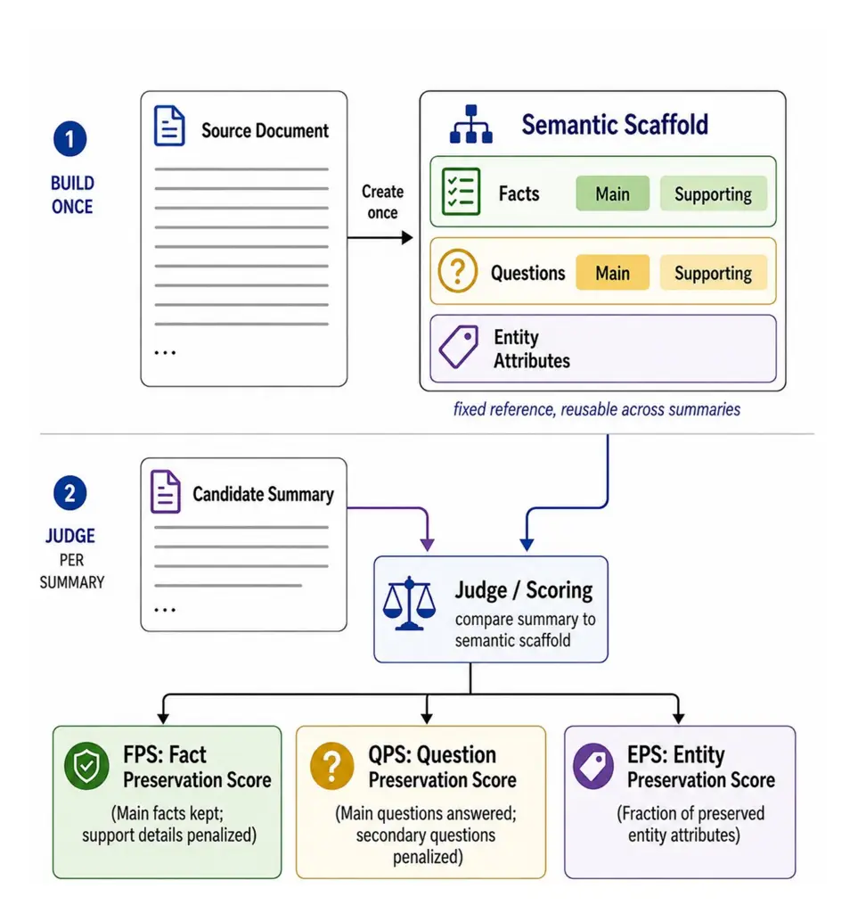
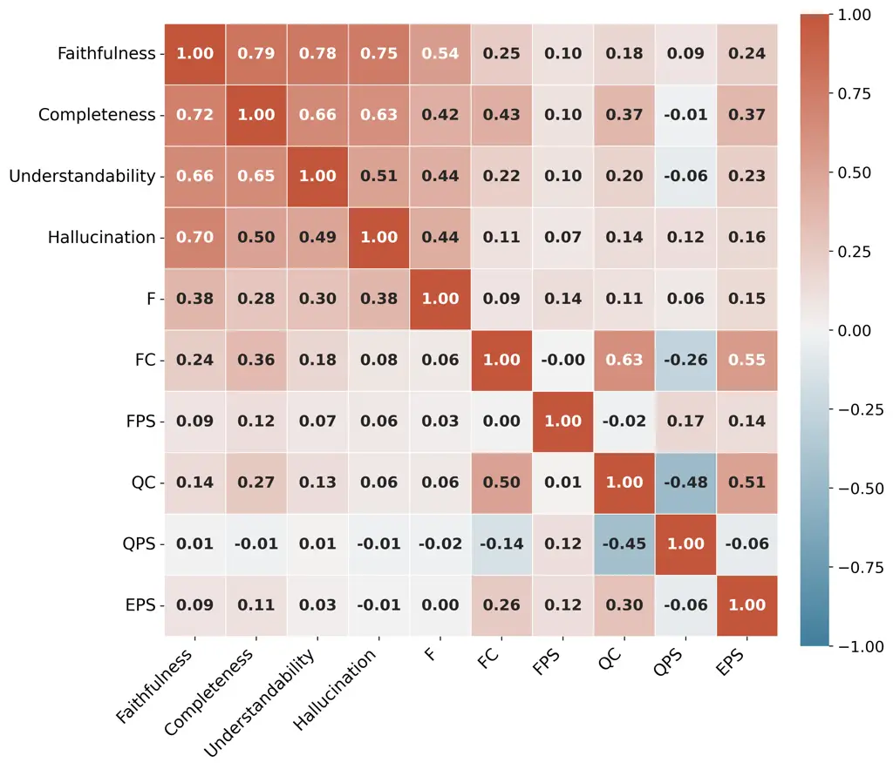
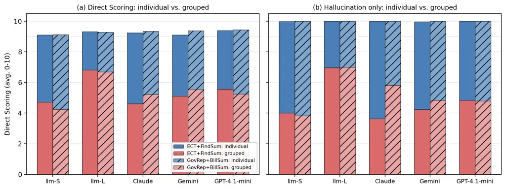
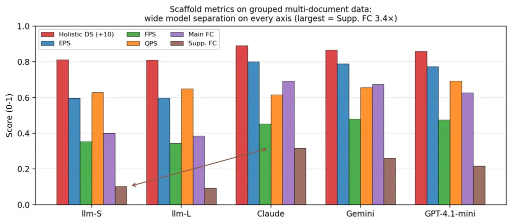

# Preserving What Matters: Semantic Scaffolds Beyond Saturation in Summarization Evaluation

Ramin Fahimi ^(†)^(†)thanks: Equal contribution.    Nikhil Reddy
Pottanigari¹¹ 1 ArXiv-Sum (Cohan et al., 2018), GovReport (Huang et al.,
2021), BigPatent (Sharma et al., 2019).    Noah Bolger    Sepideh
Kharaghani    Ying Zhang    ServiceNow Canada
Affiliation: {ramin.fahimi, nikhilreddy.pottanigari,
Affiliation: noah.bolger, Affiliation: sepideh.kharaghani,
yin.zhang}@servicenow.com

###### Abstract

Summarization ships in countless production systems, making model
selection a routine decision that depends on measuring summary quality.
Existing metrics struggle to support this: ROUGE captures only surface
overlap, while LLM-as-judge scores saturate to near-identical values
that fail to rank models effectively. We observe this saturation across
three public datasets, two proprietary datasets, and multilingual
settings. Motivated by this, we introduce Semantic Scaffold, an
evaluation framework that extracts a hierarchical representation of
facts, questions, and entity attributes from a source text, labeling
each as a main point or supporting detail, and reusing this structure as
a fixed reference for scoring summaries. From this representation, we
derive three diagnostic metrics: Fact Preservation Score (FPS), Question
Preservation Score (QPS), and Entity Preservation Score (EPS), designed
to reward the preservation of essential information while penalizing
detail overload, and position them as interpretable diagnostics that
remain informative where holistic axes collapse. Finally, we analyze
four recurring failure modes of ROUGE and LLM-as-judge scores,
demonstrating that scaffold-based evaluation remains informative where
conventional metrics collapse.

|     |
| --- |
|     |

## 1 Introduction

Document summarization, a long-standing NLP challenge (Lin, 2004; See et
al., 2017), is increasingly deployed in production settings, powering
everything from search overviews to automated digests of reports. This
ubiquity makes model selection a routine production decision that hinges
on accurately measuring summary quality.

Existing evaluation methods fall short. ROUGE (Lin, 2004) and
BLEU (Papineni et al., 2002) count n-gram overlap, missing semantic
content in abstractive summaries. Human evaluation is reliable but
costly at scale (Fabbri et al., 2021). LLM-as-judge scoring (Liu et al.,
2023a; Zheng et al., 2023) is cheaper but poorly calibrated (Fabbri et
al., 2021), hard to interpret, and biased toward verbose text (Zheng et
al., 2023); moreover, automatic metrics in general struggle to reliably
evaluate LLM-generated summaries (Goyal et al., 2022; Zhang et al.,
2024). On our internal Contracts dataset, the Hallucination axis spans
only 0.00225 across eight models, while the widest holistic-axis span is
0.182 (Table 4). We call this loss of range near the top of the scale
_metric saturation_; compressed scores do not imply identical model
quality.

We propose the Semantic Scaffold, a proactive evaluation framework that
addresses these limitations (Figure 1). The scaffold is a structured
representation of a document’s key facts, questions, hierarchy, and
entities, extracted once from the source for reuse. Our decoupled
“extract-then-judge” approach uses this hierarchy to distinguish between
main facts/questions and supporting details. This enables a modular
toolbox of interpretable metrics that specifically reward summaries for
preserving the document’s core structure by prioritizing main points
over less critical details.



Figure 1: Overview of the Semantic Scaffold for summarization
evaluation.

Contributions.

(1) We document substantial LLM-judge score compression across
proprietary, public, and multilingual summarization settings;

(2) we introduce the Semantic Scaffold, a reusable source representation
that enables item-level evaluation of fact, question, and entity
preservation; and

(3) we catalogue four recurring failure modes of the ROUGE plus
LLM-judge stack, each paired with the model-selection decision it
corrupts.

## 2 Related Work

Reference-based. Lexical-overlap metrics, ROUGE (Lin, 2004),
BLEU (Papineni et al., 2002), and METEOR (Banerjee and Lavie, 2005),
rely on surface lexical matching and miss meaning and factual
accuracy (Fabbri et al., 2021). Embedding metrics such as
BERTScore (Zhang et al., 2020) and MoverScore (Zhao et al., 2019)
capture deeper similarity but still need references.

Reference-free. Fact-based metrics and their meta-evaluations (Gabriel
et al., 2021), including SummaC (Laban et al., 2022), FactCC (Kryściński
et al., 2020), and FineSurE (Song et al., 2024), flag factual errors
against the source. QA-based metrics such as QAEval (Deutsch et al., 2021) and QuestEval (Scialom et al., 2021) generate questions and check
whether the summary answers them, but couple question generation to
scoring, so the questions cannot be reused. LLM-as-judge methods (Zheng
et al., 2023) like G-Eval (Liu et al., 2023a) rate fluency, coherence,
and factuality; they track human judgments but remain poorly
calibrated (Fabbri et al., 2021) and length-biased (Zheng et al., 2023).

From atomic units to structure. The Pyramid Method (Nenkova and
Passonneau, 2004) scored summaries through atomic content units; Liu et
al. (2023b) formalized this as the ACU protocol and AutoACU (Liu et al.,
2023c) automated it. Later work adds factual verification and alignment:
FActScore (Min et al., 2023), ACUEval (Wan et al., 2024),
MiniCheck (Tang et al., 2024), AlignScore (Zha et al., 2023), and
HAMLET (Lee et al., 2025); notably, FActScore finds frontier LLMs below
60% atomic factual precision in long-form generation. The Semantic
Scaffold extends this line with explicit main/supporting hierarchy, a
representation spanning facts, questions, and entities, and a single
extraction reused across models.

## 3 Saturation: When LLM Judges Stop Ranking Models

Our goal was not to study metric saturation. However, when evaluating
newer and cheaper models for production use cases, we discovered
saturation in our LLM-as-a-judge scores, diminishing the usefulness of
these metrics for selecting the top model. This section establishes this
observation across proprietary production data, three public benchmarks
and multilingual settings.

#### Dataset.

We use two annotated internal datasets and three public datasets.
Screenshots: 235 bug-report UI screenshots selected from items with
three available human references, with one reference retained per
instance (Figure 5); short, structured, and entity-dense. Contracts: 445
documents with dense legal language and multi-thousand-word inputs,
where omissions and structural compression matter. We also evaluate on
three public long-document benchmarks: ArXiv-Sum (Cohan et al., 2018)
(6,440 papers), GovReport (Huang et al., 2021) (973 reports), and
BigPatent (Sharma et al., 2019) (8,565 patents across nine CPC shards).

#### Models.

We evaluate eight frontier models on the proprietary datasets:
GPT-4o-mini, GPT-4.1-mini, GPT-4o, GPT-4.1, Gemini-2.0-Flash,
Gemini-2.5-Flash, Gemini-2.5-Pro, and Claude-3.7-Sonnet. For the
Screenshots dataset, we additionally include a _Human_ reference row as
a target anchor.

We denote the three proprietary systems as Internal-S, Internal-M, and
Internal-L. For public benchmark evaluation, we use five models:
Internal-S, Internal-L, GPT-4.1-mini, Gemini-2.5-Flash, and
Claude-3.7-Sonnet; the qualitative walkthrough in Appendix B also
includes Internal-M.

#### Observed saturation.

We evaluate every summary with a G-Eval-style (Liu et al., 2023a) LLM
judge on four holistic axes (Faithfulness, Completeness,
Understandability, and Hallucination; prompt in §G.7).

|                                                                                                               |              |                |
| ------------------------------------------------------------------------------------------------------------- | ------------ | -------------- |
| Dataset ¹¹ 1 ArXiv-Sum (Cohan et al., 2018), GovReport (Huang et al., 2021), BigPatent (Sharma et al., 2019). | DS range     | Hall. range    |
| ArXiv-Sum                                                                                                     | 9.01 to 9.42 | 9.99 to 10.00  |
| GovReport                                                                                                     | 9.00 to 9.34 | 9.97 to 10.00  |
| BigPatent                                                                                                     | 9.23 to 9.55 | 10.00 to 10.00 |

Table 1: Direct-scoring (DS) saturation on three public benchmarks, five
models each. The largest unrounded DS spread is 0.412; every
Hallucination mean is at least 9.972.

Proprietary datasets. On Contracts, every Hallucination mean rounds to
1.00; the unrounded span is 0.00225. Faithfulness spans 0.057 and
Understandability 0.025. Screenshots shows similar compression:
Hallucination spans 0.025 and Understandability 0.040. Per-model scores
are in Table 4.

Public benchmarks. Saturation is not confined to our internal data. On
three widely used public benchmarks scored on a 1–10 scale, the widest
DS spread across five models is 0.412, and Hallucination is at least
9.972 in every cell (Table 1).

|                   |             |            |           |
| ----------------- | ----------- | ---------- | --------- |
| Model             | Lang. group | Faith. avg | Hall. avg |
| Gemini-2.5-Flash  | English     | 9.67       | 9.99      |
|                   | Non-English | 9.63       | 9.99      |
| GPT-4.1-mini      | English     | 9.57       | 9.97      |
|                   | Non-English | 9.55       | 9.97      |
| Claude-3.7-Sonnet | English     | 9.73       | 9.99      |
|                   | Non-English | 9.66       | 9.98      |

Table 2: Cross-lingual saturation on three internal screenshot datasets
(Faith./Hall. averaged over English vs. nine other languages).

Multilingual evidence. Across three models, three datasets, and ten
languages (90 aggregate cells), Hallucination ranges from 9.95 to 10.00
(Table 2). OCR text and judge prompts were professionally translated
into nine languages with human review. These data show compression in
this translated pipeline, not a causal effect of language. Per-language
breakdowns are in Appendix C.

## 4 Semantic Scaffold

Saturation is a measurement failure, the score stops discriminating
exactly when generation quality and decision stakes are highest.
Motivated by this, we introduce the Semantic Scaffold.

### 4.1 Architecture

The scaffold has three properties: It is proactive, with evaluation
targets fixed before seeing any summary to prevent criteria drift;
decoupled, as extraction runs once while judgment runs per candidate;
and reusable, with one scaffold serving all summaries of a source for
consistent, cheap comparisons.

#### Two stages.

_Creation_ uses one LLM pass to extract a structured representation of
facts, questions, hierarchy, and entities from the source. _Judgment_
then scores each candidate against this fixed reference. Each score
links to a scaffold item, providing item-level evidence of what a
summary kept, dropped, or misrepresented, rather than a single holistic
verdict.

#### Components.

Each scaffold item is tagged a _main point_ or a _supporting detail_.
Atomic facts are concise, self-contained statements (20–100 per
document). Key questions capture what the document answers, each with a
brief expected answer and source-sentence provenance. Entity attributes
list salient entities (people, organizations, products, concepts) and
their defining properties for entity-level checks. Templates are in
Appendix G.

### 4.2 Baseline Metrics

Our method builds on FineSurE (Song et al., 2024), adopting its
two-stage structure and its Fact Faithfulness (F) and Fact Coverage (FC)
metrics. We add Question Coverage (QC) as a third baseline (Table 3).
However, FineSurE lacks hierarchy, treating all facts equally. Our
scaffold metrics extend it by tagging all facts and questions as main or
supporting and rewarding summaries that prioritize the main tier.
Appendix A summarizes all metric definitions; formulas for FPS, QPS, and
EPS follow below.

|        |                            |                                                               |
| ------ | -------------------------- | ------------------------------------------------------------- |
| Metric | Formula                    | What it measures                                              |
| F      | faithful / total facts     | Fact faithfulness ²² 2 Built on FineSurE (Song et al., 2024). |
| FC     | covered / total facts      | Fact coverage ²² 2 Built on FineSurE (Song et al., 2024).     |
| QC     | answered / total questions | Question coverage                                             |

Table 3: Baseline evaluation metrics.

### 4.3 Scaffold Metrics

#### Fact Preservation Score (FPS).

FPS rewards keeping main facts and penalizes supporting ones.

```math
\mathrm{FPS}=\frac{M_{s}}{M_{c}}\times\left(1-\frac{S_{s}}{S_{c}}\right) \tag{1}
```

where $`M_{s}`$ and $`S_{s}`$ denote main and supporting facts preserved
in the summary, and $`M_{c}`$ and $`S_{c}`$ denote main and supporting
facts in the scaffold. The first term measures the share of main facts
preserved; the second term, ($`1-S_{s}/S_{c}`$), penalizes inclusion of
supporting facts. Reproducing every detail is closer to paraphrase than
summary; stating all supporting facts ($`S_{s}=S_{c}`$) drives FPS to
$`0`$ regardless of main-fact coverage.

#### Question Preservation Score (QPS).

QPS is the question analogue, rewarding answers to main questions and
penalizing attention to secondary ones.

```math
\mathrm{QPS}=\frac{Q_{s}}{Q_{c}}\times\left(1-\frac{R_{s}}{R_{c}}\right) \tag{2}
```

with $`Q_{s}`$ and $`R_{s}`$ denoting main and supporting questions
answered in the summary, and $`Q_{c}`$ and $`R_{c}`$ denoting main and
supporting questions in the scaffold.

#### Entity Preservation Score (EPS).

Entity fidelity is especially important in domains such as legal,
medical, and financial text, where a dropped attribute changes meaning.
Unlike FineSurE’s binary entity check, EPS is continuous, the fraction
of scaffold entity attributes preserved:

```math
\mathrm{EPS}=\frac{|\text{preserved attributes}|}{|\text{scaffold attributes}|} \tag{3}
```

so it distinguishes summaries that keep some attributes from those that
keep none.


#### Implementation.

We use GPT-4.1 for both extraction and judgment (temperature $`0.1`$,
max_tokens = 4096) and score models zero-shot in their default
configurations. A single model builds the scaffold and judges against it
so that every candidate is scored against an identical reference; this
is what makes the scaffold reusable across models and comparisons cheap.

## 5 Main Results

Table 4 reports all metrics across two proprietary datasets, Contracts
and Screenshots.

|             |                   |        |        |          |       |       |        |         |      |         |      |
| ----------- | ----------------- | ------ | ------ | -------- | ----- | ----- | ------ | ------- | ---- | ------- | ---- |
| Dataset     | Model             | Faith. | Compl. | Underst. | Hall. | F^(†) | FC^(†) | FPS^(‡) | QC   | QPS^(‡) | EPS  |
| Screenshots | GPT-4o-mini       | 0.89   | 0.82   | 0.96     | 0.97  | 0.93  | 0.43   | 0.51    | 0.36 | 0.73    | 0.79 |
|             | GPT-4.1-mini      | 0.93   | 0.87   | 0.97     | 0.99  | 0.97  | 0.49   | 0.52    | 0.42 | 0.70    | 0.87 |
|             | Gemini-2.0-Flash  | 0.96   | 0.86   | 0.98     | 1.00  | 0.98  | 0.48   | 0.51    | 0.42 | 0.69    | 0.85 |
|             | Gemini-2.5-Flash  | 0.95   | 0.87   | 0.97     | 1.00  | 0.99  | 0.53   | 0.53    | 0.45 | 0.67    | 0.88 |
|             | GPT-4o            | 0.87   | 0.77   | 0.95     | 0.98  | 0.97  | 0.31   | 0.39    | 0.25 | 0.70    | 0.71 |
|             | GPT-4.1           | 0.92   | 0.85   | 0.97     | 0.99  | 0.97  | 0.47   | 0.52    | 0.39 | 0.71    | 0.86 |
|             | Gemini-2.5-Pro    | 0.95   | 0.89   | 0.98     | 0.99  | 0.97  | 0.55   | 0.50    | 0.47 | 0.65    | 0.85 |
|             | Claude-3.7-Sonnet | 0.97   | 0.90   | 0.99     | 1.00  | 0.98  | 0.57   | 0.47    | 0.50 | 0.62    | 0.90 |
|             | Human             | 0.95   | 0.86   | 0.98     | 0.99  | 0.91  | 0.53   | 0.40    | 0.44 | 0.60    | 0.76 |
| Contracts   | GPT-4o-mini       | 0.92   | 0.81   | 0.96     | 1.00  | 0.98  | 0.14   | 0.39    | 0.19 | 0.60    | 0.28 |
|             | GPT-4.1-mini      | 0.97   | 0.89   | 0.96     | 1.00  | 0.98  | 0.20   | 0.50    | 0.28 | 0.75    | 0.46 |
|             | Gemini-2.0-Flash  | 0.95   | 0.82   | 0.96     | 1.00  | 0.98  | 0.15   | 0.41    | 0.21 | 0.61    | 0.30 |
|             | Gemini-2.5-Flash  | 0.95   | 0.84   | 0.97     | 1.00  | 0.95  | 0.15   | 0.42    | 0.21 | 0.63    | 0.31 |
|             | GPT-4o            | 0.95   | 0.71   | 0.96     | 1.00  | 1.00  | 0.06   | 0.16    | 0.09 | 0.27    | 0.14 |
|             | GPT-4.1           | 0.98   | 0.86   | 0.97     | 1.00  | 0.99  | 0.15   | 0.43    | 0.22 | 0.64    | 0.38 |
|             | Gemini-2.5-Pro    | 0.93   | 0.83   | 0.98     | 1.00  | 0.95  | 0.15   | 0.42    | 0.21 | 0.63    | 0.31 |
|             | Claude-3.7-Sonnet | 0.97   | 0.87   | 0.98     | 1.00  | 0.96  | 0.17   | 0.46    | 0.24 | 0.67    | 0.36 |

Table 4: Descriptive scores on both proprietary datasets. On Contracts,
Hallucination spans 0.002, Understandability 0.025, Faithfulness 0.057,
and Completeness 0.182; EPS spans 0.32. The strongest value per column
is highlighted in green; pink marks saturated cells. The Human row
(Screenshots only) is an anchor, not a ceiling. ^(†)Song et al. (2024)

#### Scaffold metrics restore discrimination.

Where holistic metrics saturate ( §3), scaffold metrics maintain
separation: QPS, FPS, and EPS span $`\Delta=0.32`$ to $`0.48`$ on
Contracts, compared to Hallucination ($`\Delta=0.00`$),
Understandability ($`0.02`$), and Faithfulness ($`0.06`$) (Figure 2).
This represents a wider spread, making model differences visible where
holistic axes collapse. Even when baseline metrics like FC and QC cannot
differentiate (e.g., 0.14 and 0.19 spreads),

scaffold metrics retain resolution, keeping model differences visible
where holistic axes no longer distinguish systems. We report spread as
resolving power; pairing it with a preference target is the natural next
step for using these axes to select models.

Figure 2: Score range across 8 models on Contracts, sorted by spread
(dots = models). Holistic metrics (red) saturate near 1.0; scaffold
metrics (blue) retain spread; foundational (gray) in between.

#### Themes are easy; hierarchy is hard.

A systematic gap between QPS and FPS scores reveals a core limitation in
current LLMs. Across every model and dataset, QPS exceeds FPS (e.g.,
GPT-4.1-mini on Contracts: QPS $`=0.75`$ vs. FPS $`=0.50`$). The two
criteria are calibrated differently by design: question alignment
credits a question whenever the summary supplies enough information to
answer it, while fact alignment requires the fact itself to be conveyed
(§G.5). The gap therefore locates where a summary’s coverage sits
between thematic and propositional—models track a document’s agenda more
readily than its fact hierarchy—and raising FPS at fixed QPS and EPS is
a well-posed target under matched criteria.

FPS, QPS, and EPS are only weakly correlated with one another
(Figure 3), confirming they measure distinct aspects of summary quality.

The negative Pearson QPS/QC correlation ($`r=-0.45`$) reflects their
differing objectives: QC rewards breadth of question coverage, while the
$`(1-R_{s}/R_{c})`$ term in QPS explicitly discounts it in favour of
main questions.



Figure 3: Pairwise correlations of evaluation metrics on the Screenshots
dataset. The upper triangle reports Spearman’s $`\rho`$; the lower
triangle reports Pearson’s $`r`$.

#### A small model leads on two scaffold axes.

On Contracts, GPT-4.1-mini outscores every larger model on both QPS
(0.75) and EPS (0.46) while sitting at parity on the holistic axes. A
team trusting holistic scores alone would pay for a bigger model that is
structurally worse, over-provisioning compute for a task the smaller,
cheaper model already wins. Saturation is thus not only an evaluation
problem; it translates directly into wasted inference cost and weaker
production decisions.

#### Humans aren’t the ceiling; they’re the target.

Seven of eight models exceed the Human row on EPS (Human $`=0.76`$). EPS
is recall-oriented over scaffold attributes, an objective annotators are
not writing toward, so the human row functions as a _sensible-target_
anchor rather than a ceiling, and is best read alongside the holistic
axes rather than as a standalone quality verdict.

Scaffold metrics on public benchmarks, under grouped summarization, are
reported in Table 11 and Figure 6.

## 6 Failure-Mode Analysis

Saturation is the most visible failure of holistic evaluation, but not
the only one. By constructing grouped multi-document settings from
single-document benchmarks (Mukherjee et al., 2022; Kornilova and
Eidelman, 2019; Huang et al., 2021), we observe four failure patterns in
our data, F1 to F4 (Table 5). These are descriptive stress tests, not
isolated causal experiments. We summarize them here; details are in
Appendix D.

|     |                                   |                                                                                                                                   |                                                      |
| --- | --------------------------------- | --------------------------------------------------------------------------------------------------------------------------------- | ---------------------------------------------------- |
| ID  | Name                              | Effect                                                                                                                            | Production consequence                               |
| F1  | Catastrophic compression collapse | Hallucination drops from near-perfect (10.0) to 3.6 - 7.0 on the same source when the judge conflates omission with fabrication   | Good summaries look hallucinated                     |
| F2  | Ranking instability               | ROUGE-L and Direct Scoring select different best models in all four tested (dataset, setting) configurations                      | Metric choice, not model quality, decides what ships |
| F3  | Domain-driven ROUGE bias          | ROUGE-L scores are approximately $`2\times`$ higher on government reports than earnings calls for summaries of comparable quality | Cross-domain comparison becomes invalid              |
| F4  | Goodhart rule-breaking            | A model violating the 100-word budget achieves the highest grouped direct score; prompt relaxation fails to correct the behavior  | Non-compliant summaries get rewarded                 |

Table 5: Four failure modes in grouped multi-document evaluation, each
paired with the model-selection decision it corrupts.

F1 (Catastrophic collapse under compression). When five models compress
related documents into a 100-word budget, Direct Scoring falls from
9.1–9.4 individually to 4.2–6.8 grouped, and Hallucination decreases by
about 5 points on average (Figure 4). The cause is not fabrication but a
measurement artifact: the judge compares the 100-word summary against a
much longer reference, so any detail dropped to meet the budget looks
“unsupported.”

|                |            |                          |                     |
| -------------- | ---------- | ------------------------ | ------------------- |
| Dataset        | Set.       | ROUGE-L leader           | DS leader           |
| ECT+FindSum    | individual | Claude-3.7-Sonnet (.111) | GPT-4.1-mini (9.40) |
| GovRep+BillSum | individual | Gemini-2.5-Flash (.228)  | GPT-4.1-mini (9.44) |
| ECT+FindSum    | grouped    | GPT-4.1-mini (.085)      | Internal-L (6.81)   |
| GovRep+BillSum | grouped    | GPT-4.1-mini (.119)      | Internal-L (6.69)   |

Table 6: F2 (ranking instability): ROUGE-L and Direct Scoring select
different metric leaders in all four (dataset, setting) configurations.
No independent preference target establishes which leader has higher
quality. ECT = ECTSum (Mukherjee et al., 2022), FindSum (Liu et al.,
2022), GovRep = GovReport (Huang et al., 2021), BillSum (Kornilova and
Eidelman, 2019).



Figure 4: F1: compression collapse on two multi-document benchmarks,
individual (blue) versus grouped 100-word (red). Direct Scoring and
Hallucination both decrease

The next three failures concern the rankings these metrics produce. F2
(instability): ROUGE-L and Direct Scoring crown different top models in
all four (dataset, setting) configurations we tried (Table 6); with
disagreement that complete, it is the choice of metric, not the quality
of the model, that decides which system ships. F3 (domain bias): for
summaries of comparable quality, ROUGE-L runs about $`2\times`$ higher
on government reports than on earnings calls, so a score is only
meaningful within a domain and cross-domain comparisons are not valid.
F4 (Goodhart): the model that most often breaks the 100-word limit earns
the highest grouped Direct Score, and relaxing the limit only lowers
ROUGE-L without fixing the behavior.

#### Why hierarchical scaffolds help.

Hierarchical scaffold addresses this by scoring components
independently. On the grouped dataset, scaffold metrics sustain
separation (Supporting Fact Coverage: $`3.4\times`$, Main Fact Coverage:
$`1.8\times`$; Appendix D.3, Table 11), exposing the real culprit: the
Hallucination collapse isn’t fabrication, models drop supporting details
under compression. While holistic scores flag that something’s wrong,
scaffolds reveal the cause.

## 7 Conclusion

When every frontier model earns a near-perfect hallucination score, the
bottleneck has shifted from the models to the way we measure them. We
argued that holistic LLM-judge metrics lose discriminative power exactly
as generation quality rises, and we showed it across two proprietary
datasets, three public benchmarks, and ten languages, then cataloged
four recurring failure modes of the conventional stack.

Our response, the Semantic Scaffold, changes the structure of evaluation
rather than the prompt: it extracts a hierarchical reference from the
source once and scores every candidate against it, so the scores trace
back to specific facts, questions, and entities. Where holistic axes
flatten, its FPS, QPS, and EPS metrics still resolve differences between
models, and under heavy compression they pinpoint _why_ a model fails
instead of collapsing into uninterpretable numbers.  
Takeaway: when every model scores near the ceiling, the task is probably
not solved; the metric has stopped resolving, and that is the moment to
switch to structural, decomposed evaluation.

## References

- Banerjee and Lavie (2005) S. Banerjee and A. Lavie METEOR: an
  automatic metric for mt evaluation with improved correlation with
  human judgments. In Proceedings of the acl workshop on intrinsic and
  extrinsic evaluation measures for machine translation and/or
  summarization, pp. 65–72. External Links:
  [Link](https://aclanthology.org/W05-0909/) Cited by: §2.
- Cohan et al. (2018) A. Cohan, F. Dernoncourt, D. S. Kim, T. Bui, S.
  Kim, W. Chang, and N. Goharian A discourse-aware attention model for
  abstractive summarization of long documents. In Proceedings of the
  2018 Conference of the North American Chapter of the Association for
  Computational Linguistics (NAACL-HLT), pp. 615–621. External Links:
  [Document](https://dx.doi.org/10.18653/v1/N18-2097),
  [Link](https://aclanthology.org/N18-2097/) Cited by: §3, footnote 1,
  footnote 1.
- Deutsch et al. (2021) D. Deutsch, T. Bedrax-Weiss, and D. Roth Towards
  question-answering as an automatic metric for evaluating the content
  quality of a summary. Transactions of the Association for
  Computational Linguistics 9, pp. 774–789. External Links:
  [Document](https://dx.doi.org/10.1162/tacl%5Fa%5F00397),
  [Link](https://aclanthology.org/2021.tacl-1.47/) Cited by: §2.
- Fabbri et al. (2021) A. R. Fabbri, W. Kryściński, B. McCann, C.
  Xiong, R. Socher, and D. Radev SummEval: re-evaluating summarization
  evaluation. Transactions of the Association for Computational
  Linguistics 9, pp. 391–409. External Links:
  [Document](https://dx.doi.org/10.1162/tacl%5Fa%5F00373),
  [Link](https://aclanthology.org/2021.tacl-1.24/) Cited by: §1, §2, §2.
- Gabriel et al. (2021) S. Gabriel, A. Celikyilmaz, R. Jha, Y. Choi,
  and J. Gao GO FIGURE: a meta evaluation of factuality in
  summarization. In Findings of the Association for Computational
  Linguistics: ACL-IJCNLP 2021, pp. 478–487. External Links:
  [Document](https://dx.doi.org/10.18653/v1/2021.findings-acl.42),
  [Link](https://aclanthology.org/2021.findings-acl.42/) Cited by: §2.
- Goyal et al. (2022) T. Goyal, J. J. Li, and G. Durrett News
  summarization and evaluation in the era of GPT-3. arXiv preprint
  arXiv:2209.12356. External Links:
  [Document](https://dx.doi.org/10.48550/arXiv.2209.12356),
  [Link](https://arxiv.org/abs/2209.12356) Cited by: §1.
- Huang et al. (2021) L. Huang, S. Cao, N. Parulian, H. Ji, and L. Wang
  Efficient attentions for long document summarization. In Proceedings
  of the 2021 Conference of the North American Chapter of the
  Association for Computational Linguistics (NAACL-HLT), pp. 1419–1436.
  External Links:
  [Document](https://dx.doi.org/10.18653/v1/2021.naacl-main.112),
  [Link](https://aclanthology.org/2021.naacl-main.112/) Cited by: §3,
  Table 6, §6, footnote 1, footnote 1.
- Kornilova and Eidelman (2019) A. Kornilova and V. Eidelman BillSum: a
  corpus for automatic summarization of US legislation. In Proceedings
  of the 2nd Workshop on New Frontiers in Summarization, pp. 48–56.
  External Links: [Document](https://dx.doi.org/10.18653/v1/D19-5406),
  [Link](https://aclanthology.org/D19-5406/) Cited by: Table 6, §6.
- Kryściński et al. (2020) W. Kryściński, B. McCann, C. Xiong, and R.
  Socher Evaluating the factual consistency of abstractive text
  summarization. In Proceedings of the 2020 conference on empirical
  methods in natural language processing (EMNLP), pp. 9332–9346.
  External Links:
  [Document](https://dx.doi.org/10.18653/v1/2020.emnlp-main.750),
  [Link](https://aclanthology.org/2020.emnlp-main.750/) Cited by: §2.
- Laban et al. (2022) P. Laban, T. Schnabel, P. N. Bennett, and M. A.
  Hearst SummaC: re-visiting NLI-based models for inconsistency
  detection in summarization. Transactions of the Association for
  Computational Linguistics 10, pp. 163–177. External Links:
  [Document](https://dx.doi.org/10.1162/tacl%5Fa%5F00453),
  [Link](https://aclanthology.org/2022.tacl-1.10/) Cited by: §2.
- Lee et al. (2025) Y. Lee, J. Deng, N. H. Kim, H. Min, T. Yun, M.
  Ban, K. Yul, and H. Song Towards a holistic and automated evaluation
  framework for multi-level comprehension of llms in book-length
  contexts. In Proceedings of the 2025 Conference on Empirical Methods
  in Natural Language Processing, pp. 24401–24425. External Links:
  [Document](https://dx.doi.org/10.18653/v1/2025.emnlp-main.1241),
  [Link](https://aclanthology.org/2025.emnlp-main.1241/) Cited by: §2.
- Lin (2004) C. Lin Rouge: a package for automatic evaluation of
  summaries. In Text summarization branches out, pp. 74–81. External
  Links: [Link](https://aclanthology.org/W04-1013/) Cited by: §1, §1,
  §2.
- Liu et al. (2022) S. Liu, J. Cao, R. Yang, and Z. Wen Long text and
  multi-table summarization: dataset and method. In Findings of the
  Association for Computational Linguistics: EMNLP 2022, pp. 1995–2010.
  External Links:
  [Document](https://dx.doi.org/10.18653/v1/2022.findings-emnlp.145),
  [Link](https://aclanthology.org/2022.findings-emnlp.145/) Cited by:
  Table 6.
- Liu et al. (2023a) Y. Liu, D. Iter, Y. Xu, S. Wang, R. Xu, and C. Zhu
  G-eval: nlg evaluation using gpt-4 with better human alignment. In
  Proceedings of the 2023 conference on empirical methods in natural
  language processing, pp. 2511–2522. External Links:
  [Document](https://dx.doi.org/10.18653/v1/2023.emnlp-main.153),
  [Link](https://aclanthology.org/2023.emnlp-main.153/) Cited by: §1,
  §2, §3.
- Liu et al. (2023b) Y. Liu, A. R. Fabbri, P. Liu, Y. Zhao, L. Nan, R.
  Han, S. Han, S. R. Joty, C. Wu, C. Xiong, and D. R. Radev Revisiting
  the gold standard: grounding summarization evaluation with robust
  human evaluation. In Proceedings of the 61st Annual Meeting of the
  Association for Computational Linguistics (ACL), pp. 4140–4170.
  External Links:
  [Document](https://dx.doi.org/10.18653/v1/2023.acl-long.228),
  [Link](https://aclanthology.org/2023.acl-long.228/) Cited by: §2.
- Liu et al. (2023c) Y. Liu, A. R. Fabbri, Y. Zhao, P. Liu, S. R.
  Joty, C. Wu, C. Xiong, and D. R. Radev Towards interpretable and
  efficient automatic reference-based summarization evaluation. In
  Proceedings of the 2023 Conference on Empirical Methods in Natural
  Language Processing (EMNLP), pp. 16360–16368. External Links:
  [Document](https://dx.doi.org/10.18653/v1/2023.emnlp-main.1018),
  [Link](https://aclanthology.org/2023.emnlp-main.1018/) Cited by: §2.
- Min et al. (2023) S. Min, K. Krishna, X. Lyu, M. Lewis, W. Yih, P. W.
  Koh, M. Iyyer, L. Zettlemoyer, and H. Hajishirzi FActScore:
  fine-grained atomic evaluation of factual precision in long form text
  generation. In Proceedings of the 2023 Conference on Empirical Methods
  in Natural Language Processing (EMNLP), pp. 12076–12100. External
  Links: [Document](https://dx.doi.org/10.18653/v1/2023.emnlp-main.741),
  [Link](https://aclanthology.org/2023.emnlp-main.741/) Cited by: §2.
- Mukherjee et al. (2022) R. Mukherjee, A. Bohra, A. Banerjee, S.
  Sharma, M. Hegde, A. Shaikh, S. Shrivastava, K. Dasgupta, N.
  Ganguly, S. Ghosh, and P. Goyal ECTSum: a new benchmark dataset for
  bullet point summarization of long earnings call transcripts. In
  Proceedings of the 2022 Conference on Empirical Methods in Natural
  Language Processing (EMNLP), pp. 10893–10906. External Links:
  [Document](https://dx.doi.org/10.18653/v1/2022.emnlp-main.748),
  [Link](https://aclanthology.org/2022.emnlp-main.748/) Cited by: Table
  6, §6.
- Nenkova and Passonneau (2004) A. Nenkova and R. Passonneau Evaluating
  content selection in summarization: the pyramid method. In Proceedings
  of the Human Language Technology Conference of the North American
  Chapter of the Association for Computational Linguistics: HLT-NAACL
  2004, Boston, Massachusetts, USA, pp. 145–152. External Links:
  [Link](https://aclanthology.org/N04-1019/) Cited by: §2.
- Papineni et al. (2002) K. Papineni, S. Roukos, T. Ward, and W. Zhu
  Bleu: a method for automatic evaluation of machine translation. In
  Proceedings of the 40th annual meeting of the Association for
  Computational Linguistics, pp. 311–318. External Links:
  [Document](https://dx.doi.org/10.3115/1073083.1073135),
  [Link](https://aclanthology.org/P02-1040/) Cited by: §1, §2.
- Scialom et al. (2021) T. Scialom, P. Dray, S. Lamprier, B.
  Piwowarski, J. Staiano, A. Wang, and P. Gallinari QuestEval:
  summarization asks for fact-based evaluation. In Proceedings of the
  2021 conference on empirical methods in natural language processing,
  pp. 6594–6604. External Links:
  [Document](https://dx.doi.org/10.18653/v1/2021.emnlp-main.529),
  [Link](https://aclanthology.org/2021.emnlp-main.529/) Cited by: §2.
- See et al. (2017) A. See, P. J. Liu, and C. D. Manning Get to the
  point: summarization with pointer-generator networks. In Proceedings
  of the 55th Annual Meeting of the Association for Computational
  Linguistics (ACL), pp. 1073–1083. External Links:
  [Document](https://dx.doi.org/10.18653/v1/P17-1099),
  [Link](https://aclanthology.org/P17-1099/) Cited by: §1.
- Sharma et al. (2019) E. Sharma, C. Li, and L. Wang BIGPATENT: a
  large-scale dataset for abstractive and coherent summarization. In
  Proceedings of the 57th Annual Meeting of the Association for
  Computational Linguistics (ACL), pp. 2204–2213. External Links:
  [Document](https://dx.doi.org/10.18653/v1/P19-1212),
  [Link](https://aclanthology.org/P19-1212/) Cited by: §3, footnote 1,
  footnote 1.
- Song et al. (2024) H. Song, H. Su, I. Shalyminov, J. Cai, and S.
  Mansour FineSurE: fine-grained summarization evaluation using LLMs. In
  Proceedings of the 62nd Annual Meeting of the Association for
  Computational Linguistics (Volume 1: Long Papers), pp. 906–922.
  External Links:
  [Document](https://dx.doi.org/10.18653/v1/2024.acl-long.51),
  [Link](https://aclanthology.org/2024.acl-long.51/) Cited by: §2, §4.2,
  Table 4, footnote 2, footnote 2.
- Tang et al. (2024) L. Tang, P. Laban, and G. Durrett MiniCheck:
  efficient fact-checking of LLMs on grounding documents. In Proceedings
  of the 2024 Conference on Empirical Methods in Natural Language
  Processing (EMNLP), pp. 8818–8847. External Links:
  [Document](https://dx.doi.org/10.18653/v1/2024.emnlp-main.499),
  [Link](https://aclanthology.org/2024.emnlp-main.499/) Cited by: §2.
- Wan et al. (2024) D. Wan, K. Sinha, S. Iyer, A. Celikyilmaz, M.
  Bansal, and R. Pasunuru ACUEval: fine-grained hallucination evaluation
  and correction for abstractive summarization. In Findings of the
  Association for Computational Linguistics: ACL 2024, pp. 10036–10056.
  External Links:
  [Document](https://dx.doi.org/10.18653/v1/2024.findings-acl.597),
  [Link](https://aclanthology.org/2024.findings-acl.597/) Cited by: §2.
- Zha et al. (2023) Y. Zha, Y. Yang, R. Li, and Z. Hu AlignScore:
  evaluating factual consistency with a unified alignment function. In
  Proceedings of the 61st Annual Meeting of the Association for
  Computational Linguistics (ACL), pp. 11328–11348. External Links:
  [Document](https://dx.doi.org/10.18653/v1/2023.acl-long.634),
  [Link](https://aclanthology.org/2023.acl-long.634/) Cited by: §2.
- Zhang et al. (2020) T. Zhang, V. Kishore, F. Wu, K. Q. Weinberger,
  and Y. Artzi BERTScore: evaluating text generation with BERT. In
  International Conference on Learning Representations (ICLR), External
  Links: [Link](https://openreview.net/forum?id=SkeHuCVFDr) Cited by:
  §2.
- Zhang et al. (2024) T. Zhang, F. Ladhak, E. Durmus, P. Liang, K.
  McKeown, and T. B. Hashimoto Benchmarking large language models for
  news summarization. Transactions of the Association for Computational
  Linguistics 12, pp. 39–57. External Links:
  [Document](https://dx.doi.org/10.1162/tacl%5Fa%5F00632),
  [Link](https://aclanthology.org/2024.tacl-1.3/) Cited by: §1.
- Zhao et al. (2019) W. Zhao, M. Peyrard, F. Liu, Y. Gao, C. M. Meyer,
  and S. Eger MoverScore: text generation evaluating with contextualized
  embeddings and earth mover distance. In Proceedings of the 2019
  conference on empirical methods in natural language processing and the
  9th international joint conference on natural language processing
  (EMNLP-IJCNLP), pp. 563–578. External Links:
  [Document](https://dx.doi.org/10.18653/v1/D19-1053),
  [Link](https://aclanthology.org/D19-1053/) Cited by: §2.
- Zheng et al. (2023) L. Zheng, W. Chiang, Y. Sheng, S. Zhuang, Z.
  Wu, Y. Zhuang, Z. Lin, Z. Li, D. Li, E. P. Xing, H. Zhang, J. E.
  Gonzalez, and I. Stoica Judging LLM-as-a-judge with MT-Bench and
  chatbot arena. In Advances in Neural Information Processing Systems
  (NeurIPS), Vol. 36. External Links:
  [Link](https://proceedings.neurips.cc/paper_files/paper/2023/hash/91f18a1287b398d378ef22505bf41f6d-Abstract-Datasets_and_Benchmarks.html)
  Cited by: §1, §2.

## Limitations and Future Work

The main limitation of our framework is its reliance on the quality of
the initial semantic scaffold. All downstream metrics depend on the
accuracy and completeness of the LLM-based extraction. Therefore, a key
direction for future work is to develop stronger methods to improve and
automatically assess scaffold quality, especially in specialized or
noisy domains. Further research will also explore broader uses of the
Semantic Scaffold, such as content recommendation, educational
assessment, and cross-lingual analysis.

Two extensions would strengthen the framework’s use as a selection
criterion. First, a preference-based meta-evaluation: Screenshots
retains three human references per item, making it well suited to
relating scaffold scores to human preference and to calibrating the
main/supporting labels against human salience judgments. Second, broader
reporting: pairwise comparison is the standard non-saturating
alternative to direct scoring, and situating the scaffold metrics
against it, with length normalization and interval estimates, would
clarify where each is preferable.

## Ethics Statement

The proprietary Screenshots and Contracts datasets were annotated
in-house under standard employment agreements; no crowd-sourcing was
used. Source documents and scaffolds exclude end-user personally
identifiable information (PII), and entity annotations cover
organizations, products, system identifiers, and document-internal
references rather than personal attributes.

Because scaffold construction and scoring are LLM-assisted, the
resulting metrics should be interpreted as comparative evaluation
signals rather than absolute guarantees of summary quality, especially
in sensitive use cases.

## Appendix A Semantic Scaffold Evaluation Framework: Metric Overview

Table 7 summarizes the key metrics used in our framework, organized into
Baseline, Foundational, and Showcase categories. The Foundational
metrics (Section 4, Table 3) assess basic factual accuracy and coverage,
while the Showcase metrics (FPS, QPS, EPS) evaluate the higher-order
structural and entity-level qualities that remain informative once
holistic LLM-judge scores saturate. The subsequent sections give the
exact prompt templates for each.


Figure 5: Screenshot examples from the proprietary dataset: a Windows
Update error dialog (left) and a password-sync instruction page (right).
Error codes, UI labels, and step-by-step identifiers drive summary
quality, making EPS differences salient.

|                                     |                          |                                                                                               |
| ----------------------------------- | ------------------------ | --------------------------------------------------------------------------------------------- |
| Metric                              | Measures                 | Description                                                                                   |
| Baseline                            |                          |                                                                                               |
| LLM-as-Judge                        | Holistic Quality         | LLM rates summary on faithfulness, completeness, coherence, relevance. Susceptible to biases. |
| Foundational: Fact-Based            |                          |                                                                                               |
| Fact Faithfulness (F)               | Fact Accuracy            | Proportion of key facts accurately represented.                                               |
| Fact Coverage (FC)                  | Completeness             | Proportion of key facts present in summary.                                                   |
| Main Fact Coverage (Main FC)        | Main-point Recall        | $`M_{s}/M_{c}`$, the proportion of main facts present in the summary.                         |
| Supporting Fact Coverage (Supp. FC) | Supporting-detail Recall | $`S_{s}/S_{c}`$, the proportion of supporting facts present in the summary.                   |
| Fact Focus (F. Focus)               | Factual Precision        | Proportion of summary sentences aligned to at least one scaffold fact.                        |
| Foundational: Question-Based        |                          |                                                                                               |
| Question Coverage (QC)              | Completeness             | Proportion of key questions answered in summary.                                              |
| Showcase Metrics: Hierarchy         |                          |                                                                                               |
| Fact Preservation (FPS)             | Information Hierarchy    | Preserves main facts while avoiding overemphasis on supporting details.                       |
| Question Preservation (QPS)         | Hierarchical QA          | Answers main questions without excessive focus on supporting ones.                            |
| Entity Preservation (EPS)           | Attribute Accuracy       | Correctly preserves entity-attribute pairs from source.                                       |

Table 7: Evaluation metrics in the Semantic Scaffold framework.

## Appendix B Qualitative Walkthrough: From Source to Scaffold to Scores

This appendix walks one example (internal-dataset-v1/task-0099) from raw
OCR text through scaffold construction to final scores, as a concrete
reference for reproducing the pipeline.

### B.1 Source Document (OCR)

> Camera. Allow access to the camera on this device. If you allow
> access, people using this device will be able to choose if their apps
> have camera access by using the settings on this page. Denying access
> blocks Microsoft Store apps and most desktop apps from accessing the
> camera. It does not block Windows Hello. Camera access for this device
> is on. Change. Allow apps to access your camera. If you allow access,
> you can choose which apps can access your camera by using the settings
> on this page. Denying access blocks apps from accessing your camera.
> It does not block Windows Hello. On. Some desktop apps may still be
> able to access your camera when settings on this page are off. Find
> out why.

These 108 OCR words from a Windows 10 privacy-settings screenshot pack a
two-level permission hierarchy, two exceptions (_Windows Hello_ and
desktop apps), a state (access enabled), and an action (“Find out why”).
It is a typical Screenshots sample: short and entity-rich, where small
differences in factual and entity preservation separate strong summaries
from adequate ones and where holistic metrics blur exactly what the
scaffold keeps.

### B.2 Extracted Scaffold

The scaffold organizes the document into three views (atomic facts, key
questions, and entity attributes), each item labeled _main point_ or
_supporting detail_.

Atomic Facts (main points first, followed by supporting details).

1.  M1.
    Camera access on the device can be enabled or disabled. (main point)
2.  M2.
    When device-level access is enabled, users can choose which
    individual applications are permitted camera access. (main point)
3.  M3.
    Denying device-level access blocks Microsoft Store applications and
    most desktop applications from accessing the camera. (main point)
4.  M4.
    Camera access for this device is currently enabled. (main point)
5.  S1.
    Denying camera access does not block _Windows Hello_. (supporting
    detail)
6.  S2.
    Some desktop applications may still access the camera even when
    per-application settings are disabled. (supporting detail)
7.  S3.
    A “Find out why” link is provided to explain the desktop application
    exception. (supporting detail)

Key Questions (main questions first, followed by supporting details).

1.  Q1.
    What functionality does enabling device-level camera access provide
    to users? (main point)
2.  Q2.
    What happens to application-level camera access when device-level
    access is denied? (main point)
3.  Q3.
    What is the current camera access state for this device? (main
    point)
4.  R1.
    Does denying camera access affect _Windows Hello_? (supporting
    detail)
5.  R2.
    Can desktop applications still access the camera when
    per-application settings are disabled? (supporting detail)

Entity Attributes

- •
  Camera access (device level)
  - –
    Can be enabled or disabled
  - –
    Currently enabled
  - –
    Enables per-application access control when active

- •
  Camera access (application level)
  - –
    Individual applications may be permitted or blocked
  - –
    Per-application settings are available only when device-level access
    is enabled

- •
  Windows Hello
  - –
    Not blocked by camera access denial
  - –
    Operates independently of the privacy settings page

- •
  Desktop applications
  - –
    Blocked when device-level access is denied
  - –
    May still access the camera despite per-application settings being
    disabled

### B.3 Model Summaries and Per-Instance Scores

We compare four models on the same instance. All four are broadly
faithful and coherent, yet they differ in how well they preserve the
document’s structure, entity attributes, and exceptions.

Internal-S (189 characters):

> “The document explains camera access settings for a device, allowing
> users to choose which apps can access the camera, with a note that
> denying access blocks most apps but not Windows Hello.”

Internal-M (173 characters):

> “Camera access settings for this device and apps are detailed, with
> options to allow or deny access. Some desktop apps may still access
> the camera even when settings are off.”

Internal-L (162 characters):

> “The document explains camera access settings, allowing or denying
> access to the camera for apps, with notes on exceptions for Windows
> Hello and some desktop apps.”

GPT-4o (223 characters):

> “The document explains camera access settings on a device, allowing
> users to control app access to the camera. It notes that denying
> access blocks most apps except Windows Hello and mentions exceptions
> for some desktop apps.”

|            |        |       |      |      |
| ---------- | ------ | ----- | ---- | ---- |
| Model      | Faith. | Hall. | FPS  | EPS  |
| Internal-S | 0.92   | 0.98  | 0.33 | 0.44 |
| Internal-M | 0.90   | 0.97  | 0.22 | 0.33 |
| Internal-L | 0.93   | 0.98  | 0.38 | 0.56 |
| GPT-4o     | 0.94   | 0.99  | 0.25 | 0.67 |

Table 8: Illustrative per-instance scores for task-0099 (approximate;
final values depend on sentence-level alignments produced by the judge).
Holistic metrics (Faithfulness, Hallucination) stay clustered across all
four summaries, while FPS and EPS separate them.

### B.4 Step-by-Step FPS and EPS Computation

We walk through Internal-S to show that scaffold scores trace to
specific semantic units rather than an opaque judgment.

#### FPS.

The scaffold has $`M_{c}=4`$ main facts (M1–M4) and $`S_{c}=3`$
supporting facts (S1–S3). The summary covers M2 (“choose which apps can
access the camera”) and M3 (“denying access blocks most apps”),
partially signals M1, and omits M4, so $`M_{s}=2`$; it mentions S1 (“not
Windows Hello”) but not S2 or S3, so $`S_{s}=1`$. By Equation 1,
$`\mathrm{FPS}=\frac{2}{4}\!\left(1-\frac{1}{3}\right)\approx 0.33`$.
GPT-4o covers more main facts ($`M_{s}=3`$) but reproduces more
supporting detail ($`S_{s}=2`$), giving
$`\mathrm{FPS}=\frac{3}{4}\!\left(1-\frac{2}{3}\right)=0.25`$: despite
higher raw coverage it scores lower, because the metric rewards
hierarchy, not volume.

#### EPS.

The scaffold holds 9 entity attributes across 4 entities. The small
model preserves 2/3 device-level attributes, 1/2 application-level, 1/2
for Windows Hello, and 0/2 for desktop applications, so
$`\mathrm{EPS}=4/9\approx 0.44`$, matching the automated judge.

#### Key takeaway.

All four summaries get nearly identical holistic scores (Faithfulness
$`\geq 0.90`$, Hallucination $`\geq 0.97`$), yet FPS spans about 0.16
and EPS about 0.34 on this single instance. Such per-instance gaps
compound across the dataset into the larger separations in Table 4.

## Appendix C Full Cross-Lingual Saturation Results

§3 reports cross-lingual results averaged across datasets. This appendix
gives the full per-language breakdown for all three evaluated models and
datasets.

#### Evaluation setup.

We test multilingual robustness on three internal screenshot datasets:
Screen-v1 (887 images), Dart-v1 (831), and Dart-qe-v1 (215). OCR text
was professionally translated into nine languages with human review.
Summaries used the same production prompt as English; to avoid
English-pivot bias, the judge prompt was translated too, so each summary
is scored against its target-language source. This measures end-to-end
multilingual quality, not translation fidelity alone.

|                   |            |        |      |      |      |      |       |      |      |       |      |       |
| ----------------- | ---------- | ------ | ---- | ---- | ---- | ---- | ----- | ---- | ---- | ----- | ---- | ----- |
| Model             | Dataset    | Metric | en   | de   | es   | fr   | it    | ja   | ko   | nl    | pt   | pt-BR |
| Gemini-2.5-Flash  | Dart-v1    | F      | 9.69 | 9.63 | 9.62 | 9.64 | 9.66  | 9.67 | 9.63 | 9.67  | 9.61 | 9.61  |
|                   |            | H      | 9.98 | 9.99 | 9.98 | 9.99 | 10.00 | 9.99 | 9.99 | 10.00 | 9.99 | 9.99  |
|                   | Dart-qe-v1 | F      | 9.67 | 9.61 | 9.58 | 9.60 | 9.61  | 9.65 | 9.57 | 9.64  | 9.59 | 9.62  |
|                   |            | H      | 9.99 | 9.98 | 9.99 | 9.98 | 10.00 | 9.99 | 9.98 | 9.98  | 9.99 | 9.99  |
|                   | Screen-v1  | F      | 9.65 | 9.64 | 9.62 | 9.63 | 9.60  | 9.64 | 9.58 | 9.65  | 9.62 | 9.62  |
|                   |            | H      | 9.99 | 9.99 | 9.99 | 9.99 | 9.99  | 9.98 | 9.99 | 9.99  | 9.99 | 9.99  |
| GPT-4.1-mini      | Dart-v1    | F      | 9.55 | 9.47 | 9.54 | 9.57 | 9.57  | 9.56 | 9.53 | 9.57  | 9.56 | 9.54  |
|                   |            | H      | 9.95 | 9.95 | 9.97 | 9.98 | 9.97  | 9.96 | 9.97 | 9.98  | 9.98 | 9.97  |
|                   | Dart-qe-v1 | F      | 9.55 | 9.53 | 9.54 | 9.56 | 9.57  | 9.56 | 9.52 | 9.57  | 9.54 | 9.55  |
|                   |            | H      | 9.97 | 9.98 | 9.97 | 9.98 | 9.96  | 9.96 | 9.97 | 9.97  | 9.97 | 9.96  |
|                   | Screen-v1  | F      | 9.59 | 9.55 | 9.54 | 9.57 | 9.58  | 9.56 | 9.53 | 9.58  | 9.57 | 9.54  |
|                   |            | H      | 9.98 | 9.97 | 9.97 | 9.98 | 9.97  | 9.97 | 9.97 | 9.97  | 9.97 | 9.97  |
| Claude-3.7-Sonnet | Dart-v1    | F      | 9.73 | 9.67 | 9.65 | 9.66 | 9.67  | 9.65 | 9.64 | 9.67  | 9.66 | 9.65  |
|                   |            | H      | 9.98 | 9.97 | 9.99 | 9.98 | 9.99  | 9.98 | 9.99 | 9.98  | 9.98 | 9.98  |
|                   | Dart-qe-v1 | F      | 9.76 | 9.70 | 9.68 | 9.67 | 9.68  | 9.67 | 9.65 | 9.68  | 9.67 | 9.67  |
|                   |            | H      | 9.99 | 9.97 | 9.98 | 9.98 | 9.99  | 9.99 | 9.99 | 9.98  | 9.98 | 9.99  |
|                   | Screen-v1  | F      | 9.70 | 9.63 | 9.65 | 9.65 | 9.66  | 9.64 | 9.63 | 9.66  | 9.65 | 9.64  |
|                   |            | H      | 9.99 | 9.97 | 9.98 | 9.98 | 9.98  | 9.98 | 9.99 | 9.98  | 9.98 | 9.98  |

Table 9: Full cross-lingual evaluation results across three screenshot
datasets and ten languages. F = Faithfulness; H = Hallucination.

#### Key observations.

Saturation persists across languages: within each model family,
Faithfulness varies by at most 0.12 and Hallucination by at most 0.07
across ten languages, far less than the between-model gaps on English.
All Hallucination scores fall within $`[9.95,10.00]`$, a far narrower
band than the 3.6 to 7.0 collapse under grouped summarization, so severe
compression, not multilinguality, is the dominant production failure
mode.

## Appendix D Failure-Mode Analysis: Full Results

### D.1 F1: Compression Collapse Across Models and Datasets

Table 10 reports the complete set of (model, dataset, setting) results
underlying Figure 4.

#### Reading guide.

_Individual_ (ind.) generates one unconstrained summary per document;
_grouped_ (grp.) generates a single 100-word summary per task group. The
source documents are identical across settings, isolating the effect of
aggressive compression.

|                   |                   |         |        |        |          |       |      |
| ----------------- | ----------------- | ------- | ------ | ------ | -------- | ----- | ---- |
| Dataset           | Model             | Setting | Faith. | Compl. | Underst. | Hall. | Avg  |
| ECT+FindSum       | Internal-S        | ind.    | 8.95   | 7.85   | 9.66     | 9.98  | 9.11 |
|                   |                   | grp.    | 3.93   | 3.96   | 6.99     | 4.00  | 4.72 |
|                   | Internal-L        | ind.    | 9.44   | 8.08   | 9.77     | 10.00 | 9.32 |
|                   |                   | grp.    | 5.90   | 6.25   | 8.15     | 6.97  | 6.82 |
|                   | Claude-3.7-Sonnet | ind.    | 9.08   | 8.06   | 9.83     | 10.00 | 9.24 |
|                   |                   | grp.    | 3.75   | 4.05   | 6.99     | 3.63  | 4.60 |
|                   | Gemini-2.5-Flash  | ind.    | 8.96   | 8.01   | 9.50     | 9.97  | 9.11 |
|                   |                   | grp.    | 4.26   | 4.71   | 7.26     | 4.24  | 5.12 |
|                   | GPT-4.1-mini      | ind.    | 9.44   | 8.40   | 9.76     | 10.00 | 9.40 |
|                   |                   | grp.    | 4.55   | 5.29   | 7.54     | 4.84  | 5.55 |
| GovReport+BillSum | Internal-S        | ind.    | 9.07   | 7.82   | 9.62     | 10.00 | 9.13 |
|                   |                   | grp.    | 3.48   | 3.19   | 6.48     | 3.83  | 4.24 |
|                   | Internal-L        | ind.    | 9.42   | 8.06   | 9.68     | 10.00 | 9.29 |
|                   |                   | grp.    | 5.86   | 6.01   | 7.90     | 7.00  | 6.69 |
|                   | Claude-3.7-Sonnet | ind.    | 9.22   | 8.33   | 9.85     | 10.00 | 9.35 |
|                   |                   | grp.    | 3.93   | 4.00   | 7.09     | 5.81  | 5.21 |
|                   | Gemini-2.5-Flash  | ind.    | 9.36   | 8.38   | 9.74     | 10.00 | 9.37 |
|                   |                   | grp.    | 4.84   | 4.97   | 7.50     | 4.83  | 5.53 |
|                   | GPT-4.1-mini      | ind.    | 9.56   | 8.50   | 9.70     | 10.00 | 9.44 |
|                   |                   | grp.    | 4.30   | 4.66   | 7.23     | 4.79  | 5.24 |

Table 10: Complete individual-to-grouped evaluation results for F1
(compression collapse). Best-performing model per (dataset, setting) is
shown in bold.

#### Key observations.

The full table confirms the pattern from Figure 4 at the per-cell level:
every model collapses under the grouped constraint, and Hallucination
falls hardest (for example, Claude-3.7-Sonnet from 10.00 to 3.63 on
ECT+FindSum). Internal-L records the highest grouped scores despite
weaker individual summaries, the Goodhart effect detailed under F4.

#### Why Hallucination collapses: judge-compression conflation.

The observed collapse is not primarily caused by fabricated claims.
Manual inspection of 30 low-scoring grouped outputs reveals a more
subtle failure mode.

In the grouped setting, the judge compares a 100-word summary against a
reference formed by concatenating two single-document summaries
(approximately 450 to 600 words total). Consequently, factual details
omitted for compression are often treated as unsupported.

For example, an abstractive statement such as “the CNMI permit program
was amended” may be penalized when the reference instead contains a
detailed legal formulation such as “Public Law No. 110-229, enacted in
2008, amended the U.S.-CNMI covenant.” Although semantically consistent,
the compressed version lacks the statutory detail expected by the judge.

The result is a systematic conflation of _compression loss_ with
_fabrication_. By operating over atomic semantic units rather than
surface text overlap, the Semantic Scaffold separates these effects:
missing secondary details manifest as a _Supporting Fact Coverage gap_,
rather than an artificial collapse in Hallucination.

### D.2 F2: Ranking Instability, Full Per-Setting Breakdown

Table 6 in the main paper summarizes the four (dataset, setting)
configurations in which ROUGE-L and Direct Scoring (DS) select different
top-performing models. Here, we provide the complete per-setting
breakdown underlying that disagreement.

#### Why the rankings diverge.

In the individual setting Claude-3.7-Sonnet tops ROUGE-L: its more
extractive style overlaps more with the references. GPT-4.1-mini tops
Direct Scoring with more abstractive summaries the judge rates higher on
faithfulness and coherence. In the grouped setting Internal-L leads
Direct Scoring but not ROUGE-L, the same F4 non-compliance effect.
Because the disagreement holds in every configuration, metric choice
alone, not noise, decides which system ships.

### D.3 Scaffold Metrics Under Grouped Summarization

Figure 6 shows that scaffold-based metrics retain meaningful separation
even when holistic Direct Scoring collapses under grouped summarization.
Table 11 provides the complete metric breakdown averaged across both
grouped benchmark datasets.

|                      |                   |               |               |               |               |               |               |               |               |
| -------------------- | ----------------- | ------------- | ------------- | ------------- | ------------- | ------------- | ------------- | ------------- | ------------- |
| Rank                 | Model             | F. Faith.     | F. Cov.       | F. Focus      | Main FC       | Supp. FC      | FPS           | QPS           | EPS           |
| 1                    | Claude-3.7-Sonnet | 0.986         | 0.539         | 0.752         | 0.693         | 0.316         | 0.453         | 0.615         | 0.801         |
| 2                    | Gemini-2.5-Flash  | 0.961         | 0.493         | 0.866         | 0.674         | 0.260         | 0.481         | 0.655         | 0.789         |
| 3                    | GPT-4.1-mini      | 0.975         | 0.444         | 0.835         | 0.627         | 0.216         | 0.476         | 0.693         | 0.773         |
| 4                    | Internal-S        | 0.807         | 0.287         | 0.992         | 0.400         | 0.103         | 0.353         | 0.628         | 0.596         |
| 5                    | Internal-L        | 0.726         | 0.288         | 1.000         | 0.385         | 0.092         | 0.343         | 0.649         | 0.598         |
| Best-to-worst spread |                   | 0.260         | 0.252         | 0.248         | 0.308         | 0.224         | 0.138         | 0.078         | 0.205         |
| Relative spread      |                   | 1.4$`\times`$ | 1.9$`\times`$ | 1.3$`\times`$ | 1.8$`\times`$ | 3.4$`\times`$ | 1.4$`\times`$ | 1.1$`\times`$ | 1.3$`\times`$ |

Table 11: Scaffold-based metrics averaged across grouped multi-document
benchmark settings.

#### Column interpretation.

Faithfulness (F. Faith.) stays high, so the grouped drop comes from
omission, not fabrication, while overall fact coverage (F. Cov.) falls
sharply under the 100-word cap. Main Fact Coverage spreads more widely
($`1.8\times`$) than total coverage, so stronger models keep the _right_
facts rather than simply more of them, and Supporting Fact Coverage
spreads widest ($`3.4\times`$): supporting detail is the first casualty
of compression. FPS combines main-point recall with a supporting-detail
penalty, and QPS and EPS stay comparatively stable while still
separating models.

Compared with the proprietary results, the ordering of spreads inverts
here: Main and Supporting Fact Coverage separate models most
($`1.8\times`$ and $`3.4\times`$), while FPS, QPS, and EPS compress
(0.138, 0.078, 0.205 best-to-worst). This is expected under a uniform
100-word cap, which pushes every system toward the same operating point
on the main/supporting trade-off that FPS and QPS are built to expose.
On this data the hierarchy-aware components are the informative axes and
the aggregates are best read as summaries of them.

#### A revealing failure signature.

Internal-L reaches perfect F. Focus (1.000), meaning every sentence
matches some scaffold fact, yet records the lowest Supporting Fact
Coverage (0.092): it stays on-topic by filtering to a narrow slice of
content instead of synthesizing across documents.

### D.4 F4: Prompt Relaxation Does Not Recover Performance

A natural response to the compression collapse observed in F1 is to
relax the summarization constraint itself. If the 100-word cap is
driving the degradation, then allowing longer and more flexible
summaries should restore evaluation quality.

To test this hypothesis, we compare two grouped summarization prompts:

#### Prompt v1 (constrained summarization).

_“Generate a concise summary (less than 100 words) that captures the
main topic, purpose, and key details of the documents…”_

#### Prompt v2 (production-oriented summarization).

_“Generate a summary of these documents as it would appear attached to a
record in a service management platform. Focus on the information most
useful for a service agent or knowledge worker to understand the
document’s purpose, key findings, and any actionable outcomes without
reading the full document. Use clear, plain language proportional to the
document’s complexity.”_

Table 12 compares the two settings. Prompt v1 uses the original grouped
100-word cap, while v2 removes the length constraint and instead relies
on a production-style summarization objective.

|                    |         |         |       |       |
| ------------------ | ------- | ------- | ----- | ----- |
| Dataset            | RG-L v1 | RG-L v2 | DS v1 | DS v2 |
|                    | (v1)    | (v2)    | (v1)  | (v2)  |
| Dart-v1            | 0.358   | 0.275   | 8.99  | 8.86  |
| Dart-qe-v1         | 0.355   | 0.251   | 8.84  | 8.77  |
| GovReport+ BillSum | 0.228   | 0.102   | 6.69  | 5.80  |
| ECT+FindSum        | 0.111   | 0.090   | 6.82  | 5.76  |

Table 12: Prompt comparison: v1 (100-word cap) versus v2 (no explicit
cap; production-oriented instruction), averaged across five models.

#### Key observations.

The grouped Direct Score leader is lower under v2 on all four datasets
(for example, 6.69 to 5.80 on GovReport+BillSum and 6.82 to 5.76 on
ECT+FindSum), and the individual ROUGE-L leader also decreases. Because
v2 changes both framing and the length instruction, these results do not
isolate either factor or show that prompt wording cannot recover
performance.

## Appendix E Metric Design Rationale and Edge Cases

### E.1 Why a Multiplicative Form for FPS and QPS

FPS and QPS multiply a main-point recall term ($`M_{s}/M_{c}`$) by a
supporting-detail penalty ($`1-S_{s}/S_{c}`$) rather than adding them.
The product imposes a _joint_ constraint: a summary scores well only if
it both preserves central content _and_ compresses secondary detail. An
additive form would not do this: a weighted sum can still reward a
summary that copies every supporting fact, or under-penalize one that
drops core content. With the product, failure on either axis pulls the
score toward zero: no main-fact coverage gives FPS = 0 regardless of
supporting detail, and reproducing all supporting facts gives FPS = 0
regardless of recall. This encodes the basic assumption of
summarization: keep the priority structure, compress the rest.

FPS is most informative for abstractive, length-constrained tasks where
the goal is to preserve a document’s informational hierarchy: bug-report
digests, executive briefings, legal case summaries, news. It is a poor
standalone target for regulated or high-recall workflows (clinical trial
protocols, regulatory filings, audit reports) where retaining supporting
detail is desirable; there, read FPS alongside FC and Supporting Fact
Coverage.

### E.2 EPS: Continuous Rather Than Binary Entity Evaluation

FineSurE flags entity consistency with a binary, sentence-level
criterion: a sentence either has an entity error or it does not. That
misses the gradation in practice, where a summary may name an entity
correctly yet drop, compress, or distort some of its attributes. EPS
instead works at the attribute level, measuring the fraction of
scaffold-defined entity attributes preserved:

- •
  A summary that mentions “Windows Hello” but omits its independence
  from the privacy-settings toggle preserves only $`1/2`$ attributes for
  that entity.
- •
  A summary that mentions an entity name but misattributes all
  associated properties contributes 0, equivalent to omitting the entity
  entirely.
- •
  A summary preserving all entity attributes across the scaffold
  receives EPS = 1.0.

This granularity matters in legal, technical, and enterprise settings,
where an entity carries many important attributes (contract clauses,
error codes, system components, legal references) and partial
preservation differs meaningfully from omission.

### E.3 Reporting hierarchy without an inverse penalty

Main and supporting coverage can be reported separately without assuming
that supporting content should reduce quality. Designing a validated
hierarchy-aware aggregate requires held-out evaluation and remains
future work.

## Appendix F Failure-Mode Figures: Extended Captions and Guided Reading

Figure 6 plots the scaffold metrics on the same grouped data as Figure 4
in the main text.



Figure 6: Scaffold metrics on grouped multi-document summarization (five
models). Each axis keeps meaningful spread (Supporting Fact Coverage
$`3.4\times`$, Main Fact Coverage $`1.8\times`$, EPS $`1.3\times`$, FPS
$`1.4\times`$) while holistic Direct Scoring (red, shown as DS$`/10`$)
compresses into 0.81 to 0.89. The widest spread, Supporting Fact
Coverage, matches the F1 diagnosis: under compression, supporting
details fail first.

In Figure 4, Direct Scoring and Hallucination both decrease in the
grouped setting. Internal-L degrades least and also under-complies with
the 100-word limit, but these data do not establish that non-compliance
causes the difference. Figure 6 localizes coverage differences without
identifying their cause.

## Appendix G Complete Prompt Templates with Design Notes

All scaffold extraction and evaluation prompts are provided verbatim.
Each prompt is prefixed with a design note explaining the key choices.

Common settings for all prompts: model = GPT-4.1, temperature = 0.1,
max_tokens = 4096, response_format: json_object. The low temperature
(0.1 rather than 0.0) prevents perfectly deterministic but occasionally
degenerate JSON while keeping scores highly reproducible.

### G.1 Fact Extraction

Design note. The 20–100 range spans short documents (screenshots yield
8–15 facts) and long ones (contracts yield 60–100). The three-tier label
routes metadata and boilerplate to “other” so it cannot affect scores,
and ordering main points first doubles as a consistency check on the
extraction.


### G.2 Question Extraction

Design note. Questions capture the document’s implied agenda. The
expected answer and source-sentence provenance make the scaffold
auditable and let the question-alignment step (§G.5) align at the
sentence level without re-reading the full document.


### G.3 Entity Attributes Extraction

Design note. Entity extraction is deliberately broad (people,
organizations, products, legal instruments, technical and abstract
concepts), and each attribute is a single statement so the
entity-preservation prompt (§G.6) can check it independently.


### G.4 Key Fact Alignment Evaluation

Design note. This prompt computes $`M_{s}`$ and $`S_{s}`$ in the FPS
formula (Equation 1 in the main paper) by determining which scaffold
facts are inferable from the summary. The “sentence IDs” output enables
item-level audit: a practitioner can inspect exactly which summary
sentences support each scaffold fact, identifying precisely which
main-point facts were missed. The justification field discourages
shallow keyword matching.


### G.5 Key Question Alignment Evaluation

Design note. Structurally analogous to §G.4 but operating on questions.
A question is “answered” if the summary provides enough information for
a reader to answer it, not if the question is literally asked and
answered. This softer criterion is why QPS tends to exceed FPS across
models.


### G.6 Entity Preservation Evaluation

Design note. Checks attribute-by-attribute preservation rather than
entity-level presence, enabling the continuous EPS score described in
Appendix E. Only attributes that appear in the summary are returned; the
EPS denominator is always the total scaffold attribute count regardless
of what the summary mentions.


### G.7 Direct Score Evaluation (holistic baseline)

Design note. This is the holistic LLM-as-judge prompt used for all
direct-scoring baselines. The 1 to 10 scale with explicit anchors at 1,
5, and 10 matches prior work (SummEval, FineSurE) and provides
meaningful gradations. Hallucination is framed as its _absence_ (10 = no
hallucination) so higher is always better across all four dimensions.
The judge receives only the raw source document, not the scaffold,
making it a true holistic baseline without hierarchy information. The
rationale field aids human auditing of low-scoring cells.


