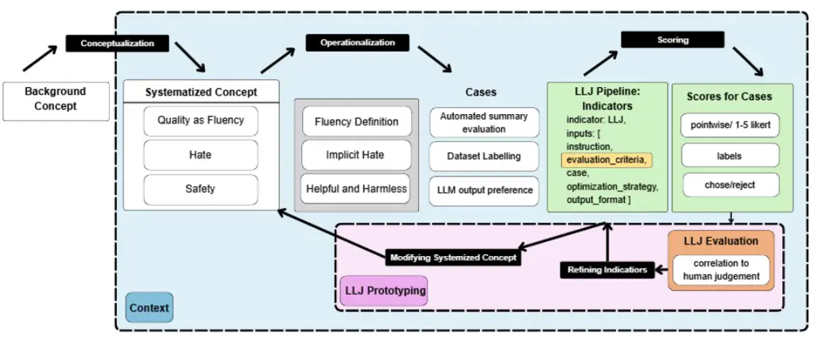

^(\*)^(\*)footnotetext: These authors contributed equally to the work

# LLJ Cards: Best practices for the Use of LLMs as Judges

Khaoula Chehbouni Affiliation: McGill University Affiliation: Mila -
Quebec AI Institute Email: [khaoula.chehbouni@mila.quebec](mailto:)   
Melina Medjdoub Affiliation: Concordia University    Florian Carichon
Affiliation: McGill University Affiliation: Mila - Quebec AI Institute
   Golnoosh Farnadi^(\*) Affiliation: McGill University
Affiliation: Mila - Quebec AI Institute    Jackie Chi Kit Cheung^(\*)
Affiliation: McGill University Affiliation: Mila - Quebec AI Institute

###### Abstract

In recent years, large language models (LLMs) have emerged as a popular
alternative for evaluation. Often referred to as LLMs as judges (LLJs),
these systems have been widely adopted by researchers and practitioners
across a broad range of measurement tasks, driven by their strong
performance, scalability, and cost-effectiveness relative to human
judgment. However, a growing body of work has shown that the use of LLJs
raise concerns about their validity and reliability as evaluators.
Existing efforts to address these challenges have largely focused on
developing bias-mitigation techniques and refining prompting strategies.
While these approaches represent an important step forward, they
primarily offer technical fixes and leave a more fundamental challenge
unaddressed: the lack of standardized, transparent, and reproducible
evaluation practices. In this paper, we introduce LLJ Cards, a framework
that synthesizes best practices from measurement theory, natural
language generation, and machine learning literature into practical
guidelines for LLJ-based evaluations. While LLJs offer a promising path
toward scalable evaluation, their effective use requires grounding in
rigorous evaluation principles to ensure validity, reliability, and
reproducibility. LLJ Cards addresses this need by providing a structured
framework for applying these principles in the design and reporting of
automated evaluations.

## 1 Introduction

In recent years, large language models (LLMs) as judges (LLJs) have
gained significant popularity among machine learning (ML) and natural
language processing (NLP) researchers and practitioners \[33, 56\].
Their use has also expanded well beyond computer science, reaching into
the social sciences \[85, 37\]. This uptake is largely driven by their
strong alignment with human judgments, which have traditionally served
as the gold standard in measurement, as well as their perceived
effectiveness as evaluators \[60, 7\]. In addition, their flexibility,
scalability, and cost efficiency have contributed to their adoption and
integration into standard evaluation practices \[15\]. Despite this
widespread enthusiasm, a body of work has cautioned that such adoption
may be premature, as numerous issues related to the validity and
reliability of LLJs have been documented \[111, 91, 92, 42, 27, 57, 9,
34\].

Human evaluation, despite its drawbacks in practice \[20, 112\], is
supported by an established body of literature that articulates norms to
ground evaluations in their broader context \[84, 25\]. In contrast,
LLJs lower the barrier to evaluation to an unprecedented degree. This
offers scalability and ease of use, but may encourage decontextualized
or under-specified evaluation setups \[15, 23, 34\]. Crockett and
Messeri \[21\] argue that many evaluations have become DEAD—that is,
decontextualized, engineered, anonymized, and disembodied—a
characterization that maps closely onto current uses of LLJs.
Decontextualized use of LLJs refers to their deployment with little
specification of the intended audience for the evaluation or the domain
of application. For instance, work leveraging LLJs for text
summarization \[60, 29, 94\] rarely clarifies what types of summaries
are being evaluated or for which real-world applications. Evaluations
are also highly engineered: in safety assessment, complex sociotechnical
notions of harm are often reduced to simplified judgments, such as
binary preferences over whether content is harmful or not \[14\].
Finally, many evaluation setups remain anonymized. A striking example is
data labeling, where annotator demographics are often omitted, or, in
the case of LLJs, where the positionality of the model is left
unspecified \[13\], despite extensive evidence that such factors
meaningfully shape the construction of datasets and evaluation
outcomes \[86\] ^(\*)^(\*) \* As Crockett and Messeri \[21\]’s work was
initially targeted towards cognitive scientist, embodied intelligence is
outside the scope of this paper.. As a result, LLJs run the risk of
exacerbating known problems in evaluation by reducing the “good
friction” that is rigorous operationalization and systematic validation.
While researchers have proposed methods to test these models \[58,
108\], improve their reliability \[89, 23\], or automatically validate
their use \[31, 34\], existing solutions mostly focus on targeted
technical fixes. In this paper, we examine how practitioners and
researchers evaluation practices can be improved.

Documentation is recognized as an important mechanism for improving both
research and development practices. Bender and Friedman \[10\] argue
that documenting design decisions can advance both scientific and
ethical practice by encouraging critical reflection on how these
decisions shape system behavior, thereby supporting generalizability and
reproducibility. Documentation can also promote more responsible AI
development by disclosing potential limitations and shortcomings and
supporting external auditing \[19\]. In parallel, research on
reproducibility has shown that thorough documentation can facilitate
system reuse while reducing the risk of misinterpreting or overstating
system capabilities \[66\]. Building on these insights, we introduce LLJ
Cards, a framework for improving the design and validation of LLJ-based
evaluations while increasing transparency. Our framework draws on
established practices from measurement theory \[1, 46, 107\], the
computational social science \[99, 84\], natural language generation
evaluation (NLG) \[112, 40, 2\] and responsible AI research \[90, 12\].
This framework supports practitioners in designing and validating LLMs
as judges through a structured set of guiding questions that promote
more rigorous, reproducible, and transparent evaluation practices. Our
cards make explicit the design choices underlying an evaluation and
situate its results within the broader evaluation context, enabling
clearer reporting of system capabilities, facilitating reuse, and
helping clarify the extent to which findings may generalize beyond the
original evaluation setting. By prompting practitioners to
systematically reflect on their design choices, LLJ Cards provides a
structured basis for transparent reporting and validation.

## 2 Related Work

LLMs as Judges. In recent years, LLJs have emerged as a preferred
evaluation method across a wide range of tasks and applications \[7, 60,
51, 102, 43, 29, 53, 15\]. While LLJs offer an important opportunity to
enable scalable evaluation, a growing body of work has shown potential
limitations in their use, highlighting issues of reliability \[111, 91,
57, 9\], validity \[92, 42, 27, 34\], and robustness \[83\], as well as
the extent to which LLJ-based evaluation processes may embed or amplify
biases \[109, 103, 74, 61, 55, 52, 17, 54\]. \[15\] review the
literature on the topic and link some of these pitfalls to existing
evaluation practices in the field. Furthermore, prior work addressing
concerns about LLJs validity and reliability has proposed benchmarks and
automated test suites to evaluate their performance \[23, 26, 31\]. For
instance, \[23\] identify common pitfalls in the use of LLJs and outline
experimental protocols to mitigate them. \[26\] introduce an automated
evaluation suite for assessing LLJ quality, while \[31\] propose a
training-free framework that generates checklists to improve LLJ systems
in multilingual settings. In contrast to this body of work focused on
technical interventions, LLJ Cards aim to improve practitioners’
evaluation practices.

Measurement Theory. Originating in the quantitative social sciences,
measurement theory has been shaped by longstanding efforts to develop
rigorous approaches for operationalizing and validating theoretical,
often abstract, constructs (e.g., democracy). Adcock and Collier \[1\]
introduce a four-level framework to depict the relationship between
concepts and observations: (1) the background concept, which includes
all possible definitions of the concept to be measured; (2) the
systematized concept, which is a specific formulation of that concept
along with its definition; (3) the indicators, which are the measures
used to score cases; and (4) the scores, which are the resulting
outcomes of the measurement process. They define measurement as
encompassing everything required to move from a systematized concept to
observed scores \[1\]: within this framework, a measurement is valid
when the scores produced by an indicator—in our case an LLM as judge—can
be meaningfully interpreted in relation to the systematized concept it
is intended to assess. A body of work has looked at how this framework
could be adapted for NLG evaluation \[112, 46, 101\], we build on top of
this literature and structure our LLJ Cards around it ^(\*)^(\*) \*
Consequently, we do not include considerations related to the background
concept.. See Figure 1 for an illustration.

Documenting Practices. Responsible AI research has long emphasized the
importance of documenting technical artifacts such as datasets, models,
and systems \[10, 72, 4, 65, 30, 11, 62, 113\]. Among the most widely
adopted proposals, Gebru et al. \[30\] introduce Datasheets for
Datasets, a structured set of guiding questions designed to document
dataset creations, while Mitchell et al. \[72\] extend this idea to
model reporting through Model Cards. These approaches aim to standardize
documentation practices, support practitioners in recording key
decisions about their artifacts, and improve transparency in the field.
Similarly, Liu et al. \[62\] focus on documenting practitioners’ design
choices in system development and on guiding them in collecting validity
evidence for benchmark-based measurement. While Zhu et al. \[113\]
propose a checklist to guide practionners through agentic benchmarks
assessment for validity. We introduce LLJ Cards to guide LLJ users
toward a more valid and reliable use of LLJs through a set of guiding
questions grounded in evaluation best practices.

## 3 Designing the LLJ Cards

We introduce LLJ Cards, a framework to support ML researchers and
practitioners—hereafter referred to as “LLJ users”—in developing valid
and reliable measurement tools. LLJ Cards guide users through key
considerations when designing and using LLJs, helping them avoid common
pitfalls, adopt best practices, and promote more standardized and
reproducible evaluation practices. To ensure that our framework is
broadly applicable, we ground our approach in representative use cases
for each of each of the three functionalities described by Li et al.
\[56\], following \[16\]: text summarization, safety alignment, and data
labeling.

To design our LLJ Cards framework, we first identified the key
desiderata of a successful evaluation \[47, 73, 88, 21, 69, 70, 71, 1,
79\], before examining literature in each of the selected use cases. For
each use case, we review the literature to characterize what constitutes
a “good evaluation,” document known limitations and failure modes, and
extract best practices transferable to our setting. We considered both
automated and human-led evaluation methods, as well as relevant work
from adjacent disciplines (e.g., information theory \[105, 38, 39\],
computational social science \[80, 22, 50\], cybersecurity \[77, 104,
81, 45\]), to complement our findings. We then reviewed LLJ applications
for each use case to understand how they are employed in practice \[60,
29, 18, 94, 102, 63, 97, 53, 7, 95, 44\], alongside literature on their
biases and limitations to identify current shortcomings \[15, 57, 98\].
Based on this review, we translated the best practices and
recommendations identified in the literature into the LLJ setting by
designing a coherent workflow aligned with current LLJ practices.

Our literature review led us to the following LLJ workflow: LLJ users
first identify the cases they wish to evaluate and define the type of
evaluation to conduct. They then select appropriate evaluation criteria
and set up their LLJ pipeline. Next, they typically perform a form of
LLJ tuning—such as model selection, prompt engineering, or
hyperparameter tuning—before selecting their final pipeline. Finally,
they use the LLJ pipeline to score all cases and report the results
along with an overall assessment of the LLJ validity, typically by
measuring its correlation with a reference metric of their choice.
However, this final validation step captures only one aspect of
validity: whether the LLJ produces scores that align with a chosen
reference metric. According to Messick \[71\], a valid evaluation should
also consider the broader consequences of using the LLJ and its
resulting scores.

Following this workflow, we introduce five cards to document and
facilitate the use and understanding of LLJs: Context (4.1), Evaluation
Criteria (4.2), LLJ Prototyping (4.5), LLJ Pipeline (4.3), and LLJ
Evaluation (4.4).

## 4 LLJ Cards: Best Practices for the Use of LLMs as Judges

This framework is designed to help LLJ users throughout the process of
using an LLJ. In this section, we first introduce a card before
providing a more detailed description of recommended practices for LLJ
users, along with examples illustrating their importance.

### 4.1 Context

In the Context Card, LLJ users are asked to provide contextual
information across four axes: the application, the task, the cases, and
the evaluation stakeholders.

Application. LLJ users should describe the real-world context of the
application—or, when none is explicitly defined, outline plausible
deployment scenarios (Q. 4)—and discuss the known risks associated with
that environment (Q. 4). For example, deploying an automated text
summarization system in a healthcare setting—where summaries may inform
decision-making—entails far higher stakes than using a similar system to
generate book reviews on an online forum. Consequently, the criteria and
priorities guiding the evaluation will differ accordingly.

Task. LLJ user should provide contextual information about the task in
which the LLJ is being leveraged (Q.4), its known limitations (Q.4) and
potential biases (Q.4). For example, safety classifiers and other
automated content moderation tools are known to exhibit biases against
marginalized groups, including Black \[35\] and queer \[24\] online
communities.

Cases. LLJ users should provide contextual information about the cases,
since building an LLJ pipeline to evaluate them requires clearly
defining what they are (e.g., generated automated summaries to evaluate,
an existing dataset for labeling, etc.) (Q. 4). This includes how the
data was collected, its domain, its scope and limitations, the values
and perspectives encoded in it, and whether it is being reused for a
purpose different from the one it was originally intended for. For
example, user review ratings are often used as targets in
sentiment-based opinion summarization to extract key product
aspects \[96\]. However, because reviews often contain mixed
opinions \[41\], ratings can miss such nuance, introducing noise and
undermining evaluation when treated as ground truth \[3\].

Stakeholders. LLJ users should provide additional context about the
evaluation process, including whether the LLJ is being used in a
production setting or for an academic study, who is funding its use, and
when the evaluation is taking place (Q. 4). We also suggest discussing
the intended audience, as it will influence the evaluation design
(Q. 4). Finally, we ask LLJ users to disclose their own background, as
well as that of the broader research team (Q. 4). This statement may
include a discussion of how the LLJ users’ educational background and
training, as well as sociohistorical factors such as nationality, race,
gender, class, or other identities, could influence the outcomes of the
project \[86, 87, 82\]. For example, Patton et al. \[76\] emphasize the
need for domain experts when annotating data from marginalized
communities, showing strong disagreement between annotators familiar
with gang-related activity and those who are not. Similarly, Fleisig et
al. \[28\] demonstrate that annotators’ demographics can influence
labels in hate speech detection tasks.

The Context Card aims to encourage LLJ users to ground their work within
its broader sociotechnical context. Grote \[32\] defines the evaluation
process as riddled with “epistemic and morally normative considerations”
as AI systems and other technical artifacts cannot be considered in
isolation, but should instead be conceived as tools used for specific
purposes with the potential to impact their societal environment \[32\].
This perspective aligns with scholars’ call for an adequacy-for-purpose
view \[2, 75\]; that is, the importance of assessing models and other
technical artifacts with respect to their success and reliability in a
particular instance of use: they should stand with respect to a target,
a user, a methodology, circumstances and a purpose \[75\]. This view
also aligns with Jones and others \[48\], who argue that a summary’s
usefulness depends on who it is for, what it will be used for, and when
it will be used. Here, the technical artifact is seen as a solution in a
problem space \[75\] that we want to define. We ask for additional
background information about the evaluation stakeholders since prior
work has shown that such information can meaningfully shape design
choices. This reflects the importance of embracing reflexivity \[86\]
and acknowledging how our background and perspectives inform and
constrain project results. We encourage LLJ users to not only think
about their own background but also about the values and perspectives
encoded in all the technical artifacts (e.g., datasets \[86\] or
models \[13\]) they are using as measurement inherently involves value
judgments at every stage of the process ^(\*)^(\*) \* As discussed by
Heisenberg \[36\]: “What we observe is not nature itself, but nature
exposed to our method of questioning”..

### 4.2 Evaluation Criteria

In the Evaluation Criteria Card, LLJ users should document their
evaluation goals, including the systematized concept, how it is
operationalized, and the limitations of that operationalization.

Systematized Concept. LLJ users should first reflect on the goal of the
evaluation by thinking about what they are trying to evaluate and what a
perfect scenario would look like (Q. 4- 4). LLJ users do not necessarily
need to redefine the construct they are trying to evaluate; they can
rely on existing literature. For instance, early work by Mani \[68\]
characterizes summary quality along two primary dimensions:
informativeness and acceptability and has served as a foundational
framework for the development of evaluation metrics, including ROUGE
\[59\]. LLJ users should also reflect on the potential ethical
considerations associated with the evaluation process, including whether
the test is appropriate in the first place \[69\] (Q. 4). For example,
work in machine psychology often applies psychological assessments
developed for humans directly to LLMs and draws conclusions from their
responses, rather than first redefining psychological constructs in ways
that are appropriate for LLMs \[64\].

Operationalization. Once the systematized concept is clearly defined,
LLJ users should specify how it is operationalized, namely through
explicit evaluation criteria and their associated definitions (Q. 4-4).
They should draw on prior work by experts in evaluation to identify and
define these criteria (Q. 4), rather than introducing ad hoc
definitions. If new criteria and definitions are proposed, LLJ users
should explain how they were validated (Q. 4). Furthermore, it is
important to consider the context in which the evaluation criteria were
originally defined, and whether this context affects their applicability
when reused in a different setting (Q. 4). For instance, defining
evaluation criteria for summarization is crucial, as different
operationalizations capture different notions of what constitutes a good
summary. Intrinsic metrics emphasize coherence and informativeness,
often in tension, whereas extrinsic metrics evaluate usefulness in
downstream tasks \[68\].

Limitations. As the operationalization process provides a proxy for
measuring the underlying systematized concept, certain dimensions may
not be captured by the chosen criteria. It is therefore important to
disclose the potential limitations of the operationalization, as these
will affect subsequent interpretations of the system (Q. 4). For
example, collecting harmless preferences has become central to safety
alignment research \[6\]. While Bai et al. \[6\] explicitly avoided
defining “harmlessness” to encourage diversity, follow-up work shows
that preference datasets still tend to reflect Western and majority
perspectives \[49\]. Finally, LLJ users should also consider whose
values are being used as the standard \[69\] and what implications this
entails (Q. 4).

The Evaluation Criteria Card aims to support LLJ users through the
operationalization process. Once the context surrounding the use of the
LLJ has been identified, a critical step in the evaluation process is to
clearly define and document what is being evaluated. A body of work has
shown that the ML and NLP communities have often struggled to clearly
define the systematized concept under evaluation and to properly
operationalize it \[12\]. As such, we propose a set of guiding questions
to help LLJ users better reflect on the goals of their evaluation. This
section should be considered independently of the measurement tool
chosen by researchers and practitioners. Both the definition of what is
being evaluated and how this concept has been characterized in the
literature should precede any decision about the indicators. In
particular, study design should not be driven by the capabilities of the
evaluation tool—in this case, the LLJ—but instead guided by the
underlying goal of the evaluation.

### 4.3 LLJ Pipeline

In the LLJ Pipeline Card, LLJ users should document their
implementation, including the initial setup, the model(s) used, the
final prompt(s), and the scoring function.

Set-Up. LLJ users should report the functionality of the
LLJ (Q. 4)—whether it is used for data-related tasks, training, or
evaluation \[56\]—as well as the type of configuration employed (Q. 4).
This includes specifying whether they are using an LLJ alone, as part of
an ensemble of models, or in combination with a human-in-the-loop
evaluation process \[56\]. We also ask LLJ users to indicate what is
being evaluated (Q. 4) (e.g., automated summaries in English, tweets for
hate speech, etc.), along with the evaluation type (Q. 4): pointwise,
pairwise, or listwise, etc.—i.e., whether the assessment involves
absolute or relative comparisons. For example, pairwise evaluation is
particularly popular in safety alignment, when collecting LLM-based
preferences to train a model \[53, 7, 95\].

Model. LLJ users should report details of the final model selected for
their evaluation (Q. 4), including the model family, version, size, date
of access, and any sampling parameters used. They should also briefly
justify their choice of model (e.g., state-of-the-art performance in the
literature, open-source availability, or privileged access). In addition
to documenting the LLJ, users should provide information about whether
the model used is proprietary, if an open-source evaluation is provided
and if the evaluation code is made publicly available (Q. 4). LLJ users
should also report the costs and resources required for the final
evaluation (Q. 4). This may include API expenses for proprietary models
or computational requirements for open-source models.

Prompt. LLJ users should provide examples of all final prompts they are
using in their evaluation (Q. 4). Best practices in prompt engineering
usually recommend a prompt to have the following components: role,
instructions, examples, chain-of-though or other prompt optimization
strategy and input and output format \[110\]. In the context of LLJs,
the literature typically relies on an instruction—although some work has
explored the use of personas for LLJ \[106\]—followed by an evaluation
criterion and its definition (optional). Additional examples for
few-shot learning or chain-of-thought can also be integrated, some users
also request the LLJ to provide an explanation for the prediction. We
refer the readers’ to Li et al. \[56\] for a more comprehensive account
of potential LLJ design configurations. LLJ prompts can also contain
reference material; for instance, in text summarization tasks, LLJ users
may include a human-written gold summary as a benchmark for what an
“ideal” summary should resemble, along with guidance on the expected
output format. In all cases, LLJ users are expected to report their
final prompt(s) to ensure reproducibility.

Score. After scoring the cases, the LLJ typically produces an output
that must be processed, either (1) to extract the final prediction or
(2) to further transform the scores to account for LLM reliability
issues and hallucinations. We expect LLJ users to inform these extra
steps in (Q. 4) and to justify their post-processing choices (Q. 4). For
example, when leveraging an LLJ for generating pairwise preferences for
reinforcement learning with AI feedback, \[53\] extract the log
probabilities of generating the tokens “1” and “2” and apply a softmax
to obtain a preference distribution used as the final score.

The LLJ Pipeline Card aims to help LLJ users thoroughly document their
final LLJ pipeline. Reproducibility is essential for valid and reliable
evaluation, as it ensures that the process can be repeated and produces
consistent results and conclusions \[78\]. However, in the context of
LLJs, this assumption does not hold in practice. Many LLJ approaches
rely on proprietary models that may be updated or deprecated without
notice \[60\], making exact replication inherently difficult. Even when
studies attempt to document their setups, key details are frequently
underspecified—for instance, by referring to “off-the-shelf”
models \[7\] or to “ChatGPT” without specifying exact versions, omitting
hyperparameters, or not fully reporting the content of prompts used in
evaluation \[15\]. As a result, many LLJ pipelines are only partially
reproducible. This card aims to address this under-specification by
guiding LLJ users on the minimal information they should report to
improve reproducibility and transparency. We structure it based on the
conception of an LLJ system proposed by Li et al. \[56\].

### 4.4 LLJ Evaluation

In the LLJ Evaluation Card, LLJ users should validate the evaluation
outcomes as well as discuss the potential societal consequences of the
evaluation.

Evaluation. LLJ users should report how they evaluated the scores
derived from the LLJ outputs: the metrics, benchmarks, baselines,
etc. (Q. 4). Popular methods include correlation with human judgment, or
performance on a downstream task when the LLJ scores are being used for
training. For example, Lee et al. \[53\] assess the effectiveness of
LLM-generated feedback for safety alignment by training a model on such
feedback and then employing human evaluators to measure the resulting
model’s win rate and harmlessness level. When evaluating LLJ scores, we
also recommend presenting disaggregated results and statistical analysis
if appropriate (Q. 4). We also ask LLJ users to document any tests
conducted to assess validity (Q. 4). In this context, correlations with
human judgments and comparisons to baseline metrics are commonly used as
evidence of convergent validity when validating a judge \[15\]. LLJ
users should also disclose the limitations of their evaluation
process (Q. 4), including anything excluded from the overall analysis.
Finally, in some cases where the LLJ is intended for production in a
dynamic environment, maintenance considerations should be taken into
account (Q. 4): how frequently should the LLJ be re-evaluated?

Ethical Considerations. LLJ users should reflect on the ethical
considerations associated with the evaluation process and its outcomes.
As such, we suggest that they begin by considering the potential
consequences of a misleading evaluation (Q. 4), within the intended
context of use (§ 4.1). Taking inspiration from approaches such as
impact statements \[5\], LLJ users should reflect on the benefits,
risks, and potential uncertainties associated with the measurement
process. This includes examining whether the evaluation process
introduces or amplifies sources of invalidity related to bias, fairness,
and distributive justice \[71\]. Furthermore, because anticipating
unintended side effects of an evaluation is hard, we follow Messick
\[69\] suggestion to approach this question comparatively, by
contrasting the evaluation potential impacts with those of plausible
alternatives (Q. 4). For example, Chehbouni et al. \[15\] discuss how
the field has progressively moved away from computationally efficient
metrics (such as ROUGE \[59\]) toward the use of large LLMs, which come
with substantially higher computational costs and, consequently, a
potentially significant environmental footprint over time. Finally, LLJ
users are asked to reflect on the potential risks and harms that could
arise from using the LLJ scores for action (Q. 4), either for
decision-making, or or in subsequent applications.

The LLJ Evaluation card aims to help LLJ users inform the final
evaluation of the LLJ pipeline. This includes checking whether the
operationalization is consistent with the final scores, whether the
results are meaningful, and whether the claims made align with the scope
of the process. While measurement theory emphasizes that validity and
reliability are not intrinsic properties of a test, but rather concern
the interpretation of scores within a specific context \[71\], existing
work on LLJs has often taken the opposite stance. In particular, LLJs
are frequently assumed to be validated by prior studies and therefore
directly transferable across tasks and settings, without requiring
re-validation in new contexts \[15, 34\]. As such, we encourage LLJ
users to interpret the resulting scores in light of their limitations to
avoid overgeneralization \[69\]: LLJ users may sometimes draw
conclusions that exceed what the results can support, without properly
validating that these results are generalizable \[69\]. Crockett and
Messeri \[21\] refers to this phenomenon as the illusion of
generalizability, where the lack of grounding in a specific context
enables cognitive scientists to overextend claims and assume their
findings apply universally. This illusion of generalizability is also
prevalent in the NLP and ML literature, where it has contributed to the
promotion of LLJ approaches presented as enabling universal evaluations,
“as one desires \[29\].”

### 4.5 LLJ Prototyping

In the LLJ Prototyping Card, LLJ users should document the prototyping
process, including the study setup, tested data, LLJ design and
validation, as well as any refinements made during this stage ^(\*)^(\*) \* Note that although the LLJ Prototyping stage occurs earlier in the
process, we describe it last, as it relies on concepts introduced in the
LLJ Pipeline and LLJ Evaluation cards. We do not expect LLJ users to
complete LLJ Pipeline and LLJ Evaluation cards for every configuration
tested during the prototyping stage; however, the final LLJ pipeline
should be thoroughly documented using these cards..

Study Set-Up. Based on the purpose of the evaluation (§ 4.1,§ 4.2), LLJ
users should first define the scope, timeline, expected cost of the LLJ
prototyping phase, and determine whether specialized expertise is
required \[84, 77\] (Q. 4). For example, the smaller scope of this stage
allows LLJ users to incorporate more diverse perspectives into the
evaluation design process, such as by consulting the intended audience
of the evaluation \[93, 67\] (§ 4.1). When determining the scope and
depth of testing, Peake \[77\] recommend first identifying “low-hanging
fruit”: the most likely edge cases and known biases in LLJs that can be
readily tested and are expected to yield meaningful insights if
addressed.

Data. LLJ users should construct the prototyping dataset which will
serve as a baseline for optimizing the LLJ pipeline and assessing its
validity. To maximize its effectiveness, this dataset should include
both a random sample of cases and challenging edge-case examples \[50,
67\], as this increases the likelihood of uncovering potential
weaknesses in the design early on (Q. 4-4). For example, difficult cases
in data labeling might include data points with high disagreement
between annotators, while difficult cases in text summaries can refer to
summaries with low compression rates.

Design. LLJ users should document and disclose the different model they
used, their prompting strategies and configuration choices across all
evaluated variants, in line with prior recommendations on
reproducibility and reporting in research \[9\] (Q. 4). Furthermore, LLJ
users should also disclose, if possible, the results of this preliminary
tuning process (Q. 4), to increase transparency about potential biases
or reliability issues \[9\].

Validation. LLJ users should conduct a range of evaluations targeting
different forms of validity and reliability to more comprehensively
assess the system (Q. 4-4). A useful way to approach this process is to
focus on unacceptable behavior: after having defined the system’s
desired outputs (§ 4.2), we encourage LLJ users to consider what the
model should not do, as this “negative space” is often easier to
articulate \[67, 93\]. This perspective can then be used to design
targeted tests that explicitly probe for such undesirable behaviors.

Refinement. LLJ users should, after assessing validity, consider whether
any refinement of the LLJ pipeline is required, or in some cases whether
it is necessary to even modify the systematized concept (Q. 4). A key
question in this refinement process is when to stop (Q. 4): determining
what constitutes “good enough” performance is inherently task-dependent
and varies across domains, task complexity, and evaluation goals. In
some cases, even moderate or imperfect agreement scores may be
acceptable if they are consistent with the state of the art or aligned
with the intended use of the system.

The LLJ Prototyping card is intended to support LLJ users in designing
the final LLJ pipeline and LLJ evaluation protocol. A common practice in
data labeling, which we propose to adopt for LLJ use, is conducting a
pilot study \[50, 25, 100, 84\]. Pilot studies are small-scale, initial
experiments aimed at developing and refining the annotation process
until it is sufficiently robust for full-scale deployment \[50\]. During
this phase, practitioners iteratively improve annotation guidelines,
clarify task definitions, and adjust methodological choices \[50\].
Introducing such a phase is particularly important in the context of
LLJs, where evaluations can be costly, whether due to API usage or
computational demands. A pilot study enables practitioners to identify
and address issues early, before committing substantial resources to a
flawed evaluation setup \[50\]. During pilot studies, it is common to
uncover limitations in the annotation guidelines, which may fail to
capture certain phenomena, or be ambiguous or difficult for annotators
to interpret \[50\]. When such issues arise, it is appropriate to
revisit the initial guideline design and iteratively refine and improve
it before proceeding to full-scale evaluation \[8\]. This idea is
closely aligned with practices in red-teaming \[45\], where systems are
iteratively stress-tested to identify failures and unintended behaviors
under challenging conditions. These benefits make a strong case for
incorporating a pilot-study phase as a standard component of LLJ use.
Since pilot studies traditionally involve human participants, we refer
to the analogous process in LLJ workflows as the LLJ prototyping stage.
Finally, while LLJ users typically already implement some of these
practices—such as testing multiple models, prompt engineering, and
stress-testing evaluators through prompt sensitivity or position bias
checks \[56\]—they often do so informally and without consistent
documentation. With this card, we aim to formalize the process and
improve transparency, while also reducing workload by concentrating the
most intensive testing on a small, targeted subsample of cases.

Figure 1: This figure presents an overview of \[1\] framework applied to
LLJ-based evaluation.

## 5 Conclusion

We have introduced a practical tool designed to support the valid and
reliable use of LLJs in evaluation settings. Our methodological
framework, LLJ Cards, aims to improve evaluation practices while
enhancing transparency and reproducibility in the field. While we hope
our framework can be applied to any LLJ implementation, it was primarily
developed and illustrated through three applications: text
summarization, safety alignment, and data labeling. Although these
settings differ substantially in how LLJs are used and correspond to
distinct communities of practice, they do not cover the full range of
possible LLJ applications. Our framework is intended to be flexible,
however we caution LLJ users about potential limitations in its
generalizability across settings. We believe there is strong promise in
scalable automated evaluation when it is done rigorously—for instance,
by enabling more realistic, interactive, and long-horizon evaluation
pipelines that better reflect real-world usage. However, realizing this
potential requires principled and careful use. We hope that our
framework contributes to supporting such practice and encourages more
responsible deployment of LLJ-based evaluation.

## 6 Acknowledgements

Funding support for project activities has been partially provided by
Canada CIFAR AI Chair, NSERC Discovery grant and FRQNT fellowship. We
also express our gratitude to the Digital Research Alliance of Canada
for their support in providing facilities for our evaluations.

## References

- \[1\] R. Adcock and D. Collier (2001) Measurement Validity: A Shared
  Standard for Qualitative and Quantitative Research. American Political
  Science Review 95 (3), pp. 529–546 (en). External Links: ISSN
  0003-0554, 1537-5943,
  [Link](https://www.cambridge.org/core/journals/american-political-science-review/article/abs/measurement-validity-a-shared-standard-for-qualitative-and-quantitative-research/91C7A9800DB26A76EBBABC5889A50C8B#),
  [Document](https://dx.doi.org/10.1017/S0003055401003100) Cited by: §1,
  §2, §3, Figure 1.
- \[2\] A. Alexandrova (2010) Adequacy for Purpose: The Best Deal a
  Model Can Get. The Modern Schoolman 87 (3/4), pp. 295–301 (en).
  External Links:
  [Link](https://www.pdcnet.org/pdc/bvdb.nsf/purchase?openform&fp=schoolman&id=schoolman_2010_0087_40972_0295_0301),
  [Document](https://dx.doi.org/10.5840/schoolman2010873/411) Cited by:
  §1, §4.1.
- \[3\] S. Angelidis and M. Lapata (2018) Summarizing Opinions: Aspect
  Extraction Meets Sentiment Prediction and They Are Both Weakly
  Supervised. In Proceedings of the 2018 Conference on Empirical Methods
  in Natural Language Processing, E. Riloff, D. Chiang, J. Hockenmaier,
  and J. Tsujii (Eds.), Brussels, Belgium, pp. 3675–3686. External
  Links: [Link](https://aclanthology.org/D18-1403/),
  [Document](https://dx.doi.org/10.18653/v1/D18-1403) Cited by: §4.1.
- \[4\] M. Arnold, R. K. E. Bellamy, M. Hind, S. Houde, S. Mehta, A.
  Mojsilovic, R. Nair, K. N. Ramamurthy, D. Reimer, A. Olteanu, D.
  Piorkowski, J. Tsay, and K. R. Varshney (2019) FactSheets: Increasing
  Trust in AI Services through Supplier’s Declarations of Conformity.
  arXiv. Note: arXiv:1808.07261 \[cs\] External Links:
  [Link](http://arxiv.org/abs/1808.07261),
  [Document](https://dx.doi.org/10.48550/arXiv.1808.07261) Cited by: §2.
- \[5\] C. Ashurst, M. Anderljung, C. Prunkl, J. Leike, Y. Gal, T.
  Shevlane, and A. Dafoe (2020) A Guide to Writing the NeurIPS Impact
  Statement. (en). External Links:
  [Link](https://medium.com/@GovAI/a-guide-to-writing-the-neurips-impact-statement-4293b723f832)
  Cited by: §4.4.
- \[6\] Y. Bai, A. Jones, K. Ndousse, A. Askell, A. Chen, N.
  DasSarma, D. Drain, S. Fort, D. Ganguli, T. Henighan, N. Joseph, S.
  Kadavath, J. Kernion, T. Conerly, S. El-Showk, N. Elhage, Z.
  Hatfield-Dodds, D. Hernandez, T. Hume, S. Johnston, S. Kravec, L.
  Lovitt, N. Nanda, C. Olsson, D. Amodei, T. Brown, J. Clark, S.
  McCandlish, C. Olah, B. Mann, and J. Kaplan (2022) Training a Helpful
  and Harmless Assistant with Reinforcement Learning from Human
  Feedback. arXiv. Note: arXiv:2204.05862 \[cs\] External Links:
  [Link](http://arxiv.org/abs/2204.05862),
  [Document](https://dx.doi.org/10.48550/arXiv.2204.05862) Cited by:
  §4.2.
- \[7\] Y. Bai, S. Kadavath, S. Kundu, A. Askell, J. Kernion, A.
  Jones, A. Chen, A. Goldie, A. Mirhoseini, C. McKinnon, C. Chen, C.
  Olsson, C. Olah, D. Hernandez, D. Drain, D. Ganguli, D. Li, E.
  Tran-Johnson, E. Perez, J. Kerr, J. Mueller, J. Ladish, J. Landau, K.
  Ndousse, K. Lukosuite, L. Lovitt, M. Sellitto, N. Elhage, N.
  Schiefer, N. Mercado, N. DasSarma, R. Lasenby, R. Larson, S.
  Ringer, S. Johnston, S. Kravec, S. E. Showk, S. Fort, T. Lanham, T.
  Telleen-Lawton, T. Conerly, T. Henighan, T. Hume, S. R. Bowman, Z.
  Hatfield-Dodds, B. Mann, D. Amodei, N. Joseph, S. McCandlish, T.
  Brown, and J. Kaplan (2022) Constitutional AI: Harmlessness from AI
  Feedback. arXiv. Note: arXiv:2212.08073 \[cs\] External Links:
  [Link](http://arxiv.org/abs/2212.08073),
  [Document](https://dx.doi.org/10.48550/arXiv.2212.08073) Cited by: §1,
  §2, §3, §4.3, §4.3.
- \[8\] D. Bareket and R. Tsarfaty (2021) Neural Modeling for Named
  Entities and Morphology (NEMO2). Transactions of the Association for
  Computational Linguistics 9, pp. 909–928. External Links:
  [Link](https://aclanthology.org/2021.tacl-1.54/),
  [Document](https://dx.doi.org/10.1162/tacl%5Fa%5F00404) Cited by:
  §4.5.
- \[9\] J. Baumann, P. Röttger, A. Urman, A. Wendsjö, F. M.
  Plaza-del-Arco, J. B. Gruber, and D. Hovy (2025) Large Language Model
  Hacking: Quantifying the Hidden Risks of Using LLMs for Text
  Annotation. arXiv. Note: arXiv:2509.08825 \[cs\] External Links:
  [Link](http://arxiv.org/abs/2509.08825),
  [Document](https://dx.doi.org/10.48550/arXiv.2509.08825) Cited by: §1,
  §2, §4.5.
- \[10\] E. M. Bender and B. Friedman (2018) Data Statements for Natural
  Language Processing: Toward Mitigating System Bias and Enabling Better
  Science. Transactions of the Association for Computational Linguistics
  6, pp. 587–604. External Links:
  [Link](https://aclanthology.org/Q18-1041/),
  [Document](https://dx.doi.org/10.1162/tacl%5Fa%5F00041) Cited by: §1,
  §2.
- \[11\] E. Bhardwaj, H. Gujral, S. Wu, C. Zogheib, T. Maharaj, and C.
  Becker (2024) Machine learning data practices through a data curation
  lens: An evaluation framework. In Proceedings of the 2024 ACM
  Conference on Fairness, Accountability, and Transparency, FAccT ’24,
  New York, NY, USA, pp. 1055–1067. External Links: ISBN
  979-8-4007-0450-5,
  [Link](https://dl.acm.org/doi/10.1145/3630106.3658955),
  [Document](https://dx.doi.org/10.1145/3630106.3658955) Cited by: §2.
- \[12\] S. L. Blodgett, G. Lopez, A. Olteanu, R. Sim, and H.
  Wallach (2021) Stereotyping Norwegian Salmon: An Inventory of Pitfalls
  in Fairness Benchmark Datasets. In Proceedings of the 59th Annual
  Meeting of the Association for Computational Linguistics and the 11th
  International Joint Conference on Natural Language Processing (Volume
  1: Long Papers), C. Zong, F. Xia, W. Li, and R. Navigli (Eds.),
  Online, pp. 1004–1015. External Links:
  [Link](https://aclanthology.org/2021.acl-long.81/),
  [Document](https://dx.doi.org/10.18653/v1/2021.acl-long.81) Cited by:
  §1, §4.2.
- \[13\] S. A. Cambo and D. Gergle (2022) Model Positionality and
  Computational Reflexivity: Promoting Reflexivity in Data Science. In
  Proceedings of the 2022 CHI Conference on Human Factors in Computing
  Systems, CHI ’22, New York, NY, USA, pp. 1–19. External Links: ISBN
  978-1-4503-9157-3,
  [Link](https://dl.acm.org/doi/10.1145/3491102.3501998),
  [Document](https://dx.doi.org/10.1145/3491102.3501998) Cited by: §1,
  §4.1.
- \[14\] K. Chehbouni, J. C. Carr, Y. More, J. C. Cheung, and G.
  Farnadi (2025) Beyond the Safety Bundle: Auditing the Helpful and
  Harmless Dataset. In Proceedings of the 2025 Conference of the Nations
  of the Americas Chapter of the Association for Computational
  Linguistics: Human Language Technologies (Volume 1: Long Papers), L.
  Chiruzzo, A. Ritter, and L. Wang (Eds.), Albuquerque, New Mexico,
  pp. 11895–11925. External Links: ISBN 979-8-89176-189-6,
  [Link](https://aclanthology.org/2025.naacl-long.596/) Cited by: §1.
- \[15\] K. Chehbouni, M. Haddou, J. C. K. Cheung, and G. Farnadi (2025)
  Neither Valid nor Reliable? Investigating the Use of LLMs as Judges.
  arXiv. Note: arXiv:2508.18076 \[cs\] External Links:
  [Link](http://arxiv.org/abs/2508.18076),
  [Document](https://dx.doi.org/10.48550/arXiv.2508.18076) Cited by: §1,
  §1, §2, §3, §4.3, §4.4, §4.4, §4.4.
- \[16\] K. Chehbouni, M. Roshan, E. Ma, F. Wei, A. Taik, J. Cheung,
  and G. Farnadi (2024) From Representational Harms to
  Quality-of-Service Harms: A Case Study on Llama 2 Safety Safeguards.
  In Findings of the Association for Computational Linguistics: ACL
  2024, L. Ku, A. Martins, and V. Srikumar (Eds.), Bangkok, Thailand,
  pp. 15694–15710. External Links:
  [Link](https://aclanthology.org/2024.findings-acl.927/),
  [Document](https://dx.doi.org/10.18653/v1/2024.findings-acl.927) Cited
  by: §3.
- \[17\] G. H. Chen, S. Chen, Z. Liu, F. Jiang, and B. Wang (2024)
  Humans or LLMs as the Judge? A Study on Judgement Bias. In Proceedings
  of the 2024 Conference on Empirical Methods in Natural Language
  Processing, Y. Al-Onaizan, M. Bansal, and Y. Chen (Eds.), Miami,
  Florida, USA, pp. 8301–8327. External Links:
  [Link](https://aclanthology.org/2024.emnlp-main.474/),
  [Document](https://dx.doi.org/10.18653/v1/2024.emnlp-main.474) Cited
  by: §2.
- \[18\] C. Chiang and H. Lee (2023) Can Large Language Models Be an
  Alternative to Human Evaluations?. In Proceedings of the 61st Annual
  Meeting of the Association for Computational Linguistics (Volume 1:
  Long Papers), A. Rogers, J. Boyd-Graber, and N. Okazaki (Eds.),
  Toronto, Canada, pp. 15607–15631. External Links:
  [Link](https://aclanthology.org/2023.acl-long.870/),
  [Document](https://dx.doi.org/10.18653/v1/2023.acl-long.870) Cited by:
  §3.
- \[19\] K. Chmielinski, S. Newman, C. N. Kranzinger, M. Hind, J. W.
  Vaughan, M. Mitchell, J. Stoyanovich, A. McMillan-Major, E.
  McReynolds, K. Esfahany, M. L. Gray, A. Chang, and M. Hudson (2024)
  The CLeAR documentation framework for AI transparency: Recommendations
  for practitioners & context for policymakers. Note: tex.howpublished:
  Harvard Kennedy School Shorenstein Center discussion paper External
  Links:
  [Link](https://www.microsoft.com/en-us/research/publication/the-clear-documentation-framework-for-ai-transparency-recommendations-for-practitioners-context-for-policymakers/)
  Cited by: §1.
- \[20\] E. Clark, T. August, S. Serrano, N. Haduong, S. Gururangan,
  and N. A. Smith (2021) All That‘s ‘Human’ Is Not Gold: Evaluating
  Human Evaluation of Generated Text. In Proceedings of the 59th Annual
  Meeting of the Association for Computational Linguistics and the 11th
  International Joint Conference on Natural Language Processing (Volume
  1: Long Papers), C. Zong, F. Xia, W. Li, and R. Navigli (Eds.),
  Online, pp. 7282–7296. External Links:
  [Link](https://aclanthology.org/2021.acl-long.565/),
  [Document](https://dx.doi.org/10.18653/v1/2021.acl-long.565) Cited by:
  §1.
- \[21\] M.J. Crockett and L. Messeri (2026) AI Surrogates and illusions
  of generalizability in cognitive science. Trends in Cognitive Sciences
  30 (3), pp. 203–215 (en). External Links: ISSN 13646613,
  [Link](https://linkinghub.elsevier.com/retrieve/pii/S1364661325002517),
  [Document](https://dx.doi.org/10.1016/j.tics.2025.09.012) Cited by:
  §1, §3, §4.4, footnote \*.
- \[22\] M. Díaz, I. Kivlichan, R. Rosen, D. Baker, R. Amironesei, V.
  Prabhakaran, and R. Denton (2022) CrowdWorkSheets: Accounting for
  Individual and Collective Identities Underlying Crowdsourced Dataset
  Annotation. In Proceedings of the 2022 ACM Conference on Fairness,
  Accountability, and Transparency, FAccT ’22, New York, NY, USA,
  pp. 2342–2351. External Links: ISBN 978-1-4503-9352-2,
  [Link](https://dl.acm.org/doi/10.1145/3531146.3534647),
  [Document](https://dx.doi.org/10.1145/3531146.3534647) Cited by: §3.
- \[23\] L. Dietz, O. Zendel, P. Bailey, C. L. A. Clarke, E.
  Cotterill, J. Dalton, F. Hasibi, M. Sanderson, and N. Craswell (2025)
  Principles and Guidelines for the Use of LLM Judges. In Proceedings of
  the 2025 International ACM SIGIR Conference on Innovative Concepts and
  Theories in Information Retrieval (ICTIR), ICTIR ’25, New York, NY,
  USA, pp. 218–229. External Links: ISBN 979-8-4007-1861-8,
  [Link](https://dl.acm.org/doi/10.1145/3731120.3744588),
  [Document](https://dx.doi.org/10.1145/3731120.3744588) Cited by: §1,
  §2.
- \[24\] R. Dorn, L. Kezar, F. Morstatter, and K. Lerman (2024) Harmful
  Speech Detection by Language Models Exhibits Gender-Queer Dialect
  Bias. In Proceedings of the 4th ACM Conference on Equity and Access in
  Algorithms, Mechanisms, and Optimization, EAAMO ’24, New York, NY,
  USA, pp. 1–12. External Links: ISBN 979-8-4007-1222-7,
  [Link](https://dl.acm.org/doi/10.1145/3689904.3694704),
  [Document](https://dx.doi.org/10.1145/3689904.3694704) Cited by: §4.1.
- \[25\] D. Feng, S. Besana, and R. Zajac (2009) Acquiring High Quality
  Non-Expert Knowledge from On-Demand Workforce. In Proceedings of the
  2009 Workshop on The People’s Web Meets NLP: Collaboratively
  Constructed Semantic Resources (People’s Web), I. Gurevych and T.
  Zesch (Eds.), Suntec, Singapore, pp. 51–56. External Links:
  [Link](https://aclanthology.org/W09-3308/) Cited by: §1, §4.5.
- \[26\] Y. Feng, S. Wang, Z. Cheng, Y. Wan, and D. Chen (2025) Are We
  on the Right Way to Assessing LLM-as-a-Judge?. arXiv. Note:
  arXiv:2512.16041 \[cs\] External Links:
  [Link](http://arxiv.org/abs/2512.16041),
  [Document](https://dx.doi.org/10.48550/arXiv.2512.16041) Cited by: §2.
- \[27\] B. Feuer, M. Goldblum, T. Datta, S. Nambiar, R. Besaleli, S.
  Dooley, M. Cembalest, and J. P. Dickerson (2024) Style Outweighs
  Substance: Failure Modes of LLM Judges in Alignment Benchmarking.
  (en). External Links:
  [Link](https://openreview.net/forum?id=MzHNftnAM1) Cited by: §1, §2.
- \[28\] E. Fleisig, R. Abebe, and D. Klein (2023) When the Majority is
  Wrong: Modeling Annotator Disagreement for Subjective Tasks. In
  Proceedings of the 2023 Conference on Empirical Methods in Natural
  Language Processing, H. Bouamor, J. Pino, and K. Bali (Eds.),
  Singapore, pp. 6715–6726. External Links:
  [Link](https://aclanthology.org/2023.emnlp-main.415/),
  [Document](https://dx.doi.org/10.18653/v1/2023.emnlp-main.415) Cited
  by: §4.1.
- \[29\] J. Fu, S. Ng, Z. Jiang, and P. Liu (2024) GPTScore: Evaluate as
  You Desire. In Proceedings of the 2024 Conference of the North
  American Chapter of the Association for Computational Linguistics:
  Human Language Technologies (Volume 1: Long Papers), K. Duh, H. Gomez,
  and S. Bethard (Eds.), Mexico City, Mexico, pp. 6556–6576. External
  Links: [Link](https://aclanthology.org/2024.naacl-long.365/),
  [Document](https://dx.doi.org/10.18653/v1/2024.naacl-long.365) Cited
  by: §1, §2, §3, §4.4.
- \[30\] T. Gebru, J. Morgenstern, B. Vecchione, J. W. Vaughan, H.
  Wallach, H. Daumé, and K. Crawford (2021) Datasheets for Datasets.
  arXiv. Note: arXiv:1803.09010 \[cs\] External Links:
  [Link](http://arxiv.org/abs/1803.09010),
  [Document](https://dx.doi.org/10.48550/arXiv.1803.09010) Cited by: §2.
- \[31\] M. Ghiasvand Mohammadkhani and H. Beigy (2025) Checklist
  Engineering Empowers Multilingual LLM Judges. In Proceedings of the
  Workshop on Beyond English: Natural Language Processing for all
  Languages in an Era of Large Language Models, S. B. Das, P. Mishra, A.
  Singh, S. H. Muhammad, A. Ekbal, and U. K. Das (Eds.), Varna,
  Bulgaria, pp. 190–196. External Links:
  [Link](https://aclanthology.org/2025.globalnlp-1.21/) Cited by: §1,
  §2.
- \[32\] T. Grote (2024) Fairness as adequacy: a sociotechnical view on
  model evaluation in machine learning. AI and Ethics 4 (2), pp. 427–440
  (en). External Links: ISSN 2730-5961,
  [Link](https://doi.org/10.1007/s43681-023-00280-x),
  [Document](https://dx.doi.org/10.1007/s43681-023-00280-x) Cited by:
  §4.1.
- \[33\] J. Gu, X. Jiang, Z. Shi, H. Tan, X. Zhai, C. Xu, W. Li, Y.
  Shen, S. Ma, H. Liu, S. Wang, K. Zhang, Y. Wang, W. Gao, L. Ni, and J.
  Guo (2025) A Survey on LLM-as-a-Judge. arXiv. Note: arXiv:2411.15594
  \[cs\] External Links: [Link](http://arxiv.org/abs/2411.15594),
  [Document](https://dx.doi.org/10.48550/arXiv.2411.15594) Cited by: §1.
- \[34\] L. Guerdan, S. Barocas, K. Holstein, H. Wallach, S. Wu, and A.
  Chouldechova (2025) Validating LLM-as-a-Judge Systems under Rating
  Indeterminacy. (en). External Links:
  [Link](https://openreview.net/forum?id=ZwDMrArTBg) Cited by: §1, §1,
  §2, §4.4.
- \[35\] C. Harris, A. G. Johnson, S. Palmer, D. Yang, and A.
  Bruckman (2023) "Honestly, I Think TikTok has a Vendetta Against Black
  Creators": Understanding Black Content Creator Experiences on TikTok.
  Proc. ACM Hum.-Comput. Interact. 7 (CSCW2), pp. 320:1–320:31. External
  Links: [Link](https://dl.acm.org/doi/10.1145/3610169),
  [Document](https://dx.doi.org/10.1145/3610169) Cited by: §4.1.
- \[36\] W. Heisenberg (1958) Physics and philosophy: The revolution in
  modern science. Harper & Row, New York. Cited by: footnote \*.
- \[37\] M. Heseltine and B. Clemm von Hohenberg (2024) Large language
  models as a substitute for human experts in annotating political text.
  Research & Politics 11 (1), pp. 20531680241236239 (EN). External
  Links: ISSN 2053-1680,
  [Link](https://doi.org/10.1177/20531680241236239),
  [Document](https://dx.doi.org/10.1177/20531680241236239) Cited by: §1.
- \[38\] S. Hidi and V. Anderson (1986) Producing Written Summaries:
  Task Demands, Cognitive Operations, and Implications for Instruction.
  Review of Educational Research 56 (4), pp. 473–493 (en). External
  Links: ISSN 0034-6543, 1935-1046,
  [Link](https://journals.sagepub.com/doi/10.3102/00346543056004473),
  [Document](https://dx.doi.org/10.3102/00346543056004473) Cited by: §3.
- \[39\] M. Hill (1991) Writing Summaries Promotes Thinking and Learning
  across the Curriculum–But Why Are They So Difficult to Write?.. The
  Journal of Reading. External Links:
  [Link](https://www.semanticscholar.org/paper/Writing-Summaries-Promotes-Thinking-and-Learning-So-Hill/b2238f24bf82fd7295187b38cdcce1c6c47dce16)
  Cited by: §3.
- \[40\] D. M. Howcroft, A. Belz, M. Clinciu, D. Gkatzia, S. A.
  Hasan, S. Mahamood, S. Mille, E. van Miltenburg, S. Santhanam, and V.
  Rieser (2020) Twenty Years of Confusion in Human Evaluation: NLG Needs
  Evaluation Sheets and Standardised Definitions. In Proceedings of the
  13th International Conference on Natural Language Generation, B.
  Davis, Y. Graham, J. Kelleher, and Y. Sripada (Eds.), Dublin, Ireland,
  pp. 169–182. External Links:
  [Link](https://aclanthology.org/2020.inlg-1.23/),
  [Document](https://dx.doi.org/10.18653/v1/2020.inlg-1.23) Cited by:
  §1.
- \[41\] M. Hu and B. Liu (2004) Mining and summarizing customer
  reviews. In Proceedings of the tenth ACM SIGKDD international
  conference on Knowledge discovery and data mining, KDD ’04, New York,
  NY, USA, pp. 168–177. External Links: ISBN 978-1-58113-888-7,
  [Link](https://dl.acm.org/doi/10.1145/1014052.1014073),
  [Document](https://dx.doi.org/10.1145/1014052.1014073) Cited by: §4.1.
- \[42\] X. Hu, M. Gao, S. Hu, Y. Zhang, Y. Chen, T. Xu, and X.
  Wan (2024) Are LLM-based Evaluators Confusing NLG Quality Criteria?.
  In Proceedings of the 62nd Annual Meeting of the Association for
  Computational Linguistics (Volume 1: Long Papers), L. Ku, A. Martins,
  and V. Srikumar (Eds.), Bangkok, Thailand, pp. 9530–9570. External
  Links: [Link](https://aclanthology.org/2024.acl-long.516/),
  [Document](https://dx.doi.org/10.18653/v1/2024.acl-long.516) Cited by:
  §1, §2.
- \[43\] F. Huang, H. Kwak, and J. An (2023) Is ChatGPT better than
  Human Annotators? Potential and Limitations of ChatGPT in Explaining
  Implicit Hate Speech. In Companion Proceedings of the ACM Web
  Conference 2023, WWW ’23 Companion, New York, NY, USA, pp. 294–297.
  External Links: ISBN 978-1-4503-9419-2,
  [Link](https://doi.org/10.1145/3543873.3587368),
  [Document](https://dx.doi.org/10.1145/3543873.3587368) Cited by: §2.
- \[44\] H. Inan, K. Upasani, J. Chi, R. Rungta, K. Iyer, Y. Mao, M.
  Tontchev, Q. Hu, B. Fuller, D. Testuggine, and M. Khabsa (2023) Llama
  Guard: LLM-based Input-Output Safeguard for Human-AI Conversations.
  arXiv. Note: arXiv:2312.06674 \[cs\] External Links:
  [Link](http://arxiv.org/abs/2312.06674),
  [Document](https://dx.doi.org/10.48550/arXiv.2312.06674) Cited by: §3.
- \[45\] N. Inie, J. Stray, and L. Derczynski (2025) Summon a demon and
  bind it: A grounded theory of LLM red teaming. PLOS ONE 20 (1),
  pp. e0314658. External Links: ISSN 1932-6203,
  [Link](https://pmc.ncbi.nlm.nih.gov/articles/PMC11734899/),
  [Document](https://dx.doi.org/10.1371/journal.pone.0314658) Cited by:
  §3, §4.5.
- \[46\] A. Z. Jacobs and H. Wallach (2021) Measurement and Fairness. In
  Proceedings of the 2021 ACM Conference on Fairness, Accountability,
  and Transparency, FAccT ’21, New York, NY, USA, pp. 375–385. External
  Links: ISBN 978-1-4503-8309-7,
  [Link](https://dl.acm.org/doi/10.1145/3442188.3445901),
  [Document](https://dx.doi.org/10.1145/3442188.3445901) Cited by: §1,
  §2.
- \[47\] O. P. John and V. Benet-Martínez (2000) Measurement:
  Reliability, construct validation, and scale construction. In Handbook
  of research methods in social and personality psychology, pp. 339–369.
  External Links: ISBN 978-0-521-55128-1 978-0-521-55903-4 Cited by: §3.
- \[48\] K. S. Jones et al. (1999) Automatic summarizing: factors and
  directions. In Advances in automatic text summarization, pp. 1–12.
  Note: Number: 1 Cited by: §4.1.
- \[49\] H. R. Kirk, A. Whitefield, P. Röttger, A. M. Bean, K.
  Margatina, R. Mosquera, J. M. Ciro, M. Bartolo, A. Williams, H. He, B.
  Vidgen, and S. A. Hale (2024) The PRISM Alignment Dataset: What
  Participatory, Representative and Individualised Human Feedback
  Reveals About the Subjective and Multicultural Alignment of Large
  Language Models. (en). External Links:
  [Link](https://openreview.net/forum?id=DFr5hteojx#discussion) Cited
  by: §4.2.
- \[50\] J. Klie, R. Eckart de Castilho, and I. Gurevych (2024)
  Analyzing Dataset Annotation Quality Management in the Wild.
  Computational Linguistics 50 (3), pp. 817–866. External Links:
  [Link](https://aclanthology.org/2024.cl-3.1/),
  [Document](https://dx.doi.org/10.1162/coli%5Fa%5F00516) Cited by: §3,
  §4.5, §4.5.
- \[51\] T. Kocmi and C. Federmann (2023) Large Language Models Are
  State-of-the-Art Evaluators of Translation Quality. In Proceedings of
  the 24th Annual Conference of the European Association for Machine
  Translation, M. Nurminen, J. Brenner, M. Koponen, S. Latomaa, M.
  Mikhailov, F. Schierl, T. Ranasinghe, E. Vanmassenhove, S. A.
  Vidal, N. Aranberri, M. Nunziatini, C. P. Escartín, M. Forcada, M.
  Popovic, C. Scarton, and H. Moniz (Eds.), Tampere, Finland,
  pp. 193–203. External Links:
  [Link](https://aclanthology.org/2023.eamt-1.19/) Cited by: §2.
- \[52\] R. Koo, M. Lee, V. Raheja, J. I. Park, Z. M. Kim, and D.
  Kang (2024) Benchmarking Cognitive Biases in Large Language Models as
  Evaluators. In Findings of the Association for Computational
  Linguistics: ACL 2024, L. Ku, A. Martins, and V. Srikumar (Eds.),
  Bangkok, Thailand, pp. 517–545. External Links:
  [Link](https://aclanthology.org/2024.findings-acl.29/),
  [Document](https://dx.doi.org/10.18653/v1/2024.findings-acl.29) Cited
  by: §2.
- \[53\] H. Lee, S. Phatale, H. Mansoor, T. Mesnard, J. Ferret, K.
  Lu, C. Bishop, E. Hall, V. Carbune, A. Rastogi, and S. Prakash (2024)
  RLAIF vs. RLHF: scaling reinforcement learning from human feedback
  with AI feedback. In Proceedings of the 41st International Conference
  on Machine Learning, ICML’24, Vol. 235, Vienna, Austria,
  pp. 26874–26901. Cited by: §2, §3, §4.3, §4.3, §4.4.
- \[54\] D. Li, R. Sun, Y. Huang, M. Zhong, B. Jiang, J. Han, X.
  Zhang, W. Wang, and H. Liu (2025) Preference Leakage: A Contamination
  Problem in LLM-as-a-judge. arXiv. Note: arXiv:2502.01534 \[cs\]
  External Links: [Link](http://arxiv.org/abs/2502.01534),
  [Document](https://dx.doi.org/10.48550/arXiv.2502.01534) Cited by: §2.
- \[55\] H. Li, J. Chen, Q. Ai, Z. Chu, Y. Zhou, Q. Dong, and Y.
  Liu (2024) CalibraEval: Calibrating Prediction Distribution to
  Mitigate Selection Bias in LLMs-as-Judges. arXiv. Note:
  arXiv:2410.15393 \[cs\] External Links:
  [Link](http://arxiv.org/abs/2410.15393),
  [Document](https://dx.doi.org/10.48550/arXiv.2410.15393) Cited by: §2.
- \[56\] H. Li, Q. Dong, J. Chen, H. Su, Y. Zhou, Q. Ai, Z. Ye, and Y.
  Liu (2024) LLMs-as-Judges: A Comprehensive Survey on LLM-based
  Evaluation Methods. arXiv. Note: arXiv:2412.05579 \[cs\] External
  Links: [Link](http://arxiv.org/abs/2412.05579),
  [Document](https://dx.doi.org/10.48550/arXiv.2412.05579) Cited by: §1,
  §3, §4.3, §4.3, §4.3, §4.5.
- \[57\] S. Li, C. Xu, J. Wang, X. Gong, C. Chen, J. Zhang, J. Wang, K.
  Lam, and S. Ji (2025) LLMs Cannot Reliably Judge (Yet?): A
  Comprehensive Assessment on the Robustness of LLM-as-a-Judge. arXiv.
  Note: arXiv:2506.09443 \[cs\] External Links:
  [Link](http://arxiv.org/abs/2506.09443),
  [Document](https://dx.doi.org/10.48550/arXiv.2506.09443) Cited by: §1,
  §2, §3.
- \[58\] Z. Li, C. Wang, P. Ma, D. Wu, S. Wang, C. Gao, and Y.
  Liu (2024) Split and Merge: Aligning Position Biases in LLM-based
  Evaluators. In Proceedings of the 2024 Conference on Empirical Methods
  in Natural Language Processing, Y. Al-Onaizan, M. Bansal, and Y. Chen
  (Eds.), Miami, Florida, USA, pp. 11084–11108. External Links:
  [Link](https://aclanthology.org/2024.emnlp-main.621/),
  [Document](https://dx.doi.org/10.18653/v1/2024.emnlp-main.621) Cited
  by: §1.
- \[59\] C. Lin (2004) ROUGE: A Package for Automatic Evaluation of
  Summaries. In Text Summarization Branches Out, Barcelona, Spain,
  pp. 74–81. External Links: [Link](https://aclanthology.org/W04-1013/)
  Cited by: §4.2, §4.4.
- \[60\] Y. Liu, D. Iter, Y. Xu, S. Wang, R. Xu, and C. Zhu (2023)
  G-Eval: NLG Evaluation using Gpt-4 with Better Human Alignment. In
  Proceedings of the 2023 Conference on Empirical Methods in Natural
  Language Processing, H. Bouamor, J. Pino, and K. Bali (Eds.),
  Singapore, pp. 2511–2522. External Links:
  [Link](https://aclanthology.org/2023.emnlp-main.153/),
  [Document](https://dx.doi.org/10.18653/v1/2023.emnlp-main.153) Cited
  by: §1, §1, §2, §3, §4.3.
- \[61\] Y. Liu, N. Moosavi, and C. Lin (2024) LLMs as Narcissistic
  Evaluators: When Ego Inflates Evaluation Scores. In Findings of the
  Association for Computational Linguistics: ACL 2024, L. Ku, A.
  Martins, and V. Srikumar (Eds.), Bangkok, Thailand, pp. 12688–12701.
  External Links:
  [Link](https://aclanthology.org/2024.findings-acl.753/),
  [Document](https://dx.doi.org/10.18653/v1/2024.findings-acl.753) Cited
  by: §2.
- \[62\] Y. L. Liu, S. L. Blodgett, J. Cheung, Q. V. Liao, A. Olteanu,
  and Z. Xiao (2024) ECBD: Evidence-Centered Benchmark Design for NLP.
  In Proceedings of the 62nd Annual Meeting of the Association for
  Computational Linguistics (Volume 1: Long Papers), L. Ku, A. Martins,
  and V. Srikumar (Eds.), Bangkok, Thailand, pp. 16349–16365. External
  Links: [Link](https://aclanthology.org/2024.acl-long.861/),
  [Document](https://dx.doi.org/10.18653/v1/2024.acl-long.861) Cited by:
  §2.
- \[63\] A. Liusie, P. Manakul, and M. Gales (2024) LLM Comparative
  Assessment: Zero-shot NLG Evaluation through Pairwise Comparisons
  using Large Language Models. In Proceedings of the 18th Conference of
  the European Chapter of the Association for Computational Linguistics
  (Volume 1: Long Papers), Y. Graham and M. Purver (Eds.), St. Julian’s,
  Malta, pp. 139–151. External Links:
  [Link](https://aclanthology.org/2024.eacl-long.8/) Cited by: §3.
- \[64\] L. Löhn, N. Kiehne, A. Ljapunov, and W. Balke (2024) Is Machine
  Psychology here? On Requirements for Using Human Psychological Tests
  on Large Language Models. In Proceedings of the 17th International
  Natural Language Generation Conference, S. Mahamood, N. L. Minh,
  and D. Ippolito (Eds.), Tokyo, Japan, pp. 230–242. External Links:
  [Link](https://aclanthology.org/2024.inlg-main.19/),
  [Document](https://dx.doi.org/10.18653/v1/2024.inlg-main.19) Cited by:
  §4.2.
- \[65\] M. A. Madaio, L. Stark, J. Wortman Vaughan, and H.
  Wallach (2020) Co-Designing Checklists to Understand Organizational
  Challenges and Opportunities around Fairness in AI. In Proceedings of
  the 2020 CHI Conference on Human Factors in Computing Systems, CHI
  ’20, New York, NY, USA, pp. 1–14. External Links: ISBN
  978-1-4503-6708-0,
  [Link](https://dl.acm.org/doi/10.1145/3313831.3376445),
  [Document](https://dx.doi.org/10.1145/3313831.3376445) Cited by: §2.
- \[66\] I. Magnusson, N. A. Smith, and J. Dodge (2023) Reproducibility
  in NLP: What Have We Learned from the Checklist?. In Findings of the
  Association for Computational Linguistics: ACL 2023, A. Rogers, J.
  Boyd-Graber, and N. Okazaki (Eds.), Toronto, Canada, pp. 12789–12811.
  External Links:
  [Link](https://aclanthology.org/2023.findings-acl.809/),
  [Document](https://dx.doi.org/10.18653/v1/2023.findings-acl.809) Cited
  by: §1.
- \[67\] S. Majumdar, B. Pendleton, and A. Gupta (2025) Red Teaming AI
  Red Teaming. arXiv. Note: arXiv:2507.05538 \[cs\] External Links:
  [Link](http://arxiv.org/abs/2507.05538),
  [Document](https://dx.doi.org/10.48550/arXiv.2507.05538) Cited by:
  §4.5, §4.5, §4.5.
- \[68\] I. Mani (2001) Automatic Summarization. John Benjamins
  Publishing Company, Amsterdam ; Philadelphia (English). External
  Links: ISBN 978-1-58811-060-2 Cited by: §4.2, §4.2.
- \[69\] S. Messick (1980) Test validity and the ethics of assessment..
  American Psychologist 35 (11), pp. 1012–1027 (en). External Links:
  ISSN 1935-990X, 0003-066X,
  [Link](https://doi.apa.org/doi/10.1037/0003-066X.35.11.1012),
  [Document](https://dx.doi.org/10.1037/0003-066X.35.11.1012) Cited by:
  §3, §4.2, §4.2, §4.4, §4.4.
- \[70\] S. Messick (1987) Validity. ETS Research Report Series 1987
  (2), pp. i–208 (en). Note: \_eprint:
  https://onlinelibrary.wiley.com/doi/pdf/10.1002/j.2330-8516.1987.tb00244.x
  External Links: ISSN 2330-8516,
  [Link](https://onlinelibrary.wiley.com/doi/abs/10.1002/j.2330-8516.1987.tb00244.x),
  [Document](https://dx.doi.org/10.1002/j.2330-8516.1987.tb00244.x)
  Cited by: §3.
- \[71\] S. Messick (1994) Validity of Psychological Assessment:
  Validation of Inferences from Persons’ Responses and Performances as
  Scientific Inquiry into Score Meaning. ETS Research Report Series 1994
  (2), pp. i–28 (en). Note: \_eprint:
  https://onlinelibrary.wiley.com/doi/pdf/10.1002/j.2333-8504.1994.tb01618.x
  External Links: ISSN 2330-8516,
  [Link](https://onlinelibrary.wiley.com/doi/abs/10.1002/j.2333-8504.1994.tb01618.x),
  [Document](https://dx.doi.org/10.1002/j.2333-8504.1994.tb01618.x)
  Cited by: §3, §3, §4.4, §4.4.
- \[72\] M. Mitchell, S. Wu, A. Zaldivar, P. Barnes, L. Vasserman, B.
  Hutchinson, E. Spitzer, I. D. Raji, and T. Gebru (2019) Model Cards
  for Model Reporting. In Proceedings of the Conference on Fairness,
  Accountability, and Transparency, FAT\* ’19, New York, NY, USA,
  pp. 220–229. External Links: ISBN 978-1-4503-6125-5,
  [Link](https://dl.acm.org/doi/10.1145/3287560.3287596),
  [Document](https://dx.doi.org/10.1145/3287560.3287596) Cited by: §2.
- \[73\] L. B. Mokkink, C. B. Terwee, D. L. Patrick, J. Alonso, P. W.
  Stratford, D. L. Knol, L. M. Bouter, and H. C. W. de Vet (2010) The
  COSMIN checklist for assessing the methodological quality of studies
  on measurement properties of health status measurement instruments: an
  international Delphi study. Quality of Life Research: An International
  Journal of Quality of Life Aspects of Treatment, Care and
  Rehabilitation 19 (4), pp. 539–549 (eng). External Links: ISSN
  1573-2649, [Document](https://dx.doi.org/10.1007/s11136-010-9606-8)
  Cited by: §3.
- \[74\] A. Panickssery, S. R. Bowman, and S. Feng (2024) LLM Evaluators
  Recognize and Favor Their Own Generations. (en). External Links:
  [Link](https://openreview.net/forum?id=4NJBV6Wp0h) Cited by: §2.
- \[75\] W. S. Parker (2020) Model Evaluation: An Adequacy-for-Purpose
  View. Philosophy of Science 87 (3), pp. 457–477 (en). External Links:
  ISSN 0031-8248, 1539-767X,
  [Link](https://www.cambridge.org/core/journals/philosophy-of-science/article/model-evaluation-an-adequacyforpurpose-view/CA91669E7CAC8BE4332A2B6D99BC9DB0),
  [Document](https://dx.doi.org/10.1086/708691) Cited by: §4.1.
- \[76\] D. Patton, P. Blandfort, W. Frey, M. Gaskell, and S.
  Karaman (2019) Annotating Social Media Data From Vulnerable
  Populations: Evaluating Disagreement Between Domain Experts and
  Graduate Student Annotators. (eng). External Links: ISBN
  978-0-9981331-2-6, [Link](http://hdl.handle.net/10125/59653),
  [Document](https://dx.doi.org/10.24251/HICSS.2019.260),
  [Document](https://dx.doi.org/10.24251/HICSS.2019.260) Cited by: §4.1.
- \[77\] C. Peake (2021) Red Teaming: The Art of Ethical Hacking. (en).
  External Links:
  [Link](https://www.sans.org/white-papers/1272?utm_source=chatgpt.com)
  Cited by: §3, §4.5.
- \[78\] J. Pineau, P. Vincent-Lamarre, K. Sinha, V. Larivière, A.
  Beygelzimer, F. d’Alché-Buc, E. Fox, and H. Larochelle (2021)
  Improving reproducibility in machine learning research (a report from
  the NeurIPS 2019 reproducibility program). J. Mach. Learn. Res. 22
  (1), pp. 164:7459–164:7478. External Links: ISSN 1532-4435,
  [Link](https://dl.acm.org/doi/10.5555/3546258.3546422) Cited by: §4.3.
- \[79\] W. J. Potter and D. Levine‐Donnerstein (1999) Rethinking
  validity and reliability in content analysis. Journal of Applied
  Communication Research 27 (3), pp. 258–284. Note: tex.eprint:
  https://doi.org/10.1080/00909889909365539 External Links:
  [Link](https://doi.org/10.1080/00909889909365539),
  [Document](https://dx.doi.org/10.1080/00909889909365539) Cited by: §3.
- \[80\] V. Prabhakaran, A. Mostafazadeh Davani, and M. Diaz (2021) On
  Releasing Annotator-Level Labels and Information in Datasets. In
  Proceedings of the Joint 15th Linguistic Annotation Workshop (LAW) and
  3rd Designing Meaning Representations (DMR) Workshop, C. Bonial and N.
  Xue (Eds.), Punta Cana, Dominican Republic, pp. 133–138. External
  Links: [Link](https://aclanthology.org/2021.law-1.14/),
  [Document](https://dx.doi.org/10.18653/v1/2021.law-1.14) Cited by: §3.
- \[81\] A. Purpura, S. Wadhwa, J. Zymet, A. Gupta, A. Luo, M. K.
  Rad, S. Shinde, and M. S. Sorower (2025) Building Safe GenAI
  Applications: An End-to-End Overview of Red Teaming for Large Language
  Models. In Proceedings of the 5th Workshop on Trustworthy NLP
  (TrustNLP 2025), T. Cao, A. Das, T. Kumarage, Y. Wan, S. Krishna, N.
  Mehrabi, J. Dhamala, A. Ramakrishna, A. Galystan, A. Kumar, R. Gupta,
  and K. Chang (Eds.), Albuquerque, New Mexico, pp. 335–350. External
  Links: ISBN 979-8-89176-233-6,
  [Link](https://aclanthology.org/2025.trustnlp-main.23/),
  [Document](https://dx.doi.org/10.18653/v1/2025.trustnlp-main.23) Cited
  by: §3.
- \[82\] Race Forward (2015) Race Reporting Guide. Technical report
  External Links: [Link](https://www.raceforward.org/reporting-guide)
  Cited by: §4.1.
- \[83\] V. Raina, A. Liusie, and M. Gales (2024) Is LLM-as-a-Judge
  Robust? Investigating Universal Adversarial Attacks on Zero-shot LLM
  Assessment. In Proceedings of the 2024 Conference on Empirical Methods
  in Natural Language Processing, Y. Al-Onaizan, M. Bansal, and Y. Chen
  (Eds.), Miami, Florida, USA, pp. 7499–7517. External Links:
  [Link](https://aclanthology.org/2024.emnlp-main.427/),
  [Document](https://dx.doi.org/10.18653/v1/2024.emnlp-main.427) Cited
  by: §2.
- \[84\] M. Sabou, K. Bontcheva, L. Derczynski, and A. Scharl (2014)
  Corpus Annotation through Crowdsourcing: Towards Best Practice
  Guidelines. In Proceedings of the Ninth International Conference on
  Language Resources and Evaluation (LREC’14), N. Calzolari, K.
  Choukri, T. Declerck, H. Loftsson, B. Maegaard, J. Mariani, A.
  Moreno, J. Odijk, and S. Piperidis (Eds.), Reykjavik, Iceland,
  pp. 859–866. External Links:
  [Link](https://aclanthology.org/L14-1412/) Cited by: §1, §1, §4.5,
  §4.5.
- \[85\] J. Savelka (2023) Unlocking Practical Applications in Legal
  Domain: Evaluation of GPT for Zero-Shot Semantic Annotation of Legal
  Texts. In Proceedings of the Nineteenth International Conference on
  Artificial Intelligence and Law, ICAIL ’23, New York, NY, USA,
  pp. 447–451. External Links: ISBN 979-8-4007-0197-9,
  [Link](https://dl.acm.org/doi/10.1145/3594536.3595161),
  [Document](https://dx.doi.org/10.1145/3594536.3595161) Cited by: §1.
- \[86\] M. K. Scheuerman, A. Hanna, and R. Denton (2021) Do Datasets
  Have Politics? Disciplinary Values in Computer Vision Dataset
  Development. Proc. ACM Hum.-Comput. Interact. 5 (CSCW2),
  pp. 317:1–317:37. External Links:
  [Link](https://dl.acm.org/doi/10.1145/3476058),
  [Document](https://dx.doi.org/10.1145/3476058) Cited by: §1, §4.1,
  §4.1.
- \[87\] M. K. Scheuerman, K. Spiel, O. L. Haimson, F. Hamidi, and S. M.
  Branham (2020) HCI guidelines for gender equity and inclusivity.
  External Links:
  [Link](https://api.semanticscholar.org/CorpusID:234624471) Cited by:
  §4.1.
- \[88\] V. A. Scholtes, C. B. Terwee, and R. W. Poolman (2011) What
  makes a measurement instrument valid and reliable?. Injury 42 (3),
  pp. 236–240 (eng). External Links: ISSN 1879-0267,
  [Document](https://dx.doi.org/10.1016/j.injury.2010.11.042) Cited by:
  §3.
- \[89\] K. Schroeder and Z. Wood-Doughty (2025) Can You Trust LLM
  Judgments? Reliability of LLM-as-a-Judge. arXiv. Note:
  arXiv:2412.12509 \[cs\] External Links:
  [Link](http://arxiv.org/abs/2412.12509),
  [Document](https://dx.doi.org/10.48550/arXiv.2412.12509) Cited by: §1.
- \[90\] A. D. Selbst, D. Boyd, S. A. Friedler, S. Venkatasubramanian,
  and J. Vertesi (2019) Fairness and Abstraction in Sociotechnical
  Systems. In Proceedings of the Conference on Fairness, Accountability,
  and Transparency, FAT\* ’19, New York, NY, USA, pp. 59–68. External
  Links: ISBN 978-1-4503-6125-5,
  [Link](https://dl.acm.org/doi/10.1145/3287560.3287598),
  [Document](https://dx.doi.org/10.1145/3287560.3287598) Cited by: §1.
- \[91\] F. Shi, X. Chen, K. Misra, N. Scales, D. Dohan, E. H. Chi, N.
  Schärli, and D. Zhou (2023) Large Language Models Can Be Easily
  Distracted by Irrelevant Context. In Proceedings of the 40th
  International Conference on Machine Learning, pp. 31210–31227 (en).
  External Links: ISSN 2640-3498,
  [Link](https://proceedings.mlr.press/v202/shi23a.html) Cited by: §1,
  §2.
- \[92\] C. Si, N. Goyal, T. Wu, C. Zhao, S. Feng, H. Daumé Iii, and J.
  Boyd-Graber (2024) Large Language Models Help Humans Verify
  Truthfulness – Except When They Are Convincingly Wrong. In Proceedings
  of the 2024 Conference of the North American Chapter of the
  Association for Computational Linguistics: Human Language Technologies
  (Volume 1: Long Papers), K. Duh, H. Gomez, and S. Bethard (Eds.),
  Mexico City, Mexico, pp. 1459–1474. External Links:
  [Link](https://aclanthology.org/2024.naacl-long.81/),
  [Document](https://dx.doi.org/10.18653/v1/2024.naacl-long.81) Cited
  by: §1, §2.
- \[93\] R. Singh, B. Blili-Hamelin, C. Anderson, E. Tafesse, B.
  Vecchione, B. Duckles, and J. Metcalf (2025) Red-Teaming in the Public
  Interest. (en-US). External Links:
  [Link](https://datasociety.net/library/red-teaming-in-the-public-interest)
  Cited by: §4.5, §4.5.
- \[94\] H. Song, H. Su, I. Shalyminov, J. Cai, and S. Mansour (2024)
  FineSurE: Fine-grained Summarization Evaluation using LLMs. In
  Proceedings of the 62nd Annual Meeting of the Association for
  Computational Linguistics (Volume 1: Long Papers), L. Ku, A. Martins,
  and V. Srikumar (Eds.), Bangkok, Thailand, pp. 906–922. External
  Links: [Link](https://aclanthology.org/2024.acl-long.51/),
  [Document](https://dx.doi.org/10.18653/v1/2024.acl-long.51) Cited by:
  §1, §3.
- \[95\] Z. Sun, Y. Shen, H. Zhang, Q. Zhou, Z. Chen, D. D. Cox, Y.
  Yang, and C. Gan (2023) SALMON: Self-Alignment with Instructable
  Reward Models. (en). External Links:
  [Link](https://openreview.net/forum?id=xJbsmB8UMx&noteId=qeg84O66Y6)
  Cited by: §3, §4.3.
- \[96\] I. Titov and R. McDonald (2008) Modeling online reviews with
  multi-grain topic models. In Proceedings of the 17th international
  conference on World Wide Web, WWW ’08, New York, NY, USA, pp. 111–120.
  External Links: ISBN 978-1-60558-085-2,
  [Link](https://dl.acm.org/doi/10.1145/1367497.1367513),
  [Document](https://dx.doi.org/10.1145/1367497.1367513) Cited by: §4.1.
- \[97\] P. Törnberg (2024) Best Practices for Text Annotation with
  Large Language Models. Sociologica 18 (2), pp. 67–85 (en). External
  Links: ISSN 1971-8853,
  [Link](https://sociologica.unibo.it/article/view/19461),
  [Document](https://dx.doi.org/10.6092/issn.1971-8853/19461) Cited by:
  §3.
- \[98\] S. Vallejo Vera and H. Driggers (2025) LLMs as annotators: the
  effect of party cues on labelling decisions by large language models.
  Humanities and Social Sciences Communications 12 (1), pp. 1530 (en).
  External Links: ISSN 2662-9992,
  [Link](https://www.nature.com/articles/s41599-025-05834-4),
  [Document](https://dx.doi.org/10.1057/s41599-025-05834-4) Cited by:
  §3.
- \[99\] C. van der Lee, A. Gatt, E. van Miltenburg, S. Wubben, and E.
  Krahmer (2019) Best practices for the human evaluation of
  automatically generated text. In Proceedings of the 12th International
  Conference on Natural Language Generation, K. van Deemter, C. Lin,
  and H. Takamura (Eds.), Tokyo, Japan, pp. 355–368. External Links:
  [Link](https://aclanthology.org/W19-8643/),
  [Document](https://dx.doi.org/10.18653/v1/W19-8643) Cited by: §1.
- \[100\] K. Vertanen and P. O. Kristensson (2011) The Imagination of
  Crowds: Conversational AAC Language Modeling using Crowdsourcing and
  Large Data Sources. In Proceedings of the 2011 Conference on Empirical
  Methods in Natural Language Processing, R. Barzilay and M. Johnson
  (Eds.), Edinburgh, Scotland, UK., pp. 700–711. External Links:
  [Link](https://aclanthology.org/D11-1065/) Cited by: §4.5.
- \[101\] H. Wallach, M. Desai, N. Pangakis, A. F. Cooper, A. Wang, S.
  Barocas, A. Chouldechova, C. Atalla, S. L. Blodgett, E. Corvi, P. A.
  Dow, J. Garcia-Gathright, A. Olteanu, S. Reed, E. Sheng, D.
  Vann, J. W. Vaughan, M. Vogel, H. Washington, and A. Z. Jacobs (2024)
  Evaluating Generative AI Systems is a Social Science Measurement
  Challenge. arXiv. Note: arXiv:2411.10939 \[cs\] External Links:
  [Link](http://arxiv.org/abs/2411.10939),
  [Document](https://dx.doi.org/10.48550/arXiv.2411.10939) Cited by: §2.
- \[102\] J. Wang, Y. Liang, F. Meng, Z. Sun, H. Shi, Z. Li, J. Xu, J.
  Qu, and J. Zhou (2023) Is ChatGPT a Good NLG Evaluator? A Preliminary
  Study. In Proceedings of the 4th New Frontiers in Summarization
  Workshop, Y. Dong, W. Xiao, L. Wang, F. Liu, and G. Carenini (Eds.),
  Singapore, pp. 1–11. External Links:
  [Link](https://aclanthology.org/2023.newsum-1.1/),
  [Document](https://dx.doi.org/10.18653/v1/2023.newsum-1.1) Cited by:
  §2, §3.
- \[103\] P. Wang, L. Li, L. Chen, Z. Cai, D. Zhu, B. Lin, Y. Cao, L.
  Kong, Q. Liu, T. Liu, and Z. Sui (2024) Large Language Models are not
  Fair Evaluators. In Proceedings of the 62nd Annual Meeting of the
  Association for Computational Linguistics (Volume 1: Long Papers), L.
  Ku, A. Martins, and V. Srikumar (Eds.), Bangkok, Thailand,
  pp. 9440–9450. External Links:
  [Link](https://aclanthology.org/2024.acl-long.511/),
  [Document](https://dx.doi.org/10.18653/v1/2024.acl-long.511) Cited by:
  §2.
- \[104\] Z. Wang, C. Q. Knight, J. Kritz, W. E. Primack, and J.
  Michael (2025) A Red Teaming Roadmap Towards System-Level Safety.
  arXiv. Note: arXiv:2506.05376 \[cs\] External Links:
  [Link](http://arxiv.org/abs/2506.05376),
  [Document](https://dx.doi.org/10.48550/arXiv.2506.05376) Cited by: §3.
- \[105\] M. C. Wittrock and K. Alesandrini (1990) Generation of
  summaries and analogies and analytic and holistic abilities. American
  Educational Research Journal 27 (3), pp. 489–502. External Links: ISSN
  1935-1011, [Document](https://dx.doi.org/10.2307/1162933) Cited by:
  §3.
- \[106\] N. Wu, M. Gong, L. Shou, S. Liang, and D. Jiang (2023) Large
  Language Models are Diverse Role-Players for Summarization Evaluation.
  In Natural Language Processing and Chinese Computing: 12th National
  CCF Conference, NLPCC 2023, Foshan, China, October 12–15, 2023,
  Proceedings, Part I, Berlin, Heidelberg, pp. 695–707. External Links:
  ISBN 978-3-031-44692-4,
  [Link](https://doi.org/10.1007/978-3-031-44693-1_54),
  [Document](https://dx.doi.org/10.1007/978-3-031-44693-1%5F54) Cited
  by: §4.3.
- \[107\] Z. Xiao, S. Zhang, V. Lai, and Q. V. Liao (2023) Evaluating
  Evaluation Metrics: A Framework for Analyzing NLG Evaluation Metrics
  using Measurement Theory. In Proceedings of the 2023 Conference on
  Empirical Methods in Natural Language Processing, H. Bouamor, J. Pino,
  and K. Bali (Eds.), Singapore, pp. 10967–10982. External Links:
  [Link](https://aclanthology.org/2023.emnlp-main.676/),
  [Document](https://dx.doi.org/10.18653/v1/2023.emnlp-main.676) Cited
  by: §1.
- \[108\] T. Xie, X. Qi, Y. Zeng, Y. Huang, U. M. Sehwag, K. Huang, L.
  He, B. Wei, D. Li, Y. Sheng, R. Jia, B. Li, K. Li, D. Chen, P.
  Henderson, and P. Mittal (2024) SORRY-Bench: Systematically Evaluating
  Large Language Model Safety Refusal. (en). External Links:
  [Link](https://openreview.net/forum?id=YfKNaRktan) Cited by: §1.
- \[109\] J. Ye, Y. Wang, Y. Huang, D. Chen, Q. Zhang, N. Moniz, T.
  Gao, W. Geyer, C. Huang, P. Chen, N. V. Chawla, and X. Zhang (2024)
  Justice or Prejudice? Quantifying Biases in LLM-as-a-Judge. (en).
  External Links: [Link](https://openreview.net/forum?id=3GTtZFiajM)
  Cited by: §2.
- \[110\] X. Zhang, J. Cao, C. You, and D. Ding (2025) Why Prompt Design
  Matters and Works: A Complexity Analysis of Prompt Search Space in
  LLMs. In Proceedings of the 63rd Annual Meeting of the Association for
  Computational Linguistics (Volume 1: Long Papers), W. Che, J.
  Nabende, E. Shutova, and M. T. Pilehvar (Eds.), Vienna, Austria,
  pp. 32525–32555. External Links: ISBN 979-8-89176-251-0,
  [Link](https://aclanthology.org/2025.acl-long.1562/),
  [Document](https://dx.doi.org/10.18653/v1/2025.acl-long.1562) Cited
  by: §4.3.
- \[111\] C. Zheng, H. Zhou, F. Meng, J. Zhou, and M. Huang (2023) Large
  Language Models Are Not Robust Multiple Choice Selectors. (en).
  External Links: [Link](https://openreview.net/forum?id=shr9PXz7T0)
  Cited by: §1, §2.
- \[112\] K. Zhou, S. L. Blodgett, A. Trischler, H. Daumé III, K.
  Suleman, and A. Olteanu (2022) Deconstructing NLG Evaluation:
  Evaluation Practices, Assumptions, and Their Implications. In
  Proceedings of the 2022 Conference of the North American Chapter of
  the Association for Computational Linguistics: Human Language
  Technologies, M. Carpuat, M. de Marneffe, and I. V. Meza Ruiz (Eds.),
  Seattle, United States, pp. 314–324. External Links:
  [Link](https://aclanthology.org/2022.naacl-main.24/),
  [Document](https://dx.doi.org/10.18653/v1/2022.naacl-main.24) Cited
  by: §1, §1, §2.
- \[113\] Y. Zhu, T. Jin, Y. Pruksachatkun, A. K. Zhang, S. Liu, S.
  Cui, S. Kapoor, S. Longpre, K. Meng, R. Weiss, F. Barez, R. Gupta, J.
  Dhamala, J. Merizian, M. Giulianelli, H. Coppock, C. Ududec, A.
  Kellermann, J. S. Sekhon, J. Steinhardt, S. Schwettmann, A.
  Narayanan, M. Zaharia, I. Stoica, P. Liang, and D. Kang (2025)
  Establishing Best Practices in Building Rigorous Agentic Benchmarks.
  (en). External Links:
  [Link](https://openreview.net/forum?id=E58HNCqoaA) Cited by: §2.
