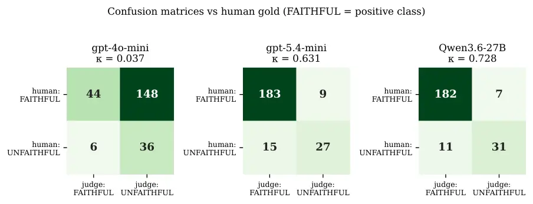

# Auditing and Repairing LLM-as-Judge Failures in a Production Text-to-SQL Pipeline

Haowei Liu Affiliation: Santa Clara University
Email: [hliu6@scu.edu](mailto:)    Hsin-Tai Wu Affiliation: Independent
Researcher Email: [htwunew@gmail.com](mailto:)    Yi Fang
Affiliation: Santa Clara University Email: [yfang@scu.edu](mailto:)

###### Abstract

Production text-to-SQL pipelines often end with an LLM-as-judge whose
agreement with human annotators has never actually been measured. When
we checked ours, the deployed gpt-4o-mini judge agreed with two-author
gold at only Cohen’s $`\kappa=0.04`$ on a disagreement-enriched set and
$`0.42`$ on a uniform-random spot-check, over-flagging 77.1% of the
human-faithful cases in the enriched set. Most of its over-flags trace
back to a single mechanism we call Grade-Hallucination. A self-hosted
Qwen3.6-27B replacement ($`\kappa=0.72`$) lands in the same range as
Claude Opus 4.7 ($`\kappa=0.71`$); the head-to-head is underpowered at
$`n=96`$, but for the deployment decision that hardly matters, since
Qwen costs roughly 1/300 as much per call. Ensembling does not help for
free. Pairing the weak judge with a stronger one degrades agreement,
whereas three strong judges under unanimity routing reach
$`\kappa=0.79`$ at 89.7% auto-coverage. Applied out-of-domain, the same
audit recipe flags 25.5% of BIRD-financial’s expert-authored gold SQLs
as candidate gold-SQL issues under our annotation protocol. Code and
pre-registration are at
[https://github.com/JamesL404/synca-audit](https://github.com/JamesL404/synca-audit);
the datasets are deferred to the post-publication release for
anonymization reasons.

## 1 Introduction

Figure 1: The SynCA production pipeline (top) and our recommended
judge-stage repair (bottom). The production pipeline runs Q-Gen,
multi-model consensus, debate, and a final faithfulness judge over 1,482
accepted question–SQL pairs. The audit finds the final judge
(gpt-4o-mini) at $`\kappa=0.04`$ versus two-author human gold. The
repair replaces it with self-hosted Qwen3.6-27B ($`\kappa=0.72`$,
$`\sim`$1/300 of Opus’s per-call cost); high-stakes deployments route
the residual to a 3-strong ensemble reaching $`\kappa=0.79`$ at 89.7%
auto-coverage.

Industry teams routinely build synthetic benchmarks to evaluate
text-to-SQL systems on proprietary databases that no public benchmark
covers (Yu et al., 2018; Li et al., 2023; Lei et al., 2024). We design a
four-stage pipeline for this (Figure 1, top): an LLM generates candidate
questions, several LLMs independently produce SQL and their answers are
compared, disagreements move into a debate stage, and a final
LLM-as-judge scores SQL faithfulness. Every stage filters some errors
and every stage is imperfect, and full human review does not scale.

This pipeline, SynCA, runs in industrial production over a 604,146-row
user database with 43 columns. It produced 1,482 accepted question–SQL
pairs across three difficulty tiers (460 easy / 659 medium / 363 hard).
Its output gates an internal analyst-assist tool ($`\sim`$30 daily
users) and a continuous LLM evaluation harness, so a faulty judge
propagates to product-visible acceptance rates and to the corpus used to
fine-tune in-house models. The repair we report is deployed: self-hosted
Qwen now handles routine traffic, 3-strong unanimity routing covers
high-stakes runs, and the released artefact is the configuration our
internal teams use.

The audit started informally. Domain analysts reviewing the production
judge’s flagged outputs kept finding plausible queries that the judge
had rejected for reasons that fell apart on a closer look. Two authors
then annotated 234 questions oversampled from the judge’s flagged set.
Against this gold, production gpt-4o-mini reaches Cohen’s
$`\kappa=0.04`$; on a uniform-random spot-check of 200 further questions
it reaches $`\kappa=0.42`$, so the $`0.04`$ figure is conditional on the
enriched sample and is not the typical deployment rate. Its 77.1%
over-flag rate on human-faithful cases in the enriched set concentrates
in one mechanism, which we call Grade-Hallucination: the judge sees ‘E’,
‘z’, or ‘None’ rows in a result preview, recalls a canonical
$`\{A,B,C,D\}`$ set, and flags the SQL for “including invalid grades”
that the question never asked it to exclude.

We test three replacements: closed gpt-5.4-mini ($`\kappa=0.63`$ \[0.49,
0.76\]), open Qwen3.6-27B ($`\kappa=0.72`$ \[0.59, 0.83\]), and
closed-frontier Claude Opus 4.7 ($`\kappa=0.71`$ \[0.57, 0.83\]). A
pre-registered active-sampled adjudication on 96 Qwen-vs-Opus
disagreements comes out statistically inconclusive (McNemar $`p=0.082`$;
BCa 95% CI $`[-0.198,+0.276]`$; a 57:39 lead for Qwen). Pairing the weak
production judge with a stronger one degrades agreement ($`\kappa=0.57`$
vs $`0.63`$), while three decorrelated competent judges with unanimity
routing reach $`\kappa=0.79`$ at 89.7% auto-coverage.

### Contributions.

\(i\) We diagnose a production LLM-as-judge that agrees with humans at
$`\kappa=0.04`$, and show that a self-hosted open-source replacement
(Qwen3.6-27B) is not measurably worse than closed-frontier Opus 4.7 at
our sample size while costing about 1/300 as much per call. (ii) We
isolate the dominant failure mechanism, Grade-Hallucination, and run a
four-variant prompt sweep. The mechanism is partly prompt-fixable (the
_no-preview_ variant raises $`\kappa`$ from 0.04 to 0.37), but no prompt
we tried closes the gap to a stronger judge. (iii) We show that pairing
a weak judge with a stronger one degrades agreement on our data, and
report a disagreement-win diagnostic that tells you in advance whether
ensembling will help. With two further decorrelated competent judges,
unanimity routing reaches $`\kappa=0.79`$ at 89.7% auto-coverage. (iv)
Applied out-of-domain to BIRD-financial, the audit recipe flags 25.5% of
its expert-authored gold SQLs as candidate gold-SQL issues under our
annotation protocol; schema enrichment helps opaque-coded schemas (BIRD)
but hurts English-named ones (Spider).

## 2 Related Work

### LLM-as-judge.

The protocol was popularized by Zheng et al. (2023); bias and
reliability analyses include (Gu et al., 2024; Han et al., 2025; Shi et
al., 2024; Krumdick et al., 2025; Wang et al., 2023). Murugadoss et al.
(2024) observe that LLM judges impose criteria that are not in the
rubric. Our Grade-Hallucination mechanism is a concrete special case of
this for SQL faithfulness, with a clear trigger (result-row inspection)
and a clean fix (the no-preview prompt variant). Our human-annotation
protocol draws on (Cheng et al., 2024; Plank, 2022; Dong et al., 2024);
we report pre-consensus IAA on the 200-question spot-check
($`\kappa=0.87`$) and the 96-case active-sampled set ($`\kappa=0.934`$).

### Text-to-SQL evaluation.

Spider (Yu et al., 2018; Lei et al., 2024), BIRD (Li et al., 2023;
Wretblad et al., 2024), and downstream methods (Pourreza and Rafiei,
2023; Gao et al., 2023) have shifted from execution-accuracy toward
LLM-based semantic equivalence (Zeng et al., 2025; Deng et al., 2022).
We do not propose a new evaluator. Instead we audit a deployed one and
document the conditions under which off-the-shelf judges fail. As a side
effect, one of our judges catches every BIRD-financial gold bug we
identified, which points to the LLM judge as a benchmark-quality auditor
in its own right.

### Ensembling and cost cascades.

Prior LLM-judge ensembling work (Li et al., 2025; Du et al., 2023; Verga
et al., 2024) reports positive results, mostly on long-form generation
where panel diversity captures different judgement axes. Our negative
result on weak+strong pairing qualifies that picture: a panel helps only
when each member is individually well-calibrated, and otherwise inherits
the weak member’s noise. Cost-cascade and selective-prediction work
(Chen et al., 2023; Yue et al., 2023; Zellinger et al., 2025; Soiffer et
al., 2025; Xu et al., 2025; Zhang et al., 2025; Jung et al., 2024)
frames the coverage–accuracy Pareto problem; unanimity routing is one
operating point on that frontier, here applied to LLM-as-judge rather
than to generation quality.

## 3 The SynCA Pipeline

SynCA generates and validates synthetic NL$`\to`$SQL questions over
users, a 604,146-row SQLite table with 43 columns. The table is a
synthetic derivative of an internal telecom customer table. Its schema,
value distributions, and data-quality artefacts (text-encoded booleans,
sparse-NULL interest columns, non-canonical categoricals) are preserved
from production, but every row is independently synthesized. The
released table contains no names, phone numbers, account IDs, or
join-keys against any non-synthetic table, and row-level synthesis
breaks any deterministic mapping back to the original.

The schema deliberately keeps the production-style traps. Booleans are
stored as the strings ‘True’/‘False’ rather than 0/1. data_usage is in
raw bytes and must be divided by $`10^{9}`$ to give GB. Interest columns
are over 80% NULL, where NULL is semantically ambiguous between “not
interested” and “unknown.” Small-cardinality categoricals contain
non-canonical values: demographics_income_trust, for instance, takes
values $`\{A,B,C,D,E,z,\texttt{NULL}\}`$, where E and z are legitimate
codes (“other,” “not provided”) in the production schema but trigger
Grade-Hallucination in untrained judges.

The pipeline has four stages: (1) Q-Generation via gpt-5.4 following
self-instruction (Wang et al., 2022; Xu et al., 2023), parameterized by
difficulty target (join count, aggregation depth, filter complexity);
(2) multi-model consensus among gpt-4o, claude-sonnet-4.6, and
gemini-2.5-flash, which produce SQL independently and are accepted when
at least two result-row sets match value-only (column-name agnostic);
(3) debate, up to two rounds with o1 as meta-judge over
still-disagreeing cases, classifying outcomes as ambiguous-SQL,
ambiguous-question, or unanswerable; and (4) a faithfulness judge
(originally gpt-4o-mini) scoring each surviving candidate as faithful /
minor-issue / unfaithful given the schema, question, SQL, and a
top-10-row executed-result preview. SynCA contains 1,598 final records,
of which 1,482 are accepted; the remaining 116 were rejected at
consensus or debate (Appendix C details the per-stage counts).

Table 1 lists every SynCA subset and the claim each one supports. Three
human-gold sets play different roles and are not interchangeable: the
disagreement-enriched 234-set carries the calibration measurements, the
200-question uniform-random spot-check supports the population
faithful-rate estimate, and the 96-case active sample supports only the
Qwen-vs-Opus adjudication. The remaining 1,248 accepted records carry
automated Qwen verdicts, and 1,241 of them additionally carry an Opus
verdict. Every $`\kappa`$ we report names the subset it was computed on,
since a number from the enriched set is conditional on the production
judge having flagged the question.

|                      |                                                     |       |
| -------------------- | --------------------------------------------------- | ----- |
| Subset               | Role / provenance                                   | $`n`$ |
| Final records        | all pipeline outputs                                | 1,598 |
|    Accepted          | passed consensus+debate (released benchmark)        | 1,482 |
|    Rejected          | dropped at consensus or debate                      | 116   |
| 234-set              | two-author gold, disagreement-enriched calib.       | 234   |
| 200 spot-check       | two-author gold, uniform-random ($`\kappa{=}0.87`$) | 200   |
| 382 active sample    | pre-registered stratified draw from the 1,248-pool  | 382   |
|    96 strict-disagr. | two-author gold, Qwen-vs-Opus disagreements         | 96    |
| 1,248 supplementary  | accepted $`\setminus`$ 234-set; Qwen-judged         | 1,248 |
|    dual-judged       | also Opus-judged (10 SQL errors excluded)           | 1,241 |

Table 1: SynCA subsets and their provenance.

## 4 Human Calibration Set

Throughout, _calibration_ means agreement with human labels in the
psychometric sense (Cohen’s $`\kappa`$), not probability calibration of
a model’s confidence scores.

Two authors (PhD researchers with telecom-domain and SQL-evaluation
expertise) manually re-evaluated 234 question–SQL pairs drawn primarily
from the production judge’s flagged set, with a balance of accepted
cases; disagreements were resolved by discussion. The
disagreement-enriched sampling is intentional, since it concentrates
labels where the pipeline could plausibly be contested. We report
pre-consensus inter-annotator agreement on two complementary sets: the
200-question uniform-random spot-check (§8, $`\kappa=0.87`$) and the
96-case active-sampled adjudication (§5, $`\kappa=0.934`$). The 234-set
distribution is 192 faithful and 42 unfaithful, and 148 of these (63%)
are false-flag corrections. To check reproducibility from outside the
project, one screened independent SQL-literate annotator, blind to
author labels and model verdicts, re-labeled all 234 cases and agreed
with the two-author consensus at $`\kappa=0.85`$ (95.7% raw).
Author-only annotation remains the load-bearing limitation
(§Limitations). Appendix E gives the stratification.

## 5 Judge Calibration

We evaluate four judges with identical prompts: gpt-4o-mini,
gpt-5.4-mini, Qwen3.6-27B-Instruct (served via vLLM (Yang et al.,
2025)), and Claude Opus 4.7. Following (Cohen, 1960; Landis and Koch,
1977; Han et al., 2025; Murugadoss et al., 2024), we report Cohen’s
$`\kappa`$ as the primary metric and fold minor-issue into faithful. We
report $`\kappa`$ on two cuts of human gold: (a) the 234-set,
conditional on production-judge flagging, which is where the failure
mode lives; and (b) the 200-question uniform-random spot-check, which is
closer to typical deployment. Both are needed, because either cut on its
own is misleading.

| Judge           | Conditional (n=234)  | Unconditional (n=200) |
| --------------- | -------------------- | --------------------- |
| gpt-4o-mini     | 0.04 \[-0.02, 0.09\] | 0.42 \[0.24, 0.58\]   |
| gpt-5.4-mini    | 0.63 \[0.49, 0.76\]  | 0.67 \[0.52, 0.80\]   |
| Qwen3.6-27B     | 0.72 \[0.59, 0.83\]  | 0.94 \[0.86, 0.99\]   |
| Claude Opus 4.7 | 0.71 \[0.57, 0.83\]  | 0.93 \[0.86, 0.99\]   |

Table 2: Per-judge $`\kappa`$ vs two-author consensus gold (bootstrap
95% CIs, $`B=5{,}000`$; binary, minor-issue folded to faithful).
Qwen$`\approx`$Opus at this measurement resolution (6–7 split on the 13
conditional disagreements). gpt-4o-mini over-flags (FNR 77.1%/FPR
14.3%); gpt-5.4-mini under-flags (FNR 4.7%/FPR 35.7%).

The production judge is at chance on hard cases ($`\kappa=0.04`$) but
moderate on typical ones ($`\kappa=0.42`$). Qwen and Opus fall in the
same range on both cuts. The head-to-head between them is underpowered
(later in this section), so we do not claim parity, only that the cost
decision is not driven by any measured calibration gap. A between-judge
McNemar on the full $`n=382`$ active sample (§5) does reject
grading-style interchangeability
($`b{=}47,c{=}5,p{=}1.3{\times}10^{-9}`$), with Qwen preferring strict
unfaithful where Opus prefers minor-issue. This still does not resolve
the accuracy-vs-human question.

### Failure-mode taxonomy.

We pattern-mined the judge’s free-text reasons on the 148 false-flag
cases. An initial 7-class taxonomy (developed by the two authors without
pre-registration) gave second-coder $`\kappa=0.29`$: the second coder
collapsed five minority classes into a single “phantom-constraint”
bucket, and grade-hallucination was the only subtype with item-by-item
agreement. We therefore post-hoc collapsed it to a binary
grade-hallucination-vs-other-phantom split ($`\kappa=0.47`$ at 68%
second-coder recall on grade-hallucination). This binary split was _not_
pre-registered, and the rest of the paper relies only on the binary
headline. The 66% grade-hallucination figure (author labels) survives
recoding at 68% second-coder recall, and both upgraded judges fix over
94% of these cases. Grade-hallucination is the SynCA-specific instance
of a broader phantom-constraint family that also surfaces on
BIRD-financial (“verification-demanding,” Appendix L); see Appendix F
for details.

### Is the gap prompt-fixable? (H5).

A four-variant prompt sweep on gpt-4o-mini (CoT, explicit-rubric,
no-preview, strict; Table 3) gives two findings. First, every variant
flips the failure mode from over-flagging (0.77) to under-flagging
(0.58–0.74): the judge moves off the grade-hallucination attractor, but
lands on the opposite failure rather than on calibrated discrimination.
Second, the _no-preview_ variant is the single most effective change,
raising $`\kappa`$ from 0.04 to 0.37 by removing the offending input
rather than asking the model to ignore it. Prompting does substantially
reduce the specific mechanism: on the 98 author-labeled
grade-hallucination false flags, _no-preview_ and _strict_ each recover
93/98 and the explicit rubric recovers 87/96 parseable cases. What
prompting does not do is close the whole-set calibration gap: the
distance to Qwen’s $`\kappa=0.72`$ remains. We cannot rule out that some
unexplored prompt closes it, but four reasonable variants (CoT and an
anti-confabulation rubric among them) leave the same residual.
Schema/preview and SQL-feature ablations are in Appendices G and I.

| Variant               | $`\kappa`$ \[95% CI\] | over- | under- |
| --------------------- | --------------------- | ----- | ------ |
| baseline (production) | 0.04 \[-0.02, 0.09\]  | 0.77  | 0.14   |
| CoT                   | 0.32 \[-0.16, 0.49\]  | 0.04  | 0.71   |
| rubric                | 0.33 \[-0.16, 0.47\]  | 0.11  | 0.58   |
| no-preview (best)     | 0.37 \[-0.20, 0.52\]  | 0.07  | 0.60   |
| strict                | 0.23 \[-0.07, 0.38\]  | 0.07  | 0.74   |

Table 3: Four-variant prompt sweep on gpt-4o-mini (234-set; BCa 95% CIs,
$`B=5{,}000`$; binary, minor-issue folded). Every variant flips the
failure mode; none closes the gap to Qwen’s $`\kappa=0.72`$.

### Active-sampled head-to-head: Qwen vs Opus.

To stress-test the parity reading, we pre-registered a stratified active
sample of 382 questions from the 1,248-pool (stratum $`\alpha`$: 182
Qwen-flagged; $`\beta`$: 200 random Qwen-faithful, seed 42;
pre-registration details in Appendix J). The 96 strict-disagreement
cases were independently labeled by two authors (pre-discussion
$`\kappa=0.934`$). Against consensus gold, Qwen matches 57 and Opus 39;
McNemar exact $`p=0.082`$; the BCa 95% CI on the $`\kappa`$-difference
is $`[-0.198,+0.276]`$. At $`n=96`$ the result is statistically
inconclusive: rejecting equality at $`\alpha=0.05`$ with power $`0.8`$
for a true $`\Delta\kappa=0.10`$ would need $`n\approx 380`$. The 57:39
directional lead favors Qwen, at $`\sim`$1/300 of Opus’s cost.

## 6 Ensembling Cheap Judges

The asymmetry above suggests ensembling, but the two-judge ensembles do
not work. AND ties gpt-5.4-mini alone ($`\kappa=0.572`$ vs $`0.631`$),
and OR collapses to the floor ($`\kappa=0.067`$). On the 154 cases where
the two judges disagree, gpt-5.4-mini is correct 142 times against 12.
Disagreement here is dominated by weak-judge noise, so adding a noisy
judge to a calibrated one strictly hurts. Three competent judges are a
different story: on the 19 cases where gpt-5.4-mini and Qwen disagree
the split is 12–7, and unanimity routing reaches $`\kappa=0.788`$ at
89.7% auto-coverage (Table 4). This gain is an abstention effect rather
than a better judge: at full coverage the 3-strong majority rule reaches
only $`\kappa=0.731`$, and routing buys the remaining $`0.057`$ by
declining to decide the 10.3% of cases where the judges disagree. On the
retained subset every strong judge agrees by construction, so the
reported $`\kappa`$ is a selective-prediction figure and is not
comparable to a full-coverage number.

|                               |                     |        |       |
| ----------------------------- | ------------------- | ------ | ----- |
| Strategy                      | $`\kappa`$ (95% CI) | UNF F1 | cov.  |
| gpt-5.4-mini alone            | 0.631 \[0.49,0.76\] | 0.701  | 1.000 |
|    + gpt-4o-mini AND          | 0.572 \[0.42,0.71\] | 0.640  | 1.000 |
|    + gpt-4o-mini OR           | 0.067 \[0.02,0.11\] | 0.341  | 1.000 |
| Qwen3.6-27B alone             | 0.716 \[0.59,0.83\] | 0.763  | 1.000 |
| Claude Opus 4.7 alone         | 0.705 \[0.57,0.83\] | 0.750  | 1.000 |
| 3-strong MAJORITY (drop weak) | 0.731 \[0.60,0.84\] | 0.774  | 1.000 |
| Unanimity routing (3-strong)  | 0.788 \[0.64,0.90\] | 0.815  | 0.897 |
| Unanimity routing (4-strong)  | 0.833 \[0.67,0.96\] | 0.889  | 0.290 |

Table 4: Ensemble strategies on the 234 records with verdicts from all
four judges. Unanimity routing auto-decides when all $`k`$ judges agree,
sends others to human. The 3-strong rule achieves $`\kappa=0.788`$ at
89.7% auto-coverage.

### A decision rule.

Before adding a judge to an ensemble, check two things: that its
bootstrap $`\kappa`$ CI on a domain-specific gold set is clearly above
zero, and that its disagreements with the other members are split rather
than one-sided. A 142–12 disagreement-win split means the weaker judge
is simply wrong, so ensembling will degrade performance; a 12–7 split
signals genuinely hard cases, where ensembling can help. Our preferred
operating point is unanimity routing over $`k{\geq}3`$ competent judges,
giving $`\kappa=0.79`$ at 89.7% auto-coverage, which amounts to a 10%
human-review budget on the cases that matter. A learned router (GBM, 14
features, 5-fold CV) does not beat this by more than Monte-Carlo noise
($`\Delta\kappa=+0.002`$; Appendix K).

## 7 Cross-Domain Replication: BIRD and Spider

We run all four judges on BIRD-financial (Li et al., 2023) (106 dev
questions, opaque codes like A3) and four Spider dev databases (Yu et
al., 2018; Lei et al., 2024) (164 gold-correct questions, English column
names), of which concert_singer (45 questions) carries the per-judge
comparison.

### BIRD-financial: auditing expert gold.

BIRD’s expert gold is known to have quality issues (Wretblad et al.,
2024). Running our four judges as a benchmark-quality audit puts a
concrete number on it. Two authors classified all 65 judge-flagged
cases. 27 are genuine bugs in the gold SQL, and many are objective
errors verifiable against BIRD’s own question and evidence (e.g., q110
asks for 1998/9/2 but the gold filters date=‘1997-08-20’; q189 returns
the youngest where the question asks the oldest). 16 are ambiguous
questions where multiple SQLs are defensible, and 22 are over-flags, the
cross-domain analog of Grade-Hallucination. We present these as
candidate gold issues under our protocol, not a verdict that the experts
erred: $`23`$–$`27`$ of $`106`$ ($`21.7`$–$`25.5\%`$). An independent
SQL-literate annotator, blind to our labels, re-classified all 65 cases
at Cohen’s $`\kappa=0.86`$, confirming 23 of the 27 bug labels, matching
the independent report above. We hold our own gold to the same bar (IAA
in §4): no reference SQL, expert-written or not, is clean by assumption.

### Per-judge behaviour on BIRD.

Among the four judges, Qwen is Pareto-optimal as a single auditor: it
catches 85% of the 27 identified bugs at only 7.5% over-flag, whereas
the next-best judge (gpt-5.4-mini at 74% recall) more than doubles the
over-flag rate. Rich-schema enrichment helps the most aggressive judge
(gpt-5.4-mini: 17.0%$`\to`$11.3%) but barely moves the better-calibrated
ones, and it slightly reduces Qwen’s bug-detection (85$`\to`$78); see
Appendix L for the failure-pattern detail.

| Judge        | raw  | BUG | OVER (sp.$`\to`$rch.) |
| ------------ | ---- | --- | --------------------- |
| gpt-4o-mini  | 19.8 | 48  | 5.7 / 3.8             |
| gpt-5.4-mini | 46.2 | 74  | 17.0 / 11.3           |
| Qwen3.6-27B  | 39.6 | 85  | 7.5 / 8.5             |
| Opus 4.7     | 32.1 | 70  | 7.5 / 7.5             |

Table 5: BIRD-financial ($`n{=}106`$), all %. _raw_: raw flag rate.
_BUG_: bug-detect on 27 buggy gold SQLs (two-author classification of 65
flags). _OVER_: corrected over-flag rate, sparse / rich schema.

### Spider (4 databases).

Aggregated over four Spider dev DBs ($`n=164`$ gold-correct questions,
English schema), sparse$`\to`$rich over-flag rates are: gpt-4o-mini
11.0$`\to`$15.9%, gpt-5.4-mini 9.8$`\to`$6.1%, Opus 1.8$`\to`$0.6%. Opus
has the lowest or tied-lowest over-flag in every cell across all four
DBs. Rich-schema is harmful on English schemas for gpt-4o-mini but helps
gpt-5.4-mini; the practical rule is to add rich-schema only when column
names are opaque (Appendix M).

## 8 Cost and Released Benchmark

### Cost: two deployment scenarios.

We give per-1,000-question rates below (full breakdown in Appendix D;
provider list rates, plus an amortized \$0.30/hr A100 80GB for
self-hosted Qwen).

_Scenario A — single-judge replacement (Qwen-only)._ Replace the
production judge with self-hosted Qwen3.6-27B (\$0.10) instead of
gpt-4o-mini (\$0.40); Qwen’s \$0.10 is $`\sim`$1/300 of Opus’s \$30.
This is the right operating point once domain calibration is established
and the goal is a cheap, reliable single gate.

_Scenario B — 3-strong unanimity routing._ Run gpt-5.4-mini + Qwen +
Opus on every question (\$31 / 1k, dominated by the closed APIs) and
route the $`{\sim}10\%`$ non-unanimous cases to humans. Per-pass cost is
comparable to Opus alone, but the auto-decided $`\kappa`$ is 0.79
(versus $`\kappa\approx 0.7`$ for any single judge). Use this when the
precision premium is worth the cost (high-stakes runs, evaluation
harnesses, training-corpus curation). Scenario A captures the
300$`\times`$ saving for routine traffic, and Scenario B trades that
saving for higher accuracy.

### Final benchmark.

Applying Qwen3.6-27B to the 1,248 supplementary records (about 50 min on
one GPU via vLLM, 10 unparseable, 0.8%) yields SynCA-final with 1,249
faithful, 170 unfaithful, 53 minor-issue, and 10 error, which is 84.3%
faithful as the Qwen-raw operational rate. The 200-question
uniform-random spot-check (§8) stratified-reweights this to a population
estimate of about 90.6% (per-class precisions in Appendix O). We report
both: 84.3% for CI-tracking and 90.6% for benchmark-quality comparisons
(Appendix N).

### Spot-check IAA.

Two authors independently annotated the 200 spot-check records before
any discussion. Pre-consensus Cohen’s $`\kappa=0.87`$ (96.5% raw
agreement; 7/200 disagreements). Qwen’s binary accuracy is 98.0%
(196/200) with $`\kappa=0.935`$, well above its agreement on the
disagreement-enriched 234-set, as expected (full table in Appendix O).

### Dual-judge validation on the supplementary 1,248 set.

We also labeled all 1,248 supplementary records with Opus under the same
prompt ($`n=1{,}241`$ after excluding 10 SQL errors). Inter-judge raw
agreement is 95.5% (1,185/1,241), and Cohen’s $`\kappa=0.728`$ \[0.655,
0.791\] (BCa, $`B=5{,}000`$). This sits within the 234-set Qwen-vs-human
CI \[0.61, 0.84\], so the calibration audit transfers to the
supplementary set. Of the 56 discordant cases, 44 are Qwen-flagged and
Opus-faithful (mild borderline conservativeness, §8).

### Release.

The audit-pipeline code, pre-registration, prompt templates, decoding
settings, and analysis scripts are available now at
[https://github.com/JamesL404/synca-audit](https://github.com/JamesL404/synca-audit).
The datasets (the synthetic users.sqlite database; the 1,482-record
benchmark_v2_final_judged.json with per-record provenance; the 234-set,
200-spotcheck, and 96-active-sample human-gold files; the dual-judged
supplementary 1,248; the BIRD and Spider cross-domain judged files; and
MODELS.md with exact snapshot identifiers) are deferred to the
post-publication release for anonymization reasons.

## 9 Discussion

SynCA’s judge stage gates a SQL-generation pipeline feeding an internal
analyst-assist tool ($`\sim`$30 daily users) and a continuous LLM
evaluation harness; a faulty judge propagates to product-visible
acceptance rates and to the corpus used to fine-tune in-house models.
The audit began with analyst complaints rather than a planned
reliability study. Since then we have replaced the production judge with
self-hosted Qwen for routine traffic and added 3-strong unanimity
routing for high-stakes runs; the released artefact is the configuration
our internal teams now use. We re-audit each judge against a fresh
domain-specific gold set whenever the schema or a model snapshot
changes, rather than on a fixed calendar. The $`n=96`$ adjudication
remains inconclusive (a 57:39 directional lead for Qwen), but it does
not change the deployment decision, since cost dominates.

The audit recipe transfers across domains; the per-judge over-flag rates
do not. A judge calibrated on one schema can over-flag on another,
depending on column-name opacity. A fresh disagreement-win check on a
small gold set is the cheap first move before scaling to a new schema.

## 10 Conclusion

Our production gpt-4o-mini judge agreed with humans at $`\kappa=0.04`$,
almost entirely because of grade hallucination. Self-hosted Qwen3.6-27B
reaches $`\kappa=0.72`$ at $`\sim`$1/300 of Claude Opus 4.7’s per-call
cost; the $`n=96`$ head-to-head is underpowered, but the deployment
decision turns on cost. Unanimity routing over three strong judges
pushes auto-decided $`\kappa`$ to 0.79 at 89.7% coverage, while prompt
engineering tops out at $`\kappa=0.37`$. Two takeaways generalise: a
deployed LLM-as-judge is not safe to trust without periodic calibration
against domain-specific human gold, and ensembling cheap judges pays off
only when each member is well-calibrated.

## Limitations

### Scope and reproducibility.

SynCA is a single English-language telecom deployment over SQLite.
Cross-domain replication on BIRD-financial and four Spider DBs helps,
but per-judge over-flag rates do shift across domains (§7), so which
judge is “best” is conditional on the audited deployment; Qwen on Spider
is also restricted to concert_singer due to endpoint outages. OpenAI
snapshots are pinned (Appendix B); Anthropic and Google judges do not
expose dated identifiers, so the closed-judge $`\kappa`$ values may
drift without notice, even though the audit recipe itself is
reproducible.

### Author-only annotation.

The headline gold was produced by the two paper authors (pre-consensus
$`\kappa=0.87`$ on the 200-spot-check, $`\kappa=0.934`$ on the
96-active-sample). The independent re-labeling reported in §4
($`\kappa=0.85`$, 95% BCa CI $`[0.75,0.93]`$, $`B{=}5{,}000`$; 10
disagreements skewed unfaithful, 7/10) shows the gold is not
idiosyncratic to the author pair, though over-flag and bug-detect rates
are still co-defined with them. We deliberately did not fine-tune any
judge on the 234-set, since training and evaluation labels would then
share annotators.

## References

- Chen et al. (2023) L. Chen, M. Zaharia, and J. Zou FrugalGPT: how to
  use large language models while reducing cost and improving
  performance. External Links: 2305.05176,
  [Link](https://arxiv.org/abs/2305.05176) Cited by: §2.
- Cheng et al. (2024) X. Cheng, R. Mayya, and J. Sedoc To err is human;
  to annotate, silicon? toward robust reproducibility in llm annotation.
  External Links: 2412.14461, [Link](https://arxiv.org/abs/2412.14461)
  Cited by: §2.
- Cohen (1960) J. Cohen A coefficient of agreement for nominal scales.
  Educational and Psychological Measurement 20 (1), pp. 37–46. External
  Links: [Document](https://dx.doi.org/10.1177/001316446002000104) Cited
  by: §5.
- Deng et al. (2022) N. Deng, Y. Chen, and Y. Zhang Recent advances in
  text-to-sql: a survey of what we have and what we expect. External
  Links: 2208.10099, [Link](https://arxiv.org/abs/2208.10099) Cited by:
  §2.
- Dong et al. (2024) Y. R. Dong, T. Hu, and N. Collier Can llm be a
  personalized judge?. External Links: 2406.11657,
  [Link](https://arxiv.org/abs/2406.11657) Cited by: §2.
- Du et al. (2023) W. Du, L. Advani, Y. Gambhir, D. J. Perry, P.
  Shiralkar, Z. Xing, and A. Colak Effective proxy for human labeling:
  ensemble disagreement scores in large language models for industrial
  nlp. External Links: 2309.05619,
  [Link](https://arxiv.org/abs/2309.05619) Cited by: §2.
- Gao et al. (2023) D. Gao, H. Wang, Y. Li, X. Sun, Y. Qian, B. Ding,
  and J. Zhou Text-to-sql empowered by large language models: a
  benchmark evaluation. External Links: 2308.15363,
  [Link](https://arxiv.org/abs/2308.15363) Cited by: §2.
- Gu et al. (2024) J. Gu, X. Jiang, Z. Shi, H. Tan, X. Zhai, C. Xu, W.
  Li, Y. Shen, S. Ma, H. Liu, S. Wang, K. Zhang, Y. Wang, W. Gao, L. Ni,
  and J. Guo A survey on llm-as-a-judge. External Links: 2411.15594,
  [Link](https://arxiv.org/abs/2411.15594) Cited by: §2.
- Han et al. (2025) S. Han, G. T. Junior, T. Balough, and W. Zhou
  Judge’s verdict: a comprehensive analysis of llm judge capability
  through human agreement. External Links: 2510.09738,
  [Link](https://arxiv.org/abs/2510.09738) Cited by: §2, §5.
- Jung et al. (2024) J. Jung, F. Brahman, and Y. Choi Trust or escalate:
  llm judges with provable guarantees for human agreement. External
  Links: 2407.18370, [Link](https://arxiv.org/abs/2407.18370) Cited by:
  §2.
- Krumdick et al. (2025) M. Krumdick, C. Lovering, V. Reddy, S. Ebner,
  and C. Tanner No free labels: limitations of llm-as-a-judge without
  human grounding. External Links: 2503.05061,
  [Link](https://arxiv.org/abs/2503.05061) Cited by: §2.
- Landis and Koch (1977) J. R. Landis and G. G. Koch The measurement of
  observer agreement for categorical data. Biometrics 33 (1),
  pp. 159–174. External Links:
  [Document](https://dx.doi.org/10.2307/2529310) Cited by: §5.
- Lei et al. (2024) F. Lei, J. Chen, Y. Ye, R. Cao, D. Shin, H. Su, Z.
  Suo, H. Gao, W. Hu, P. Yin, V. Zhong, C. Xiong, R. Sun, Q. Liu, S.
  Wang, and T. Yu Spider 2.0: evaluating language models on real-world
  enterprise text-to-sql workflows. External Links: 2411.07763,
  [Link](https://arxiv.org/abs/2411.07763) Cited by: §1, §2, §7.
- Li et al. (2025) J. Li, H. Zhang, P. Lin, J. Xiong, and W. Xu
  Auto-prompt ensemble for llm judge. arXiv. External Links: 2510.06538,
  [Document](https://dx.doi.org/10.48550/ARXIV.2510.06538),
  [Link](https://arxiv.org/abs/2510.06538) Cited by: §2.
- Li et al. (2023) J. Li, B. Hui, G. Qu, J. Yang, B. Li, B. Li, B.
  Wang, B. Qin, R. Cao, R. Geng, N. Huo, X. Zhou, C. Ma, G. Li, K. C. C.
  Chang, F. Huang, R. Cheng, and Y. Li Can llm already serve as a
  database interface? a big bench for large-scale database grounded
  text-to-sqls. External Links: 2305.03111,
  [Link](https://arxiv.org/abs/2305.03111) Cited by: §1, §2, §7.
- Murugadoss et al. (2024) B. Murugadoss, C. Poelitz, I. Drosos, V.
  Le, N. McKenna, C. S. Negreanu, C. Parnin, and A. Sarkar Evaluating
  the evaluator: measuring llms’ adherence to task evaluation
  instructions. External Links: 2408.08781,
  [Link](https://arxiv.org/abs/2408.08781) Cited by: §2, §5.
- Plank (2022) B. Plank The “problem” of human label variation: on
  ground truth in data, modeling and evaluation. In Proceedings of the
  2022 Conference on Empirical Methods in Natural Language Processing
  (EMNLP), External Links: 2211.02570,
  [Link](https://arxiv.org/abs/2211.02570) Cited by: §2.
- Pourreza and Rafiei (2023) M. Pourreza and D. Rafiei DIN-sql:
  decomposed in-context learning of text-to-sql with self-correction.
  External Links: 2304.11015, [Link](https://arxiv.org/abs/2304.11015)
  Cited by: §2.
- Shi et al. (2024) L. Shi, C. Ma, W. Liang, X. Diao, W. Ma, and S.
  Vosoughi Judging the judges: a systematic study of position bias in
  llm-as-a-judge. External Links: 2406.07791,
  [Link](https://arxiv.org/abs/2406.07791) Cited by: §2.
- Soiffer et al. (2025) D. Soiffer, S. Kolawole, and V. Smith Semantic
  agreement enables efficient open-ended llm cascades. External Links:
  2509.21837, [Link](https://arxiv.org/abs/2509.21837) Cited by: §2.
- Verga et al. (2024) P. Verga, S. Hofstatter, S. Althammer, Y. Su, A.
  Piktus, A. Arkhangorodsky, M. Xu, N. White, and P. Lewis Replacing
  judges with juries: evaluating llm generations with a panel of diverse
  models. External Links: 2404.18796,
  [Link](https://arxiv.org/abs/2404.18796) Cited by: §2.
- Wang et al. (2023) P. Wang, L. Li, L. Chen, Z. Cai, D. Zhu, B. Lin, Y.
  Cao, Q. Liu, T. Liu, and Z. Sui Large language models are not fair
  evaluators. External Links: 2305.17926,
  [Link](https://arxiv.org/abs/2305.17926) Cited by: §2.
- Wang et al. (2022) Y. Wang, Y. Kordi, S. Mishra, A. Liu, N. A.
  Smith, D. Khashabi, and H. Hajishirzi Self-instruct: aligning language
  models with self-generated instructions. arXiv. External Links:
  2212.10560, [Document](https://dx.doi.org/10.48550/ARXIV.2212.10560),
  [Link](https://arxiv.org/abs/2212.10560) Cited by: §3.
- Wretblad et al. (2024) N. Wretblad, F. G. Riseby, R. Biswas, A.
  Ahmadi, and O. Holmström Understanding the effects of noise in
  text-to-sql: an examination of the bird-bench benchmark. External
  Links: 2402.12243, [Link](https://arxiv.org/abs/2402.12243) Cited by:
  §2, §7.
- Xu et al. (2023) C. Xu, Q. Sun, K. Zheng, X. Geng, P. Zhao, J.
  Feng, C. Tao, Q. Lin, and D. Jiang WizardLM: empowering large
  pre-trained language models to follow complex instructions. External
  Links: 2304.12244, [Link](https://arxiv.org/abs/2304.12244) Cited by:
  §3.
- Xu et al. (2025) Z. Xu, Q. Lu, Q. Zhang, L. Qiu, I. Hong, C. Yu, W.
  Yao, Y. Liu, H. Jiang, L. Li, H. Yun, and T. Zhao Ask a strong llm
  judge when your reward model is uncertain. External Links: 2510.20369,
  [Link](https://arxiv.org/abs/2510.20369) Cited by: §2.
- Yang et al. (2025) A. Yang, A. Li, B. Yang, B. Zhang, B. Hui, B.
  Zheng, B. Yu, C. Gao, C. Huang, C. Lv, C. Zheng, D. Liu, F. Zhou, F.
  Huang, F. Hu, H. Ge, H. Wei, H. Lin, J. Tang, J. Yang, J. Tu, J.
  Zhang, J. Yang, J. Yang, J. Zhou, J. Zhou, J. Lin, K. Dang, K. Bao, K.
  Yang, L. Yu, L. Deng, M. Li, M. Xue, M. Li, P. Zhang, P. Wang, Q.
  Zhu, R. Men, R. Gao, S. Liu, S. Luo, T. Li, T. Tang, W. Yin, X.
  Ren, X. Wang, X. Zhang, X. Ren, Y. Fan, Y. Su, Y. Zhang, Y. Zhang, Y.
  Wan, Y. Liu, Z. Wang, Z. Cui, Z. Zhang, Z. Zhou, and Z. Qiu Qwen3
  technical report. External Links: 2505.09388,
  [Link](https://arxiv.org/abs/2505.09388) Cited by: §5.
- Yu et al. (2018) T. Yu, R. Zhang, K. Yang, M. Yasunaga, D. Wang, Z.
  Li, J. Ma, I. Li, Q. Yao, S. Roman, Z. Zhang, and D. Radev Spider: a
  large-scale human-labeled dataset for complex and cross-domain
  semantic parsing and text-to-sql task. External Links: 1809.08887,
  [Link](https://arxiv.org/abs/1809.08887) Cited by: §1, §2, §7.
- Yue et al. (2023) M. Yue, J. Zhao, M. Zhang, L. Du, and Z. Yao Large
  language model cascades with mixture of thoughts representations for
  cost-efficient reasoning. External Links: 2310.03094,
  [Link](https://arxiv.org/abs/2310.03094) Cited by: §2.
- Zellinger et al. (2025) M. J. Zellinger, R. Liu, and M. Thomson
  Cost-saving llm cascades with early abstention. External Links:
  2502.09054, [Link](https://arxiv.org/abs/2502.09054) Cited by: §2.
- Zeng et al. (2025) Q. Zeng, S. Ma, A. Niknafs, A. Basran, and C. Szabo
  Taming sql complexity: llm-based equivalence evaluation for
  text-to-sql. External Links: 2506.09359,
  [Link](https://arxiv.org/abs/2506.09359) Cited by: §2.
- Zhang et al. (2025) T. Zhang, A. Mehradfar, D. Dimitriadis, and S.
  Avestimehr Leveraging uncertainty estimation for efficient llm
  routing. External Links: 2502.11021,
  [Link](https://arxiv.org/abs/2502.11021) Cited by: §2.
- Zheng et al. (2023) L. Zheng, W. Chiang, Y. Sheng, S. Zhuang, Z.
  Wu, Y. Zhuang, Z. Lin, Z. Li, D. Li, E. P. Xing, H. Zhang, J. E.
  Gonzalez, and I. Stoica Judging llm-as-a-judge with mt-bench and
  chatbot arena. External Links: 2306.05685,
  [Link](https://arxiv.org/abs/2306.05685) Cited by: §2.

## Appendix A Extended discussion

### What does “calibration” mean here?

We use “calibration” in its psychometric sense, agreement with humans on
a domain-specific gold set, rather than the temperature-or-confidence
sense common in the classifier-output literature. No judge weights are
tuned. The calibration we measure is a property of (judge, prompt,
domain) jointly, not of the judge alone. gpt-4o-mini’s $`\kappa=0.04`$
is about the production-deployed judge-prompt-domain combination; the
same model with a different prompt reaches $`\kappa=0.37`$ (§5).
Re-auditing on each new domain or prompt is the unavoidable cost.

### Why three judges and not five?

Unanimity routing stops paying off quickly. Adding the fourth judge
(gpt-4o-mini) drops auto-coverage from 89.7% to 29%, because the weak
judge frequently disagrees with the three strong ones without changing
the auto-decided $`\kappa`$ enough to justify the extra human-review
cost. What helps is decorrelated competent judges; adding more weak ones
does not.

### Cross-domain transfer (per-judge).

gpt-5.4-mini 4.7%$`\to`$17.0% (3.6$`\times`$); Qwen 3.7%$`\to`$7.5%
(2$`\times`$); Opus 1.6%$`\to`$7.5% (4.7$`\times`$). The same judge is
calibrated, mid-calibrated, or over-aggressive depending on schema and
value-vocabulary.

## Appendix B Model versions and access details

All experiments used the following model identifiers and access modes
(access dates 2026-04 through 2026-05). Where the provider exposes a
dated snapshot identifier we pin it; OpenAI does, Anthropic and Google
do not.

- •
  gpt-4o-mini-2024-07-18 — OpenAI API. The production audit predates the
  experiment window; for re-runs we use this snapshot.
- •
  gpt-5.4-mini-2026-03-17 — OpenAI API.
- •
  Claude Opus 4.7 — Anthropic API endpoint claude-opus-4-7; Anthropic
  does not currently expose a dated snapshot identifier through the API.
  Anthropic Python SDK anthropic\>=0.39.
- •
  Qwen3.6-27B-Instruct — HuggingFace weights at the public release
  revision, served via vLLM 0.6.x on a single A100 80GB.
  enable_thinking=False; max_tokens=4096; we strip any
  \<think\>…\</think\> reasoning preamble from outputs. Tensor-parallel
  size 1, KV-cache enabled, no quantization. OpenAI-compatible HTTP
  endpoint.
- •
  gpt-4o-2024-11-20 (consensus generator), claude-sonnet-4.6 (no dated
  snapshot), gemini-2.5-flash (no dated snapshot) — used only inside the
  upstream SynCA consensus stage (§3); not measured directly.
- •
  o1-2024-12-17 — OpenAI API, used only in the SynCA debate meta-judge.

Decoding: temperature $`0`$, max_tokens 1024 for all judges (4096 for
Qwen owing to reasoning-mode artefacts). Identical message structures
across providers modulo each vendor’s role-message conventions.
Closed-API judges without a dated snapshot (Anthropic, Google) are
subject to silent model drift; the reported $`\kappa`$ values are point
measurements on the access dates above. Prompt templates, decoding
settings, and the Qwen HuggingFace revision SHA are in the released
artefact (see §8).

## Appendix C Pipeline statistics

SynCA contains 1,598 records (1,482 accepted, 116 rejected).
Accepted-difficulty split: 460 easy / 659 medium / 363 hard. Consensus
uses gpt-4o, claude-sonnet-4.6, gemini-2.5-flash with value-only row
matching; debate uses up to 2 rounds with the o1 meta-judge. After all
stages, 885 reached 3/3 consensus and 604 reached 2/3.

## Appendix D Cost breakdown and benchmark distribution

### Token accounting.

Per-question token counts measured on a uniformly sampled 50-question
subset of SynCA: prompt mean $`2{,}047`$ tokens (p50 $`1{,}998`$; p95
$`2{,}412`$); completion mean $`284`$ tokens (p50 $`271`$; p95 $`441`$).
Decoding settings: temperature$`=0`$ for all judges,
max_tokens$`=1024`$, no top-k or nucleus modification. The prompt is
identical across judges modulo each provider’s role-message convention;
the schema description is fixed at $`\sim`$1,120 tokens, and the
question + SQL + result preview occupies $`\sim`$870 tokens on average.

### Hardware and throughput (Qwen).

Self-hosted Qwen3.6-27B runs under vLLM 0.6.x on a single NVIDIA A100
80GB (tensor-parallel size 1, attention KV-cache enabled, no
quantization), serving requests through an OpenAI-compatible HTTP
endpoint at $`\sim`$200 questions/min ($`\sim`$3.3 qps) under serial
workload and $`\sim`$520 questions/min ($`\sim`$8.7 qps) under 4-way
concurrency. GPU utilization sits at 70–85% during throughput runs.
Amortized GPU cost is computed at \$0.30/GPU-hr (US cloud spot-instance
rate; varies $`\pm`$30% by provider/region).

### Cloud rates.

As of submission date: gpt-4o-mini \$0.15/M input + \$0.60/M output;
gpt-5.4-mini \$0.50/M input + \$1.20/M output (approximated,
vendor-specific); Claude Opus 4.7 \$15/M input + \$75/M output. We apply
these to our measured token usage to derive per-1,000-question costs.

### Per-1,000-question costs.

Qwen3.6-27B \$0.10 (1$`\times`$); gpt-4o-mini \$0.40 (4$`\times`$);
gpt-5.4-mini \$1.30 (13$`\times`$); Claude Opus 4.7 \$30
(300$`\times`$); 3-strong MAJORITY (all three on every question) \$31
(310$`\times`$); unanimity routing (3-strong on every question; human
reviewer on $`\sim`$9.5%) \$31 + \$15–30 of human labor (at \$10–20/hr
and $`\sim`$3 questions/min). Per-question prompt/completion token
assumptions affect costs roughly linearly; doubling completion length
increases Opus cost by $`\sim`$40% and gpt-4o-mini by $`\sim`$30%.

### Sensitivity.

If Qwen’s amortized GPU cost is \$1.50/GPU-hr (e.g., on-demand H100),
the per-1,000-question cost rises to \$0.50, still $`\sim`$60$`\times`$
cheaper than Opus. The cost-side conclusion does not depend on the
specific GPU rate assumption; it depends on Opus’s $`\sim`$\$30/1k API
price, which is the dominant term.

### Benchmark distribution.

SynCA-final verdict distribution on the 1,482 accepted records: Faithful
1,249 (84.3%); Unfaithful 170 (11.5%); Minor-Issue 53 (3.6%); Error 10
(0.7%). Provenance: 1,248 Qwen-judged + 234 two-author human gold. The
supplementary 1,248 additionally carry a dual Qwen+Opus verdict pair
(the Opus run completed in 6,071 s with 0 ERRORs at 4.85 s/call serial).

## Appendix E Calibration set stratification

The 234-set spans 52/115/67 easy/medium/hard and 124/110 2-of-3 vs
3-of-3-consensus cases. 148 (63%) are false-flag corrections (production
marked unfaithful; consensus is faithful).

## Appendix F Failure-mode taxonomy: full categories and regex examples

Pattern-mining the judge_issues text on the 148 false-flag cases via
keyword-pattern categorization yields six categories covering 78% of
cases: grade hallucination (66%, named in the main text),
phantom-constraint (58%, overlapping), null-handling (27%),
missing-LIMIT (14%), preview-quirk (9%), and percentage-denominator
(5%). Regex anchors include patterns like (invalid\|unexpected)
(grade\|value), should (use\|filter\|include).\*?(NULL\|IS NULL), and
should (use\|add) (LIMIT\|TOP). Both upgraded judges fix more than 94%
of grade-hallucination cases.

### Second-coder reliability.

We re-labeled all 148 false-flag cases using gpt-4o-mini as an
independent second coder (a different model from any judge under audit,
same 6-category options, deterministic decoding). Cohen’s $`\kappa`$
against the authors’ regex labels: $`0.291`$ \[0.194, 0.385\] on the
7-class assignment (Landis-Koch “fair”), and $`0.471`$ \[0.333, 0.606\]
on the binary grade-hallucination-versus-other split (“moderate”). The
disagreement is structural rather than random: the second coder
collapses the four minority categories (null-handling, missing-LIMIT,
preview-quirk, percentage-denominator; 28 cases total) into a single
phantom-constraint category, which suggests they are better understood
as named variants of one phantom-constraint mechanism than as cleanly
separable categories. The headline grade-hallucination statistic (66% of
over-flags) survives this re-coding at second-coder recall $`68\%`$. We
treat the four sub-categories as illustrative qualitative groupings
rather than as a robust taxonomy.

## Appendix G H5 schema/preview ablation on gpt-5.4-mini

Removing schema from gpt-5.4-mini’s prompt drops $`\kappa`$ by 0.20;
removing only the executed-result preview drops it by $`\sim`$0.05. The
preview adds little calibration signal, but it is what triggers grade
hallucination on the weaker judge.

## Appendix H Prompt-ablation: variant prompts

The four prompt-ablation variants tested on gpt-4o-mini (results in
Table 3 of the main text). _CoT_ adds “Think step-by-step before
producing the JSON verdict”. _Rubric_ adds an explicit “UNFAITHFUL
means…; NOT UNFAITHFUL means…” rubric forbidding confabulation.
_No-preview_ removes the result-row preview, isolating the
grade-hallucination trigger. _Strict_ adds “Be conservative; flag only
if you can point to a specific question-stated constraint that the SQL
violates.” Every variant flips the failure mode from over- to
under-flagging; none closes the gap to Qwen’s $`\kappa=0.72`$.

## Appendix I SQL-feature stratification

Stratifying by SQL features shows CASE WHEN as the dominant residual
failure mode (Qwen $`\Delta\kappa=-0.32`$); HAVING and subqueries do not
hurt.

## Appendix J Active-sampled adjudication: pre-registration details

Pre-registered stratified active sample of 382 questions: stratum
$`\alpha`$ = all 182 Qwen-flagged; $`\beta`$ = 200 random Qwen-faithful
(seed 42); pool hash a7dee6ea713f9531. Pre-registered analysis:
McNemar’s exact test and a BCa bootstrap 95% CI on
$`\kappa_{\text{Qwen}}-\kappa_{\text{Opus}}`$ ($`B=5{,}000`$ paired). 96
strict-disagreement cases independently labeled by two authors (3/96
pre-discussion disagreements, $`\kappa=0.934`$). Bidirectional CI
reading: the $`[-0.198,+0.276]`$ interval excludes neither direction
beyond an absolute $`\Delta\kappa=0.20`$ effect, so a meaningful
per-judge quality gap in either direction is not ruled out at this
$`n`$.

## Appendix K Learned routing as a negative control

A GBM trained on 14 features (per-judge verdicts, reasoning-length, SQL
and question structure, difficulty) via 5-fold CV on the 234-set reaches
coverage 91.0% at $`\kappa=0.790`$, an improvement of
$`\Delta\kappa=+0.002`$ and $`\Delta`$cov$`=+1.3`$pp over the unanimity
rule (89.7% / 0.788). This sits within Monte-Carlo noise. ROC-AUC
against route-required is 0.716, but only 18 positives exist, and the
top features are judge-implementation-specific reasoning-length signals
unlikely to transfer. On the 96-set the learned router collapses to
negative $`\kappa`$ at every threshold. The reading is that unanimity
routing is close to the empirical Pareto frontier of this hypothesis
class.

## Appendix L BIRD failure-mode patterns and recovered-vs-not-recovered

On BIRD-financial we see a recurring family of phantom-constraint
mistakes that do not match grade hallucination exactly but rhyme with
it. The most common pattern is what we informally call
_verification-demanding_: the judge insists that the SQL prove a literal
value (a year, a category code) actually exists in the database, and
flags any SQL that omits a defensive existence check. The others
(over-eager DISTINCT, over-strict reading of natural-language
quantifiers, percentage-scope confusion, NULL handling) are less
frequent and largely overlap. Of the 7 gpt-5.4-mini cases that
rich-schema enrichment recovers, all 7 are verification-demanding; the
11 that stay flagged are interpretive demands the schema cannot address.
gpt-5.4-mini’s corrected over-flag rate (17.0%) is $`\sim`$3.6$`\times`$
its SynCA-conditional rate, so judge agreement is domain-specific.

## Appendix M Spider concert_singer per-judge results

Table 6 gives per-judge false-positive rates (unfaithful-only) across
four Spider dev databases under sparse and rich schema. Qwen was
available only for concert_singer (gpu7 was unreachable for the other
three), where its sparse over-flag is $`\sim`$0, replicating the
in-domain SynCA finding. Opus has the lowest or tied-lowest over-flag
rate in every (DB, schema) cell, with an aggregate at or below 2% in
both schemas.

| DB ($`n`$)            | judge    | FP\_(s) | FP\_(r) |
| --------------------- | -------- | ------- | ------- |
| concert_singer (44)   | 4o-mini  | 11.4    | 22.7    |
|                       | 5.4-mini | 9.1     | 6.8     |
|                       | Qwen     | 0.0     | 9.1     |
|                       | Opus     | 0.0     | 0.0     |
| car_1 (40)            | 4o-mini  | 17.5    | 12.5    |
|                       | 5.4-mini | 22.5    | 10.0    |
|                       | Opus     | 2.5     | 0.0     |
| pets_1 (40)           | 4o-mini  | 10.0    | 22.5    |
|                       | 5.4-mini | 7.5     | 7.5     |
|                       | Opus     | 5.0     | 2.5     |
| world_1 (40)          | 4o-mini  | 5.0     | 5.0     |
|                       | 5.4-mini | 0.0     | 0.0     |
|                       | Opus     | 0.0     | 0.0     |
| Aggregate ($`n=164`$) | 4o-mini  | 11.0    | 15.9    |
|                       | 5.4-mini | 9.8     | 6.1     |
|                       | Opus     | 1.8     | 0.6     |

Table 6: Spider 4-DB false-positive rates (%, unfaithful-only), sparse /
rich schema. concert_singer additionally classifies q16 (the one buggy
gold).

Qwen’s 4 rich-schema FPs on concert_singer are defensible
strict-interpretations (e.g., a real TEXT/INT mismatch in Stadium_ID),
not grade-hallucination cases.

## Appendix N Reconciliation: 84.3% vs 90.6% in full

The Qwen-verdict distribution on the 1,241-pool is 85.3% faithful /
10.4% unfaithful / 4.3% minor-issue. Stratified-reweighting the
per-class precision from Table 7 (100% faithful; 100% minor-issue folded
to faithful; 90% unfaithful) yields
$`0.853\times 1.0+0.043\times 1.0+0.104\times 0.10\approx 0.906`$.
Equivalently, $`84.3+3.6+1.2\approx 90.6`$.

## Appendix O 200-question spot-check per-class results

Table 7 reports Qwen3.6-27B’s per-class precision against two-author
gold on the 200-question uniform-random spot-check, with Wilson score
95% CIs. All four disagreements are Qwen-unfaithful on human-faithful
cases, so Qwen is mildly conservative on the borderline. The two 100%
cells rest on small $`n`$: the minor-issue interval reaches down to
83.9%, so these are not exact per-class accuracies.

| Qwen verdict | $`n`$ | match | precision \[95% CI\]               |
| ------------ | ----- | ----- | ---------------------------------- |
| FAITHFUL     | 140   | 140   | 100.0% \[97.3, 100\]               |
| MINOR_ISSUE  | 20    | 20    | 100.0% \[83.9, 100\]^($`\dagger`$) |
| UNFAITHFUL   | 40    | 36    | 90.0% \[76.9, 96.0\]               |

Table 7: Qwen3.6-27B per-class precision on the 200-question spot-check
(Wilson 95% CIs). ^($`\dagger`$)minor-issue folded to faithful.

## Appendix P Opus prompt-variation robustness check

Mirroring the Qwen prompt-variation check (Appendix Q), we tested
whether Claude Opus 4.7’s $`\kappa`$ on the 234-set is stable across
prompt variants. Four variants (CoT, rubric, no-preview, strict) were
run against the same human gold under deterministic decoding ($`T{=}0`$,
max_tokens$`=1024`$, identical message structure). Results (BCa 95% CIs,
$`B=2{,}000`$): baseline $`\kappa=0.706`$ \[0.559, 0.818\]; CoT
$`\kappa=0.790`$ \[0.673, 0.886\]; rubric $`\kappa=0.686`$ \[0.543,
0.804\]; no-preview $`\kappa=0.638`$ \[0.484, 0.763\]; strict
$`\kappa=0.731`$ \[0.590, 0.836\]. All CIs heavily overlap, so Opus is
prompt-stable on this set, consistent with the Qwen prompt-robustness
finding (§Q).

## Appendix Q Qwen prompt-variation robustness check

| Variant    | n   | $`\kappa`$ vs gold   | $`\kappa`$ vs baseline |
| ---------- | --- | -------------------- | ---------------------- |
| baseline   | 234 | 0.716 \[0.59, 0.83\] | 1.000                  |
| cot        | 234 | 0.789 \[0.67, 0.89\] | 0.807                  |
| rubric     | 234 | 0.754 \[0.63, 0.86\] | 0.871                  |
| no_preview | 234 | 0.673 \[0.52, 0.80\] | 0.828                  |

Table 8: Qwen3.6-27B prompt-variation $`\kappa`$ on the 234-set (BCa
CIs, $`B=5{,}000`$). All four CIs overlap; Qwen verdicts are stable
across prompt choice.

## Appendix R Optimization trajectory

Figure 2 traces the best $`\kappa`$ across the seven inner-loop runs.
The two qualitatively important transitions are the 2-judge regression
($`\kappa=0.57`$ at run 2) and the routing strategy enabled by the third
decorrelated judge.

Figure 2: Optimization trajectory: best $`\kappa`$ across the seven main
runs.

Figure 3: Confusion matrices vs human gold (faithful = positive).
gpt-4o-mini produces 148 false flags; Qwen has the fewest errors of both
types.

Figure 4: Over-flag failure-mode taxonomy. Grade hallucination dominates
(66%); both upgraded judges fix nearly every category.

Figure 5: Coverage–$`\kappa`$ Pareto frontier: learned router (5-fold CV
on 234-set) versus unanimity routing. The learned router’s best point
(91.0% / 0.790) is within Monte-Carlo noise of the rule’s (89.7% /
0.788).
