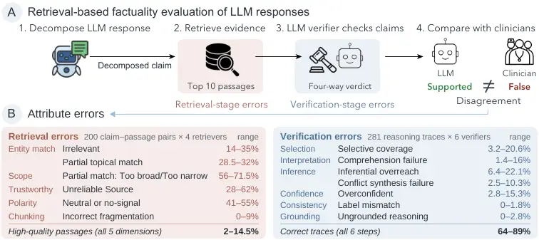

# Where Does Retrieval-Based Open-Ended Evaluation Fail? Automatic Taxonomy Induction from Long-Form Medical Answer Factuality Verification

Heyuan Huang ^(†)^(†)thanks: Equal contribution    Jirui Dai^(\*)   
Alexandra DeLucia    Sonal Joshi Affiliation: Mahsa Yarmohammadi   Jie
Gao   Bernal Jiménez Gutiérrez   Mark Dredze Affiliation: Center for
Language and Speech Processing Affiliation: Johns Hopkins University
Affiliation: Baltimore, MD 21218, USA Affiliation: {hhuan134,
mdredze}@jhu.edu

###### Abstract

Retrieval-based factuality evaluation, where LLM-generated claims are
verified against evidence from authoritative medical corpora, has become
the dominant paradigm for scalable hallucination detection in
high-stakes clinical settings. Despite the urgency of reliable and
transparent medical fact verification, most systems measure performance
with aggregate metrics like F1, which obscure where and why failures
occur. Existing RAG diagnostics require gold answers or annotated gold
evidence, neither of which exists in this regime. We introduce two
comprehensive taxonomies, grounded in a case study on the open-ended
MedExpert dataset and 3 closed-ended datasets, decomposing failures into
retrieval-stage errors along five quality dimensions, and
verifier-reasoning errors into six consecutive steps. We adapt an
automatic pattern induction pipeline using LLM-as-Judge to label
evidence quality and classify verifier reasoning errors at scale, and
then stress-test our findings across 4 retrieval methods and 6 frontier
verifier models. Our analysis reveals that scaling model size, adding
reasoning effort, expanding to authoritative web sources, and applying
medical fine-tuning do not resolve these failure modes, demonstrating
that they represent fundamental limitations of the retrieve-then-verify
paradigm in open-ended medical settings rather than artifacts of
outdated systems.¹¹ 1 We release our code and data at
[https://github.com/Heyuan9/Open-Ended_RAG_Evaluation](https://github.com/Heyuan9/Open-Ended_RAG_Evaluation)
for the full reproducibility of our results.

## 1 Introduction

The rapid adoption of Large Language Models (LLMs) in patient-facing
Question Answering (QA), report generation, and summarization has
necessitated rigorous frameworks to evaluate the factuality of generated
text. To detect plausible but unfactual information, Min et al. (2023)
proposed a decompose-then-verify paradigm, FActScore, to granularly
check each atomic claim against a knowledge source. Building on this
paradigm, MedScore (Huang et al., 2025) decomposes complex medical
answers into independent, condition-aware claims and verifies them
against passages retrieved from the MedRAG corpus (Xiong et al., 2024).
This widely adopted paradigm is built on the premise that retrieved
evidence from authoritative corpora is sufficiently factual and
relevant.

However, our experiments reveal that even SoTA pipelines fail severely
in this open-ended medical setting: on MedExpert (Yarmohammadi et al.,
2025), an open-ended medical QA dataset annotated by clinicians, pairing
the strongest retrievers with frontier verifiers recovers only a small
fraction of clinician-flagged factual errors — an order-of-magnitude
collapse from the same pipeline’s performance on closed-ended biomedical
benchmarks. This collapse persists across model scaling, increased
reasoning effort, medical fine-tuning, and corpus expansion to
authoritative web sources, pointing to a _structural_ limitation of the
retrieve-then-verify paradigm in the open-ended regime rather than an
artifact of outdated systems. End-to-end metrics like F1, however,
cannot say _where_ or _why_ the pipeline breaks.

To open this black box, we present a comprehensive model-agnostic error
taxonomy for retrieval-based open-ended factuality evaluation,
decomposing failures into two stages:

- •
  Retrieval-stage errors: irrelevant evidence, mismatch clinical scope,
  trustworthiness, evidence polarity, and chunking issues.
- •
  Verification-stage errors: incorrect evidence selection, failure in
  evidence comprehension, insufficient reasoning, overconfidence,
  inconsistency, and hallucinations.

Figure 1: Retrieval-based factuality evaluation of open-ended medical
answers: an LLM verifier checks claims against retrieved evidence,
motivating our evaluation of where this process fails for Stage-wise
reliability.

The taxonomy is induced via a human-in-the-loop LLM-as-judge pipeline
that requires no gold answers or annotated gold evidence, a regime where
existing closed-ended RAG diagnostics (Ru et al., 2024; Es et al., 2024;
Leung et al., 2026; Sivakumar et al., 2026) do not apply, and that
scales diagnosis far beyond manual inspection.

We summarize our contributions as follows.

1.  1.  A multi-dimensional error taxonomy for retrieval-based open-ended
        factuality evaluation, automatically inducible without gold
        annotation.
2.  2.  A large-scale empirical analysis across 6 verifier LLMs, 4
        retrievers, and 3 knowledge corpora, showing that scaling, reasoning
        effort, medical fine-tuning, and corpus expansion all fail to
        resolve the dominant failure patterns.
3.  3.  Actionable recommendations for researchers to improve open-ended
        factuality systems: A multi-dimensional evaluation protocol,
        including task-oriented assessment of retrieved evidence paired with
        intermediate-step assessment of verifier behavior, reflects system
        capability more faithfully and surfaces failure modes more directly
        than aggregated end-to-end metrics.

Figure 2: Diagnosing error modes in a retrieve-then-verify pipeline: (A)
A pipeline decomposes a response sentence into atomic facts, retrieves
top-10 medical passages, asks an LLM verifier for a four-way label
(Supported / Refuted / No Evidence / Ambiguous), and compares it against
a human verdict (True/False). (B) Our contribution is to automatically
induce a taxonomy of retrieval error modes (where the evidence itself is
the bottleneck) and verification error modes (where the LLM reasons
incorrectly over the evidence). Full error modes are in Table 7 and
Section A.2. Ranges span each pattern’s lowest to highest rate across
the 4 retrievers (200 passages each) or 6 verifiers (281 reasoning
traces each) on MedExpert-gold.

## 2 Related Work

#### Open-ended factuality evaluation.

Evaluating the factuality of diverse text generated by LLMs remains a
persistent challenge, especially when it is open-ended. Traditional
n-gram-based metrics require costly human annotation, while recent
annotation-free approaches—FActScore (Min et al., 2023), and MedScore
(Huang et al., 2025)—retrieve text snippets from external sources (e.g.,
Wikipedia, PubMed) as reference for automated verification. These
systems use LLM verifiers to generate a verdict for each atomic claim
based on the retrieved evidence, which is not 100% reliable due to the
evidence quality and capabilities of LLMs. However, these
decompose-then-verify pipelines only output end-to-end aggregated
factuality scores and verifiers’ reasoning in plain text, making it
difficult to diagnose _where_ the pipeline fails.

#### Retrieval evaluation in closed- and open-ended fact verification

Retrieval quality evaluation for fact verification has matured under the
_closed-ended_ paradigm and remains largely absent in the open-ended
domain. Closed-ended fact verification benchmarks—FEVER (Thorne et al.,
2018), SciFact (Wadden et al., 2020), HealthVer (Sarrouti et al., 2021),
CovidFact (Saakyan et al., 2021), PubHealth (Kotonya and Toni,
2020)—curate each claim, identify the specific passages that constitute
its valid evidence, and then annotate its gold verdict (Supported /
Refuted / Not Enough Info). With gold evidence annotated per claim, the
retriever is evaluated directly by the evidence precision@$`k`$ and
recall@$`k`$, and verifier errors can be cleanly separated from
retrieval misses; on top of this protocol, a mature line of diagnostic
frameworks measure the quality of the retrieve-then-verify pipelines by
stage (Ru et al., 2024; Es et al., 2024; Leung et al., 2026; Sivakumar
et al., 2026).

Open-ended fact verification has none of this scaffolding. In open-ended
Retrieval-based factuality evaluation, the claim is _decomposed_ from an
LLM’s long-form generation rather than curated; there is no annotated
verdict to compare against, and no annotated gold passages—LLM-generated
atomic claims are too diverse to enumerate evidence for, and a claim may
itself be a parametric fabrication with no factual support in _any_
corpus, making evidence recall@$`k`$ undefined in principle, rather than
merely expensive to annotate. Existing open-ended factuality pipelines,
therefore, treat retrieval as a black box subroutine and score only the
final claim verdict (Min et al., 2023; Huang et al., 2025); no
standardized metric, framework, or benchmark evaluates the retriever
itself.

Two recent medical-RAG diagnostics remain closed-ended. MedRAGChecker
(Ji et al., 2026), a medical-domain adaptation of RAGChecker (Ru et al.,
2024), uses gold answers’ claims as ground truth to calculate claims
recalled by retrieved evidence, and can only be used when there exist
gold answers. Kim et al. (2025) evaluates retrieval via post-hoc
relevance annotations on retrieved passages, but anchors them to
physician-written answers’ must-have statements. We provide the first
systematic error analysis of the retrieval _stage_ when no reference
answer exists at all.

Our work focuses on _error taxonomy construction_—systematically
categorizing _why_ each stage fails—rather than building a better fact
verification system, and on using automatic LLM-based error pattern
extraction to scale the analysis beyond manual inspection.

## 3 Experimental Setup

### 3.1 Open-ended Datasets

MedExpert (Yarmohammadi et al., 2025) contains 540 open-ended medical QA
pairs that are annotated for factuality and corresponding severity of
the unfactual information by clinicians within their Mental Health (MH)
and Prenatal Care (PC) specialties. Clinicians highlight unfactual text
spans, label them as "False", and write reasons. For each sentence with
an unfactual span, we consider it a Positive case (i.e., contains
factual errors). We use MedScore (Huang et al., 2025) to decompose each
response into context-aware claims and verify each claim against
retrieved evidence. For manual evaluation, we sampled a gold subset,
MedExpert-gold, whose factuality annotation is double-checked by five
practicing clinicians with relevant MH and PC clinical licensure. Data
representativeness is discussed in Section A.2. We use MedExpert and
MedExpert-gold as the main datasets for this case study and show that
our findings are generalizable to the simulated "semi open-ended"
datasets below.

### 3.2 Closed-Ended Datasets

Due to the limited number of publicly available open-ended medical
factuality evaluation datasets, we transform 4 closed-ended medical fact
check datasets into the open-ended setting by changing their own curated
small evidence corpus to our 30.3M passage corpus, MEDIC, and convert
the 4 datasets into a unified {id, claim} format.

SciFact (Wadden et al., 2020) contains 1,409 expert-written scientific
claims derived from biomedical research articles, with evidence
abstracts and annotated verdict labels based on the evidence.
SciFact-Open (Wadden et al., 2022) extends this setting toward
semi-open-domain by using a 500K biomedical scientific abstract corpus
as the knowledge base for 279 claims’ verification. Both datasets’
claims are labelled as Support, Refute, and No Evidence.

HealthVer (Sarrouti et al., 2021) contains 1,855 real-world
health-related claims collected from search engine results for health
questions. Each claim is paired with evidence from scientific articles
and annotated with Supports, Refutes, and Neutral verdicts.

CovidFact (Saakyan et al., 2021) contains 4,086 COVID-19 claims and
filters each claim’s top 5 Google Search results into gold evidence and
annotates Supported/Refuted verdicts.

Data preprocessing and alignment details are in Section A.2, and
preprocessed data statistics are in Table 6.

### 3.3 Evaluation Setup

Huang et al. (2025) finds that binary verification usually assigns
"False" to a claim for variable reasons, while it only assigns "True"
when there is exact supporting evidence. We extend MedScore’s binary
verdict to enable finer-grained error analysis. For each medical claim
in the 4 datasets, we verify it against retrieved evidence, using a
4-way verdict: Supported, Refuted, No Evidence, and Ambiguous. When the
retrieved passages provide conflicting evidence, the verifier should
assign the label Ambiguous to the claim. Such disagreement is common in
the medical domain, where different studies, guidelines, or clinical
sources may offer diverging conclusions on the same topic.

### 3.4 Methods

#### Retrieval methods.

We compare 4 popular and mostly used retrievers:

- •
  MedCPT(Jin et al., 2023), which is the most commonly used medically
  fine-tuned retriever with 384,891 monthly downloads in April, 2026.²²
  2
  [https://huggingface.co/ncbi/MedCPT-Query-Encoder](https://huggingface.co/ncbi/MedCPT-Query-Encoder)
- •
  A hybrid retriever, RRF-2, combining BM25 (lexical retriever) and
  MedCPT (biomedical domain semantic retriever), using Reciprocal Rank
  Fusion.
- •
  A hybrid retriever, RRF-4, combining BM25, MedCPT, SPECTER (scientific
  domain semantic retriever)(Cohan et al., 2020), and Contriever
  (general domain semantic retriever)(Izacard et al., 2022), using the
  same Reciprocal Rank Fusion.
- •
  Qwen3-Embedding-8B(Zhang et al., 2025), which is the best general
  domain embedding model in 2025 on the MTEB leaderboard.

Each retriever uses the decomposed claim as the query to retrieve the
top 10 relevant passages as the verification evidence.

#### Knowledge corpora.

We compare 3 knowledge sources:

- •
  MEDIC corpus, including 30.3M passages collected by Xiong
  et al. (2024) from PubMed, StatPearls, and Medical Textbook.³³ 3 We
  excluded its Wikipedia (general knowledge) part to avoid
  medical-related snippets from lines/dialogues in medical-themed TV
  dramas and movies.
- •
  Google⁴⁴ 4 [Serper API](https://serper.dev/) is used for Google search
  engine general search as a special case study to see if authoritative
  domain filtering (e.g.,.edu, .gov, .org) can introduce up-to-date,
  reliable evidence, compared with static corpus retrieval.
- •
  Google Scholar search that limits the evidence to articles indexed by
  the Google Scholar engine, whose scope is broader than the static
  MEDIC corpus but smaller than Google general search.

#### Verifier LLMs.

We compare 6 verifier LLMs:

- •
  GPT-5.4, one of the SOTA closed-source general domain LLMs (Singh
  et al., 2026).
- •
  MedGemma 27B, a medically fine-tuned open-source LLM (Sellergren
  et al., 2025).
- •
  Gemma 3 27B, a general domain open-source LLM with the same
  architecture and pre-training, but different fine-tuning from MedGemma
  (Team, 2025).
- •
  Qwen3.6-27B, one of the SOTA open-source general domain LLMs that
  achieves comparable benchmark scores with Claude 4.5 Opus (Qwen Team,
  2026).⁵⁵ 5 https://huggingface.co/Qwen/Qwen3.6-27B
- •
  Mistral Small 3 (24B-Instruct-2501), the original MedScore verifier,
  as our baseline (Mistral AI, 2025).
- •
  Mistral Small 4(119B-2603), a newly released open-source LLM from the
  Mistral family whose benchmark scores are higher than Mistral Small 3
  (Mistral AI, 2026).⁶⁶ 6
  https://huggingface.co/mistralai/Mistral-Small-4-119B-2603

For each combination of retrieval method, knowledge corpus, and verifier
LLM, we run the full verification pipeline and apply automatic error
analysis to the results.

### 3.5 Automatic Pattern Extraction

We aim to evaluate the performance of the Retrieval-based factuality
evaluation in comparison to human evaluators (i.e., clinicians),
particularly its error patterns. Our goal is to identify as many errors
as possible, particularly errors that Retrieval-based factuality
evaluation overlooked or misclassified (i.e., false negatives and false
positives), and potentially surfacing additional errors that clinicians
themselves did not detect. Manual inspection of false positive and false
negative cases does not scale. We develop an automatic pipeline using
LLM-as-judge. Similar to prior work that employs an LLM as a qualitative
judge Chirkova et al. (2025), we first developed a preliminary error
codebook based on our interactions with clinicians, then used this as a
seed codebook to elicit additional error patterns not previously
identified. Our seed error codebook is below:

#### Retrieval-stage seed codebook.

For each claim–passage pair, an LLM judge labels the retrieved evidence
along multiple dimensions beyond the traditional relevancy score (e.g.,
cosine similarity):

- •
  Entity Match: Direct match; Partial topical match; Irrelevant.
- •
  Scope: Whether the evidence addresses the specific clinical subgroup
  (e.g., pregnant women, pediatric patients) or only provides general
  population descriptions.
- •
  Trustworthy: Whether the content is based on a trustworthy primary
  trial with a sufficient number of subjects.
- •
  Evidence Polarity: Whether this evidence gives direct affirmation or
  contradiction to the claim, or it is just a topic mention without a
  proposition.

#### Verifier-stage seed codebook.

Each verifier’s reasoning trace is decomposed into 6 consecutive steps
and example errors:

- •
  Interpretation: The verifier misunderstood the claim or the evidence.
- •
  Evidence selection: The verifier missed relevant evidence, or focused
  more on low-quality evidence
- •
  Inference: The verifier could not integrate information across
  multiple passages to reach a correct verdict. The verifier lacked
  domain knowledge to reason as a clinician would (e.g., understanding
  drug interactions, contraindications).
- •
  Calibration: the verifier is overconfident or over-hedging on the
  evidence strength
- •
  Consistency: the verifier’s reasoning does not align with its final
  verdict
- •
  Grounding: the verifier used information that is not provided in the
  evidence

We manually synthesized the saturated final codebooks and validated LLM
judge labels against a human-annotated subset and report inter-annotator
agreement, with taxonomy construction details in .

|                  |            |      |     |                |      |      |                 |      |      |           |      |      |              |      |      |         |      |      |
| ---------------- | ---------- | ---- | --- | -------------- | ---- | ---- | --------------- | ---- | ---- | --------- | ---- | ---- | ------------ | ---- | ---- | ------- | ---- | ---- |
|                  | Open-Ended |      |     |                |      |      | Semi-Open-Ended |      |      |           |      |      |              |      |      |         |      |      |
|                  | MedExpert  |      |     | MedExpert-gold |      |      | CovidFact       |      |      | HealthVer |      |      | SciFact-Open |      |      | SciFact |      |      |
| Label Mapping    | P          | R    | F1  | P              | R    | F1   | P               | R    | F1   | P         | R    | F1   | P            | R    | F1   | P       | R    | F1   |
| Refuted          | 5.6        | 17.0 | 8.4 | 56.4           | 25.6 | 35.2 | 94.8            | 33.7 | 49.7 | 40.4      | 37.5 | 38.9 | 67.3         | 78.7 | 72.5 | 57.3    | 81.4 | 67.2 |
| Refuted + NE     | 3.2        | 33.9 | 5.9 | 46.8           | 41.9 | 44.2 | 82.9            | 67.8 | 74.6 | 33.0      | 47.8 | 39.0 | 51.3         | 86.5 | 64.4 | 38.6    | 86.9 | 53.4 |
| Refuted + NE + A | 3.1        | 45.1 | 5.7 | 47.1           | 55.8 | 51.1 | 80.3            | 76.3 | 78.2 | 27.0      | 74.6 | 39.6 | 47.3         | 98.9 | 64.0 | 35.5    | 97.0 | 52.0 |

Table 1: Precision/Recall/F1\*100 (%) under different binary
label-mapping strategies across open-ended and semi-open-ended
fact-checking datasets, using SOTA retriever, Qwen3 in MEDIC corpus, and
SOTA verifier, GPT-5.4. Refuted+NE+A means we count Refuted, No
Evidence, and Ambiguous labels as Has Error claims. The highest F1 and
Recall are bolded for each dataset.

## 4 Open-Ended vs. Closed-Ended Fact Verification Results

Our main results in Table 1 demonstrate that open-ended retrieval-based
fact verification remains fundamentally challenging for the
retrieve-then-verify pipeline, given the consistently low Recall and F1
of that even the strongest available models obtain in the true
open-ended MedExpert dataset.

This challenge is driven by three fundamental properties of open-ended
fact-checking task: (i) the comprehensiveness of the evidence base, (ii)
the identifiability of gold evidence within it, and (iii) the alignment
between retrieved evidence and the claim. The rising end-to-end F1 we
observe across datasets, from $`0.08`$ on MedExpert to $`0.7`$ to
$`0.8`$ on CovidFact and SciFact-style benchmarks, shows that the real
open-ended tasks have all these 3 difficult properties, making it more
challenging than the semi-open-ended task, SciFact-style benchmarks,
which almost don’t have these 3 difficulties.

#### Comprehensiveness of the evidence base.

The most basic requirement is that the gold evidence supporting (or
refuting) a claim actually exists in the corpus available to the system.
We find that approximately 90% to 81% of the gold passages in SciFact
and SciFact-Open are contained in MEDIC, and end-to-end F1 on these
datasets reaches 0.7 once the relevant evidence is retrieved. In
contrast, COVID-related datasets draw their gold passages from web
sources — opinion pieces, news articles, and lay-audience summaries —
that fall outside the scientific literature indexed by MEDIC; F1 on
these datasets drops to 0.4 to 0.5. In MedExpert, which is open-ended by
construction and offers no guarantee of evidence existence or coverage,
F1 collapses to $`0.06`$. This property can not be solved by retriever
or verifier improvement, and can not be solved by simply expanding the
corpus, as shown in Section 5.2. More details about the overlap between
each dataset’s gold passages and the MEDIC corpus can be found in .

#### Identifiability of evidence.

Even when gold evidence is present, it must be locatable. In
closed-ended datasets, the corpus was constructed _around_ the claims,
so the search space is small and curated and the right passages are
comparatively easy to surface. In an open-ended setting operating over
millions of passages, the same gold evidence is buried among far more
distractors, and retrieval quality becomes the binding constraint on
end-to-end performance. Unlike comprehensiveness, this is a
scaling-friendly problem: as retrievers improve, identifiability gaps
shrink, and the corresponding portion of the end-to-end error rate
decreases.

#### Alignment between evidence and claim.

In the medical domain, claims and evidence are frequently misaligned
even when they are topically matched. A claim stating an absolute
medication dose (“adults may take 400 mg of ibuprofen every six hours”)
may need to be verified against a passage reporting a weight-normalized
dose (“$`5`$–$`10`$ mg/kg body weight”), requiring unit conversion and
population assumptions. A claim about elderly patients (“dose reduction
is required”) may only be derivable by chaining two passages: one
linking age to hepatic decline, another linking hepatic decline to dose
adjustment. And a claim phrased in general terms may need to be checked
against evidence drawn from a specific subpopulation (e.g., adult males
aged 18–65), requiring the verifier to judge whether the generalization
is licensed. These misalignments are neither retrieval failures nor
simple verdict errors. They demand domain knowledge, cross-passage
reasoning, and calibrated handling of evidence strength — capabilities
that do not follow automatically from a stronger retriever or a larger
verifier. Section 6 examines these capabilities by dimension and shows
that they account for a substantial share of errors that end-to-end
metrics fail to reveal.

## 5 Quantitative Analysis

The data imbalance issue heavily influences precision in MedExpert. In
contrast, Recall remains stable in the balanced MedExpert-gold in
Table 1 because most clinician-found factual errors can not be
automatically detected. We use MedExpert-gold for detailed analysis in
the main paper and report MedExpert-full results in . All calculation
maps Refuted to Has Error and others to No Error.

A key question is whether the identified error patterns are artifacts of
outdated models or fundamental limitations. We run ablation experiments
on retrievers and verifiers to find that these errors persist, even
using SOTA retrievers and SOTA verifiers, as shown in Table 2 and
discussed below.

|                                 |        |      |                        |        |      |
| ------------------------------- | ------ | ---- | ---------------------- | ------ | ---- |
| (a) Verifier ablation           |        |      | (b) Retriever ablation |        |      |
| Verifier                        | Recall | F1   | Retriever              | Recall | F1   |
| Mistral-Small-24B-Instruct-2501 | 34.9   | 42.6 | MedCPT                 | 19.8   | 29.3 |
| Gemma3-27B                      | 8.1    | 14.1 | RRF-2                  | 24.4   | 34.4 |
| MedGemma-27B                    | 16.3   | 25.2 | RRF-4                  | 18.6   | 28.8 |
| Qwen3.6-27B                     | 22.1   | 32.8 | Qwen3                  | 25.6   | 35.2 |
| Mistral-Small-4-119B-2603       | 19.8   | 29.6 |                        |        |      |
| GPT-5.4                         | 25.6   | 35.2 |                        |        |      |

Table 2: Ablation results on the MedExpert-gold subset: (a) Verifier
ablation with Qwen3 retriever. (b) Retriever ablation with GPT-5.4
verifier.

### 5.1 Better Retrievers Can’t Solve the Challenge

#### Existing fine-tuned medical retrievers are limited.

|           |            |          |      |            |
| --------- | ---------- | -------- | ---- | ---------- |
| Retriever | Supported% | Refuted% | NE%  | Ambiguous% |
| MedCPT    | 65.0       | 5.0      | 26.0 | 4.0        |
| RRF-2     | 71.5       | 5.6      | 19.2 | 3.7        |
| RRF-4     | 75.2       | 4.6      | 16.2 | 4.0        |
| Qwen3     | 78.3       | 7.1      | 8.0  | 6.6        |

Table 3: Claim-level 4-label percentage distribution across retrievers
with GPT-5.4 verifier on MedExpert-gold subset.

As shown in Table 3, Qwen3 has the largest number of functional evidence
by the lowest number of No Evidence labels (8.04%), turning most NE
labels from other retrievers to more decisive Supported (80.14%). From
an end-to-end performance perspective, Qwen3 is the strongest retriever
with the highest Recall and F1 in Table 2, while MedCPT/RRFs lead to
lower Recall (i.e., their evidence can’t help find clinician-identified
factual errors) and lower F1 scores, showing weaker overall verification
performance.

### 5.2 Better Search Can’t Solve the Challenge

As shown in Figure 3, replacing the static MEDIC corpus with larger live
Google General Search and Google Scholar Search, or the merged Google
Search corpus does not improve Recall and F1. In , we show that even
authoritative sources (e.g., uclahealth.org) can contain unfactual
content, and blindly expanding the corpus cannot solve this challenge.

### 5.3 Better Verifiers Can’t Solve the Challenge

#### Verifier capability does not follow benchmark ranking.

|                       |        |      |
| --------------------- | ------ | ---- |
| Corpus                | Recall | F1   |
| MEDIC                 | 25.6   | 35.2 |
| Google Scholar Search | 15.1   | 23.9 |
| Google General Search | 17.4   | 26.1 |
| Google Search         | 15.1   | 23.4 |

Table 4: Corpus comparison with GPT-5.4 verifier and Qwen3 retriever on
MedExpert-gold subset. Google Search denotes the merged corpus of Google
General Search and Google Scholar Search.

Figure 3: For each verifier model, bars (left axis) show recall on
MedExpert-gold with the retriever fixed to Qwen3, and the line (right
axis) shows its healthcare benchmark rank; models are ordered along the
x-axis by size from small to large. Ranks are from the [Best AI for
Healthcare](https://llm-stats.com/leaderboards/best-ai-for-healthcare)
leaderboard.^(†)^(†)footnotemark:

^(†)^(†)footnotetext: MedGemma-27B is not tested by this leaderboard,
but the [MedGemma model
card](https://huggingface.co/google/medgemma-27b-it) shows that its
scores surpass Gemma3-27B. We therefore plot an estimated rank for it.

As shown in Footnote , the benchmark order usually scales by size, while
we find that higher benchmark scores don’t mean better end-to-end
real-world performance (Recall/F1) in the open-ended medical
verification task. Mistral Small 3 has the highest Recall with the
smallest size, while GPT-5.4 and Qwen 3.6 have much lower Recall. This
mismatch suggests that standard healthcare benchmarks mainly reflect
general medical QA or knowledge recall, but do not adequately measure a
model’s ability to use to verify open-ended clinical statements and
detect subtle factual errors that occur during patient-facing
communications. However, single metrics can not fully represent the
intermediate capability of LLMs either, and we conducted large-scale,
quantified qualitative analysis in Section 6.1 for deeper discussion.

#### Test-time scaling does not improve medical verification.

|                  |        |      |                  |
| ---------------- | ------ | ---- | ---------------- |
| Reasoning Effort | Recall | F1   | Reasoning Tokens |
| Low              | 25.6   | 35.2 | 57,398           |
| Medium           | 23.3   | 33.1 | 208,669          |
| High             | 25.6   | 37.3 | 466,052          |

Table 5: GPT-5.4 reasoning effort ablation with Qwen3 retriever on
MedExpert-gold subset.

As shown in Table 5, increasing GPT-5.4’s reasoning effort consumes
substantially more reasoning tokens but does not improve recall.
Instead, it wastes tokens on useless hedging, rather than leading to a
correct verdict. This suggests that longer reasoning makes the verifier
more hesitant, not more capable, in using evidence to determine whether
a medical statement is factually wrong.

#### Medical fine-tuning yields limited improvements on Medical Verification.

As shown in Table 2, MedGemma has roughly 2 times the Recall as Gemma,
but still falls far behind the strongest verifier. This shows that
fine-tuning cannot yield significant improvements beyond its base
architecture and pretraining capabilities. F1 shows a similar overall
performance gap.

## 6 Qualitative Analysis

After 6 iterations, our codebooks are saturated, and adding new data can
not yield any new patterns. We applied the final codebooks on the
MedExpert-gold subset using Claude Opus 4.7 as a judge to label
sub-codes for retrievers’ 800 (claim, evidence) pairs and verifiers’
1686 (claim, reasoning) traces. We manually annotate 50 claim-evidence
pairs and 60 claim-reasoning traces with human-LLM inter-annotator
agreement of 0.86 and 0.8, respectively.

### 6.1 Verifier Behavior Taxonomy

Our verifier behavior taxonomy decomposes the verification reasoning
trace into 6 consecutive steps. The verifier starts by selecting
passages from the given evidence, and then interprets its selected
passages before conducting clinical inference. After its inference and
confidence calibration, it concludes a final label. All information in
the reasoning text should be traceable to the given evidence. Each step
has a correct pattern and multiple error patterns in Section A.2.

We count each reasoning trace as correct only when all 6 steps are
correct. Contrary to the end-to-end performance rank in Section 5.3,
GPT5.4 has the highest correctness rate (89%), and Mistral Small3 has
the lowest correctness rate (64%), which shows that Mistral Small3’s
highest recall rate is mostly a lucky guess based on wrong reasoning
traces. This again proves that relying on end-to-end aggregated metrics
(e.g., Precision, Recall, F1) without multi-dimensional intermediate
evaluation can be misleading in choosing the best models or systems.

Our quantified error rates (%) show the dominant error patterns for each
verifier, enabling cross-model comparison. Overall, Mistral Small 3 is
the worst behavior model because it frequently ignores supporting or
conflicting evidence passages (20.6%) and fails to comprehend medical
passages (16%). Gemma3 misallocates attention to many irrelevant
passages (6%), while MedGemma mostly (1.1%) anchors its attention to
correct passages given the same evidence. In terms of confidence, all
models except GPT-5.4 are usually overconfident based on the evidence
strength (15.3% to 9.6%), while Mistral 3 and 4 models also have
underconfident patterns (6%, 5.3%, respectively). GPT-5.4, as the
closed-source SOTA model, still has unsolved intermediate error
behaviors primarily at the inference and confidence steps, such as
inferential overreach (6.4%) and being overconfident based on the
evidence strength (2.8%). The open-source SOTA model, Qwen 3.6, has
dominant errors in inferential overreach (12.8%) and selective coverage
of evidence (12.5%). The correctness rates (GPT5.4 $`>`$ Qwen3.6 $`>`$
Mistral Small4 $`>`$ MedGemma $`>`$ Gemma3 $`>`$ Mistral Small3) align
with the current ranking of LLMs in terms of overall capability, with
newer and larger models generally exhibiting stronger reasoning
performance in the medical verification task.

### 6.2 Retrieval Quality Taxonomy

The final retrieval quality taxonomy in Table 7 does not differ
significantly from the seed codebook in Section 3.5, since it is the
sixth version of the seed codebook that we synthesized comprehensive
patterns from past iterations.

We evaluate each passage’s effectiveness for the medical fact
verification task by 5 major dimensions: Entity Match, Scope Match,
Content Trustworthiness, Evidence Polarity, and Chunking Issues⁸⁸ 8
Temporal can be one dimension, but it is not added in the Table due to
data limitations, acknowledge as one of our paper’s Limitations. Each
dimension has one high-quality pattern and multiple low-quality patterns
that degrade passage effectiveness in supporting a decision.

We count each passage as high quality only when it is high quality
across all 5 dimensions. We calculate High Quality Rate, which is the
portion of retrieved high-quality passages by each retriever, and find
that aligns with conclusions in Section 5.1: Qwen3 is the best retriever
among all, and its passages’ high quality rate (14.5%) is 7 times the
rate of the medically fine-tuned MedCPT retriever (2%). However, most of
Qwen3’s retrieved evidence is still unsuitable to use. Current
challenges for the SOTA Qwen3 retriever lie in finding the correct scope
for medical conditions and populations, and locating direct signals for
affirmation or contradiction.

## 7 Promising Solutions

Based on the deep analysis conducted on the open-ended
retrieve-then-verify problem, we propose possible solutions as promising
directions rather than a single prescriptive recipe: the design space is
genuinely divergent, and in medical settings any solution must balance
latency and token cost, against performance, rigor, and transparency.
Promising directions include (a) intermediate-behavior evaluation based
on our paper’s retrieval and verification taxonomies; (b) rubric-aware
search agents whose retrieval and judgments are conditioned on rubrics
derived from our error categories; (c) medical domain-knowledge
injection and guideline-grounded rules as constraints or priors during
verification; (d) medical expert-in-the-loop routing for low-confidence,
high-stakes cases, which we recommend for real-world deployment. Our
taxonomy provides the diagnostic foundation for future work to navigate
performance and cost trade-offs in a targeted way.

## 8 Conclusion

Open-ended factuality evaluation requires a dedicated system with
sufficient domain knowledge and capable reasoning skills. The most
challenging problem is precisely locating all pieces of information
scattered in different sources and aligning evidence with the claim,
which will not automatically be solved as any single LLM scales up. For
better retrieval quality, researchers should focus on customized
task-oriented multi-dimensional evaluation in retrieving and re-ranking
passages, rather than formula-based methods (e.g., lexical or cosine
similarity in retrieving and RRF in reranking). To improve verification
reliability, researchers should work on intermediate behavior evaluation
to ensure verifiers are actually doing correctly, instead of competing
on the aggregated metrics (e.g., P/R/F1).

## Limitations

As of May 2026, MedExpert is the only publicly available open-ended
medical factuality evaluation dataset with clinician-annotated
True/False with clinician reasoning. MedRAG is the only publicly
available corpus that includes a vast amount of authoritative medical
passages, which was published in 2024. We build our pattern taxonomies
and analysis mainly on this dataset and corpus. Since MedRAG does not
provide metadata for each passage, we can not evaluate its passage
publication date, which can be added in the Retriever Taxonomy (e.g.,
N/A for Temporal Dimension). In the future, if other resources are
publicly released, the Temporal information can be enriched.

Additionally, due to the open-endedness of the task, we do not have gold
passage labels to calculate precision@k and recall@k for retriever
metrics evaluation, nor do we have gold answers to calculate generator
metrics for generative model evaluation, as proposed by RAGChecker (Ru
et al., 2024). If more resources are released, researchers can further
calculate these formula-based metrics to check if they align with the
qualitative findings.

The automatic pattern tagging for percentage calculation is performed on
the MedExpert-gold subset due to API budget limitations, and the
percentage information can be more comprehensive by tagging more data.

## Acknowledgments and Disclosure of Funding

This research was, in part, funded by the Advanced Research Projects
Agency for Health (ARPA-H). The views and conclusions contained in this
document are those of the authors and should not be interpreted as
representing the official policies, either expressed or implied, of the
United States Government.

## References

- Chirkova et al. \[2025\] Nadezhda Chirkova, Tunde Oluwaseyi Ajayi,
  Seth Aycock, Zain Muhammad Mujahid, Vladana Perlić, Ekaterina
  Borisova, and Markarit Vartampetian. Llm-as-a-qualitative-judge:
  automating error analysis in natural language generation, 2025. URL
  [https://arxiv.org/abs/2506.09147](https://arxiv.org/abs/2506.09147).
- Cohan et al. \[2020\] Arman Cohan, Sergey Feldman, Iz Beltagy, Doug
  Downey, and Daniel Weld. SPECTER: Document-level representation
  learning using citation-informed transformers. In Dan Jurafsky, Joyce
  Chai, Natalie Schluter, and Joel Tetreault, editors, _Proceedings of
  the 58th Annual Meeting of the Association for Computational
  Linguistics_, pages 2270–2282, Online, July 2020. Association for
  Computational Linguistics. doi: 10.18653/v1/2020.acl-main.207. URL
  [https://aclanthology.org/2020.acl-main.207/](https://aclanthology.org/2020.acl-main.207/).
- Es et al. \[2024\] Shahul Es, Jithin James, Luis Espinosa Anke, and
  Steven Schockaert. RAGAs: Automated evaluation of retrieval augmented
  generation. In Nikolaos Aletras and Orphee De Clercq, editors,
  _Proceedings of the 18th Conference of the European Chapter of the
  Association for Computational Linguistics: System Demonstrations_,
  pages 150–158, St. Julians, Malta, March 2024. Association for
  Computational Linguistics. doi: 10.18653/v1/2024.eacl-demo.16. URL
  [https://aclanthology.org/2024.eacl-demo.16/](https://aclanthology.org/2024.eacl-demo.16/).
- Gao et al. \[2026\] Jie Gao, Kaiser Sun, Jen tse Huang, Katherine Van
  Koevering, Sijie Ji, Heyuan Huang, Weiyan Shi, Zhuoran Lu, Ziang Xiao,
  Daniel Khashabi, and Mark Dredze. How to interpret agent
  behavior, 2026. URL
  [https://arxiv.org/abs/2605.13625](https://arxiv.org/abs/2605.13625).
- Huang et al. \[2025\] Heyuan Huang, Alexandra DeLucia, Vijay Murari
  Tiyyala, and Mark Dredze. Medscore: Generalizable factuality
  evaluation of free-form medical answers by domain-adapted claim
  decomposition and verification, 2025. URL
  [https://arxiv.org/abs/2505.18452](https://arxiv.org/abs/2505.18452).
- Izacard et al. \[2022\] Gautier Izacard, Mathilde Caron, Lucas
  Hosseini, Sebastian Riedel, Piotr Bojanowski, Armand Joulin, and
  Edouard Grave. Unsupervised dense information retrieval with
  contrastive learning, 2022. URL
  [https://arxiv.org/abs/2112.09118](https://arxiv.org/abs/2112.09118).
- Ji et al. \[2026\] Yuelyu Ji, Min Gu Kwak, Hang Zhang, Xizhi Wu,
  Chenyu Li, and Yanshan Wang. Medragchecker: Claim-level verification
  for biomedical retrieval-augmented generation, 2026. URL
  [https://arxiv.org/abs/2601.06519](https://arxiv.org/abs/2601.06519).
- Jin et al. \[2023\] Qiao Jin, Won Kim, Qingyu Chen, Donald C Comeau,
  Lana Yeganova, W John Wilbur, and Zhiyong Lu. Medcpt: Contrastive
  pre-trained transformers with large-scale pubmed search logs for
  zero-shot biomedical information retrieval. _Bioinformatics_,
  39(11):btad651, 2023.
- Kim et al. \[2025\] Hyunjae Kim, Jiwoong Sohn, Aidan Gilson, Nicholas
  Cochran-Caggiano, Serina Applebaum, Heeju Jin, Seihee Park, Yujin
  Park, Jiyeong Park, Seoyoung Choi, Brittany Alexandra Herrera
  Contreras, Thomas Huang, Jaehoon Yun, Ethan F. Wei, Roy Jiang, Leah
  Colucci, Eric Lai, Amisha Dave, Tuo Guo, Maxwell B. Singer, Yonghoe
  Koo, Ron A. Adelman, James Zou, Andrew Taylor, Arman Cohan, Hua Xu,
  and Qingyu Chen. Rethinking retrieval-augmented generation for
  medicine: A large-scale, systematic expert evaluation and practical
  insights, 2025. URL
  [https://arxiv.org/abs/2511.06738](https://arxiv.org/abs/2511.06738).
- Kotonya and Toni \[2020\] Neema Kotonya and Francesca Toni.
  Explainable automated fact-checking: A survey. In Donia Scott, Nuria
  Bel, and Chengqing Zong, editors, _Proceedings of the 28th
  International Conference on Computational Linguistics_, pages
  5430–5443, Barcelona, Spain (Online), December 2020. International
  Committee on Computational Linguistics. doi:
  10.18653/v1/2020.coling-main.474. URL
  [https://aclanthology.org/2020.coling-main.474/](https://aclanthology.org/2020.coling-main.474/).
- Kwon et al. \[2023\] Woosuk Kwon, Zhuohan Li, Siyuan Zhuang, Ying
  Sheng, Lianmin Zheng, Cody Hao Yu, Joseph Gonzalez, Hao Zhang, and Ion
  Stoica. Efficient memory management for large language model serving
  with pagedattention. In _Proceedings of the 29th symposium on
  operating systems principles_, pages 611–626, 2023.
- Leung et al. \[2026\] Kin Kwan Leung, Mouloud Belbahri, Yi Sui, Alex
  Labach, Xueying Zhang, Stephen Anthony Rose, and Jesse C. Cresswell.
  Classifying and addressing the diversity of errors in
  retrieval-augmented generation systems. In Vera Demberg, Kentaro Inui,
  and Lluís Marquez, editors, _Proceedings of the 19th Conference of the
  European Chapter of the Association for Computational Linguistics
  (Volume 1: Long Papers)_, pages 3185–3207, Rabat, Morocco, March 2026.
  Association for Computational Linguistics. ISBN 979-8-89176-380-7.
  doi: 10.18653/v1/2026.eacl-long.147. URL
  [https://aclanthology.org/2026.eacl-long.147/](https://aclanthology.org/2026.eacl-long.147/).
- Min et al. \[2023\] Sewon Min, Kalpesh Krishna, Xinxi Lyu, Mike Lewis,
  Wen-tau Yih, Pang Koh, Mohit Iyyer, Luke Zettlemoyer, and Hannaneh
  Hajishirzi. FActScore: Fine-grained atomic evaluation of factual
  precision in long form text generation. In Houda Bouamor, Juan Pino,
  and Kalika Bali, editors, _Proceedings of the 2023 Conference on
  Empirical Methods in Natural Language Processing_, pages 12076–12100,
  Singapore, December 2023. Association for Computational Linguistics.
  doi: 10.18653/v1/2023.emnlp-main.741. URL
  [https://aclanthology.org/2023.emnlp-main.741/](https://aclanthology.org/2023.emnlp-main.741/).
- Mistral AI \[2025\] Mistral AI. Mistral Small 3 \| Mistral AI,
  January 2025. URL
  [https://mistral.ai/news/mistral-small-3](https://mistral.ai/news/mistral-small-3).
- Mistral AI \[2026\] Mistral AI. Mistral Small 4 technical
  documentation.
  [https://mistral.ai/news/mistral-small-4](https://mistral.ai/news/mistral-small-4),
  March 2026. Version v.1, released March 16, 2026.
- Qwen Team \[2026\] Qwen Team. Qwen3.6-27B: Flagship-level coding in a
  27B dense model, April 2026. URL
  [https://qwen.ai/blog?id=qwen3.6-27b](https://qwen.ai/blog?id=qwen3.6-27b).
- Ru et al. \[2024\] Dongyu Ru, Lin Qiu, Xiangkun Hu, Tianhang Zhang,
  Peng Shi, Shuaichen Chang, Cheng Jiayang, Cunxiang Wang, Shichao Sun,
  Huanyu Li, Zizhao Zhang, Binjie Wang, Jiarong Jiang, Tong He, Zhiguo
  Wang, Pengfei Liu, Yue Zhang, and Zheng Zhang. Ragchecker: A
  fine-grained framework for diagnosing retrieval-augmented
  generation, 2024. URL
  [https://arxiv.org/abs/2408.08067](https://arxiv.org/abs/2408.08067).
- Saakyan et al. \[2021\] Arkadiy Saakyan, Tuhin Chakrabarty, and
  Smaranda Muresan. COVID-fact: Fact extraction and verification of
  real-world claims on COVID-19 pandemic. In Chengqing Zong, Fei Xia,
  Wenjie Li, and Roberto Navigli, editors, _Proceedings of the 59th
  Annual Meeting of the Association for Computational Linguistics and
  the 11th International Joint Conference on Natural Language Processing
  (Volume 1: Long Papers)_, pages 2116–2129, Online, August 2021.
  Association for Computational Linguistics. doi:
  10.18653/v1/2021.acl-long.165. URL
  [https://aclanthology.org/2021.acl-long.165/](https://aclanthology.org/2021.acl-long.165/).
- Sarrouti et al. \[2021\] Mourad Sarrouti, Asma Ben Abacha, Yassine
  Mrabet, and Dina Demner-Fushman. Evidence-based fact-checking of
  health-related claims. In Marie-Francine Moens, Xuanjing Huang, Lucia
  Specia, and Scott Wen-tau Yih, editors, _Findings of the Association
  for Computational Linguistics: EMNLP 2021_, pages 3499–3512, Punta
  Cana, Dominican Republic, November 2021. Association for Computational
  Linguistics. doi: 10.18653/v1/2021.findings-emnlp.297. URL
  [https://aclanthology.org/2021.findings-emnlp.297/](https://aclanthology.org/2021.findings-emnlp.297/).
- Sellergren et al. \[2025\] Andrew Sellergren, Sahar Kazemzadeh, Tiam
  Jaroensri, Atilla Kiraly, Madeleine Traverse, Timo Kohlberger, Shawn
  Xu, Fayaz Jamil, Cían Hughes, Charles Lau, et al. Medgemma technical
  report. _arXiv preprint arXiv:2507.05201_, 2025.
- Singh et al. \[2026\] Aaditya Singh, Adam Fry, Adam Perelman, Adam
  Tart, Adi Ganesh, Ahmed El-Kishky, Aidan McLaughlin, Aiden Low,
  AJ Ostrow, Akhila Ananthram, Akshay Nathan, Alan Luo, Alec Helyar,
  Aleksander Madry, Aleksandr Efremov, Aleksandra Spyra, Alex
  Baker-Whitcomb, Alex Beutel, Alex Karpenko, Alex Makelov, Alex Neitz,
  Alex Wei, Alexandra Barr, Alexandre Kirchmeyer, Alexey Ivanov, Alexi
  Christakis, Alistair Gillespie, Allison Tam, Ally Bennett, Alvin Wan,
  Alyssa Huang, Amy McDonald Sandjideh, Amy Yang, Ananya Kumar, Andre
  Saraiva, Andrea Vallone, Andrei Gheorghe, Andres Garcia Garcia, Andrew
  Braunstein, Andrew Liu, Andrew Schmidt, Andrey Mereskin, Andrey
  Mishchenko, Andy Applebaum, Andy Rogerson, Ann Rajan, Annie Wei, Anoop
  Kotha, Anubha Srivastava, Anushree Agrawal, Arun Vijayvergiya, Ashley
  Tyra, Ashvin Nair, Avi Nayak, Ben Eggers, Bessie Ji, Beth Hoover, Bill
  Chen, Blair Chen, Boaz Barak, Borys Minaiev, Botao Hao, Bowen Baker,
  Brad Lightcap, Brandon McKinzie, Brandon Wang, Brendan Quinn, Brian
  Fioca, Brian Hsu, Brian Yang, Brian Yu, Brian Zhang, Brittany Brenner,
  Callie Riggins Zetino, Cameron Raymond, Camillo Lugaresi, Carolina
  Paz, Cary Hudson, Cedric Whitney, Chak Li, Charles Chen, Charlotte
  Cole, Chelsea Voss, Chen Ding, Chen Shen, Chengdu Huang, Chris Colby,
  Chris Hallacy, Chris Koch, Chris Lu, Christina Kaplan, Christina Kim,
  CJ Minott-Henriques, Cliff Frey, Cody Yu, Coley Czarnecki, Colin Reid,
  Colin Wei, Cory Decareaux, Cristina Scheau, Cyril Zhang, Cyrus Forbes,
  Da Tang, Dakota Goldberg, Dan Roberts, Dana Palmie, Daniel Kappler,
  Daniel Levine, Daniel Wright, Dave Leo, David Lin, David Robinson,
  Declan Grabb, Derek Chen, Derek Lim, Derek Salama, Dibya
  Bhattacharjee, Dimitris Tsipras, Dinghua Li, Dingli Yu, DJ Strouse,
  Drew Williams, Dylan Hunn, Ed Bayes, Edwin Arbus, Ekin Akyurek,
  Elaine Ya Le, Elana Widmann, Eli Yani, Elizabeth Proehl, Enis Sert,
  Enoch Cheung, Eri Schwartz, Eric Han, Eric Jiang, Eric Mitchell, Eric
  Sigler, Eric Wallace, Erik Ritter, Erin Kavanaugh, Evan Mays, Evgenii
  Nikishin, Fangyuan Li, Felipe Petroski Such, Filipe de Avila
  Belbute Peres, Filippo Raso, Florent Bekerman, Foivos Tsimpourlas,
  Fotis Chantzis, Francis Song, Francis Zhang, Gaby Raila, Garrett
  McGrath, Gary Briggs, Gary Yang, Giambattista Parascandolo, Gildas
  Chabot, Grace Kim, Grace Zhao, Gregory Valiant, Guillaume Leclerc,
  Hadi Salman, Hanson Wang, Hao Sheng, Haoming Jiang, Haoyu Wang,
  Haozhun Jin, Harshit Sikchi, Heather Schmidt, Henry Aspegren, Honglin
  Chen, Huida Qiu, Hunter Lightman, Ian Covert, Ian Kivlichan, Ian
  Silber, Ian Sohl, Ibrahim Hammoud, Ignasi Clavera, Ikai Lan, Ilge
  Akkaya, Ilya Kostrikov, Irina Kofman, Isak Etinger, Ishaan Singal,
  Jackie Hehir, Jacob Huh, Jacqueline Pan, Jake Wilczynski, Jakub
  Pachocki, James Lee, James Quinn, Jamie Kiros, Janvi Kalra, Jasmyn
  Samaroo, Jason Wang, Jason Wolfe, Jay Chen, Jay Wang, Jean Harb,
  Jeffrey Han, Jeffrey Wang, Jennifer Zhao, Jeremy Chen, Jerene Yang,
  Jerry Tworek, Jesse Chand, Jessica Landon, Jessica Liang, Ji Lin,
  Jiancheng Liu, Jianfeng Wang, Jie Tang, Jihan Yin, Joanne Jang, Joel
  Morris, Joey Flynn, Johannes Ferstad, Johannes Heidecke, John
  Fishbein, John Hallman, Jonah Grant, Jonathan Chien, Jonathan Gordon,
  Jongsoo Park, Jordan Liss, Jos Kraaijeveld, Joseph Guay, Joseph Mo,
  Josh Lawson, Josh McGrath, Joshua Vendrow, Joy Jiao, Julian Lee, Julie
  Steele, Julie Wang, Junhua Mao, Kai Chen, Kai Hayashi, Kai Xiao,
  Kamyar Salahi, Kan Wu, Karan Sekhri, Karan Sharma, Karan Singhal,
  Karen Li, Kenny Nguyen, Keren Gu-Lemberg, Kevin King, Kevin Liu, Kevin
  Stone, Kevin Yu, Kristen Ying, Kristian Georgiev, Kristie Lim, Kushal
  Tirumala, Kyle Miller, Lama Ahmad, Larry Lv, Laura Clare, Laurance
  Fauconnet, Lauren Itow, Lauren Yang, Laurentia Romaniuk, Leah Anise,
  Lee Byron, Leher Pathak, Leon Maksin, Leyan Lo, Leyton Ho, Li Jing,
  Liang Wu, Liang Xiong, Lien Mamitsuka, Lin Yang, Lindsay McCallum,
  Lindsey Held, Liz Bourgeois, Logan Engstrom, Lorenz Kuhn, Louis
  Feuvrier, Lu Zhang, Lucas Switzer, Lukas Kondraciuk, Lukasz Kaiser,
  Manas Joglekar, Mandeep Singh, Mandip Shah, Manuka Stratta, Marcus
  Williams, Mark Chen, Mark Sun, Marselus Cayton, Martin Li, Marvin
  Zhang, Marwan Aljubeh, Matt Nichols, Matthew Haines, Max Schwarzer,
  Mayank Gupta, Meghan Shah, Melody Y. Guan, Melody Huang, Meng Dong,
  Mengqing Wang, Mia Glaese, Micah Carroll, Michael Lampe, Michael
  Malek, Michael Sharman, Michael Zhang, Michele Wang, Michelle Pokrass,
  Mihai Florian, Mikhail Pavlov, Miles Wang, Ming Chen, Mingxuan Wang,
  Minnia Feng, Mo Bavarian, Molly Lin, Moose Abdool, Mostafa
  Rohaninejad, Nacho Soto, Natalie Staudacher, Natan LaFontaine, Nathan
  Marwell, Nelson Liu, Nick Preston, Nick Turley, Nicklas Ansman, Nicole
  Blades, Nikil Pancha, Nikita Mikhaylin, Niko Felix, Nikunj Handa,
  Nishant Rai, Nitish Keskar, Noam Brown, Ofir Nachum, Oleg Boiko, Oleg
  Murk, Olivia Watkins, Oona Gleeson, Pamela Mishkin, Patryk Lesiewicz,
  Paul Baltescu, Pavel Belov, Peter Zhokhov, Philip Pronin, Phillip Guo,
  Phoebe Thacker, Qi Liu, Qiming Yuan, Qinghua Liu, Rachel Dias, Rachel
  Puckett, Rahul Arora, Ravi Teja Mullapudi, Raz Gaon, Reah Miyara,
  Rennie Song, Rishabh Aggarwal, RJ Marsan, Robel Yemiru, Robert Xiong,
  Rohan Kshirsagar, Rohan Nuttall, Roman Tsiupa, Ronen Eldan, Rose Wang,
  Roshan James, Roy Ziv, Rui Shu, Ruslan Nigmatullin, Saachi Jain, Saam
  Talaie, Sam Altman, Sam Arnesen, Sam Toizer, Sam Toyer, Samuel
  Miserendino, Sandhini Agarwal, Sarah Yoo, Savannah Heon, Scott
  Ethersmith, Sean Grove, Sean Taylor, Sebastien Bubeck, Sever Banesiu,
  Shaokyi Amdo, Shengjia Zhao, Sherwin Wu, Shibani Santurkar, Shiyu
  Zhao, Shraman Ray Chaudhuri, Shreyas Krishnaswamy, Shuaiqi, Xia,
  Shuyang Cheng, Shyamal Anadkat, Simón Posada Fishman, Simon Tobin,
  Siyuan Fu, Somay Jain, Song Mei, Sonya Egoian, Spencer Kim, Spug
  Golden, SQ Mah, Steph Lin, Stephen Imm, Steve Sharpe, Steve Yadlowsky,
  Sulman Choudhry, Sungwon Eum, Suvansh Sanjeev, Tabarak Khan, Tal
  Stramer, Tao Wang, Tao Xin, Tarun Gogineni, Taya Christianson, Ted
  Sanders, Tejal Patwardhan, Thomas Degry, Thomas Shadwell, Tianfu Fu,
  Tianshi Gao, Timur Garipov, Tina Sriskandarajah, Toki Sherbakov, Tomek
  Korbak, Tomer Kaftan, Tomo Hiratsuka, Tongzhou Wang, Tony Song, Tony
  Zhao, Troy Peterson, Val Kharitonov, Victoria Chernova, Vineet
  Kosaraju, Vishal Kuo, Vitchyr Pong, Vivek Verma, Vlad Petrov, Wanning
  Jiang, Weixing Zhang, Wenda Zhou, Wenlei Xie, Wenting Zhan, Wes
  McCabe, Will DePue, Will Ellsworth, Wulfie Bain, Wyatt Thompson,
  Xiangning Chen, Xiangyu Qi, Xin Xiang, Xinwei Shi, Yann Dubois,
  Yaodong Yu, Yara Khakbaz, Yifan Wu, Yilei Qian, Yin Tat Lee, Yinbo
  Chen, Yizhen Zhang, Yizhong Xiong, Yonglong Tian, Young Cha, Yu Bai,
  Yu Yang, Yuan Yuan, Yuanzhi Li, Yufeng Zhang, Yuguang Yang, Yujia Jin,
  Yun Jiang, Yunyun Wang, Yushi Wang, Yutian Liu, Zach Stubenvoll, Zehao
  Dou, Zheng Wu, and Zhigang Wang. Openai gpt-5 system card, 2026. URL
  [https://arxiv.org/abs/2601.03267](https://arxiv.org/abs/2601.03267).
- Sivakumar et al. \[2026\] Aswini Sivakumar, Vijayan Sugumaran, and Yao
  Qiang. Rag-x: Systematic diagnosis of retrieval-augmented generation
  for medical question answering, 2026. URL
  [https://arxiv.org/abs/2603.03541](https://arxiv.org/abs/2603.03541).
- Team \[2025\] Gemma Team. Gemma 3. 2025. URL
  [https://goo.gle/Gemma3Report](https://goo.gle/Gemma3Report).
- Thorne et al. \[2018\] James Thorne, Andreas Vlachos, Christos
  Christodoulopoulos, and Arpit Mittal. FEVER: a large-scale dataset for
  fact extraction and VERification. In Marilyn Walker, Heng Ji, and
  Amanda Stent, editors, _Proceedings of the 2018 Conference of the
  North American Chapter of the Association for Computational
  Linguistics: Human Language Technologies, Volume 1 (Long Papers)_,
  pages 809–819, New Orleans, Louisiana, June 2018. Association for
  Computational Linguistics. doi: 10.18653/v1/N18-1074. URL
  [https://aclanthology.org/N18-1074/](https://aclanthology.org/N18-1074/).
- Wadden et al. \[2020\] David Wadden, Shanchuan Lin, Kyle Lo, Lucy Lu
  Wang, Madeleine van Zuylen, Arman Cohan, and Hannaneh Hajishirzi. Fact
  or fiction: Verifying scientific claims. In Bonnie Webber, Trevor
  Cohn, Yulan He, and Yang Liu, editors, _Proceedings of the 2020
  Conference on Empirical Methods in Natural Language Processing
  (EMNLP)_, pages 7534–7550, Online, November 2020. Association for
  Computational Linguistics. doi: 10.18653/v1/2020.emnlp-main.609. URL
  [https://aclanthology.org/2020.emnlp-main.609/](https://aclanthology.org/2020.emnlp-main.609/).
- Wadden et al. \[2022\] David Wadden, Kyle Lo, Bailey Kuehl, Arman
  Cohan, Iz Beltagy, Lucy Lu Wang, and Hannaneh Hajishirzi.
  SciFact-open: Towards open-domain scientific claim verification. In
  Yoav Goldberg, Zornitsa Kozareva, and Yue Zhang, editors, _Findings of
  the Association for Computational Linguistics: EMNLP 2022_, pages
  4719–4734, Abu Dhabi, United Arab Emirates, December 2022. Association
  for Computational Linguistics. doi:
  10.18653/v1/2022.findings-emnlp.347. URL
  [https://aclanthology.org/2022.findings-emnlp.347/](https://aclanthology.org/2022.findings-emnlp.347/).
- Xiong et al. \[2024\] Guangzhi Xiong, Qiao Jin, Zhiyong Lu, and Aidong
  Zhang. Benchmarking retrieval-augmented generation for medicine. In
  Lun-Wei Ku, Andre Martins, and Vivek Srikumar, editors, _Findings of
  the Association for Computational Linguistics: ACL 2024_, pages
  6233–6251, Bangkok, Thailand, August 2024. Association for
  Computational Linguistics. doi: 10.18653/v1/2024.findings-acl.372. URL
  [https://aclanthology.org/2024.findings-acl.372/](https://aclanthology.org/2024.findings-acl.372/).
- Yarmohammadi et al. \[2025\] Mahsa Yarmohammadi, Alexandra DeLucia,
  Lillian C. Chen, Leslie Miller, Heyuan Huang, Sonal Joshi, Jonathan
  Lasko, Sarah Collica, Ryan Moore, Haoling Qiu, Peter P Zandi, Damianos
  Karakos, and Mark Dredze. Medexpert: An expert-annotated dataset for
  medical chatbot evaluation. In _Machine Learning for Health
  2025_, 2025.
- Zhang et al. \[2025\] Yanzhao Zhang, Mingxin Li, Dingkun Long, Xin
  Zhang, Huan Lin, Baosong Yang, Pengjun Xie, An Yang, Dayiheng Liu,
  Junyang Lin, Fei Huang, and Jingren Zhou. Qwen3 embedding: Advancing
  text embedding and reranking through foundation models. _arXiv
  preprint arXiv:2506.05176_, 2025.

## Appendix A Supplementary Details

### A.1 Full Retriever and Verifier Taxonomy Codebook

#### Retriever Taxonomy.

Table 7 reports the high-quality rate per dimension rather than in
aggregate, since a passage is counted as high quality on a dimension
only when it meets the bar for that dimension in isolation. For each
error pattern, the retriever with the highest error rate is bolded; each
retriever’s dominant error is additionally italicized. In the metrics
block, the _High Quality Rate_ is the fraction of passages that are
simultaneously high quality across all dimensions; the best retriever
per metric is bolded.

#### Verifier Taxonomy.

Section A.2 reports correctness per reasoning step rather than per
claim, because end-to-end accuracy alone cannot certify trustworthiness
in high-stakes settings. Within a step, green and yellow sub-codes are
mutually exclusive (a trace is either correct or it is not) but yellow
sub-codes can co-occur, since a single trace may exhibit multiple
distinct errors; per-step rows therefore sum to over 100%. For each
error behavior, the verifier with the highest error rate is bolded; each
verifier’s dominant error is additionally italicized. In the metrics
block, the best verifier per metric is bolded.

### A.2 Data Preprocessing and Alignment

We applied dataset-specific preprocessing and verdict alignment
procedures, including data cleaning, duplicate removal, data sampling,
and label mapping, as described below.

#### MedExpert

We used MedExpert as the main open-ended evaluation dataset and sampled
MedExpert-gold for manual case study evaluation. To create
MedExpert-gold, we selected all 225 sentences annotated as factually
incorrect by domain experts in MedExpert. To ensure the ground truth
quality, five clinicians (three in MH, two in PC) adjudicated the
factuality of these sentences.

To assist the process, we provided the adjudicators the sentence-level
claims, votes from six verifiers, and their reasoning. Of the 225
sentences, adjudicators retained 86 as containing factual errors: 40
agreed with the original annotation, 30 changed the severity level, 7
changed the description, 8 changed both the severity level and the
description, and 1 changed the description and added a new omission
error. The remaining 139 sentences were reclassified as factually
correct: in 63 cases the factual error was removed, in 29 cases it was
reclassified as an omission, in 8 cases the error was removed but a new
omission error was introduced, and in 39 cases the original error was
marked as a general comment only.

Dataset Representativeness Our work’s most findings are grounded on the
MedExpert-gold subset that allows us to remain within a constrained
budget without compromising on our finding’s representativeness. We
developed this small scale dataset in an effort to mitigate the effects
of low inter-annotator agreement reported by the original authors of
MedExpert on our quantitative and qualitative analysis. Given that the
original MedExpert dataset cost thousands of dollars in human annotation
to make, we aim instead to create a sufficiently large but very high
quality dataset for analysis. More specifically, 5 clinicians on our
team manually created this subset of adjudicated annotations, to make
sure our reported Precision/Recall/F1 is based on reliable annotations
of the MedExpert-gold subset.

All original clinician annotated ‘Has Error‘ sentences are included in
MedExpert-gold subset. We acknowledge that the subset’s Precision/F1 are
not generalizable to the full set’s, but its Recall metric is since all
of the ‘Has Error‘ examples remain. Since our paper’s main focus is to
investigate whether retrieval-based verification systems can find the
errors that clinicians find (i.e., Recall) and most of our qualitative
and quantitative analyses focus on that metric, using this subset is a
principled way to reduce cost.

For human-machine verdict alignment, we used an any-error criterion: a
sentence is treated as has-error if at least one of its associated
claims is labelled as false, and as no-error otherwise. In the basic
mapping setting, we mapped False to Refuted, while True was aligned with
Supported, No Evidence, and Ambiguous.

#### SciFact

Since its official test set does not provide labels, we merged its
training set and validation set as our used dataset. This resulted in
1,109 labeled claims. We directly mapped the original claim-level
verdicts to our four-label format: SUPPORT to Supported, CONTRADICT to
Refuted, and Not Enough Info to No Evidence.

#### SciFact-Open

The original SciFact-Open set contained 279 claims. We identified three
exact duplicate claim strings: (1) “Hematopoietic progenitor cells are
never susceptible to HIV-1 infection ex vivo.”; (2) “Obesity decreases
life expectancy.”; and (3) “Obesity prolongs life expectancy.”. After
removing duplicate claims, the final set contained 276 unique claims.

For claims associated with multiple evidence labels, we aggregated
evidence-level verdicts into a single claim-level label. Claims with
only SUPPORT evidence were mapped to Supported, claims with only
CONTRADICT evidence were mapped to Refuted, and claims with only Not
Enough Info evidence were mapped to No Evidence. If both SUPPORT and
CONTRADICT evidence appeared for the same claim, the claim was mapped to
Ambiguous.

#### HealthVer

The original HealthVer set contained 1,855 claims, where each claim may
be associated with multiple evidence sentences and each evidence
sentence is assigned an annotation label. During preprocessing, we
normalized claim strings by merging variants that differed only by
leading or trailing whitespace. No claims were removed as missing data;
instead, the corresponding rows were unioned under the same normalized
claim. The affected claims were: (1) “Children, like adults, who have
COVID-19 but have no symptoms (asymptomatic) can still spread the virus
to others.” (1 trailing-space variant row merged with 6
no-trailing-space rows); (2) “Drinking alcohol does not protect you
against COVID-19 and can be dangerous.” (4 + 4 rows); (3) “Most people
will experience a mild case with a 2-week recovery.” (4 leading-space
variant rows merged with 1 no-leading-space row); and (4) “Exposure to
the sun or to temperatures higher than 77 F (25 C) doesn’t prevent the
COVID-19 virus or cure COVID-19. You can get the COVID-19 virus in
sunny, hot and humid weather.” (3 + 1 rows). After whitespace
normalization, the dataset contained 1,851 normalized claims.

For verdict alignment, we aggregated the evidence-level labels of each
normalized claim. Claims with Supports labels, with or without Neutral
labels, were mapped to Supported; claims with Refutes labels, with or
without Neutral labels, were mapped to Refuted; claims with only Neutral
labels were mapped to No Evidence. Claims containing both Supports and
Refutes labels were mapped to Ambiguous, regardless of whether Neutral
labels were also present.

#### CovidFact

The original CovidFact set contained 4,086 claims. We identified five
duplicate claim strings: (1) “Sars-cov-2 viral load is associated with
increased disease severity and mortality”; (2) “Increased risk of
noninfluenza respiratory virus infections associated with receipt of
inactivated influenza vaccine”; (3) “Fruitful neutralizing antibody
pipeline brings hope to defeat sars-cov-2”; (4) “Ivermectin exposure
leads to up-regulation of detoxification genes in vitro and in vivo in
mice”; and (5) “Professional and home-made face masks reduce exposure to
respiratory infections among the general population”. After removing
duplicate claims, the final set contained 4,081 unique claims.

We directly mapped the original binary verdicts to our format, with
SUPPORTED mapped to Supported and REFUTED mapped to Refuted.

#### Binary evaluation alignment

Although our verification pipeline stores verdicts in a four-label
format (Supported, Refuted, No Evidence, and Ambiguous), we report
precision, recall, and F1 in a binary True/False setup, to align with
MedExpert clinician annotations. We have three binary label mapping
strategies: (1) only Refuted is treated as false, while Supported, No
Evidence, and Ambiguous are treated as true; (2) Refuted and No Evidence
are treated as false, while Supported and Ambiguous are treated as true;
and (3) Refuted, No Evidence, and Ambiguous are treated as false, while
only Supported is treated as true.

|                |             |           |      |             |
| -------------- | ----------- | --------- | ---- | ----------- |
| Dataset        | \#Supported | \#Refuted | \#NE | \#Ambiguous |
| MedExpert      | 9,950       | 224       | \-   | \-          |
| MedExpert-gold | 139         | 86        | \-   | \-          |
| SciFact-Open   | 100         | 89        | 72   | 15          |
| SciFact        | 456         | 237       | 416  | \-          |
| HealthVer      | 606         | 339       | 429  | 477         |
| CovidFact      | 1,291       | 2,790     | \-   | \-          |

Table 6: Preprocessed sentence-level (MedExpert-related) and claim-level
(Others) data statistics. NE means No Evidence (i.e., Neutral/Not Enough
Info to decide a final Supported/Refuted verdict). Ambiguous means a
claim has multiple pieces of supporting and refuting evidence.

|                                  |                                     |                                                                             |        |      |      |       |
| -------------------------------- | ----------------------------------- | --------------------------------------------------------------------------- | ------ | ---- | ---- | ----- |
| Dimension                        | Sub-code                            | Description                                                                 | MedCPT | RRF2 | RRF4 | Qwen3 |
| Entity Match                     | Direct match                        | Exact entity + property match                                               | 36.5   | 39.5 | 53   | 56.5  |
|                                  | Partial topical match               | Right property, related entity; Mechanism-only / pharmacological background | 28.5   | 31.5 | 32   | 29.5  |
|                                  | Irrelevant                          | Same property, wrong domain; Wrong subdomain entirely                       | 35     | 29.0 | 15   | 14.0  |
| Scope                            | Exact match                         | Scope precisely aligned with the claim                                      | 7.5    | 9    | 13.5 | 27    |
|                                  | Partial match: Too broad/Too narrow | Class-level for a specific claim; Subpopulation-specific                    | 57.5   | 62   | 71.5 | 56.0  |
|                                  | Not applicable                      | Scope dimension does not apply (irrelevant passage)                         | 35     | 29.0 | 15   | 17    |
| Trustworthy                      | Reliable Source                     | Authoritative reference; Primary trial                                      | 38     | 43.5 | 72   | 53.5  |
|                                  | Unreliable Source                   | Non-peer-reviewed (opinions), or low-evidence-grade source                  | 62     | 56.5 | 28.0 | 46.5  |
| Evidence Polarity                | Direct affirmation or contradiction | Direct affirmation; Direct contradiction; Implicit entailment               | 18.5   | 20.5 | 30   | 42    |
|                                  | Neutral or no-signal                | Topic mention without proposition                                           | 46.5   | 50.5 | 55.0 | 41    |
|                                  | Not applicable                      | Polarity dimension does not apply (irrelevant passage)                      | 35     | 29.0 | 15   | 17    |
| Data ingestion & Chunking issues | Appropriate fragment/chunk          | Well-formed passage with sufficient context                                 | 96.5   | 100  | 91   | 95.5  |
|                                  | Incorrect fragmentation             | Truncated passage; Bad chunk boundaries                                     | 3.5    | 0    | 9    | 4.5   |
| Metrics                          | Verifier: GPT5.4                    | High Quality Rate (all dimensions)                                          | 2%     | 6%   | 11%  | 14.5% |
|                                  |                                     | Precision                                                                   | 56.7   | 58.3 | 64.0 | 56.4  |
|                                  |                                     | Recall                                                                      | 19.8   | 24.4 | 18.6 | 25.6  |
|                                  |                                     | F1                                                                          | 29.3   | 34.4 | 28.8 | 35.2  |

Table 7: Evidence-quality breakdown across retrieval dimensions and
end-to-end performance, using the best verifier, GPT-5.4. Green
sub-codes mark high-quality evidence patterns; yellow marks imperfect
evidence patterns. Each cell reports the percentage of the 200 annotated
passages (per retriever) assigned that sub-code; percentages sum to 100
within each dimension. In the yellow rows, bold marks the highest rate
across retrievers and italics mark each retriever’s dominant imperfect
pattern. The bottom block reports end-to-end claim-verification
performance (High Quality Rate, precision, recall, F1 with highest
scores in bold gray) per retriever under GPT-5.4 verifier on the
MedExpert-gold subset.

|                                                                                                                                                                                                                                                                                                                                                                                                                                                                                                                                                                                                                                                                                                                                                                                                                                                                                                              |          |             |     |      |      |      |       |       |
| ------------------------------------------------------------------------------------------------------------------------------------------------------------------------------------------------------------------------------------------------------------------------------------------------------------------------------------------------------------------------------------------------------------------------------------------------------------------------------------------------------------------------------------------------------------------------------------------------------------------------------------------------------------------------------------------------------------------------------------------------------------------------------------------------------------------------------------------------------------------------------------------------------------ | -------- | ----------- | --- | ---- | ---- | ---- | ----- | ----- |
| Verifier-behavior breakdown across six sequential reasoning steps and end-to-end performance, using the best retriever, Qwen3. Green sub-codes mark correct verifier behaviors; yellow marks incorrect behaviors. Each cell reports the percentage of the 281 evaluated claims (per verifier) on which the verifier flagged that sub-code; percentages can sum to more than 100 within each dimension because a single reasoning trace can contain multiple error sub-codes. In the yellow rows, bold marks the highest rate across verifiers and italics mark each verifier’s dominant error sub-code. The bottom block reports end-to-end claim-verification performance (Correctness Rate, precision, recall, F1 with highest scores in bold gray) per verifier under Qwen3 retriever on the MedExpert-gold subset. Red numbers highlight the divergence between intermediate and end-to-end performance. |          |             |     |      |      |      |       |       |
| Step                                                                                                                                                                                                                                                                                                                                                                                                                                                                                                                                                                                                                                                                                                                                                                                                                                                                                                         | Sub-code | Description | GPT | Qwen | MedG | Gem3 | Mist3 | Mist4 |
