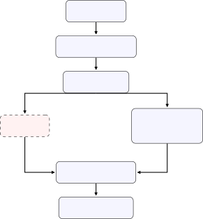

# Cargo: Context-Aware Retrieval-Gated Evaluation of Agentic AI in Production

Mukul Chhabra    Shail Patel    Luigi Medrano Affiliation: Dell
Technologies

###### Abstract

Reference-based LLM-as-a-judge evaluation assumes that a reference
answer is the target for the response under evaluation. In deployed
agentic systems that operate over dynamic entities—support cases,
assets, accounts—this assumption fails: the closest available reference
typically instantiates the _correct procedure_ on a _different entity_,
so a judge that compares literally penalizes legitimately different
identifiers, dates, and statuses as errors or hallucinations. We name
this failure mode _reference–instance divergence_ (RID) and show that it
is structural rather than incidental. We propose Cargo, a framework that
(i) treats retrieved references as procedural exemplars and grounds
factual judgments in the live instance’s observed context, (ii) assigns
each claim a three-way status—supported, contradicted, or
unverifiable—penalizing only contradictions with observed facts, and
(iii) gates evaluation by retrieval confidence, casting continuous
production evaluation as selective prediction with an explicit
risk–coverage–cost trade-off. To measure the effect without relying
solely on costly expert labels, we introduce Cargo-Bench, a
perturbation-based diagnostic suite whose ground truth holds by
construction. Cargo-Bench separates _leniency_ from _discrimination_: a
valid judge must stop penalizing entity transplants while still
detecting injected contradictions and procedural corruptions. On
Cargo-Bench (246 items, two judge models, 7,872 judgments), the standard
reference-based judge penalizes 100% of correct entity-transplanted
answers as incorrect and hallucinated—it is uninformative (DI
$`\approx 0`$)—and supplying the live facts without reframing changes
nothing. Cargo eliminates these false penalties (0/50 on transplants)
while retaining near-complete contradiction recall (50/50 and 49/50),
raising DI to .58 \[.48, .68\]; a rubric-swap control attributes most of
the effect to context-grounded dimension definitions rather than prompt
framing. Cargo also exposes a limitation of its own design: the same
leniency that protects entity values suppresses detection of procedural
corruptions (20% recall), a trade-off DI makes visible; an explicit
post-hoc fix targeting exactly this failure does not close the gap
($`\Delta`$DI $`=-.007`$ \[$`-.038,.023`$\]), and an LLM-as-annotator
study with written guidelines and adjudication shows the same blind spot
(3/10 procedural corruptions recovered). We release a preregistered
protocol for extending the evaluation to expert agreement,
risk–coverage, and cost on production traffic.

## 1 Introduction

LLM-as-a-judge has become the default instrument for evaluating
open-ended model outputs at scale (Zheng et al., 2023; Liu et al., 2023;
Gu et al., 2024). In the reference-based variant, a judge is shown a
candidate response together with a gold reference and asked to score the
candidate’s correctness, completeness, or faithfulness relative to that
reference. This paradigm rests on an assumption so familiar that it is
rarely stated: _the reference is the target_. For static tasks such as
summarization or knowledge QA the assumption is reasonable.

It fails for a large and growing class of deployed systems. Agentic
assistants in technical support, customer service, IT operations, and
finance answer questions _about specific entities_—a particular support
case, service tag, order, or account—by retrieving facts from backend
systems and applying a domain procedure to them. Two users may ask the
same question about different entities. The correct answers share a
procedure and a structure but differ in almost every surface value. A
curated golden set can realistically cover the space of _questions and
procedures_; it cannot cover the space of _entities_. Consequently, at
production time the nearest available reference is almost always an
answer to the same question about a different entity.

We call this condition _reference–instance divergence_ (RID). Under RID,
a literal reference-based judge systematically confuses two orthogonal
properties: whether the response follows the correct procedure, and
whether its entity-specific values agree with the reference’s. The
second comparison is meaningless—the values _should_ differ—yet it
dominates a naive judge’s verdict, depressing correctness scores and
inflating hallucination flags. Section 2 formalizes this and shows why
the effect is structural rather than a matter of prompt wording.

We further observe that in production, evaluation itself is a decision
under uncertainty. Not every live interaction has an appropriate
reference in the golden set, and a judge applied with an irrelevant
reference produces a confidently wrong score. Evaluating every
interaction is also expensive. Continuous production evaluation is
therefore a _selective prediction_ problem (El-Yaniv and Wiener, 2010;
Geifman and El-Yaniv, 2017): the evaluator should abstain when it lacks
a valid reference, and the appropriate objects of study are the
risk–coverage curve and the cost curve, not a single accuracy number.

We present Cargo (Context-Aware Retrieval-Gated evaluatiOn), which
addresses both problems, and Cargo-Bench, a diagnostic suite that makes
the improvement measurable with ground truth that holds by construction.
Our contributions are:

1.  1.  Problem. We identify and formalize reference–instance divergence,
        decomposing a response into a transferable procedure and
        instance-specific parameters, and show that literal reference
        comparison is not identifiable with respect to procedural
        correctness under RID (§2).
2.  2.  Method. Cargo (§3) reinterprets the retrieved reference as a
        _procedural exemplar_, grounds factual judgment in observed live
        context with three-way claim status (sup/con/unv), and gates
        evaluation on retrieval confidence with calibrated and margin-aware
        variants. It evaluates the full agentic trace—routing, replanning,
        response type, latency—not only the final answer.
3.  3.  Benchmark. Cargo-Bench (§4) uses five controlled perturbation
        families (entity transplant, contradiction injection, unverifiable
        augmentation, procedural corruption, retrieval distractors) to
        produce labeled evaluation instances by construction. It yields a
        _discrimination index_ that jointly penalizes false penalties and
        missed errors, so that a judge cannot score well merely by being
        lenient.
4.  4.  Findings. On Cargo-Bench (246 items), literal reference judging is
        completely uninformative under RID (DI $`\approx 0`$ on both judge
        models: every correct transplant is called wrong and hallucinated),
        and merely adding the live facts does not help. Cargo removes the
        false penalties without losing contradiction recall ($`\Delta`$DI
        $`=+.58`$ \[.48, .68\]). A rubric-swap control shows the effect is
        carried mostly by context-grounded dimension definitions, and
        per-family analysis reveals that the method’s leniency
        over-generalizes from entity values to procedure (20% recall on
        procedural corruptions); an explicit per-claim-type authority fix we
        test post-hoc does _not_ resolve this ($`\Delta`$DI $`=-.007`$
        \[$`-.038,.023`$\]), so we characterize rather than patch it
        (§6–§7). We further specify a preregistered protocol for expert
        agreement, retrieval gating, and cost on production traffic (§5).

## 2 Reference–Instance Divergence

### 2.1 Setting

A live interaction is a tuple $`x=(q,a,c,o)`$: a user question $`q`$,
the system’s answer $`a`$, an observed _context_ $`c`$ consisting of
instance-specific facts available in the trace input (e.g., case number,
subject, description, asset identifier), and a trace $`o`$ of
observations (planner decision, agent calls, tool outputs, timings). A
golden set $`\mathcal{G}=\{(q^{g}_{i},a^{g}_{i},m^{g}_{i})\}_{i=1}^{N}`$
holds reference questions, reference answers, and metadata $`m^{g}_{i}`$
such as the expected intent or agent.

### 2.2 Procedure–parameter decomposition

We model an answer as the application of a procedure to instance
parameters:

```math
a=\pi(\theta)\oplus\epsilon, \tag{1}
```

where $`\pi`$ is a domain procedure (which checks to perform, which
policy to apply, which fields to report, in which structure), $`\theta`$
is the vector of instance-specific values, and $`\epsilon`$ collects
everything else (phrasing, formatting). A reference
$`a^{g}=\pi^{g}(\theta^{g})\oplus\epsilon^{g}`$ is written for its own
instance $`\theta^{g}`$. The live answer should satisfy $`\pi=\pi^{g}`$
(correct procedure) and $`\theta`$ consistent with the live instance,
_not_ with $`\theta^{g}`$.

### 2.3 Non-identifiability of literal comparison

A literal reference-based judge computes some divergence $`D(a,a^{g})`$
and maps it to a score. Under the decomposition, $`D`$ mixes two terms,

```math
D(a,a^{g})\;\approx\;D_{\pi}(\pi,\pi^{g})\;+\;D_{\theta}(\theta,\theta^{g}), \tag{2}
```

and only the first is informative about quality. When RID holds
($`\theta\neq\theta^{g}`$ by design), $`D_{\theta}`$ is large for
_every_ correct answer. The judge therefore cannot distinguish a correct
answer for a different instance from an incorrect one: correctness is
not identifiable from $`D`$ alone. This is why prompt-level exhortations
to “focus on reasoning” are insufficient in practice: the judge is given
no signal with which to separate the two terms. The fix must supply that
signal—the live instance’s observed facts $`c`$—and must change what the
reference is _for_.

### 2.4 Three-way claim status

Let $`\mathcal{K}(a)`$ be the set of atomic factual claims in $`a`$ (Min
et al., 2023). Relative to the observed context $`c`$, each claim $`k`$
has a status

```math
\sigma(k\mid c)\in\{\textsc{sup},\;\textsc{con},\;\textsc{unv}\}, \tag{3}
```

supported if entailed by $`c`$, contradicted if inconsistent with a fact
in $`c`$, and unverifiable otherwise. Because $`c`$ is a _partial_
snapshot of the request input—the agent legitimately retrieves many more
fields from backend systems—the unverifiable class is large and
expected. We define

```math
\displaystyle\mathrm{ContraRate}(a,c) \displaystyle=\tfrac{|\{k:\sigma=\textsc{con}\}|}{|\mathcal{K}(a)|}, \tag{4}
```

```math
\displaystyle\mathrm{UnvRate}(a,c) \displaystyle=\tfrac{|\{k:\sigma=\textsc{unv}\}|}{|\mathcal{K}(a)|}. \tag{5}
```

The central normative choice of Cargo is that hallucination is scored
from $`\mathrm{ContraRate}`$ alone; $`\mathrm{UnvRate}`$ is reported as
a coverage diagnostic rather than folded into a penalty. This choice
trades recall on fabricated-but-unverifiable claims for precision on the
claims that can actually be checked; §10 discusses the trade-off and
Cargo-Bench P3 measures it.

## 3 The Cargo Framework

Cargo has four components (Figure 1): a retrieval gate, a
procedural-exemplar reinterpretation of the reference, a
context-grounded structured judge, and trace-level diagnostics.
Algorithm 1 gives the per-interaction procedure.



Figure 1: Overview of Cargo. A live question is embedded and matched
against the golden set; if the retrieval margin clears $`\tau`$, the
retrieved reference is reinterpreted as a procedural exemplar and the
answer is judged against it plus the live context; below $`\tau`$, Cargo
abstains. Both paths log to trace diagnostics.

1: interaction $`x=(q,a,c,o)`$; golden set $`\mathcal{G}`$ with cached
embeddings $`E^{g}`$; gate $`g`$; judge $`J`$

2: $`e\leftarrow\mathrm{Embed}(q)`$ $`\triangleright`$ batched across a
poll window

3: $`s_{i}\leftarrow\cos(e,E^{g}_{i})\;\forall i`$; 
$`i^{\star}\leftarrow\arg\max_{i}s_{i}`$

4: $`\Delta\leftarrow s_{(1)}-s_{(2)}`$ $`\triangleright`$ top-1/top-2
margin

5: if $`g(s_{i^{\star}},\Delta,m^{g}_{i^{\star}})=0`$ then

6:   return abstain$`(s_{i^{\star}},\Delta)`$

7: end if

8: $`r\leftarrow\mathrm{ResponseType}(q,a)`$;
$`p\leftarrow\mathrm{PlannerEval}(o,m^{g}_{i^{\star}})`$

9: $`\ell\leftarrow\mathrm{Latency}(o)`$;
$`\rho\leftarrow\mathrm{ReplannerEval}(o)`$

10: if $`r=\textsc{actual}`$ $`\wedge`$ guards pass then

11:   $`y\leftarrow J(q,a,c,a^{g}_{i^{\star}})`$ $`\triangleright`$
exemplar + context

12:   if $`\neg\mathrm{Parses}(y)`$ then return error

13:   end if

14: end if

15: return record$`(y,r,p,\rho,\ell,s_{i^{\star}},\Delta,i^{\star},c)`$

Algorithm 1 Cargo per-interaction evaluation

### 3.1 Retrieval gate

Golden questions are embedded once and cached; live questions are
embedded in batches per polling window to bound API calls and rate-limit
pressure. With cosine similarity $`s^{\star}`$ to the nearest golden
question and margin $`\Delta=s_{(1)}-s_{(2)}`$, we study three gates:

Fixed.  
$`g=\mathbb{I}[s^{\star}\geq\tau]`$. Operational default $`\tau=0.80`$,
which must be recalibrated per embedding model.

Margin-aware.  
$`g=\mathbb{I}[s^{\star}\geq\tau\wedge\Delta\geq\delta]`$. Rejects
ambiguous matches whose top two candidates are nearly tied, even when
both exceed $`\tau`$.

Calibrated.  
Fit
$`\hat{P}(\text{reference appropriate}\mid s^{\star},\Delta,\text{intent})`$
by isotonic or logistic regression on a held-out calibration split
labeled for reference appropriateness (§5.2), and gate on
$`\hat{P}\geq\gamma`$. This makes the operating point interpretable as a
target reference-validity rate and admits per-intent thresholds.

The gate decides whether the _evaluator_ has a usable reference; it says
nothing about whether the production answer is good. Abstentions are
retained as coverage gaps for human review and golden-set expansion
(§7).

### 3.2 Reference as procedural exemplar

For accepted interactions the judge receives $`q`$, $`a`$, the observed
context $`c`$, and the retrieved reference $`a^{g}_{i^{\star}}`$ with an
explicit reinterpretation: the reference was written for a _different_
instance; it specifies the correct procedure, policy, required steps,
and structure; its entity-specific values are not targets. The judge is
asked to infer the reference’s implicit instance from its text and to
evaluate whether the live answer applies the same procedure _correctly
adapted_ to the live instance. Appendix A gives the full template.

### 3.3 Context-grounded structured judge

The judge scores four dimensions on $`[0,1]`$, each defined against the
live context rather than the reference: correctness (correct procedure;
no claim contradicts $`c`$), completeness (covers the steps the
exemplar’s procedure requires, adapted to $`c`$), helpfulness (resolves
$`q`$ clearly), and hallucination fidelity (no claim contradicts $`c`$;
unverifiable claims are neutral). Output is schema-constrained JSON with
a per-dimension rationale; unparseable or empty outputs are rejected
rather than persisted, so aggregates are not biased by silent failures.
Dimension definitions are configuration, not code, and are held fixed
across all conditions in our experiments.

### 3.4 Trace-level diagnostics

Final-answer quality alone cannot localize a failure in an agentic
workflow. Cargo additionally records response type (actual answer,
clarification request, guardrail), planner verdict against the expected
agent in $`m^{g}_{i^{\star}}`$, replanner behavior, per-observation and
end-to-end latency, language and length guards, and all retrieval
metadata ($`s^{\star}`$, $`\Delta`$, $`i^{\star}`$) and the context
$`c`$ used. These fields support the attribution analysis in §7.

### 3.5 Continuous operation

A polling or backfill cycle fetches traces newer than a watermark,
deduplicates, extracts $`(q,a,c,o)`$ from heterogeneous trace envelopes,
runs Algorithm 1, persists successful records, and advances the
watermark, reporting seen/matched/evaluated/abstained/error counts.
Evaluation cost per window of $`M`$ traces is

```math
C(\tau)=M\,C_{e}+M\cdot\mathrm{Cov}(\tau)\cdot C_{j}, \tag{6}
```

with embedding cost $`C_{e}\ll C_{j}`$ (judge cost), so cost is governed
almost entirely by coverage.

## 4 Cargo-Bench: Ground Truth by Construction

Expert annotation of production traces is necessary but slow, expensive,
and—critically for our claim—cannot by itself distinguish a judge that
is _better_ from one that is merely _more lenient_. Cargo-Bench
addresses this with controlled perturbations of seed items whose labels
hold by construction.

#### Seeds.

Each seed is a golden item $`(q^{g},a^{g},\theta^{g})`$ with its entity
parameters $`\theta^{g}`$ explicitly annotated (fields and values).
Seeds span all intents in the deployment.

#### Perturbation families.

From each seed we generate instances with known target verdicts:

P1 Transplant  
(correct) Sample $`\theta^{\ell}`$, rewrite
$`a^{\ell}=\pi^{g}(\theta^{\ell})`$; $`c\subset\theta^{\ell}`$. Target:
high correctness, no hallucination. Measures the _false-penalty rate_
under RID.

P2 Contradiction  
(hallucinated) From a P1 instance, alter one value in $`a^{\ell}`$ to
conflict with a fact _present_ in $`c`$. Target: flagged. Measures
_contradiction recall_.

P3 Unverifiable  
(neutral) From a P1 instance, add $`k`$ plausible fields absent from
$`c`$. Target: no penalty. A labeled “fabricated” sub-split measures the
recall cost of the unv policy.

P4 Corruption  
(incorrect) From a P1 instance, delete a required step, swap the policy,
or invert a conditional. Target: low correctness/completeness—the check
leniency alone cannot pass.

P5 Distractor  
Paraphrases of $`q^{g}`$ with a different intent/procedure. Target: gate
abstains or assigns low $`\hat{P}`$. Measures the gate’s
reference-validity discrimination.

Perturbations are generated by templated rewriting with an LLM and
verified by a second model and by rule-based consistency checks (every
occurrence of a swapped value is updated; injected contradictions target
a field that is in $`c`$). An author spot-check of 40 instances
(Appendix B) additionally reads each rendered triple for semantic
validity beyond the automated checks. Appendix B lists templates.

#### Discrimination index.

Let $`\mathrm{FP}`$ be the fraction of P1$`\cup`$P3 instances a judge
penalizes (correctness $`<0.5`$ or hallucination flagged), and
$`\mathrm{TP}`$ the fraction of P2$`\cup`$P4 instances it penalizes. We
report

```math
\mathrm{DI}=\mathrm{TP}-\mathrm{FP}\in[-1,1], \tag{7}
```

alongside the full confusion matrix. A lenient judge lowers FP but also
TP; a valid judge must raise DI. Cargo-Bench therefore converts our
central claim into a single falsifiable quantity.

## 5 Experimental Setup

### 5.1 Deployment and data

Experiments use a production multi-agent assistant for enterprise
technical support in which a planner routes each request to one of
several specialized agents (policy, case, work-order, task, asset).
Traces are collected via an observability layer that records inputs,
outputs, and per-observation timings. The deployment’s curated golden
set comprises 30 question–answer–intent items; 23 are entity-free policy
answers (for which RID does not arise) and the remainder concern
specific cases, work orders, and assets. We draw a production sample of
$`M=400`$ traces stratified by intent, retrieval similarity decile, and
response type, oversampling low-margin retrievals and planner failures
with a 150-item minimum quota for the entity-bearing (RID-eligible)
stratum, since H1’s effect concentrates there. $`M=400`$ is powered to
detect $`\Delta\rho\geq 0.15`$ between Direct and Cargo (Fisher $`z`$,
dependent correlations, power $`0.8`$, $`\alpha=0.05`$) and matches
typical budgets in published LLM-judge agreement studies (200–500
items). All data are de-identified before annotation (§Ethics
Statement).

#### Cargo-Bench instantiation.

Cargo-Bench is generated from ten seeds in two batches: an initial six
(three derived from the entity-bearing golden items—case status,
work-order status, asset age/warranty—lightly templated so entity
parameters are explicit, and three synthetic seeds covering case,
warranty, and work-order procedures), plus four added seeds spanning the
same real intents with different question styles (case
priority/assignment, asset entitlement, work-order parts, and a
task-status seed) to increase statistical power and intent diversity.
With five draws per seed and family (generation seeds 2027 and 3141),
this yields 296 instances that pass all consistency checks: 50 P1, 50
P2, 96 P3 (50 true-but-unobserved, 46 fabricated), 50 P4 (26 step
deletions, 10 negations, 14 policy swaps), and 50 P5. Observed context
contains 1.12 facts on average ($`|c|\in\{1,2,3\}`$); answers average 24
words. P2 contradictions target case numbers (31), service tags (15),
and subjects (4).

### 5.2 Expert annotation

Three domain experts annotate each sampled trace with: (a) whether the
retrieved reference is an appropriate procedural exemplar (binary, used
to fit the calibrated gate and for retrieval evaluation); (b)
correctness, completeness, helpfulness, and hallucination on a 5-point
ordinal scale defined against the live context, using the same
definitions as the judge; (c) status
$`\sigma\in\{\textsc{sup},\textsc{con},\textsc{unv}\}`$ for each
disputed claim; (d) acceptability of the planner’s routing. Two
annotators label every item; a third adjudicates disagreements. We
report Krippendorff’s $`\alpha`$ per dimension and release guidelines
(Appendix C). A held-out 20% of annotated items is used only for gate
calibration and threshold selection; all headline numbers are computed
on the remainder.

### 5.3 Conditions

All judge conditions share the judge model, decoding parameters
(temperature 0.4 unless varied), dimension definitions, and JSON schema;
they differ only in the information and framing given to the judge.

NoRef  
Question, answer, rubric only.

Direct  
Standard reference-based judging: compare $`a`$ to $`a^{g}`$.

Direct+Ctx  
Direct with $`c`$ appended, but no exemplar reinterpretation or unv
rule. Isolates “more information” from “different framing.”

Cargo  
Full method: exemplar framing, context grounding, unv rule.

Cargo$`-`$unv  
Cargo with binary claim status (absent $`\Rightarrow`$ false). Tests the
unv rule.

Cargo$`-`$Ex.  
Cargo without the “different instance” framing (Cargo$`-`$Exemplar in
tables).

Cargo$`-`$Ctx  
Cargo with $`c`$ removed.

Oracle  
Cargo with the human-selected appropriate reference; upper-bounds gains
attributable to retrieval.

RandRef  
Cargo with a random same-intent reference; lower-bounds the value of
retrieval.

Retrieval baselines: BM25 (Robertson and Zaragoza, 2009), dense top-1
with the deployed embedding model, a sentence-transformer alternative
(Reimers and Gurevych, 2019), intent-filtered dense, and hybrid. Gating
baselines: no gate; random sampling at matched coverage; fixed,
margin-aware, and calibrated gates (§3.1). One additional condition,
Cargo$`+`$Auth (an explicit per-claim-type authority rule), was added
_post-hoc_ after observing Cargo’s P4 gap and is reported as
exploratory, not preregistered (§7).

### 5.4 Judge models and bias controls

We run every condition with the same two judge models used for
Cargo-Bench (§6.1)—gpt-oss-120b (three seeds) and gpt-oss-20b (one
seed), open-weight and distinct from the production assistant’s
generator, limiting self-preference (Panickssery et al., 2024)—so bench
and production-sample results are directly comparable; a third judge
family would further strengthen H5 but is left to future work rather
than added post hoc. We report per-seed means and within-item
dispersion. Because Cargo judges single responses, position bias (Wang
et al., 2024) does not arise; we control for verbosity bias via
agreement stratified by answer-length quartile and a length-controlled
regression (Dubois et al., 2024).

### 5.5 Metrics

Agreement: Spearman $`\rho`$ and Pearson $`r`$ against adjudicated
expert scores per dimension; quadratic-weighted Cohen’s $`\kappa`$ after
binning; paired bootstrap 95% CIs (10k resamples); Holm correction
across dimensions. Hallucination: with expert con labels as positives,
precision/recall/F1 and two targeted false-positive rates
(cross-instance differences; unv claims). Cargo-Bench: per-family
penalty rates, DI, and DI stratified by intent and by $`|c|`$.
Retrieval: top-1 accuracy and MRR against expert
reference-appropriateness labels; fraction of traces with no appropriate
reference in $`\mathcal{G}`$. Selective evaluation: for gate $`g`$ and
disagreement loss $`\ell`$,

```math
\displaystyle\mathrm{Cov}(g) \displaystyle=\tfrac{1}{M}\textstyle\sum_{j}g(x_{j}), \tag{8}
```

```math
\displaystyle\mathrm{Risk}(g) \displaystyle=\tfrac{\sum_{j}g(x_{j})\,\ell(\hat{y}_{j},y_{j})}{\sum_{j}g(x_{j})}, \tag{9}
```

risk–coverage curves, AURC (Geifman and El-Yaniv, 2017), and
stream-level failure recall (the fraction of _all_ expert-identified
failures the gated system evaluates and flags, since abstaining on hard
failures trivially lowers risk). Cost: judge calls avoided, tokens,
wall-clock, API error rate, and Eq. (6) vs. full evaluation and
matched-coverage random sampling.

### 5.6 Preregistered hypotheses

H1  
Cargo exceeds Direct in expert agreement on correctness and
hallucination, with the largest gains on items where
$`\theta\neq\theta^{g}`$ (i.e., RID present).

H2  
Cargo reduces the cross-instance false-positive hallucination rate
relative to Direct without reducing contradiction recall (DI increases;
TP does not decrease).

H3  
Direct+Ctx recovers only part of the gain: exemplar framing and the unv
rule contribute beyond adding information.

H4  
The calibrated gate dominates the fixed gate on AURC and stream-level
failure recall at matched coverage; random sampling at matched coverage
has strictly worse risk.

H5  
Gains hold across judge models; the ordering of conditions is stable.

Hypotheses, conditions, metrics, and the calibration/test split for the
production-sample study (H1, H2, H4, H5) were fixed before annotation
began and are committed in experiments/cargo/PREREGISTRATION.md (record
ID 01b8122f1cf4, a content hash reproducible via make_prereg_id.py);
this record explicitly excludes Cargo-Bench (already complete at commit
time, using construction-time ground truth) and the post-hoc
Cargo$`+`$Auth follow-up (§6.1).

## 6 Results

We report the Cargo-Bench study (§6.1; 246 items, 8,172 successful
judgments across the main study and rubric-swap control) and an
LLM-as-annotator study (Appendix D). The production-sample analyses
(H1’s expert agreement, H2 against expert labels, H4’s gate calibration)
are the subject of the preregistered protocol in §5.2–§5.6; their
metrics and reporting formats are fixed in §5.5 and Appendix E.

### 6.1 Cargo-Bench (H2, H3, H5)

Table 1 reports the completed Cargo-Bench study: 246 P1–P4 instances (10
seeds: 6 pilot $`+`$ 4 added for statistical power, §5.1) $`\times`$ 8
conditions, judged by gpt-oss-120b (3 seeds, temperature 0.4) and
gpt-oss-20b (1 seed); 7,872 successful judgments (49 transient
rate-limit/connection failures were retried to completion), all
parseable.

|                                         |                   |      |             |      |          |                   |
| --------------------------------------- | ----------------- | ---- | ----------- | ---- | -------- | ----------------- |
|                                         | Should _not_ pen. |      | Should pen. |      |          |                   |
| Condition                               | P1                | P3   | P2          | P4   | DI       | 95% CI            |
| _Judge: gpt-oss-120b (mean of 3 seeds)_ |                   |      |             |      |          |                   |
| NoRef                                   | .44               | .64  | .96         | .66  | .24      | \[.13, .35\]      |
| Direct                                  | 1.00              | 1.00 | 1.00        | 1.00 | .00      | \[.00, .00\]      |
| D+Ctx                                   | 1.00              | 1.00 | 1.00        | 1.00 | .00      | \[.00, .00\]      |
| Cargo+Auth                              | .00               | .04  | 1.00        | .20  | .57      | \[.47, .67\]      |
| Cargo                                   | .00               | .03  | 1.00        | .20  | .58      | \[.48, .68\]      |
| _Judge: gpt-oss-20b (1 seed)_           |                   |      |             |      |          |                   |
| NoRef                                   | .10               | .33  | .92         | .36  | .39      | \[.27, .50\]      |
| Direct                                  | 1.00              | 1.00 | 1.00        | 1.00 | .00      | \[.00, .00\]      |
| D+Ctx                                   | 1.00              | 1.00 | 1.00        | .98  | $`-`$.01 | \[$`-`$.03, .00\] |
| Cargo+Auth                              | .00               | .01  | .96         | .22  | .58      | \[.48, .68\]      |
| Cargo                                   | .00               | .02  | .98         | .16  | .56      | \[.46, .65\]      |

Table 1: Cargo-Bench (246 items, 10 seeds), headline conditions (D+Ctx =
Direct+Ctx); the three component-ablation conditions
(Cargo$`-`$Ctx/Exemplar/unv) are in Table 2 (Appendix E). Penalty rate
per family (lower is better for P1/P3, higher for P2/P4); DI
$`=\mathrm{TP}-\mathrm{FP}`$ with item-level bootstrap CIs (10k). Direct
penalizes _every_ instance, including all correct entity transplants,
and is therefore uninformative (DI $`\approx 0`$); adding the live
context without reframing (Direct+Ctx) changes nothing. Cargo removes
the false penalties and retains contradiction recall, but detects only
20% of procedural corruptions (P4); an explicit authority-split fix
(Cargo$`+`$Auth, post-hoc) does not improve on this.

#### RID is total under literal judging.

Direct assigns a penalizing verdict to 100% of instances in every
family, on both judges and all seeds—all 50 correct entity transplants
(P1) and all 96 P3 instances. Inspection of rationales confirms the
mechanism predicted in §2: a representative P1 rationale reads “_The
answer gives a different case number and status than the golden answer,
so it is factually incorrect_” and, for hallucination, “_The answer
fabricates an incorrect case number and status, which is a clear
hallucination_.” Of 150 Direct P1 judgments (120b, 50 items $`\times`$ 3
seeds), all 150 cite an entity-value mismatch and 149/150 additionally
call the live value “fabricated”/“hallucinated”; mean correctness is
0.006 and mean hallucination fidelity 0.019. Under Cargo the same
instances receive 0.968 and 1.000. A judge with DI $`\approx 0`$ carries
no information about answer quality; this is the regime in which the
deployment’s live monitoring previously operated.

#### Information is not the fix; framing is (H3).

Direct+Ctx receives exactly the live facts Cargo receives, yet is
indistinguishable from Direct on 120b and only marginally different on
20b (1/50 P4 items flipped): the judge does not spontaneously use
context to discount reference mismatches; it must be told what the
reference is _for_.

#### Cargo removes false penalties without losing contradiction recall (H2).

Cargo penalizes 0/50 P1 and 3/96 P3 instances (120b) while flagging
50/50 (120b) and 49/50 (20b) injected contradictions. Paired
$`\Delta`$DI(Cargo$`-`$Direct) is $`+.58`$ \[.48,.68\] (120b), $`+.56`$
\[.46,.65\] (20b); vs. NoRef, $`+.34`$ \[.21,.46\] and $`+.17`$
\[.06,.27\]. Seed dispersion is low (mean s.d. .03, 120b). One deviation
from preregistered H2: TP was not expected to decrease relative to
Direct, but Direct’s TP$`=1.00`$ is an artifact of penalizing
everything, and Cargo’s lower TP (.60) traces to P4, not P2—H2 holds for
contradiction recall and fails for procedural recall; we report both
rather than re-scope the hypothesis.

#### Procedural corruptions are largely missed.

Cargo penalizes 10/50 (120b) and 8/50 (20b) P4 instances. By corruption
type (120b): 10/26 delete-steps are caught, 0/10 negations, 0/14
policy-swaps. NoRef, with no reference at all, catches more (.66
overall) at the cost of FP $`=.57`$. Every Cargo variant shows the same
P4 profile, so the effect is not attributable to the exemplar preamble
or the unv rule individually (below). Reading the 121/150 Cargo P4
judgments (120b) that were _not_ penalized, all 121 justify the verdict
by absence of contradiction with the live facts, and 97 additionally
assert the answer “follows the correct reasoning pattern/approach.” The
judge has generalized “absent from context $`\Rightarrow`$ unverifiable”
from entity _values_, where it is intended, to _procedural claims_,
where the reference—not the context—is the authority (mean Cargo
correctness on P4 is 0.78). This is the leniency–sensitivity trade-off
DI was designed to expose.

#### Testing the obvious fix (post-hoc, not preregistered).

An explicit per-claim-type authority rule, Cargo$`+`$Auth, does _not_
improve on Cargo: paired $`\Delta`$DI $`=-.007`$ \[$`-.038,.023`$\]
(120b), $`+.027`$ \[$`-.033,.088`$\] (20b), both straddling zero.
Stating the split explicitly does not make the judge apply it; we leave
a structurally different check to future work.

#### Ablations and rubric swap (Tables 2–3, Appendix E).

Removing live context costs DI ($`\Delta=+.06`$ \[.02,.11\], via lower
P2 recall); removing the exemplar preamble or unv (vs. binary) has no
measurable effect on either judge. Swapping rubrics (120b, seed 0,
150-item pilot) localizes _where_ the effect lives: Direct with Cargo’s
dimension definitions alone already reaches DI $`=.49`$, so the
definitions carry most of the false-penalty reduction, while the
exemplar preamble adds leniency that removes residual false penalties
but costs P4 recall (.33$`\to`$.10)—complementary components pulling the
operating point in opposite directions on procedure.

### 6.2 Selective evaluation (H4) and robustness (H5)

H4 is evaluated on per-item expert loss labels from the production
sample under the protocol of §5; Appendix E fixes the risk–coverage and
gate-comparison reporting format.

For H5, condition ordering is nearly identical for gpt-oss-120b and
gpt-oss-20b (Table 1): Direct/Direct+Ctx at DI $`\approx 0`$, NoRef at
.24/.39, Cargo variants between .52 and .59 with the full method and
Cargo$`+`$Auth tied-best. Cargo’s DI differs by only .02 across judges;
the weaker judge is less harsh on NoRef (FP .25 vs. .57). Seed
dispersion (120b) is largest for NoRef (.10), i.e. a reference—even
mis-framed—stabilizes the judge.

## 7 Analysis

#### Where does Direct fail, and where does Cargo fail?

Symmetrically, for one reason each (§6.1): Direct treats every
entity-value difference as an error (DI $`\approx 0`$); Cargo treats
every procedure-level difference as unverifiable too (20% P4
recall)—category errors, not graded biases like verbosity or position
(Wang et al., 2024; Dubois et al., 2024). Nor is either leniency in
general: Cargo gets P2 $`=1.00`$, FP $`=.02`$ (vs. NoRef’s .57), and the
authority split does not fix it. Appendix F gives qualitative examples.

#### Is the P4 blind spot specific to single-pass judging?

In an LLM-as-annotator study (Appendix D), two independently prompted
annotators plus an adjudicator applied our written guidelines—which
include a worked example of exactly this failure—to 40 Cargo-Bench
items. They recovered every P1–P3 verdict but only 3/10 procedural
corruptions. Better instructions, a second pass, and adjudication do not
close the gap, which suggests it requires a structurally different check
(e.g., explicit per-step verification against the reference).

## 8 Related Work

We relate to four areas (expanded in Appendix H). LLM-as-a-judge
reliability work studies biases orthogonal to RID—position,
self-preference, verbosity, task-dependent alignment (Zheng et al.,
2023; Liu et al., 2023; Fu et al., 2023; Kocmi and Federmann, 2023; Kim
et al., 2024; Gu et al., 2024; Wang et al., 2024; Panickssery et al.,
2024; Dubois et al., 2024; Bavaresco et al., 2024; Thakur et al.,
2024)—while treating the reference as ground truth; we study a reference
correct for a _different_ instance. Factuality/claim-decomposition work
(Min et al., 2023; Honovich et al., 2022; Manakul et al., 2023)
motivates our unv class. RAG/agent evaluation (Es et al., 2024; Liu
et al., 2024; Yao et al., 2025) differs in that retrieval selects the
_evaluator’s_ reference, so its error corrupts measurement, not
generation. Selective prediction (Chow, 1970; El-Yaniv and Wiener, 2010;
Geifman and El-Yaniv, 2017; Kamath et al., 2020; Kadavath et al., 2022;
Kuhn et al., 2023) is applied here to the _evaluator_.

## 9 Conclusion

RID makes literal LLM-as-a-judge uninformative (DI $`=0`$); Cargo
restores discrimination (DI .00$`\to`$.58) with near-complete
contradiction recall, not without limitations (§10).

## 10 Limitations

Scope of evaluation. Our results use construction-time ground truth
(Cargo-Bench) and LLM annotators (Appendix D); expert agreement and gate
calibration on production traffic (H1, H4) are left to the preregistered
protocol of §5. Procedural leniency. Cargo detects only 20% of
procedural corruptions on Cargo-Bench because the judge extends the
“unverifiable” status from entity values to procedural claims; an
explicit per-claim-type authority instruction (§7) did not fix this
($`\Delta`$DI $`=-.007`$ \[$`-.038,.023`$\]), suggesting the gap is not
merely underspecification. Until it is closed, Cargo should be read as a
reliable detector of _contradictions with observed facts_ and a reliable
non-detector of _spurious entity mismatches_, not a complete correctness
judge; deployments should pair it with a procedure-focused check or
NoRef-style scoring on procedural dimensions. Unverifiable is not
verified. Treating unv claims as neutral raises precision on checkable
claims but forgoes recall on fabrications that happen to be unverifiable
from the trace input: Cargo penalized 3/46 fabricated-unverifiable P3
instances, and the binary-status ablation did not change this
materially. Closing the gap requires authoritative backend evidence,
which is a deployment change we do not evaluate. Bench scale and
synthetic perturbations. Cargo-Bench results rest on ten seeds (six
derived from production golden items and synthetic
case/warranty/work-order procedures, four added for power) and templated
rewrites; effects this large are unlikely to reverse with more seeds,
but the P4 rate is sensitive to how corruptions are authored—it moved
from 10% to 20% between our 150- and 246-item releases—and all CIs
should be read at $`n{=}246`$ (or $`n{=}150`$ for the rubric-swap
control). Rubric confound, partially controlled. Cargo and Direct differ
in both preamble and dimension definitions; the rubric-swap control
(Table 3) separates them on one judge, one seed, and the smaller item
set only. Similarity is not validity. The gate scores question
similarity, not procedural equivalence; two similar questions may
require different policies. The calibrated gate mitigates but does not
eliminate this, and the Oracle gap bounds the residual. Single
deployment domain. Our production data come from one enterprise
technical-support assistant; Cargo-Bench transfers by recipe but our
numbers do not. Judge dependence. Results may shift with judge model,
prompt wording, and decoding; we test two judge families (three seeds on
one) but cannot exhaust this space. Label uncertainty. Completeness and
helpfulness admit expert disagreement; the protocol reports $`\alpha`$
and adjudicates, but the human ceiling bounds attainable agreement.
Benchmark realism. Cargo-Bench perturbations are generated and verified
automatically with human spot-checks; they are designed to be
diagnostic, not distributionally representative, and we do not claim
otherwise. Production selection effects. Gated subsets are not
representative of all traffic; we therefore report stream-level failure
recall alongside selective risk.

## Ethics Statement

Production traces contain customer and asset information. Under our
protocol, all production data used for annotation and analysis are
de-identified by removing or hashing identifiers, replacing free-text
descriptions with paraphrases, and excluding any trace with residual
personal data after review; annotators are employees bound by
confidentiality agreements and compensated as part of their regular
duties. We release Cargo-Bench generation code and templates and the
annotation guidelines; we do not release raw production traces. Released
examples are synthetic or fully de-identified. Automated evaluators can
be misused to over-trust system outputs; we position Cargo as a
monitoring aid that surfaces abstentions and contradictions for human
review, not as a replacement for it.

## References

- Bavaresco et al. (2024) Anna Bavaresco, Raffaella Bernardi, Leonardo
  Bertolazzi, Desmond Elliott, Raquel Fernández, Albert Gatt, Esam
  Ghaleb, Mario Giulianelli, Michael Hanna, Alexander Koller, André
  F. T. Martins, Philipp Mondorf, Vera Neplenbroek, Sandro Pezzelle,
  Barbara Plank, David Schlangen, Alessandro Suglia, Aditya K.
  Surikuchi, Ece Takmaz, and Alberto Testoni. 2024. LLMs instead of
  human judges? a large scale empirical study across 20 NLP evaluation
  tasks. _arXiv preprint arXiv:2406.18403_.
- Chow (1970) C. K. Chow. 1970. On optimum recognition error and reject
  tradeoff. _IEEE Transactions on Information Theory_, 16(1):41–46.
- Dubois et al. (2024) Yann Dubois, Balázs Galambosi, Percy Liang, and
  Tatsunori B. Hashimoto. 2024. Length-controlled AlpacaEval: A simple
  way to debias automatic evaluators. _arXiv preprint arXiv:2404.04475_.
- El-Yaniv and Wiener (2010) Ran El-Yaniv and Yair Wiener. 2010. On the
  foundations of noise-free selective classification. _Journal of
  Machine Learning Research_, 11:1605–1641.
- Es et al. (2024) Shahul Es, Jithin James, Luis Espinosa Anke, and
  Steven Schockaert. 2024. RAGAs: Automated evaluation of retrieval
  augmented generation. In _Proceedings of the 18th Conference of the
  European Chapter of the Association for Computational Linguistics:
  System Demonstrations_, pages 150–158, St. Julians, Malta. Association
  for Computational Linguistics.
- Fu et al. (2023) Jinlan Fu, See-Kiong Ng, Zhengbao Jiang, and Pengfei
  Liu. 2023. GPTScore: Evaluate as you desire. _arXiv preprint
  arXiv:2302.04166_.
- Geifman and El-Yaniv (2017) Yonatan Geifman and Ran El-Yaniv. 2017.
  Selective classification for deep neural networks. In _Advances in
  Neural Information Processing Systems 30_.
- Gu et al. (2024) Jiawei Gu, Xuhui Jiang, Zhichao Shi, Hexiang Tan,
  Xuehao Zhai, Chengjin Xu, Wei Li, Yinghan Shen, Shengjie Ma, Honghao
  Liu, Saizhuo Wang, Kun Zhang, Yuanzhuo Wang, Wen Gao, Lionel Ni, and
  Jian Guo. 2024. A survey on LLM-as-a-judge. _arXiv preprint
  arXiv:2411.15594_.
- Honovich et al. (2022) Or Honovich, Roee Aharoni, Jonathan Herzig,
  Hagai Taitelbaum, Doron Kukliansy, Vered Cohen, Thomas Scialom, Idan
  Szpektor, Avinatan Hassidim, and Yossi Matias. 2022. TRUE:
  Re-evaluating factual consistency evaluation. In _Proceedings of the
  2022 Conference of the North American Chapter of the Association for
  Computational Linguistics: Human Language Technologies_, pages
  3905–3920. Association for Computational Linguistics.
- Kadavath et al. (2022) Saurav Kadavath, Tom Conerly, Amanda Askell,
  Tom Henighan, Dawn Drain, Ethan Perez, Nicholas Schiefer, Zac
  Hatfield-Dodds, Nova DasSarma, Eli Tran-Johnson, Scott Johnston, Sheer
  El-Showk, Andy Jones, Nelson Elhage, Tristan Hume, Anna Chen, Yuntao
  Bai, Sam Bowman, Stanislav Fort, and 17 others. 2022. Language models
  (mostly) know what they know. _arXiv preprint arXiv:2207.05221_.
- Kamath et al. (2020) Amita Kamath, Robin Jia, and Percy Liang. 2020.
  Selective question answering under domain shift. In _Proceedings of
  the 58th Annual Meeting of the Association for Computational
  Linguistics_, pages 5684–5696. Association for Computational
  Linguistics.
- Kim et al. (2024) Seungone Kim, Jamin Shin, Yejin Cho, Joel Jang,
  Shayne Longpre, Hwaran Lee, Sangdoo Yun, Seongjin Shin, Sungdong Kim,
  James Thorne, and Minjoon Seo. 2024. Prometheus: Inducing fine-grained
  evaluation capability in language models. In _The Twelfth
  International Conference on Learning Representations_.
- Kocmi and Federmann (2023) Tom Kocmi and Christian Federmann. 2023.
  Large language models are state-of-the-art evaluators of translation
  quality. In _Proceedings of the 24th Annual Conference of the European
  Association for Machine Translation_, pages 193–203.
- Kuhn et al. (2023) Lorenz Kuhn, Yarin Gal, and Sebastian
  Farquhar. 2023. Semantic uncertainty: Linguistic invariances for
  uncertainty estimation in natural language generation. In _The
  Eleventh International Conference on Learning Representations_.
- Liu et al. (2024) Xiao Liu, Hao Yu, Hanchen Zhang, Yifan Xu, Xuanyu
  Lei, Hanyu Lai, Yu Gu, Hangliang Ding, Kaiwen Men, Kejuan Yang, Shudan
  Zhang, Xiang Deng, Aohan Zeng, Zhengxiao Du, Chenhui Zhang, Sheng
  Shen, Tianjun Zhang, Yu Su, Huan Sun, and 3 others. 2024. AgentBench:
  Evaluating LLMs as agents. In _The Twelfth International Conference on
  Learning Representations_.
- Liu et al. (2023) Yang Liu, Dan Iter, Yichong Xu, Shuohang Wang,
  Ruochen Xu, and Chenguang Zhu. 2023. G-Eval: NLG evaluation using
  GPT-4 with better human alignment. In _Proceedings of the 2023
  Conference on Empirical Methods in Natural Language Processing_, pages
  2511–2522, Singapore. Association for Computational Linguistics.
- Manakul et al. (2023) Potsawee Manakul, Adian Liusie, and Mark J. F.
  Gales. 2023. SelfCheckGPT: Zero-resource black-box hallucination
  detection for generative large language models. In _Proceedings of the
  2023 Conference on Empirical Methods in Natural Language Processing_,
  Singapore. Association for Computational Linguistics.
- Min et al. (2023) Sewon Min, Kalpesh Krishna, Xinxi Lyu, Mike Lewis,
  Wen-tau Yih, Pang Wei Koh, Mohit Iyyer, Luke Zettlemoyer, and Hannaneh
  Hajishirzi. 2023. FActScore: Fine-grained atomic evaluation of factual
  precision in long form text generation. In _Proceedings of the 2023
  Conference on Empirical Methods in Natural Language Processing_, pages
  12076–12100, Singapore. Association for Computational Linguistics.
- Panickssery et al. (2024) Arjun Panickssery, Samuel R. Bowman, and Shi
  Feng. 2024. LLM evaluators recognize and favor their own generations.
  In _Advances in Neural Information Processing Systems 37_.
- Reimers and Gurevych (2019) Nils Reimers and Iryna Gurevych. 2019.
  Sentence-BERT: Sentence embeddings using siamese BERT-networks. In
  _Proceedings of the 2019 Conference on Empirical Methods in Natural
  Language Processing and the 9th International Joint Conference on
  Natural Language Processing_, pages 3982–3992. Association for
  Computational Linguistics.
- Robertson and Zaragoza (2009) Stephen Robertson and Hugo
  Zaragoza. 2009. The probabilistic relevance framework: BM25 and
  beyond. _Foundations and Trends in Information Retrieval_,
  3(4):333–389.
- Thakur et al. (2024) Aman Singh Thakur, Kartik Choudhary,
  Venkat Srinik Ramayapally, Sankaran Vaidyanathan, and Dieuwke
  Hupkes. 2024. Judging the judges: Evaluating alignment and
  vulnerabilities in LLMs-as-judges. _arXiv preprint arXiv:2406.12624_.
- Wang et al. (2024) Peiyi Wang, Lei Li, Liang Chen, Zefan Cai, Dawei
  Zhu, Binghuai Lin, Yunbo Cao, Lingpeng Kong, Qi Liu, Tianyu Liu, and
  Zhifang Sui. 2024. Large language models are not fair evaluators. In
  _Proceedings of the 62nd Annual Meeting of the Association for
  Computational Linguistics (Volume 1: Long Papers)_, pages 9440–9450,
  Bangkok, Thailand. Association for Computational Linguistics.
- Yao et al. (2025) Shunyu Yao, Noah Shinn, Pedram Razavi, and Karthik
  Narasimhan. 2025. $`\tau`$-bench: A benchmark for tool-agent-user
  interaction in real-world domains. In _The Thirteenth International
  Conference on Learning Representations_.
- Zheng et al. (2023) Lianmin Zheng, Wei-Lin Chiang, Ying Sheng, Siyuan
  Zhuang, Zhanghao Wu, Yonghao Zhuang, Zi Lin, Zhuohan Li, Dacheng Li,
  Eric P. Xing, Hao Zhang, Joseph E. Gonzalez, and Ion Stoica. 2023.
  Judging LLM-as-a-judge with MT-bench and chatbot arena. In _Advances
  in Neural Information Processing Systems 36 (Datasets and Benchmarks
  Track)_.

## Appendix A Judge Prompts

All conditions share one template: a preamble, an optional live-context
block, the question, the answer, an optional reference, the four
dimension definitions (from config/llm_metrics_config.yaml for
Direct/Direct+Ctx, config/live_llm_metrics_config.yaml for all Cargo
variants), and a fixed JSON schema. Conditions differ only in which of
the blocks below are included (experiments/cargo/conditions.py).

#### Direct preamble.

_“You are evaluating the quality of an answer against an expected
reference answer.”_ No live-context block; the reference is labeled
_Golden Answer_.

#### Direct+Ctx addition.

Adds the live-context block with only: _“The LIVE CONTEXT below lists
facts observed for the ACTUAL instance the live answer addresses.
Factual correctness and hallucination are judged against these facts,
not against the reference’s values.”_ Preamble and reference label are
unchanged from Direct.

#### Cargo additions (preamble replaced, context block extended).

Preamble: _“You are evaluating the quality of an answer produced for a
LIVE instance.”_ followed by the exemplar-framing block:

> IMPORTANT — the REFERENCE ANSWER below was written for a DIFFERENT
> instance (a different case / asset / record) than the one the live
> answer addresses. Treat the reference as the correct REASONING
> PATTERN, POLICY, REQUIRED STEPS, and STRUCTURE — NOT as literal
> expected text. \[…\] NEVER mark the live answer wrong, incomplete, or
> hallucinated because its identifiers, dates, status, subject,
> description, service tag, or other instance-specific values DIFFER
> from the reference’s. They SHOULD differ.

The context block additionally gets the unv rule:

> The LIVE CONTEXT is a PARTIAL snapshot, not the full record. \[…\] A
> value that is ABSENT from the live context is UNVERIFIABLE — it is NOT
> evidence of hallucination or error. Penalize ONLY values that DIRECTLY
> CONTRADICT a fact present in the live context, wrong reasoning, or
> missing required steps.

The reference is labeled _Reference Answer (reasoning pattern, written
for a different instance)_. Cargo$`-`$Exemplar drops the first block;
Cargo$`-`$Ctx drops the context block (and both rules) entirely;
Cargo$`-`$unvreplaces the unv rule with: _“Treat the LIVE CONTEXT as the
complete set of known facts. Any value in the live answer that is not
supported by the live context should be treated as unsupported \[…\].”_

#### Cargo$`+`$Auth addition (post-hoc, §6.1).

Appends, after the unv rule:

> Different claim types have different authorities. \[…\] ENTITY VALUES
> \[…\]: check ONLY against the LIVE CONTEXT. \[…\] PROCEDURAL CONTENT
> (which steps are taken, what policy or eligibility conclusion is
> reached, \[…\]): check against the REFERENCE’s procedure, adapted to
> the live instance. \[…\] If the answer’s procedure, policy conclusion,
> or recommended action CONTRADICTS what the reference’s approach
> implies for this live instance, that IS a correctness error, even
> though it does not contradict anything in the live context. Do NOT
> excuse a procedural contradiction just because the live context is
> silent on it.

## Appendix B Cargo-Bench Generation

#### Generator.

Seeds specify question and answer templates over named parameters, the
subset of parameters that appear in a live trace input
(observed_fields), optional procedural steps, and optional
policy_alternatives. Transplants (P1) resample every parameter with a
type-aware generator (digits for case/work-order numbers, alphanumerics
for service tags, dates, closed status/priority vocabularies) and render
the templates; $`c`$ is a non-empty random subset of the observed
fields. P2 rewrites exactly one observed value in the P1 answer to a
distinct value of the same type. P3 appends $`k{=}2`$ fields absent from
$`c`$, drawn either from the transplant’s hidden parameters
(true-but-unobserved split) or sampled fresh (fabricated split). P4
applies one of _delete step_, _negate_ (regex over modal/eligibility
phrases), or _swap policy_ (seed-provided alternative). P5 renders a
different-intent seed’s question with the current seed’s entities.

#### Consistency checks.

Every instance must satisfy: no golden parameter value survives in a
transplanted answer unless it was re-sampled as a new value for some
field; every observed fact equals the transplant value; P2’s stated
value is present and the true value absent, and the contradicted field
is observed; P3’s added fields are unobserved; P4 changed the text.
Instances failing any check are dropped (--drop-invalid); both
generation batches (original 180 and expansion 116, §5.1) have zero
violations.

#### Discrimination-index sanity check.

Before any model runs, we verified with two synthetic judges that DI
behaves as intended: a uniformly harsh judge (penalizes everything) and
a uniformly lenient judge (penalizes nothing) both obtain DI $`=0`$ on
the full 296-instance release (TP$`=`$FP$`=1`$ and TP$`=`$FP$`=0`$
respectively), so neither strategy can score well.

#### Author spot-check.

We drew a stratified random sample of 8 instances per family (seed 42;
40 of 296 total) from the full release and read each
question/answer/context/target triple against family-specific criteria:
P1 — entity values self-consistent, no golden value leaks, context
matches the transplant; P2 — exactly one clearly identifiable
contradiction with an observed fact; P3 — added fields genuinely absent
from context and plausible; P4 — the corruption is an unambiguous,
recognizable procedural error distinct from an entity-value change; P5 —
the rendered question reflects a genuinely different intent/procedure.
All 40/40 instances had correct target labels (no mislabeled
correctness/hallucination/should-penalize field). The check did surface
one template-authoring defect: the g_workorder2 seed’s answer template
referenced its work-order-number placeholder twice consecutively (“work
order x has x part …”), producing a redundant but not factually
incorrect repetition in 21 of its 30 instances (21/296 $`=`$ 7.1% of the
full release, one seed of ten). This does not change any target
label—the repeated token is not an additional claim—so we did not
regenerate or re-judge the affected instances; we fixed the template for
future releases and added a regression test
(tests/test_cargo_experiments.py) that renders every seed file and flags
any answer with an immediately-repeated identifier-like token. This was
an author check, not an independent or blind review, and should not be
read as equivalent to the crowdsourced validation we intend for future
releases.

## Appendix C Annotation Guidelines

The guidelines below (draft v0.1; full text and worked examples in
experiments/cargo/guidelines.py) are the single specification for the
expert annotators of the production-sample protocol (§5.2) and for the
LLM annotators of Appendix D.

#### Step 1 — reference appropriateness (binary).

Annotators ignore every instance-specific value and ask whether the
reference answers the same _kind_ of question with the same _kind_ of
procedure. Different case numbers, subjects, statuses, or dates are
expected and are not evidence of inappropriateness; a different required
procedure is. If inappropriate, scoring stops for that item (this is the
ground truth against which the retrieval gate’s reference validity is
measured, §5.5).

#### Step 2 — quality dimensions (5-point ordinal, only if Step 1 passes).

Correctness, completeness, and helpfulness are defined identically in
spirit to §3.3 but scored 1–5 for human tractability. Hallucination
fidelity (5 = best) is scored from contradictions with the _observed_
context only; a value simply absent from the observed context is
unverifiable, not evidence against the score.

#### Worked examples.

The guidelines include three examples drawn from Cargo-Bench
(Appendix B) to calibrate annotators, including one deliberately
adversarial case: an asset-warranty answer that inverts the reference’s
eligibility conclusion (“_eligible_” $`\to`$ “_not eligible_”) without
contradicting any observed fact. Annotators are instructed that this
must score correctness $`\leq 2`$ because it contradicts the reference’s
_procedure/policy_, even though hallucination fidelity (checked only
against observed facts) may remain high — i.e., the guidelines
explicitly warn annotators about the failure mode §7 finds in Cargo
itself.

#### Step 3 — claim status.

For any claim that lowers the hallucination score, annotators record the
contradicting claim and the observed fact it contradicts.

#### Adjudication.

Two annotators label every item independently. An item is sent to a
third adjudicator if reference-appropriateness labels differ, any
ordinal score differs by $`\geq 2`$, or contradiction flags differ. The
adjudicator sees both (blinded) annotations and produces the final
label, which need not match either.

## Appendix D LLM-as-Annotator Study

#### Headline.

Given our written guidelines (Appendix C), including a worked example of
exactly the P4 failure, two LLM annotators plus an adjudicator recover
every P1–P3 verdict on 40 Cargo-Bench items but only 3/10 procedural
corruptions. The P4 blind spot of Cargo (§6.1) therefore persists under
guideline-driven, two-pass, adjudicated annotation, and is not solely an
artifact of single-pass judging.

#### Design.

Two gpt-oss-120b annotators apply the guidelines to each item without
seeing the automated judges’ outputs: annotator_A (temperature 0.2)
follows them methodically; annotator_B (temperature 0.7) independently
and skeptically re-derives each judgment. Disagreements, by the
adjudication rule of Appendix C, go to an adjudicator (temperature 0.1).
Because all three share a model family with our judges, self-preference
effects (Panickssery et al., 2024) cannot be excluded.

#### Sample.

40 Cargo-Bench items (10 per family, P1–P4), stratified, seed 0. All 40
parsed; 1/40 required adjudication.

#### Recovery against construction-time ground truth.

Reference-appropriateness and hallucination-flag accuracy were both 1.00
(40/40). Correctness accuracy (binarized at $`\geq 3`$) was 1.00 on
P1–P3 but .30 on P4, despite (a) explicit guidelines, (b) an adversarial
worked example of this failure, (c) two independent passes, and (d)
adjudication. This points to a structurally different check (e.g.,
per-step verification against the reference) rather than better
instructions.

#### Inter-annotator agreement.

Quadratic weighted $`\kappa`$: correctness 1.00, completeness .99,
helpfulness .95, hallucination 1.00; reference-appropriateness agreement
1.00. Near-ceiling agreement is expected from two prompted variants of
one model and is not an estimate of human–human agreement.

#### Comparison with the automated judges.

Adjudicated correctness correlates with Cargo’s at Spearman $`\rho=.74`$
and with Direct’s at $`\rho=.16`$ ($`n=40`$), consistent with the main
Cargo-Bench result. On the 10 P4 items the annotators’ flag rate (.30)
exceeds Cargo’s (.10), catching two negate corruptions (seed g_asset)
that the judge missed; both miss the same delete_step and swap_policy
cases.

#### Reproduction.

python -m experiments.cargo.simulate_annotators generates the
annotations; python -m experiments.cargo.report_annotation produces the
numbers above.

## Appendix E Full Results

### E.1 Cargo-Bench: component ablations (complete)

Table 2 gives the three component-ablation conditions omitted from
Table 1 for space; discussion is in §6.1.

|                                         |                   |     |             |     |     |              |
| --------------------------------------- | ----------------- | --- | ----------- | --- | --- | ------------ |
|                                         | Should _not_ pen. |     | Should pen. |     |     |              |
| Condition                               | P1                | P3  | P2          | P4  | DI  | 95% CI       |
| _Judge: gpt-oss-120b (mean of 3 seeds)_ |                   |     |             |     |     |              |
| Cargo$`-`$Ctx                           | .00               | .06 | .92         | .20 | .52 | \[.42, .62\] |
| Cargo$`-`$Ex.                           | .00               | .02 | 1.00        | .20 | .59 | \[.49, .68\] |
| Cargo$`-`$unv                           | .00               | .02 | 1.00        | .20 | .59 | \[.49, .68\] |
| _Judge: gpt-oss-20b (1 seed)_           |                   |     |             |     |     |              |
| Cargo$`-`$Ctx                           | .00               | .07 | .90         | .24 | .52 | \[.42, .63\] |
| Cargo$`-`$Ex.                           | .00               | .02 | .92         | .14 | .52 | \[.42, .62\] |
| Cargo$`-`$unv                           | .00               | .01 | .94         | .14 | .53 | \[.43, .63\] |

Table 2: Cargo-Bench component ablations (246 items, 10 seeds),
continuing Table 1. Cargo$`-`$Ex. = Cargo$`-`$Exemplar (drops the
“different instance” framing).

### E.2 Rubric-swap control (complete)

Table 3 isolates the dimension-definition rubric from the exemplar
preamble; discussion is in §6.1.

| Prompt | Rubric       | P1   | P3   | P2   | P4   | DI  |
| ------ | ------------ | ---- | ---- | ---- | ---- | --- |
| Direct | golden-ref.  | 1.00 | 1.00 | 1.00 | 1.00 | .00 |
| Direct | ctx-grounded | .03  | .17  | .90  | .33  | .49 |
| Cargo  | golden-ref.  | .23  | .40  | 1.00 | .47  | .39 |
| Cargo  | ctx-grounded | .00  | .02  | 1.00 | .10  | .54 |

Table 3: Rubric-swap control (gpt-oss-120b, seed 0, 150 items). The
context-grounded dimension definitions account for most of the
false-penalty reduction; the Cargo preamble adds leniency that removes
residual false penalties but also suppresses detection of procedural
corruptions.

### E.3 Production-sample protocol: reporting formats

The preregistered protocol (§5) fixes in advance how the
production-sample analyses will be reported, so that results cannot be
selectively presented:

- •
  H1/H3 agreement. Spearman $`\rho`$ (95% bootstrap CI) with adjudicated
  expert scores on correctness, completeness, helpfulness, and
  hallucination for NoRef, Direct, Direct+Ctx, all Cargo ablations,
  Cargo, RandRef, and Oracle, with human–human Krippendorff’s $`\alpha`$
  as a ceiling.
- •
  H1 RID split. Correctness $`\rho`$ for Direct and Cargo and their
  paired $`\Delta`$, separately for traces where the reference’s
  instance differs from the live instance (case/asset/work-order) and
  where it does not (entity-free policy); H1 predicts the gain
  concentrates in the former.
- •
  H2 hallucination. Precision, recall, and F1 against expert con labels,
  plus false-positive rates on legitimate cross-instance differences and
  on unv claims, for Direct, Direct+Ctx, Cargo$`-`$unv, and Cargo.
- •
  H4 gating. Risk–coverage and failure-recall–coverage curves for fixed,
  margin-aware, and calibrated gates and matched-coverage random
  sampling; AURC, stream-level failure recall, reference validity
  (fraction of evaluated items whose reference experts judged
  appropriate), and relative judge cost (Eq. (6)) at a matched coverage
  level.

## Appendix F Qualitative Examples

All examples are synthetic Cargo-Bench instances (no production data);
item IDs refer to experiments/cargo/runs/.

#### (i) Legitimate cross-instance difference (g_case-P1-0).

Q: “What is the status of case 171056262?” Live context: {caseNumber:
171056262}. A: “Case 171056262 is currently Pending Customer.”
Reference: “Case 215474133 is currently Closed.” Direct scores
correctness 0.0: _“The answer gives a different case number and status
than the golden answer, which states case 215474133 is Closed.”_ Cargo
scores correctness 1.0 on the identical item: _“The answer provides the
case status without contradicting any fact in the live context.”_ The
status value (“Pending Customer”) is not observed in the live context
either way; Cargo correctly treats it as unverifiable rather than
comparing it to the reference’s unrelated status.

#### (ii) Injected contradiction, both flag (g_case-P2-0).

Live context: {caseNumber: 491541446}. A: “Case 536762755 is currently
Escalated.” Direct: _“The answer fabricates a case number and status
that are not supported by the reference, constituting a clear
hallucination”_ (correct verdict, wrong reason—it would say this even if
the case number matched the live instance but not the reference). Cargo:
_“The answer states a case number (536762755) that directly contradicts
the known case number (491541446) in the live context”_ (correct
verdict, correct reason: a genuine contradiction with the observed
fact).

#### (iii) Fabricated-unverifiable field, ablation has limited effect (s002-P3f-0).

Q: “Is service tag 9Y0S3VQ still under warranty?” Live context:
{serviceTag: 9Y0S3VQ}. A: “Service tag 9Y0S3VQ is under warranty until
2025-07-19. The system is eligible for on-site repair. You should open a
hardware case to dispatch a part. Warranty ends: 2026-08-20. Created:
2026-05-28.” The fabricated fields (warrantyEnd, createdDate) happen to
collide with a date already stated earlier in the answer, producing a
genuine internal inconsistency (two different warranty end dates)
independent of the live context. Cargo (correctness 0.60): _“\[…\]
provides two conflicting end dates, which shows inconsistent reasoning
even though no live facts are contradicted”_; Cargo$`-`$unv(correctness
0.22): _“\[…\] gives two conflicting warranty end dates and cannot be
verified against the live facts, so the information is unreliable.”_
Both conditions penalize this item, in degree rather than in
kind—consistent with the aggregate finding (§6.1) that the unv ablation
does not materially change fabricated-field detection. We note this
collision as a Cargo-Bench generator artifact (a fabricated field can
coincidentally duplicate a value already present in the templated
answer) rather than a clean test of the intended
unverifiable-vs-unsupported contrast; future Cargo-Bench releases should
exclude field names already present in the seed’s answer template from
the P3 fabrication pool.

## Appendix G Implementation Details

#### Cargo-Bench judging runs.

Judge models: gpt-oss-120b and gpt-oss-20b via the deployment’s
OpenAI-compatible gateway; temperature 0.4, top-$`p`$ 1.0, no max-token
cap (reasoning models return empty content when capped), prompt passed
as the system message, JSON parsed leniently (code fences and
surrounding prose tolerated). Sampling seeds $`\{0,1,2\}`$ passed as the
API seed parameter. 7,872 successful judgments across the 246-item main
study (8 conditions $`\times`$ 2 judges, 3 seeds on 120b) plus 300 for
the rubric-swap control (Table 3); six concurrent workers; 49 transient
failures (rate-limit/connection) on the original 150-item pilot were
re-run to completion at two workers, and the 96-item expansion batch
(3,072 judgments) completed with zero errors; zero unparseable responses
throughout. Penalization rule for DI: correctness $`<0.5`$ or
hallucination fidelity $`<0.5`$ on the per-item mean over seeds.
Bootstrap CIs: 10,000 item-level resamples; paired comparisons resample
the same items for both conditions.

#### Gate (deployed retrieval mechanics).

The production similarity matcher embeds the golden set once and caches
the vectors; live questions are embedded in batches per polling window
(default batch limit 32) to stay under the embedding endpoint’s rate
limit, with exponential backoff (base delay 1.0s, max 30.0s, up to 5
retries) on transient failures. The embedding model defaults to
nomic-embed-text-v1 via the deployment’s GenAI gateway, with an optional
local all-MiniLM-L6-v2 fallback; cosine similarity is computed densely
against the full golden matrix (src/monitoring/similarity_matcher.py,
genai_embeddings.py). $`\tau=0.80`$ is the current operational default
and is a placeholder pending calibration on the production sample, not a
value derived from data.

## Appendix H Extended Related Work

This expands the compressed discussion in §8.

#### LLM-as-a-judge.

Strong LLMs approximate human preferences on open-ended tasks (Zheng
et al., 2023; Liu et al., 2023; Fu et al., 2023; Kocmi and Federmann,
2023), and open evaluators can match them given references and rubrics
(Kim et al., 2024). Surveys catalog reliability threats (Gu et al.,
2024): position bias (Wang et al., 2024), self-preference (Panickssery
et al., 2024), verbosity (Dubois et al., 2024), task-dependent alignment
(Bavaresco et al., 2024; Thakur et al., 2024). This literature treats
the reference as ground truth and studies how faithfully a judge
compares a candidate to it; the biases identified (a judge favoring the
first-shown or longer or self-generated answer) are properties of the
_comparison mechanism_. RID is different in kind: the comparison target
itself is inapplicable at the value level, so no amount of debiasing the
comparison mechanism addresses it. We see the two lines of work as
complementary—a debiased judge that still compares literal reference
values is still vulnerable to RID.

#### Factuality and claim decomposition.

FActScore decomposes generations into atomic claims and scores support
against a knowledge source (Min et al., 2023); TRUE benchmarks
factual-consistency metrics (Honovich et al., 2022); SelfCheckGPT
detects hallucination via sampling consistency without external evidence
(Manakul et al., 2023). We adopt atomic claim decomposition as the unit
of analysis for the three-way status
$`\sigma\in\{\textsc{sup},\textsc{con},\textsc{unv}\}`$ (§2), but our
evidence source is a partial, request-scoped observed context rather
than an external corpus or repeated sampling, and our contribution is
the explicit unv class: a claim can be correctly deemed non-evidence for
hallucination precisely because the evidence needed to check it was
never provided, which differs from FActScore’s assumption that a
sufficiently large knowledge source can adjudicate every claim.

#### RAG and agent evaluation.

RAGAS decomposes retrieval and generation quality into separate metrics
for a retrieval-augmented pipeline (Es et al., 2024); agent benchmarks
such as AgentBench and $`\tau`$-bench measure end-to-end task completion
in controlled, resettable environments (Liu et al., 2024; Yao et al.,
2025). Both evaluate a system whose retrieval component feeds the
_generator_. In Cargo, retrieval is not part of the production system at
all: it selects the _evaluator’s_ reference from a golden set, so a
retrieval error corrupts the measurement of an otherwise-correct answer
rather than the answer itself. This motivates treating retrieval
confidence as a gating signal for evaluation (§3.1) rather than as a
component to optimize for downstream task success, and it is why our
retrieval baselines (BM25, dense, hybrid) are evaluated against expert
reference-appropriateness labels rather than against final-task
accuracy.

#### Selective prediction.

Abstention with a reject option dates to Chow (1970); risk–coverage
analysis and the area under the risk–coverage curve formalize the
accuracy–coverage trade-off for classifiers (El-Yaniv and Wiener, 2010;
Geifman and El-Yaniv, 2017). Kamath et al. (2020) show that a model’s
own confidence is a poor abstention signal under domain shift for
question answering, motivating a learned calibrator instead.
LLM-specific confidence estimation includes self-evaluation prompts
(Kadavath et al., 2022) and semantic entropy over sampled generations
(Kuhn et al., 2023). All of this work abstains the _answering_ model. We
instead apply selective prediction to the _evaluator_: the production
assistant always answers, but Cargo may decline to score that answer
when no sufficiently similar golden reference exists, which is a
different decision (is this evaluation trustworthy?) from the one those
methods address (is this answer trustworthy?) and admits different
signals (retrieval margin $`\Delta`$, intent-conditional calibration)
than answer-side confidence.
