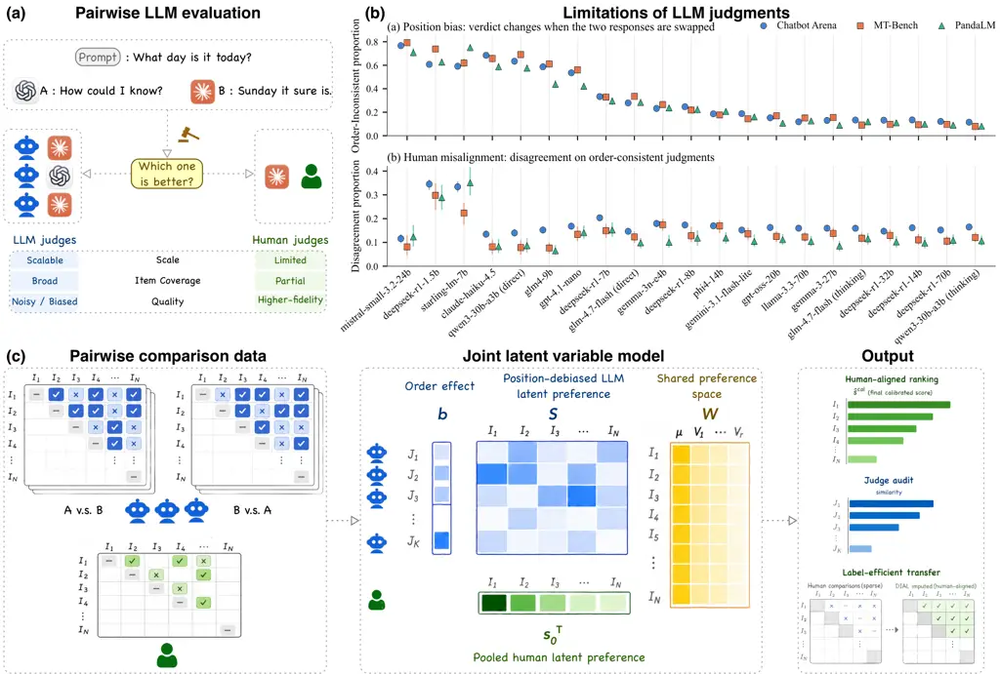

# DIAL: Position-Debiased LLM Judges with Adaptive Human Preference Calibration

Zesheng Cai Affiliation: The University of Hong Kong    Yingqi Fan
Affiliation: The University of Hong Kong    Sichang Chen
Affiliation: Sun Yat-sen University    Jin-Hong Du ^(†)^(†)thanks:
Corresponding author: jinhongd@hku.hk. Code and data are available at
[https://github.com/JinHongDu-Lab/DIAL](https://github.com/JinHongDu-Lab/DIAL).
Affiliation: The University of Hong Kong

###### Abstract

Large language models (LLMs) as a judge enable scalable evaluation, but
their judgments can be sensitive to response order and, even after
removing such position effects, can still diverge systematically from
human preferences. We introduce DIAL, a unified framework that combines
abundant LLM comparisons with limited human comparisons to separate
judge-specific position effects, learn shared structure in
position-debiased LLM preferences, and adaptively calibrate that
structure toward the human preference target. Theoretically, we study
three aspects of DIAL: (i) identification of latent LLM preferences,
position effects, and human calibration; (ii) adaptive estimation that
balances LLM anchoring against limited human evidence; and (iii)
fixed-weight uncertainty quantification for the calibrated human
preference. Empirically, we evaluate position debiasing and human
alignment separately in controlled simulations and on three
human-preference benchmarks, showing that DIAL remains robust to
unbalanced response order, achieves strong human-aligned rankings with
limited labels, and adapts toward human evidence when LLM information is
imperfect. Our real-data study collects over $`410`$K judgments from
$`21`$ LLM judges in both display orders, providing a resource for
future studies of LLM-judge bias, heterogeneity, and human alignment.

## 1 Introduction

LLMs are increasingly used as scalable judges of model-generated
responses, providing a practical complement to costly human evaluation
(Zheng et al., 2023). However, their pairwise judgments can be sensitive
to response display order, so observed preferences may partly reflect
presentation instead of response quality (Wang et al., 2024a; Shi
et al., 2025). Moreover, LLM and human evaluations can differ
systematically (Chen et al., 2024; Gao et al., 2025), so removing
position effects alone does not make an LLM judge human-aligned.
Reliable human-targeted LLM evaluation must therefore address two
distinct but coupled challenges: separating systematic position effects
from underlying LLM preferences, and accounting for discrepancies
between LLM and human preferences when human judgments are limited
(Figure 1(a)). Figure 1(b) illustrates both effects empirically across
LLM judges.

Existing work has studied these challenges largely along separate lines.
Position-bias studies document order sensitivity (Wang et al., 2024a;
Shi et al., 2025) and mitigate it via response swapping, verdict
correction, or judge training (Wang et al., 2024a; Yang et al., 2025;
Zhou et al., 2026; Yang et al., 2026), while human-supervised evaluation
uses limited human labels to learn evaluation criteria, calibrate
LLM-derived features, or improve human-centered evaluation (Liu et al.,
2024; Kola et al., 2026; Boyeau et al., 2025; Xie et al., 2026). What
remains less understood is how to connect stages in multi-judge
evaluation: recover position-debiased LLM preferences, learn shared
structure across judges, and calibrate it toward latent human
preferences using limited human comparisons.

We introduce DIAL (Debiasing and human-preference Informed Alignment for
LLM judges), a unified framework for position debiasing and
human-preference calibration in multi-judge evaluation. DIAL separates
judge-specific position effects from latent LLM preferences, learns
shared structure across the recovered position-debiased preferences, and
calibrates that structure toward a latent human-preference target using
limited human comparisons. The resulting representation reduces
unrestricted item-level human-preference estimation to calibration along
learned low-dimensional preference directions. Adaptive weighting
controls reliance on LLM evidence, interpolating between human-only and
LLM-anchored estimation; Figure 1(c) summarizes the DIAL framework.



Figure 1: Overview of DIAL framework. (a) Pairwise evaluation combines
abundant, scalable LLM judgments with limited, higher-fidelity human
judgments. (b) Empirical examples illustrate two distinct challenges:
position bias and human-preference misalignment. (c) DIAL jointly models
LLM and human comparisons to separate judge-specific position effects
from latent LLM preferences, learn shared preference structure across
judges, and adaptively calibrate toward human preference.

##### Contributions.

Our contributions are threefold. (i) We characterize identification of
judge-specific position effects and latent LLM preferences via a
graph-cycle criterion, and identify the human target through the learned
LLM preference space (Propositions 1 and 2). (ii) We characterize the
first-order approximation-estimation tradeoff of LLM calibration
(Theorem 3), derive fixed-weight inference and a local-misalignment
shrinkage operator (Theorem 4 and Proposition D.6), and develop GACV for
tuning the human-LLM weight using leave-one-human-out loss (Theorem 5).
(iii) Across synthetic and three real benchmarks, DIAL remains robust to
display imbalance and improves human-label efficiency under limited
human supervision, including regimes where unrestricted human-only BTL
estimation is unstable or nonfinite. Adaptive updating becomes
especially valuable when the learned LLM representation is data-limited
or imperfect. Our study also contributes over $`410`$K judgments from
$`21`$ LLM judges across three benchmarks in both display orders.

## 2 Related Work

##### Position Bias and Paired-Comparison Models.

LLM judges exhibit systematic biases including position, verbosity, and
self-enhancement biases (Zheng et al., 2023): pairwise verdicts can
change when the two responses are swapped (Wang et al., 2024a), and
order sensitivity varies across judges, tasks, and comparison difficulty
(Shi et al., 2025). Existing mitigation either corrects individual
verdicts at evaluation time (Yang et al., 2025) or modifies the judge
through training (Zhou et al., 2026; Yang et al., 2026). The
Bradley-Terry-Luce (BTL) model (Bradley & Terry, 1952; Luce, 1959) can
incorporate within-pair order effects (Davidson & Beaver, 1977;
Augustin, 2004), treating display order as a comparison-varying
covariate, so that identification becomes a property of the augmented
comparison design, as in ranking models with comparison-varying
covariates (Dong et al., 2026) and recent work on identifiability of
LLM-judge biases (Xu et al., 2026a). When position bias is not of
concern, user-specific accuracy (Jin et al., 2020), judge-specific
discrimination (Xu et al., 2026b) and consensus-disagreement structure
(Yu et al., 2026) are studied for multiple judges.

##### Human Preference Aggregation and Calibration.

Classical latent-variable approaches model annotator noise and
reliability (Dawid & Skene, 1979; Chen et al., 2013), while empirical
studies document systematic differences between human and LLM judges
(Chen et al., 2024; Gao et al., 2025) and substantial uncertainty within
human evaluation itself (Elangovan et al., 2025). Recent work uses
limited human labels to learn evaluation criteria (Liu et al., 2024), to
calibrate features extracted from LLM evaluations (Kola et al., 2026),
or to combine abundant automatic labels with a smaller human sample when
estimating aggregate evaluation functionals such as win rates, benchmark
scores, or ranking metrics (Boyeau et al., 2025; Chen et al., 2026; Lee
et al., 2026; Divekar & Majumder, 2026). DIAL instead targets latent
human preferences and asks how a position-debiased multi-LLM-judge
representation can improve estimation from limited human comparisons,
separating order-effect estimation from human alignment and propagating
uncertainty from both stages. See Appendix A for more detailed
comparisons with related methods.

## 3 Position-debiased LLM preference representation

We write $`s_{\text{h}}\in\mathbb{R}^{N}`$ for pooled-human scores and
$`s_{k}\in\mathbb{R}^{N}`$, $`k=1,\ldots,K`$, for the LLM judges’ scores
over the $`N`$ items, and collect the LLM scores and order effects in
$`S=[s_{1},\ldots,s_{K}]^{\top}\in\mathbb{R}^{K\times N}`$ and
$`b=(b_{1},\ldots,b_{K})^{\top}\in\mathbb{R}^{K}`$. Because BTL scores
are invariant to common additive shifts, we fix centered representatives
throughout.

###### Condition 1 (Score normalization).

For $`k\in\{\text{h},1,\ldots,K\}`$, the latent scores satisfy
$`1_{N}^{\top}s_{k}=0`$.

### 3.1 Judge-specific order-effect BTL and position debiasing

For each unordered pair $`\{i,j\}`$, fix the canonical orientation
$`i<j`$ and let $`A\in\{-1,1\}`$ indicate whether item $`i`$ is
displayed first ($`A=1`$) or second ($`A=-1`$). For judge $`k`$, let
$`\Omega_{k}=\{(i,j,a):i<j,\ a\in\{-1,1\},\ n_{kij}^{(a)}>0\}`$ with
$`m_{k}=|\Omega_{k}|`$, let $`\mathcal{G}_{k}=([N],\mathcal{E}_{k})`$ be
the comparison graph in which $`\{i,j\}\in\mathcal{E}_{k}`$ whenever
$`(i,j,a)\in\Omega_{k}`$ for at least one $`a`$, and let
$`Y_{kij}^{(a)}`$ be the number of times judge $`k`$ prefers item $`i`$
among $`n_{kij}^{(a)}`$ comparisons under order $`A=a`$. For
$`(i,j,a)\in\Omega_{k}`$, assume

```math
Y_{kij}^{(a)}\sim\mathrm{Binomial}\left(n_{kij}^{(a)},p_{kij}^{(a)}\right),\qquad\operatorname{logit}\left(p_{kij}^{(a)}\right)=s_{ki}-s_{kj}+ab_{k},\addcontentsline{lla}{section}{\hbox to20.74pt{\crtrefnumber{eq:binomial-model-llm}\hfil}eq:binomial-model-llm} \tag{1}
```

where $`p_{kij}^{(a)}`$ is the order-specific preference probability and
$`\sigma(x)=(1+e^{-x})^{-1}`$ denotes the logistic function. Conditional
on the comparison design, the individual LLM comparison outcomes
underlying these counts are mutually independent across judges, pairs,
display orders, and repetitions. Here, $`b_{k}>0`$ indicates preference
for the first-displayed response and $`b_{k}<0`$ preference for the
second; exponentiating the score and order-effect terms recovers the
classical within-pair order-effect BTL parameterization (Davidson &
Beaver, 1977; Augustin, 2004), here applied judge-specifically to the
response-order sensitivity documented for LLM evaluators (Wang et al.,
2024a; Shi et al., 2025).

Fix an arbitrary enumeration
$`\Omega_{k}=\{(i_{t},j_{t},a_{t})\}_{t=1}^{m_{k}}`$. The
item-difference design matrix $`D_{k}\in\{-1,0,1\}^{m_{k}\times N}`$ has
rows
$`(D_{k})_{t\text{\raisebox{-1.50694pt}{\scalebox{1.5}{$\cdot$}}}}=(e_{i_{t}}-e_{j_{t}})^{\top}`$,
and the order-indicator vector $`z_{k}\in\{-1,1\}^{m_{k}}`$ has entries
$`(z_{k})_{t}=a_{t}`$.

###### Condition 2 (LLM comparison design).

For every $`k=1,\ldots,K`$, the augmented comparison design
$`[D_{k},z_{k}]`$ has rank $`N`$.

###### Proposition 1 (Identification of latent scores and order effect).

Under (1) and Condition 1, for any judge $`k`$ the parameter
$`(s_{k},b_{k})`$ is identifiable if and only if
$`\mathrm{rank}([D_{k},z_{k}])=N`$, equivalently if and only if
$`\mathcal{G}_{k}`$ is connected and
$`z_{k}\notin\operatorname{col}(D_{k})`$. Consequently, under
Condition 2, $`(S,b)`$ is identifiable.

This rank characterization specializes augmented paired-comparison
identification with comparison-varying covariates (Dong et al., 2026) to
the observed order indicator; unlike unrestricted LLM-judge bias terms
that can be confounded with item effects (Xu et al., 2026a), $`b_{k}`$
is separable from $`s_{k}`$ exactly when
$`z_{k}\notin\operatorname{col}(D_{k})`$. Because
$`\operatorname{col}(D_{k})`$ is the space of potential differences on
the comparison multigraph, $`z_{k}\notin\operatorname{col}(D_{k})`$
holds if and only if some cycle has nonzero signed order sum
(Corollary B.1), which is checkable in one pass; a pair shown under both
orders is the length-two cycle, and the criterion also covers designs in
which every pair appears in one order only. Condition 2 is an
identification condition on the comparison support and does not
guarantee a finite empirical BTL estimator, which may fail under
separation (Ford, 1957; Hunter, 2004); asymptotically, the same rank
condition applies to the limiting support
$`\{(i,j,a):\rho_{kij}^{(a)}>0\}`$ with within-judge limiting sampling
proportions $`\rho_{kij}^{(a)}:=\lim n_{kij}^{(a)}/n_{k}`$ and sample
size
$`n_{k}:=\sum_{(i^{\prime},j^{\prime},a^{\prime})\in\Omega_{k}}n_{ki^{\prime}j^{\prime}}^{(a^{\prime})}`$.

After separating the order effect, we define the position-debiased
preference probability
$`p^{\mathrm{deb}}_{kij}:=\sigma(s_{ki}-s_{kj})`$, so that judge $`k`$’s
position-debiased ranking is read directly from $`s_{k}`$. This differs
from the order-averaged probability
$`p^{\mathrm{avg}}_{kij}:=\{p_{kij}^{(1)}+p_{kij}^{(-1)}\}/2`$, whose
log-odds are a nonlinear odd function of $`s_{ki}-s_{kj}`$ whenever
$`b_{k}\neq 0`$, so they are generally not representable by a single BTL
score vector and BTL fitting to order-averaged data is generically
misspecified (Section B.2). We therefore carry the recovered
judge-specific $`s_{k}`$, rather than probability-averaged judgments,
into the cross-judge representation and subsequent human calibration.

### 3.2 Structured representation across LLM judges

Following Yu et al. (2026), we adopt its consensus-disagreement
decomposition for the position-debiased LLM score matrix.

###### Condition 3 (Structured LLM representation).

The score matrix $`S`$ admits the representation

```math
S=\gamma\mu^{\top}+UV^{\top},\addcontentsline{lla}{section}{\hbox to20.74pt{\crtrefnumber{eq:S-llm}\hfil}eq:S-llm} \tag{2}
```

where $`\gamma\in\mathbb{R}^{K}`$, $`\mu\in\mathbb{R}^{N}`$,
$`U\in\mathbb{R}^{K\times r}`$, and $`V\in\mathbb{R}^{N\times r}`$
satisfy

1.  i.
    $`1_{N}^{\top}\mu=0`$, $`V^{\top}1_{N}=0`$, $`\mu^{\top}V=0`$,
    $`N^{-1}\|\mu\|_{2}^{2}=1`$ and $`N^{-1}V^{\top}V=I_{r}`$.
2.  ii.
    $`1_{K}^{\top}\gamma>0`$, $`1_{K}^{\top}U=0^{\top}`$ and
    $`\mathrm{rank}(U)=r`$.

Here $`\mu`$ is the common LLM preference direction, $`\gamma_{k}`$ is
judge $`k`$’s loading on it, and $`UV^{\top}`$ is rank-$`r`$
heterogeneous variation whose item-side directions, the columns of
$`V`$, are those along which the judges systematically disagree. These
restrictions are compatible with Condition 1 and require $`r\leq K-1`$
and $`r+1\leq N-1`$. Define $`W:=[\mu,V]\in\mathbb{R}^{N\times(r+1)}`$,
so that (i) reads $`W^{\top}1_{N}=0_{r+1}`$ and
$`N^{-1}W^{\top}W=I_{r+1}`$: fixing the scale on the item side rather
than the judge side orthogonalizes the basis of
$`\operatorname{col}(W)`$, gives $`\|Wc\|_{2}^{2}=N\|c\|_{2}^{2}`$, and
confines the item side to a compact set. For human calibration in
Section 4, let $`M=\mu\in\mathbb{R}^{N\times 1}`$ with $`d=1`$, or
$`M=W\in\mathbb{R}^{N\times(r+1)}`$ with $`d=r+1`$, corresponding to
consensus-only and full-space calibration, respectively.

Proposition 1 identifies $`(S,b)`$, and the constraints of Condition 3
then give $`\mu=\sqrt{N}\,S^{\top}1_{K}/\|S^{\top}1_{K}\|_{2}`$,
$`\gamma=N^{-1}S\mu`$, $`UV^{\top}=S-\gamma\mu^{\top}`$, and
$`\operatorname{col}(V)=\operatorname{row}(UV^{\top})`$, so $`\mu`$,
$`\gamma`$, $`UV^{\top}`$, $`\operatorname{col}(V)`$, and
$`\operatorname{col}(W)`$ are all identified. The factors $`U`$ and
$`V`$ themselves are not, because $`UV^{\top}=(UQ)(VQ)^{\top}`$ for
every orthogonal $`Q\in\mathbb{R}^{r\times r}`$; only the subspace
$`\operatorname{col}(V)`$ is invariant. Conditioning on
$`\operatorname{col}(W)`$, the shared structure reduces judge $`k`$’s
design requirement from $`\mathrm{rank}([D_{k},z_{k}])=N`$ to
$`\mathrm{rank}([D_{k}W,z_{k}])=r+2`$ (Proposition B.2). Since
$`\mathrm{rank}(W)=r+1`$ and
$`\operatorname{col}(W)=\operatorname{span}(\mu)\oplus\operatorname{col}(V)`$,
both calibration choices are defined by the position-debiased LLM
representation.

## 4 Human preference alignment with limited supervision

### 4.1 Human calibration and identification

For pooled human judgments, recall that
$`s_{\text{h}}\in\mathbb{R}^{N}`$ denotes the centered latent human
preference score vector. For each pair $`i<j`$, let $`Y_{\text{h}ij}`$
be the number of human comparisons preferring item $`i`$ among
$`n_{\text{h}ij}`$ comparisons, define
$`n_{\text{h}}:=\sum_{i<j}n_{\text{h}ij}`$ and
$`\Omega_{\text{h}}:=\{(i,j):i<j,\ n_{\text{h}ij}>0\}`$, and let
$`\mathcal{G}_{\text{h}}`$ denote the corresponding comparison graph. We
assume

```math
Y_{\text{h}ij}\sim\mathrm{Binomial}\!\left(n_{\text{h}ij},p_{\text{h}ij}\right),\qquad\operatorname{logit}\!\left(p_{\text{h}ij}\right)=s_{\text{h}i}-s_{\text{h}j},\qquad(i,j)\in\Omega_{\text{h}}.\addcontentsline{lla}{section}{\hbox to20.74pt{\crtrefnumber{eq:binomial-model-human}\hfil}eq:binomial-model-human} \tag{3}
```

Recent human-supervised LLM evaluation learns evaluation criteria or
calibrates LLM-derived features from limited human labels (Liu et al.,
2024; Kola et al., 2026); here the target is instead the latent pairwise
human score $`s_{\text{h}}`$. Treating human annotations as noisy
observations of this target, for a calibration basis $`M`$ defined in
Section 3.2, we impose the working restriction

```math
s_{\text{h}}=Mc_{\text{h}},\qquad c_{\text{h}}\in\mathbb{R}^{d}.\addcontentsline{lla}{section}{\hbox to20.74pt{\crtrefnumber{eq:human-subspace-model}\hfil}eq:human-subspace-model} \tag{4}
```

This reduces human estimation from $`N-1`$ free score coordinates to
$`d`$ calibration coordinates. The restriction is an alignment
assumption; $`Mc_{\text{h}}`$ is basis-invariant, although for $`M=W`$
its coordinate $`c_{\text{h}}`$ depends on the normalized basis for
$`\operatorname{col}(V)`$.

Enumerate $`\Omega_{\text{h}}=\{(i_{t},j_{t})\}_{t=1}^{m_{\text{h}}}`$,
$`m_{\text{h}}=|\Omega_{\text{h}}|`$, and let
$`D_{\text{h}}\in\{-1,0,1\}^{m_{\text{h}}\times N}`$ have rows
$`(e_{i_{t}}-e_{j_{t}})^{\top}`$.

###### Condition 4 (Human comparison design).

$`\mathrm{rank}(D_{\text{h}}M)=d`$.

###### Proposition 2 (Identification under limited human comparisons).

Under model (1), (3), and (4), Conditions 1, 2, 3 and 4,
$`c_{\text{h}}`$ is identifiable relative to the chosen basis and
$`s_{\text{h}}=Mc_{\text{h}}`$ is identifiable and basis-invariant. The
rank condition is equivalent to
$`\ker(D_{\text{h}})\cap\operatorname{col}(M)=\{0\}`$; connectivity of
$`\mathcal{G}_{\text{h}}`$ is sufficient but not necessary.

Unlike methods combining automatic and human labels to estimate
aggregate evaluation functionals (Boyeau et al., 2025; Chen et al.,
2026; Lee et al., 2026; Divekar & Majumder, 2026), Proposition 2 targets
the latent item-level preference through the learned calibration space
$`\operatorname{col}(M)`$. Condition 4 asks the human comparisons to
distinguish only its $`d`$ directions, so $`m_{\text{h}}\geq d`$ is
necessary but connectivity or coverage of every item is not; Theorem C.5
extends the risk and inference results to incomplete population
coverage.

##### Likelihoods.

The normalized human loss for a centered score $`s`$ is

```math
\ell_{\text{h}}(s):=\frac{1}{n_{\text{h}}}\sum_{(i,j)\in\Omega_{\text{h}}}\left[n_{\text{h}ij}\log\{1+\exp(s_{i}-s_{j})\}-Y_{\text{h}ij}(s_{i}-s_{j})\right].\addcontentsline{lla}{section}{\hbox to20.74pt{\crtrefnumber{eq:human-full-loss}\hfil}eq:human-full-loss} \tag{5}
```

Equivalently
$`\ell_{\text{h}}(s)=n_{\text{h}}^{-1}\sum_{t=1}^{n_{\text{h}}}h_{t}(s)`$,
the average over individual comparisons, with
$`h_{t}(s)=\log\{1+\exp(s_{I_{t}}-s_{J_{t}})\}-Z_{t}(s_{I_{t}}-s_{J_{t}})`$
for the pair $`(I_{t},J_{t})`$ and outcome $`Z_{t}\in\{0,1\}`$. Let
$`n_{\text{l}}:=\sum_{k=1}^{K}n_{k}`$ be the total LLM sample size and
define $`\eta_{kij}^{(a)}(S,b):=S_{ki}-S_{kj}+ab_{k}`$. The normalized
LLM negative log-likelihood is

```math
\ell_{\text{l}}(S,b)=\frac{1}{n_{\text{l}}}\sum_{k=1}^{K}\sum_{(i,j,a)\in\Omega_{k}}\left[n_{kij}^{(a)}\log\!\left\{1+\exp\!\left(\eta_{kij}^{(a)}(S,b)\right)\right\}-Y_{kij}^{(a)}\eta_{kij}^{(a)}(S,b)\right].\addcontentsline{lla}{section}{\hbox to20.74pt{\crtrefnumber{eq:llm-negloglik}\hfil}eq:llm-negloglik} \tag{6}
```

Calibration evaluates the same loss at $`s=Mc`$. When a finite minimizer
exists, define the unrestricted human-only estimator by

```math
\widehat{s}_{0}\in\mathop{\mathrm{argmin}}\nolimits_{1_{N}^{\top}s=0}\ell_{\text{h}}(s).\addcontentsline{lla}{section}{\hbox to20.74pt{\crtrefnumber{eq:human-only-estimator}\hfil}eq:human-only-estimator} \tag{7}
```

### 4.2 Population value of LLM calibration

To characterize the tradeoff that the weighted estimator of Section 5.1
interpolates, we temporarily relax (4) and allow $`s_{\text{h}}`$ to lie
outside $`\operatorname{col}(M)`$.

For the population analysis, we treat the $`n_{\text{h}}`$ human
comparisons as independent draws in which pair $`(i,j)`$ is sampled with
probability $`\rho_{ij}`$, with $`\sum_{i<j}\rho_{ij}=1`$, and the
outcome follows (3) conditional on the sampled pair. Define
$`\Omega_{\text{h}}^{\infty}:=\{(i,j):i<j,\ \rho_{ij}>0\}`$ and the
corresponding comparison graph $`\mathcal{G}_{\text{h}}^{\infty}`$. The
human comparison risk is $`R_{\text{h}}(s):=\mathbb{E}\{h_{t}(s)\}`$
under this sampling scheme. When $`\mathcal{G}_{\text{h}}^{\infty}`$ is
connected, $`s_{\text{h}}`$ minimizes $`R_{\text{h}}`$ over centered
score vectors.

Define the approximation error of the calibration space by

```math
\Delta_{M}:=\inf_{c\in\mathbb{R}^{d}}\left\{R_{\text{h}}(Mc)-R_{\text{h}}(s_{\text{h}})\right\}.\addcontentsline{lla}{section}{\hbox to20.74pt{\crtrefnumber{eq:population-alignment-gaps}\hfil}eq:population-alignment-gaps} \tag{8}
```

For fixed sampling design $`\rho`$, $`\Delta_{M}`$ depends on $`M`$ only
through $`\operatorname{col}(M)`$ and is nonnegative, vanishing if and
only if $`s_{\text{h}}\in\operatorname{col}(M)`$ when
$`\mathcal{G}_{\text{h}}^{\infty}`$ is connected; $`\Delta_{M}`$ is
design-dependent through $`\rho`$.

To isolate this tradeoff from estimation of the LLM representation,
treat $`M`$ as known at its population value and define the oracle
anchored estimator $`\widetilde{s}_{\infty}:=M\widetilde{c}_{\infty}`$,
where
$`\widetilde{c}_{\infty}\in\mathop{\mathrm{argmin}}_{c\in\mathbb{R}^{d}}\ell_{\text{h}}(Mc)`$.
For expected-risk statements, we use the measurable extension of
Lemma C.2, setting a fixed-space estimator to $`0_{N}`$ on its
exponentially rare fallback event. The $`(N-1)/(2n_{\text{h}})`$ and
$`d/(2n_{\text{h}})`$ terms below are the classical first-order
likelihood-risk complexity terms underlying AIC (Akaike, 1974).

###### Theorem 3 (Human-risk tradeoff from LLM calibration).

Under the sampling scheme above, let $`N`$ and $`M`$ be fixed, let
$`\mathcal{G}_{\text{h}}^{\infty}`$ be connected, and assume the human
probabilities are bounded away from $`0`$ and $`1`$ on
$`\Omega_{\text{h}}^{\infty}`$. If
$`s_{\text{h}}\in\operatorname{col}(M)`$, the first-order expected
excess risks of $`\widehat{s}_{0}`$ and $`\widetilde{s}_{\infty}`$ are
$`(N-1)/(2n_{\text{h}})`$ and $`d/(2n_{\text{h}})`$, respectively. More
generally, let $`s_{\text{h}}=s_{\text{h}}^{(n_{\text{h}})}`$ vary with
$`n_{\text{h}}`$ while keeping $`\{\rho_{ij}\}`$ fixed, and suppose its
induced probabilities
$`p_{\text{h}ij}^{(n_{\text{h}})}:=\sigma(s_{\text{h}i}^{(n_{\text{h}})}-s_{\text{h}j}^{(n_{\text{h}})})`$
lie in $`[\varepsilon,1-\varepsilon]`$ on $`\Omega_{\text{h}}^{\infty}`$
for some fixed $`\varepsilon>0`$, with
$`n_{\text{h}}\Delta_{M}\to\delta_{M}<\infty`$. Then

```math
n_{\text{h}}\mathbb{E}\!\left\{R_{\text{h}}(\widehat{s}_{0})-R_{\text{h}}(s_{\text{h}})\right\}\to\frac{N-1}{2},\qquad n_{\text{h}}\mathbb{E}\!\left\{R_{\text{h}}(\widetilde{s}_{\infty})-R_{\text{h}}(s_{\text{h}})\right\}\to\delta_{M}+\frac{d}{2}.\addcontentsline{lla}{section}{\hbox to20.74pt{\crtrefnumber{eq:population-risk-anchored}\hfil}eq:population-risk-anchored} \tag{9}
```

Thus, anchoring has a smaller first-order risk exactly when
$`\delta_{M}<(N-1-d)/2`$.

For $`M=\mu`$, $`d=1`$ gives consensus-only calibration; for $`M=W`$,
$`d=r+1`$ recovers full-space calibration. A fixed $`\Delta_{M}>0`$
eventually dominates as $`n_{\text{h}}`$ grows, motivating adaptive
weighting. The above analysis treats $`M`$ as fixed; the analysis also
extends to misspecification of (4) and staged-oracle equivalence; see
Theorem C.4 and Corollary C.6.

## 5 DIAL: Estimation and adaptive calibration

To utilize both the human and LLM comparisons, we combine the two
likelihoods (5) and (6). For fixed rank $`r\leq\min\{K-1,N-2\}`$, let
$`\Theta_{r}`$ denote the parameter space $`\theta=(\gamma,\mu,U,V,b)`$
satisfying Condition 3. For $`\theta\in\Theta_{r}`$, write
$`S_{\theta}:=\gamma\mu^{\top}+UV^{\top}`$ and $`W_{\theta}:=[\mu,V]`$,
and set $`M_{\theta}:=\mu`$ for $`M=\mu`$ and $`M_{\theta}:=W_{\theta}`$
for $`M=W`$.

### 5.1 Weighted likelihood estimator

Using the human loss in (5), define for $`\lambda>0`$

```math
Q_{\lambda}(s,S,b):=\ell_{\text{h}}(s)+\lambda\ell_{\text{l}}(S,b).\addcontentsline{lla}{section}{\hbox to20.74pt{\crtrefnumber{eq:weighted-loss}\hfil}eq:weighted-loss} \tag{10}
```

The factorized estimator is

```math
\displaystyle(\textnormal{DIAL-Ada}{})\qquad(\widehat{c}_{\lambda},\widehat{\theta}_{\lambda})\in\mathop{\mathrm{argmin}}_{c\in\mathbb{R}^{d},\ \theta\in\Theta_{r}}Q_{\lambda}(M_{\theta}c,S_{\theta},b),\qquad\widehat{s}_{\lambda}:=M_{\widehat{\theta}_{\lambda}}\widehat{c}_{\lambda}. \tag{11}
```

Because the two likelihoods are normalized by $`n_{\text{h}}`$ and
$`n_{\text{l}}`$, $`\lambda`$ controls their relative weight, with the
ordinary joint likelihood corresponding to
$`\lambda=n_{\text{l}}/n_{\text{h}}`$. Under exact calibration, that
choice is efficient; choosing $`\lambda`$ away from
$`n_{\text{l}}/n_{\text{h}}`$ trades exact-model efficiency for
robustness when the calibration restriction is only approximate. We
treat the score $`\widehat{s}_{\lambda}`$ as the human-preference
estimate.

We use the unrestricted human BTL estimator $`\widehat{s}_{0}`$ in (7)
as the $`\lambda=0`$ endpoint. For $`\lambda=\infty`$, define the staged
LLM-anchored endpoint by

```math
\displaystyle(\textnormal{DIAL-Anc}{})\quad\widehat{\theta}_{\infty}\in\mathop{\mathrm{argmin}}_{\theta\in\Theta_{r}}\ell_{\text{l}}(S_{\theta},b),\qquad\widehat{c}_{\infty}\in\mathop{\mathrm{argmin}}_{c\in\mathbb{R}^{d}}\ell_{\text{h}}\!\left(M_{\widehat{\theta}_{\infty}}c\right),\quad\widehat{s}_{\infty}:=M_{\widehat{\theta}_{\infty}}\widehat{c}_{\infty}. \tag{12}
```

Thus, $`\lambda=0`$ gives human-only estimation, $`\lambda=\infty`$
gives LLM-first calibration, and finite $`\lambda`$ jointly estimates
the shared representation using both data sources. Relative to
human-supervised calibration of LLM-derived features (Kola et al.,
2026), finite $`\lambda`$ additionally lets the human comparisons update
the LLM representation itself, so $`\widehat{s}_{\lambda}`$ is not
restricted to a fixed estimated space. Under approximate calibration,
this can bias the LLM parameters. For the fixed calibration choice
$`M\in\{\mu,W\}`$, write
$`\mathcal{C}_{\mu}(S):=\operatorname{span}(S^{\top}1_{K})`$ and
$`\mathcal{C}_{W}(S):=\operatorname{row}(S)`$. For inference and tuning,
we use $`Q_{\lambda}`$ on the regular score space:

```math
\mathcal{M}_{r}:=\left\{(s,S,b):S1_{N}=0_{K},\ \mathrm{rank}(S)=r+1,\ S^{\top}1_{K}\neq 0_{N},\ s\in\mathcal{C}_{M}(S),\ b\in\mathbb{R}^{K}\right\},\addcontentsline{lla}{section}{\hbox to20.74pt{\crtrefnumber{eq:reduced-parameter-space}\hfil}eq:reduced-parameter-space} \tag{13}
```

Regular factorized and score-space fits have the same objective and
calibrated score (Lemma D.1).

### 5.2 Inference at a fixed calibration weight

Fix $`\lambda\in(0,\infty)`$, $`N,K,r`$, and a calibration choice
$`M\in\{\mu,W\}`$. Suppose the human comparisons are independent draws
under the sampling scheme of Section 4.2, with connected population
graph $`\mathcal{G}_{\text{h}}^{\infty}`$, independently of the LLM
sample. Let $`n_{\text{h}},n_{\text{l}}\to\infty`$ with
$`n_{\text{h}}/n_{\text{l}}\to\tau\in[0,\infty)`$, and suppose
$`n_{k}/n_{\text{l}}\to\kappa_{k}>0`$ and
$`n_{kij}^{(a)}/n_{k}\to\rho_{kij}^{(a)}`$, where each limiting
within-judge support satisfies Condition 2. Write $`R_{\text{l}}`$ for
the limiting expected LLM loss as in (D.5) and use smooth local
coordinates $`\zeta`$ on $`\mathcal{M}_{r}`$, with true coordinate
$`\zeta_{0}`$. Define

```math
\mathcal{I}_{\text{h}}:=\nabla_{\zeta}^{2}R_{\text{h}}\{s(\zeta)\}\big|_{\zeta=\zeta_{0}},\qquad\mathcal{I}_{\text{l}}:=\nabla_{\zeta}^{2}R_{\text{l}}\{S(\zeta),b(\zeta)\}\big|_{\zeta=\zeta_{0}},
```

together with
$`\mathcal{H}_{\lambda}:=\mathcal{I}_{\text{h}}+\lambda\mathcal{I}_{\text{l}}`$,
$`\mathcal{J}_{\lambda,\tau}:=\mathcal{I}_{\text{h}}+\lambda^{2}\tau\mathcal{I}_{\text{l}}`$,
and Jacobian
$`\dot{s}_{0}:=\frac{\partial s(\zeta_{0})}{\partial\zeta^{\top}}\in\mathbb{R}^{N\times\dim\zeta}`$.
The covariance below has the standard sandwich form from likelihood and
M-estimation theory (White, 1982); its two-sample form propagates both
human and LLM sampling variation through $`\mathcal{J}_{\lambda,\tau}`$.

###### Theorem 4 (Fixed-weight inference for the calibrated preference).

Under model (1), (3), and (4), Conditions 1, 2 and 3, and the sampling
regime above,

```math
\sqrt{n_{\text{h}}}\left(\widehat{s}_{\lambda}-s_{\text{h}}\right)\xrightarrow{\textup{d}}\mathcal{N}\left(0,\Sigma_{\lambda,s,\tau}\right),\qquad\Sigma_{\lambda,s,\tau}:=\dot{s}_{0}\mathcal{H}_{\lambda}^{-1}\mathcal{J}_{\lambda,\tau}\mathcal{H}_{\lambda}^{-1}\dot{s}_{0}^{\top}.\addcontentsline{lla}{section}{\hbox to20.74pt{\crtrefnumber{eq:calibrated-asymptotic-normality}\hfil}eq:calibrated-asymptotic-normality} \tag{14}
```

The covariance is invariant to the smooth local coordinate used for
$`\mathcal{M}_{r}`$. The empirical sandwich estimator
$`\widehat{\Sigma}_{\lambda,s}`$ defined in (D.8) satisfies
$`\widehat{\Sigma}_{\lambda,s}\xrightarrow{\textup{p}}\Sigma_{\lambda,s,\tau}`$,
so $`n_{\text{h}}^{-1}\widehat{\Sigma}_{\lambda,s}`$ consistently
estimates the first-order covariance of $`\widehat{s}_{\lambda}`$. If
$`n_{\text{h}}/n_{\text{l}}\to 0`$, the asymptotic linearization and
sandwich consistency are uniform over $`\lambda\in[\lambda_{0},\infty)`$
for every $`\lambda_{0}>0`$; Corollary D.5 also gives the
$`\lambda\to\infty`$ staged limit.

For $`\tau>0`$, both human and LLM sampling variation contribute through
$`\mathcal{J}_{\lambda,\tau}`$; when $`\tau=0`$, LLM sampling variation
vanishes at the human $`\sqrt{n_{\text{h}}}`$ scale while its
information remains through $`\mathcal{H}_{\lambda}`$. Since
$`1_{N}^{\top}s(\zeta)\equiv 0`$, the limit law is supported on the
centered subspace and $`\Sigma_{\lambda,s,\tau}1_{N}=0_{N}`$. For any
centered contrast $`v`$ with $`v^{\top}\Sigma_{\lambda,s,\tau}v>0`$,
including pairwise contrasts $`v=e_{i}-e_{j}`$ when nondegenerate, we
studentize by
$`(v^{\top}\widehat{\Sigma}_{\lambda,s}v/n_{\text{h}})^{1/2}`$. These
intervals concern exact calibration at a fixed $`\lambda`$; Theorem C.5
relaxes human-graph connectivity, and Proposition D.6 and Corollary D.7
give the local-misalignment limit.

### 5.3 Adaptive choice of the LLM weight

Let $`\overline{\Lambda}\subset[0,\infty]`$ be a fixed finite candidate
set containing $`0`$ and $`\infty`$, and write
$`\Lambda:=\overline{\Lambda}\setminus\{0,\infty\}`$. Following the GACV
principle of approximating leave-one-out likelihood loss without
refitting every deletion (Xiang & Wahba, 1996) and related GCV-based
tuning without sample splitting (Du et al., 2023), we select $`\lambda`$
by approximating leave-one-human-comparison-out predictive loss while
retaining all LLM comparisons in every candidate fit.

For each candidate fit, let $`\widehat{\zeta}_{\lambda}`$ be its
local-coordinate estimate and $`q_{\lambda}(\zeta)`$ its full-sample
criterion, and define
$`\widehat{H}_{\lambda}:=\nabla_{\zeta}^{2}q_{\lambda}(\widehat{\zeta}_{\lambda})`$
and
$`\widehat{J}_{\lambda}:=n_{\text{h}}^{-1}\sum_{t}(g_{t,\lambda}-\bar{g}_{\lambda})(g_{t,\lambda}-\bar{g}_{\lambda})^{\top}`$,
where
$`g_{t,\lambda}:=\nabla_{\zeta}h_{t}\{s(\zeta)\}|_{\zeta=\widehat{\zeta}_{\lambda}}`$
and $`\bar{g}_{\lambda}:=n_{\text{h}}^{-1}\sum_{t}g_{t,\lambda}`$. Here,
$`\zeta`$ denotes local coordinates on $`\mathcal{M}_{r}`$ for finite
$`\lambda`$, on the centered score space at $`\lambda=0`$, and on $`c`$
with $`M_{\widehat{\theta}_{\infty}}`$ fixed at $`\lambda=\infty`$.
Define

```math
\operatorname{GACV}(\lambda):=\ell_{\text{h}}(\widehat{s}_{\lambda})+\frac{1}{n_{\text{h}}-1}\operatorname{tr}\left(\widehat{H}_{\lambda}^{-1}\widehat{J}_{\lambda}\right),\qquad\widehat{\lambda}\in\mathop{\mathrm{argmin}}_{\lambda\in\overline{\Lambda}}\operatorname{GACV}(\lambda).\addcontentsline{lla}{section}{\hbox to20.74pt{\crtrefnumber{eq:gacv}\hfil}eq:gacv} \tag{15}
```

For comparison, write
$`\operatorname{CV}_{\mathrm{loo}}(\lambda):=n_{\text{h}}^{-1}\sum_{t=1}^{n_{\text{h}}}h_{t}(\widehat{s}_{\lambda}^{(-t)})`$,
where $`\widehat{s}_{\lambda}^{(-t)}`$ is the leave-one-out (LOO) fit
obtained after deleting human comparison $`t`$ while retaining all LLM
comparisons.

###### Theorem 5 (GACV tuning).

Suppose that $`N`$, $`K`$, and $`r`$ are fixed, the calibration choice
$`M\in\{\mu,W\}`$ is fixed, the human comparisons are independent draws
under the sampling scheme of Theorem 4, independently of the LLM sample,
and $`\overline{\Lambda}`$ is fixed and finite. Under Assumption A1
(verified under the correctly specified regime by Lemma D.8), as
$`n_{\text{h}}\to\infty`$, conditionally on the LLM comparisons,
$`\operatorname{GACV}(\lambda)`$ is invariant to the chosen smooth local
coordinates and

```math
\max_{\lambda\in\overline{\Lambda}}\left|\operatorname{GACV}(\lambda)-\operatorname{CV}_{\mathrm{loo}}(\lambda)\right|=\mathcal{O}_{\mathbb{P}}(n_{\text{h}}^{-2}).\addcontentsline{lla}{section}{\hbox to20.74pt{\crtrefnumber{eq:gacv-loo-equivalence}\hfil}eq:gacv-loo-equivalence} \tag{16}
```

Here, GACV tunes DIAL-Ada (11) without a separate human validation
sample or a rate restriction between $`n_{\text{h}}`$ and
$`n_{\text{l}}`$; Corollary D.9 gives its near-LOO selection guarantee.
The same criterion can select rank and weight jointly, while
Proposition D.10 tests the calibration restriction and compares DIAL-Anc
versus unrestricted human models by AIC.

## 6 Experiments

We evaluate the two aspects of the proposed DIAL pipeline separately.
Synthetic experiments first analyze recovery of order effects and
position-debiased LLM preferences, and human-preference calibration
under limited supervision and LLM misspecification. Real-data
experiments study the same mechanisms against held-out human
preferences.

##### Compared methods.

We compare (i) Human, the unrestricted centered human BTL fit
($`\lambda=0`$); (ii) Pooled, a pooled LLM BTL fit that ignores judge
identity and display order and is rescaled using the human comparisons;
(iii) DIAL-Ada and DIAL-Anc, the adaptive estimator (11) tuned by GACV
and anchored estimator (12) within the consensus space; (iv)
DIAL-Ada$`\,(W)`$, the adaptive estimator (11) within $`W`$-space; (v)
DIAL-noPos, the order-agnostic ablation of DIAL-Ada; and (vi) AtC, a
stage-matched AtC baseline aggregating the same human comparisons by BTL
and isotonic-calibrating the position-debiased LLM consensus.

### 6.1 Synthetic experiments

We use $`N=10`$, $`K=4`$, and $`r=1`$, with structured LLM scores from
(1) and consensus-aligned target $`s_{\text{h}}=\mu`$. The canonical
item is displayed first with probability $`0.75`$. In Figure 2, the top
row varies $`n_{\text{h}}`$ at $`n_{\text{l}}=20{,}000`$ under exact
specification, while the bottom row varies $`n_{\text{l}}`$ at
$`n_{\text{h}}=800`$ under judge-pair overdispersion that misspecifies
the LLM likelihood. Appendix F gives the full design and additional
larger-scale, misalignment, and heterogeneous-position robustness
experiments (Figures F1, F2 and F3).

Figure 2: Synthetic evaluation with $`N=10`$, $`K=4`$, $`r=1`$,
$`s_{\text{h}}=\mu`$, and canonical-first display probability $`0.75`$;
curves show means $`\pm 1.96`$ Monte Carlo standard errors over $`50`$
replications. Columns report excess human risk, Kendall’s $`\tau`$,
$`95\%`$ interval coverage, and $`\operatorname{RMSE}(\widehat{b},b)`$.
Top: $`n_{\text{h}}`$ varies at $`n_{\text{l}}=20{,}000`$ under correct
specification; dotted lines are the first-order risk benchmarks for
Human, calibration within $`\operatorname{span}(\mu)`$, and calibration
within $`\operatorname{col}(W)`$. Bottom: $`n_{\text{l}}`$ varies at
$`n_{\text{h}}=800`$ under judge-pair overdispersion that misspecifies
the LLM likelihood while leaving the human calibration model correctly
specified.

##### Limited human supervision.

Under exact specification, Human and DIAL-Anc closely follow their
corresponding first-order risk benchmarks, with anchoring substantially
improving both risk and ranking when human supervision is scarce.
DIAL-Ada remains close to the anchored endpoint, while DIAL-Ada$`\,(W)`$
pays additional variance for estimating an unnecessary disagreement
direction. The order-agnostic Pooled and DIAL-noPos deteriorate under
the unbalanced display.

##### Adaptive weighting and position recovery.

Under pair-level LLM misspecification, the anchored estimator plateaus,
whereas DIAL-Ada adapts toward the human data and remains competitive
with or better than both endpoints, closely tracking the oracle
candidate. Its ranking accuracy is correspondingly more stable as the
LLM budget varies. For order-aware fits, order-effect estimation
improves steadily with additional LLM comparisons, while order-agnostic
methods retain substantial error; post-selection cell-clustered
intervals remain empirically near nominal coverage.

### 6.2 Real-data experiments

We evaluate $`21`$ LLM judges ($`18`$ open-weight via Ollama and $`3`$
commercial API models) on Chatbot Arena (Chiang et al., 2024), MT-Bench
(Zheng et al., 2023), and PandaLM (Wang et al., 2024b); after
preprocessing, the benchmarks contain $`20`$, $`6`$, and $`5`$ candidate
models, respectively, with each LLM comparison queried in both display
orders. We use disjoint human calibration and test sets and $`r=1`$
throughout; position robustness evaluations report excess held-out human
log loss, while calibration experiments report Kendall’s $`\tau`$
against the held-out human ranking (Appendices G and E.3).

Figure 3: Real-data position robustness evaluation: excess held-out
human log loss (zero is the test-pool BTL fit), averaged over up to
$`50`$ splits with $`\pm 1.96`$ Monte Carlo standard errors. Panels show
Chatbot Arena, MT-Bench, and PandaLM using the same five order-sensitive
judges: Mistral-Small 3.2, Claude Haiku 4.5, Qwen3-30B without
reasoning, GLM4-9B, and DeepSeek-R1-1.5B, under balanced, one-sided
($`5\%`$ swapped), and one-sided plus $`8`$ injected pure-position
judges.

##### Order-aware DIAL remains stable under position perturbations.

Under one-sided display, Pooled degrades markedly, and adding
pure-position judges further degrades both Pooled and DIAL-noPos,
whereas the order-aware DIAL fits remain stable across datasets
(Figure 3). Judge-level order-effect diagnostics are reported in
Figure G5(a).

Figure 4: Human-label efficiency and adaptive calibration on Chatbot
Arena: Kendall’s $`\tau`$ with the held-out human ranking as
$`n_{\text{h}}`$ varies, using (a) all available judgments of the $`21`$
LLM judges and (b) $`n_{\text{l}}=2{,}000`$. Curves show means over up
to $`50`$ splits with $`\pm 1.96`$ Monte Carlo standard errors; Human
and AtC are shown only where the pooled-human BTL fit is finite in all
splits, and the dashed vertical line marks the smallest such budget
($`n_{\text{h}}=800`$).

##### Human efficiency and adaptive weighting.

With all 21 LLM judges, DIAL-Anc and DIAL-Ada achieve strong held-out
ranking agreement even at small human-label budgets, where the
unrestricted Human fit is not finite in every split (Figure 4(a)). Where
its rank-aggregation stage is finite, AtC gains $`0.017`$–$`0.056`$ in
$`\tau`$ over Human but stays within $`0.013`$ of DIAL-Ada, measurably
exceeding it only at the largest budget ($`n_{\text{h}}=3200`$). With
fewer LLM judgments, DIAL-Anc remains nearly flat as human supervision
grows, whereas DIAL-Ada improves toward Human by updating the imperfect
LLM consensus (Figure 4(b)). Appendix results show that DIAL-Ada remains
more stable than fixed anchoring under anti-consensus corruption
(Figure G4(c,f)), diagnose subgroup-specific failures of the global
calibration space (Figure G5(b)), and find similar human-label gains
across smaller judge panels, with adaptive updating becoming more
valuable as LLM data become scarce (Figures G7 and G8).

## 7 Discussion

DIAL treats position debiasing and human-preference alignment as
distinct but complementary: removing display-order effects recovers
cleaner LLM preferences, while limited human comparisons determine how
those preferences should inform the human target. When the learned LLM
preference structure is informative, it can substantially reduce
human-label requirements; when it is imperfect, adaptive weighting
shifts reliance toward the human data, as reflected in both theory and
experiments. Key extensions include heterogeneous human preferences,
richer position and tie models, post-selection inference, and cost-aware
human comparison design.

## References

- Akaike (1974) Hirotugu Akaike. A new look at the statistical model
  identification. _IEEE Transactions on Automatic Control_,
  19(6):716–723, 1974.
- Andrews (1991) Donald W K Andrews. Heteroskedasticity and
  autocorrelation consistent covariance matrix estimation.
  _Econometrica_, 59(3):817–858, 1991.
- Augustin (2004) Thomas Augustin. Bradley–Terry–Luce models to
  incorporate within-pair order effects: Representation and uniqueness
  theorems. _British Journal of Mathematical and Statistical
  Psychology_, 57(2):281–294, 2004.
- Boyeau et al. (2025) Pierre Boyeau, Anastasios Nikolas Angelopoulos,
  Tianle Li, Nir Yosef, Jitendra Malik, and Michael I. Jordan. AutoEval
  done right: Using synthetic data for model evaluation. In Aarti Singh,
  Maryam Fazel, Daniel Hsu, Simon Lacoste-Julien, Felix Berkenkamp,
  Tegan Maharaj, Kiri Wagstaff, and Jerry Zhu (eds.), _Proceedings of
  the 42nd International Conference on Machine Learning_, volume 267 of
  _Proceedings of Machine Learning Research_, pp. 5276–5290. PMLR, 13–19
  Jul 2025.
- Bradley & Terry (1952) Ralph Allan Bradley and Milton E Terry. Rank
  analysis of incomplete block designs: I. the method of paired
  comparisons. _Biometrika_, 39(3/4):324–345, 1952.
- Chen et al. (2024) Guiming Hardy Chen, Shunian Chen, Ziche Liu, Feng
  Jiang, and Benyou Wang. Humans or LLMs as the judge? a study on
  judgement bias. In _Proceedings of the 2024 Conference on Empirical
  Methods in Natural Language Processing_, pp. 8301–8327, Miami,
  Florida, USA, November 2024. Association for Computational
  Linguistics.
- Chen et al. (2013) Xi Chen, Paul N Bennett, Kevyn Collins-Thompson,
  and Eric Horvitz. Pairwise ranking aggregation in a crowdsourced
  setting. In _Proceedings of the Sixth ACM International Conference on
  Web Search and Data Mining_, pp. 193–202, 2013.
- Chen et al. (2026) Yiqun T. Chen, Sizhu Lu, Sijia Li, Moran Guo, and
  Shengyi Li. Efficient inference for noisy LLM-as-a-judge evaluation.
  In _Forty-third International Conference on Machine Learning_, 2026.
- Chiang et al. (2024) Wei-Lin Chiang, Lianmin Zheng, Ying Sheng,
  Anastasios N. Angelopoulos, Tianle Li, Dacheng Li, Banghua Zhu, Hao
  Zhang, Michael I. Jordan, Joseph E. Gonzalez, and Ion Stoica. Chatbot
  arena: An open platform for evaluating LLMs by human preference. In
  _International Conference on Machine Learning_, pp. 8359–8388.
  PMLR, 2024.
- Davidson & Beaver (1977) R. R. Davidson and R. J. Beaver. On extending
  the Bradley–Terry model to incorporate within-pair order effects.
  _Biometrics_, 33(4):693–702, 1977.
- Dawid & Skene (1979) Alexander Philip Dawid and Allan M Skene. Maximum
  likelihood estimation of observer error-rates using the EM algorithm.
  _Journal of the Royal Statistical Society: Series C (Applied
  Statistics)_, 28(1):20–28, 1979.
- Divekar & Majumder (2026) Abhishek Divekar and Anirban Majumder.
  PRECISE: Reducing the bias of LLM evaluations using prediction-powered
  ranking estimation. In _Proceedings of the AAAI Conference on
  Artificial Intelligence_, volume 40(47), pp. 39929–39938, 2026.
- Dong et al. (2026) Pinjun Dong, Ruijian Han, Binyan Jiang, and Yiming
  Xu. Statistical ranking with dynamic covariates. _Journal of the Royal
  Statistical Society Series B: Statistical Methodology_,
  88(1):221–238, 2026.
- Du et al. (2023) Jin-Hong Du, Pratik Patil, and Arun Kumar
  Kuchibhotla. Subsample ridge ensembles: Equivalences and generalized
  cross-validation. In _Proceedings of the 40th International Conference
  on Machine Learning_, volume 202 of _Proceedings of Machine Learning
  Research_, pp. 8585–8631, 2023.
- Elangovan et al. (2025) Aparna Elangovan, Lei Xu, Jongwoo Ko, Mahsa
  Elyasi, Ling Liu, Sravan Babu Bodapati, and Dan Roth. Beyond
  correlation: The impact of human uncertainty in measuring the
  effectiveness of automatic evaluation and LLM-as-a-judge. In _The
  Thirteenth International Conference on Learning
  Representations_, 2025.
- Ford (1957) Lester R. Ford, Jr. Solution of a ranking problem from
  binary comparisons. _The American Mathematical Monthly_,
  64(8):28–33, 1957.
- Gao et al. (2025) Mingqi Gao, Yixin Liu, Xinyu Hu, Xiaojun Wan,
  Jonathan Bragg, and Arman Cohan. Re-evaluating automatic LLM system
  ranking for alignment with human preference. In _Findings of the
  Association for Computational Linguistics: NAACL 2025_, pp.
  4605–4629, 2025.
- Hansen & Lee (2019) Bruce E Hansen and Seojeong Lee. Asymptotic theory
  for clustered samples. _Journal of Econometrics_,
  210(2):268–290, 2019.
- Hunter (2004) David R Hunter. MM algorithms for generalized
  Bradley–Terry models. _The annals of statistics_, 32(1):384–406, 2004.
- Jin et al. (2020) Tao Jin, Pan Xu, Quanquan Gu, and Farzad Farnoud.
  Rank aggregation via heterogeneous Thurstone preference models. In
  _Proceedings of the AAAI Conference on Artificial Intelligence_,
  volume 34 (04), pp. 4353–4360, 2020.
- Kola et al. (2026) Sneha Kola, Pankaj Kumar Sharma, Soumyadeep Dey,
  Bamdev Mishra, and Mayur Datar. SAJA: A simple approach to judge
  alignment for LLM-as-a-judge. In _Proceedings of the 64th Annual
  Meeting of the Association for Computational Linguistics (Volume 6:
  Industry Track)_, pp. 646–664. Association for Computational
  Linguistics, 2026.
- Lee et al. (2026) Chungpa Lee, Thomas Zeng, Jongwon Jeong, Jy-yong
  Sohn, and Kangwook Lee. How to correctly report LLM-as-a-judge
  evaluations. In _Forty-third International Conference on Machine
  Learning_, 2026.
- Liang & Zeger (1986) Kung-Yee Liang and Scott L Zeger. Longitudinal
  data analysis using generalized linear models. _Biometrika_,
  73(1):13–22, 1986.
- Liu et al. (2024) Yuxuan Liu, Tianchi Yang, Shaohan Huang, Zihan
  Zhang, Haizhen Huang, Furu Wei, Weiwei Deng, Feng Sun, and Qi Zhang.
  HD-eval: Aligning large language model evaluators through hierarchical
  criteria decomposition. In _Proceedings of the 62nd Annual Meeting of
  the Association for Computational Linguistics (Volume 1: Long
  Papers)_, pp. 7641–7660, Bangkok, Thailand, August 2024. Association
  for Computational Linguistics.
- Luce (1959) Robert Duncan Luce. _Individual Choice Behavior: A
  Theoretical Analysis_. Wiley, New York, 1959.
- Newey & West (1987) Whitney K Newey and Kenneth D West. A simple,
  positive semi-definite, heteroskedasticity and autocorrelation
  consistent covariance matrix. _Econometrica_, 55(3):703–708, 1987.
- Shi et al. (2025) Lin Shi, Chiyu Ma, Wenhua Liang, Xingjian Diao,
  Weicheng Ma, and Soroush Vosoughi. Judging the judges: A systematic
  study of position bias in LLM-as-a-judge. In _Proceedings of the 14th
  International Joint Conference on Natural Language Processing and the
  4th Conference of the Asia-Pacific Chapter of the Association for
  Computational Linguistics_, pp. 292–314, 2025.
- Wang et al. (2024a) Peiyi Wang, Lei Li, Liang Chen, Zefan Cai, Dawei
  Zhu, Binghuai Lin, Yunbo Cao, Lingpeng Kong, Qi Liu, Tianyu Liu, and
  Zhifang Sui. Large language models are not fair evaluators. In
  _Proceedings of the 62nd Annual Meeting of the Association for
  Computational Linguistics (Volume 1: Long Papers)_, pp. 9440–9450,
  Bangkok, Thailand, August 2024a. Association for Computational
  Linguistics.
- Wang et al. (2024b) Yidong Wang, Zhuohao Yu, Wenjin Yao, Zhengran
  Zeng, Linyi Yang, Cunxiang Wang, Hao Chen, Chaoya Jiang, Rui Xie,
  Jindong Wang, Xing Xie, Wei Ye, Shikun Zhang, and Yue Zhang. PandaLM:
  An automatic evaluation benchmark for LLM instruction tuning
  optimization. In _The Twelfth International Conference on Learning
  Representations_, 2024b.
- White (1982) Halbert White. Maximum likelihood estimation of
  misspecified models. _Econometrica_, 50(1):1–25, 1982.
- Xiang & Wahba (1996) Dong Xiang and Grace Wahba. A generalized
  approximate cross validation for smoothing splines with non-Gaussian
  data. _Statistica Sinica_, 6(3):675–692, 1996.
- Xie et al. (2026) Zejun Xie, Xintong Li, Guang Wang, and Desheng
  Zhang. AtC: Aggregate-then-calibrate for human-centered assessment. In
  _The Fourteenth International Conference on Learning
  Representations_, 2026.
- Xu et al. (2026a) Jian Xu, Delu Zeng, John Paisley, and Qibin Zhao.
  When can you debias an LLM judge? identifiability limits, a test, and
  designs for top-$`k`$ ranking, 2026a. arXiv:2607.02104v2.
- Xu et al. (2026b) Mingyuan Xu, Xinzi Tan, Jiawei Wu, and Doudou Zhou.
  A judge-aware ranking framework for evaluating large language models
  without ground truth. In _Forty-third International Conference on
  Machine Learning_, 2026b.
- Yang et al. (2026) Bo Yang, Lanfei Feng, Yunkui Chen, Xiao Xu,
  Yu Zhang, and Shijian Li. FairJudge: An adaptive, debiased, and
  consistent LLM-as-a-judge. In _International Conference on Machine
  Learning_, 2026.
- Yang et al. (2025) Haoyan Yang, Runxue Bao, Cao (Danica) Xiao, Jun Ma,
  Parminder Bhatia, Shangqian Gao, and Taha Kass-Hout. Any large
  language model can be a reliable judge: Debiasing with a
  reasoning-based bias detector. In _Advances in Neural Information
  Processing Systems_, volume 38, 2025.
- Yu et al. (2026) Shibo Yu, Yingzhou Wang, Yan Chen, Guodong Li, and
  Jin-Hong Du. Heterogeneous judge-aware ranking with sensitivity,
  disagreement, and confidence. In _Fortieth Conference on Neural
  Information Processing Systems_, 2026.
- Zheng et al. (2023) Lianmin Zheng, Wei-Lin Chiang, Ying Sheng, Siyuan
  Zhuang, Zhanghao Wu, Yonghao Zhuang, Zi Lin, Zhuohan Li, Dacheng Li,
  Eric P. Xing, Hao Zhang, Joseph E. Gonzalez, and Ion Stoica. Judging
  LLM-as-a-judge with MT-bench and chatbot arena. In _Advances in Neural
  Information Processing Systems_, volume 36, pp. 46595–46623, 2023.
- Zhou et al. (2026) Hongli Zhou, Hui Huang, Rui Zhang, Kehai Chen, Bing
  Xu, Conghui Zhu, Tiejun Zhao, and Muyun Yang. Toward robust LLM-based
  judges: Taxonomic bias evaluation and debiasing optimization. _arXiv
  preprint arXiv:2603.08091_, 2026.

Appendix

This serves as an appendix to the main paper. Below, we provide an
outline for the appendix along with a summary of the notation used in
the main paper and the appendix.

##### Organization.

The content of the appendix is organized as follows.

|            |     |                                                                                   |
| ---------- | --- | --------------------------------------------------------------------------------- |
| Appendix   |     | Content                                                                           |
| Appendix A |     | Detailed comparisons to related work.                                             |
| Appendix B | B.1 | Identification of position-debiased LLM scores and order effects (Proposition 1). |
|            | B.2 | Debiased versus order-averaged probabilities.                                     |
|            | B.3 | Estimation of the position-debiased representation and judge diagnostics.         |
| Appendix C | C.1 | Identification and fixed-space risk preliminaries (Proposition 2).                |
|            | C.2 | Proof of Theorem 3.                                                               |
|            | C.3 | Calibration under incomplete human comparison coverage.                           |
|            | C.4 | Additional results for human calibration (Corollary C.6).                         |
| Appendix D | D.1 | Reduced score-space representation and regularity.                                |
|            | D.2 | Proof of Theorem 4.                                                               |
|            | D.3 | Proof of Theorem 5.                                                               |
|            | D.4 | Additional results for adaptive calibration (Corollary D.9 and Proposition D.10). |
| Appendix E | E.1 | DIAL estimation procedure and adaptive GACV selection.                            |
|            | E.2 | Variance estimation for the DIAL intervals (cluster-robust HAC sandwich).         |
|            | E.3 | Hyperparameter selection (rank $`r`$, weight $`\lambda`$).                        |
| Appendix F | F.1 | Simulation design, estimation, and metrics.                                       |
|            | F.2 | Larger-scale, misaligned-target, and heterogeneous-position simulations.          |
| Appendix G | G.1 | Datasets and collection.                                                          |
|            | G.2 | Protocol and estimators.                                                          |
|            | G.3 | Position robustness evaluations and diagnostics.                                  |
|            | G.4 | Human-label efficiency and adaptive calibration.                                  |

##### Notation.

For $`d\geq 1`$, let $`[d]:=\{1,\ldots,d\}`$, let $`e_{j}`$ denote the
$`j`$th standard basis vector in $`\mathbb{R}^{d}`$, and let $`0_{d}`$
and $`1_{d}`$ denote the zero and all-ones vectors; dimension subscripts
are omitted when clear. For a set $`{\mathcal{S}}`$, $`|{\mathcal{S}}|`$
denotes its cardinality and $`\ind_{\{\cdot\}}`$ the indicator function.
For a matrix $`A`$, $`\operatorname{col}(A)`$,
$`\operatorname{row}(A)`$, and $`\mathrm{rank}(A)`$ denote its column
space, row space, and rank, while $`\|A\|_{\mathrm{F}}`$ and
$`\|A\|_{\mathrm{op}}`$ denote its Frobenius and operator norms. We
write $`\sigma(x):=(1+e^{-x})^{-1}`$ and
$`\operatorname{logit}(p):=\log\{p/(1-p)\}`$ for the logistic function
and its inverse. We use $`o,\mathcal{O}`$ and
$`o_{\mathbb{P}},\mathcal{O}_{\mathbb{P}}`$ for deterministic and
stochastic order notation, and $`\xrightarrow{\textup{p}}`$ and
$`\xrightarrow{\textup{d}}`$ for convergence in probability and
distribution. Finally, $`\operatorname{KL}(p\,\|\,q)`$ denotes the
Kullback-Leibler divergence from $`p`$ to $`q`$.

## Appendix A Detailed Comparison with Closely Related Methods

This section separates DIAL’s contribution from established components:
order-effect paired-comparison modeling and consensus-disagreement
structure are prior ingredients, while DIAL links the resulting
position-debiased multi-judge representation to limited-supervision
human calibration and adaptive weighting.

##### Position bias and its identification.

The closest work on position bias is Wang et al. (2024a), which shows
that pairwise LLM judgments can change substantially under
response-order permutations and develops calibration-based mitigation.
Our position model instead treats display order as a comparison-varying
covariate in a paired-comparison likelihood and separates the latent
score contrast $`s_{ki}-s_{kj}`$ from the nuisance order effect
$`ab_{k}`$. The resulting position-debiased preference is therefore
defined by $`s_{k}`$, not by averaging judgments across display orders.
As shown in Section B.2, probability-scale order averaging retains
dependence on $`b_{k}`$ and generally differs from the position-debiased
probability, though the two induce the same pairwise ordering under our
model. Balanced Position Calibration (Wang et al., 2024a) instead
queries both display orders and aggregates the resulting evaluations.
Under balanced querying, DIAL-noPos provides our closest order-agnostic
comparison using both display orders, although its BTL aggregation
differs from BPC’s score averaging; BPC itself requires the swapped
judgment and is unavailable in the one-sided stress designs.

The identifiability results of Xu et al. (2026a) are relevant because
they characterize when bias terms can or cannot be separated from
unrestricted item effects. Their negative results apply when the bias
contribution is confounded with item quality, and they develop
additional comparison designs that supply the missing identifying
information. DIAL instead treats the order indicator as a
comparison-varying design covariate and identifies the order effect when
its design column is linearly independent of the item-difference design,
as formalized by Condition 2.

##### Structured preferences across LLM judges.

Judge heterogeneity has also been modeled independently of position
bias. Jin et al. (2020) model user-specific accuracy levels, while Xu
et al. (2026b) introduce judge-specific discrimination parameters around
a common latent ranking, capturing heterogeneity in how strongly judges
respond to the shared ranking signal. Most directly, Yu et al. (2026)
proposes the consensus-plus-heterogeneity decomposition
$`S=\gamma\mu^{\top}+UV^{\top}`$, separating a consensus preference
direction, judge-specific sensitivity to that direction, and structured
residual disagreement. DIAL adopts this structured representation for
the _position-debiased_ LLM score matrix. After estimating and removing
order effects, DIAL calibrates within either
$`\operatorname{span}(\mu)`$ or the full item-side space
$`\operatorname{col}(W)=\operatorname{span}(\mu)\oplus\operatorname{col}(V)`$.
Accordingly, HJA targets interpretable decomposition and uncertainty
quantification of heterogeneous judge preferences, whereas DIAL carries
the learned representation into a separate human-alignment problem with
population calibrated target $`Mc_{M}^{\star}`$, where
$`c_{M}^{\star}\in\mathop{\mathrm{argmin}}_{c}R_{\text{h}}(Mc)`$.

##### Human-supervised calibration and statistical evaluation.

Several methods use human judgments to improve LLM-based evaluation:
HD-Eval (Liu et al., 2024) learns human-aligned evaluation criteria and
aggregation rules, while SAJA (Kola et al., 2026) uses a small
human-labeled sample to calibrate features extracted from LLM
evaluations toward human-aligned scores. In contrast, DIAL formulates
the human target as a latent score and asks how limited pairwise human
comparisons identify and estimate that score through a preference
representation learned from LLM judges.

##### Aggregated evaluation functional estimation.

A complementary statistical literature uses abundant automatic labels
together with a smaller human reference sample to estimate evaluation
quantities more efficiently. Boyeau et al. (2025), Chen et al. (2026),
and Lee et al. (2026) study statistically principled estimation and
uncertainty quantification for targets such as aggregate performance
measures, benchmark scores, pairwise win rates, or evaluation accuracy,
while Divekar & Majumder (2026) considers ranking metrics such as
Precision@$`K`$. These methods primarily improve the estimation of
prespecified evaluation functionals. DIAL instead estimates the latent
item-level preference $`s_{\text{h}}`$, or under approximation its
calibrated counterpart $`Mc_{M}^{\star}`$, from which pairwise
probabilities and rankings are induced. As shown in Theorem 3,
restricting human estimation to the learned LLM preference space trades
approximation error against the estimation error.

Finally, AtC (Xie et al., 2026) first aggregates human comparisons into
a consensus ordering and then isotonic-calibrates predictive scores to
respect that ordering. It is the closest stage-matched alternative for
our human-calibration stage, but takes a predictive score vector and a
human-derived ordering as inputs, instead of jointly estimating position
effects and multi-judge preference structure. In Section 6.2, we
therefore instantiate AtC using pooled BTL rank aggregation and the same
LLM-only position-debiased consensus score as DIAL. DIAL instead learns
the position-debiased LLM preference space $`\operatorname{col}(W)`$ and
calibrates a chosen
$`\operatorname{col}(M)\subseteq\operatorname{col}(W)`$ from limited
human comparisons. The weighted estimator in Section 5 further allows
the amount of LLM anchoring to vary with human-LLM agreement,
interpolating between unrestricted human-only estimation and staged
LLM-anchored calibration.

## Appendix B Supporting Results for Position Debiasing

### B.1 Proof of Proposition 1

###### Proof of Proposition 1.

Fix $`k`$ and let $`\delta:=s_{k}-\widetilde{s}_{k}`$ and
$`c:=b_{k}-\widetilde{b}_{k}`$ for two centered parameter values
inducing the same comparison probabilities. Since the logistic link is
one-to-one,

```math
[D_{k},z_{k}]\begin{pmatrix}\delta\\
c\end{pmatrix}=0,\qquad 1^{\top}\delta=0.
```

Because $`D_{k}1_{N}=0`$, $`(1_{N}^{\top},0)^{\top}`$ always belongs to
$`\ker([D_{k},z_{k}])`$. Hence centered identification holds if and only
if this is the entire null space, equivalently
$`\mathrm{rank}([D_{k},z_{k}])=N`$; if the rank is smaller, centering
the first block of any additional null vector gives a nonzero centered
perturbation with the same comparison probabilities. Finally,
$`\mathrm{rank}([D_{k},z_{k}])=N`$ if and only if
$`\mathrm{rank}(D_{k})=N-1`$ and
$`z_{k}\notin\operatorname{col}(D_{k})`$. For an incidence matrix,
$`\mathrm{rank}(D_{k})=N-1`$ is equivalent to connectivity of
$`\mathcal{G}_{k}`$, which proves the equivalence. If a pair is observed
under both orders, its two rows in $`D_{k}`$ coincide while the
corresponding entries of $`z_{k}`$ are opposite, so
$`z_{k}\notin\operatorname{col}(D_{k})`$. Applying the argument
judge-wise proves identification of $`(S,b)`$ under Condition 2. ∎

###### Corollary B.1 (Cycle criterion for the order effect).

Suppose $`\mathcal{G}_{k}`$ is connected. Then $`b_{k}`$ is identifiable
if and only if some cycle of the comparison multigraph
$`\{(i_{t},j_{t})\}_{t=1}^{m_{k}}`$, traversed with signs, has nonzero
signed sum of the order labels $`a_{t}`$.

###### Proof of Corollary B.1.

By Proposition 1 it suffices to show that
$`z_{k}\in\operatorname{col}(D_{k})`$ if and only if every signed cycle
sum vanishes. An element of $`\operatorname{col}(D_{k})`$ has the form
$`(x_{i_{t}}-x_{j_{t}})_{t=1}^{m_{k}}`$ for some $`x\in\mathbb{R}^{N}`$,
that is, an edge function that is the difference of a potential, and a
function on the oriented edges of a graph is a potential difference if
and only if its signed sum around every cycle is zero. A pair observed
under both orders contributes a cycle of length two with signed sum
$`2`$, which recovers the sufficient condition stated after
Proposition 1. ∎

###### Proposition B.2 (Identification under the low-rank structure).

Suppose Condition 3 holds. If $`\operatorname{col}(W)`$ is known, then
writing $`s_{k}=W\alpha_{k}`$ the parameter $`(\alpha_{k},b_{k})`$ of
judge $`k`$ is identifiable if and only if
$`\mathrm{rank}([D_{k}W,z_{k}])=r+2`$. If $`\operatorname{col}(W)`$ is
unknown, a necessary condition for identifiability of $`(S,b)`$ is the
parameter count $`\sum_{k=1}^{K}m_{k}\geq(r+1)(K+N-r-2)+K`$, and it is
sufficient that some subset $`\mathcal{K}_{0}`$ of judges satisfies
$`\mathrm{rank}([D_{k},z_{k}])=N`$ for every $`k\in\mathcal{K}_{0}`$
together with
$`\mathrm{rank}(S_{\mathcal{K}_{0}\text{\raisebox{-1.50694pt}{\scalebox{1.5}{$\cdot$}}}})=r+1`$,
in which case each remaining judge needs only
$`\mathrm{rank}([D_{k}W,z_{k}])=r+2`$.

###### Proof of Proposition B.2.

With $`\operatorname{col}(W)`$ known the linear predictor is
$`D_{k}W\alpha_{k}+z_{k}b_{k}`$, which determines $`(\alpha_{k},b_{k})`$
if and only if $`[D_{k}W,z_{k}]`$ has full column rank $`r+2`$; no
centering constraint is required because $`1_{N}^{\top}W=0_{r+1}`$. For
unknown $`\operatorname{col}(W)`$, removing the calibrated score from
(D.4) leaves $`\dim\{(S,b)\}=(r+1)(K+N-r-2)+K`$, and identification
requires at least as many comparison cells. For sufficiency,
Proposition 1 identifies $`s_{k}`$ for every $`k\in\mathcal{K}_{0}`$,
the rank condition gives
$`\operatorname{col}(W)=\operatorname{row}(S_{\mathcal{K}_{0}\text{\raisebox{-1.50694pt}{\scalebox{1.5}{$\cdot$}}}})`$,
and the first part applies to each remaining judge. ∎

A judge with too few comparisons to identify its own score vector can
still be identified through the shared space, so the low-rankness in
Condition 3 contributes to both identification and efficiency.

### B.2 Debiased versus Order-Averaged Probabilities

Throughout this section, fix a judge $`k`$ and suppress it from the
notation: write $`s_{i}`$, $`b`$, $`\mathcal{G}`$, and $`p^{(a)}_{ij}`$
for $`s_{ki}`$, $`b_{k}`$, $`\mathcal{G}_{k}`$, and $`p^{(a)}_{kij}`$,
and let $`\Delta_{ij}:=s_{i}-s_{j}`$. We distinguish two mathematically
related but conceptually different quantities.

1.  1.  Position-debiased latent preference, which defines the comparison
        probability by removing the order term from the fitted linear
        predictor and retaining only the latent score difference:

    ```math
    p^{\mathrm{deb}}_{ij}:=\sigma(\Delta_{ij})=\sigma\!\left(s_{i}-s_{j}\right).
    ```

    $`s`$ represents the latent preference component separated from the
    nuisance order effect, so that the position-debiased ranking of the
    judge is obtained directly from $`s`$, $`i\succ j`$ iff
    $`s_{i}>s_{j}`$ iff $`p^{\mathrm{deb}}_{ij}>\frac{1}{2}`$.

2.  2.  Order-averaged protocol probability, which averages the two
        order-specific probabilities:

    ```math
    p^{\mathrm{avg}}_{ij}:=\frac{1}{2}\left\{p^{(1)}_{ij}+p^{(-1)}_{ij}\right\}=\frac{1}{2}\left\{\sigma(\Delta_{ij}+b)+\sigma(\Delta_{ij}-b)\right\}.
    ```

    Unlike $`p^{\mathrm{deb}}_{ij}`$, it continues to depend on the
    magnitude of the judge’s order effect.

DIAL uses (1), equivalently $`p^{\mathrm{deb}}_{ij}`$, as the
position-debiased latent preference of the judge, instead of
$`p^{\mathrm{avg}}_{ij}`$. Proposition B.3 characterizes the connection
between the two quantities.

###### Proposition B.3 (Debiased versus order-averaged probabilities).

For a fixed pair $`i<j`$, the following hold:

1.  i.
    The position-debiased log-odds equal the average of the two
    order-specific log-odds:

    ```math
    \operatorname{logit}\!\left(p^{\mathrm{deb}}_{ij}\right)=\Delta_{ij}=\frac{1}{2}\left\{\operatorname{logit}(p^{(1)}_{ij})+\operatorname{logit}(p^{(-1)}_{ij})\right\},\quad b=\frac{1}{2}\left\{\operatorname{logit}(p^{(1)}_{ij})-\operatorname{logit}(p^{(-1)}_{ij})\right\}.
    ```

    Thus $`p^{\mathrm{deb}}_{ij}`$ averages the two fitted comparisons
    on the log-odds scale, whereas $`p^{\mathrm{avg}}_{ij}`$ averages
    them on the probability scale.

2.  ii.
    For finite $`\Delta_{ij}`$, if $`b\neq 0`$ and
    $`\Delta_{ij}\neq 0`$,

    ```math
    \left|p^{\mathrm{avg}}_{ij}-\frac{1}{2}\right|<\left|p^{\mathrm{deb}}_{ij}-\frac{1}{2}\right|.
    ```

    Thus, probability-scale order averaging attenuates preferences
    toward $`1/2`$ whenever a nonzero order effect is present.

3.  iii.
    For every finite $`b`$, $`p^{\mathrm{avg}}_{ij}`$ is a strictly
    increasing function of $`\Delta_{ij}`$ and satisfies
    $`p^{\mathrm{avg}}_{ij}=\frac{1}{2}\ \Longleftrightarrow\ \Delta_{ij}=0.`$
    Consequently,

    ```math
    p^{\mathrm{avg}}_{ij}>\frac{1}{2}\quad\Longleftrightarrow\quad p^{\mathrm{deb}}_{ij}>\frac{1}{2}\quad\Longleftrightarrow\quad s_{i}>s_{j}.
    ```

###### Proof of Proposition B.3.

Let $`u=\tanh(\Delta_{ij}/2)`$ and $`t=\tanh(b/2)`$. For (i), the claim
follows immediately from
$`\operatorname{logit}(p^{(1)}_{ij})=\Delta_{ij}+b`$ and
$`\operatorname{logit}(p^{(-1)}_{ij})=\Delta_{ij}-b`$. For (ii), using
$`\sigma(x)=\{1+\tanh(x/2)\}/2`$ and the addition formula for $`\tanh`$
gives

```math
\displaystyle p^{\mathrm{avg}}_{ij}-\frac{1}{2}=\frac{u}{2}\frac{1-t^{2}}{1-u^{2}t^{2}}=\left(p^{\mathrm{deb}}_{ij}-\frac{1}{2}\right)\frac{1-t^{2}}{1-u^{2}t^{2}}. \tag{B.1}
```

For finite $`\Delta_{ij}`$ and nonzero $`b`$, we have $`0<t^{2}<1`$ and
$`u^{2}<1`$, so

```math
0<\frac{1-t^{2}}{1-u^{2}t^{2}}<1.
```

Finally, for (iii),
$`\frac{\partial p^{\mathrm{avg}}_{ij}}{\partial\Delta}=\frac{1}{2}\left\{\sigma^{\prime}(\Delta+b)+\sigma^{\prime}(\Delta-b)\right\}>0`$
and symmetry gives $`p^{\mathrm{avg}}_{ij}=1/2`$ at $`\Delta_{ij}=0`$. ∎

As shown in Proposition B.3, although $`p^{\mathrm{avg}}_{ij}`$ and
$`p^{\mathrm{deb}}_{ij}`$ induce the same pairwise ordering under the
model, they generally differ in probability magnitude and calibration.
The attenuation factor $`(1-t^{2})/(1-u^{2}t^{2})`$ in (B.1) depends on
the pair through $`u=\tanh(\Delta_{ij}/2)`$, so the matrix of
order-averaged log-odds need not inherit the rank-$`(r+1)`$ structure
that Condition 3 imposes on $`S`$. By contrast $`p^{\mathrm{deb}}_{ij}`$
has a clean reading: its odds $`\exp({\Delta_{ij}})`$ are the geometric
mean of the two order-specific odds $`\exp({\Delta_{ij}+b})`$ and
$`\exp({\Delta_{ij}-b})`$. Although order averaging preserves pairwise
ordering, its log-odds are generally not exact score differences, so
fitting a BTL model to the averaged probabilities is generically
misspecified.

###### Proposition B.4 (Order averaging is not BTL).

If $`b\neq 0`$ and $`\mathcal{G}`$ contains a triangle, then for $`s`$
outside a Lebesgue-null set there is no
$`\widetilde{s}\in\mathbb{R}^{N}`$ with
$`\operatorname{logit}(p^{\mathrm{avg}}_{ij})=\widetilde{s}_{i}-\widetilde{s}_{j}`$
on every compared pair.

###### Proof of Proposition B.4.

Let

```math
g_{b}(\Delta):=\operatorname{logit}\!\left[\tfrac{1}{2}\{\sigma(\Delta+b)+\sigma(\Delta-b)\}\right].
```

By Proposition B.3(iii) and symmetry, $`g_{b}`$ is odd, strictly
increasing, and real analytic. For $`b\neq 0`$,

```math
g_{b}^{\prime}(0)=4\sigma(b)\{1-\sigma(b)\}<1,\qquad\lim_{\Delta\to\infty}g_{b}^{\prime}(\Delta)=1,
```

so $`g_{b}`$ is nonlinear. By Corollary B.1, the edge values
$`g_{b}(\Delta_{ij})`$ are score differences only if their signed sum
vanishes on every cycle. On a triangle, this requires

```math
F(x,y):=g_{b}(x+y)-g_{b}(x)-g_{b}(y)=0.
```

Since $`F`$ is real analytic and is not identically zero because
$`g_{b}`$ is nonlinear, its zero set has Lebesgue measure zero. ∎

Proposition B.4 is an exact representability result and does not imply
that the best BTL approximation must have large error. Indeed, for small
$`b`$,

```math
g_{b}(\Delta)=\Delta-\frac{b^{2}}{2}\tanh(\Delta/2)+O(b^{4}),
```

while locally in $`\Delta`$,
$`g_{b}(\Delta)=\operatorname{sech}^{2}(b/2)\Delta+\mathcal{O}(\Delta^{3})`$.
Thus, balanced order averaging can behave approximately as a rescaling
of the latent score over the range of contrasts encountered in a
dataset, even though no single score vector reproduces the averaged
probabilities exactly.

### B.3 Estimation of the Position-Debiased Representation

The LLM-only endpoint $`\widehat{\theta}_{\infty}`$ of (12) is a
maximum-likelihood estimator in the structured model of Condition 3. Its
limit law supplies both the stability used by Corollary C.6 and the
judge diagnostics for the calibrated preference. In particular,
Proposition B.5 yields Wald statistics for $`H_{0}:b_{k}=0`$, testing
whether judge $`k`$ shows no order effect, and for
$`H_{0}:b_{k}=b_{k^{\prime}}`$, testing whether two judges share one,
together with intervals for the consensus loadings $`\gamma_{k}`$; all
are computed from the empirical inverse information at
$`\widehat{\xi}_{\infty}`$ at the $`\sqrt{n_{\text{l}}}`$ scale. Both
hypotheses are basis-invariant: $`b`$ is identified by Proposition 1,
and $`\gamma=N^{-1}S\mu`$ is identified by the normalization in
Condition 3. The argument parallels the fixed-rank likelihood analysis
of Yu et al. (2026, Theorem 3), with the judge-wise comparison design
augmented by the order indicator.

###### Proposition B.5 (Stage-one estimation).

Suppose that $`N`$, $`K`$, and $`r`$ are fixed, that the LLM comparison
model (1) and Condition 3 hold, that
$`n_{k}/n_{\text{l}}\to\kappa_{k}>0`$ and
$`n_{kij}^{(a)}/n_{k}\to\rho_{kij}^{(a)}`$ with each limiting
within-judge support satisfying Condition 2, and that every limiting
cell probability lies in $`(0,1)`$. Then, with probability tending to
one, $`\widehat{\theta}_{\infty}`$ is a regular minimizer of
$`\ell_{\text{l}}`$, and in any smooth coordinate $`\xi`$ for the
regular structured model

```math
\sqrt{n_{\text{l}}}\left(\widehat{\xi}_{\infty}-\xi_{0}\right)\xrightarrow{\textup{d}}\mathcal{N}\left(0,\mathcal{I}_{\xi}^{-1}\right),\qquad\mathcal{I}_{\xi}:=\nabla_{\xi}^{2}R_{\text{l}}\{S(\xi),b(\xi)\}\big|_{\xi=\xi_{0}},
```

with $`\mathcal{I}_{\xi}\succ 0`$ by Condition 2. Consequently,
$`\widehat{b}_{\infty}`$, $`\widehat{\gamma}_{\infty}`$, and
$`\widehat{S}_{\infty}`$ are $`\sqrt{n_{\text{l}}}`$-consistent and
asymptotically normal, and the estimated item-side space satisfies

```math
\left\|P_{\operatorname{col}(\widehat{W}_{\infty})}-P_{\operatorname{col}(W)}\right\|_{\mathrm{F}}=\mathcal{O}_{\mathbb{P}}(n_{\text{l}}^{-1/2}),\addcontentsline{lla}{section}{\hbox to20.74pt{\crtrefnumber{eq:subspace-rate}\hfil}eq:subspace-rate} \tag{B.2}
```

where $`P_{\operatorname{col}(\cdot)}`$ denotes orthogonal projection
onto the indicated space.

###### Proof of Proposition B.5.

By Proposition 1 and Condition 2, equality of the limiting LLM linear
predictors implies equality of the centered parameter $`(S,b)`$. Hence,
the limiting risk $`R_{\text{l}}`$ is uniquely minimized at the truth,
and in any smooth local coordinate $`\xi`$ on the regular structured
model, its Fisher information $`\mathcal{I}_{\xi}`$ is positive
definite. The LLM-side sublevel-compactness argument in the proof of
Lemma D.4, with the human component omitted, gives with probability
tending to one a finite regular minimizer satisfying
$`\widehat{\xi}_{\infty}\xrightarrow{\textup{p}}\xi_{0}`$. The
Lindeberg-Feller score CLT, information identity, and Taylor expansion
of the likelihood equation then give

```math
\sqrt{n_{\text{l}}}\left(\widehat{\xi}_{\infty}-\xi_{0}\right)\xrightarrow{\textup{d}}\mathcal{N}\left(0,\mathcal{I}_{\xi}^{-1}\right).
```

The asymptotic normality of $`\widehat{b}_{\infty}`$,
$`\widehat{\gamma}_{\infty}`$, and $`\widehat{S}_{\infty}`$ follows by
the delta method. Finally, Condition 3 gives
$`\operatorname{col}(W)=\operatorname{row}(S)`$, and the map
$`S\mapsto P_{\operatorname{row}(S)}`$ is smooth on the rank-$`(r+1)`$
stratum, so another application of the delta method yields (B.2). ∎

## Appendix C Supporting Theory for Human Preference Calibration

This section provides proofs and supporting results for human-preference
calibration.

### C.1 Identification and Fixed-Space Risk Preliminaries

###### Proof of Proposition 2.

Under Conditions 1 and 2, Proposition 1 identifies $`(S,b)`$, and
Condition 3 identifies the calibration space $`\operatorname{col}(M)`$
with $`\mathrm{rank}(M)=d`$ and $`1_{N}^{\top}M=0`$. If $`c_{\text{h}}`$
and $`\widetilde{c}_{\text{h}}`$ induce the same human probabilities,
then

```math
D_{\text{h}}M(c_{\text{h}}-\widetilde{c}_{\text{h}})=0,
```

so Condition 4 gives $`c_{\text{h}}=\widetilde{c}_{\text{h}}`$.
Conversely, failure of Condition 4 gives a nonzero coordinate
perturbation with the same linear predictor. Since $`M`$ has full column
rank,

```math
\mathrm{rank}(D_{\text{h}}M)=d\quad\Longleftrightarrow\quad\ker(D_{\text{h}})\cap\operatorname{col}(M)=\{0\}.
```

If $`\mathcal{G}_{\text{h}}`$ is connected,
$`\ker(D_{\text{h}})=\operatorname{span}(1_{N})`$, so the condition
follows from $`1_{N}^{\top}M=0`$. Finally, $`Mc_{\text{h}}`$ is
unchanged by the admissible basis transformation when $`M=W`$, while
$`M=\mu`$ has no factor-basis ambiguity. ∎

For any centered score vector $`s\in\mathbb{R}^{N}`$, define the
population human negative log-likelihood

```math
R_{\text{h}}(s):=\sum_{(i,j)\in\Omega_{\text{h}}^{\infty}}\rho_{ij}\left[\log\{1+\exp(s_{i}-s_{j})\}-p_{\text{h}ij}(s_{i}-s_{j})\right].\addcontentsline{lla}{section}{\hbox to20.74pt{\crtrefnumber{eq:population-human-risk}\hfil}eq:population-human-risk} \tag{C.1}
```

For comparison with the full LLM preference space, define

```math
\Delta_{\mu}:=\inf_{\alpha\in\mathbb{R}}\left\{R_{\text{h}}(\alpha\mu)-R_{\text{h}}(s_{\text{h}})\right\},\addcontentsline{lla}{section}{\hbox to20.74pt{\crtrefnumber{eq:population-alignment-gap-mu}\hfil}eq:population-alignment-gap-mu} \tag{C.2}
```

and let $`\Delta_{W}`$ be (8) at $`M=W`$; write
$`\delta_{\mu},\delta_{W}`$ for their local limits. For every centered
$`s\in\mathbb{R}^{N}`$,

```math
R_{\text{h}}(s)-R_{\text{h}}(s_{\text{h}})=\sum_{(i,j)\in\Omega_{\text{h}}^{\infty}}\rho_{ij}\operatorname{KL}\left\{\operatorname{Bernoulli}(p_{\text{h}ij})\;\middle\|\;\operatorname{Bernoulli}\!\left(\sigma(s_{i}-s_{j})\right)\right\}.\addcontentsline{lla}{section}{\hbox to20.74pt{\crtrefnumber{eq:population-risk-kl}\hfil}eq:population-risk-kl} \tag{C.3}
```

Hence, if $`\mathcal{G}_{\text{h}}^{\infty}`$ is connected,
$`0\leq\Delta_{W}\leq\Delta_{\mu}`$, $`\Delta_{W}=0`$ if and only if
$`s_{\text{h}}\in\operatorname{col}(W)`$, and $`\Delta_{\mu}=0`$ if and
only if $`s_{\text{h}}\in\operatorname{span}(\mu)`$.

##### A risk expansion on a fixed score space.

Let $`B\in\mathbb{R}^{N\times q}`$ have full column rank and satisfy
$`1_{N}^{\top}B=0`$. The corresponding centered score space is
$`\operatorname{col}(B)`$. We say that the population comparison support
identifies $`\operatorname{col}(B)`$ if

```math
(e_{i}-e_{j})^{\top}Bu=0\ \text{ for all }(i,j)\in\Omega_{\text{h}}^{\infty}\quad\Longrightarrow\quad u=0.\addcontentsline{lla}{section}{\hbox to20.74pt{\crtrefnumber{eq:fixed-space-identification}\hfil}eq:fixed-space-identification} \tag{C.4}
```

For $`c\in\mathbb{R}^{q}`$, define $`R_{B}(c):=R_{\text{h}}(Bc)`$. Under
(C.4), the finite-support logistic risk is coercive and strictly convex,
so it has a unique minimizer
$`c_{B}^{\star}:=\mathop{\mathrm{argmin}}_{c\in\mathbb{R}^{q}}R_{B}(c)`$.
Let a generic human comparison sample
$`(I,J)\in\Omega_{\text{h}}^{\infty}`$ with probability $`\rho_{ij}`$
and then sample $`Y\sim\operatorname{Bernoulli}(p_{\text{h}IJ})`$
conditional on $`(I,J)`$. Define

```math
X_{B}:=B^{\top}(e_{I}-e_{J}),\qquad\pi_{B}:=\sigma(X_{B}^{\top}c_{B}^{\star}),\qquad\psi_{B}:=X_{B}(\pi_{B}-Y).
```

The population Hessian and score-variance matrices are

```math
H_{B}:=\mathbb{E}\!\left[\pi_{B}(1-\pi_{B})X_{B}X_{B}^{\top}\right],\qquad J_{B}:=\mathbb{E}\!\left[\psi_{B}\psi_{B}^{\top}\right].\addcontentsline{lla}{section}{\hbox to20.74pt{\crtrefnumber{eq:generic-HJ}\hfil}eq:generic-HJ} \tag{C.5}
```

The matrices $`H_{B}`$ and $`J_{B}`$ are the usual Hessian and
score-variance quantities for maximum-likelihood estimation under
possible model misspecification (White, 1982). Moreover, (C.4) implies
$`H_{B}\succ 0`$.

##### The comparison Laplacian.

A single matrix governs all of the population human quantities used
below. Define the Fisher-weighted comparison Laplacian

```math
L:=\sum_{(i,j)\in\Omega_{\text{h}}^{\infty}}\rho_{ij}\,p_{\text{h}ij}(1-p_{\text{h}ij})\,(e_{i}-e_{j})(e_{i}-e_{j})^{\top}=\nabla^{2}R_{\text{h}}(s_{\text{h}}),\addcontentsline{lla}{section}{\hbox to20.74pt{\crtrefnumber{eq:comparison-laplacian}\hfil}eq:comparison-laplacian} \tag{C.6}
```

the Hessian of (C.1) at the truth. It is a weighted graph Laplacian for
$`\mathcal{G}_{\text{h}}^{\infty}`$: $`L\succeq 0`$, $`L1_{N}=0_{N}`$,
and $`\mathrm{rank}(L)=N-1`$ if and only if
$`\mathcal{G}_{\text{h}}^{\infty}`$ is connected. Write $`L^{+}`$ for
the Moore-Penrose inverse of $`L`$, $`L^{1/2}`$ for its positive
semidefinite square root and $`L^{+/2}:=(L^{1/2})^{+}`$,
$`P:=I_{N}-N^{-1}1_{N}1_{N}^{\top}`$, and
$`P_{A}:=A(A^{\top}A)^{-1}A^{\top}`$ for $`A`$ of full column rank. For
a linear subspace $`\mathcal{V}\subseteq\mathbb{R}^{N}`$, define

```math
\operatorname{dist}_{L}^{2}\{x,\mathcal{V}\}:=\inf_{v\in\mathcal{V}}(x-v)^{\top}L(x-v).
```

###### Lemma C.1 (Laplacian form of the fixed-space quantities).

Let $`B\in\mathbb{R}^{N\times q}`$ have full column rank with
$`1_{N}^{\top}B=0`$ and satisfy (C.4).

1.  i.
    If the restricted model is correctly specified, then
    $`H_{B}=J_{B}=B^{\top}LB`$ in (C.5), and
    $`\operatorname{tr}(H_{B}^{-1}J_{B})=q`$.
2.  ii.
    Suppose in addition that $`\mathcal{G}_{\text{h}}^{\infty}`$ is
    connected. If $`\operatorname{col}(B_{\text{h}})`$ is the whole
    centered score space, then
    $`B_{\text{h}}(B_{\text{h}}^{\top}LB_{\text{h}})^{-1}B_{\text{h}}^{\top}=L^{+}`$,
    while

    ```math
    B(B^{\top}LB)^{-1}B^{\top}=L^{+/2}P_{L^{1/2}B}L^{+/2}\preceq L^{+},
    ```

    with equality if and only if $`q=N-1`$. The corresponding projection
    ranks are $`\mathrm{rank}(P)=N-1`$ and
    $`\mathrm{rank}(P_{L^{1/2}B})=q`$.

3.  iii.
    Suppose in addition that $`\mathcal{G}_{\text{h}}^{\infty}`$ is
    connected, and let
    $`\epsilon_{B}:=\inf_{c\in\mathbb{R}^{q}}\|Bc-s_{\text{h}}\|_{2}`$.
    Along any local sequence with fixed $`\rho`$ and comparison support,
    $`p_{\text{h}ij}\in[\varepsilon,1-\varepsilon]`$ for fixed
    $`\varepsilon\in(0,1/2)`$, and $`\epsilon_{B}\to 0`$,

    ```math
    \inf_{c\in\mathbb{R}^{q}}\{R_{\text{h}}(Bc)-R_{\text{h}}(s_{\text{h}})\}=\frac{1}{2}\operatorname{dist}_{L}^{2}\{s_{\text{h}},\operatorname{col}(B)\}+O(\epsilon_{B}^{3}).
    ```

###### Proof of Lemma C.1.

For (i), correct specification gives $`\pi_{B}=p_{\text{h}IJ}`$ almost
surely, so
$`H_{B}=\mathbb{E}[p_{\text{h}IJ}(1-p_{\text{h}IJ})X_{B}X_{B}^{\top}]=B^{\top}LB`$
by (C.6), while
$`\mathbb{E}[(\pi_{B}-Y)^{2}\mid I,J]=p_{\text{h}IJ}(1-p_{\text{h}IJ})`$
gives $`J_{B}=H_{B}`$ and hence
$`\operatorname{tr}(H_{B}^{-1}J_{B})=q`$.

For (ii), note first that $`B(B^{\top}LB)^{-1}B^{\top}`$ is unchanged
when $`B`$ is replaced by $`BA`$ for invertible $`A`$, so we may take
$`B_{\text{h}}`$ with orthonormal columns spanning the centered space.
Then $`B_{\text{h}}B_{\text{h}}^{\top}=P`$, and $`L=PLP`$ gives
$`L=B_{\text{h}}(B_{\text{h}}^{\top}LB_{\text{h}})B_{\text{h}}^{\top}`$
with $`B_{\text{h}}^{\top}LB_{\text{h}}`$ invertible by connectivity;
the matrix
$`B_{\text{h}}(B_{\text{h}}^{\top}LB_{\text{h}})^{-1}B_{\text{h}}^{\top}`$
then satisfies the four Moore-Penrose conditions for $`L`$, so it equals
$`L^{+}`$. Next,
$`P_{L^{1/2}B}=L^{1/2}B(B^{\top}LB)^{-1}B^{\top}L^{1/2}`$, and
$`L^{+/2}L^{1/2}=P`$ with $`PB=B`$, so
$`L^{+/2}P_{L^{1/2}B}L^{+/2}=B(B^{\top}LB)^{-1}B^{\top}`$; the same
computation with $`B`$ replaced by $`B_{\text{h}}`$ gives
$`L^{+}=L^{+/2}PL^{+/2}`$. Since
$`\operatorname{col}(L^{1/2}B)\subseteq\operatorname{col}(P)`$ we have
$`P-P_{L^{1/2}B}\succeq 0`$, and conjugating by $`L^{+/2}`$ preserves
this, with equality exactly when
$`\operatorname{col}(L^{1/2}B)=\operatorname{col}(P)`$, that is when
$`q=N-1`$.

For (iii), connectivity and the uniform interior bound make $`L`$
uniformly positive definite on the centered subspace. Let
$`\bar{s}_{B}`$ minimize $`(s-s_{\text{h}})^{\top}L(s-s_{\text{h}})`$
over $`s\in\operatorname{col}(B)`$. Norm equivalence gives
$`\|\bar{s}_{B}-s_{\text{h}}\|_{2}=O(\epsilon_{B})`$. Since
$`\nabla R_{\text{h}}(s_{\text{h}})=0_{N}`$,
$`\nabla^{2}R_{\text{h}}(s_{\text{h}})=L`$, and the third derivatives
are uniformly bounded,

```math
R_{\text{h}}(\bar{s}_{B})-R_{\text{h}}(s_{\text{h}})=\frac{1}{2}\operatorname{dist}_{L}^{2}\{s_{\text{h}},\operatorname{col}(B)\}+O(\epsilon_{B}^{3}).
```

The restricted risk minimizer has no larger risk, and local strong
convexity gives distance $`O(\epsilon_{B})`$ from $`s_{\text{h}}`$.
Applying the same Taylor expansion there and using optimality of
$`\bar{s}_{B}`$ for the quadratic term gives the reverse bound. ∎

Taking $`B=M`$ in Lemma C.1 gives the calibration-space variance
reduction and the corresponding local expansion for $`\Delta_{M}`$.

For the following fixed-space proofs, write
$`\ell_{\text{h},B}(c):=\ell_{\text{h}}(Bc)`$, with all derivatives
taken with respect to $`c`$. The estimation regularity that the risk
expansion requires is not an assumption but a consequence of the finite
design.

###### Lemma C.2 (Existence, consistency, and moment bounds on a fixed score space).

Suppose (C.4) holds for $`B`$, that $`\Omega_{\text{h}}^{\infty}`$ is
finite with $`\rho_{ij}>0`$, and that
$`p_{\text{h}ij}\in[\varepsilon,1-\varepsilon]`$ for a fixed
$`\varepsilon\in(0,1/2)`$. Let $`\mathcal{E}`$ be the event that every
cell of $`\Omega_{\text{h}}^{\infty}`$ is observed at least once with
each outcome, and take $`\widehat{c}_{B}`$ to be the minimizer of
$`\ell_{\text{h},B}`$ on $`\mathcal{E}`$ and $`\widehat{c}_{B}:=0`$ off
$`\mathcal{E}`$. Then there are constants $`c,C>0`$, depending on
$`p_{\text{h}}`$ only through $`\varepsilon`$, such that for every
$`n_{\text{h}}`$:

1.  i.
    $`\Pr(\mathcal{E}^{c})\leq Ce^{-cn_{\text{h}}}`$, and on
    $`\mathcal{E}`$ the criterion $`\ell_{\text{h},B}`$ has a unique
    finite minimizer, which satisfies
    $`\|\widehat{c}_{B}\|_{2}\leq Cn_{\text{h}}`$;
2.  ii.
    $`\Pr\left\{\sqrt{n_{\text{h}}}\,\|\widehat{c}_{B}-c_{B}^{\star}\|_{2}>t\right\}\leq Ce^{-ct^{2}}`$
    for every $`0\leq t\leq c\sqrt{n_{\text{h}}}`$;
3.  iii.
    consequently
    $`\widehat{c}_{B}\xrightarrow{\textup{p}}c_{B}^{\star}`$, and
    $`n_{\text{h}}\|\widehat{c}_{B}-c_{B}^{\star}\|_{2}^{2}`$ is
    uniformly integrable.

Because the constants depend on $`p_{\text{h}}`$ only through
$`\varepsilon`$, all three statements hold uniformly over triangular
arrays $`\{p_{\text{h}ij}^{(n_{\text{h}})}\}`$ obeying the same bound.

###### Proof of Lemma C.2.

Write $`x_{ij}:=B^{\top}(e_{i}-e_{j})`$. Call
$`\mathcal{A}\subseteq\Omega_{\text{h}}^{\infty}`$ identifying if
$`x_{ij}^{\top}u=0`$ for all $`(i,j)\in\mathcal{A}`$ forces $`u=0`$; for
such an $`\mathcal{A}`$ the map
$`u\mapsto\max_{(i,j)\in\mathcal{A}}|x_{ij}^{\top}u|`$ is a norm on
$`\mathbb{R}^{q}`$, and we let $`\kappa>0`$ be the smallest of its
minima over the unit sphere, taken over the finitely many identifying
subsets.

For (i), a cell observed with both outcomes contributes at least
$`\log(1+e^{v})+\log(1+e^{-v})\geq|v|`$ to
$`n_{\text{h}}\ell_{\text{h},B}(c)`$, where $`v:=x_{ij}^{\top}c`$,
because $`\log(1+e^{v})\geq\max(0,v)`$. On $`\mathcal{E}`$ this holds
for every cell, so
$`n_{\text{h}}\ell_{\text{h},B}(c)\geq\kappa\|c\|_{2}`$, and the
criterion is coercive; (C.4) makes it strictly convex, so the minimizer
exists and is unique. Since
$`\ell_{\text{h},B}(\widehat{c}_{B})\leq\ell_{\text{h},B}(0)=\log 2`$,
the same bound gives
$`\|\widehat{c}_{B}\|_{2}\leq n_{\text{h}}\log 2/\kappa`$. For the
probability,
$`n_{\text{h}ij}\sim\operatorname{Binomial}(n_{\text{h}},\rho_{ij})`$
and, conditionally on $`n_{\text{h}ij}`$, the chance that a cell shows a
single outcome is at most $`2(1-\varepsilon)^{n_{\text{h}ij}}`$, so

```math
\Pr(\mathcal{E}^{c})\leq\sum_{(i,j)\in\Omega_{\text{h}}^{\infty}}\left\{\Pr(n_{\text{h}ij}<\rho_{ij}n_{\text{h}}/2)+2(1-\varepsilon)^{\rho_{ij}n_{\text{h}}/2}\right\}\leq Ce^{-cn_{\text{h}}},
```

since $`\Omega_{\text{h}}^{\infty}`$ is finite and each $`\rho_{ij}>0`$.

For (ii), $`\nabla\ell_{\text{h},B}(c_{B}^{\star})`$ is an average of
$`n_{\text{h}}`$ independent, mean-zero, uniformly bounded vectors, so
Hoeffding’s inequality gives
$`\Pr\{\sqrt{n_{\text{h}}}\|\nabla\ell_{\text{h},B}(c_{B}^{\star})\|_{2}>t\}\leq Ce^{-ct^{2}}`$.
On a fixed ball $`\|c-c_{B}^{\star}\|_{2}\leq\delta`$ the logistic
weights are bounded below, and the empirical cell frequencies
concentrate, so
$`\nabla^{2}\ell_{\text{h},B}\succeq\kappa^{\prime}I_{q}`$ there for
some $`\kappa^{\prime}>0`$ with probability at least
$`1-Ce^{-cn_{\text{h}}}`$. Convexity then gives
$`\|\widehat{c}_{B}-c_{B}^{\star}\|_{2}\leq\kappa^{\prime-1}\|\nabla\ell_{\text{h},B}(c_{B}^{\star})\|_{2}`$
whenever the right-hand side is at most $`\kappa^{\prime}\delta`$, which
is the stated range of $`t`$.

For (iii), consistency follows from (ii). For uniform integrability,
first note that $`c_{B}^{\star}`$ is uniformly bounded under the stated
interior-probability condition. Indeed, for every
$`p\in[\varepsilon,1-\varepsilon]`$ and $`v\in\mathbb{R}`$,

```math
\log(1+e^{v})-pv\geq\varepsilon|v|.
```

Hence, writing
$`\rho_{\min}:=\min_{(i,j)\in\Omega_{\text{h}}^{\infty}}\rho_{ij}>0`$
and using the definition of $`\kappa`$ above,

```math
\displaystyle R_{B}(c) \displaystyle\geq\varepsilon\sum_{(i,j)\in\Omega_{\text{h}}^{\infty}}\rho_{ij}|x_{ij}^{\top}c|
```

```math
\displaystyle\geq\varepsilon\rho_{\min}\kappa\|c\|_{2}.
```

Since $`R_{B}(c_{B}^{\star})\leq R_{B}(0)=\log 2`$, it follows that

```math
\|c_{B}^{\star}\|_{2}\leq\frac{\log 2}{\varepsilon\rho_{\min}\kappa}.
```

Now set

```math
Z_{n_{\text{h}}}:=\sqrt{n_{\text{h}}}\,\|\widehat{c}_{B}-c_{B}^{\star}\|_{2},\qquad X_{n_{\text{h}}}:=Z_{n_{\text{h}}}^{2}=n_{\text{h}}\|\widehat{c}_{B}-c_{B}^{\star}\|_{2}^{2}.
```

We prove uniform integrability by showing that $`\{X_{n_{\text{h}}}\}`$
has uniformly bounded second moments. Choose a fixed $`a>0`$ small
enough that (ii) applies for every $`0\leq t\leq a\sqrt{n_{\text{h}}}`$.
Using the tail-integral representation,

```math
\displaystyle\mathbb{E}\!\left[Z_{n_{\text{h}}}^{4}\ind_{\{Z_{n_{\text{h}}}\leq a\sqrt{n_{\text{h}}}\}}\right] \displaystyle\leq 4\int_{0}^{a\sqrt{n_{\text{h}}}}t^{3}\Pr(Z_{n_{\text{h}}}>t)\,dt
```

```math
\displaystyle\leq C\int_{0}^{\infty}t^{3}e^{-ct^{2}}\,dt\leq C.
```

It remains to control the far tail. On $`\mathcal{E}`$, part (i) and the
uniform bound on $`c_{B}^{\star}`$ give

```math
Z_{n_{\text{h}}}\leq Cn_{\text{h}}^{3/2}.
```

Hence, applying (ii) at $`t=a\sqrt{n_{\text{h}}}`$,

```math
\displaystyle\mathbb{E}\!\left[Z_{n_{\text{h}}}^{4}\ind_{\{Z_{n_{\text{h}}}>a\sqrt{n_{\text{h}}}\}}\ind_{\mathcal{E}}\right] \displaystyle\leq Cn_{\text{h}}^{6}\Pr\!\left(Z_{n_{\text{h}}}>a\sqrt{n_{\text{h}}}\right)
```

```math
\displaystyle\leq Cn_{\text{h}}^{6}e^{-cn_{\text{h}}}\leq C.
```

Off $`\mathcal{E}`$, the convention $`\widehat{c}_{B}=0`$ and the
uniform bound on $`c_{B}^{\star}`$ imply

```math
Z_{n_{\text{h}}}^{4}=n_{\text{h}}^{2}\|c_{B}^{\star}\|_{2}^{4}\leq Cn_{\text{h}}^{2},
```

and therefore

```math
\mathbb{E}\!\left[Z_{n_{\text{h}}}^{4}\ind_{\mathcal{E}^{c}}\right]\leq Cn_{\text{h}}^{2}e^{-cn_{\text{h}}}\leq C.
```

Consequently,

```math
\sup_{n_{\text{h}}}\mathbb{E}\!\left[X_{n_{\text{h}}}^{2}\right]=\sup_{n_{\text{h}}}\mathbb{E}\!\left[Z_{n_{\text{h}}}^{4}\right]<\infty.
```

It follows that, for every $`A>0`$,

```math
\displaystyle\sup_{n_{\text{h}}}\mathbb{E}\!\left[X_{n_{\text{h}}}\ind_{\{X_{n_{\text{h}}}>A\}}\right] \displaystyle\leq\frac{1}{A}\sup_{n_{\text{h}}}\mathbb{E}[X_{n_{\text{h}}}^{2}]\longrightarrow 0\qquad(A\to\infty).
```

Thus $`n_{\text{h}}\|\widehat{c}_{B}-c_{B}^{\star}\|_{2}^{2}`$ is
uniformly integrable.

∎

The convention in Lemma C.2 modifies the empirical minimizer only on an
event of probability at most $`Ce^{-cn_{\text{h}}}`$, so it affects
neither the limit distribution nor the $`o(n_{\text{h}}^{-1})`$ risk
expansion below.

###### Lemma C.3 (Risk expansion on a fixed score space).

Suppose that the conditions of Lemma C.2 hold. Then

```math
\sqrt{n_{\text{h}}}(\widehat{c}_{B}-c_{B}^{\star})\xrightarrow{\textup{d}}\mathcal{N}\left(0,H_{B}^{-1}J_{B}H_{B}^{-1}\right),
```

and

```math
\mathbb{E}\left[R_{\text{h}}(B\widehat{c}_{B})-R_{\text{h}}(Bc_{B}^{\star})\right]=\frac{1}{2n_{\text{h}}}\operatorname{tr}(H_{B}^{-1}J_{B})+o(n_{\text{h}}^{-1}).\addcontentsline{lla}{section}{\hbox to20.74pt{\crtrefnumber{eq:generic-risk-expansion}\hfil}eq:generic-risk-expansion} \tag{C.7}
```

If the restricted model is correctly specified, then $`H_{B}=J_{B}`$ and
the leading term in (C.7) equals $`q/(2n_{\text{h}})`$. The remainder is
uniform over triangular arrays $`\{p_{\text{h}ij}^{(n_{\text{h}})}\}`$
with $`p_{\text{h}ij}^{(n_{\text{h}})}\in[\varepsilon,1-\varepsilon]`$
and $`H_{B}\succeq\kappa I_{q}`$ for fixed $`\varepsilon,\kappa>0`$.

###### Proof of Lemma C.3.

Recall the local shorthand $`\ell_{\text{h},B}(c)=\ell_{\text{h}}(Bc)`$,
differentiated with respect to $`c`$. At the population minimizer,

```math
\mathbb{E}\{\nabla\ell_{\text{h},B}(c_{B}^{\star})\}=\nabla R_{B}(c_{B}^{\star})=0.
```

Because the pair support is finite and the outcomes are Bernoulli, the
multivariate central limit theorem gives

```math
\sqrt{n_{\text{h}}}\nabla\ell_{\text{h},B}(c_{B}^{\star})\xrightarrow{\textup{d}}\mathcal{N}(0,J_{B}).
```

Let $`\mathcal{A}_{n_{\text{h}}}`$ denote the event that a finite
empirical minimizer exists. On $`\mathcal{A}_{n_{\text{h}}}`$, a Taylor
expansion of the empirical score around $`c_{B}^{\star}`$ gives

```math
0=\nabla\ell_{\text{h},B}(\widehat{c}_{B})=\nabla\ell_{\text{h},B}(c_{B}^{\star})+\left\{H_{B}+o_{\mathbb{P}}(1)\right\}(\widehat{c}_{B}-c_{B}^{\star}),
```

where consistency and continuity of the logistic Hessian imply
convergence of the empirical Hessian. Since
$`\Pr(\mathcal{A}_{n_{\text{h}}})\to 1`$,

```math
\sqrt{n_{\text{h}}}(\widehat{c}_{B}-c_{B}^{\star})=-H_{B}^{-1}\sqrt{n_{\text{h}}}\nabla\ell_{\text{h},B}(c_{B}^{\star})+o_{\mathbb{P}}(1),
```

which proves the stated asymptotic normality.

Since $`c_{B}^{\star}`$ minimizes $`R_{B}`$,
$`\nabla R_{B}(c_{B}^{\star})=0`$. Let
$`u_{B}:=\widehat{c}_{B}-c_{B}^{\star}`$ and define

```math
\overline{H}_{B}:=2\int_{0}^{1}(1-t)\nabla^{2}R_{B}(c_{B}^{\star}+tu_{B})\,dt.
```

The integral form of Taylor’s theorem gives

```math
R_{B}(\widehat{c}_{B})-R_{B}(c_{B}^{\star})=\frac{1}{2}u_{B}^{\top}\overline{H}_{B}u_{B}.
```

Because $`\widehat{c}_{B}\xrightarrow{\textup{p}}c_{B}^{\star}`$ and
$`\nabla^{2}R_{B}`$ is continuous,

```math
\overline{H}_{B}\xrightarrow{\textup{p}}H_{B}.
```

Moreover, the pair support is finite and
$`\sigma(x)\{1-\sigma(x)\}\leq 1/4`$, so

```math
\sup_{c\in\mathbb{R}^{q}}\left\|\nabla^{2}R_{B}(c)\right\|_{\mathrm{op}}<\infty.
```

Hence, there exists some constant $`C>0`$ such that

```math
0\leq n_{\text{h}}\left\{R_{B}(\widehat{c}_{B})-R_{B}(c_{B}^{\star})\right\}\leq Cn_{\text{h}}\|\widehat{c}_{B}-c_{B}^{\star}\|_{2}^{2}.
```

By Lemma C.2(iii), the right-hand side is uniformly integrable. Together
with the stated asymptotic normality and
$`\overline{H}_{B}\xrightarrow{\textup{p}}H_{B}`$, this yields

```math
n_{\text{h}}\left\{R_{B}(\widehat{c}_{B})-R_{B}(c_{B}^{\star})\right\}\xrightarrow{\textup{d}}\frac{1}{2}Z^{\top}H_{B}Z,\qquad Z\sim\mathcal{N}(0,H_{B}^{-1}J_{B}H_{B}^{-1}),
```

and uniform integrability therefore gives

```math
\displaystyle\lim_{n_{\text{h}}\to\infty}n_{\text{h}}\mathbb{E}\left[R_{B}(\widehat{c}_{B})-R_{B}(c_{B}^{\star})\right] \displaystyle=\frac{1}{2}\mathbb{E}(Z^{\top}H_{B}Z)
```

```math
\displaystyle=\frac{1}{2}\operatorname{tr}(H_{B}^{-1}J_{B}).
```

This proves (C.7).

If the restricted model is correctly specified, then
$`\pi_{B}=p_{\text{h}IJ}`$ almost surely. The information identity gives
$`J_{B}=H_{B}`$, and therefore $`\operatorname{tr}(H_{B}^{-1}J_{B})=q`$.
∎

### C.2 Proof of Theorem 3

Throughout this subsection, fixed-space empirical minimizers use the
measurable extension in Lemma C.2.

###### Theorem C.4 (Risk on a fixed score space).

Let $`N`$ be fixed and let $`\mathcal{V}`$ be a fixed $`q`$-dimensional
subspace of the centered score space on which the population comparison
support is identifying in the sense of (C.4). Let $`H_{\mathcal{V}}`$
and $`J_{\mathcal{V}}`$ denote (C.5) in any basis of $`\mathcal{V}`$.
Write $`\widetilde{s}_{\mathcal{V}}`$ for the minimizer of
$`\ell_{\text{h}}`$ over $`\mathcal{V}`$ and
$`\Delta_{\mathcal{V}}:=\inf_{s\in\mathcal{V}}R_{\text{h}}(s)-R_{\text{h}}(s_{\text{h}})`$.
Under the sampling scheme of Section 4.2,

```math
\mathbb{E}\left[R_{\text{h}}(\widetilde{s}_{\mathcal{V}})-R_{\text{h}}(s_{\text{h}})\right]=\Delta_{\mathcal{V}}+\frac{1}{2n_{\text{h}}}\operatorname{tr}(H_{\mathcal{V}}^{-1}J_{\mathcal{V}})+o(n_{\text{h}}^{-1}).\addcontentsline{lla}{section}{\hbox to20.74pt{\crtrefnumber{eq:population-risk-general}\hfil}eq:population-risk-general} \tag{C.8}
```

Under correct specification the estimation term is
$`q/(2n_{\text{h}})+o(n_{\text{h}}^{-1})`$. The whole centered score
space gives $`q=N-1`$, while $`\mathcal{V}=\operatorname{col}(M)`$ gives
$`q=d`$. If, along a local-mismatch sequence with fixed $`\rho`$,
$`p_{\text{h}ij}^{(n_{\text{h}})}\in[\varepsilon,1-\varepsilon]`$ on
$`\Omega_{\text{h}}^{\infty}`$ for fixed $`\varepsilon\in(0,1/2)`$ and
$`n_{\text{h}}\Delta_{\mathcal{V}}\to\delta_{\mathcal{V}}<\infty`$, then

```math
n_{\text{h}}\mathbb{E}\{R_{\text{h}}(\widetilde{s}_{\mathcal{V}})-R_{\text{h}}(s_{\text{h}})\}\to\delta_{\mathcal{V}}+\frac{q}{2},
```

so anchoring to $`\mathcal{V}`$ improves first-order risk exactly when
$`\delta_{\mathcal{V}}<(N-1-q)/2`$.

###### Proof of Theorems C.4 and 3.

Let $`B`$ be any basis of $`\mathcal{V}`$, so that $`1_{N}^{\top}B=0`$
and $`B`$ has full column rank $`q`$. Both
$`\widetilde{s}_{\mathcal{V}}=B\widehat{c}_{B}`$ and
$`\inf_{s\in\mathcal{V}}R_{\text{h}}(s)=R_{B}(c_{B}^{\star})`$ are
invariant to replacing $`B`$ by $`BA`$ for invertible $`A`$. By the
definition of $`\Delta_{\mathcal{V}}`$,

```math
\mathbb{E}\left[R_{\text{h}}(\widetilde{s}_{\mathcal{V}})-R_{\text{h}}(s_{\text{h}})\right]=\Delta_{\mathcal{V}}+\mathbb{E}\left[R_{B}(\widehat{c}_{B})-R_{B}(c_{B}^{\star})\right],
```

and Lemma C.3 applied to $`B`$ gives (C.8). If
$`s_{\text{h}}\in\mathcal{V}`$, then $`\Delta_{\mathcal{V}}=0`$ because
$`s_{\text{h}}`$ minimizes $`R_{\text{h}}`$ globally, the restricted
model is correctly specified, and
$`\operatorname{tr}(H_{\mathcal{V}}^{-1}J_{\mathcal{V}})=q`$ by
Lemma C.1(i).

For the unrestricted endpoint, take
$`B_{\text{h}}\in\mathbb{R}^{N\times(N-1)}`$ spanning the centered score
space; connectivity of $`\mathcal{G}_{\text{h}}^{\infty}`$ gives (C.4),
correct specification, and $`q=N-1`$. For the anchored endpoint, take
$`B=M`$ and $`q=d`$; (C.4) is equivalent to
$`\mathrm{rank}(D_{\text{h}}^{\infty}M)=d`$, as relaxed further in
Theorem C.5.

##### Local-mismatch regime.

Let $`\pi_{ij}^{\star}:=\sigma\{(e_{i}-e_{j})^{\top}Bc_{B}^{\star}\}`$.
By the KL identity (C.3), which does not require connectivity,

```math
\Delta_{\mathcal{V}}=\sum_{(i,j)\in\Omega_{\text{h}}^{\infty}}\rho_{ij}\operatorname{KL}\left\{\operatorname{Bernoulli}(p_{\text{h}ij})\;\middle\|\;\operatorname{Bernoulli}(\pi^{\star}_{ij})\right\}\geq 0.
```

Hence $`n_{\text{h}}\Delta_{\mathcal{V}}\to\delta_{\mathcal{V}}<\infty`$
implies $`\Delta_{\mathcal{V}}\to 0`$ and therefore
$`\pi^{\star}_{ij}-p_{\text{h}ij}\to 0`$ for every
$`(i,j)\in\Omega_{\text{h}}^{\infty}`$. Specializing (C.5) gives
$`J_{\mathcal{V}}-H_{\mathcal{V}}\to 0`$, while the uniform interior
bound keeps $`H_{\mathcal{V}}`$ uniformly positive definite, so
$`\operatorname{tr}(H_{\mathcal{V}}^{-1}J_{\mathcal{V}})\to q`$. The
remainder in (C.8) is uniform along the sequence by the triangular-array
clause of Lemma C.3, so multiplying by $`n_{\text{h}}`$ gives

```math
n_{\text{h}}\mathbb{E}\left[R_{\text{h}}(\widetilde{s}_{\mathcal{V}})-R_{\text{h}}(s_{\text{h}})\right]\longrightarrow\delta_{\mathcal{V}}+\frac{q}{2},
```

and the same argument with $`\mathcal{V}`$ the whole centered score
space gives the limit $`(N-1)/2`$. The former is smaller if and only if
$`\delta_{\mathcal{V}}<(N-1-q)/2`$. Taking
$`\mathcal{V}=\operatorname{col}(M)`$ and $`q=d`$ gives Theorem 3. ∎

### C.3 Calibration under Incomplete Human Comparison Coverage

Under (4), connectivity of $`\mathcal{G}_{\text{h}}^{\infty}`$ can be
replaced by identification of the $`d`$ directions in
$`\operatorname{col}(M)`$. Enumerate
$`\Omega_{\text{h}}^{\infty}=\{(i_{t},j_{t})\}_{t=1}^{m_{\text{h}}^{\infty}}`$,
let $`D_{\text{h}}^{\infty}`$ have rows
$`(e_{i_{t}}-e_{j_{t}})^{\top}`$, and write $`C_{\text{h}}`$ for the
number of connected components of $`\mathcal{G}_{\text{h}}^{\infty}`$,
including isolated items, so
$`q_{\text{h}}:=\mathrm{rank}(D_{\text{h}}^{\infty})=N-C_{\text{h}}`$.

###### Theorem C.5 (Calibration with incomplete human coverage).

Suppose (4) holds and $`\mathrm{rank}(D_{\text{h}}^{\infty}M)=d`$. Then:

1.  i.
    $`c_{\text{h}}`$ and the basis-invariant score
    $`s_{\text{h}}=Mc_{\text{h}}`$ are identifiable from the population
    human probabilities, whereas an unrestricted centered score is not
    identifiable when $`C_{\text{h}}>1`$.
2.  ii.
    Treating $`M`$ as known,

    ```math
    \mathbb{E}\!\left[R_{\text{h}}(\widetilde{s}_{\infty})-R_{\text{h}}(s_{\text{h}})\right]=\frac{d}{2n_{\text{h}}}+o(n_{\text{h}}^{-1}).
    ```

    Let $`M_{\text{h}}\in\mathbb{R}^{N\times q_{\text{h}}}`$ span
    $`\operatorname{col}\{(D_{\text{h}}^{\infty})^{\top}\}`$ and set
    $`\widehat{s}_{0}^{\dagger}:=M_{\text{h}}\widehat{c}_{M_{\text{h}}}`$.
    Then

    ```math
    \mathbb{E}\!\left[R_{\text{h}}(\widehat{s}_{0}^{\dagger})-R_{\text{h}}(s_{\text{h}})\right]=\frac{q_{\text{h}}}{2n_{\text{h}}}+o(n_{\text{h}}^{-1}).
    ```

3.  iii.
    Under the remaining conditions of Theorem 4, with connectivity of
    $`\mathcal{G}_{\text{h}}^{\infty}`$ replaced by
    $`\mathrm{rank}(D_{\text{h}}^{\infty}M)=d`$, the conclusion (14) and
    the consistency of the sandwich estimator (D.8) continue to hold.

###### Proof of Theorem C.5.

For (i), equality of population probabilities gives
$`D_{\text{h}}^{\infty}M(c_{\text{h}}-\widetilde{c}_{\text{h}})=0`$, so
the rank condition gives $`c_{\text{h}}=\widetilde{c}_{\text{h}}`$. If
$`C_{\text{h}}>1`$, then
$`\dim\ker(D_{\text{h}}^{\infty})=C_{\text{h}}`$, which contains a
nonzero centered direction.

For (ii), $`\mathrm{rank}(D_{\text{h}}^{\infty}M)=d`$ is exactly (C.4)
for $`M`$, so exact calibration and Lemma C.3 give the first expansion.
For $`M_{\text{h}}`$, $`D_{\text{h}}^{\infty}`$ is injective on
$`\operatorname{col}(M_{\text{h}})`$ and the restricted model reproduces
$`D_{\text{h}}^{\infty}s_{\text{h}}`$; applying Lemma C.3 with dimension
$`q_{\text{h}}`$ gives the second expansion.

For (iii), Lemma D.3 gives $`\mathcal{H}_{\lambda}\succ 0`$ under
$`\mathrm{rank}(D_{\text{h}}^{\infty}M)=d`$, and Lemma D.4 then allows
the proof of Theorem 4 to proceed unchanged. ∎

If comparisons cover only $`\mathcal{C}\subset[N]`$ and its induced
graph is connected, then $`\mathrm{rank}(D_{\text{h}}^{\infty}M)=d`$ is
equivalent to $`\mathrm{rank}(P_{\mathcal{C}}M_{\mathcal{C}})=d`$, where
$`P_{\mathcal{C}}:=I_{|\mathcal{C}|}-|\mathcal{C}|^{-1}11^{\top}`$.
Hence $`s_{\text{h}}`$ can remain identifiable on all $`N`$ items even
when items outside $`\mathcal{C}`$ receive no human comparisons.

### C.4 Additional Results for Human Calibration

##### Effect of estimating the calibration space.

The oracle analysis of Theorem 3 treats $`M`$ as fixed, whereas the
staged endpoint (12) estimates it from the LLM comparisons. Under exact
calibration, write $`H_{M}:=M^{\top}LM`$.

###### Corollary C.6 (Oracle equivalence of the staged endpoint).

Suppose the exact-calibration case of Theorem 3 holds, Proposition B.5
applies, and $`n_{\text{h}},n_{\text{l}}\to\infty`$ with
$`n_{\text{h}}/n_{\text{l}}\to 0`$. Then

```math
\|\widehat{s}_{\infty}-\widetilde{s}_{\infty}\|_{2}=\mathcal{O}_{\mathbb{P}}(n_{\text{l}}^{-1/2}),\qquad\sqrt{n_{\text{h}}}(\widehat{s}_{\infty}-s_{\text{h}})\xrightarrow{\textup{d}}\mathcal{N}(0,MH_{M}^{-1}M^{\top}),
```

and

```math
R_{\text{h}}(\widehat{s}_{\infty})-R_{\text{h}}(\widetilde{s}_{\infty})=o_{P}(n_{\text{h}}^{-1}).
```

###### Proof of Corollary C.6.

By Proposition B.5 and smoothness of
$`S\mapsto P_{\operatorname{col}(M_{\theta})}`$,

```math
\|P_{\operatorname{col}(\widehat{M}_{\infty})}-P_{\operatorname{col}(M)}\|_{\mathrm{F}}=\mathcal{O}_{\mathbb{P}}(n_{\text{l}}^{-1/2}).
```

Local Lipschitz continuity of the restricted human minimizer therefore
gives
$`\|\widehat{s}_{\infty}-\widetilde{s}_{\infty}\|_{2}=\mathcal{O}_{\mathbb{P}}(n_{\text{l}}^{-1/2})`$.
Since $`n_{\text{h}}/n_{\text{l}}\to 0`$,
$`\sqrt{n_{\text{h}}}(\widehat{s}_{\infty}-\widetilde{s}_{\infty})\xrightarrow{\textup{p}}0`$,
while Lemma C.3 gives the stated limit law for
$`\widetilde{s}_{\infty}`$.

Finally, Lemma C.3 gives
$`\|\widetilde{s}_{\infty}-s_{\text{h}}\|_{2}=\mathcal{O}_{\mathbb{P}}(n_{\text{h}}^{-1/2})`$.
Since $`\nabla R_{\text{h}}(s_{\text{h}})=0`$ and
$`\nabla^{2}R_{\text{h}}`$ is bounded,

```math
|R_{\text{h}}(\widehat{s}_{\infty})-R_{\text{h}}(\widetilde{s}_{\infty})|=\mathcal{O}_{\mathbb{P}}\!\left((n_{\text{h}}n_{\text{l}})^{-1/2}+n_{\text{l}}^{-1}\right)=o_{P}(n_{\text{h}}^{-1}).
```

The same limit is reached by $`\widehat{s}_{\lambda}`$ along any
$`\lambda\to\infty`$ by Corollary D.5. ∎

##### Ranking implication.

Let $`c_{M}^{\star}\in\mathop{\mathrm{argmin}}_{c}R_{\text{h}}(Mc)`$ and
$`e:=Mc_{M}^{\star}-s_{\text{h}}`$. If
$`\min_{i\neq j}|s_{\text{h}i}-s_{\text{h}j}|>2\|e\|_{\infty}`$, then
$`Mc_{M}^{\star}`$ and $`s_{\text{h}}`$ induce the same ranking; under
(4), $`e=0_{N}`$.

## Appendix D Estimation, Inference, and Adaptive Tuning

### D.1 Reduced score-space representation and regularity

The criterion in (10), restricted to the space $`\mathcal{M}_{r}`$ in
(13), is

```math
Q_{\lambda}(s,S,b):=\ell_{\text{h}}(s)+\lambda\ell_{\text{l}}(S,b),\qquad(s,S,b)\in\mathcal{M}_{r}.\addcontentsline{lla}{section}{\hbox to20.74pt{\crtrefnumber{eq:reduced-weighted-loss}\hfil}eq:reduced-weighted-loss} \tag{D.1}
```

Under Condition 3,

```math
S=[\gamma,U][\mu,V]^{\top},\qquad\mathrm{rank}(S)=r+1,\qquad\operatorname{row}(S)=\operatorname{col}(W),
```

with

```math
S1_{N}=0_{K},\qquad S^{\top}1_{K}=(1_{K}^{\top}\gamma)\mu\neq 0_{N}.
```

Conversely, let $`S1_{N}=0_{K}`$, $`\mathrm{rank}(S)=r+1`$, and
$`S^{\top}1_{K}\neq 0_{N}`$, and define

```math
\mu:=\sqrt{N}\,\frac{S^{\top}1_{K}}{\|S^{\top}1_{K}\|_{2}},\qquad\gamma:=N^{-1}S\mu,\qquad R:=S-\gamma\mu^{\top}.
```

Then $`1_{N}^{\top}\mu=0`$, $`1_{K}^{\top}\gamma>0`$,
$`1_{K}^{\top}R=0_{N}^{\top}`$, $`R\mu=0_{K}`$, and
$`\mathrm{rank}(R)=r`$. If $`R=P\Sigma Q^{\top}`$ is a compact
singular-value decomposition, setting $`V:=\sqrt{N}\,Q`$ and
$`U:=N^{-1/2}P\Sigma`$ yields a factorization satisfying Condition 3.
Thus every admissible $`S`$ has a regular factorization, unique only up
to orthogonal rotation of $`(U,V)`$.

###### Lemma D.1 (Factorized and reduced criterion equivalence).

For every $`\lambda>0`$, the map

```math
\mathcal{T}_{M}(c,\theta):=(M_{\theta}c,S_{\theta},b),\qquad(c,\theta)\in\mathbb{R}^{d}\times\Theta_{r},
```

is onto $`\mathcal{M}_{r}`$ and satisfies

```math
Q_{\lambda}(M_{\theta}c,S_{\theta},b)=Q_{\lambda}\{\mathcal{T}_{M}(c,\theta)\}.
```

Consequently,

```math
\inf_{\begin{subarray}{c}c\in\mathbb{R}^{d}\\
\theta\in\Theta_{r}\end{subarray}}Q_{\lambda}(M_{\theta}c,S_{\theta},b)=\inf_{(s,S,b)\in\mathcal{M}_{r}}Q_{\lambda}(s,S,b).
```

If $`(\widehat{c}_{\lambda},\widehat{\theta}_{\lambda})`$ minimizes
(11), then

```math
\bigl(M_{\widehat{\theta}_{\lambda}}\widehat{c}_{\lambda},S_{\widehat{\theta}_{\lambda}},\widehat{b}_{\lambda}\bigr)
```

is a minimizer of (D.1). Conversely, every minimizer of (D.1) admits a
regular factorization with the same calibrated score and objective
value.

###### Proof of Lemma D.1.

Fix $`\theta\in\Theta_{r}`$. The constraints defining $`\Theta_{r}`$
give $`S_{\theta}1_{N}=0_{K}`$,
$`S_{\theta}=[\gamma,U]W_{\theta}^{\top}`$, and, since
$`1_{K}^{\top}U=0^{\top}`$,
$`S_{\theta}^{\top}1_{K}=(1_{K}^{\top}\gamma)\mu\neq 0_{N}`$ because
$`1_{K}^{\top}\gamma>0`$ and $`N^{-1}\|\mu\|_{2}^{2}=1`$. Moreover $`V`$
has rank $`r`$ and $`\mu^{\top}V=0`$, so
$`\mathrm{rank}(W_{\theta})=r+1`$ and
$`\operatorname{row}(S_{\theta})=\operatorname{col}(W_{\theta})`$, both
spaces having dimension $`r+1`$. Hence
$`\mathcal{C}_{M}(S_{\theta})=\operatorname{col}(M_{\theta})`$ and
$`\mathrm{rank}(M_{\theta})=d`$ in either case, so $`\mathcal{T}_{M}`$
maps into $`\mathcal{M}_{r}`$. Conversely, for
$`(s,S,b)\in\mathcal{M}_{r}`$, the reconstruction above gives
$`\theta\in\Theta_{r}`$ with $`S_{\theta}=S`$ and
$`\operatorname{col}(M_{\theta})=\mathcal{C}_{M}(S)`$, so
$`s=M_{\theta}c`$ for some $`c\in\mathbb{R}^{d}`$ and
$`\mathcal{T}_{M}`$ is onto. By (10),

```math
Q_{\lambda}(M_{\theta}c,S_{\theta},b)=\ell_{\text{h}}(M_{\theta}c)+\lambda\ell_{\text{l}}(S_{\theta},b)=Q_{\lambda}\{\mathcal{T}_{M}(c,\theta)\},
```

so the two infima agree by surjectivity. Comparison with every
factorization shows that any global minimizer of (11) maps to a
minimizer of (D.1), and the converse follows from surjectivity and
objective preservation. ∎

The set $`\mathcal{M}_{r}`$ is locally a smooth manifold: after imposing
$`S1_{N}=0_{K}`$, the exact-rank constraint is locally the
rank-$`(r+1)`$ manifold in $`\mathbb{R}^{K\times(N-1)}`$, while
$`S^{\top}1_{K}\neq 0_{N}`$ is open.

##### Explicit coordinates.

For analysis, use the over-parameterization

```math
\begin{gathered}\varphi=(A,B,c,b)\longmapsto(s,S,b)=\left(s_{M}(A,B,c),AB^{\top},b\right),\\
s_{M}(A,B,c):=\begin{cases}\displaystyle c\sqrt{N}\,\frac{BA^{\top}1_{K}}{\|BA^{\top}1_{K}\|_{2}},&M=\mu,\\[4.30554pt]
Bc,&M=W,\end{cases}\\
A\in\mathbb{R}^{K\times(r+1)},\qquad B\in\mathbb{R}^{N\times(r+1)},\qquad B^{\top}1_{N}=0_{r+1},\end{gathered}\addcontentsline{lla}{section}{\hbox to20.74pt{\crtrefnumber{eq:overparam}\hfil}eq:overparam} \tag{D.2}
```

with $`A`$ and $`B`$ full column rank, $`A^{\top}1_{K}\neq 0_{r+1}`$,
$`c\in\mathbb{R}^{d}`$, and $`b\in\mathbb{R}^{K}`$. Its image is
$`\mathcal{M}_{r}`$, and its fibres are exactly the gauge orbits

```math
(A,B,c)\longmapsto\begin{cases}(AG^{-\top},BG,c),&M=\mu,\\
(AG^{-\top},BG,G^{-1}c),&M=W,\end{cases}\qquad G\in GL(r+1).\addcontentsline{lla}{section}{\hbox to20.74pt{\crtrefnumber{eq:gauge}\hfil}eq:gauge} \tag{D.3}
```

Therefore

```math
\dim\mathcal{M}_{r}=(r+1)(K+N-r-2)+d+K.\addcontentsline{lla}{section}{\hbox to20.74pt{\crtrefnumber{eq:dim-Mr}\hfil}eq:dim-Mr} \tag{D.4}
```

Thus the regular fibre of (D.2) has dimension $`(r+1)^{2}`$, the
dimension of $`GL(r+1)`$. For computation, we use the restriction

```math
A^{\top}1_{K}=Ke_{1},
```

which remains a surjective local parameterization of $`\mathcal{M}_{r}`$
and restricts the gauge in (D.3) to $`\{G\in GL(r+1):Ge_{1}=e_{1}\}`$,
of dimension $`r(r+1)`$. For $`M=\mu`$, its scalar calibration
coordinate is equivalently written as $`\alpha`$ with
$`s=\alpha Be_{1}`$.

###### Lemma D.2 (Gauge-invariant sandwich and trace).

Fix a local minimizer of $`q_{\lambda}`$ on $`\mathcal{M}_{r}`$, and let
$`\zeta`$ be any smooth chart around it in which the Hessian
$`H_{\zeta}:=\nabla_{\zeta}^{2}q_{\lambda}`$ is nonsingular. Let
$`J_{\zeta}`$ be the covariance of the individual human scores in that
chart. Let $`\varphi`$ be coordinates in (D.2), or in any smooth
restriction that remains a submersion onto $`\mathcal{M}_{r}`$,
including the computational restriction $`A^{\top}1_{K}=Ke_{1}`$, and
set $`H_{\varphi}:=\nabla_{\varphi}^{2}q_{\lambda}(\varphi)`$,
$`J_{\varphi}`$ the same score covariance, and
$`\dot{s}_{\varphi}:=\partial s/\partial\varphi^{\top}`$. Then, with
Moore-Penrose inverses,

```math
\operatorname{tr}\!\left(H_{\varphi}^{+}J_{\varphi}\right)=\operatorname{tr}\!\left(H_{\zeta}^{-1}J_{\zeta}\right),\qquad\dot{s}_{\varphi}H_{\varphi}^{+}J_{\varphi}H_{\varphi}^{+}\dot{s}_{\varphi}^{\top}=\dot{s}_{\zeta}H_{\zeta}^{-1}J_{\zeta}H_{\zeta}^{-1}\dot{s}_{\zeta}^{\top}.
```

Consequently the GACV penalty in (15) and the sandwich (D.8) can be
evaluated in either over-parameterized chart, and neither depends on the
chart.

###### Proof of Lemma D.2.

Let $`T:=\partial\zeta/\partial\varphi^{\top}`$ at $`\varphi`$. Because
the chosen parameterization is a submersion onto $`\mathcal{M}_{r}`$,
$`T`$ has full row rank. Every quantity involved is a function of
$`(s,S,b)`$ alone, so $`\nabla_{\varphi}=T^{\top}\nabla_{\zeta}`$; since
$`\nabla_{\zeta}q_{\lambda}=0`$ at the point, the term involving the
second derivative of $`\zeta`$ drops and

```math
H_{\varphi}=T^{\top}H_{\zeta}T,\qquad J_{\varphi}=T^{\top}J_{\zeta}T,\qquad\dot{s}_{\varphi}=\dot{s}_{\zeta}T.
```

Take a thin QR factorization $`T^{\top}=QR`$ with $`Q^{\top}Q=I`$ and
$`R`$ invertible, and set $`G:=RH_{\zeta}R^{\top}\succ 0`$. Then
$`H_{\varphi}=QGQ^{\top}`$, so $`H_{\varphi}^{+}=QG^{-1}Q^{\top}`$,
while $`J_{\varphi}=Q(RJ_{\zeta}R^{\top})Q^{\top}`$. Hence

```math
\operatorname{tr}\!\left(H_{\varphi}^{+}J_{\varphi}\right)=\operatorname{tr}\!\left(G^{-1}RJ_{\zeta}R^{\top}\right)=\operatorname{tr}\!\left(R^{-\top}H_{\zeta}^{-1}J_{\zeta}R^{\top}\right)=\operatorname{tr}\!\left(H_{\zeta}^{-1}J_{\zeta}\right).
```

Since $`TQ=R^{\top}`$, the same substitution gives
$`\dot{s}_{\varphi}H_{\varphi}^{+}J_{\varphi}H_{\varphi}^{+}\dot{s}_{\varphi}^{\top}=\dot{s}_{\zeta}H_{\zeta}^{-1}J_{\zeta}H_{\zeta}^{-1}\dot{s}_{\zeta}^{\top}`$.
∎

##### Regularity and endpoints.

Neither $`\Theta_{r}`$ nor $`\mathcal{M}_{r}`$ is closed because rank
may drop and $`S^{\top}1_{K}\neq 0_{N}`$ is an open restriction. The
item-side normalization in Condition 3 removes scale escape; under a
finite identifying design with limiting probabilities in $`(0,1)`$, the
remaining asymptotic failure modes are rank drop and separation. At
$`\lambda=0`$, the score-level problem reduces to the unrestricted
centered human BTL estimator $`\widehat{s}_{0}`$, while its factor
coordinates are unidentified. For finite $`\lambda`$, the human
likelihood can perturb $`(S,b)`$, so we report judge diagnostics from
the LLM-only fit $`\widehat{\theta}_{\infty}`$ and reserve
$`\widehat{s}_{\lambda}`$ for the human target.

For tuning and inference, Lemma D.1 lets us work on $`\mathcal{M}_{r}`$,
while Lemmas D.3 and D.4 give the required local regularity.

##### Weighted information and consistency.

###### Lemma D.3 (When the weighted information is nonsingular).

Suppose the limiting LLM comparison design satisfies Condition 2. Then
$`\ker(\mathcal{I}_{\text{l}})`$ is exactly the $`d`$-dimensional fibre
along which $`s`$ moves inside
$`\mathcal{C}_{M}(S)=\operatorname{col}(M)`$ with $`(S,b)`$ fixed, and
$`\mathcal{I}_{\text{h}}`$ restricted to that fibre is congruent to
$`M^{\top}LM`$. Consequently, for every $`\lambda>0`$,

```math
\mathcal{H}_{\lambda}\succ 0\quad\Longleftrightarrow\quad\mathrm{rank}(D_{\text{h}}^{\infty}M)=d.
```

###### Proof of Lemma D.3.

For a tangent direction $`v`$, write
$`(\dot{s}_{v},\dot{S}_{v},\dot{b}_{v})`$ for its score-level
differential. Since $`\mathcal{I}_{\text{l}}`$ is the Hessian of the
limiting LLM risk, $`v^{\top}\mathcal{I}_{\text{l}}v=0`$ if and only if
the LLM linear predictor is unchanged, so

```math
D_{k}\dot{S}_{v,k\cdot}^{\top}+z_{k}\dot{b}_{v,k}=0
```

on the limiting support for every $`k`$. By Condition 2 and row
centering, this implies $`\dot{S}_{v}=0`$ and $`\dot{b}_{v}=0`$. With
$`(S,b)`$ fixed, the remaining directions are
$`\dot{s}_{v}=M\dot{c}_{v}`$, giving a $`d`$-dimensional fibre. If
$`\Pi`$ is a basis of this fibre, then $`\dot{s}_{0}\Pi=MC`$ for some
invertible $`C`$, and

```math
\Pi^{\top}\mathcal{I}_{\text{h}}\Pi=C^{\top}M^{\top}LMC.
```

Hence $`\mathcal{H}_{\lambda}\succ 0`$ if and only if
$`M^{\top}LM\succ 0`$. By (C.6),

```math
u^{\top}M^{\top}LMu=\sum_{(i,j)\in\Omega_{\text{h}}^{\infty}}\rho_{ij}p_{\text{h}ij}(1-p_{\text{h}ij})\{(e_{i}-e_{j})^{\top}Mu\}^{2},
```

which is positive for every $`u\neq 0`$ exactly when
$`\mathrm{rank}(D_{\text{h}}^{\infty}M)=d`$. ∎

The condition Condition 2 is sufficient but not necessary here: if it
fails, a direction invisible to the LLM likelihood may still move
$`\mathcal{C}_{M}(S)`$ and hence be detected by the human likelihood.

##### Effective dimension.

For $`A,B\succeq 0`$ with $`A+\lambda B\succ 0`$, define

```math
\mathrm{df}(\lambda):=\operatorname{tr}\{(A+\lambda B)^{-1}A\}.
```

Writing $`G_{\lambda}=(A+\lambda B)^{-1}`$ gives

```math
\mathrm{df}^{\prime}(\lambda)=-\operatorname{tr}(G_{\lambda}BG_{\lambda}A)\leq 0,
```

with $`\mathrm{df}(0^{+})=\mathrm{rank}(A)`$ and
$`\mathrm{df}(\infty)=\dim\ker(B)`$. Taking $`A=\mathcal{I}_{\text{h}}`$
and $`B=\mathcal{I}_{\text{l}}`$, Lemma D.3 gives
$`\dim\ker(\mathcal{I}_{\text{l}})=d`$, so the effective dimension
decreases from $`\mathrm{rank}(\mathcal{I}_{\text{h}})`$ to $`d`$, and
from $`N-1`$ to $`d`$ under the connected-design setting of Theorem 4
when $`\mathrm{rank}(\dot{s}_{0})=N-1`$.

###### Lemma D.4 (Regularity and consistency of the weighted estimator).

Fix $`\lambda\in(0,\infty)`$ and $`N,K,r`$. Under model (1), (3), and
(4), Conditions 1 and 3, let the human comparisons follow the
independent-draw scheme of Section 4.2, let
$`n_{\text{h}},n_{\text{l}}\to\infty`$, and suppose
$`n_{k}/n_{\text{l}}\to\kappa_{k}>0`$ and
$`n_{kij}^{(a)}/n_{k}\to\rho_{kij}^{(a)}`$, with each limiting
within-judge support satisfying Condition 2. Assume
$`\mathrm{rank}(D_{\text{h}}^{\infty}M)=d`$ and that all active limiting
comparison probabilities lie in $`(0,1)`$. Then the population criterion

```math
R_{\text{h}}(s)+\lambda R_{\text{l}}(S,b)
```

has the unique minimizer $`(s_{\text{h}},S,b)`$ over
$`\mathcal{M}_{r}`$, and its value is strictly separated from the
minimum along any sequence approaching the boundary of
$`\mathcal{M}_{r}`$. With probability tending to one, the empirical
reduced criterion has a finite global minimizer in $`\mathcal{M}_{r}`$,
every measurable sequence of such minimizers is consistent, and its
Hessian in any smooth local coordinate on $`\mathcal{M}_{r}`$ is
positive definite. Moreover, the score-level image of every global
minimizer $`(\widehat{c}_{\lambda},\widehat{\theta}_{\lambda})`$ of (11)
is a global minimizer of the reduced criterion.

###### Proof of Lemma D.4.

By correct specification,

```math
R_{\text{h}}(s)-R_{\text{h}}(s_{\text{h}})\geq 0,\qquad R_{\text{l}}(S,b)-R_{\text{l}}(S_{0},b_{0})\geq 0.
```

Under Condition 2, equality in the second display requires
$`(S,b)=(S_{0},b_{0})`$. At $`(S_{0},b_{0})`$, exact calibration gives
$`s,s_{\text{h}}\in\mathcal{C}_{M}(S_{0})=\operatorname{col}(M)`$, while
equality in the human risk implies
$`D_{\text{h}}^{\infty}(s-s_{\text{h}})=0`$. Hence
$`\mathrm{rank}(D_{\text{h}}^{\infty}M)=d`$ gives $`s=s_{\text{h}}`$,
proving uniqueness of the population minimizer.

Because the comparison support is finite and all active probabilities
are interior, with probability tending to one every active cell contains
both outcomes. The empirical logistic losses are then coercive in their
active linear predictors. Together with Condition 2, this bounds
$`(S,b)`$ on every relevant empirical sublevel. Moreover, the
unrestricted minimum human loss converges to
$`R_{\text{h}}(s_{\text{h}})`$. Since the population LLM risk is
separated from its minimum outside every neighborhood of
$`(S_{0},b_{0})`$, uniform convergence on bounded predictor sets implies
that every empirical global minimizer has $`(S,b)`$ in an arbitrarily
small neighborhood of $`(S_{0},b_{0})`$ with probability tending to one.

By continuity of $`\mathcal{C}_{M}(S)`$ and
$`\mathrm{rank}(D_{\text{h}}^{\infty}M)=d`$, on such a neighborhood
$`D_{\text{h}}^{\infty}`$ is uniformly injective on
$`\mathcal{C}_{M}(S)`$. The human loss is therefore coercive in the
calibration coordinates there, so the relevant empirical sublevel is
compact. Uniform convergence and uniqueness of the population minimizer
give consistency and existence of a finite minimizer in
$`\mathcal{M}_{r}`$.

Finally, Lemma D.3 gives $`\mathcal{H}_{\lambda}\succ 0`$ at the truth.
Consistency and local uniform convergence of the empirical Hessian then
imply positive definiteness of the Hessian in any smooth local
coordinate with probability tending to one. The final claim follows from
Lemma D.1. ∎

### D.2 Proof of Theorem 4

We work in the local coordinate $`\zeta`$ introduced in Section 5.2. Let
$`\zeta_{0}`$ denote the coordinate of the true reduced parameter
$`(s_{\text{h}},S,b)`$. Let $`\widehat{\zeta}_{\lambda}`$ denote the
local coordinate of the score-level image
$`(\widehat{s}_{\lambda},\widehat{S}_{\lambda},\widehat{b}_{\lambda})`$
of the factorized estimator in (11). By Lemmas D.4 and D.1, with
probability tending to one this image is a regular global minimizer of
the reduced criterion (D.1) and
$`\widehat{\zeta}_{\lambda}\xrightarrow{\textup{p}}\zeta_{0}`$. Fix a
relatively compact smooth chart neighborhood of $`\zeta_{0}`$; the
finite-support logistic criterion has uniformly bounded derivatives
there. Throughout this subsection, consider any sequence satisfying
$`n_{\text{h}},n_{\text{l}}\to\infty`$ and
$`n_{\text{h}}/n_{\text{l}}\to\tau\in[0,\infty)`$.

For the LLM sample, expand each binomial count into its individual
Bernoulli comparisons. For every comparison cell in the limiting
support,

```math
\frac{n_{kij}^{(a)}}{n_{\text{l}}}=\frac{n_{k}}{n_{\text{l}}}\cdot\frac{n_{kij}^{(a)}}{n_{k}}\longrightarrow\kappa_{k}\rho_{kij}^{(a)},
```

where $`\sum_{k}\kappa_{k}=1`$ and $`\sum_{(i,j,a)}\rho_{kij}^{(a)}=1`$
for each $`k`$, so the cell weights $`\kappa_{k}\rho_{kij}^{(a)}`$ sum
to one, and each limiting within-judge support satisfies Condition 2.
Writing

```math
\eta_{kij}^{(a)}(S,b)=S_{ki}-S_{kj}+ab_{k},
```

the limiting population LLM loss is

```math
\displaystyle R_{\text{l}}(S,b)=\sum_{k=1}^{K}\sum_{i<j}\sum_{a\in\{-1,1\}}\kappa_{k}\rho_{kij}^{(a)}\left[\log\left\{1+\exp\left(\eta_{kij}^{(a)}(S,b)\right)\right\}-p_{kij}^{(a)}\eta_{kij}^{(a)}(S,b)\right], \tag{D.5}
```

where terms with $`\kappa_{k}\rho_{kij}^{(a)}=0`$ are omitted.

###### Proof of Theorem 4.

For the $`t`$-th human comparison between items $`(i_{t},j_{t})`$,
define its negative log-likelihood contribution as

```math
h_{t}(\zeta):=\log\left\{1+\exp\left(\eta_{\text{h},i_{t}j_{t}}(\zeta)\right)\right\}-Y_{t}\eta_{\text{h},i_{t}j_{t}}(\zeta). \tag{D.6}
```

For the $`u`$-th LLM comparison, corresponding to judge $`k_{u}`$, items
$`(i_{u},j_{u})`$, and order $`a_{u}\in\{-1,1\}`$, define

```math
l_{u}(\zeta):=\log\left\{1+\exp\left(\eta_{k_{u}i_{u}j_{u}}^{(a_{u})}(\zeta)\right)\right\}-Y_{u}\eta_{k_{u}i_{u}j_{u}}^{(a_{u})}(\zeta). \tag{D.7}
```

Both are expressed through the reduced local coordinate $`\zeta`$. Then

```math
q_{\lambda}(\zeta)=\frac{1}{n_{\text{h}}}\sum_{t=1}^{n_{\text{h}}}h_{t}(\zeta)+\frac{\lambda}{n_{\text{l}}}\sum_{u=1}^{n_{\text{l}}}l_{u}(\zeta).
```

##### Part 1: Asymptotic normality.

Under the human BTL model, the LLM order-effect model, and the
calibration restriction (4), $`\zeta_{0}`$ correctly specifies both
likelihood components, so the two population scores vanish separately at
$`\zeta_{0}`$. The information identity gives

```math
\Var\left\{\nabla_{\zeta}h_{t}(\zeta_{0})\right\}=\mathcal{I}_{\text{h}}
```

for the human observations, while the limiting LLM design gives

```math
\frac{1}{n_{\text{l}}}\sum_{u=1}^{n_{\text{l}}}\Var\left\{\nabla_{\zeta}l_{u}(\zeta_{0})\right\}\longrightarrow\mathcal{I}_{\text{l}}.
```

Both $`\mathcal{I}_{\text{h}}`$ and $`\mathcal{I}_{\text{l}}`$ are
positive semidefinite, and $`\mathcal{H}_{\lambda}\succ 0`$ by
Lemma D.3, since connectivity of $`\mathcal{G}_{\text{h}}^{\infty}`$
makes $`L`$ positive definite on the centered space and hence gives
$`\mathrm{rank}(D_{\text{h}}^{\infty}M)=d`$.

Because the human and LLM samples are independent,

```math
\displaystyle\sqrt{n_{\text{h}}}\nabla_{\zeta}q_{\lambda}(\zeta_{0}) \displaystyle=\frac{1}{\sqrt{n_{\text{h}}}}\sum_{t=1}^{n_{\text{h}}}\nabla_{\zeta}h_{t}(\zeta_{0})+\lambda\sqrt{\frac{n_{\text{h}}}{n_{\text{l}}}}\frac{1}{\sqrt{n_{\text{l}}}}\sum_{u=1}^{n_{\text{l}}}\nabla_{\zeta}l_{u}(\zeta_{0}).
```

The human term converges to $`\mathcal{N}(0,\mathcal{I}_{\text{h}})`$.
For the LLM triangular array, the individual score vectors are uniformly
bounded and their average covariance converges to
$`\mathcal{I}_{\text{l}}`$ under the limiting cell proportions, so the
Lindeberg-Feller CLT gives

```math
\frac{1}{\sqrt{n_{\text{l}}}}\sum_{u=1}^{n_{\text{l}}}\nabla_{\zeta}l_{u}(\zeta_{0})\xrightarrow{\textup{d}}\mathcal{N}(0,\mathcal{I}_{\text{l}}).
```

Therefore, if $`\tau>0`$, independence and the joint central limit
theorem give

```math
\sqrt{n_{\text{h}}}\nabla_{\zeta}q_{\lambda}(\zeta_{0})\xrightarrow{\textup{d}}\mathcal{N}\left(0,\,\mathcal{I}_{\text{h}}+\lambda^{2}\tau\mathcal{I}_{\text{l}}\right).
```

If $`\tau=0`$, then

```math
\lambda\sqrt{\frac{n_{\text{h}}}{n_{\text{l}}}}\frac{1}{\sqrt{n_{\text{l}}}}\sum_{u=1}^{n_{\text{l}}}\nabla_{\zeta}l_{u}(\zeta_{0})=o_{\mathbb{P}}(1),
```

so the same conclusion holds with $`\tau=0`$. Hence, for any sequence
with $`n_{\text{h}}/n_{\text{l}}\to\tau\in[0,\infty)`$,

```math
\sqrt{n_{\text{h}}}\nabla_{\zeta}q_{\lambda}(\zeta_{0})\xrightarrow{\textup{d}}\mathcal{N}\left(0,\mathcal{J}_{\lambda,\tau}\right).
```

Because the comparison support is finite and
$`\widehat{\zeta}_{\lambda}\xrightarrow{\textup{p}}\zeta_{0}`$, the
local uniform law of large numbers gives

```math
\nabla_{\zeta}^{2}q_{\lambda}(\widetilde{\zeta}_{\lambda})\xrightarrow{\textup{p}}\mathcal{I}_{\text{h}}+\lambda\mathcal{I}_{\text{l}}=\mathcal{H}_{\lambda}
```

for any intermediate point $`\widetilde{\zeta}_{\lambda}`$ between
$`\widehat{\zeta}_{\lambda}`$ and $`\zeta_{0}`$. A Taylor expansion of
the first-order condition therefore gives

```math
0=\nabla_{\zeta}q_{\lambda}(\zeta_{0})+\left\{\mathcal{H}_{\lambda}+o_{\mathbb{P}}(1)\right\}(\widehat{\zeta}_{\lambda}-\zeta_{0}),
```

and hence

```math
\sqrt{n_{\text{h}}}(\widehat{\zeta}_{\lambda}-\zeta_{0})=-\mathcal{H}_{\lambda}^{-1}\sqrt{n_{\text{h}}}\nabla_{\zeta}q_{\lambda}(\zeta_{0})+o_{\mathbb{P}}(1).
```

It follows that

```math
\sqrt{n_{\text{h}}}(\widehat{\zeta}_{\lambda}-\zeta_{0})\xrightarrow{\textup{d}}\mathcal{N}\left(0,\,\mathcal{H}_{\lambda}^{-1}\mathcal{J}_{\lambda,\tau}\mathcal{H}_{\lambda}^{-1}\right).
```

Applying the delta method to $`\zeta\mapsto s(\zeta)`$ gives

```math
\sqrt{n_{\text{h}}}\left(\widehat{s}_{\lambda}-s_{\text{h}}\right)\xrightarrow{\textup{d}}\mathcal{N}\left(0,\dot{s}_{0}\mathcal{H}_{\lambda}^{-1}\mathcal{J}_{\lambda,\tau}\mathcal{H}_{\lambda}^{-1}\dot{s}_{0}^{\top}\right).
```

Under (4), $`s_{\text{h}}=s(\zeta_{0})=Mc_{\text{h}}`$, which proves
(14).

##### Part 2: Variance estimator.

Under a smooth nonsingular change of local coordinates,
$`\mathcal{H}_{\lambda}`$, $`\mathcal{J}_{\lambda,\tau}`$, and
$`\dot{s}_{0}`$ transform covariantly, so the displayed covariance is
unchanged. When $`\tau=0`$,
$`\mathcal{J}_{\lambda,0}=\mathcal{I}_{\text{h}}`$, giving the
abundant-LLM expression in Theorem 4. For completeness, define the
empirical sandwich covariance explicitly. At
$`\widehat{\zeta}_{\lambda}`$, let

```math
g_{\text{h}t}:=\nabla_{\zeta}h_{t}(\widehat{\zeta}_{\lambda}),\qquad\overline{g}_{\text{h}}:=\frac{1}{n_{\text{h}}}\sum_{t=1}^{n_{\text{h}}}g_{\text{h}t},
```

and

```math
g_{\text{l}u}:=\nabla_{\zeta}l_{u}(\widehat{\zeta}_{\lambda}),\qquad\overline{g}_{\text{l}}:=\frac{1}{n_{\text{l}}}\sum_{u=1}^{n_{\text{l}}}g_{\text{l}u}.
```

Define

```math
\widehat{\mathcal{V}}_{\text{h}}:=\frac{1}{n_{\text{h}}}\sum_{t=1}^{n_{\text{h}}}(g_{\text{h}t}-\overline{g}_{\text{h}})(g_{\text{h}t}-\overline{g}_{\text{h}})^{\top},
```

```math
\widehat{\mathcal{V}}_{\text{l}}:=\frac{1}{n_{\text{l}}}\sum_{u=1}^{n_{\text{l}}}(g_{\text{l}u}-\overline{g}_{\text{l}})(g_{\text{l}u}-\overline{g}_{\text{l}})^{\top},
```

and

```math
\widehat{\mathcal{H}}_{\lambda}:=\nabla_{\zeta}^{2}q_{\lambda}(\widehat{\zeta}_{\lambda}),\qquad\widehat{\mathcal{J}}_{\lambda}:=\widehat{\mathcal{V}}_{\text{h}}+\lambda^{2}\frac{n_{\text{h}}}{n_{\text{l}}}\widehat{\mathcal{V}}_{\text{l}}.
```

Writing

```math
\widehat{\dot{s}}_{\lambda}:=\nabla_{\zeta}s(\widehat{\zeta}_{\lambda}),
```

define

```math
\widehat{\Sigma}_{\lambda,s}:=\widehat{\dot{s}}_{\lambda}\widehat{\mathcal{H}}_{\lambda}^{-1}\widehat{\mathcal{J}}_{\lambda}\widehat{\mathcal{H}}_{\lambda}^{-1}\widehat{\dot{s}}_{\lambda}^{\top}.\addcontentsline{lla}{section}{\hbox to20.74pt{\crtrefnumber{eq:weighted-empirical-sandwich}\hfil}eq:weighted-empirical-sandwich} \tag{D.8}
```

By Lemma D.4, finite comparison support, and the limiting-design
condition,

```math
\widehat{\mathcal{H}}_{\lambda}\xrightarrow{\textup{p}}\mathcal{H}_{\lambda},\qquad\widehat{\mathcal{V}}_{\text{h}}\xrightarrow{\textup{p}}\mathcal{I}_{\text{h}},\qquad\widehat{\mathcal{V}}_{\text{l}}\xrightarrow{\textup{p}}\mathcal{I}_{\text{l}},\qquad\widehat{\dot{s}}_{\lambda}\xrightarrow{\textup{p}}\dot{s}_{0}.
```

Since $`n_{\text{h}}/n_{\text{l}}\to\tau`$ and $`\mathcal{H}_{\lambda}`$
is positive definite,

```math
\widehat{\Sigma}_{\lambda,s}\xrightarrow{\textup{p}}\Sigma_{\lambda,s,\tau}
```

by the continuous mapping theorem. Thus
$`n_{\text{h}}^{-1}\widehat{\Sigma}_{\lambda,s}`$ consistently estimates
the first-order covariance of $`\widehat{s}_{\lambda}`$. The same
change-of-coordinate calculation as above shows that (D.8) is invariant
to the chosen smooth local coordinate.

##### Part 3: Uniformity and infinity.

The uniform linearization, sandwich consistency, and
$`\lambda\to\infty`$ limit follow from Corollary D.5. ∎

###### Corollary D.5 (Uniformity in the calibration weight).

Under the conditions of Theorem 4 with
$`n_{\text{h}}/n_{\text{l}}\to 0`$, for every $`\lambda_{0}>0`$,

```math
\sup_{\lambda\geq\lambda_{0}}\Bigl\|\sqrt{n_{\text{h}}}(\widehat{s}_{\lambda}-s_{\text{h}})+\dot{s}_{0}\mathcal{H}_{\lambda}^{-1}\sqrt{n_{\text{h}}}\,\nabla_{\zeta}\ell_{\text{h}}\{s(\zeta_{0})\}\Bigr\|_{2}=o_{\mathbb{P}}(1),\qquad\sup_{\lambda\geq\lambda_{0}}\bigl\|\widehat{\Sigma}_{\lambda,s}-\Sigma_{\lambda,s,0}\bigr\|=o_{\mathbb{P}}(1),
```

and $`\Sigma_{\lambda,s,0}\to MH_{M}^{-1}M^{\top}`$ as
$`\lambda\to\infty`$. Hence, if
$`\lambda_{n}\to\lambda_{\star}\in[\lambda_{0},\infty)`$, (14) holds
with covariance $`\Sigma_{\lambda_{\star},s,0}`$; if
$`\lambda_{n}\to\infty`$, its limit is that of Corollary C.6.

###### Proof of Corollary D.5.

By coordinate invariance, use the product chart $`\zeta=(\xi,c)`$, where
$`\xi`$ is a smooth chart of the regular structured $`(S,b)`$ model as
in Proposition B.5 and $`s=M(\xi)c`$ for a smooth local basis $`M(\xi)`$
of $`\mathcal{C}_{M}\{S(\xi)\}`$ with $`M(\xi_{0})=M`$. In this chart
the LLM loss depends on $`\xi`$ alone, so its score and Hessian have
zero $`c`$-blocks at every $`\zeta`$,
$`\mathcal{I}_{\text{l}}=\operatorname{diag}(\mathcal{I}_{\xi},0)`$ with
$`\mathcal{I}_{\xi}\succ 0`$, and $`\partial s/\partial c=M`$ at
$`\zeta_{0}`$. Write $`\mathcal{I}_{\text{h}}=\begin{pmatrix}A&B\\
B^{\top}&C\end{pmatrix}`$ with $`C=M^{\top}LM\succ 0`$ (Lemma D.3).
Block inversion of $`\mathcal{H}_{\lambda}`$ gives, for a constant
$`c_{0}`$ depending on $`\lambda_{0}`$ only,

```math
\mathcal{H}_{\lambda}^{-1}=\begin{pmatrix}0&0\\
0&C^{-1}\end{pmatrix}+O(\lambda^{-1}),\qquad\sup_{\lambda\geq\lambda_{0}}\bigl\|\lambda\,\mathcal{H}_{\lambda}^{-1}\operatorname{diag}(E,0)\bigr\|\leq c_{0}\|E\|\quad\text{for every }E.\addcontentsline{lla}{section}{\hbox to20.74pt{\crtrefnumber{eq:uniform-block-inverse}\hfil}eq:uniform-block-inverse} \tag{D.9}
```

In the proof of Lemma D.4, the inequality
$`\lambda\{\ell_{\text{l}}(\widehat{\xi}_{\lambda})-\ell_{\text{l}}(\xi_{0})\}\leq\ell_{\text{h}}(s_{\text{h}})-\inf\ell_{\text{h}}=o_{\mathbb{P}}(1)`$
holds with $`\lambda`$ replaced by $`\lambda_{0}`$ for all
$`\lambda\geq\lambda_{0}`$, and the remaining steps do not involve
$`\lambda`$, so
$`\sup_{\lambda\geq\lambda_{0}}\|\widehat{\zeta}_{\lambda}-\zeta_{0}\|=o_{\mathbb{P}}(1)`$.
The first-order condition reads
$`0=\nabla q_{\lambda}(\zeta_{0})+\{\mathcal{H}_{\lambda}+E_{\text{h}}+\lambda\operatorname{diag}(E_{\xi},0)\}(\widehat{\zeta}_{\lambda}-\zeta_{0})`$,
where $`E_{\text{h}}=o_{\mathbb{P}}(1)`$ uniformly, and
$`E_{\xi}=o(1)+O(\|\widehat{\zeta}_{\lambda}-\zeta_{0}\|)`$ because the
logistic Hessian of $`\ell_{\text{l}}`$ is free of the outcomes.
Multiplying by $`\mathcal{H}_{\lambda}^{-1}`$ and using (D.9),
$`\sqrt{n_{\text{h}}}(\widehat{\zeta}_{\lambda}-\zeta_{0})=-\{I+o_{\mathbb{P}}(1)\}\mathcal{H}_{\lambda}^{-1}\sqrt{n_{\text{h}}}\nabla q_{\lambda}(\zeta_{0})`$
uniformly in $`\lambda\geq\lambda_{0}`$. Here
$`\sqrt{n_{\text{h}}}\nabla q_{\lambda}(\zeta_{0})=\sqrt{n_{\text{h}}}\nabla\ell_{\text{h}}\{s(\zeta_{0})\}+\lambda\sqrt{n_{\text{h}}/n_{\text{l}}}\,(Z_{\text{l}}^{\top},0)^{\top}`$
with $`Z_{\text{l}}=\mathcal{O}_{\mathbb{P}}(1)`$, and (D.9) gives
$`\mathcal{H}_{\lambda}^{-1}(\lambda Z_{\text{l}}^{\top},0)^{\top}=\mathcal{O}_{\mathbb{P}}(1)`$
uniformly, so the LLM term is
$`\mathcal{O}_{\mathbb{P}}(\sqrt{n_{\text{h}}/n_{\text{l}}})=o_{\mathbb{P}}(1)`$;
the delta method with
$`\widehat{\dot{s}}_{\lambda}\xrightarrow{\textup{p}}\dot{s}_{0}`$
uniformly proves the first display. For the second,
$`\widehat{\mathcal{H}}_{\lambda}^{-1}-\mathcal{H}_{\lambda}^{-1}=o_{\mathbb{P}}(1)`$
uniformly by the same expansion of
$`\widehat{\mathcal{H}}_{\lambda}=\mathcal{H}_{\lambda}+E_{\text{h}}+\lambda\operatorname{diag}(E_{\xi},0)`$,
and the LLM part of the meat contributes
$`\widehat{\mathcal{H}}_{\lambda}^{-1}\lambda^{2}(n_{\text{h}}/n_{\text{l}})\operatorname{diag}(\widehat{\mathcal{V}}_{\xi},0)\widehat{\mathcal{H}}_{\lambda}^{-1}=\mathcal{O}_{\mathbb{P}}(n_{\text{h}}/n_{\text{l}})`$
uniformly by (D.9). Finally, the first part of (D.9) gives
$`\Sigma_{\lambda,s,0}\to\dot{s}_{0}\operatorname{diag}(0,C^{-1})\dot{s}_{0}^{\top}=MC^{-1}M^{\top}`$.
∎

##### Local departures from exact calibration.

Theorem 4 assumes (4) exactly. The following proposition gives the
first-order limit under an $`n_{\text{h}}^{-1/2}`$ departure.

###### Proposition D.6 (Inference under local misalignment).

Assume the conditions of Theorem 4 and $`c_{\text{h}}\neq 0`$, with (4)
replaced by

```math
s_{\text{h}}^{(n_{\text{h}})}=Mc_{\text{h}}+n_{\text{h}}^{-1/2}h,\qquad h\in\mathbb{R}^{N},\quad 1_{N}^{\top}h=0.\addcontentsline{lla}{section}{\hbox to20.74pt{\crtrefnumber{eq:local-misalignment}\hfil}eq:local-misalignment} \tag{D.10}
```

Then

```math
\sqrt{n_{\text{h}}}\left(\widehat{s}_{\lambda}-s_{\text{h}}^{(n_{\text{h}})}\right)\xrightarrow{\textup{d}}\mathcal{N}\left(-(I_{N}-A_{\lambda})h,\ \Sigma_{\lambda,s,\tau}\right),\qquad A_{\lambda}:=\dot{s}_{0}\mathcal{H}_{\lambda}^{-1}\dot{s}_{0}^{\top}L,\addcontentsline{lla}{section}{\hbox to20.74pt{\crtrefnumber{eq:local-asymptotic-normality}\hfil}eq:local-asymptotic-normality} \tag{D.11}
```

with $`L`$ the comparison Laplacian (C.6). On the centered subspace,
$`A_{\lambda}`$ is self-adjoint in the $`L`$-inner product, its ordered
eigenvalues lie in $`[0,1]`$ and are nonincreasing in $`\lambda`$, and
$`A_{\lambda}h=h`$ for $`h\in\operatorname{col}(M)`$. As
$`\lambda\to 0^{+}`$ it tends to the identity on centered vectors, while
as $`\lambda\to\infty`$ it tends to
$`P_{M}^{L}:=M(M^{\top}LM)^{-1}M^{\top}L`$.

###### Proof of Proposition D.6.

Keep $`\zeta_{0}`$ at the coordinate of $`(Mc_{\text{h}},S,b)`$, which
under (D.10) is no longer the true human score. Only the human component
of the criterion changes. Writing
$`p_{\text{h}ij}^{(n_{\text{h}})}=\sigma\{(Mc_{\text{h}})_{i}-(Mc_{\text{h}})_{j}+n_{\text{h}}^{-1/2}(h_{i}-h_{j})\}`$
and expanding the logistic function about $`n_{\text{h}}^{-1/2}=0`$,

```math
\displaystyle\nabla_{s}R_{\text{h}}^{(n_{\text{h}})}(Mc_{\text{h}}) \displaystyle=-\sum_{(i,j)\in\Omega_{\text{h}}^{\infty}}\rho_{ij}\left\{p_{\text{h}ij}^{(n_{\text{h}})}-\sigma\left((Mc_{\text{h}})_{i}-(Mc_{\text{h}})_{j}\right)\right\}(e_{i}-e_{j})
```

```math
\displaystyle=-n_{\text{h}}^{-1/2}Lh+O(n_{\text{h}}^{-1}),
```

by the definition (C.6) of $`L`$. The LLM component is unaffected, so
the chain rule gives
$`\sqrt{n_{\text{h}}}\,\mathbb{E}\{\nabla_{\zeta}q_{\lambda}(\zeta_{0})\}\to-\dot{s}_{0}^{\top}Lh`$,
while the score covariance is unchanged at first order because
$`p_{\text{h}ij}^{(n_{\text{h}})}\to p_{\text{h}ij}`$. Hence
$`\sqrt{n_{\text{h}}}\nabla_{\zeta}q_{\lambda}(\zeta_{0})\xrightarrow{\textup{d}}\mathcal{N}(-\dot{s}_{0}^{\top}Lh,\mathcal{J}_{\lambda,\tau})`$,
and repeating the Taylor expansion above,

```math
\sqrt{n_{\text{h}}}(\widehat{\zeta}_{\lambda}-\zeta_{0})\xrightarrow{\textup{d}}\mathcal{N}\left(\mathcal{H}_{\lambda}^{-1}\dot{s}_{0}^{\top}Lh,\ \mathcal{H}_{\lambda}^{-1}\mathcal{J}_{\lambda,\tau}\mathcal{H}_{\lambda}^{-1}\right).
```

The delta method gives
$`\sqrt{n_{\text{h}}}(\widehat{s}_{\lambda}-Mc_{\text{h}})\xrightarrow{\textup{d}}\mathcal{N}(A_{\lambda}h,\Sigma_{\lambda,s,\tau})`$,
and subtracting the deterministic
$`\sqrt{n_{\text{h}}}(s_{\text{h}}^{(n_{\text{h}})}-Mc_{\text{h}})=h`$
proves (D.11). Since $`c_{\text{h}}\neq 0`$, the tangent map
$`\dot{s}_{0}`$ spans the centered score space: for $`M=\mu`$, variation
of $`c`$ spans $`\mu`$ and variation of $`\mu`$ spans its centered
orthogonal complement; for $`M=W`$, variation of $`c`$ spans
$`\operatorname{col}(W)`$ and subspace variation of $`Wc_{\text{h}}`$
spans its centered complement. Hence $`\mathrm{rank}(\dot{s}_{0})=N-1`$.

##### The two endpoints.

Set

```math
B_{\lambda}:=L^{1/2}\dot{s}_{0}\mathcal{H}_{\lambda}^{-1}\dot{s}_{0}^{\top}L^{1/2}.
```

Since $`\mathcal{I}_{\text{h}}=\dot{s}_{0}^{\top}L\dot{s}_{0}`$ and
$`\mathrm{rank}(\dot{s}_{0})=N-1`$, $`B_{\lambda}\to P`$ as
$`\lambda\to 0^{+}`$. By Lemma D.3, $`\ker(\mathcal{I}_{\text{l}})`$ is
the $`d`$-dimensional fibre mapped by $`\dot{s}_{0}`$ onto
$`\operatorname{col}(M)`$, so $`B_{\lambda}\to P_{L^{1/2}M}`$ and
$`A_{\lambda}\to P_{M}^{L}`$ as $`\lambda\to\infty`$. For
$`h\in\operatorname{col}(M)`$, choose
$`v\in\ker(\mathcal{I}_{\text{l}})`$ with $`\dot{s}_{0}v=h`$. Then

```math
\mathcal{H}_{\lambda}v=\mathcal{I}_{\text{h}}v=\dot{s}_{0}^{\top}Lh,
```

so $`A_{\lambda}h=h`$.

Moreover,

```math
\frac{\partial B_{\lambda}}{\partial\lambda}=-L^{1/2}\dot{s}_{0}\mathcal{H}_{\lambda}^{-1}\mathcal{I}_{\text{l}}\mathcal{H}_{\lambda}^{-1}\dot{s}_{0}^{\top}L^{1/2}\preceq 0.
```

Since $`B_{\lambda}\succeq 0`$ and $`B_{\lambda}\to P`$ as
$`\lambda\to 0^{+}`$,

```math
0\preceq B_{\lambda}\preceq P.
```

Thus, on the centered subspace, the ordered eigenvalues of
$`B_{\lambda}`$ lie in $`[0,1]`$ and are nonincreasing in $`\lambda`$.
Because

```math
B_{\lambda}=L^{1/2}A_{\lambda}L^{+/2}
```

on that subspace, $`A_{\lambda}`$ has the same eigenvalues. Finally,

```math
A_{\lambda}^{\top}L=LA_{\lambda},
```

so $`A_{\lambda}`$ is self-adjoint in the $`L`$-inner product. Together
with $`B_{\lambda}\to P_{L^{1/2}M}`$, exactly $`d`$ centered directions
remain unshrunk as $`\lambda\to\infty`$. ∎

##### Interpretation.

By Proposition D.6, the local bias vanishes as $`\lambda\to 0^{+}`$ and
approaches $`-(I_{N}-P_{M}^{L})h`$ as $`\lambda\to\infty`$, while
$`\Sigma_{\lambda,s,\tau}`$ gives the corresponding first-order
variance.

###### Corollary D.7 (Local risk at a finite calibration weight).

Under Proposition D.6 with $`\tau=0`$, let
$`R_{\text{h}}^{(n_{\text{h}})}`$ denote the human risk under (D.10).
For fixed $`\lambda\in(0,\infty)`$,

```math
n_{\text{h}}\!\left\{R_{\text{h}}^{(n_{\text{h}})}(\widehat{s}_{\lambda})-R_{\text{h}}^{(n_{\text{h}})}(s_{\text{h}}^{(n_{\text{h}})})\right\}\xrightarrow{\textup{d}}\frac{1}{2}\left\|(I_{N}-A_{\lambda})h-G_{\lambda}\right\|_{L}^{2},\qquad G_{\lambda}\sim\mathcal{N}(0,\Sigma_{\lambda,s,0}).
```

The limiting variable has mean

```math
\frac{1}{2}\|(I_{N}-A_{\lambda})h\|_{L}^{2}+\frac{1}{2}\mathop{\mathrm{tr}}(B_{\lambda}^{2}),\qquad B_{\lambda}:=L^{1/2}\dot{s}_{0}\mathcal{H}_{\lambda}^{-1}\dot{s}_{0}^{\top}L^{1/2}.
```

Moreover,
$`\mathop{\mathrm{tr}}(B_{\lambda}^{2})\leq\mathop{\mathrm{tr}}(B_{\lambda})=\mathrm{df}(\lambda)`$
and $`d\leq\mathrm{df}(\lambda)\leq N-1`$. As $`\lambda\to 0^{+}`$ and
$`\lambda\to\infty`$, the limiting means approach $`(N-1)/2`$ and
$`\delta_{M}+d/2`$, respectively, along (D.10).

###### Proof of Corollary D.7.

By Proposition D.6 and a second-order expansion of
$`R_{\text{h}}^{(n_{\text{h}})}`$ at $`s_{\text{h}}^{(n_{\text{h}})}`$,
whose Hessian converges to $`L`$, the scaled excess risk converges to
the stated quadratic form. For $`\tau=0`$,
$`\mathop{\mathrm{tr}}(L\Sigma_{\lambda,s,0})=\mathop{\mathrm{tr}}(B_{\lambda}^{2})`$,
while the effective-dimension calculation gives
$`\mathop{\mathrm{tr}}(B_{\lambda})=\mathrm{df}(\lambda)`$ and
$`0\preceq B_{\lambda}\preceq P`$. The endpoint claims follow from
Proposition D.6 and Lemma C.1. ∎

### D.3 Proof of Theorem 5

###### Assumption A1 (GACV regularity).

Condition on the complete LLM comparison sample and let
$`n_{\text{h}}\to\infty`$. For each $`\lambda\in\overline{\Lambda}`$,
the corresponding conditional population criterion has a unique interior
minimizer $`\zeta_{\lambda}^{\star}`$ with nonsingular Hessian and is
well separated: for some neighborhood $`\mathcal{U}_{\lambda}`$ of
$`\zeta_{\lambda}^{\star}`$ and $`\epsilon_{\lambda}>0`$,

```math
\inf_{\zeta\notin\mathcal{U}_{\lambda}}q_{\lambda}^{\star}(\zeta)\geq q_{\lambda}^{\star}(\zeta_{\lambda}^{\star})+\epsilon_{\lambda},
```

where $`q_{\lambda}^{\star}`$ is the conditional expectation of the
human part of the criterion plus its fixed LLM part. The full-sample fit
converges in probability to $`\zeta_{\lambda}^{\star}`$. Here the score
space is $`\mathcal{M}_{r}`$ for finite $`\lambda`$, the centered score
space for $`\lambda=0`$, and $`\mathcal{C}_{M}(\widehat{S}_{\infty})`$
for $`\lambda=\infty`$.

###### Lemma D.8 (Verification of GACV regularity).

Suppose the conditions of Lemma D.4 hold,
$`\mathcal{G}_{\text{h}}^{\infty}`$ is connected, and
$`\overline{\Lambda}`$ is fixed and finite. As
$`n_{\text{l}}\to\infty`$, Assumption A1 holds with probability tending
to one over the LLM sample, simultaneously for
$`\lambda\in\overline{\Lambda}`$.

###### Proof of Lemma D.8.

For finite $`\lambda>0`$, uniform $`C^{2}`$ convergence of
$`\ell_{\text{l}}`$ to $`R_{\text{l}}`$ together with Lemmas D.4 and D.3
gives a unique separated regular conditional minimizer, and
finite-support M-estimation gives conditional consistency as
$`n_{\text{h}}\to\infty`$. For $`\lambda=0`$, connectivity gives the
same properties on the centered score space. For $`\lambda=\infty`$,
Proposition B.5 gives $`\widehat{M}_{\infty}\xrightarrow{\textup{p}}M`$,
hence $`\mathrm{rank}(D_{\text{h}}^{\infty}\widehat{M}_{\infty})=d`$
with probability tending to one, and the fixed-space argument applies.
Finiteness of $`\overline{\Lambda}`$ gives simultaneity. ∎

###### Proof of Theorem 5.

Condition on the complete LLM comparison sample throughout. For finite
$`\lambda\in\Lambda`$, use Lemma D.1 to identify each regular factorized
full-sample fit with its score-level minimizer in $`\mathcal{M}_{r}`$;
for $`\lambda=0`$ use the centered score space, and for
$`\lambda=\infty`$ use $`\mathcal{C}_{M}(\widehat{S}_{\infty})`$. Let
$`\zeta`$ denote smooth local coordinates on the neighborhood
$`\mathcal{U}_{\lambda}`$ in Assumption A1. By that assumption and
finiteness of $`\overline{\Lambda}`$, with conditional probability
tending to one all full-sample fits lie in these neighborhoods, their
Hessians are uniformly nonsingular, and the required derivatives are
uniformly bounded.

For an individual human comparison $`t`$, let $`(I_{t},J_{t})`$ denote
its compared pair and let $`Z_{t}\in\{0,1\}`$ indicate preference for
item $`I_{t}`$. Its negative log-likelihood contribution is

```math
h_{t}(s)=\log\{1+\exp(s_{I_{t}}-s_{J_{t}})\}-Z_{t}(s_{I_{t}}-s_{J_{t}}).
```

In local coordinates, write $`h_{t}(\zeta):=h_{t}\{s(\zeta)\}`$. For
each candidate $`\lambda`$, the full-sample criterion can be written
locally as

```math
q_{\lambda}(\zeta)=\frac{1}{n_{\text{h}}}\sum_{t=1}^{n_{\text{h}}}h_{t}(\zeta)+a_{\lambda}(\zeta),
```

where $`a_{\lambda}(\zeta)=\lambda\ell_{\text{l}}\{S(\zeta),b(\zeta)\}`$
for finite $`\lambda`$, $`a_{0}=0`$, and at $`\lambda=\infty`$ the
LLM-only fit is absorbed into the fixed reduced score space. In every
case, $`a_{\lambda}`$ is fixed when a human comparison is deleted.

Let $`\widehat{\zeta}_{\lambda}`$ minimize $`q_{\lambda}`$ and define

```math
g_{t,\lambda}:=\nabla h_{t}(\widehat{\zeta}_{\lambda}),\qquad\overline{g}_{\lambda}:=\frac{1}{n_{\text{h}}}\sum_{t=1}^{n_{\text{h}}}g_{t,\lambda},\qquad\widehat{H}_{\lambda}:=\nabla^{2}q_{\lambda}(\widehat{\zeta}_{\lambda}).
```

The first-order condition gives

```math
\overline{g}_{\lambda}+\nabla a_{\lambda}(\widehat{\zeta}_{\lambda})=0.
```

After deleting human comparison $`t`$, we renormalize the human loss by
$`n_{\text{h}}-1`$ and obtain

```math
q_{\lambda,-t}(\zeta)=\frac{1}{n_{\text{h}}-1}\sum_{u\neq t}h_{u}(\zeta)+a_{\lambda}(\zeta).
```

Evaluating its score at the full-sample estimator and using the
preceding first-order condition gives

```math
\displaystyle\nabla q_{\lambda,-t}(\widehat{\zeta}_{\lambda}) \displaystyle=\frac{n_{\text{h}}\overline{g}_{\lambda}-g_{t,\lambda}}{n_{\text{h}}-1}+\nabla a_{\lambda}(\widehat{\zeta}_{\lambda})
```

```math
\displaystyle=-\frac{g_{t,\lambda}-\overline{g}_{\lambda}}{n_{\text{h}}-1}.
```

The individual score vectors are uniformly bounded because the
comparison support is finite and the chart derivatives are bounded on
the fixed local neighborhoods above, so

```math
\max_{\begin{subarray}{c}1\leq t\leq n_{\text{h}}\\
\lambda\in\overline{\Lambda}\end{subarray}}\left\|\nabla q_{\lambda,-t}(\widehat{\zeta}_{\lambda})\right\|_{2}=\mathcal{O}_{\mathbb{P}}(n_{\text{h}}^{-1}).
```

Deleting one human comparison perturbs the criterion by
$`\mathcal{O}_{\mathbb{P}}(n_{\text{h}}^{-1})`$ in $`C^{2}`$ norm on
these neighborhoods. By the finite-support uniform law of large numbers
and the separation in Assumption A1, with conditional probability
tending to one every leave-one-out global minimizer lies in
$`\mathcal{U}_{\lambda}`$, uniformly over $`t`$ and
$`\lambda\in\overline{\Lambda}`$. The Hessian remains nonsingular there,
and the implicit function theorem gives a unique stationary point near
$`\widehat{\zeta}_{\lambda}`$; hence the leave-one-out global minimizer
$`\widehat{\zeta}_{\lambda}^{(-t)}`$ is this point. A mean-value
expansion of the leave-one-out first-order condition, together with
uniform Hessian nonsingularity, therefore first gives

```math
\max_{\begin{subarray}{c}1\leq t\leq n_{\text{h}}\\
\lambda\in\overline{\Lambda}\end{subarray}}\left\|\widehat{\zeta}_{\lambda}^{(-t)}-\widehat{\zeta}_{\lambda}\right\|_{2}=\mathcal{O}_{\mathbb{P}}(n_{\text{h}}^{-1}).
```

At $`\widehat{\zeta}_{\lambda}`$, deleting one human observation changes
the Hessian by $`\mathcal{O}_{\mathbb{P}}(n_{\text{h}}^{-1})`$ uniformly
in $`t`$ and $`\lambda`$. The preceding perturbation rate and the
uniform third-derivative bound further imply that the leave-one-out
Hessian at any intermediate point between
$`\widehat{\zeta}_{\lambda}^{(-t)}`$ and $`\widehat{\zeta}_{\lambda}`$
equals
$`\widehat{H}_{\lambda}+\mathcal{O}_{\mathbb{P}}(n_{\text{h}}^{-1})`$
uniformly. Consequently, expanding the leave-one-out first-order
condition and using the inverse perturbation formula gives

```math
\widehat{\zeta}_{\lambda}^{(-t)}-\widehat{\zeta}_{\lambda}=\frac{1}{n_{\text{h}}-1}\widehat{H}_{\lambda}^{-1}(g_{t,\lambda}-\overline{g}_{\lambda})+\mathcal{O}_{\mathbb{P}}(n_{\text{h}}^{-2}),\addcontentsline{lla}{section}{\hbox to20.74pt{\crtrefnumber{eq:gacv-delete-one-expansion}\hfil}eq:gacv-delete-one-expansion} \tag{D.12}
```

uniformly over $`t`$ and $`\lambda\in\overline{\Lambda}`$.

Because the Hessians of the individual human losses are uniformly
bounded on these neighborhoods, (D.12) implies that a first-order Taylor
expansion of the deleted human loss has quadratic remainder
$`\mathcal{O}_{\mathbb{P}}(n_{\text{h}}^{-2})`$ uniformly in $`t`$ and
$`\lambda`$. Thus

```math
\displaystyle h_{t}(\widehat{\zeta}_{\lambda}^{(-t)}) \displaystyle=h_{t}(\widehat{\zeta}_{\lambda})+g_{t,\lambda}^{\top}(\widehat{\zeta}_{\lambda}^{(-t)}-\widehat{\zeta}_{\lambda})+\mathcal{O}_{\mathbb{P}}(n_{\text{h}}^{-2})
```

```math
\displaystyle=h_{t}(\widehat{\zeta}_{\lambda})+\frac{1}{n_{\text{h}}-1}g_{t,\lambda}^{\top}\widehat{H}_{\lambda}^{-1}(g_{t,\lambda}-\overline{g}_{\lambda})+\mathcal{O}_{\mathbb{P}}(n_{\text{h}}^{-2}),
```

uniformly over $`t`$ and $`\lambda`$. Averaging over $`t`$ gives

```math
\displaystyle\operatorname{CV}_{\mathrm{loo}}(\lambda) \displaystyle=\ell_{\text{h}}(\widehat{s}_{\lambda})+\frac{1}{n_{\text{h}}(n_{\text{h}}-1)}\sum_{t=1}^{n_{\text{h}}}g_{t,\lambda}^{\top}\widehat{H}_{\lambda}^{-1}(g_{t,\lambda}-\overline{g}_{\lambda})+\mathcal{O}_{\mathbb{P}}(n_{\text{h}}^{-2})
```

```math
\displaystyle=\ell_{\text{h}}(\widehat{s}_{\lambda})+\frac{1}{n_{\text{h}}-1}\operatorname{tr}\left(\widehat{H}_{\lambda}^{-1}\widehat{J}_{\lambda}\right)+\mathcal{O}_{\mathbb{P}}(n_{\text{h}}^{-2}),
```

because $`\sum_{t}(g_{t,\lambda}-\overline{g}_{\lambda})=0`$. This
proves (16).

Finally, for finite $`\lambda`$, coordinate invariance of (15) follows
from Lemma D.2, which also permits evaluation in the over-parameterized
coordinates (D.2). For $`\lambda\in\{0,\infty\}`$, the same trace
identity follows directly under any smooth nonsingular
reparameterization of the corresponding score space. ∎

### D.4 Additional results for adaptive calibration

###### Corollary D.9 (Near-LOO optimality of GACV).

Under the conditions of Theorem 5, conditionally on the LLM comparisons,

```math
\operatorname{CV}_{\mathrm{loo}}(\widehat{\lambda})\leq\min_{\lambda\in\overline{\Lambda}}\operatorname{CV}_{\mathrm{loo}}(\lambda)+\mathcal{O}_{\mathbb{P}}(n_{\text{h}}^{-2}).\addcontentsline{lla}{section}{\hbox to20.74pt{\crtrefnumber{eq:gacv-loo-optimality}\hfil}eq:gacv-loo-optimality} \tag{D.13}
```

###### Proof of Corollary D.9.

Let

```math
\Delta_{n}:=\max_{\lambda\in\overline{\Lambda}}\left|\operatorname{GACV}(\lambda)-\operatorname{CV}_{\mathrm{loo}}(\lambda)\right|=\mathcal{O}_{\mathbb{P}}(n_{\text{h}}^{-2})
```

by Theorem 5. If
$`\lambda_{\mathrm{loo}}\in\mathop{\mathrm{argmin}}_{\lambda\in\overline{\Lambda}}\operatorname{CV}_{\mathrm{loo}}(\lambda)`$,
then optimality of $`\widehat{\lambda}`$ for GACV gives

```math
\operatorname{CV}_{\mathrm{loo}}(\widehat{\lambda})\leq\operatorname{CV}_{\mathrm{loo}}(\lambda_{\mathrm{loo}})+2\Delta_{n},
```

which proves (D.13). ∎

For each fixed candidate $`\lambda`$, conditionally on the LLM sample,
$`\mathbb{E}\{\operatorname{CV}_{\mathrm{loo}}(\lambda)\mid\mathcal{D}_{\text{l}}\}=\mathbb{E}[R_{\text{h}}(\widehat{s}_{\lambda,n_{\text{h}}-1})\mid\mathcal{D}_{\text{l}}]`$,
where $`\widehat{s}_{\lambda,m}`$ denotes the fit using $`m`$
independent human comparisons. Thus GACV is a second-order approximation
to an unbiased estimator of candidate predictive human risk, and GACV
achieves near-LOO selection over the fixed grid without a human
validation split or a rate restriction between $`n_{\text{h}}`$ and
$`n_{\text{l}}`$; it can likewise select $`(r,\lambda)`$ jointly as in
Section E.3.1.

##### Calibration-space test and endpoint comparison.

The restriction (4) can be tested using the two endpoint fits already
computed for GACV.

###### Proposition D.10 (Calibration-space likelihood-ratio test).

Suppose that $`N`$, $`K`$, and $`r`$ are fixed, that
$`\mathcal{G}_{\text{h}}^{\infty}`$ is connected, that Proposition B.5
applies, and that $`n_{\text{h}},n_{\text{l}}\to\infty`$ with
$`n_{\text{h}}/n_{\text{l}}\to 0`$. Define

```math
T_{n_{\text{h}}}:=2n_{\text{h}}\left\{\ell_{\text{h}}(\widehat{s}_{\infty})-\ell_{\text{h}}(\widehat{s}_{0})\right\}.\addcontentsline{lla}{section}{\hbox to20.74pt{\crtrefnumber{eq:calibration-lrt}\hfil}eq:calibration-lrt} \tag{D.14}
```

Under (4),

```math
T_{n_{\text{h}}}\xrightarrow{\textup{d}}\chi^{2}_{N-1-d}.
```

Along (D.10),

```math
T_{n_{\text{h}}}\xrightarrow{\textup{d}}\chi^{2}_{N-1-d}(2\delta_{M}),\qquad 2\delta_{M}=\operatorname{dist}_{L}^{2}\{h,\operatorname{col}(M)\}.
```

The AIC comparison between the anchored and unrestricted endpoints
selects anchoring exactly when

```math
T_{n_{\text{h}}}<2(N-1-d),
```

whose local first-order expected boundary is $`\delta_{M}<(N-1-d)/2`$,
matching Theorem 3.

###### Proof of Proposition D.10.

Write $`\widehat{M}_{\infty}:=M_{\widehat{\theta}_{\infty}}`$. By
Proposition B.5,
$`\|P_{\operatorname{col}(\widehat{M}_{\infty})}-P_{\operatorname{col}(M)}\|_{\mathrm{F}}=\mathcal{O}_{\mathbb{P}}(n_{\text{l}}^{-1/2})`$,
so $`n_{\text{h}}/n_{\text{l}}\to 0`$ and the argument of Corollary C.6
allow $`\operatorname{col}(\widehat{M}_{\infty})`$ to be replaced by
$`\operatorname{col}(M)`$ with $`o_{\mathbb{P}}(1)`$ change in
$`T_{n_{\text{h}}}`$. The resulting statistic is the likelihood-ratio
test of the $`d`$-dimensional restriction $`s\in\operatorname{col}(M)`$
within the $`(N-1)`$-dimensional centered human BTL model, so Wilks’s
theorem gives the null limit. Under (D.10), Lemma C.1(iii) gives
noncentrality
$`\operatorname{dist}_{L}^{2}\{h,\operatorname{col}(M)\}=2\delta_{M}`$.
Finally, the anchored-minus-unrestricted AIC difference is
$`T_{n_{\text{h}}}-2(N-1-d)`$, and the mean of the local limiting
statistic is $`N-1-d+2\delta_{M}`$. ∎

## Appendix E Experimental and Implementation Details

### E.1 DIAL Estimation Procedure

Algorithms E.1 and E.2 summarize the estimation procedures used
throughout the experiments. The main reported DIAL estimator uses the
consensus calibration basis $`M_{\theta}=\mu`$; replacing it by
$`M_{\theta}=W_{\theta}=[\mu,V]`$ gives DIAL-Ada$`\,(W)`$ without
changing the fitting or tuning logic. DIAL-Anc first fits the structured
LLM model and then calibrates the resulting representation to the human
comparisons, producing the staged LLM-anchored endpoint
$`(\widehat{c}_{\infty},\widehat{\theta}_{\infty},\widehat{s}_{\infty})`$.
DIAL-Ada uses this endpoint to initialize a descending path over finite
calibration weights and selects among the admissible candidates by GACV.
Finite candidate fits that are not numerically resolved within the
optimization box, or that fail the numerical regularity checks in
Section E.3.2, are excluded from GACV selection. The staged endpoint and
the human-only endpoint are included whenever they satisfy the
corresponding endpoint regularity checks, with the staged endpoint
providing the computational fallback whenever admissible. Replications
with no admissible candidate are reported as failures. For GACV,
$`\widehat{H}_{\lambda}^{-1}`$ is evaluated in a nonsingular reduced
chart; equivalently, the Moore–Penrose inverse
$`\widehat{H}_{\lambda,\varphi}^{+}`$ may be used in the
over-parameterized coordinates of (D.2), by Lemma D.2. Diagnostics for
position bias are always reported from the LLM-only component
$`\widehat{\theta}_{\infty}`$, because finite-$`\lambda`$ joint fitting
allows the human likelihood to perturb the LLM parameters under
misspecification. For numerical robustness, optimization is performed
over a large box with coordinate bounds $`10`$ in the centering-reduced
chart.

1: LLM cell counts $`\{n_{kij}^{(a)},Y_{kij}^{(a)}\}`$; human
comparisons $`\{n_{\text{h}ij},Y_{\text{h}ij}\}`$; rank $`r`$

2: DIAL-Anc score $`\widehat{s}_{\mathrm{Anc}}=\widehat{s}_{\infty}`$;

3: Set the calibration basis

```math
M_{\theta}\leftarrow\mu,\qquad\text{or }M_{\theta}\leftarrow W_{\theta}=[\mu,V]\text{ for full-space calibration.}
```

4: Fit the structured order-effect LLM model

```math
\widehat{\theta}_{\infty}\in\mathop{\mathrm{argmin}}_{\theta\in\Theta_{r}}\ell_{\text{l}}(S_{\theta},b_{\theta}).
```

5: Fit the staged human calibration

```math
\widehat{c}_{\infty}\in\mathop{\mathrm{argmin}}_{c}\ell_{\text{h}}\!\left(M_{\widehat{\theta}_{\infty}}c\right).
```

6: Set

```math
\widehat{s}_{\infty}=\widehat{s}_{\mathrm{Anc}}=M_{\widehat{\theta}_{\infty}}\widehat{c}_{\infty}.
```

$`\triangleright`$ Consensus calibration when $`M_{\theta}=\mu`$

Algorithm E.1 DIAL-Anc estimation

1: LLM cell counts $`\{n_{kij}^{(a)},Y_{kij}^{(a)}\}`$; human
comparisons $`\{n_{\text{h}ij},Y_{\text{h}ij}\}`$; rank $`r`$; candidate
weights $`\overline{\Lambda}`$ containing $`0`$ and $`\infty`$

2: DIAL-Ada score $`\widehat{s}_{\mathrm{Ada}}`$ and selected weight
$`\widehat{\lambda}`$

3: Initialize the admissible set $`\mathcal{R}\leftarrow\varnothing`$.

4: if the staged endpoint
$`(\widehat{c}_{\infty},\widehat{\theta}_{\infty},\widehat{s}_{\infty})`$
from Algorithm E.1, Lines 4–6, passes the endpoint regularity check then

5:   $`\mathcal{R}\leftarrow\mathcal{R}\cup\{\infty\}`$.

6: end if

7: Fit the centered human-only BTL estimator $`\widehat{s}_{0}`$.

8: if $`\widehat{s}_{0}`$ passes the endpoint regularity check then

9:   $`\mathcal{R}\leftarrow\mathcal{R}\cup\{0\}`$.

10: end if

11: Order $`\Lambda=\overline{\Lambda}\setminus\{0,\infty\}`$ from
largest to smallest and initialize the path at
$`(\widehat{c}_{\infty},\widehat{\theta}_{\infty})`$ from Algorithm E.1,
Lines 4–5.

12: for $`\lambda\in\Lambda`$ in descending order do

13:   Fit

```math
(\widehat{c}_{\lambda},\widehat{\theta}_{\lambda})\in\mathop{\mathrm{argmin}}_{c,\theta\in\Theta_{r}}\left\{\ell_{\text{h}}(M_{\theta}c)+\lambda\ell_{\text{l}}(S_{\theta},b_{\theta})\right\},
```

using the most recent retained solution as a warm start.

14:   Set

```math
\widehat{s}_{\lambda}=M_{\widehat{\theta}_{\lambda}}\widehat{c}_{\lambda}.
```

15:   if the fit passes the numerical and regularity checks then

16:    $`\mathcal{R}\leftarrow\mathcal{R}\cup\{\lambda\}`$.

17:    Retain the fit to warm-start the next weight.

18:   end if

19: end for

20: if $`\mathcal{R}=\varnothing`$ then

21:   Report the replication as a numerical failure.

22: else

23:   Compute $`\operatorname{GACV}(\lambda)`$ for all
$`\lambda\in\mathcal{R}`$.

24:   Select

```math
\widehat{\lambda}\in\mathop{\mathrm{argmin}}_{\lambda\in\mathcal{R}}\operatorname{GACV}(\lambda),\qquad\widehat{s}_{\mathrm{Ada}}=\widehat{s}_{\widehat{\lambda}}.
```

25: end if

Algorithm E.2 DIAL-Ada estimation

### E.2 Variance Estimation for the DIAL Intervals

All DIAL intervals in this paper are Wald intervals from the sandwich
(D.8), whose bread $`\widehat{\mathcal{H}}_{\lambda}`$ is the Hessian of
the weighted criterion and whose meat
$`\widehat{\mathcal{J}}_{\lambda}`$ estimates the variance of its score.
Dependence between comparisons changes only the meat, which we estimate
in the heteroskedasticity- and autocorrelation-consistent (HAC) form of
Newey & West (1987) and Andrews (1991). Write $`\mathcal{O}`$ for the
set of all $`n_{\text{h}}+n_{\text{l}}`$ comparisons and let
$`\widetilde{\psi}_{v}:=n_{\text{h}}^{-1}(g_{\text{h}t}-\overline{g}_{\text{h}})`$
if $`v`$ is the human comparison $`t`$ and
$`\widetilde{\psi}_{v}:=\lambda n_{\text{l}}^{-1}(g_{\text{l}u}-\overline{g}_{\text{l}})`$
if $`v`$ is the LLM comparison $`u`$, the centered contribution of $`v`$
to the score of $`q_{\lambda}`$ at $`\widehat{\zeta}_{\lambda}`$. For a
symmetric matrix $`\kappa=(\kappa_{vw})_{v,w\in\mathcal{O}}`$ of kernel
weights with unit diagonal, set

```math
\widehat{\mathcal{J}}_{\lambda}^{\kappa}:=n_{\text{h}}\sum_{v,w\in\mathcal{O}}\kappa_{vw}\,\widetilde{\psi}_{v}\widetilde{\psi}_{w}^{\top},\addcontentsline{lla}{section}{\hbox to20.74pt{\crtrefnumber{eq:hac-meat}\hfil}eq:hac-meat} \tag{E.1}
```

and use it in place of $`\widehat{\mathcal{J}}_{\lambda}`$ in (D.8); the
result is positive semidefinite whenever $`\kappa`$ is. The identity
kernel returns (D.8), which treats every comparison as independent.

##### The kernel we use.

The binomial model (1) treats the comparisons in a cell $`(k,i,j)`$ as
independent draws with a common probability, whereas the probability may
vary with the pair beyond what the scores predict, so that repeated
queries of one pair by one judge are correlated through a shared
pair-level effect. Our implementation therefore sets $`\kappa_{vw}=1`$
when $`v`$ and $`w`$ are LLM comparisons of the same judge on the same
pair, in either display order, and $`\kappa_{vw}=\ind\{v=w\}`$
otherwise, the cluster-robust form of Liang & Zeger (1986) with
judge-pair cells as clusters. This gives

```math
\widehat{\mathcal{J}}_{\lambda}^{\mathrm{cell}}=\widehat{\mathcal{V}}_{\text{h}}+\lambda^{2}\frac{n_{\text{h}}}{n_{\text{l}}}\widehat{\mathcal{V}}_{\text{l}}^{\mathrm{cell}},\qquad\widehat{\mathcal{V}}_{\text{l}}^{\mathrm{cell}}:=\frac{1}{n_{\text{l}}}\sum_{k=1}^{K}\sum_{i<j}G_{kij}G_{kij}^{\top},\addcontentsline{lla}{section}{\hbox to20.74pt{\crtrefnumber{eq:cell-clustered-meat}\hfil}eq:cell-clustered-meat} \tag{E.2}
```

where
$`G_{kij}:=\sum_{a\in\{-1,1\}}\{n^{(a)}_{kij}\widehat{p}^{(a)}_{kij}-Y^{(a)}_{kij}\}\nabla_{\zeta}\eta^{(a)}_{kij}(\widehat{\zeta}_{\lambda})-(n^{(1)}_{kij}+n^{(-1)}_{kij})\overline{g}_{\text{l}}`$
is the summed centered score of the cell and
$`\widehat{p}^{(a)}_{kij}:=\sigma\{\eta^{(a)}_{kij}(\widehat{\zeta}_{\lambda})\}`$,
so (E.2) is computed from the cell counts alone. It matches the
dependence generated in the simulations of Section 6.1, where the human
comparisons are independent, so only the LLM block is clustered, and it
is used for every DIAL interval in the paper except the binomial
comparison in Appendix F. The judge diagnostic of Figure G5(a) reports
an LLM-side parameter and uses the same meat in its LLM-only
specialization, $`\widehat{\mathcal{V}}_{\text{l}}^{\mathrm{cell}}`$
with the Hessian of $`\ell_{\text{l}}/n_{\text{l}}`$ as bread, which is
the $`\lambda\to\infty`$ limit of (E.2). On the real data a record
additionally supplies the judgments of all judges and at most one human
label on the same two responses; the kernel that joins all comparisons
of a record adds a cross term between the human and LLM scores of each
record, requires record identities that the aggregated cell counts
discard, and is not used here. Consistency of (E.1) requires the
dependence to lie within the support of $`\kappa`$ and the number of
independent blocks to grow (Hansen & Lee, 2019); with $`N`$ and $`K`$
fixed the cell kernel averages over $`K\binom{N}{2}`$ cells, and under
the pair-level effect it estimates the variance over both the binomial
sampling and the draw of the cell effects, which is why it stays near
nominal in Appendix F while the binomial version under-covers as
$`n_{\text{l}}`$ grows.

### E.3 Hyperparameter Selection

#### E.3.1 Rank $`r`$

Theorem C.4 applies to any fixed centered subspace, in particular to the
nested family $`\operatorname{col}(W_{r^{\prime}})`$,
$`r^{\prime}=0,1,\ldots`$, obtained by retaining the leading
$`r^{\prime}`$ disagreement directions of the fitted score matrix. Along
this family the approximation error $`\Delta_{W_{r^{\prime}}}`$ is
nonincreasing in $`r^{\prime}`$, while the first-order estimation term
grows as $`(r^{\prime}+1)/(2n_{\text{h}})`$, so the population rule is
to choose the $`r^{\prime}`$ minimizing
$`\delta_{W_{r^{\prime}}}+(r^{\prime}+1)/2`$. We implement its empirical
counterpart by evaluating (15) over a grid of $`(r,\lambda)`$ pairs and
selecting the pair with the smallest criterion value, which requires no
separate rank-selection procedure.

#### E.3.2 Weight $`\lambda`$

For each experiment, $`\overline{\Lambda}`$ is a finite logarithmic grid
augmented with the endpoints $`0`$ and $`\infty`$, and
$`\widehat{\lambda}`$ is chosen by (15). Theorem 5 treats this candidate
set as fixed asymptotically; in the implementation we center the finite
grid at the joint-likelihood weight $`n_{\text{l}}/n_{\text{h}}`$, using
seven log-spaced multiples between $`0.01`$ and $`10`$ (between $`0.1`$
and $`10`$ in the simulations), so that the ordinary joint MLE is always
a candidate; the lower end matters on real data, where
$`n_{\text{l}}/n_{\text{h}}`$ is in the hundreds and the path leaves the
staged fit only below $`0.1\,n_{\text{l}}/n_{\text{h}}`$. The regularity
in Assumption A1 is verified asymptotically by Lemma D.8; in finite
samples, a candidate fit can be nonfinite or have a singular criterion
Hessian. In particular, the human-only endpoint has no finite MLE when
the human comparison graph is disconnected or separated, and the trace
term in (15) is then undefined. We therefore drop a finite
positive-$`\lambda`$ candidate from the GACV argmin when its fit does
not converge, is not numerically resolved within the optimization box,
has more zero Hessian eigenvalues than the $`r(r+1)`$ exact invariances
of the computational parameterization in Section D.1, or has
$`\|\widehat{s}_{\lambda}\|_{\infty}>10`$. The human-only endpoint is
retained only when its directed win graph is strongly connected (Ford,
1957); at $`\lambda=\infty`$, the LLM-only fit is conditioned on, so
only its calibration coordinates must be numerically resolved. The
implementation uses $`\lambda=\infty`$ as the computational fallback; if
no candidate passes the guards, that replication is reported as a
failure rather than averaged. GACV at the endpoints uses the same
formula with the chart of the corresponding estimator, the centered
score space at $`\lambda=0`$ and the coordinate $`c`$ with $`W`$ fixed
at the LLM-only fit at $`\lambda=\infty`$. The path is fitted from the
largest $`\lambda`$ downward, initializing the first fit at the staged
estimator and each subsequent fit at the previous one, and every fit is
finished by a quasi-Newton step on the reduced chart.

## Appendix F Simulation Studies

This section gives the design and implementation details for Figure 2
and three additional synthetic configurations.

### F.1 Design and implementation

##### Data-generating process.

We draw the consensus direction $`\mu`$ from a Gaussian distribution,
center it, and scale it to $`\|\mu\|_{2}^{2}=N`$. The columns of
$`V\in\mathbb{R}^{N\times r}`$ are Gaussian, projected orthogonally to
$`1_{N}`$ and $`\mu`$, and normalized so that $`N^{-1}V^{\top}V=I_{r}`$.
We take $`\gamma_{k}=1+0.3z_{k}`$ with Gaussian $`z_{k}`$ and rescale
$`\gamma`$ to $`1_{K}^{\top}\gamma=K`$, while $`U`$ is Gaussian with
zero column means, giving $`S=\gamma\mu^{\top}+UV^{\top}`$ satisfying
Condition 3. Position effects are $`b_{k}=\beta_{k}\xi_{k}`$, where
$`\beta_{k}\sim\mathrm{Uniform}(0.3,1.2)`$ and $`\Pr(\xi_{k}=1)=0.8`$,
with one judge fixed at $`b_{k}=0.05`$. The main configuration uses
$`s_{\text{h}}=\mu`$, while the misaligned configuration in Figure F2
uses $`s_{\text{h}}=Wc_{\text{h}}`$ with $`c_{\text{h}}=(1,c_{V})`$ and
$`c_{V}\sim\mathcal{N}(0,0.5^{2}I_{r})`$. Each comparison samples its
item pair uniformly, LLM comparisons additionally sample the judge
uniformly, and the canonical item is displayed first with probability
$`0.75`$. For the bottom-row experiments, we replace the LLM linear
predictor by $`\eta_{kij}^{(a)}+\varepsilon_{kij}`$ with
$`\varepsilon_{kij}\sim\mathcal{N}(0,1)`$ drawn once per judge-pair and
shared across repeated queries and both display orders. For Figure F3,
we instead generate pair-varying position effects
$`b_{kij}=b_{k}+\delta_{kij}`$ and use the linear predictor
$`s_{ki}-s_{kj}+ab_{kij}`$, where $`\delta_{kij}`$ is drawn once per
judge-pair, centered within judge over pairs, and has pairwise standard
deviation $`\sigma_{\mathrm{pos}}`$; estimation retains the working
model with a single $`b_{k}`$ per judge.

##### Configurations.

Figure 2 uses $`(N,K,r)=(10,4,1)`$, with $`n_{\text{l}}=20{,}000`$ and
$`n_{\text{h}}\in\{100,200,400,800,1600\}`$ in the top row, and
$`n_{\text{h}}=800`$ with $`n_{\text{l}}\in\{400,800,\ldots,12{,}800\}`$
in the bottom row. Figure F1 uses $`(N,K,r)=(20,6,2)`$, with
$`n_{\text{l}}=60{,}000`$ and $`n_{\text{h}}\in\{300,\ldots,4800\}`$ in
the top row, and $`n_{\text{h}}=2400`$ with
$`n_{\text{l}}\in\{2400,\ldots,76{,}800\}`$ in the bottom row. Figure F2
uses the same budgets as Figure 2 with the misaligned human target
above. Figure F3 uses the main $`(N,K,r)=(10,4,1)`$ configuration with
$`s_{\text{h}}=\mu`$, $`n_{\text{h}}=800`$, $`n_{\text{l}}=20{,}000`$,
and $`\sigma_{\mathrm{pos}}\in\{0,0.25,0.5,0.75,1\}`$. Every
configuration uses $`50`$ independent replications.

##### Estimation and metrics.

All structured estimators use the true working rank $`r`$ and are
defined as in Section 6; finite-$`\lambda`$ paths are warm-started from
the staged endpoint and use the GACV grid and regularity checks of
Section E.3.2. We additionally evaluate the oracle candidate minimizing
population human risk. The reported metrics are excess human risk
$`R_{\text{h}}(\widehat{s})-R_{\text{h}}(s_{\text{h}})`$, Kendall’s
$`\tau`$ between $`\widehat{s}`$ and $`s_{\text{h}}`$,
$`\operatorname{RMSE}(\widehat{b},b)`$, and coverage of pairwise
human-score contrasts. Coverage uses Fisher information for Human and
the judge-pair clustered sandwich of Section E.2 for DIAL estimators;
intervals at the GACV-selected weight are post-selection. Since Pooled
and DIAL-noPos impose $`\widehat{b}=0`$, their order-effect errors
coincide, with Pooled drawn as a wider band beneath DIAL-noPos in the
corresponding panels.

##### Numerical summary of Figure 2.

Under exact specification (top row), Human tracks the
$`(N-1)/(2n_{\text{h}})`$ first-order risk benchmark of Theorem 3 and
DIAL-Anc the $`1/(2n_{\text{h}})`$ benchmark of its one-dimensional
calibration space; at $`n_{\text{h}}\leq 200`$, DIAL-Anc reduces excess
risk by $`8`$–$`14\times`$ and raises Kendall’s $`\tau`$ from $`0.75`$
to $`0.98`$ relative to Human. The median excess risk of DIAL-Ada stays
within $`20\%`$ of DIAL-Anc, whereas DIAL-Ada$`\,(W)`$ is
$`1.3`$–$`1.6\times`$ higher because it estimates an unused disagreement
direction. Under pair-level LLM misspecification (bottom row), DIAL-Anc
plateaus and is worse than Human for $`n_{\text{l}}\leq 6400`$, while
DIAL-Ada is below both endpoints at every $`n_{\text{l}}`$ and within
$`0.001`$ of the oracle; its Kendall’s $`\tau`$ is $`0.91`$–$`0.93`$,
against $`0.89`$ for Human and $`0.78`$–$`0.90`$ for DIAL-Anc. For
order-aware fits, $`\operatorname{RMSE}(\widehat{b},b)`$ falls from
$`0.37`$ to $`0.11`$ across the bottom row and reaches $`0.039`$ at
$`n_{\text{l}}=20{,}000`$, while methods imposing $`\widehat{b}=0`$
remain at $`0.68`$, and cell-clustered coverage is $`0.93`$–$`0.96`$.

### F.2 Additional configurations

##### Larger problem.

Figure F1 repeats the experiment at $`(N,K,r)=(20,6,2)`$. The main
patterns persist: under exact specification DIAL-Ada approaches DIAL-Anc
as human supervision becomes scarce, while under LLM overdispersion it
remains below both Human and DIAL-Anc across the LLM-budget sweep.
Judge-pair clustered coverage remains between $`0.92`$ and $`0.96`$, and
DIAL-Ada$`\,(W)`$ pays additional variance under the consensus-aligned
target because its extra disagreement directions are unnecessary.

Figure F1: Larger-scale replicate of Figure 2 with $`N=20`$, $`K=6`$,
$`r=2`$, and $`50`$ replications; rows, columns, and estimators follow
Figure 2.

##### Human target outside the consensus direction.

Figure F2 sets $`s_{\text{h}}=Wc_{\text{h}}`$ with
$`c_{V}\sim\mathcal{N}(0,0.5^{2})`$, so calibration within
$`\operatorname{col}(W)`$ is correctly specified but consensus-only
calibration has nonzero approximation error $`\Delta_{\mu}`$. DIAL-Anc
and Pooled plateau at excess risks of about $`0.040`$ and $`0.045`$,
while DIAL-Ada shifts toward the human comparisons as $`n_{\text{h}}`$
grows but cannot represent the missing disagreement direction. In
contrast, DIAL-Ada$`\,(W)`$ continues to decrease with the human budget,
attaining Kendall’s $`\tau`$ of $`0.93`$–$`0.97`$ versus
$`0.83`$–$`0.94`$ for DIAL-Ada and coverage of $`0.94`$–$`0.96`$ under
the correctly specified top-row model. Under bottom-row LLM
overdispersion, DIAL-Ada, DIAL-Ada$`\,(W)`$, and Human are within
$`0.001`$ in excess risk, while DIAL-Anc remains biased.

Figure F2: Misaligned-target simulation under the main
$`(N,K,r)=(10,4,1)`$ configuration, with $`s_{\text{h}}=Wc_{\text{h}}`$
and $`c_{V}\sim\mathcal{N}(0,0.5^{2})`$. Rows and columns follow
Figure 2; dotted lines show the first-order excess-risk benchmarks for
Human and calibration within $`\operatorname{col}(W)`$.

##### Pair-varying position effects.

Figure F3 violates the constant-position-effect working model by
replacing $`b_{k}`$ with $`b_{k}+\delta_{kij}`$, while keeping the
latent LLM score structure and human calibration model correctly
specified. As $`\sigma_{\mathrm{pos}}`$ increases from $`0`$ to $`1`$,
the excess human risk of DIAL-Anc and DIAL-Ada rises from $`0.0011`$ and
$`0.0013`$ to $`0.0030`$ and $`0.0027`$ and their Kendall’s $`\tau`$
falls from $`0.978`$ and $`0.972`$ to $`0.932`$ and $`0.928`$, yet both
stay better than Human ($`0.0059`$, $`\tau=0.894`$) and DIAL-noPos at
every $`\sigma_{\mathrm{pos}}`$. The fitted $`\widehat{b}_{k}`$
summarizes the misspecified constant-effect component and is evaluated
against the judge-level mean $`b_{k}`$; so its RMSE grows from $`0.039`$
to $`0.114`$ while remaining about six times smaller than the $`0.679`$
of the order-agnostic Pooled and DIAL-noPos, which impose
$`\widehat{b}=0`$.

Figure F3: Robustness to heterogeneous position effects under the main
$`(N,K,r)=(10,4,1)`$ configuration with $`n_{\text{h}}=800`$ and
$`n_{\text{l}}=20{,}000`$. Data are generated with
$`b_{kij}=b_{k}+\delta_{kij}`$, where the within-judge pair effects have
standard deviation $`\sigma_{\mathrm{pos}}`$, while all methods retain a
constant $`b_{k}`$ working model. Panels report excess human risk,
Kendall’s $`\tau`$, and $`\operatorname{RMSE}(\widehat{b},b)`$ over
$`50`$ replications.

## Appendix G Real Data

### G.1 Datasets and collection

We use Chatbot Arena (Chiang et al., 2024), MT-Bench (Zheng et al.,
2023), and PandaLM (Wang et al., 2024b), whose records contain a prompt,
two responses, and a human preference label. For every record we queried
$`22`$ LLM judges in both display orders: $`19`$ open-weight models via
Ollama and $`3`$ commercial APIs (Claude Haiku 4.5, Gemini 3.1 Flash
Lite, and GPT-4.1 nano); decoding configurations are provided with the
released collection kit. We exclude StableLM 2, 12B because its tie rate
exceeds $`50\%`$ on every dataset, leaving $`K=21`$ judges.

Because (1) and (3) are binary, we exclude LLM ties and human ties or
“both bad” labels; treating ties as half wins produced the same
qualitative conclusions. Because asymmetric tie rates can also carry
position information, explicit tie modeling remains an extension.
Table G1 reports the retained and discarded counts.

|                                         |                             |                     |                     |
| --------------------------------------- | --------------------------- | ------------------- | ------------------- |
|                                         | Chatbot Arena               | MT-Bench            | PandaLM             |
| Records (prompts with a human label)    | 7,738                       | 1,199               | 945                 |
| Candidate models $`N`$                  | 20                          | 6                   | 5                   |
| Observed pairs / possible               | 189 / 190                   | 15 / 15             | 10 / 10             |
| Human labels a / b / tie / both bad     | 2,771 / 2,659 / 814 / 1,494 | 432 / 410 / 357 / 0 | 398 / 444 / 103 / 0 |
| Decisive human labels                   | 5,430                       | 842                 | 842                 |
| LLM judgments, kept judges              | 321,668                     | 49,172              | 39,324              |
| of which ties                           | 21,199 (6.6%)               | 3,289 (6.7%)        | 4,374 (11.1%)       |
| tie-excluded $`n_{\text{l}}`$           | 300,469                     | 45,883              | 34,950              |
| Display order $`+1`$ / $`-1`$           | 150,299 / 150,170           | 22,909 / 22,974     | 17,443 / 17,507     |
| Cells observed / possible               | 3,965 / 3,990               | 315 / 315           | 210 / 210           |
| $`n_{kij}`$ per cell (min / mean / max) | 1 / 75.8 / 381              | 64 / 145.7 / 215    | 114 / 166.4 / 208   |
| Judge tie rate (min-max)                | 0.002-0.175                 | 0.004-0.145         | 0.004-0.247         |

Table G1: Dataset statistics after preprocessing. “Kept” refers to the
$`21`$ retained judges; a cell is a (judge, canonical pair) combination.

|                          |                                                                                                                                                                                                                                                                                        |
| ------------------------ | -------------------------------------------------------------------------------------------------------------------------------------------------------------------------------------------------------------------------------------------------------------------------------------- |
| Dataset                  | Candidate models                                                                                                                                                                                                                                                                       |
| Chatbot Arena ($`N=20`$) | RWKV-4-Raven-14B, alpaca-13b, chatglm-6b, claude-instant-v1, claude-v1, dolly-v2-12b, fastchat-t5-3b, gpt-3.5-turbo, gpt-4, gpt4all-13b-snoozy, guanaco-33b, koala-13b, llama-13b, mpt-7b-chat, oasst-pythia-12b, palm-2, stablelm-tuned-alpha-7b, vicuna-13b, vicuna-7b, wizardlm-13b |
| MT-Bench ($`N=6`$)       | alpaca-13b, claude-v1, gpt-3.5-turbo, gpt-4, llama-13b, vicuna-13b-v1.2                                                                                                                                                                                                                |
| PandaLM ($`N=5`$)        | bloom-7b, cerebras-gpt-6.7B, llama-7b, opt-7b, pythia-6.9b                                                                                                                                                                                                                             |

Table G2: Candidate models treated as items after preprocessing.

Chatbot Arena is the largest and sparsest benchmark, whereas MT-Bench
and PandaLM have complete pair coverage but only $`6`$ and $`5`$
candidate models (Table G2); PandaLM’s original display order is
one-sided. Each record contributes up to $`42`$ LLM judgments but at
most one human label, motivating adaptive weighting when within-record
judgments are dependent.

### G.2 Protocol and estimators

We split records into train/test pools ($`70/30\%`$ for Chatbot Arena
and $`50/50\%`$ otherwise), keeping both display orders of each record
together. Human calibration samples are drawn from decisive train
labels, while LLM samples use tie-excluded train judgments subject to
the specified judge panel and display design. We report excess held-out
human log loss relative to a test-pool BTL fit and Kendall’s $`\tau`$
against its ranking. All curves show means over up to $`50`$ record
splits with $`\pm 1.96`$ Monte Carlo standard errors.

We use the estimators in Section 6 with $`r=1`$; DIAL-Ada$`\,(W)`$ is
retained in Figure 3 but omitted from the remaining curve figures for
readability. Additional fixed-weight, oracle-weight, and rank-selection
diagnostics use the same GACV grid and finite-fit rules as
Section E.3.2. Judges with no retained judgments after subsampling are
removed for that replication. A bound-doubling sensitivity check gives
essentially unchanged results except in the sparsest LLM regimes, where
the LLM-only fit is numerically unresolved at either bound; at the
smallest LLM budgets and judge panels we therefore read the curves as
trends rather than as exact magnitudes or orderings. Replications in
which no candidate passes the guards of Section E.3.2 have no admissible
fit and are reported as failures rather than averaged, which affects at
most three of the $`50`$ splits in any reported cell.

### G.3 Position robustness evaluations and diagnostics

Figure G4: Real-data robustness sweeps on Chatbot Arena using five
order-sensitive judges. Top: excess held-out log loss under (a) display
imbalance, (b) injected pure-position judges, and (c) injected
anti-consensus judges with scarce LLM data. Bottom: Kendall’s $`\tau`$
under (d) the pure-position perturbation, (e) a balanced LLM-budget
sweep, and (f) the anti-consensus perturbation. Means over up to $`50`$
record splits with $`\pm 1.96`$ Monte Carlo standard errors.

Figure G5: Additional real-data diagnostics. (a) LLM-only fitted order
effects of the $`21`$ judges, with cell-clustered $`95\%`$ intervals,
against swap-inconsistency rate. (b) Rejection rate of the
calibration-space likelihood-ratio test of $`s_{\text{h}}=\alpha\mu`$ on
Chatbot Arena; hollow markers denote budgets at which the unrestricted
human-only MLE failed in some replications, and at the two smallest
budgets it failed in most, so those points are not interpreted.

##### Display imbalance and pure-position judges.

The five-judge panel contains the judges with the largest
swap-inconsistency on Chatbot Arena and is fixed across datasets, with
$`n_{\text{h}}=300,80,60`$. We retain every canonical-first judgment and
a fraction $`\rho_{\mathrm{swap}}`$ of swapped copies, with
$`\rho_{\mathrm{swap}}=1`$ balanced and $`\rho_{\mathrm{swap}}=0.05`$
used for the one-sided design in Figure 3; Figure G4(a) sweeps
$`\rho_{\mathrm{swap}}`$ to zero. For the injected perturbation, each
pure-position judge selects the first-displayed response with
probability $`0.9`$, independent of item identity. Order-aware DIAL
remains stable as display imbalance increases and pure-position judges
are added, whereas the order-agnostic baselines deteriorate (Figures 3
and G4(a,b,d)).

##### Robustness to imperfect LLM consensus.

For the LLM-budget experiments, the balanced five-judge panel is
subsampled to $`n_{\text{l}}`$ rows at fixed $`n_{\text{h}}=1000,80,60`$
on Chatbot Arena, MT-Bench, and PandaLM, respectively. Injected
anti-consensus judges reproduce the flipped verdicts of a randomly
selected panel judge; Figure G4(c,f) uses the scarce-LLM setting. Under
this corruption, DIAL-Ada shifts toward the human evidence and is
substantially more stable than fixed anchoring, although behavior at the
strongest corruption is non-monotone.

##### Judge-specific position effects.

Figure G5(a) compares the LLM-only $`\widehat{b}_{k}`$ from the full
balanced data with each judge’s swap-inconsistency rate, using
cell-clustered intervals from Section E.2. The fitted effects vary
substantially across judges in both magnitude and sign and broadly track
empirical order sensitivity.

### G.4 Human-label efficiency and adaptive calibration

##### Calibration-space diagnostic.

Chatbot Arena records are split by recorded prompt language ($`6{,}910`$
English, $`828`$ other), with $`30\%`$ of each subset held out for
testing. We apply Proposition D.10 at the $`5\%`$ level using either the
global rank-one consensus or a consensus refitted within the subset. The
statistic is defined only where the unrestricted human BTL fit is
finite, so rejection rates are read at the budgets where that fit exists
in all but a few splits: at the full non-English calibration pool it is
finite in $`48`$ of the $`50`$ splits, and restricting to those splits
leaves the rejection rates unchanged at $`1.00`$ for the global
consensus and $`0.00`$ for the refitted one, whereas at $`100`$ and
$`200`$ labels it is finite in only $`4\%`$ and $`38\%`$ of splits and
those budgets are not interpreted. Figure G5(b) shows a pronounced
mismatch of the global consensus for non-English prompts that largely
disappears after subset-specific refitting, which also improves held-out
ranking and log loss.

##### Human-label efficiency with abundant LLM data.

With all $`21`$ judges, DIAL-Anc and DIAL-Ada remain strong at small
human-label budgets, where Human often has no finite MLE (Figure G6,
top). When LLM evidence is abundant and balanced, adaptive updating
offers little gain over anchoring; across ranks, the oracle calibration
gains are negligible, providing little evidence that disagreement
directions improve the pooled human target.

##### Adaptive calibration with scarce LLM data.

When the five-judge panel is subsampled to small $`n_{\text{l}}`$, the
LLM-only consensus becomes noisy and DIAL-Anc degrades, whereas DIAL-Ada
uses the human comparisons to update the consensus and remains
competitive with the better endpoint across datasets (Figure G6,
bottom). As $`n_{\text{l}}`$ grows, the selected fit moves toward
anchoring and the estimators converge.

Figure G6: Human-label efficiency and LLM-budget sensitivity. Top:
excess held-out human log loss against the human budget $`n_{\text{h}}`$
with the as-collected balanced judgments of all $`21`$ judges; Human is
off the chart at the smallest budgets, where its MLE does not exist.
Bottom: the five order-sensitive judges’ balanced judgments subsampled
to $`n_{\text{l}}`$ rows at a fixed calibration sample
($`n_{\text{h}}=1{,}000`$, $`80`$, $`60`$); the dotted line is the
candidate weight minimizing the test log loss. Means over up to $`50`$
record splits with $`\pm 1.96`$ Monte Carlo standard errors.

##### Judge-panel and budget sensitivity.

Figure G7 compares six-judge open-weight panels with the full
$`21`$-judge panel across human-label budgets. The small panel remains
close to the larger panels on Chatbot Arena and PandaLM, with MT-Bench
the main exception; at the smallest human budgets, DIAL-Ada is less
stable than DIAL-Anc on the small panel. Thus the human-label gains of
DIAL do not require the full judge panel, although weaker panels leave
less margin for adaptive updating.

Figure G7: Excess held-out human log loss against the human budget
$`n_{\text{h}}`$, as in Figure G6 (top), on the small, large, and full
judge panels (columns) across Chatbot Arena, MT-Bench, and PandaLM
(rows). The small and large panels each contain six open-weight judges
with disclosed parameter counts $`\leq 9`$B and $`\geq 20`$B per judge,
respectively ($`36.5`$B versus $`203`$B total); full is the $`21`$-judge
panel. All curves use up to the same $`50`$ record splits, with
$`\pm 1.96`$ Monte Carlo standard errors; the $`y`$-axis is shared
within each row.

Figure G8: Complementary LLM-budget sweep for the small, large, and full
judge panels of Figure G7. The human calibration budget is fixed at
$`n_{\text{h}}=300`$, $`80`$, and $`60`$ on Chatbot Arena, MT-Bench, and
PandaLM, respectively, while balanced LLM training judgments are
subsampled uniformly to $`n_{\text{l}}`$ rows. Curves compare DIAL-Ada,
at the GACV-selected weight, with DIAL-Anc and Human. All curves use up
to the same $`50`$ record splits, with $`\pm 1.96`$ Monte Carlo standard
errors; the $`y`$-axis is shared within each row.

##### Adaptive calibration across LLM budgets.

With abundant LLM judgments and limited human supervision, DIAL-Anc is
competitive because the LLM consensus is well estimated. As the LLM
budget decreases, DIAL-Ada increasingly improves by using the human
comparisons to update the noisier consensus estimate (Figure G8). This
pattern holds across judge panels and complements the human-budget sweep
in Figure G7.
