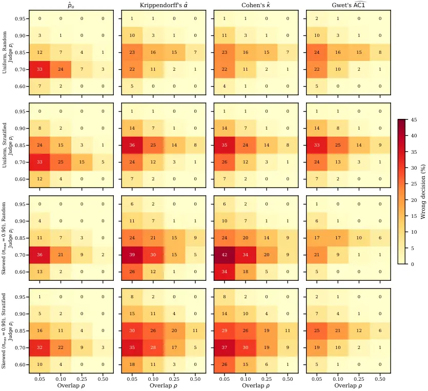

# LLM Judge Validation Under Sparse Overlap: From Inference to Design

Junxuan Li Affiliation: Adobe Email: [junxuanl@adobe.com](mailto:)    
Arko Mukherjee Affiliation: Adobe Email: [arkom@adobe.com](mailto:)    
Soumyabrata Pal Affiliation: Adobe Research
Email: [soumyabratap@adobe.com](mailto:)

###### Abstract

Validating an LLM-as-a-judge requires estimating its agreement with
humans, yet annotation budgets rarely allow every item to be multiply
labeled. We prove that this _overlap sparsity_ is the first-order
determinant of wrong deployment decisions: at 5% pairwise overlap,
wrong-decision rates reach 25% and the probability of selecting the
wrong best judge among ten candidates is 65%. The two actionable levers
are overlap _quantity_ and _allocation_. For quantity, we derive a
minimum-overlap formula showing $`\rho\geq 0.25`$ suffices for
non-borderline judges while borderline cases remain fundamentally hard.
For allocation, a zero-cost stratified scheme halves false-rejection
rates relative to random sampling when strata are informative. We
validate on 10 LLM judges across four evaluation matrices spanning
visual assessment, causal reasoning, and summarization.

## 1 Introduction

Large Language Models (LLM) and Vision Language Models (VLM) are
increasingly used as automated evaluators (e.g. “LLM-as-a-judge”) for
assessing text generation quality (Zheng et al., 2023), safety
compliance, and instruction following. Before deploying such a judge,
practitioners must validate: _does it agree with human annotators well
enough to replace them?_ The standard approach is to compute
inter-annotator agreement metrics between the judge and human annotators
on a calibration set, and apply a statistical test to determine whether
the agreement is sufficient.

This approach faces a fundamental annotation allocation problem: teams
can often afford broad single-pass coverage, but only a small subset of
items can receive multiple labels. The practical question is _where_ to
spend the next limited batch of annotations and _how_ to assess judge
quality given the resulting annotation plan. Figure 1 illustrates: under
the same budget, concentrating labels on a narrow slice inflates the
apparent human ceiling, while spreading them too thinly leaves too
little shared overlap; only a stratified design avoids both failures
(setup in Appendix B.1).

Figure 1: The same annotation budget can fail in two different ways. On
a real visual-assessment task, depth-first labeling biases the
human-agreement ceiling (a) and inflates wrong deployment decisions (b);
random spread gives each annotator independent samples, leaving too
little shared overlap for reliable estimation; Stratified shared overlap
draws a proportional stratum sample that all annotators label,
simultaneously fixing fragmentation (maximal pairwise co-coverage) and
representativeness (stratum-proportional distribution).

This motivates our systematic study of agreement estimation under sparse
overlap. Existing validation methods (Calderon et al., 2025; Jung
et al., 2025; He et al., 2025) assume dense calibration data and provide
little guidance on how reliability degrades when overlap is scarce. We
characterise how sparsity affects estimator bias, variance, and
wrong-decision rates (§2), and show that overlap quantity and allocation
are the dominant levers for reducing wrong decisions, whereas the choice
of agreement coefficient plays a secondary role (§2.4, §3). We derive
concrete overlap guidelines (§2.4, §4.3) and validate them on 10 LLM
judges across three benchmark sources, yielding four evaluation matrices
(§4).

Contributions.  C1. Analytical characterisation of sparsity-induced
wrong decisions. We prove that sparse agreement estimator variance
decomposes as $`\gamma_{F}(\pi)/m`$ (Thm. 1), where the
coefficient-specific amplification $`\gamma_{F}`$ is bounded for
$`\hat{p}_{o}`$ and AC1 but diverges under label skew for
$`\hat{\kappa}`$ and $`\hat{\alpha}`$, and show empirically that among
the design levers practitioners control at validation time ($`F`$,
$`\rho`$, $`\mathbf{D}`$), overlap is the necessary condition for
reliable decisions, while coefficient and design choices provide
secondary improvements within each overlap level (§2, §4.2). C2.
Annotation design as a first-class methodological lever. We establish
that zero-cost static stratification is a strong default on real
design-quality diagnostics when the strata are informative, while
sequential coverage can help under extreme skew (§3, §4.3). C3. Overlap
planning. An asymptotic minimum-overlap recipe for certification
(Thm. 2(ii)) and ranking (Thm. 2(iii)), plus empirical reliability
tables, let practitioners reason about “how much overlap is enough?”
before or during data collection, validated on 10 LLM judges across
three benchmark sources (§4).

Relation to prior work. LLM-as-a-judge validation. A growing line of
work validates LLM judges (Zheng et al., 2023; Gu et al., 2026; Li
et al., 2024) via leave-one-out testing (Calderon et al., 2025),
conformal prediction (Jung et al., 2025), TOST equivalence (He et al.,
2025), reporting-protocol audits (Lee et al., 2026), and
indeterminacy-aware analyses (Guerdan et al., 2025). These pipelines
assume dense calibration data and do not analyse how their decision
rules behave when each pair of annotators co-labels only a small slice
of the corpus. Our problem structure is asymmetric and distinct from
crowdsourcing: the LLM judge has already labelled all $`n`$ items at
near-zero marginal cost, and the scarce resource is the human overlap
needed to validate it. The question is not how to allocate labels to
improve label quality (crowdsourcing) but how much human overlap
suffices to make a reliable deployment decision.

Inter-annotator agreement under sparsity. The textbook coefficients
($`\kappa`$, $`\alpha`$, AC1; Cohen, 1960; Fleiss, 1971; Krippendorff,
2004; Gwet, 2008; Artstein and Poesio, 2008) and their finite-sample /
sample-size diagnostics (Sim and Wright, 2005; Hughes, 2024; James,
2026; Klie et al., 2024; Feinstein and Cicchetti, 1990; Byrt et al., 1993) are derived for fully observed calibration sets. Nørregaard and
Derczynski (2022) show that agreement estimated from an
already-collected sparse matrix is noisy; we build on this observation
by asking the prospective question: given that sparse estimation is
unreliable, how should the annotation budget be allocated _before_ data
collection to make the resulting deployment decision reliable? We
characterise how each coefficient’s bias and variance scale with the
per-pair overlap count and translate that into overlap-rate guidelines
for the sparse regime.

Imputation-based annotation modelling. Latent-truth and incomplete-block
models (Dawid and Skene, 1979; Hovy et al., 2013; Paun et al., 2018;
Passonneau and Carpenter, 2014; Snow et al., 2008; Fleiss et al., 2003)
_impute_ missing labels from generative assumptions about raters. We ask
the orthogonal question of how much direct pairwise overlap is enough
for unmodelled estimation, sidestepping the generative-model dependence.

Annotation design and disagreement-as-signal. Allocating a fixed
annotation budget across raters is treated operationally rather than as
a methodological lever in current LLM-judge practice; our overlap
guidelines also apply when disagreement is treated as signal rather than
noise (Plank, 2022), or when the target is defined by a social-choice
aggregation rule rather than majority vote (Endriss and Fernández, 2013;
Conitzer et al., 2024). Our work addresses the measurement question—can
we measure agreement reliably under sparsity?—and is complementary to
the choice-of-target question (what should we measure?), which is
orthogonal and treated in the cited social-choice literature.

Related estimation methods. Fisch et al. (2024) (StratPPI) and
Angelopoulos et al. (2023) (PPI) use model predictions as control
variates to tighten confidence intervals for population performance
metrics (e.g. mean quality score). Both are post-hoc estimators applied
after data collection; neither addresses inter-annotator agreement
estimation, annotation allocation, or judge accept/reject decisions.
Appendix D provides a structured comparison.

## 2 Agreement Validation Under Sparsity

### 2.1 Notation

Let $`\mathcal{I}=\{1,\ldots,n\}`$ denote the evaluation items and
$`\mathcal{R}=\{r_{1},\ldots,r_{K},j\}`$ the $`K`$ human annotators plus
judge $`j`$. Each rater assigns labels from
$`\mathcal{C}=\{c_{1},\ldots,c_{L}\}`$ to the items they see. Let
$`\mathbf{A}\in(\mathcal{C}\cup\{\texttt{NA}\})^{n\times(K+1)}`$ denote
the annotation matrix and $`\mathbf{D}\in\{0,1\}^{n\times(K+1)}`$ the
corresponding observation mask, with
$`D_{ik}=\mathbf{1}[A_{ik}\neq\texttt{NA}]`$. We treat $`\mathbf{A}`$
and $`\mathbf{D}`$ as random: the item-level annotation vectors
$`(A_{i,1},\ldots,A_{i,K+1})`$ are i.i.d. draws from an unknown joint
label distribution $`P`$ over $`\mathcal{C}^{K+1}`$, and the entries of
$`\mathbf{D}`$ follow the design distribution specified by the
annotation protocol. Throughout, bare symbols denote _population_
quantities (deterministic functionals of $`P`$), and hats denote
_estimators_. Write $`\pi=(\pi_{1},\ldots,\pi_{L})`$ for the population
label prevalence and $`\pi_{\max}=\max_{\ell}\pi_{\ell}`$. Throughout,
_uniform prevalence_ means roughly balanced label frequencies, whereas
_skewed prevalence_ means one or a few labels dominate the corpus (large
$`\pi_{\max}`$). The pairwise overlap rate for raters $`(k,k^{\prime})`$
is $`\rho_{kk^{\prime}}=\tfrac{1}{n}\sum_{i}D_{ik}D_{ik^{\prime}}`$, and
the global overlap rate is
$`\rho=\tfrac{1}{\binom{K+1}{2}}\sum_{k<k^{\prime}}\rho_{kk^{\prime}}`$.

In the _dense_ setting ($`\rho=1`$), every rater annotates every item.
In the _sparse_ setting that motivates this work, the LLM judge
annotates all $`n`$ items ($`D_{ij}=1`$ for all $`i`$), and for
exposition we write the corpus-wide first-pass label layer as if one
primary human annotator annotates all items ($`D_{ir_{1}}=1`$ for all
$`i`$), while each additional human annotator $`r_{k}`$ independently
annotates each item with probability $`\rho_{k}`$, i.e.
$`D_{ir_{k}}\sim\mathrm{Bernoulli}(\rho_{k})`$ for $`k=2,\ldots,K`$. The
first-pass layer can also be a pooled pass across multiple annotators or
an auxiliary AI source; without one, this becomes a general
incomplete-block allocation problem (Fleiss et al., 2003) with the same
sparsity bottleneck.

### 2.2 Agreement Coefficients

Pairwise observed agreement. For any pair of raters $`(k,k^{\prime})`$,
the overlap set is
$`\mathcal{I}_{kk^{\prime}}=\{i:D_{ik}=D_{ik^{\prime}}=1\}`$ and the
pairwise observed agreement is

```math
\hat{p}_{o}^{(kk^{\prime})}\;=\;\frac{1}{|\mathcal{I}_{kk^{\prime}}|}\sum_{i\in\mathcal{I}_{kk^{\prime}}}\mathbf{1}[A_{ik}=A_{ik^{\prime}}]. \tag{1}
```

$`\hat{p}_{o}`$ is the default scoring function in our pipeline (§2.3).
Under sparse overlap $`|\mathcal{I}_{kk^{\prime}}|`$ can be very small,
making $`\hat{p}_{o}`$ noisy.

Chance-corrected coefficients. We also adopt three chance-corrected
agreement coefficients as alternative scoring functions (see full forms
in Appendix A.1):

- •
  Krippendorff’s $`\hat{\alpha}`$ (Krippendorff, 2004) pools all
  within-item pairs into a ratio
  $`\hat{\alpha}=1-\hat{D}_{o}/\hat{D}_{e}`$ of observed-vs-expected
  disagreement.
- •
  Cohen’s pairwise $`\hat{\kappa}`$ (Cohen, 1960) is the analogous
  $`(\hat{p}_{o}^{(kk^{\prime})}-\hat{p}_{e}^{(kk^{\prime})})/(1-\hat{p}_{e}^{(kk^{\prime})})`$
  ratio with rater-marginal chance correction
  $`\hat{p}_{e}^{(kk^{\prime})}=\sum_{\ell}\hat{\pi}_{\ell}^{(k)}\hat{\pi}_{\ell}^{(k^{\prime})}`$;
  it suffers the prevalence paradox (Feinstein and Cicchetti, 1990; Byrt
  et al., 1993) as $`\pi_{\max}\to 1`$, as $`1-p_{e}`$ vanishes.
- •
  Gwet’s $`\widehat{\mathrm{AC1}}`$ (Gwet, 2008) swaps $`\hat{p}_{e}`$
  for a marginal-symmetric chance term
  $`\frac{1}{L-1}\sum_{\ell}\hat{\pi}_{\ell}(1-\hat{\pi}_{\ell})`$,
  yielding bounded denominator constants at the cost of a different
  interpretation.

Sparse-form estimators. All four coefficients are evaluated on the same
sparse overlap subsets in §2.3. We write $`m`$ for the number of items
in the overlap subset on which an estimator is evaluated, and $`m_{k}`$
when this count is specific to held-out rater $`k`$; estimators are
subscripted accordingly: $`\hat{p}_{o,m}`$, $`\hat{\alpha}_{m}`$,
$`\hat{\kappa}_{m}`$, $`\widehat{\mathrm{AC1}}_{m}`$. For
$`\hat{p}_{o,m}`$ this is the itemwise average (1) restricted to the
overlap subset; for the ratio statistics it is the subset-level analogue
with sums and marginals over only the multi-annotated items (full forms
in Appendix A.1).

###### Theorem 1 (Sparsity–prevalence decomposition of agreement scores).

Assume i.i.d. items with $`L\geq 2`$ label categories, an overlap mask
independent of labels, overlap count $`m`$, and fixed rater marginals
(exchangeable in the simplified derivations below). Then for each
coefficient
$`F\in\{\hat{p}_{o},\hat{\alpha},\hat{\kappa},\widehat{\mathrm{AC1}}\}`$,
the sparse estimator satisfies

```math
\mathrm{Var}(\hat{F}_{m})\;=\;\frac{\gamma_{F}(\pi)}{m}\;+\;O(1/m^{2}), \tag{2}
```

where the coefficient-specific amplification factor $`\gamma_{F}`$
exhibits a prevalence-divergence hierarchy:

1.  (i)
    $`\hat{p}_{o}`$: $`\gamma_{p_{o}}=p_{o}(1{-}p_{o})`$ (exact; no
    chance-correction denominator).
2.  (ii)
    $`\hat{\alpha}`$:
    $`\gamma_{\alpha}=O\bigl((1-p_{e}^{\alpha})^{-2}\bigr)`$, diverging
    as $`\pi_{\max}\to 1`$.
3.  (iii)
    $`\hat{\kappa}`$:
    $`\gamma_{\kappa}=O\bigl((1-p_{e}^{\kappa})^{-4}\bigr)`$, diverging
    faster than $`\gamma_{\alpha}`$ (exponent $`-4`$ vs. $`-2`$).
4.  (iv)
    $`\widehat{\mathrm{AC1}}`$: $`\gamma_{\mathrm{AC1}}`$ bounded for
    all $`L,\pi`$ because
    $`1-p_{e}^{\mathrm{AC1}}\geq(L{-}1)/L\geq 1/2`$ (denominator cannot
    vanish).

Bias: $`\mathbb{E}[\hat{F}_{m}]-F=O(1/m)`$ for all four coefficients,
with $`\hat{p}_{o}`$ exactly unbiased (proof in Appendix A.2).

Under uniform prevalence the amplification constants $`\gamma_{F}`$ are
comparable across coefficients; under skew the divergence of
$`\gamma_{\kappa}`$ and $`\gamma_{\alpha}`$ becomes the dominant source
of wrong decisions (§4.2).

### 2.3 Validation Pipeline

Agreement-based validation asks whether judge $`j`$ agrees with humans
_at least as well as_ humans agree with each other (Calderon et al.,
2025; Jung et al., 2025; He et al., 2025). We adopt the standard
leave-one-out pipeline from these prior works: each human rater
$`r_{k}`$ ($`k=1,\ldots,K`$) is held out in turn, and the remaining
$`K-1`$ humans $`r_{-k}=\{r_{k^{\prime}}:k^{\prime}\neq k\}`$ form the
_held-in pool_.

The main pipeline uses $`F=\hat{p}_{o}`$. Given a held-out rater
$`r_{k}`$, the per-rater overlap subset is
$`\mathcal{I}_{k}=\{i:D_{ir_{k}}=D_{ij}=1,\;\sum_{k^{\prime}\neq k}D_{ir_{k^{\prime}}}\geq 1\}`$,
with per-rater overlap count $`m_{k}=|\mathcal{I}_{k}|`$
($`\mathbb{E}[m_{k}]=\rho_{k}n`$); under the sparse design of §2.1 the
bottleneck is $`\min_{k\geq 2}m_{k}`$ since $`r_{1}`$ is densely
labelled. On this subset, the _judge–pool_ and _human–pool_ scores
average pairwise observed agreement over within-item pairs against the
held-in raters $`r_{-k}`$:

```math
\displaystyle S(j;\,r_{k})\; \displaystyle=\;\frac{\sum_{k^{\prime}\neq k}\sum_{i}D_{ir_{k}}D_{ir_{k^{\prime}}}D_{ij}\,\mathbf{1}[A_{ij}=A_{ir_{k^{\prime}}}]}{\sum_{k^{\prime}\neq k}\sum_{i}D_{ir_{k}}D_{ir_{k^{\prime}}}D_{ij}}, \tag{3}
```

```math
\displaystyle S(r_{-k};\,r_{k})\; \displaystyle=\;\frac{\sum_{k^{\prime}\neq k}\sum_{i}D_{ir_{k}}D_{ir_{k^{\prime}}}\,\mathbf{1}[A_{ir_{k}}=A_{ir_{k^{\prime}}}]}{\sum_{k^{\prime}\neq k}\sum_{i}D_{ir_{k}}D_{ir_{k^{\prime}}}}. \tag{4}
```

When RQ1 swaps in $`\hat{\alpha}`$, $`\hat{\kappa}`$, or
$`\widehat{\mathrm{AC1}}`$, the same leave-one-out subsets are reused
with the corresponding subset-level ratio statistic from Appendix A.1.
The per-rater outcome records whether the judge matches or exceeds the
human ceiling up to a tolerance $`\varepsilon\geq 0`$, and the judge is
accepted when at least half of the $`K`$ comparisons favour it:

```math
\displaystyle T_{k} \displaystyle\;=\;\mathbf{1}\!\bigl[\,S(j;\,r_{k})\;\geq\;S(r_{-k};\,r_{k})-\varepsilon\,\bigr], \tag{5}
```

```math
\displaystyle\omega \displaystyle\;=\;\frac{1}{K}\sum_{k=1}^{K}T_{k},\hskip 20.00003pt\text{accept judge iff }\omega\geq 0.5. \tag{6}
```

The choice of $`\varepsilon`$ reflects annotators’ subject-matter
expertise (Calderon et al., 2025); we fix $`\varepsilon=0.05`$
throughout. By Thm. 1, $`S(j;r_{k})-S(r_{-k};r_{k})`$ carries
$`O(1/m_{k})`$ sampling variance (with chance-corrected ratios
inheriting the same rate by the delta method), so at low $`\rho`$ noise
can flip the per-rater comparison in either direction, producing false
approvals on weak judges and false rejections on strong ones regardless
of the agreement coefficient.

Pipeline-generality. The LOO rule (Eqs. (5)–(6)) is the de facto
LLM-judge validation protocol (Calderon et al., 2025; Jung et al., 2025;
He et al., 2025). Three of our four results are pipeline-general: the
$`\gamma_{F}/m`$ decomposition (Thm. 1), the Strat bias-reduction
mechanism (§3), and the planning recipe (Thm. 2). What is LOO-specific
is the exact wrong-decision threshold; alternative pipelines (TOST (He
et al., 2025), conformal prediction (Jung et al., 2025)) face the same
$`\gamma_{F}/m`$ noise and the planning recipe applies with $`\delta`$
set to each pipeline’s tolerance.

### 2.4 Overlap Planning

A natural question is how much overlap is enough. Under a CLT
approximation, the answer reduces to a Gaussian-tail recipe

```math
m^{*}\;=\;\Bigl\lceil z_{1-\alpha_{\text{sig}}/2}^{\,2}\,\sigma^{2}\,\big/\,\delta^{2}\Bigr\rceil, \tag{7}
```

where $`\sigma^{2}`$ is the per-item variance and $`\delta`$ is a
tolerance the practitioner is willing to miss with probability at most
$`\alpha_{\text{sig}}`$. Theorem 2 instantiates this recipe for two core
tasks—certifying a single judge and ranking multiple
candidates—connecting the required overlap to the amplification
hierarchy of Thm. 1. §4.3 fixes $`\delta=\varepsilon=0.05`$ as a
real-benchmark diagnostic and §4.5 tabulates minimum $`\rho`$ across
$`\delta`$ levels. _Allocation_ of this budget is the subject of §3.

###### Theorem 2 (Overlap planning under sparsity).

Under the conditions of Theorem 1, the per-rater score difference
$`d_{k}=S(j;r_{k})-S(r_{-k};r_{k})`$ has mean
$`\mu_{d}:=\mathbb{E}[d_{k}]`$ and variance $`\sigma_{0}^{2}/m`$, where
$`\sigma_{0}^{2}`$ inherits the amplification hierarchy of Thm. 1:
bounded for $`\hat{p}_{o}`$ and $`\widehat{\mathrm{AC1}}`$,
prevalence-dependent for $`\hat{\kappa}`$ and $`\hat{\alpha}`$. Assume
signal margin $`\mu_{d}+\varepsilon>0`$. Then under the Gaussian
approximation:

1.  (i)
    (False-rejection rate).
    $`\mathrm{Pr}[\,d_{k}<-\varepsilon\,]\approx\Phi\!\bigl(-(\mu_{d}+\varepsilon)\sqrt{m}\,/\,\sigma_{0}\bigr)`$.
2.  (ii)
    (Certification). For per-rater false-rejection rate
    $`\leq\alpha_{\textup{sig}}/2`$:
    $`m\geq m^{*}_{\textup{cert}}=\lceil z_{1-\alpha_{\textup{sig}}/2}^{\,2}\,\sigma_{0}^{2}/(\mu_{d}+\varepsilon)^{2}\rceil`$.
    Since $`\sigma_{0}^{2}`$ inherits $`\gamma_{F}(\pi)`$, required
    overlap is prevalence-sensitive for $`\hat{\kappa}`$ and
    $`\hat{\alpha}`$.
3.  (iii)
    (Ranking). Selecting the best among $`J`$ judges replaces
    $`(\mu_{d}{+}\varepsilon)^{2}`$ with the minimum pairwise margin
    $`\Delta_{\min}^{2}`$, inflates the quantile to
    $`z_{1-\alpha/(J-1)}`$ (Bonferroni), and doubles the variance; these
    effects compound, so ranking demands more overlap than
    certification.

(Proof in Appendix A.3.)

## 3 Stratified Annotation Design

Given the pipeline of §2.3, the practitioner’s remaining choices are the
agreement coefficient $`F`$, the overlap budget $`\rho`$, the rater
count $`K`$, and the annotation design $`\mathbf{D}`$. Each acts on a
different term of the $`\gamma_{F}(\pi)/m`$ decomposition (2): $`F`$
determines the amplification $`\gamma_{F}`$, $`\rho`$ controls $`m`$
directly, and $`\mathbf{D}`$ controls the label composition of the
overlap subset. This section develops the design lever; §4.2 confirms
their relative importance empirically.

Marginal-anchored stratification. We instantiate the sparse design of
§2.1 with a per-rater overlap subset structure: the judge and one
primary human annotate all $`n`$ items, and each additional human
$`r_{k}`$ labels an $`m`$-item subset
$`\mathcal{I}^{+}_{k}\subseteq\mathcal{I}`$. Under purely random
selection, the empirical label distribution on $`\mathcal{I}^{+}_{k}`$
can diverge from the corpus marginals $`\pi`$ when prevalence is skewed.
This marginal mismatch feeds into the expected-disagreement term
$`\hat{D}_{e}`$, biasing the human ceiling estimate that the validation
pipeline compares the judge against. Stratified subsampling draws
$`\mathcal{I}^{+}_{k}`$ proportionally across pre-specified strata,
reducing this mismatch in expectation when the stratification signal
tracks the relevant label marginals. The design can reduce
marginal-mismatch bias without sacrificing per-rater overlap count
$`m_{k}`$, but it is not guaranteed to help when the stratum signal is
uninformative or collapses under extreme skew.

A Family of Stratification Designs. A stratified design is fully
specified by (i) a per-rater _stratification signal_
$`s_{k}:\mathcal{I}\to\mathcal{C}`$ that assigns every item a stratum
label, and (ii) a within-stratum sampler that draws
$`m_{\ell}\propto|\{i:s_{k}(i)=c_{\ell}\}|`$ items per stratum
(proportional allocation, residual slots distributed to the largest
strata). We consider three concrete members of this family along a
complexity spectrum:

- •
  Strat: $`s_{k}(i)=A_{i,r_{1}}`$, the primary annotator’s label, shared
  across all secondaries. Fully static, the simplest member.
- •
  Seq-Refined:
  $`s_{k}(i)=\mathrm{mode}\{A_{i,r_{j}}:j<k,\,D_{i,r_{j}}=1\}`$, the
  per-item consensus among raters whose labels are already in hand when
  rater $`k`$’s task is configured.
- •
  Seq-Coverage: Seq-Refined with within-stratum ties broken in favour of
  items least covered so far, equalising pairwise overlap across raters.

The two sequential members require only _between-rater_ adaptation:
rater $`k`$’s task is fixed before their session begins using labels
already collected, so they are operationally feasible whenever
annotation jobs are queued sequentially. We exclude _within-rater_
per-item adaptive policies on operational grounds, since annotation
sessions are often batched, time-bounded, and run asynchronously across
annotators. §4.3 benchmarks the stratification design family.

Fragmentation and representativeness. These are distinct failure modes.
_Fragmentation_: with $`K`$ raters each covering $`m`$ items
independently, expected pairwise co-coverage is only $`m^{2}/n`$,
collapsing well before per-rater coverage is useful.
_Representativeness_: even a shared panel can under-sample rare strata
under skew, biasing the human ceiling. Strat addresses both: stratified
draws control the label distribution while the shared panel structure
maximises co-coverage.

## 4 Experiments

### 4.1 Setup

Synthetic data. We generate annotation matrices with $`n=500`$ items,
$`K\in\{4,5\}`$ humans plus one LLM judge, and $`L\in\{2,5\}`$ labels
(Appendix B.2), varying judge accuracy $`p_{j}`$, human ceiling accuracy
$`p_{h}`$ (fixed at $`0.85`$), prevalence skew $`\pi_{\max}`$, and
overlap rate $`\rho`$ over task-specific grids and averaging over 300
realisations.

Real benchmarks and judges. We use three benchmark sources (WAX (Codella
et al., 2018), CeBaB (Abraham et al., 2022) with stars/aspects subtasks,
SummEval (Fabbri et al., 2021)), yielding four real evaluation matrices,
with 10 LLM judges: five from Calderon et al. (2025) (Gemini Flash/Pro,
GPT-4o-mini, Llama-3.1, Mistral-v0.3) plus five collected for this work
(GPT-5.4, GPT-5.2, GPT-4o, Claude Opus 4.5, Claude Sonnet 4.5; 28,822
new judge labels). For §4.3 we apply a class-merging skew-masking
protocol that binarises each multi-class matrix at threshold $`t`$ to
expose a tunable $`\pi_{\max}\in[0.55,0.96]`$, since no benchmark in our
suite naturally reaches the $`\pi_{\max}\geq 0.90`$ regime the
sequential family members target.

Inference convention and reference. All results in §§4.2–4.5 use the
leave-one-out pipeline (Eqs. (5)–(6), $`\varepsilon=0.05`$) with
$`F=\hat{p}_{o}`$ unless noted; the coefficient swap to
$`F\in\{\hat{\alpha},\hat{\kappa},\widehat{\mathrm{AC1}}\}`$ is RQ1’s
comparison. Decisions on the dense matrix ($`\rho=1`$) serve as the
finite-sample reference scored by wrong-decision rates.

### 4.2 RQ1: What Drives Wrong Decisions – Coefficient or Design?



Figure 2: Wrong-decision rate across overlap, judge quality, and design.
Each cell shows the percentage of trials whose deploy/reject outcome
differs from the ground-truth reference. Row pairs vary prevalence and
annotation design (Random vs. Stratified); columns vary the agreement
coefficient $`F`$.

§3 showed that $`F`$, $`\rho`$, and $`\mathbf{D}`$ each act on a
different term of the $`\gamma_{F}/m`$ decomposition (2); RQ1 isolates
their effects on wrong-decision rates. Borderline judges
($`p_{j}\in\{0.85,0.70\}`$) are the diagnostic regime: small signal
margins make the $`O(1/m_{k})`$ noise most likely to flip the per-rater
comparison.

$`\hat{p}_{o}`$ is the most stable default in the diagnostic cells. In
the borderline strong-judge cells of Figure 2, $`\hat{p}_{o}`$ has the
lowest or near-lowest wrong-decision rate, with the gap largest at low
overlap: at $`\rho=0.05`$, $`p_{j}=0.90`$, $`\hat{p}_{o}`$ errs on 3–4%
of trials while $`\hat{\alpha}`$ and $`\hat{\kappa}`$ reach 10–11% from
the diverging amplification $`\gamma_{\alpha}`$, $`\gamma_{\kappa}`$
(Thm. 1(ii–iii)). Large-gap judges ($`p_{j}=0.95`$) are robust to
coefficient choice as the margin absorbs the noise.

Stratification helps under skew but not uniformly. Comparing Random and
Stratified row-pairs of Figure 2, stratification reduces wrong decisions
for weak judges under skew (e.g. $`p_{j}=0.70`$, $`\hat{\kappa}`$,
$`\rho=0.05`$: $`42\%\to 37\%`$) but offers no consistent benefit under
uniform prevalence, where marginal-mismatch bias is absent. The full
design effect emerges on real benchmarks with natural skew (§4.4).

### 4.3 RQ2: Which Design Performs Best on Real Benchmarks?

RQ2 compares the four design members of §3 (Random, Strat, Seq-Refined,
Seq-Coverage) on real benchmarks using test-independent metrics that
evaluate how faithfully the human-pool score is preserved under sparse
overlap. For this diagnostic we use Krippendorff’s
$`\hat{\alpha}_{\mathrm{hh}}`$, which is sensitive to the
marginal-mismatch mechanism stratification controls. Write
$`\hat{F}_{m}`$ for the sparse human-pool estimate and $`F^{*}`$ for its
dense-matrix reference ($`\rho=1`$):

- •
  Bias: $`\mathbb{E}[\hat{F}_{m}]-F^{*}`$, the expected drift of the
  sparse estimate. This directly measures how the sampled overlap subset
  changes the human-ceiling estimate relative to the dense matrix.
- •
  Std: $`\mathrm{std}(\hat{F}_{m})`$, sampling spread across trials.
- •
  $`(\delta{=}0.05,\alpha_{\text{sig}}{=}0.05)`$-reliability: fraction
  of trials with $`|\hat{F}_{m}-F^{*}|\leq 0.05`$.

We report on six (dataset, skew-level) configurations spanning
$`\pi_{\max}\in[0.26,0.96]`$ (Table 1): two at natural prevalence
(cebab_stars, summeval) and four skew-masked at threshold $`t`$ via the
class-merging protocol of §4.1.

|                               |          | $`   | \mathrm{bias} | `$ of $`\hat{F}\_{m}`$ |      |      |      | $`\mathrm{std}(\hat{F}_{m})`$ |      |      |     | Rel. ($`\delta=0.05`$) |      |     |     |
| ----------------------------- | -------- | ---- | ------------- | ---------------------- | ---- | ---- | ---- | ----------------------------- | ---- | ---- | --- | ---------------------- | ---- | --- | --- |
| Dataset ($`\pi_{\max}`$)      | $`\rho`$ | R    | S             | SR                     | SC   | R    | S    | SR                            | SC   | R    | S   | SR                     | SC   |
| cebab_stars (.26)             | .05      | .087 | .001          | .087                   | .105 | .126 | .074 | .124                          | .117 | .22  | .49 | .24                    | .22  |
|                               | .10      | .069 | .004          | .070                   | .123 | .080 | .051 | .079                          | .079 | .33  | .64 | .32                    | .13  |
|                               | .25      | .039 | .001          | .044                   | .049 | .040 | .028 | .040                          | .042 | .58  | .93 | .55                    | .51  |
| summeval (.56)                | .05      | .020 | .034          | .016                   | .016 | .030 | .026 | .026                          | .027 | .82  | .70 | .88                    | .90  |
|                               | .10      | .014 | .031          | .013                   | .012 | .019 | .018 | .018                          | .017 | .95  | .84 | .97                    | .98  |
|                               | .25      | .008 | .021          | .008                   | .001 | .011 | .010 | .010                          | .010 | 1.00 | .99 | 1.00                   | 1.00 |
| lesion@$`t{=}0`$ (.65)        | .05      | .044 | .018          | .045                   | .043 | .081 | .101 | .080                          | .071 | .36  | .37 | .41                    | .45  |
|                               | .10      | .034 | .002          | .039                   | .049 | .052 | .071 | .053                          | .047 | .57  | .53 | .53                    | .51  |
|                               | .25      | .020 | .002          | .024                   | .038 | .032 | .040 | .033                          | .025 | .82  | .77 | .77                    | .66  |
| lesion@$`t{=}1`$ (.74)        | .05      | .130 | .021          | .131                   | .152 | .088 | .105 | .088                          | .084 | .16  | .35 | .19                    | .10  |
|                               | .10      | .111 | .003          | .113                   | .148 | .059 | .068 | .055                          | .055 | .13  | .53 | .16                    | .03  |
|                               | .25      | .072 | .006          | .074                   | .122 | .035 | .038 | .032                          | .024 | .26  | .78 | .24                    | .00  |
| lesion@$`t{=}2`$ (.93)        | .05      | .116 | .129          | .111                   | .105 | .176 | .264 | .173                          | .149 | .17  | .16 | .19                    | .20  |
|                               | .10      | .076 | .088          | .070                   | .060 | .123 | .165 | .113                          | .089 | .29  | .18 | .34                    | .40  |
|                               | .25      | .035 | .055          | .030                   | .021 | .066 | .080 | .058                          | .045 | .51  | .41 | .60                    | .70  |
| cebab_aspects@$`t{=}0`$ (.96) | .05      | .135 | .154          | .124                   | .269 | .374 | .179 | .359                          | .408 | .17  | .18 | .18                    | .04  |
|                               | .10      | .081 | .082          | .094                   | .278 | .231 | .129 | .210                          | .242 | .19  | .31 | .19                    | .09  |
|                               | .25      | .038 | .029          | .037                   | .044 | .100 | .065 | .096                          | .102 | .36  | .53 | .42                    | .36  |

Table 1: Test-independent design-quality metrics on real benchmarks.
R=Random, S=Strat, SR=Seq-Refined, SC=Seq-Coverage. Lower is better for
bias/std; higher for reliability; bold marks the best design per row.

Strat cuts estimator bias by an order of magnitude when the strata are
informative. On cebab*stars ($`\pi*{\max}=0.26`$), Strat reduces
$`|\mathrm{bias}(\hat{F}_{m})|`$ by roughly $`17`$–$`87\times`$ relative
to Random across all $`\rho`$, lifting reliability from 22–58% to
49–93%. On lesion@$`t{=}1`$ ($`\pi_{\max}=0.74`$) the pattern repeats:
$`6`$–$`37\times`$ bias reduction, 19–52pp reliability gains. On
summeval ($`\pi\_{\max}=0.56`$), all designs perform similarly because
the marginal-mismatch bias is already small.

Adaptive strategies are not a uniformly better default. Seq-Refined
matches Strat only when its between-rater consensus signal is itself
accurate; Seq-Coverage’s coverage-equalising tiebreak helps in some
cells but amplifies variance when coverage diversity conflicts with
representative sampling. We therefore recommend the simpler Strat design
when the primary stratum signal has usable variation, and sequential
coverage only when that signal collapses.

Limitation: Strat requires informative strata. At
$`\pi_{\max}\geq 0.93`$, the primary annotator labels nearly all items
identically and stratification collapses; Seq-Coverage or higher
$`\rho`$ become necessary (Appendix E.1).

### 4.4 RQ3: How Do Real LLM Judges Behave Under Sparsity?

We apply the pipeline to 10 LLM judges and four real-world evaluation
matrices (WAX, CeBaB-aspects, CeBaB-stars, SummEval; §4.1), asking
whether synthetic patterns persist on real data.

Sparsity scrambles model rankings. Beyond deploy/reject, practitioners
often need to _rank_ candidate judges. Table 2 reports ranking stability
across 10 judges per benchmark: at $`\rho=0.05`$ the mean top-1 error is
65% (CeBaB-aspects/stars near 88%; SummEval at 18% thanks to its
6 400-item corpus), and at $`\rho=0.25`$ remains 36%. Ranking demands
stricter overlap than deploy/reject because pairwise margins between
candidate judges are tighter than the human–judge gap (Thm. 2(iii)).

|          | WAX  |       | CeBaB-asp. |       | CeBaB-stars |       | SummEval |       | Mean |       |
| -------- | ---- | ----- | ---------- | ----- | ----------- | ----- | -------- | ----- | ---- | ----- |
| $`\rho`$ | Rank | Top-1 | Rank       | Top-1 | Rank        | Top-1 | Rank     | Top-1 | Rank | Top-1 |
| 0.05     | .297 | .670  | .349       | .887  | .342        | .875  | .122     | .177  | .278 | .652  |
| 0.10     | .234 | .600  | .279       | .777  | .255        | .787  | .083     | .080  | .213 | .561  |
| 0.25     | .146 | .427  | .196       | .507  | .156        | .517  | .049     | .003  | .137 | .363  |
| 0.50     | .071 | .270  | .138       | .213  | .085        | .350  | .031     | .000  | .082 | .208  |
| 0.75     | .031 | .103  | .091       | .033  | .053        | .110  | .018     | .000  | .048 | .062  |

Table 2: Ranking stability under sparsity. “Rank err.” = fraction of
pairwise rankings scrambled; “Top-1” = probability of selecting the
wrong best judge. 10 judges per benchmark.

Stratified sampling reduces false rejection; false approval depends on
judge quality. Table 3 aggregates wrong-decision rates across all four
evaluation matrices (40 judges; per-judge detail in Appendix C.3.1). At
$`\rho=0.05`$, Strat halves the mean FR rate from 29% to 14%; by
$`\rho=0.25`$, Strat falls below 3% FR, while the other designs still
sit around 11–16%. FA rates are lower (7–17% at $`\rho=0.05`$) because
most reject judges sit far below the boundary, but FA does _not_ decay
to zero even at $`\rho=0.50`$ (7–11%), motivating the borderline-judge
analysis below.

| $`\rho`$ | Design       | Mean FR | Mean FA | Mean WDR |
| -------- | ------------ | ------- | ------- | -------- |
| 0.05     | Random       | .290    | .112    | .250     |
|          | Strat        | .142    | .172    | .184     |
|          | Seq-Refined  | .308    | .098    | .250     |
|          | Seq-Coverage | .435    | .066    | .311     |
| 0.10     | Random       | .238    | .082    | .212     |
|          | Strat        | .087    | .136    | .137     |
|          | Seq-Refined  | .230    | .086    | .209     |
|          | Seq-Coverage | .328    | .072    | .264     |
| 0.25     | Random       | .122    | .071    | .149     |
|          | Strat        | .027    | .114    | .092     |
|          | Seq-Refined  | .113    | .070    | .146     |
|          | Seq-Coverage | .158    | .075    | .174     |
| 0.50     | Random       | .021    | .079    | .089     |
|          | Strat        | .007    | .110    | .077     |
|          | Seq-Refined  | .027    | .077    | .092     |
|          | Seq-Coverage | .030    | .075    | .096     |

Table 3: Wrong-decision rates by design and overlap (aggregated across
the four real evaluation matrices). FR = mean false-rejection rate on 20
pass-judges ($`\omega\geq 0.60`$); FA = mean false-approval rate on 16
reject judges ($`\omega<0.50`$); WDR = mean over all 40 judges. Bold =
best design per $`\rho`$.

Strat lowers FR but raises FA at $`\rho=0.05`$ (14.2% vs 29.0% FR; 17.2%
vs 11.2% FA), because correcting the human-ceiling upward bias lets some
borderline-reject judges through. When FA cost dominates: increase
$`\rho`$ or use Seq-Coverage (Appendix E.2).

Borderline judges reveal a fundamental limit that higher overlap
mitigates. Table 4 isolates four judges sitting exactly on the
pass/reject boundary ($`\omega=0.50`$). Under Strat, strong pass-judges
converge below 3% WDR by $`\rho=0.25`$, but borderline judges remain at
30–44% WDR even under the best design: when $`\omega`$ equals the
threshold, any finite-sample estimator has $`{\sim}50\%`$ error.
Practitioners should budget $`\rho\geq 0.25`$ for non-borderline judges
and treat verdicts with $`\hat{\omega}`$ near $`0.5`$ as inconclusive.

| Design       | Category            | $`\rho=0.05`$ | $`0.10`$ | $`0.25`$ | $`0.50`$ |
| ------------ | ------------------- | ------------- | -------- | -------- | -------- |
| Random       | Strong pass (20)    | .290          | .238     | .122     | .021     |
|              | Borderline pass (4) | .597          | .597     | .599     | .464     |
|              | Reject (16)         | .112          | .082     | .071     | .079     |
| Strat        | Strong pass (20)    | .142          | .087     | .027     | .007     |
|              | Borderline pass (4) | .440          | .389     | .323     | .295     |
|              | Reject (16)         | .172          | .136     | .114     | .110     |
| Seq-Refined  | Strong pass (20)    | .308          | .230     | .113     | .027     |
|              | Borderline pass (4) | .572          | .602     | .618     | .482     |
|              | Reject (16)         | .098          | .086     | .070     | .077     |
| Seq-Coverage | Strong pass (20)    | .435          | .328     | .158     | .030     |
|              | Borderline pass (4) | .676          | .709     | .647     | .509     |
|              | Reject (16)         | .066          | .072     | .075     | .075     |

Table 4: Borderline vs. strong judges across designs: mean
wrong-decision rate at increasing $`\rho`$ (aggregated over the four
real evaluation matrices). Strong pass ($`\omega\geq 0.60`$, 20 judges),
borderline pass ($`\omega=0.50`$, 4 judges), reject ($`\omega<0.50`$, 16
judges). Bold = best design per category and $`\rho`$.

Real-world tests align with synthetic findings. The elevated
wrong-decision rates do not contradict RQ1: real judges exhibit
heterogeneous per-rater agreement (e.g. Gemini Flash on CeBaB-stars:
per-rater $`\hat{p}_{o}`$ ranges 0.40–0.64 against a human baseline of
$`{\sim}0.51`$), so their deltas cluster near the
$`\varepsilon`$-threshold—a regime the i.i.d. synthetic grid does not
probe. The pipeline still separates strong from weak judges, but
borderline cases require higher overlap or should be flagged as
inconclusive (correlated-item robustness in Appendix D).

### 4.5 RQ4: How Much Overlap Is Enough?

Having established that design choice and overlap jointly control
wrong-decision rates (§4.3–§4.4), we next translate these findings into
concrete planning rules.

Required overlap for a precision target. Table 5 reports the empirical
minimum $`\rho`$ at which the human-pool score $`\hat{F}_{m}`$ (computed
with $`\hat{p}_{o}`$ under per-rater sparse overlap) stays within
$`\pm\delta`$ of its dense reference on $`\geq`$95% of 300 synthetic
trials. For the common $`\delta=0.05`$ target, practitioners need 25%
overlap under uniform prevalence ($`L=2`$), widening to 15–50% under
skew ($`L=5`$); at $`\rho=0.05`$ achievable precision is only
$`\delta=0.10`$, large enough to flip a deployment decision.

|       |                           | Min. $`\rho`$ for $`\mathrm{Pr}[ | \hat{F}\_{m}-F^{\*} | >\delta]\leq 0.05`$ |     |     |
| ----- | ------------------------- | -------------------------------- | ------------------- | ------------------- | --- | --- |
| $`L`$ | Prevalence                | $`\delta\!=\!0.02`$              | $`\delta\!=\!0.05`$ | $`\delta\!=\!0.10`$ |
| 2     | Uniform                   | $`\geq`$75%                      | 25%                 | 5–10%               |
|       | Skewed (.8/.2)            | $`\geq`$75%                      | 25%                 | 5–10%               |
| 5     | Uniform                   | $`\geq`$75%                      | 15–25%              | 5–10%               |
|       | Skewed (.7/.1/.1/.05/.05) | $`\geq`$75%                      | 15–50%              | 5–10%               |

Table 5: Minimum overlap for a precision target on the human-pool score
$`\hat{F}_{m}`$ using $`\hat{p}_{o}`$ under per-rater sparse overlap
($`n=500`$, $`K=4`$, $`F^{*}\in[0.6,0.9]`$, 300 trials,
$`\alpha_{\text{sig}}=0.05`$). Ranges span the target $`F^{*}`$ values.

Overlap dominates rater count. Figure 4 shows diminishing returns from
adding raters relative to increasing overlap. At $`\rho=0.05`$, doubling
$`K`$ from 2 to 10 lifts reliability only from 17% to 40%, whereas
raising $`\rho`$ from 0.05 to 0.25 at $`K=3`$ jumps reliability from 27%
to 63%. Curves flatten after $`K=5`$ while each $`\rho`$ step yields a
larger vertical jump under both uniform and skewed prevalence,
identifying $`K=3\text{--}5`$ with $`\rho\geq 0.25`$ as the practical
sweet spot.

Figure 3: Reliability vs. annotator count at five overlap rates
($`n=500`$, $`p_{h}=0.80`$). Reliability = % of trials within
$`\pm 0.05`$ of ground truth. Grey line marks 50%.

## 5 Conclusion

We studied LLM-judge validation when only a small fraction of items
receive multiple human labels. Sparse overlap injects
$`\gamma_{F}(\pi)/m`$ variance into per-rater agreement comparisons
(Thm. 1), with $`\gamma_{F}`$ diverging for $`\hat{\kappa}`$ and
$`\hat{\alpha}`$ under label skew; among the design levers ($`F`$,
$`\rho`$, $`\mathbf{D}`$), overlap quantity is the necessary condition
for reliable decisions. The two actionable levers are overlap
_quantity_, planned via recipe (7) with certification and ranking
variants (Thm. 2), and overlap _allocation_, where Strat cuts estimator
bias by an order of magnitude when strata are informative. Practical
recipe: $`F=\hat{p}_{o}`$ with Strat, $`\rho\geq 0.25`$, $`K=3`$–$`5`$
raters, extra overlap for ranking. Borderline judges
($`\omega\approx 0.50`$) represent a fundamental limit and should be
flagged as inconclusive (Table 4).

Limitations and future work. Results assume i.i.d. items and batched
annotation; clustered item difficulty demands cluster-aware
stratification (Appendix D). Strat requires informative strata and
degrades under extreme skew ($`\pi_{\max}>0.90`$). Recipe (7) is
asymptotic and needs a pre-collection variance estimate. The
overlap-mask-independent-of-labels assumption (Thm. 1) requires that
annotation assignments are random or coverage-based, not self-selected.
Future work covers adaptive within-rater policies, preference-based and
rubric-based evaluation (which face the same sparse-estimation
bottleneck), and non-deterministic judges (whose additional variance
makes our overlap targets conservative lower bounds).

## References

- Abraham et al. (2022) Eldar David Abraham, Karel D’Oosterlinck, Amir
  Feder, Yair Gat, Atticus Geiger, Christopher Potts, Roi Reichart, and
  Zhengxuan Wu. CEBaB: Estimating the causal effects of real-world
  concepts on NLP model behavior. In _Advances in Neural Information
  Processing Systems_, volume 35, 2022.
- Angelopoulos et al. (2023) Anastasios N. Angelopoulos, Stephen Bates,
  Clara Fannjiang, Michael I. Jordan, and Tijana Zrnic.
  Prediction-powered inference. _Science_, 382:669–674, 2023.
- Artstein and Poesio (2008) Ron Artstein and Massimo Poesio.
  Inter-coder agreement for computational linguistics. _Computational
  Linguistics_, 34(4):555–596, 2008.
- Byrt et al. (1993) Ted Byrt, Janet Bishop, and John B Carlin. Bias,
  prevalence and kappa. _Journal of Clinical Epidemiology_,
  46(5):423–429, 1993.
- Calderon et al. (2025) Nitay Calderon, Roi Reichart, and Rotem Dror.
  The alternative annotator test for llm-as-a-judge: How to
  statistically justify replacing human annotators with llms. In
  _Proceedings of the 63rd Annual Meeting of the Association for
  Computational Linguistics_, pages 16051–16081, 2025.
- Codella et al. (2018) Noel C. F. Codella, David Gutman, M. Emre
  Celebi, Brian Helba, Michael A. Marchetti, Stephen W. Dusza, Aadi
  Kalloo, Konstantinos Liopyris, Nabin Mishra, Harald Kittler, and Allan
  Halpern. Skin lesion analysis toward melanoma detection: A challenge
  at the 2017 international symposium on biomedical imaging (isbi),
  hosted by the international skin imaging collaboration (isic). In
  _2018 IEEE 15th International Symposium on Biomedical Imaging (ISBI 2018)_, pages 168–172, 2018. doi: 10.1109/ISBI.2018.8363547.
- Cohen (1960) Jacob Cohen. A coefficient of agreement for nominal
  scales. _Educational and Psychological Measurement_,
  20(1):37–46, 1960.
- Conitzer et al. (2024) Vincent Conitzer, Rachel Freedman, Jobst
  Heitzig, Wesley H. Holliday, Bob M. Jacobs, Nathan Lambert, Milan
  Mosse, Eric Pacuit, Stuart Russell, Hailey Schoelkopf, Emanuel
  Tewolde, and William S. Zwicker. Position: Social choice should guide
  AI alignment in dealing with diverse human feedback. In _Proceedings
  of the International Conference on Machine Learning_, volume 235,
  pages 9346–9360, 2024.
- Dawid and Skene (1979) Alexander Philip Dawid and Allan M Skene.
  Maximum likelihood estimation of observer error-rates using the em
  algorithm. _Journal of the Royal Statistical Society: Series C
  (Applied Statistics)_, 28(1):20–28, 1979.
- Endriss and Fernández (2013) Ulle Endriss and Raquel Fernández.
  Collective annotation of linguistic resources: Basic principles and a
  formal model. In _Proceedings of the 51st Annual Meeting of the
  Association for Computational Linguistics_, pages 539–549, 2013.
- Fabbri et al. (2021) Alexander R Fabbri, Wojciech Kryściński, Bryan
  McCann, Caiming Xiong, Richard Socher, and Dragomir Radev. Summeval:
  Re-evaluating summarization evaluation. _Transactions of the
  Association for Computational Linguistics_, 9:391–409, 2021.
- Feinstein and Cicchetti (1990) Alvan R Feinstein and Domenic V
  Cicchetti. High agreement but low kappa: I. the problems of two
  paradoxes. _Journal of Clinical Epidemiology_, 43(6):543–549, 1990.
- Fisch et al. (2024) Adam Fisch, Joshua Maynez, R. Alex Hofer, Bhuwan
  Dhingra, Amir Globerson, and William W. Cohen. Stratified
  prediction-powered inference for effective hybrid evaluation of
  language models. In _Advances in Neural Information Processing
  Systems_, volume 37, 2024.
- Fleiss (1971) Joseph L Fleiss. Measuring nominal scale agreement among
  many raters. _Psychological Bulletin_, 76(5):378–382, 1971.
- Fleiss et al. (2003) Joseph L. Fleiss, Bruce Levin, and Myunghee Cho
  Paik. _Statistical Methods for Rates and Proportions_. Wiley Series in
  Probability and Statistics. John Wiley & Sons, Hoboken, NJ, 3rd
  edition, 2003. ISBN 978-0-471-52629-2.
- Gu et al. (2026) Jiawei Gu, Xuhui Jiang, Zhichao Shi, Hexiang Tan,
  Xuehao Zhai, Chengjin Xu, Wei Li, Yinghan Shen, Shengjie Ma, Honghao
  Liu, et al. A survey on llm-as-a-judge. _The Innovation_,
  7(6):101253, 2026.
- Guerdan et al. (2025) Luke Guerdan, Solon Barocas, Kenneth Holstein,
  Hanna Wallach, Zhiwei Steven Wu, and Alexandra Chouldechova.
  Validating llm-as-a-judge systems under rating indeterminacy. In
  _Advances in Neural Information Processing Systems_, 2025.
- Gwet (2008) Kilem Li Gwet. Computing inter-rater reliability and its
  variance in the presence of high agreement. _British Journal of
  Mathematical and Statistical Psychology_, 61(1):29–48, 2008.
- He et al. (2025) Jiaman He, Zikang Leng, Dana McKay, Damiano Spina,
  and Johanne R Trippas. Can we hide machines in the crowd? quantifying
  equivalence in llm-in-the-loop annotation tasks. In _Proceedings of
  the 2025 Annual International ACM SIGIR Conference on Research and
  Development in Information Retrieval in the Asia Pacific Region_,
  pages 426–436, 2025.
- Hovy et al. (2013) Dirk Hovy, Taylor Berg-Kirkpatrick, Ashish Vaswani,
  and Eduard Hovy. Learning whom to trust with mace. In _Proceedings of
  the 2013 Conference of the North American Chapter of the Association
  for Computational Linguistics: Human Language Technologies_, pages
  1120–1130, 2013.
- Hughes (2024) John Hughes. Toward improved inference for
  krippendorff’s alpha agreement coefficient. _Journal of Statistical
  Planning and Inference_, 233:106170, 2024.
- James (2026) Joseph James. Counting on consensus: Selecting the right
  inter-annotator agreement metric for nlp annotation and evaluation.
  _arXiv preprint arXiv:2603.06865_, 2026.
- Jung et al. (2025) Jaehun Jung, Faeze Brahman, and Yejin Choi. Trust
  or escalate: Llm judges with provable guarantees for human agreement.
  In _Proceedings of the International Conference on Learning
  Representations_, 2025.
- Klie et al. (2024) Jan-Christoph Klie, Juan Haladjian, Marc Kirchner,
  and Rahul Nair. On efficient and statistical quality estimation for
  data annotation. In _Proceedings of the 62nd Annual Meeting of the
  Association for Computational Linguistics_, pages 15680–15696, 2024.
- Krippendorff (2004) Klaus Krippendorff. _Content Analysis: An
  Introduction to Its Methodology_. Sage Publications, 2nd
  edition, 2004.
- Lee et al. (2026) Chungpa Lee, Thomas Zeng, Jongwon Jeong, Jy-yong
  Sohn, and Kangwook Lee. How to correctly report llm-as-a-judge
  evaluations. In _Proceedings of the International Conference on
  Machine Learning_, 2026.
- Li et al. (2024) Haitao Li, Qian Dong, Junjie Chen, Huixue Su, Yujia
  Zhou, Qingyao Ai, Ziyi Ye, and Yiqun Liu. LLMs-as-judges: A
  comprehensive survey on LLM-based evaluation methods. _arXiv preprint
  arXiv:2412.05579_, 2024.
- Nørregaard and Derczynski (2022) Jeppe Nørregaard and Leon Derczynski.
  Sparse probability of agreement, 2022.
- Passonneau and Carpenter (2014) Rebecca J Passonneau and Bob
  Carpenter. The benefits of a model of annotation. _Transactions of the
  Association for Computational Linguistics_, 2:311–326, 2014.
- Paun et al. (2018) Silviu Paun, Bob Carpenter, Jon Chamberlain, Dirk
  Hovy, Udo Kruschwitz, and Massimo Poesio. Comparing bayesian models of
  annotation. _Transactions of the Association for Computational
  Linguistics_, 6:571–585, 2018.
- Plank (2022) Barbara Plank. The “problem” of human label variation: On
  ground truth in data, modeling and evaluation. In _Proceedings of the
  2022 Conference on Empirical Methods in Natural Language Processing_,
  pages 10671–10682, 2022.
- Sheng et al. (2008) Victor S. Sheng, Foster Provost, and Panagiotis G.
  Ipeirotis. Get another label? improving data quality and data mining
  using multiple, noisy labelers. In _Proceedings of the 14th ACM SIGKDD
  International Conference on Knowledge Discovery and Data Mining_,
  pages 614–622, 2008.
- Sim and Wright (2005) Julius Sim and Chris C Wright. The kappa
  statistic in reliability studies: Use, interpretation, and sample size
  requirements. _Physical Therapy_, 85(3):257–268, 2005.
- Snow et al. (2008) Rion Snow, Brendan O’Connor, Daniel Jurafsky, and
  Andrew Y Ng. Cheap and fast — but is it good? evaluating non-expert
  annotations for natural language tasks. In _Proceedings of the 2008
  Conference on Empirical Methods in Natural Language Processing_, pages
  254–263, 2008.
- van der Vaart (1998) A. W. van der Vaart. _Asymptotic Statistics_.
  Cambridge University Press, 1998.
- Zheng et al. (2023) Lianmin Zheng, Wei-Lin Chiang, Ying Sheng, Siyuan
  Zhuang, Zhanghao Wu, Yonghao Zhuang, Zi Lin, Zhuohan Li, Dacheng Li,
  Eric P Xing, Hao Zhang, Joseph E Gonzalez, and Ion Stoica. Judging
  llm-as-a-judge with mt-bench and chatbot arena. _Advances in Neural
  Information Processing Systems_, 36, 2023.

## Appendix A Formal Proofs

### A.1 Coefficient Definitions

We collect the explicit sparse-data forms of the four agreement
coefficients used throughout the paper (§2.2). All sums run only over
items selected by the design mask $`\mathbf{D}`$; when $`\rho=1`$ every
form reduces to its standard textbook definition \[Krippendorff, 2004,
Cohen, 1960, Gwet, 2008\].

Pairwise observed agreement $`\hat{p}_{o}`$. For rater pair
$`(k,k^{\prime})`$, the overlap set is
$`\mathcal{I}_{kk^{\prime}}=\{i:D_{ik}=D_{ik^{\prime}}=1\}`$, with
$`m_{kk^{\prime}}=|\mathcal{I}_{kk^{\prime}}|`$. The pairwise observed
agreement is

```math
\hat{p}_{o}^{(kk^{\prime})}=\frac{1}{m_{kk^{\prime}}}\sum_{i\in\mathcal{I}_{kk^{\prime}}}\mathbf{1}[A_{ik}=A_{ik^{\prime}}].
```

No chance correction is applied: the estimator is simply the fraction of
co-annotated items on which the two raters agree. This makes
$`\hat{p}_{o}`$ unbiased with variance
$`p_{o}(1-p_{o})/m_{kk^{\prime}}`$ (Thm. 1(i)) and is why
$`\hat{p}_{o}`$ serves as the default scoring function.

Krippendorff’s $`\hat{\alpha}`$ pools all within-item pairs across all
raters into a single disagreement ratio:

```math
\hat{\alpha}=1-\frac{\hat{D}_{o}}{\hat{D}_{e}},\hskip 8.50012pt\hat{D}_{o}=\frac{\sum_{i}\sum_{k\neq k^{\prime}:D_{ik}D_{ik^{\prime}}=1}\delta(A_{ik},A_{ik^{\prime}})}{\sum_{i}n_{i}(n_{i}-1)},\hskip 8.50012pt\hat{D}_{e}=\frac{\sum_{\ell,\ell^{\prime}}N_{\ell}N_{\ell^{\prime}}\,\delta(c_{\ell},c_{\ell^{\prime}})}{N(N-1)},
```

with $`n_{i}=\sum_{k}D_{ik}`$ (number of raters on item $`i`$),
$`\delta(c,c^{\prime})=\mathbf{1}[c\neq c^{\prime}]`$ for nominal data,
$`N=\sum_{i,k}D_{ik}`$ (total label count), and
$`N_{\ell}=\sum_{i,k}D_{ik}\mathbf{1}[A_{ik}=c_{\ell}]`$ (total count of
category $`\ell`$). We write $`\hat{\alpha}_{\text{dense}}`$ when
$`\rho=1`$ and $`\hat{\alpha}_{m}`$ when the dependence on the
multi-annotated count $`m=|\mathcal{I}^{+}|`$ matters; the estimator is
the same in both cases, only the mask distribution differs. As a ratio
statistic, $`\hat{\alpha}`$ inherits an $`O(1/m)`$ bias from the random
denominator $`\hat{D}_{e}`$ (proof in §A.2(ii)), and its amplification
factor $`\gamma_{\alpha}=O\bigl((1-p_{e}^{\alpha})^{-2}\bigr)`$ grows
under skew (Thm. 1(ii)).

Cohen’s pairwise $`\hat{\kappa}`$. For rater pair $`(k,k^{\prime})`$ on
the overlap set $`\mathcal{I}_{kk^{\prime}}`$:

```math
\hat{\kappa}^{(kk^{\prime})}=\frac{\hat{p}_{o}^{(kk^{\prime})}-\hat{p}_{e}^{(kk^{\prime})}}{1-\hat{p}_{e}^{(kk^{\prime})}},\hskip 17.00024pt\hat{p}_{e}^{(kk^{\prime})}=\sum_{\ell=1}^{L}\hat{\pi}_{\ell}^{(k)}\,\hat{\pi}_{\ell}^{(k^{\prime})},
```

where the per-rater marginals are computed on the overlap set:
$`\hat{\pi}_{\ell}^{(k)}=m_{kk^{\prime}}^{-1}\sum_{i\in\mathcal{I}_{kk^{\prime}}}\mathbf{1}[A_{ik}=c_{\ell}]`$.
The denominator $`1-p_{e}`$ measures how much room exists above chance;
for binary labels with marginals $`(\pi_{\max},1-\pi_{\max})`$ this
simplifies to $`1-p_{e}=2\pi_{\max}(1-\pi_{\max})`$, which vanishes as
$`\pi_{\max}\to 1`$. This is the _prevalence paradox_ \[Feinstein and
Cicchetti, 1990, Byrt et al., 1993\]: even when raters agree on nearly
every item, $`\hat{\kappa}`$ can be low (or its variance can explode)
because the chance-correction denominator shrinks. Under sparse overlap,
$`\gamma_{\kappa}=O((1-p_{e}^{\kappa})^{-4})`$ (Thm. 1(iii)), making
$`\hat{\kappa}`$ the most noise-sensitive of the four coefficients.

Gwet’s $`\widehat{\mathrm{AC1}}`$ \[Gwet, 2008\]. AC1 shares
$`\hat{\kappa}`$’s structure but replaces the rater-marginal chance term
with a symmetric alternative:

```math
\widehat{\mathrm{AC1}}^{(kk^{\prime})}=\frac{\hat{p}_{o}^{(kk^{\prime})}-\hat{p}_{e}^{\mathrm{AC1}}}{1-\hat{p}_{e}^{\mathrm{AC1}}},\hskip 17.00024pt\hat{p}_{e}^{\mathrm{AC1}}=\frac{1}{L-1}\sum_{\ell=1}^{L}\hat{\pi}_{\ell}(1-\hat{\pi}_{\ell}),
```

where $`\hat{\pi}_{\ell}`$ is the pooled marginal across both raters on
$`\mathcal{I}_{kk^{\prime}}`$. The key structural property is that
$`1-p_{e}^{\mathrm{AC1}}\geq(L-1)/L\geq 1/2`$ for all $`L\geq 2`$ and
all prevalence vectors $`\pi`$ (shown in §A.2(iv)). The denominator
constants are therefore bounded, making $`\widehat{\mathrm{AC1}}`$
immune to the prevalence paradox. The cost is a different interpretation
of “chance agreement”: AC1’s correction reflects category-count entropy
rather than rater-specific labelling tendencies.

### A.2 Proof of Theorem 1

###### Proof.

We prove each part of the theorem in turn.

Part (i): $`\hat{p}_{o}`$.  The pairwise observed agreement on an
overlap subset of $`m`$ items is
$`\hat{p}_{o,m}=m^{-1}\sum_{i=1}^{m}\mathbf{1}[A_{ik}=A_{ik^{\prime}}]`$,
a sample mean of i.i.d. $`\mathrm{Bernoulli}(p_{o})`$ indicators (under
the i.i.d. item assumption and overlap mask independent of labels).
Therefore $`\mathbb{E}[\hat{p}_{o,m}]=p_{o}`$ (unbiased) and
$`\mathrm{Var}(\hat{p}_{o,m})=p_{o}(1-p_{o})/m=O(1/m)`$.

Part (ii): $`\hat{\alpha}`$. 
$`\hat{\alpha}_{m}=1-\hat{D}_{o}/\hat{D}_{e}`$ is a ratio statistic. Let
$`\mathcal{I}^{+}=\{i\in\mathcal{I}:\sum_{k}D_{ik}\geq 2\}`$ denote the
multi-annotated subset and $`m=|\mathcal{I}^{+}|`$. Define

```math
w_{i}=n_{i}(n_{i}-1),\hskip 17.00024ptd_{i}=\frac{1}{w_{i}}\sum_{k\neq k^{\prime}}\delta(A_{ik},A_{ik^{\prime}}).
```

Under the balanced-overlap assumption, $`w_{i}\equiv w`$ on
$`\mathcal{I}^{+}`$. Therefore $`\sum_{i\in\mathcal{I}^{+}}w_{i}=mw`$
and
$`\sum_{i\in\mathcal{I}^{+}}w_{i}d_{i}=w\sum_{i\in\mathcal{I}^{+}}d_{i}`$,
so

```math
\hat{D}_{o}=\frac{\sum_{i\in\mathcal{I}^{+}}w_{i}d_{i}}{\sum_{i\in\mathcal{I}^{+}}w_{i}}=\frac{w\sum_{i\in\mathcal{I}^{+}}d_{i}}{mw}=\frac{1}{m}\sum_{i\in\mathcal{I}^{+}}d_{i}.
```

Because $`\mathcal{I}^{+}`$ is sampled uniformly and independently of
the labels, the $`d_{i}`$ in the overlap subset are i.i.d. draws from
the population item-level disagreement distribution, so $`\hat{D}_{o}`$
is an unbiased estimator of $`D_{o}`$ with variance $`O(1/m)`$.

For the denominator, recall the population label marginal
$`\pi_{\ell}=\mathrm{Pr}(A_{i,k}=c_{\ell})`$ from the Notation paragraph
(well-defined under the rater-exchangeability of $`P`$), so

```math
D_{e}=\sum_{\ell=1}^{L}\sum_{\ell^{\prime}=1}^{L}\pi_{\ell}\,\pi_{\ell^{\prime}}\,\delta(c_{\ell},c_{\ell^{\prime}}).
```

Under the i.i.d. superpopulation assumption, the empirical marginal
vector $`\hat{\pi}_{\ell}=N_{\ell}/N`$ is a sample proportion with
$`\mathrm{Cov}(\hat{\pi})=\Sigma/n`$ for a fixed population covariance
matrix $`\Sigma`$. Since $`D_{e}`$ is a smooth (quadratic) function
of $`\pi`$, the multivariate delta method \[van der Vaart, 1998,
Theorem 3.1\] gives

```math
\mathrm{Var}(\hat{D}_{e})=\nabla D_{e}^{\top}\frac{\Sigma}{n}\,\nabla D_{e}+O(1/n^{2})=O(1/n),
```

with bias $`O(1/n)`$ from the second-order term. No annotator model is
needed: the variance bound follows from the i.i.d. item assumption and
the standard result for sample proportions.

Now apply the bivariate delta method to the smooth map $`h(x,y)=1-x/y`$
around $`(D_{o},D_{e})`$, with $`D_{e}>0`$ by assumption. The partial
derivatives are $`\partial_{x}h=-1/D_{e}`$ and
$`\partial_{y}h=D_{o}/D_{e}^{2}`$. The first-order delta method gives
the variance:

```math
\mathrm{Var}(\hat{\alpha}_{m})=\frac{\mathrm{Var}(\hat{D}_{o})}{D_{e}^{2}}+\frac{D_{o}^{2}\,\mathrm{Var}(\hat{D}_{e})}{D_{e}^{4}}+O(1/m^{2})=O(1/m)+O(1/n)+O(1/m^{2})=O(1/m)
```

since $`m\leq n`$, where the $`O(1/m^{2})`$ remainder collects all
higher-order terms from the Taylor expansion. The second-order terms
give the bias: even when $`\hat{D}_{o}`$ and $`\hat{D}_{e}`$ are
individually unbiased to first order, the ratio
$`\hat{D}_{o}/\hat{D}_{e}`$ satisfies
$`\mathbb{E}[\hat{D}_{o}/\hat{D}_{e}]\neq\mathbb{E}[\hat{D}_{o}]/\mathbb{E}[\hat{D}_{e}]`$
because $`x\mapsto 1/x`$ is convex (Jensen’s inequality applied to the
random denominator), producing a second-order bias of size
$`O(\mathrm{Var}(\hat{D}_{e})/D_{e}^{2})=O(1/n)`$ from the denominator
and $`O(\mathrm{Var}(\hat{D}_{o})/D_{e})=O(1/m)`$ from the numerator,
giving

```math
\mathbb{E}[\hat{\alpha}_{m}]-\alpha=O(1/m),\hskip 17.00024pt\mathrm{Var}(\hat{\alpha}_{m})=O(1/m),
```

with constants depending on $`D_{e}^{-1}`$.

Part (iii): $`\hat{\kappa}`$.  The population target is
$`\kappa=g(p_{o},p_{e})`$ and the sparse estimator is
$`\hat{\kappa}_{m}=g(\hat{p}_{o},\hat{p}_{e})`$, where
$`g(x,y)=(x-y)/(1-y)`$. The gradient of $`g`$, evaluated at the
population values $`(p_{o},p_{e})`$, is
$`\nabla g=(1/(1-p_{e}),\;(p_{o}-1)/(1-p_{e})^{2})`$. By the
multivariate delta method:

```math
\mathrm{Var}(\hat{\kappa})\approx\frac{\mathrm{Var}(\hat{p}_{o})}{(1-p_{e})^{2}}+\frac{(p_{o}-1)^{2}\,\mathrm{Var}(\hat{p}_{e})}{(1-p_{e})^{4}}-\frac{2(p_{o}-1)\,\mathrm{Cov}(\hat{p}_{o},\hat{p}_{e})}{(1-p_{e})^{3}}
```

Under overlap sampling over $`m`$ items, $`\mathrm{Var}(\hat{p}_{o})`$,
$`\mathrm{Var}(\hat{p}_{e})`$, and
$`\mathrm{Cov}(\hat{p}_{o},\hat{p}_{e})`$ are each $`O(1/m)`$. Therefore
the variance remains $`O(1/m)`$ for fixed $`p_{e}<1`$, but the
denominator constants include powers of $`(1-p_{e})^{-1}`$; a
conservative bound is

```math
\mathrm{Var}(\hat{\kappa}_{m})=O\!\left(\frac{1}{m(1-p_{e})^{4}}\right).
```

This holds for any $`L\geq 2`$. For binary labels with symmetric
marginals, $`1-p_{e}=2\pi_{\max}(1-\pi_{\max})`$, so the denominator
constants grow as prevalence concentrates. In general, as
$`\pi_{\max}\to 1`$ we have $`p_{e}\to 1`$ for any $`L`$, so the
variance constant grows without bound.

Part (iv): $`\widehat{\mathrm{AC1}}`$.  The population target is
$`\mathrm{AC1}=g(p_{o},p_{e}^{\mathrm{AC1}})`$ with
$`g(x,y)=(x-y)/(1-y)`$, identical in form to $`\kappa`$; only the
chance-correction term differs:
$`p_{e}^{\mathrm{AC1}}=\tfrac{1}{L-1}\sum_{\ell}\pi_{\ell}(1-\pi_{\ell})`$.
The delta-method variance has the same structure as Part (iii):

```math
\mathrm{Var}(\widehat{\mathrm{AC1}}_{m})=O\!\left(\frac{1}{m\,(1-p_{e}^{\mathrm{AC1}})^{4}}\right).
```

The critical difference is the denominator. For $`L`$ labels with any
prevalence vector $`\pi`$:

```math
1-p_{e}^{\mathrm{AC1}}=1-\frac{1}{L-1}\sum_{\ell}\pi_{\ell}(1-\pi_{\ell})=1-\frac{1-\sum_{\ell}\pi_{\ell}^{2}}{L-1}=\frac{L-2+\sum_{\ell}\pi_{\ell}^{2}}{L-1}.
```

Since $`\sum_{\ell}\pi_{\ell}^{2}\geq 1/L`$ (by Cauchy–Schwarz) and
$`L\geq 2`$:

```math
1-p_{e}^{\mathrm{AC1}}\;\geq\;\frac{L-2+1/L}{L-1}\;=\;\frac{(L-1)^{2}}{L(L-1)}\;=\;\frac{L-1}{L}\;\geq\;\frac{1}{2}.
```

Hence $`(1-p_{e}^{\mathrm{AC1}})^{-4}\leq 16`$ for all $`L\geq 2`$ and
all $`\pi`$, giving $`\mathrm{Var}(\widehat{\mathrm{AC1}}_{m})=O(1/m)`$
with a prevalence-independent denominator constant. This is why
$`\widehat{\mathrm{AC1}}`$ neutralises the prevalence paradox that
afflicts $`\hat{\kappa}`$. ∎

### A.3 Proof of Theorem 2

###### Proof.

Under the i.i.d. item assumption (Theorem 1) and the observed-agreement
scoring rule used in Theorem 2, the per-rater score difference
$`d_{k}=S(j;r_{k})-S(r_{-k};r_{k})`$ is a sample mean of $`m`$ i.i.d.
item-level terms
$`\xi_{i}=\mathbf{1}[A_{ij}=A_{i,\text{held-in}}]-\mathbf{1}[A_{ir_{k}}=A_{i,\text{held-in}}]`$,
each with finite mean and variance. Set
$`\mu_{d}:=\mathbb{E}[\xi_{i}]=\mathbb{E}[d_{k}]`$ and
$`\sigma_{0}^{2}:=\mathrm{Var}(\xi_{i})`$. Then
$`\mathrm{Var}(d_{k})=\sigma_{0}^{2}/m`$ and the central limit theorem
gives the approximation $`d_{k}\approx N(\mu_{d},\sigma_{0}^{2}/m)`$ for
large enough $`m`$. For chance-corrected ratio coefficients, the same
planning form can be used as a delta-method approximation after
estimating the corresponding variance constant, but those ratios are not
itemwise averages.

Part (i).  The per-rater outcome (Eq. (5)) is
$`T_{k}=\mathbf{1}[d_{k}\geq-\varepsilon]`$, so a false rejection occurs
iff $`d_{k}<-\varepsilon`$. Standardising under the Gaussian
approximation:

```math
\mathrm{Pr}(d_{k}<-\varepsilon)\;\approx\;\Phi\!\left(\frac{-\varepsilon-\mu_{d}}{\sigma_{0}/\sqrt{m}}\right)\;=\;\Phi\!\left(\frac{-(\mu_{d}+\varepsilon)\sqrt{m}}{\sigma_{0}}\right).
```

Part (ii).  For $`\mu_{d}+\varepsilon>0`$, the right-hand side of (i) is
strictly decreasing in $`m`$. Solving the approximate inequality
$`\Phi\!\bigl(-(\mu_{d}+\varepsilon)\sqrt{m}/\sigma_{0}\bigr)\leq\alpha_{\text{sig}}/2`$
gives the sufficient planning rule

```math
\frac{(\mu_{d}+\varepsilon)\sqrt{m}}{\sigma_{0}}\;\geq\;z_{1-\alpha_{\text{sig}}/2},\hskip 17.00024pt\text{so}\hskip 17.00024ptm\;\geq\;\frac{z_{1-\alpha_{\text{sig}}/2}^{\,2}\,\sigma_{0}^{2}}{(\mu_{d}+\varepsilon)^{2}}.
```

We use the minimum integer overlap
$`m^{*}_{\text{cert}}=\lceil z_{1-\alpha_{\text{sig}}/2}^{\,2}\,\sigma_{0}^{2}/(\mu_{d}+\varepsilon)^{2}\rceil`$
as an asymptotic planning target.

Part (iii).  To rank $`J`$ judges, consider the best judge $`j^{*}`$
with population score $`S_{j^{*}}\geq S_{j}`$ for all $`j`$. Under
sparse overlap, estimated scores are approximately Gaussian:
$`\hat{S}_{j}\approx N(S_{j},\sigma_{j}^{2}/m)`$. With approximately
equal per-judge variance $`\sigma_{j}^{2}\approx\sigma_{0}^{2}`$, the
estimated score difference between the best judge and any competitor
$`j`$ satisfies

```math
\hat{S}_{j^{*}}-\hat{S}_{j}\;\approx\;N\!\bigl(\Delta_{j^{*}\!j},\;2\sigma_{0}^{2}/m\bigr),\hskip 17.00024pt\Delta_{j^{*}\!j}:=S_{j^{*}}-S_{j}.
```

A top-1 error occurs when any competitor’s estimated score exceeds
$`\hat{S}_{j^{*}}`$. By a union bound over $`J-1`$ competitors:

```math
\mathrm{Pr}[\text{top-1 error}]\;\leq\;(J{-}1)\,\Phi\!\Bigl(-\Delta_{\min}\sqrt{m/(2\sigma_{0}^{2})}\Bigr),
```

where $`\Delta_{\min}=\min_{j\neq j^{*}}\Delta_{j^{*}\!j}`$. Setting
this $`\leq\alpha`$ and solving:

```math
m\;\geq\;m^{*}_{\text{rank}}\;=\;\Bigl\lceil 2\,z_{1-\alpha/(J-1)}^{\,2}\,\sigma_{0}^{2}\,/\,\Delta_{\min}^{2}\Bigr\rceil.
```

Comparing $`m^{*}_{\text{rank}}`$ to $`m^{*}_{\text{cert}}`$, three
effects compound: (a) the denominator shrinks from
$`(\mu_{d}+\varepsilon)^{2}`$ to $`\Delta_{\min}^{2}`$ (pairwise judge
margins are tighter than the human–judge gap); (b) the critical value
inflates from $`z_{1-\alpha_{\text{sig}}/2}`$ to $`z_{1-\alpha/(J-1)}`$
(Bonferroni over $`J-1`$ comparisons); (c) a factor of 2 appears from
comparing two noisy estimates. Together these explain the empirical
finding in §4.4 that ranking 10 judges needs substantially higher
$`\rho`$ than certifying any single one. ∎

## Appendix B Implementation and Data Details

### B.1 Motivating Example: Depth vs. Breadth on ISIC Lesion

Figure 1 in the introduction presents the paper’s motivating example. We
use the ISIC Lesion benchmark \[Codella et al., 2018\]: 488 evaluation
items (dermoscopic feature ratings across skin lesion images) with 6
student annotators and 4 LLM judges. All annotators rated all items on a
0–6 severity scale, giving a dense human-agreement reference of
$`\hat{\alpha}_{\text{dense}}=0.351`$. We select 3 of the 6 annotators
and simulate a realistic budget in which each annotator can label only
50 items.

We compare three ways to spend the same $`3\times 50=150`$ annotations:
depth-first, where all annotators label items 1–50 in data order; random
spread, where each annotator independently samples 50 items; and
stratified shared overlap, where all annotators label the same 50 items
chosen by stratified sampling from the judge labels. For random spread
and stratified shared overlap, we run 500 Monte Carlo trials across all
4 judges and compare each sparse decision to the full-data ground truth.

Table 6 reports the exact outcome. Depth-first is badly biased because
the early slice overrepresents higher-severity cases, inflating the
human ceiling. Random spread is roughly unbiased on average but leaves
only about 14 multi-annotated items, so the estimate is too noisy to
support stable deployment decisions. Stratified shared overlap keeps the
overlap dense and representative, which is why it serves as the paper’s
motivating design recommendation.

| Strategy                  | Items with $`\geq 2`$ human labels | Human agreement ($`\hat{\alpha}`$) | Bias vs. full | Wrong decisions |
| ------------------------- | ---------------------------------- | ---------------------------------- | ------------- | --------------- |
| Depth-first               | 50                                 | 0.535                              | $`+`$0.184    | 75.0%           |
| Random spread             | $`\approx 14`$                     | $`0.340\pm 0.183`$                 | $`-`$0.011    | 39.9%           |
| Stratified shared overlap | 50                                 | $`0.353\pm 0.062`$                 | $`+`$0.001    | 26.5%           |

Table 6: Exact numbers for the motivating depth-vs.-breadth example on
ISIC Lesion. Agreement is measured by Krippendorff’s $`\alpha`$; the
dense reference is $`\hat{\alpha}_{\text{dense}}=0.351`$.

### B.2 Synthetic Data Generation

##### Noise channel model.

Let $`y_{i}\sim\text{Cat}(\pi)`$ denote the true label for item $`i`$,
drawn i.i.d. from a categorical distribution with prevalence vector
$`\pi=(\pi_{1},\ldots,\pi_{L})`$. Each annotator $`k`$ (human or judge)
independently produces

```math
A_{ik}=\begin{cases}y_{i}&\text{with probability }p_{k},\\
\text{Uniform}(\mathcal{C}\setminus\{y_{i}\})&\text{with probability }1-p_{k},\end{cases}
```

where $`p_{k}`$ is the annotator’s agreement rate: $`p_{h}`$ for humans,
$`p_{j}`$ for the judge. All humans share the same $`p_{h}`$, making
them exchangeable; the judge’s $`p_{j}`$ is varied across experiments.

##### Default parameters.

Table 7 summarises the two parameter profiles used across the paper. The
_main_ profile ($`p_{h}=0.85`$, 300 trials) applies to all experiments
in §§4.2–4.4 and their appendix tables unless otherwise noted. The
_sensitivity_ profile ($`p_{h}=0.80`$, varying $`n`$, $`K`$, and trial
counts) applies to the ordinal-label, corpus-size, budget-tradeoff, and
correlated-item analyses in §4.5 and Appendix C.4; each caption states
its exact configuration.

| Parameter                 | Main profile    | Sensitivity profile |
| ------------------------- | --------------- | ------------------- |
| Corpus size $`n`$         | 500             | 100–2 000           |
| Human annotators $`K`$    | 4               | 2–10                |
| Label categories $`L`$    | 2               | 2 or 5              |
| Human accuracy $`p_{h}`$  | 0.85            | 0.80                |
| Tolerance $`\varepsilon`$ | 0.05            | 0.05                |
| Monte Carlo trials        | 300             | 50–500              |
| Scoring function $`F`$    | $`\hat{p}_{o}`$ | $`\hat{p}_{o}`$     |

Table 7: Default synthetic-experiment parameter profiles. Every caption
states the exact settings used; this table serves as a quick reference.

##### Model limitations.

The symmetric noise channel does not capture correlated annotation
errors, item-difficulty heterogeneity, or rater-specific biases.
Table 20 in §D probes robustness to the first two: overlap guidelines
hold under mild and moderate item clustering, but strong clustering
($`{\leq}10`$ clusters) degrades reliability at low overlap, requiring
$`\rho\geq 0.25`$ for recovery.

## Appendix C Supporting Experiments

This section collects the full tables backing the main-text experiments.
Main-text experiments use $`p_{h}=0.85`$ and 300 trials (see §4.1).
Several sensitivity analyses below (ordinal labels, correlated items,
corpus size, budget tradeoff) use $`p_{h}=0.80`$ and varying trial
counts to probe a broader parameter space; qualitative findings are
consistent across both settings and each caption states the exact
configuration.

### C.1 Coefficient and Label-Count Details

This subsection collects two related analyses backing §4.2:
coefficient-swap pass rates and ordinal-label ($`L=5`$) wrong-decision
rates.

##### Coefficient swap.

Table 8 reports the deploy/reject pass rate when the base coefficient
$`F`$ is swapped between $`\hat{p}_{o}`$, $`\hat{\alpha}`$,
$`\hat{\kappa}`$, and $`\widehat{\mathrm{AC1}}`$. Under uniform
prevalence, all coefficients perform near-perfectly on the strongest
judges ($`p_{j}=0.95`$); on the borderline gap ($`p_{j}=0.90`$),
$`\hat{p}_{o}`$ leads at $`\rho=0.05`$ (94.7% vs. 87–88% for the
others). Under skewed prevalence ($`\pi_{\max}=0.90`$), $`\hat{p}_{o}`$
leads more decisively: at $`\rho=0.05`$ with $`p_{j}=0.90`$,
$`\hat{p}_{o}`$ reaches 95.3% while $`\hat{\alpha}`$ drops to 87.3% and
$`\hat{\kappa}`$ to 87.8%. $`\widehat{\mathrm{AC1}}`$ remains the best
chance-corrected alternative (93.2%). This is the bias/variance
flow-through of Theorem 1: the diverging amplification
$`\gamma_{\kappa}`$ (part iii) and $`\gamma_{\alpha}`$ (part ii) inject
additional noise under skew.

|              |                 |          | $`F`$ (pass rate, %) |                  |                  |                            |
| ------------ | --------------- | -------- | -------------------- | ---------------- | ---------------- | -------------------------- |
| Prevalence   | $`p_{j}`$ (gt)  | $`\rho`$ | $`\hat{p}_{o}`$      | $`\hat{\alpha}`$ | $`\hat{\kappa}`$ | $`\widehat{\mathrm{AC1}}`$ |
| Uniform      | $`0.90`$ (pass) | $`0.05`$ | 94.7                 | 87.7             | 87.5             | 87.8                       |
|              |                 | $`0.10`$ | 98.7                 | 94.8             | 94.8             | 94.7                       |
|              |                 | $`0.25`$ | 100.0                | 98.7             | 98.7             | 99.0                       |
|              | $`0.95`$ (pass) | $`0.05`$ | 99.8                 | 98.7             | 98.7             | 98.7                       |
|              |                 | $`0.10`$ | 99.8                 | 99.3             | 99.3             | 99.3                       |
|              |                 | $`0.25`$ | 100.0                | 100.0            | 100.0            | 100.0                      |
| Skewed (.90) | $`0.90`$ (pass) | $`0.05`$ | 95.3                 | 87.3             | 87.8             | 93.2                       |
|              |                 | $`0.10`$ | 98.8                 | 90.7             | 91.5             | 97.5                       |
|              |                 | $`0.25`$ | 99.8                 | 97.3             | 97.3             | 99.7                       |
|              | $`0.95`$ (pass) | $`0.05`$ | 99.3                 | 93.2             | 93.3             | 98.3                       |
|              |                 | $`0.10`$ | 99.8                 | 97.8             | 98.3             | 99.3                       |
|              |                 | $`0.25`$ | 100.0                | 99.8             | 99.8             | 100.0                      |

Table 8: Pass rates (%) for $`\omega\geq 0.5`$ when the base coefficient
$`F`$ is swapped. Synthetic $`L=2`$, $`n=500`$, $`K=4`$, $`p_{h}=0.85`$,
$`\varepsilon=0.05`$, averaged over random and stratified designs, 300
trials per condition.

##### Ordinal labels ($`L=5`$).

Table 9 repeats the wrong-decision analysis with $`L=5`$ ordinal
categories under uniform prevalence, comparing Krippendorff’s $`\alpha`$
(nominal) against linearly-weighted $`\kappa`$. The results are
consistent with the binary case: at $`\rho=0.05`$, wrong decision rates
range from 9–44%, closely matching the $`L=2`$ numbers. Weighted
$`\kappa`$ shows slightly higher error rates than $`\alpha`$ (e.g., 24%
vs. 21% for $`p_{j}=0.85`$), confirming that overlap guidelines
generalise beyond binary labels.

| Metric               | $`p_{j}`$ | $`\rho=0.05`$ | $`0.10`$ | $`0.25`$ | $`0.50`$ |
| -------------------- | --------- | ------------- | -------- | -------- | -------- |
| $`\alpha`$ (nominal) | 0.70      | 37.3          | 29.2     | 19.9     | 11.6     |
|                      | 0.76      | 43.9          | 41.0     | 34.0     | 27.5     |
|                      | 0.80      | 33.9          | 29.3     | 19.6     | 9.0      |
|                      | 0.85      | 20.5          | 10.6     | 2.8      | 0.5      |
|                      | 0.90      | 8.8           | 2.8      | 0.0      | 0.0      |
| Weighted $`\kappa`$  | 0.70      | 38.7          | 31.0     | 22.7     | 13.1     |
|                      | 0.76      | 41.5          | 40.5     | 32.3     | 24.8     |
|                      | 0.80      | 35.2          | 34.2     | 23.2     | 13.3     |
|                      | 0.85      | 24.1          | 13.5     | 4.8      | 0.8      |
|                      | 0.90      | 13.0          | 5.2      | 0.5      | 0.0      |

Table 9: Wrong decision rates (%) with ordinal labels ($`L=5`$, uniform
prevalence, $`n=500`$, $`K=4`$, $`p_{h}=0.80`$, 50 datasets $`\times`$
50 trials).

### C.2 Stratification Family on Real Benchmarks

This subsection reports the full deploy/reject pivots for the
stratification family comparison whose test-independent design-quality
metrics were summarised in §4.3 (Table 1). All four family members are
evaluated across two prevalence regimes: unmasked (natural prevalence)
and skew-masked (binarised). Each condition uses 300 trials with the
leave-one-out pipeline (Eqs. (5)–(6)).

##### Unmasked real benchmarks.

Table 10 shows the family on the original CeBaB-stars (5-class) and
SummEval (5-point Likert) labels at their natural prevalence
($`\pi_{\max}\in[0.26,0.56]`$). At low overlap
($`\rho\in\{0.05,0.10\}`$), Strat matches or beats every competitor on
both benchmarks. At $`\rho=0.25`$ the gap among all designs collapses to
within $`{\sim}0.04`$; the sequential members do not gain ground in
either regime.

| Dataset     | $`\pi_{\max}`$ | $`\rho`$ | Random | Strat | Seq-Ref. | Seq-Cov. |
| ----------- | -------------- | -------- | ------ | ----- | -------- | -------- |
| cebab_stars | 0.26           | .05      | .727   | .552  | .680     | .648     |
|             |                | .10      | .513   | .442  | .557     | .470     |
|             |                | .25      | .240   | .258  | .270     | .275     |
| summeval    | 0.55           | .05      | .163   | .000  | .168     | $`-`$    |
|             |                | .10      | .024   | .000  | .028     | $`-`$    |
|             |                | .25      | .000   | .000  | .000     | $`-`$    |

Table 10: Unmasked real-benchmark family pivot (mean wrong-decision rate
across reject-judges, lower is better). “$`-`$” marks entries where
Seq-Coverage could not be evaluated on SummEval because its
reduced-coverage trials degenerated under SummEval’s three-annotator
setting. Bold marks the per-row winner.

##### Skew-masked real benchmarks.

To probe the high-skew regime, we binarize each benchmark at one or more
thresholds $`t`$, producing six configurations spanning
$`\pi_{\max}\in[0.55,0.96]`$.

| Dataset                 | $`\pi_{\max}`$ | $`\rho`$ | Random | Strat | Seq-Ref. | Seq-Cov. |
| ----------------------- | -------------- | -------- | ------ | ----- | -------- | -------- |
| summeval@$`t{=}3`$      | 0.55           | .05      | .000   | .000  | .000     | .000     |
|                         |                | .10      | .000   | .000  | .000     | .000     |
|                         |                | .25      | .000   | .000  | .000     | .000     |
| lesion@$`t{=}0`$        | 0.65           | .05      | .110   | .075  | .045     | .075     |
|                         |                | .10      | .010   | .005  | .005     | .010     |
|                         |                | .25      | .000   | .000  | .000     | .000     |
| summeval@$`t{=}2`$      | 0.72           | .05      | .001   | .002  | .000     | .002     |
|                         |                | .10      | .000   | .000  | .000     | .000     |
|                         |                | .25      | .000   | .000  | .000     | .000     |
| lesion@$`t{=}1`$        | 0.74           | .05      | .310   | .306  | .294     | .276     |
|                         |                | .10      | .159   | .248  | .169     | .128     |
|                         |                | .25      | .084   | .149  | .060     | .064     |
| lesion@$`t{=}2`$        | 0.93           | .05      | .557   | .487  | .545     | .567     |
|                         |                | .10      | .357   | .365  | .377     | .382     |
|                         |                | .25      | .168   | .193  | .143     | .098     |
| cebab_aspects@$`t{=}0`$ | 0.96           | .05      | .886   | .406  | .882     | .956     |
|                         |                | .10      | .513   | .149  | .488     | .815     |
|                         |                | .25      | .042   | .013  | .032     | .059     |

Table 11: Skew-masked real-benchmark family pivot (300 trials per
condition, mean wrong-decision rate across reject judges). Bold marks
the per-row winner.

##### Summary at high skew.

At $`\pi_{\max}\geq 0.90`$, out of 54 paired comparisons, Strat beats
the sequential alternative by $`\geq 0.10`$ in 28 (52%); the sequential
design beats Strat by $`\geq 0.10`$ in only 1 (2%); and the mean
improvement of moving from Strat to a sequential design is $`-0.234`$
(i.e. Strat is on average 23 pp better at high skew). These numbers
support the recommendation in §4.3 that static stratification is the
preferred default.

### C.3 Real LLM Judge Details

##### Ground-truth rankings (by $`\hat{p}_{o}`$).

Table 12 lists the dense-reference $`\hat{p}_{o}`$ scores that define
each judge’s ground-truth ranking and deploy/reject status on each
benchmark. Judges are sorted by mean $`\hat{p}_{o}`$ across benchmarks.
Per-benchmark rankings vary substantially: for instance, Gemini Pro
ranks 1st on WAX but 10th on SummEval, illustrating why ranking
stability requires high overlap (§4.4).

| Judge          | WAX  | CeBaB-asp. | CeBaB-stars | SummEval |
| -------------- | ---- | ---------- | ----------- | -------- |
| GPT-5.4        | .293 | .899       | .635        | .386     |
| Gemini Pro     | .374 | .877       | .585        | .201     |
| GPT-5.2        | .305 | .860       | .675        | .378     |
| Cl. Sonnet 4.5 | .325 | .868       | .585        | .342     |
| Cl. Opus 4.5   | .350 | .865       | .531        | .349     |
| GPT-4o         | .264 | .860       | .655        | .263     |
| Gemini Flash   | .329 | .864       | .485        | .226     |
| Llama-3.1      | .203 | .816       | .570        | .350     |
| GPT-4o-mini    | .220 | .833       | .590        | .276     |
| Mistral-v0.3   | .154 | .763       | .460        | .456     |

Table 12: Ground-truth $`\hat{p}_{o}`$ scores (dense reference,
$`\rho=1`$) for each judge–benchmark pair. Judges sorted by mean score
across the four benchmarks.

#### C.3.1 Per-Judge Wrong-Decision Rates

Tables 3 and 4 in the main body summarise aggregated wrong-decision
rates. This section provides per-judge detail for each benchmark under
the leave-one-out pipeline ($`F=\hat{p}_{o}`$, $`\varepsilon=0.05`$, 300
trials per condition).

##### SummEval.

On SummEval (3 human annotators, 6 400 dimension-level items), all 10
judges have dense $`\omega=0`$ and are correctly rejected at every
overlap rate and design (0% wrong decisions uniformly); a per-judge
table is omitted because every entry is zero.

##### CeBaB (star ratings).

Table 13 shows per-judge wrong-decision rates at
$`\rho\in\{0.05,0.10,0.25,0.50\}`$. Nine of ten judges are ground-truth
pass; only Gemini Flash ($`\omega=0.20`$) is reject. Mistral-v0.3
($`\omega=0.50`$) sits exactly on the boundary: its wrong-decision rate
barely decays with $`\rho`$.

| Judge (decision)                        | $`\rho`$ | Rand. | Strat | Seq-R | Seq-C | Type |
| --------------------------------------- | -------- | ----- | ----- | ----- | ----- | ---- |
| GPT-5.2 (pass, $`\omega{=}1.00`$)       | .05      | .130  | .037  | .103  | .217  | FR   |
|                                         | .10      | .037  | .017  | .037  | .030  | FR   |
|                                         | .25      | .000  | .000  | .000  | .000  | FR   |
|                                         | .50      | .000  | .000  | .000  | .000  | FR   |
| GPT-4o (pass, $`\omega{=}1.00`$)        | .05      | .113  | .020  | .180  | .223  | FR   |
|                                         | .10      | .040  | .007  | .027  | .060  | FR   |
|                                         | .25      | .000  | .000  | .003  | .007  | FR   |
|                                         | .50      | .000  | .000  | .000  | .000  | FR   |
| GPT-5.4 (pass, $`\omega{=}1.00`$)       | .05      | .153  | .053  | .163  | .263  | FR   |
|                                         | .10      | .047  | .017  | .043  | .113  | FR   |
|                                         | .25      | .003  | .000  | .000  | .007  | FR   |
|                                         | .50      | .000  | .000  | .000  | .000  | FR   |
| GPT-4o-mini (pass, $`\omega{=}1.00`$)   | .05      | .233  | .067  | .227  | .353  | FR   |
|                                         | .10      | .080  | .017  | .093  | .093  | FR   |
|                                         | .25      | .030  | .000  | .013  | .027  | FR   |
|                                         | .50      | .000  | .000  | .000  | .000  | FR   |
| Llama-3.1 (pass, $`\omega{=}.90`$)      | .05      | .270  | .113  | .297  | .430  | FR   |
|                                         | .10      | .150  | .077  | .163  | .260  | FR   |
|                                         | .25      | .090  | .010  | .083  | .077  | FR   |
|                                         | .50      | .007  | .000  | .007  | .013  | FR   |
| Gemini Pro (pass, $`\omega{=}.90`$)     | .05      | .247  | .143  | .293  | .337  | FR   |
|                                         | .10      | .170  | .077  | .193  | .220  | FR   |
|                                         | .25      | .087  | .010  | .043  | .090  | FR   |
|                                         | .50      | .000  | .003  | .003  | .000  | FR   |
| Cl. Sonnet 4.5 (pass, $`\omega{=}.90`$) | .05      | .287  | .140  | .303  | .413  | FR   |
|                                         | .10      | .170  | .070  | .160  | .217  | FR   |
|                                         | .25      | .110  | .010  | .100  | .067  | FR   |
|                                         | .50      | .007  | .000  | .020  | .020  | FR   |
| Cl. Opus 4.5 (pass, $`\omega{=}.80`$)   | .05      | .423  | .177  | .380  | .570  | FR   |
|                                         | .10      | .280  | .120  | .280  | .347  | FR   |
|                                         | .25      | .217  | .033  | .167  | .247  | FR   |
|                                         | .50      | .020  | .007  | .050  | .053  | FR   |
| Mistral-v0.3 (pass, $`\omega{=}.50`$)   | .05      | .503  | .330  | .593  | .700  | FR   |
|                                         | .10      | .503  | .323  | .503  | .617  | FR   |
|                                         | .25      | .607  | .300  | .597  | .540  | FR   |
|                                         | .50      | .497  | .267  | .503  | .483  | FR   |
| Gemini Flash (reject, $`\omega{=}.20`$) | .05      | .433  | .567  | .453  | .307  | FA   |
|                                         | .10      | .423  | .520  | .480  | .383  | FA   |
|                                         | .25      | .307  | .320  | .250  | .357  | FA   |
|                                         | .50      | .210  | .207  | .223  | .307  | FA   |

Table 13: Wrong-decision rates on CeBaB star ratings ($`F=\hat{p}_{o}`$,
$`\varepsilon=0.05`$, 300 trials). Bold = best design per row.

##### WAX.

Table 14 shows WAX results (246 items, 8 humans). Seven judges are
ground-truth pass, three are reject.

| Judge (decision)                         | $`\rho`$ | Rand. | Strat | Seq-R | Seq-C | Type |
| ---------------------------------------- | -------- | ----- | ----- | ----- | ----- | ---- |
| Gemini Pro (pass, $`\omega{=}.75`$)      | .05      | .370  | .033  | .360  | .433  | FR   |
|                                          | .10      | .303  | .023  | .343  | .493  | FR   |
|                                          | .25      | .033  | .000  | .037  | .087  | FR   |
|                                          | .50      | .000  | .000  | .000  | .000  | FR   |
| Gemini Flash (pass, $`\omega{=}.75`$)    | .05      | .553  | .180  | .643  | .623  | FR   |
|                                          | .10      | .510  | .073  | .503  | .650  | FR   |
|                                          | .25      | .217  | .017  | .200  | .283  | FR   |
|                                          | .50      | .020  | .000  | .010  | .020  | FR   |
| GPT-5.2 (pass, $`\omega{=}.625`$)        | .05      | .637  | .473  | .637  | .670  | FR   |
|                                          | .10      | .690  | .360  | .610  | .683  | FR   |
|                                          | .25      | .527  | .147  | .530  | .657  | FR   |
|                                          | .50      | .180  | .080  | .213  | .230  | FR   |
| Cl. Opus 4.5 (pass, $`\omega{=}.625`$)   | .05      | .540  | .290  | .583  | .520  | FR   |
|                                          | .10      | .500  | .150  | .420  | .537  | FR   |
|                                          | .25      | .257  | .050  | .240  | .307  | FR   |
|                                          | .50      | .023  | .000  | .050  | .047  | FR   |
| Cl. Sonnet 4.5 (pass, $`\omega{=}.625`$) | .05      | .583  | .313  | .537  | .573  | FR   |
|                                          | .10      | .630  | .177  | .553  | .693  | FR   |
|                                          | .25      | .320  | .073  | .383  | .447  | FR   |
|                                          | .50      | .043  | .003  | .067  | .057  | FR   |
| GPT-4o (pass, $`\omega{=}.50`$)          | .05      | .783  | .543  | .743  | .783  | FR   |
|                                          | .10      | .863  | .430  | .770  | .843  | FR   |
|                                          | .25      | .777  | .397  | .817  | .833  | FR   |
|                                          | .50      | .600  | .450  | .663  | .690  | FR   |
| GPT-5.4 (pass, $`\omega{=}.50`$)         | .05      | .733  | .507  | .570  | .597  | FR   |
|                                          | .10      | .670  | .443  | .703  | .813  | FR   |
|                                          | .25      | .643  | .330  | .610  | .720  | FR   |
|                                          | .50      | .470  | .240  | .467  | .497  | FR   |
| Llama-3.1 (reject, $`\omega{=}.375`$)    | .05      | .127  | .457  | .100  | .087  | FA   |
|                                          | .10      | .053  | .307  | .040  | .030  | FA   |
|                                          | .25      | .050  | .297  | .043  | .017  | FA   |
|                                          | .50      | .093  | .197  | .027  | .020  | FA   |
| GPT-4o-mini (reject, $`\omega{=}.375`$)  | .05      | .157  | .517  | .143  | .123  | FA   |
|                                          | .10      | .060  | .443  | .083  | .040  | FA   |
|                                          | .25      | .093  | .487  | .117  | .087  | FA   |
|                                          | .50      | .207  | .623  | .223  | .130  | FA   |
| Mistral-v0.3 (reject, $`\omega{=}0`$)    | .05      | .070  | .330  | .020  | .013  | FA   |
|                                          | .10      | .027  | .127  | .007  | .000  | FA   |
|                                          | .25      | .007  | .027  | .000  | .003  | FA   |
|                                          | .50      | .000  | .000  | .000  | .000  | FA   |

Table 14: Wrong-decision rates on WAX ($`F=\hat{p}_{o}`$,
$`\varepsilon=0.05`$, 300 trials). Bold = best design per row.

##### CeBaB (aspects).

Table 15 shows CeBaB-aspects results (1 008 aspect-level items, 10
humans). Eight judges are ground-truth pass, two are reject.

| Judge (decision)                        | $`\rho`$ | Rand. | Strat | Seq-R | Seq-C | Type |
| --------------------------------------- | -------- | ----- | ----- | ----- | ----- | ---- |
| GPT-5.4 (pass, $`\omega{=}.90`$)        | .05      | .097  | .090  | .147  | .293  | FR   |
|                                         | .10      | .113  | .040  | .073  | .160  | FR   |
|                                         | .25      | .017  | .010  | .033  | .017  | FR   |
|                                         | .50      | .000  | .000  | .000  | .003  | FR   |
| Cl. Sonnet 4.5 (pass, $`\omega{=}.90`$) | .05      | .163  | .090  | .123  | .380  | FR   |
|                                         | .10      | .107  | .047  | .143  | .317  | FR   |
|                                         | .25      | .030  | .003  | .030  | .067  | FR   |
|                                         | .50      | .000  | .000  | .000  | .000  | FR   |
| Gemini Pro (pass, $`\omega{=}.80`$)     | .05      | .147  | .073  | .227  | .437  | FR   |
|                                         | .10      | .120  | .033  | .153  | .297  | FR   |
|                                         | .25      | .043  | .000  | .023  | .057  | FR   |
|                                         | .50      | .003  | .000  | .000  | .000  | FR   |
| GPT-4o (pass, $`\omega{=}.80`$)         | .05      | .203  | .067  | .223  | .477  | FR   |
|                                         | .10      | .140  | .033  | .127  | .293  | FR   |
|                                         | .25      | .053  | .000  | .037  | .047  | FR   |
|                                         | .50      | .000  | .000  | .000  | .000  | FR   |
| GPT-5.2 (pass, $`\omega{=}.80`$)        | .05      | .230  | .157  | .287  | .487  | FR   |
|                                         | .10      | .233  | .117  | .207  | .320  | FR   |
|                                         | .25      | .097  | .043  | .117  | .167  | FR   |
|                                         | .50      | .027  | .007  | .020  | .030  | FR   |
| Cl. Opus 4.5 (pass, $`\omega{=}.80`$)   | .05      | .213  | .117  | .227  | .547  | FR   |
|                                         | .10      | .210  | .093  | .197  | .367  | FR   |
|                                         | .25      | .130  | .033  | .053  | .273  | FR   |
|                                         | .50      | .023  | .007  | .027  | .027  | FR   |
| Gemini Flash (pass, $`\omega{=}.70`$)   | .05      | .217  | .200  | .217  | .447  | FR   |
|                                         | .10      | .233  | .203  | .267  | .410  | FR   |
|                                         | .25      | .187  | .107  | .163  | .233  | FR   |
|                                         | .50      | .063  | .033  | .070  | .107  | FR   |
| Llama-3.1 (pass, $`\omega{=}.50`$)      | .05      | .367  | .380  | .380  | .623  | FR   |
|                                         | .10      | .353  | .360  | .430  | .563  | FR   |
|                                         | .25      | .370  | .263  | .450  | .497  | FR   |
|                                         | .50      | .290  | .223  | .293  | .367  | FR   |
| GPT-4o-mini (reject, $`\omega{=}.40`$)  | .05      | .643  | .727  | .620  | .393  | FA   |
|                                         | .10      | .620  | .730  | .657  | .507  | FA   |
|                                         | .25      | .667  | .697  | .693  | .693  | FA   |
|                                         | .50      | .760  | .740  | .760  | .750  | FA   |
| Mistral-v0.3 (reject, $`\omega{=}.20`$) | .05      | .363  | .150  | .230  | .127  | FA   |
|                                         | .10      | .127  | .043  | .110  | .187  | FA   |
|                                         | .25      | .010  | .003  | .013  | .040  | FA   |
|                                         | .50      | .000  | .000  | .000  | .000  | FA   |

Table 15: Wrong-decision rates on CeBaB aspects ($`F=\hat{p}_{o}`$,
$`\varepsilon=0.05`$, 300 trials). Bold = best design per row.

### C.4 Sensitivity to Setup Parameters

This subsection collects sensitivity analyses backing §4.5.

##### Overlap vs. rater count.

Figure 4 shows diminishing returns from adding raters relative to
increasing overlap. Curves flatten after $`K=5`$ while each $`\rho`$
step yields a larger vertical jump under both uniform and skewed
prevalence.

Figure 4: Reliability vs. annotator count at five overlap rates
($`n=500`$, $`p_{h}=0.80`$). Reliability = % of trials within
$`\pm 0.05`$ of ground truth. Grey line marks 50%.

##### Extreme-skew overlap requirements.

Table 5 in the main paper gives the uniform and moderate-skew overlap
requirements. Table 16 extends this to extreme prevalence skew
($`\pi_{\max}=0.95`$), providing the concrete backing for the paper’s
most conservative overlap recommendations.

| $`L`$ | Prevalence $`\pi`$        | $`\delta\!=\!0.02`$ | $`\delta\!=\!0.05`$ | $`\delta\!=\!0.10`$ |
| ----- | ------------------------- | ------------------- | ------------------- | ------------------- |
| 2     | (.95, .05)                | $`\geq`$50%         | 16–50%              | 5–22%               |
| 5     | (.85, .05, .04, .03, .03) | $`\geq`$49%         | 13–42%              | 4–16%               |

Table 16: Required overlap rate for extreme prevalence skew
($`\pi_{\max}=0.95`$), $`n=1000`$, $`K=5`$. Ranges span target
$`F^{*}\in\{0.6,0.7,0.8,0.9\}`$.

##### Effect of corpus size $`n`$.

Table 17 shows that reliability primarily tracks the absolute overlap
count $`m=\rho n`$, so larger corpora can compensate for low overlap
rates by increasing the number of multi-annotated items.

| $`n`$ | Prevalence   | $`\rho=0.05`$ | $`0.10`$ | $`0.25`$ | $`0.50`$ |
| ----- | ------------ | ------------- | -------- | -------- | -------- |
| 100   | Uniform      | 20.6          | 28.8     | 47.8     | 73.4     |
|       | Skewed (.90) | 10.6          | 16.0     | 39.2     | 55.0     |
| 200   | Uniform      | 25.4          | 37.8     | 61.4     | 86.6     |
|       | Skewed (.90) | 26.2          | 34.8     | 52.6     | 84.6     |
| 500   | Uniform      | 36.4          | 55.4     | 81.2     | 98.2     |
|       | Skewed (.90) | 30.4          | 50.6     | 71.4     | 97.0     |
| 1000  | Uniform      | 54.4          | 70.0     | 96.0     | 100.0    |
|       | Skewed (.90) | 49.6          | 66.2     | 90.6     | 99.6     |
| 2000  | Uniform      | 72.0          | 89.8     | 99.2     | 100.0    |
|       | Skewed (.90) | 62.0          | 80.4     | 96.0     | 100.0    |

Table 17: Reliability (% within $`\pm 0.05`$) as a function of corpus
size $`n`$ and overlap rate $`\rho`$ ($`K=5`$, $`p_{h}=0.80`$, 500
trials).

##### Depth-vs-breadth budget tradeoff.

Under a fixed annotation budget $`B`$ (total annotation slots), the
constraint $`B\approx n(1+\rho(K{-}1))`$ trades item coverage $`n`$
against overlap depth $`\rho`$. Table 18 shows that at every budget
level, increasing overlap from $`\rho=0.05`$ to $`\rho=0.25`$ reduces
wrong decisions by 6–13 pp, with diminishing returns beyond
$`\rho\approx 0.30`$.

|              | Overlap rate $`\rho`$ |      |      |      |      |
| ------------ | --------------------- | ---- | ---- | ---- | ---- |
| Budget $`B`$ | 0.05                  | 0.10 | 0.25 | 0.40 | 0.50 |
| 500          | 44.5                  | 38.7 | 32.0 | 30.3 | 25.9 |
| 1000         | 44.0                  | 40.9 | 32.5 | 28.5 | 23.3 |
| 2000         | 43.2                  | 35.6 | 30.3 | 28.3 | 20.7 |
| 5000         | 38.9                  | 41.6 | 32.7 | 27.9 | 22.6 |

Table 18: Wrong decision rates (%) under budget constraints ($`K=4`$,
$`p_{h}=0.80`$, $`p_{j}=0.76`$, uniform prevalence, 150 datasets).

## Appendix D Extended Comparison with Related Methods

Table 19 compares several related methods along five dimensions. The key
distinction is that our Strat addresses _prospective_ allocation for
_agreement-based deployment decisions_, whereas all other methods are
either post-hoc or target different estimands.

|                                          |                                     |                   |                                       |                        |
| ---------------------------------------- | ----------------------------------- | ----------------- | ------------------------------------- | ---------------------- |
| Method                                   | Estimand                            | Timing            | Data structure                        | Overlap concept        |
| StratPPI \[Fisch et al., 2024\]          | Population mean quality             | Post-hoc          | 1 human + 1 model pred. per item      | Absent                 |
| PPI \[Angelopoulos et al., 2023\]        | Population statistic                | Post-hoc          | Same as StratPPI                      | Absent                 |
| SPA \[Nørregaard and Derczynski, 2022\]  | Agreement coeff. from sparse matrix | Post-hoc          | Already-collected sparse matrix       | Central but fixed      |
| BIBD \[Fleiss et al., 2003\]             | Label allocation                    | Prospective       | Symmetric rater pool                  | Symmetric blocks       |
| Active allocation \[Sheng et al., 2008\] | Redundancy for label quality        | Post-hoc / online | Any; targets aggregation quality      | Implicit               |
| Our STRAT                                | Reliable deployment decision        | Prospective       | Asymmetric: judge + primary complete; | Central — we design it |
|                                          |                                     |                   | sparse secondaries                    |                        |

Table 19: Comparison with related methods. “Timing” indicates whether
the method operates before (prospective) or after (post-hoc) data
collection. “Estimand” is what is being estimated or optimised.

StratPPI \[Fisch et al., 2024\] applies stratification to bias-correct a
population mean quality score using model predictions as control
variates. There is no notion of inter-annotator agreement, annotation
overlap, or judge accept/reject decisions. Stratification in StratPPI
apportions bias-correction weights post-hoc; in our STRAT it determines
_which items_ receive overlap annotations before data collection.

SPA \[Nørregaard and Derczynski, 2022\] is the most closely related
prior work: it shows that agreement estimated from an already-collected
sparse matrix is noisy, motivating the use of better estimators. Our
work is complementary and extends SPA’s insight prospectively: given
that sparse estimation is unreliable, _how should the annotation budget
be allocated before data collection_ to produce a reliable deployment
decision? STRAT is the answer to this design question, which SPA does
not address.

BIBD \[Fleiss et al., 2003\] provides balanced assignment of items to
annotators for reliability studies. Our setting is inherently asymmetric
(judge + primary annotator label all $`n`$ items; sparse secondaries
overlap a subset), a structure that BIBD cannot represent. Furthermore,
BIBD optimises design for label quality, not for deployment-decision
reliability.

These methods are complementary: one could use STRAT to select overlap
items, SPA to estimate agreement from the resulting matrix, and StratPPI
to tighten CIs on a downstream quality metric.

##### Correlated items.

The i.i.d. item assumption underlying Theorem 1 may not hold when items
cluster by difficulty. Table 20 tests this by generating items in
clusters of shared difficulty ($`n=500`$, $`K=5`$, $`L=2`$,
$`p_{h}=0.85`$, 300 trials). Under i.i.d., mild (50 clusters), and
moderate (20 clusters) correlation, reliability stays above 96% at all
overlap rates. Under strong clustering (10 clusters of $`{\sim}50`$
items), reliability collapses to 10% at $`\rho=0.05`$ because a 25-item
sample may capture only 1–3 clusters and severely misrepresent the
difficulty distribution. Recovery requires $`\rho\geq 0.25`$ (72%) or
$`\rho\geq 0.50`$ (99%). Practitioners should increase overlap or use
cluster-aware stratification in such settings.

| Correlation            | $`\rho=0.05`$ | $`0.10`$ | $`0.25`$ | $`0.50`$ |
| ---------------------- | ------------- | -------- | -------- | -------- |
| i.i.d. (500 clusters)  | 99.0          | 97.0     | 97.7     | 100.0    |
| Mild (50 clusters)     | 98.0          | 96.7     | 99.3     | 99.7     |
| Moderate (20 clusters) | 99.7          | 98.3     | 99.0     | 100.0    |
| Strong (10 clusters)   | 10.0          | 31.3     | 72.3     | 99.0     |

Table 20: Sensitivity to correlated items. Reliability (% within
$`\pm 0.05`$ of dense estimate) under varying item correlation
($`n=500`$, $`K=5`$, $`L=2`$, $`p_{h}=0.85`$, 300 trials).

## Appendix E Practitioner Decision Guides

### E.1 Decision Guide for Weak Stratification Signal

When the primary annotator’s label distribution may be uninformative for
stratification, the following steps determine the appropriate fallback:

1.  1.  Diagnose stratum entropy. Compute
        $`H=-\sum_{\ell}\hat{\pi}_{\ell}\log_{2}\hat{\pi}_{\ell}`$ from the
        primary annotator’s labels. If $`H<0.5`$ bits (primary annotator
        assigns $`>90\%`$ of items to one category, i.e.
        $`\pi_{\max}>0.90`$), the stratification signal is weak and Strat
        may not reduce bias.
2.  2.  Fall back to Seq-Coverage. This design equalises pairwise coverage
        across raters without relying on representative strata. It
        outperforms Strat in the high-skew regime (Table 1, lesion@$`t{=}2`$
        and cebab_aspects@$`t{=}0`$ rows). The operational cost is the same
        as Strat: rater $`k`$’s task is fixed before their session using
        labels already in hand.
3.  3.  Increase $`\rho`$. Overlap quantity dominates design choice when
        stratification fails. At $`\rho=0.25`$ under high skew, design
        differences among all four family members shrink to within
        $`{\sim}0.05`$ reliability (Table 1). If the budget permits only one
        lever, increasing $`\rho`$ is more reliable than switching designs.
4.  4.  Richer stratification signal. If richer item-level features are
        available (e.g. item difficulty estimates, auxiliary classifier
        confidence), these can replace the primary annotator’s label as the
        stratum signal, restoring Strat’s bias-reduction advantage.

### E.2 Decision Protocol When False-Approval Cost Dominates

Strat lowers false-rejection (FR) rate but raises false-approval (FA)
rate relative to Random at low overlap (Table 3, $`\rho=0.05`$: FR 14.2%
vs 29.0%; FA 17.2% vs 11.2%). The mechanism: Random can bias the
estimated human ceiling upward, making the bar harder for weak judges to
clear; Strat corrects this bias, which paradoxically lets some
borderline-reject judges through. When false-approval cost far exceeds
false-rejection cost, the following protocol applies:

1.  1.  Increase $`\rho`$. Overlap quantity is the dominant FA lever at all
        design levels. At $`\rho=0.25`$, FA drops to 7–11% regardless of
        design choice (Table 3); no design switch achieves this at
        $`\rho=0.05`$.
2.  2.  Raise the acceptance threshold. Changing the accept rule from
        $`\omega\geq 0.5`$ to $`\omega\geq 0.6`$ reduces FA by raising the
        bar for approval. This is especially effective for borderline judges
        whose dense $`\omega`$ sits near 0.5.
3.  3.  Use Strat with $`\rho\geq 0.25`$ for the lowest overall WDR (9.2%,
        Table 3). Strat is not the lowest-FA design, but it provides the
        best trade-off between FR and FA at this overlap level.
4.  4.  Use Seq-Coverage at low overlap ($`\rho\leq 0.10`$) when FA is the
        primary concern. Seq-Coverage achieves the lowest FA across all
        low-overlap settings (6.6–7.2% at $`\rho=0.05`$–$`0.10`$), at the
        cost of higher FR. Note: at $`\rho=0.25`$, Seq-Refined achieves
        slightly lower FA than Seq-Coverage (7.0% vs. 7.5%).

## NeurIPS Paper Checklist

1.  1.  Claims
2.  Question: Do the main claims made in the abstract and introduction
    accurately reflect the paper’s contributions and scope?
3.  Answer: \[Yes\]
4.  Justification: The abstract and introduction state the
    sparse-overlap problem, the theoretical and empirical contributions,
    and the scope of the conclusions; Sections 2–4 and Section 5 support
    those claims.
5.  Guidelines:
    - •
      The answer \[N/A\] means that the abstract and introduction do not
      include the claims made in the paper.
    - •
      The abstract and/or introduction should clearly state the claims
      made, including the contributions made in the paper and important
      assumptions and limitations. A \[No\] or \[N/A\] answer to this
      question will not be perceived well by the reviewers.
    - •
      The claims made should match theoretical and experimental results,
      and reflect how much the results can be expected to generalize to
      other settings.
    - •
      It is fine to include aspirational goals as motivation as long as
      it is clear that these goals are not attained by the paper.

6.  2.  Limitations
7.  Question: Does the paper discuss the limitations of the work
    performed by the authors?
8.  Answer: \[Yes\]
9.  Justification: Section 5 discusses simplifying assumptions, the
    empirical nature of the overlap guidelines, small-$`K`$ inference
    limits, and deployment caveats.
10. Guidelines:
    - •
      The answer \[N/A\] means that the paper has no limitation while
      the answer \[No\] means that the paper has limitations, but those
      are not discussed in the paper.
    - •
      The authors are encouraged to create a separate “Limitations”
      section in their paper.
    - •
      The paper should point out any strong assumptions and how robust
      the results are to violations of these assumptions (e.g.,
      independence assumptions, noiseless settings, model
      well-specification, asymptotic approximations only holding
      locally). The authors should reflect on how these assumptions
      might be violated in practice and what the implications would be.
    - •
      The authors should reflect on the scope of the claims made, e.g.,
      if the approach was only tested on a few datasets or with a few
      runs. In general, empirical results often depend on implicit
      assumptions, which should be articulated.
    - •
      The authors should reflect on the factors that influence the
      performance of the approach. For example, a facial recognition
      algorithm may perform poorly when image resolution is low or
      images are taken in low lighting. Or a speech-to-text system might
      not be used reliably to provide closed captions for online
      lectures because it fails to handle technical jargon.
    - •
      The authors should discuss the computational efficiency of the
      proposed algorithms and how they scale with dataset size.
    - •
      If applicable, the authors should discuss possible limitations of
      their approach to address problems of privacy and fairness.
    - •
      While the authors might fear that complete honesty about
      limitations might be used by reviewers as grounds for rejection, a
      worse outcome might be that reviewers discover limitations that
      aren’t acknowledged in the paper. The authors should use their
      best judgment and recognize that individual actions in favor of
      transparency play an important role in developing norms that
      preserve the integrity of the community. Reviewers will be
      specifically instructed to not penalize honesty concerning
      limitations.

11. 3.  Theory assumptions and proofs
12. Question: For each theoretical result, does the paper provide the
    full set of assumptions and a complete (and correct) proof?
13. Answer: \[Yes\]
14. Justification: Section 2 states the assumptions for each theorem,
    and Appendix A provides proof sketches under those simplifying
    assumptions, but some derivation details are abbreviated.
15. Guidelines:
    - •
      The answer \[N/A\] means that the paper does not include
      theoretical results.
    - •
      All the theorems, formulas, and proofs in the paper should be
      numbered and cross-referenced.
    - •
      All assumptions should be clearly stated or referenced in the
      statement of any theorems.
    - •
      The proofs can either appear in the main paper or the supplemental
      material, but if they appear in the supplemental material, the
      authors are encouraged to provide a short proof sketch to provide
      intuition.
    - •
      Inversely, any informal proof provided in the core of the paper
      should be complemented by formal proofs provided in appendix or
      supplemental material.
    - •
      Theorems and Lemmas that the proof relies upon should be properly
      referenced.

16. 4.  Experimental result reproducibility
17. Question: Does the paper fully disclose all the information needed
    to reproduce the main experimental results of the paper to the
    extent that it affects the main claims and/or conclusions of the
    paper (regardless of whether the code and data are provided or not)?
18. Answer: \[Yes\]
19. Justification: The paper provides substantial procedural detail for
    the synthetic study and reports the benchmark/model inventory, but
    it does not provide a full reproduction bundle for the proprietary
    judge runs with exact prompts, version identifiers, and run
    metadata.
20. Guidelines:
    - •
      The answer \[N/A\] means that the paper does not include
      experiments.
    - •
      If the paper includes experiments, a \[No\] answer to this
      question will not be perceived well by the reviewers: Making the
      paper reproducible is important, regardless of whether the code
      and data are provided or not.
    - •
      If the contribution is a dataset and/or model, the authors should
      describe the steps taken to make their results reproducible or
      verifiable.
    - •
      Depending on the contribution, reproducibility can be accomplished
      in various ways. For example, if the contribution is a novel
      architecture, describing the architecture fully might suffice, or
      if the contribution is a specific model and empirical evaluation,
      it may be necessary to either make it possible for others to
      replicate the model with the same dataset, or provide access to
      the model. In general. releasing code and data is often one good
      way to accomplish this, but reproducibility can also be provided
      via detailed instructions for how to replicate the results, access
      to a hosted model (e.g., in the case of a large language model),
      releasing of a model checkpoint, or other means that are
      appropriate to the research performed.
    - •
      While NeurIPS does not require releasing code, the conference does
      require all submissions to provide some reasonable avenue for
      reproducibility, which may depend on the nature of the
      contribution. For example
      1.  (a)
          If the contribution is primarily a new algorithm, the paper
          should make it clear how to reproduce that algorithm.
      2.  (b)
          If the contribution is primarily a new model architecture, the
          paper should describe the architecture clearly and fully.
      3.  (c)
          If the contribution is a new model (e.g., a large language
          model), then there should either be a way to access this model
          for reproducing the results or a way to reproduce the model
          (e.g., with an open-source dataset or instructions for how to
          construct the dataset).
      4.  (d)
          We recognize that reproducibility may be tricky in some cases,
          in which case authors are welcome to describe the particular
          way they provide for reproducibility. In the case of
          closed-source models, it may be that access to the model is
          limited in some way (e.g., to registered users), but it should
          be possible for other researchers to have some path to
          reproducing or verifying the results.

21. 5.  Open access to data and code
22. Question: Does the paper provide open access to the data and code,
    with sufficient instructions to faithfully reproduce the main
    experimental results, as described in supplemental material?
23. Answer: \[Yes\]
24. Justification: We use public datasets and cite prior
    prompts/resources, but this submission does not provide an
    anonymized code release or a single bundled reproduction package.
25. Guidelines:
    - •
      The answer \[N/A\] means that paper does not include experiments
      requiring code.
    - •
      Please see the NeurIPS code and data submission guidelines
      ([https://neurips.cc/public/guides/CodeSubmissionPolicy](https://neurips.cc/public/guides/CodeSubmissionPolicy))
      for more details.
    - •
      While we encourage the release of code and data, we understand
      that this might not be possible, so \[No\] is an acceptable
      answer. Papers cannot be rejected simply for not including code,
      unless this is central to the contribution (e.g., for a new
      open-source benchmark).
    - •
      The instructions should contain the exact command and environment
      needed to run to reproduce the results. See the NeurIPS code and
      data submission guidelines
      ([https://neurips.cc/public/guides/CodeSubmissionPolicy](https://neurips.cc/public/guides/CodeSubmissionPolicy))
      for more details.
    - •
      The authors should provide instructions on data access and
      preparation, including how to access the raw data, preprocessed
      data, intermediate data, and generated data, etc.
    - •
      The authors should provide scripts to reproduce all experimental
      results for the new proposed method and baselines. If only a
      subset of experiments are reproducible, they should state which
      ones are omitted from the script and why.
    - •
      At submission time, to preserve anonymity, the authors should
      release anonymized versions (if applicable).
    - •
      Providing as much information as possible in supplemental material
      (appended to the paper) is recommended, but including URLs to data
      and code is permitted.

26. 6.  Experimental setting/details
27. Question: Does the paper specify all the training and test details
    (e.g., data splits, hyperparameters, how they were chosen, type of
    optimizer) necessary to understand the results?
28. Answer: \[Yes\]
29. Justification: Section 4 and Appendix B describe the datasets, model
    inventory, synthetic settings, overlap regimes, and ground-truth
    construction, but the exact proprietary-model run settings are not
    fully specified.
30. Guidelines:
    - •
      The answer \[N/A\] means that the paper does not include
      experiments.
    - •
      The experimental setting should be presented in the core of the
      paper to a level of detail that is necessary to appreciate the
      results and make sense of them.
    - •
      The full details can be provided either with the code, in
      appendix, or as supplemental material.

31. 7.  Experiment statistical significance
32. Question: Does the paper report error bars suitably and correctly
    defined or other appropriate information about the statistical
    significance of the experiments?
33. Answer: \[Yes\]
34. Justification: The paper reports false-approval and wrong-decision
    rates with Monte Carlo standard errors aggregated over 300 trials
    per cell, with the pipeline definition in §2.3 and per-judge
    per-design details in Appendix C.3.1.
35. Guidelines:
    - •
      The answer \[N/A\] means that the paper does not include
      experiments.
    - •
      The authors should answer \[Yes\] if the results are accompanied
      by error bars, confidence intervals, or statistical significance
      tests, at least for the experiments that support the main claims
      of the paper.
    - •
      The factors of variability that the error bars are capturing
      should be clearly stated (for example, train/test split,
      initialization, random drawing of some parameter, or overall run
      with given experimental conditions).
    - •
      The method for calculating the error bars should be explained
      (closed form formula, call to a library function, bootstrap, etc.)
    - •
      The assumptions made should be given (e.g., Normally distributed
      errors).
    - •
      It should be clear whether the error bar is the standard deviation
      or the standard error of the mean.
    - •
      It is OK to report 1-sigma error bars, but one should state it.
      The authors should preferably report a 2-sigma error bar than
      state that they have a 96% CI, if the hypothesis of Normality of
      errors is not verified.
    - •
      For asymmetric distributions, the authors should be careful not to
      show in tables or figures symmetric error bars that would yield
      results that are out of range (e.g., negative error rates).
    - •
      If error bars are reported in tables or plots, the authors should
      explain in the text how they were calculated and reference the
      corresponding figures or tables in the text.

36. 8.  Experiments compute resources
37. Question: For each experiment, does the paper provide sufficient
    information on the computer resources (type of compute workers,
    memory, time of execution) needed to reproduce the experiments?
38. Answer: \[Yes\]
39. Justification: All synthetic and re-analysis experiments run on a
    single laptop CPU (Apple M-series, 16 GB RAM); each individual
    experiment script in code/experiments/ completes in
    seconds-to-minutes, with the full reproduction sweep (Tables 1, 3,
    4, all appendix tables, plus 300-trial Monte Carlo grids) finishing
    in well under one CPU-hour total. The five LLM judges newly
    collected for this work produced 28,822 labels via batched provider
    APIs (Azure OpenAI / Anthropic), which is the only step that
    requires external compute and depends on the provider’s billed
    throughput rather than local resources.
40. Guidelines:
    - •
      The answer \[N/A\] means that the paper does not include
      experiments.
    - •
      The paper should indicate the type of compute workers CPU or GPU,
      internal cluster, or cloud provider, including relevant memory and
      storage.
    - •
      The paper should provide the amount of compute required for each
      of the individual experimental runs as well as estimate the total
      compute.
    - •
      The paper should disclose whether the full research project
      required more compute than the experiments reported in the paper
      (e.g., preliminary or failed experiments that didn’t make it into
      the paper).

41. 9.  Code of ethics
42. Question: Does the research conducted in the paper conform, in every
    respect, with the NeurIPS Code of Ethics
    [https://neurips.cc/public/EthicsGuidelines](https://neurips.cc/public/EthicsGuidelines)?
43. Answer: \[Yes\]
44. Justification: The work studies evaluation reliability using
    previously collected benchmark annotations and existing LLM judge
    outputs, and we do not describe any deviations from the NeurIPS Code
    of Ethics.
45. Guidelines:
    - •
      The answer \[N/A\] means that the authors have not reviewed the
      NeurIPS Code of Ethics.
    - •
      If the authors answer \[No\] , they should explain the special
      circumstances that require a deviation from the Code of Ethics.
    - •
      The authors should make sure to preserve anonymity (e.g., if there
      is a special consideration due to laws or regulations in their
      jurisdiction).

46. 10. Broader impacts
47. Question: Does the paper discuss both potential positive societal
    impacts and negative societal impacts of the work performed?
48. Answer: \[Yes\]
49. Justification: Section 5 discusses both the positive impact of more
    reliable judge validation and the negative impact of approving poor
    judges or rejecting strong ones under low overlap.
50. Guidelines:
    - •
      The answer \[N/A\] means that there is no societal impact of the
      work performed.
    - •
      If the authors answer \[N/A\] or \[No\] , they should explain why
      their work has no societal impact or why the paper does not
      address societal impact.
    - •
      Examples of negative societal impacts include potential malicious
      or unintended uses (e.g., disinformation, generating fake
      profiles, surveillance), fairness considerations (e.g., deployment
      of technologies that could make decisions that unfairly impact
      specific groups), privacy considerations, and security
      considerations.
    - •
      The conference expects that many papers will be foundational
      research and not tied to particular applications, let alone
      deployments. However, if there is a direct path to any negative
      applications, the authors should point it out. For example, it is
      legitimate to point out that an improvement in the quality of
      generative models could be used to generate Deepfakes for
      disinformation. On the other hand, it is not needed to point out
      that a generic algorithm for optimizing neural networks could
      enable people to train models that generate Deepfakes faster.
    - •
      The authors should consider possible harms that could arise when
      the technology is being used as intended and functioning
      correctly, harms that could arise when the technology is being
      used as intended but gives incorrect results, and harms following
      from (intentional or unintentional) misuse of the technology.
    - •
      If there are negative societal impacts, the authors could also
      discuss possible mitigation strategies (e.g., gated release of
      models, providing defenses in addition to attacks, mechanisms for
      monitoring misuse, mechanisms to monitor how a system learns from
      feedback over time, improving the efficiency and accessibility of
      ML).

51. 11. Safeguards
52. Question: Does the paper describe safeguards that have been put in
    place for responsible release of data or models that have a high
    risk for misuse (e.g., pre-trained language models, image
    generators, or scraped datasets)?
53. Answer: \[N/A\]
54. Justification: The paper does not release a new general-purpose
    model, scraped dataset, or other high-risk asset; it evaluates
    existing LLM judges and benchmark annotations.
55. Guidelines:
    - •
      The answer \[N/A\] means that the paper poses no such risks.
    - •
      Released models that have a high risk for misuse or dual-use
      should be released with necessary safeguards to allow for
      controlled use of the model, for example by requiring that users
      adhere to usage guidelines or restrictions to access the model or
      implementing safety filters.
    - •
      Datasets that have been scraped from the Internet could pose
      safety risks. The authors should describe how they avoided
      releasing unsafe images.
    - •
      We recognize that providing effective safeguards is challenging,
      and many papers do not require this, but we encourage authors to
      take this into account and make a best faith effort.

56. 12. Licenses for existing assets
57. Question: Are the creators or original owners of assets (e.g., code,
    data, models), used in the paper, properly credited and are the
    license and terms of use explicitly mentioned and properly
    respected?
58. Answer: \[No\]
59. Justification: The paper credits prior datasets and methods by
    citation, but the current draft does not enumerate licenses or terms
    of use for each external asset.
60. Guidelines:
    - •
      The answer \[N/A\] means that the paper does not use existing
      assets.
    - •
      The authors should cite the original paper that produced the code
      package or dataset.
    - •
      The authors should state which version of the asset is used and,
      if possible, include a URL.
    - •
      The name of the license (e.g., CC-BY 4.0) should be included for
      each asset.
    - •
      For scraped data from a particular source (e.g., website), the
      copyright and terms of service of that source should be provided.
    - •
      If assets are released, the license, copyright information, and
      terms of use in the package should be provided. For popular
      datasets,
      [paperswithcode.com/datasets](https://paperswithcode.com/datasets)
      has curated licenses for some datasets. Their licensing guide can
      help determine the license of a dataset.
    - •
      For existing datasets that are re-packaged, both the original
      license and the license of the derived asset (if it has changed)
      should be provided.
    - •
      If this information is not available online, the authors are
      encouraged to reach out to the asset’s creators.

61. 13. New assets
62. Question: Are new assets introduced in the paper well documented and
    is the documentation provided alongside the assets?
63. Answer: \[N/A\]
64. Justification: The submission does not introduce a documented new
    dataset, model, or software release as a research asset.
65. Guidelines:
    - •
      The answer \[N/A\] means that the paper does not release new
      assets.
    - •
      Researchers should communicate the details of the
      dataset/code/model as part of their submissions via structured
      templates. This includes details about training, license,
      limitations, etc.
    - •
      The paper should discuss whether and how consent was obtained from
      people whose asset is used.
    - •
      At submission time, remember to anonymize your assets (if
      applicable). You can either create an anonymized URL or include an
      anonymized zip file.

66. 14. Crowdsourcing and research with human subjects
67. Question: For crowdsourcing experiments and research with human
    subjects, does the paper include the full text of instructions given
    to participants and screenshots, if applicable, as well as details
    about compensation (if any)?
68. Answer: \[N/A\]
69. Justification: The experiments use existing benchmark annotations
    and LLM outputs; no new crowdsourcing or human-subject study is
    reported in this submission.
70. Guidelines:
    - •
      The answer \[N/A\] means that the paper does not involve
      crowdsourcing nor research with human subjects.
    - •
      Including this information in the supplemental material is fine,
      but if the main contribution of the paper involves human subjects,
      then as much detail as possible should be included in the main
      paper.
    - •
      According to the NeurIPS Code of Ethics, workers involved in data
      collection, curation, or other labor should be paid at least the
      minimum wage in the country of the data collector.

71. 15. Institutional review board (IRB) approvals or equivalent for
        research with human subjects
72. Question: Does the paper describe potential risks incurred by study
    participants, whether such risks were disclosed to the subjects, and
    whether Institutional Review Board (IRB) approvals (or an equivalent
    approval/review based on the requirements of your country or
    institution) were obtained?
73. Answer: \[N/A\]
74. Justification: No new human-subject data collection or intervention
    is described in the paper.
75. Guidelines:
    - •
      The answer \[N/A\] means that the paper does not involve
      crowdsourcing nor research with human subjects.
    - •
      Depending on the country in which research is conducted, IRB
      approval (or equivalent) may be required for any human subjects
      research. If you obtained IRB approval, you should clearly state
      this in the paper.
    - •
      We recognize that the procedures for this may vary significantly
      between institutions and locations, and we expect authors to
      adhere to the NeurIPS Code of Ethics and the guidelines for their
      institution.
    - •
      For initial submissions, do not include any information that would
      break anonymity (if applicable), such as the institution
      conducting the review.

76. 16. Declaration of LLM usage
77. Question: Does the paper describe the usage of LLMs if it is an
    important, original, or non-standard component of the core methods
    in this research? Note that if the LLM is used only for writing,
    editing, or formatting purposes and does _not_ impact the core
    methodology, scientific rigor, or originality of the research,
    declaration is not required.
78. Answer: \[Yes\]
79. Justification: LLMs are central objects of study in this work, and
    Section 4 explicitly lists the judge models, datasets, and analyses
    performed on them.
80. Guidelines:
    - •
      The answer \[N/A\] means that the core method development in this
      research does not involve LLMs as any important, original, or
      non-standard components.
    - •
      Please refer to our LLM policy in the NeurIPS handbook for what
      should or should not be described.
