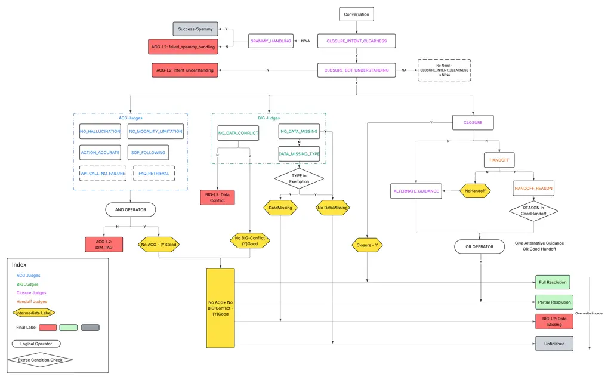
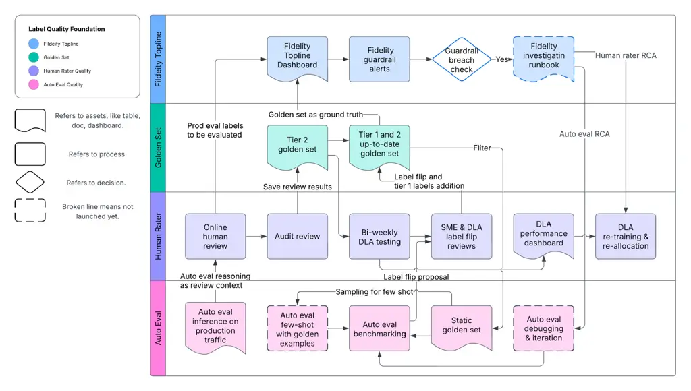
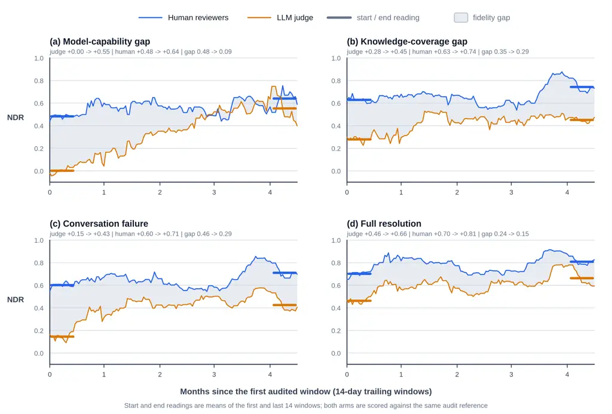

# Designing Reliable LLM-as-a-Judge Measurement Systems for Multi-Turn Business Agents

Kaiwen Luo Affiliation: Meta Email: [kaiwenluo@meta.com](mailto:)   
Ming Gao Affiliation: Meta Email: [gaoming@meta.com](mailto:)

###### Abstract

Many LLM-as-a-judge evaluations score fixed outputs under a fixed task
definition. Production multi-turn business agents instead require a
maintained measurement system: correctness depends on business-specific
facts and procedures, outcomes emerge across turns, and failures must be
attributed to either agent capability or missing business knowledge
before they are actionable. We present an integrated methodology
spanning evaluation specification, modular LLM judges, intent-preserving
user simulation, and human-in-the-loop governance. The specification
defines conversation-level end states and actionable failure ownership.
Atomic judges share versioned evidence and feed an explicit aggregation
graph. The simulator is released only after task-preservation and
stability checks. Independent human audits estimate measurement
fidelity, renew tiered reference sets, and route disagreements to label
correction, guideline revision, or judge improvement. Production studies
show that system-level fidelity improved across repeated audits, that
human reviewers and automated judges improved together under the shared
feedback loop, and that their combined workflow had the strongest
descriptive performance in both reported task-completion settings.
Because the studies are observational and the human reference itself
required revision, these findings demonstrate operational usefulness
rather than causal or universal superiority. The contribution is a
practical framework for making multi-turn agent measurement reliable,
actionable, and maintainable as the evaluated system and its evidence
evolve.

## 1 Introduction

LLM-as-a-judge is now an established approach for evaluating model
outputs. Strong models can rank responses, apply structured rubrics, and
approximate human preferences (Zheng et al., 2023; Liu et al., 2023; Kim
et al., 2023), while meta-evaluation benchmarks increasingly
characterise judge reliability (Tan et al., 2024; Thakur et al., 2024).
Most of this work, however, evaluates fixed outputs under a fixed task
definition. Multi-turn benchmarks measure conversational capability
(Kwan et al., 2024; Bai et al., 2024; Guan et al., 2025), but how to
build and maintain a continuously operated LLM-as-a-judge measurement
system for multi-turn trajectories remains less well understood. The
object of evaluation is no longer one response: task completion, state
consistency, and failure attribution emerge across the interaction.

Business agents make this problem harder still. An agent answers from
one merchant’s catalogue, FAQ, price list, and written procedures, so
correctness is instance-specific rather than defined by one golden
answer. Whether “we ship to that address in three days” is correct
depends on a fact the evaluator may not have; whether the agent should
request an order number before an email address depends on a
merchant-authored procedure. When the interaction fails, the operational
question is not merely whether the response was poor, but whether the
model failed or the business never supplied the required data.

These conditions turn LLM-as-a-judge from a prompt-design problem into a
measurement-system problem. The system must define a conversation-level
construct, ground judgments in per-business evidence, separate failure
owners, and remain calibrated as guidelines, products, and traffic
change. A standard judge over a reference answer, preference pair, or
cross-instance rubric does not provide these properties by itself.

Direct user feedback is insufficient as a primary measurement source.
Production evidence shows that explicit feedback can be both sparse and
concentrated among a small subset of users (Maharaj et al., 2024),
making it unreliable for traffic-level quality measurement on its own.

Human review is necessary but is not, by itself, a scalable or
automatically reliable measurement system. Its fidelity must also be
measured against an independently audited reference; the empirical
baselines are reported in Section 8.

### 1.1 Proposed measurement-system methodology

We propose a methodology for designing and operating LLM-as-a-judge
measurement systems for multi-turn business agents.

| Component                                                | What it produces                                                     | The design rule it must satisfy                                                      |
| -------------------------------------------------------- | -------------------------------------------------------------------- | ------------------------------------------------------------------------------------ |
| Evaluation specification (Section 4)                     | constructs, metrics, labeling guidelines, and the unit of analysis   | define an observable and actionable measurement target before implementing judges    |
| LLM-as-a-judge architecture (Section 5)                  | scoped judges, shared context, and an explicit aggregation graph     | implement the specification through modular judgments and explicit composition rules |
| LLM-as-a-user simulation (Section 6)                     | adaptive pre-launch trajectories and simulator-fidelity measurements | preserve the intended user task and validate the simulator before judging the agent  |
| Human-in-the-loop evaluation and improvement (Section 7) | fidelity audits, renewable reference labels, and correction channels | evaluate the system and route feedback to labels, specifications, and judges         |

The methodological contribution lies in the interfaces between these
components. The judge prompt is the executable form of the
specification, so guideline changes require measurement releases.
Judge–human disagreements update the specification as well as individual
labels. The same judge implementation runs offline and online, allowing
observed discrepancies to be attributed to evaluation data rather than
evaluator differences. The simulated user consumes versioned intents,
answers, and user facts; its intent consistency, persona consistency,
comprehensibility, and stability are evaluated separately from agent
quality. Human audit renews the reference set used to validate every
component. Measurement fidelity, quantified against an audited human
reference, provides the system-level control signal for these updates.

We do not claim novelty in the individual techniques. Decomposing a
judge into per-dimension questions is established practice (Ye et al.,
2023; Lee et al., 2024; Li et al., 2024b; Liu et al., 2024; Cook et al.,
2024; Hashemi et al., 2024; Wei et al., 2025; Zhang, 2026; Cho et al.,
2026). Conversation-level evaluation is established (Mehri and Eskenazi,
2020; Zhou et al., 2023; Arora et al., 2025; Fan et al., 2026). LLM user
simulation is established (Yao et al., 2024; Barres et al., 2025;
Arcadinho et al., 2024). Human-in-the-loop judge alignment is
established (Shankar et al., 2024; Ashktorab et al., 2025). Our
contribution is a system-level methodology that connects specification,
judge development, intent-preserving LLM-as-a-user simulation, and
human-in-the-loop evaluation and improvement. Section 3 positions this
claim against the closest work.

### 1.2 Contributions

1.  1.  A problem formulation for LLM-based measurement (Section 2). Four
        properties of multi-turn business agents — per-business ground
        truth, procedure adherence, model-gap-versus-data-gap attribution,
        and conversation-scoped outcomes — that jointly make generic judge
        recipes inapplicable, with the metric taxonomy we adopted in
        response.
2.  2.  An end-to-end measurement-system methodology (Sections 4–7). A
        lifecycle connecting evaluation specification, LLM-as-a-judge
        development, intent-preserving LLM-as-a-user simulation, and
        human-in-the-loop evaluation and improvement. The contribution lies
        in the complete lifecycle and its cross-component constraints rather
        than any individual judge technique or fidelity metric.
3.  3.  Empirical studies (Section 8). Production studies examine
        longitudinal improvement in measurement fidelity and complementarity
        between human raters and judges.

## 2 Problem formulation

We formulate the requirements that an LLM-as-a-judge measurement system
must satisfy in this setting. Each stage of the methodology in
Sections 4–7 addresses one or more of these requirements.

#### P1 — There is no single golden answer, and correctness is business-specific.

Many semantically equivalent answers can be valid, while the same
factual statement can be correct for one business and a hallucination
for another because the underlying catalogue or policy differs.
Reference-based metrics and cross-instance rubrics are therefore
insufficient on their own.

#### P2 — Correctness includes procedure adherence, which is written by a third party.

Businesses author their own operating procedures, including ordered
information-gathering and authentication rules, and following them is
part of quality. Judging this requires applying a business-authored
document per conversation, and it is a frequent source of human–judge
disagreement.

#### P3 — A failure must be attributed before it is actionable.

The organisation operating the agent can fix a model; it cannot fix a
fact the merchant never supplied — it can only ask for it. So the
topline taxonomy separates model-capability gaps (the agent could have
answered and did not) from knowledge-coverage gaps (the required
information was absent from the business’s data). These have different
owners and different remediations, and an evaluation that reports only
“bad conversation” is not usable by either. This attribution requirement
is what forces an explicit aggregation layer (Section 5) — and it is
also what makes the topline the hardest thing in the taxonomy to
measure, because exclusive attribution is a conjunction with a negation.

#### P4 — The defects that matter are conversation-scoped.

The failures that actually damage a multi-turn interaction are
cross-turn state defects: the agent re-asks for information the customer
already gave, contradicts an earlier commitment, or fails to notice that
the customer is repeating themselves because they are not being helped.
None of these is visible in any single turn, to a human or to a judge —
the same blind spot reported independently on production transaction
agents (Zhang et al., 2026). A turn-level rubric also asks raters a
counterfactual question (“could this response have harmed the
interaction?”), motivating conversation-level labels whose empirical
reliability is reported in Section 8.

## 3 Related work

The components of our methodology are individually well established. The
relevant question is how they are coupled and maintained for multi-turn
business-agent measurement.

### 3.1 Prior work by measurement-system function

Strong models can approximate human preferences, but benchmark agreement
is not equivalent to validity (Zheng et al., 2023; Kim et al., 2023; Tan
et al., 2024; Li et al., 2024a). Top-venue work on fine-grained rubrics,
checklists, and decomposition makes judgments more inspectable (Ye et
al., 2023; Lee et al., 2024; Li et al., 2024b; Wei et al., 2025;
Viswanathan et al., 2025), while Autorubric makes criterion design,
weighting, aggregation, abstention, and calibration explicit
configuration choices (Rao and Callison-Burch, 2026). We therefore claim
novelty neither for decomposition nor for aggregation structure.
Established findings on position bias and statistical calibration
instead motivate validating each dimension and the resulting composite
against human labels (Shi et al., 2024; Lee et al., 2025).

Multi-turn evaluation is also mature. MINT and MT-Bench-101 test
capabilities that emerge across turns (Wang et al., 2023; Bai et al.,
2024), while CRMArena evaluates agents on realistic business tasks
(Huang et al., 2024). Simulated-user benchmarks such as $`\tau`$-bench
extend evaluation to adaptive agent–user interaction (Yao et al., 2024).
Our contribution is not conversation-level evaluation or user simulation
alone, but their inclusion in a measurement lifecycle where task
preservation, information boundaries, and simulator stability are
release criteria.

### 3.2 From judge methods to measurement systems

Human labels are themselves part of the instrument: disagreement can be
substantive, while guideline design can create avoidable error (Plank,
2022; Parmar et al., 2022). The most comparable calibration protocol
gives humans and the automated evaluator the same instructions and
questions (Chiang and Lee, 2023), and label-error research shows why
automated disagreements still require human adjudication (Northcutt et
al., 2021). Production precedents include end-to-end taxonomy, labeling,
and monitoring for safety classifiers (Markov et al., 2022), deployed
customer-service evaluation tied to business outcomes (Xu et al., 2024),
and an evaluation-driven framework for customer-support agents with
human-in-the-loop judge development and online validation (Gupta et al.,
2026).

Accordingly, we make no claim to the first decomposed judge, evaluation
graph, simulator, or continuously maintained evaluator. The contribution
is the integration required for multi-turn business trajectories:
per-business facts and procedures, conversation-level outcomes, explicit
model-gap-versus-knowledge-gap attribution, simulator validation,
composite-node fidelity, and recurring human audit are governed as one
measurement system.

## 4 Evaluation specification

Evaluation specification determines what the system should measure
before any judge is built. For multi-turn business agents, the
specification must resolve four questions: what object is evaluated,
what counts as success, how failures are assigned to an actionable
owner, and what business-specific evidence supports the verdict. Design
principle: define and validate the measurement target before optimizing
its automated implementation.

### 4.1 From evaluation requirements to metric definition

The properties in Section 2 imply that a generic response-quality score
is insufficient. Cross-turn failures require the conversation as the
unit of analysis; operational remediation requires separating an
agent-capability failure from missing business knowledge; and factual
correctness and procedure adherence must be grounded in each business’s
catalogue, FAQ, business information, and operating procedures.

The resulting specification asks two questions for every conversation:
were all valid user tasks completed, and if not, what prevented
completion? Invalid and unfinished interactions are handled separately
so that an unresolvable or truncated conversation is not automatically
counted as an agent failure. Each conversation is assigned to one of
seven mutually exclusive end states: _full resolution, partial
resolution, invalid conversation handled well, unfinished conversation
handled well, model-capability gap only, knowledge-coverage gap only,_
or _both gaps_. Two topline rates follow:

- •
  model success rate = 1 $`-`$ rate of conversations with a
  model-capability gap
- •
  knowledge coverage rate = 1 $`-`$ rate of conversations with a
  knowledge-coverage gap

Below these rates, the specification retains progressively finer root
causes for diagnosis: L1 records success or failure, L2 records the end
state, and L3–L5 identify dimensions such as missing data,
hallucination, action accuracy, and procedure following. This hierarchy
separates the reported metric from the evidence used to explain it and
later determines the aggregation graph implemented by the judge system.

### 4.2 Reference-label reliability and measurement fidelity

Nothing downstream is interpretable until the human baseline is known.
The relevant question is not whether a judge can “beat a human,” but
whether either labeling mechanism produces a faithful measurement
against an independently reviewed reference. The observed baselines are
reported in Section 8.

#### Agreement is not fidelity.

Raw rater consistency can fall while audited label quality improves when
raters move from near-unanimous negative labeling to detecting more
positives. Krippendorff’s $`\alpha`$ corrects for chance agreement but
remains prevalence-sensitive and does not measure correctness. Agreement
metrics are therefore retained as reliability diagnostics, while
fidelity is measured against an independently audited reference.

#### Net detection rate is the system-level fidelity metric.

Let $`p`$ be the true prevalence of the target condition,
$`\mathrm{TPR}`$ and $`\mathrm{FPR}`$ the labeling system’s true- and
false-positive rates, and $`y`$ the observed positive rate. The positive
class is metric-specific: it denotes the presence of a defect for gap
metrics and successful completion or resolution for success metrics.
Then

```math
\mathbb{E}[y]=\mathrm{FPR}+(\mathrm{TPR}-\mathrm{FPR})p=\mathrm{FPR}+\mathrm{NDR}\,p, \tag{1}
```

Following Youden’s original diagnostic-test index (Youden, 1950), we
define net detection rate as
$`\mathrm{NDR}=\mathrm{TPR}-\mathrm{FPR}=\text{sensitivity}+\text{specificity}-1`$
(Youden’s $`J`$). NDR ranges from $`-1`$ to 1: 1 is perfect measurement,
0 carries no information about the true label beyond chance, and a
negative value reverses the direction of the signal.

NDR is the appropriate control objective for three reasons. First, if
TPR and FPR remain stable across the populations being compared, metric
movement is attenuated as
$`\mathbb{E}[\text{measured }\Delta]=\mathrm{NDR}\cdot\text{true }\Delta`$;
maximizing NDR preserves more of the underlying product movement.
Second, correcting prevalence requires division by NDR, so the variance
of the corrected estimate scales with $`1/\mathrm{NDR}^{2}`$; higher NDR
therefore supports tighter confidence intervals and smaller detectable
effects. Third, unlike precision, NDR is defined by TPR and FPR and does
not change mechanically when defect prevalence changes.

Precision, recall, F1, and inter-rater agreement remain useful
guardrails and diagnostic metrics, but they do not replace NDR as the
topline measure of measurement fidelity. The attenuation interpretation
also depends on stable error rates, so NDR must be re-estimated after
changes to the product, traffic, guideline, reference process, judge
prompt, or foundation model.

## 5 LLM-as-a-judge architecture

This stage translates the evaluation specification into executable
judges, shared inputs, and aggregation logic. Design principle:
implement the specification through modular judges, governed inputs, and
an explicit aggregation graph.

The system uses per-dimension atomic judges and an explicit aggregation
layer rather than a single root-cause judge. Section 3 establishes that
decomposition is settled prior work; our focus is its integration into a
versioned measurement architecture.

Three properties of the construction matter for the rest of the section.
(i) Independent judgments — each judge is a standalone unit with a
uniform input/output contract emitting a binary verdict plus free-text
reasoning; unlike the human labeling process, in which checkers are
prompted sequentially, the judges assess all dimensions in parallel.
(ii) The aggregation layer is separate and separately versioned — metric
and attribution definitions are changed by editing the graph rather than
by silently changing judge behaviour. (iii) A single versioned context
store — all grounding evidence a judge sees resolves through one store
rather than per-judge lookups, eliminating the class of disagreement in
which two judges score the same conversation against different facts.
That last one is a direct response to P1 (Section 2): with
business-specific ground truth, _which facts was the judge holding?_ is
part of the verdict.

The architecture is implemented as a versioned registry shared across
agents, with a scoped subset invoked for each conversation. Composite
dimensions are themselves decomposed: the missing-data detector first
summarises the conversation into discrete user asks and then judges each
independently, turning a multi-class problem into a set of binary ones
and keeping greeting turns out of the judged text.

#### Label polarity is normalized before evaluation.

The affirmative predicates shown in Figure 1, such as NO_HALLUCINATION
and ACTION_ACCURATE, emit Y when the criterion is satisfied, so their
raw Y means good. Defect-oriented metrics invert that representation so
that positive means the target defect is present; success-oriented
metrics retain successful completion or resolution as positive. Reported
precision, recall, and NDR therefore refer to the named metric’s target
class, not directly to the raw Y/N token.



Figure 1: The aggregation graph that implements the conversation-level
specification. ACG denotes an agent-capability gap and BIG a
business-information gap. The displayed Y/N values are raw predicate
outcomes; downstream metrics use the metric-specific positive class
defined above. Dashed nodes denote optional components outside the
evaluated configuration.

As Figure 1 shows, the aggregation graph first gates on whether the
user’s intent is clear, whether the agent understood it, and whether an
invalid or spammy conversation was handled correctly. For valid
conversations, three branches run in parallel. Agent-capability judges
cover hallucination, modality limitations, action accuracy, procedure
following, and tool or retrieval failures. Business-information judges
distinguish conflicting data from missing data and apply exemptions.
Outcome judges evaluate task closure, handoff quality, and alternative
guidance.

The aggregation layer then applies Boolean operators and explicit
precedence rules to map overlapping atomic evidence into one
conversation-level outcome. This separation is architectural: atomic
judges can be developed and reused independently, while metric
definitions change in the aggregation graph. It also makes the deployed
metric version-specific—a change to a judge, operator, or overwrite
order can change the reported result even when the underlying
conversations remain fixed.

Table 1 summarises representative atomic judges and composite nodes in
the aggregation graph. It documents the implemented measurement
structure; quantitative fidelity is reported separately in Section 8.

| Level     | Dimension                       | Aggregation role                        |
| --------- | ------------------------------- | --------------------------------------- |
| L5        | factual hallucination           | atomic                                  |
| L5        | procedure following             | atomic                                  |
| L4        | action accuracy                 | atomic                                  |
| L3        | hallucination                   | OR of L4 + L5                           |
| L3        | modality limitation             | atomic                                  |
| L3        | missing data                    | atomic                                  |
| L3        | data conflict                   | atomic                                  |
| L3        | intent understanding            | atomic                                  |
| L3        | spam handling                   | atomic                                  |
| —         | task closure                    | atomic                                  |
| —         | intent clearness                | atomic                                  |
| —         | alternative guidance            | atomic                                  |
| —         | good handoff                    | atomic                                  |
| aggregate | model-capability gap            | OR over L3–L5                           |
| aggregate | knowledge-coverage gap          | OR over business-information dimensions |
| L2        | full resolution                 | AND with negations                      |
| L2        | partial resolution              | AND with negations                      |
| L2        | invalid conversation handled    | AND with negations                      |
| L2        | unfinished conversation handled | AND with negations                      |
| L2        | model-capability gap only       | AND with negation                       |
| L2        | knowledge-coverage gap only     | AND with negation                       |
| L2        | both gaps                       | AND with negation                       |
| L1        | failure                         | OR over all failure states              |
| L1        | success                         | complement of failure                   |

Table 1: Structure of atomic and composite nodes in the aggregation
graph.

## 6 Simulation with an LLM-as-a-user

Pre-deployment evaluation of a multi-turn agent requires a user who can
react when the agent under test deviates from a historical conversation.
Human role-play is slow, inconsistent across annotators, and
operationally expensive. Exact replay is deterministic, but a fixed
response such as “yes,” “that one,” or “how?” can become incoherent when
the agent asks a different question or changes the order of its answers.
We therefore use an LLM-as-a-user (LAAU) to generate the user side of
the interaction. Design principle: specify and validate the simulated
user as a measurement component before using its conversations to
evaluate the agent.

### 6.1 Two LAAU operating settings

The same user model supports two complementary evaluation settings:

| Setting                       | Conditioning input                                                                        | Required invariant                                                              | Primary uses                                                                 |
| ----------------------------- | ----------------------------------------------------------------------------------------- | ------------------------------------------------------------------------------- | ---------------------------------------------------------------------------- |
| Conversation-conditioned LAAU | Intents, answers, tone, and other user attributes extracted from an original conversation | Cover every original intent without introducing a new one                       | Regression and integration benchmarks; replaying failures after a bug fix    |
| Instruction-conditioned LAAU  | Predefined tasks, user traits, and optional user-profile facts                            | Enact the specified task and persona without exceeding the supplied information | Pre-onboarding tests; robustness, adversarial, JTBD, feature, and unit tests |

Conversation conditioning preserves the coverage of traffic-derived
benchmarks while allowing the user to respond to a changed agent
trajectory. Instruction conditioning creates cases that may be absent
from history, including spam, penetration attempts, unclear or unusual
intents, spelling variation, and anxious or otherwise atypical
interaction styles. In both settings, the simulator produces only the
user utterances visible to the agent and ends the interaction after the
required intents have been exercised.

### 6.2 Intent-preserving simulator design

The central invariant for conversation-conditioned LAAU is: all original
user intents must be expressed, and no new user intent may be
introduced. Persona, tone, wording, and turn order are secondary
fidelity targets. This ordering matters because a fluent simulator that
silently changes the task can create a false agent regression or
improvement.

The implementation separates curation from generation. During benchmark
construction, the system extracts the original user’s intents and the
answers they supplied to agent questions; audited benchmarks can instead
provide human-verified key asks. During simulation, LAAU:

1.  1.  answers an agent question only when the answer exists in the curated
        user information;
2.  2.  presents the remaining intents one at a time;
3.  3.  follows the original tone and phrasing where the current context
        still supports them;
4.  4.  minimally rephrases context-dependent messages when the agent
        trajectory has changed; and
5.  5.  terminates after all required intents have been addressed.

The simulator sees the agent’s final user-visible utterance, not its
hidden instructions, retrievals, or reasoning. A versioned user profile
or user FAQ supplies facts needed for authentication and replaces
redacted values with synthetic but usable answers. Unknown answers
remain unknown: unless a test explicitly specifies an uncooperative
persona, the simulator does not invent information merely to keep the
dialogue moving. The result is an adaptive replay rather than
unrestricted role-play.

### 6.3 Simulator fidelity specification

LAAU is evaluated independently of the agent judges using four criteria:

- •
  Intent consistency: all required intents are expressed and no
  additional intent is created.
- •
  Persona consistency: questions, answers, tone, emotion, and
  user-profile behaviour remain consistent with the source conversation
  or specified persona.
- •
  Comprehensibility: generated messages are understandable and do not
  leak internal instructions or model reasoning.
- •
  Measurement stability: repeated runs with an unchanged agent preserve
  the user task and should not materially move downstream resolution,
  model-capability, or knowledge-coverage metrics.

Human preference between LAAU and exact replay is retained as a
diagnostic for conversational naturalness, but it is not a substitute
for these fidelity criteria. A more natural conversation can still be
invalid if it omits an intent or supplies information that the original
user never provided.

### 6.4 Validation requirements and limitations

Simulator release requires audited evidence for intent preservation,
comprehensibility, run-to-run stability, and downstream metric
stability. Human preference between LAAU and exact replay is diagnostic,
but cannot establish task validity by itself. The limitations of the
available validation evidence are discussed in Section 9.

Even after validation, LAAU is not assumed to be equivalent to real
users. Minimal rephrasing can alter tone; ambiguous, trolling, or
intentionally incomplete messages invite subjective interpretation; and
different agent handoff points can move downstream metrics without a
changed simulated intent. The methodological claim is narrower: an LLM
user becomes usable for multi-turn measurement when its intended
information, output boundary, fidelity criteria, and residual failure
modes are explicitly specified and audited.

## 7 Human-in-the-loop evaluation and improvement

Human feedback maintains the measurement system after deployment by
identifying drift and updating reference labels, specifications, and
judges. The deployed loop is a label-quality control system with four
connected layers: fidelity monitoring, tiered golden-set renewal,
human-rater quality management, and judge benchmarking. A fidelity
breach can therefore trigger both human-rater and judge root-cause
analysis rather than being assigned to either side in advance. Design
principle: evaluate and improve the combined human–judge system, not
either labeler in isolation. Figure 2 summarizes this feedback loop.



Figure 2: The operational feedback system. Live judge outputs enter
independent human review; audit results renew tiered golden sets; the
golden sets test and allocate raters and benchmark judge revisions;
fidelity dashboards and guardrails trigger investigation when the
measurement system drifts. Dashed elements denote planned extensions.

The judge-reasoning path in Figure 2 applies only during escalation
review; the initial human label remains independent of the judge output.

### 7.1 Independent review and escalation

For each sampled conversation, the judge and an initial human reviewer
label independently. Agreement produces the final label; disagreement
routes the item to a quality-stratified escalation reviewer, who sees
both labels and the judge’s reasoning before making the final decision.
A sample of these decisions is audited by top annotators, with a smaller
expert-reviewed tier able to override them. Keeping the initial review
blind mitigates anchoring and confirmation bias, while concentrating
stronger reviewers on disputed items.

The measured outcome of this protocol is reported with the other
real-world results in Section 8.2.

### 7.2 Reference maintenance and feedback

Adjudicated disagreements can reveal a label error, specification
ambiguity, or judge error. The workflow therefore routes them to rater
correction, guideline revision, or judge improvement rather than
assuming that either side is correct. This extends established work on
annotation-error detection (Northcutt et al., 2021; Chong et al., 2022;
Nahum et al., 2024; Chochlakis et al., 2025) with an explicit
specification-revision path.

As Figure 2 shows, human review also maintains the reference system.
Judges can produce the topline while humans audit for calibration and
drift; audit volume is determined by the fidelity evidence required, not
treated as a residual cost. Adjudicated examples renew a tiered golden
set used to test and allocate raters, while unannounced golden jobs
measure rater fidelity in the production queue. A separate static,
expert-aligned set supports judge-release regression testing.

Golden-set quality bounds judge fidelity, and a finite release set
cannot guarantee performance on changing live traffic. Reference labels
must therefore be versioned and re-audited. The observed effects of the
combined maintenance loop are reported in Section 8.2.

## 8 Empirical Studies

We present two empirical studies of the methodology in production. The
first examines whether system-level measurement fidelity improves over
repeated judge iterations (Section 8.1). The second compares judge-only,
human-only, and combined review workflows to characterize human–judge
alignment and complementarity (Section 8.2). The studies draw on
production-derived data from multiple agents over two and a half years.

The studies answer different measurement questions and are observational
rather than a controlled end-to-end comparison against an alternative
methodology. Judge outputs were repeatedly audited against independently
reviewed human labels on live traffic.

### 8.1 Improvement in system-level measurement fidelity

|                                              |                      |                        |
| -------------------------------------------- | -------------------- | ---------------------- |
| Audit stage                                  | model-capability NDR | knowledge-coverage NDR |
| Initial audit                                | $`-`$0.022           | 0.299                  |
| First follow-up                              | 0.22                 | 0.45                   |
| Second follow-up                             | 0.33                 | 0.518                  |
| Final reported audit                         | 0.550                | 0.686                  |
| _human co-pilot, final audit, same criteria_ | _0.611_              | _0.553_                |

Three observations, each an argument for a specific part of the
methodology.

#### The starting point was zero, and only the loop-level metric revealed it.

A judge panel that had been in production for over a year, and was
already good enough to be a useful co-pilot, had an NDR of $`-`$0.022
the first time anyone measured it against an online auditor ground truth
— not detecting model-capability gaps better than chance. Every
component-level metric looked acceptable; the co-pilot process had been
carrying it. This is the strongest argument for a system-level fidelity
scalar that no component can flatter.

#### The human comparator is imperfect and dimension-specific.

An intermediate planning estimate put human NDR near 0.60; the final
measurement put the human co-pilot at 0.611 on model capability and
0.553 on knowledge coverage. These are observed comparator values, not
theoretical ceilings, and the paper lacks uncertainty intervals for the
difference between human and judge readings.

#### The judge exceeded the observed human comparator on one dimension.

On knowledge coverage the judge reached 0.686 against the human
co-pilot’s 0.553 at the final snapshot. The narrow operational reading
is that systematic checking of machine-readable business context may
suit automation; the snapshot does not establish general superiority
over people. On model capability, the same period’s summary was that the
judge had better recall but worse precision.

### 8.2 Alignment and complementarity with human raters

| Agent   | judge only P / R / acc | human only P / R / acc | co-pilot P / R / acc | co-pilot $`-`$ judge $`\Delta`$ P / R / acc (pp) | co-pilot $`-`$ human $`\Delta`$ P / R / acc (pp) |
| ------- | ---------------------- | ---------------------- | -------------------- | ------------------------------------------------ | ------------------------------------------------ |
| Agent-A | 66.7 / 53.8 / 75.6     | 51.3 / 73.1 / 67.9     | 71.4 / 76.9 / 82.1   | +4.7 / +23.1 / +6.5                              | +20.1 / +3.8 / +14.2                             |
| Agent-B | 55.8 / 68.6 / 75.0     | 56.1 / 51.4 / 75.0     | 67.6 / 71.4 / 81.7   | +11.8 / +2.8 / +6.7                              | +11.5 / +20.0 / +6.7                             |

Table 2: Task-completion fidelity of human, judge, and combined review
workflows. Precision and recall treat task completion as the positive
class. _Takeaway: the combined workflow has the strongest descriptive
point estimate in both reported task-completion settings. No confidence
intervals or paired significance tests were available, so the table does
not establish statistical superiority._

Figure 3 complements Table 2 by tracking human-reviewer and judge
fidelity over the same continuous audit window.



Figure 3: Coupled improvement of human reviewers and the LLM judge,
measured against the same audit reference. Each panel is one evaluation
dimension for Agent-A in a single locale; both curves are net detection
rate (TPR $`-`$ FPR) on 14-day trailing windows of live traffic, over
the first 138 daily readings of the audited period. Time is given as
months elapsed since the first audited window. Heavy segments mark the
mean of the first and last fourteen windows — the readings quoted in
each panel subtitle — and the shaded band is the human–judge fidelity
gap. All eight series end above where they start, and the gap narrows on
every dimension: model capability 0.48 to 0.09, conversation failure
0.46 to 0.29, knowledge coverage 0.35 to 0.29, full resolution 0.24 to
0.15. The audit continues past the plotted interval; Section 9 records
what the later readings do. These NDR readings are not comparable with
the precision and recall in Table 2, and a single continuous window from
one agent and locale is observational: it shows co-movement under a
shared feedback loop, not a causal effect of either arm on the other.

Across the continuous measurement in Figure 3, the judge’s net detection
rate rises on all four dimensions over four and a half months — by +0.55
on model capability, +0.28 on conversation failure, +0.20 on full
resolution and +0.17 on knowledge coverage — starting from the same
near-zero model-capability reading reported as the initial audit in
Section 8.1. The human reviewers, scored by the same auditors against
the same labels, rise by +0.11 to +0.16 over the same window. Nothing in
the series separates the two effects: guideline revisions, judge
releases, rater training and audit-sample changes all fall inside the
window, and the two arms share the specification, the disagreement
review and the golden labels by construction (Sections 4.2 and 7.2). The
claim the figure supports is therefore the weaker but still load-bearing
one — that a measurement system whose human and automated halves are
coupled through one audited loop improved on both halves at once, rather
than trading one against the other.

The gap narrows least on knowledge coverage, which is also the dimension
on which the audit snapshots in Section 8.1 put the judge _above_ the
human comparator. The two are not the same measurement: that section
reports discrete audit batches and Figure 3 reports rolling windows for
one agent and locale, and only their initial readings coincide. Taken
together they indicate that the ordering between human and judge is
dimension-specific and unstable across samples and across time, which is
an argument for maintaining both arms and the audit that calibrates
them, not for retiring either.

The observed pattern is consistent with complementarity rather than
replacement. Relative to the judge, the co-pilot’s advantage is
concentrated in recall; relative to the human, it is concentrated in
precision. The 2024 proof of concept likewise found that the judge did
not outperform highly trained annotators on golden-set F1, while the
combined workflow had the highest F1. The relevant success criterion is
therefore alignment and error correction, not universal machine
superiority.

The same loop improved the human reference process itself. Biweekly
golden-set testing drove more than 70 reviewer reallocations, while
breach investigations recovered L1-failure recall from 0.58 to 0.80 on
one product and knowledge-gap recall from 0.24 to 0.81 on another. These
are incident recoveries rather than controlled treatment effects, but
they show that the feedback channel operated on human labels and
workflow allocation as well as judge prompts.

## 9 Discussion & Conclusion

These are observational production studies, not a controlled comparison
against an alternative methodology. They support the operational
usefulness of the complete methodology but do not isolate the causal
effect of any individual architectural or workflow choice.

Figure 3 plots the improving segment of a longer record, and the reader
should treat it that way. The audit ran for a further ten weeks past the
plotted interval. Over those weeks both arms are flat — every reading
moves by at most 0.05 except the judge’s knowledge-coverage reading,
which retraces by 0.07 — giving back about two fifths of its gain over
the plotted window. Auditing then stops being informative about the
human arm altogether: its online labels stop disagreeing with the audit
reference on every dimension, which makes the human reading unmeasurable
rather than perfect, and no NDR after that point should be reported for
it. The honest summary of the full record is therefore a period of
coupled improvement followed by a plateau, not a sustained trend.

The human reference is also fallible. Expert-adjudicated labels were
revised during disagreement review, the human comparator values in
Section 8.1 are observed comparators rather than ceilings, and the
human–judge and co-pilot differences lack confidence intervals or paired
significance tests. Precision/recall on static golden sets and NDR on
live-traffic audits are therefore reported separately rather than
chained.

Generalisability remains limited to one organisation and the reported
agent, task, and locale samples. The LAAU evidence is limited to
internal benchmarks and traffic-derived samples and does not establish
equivalence to real human behaviour. These constraints bound the claim:
the evidence does not show that the methodology is universally superior
to human evaluation or to every alternative system design.

Reliable evaluation of multi-turn business agents requires more than a
judge prompt. We presented a measurement-system methodology that
connects a conversation-level specification, business-grounded atomic
judges and explicit aggregation, intent-preserving user simulation, and
an independently audited human feedback loop. The shared specification
and reference process make failures actionable while allowing labels,
guidelines, and judges to improve together.

The production studies show that system-level NDR improved across
repeated audits, that the combined human–judge workflow had the
strongest descriptive fidelity in both reported task-completion
settings, and that the same feedback loop improved both automated and
human evaluation. These observational results do not establish causal or
universal superiority, but they support treating LLM-based evaluation as
a maintained measurement system whose fidelity must be continuously
demonstrated as the agent, evidence, and traffic evolve.

## References

- Arcadinho et al. (2024) S. Arcadinho, D. Aparicio, and M. Almeida
  Automated test generation to evaluate tool-augmented LLMs as
  conversational AI agents. Note: GenBench@EMNLP 2024 External Links:
  2409.15934, [Link](https://arxiv.org/abs/2409.15934) Cited by: §1.1.
- Arora et al. (2025) R. K. Arora, J. Wei, R. S. Hicks, P. Bowman, J.
  Quiñonero-Candela, F. Tsimpourlas, M. Sharman, M. Shah, A. Vallone, A.
  Beutel, J. Heidecke, and K. Singhal HealthBench: Evaluating Large
  Language Models Towards Improved Human Health. External Links:
  2505.08775, [Link](https://arxiv.org/abs/2505.08775) Cited by: §1.1.
- Ashktorab et al. (2025) Z. Ashktorab, W. Geyer, M. Desmond, E. M.
  Daly, M. S. Cooper, Q. Pan, E. Miehling, T. Pedapati, and H. J. Do
  EvalAssist: A Human-Centered Tool for LLM-as-a-Judge. External Links:
  2507.02186, [Link](https://arxiv.org/abs/2507.02186) Cited by: §1.1.
- Bai et al. (2024) G. Bai, J. Liu, X. Bu, Y. He, J. Liu, Z. Zhou, Z.
  Lin, W. Su, T. Ge, B. Zheng, and W. Ouyang MT-Bench-101: A
  Fine-Grained Benchmark for Evaluating Large Language Models in
  Multi-Turn Dialogues. Note: ACL 2024 External Links: 2402.14762,
  [Link](https://arxiv.org/abs/2402.14762) Cited by: §1, §3.1.
- Barres et al. (2025) V. Barres, H. Dong, S. Ray, X. Si, and K.
  Narasimhan $`\tau^{2}`$-Bench: Evaluating Conversational Agents in a
  Dual-Control Environment. External Links: 2506.07982,
  [Link](https://arxiv.org/abs/2506.07982) Cited by: §1.1.
- Chiang and Lee (2023) C. Chiang and H. Lee Can Large Language Models
  Be an Alternative to Human Evaluations?. Note: ACL 2023 main
  conference External Links: 2305.01937,
  [Link](https://arxiv.org/abs/2305.01937) Cited by: §3.2.
- Cho et al. (2026) S. Cho, K. Chawla, P. Cai, Z. Liu, C. Zhu, S. Zhang,
  and S. Sahu Ask, Don’t Judge: Binary Questions for Interpretable LLM
  Evaluation and Self-Improvement. Note: Second Workshop on
  Compositional Learning at ICML 2026 External Links: 2606.27226,
  [Link](https://arxiv.org/abs/2606.27226) Cited by: §1.1.
- Chochlakis et al. (2025) G. Chochlakis, P. Wu, A. Bedi, M. Ma, K.
  Lerman, and S. Narayanan Humans Hallucinate Too: Language Models
  Identify and Correct Subjective Annotation Errors With
  Label-in-a-Haystack Prompts. Note: EMNLP 2025 Main Proceedings
  External Links: 2505.17222, [Link](https://arxiv.org/abs/2505.17222)
  Cited by: §7.2.
- Chong et al. (2022) D. Chong, J. Hong, and C. D. Manning Detecting
  Label Errors by using Pre-Trained Language Models. Note: EMNLP 2022
  External Links: 2205.12702, [Link](https://arxiv.org/abs/2205.12702)
  Cited by: §7.2.
- Cook et al. (2024) J. Cook, T. Rocktäschel, J. Foerster, D. Aumiller,
  and A. Wang TICKing All the Boxes: Generated Checklists Improve LLM
  Evaluation and Generation. External Links: 2410.03608,
  [Link](https://arxiv.org/abs/2410.03608) Cited by: §1.1.
- Fan et al. (2026) S. Fan, S. Min, Y. Hu, B. Xia, J. Unnikrishnan, R.
  Musselmann, Y. Gao, Q. Yin, P. Nigam, and B. Yin Shopping Reasoning
  Bench: An Expert-Authored Benchmark for Multi-Turn Conversational
  Shopping Assistants. External Links: 2606.12608,
  [Link](https://arxiv.org/abs/2606.12608) Cited by: §1.1.
- Guan et al. (2025) S. Guan, J. Wang, J. Bian, B. Zhu, J. Lou, and H.
  Xiong Evaluating LLM-based Agents for Multi-Turn Conversations: A
  Survey. External Links: 2503.22458,
  [Link](https://arxiv.org/abs/2503.22458) Cited by: §1.
- Gupta et al. (2026) A. Gupta, K. Rossell, E. Alcobaça, J. C. L.
  Pacheco, C. B. de Lima, S. Tang, L. P. Rabachini, L. Moneda, H.
  Fei, D. Silva, and R. Ramanath Building Customer Support AI Agents at
  100M-User Scale: An Evaluation-Driven Framework. Note: KDD ’26 (32nd
  ACM SIGKDD Conference on Knowledge Discovery and Data Mining) External
  Links: 2606.08867, [Link](https://arxiv.org/abs/2606.08867) Cited by:
  §3.2.
- Hashemi et al. (2024) H. Hashemi, J. Eisner, C. Rosset, B. V. Durme,
  and C. Kedzie LLM-Rubric: A Multidimensional, Calibrated Approach to
  Automated Evaluation of Natural Language Texts. Note: Proceedings of
  ACL 2024 (Volume 1: Long Papers), pp. 13806-13834 External Links:
  2501.00274, [Link](https://arxiv.org/abs/2501.00274) Cited by: §1.1.
- Huang et al. (2024) K. Huang, A. Prabhakar, S. Dhawan, Y. Mao, H.
  Wang, S. Savarese, C. Xiong, P. Laban, and C. Wu CRMArena:
  Understanding the Capacity of LLM Agents to Perform Professional CRM
  Tasks in Realistic Environments. Note: NAACL 2025 External Links:
  2411.02305, [Link](https://arxiv.org/abs/2411.02305) Cited by: §3.1.
- Kim et al. (2023) S. Kim, J. Shin, Y. Cho, J. Jang, S. Longpre, H.
  Lee, S. Yun, S. Shin, S. Kim, J. Thorne, and M. Seo Prometheus:
  Inducing Fine-grained Evaluation Capability in Language Models. Note:
  ICLR 2024 External Links: 2310.08491,
  [Link](https://arxiv.org/abs/2310.08491) Cited by: §1, §3.1.
- Kwan et al. (2024) W. Kwan, X. Zeng, Y. Jiang, Y. Wang, L. Li, L.
  Shang, X. Jiang, Q. Liu, and K. Wong MT-Eval: A Multi-Turn
  Capabilities Evaluation Benchmark for Large Language Models. External
  Links: 2401.16745, [Link](https://arxiv.org/abs/2401.16745) Cited by:
  §1.
- Lee et al. (2025) C. Lee, T. Zeng, J. Jeong, J. Sohn, and K. Lee How
  to Correctly Report LLM-as-a-Judge Evaluations. Note: International
  Conference on Machine Learning (ICML) 2026 External Links: 2511.21140,
  [Link](https://arxiv.org/abs/2511.21140) Cited by: §3.1.
- Lee et al. (2024) Y. Lee, J. Kim, J. Kim, H. Cho, J. Kang, P. Kang,
  and N. Kim CheckEval: A reliable LLM-as-a-Judge framework for
  evaluating text generation using checklists. Note: EMNLP 2025 External
  Links: 2403.18771, [Link](https://arxiv.org/abs/2403.18771) Cited by:
  §1.1, §3.1.
- Li et al. (2024a) D. Li, B. Jiang, L. Huang, A. Beigi, C. Zhao, Z.
  Tan, A. Bhattacharjee, Y. Jiang, C. Chen, T. Wu, K. Shu, L. Cheng,
  and H. Liu From Generation to Judgment: Opportunities and Challenges
  of LLM-as-a-judge. Note: EMNLP 2025 External Links: 2411.16594,
  [Link](https://arxiv.org/abs/2411.16594) Cited by: §3.1.
- Li et al. (2024b) M. Li, Z. Liu, S. Deng, S. Joty, N. F. Chen, and M.
  Kan DnA-Eval: Enhancing Large Language Model Evaluation through
  Decomposition and Aggregation. Note: COLING 2025 External Links:
  2405.15329, [Link](https://arxiv.org/abs/2405.15329) Cited by: §1.1,
  §3.1.
- Liu et al. (2023) Y. Liu, D. Iter, Y. Xu, S. Wang, R. Xu, and C. Zhu
  G-Eval: NLG Evaluation using GPT-4 with Better Human Alignment.
  External Links: 2303.16634, [Link](https://arxiv.org/abs/2303.16634)
  Cited by: §1.
- Liu et al. (2024) Y. Liu, T. Yang, S. Huang, Z. Zhang, H. Huang, F.
  Wei, W. Deng, F. Sun, and Q. Zhang HD-Eval: Aligning Large Language
  Model Evaluators Through Hierarchical Criteria Decomposition. External
  Links: 2402.15754, [Link](https://arxiv.org/abs/2402.15754) Cited by:
  §1.1.
- Maharaj et al. (2024) A. V. Maharaj, K. Qian, U. Bhattacharya, S.
  Fang, H. Galatanu, M. Garg, R. Hanessian, N. Kapoor, K. Russell, S.
  Vaithyanathan, and Y. Li Evaluation and Continual Improvement for an
  Enterprise AI Assistant. Note: DaSH Workshop at NAACL 2024 External
  Links: 2407.12003, [Link](https://arxiv.org/abs/2407.12003) Cited by:
  §1.
- Markov et al. (2022) T. Markov, C. Zhang, S. Agarwal, T. Eloundou, T.
  Lee, S. Adler, A. Jiang, and L. Weng A Holistic Approach to Undesired
  Content Detection in the Real World. Note: Oral presentation at
  AAAI-23 External Links: 2208.03274,
  [Link](https://arxiv.org/abs/2208.03274) Cited by: §3.2.
- Mehri and Eskenazi (2020) S. Mehri and M. Eskenazi Unsupervised
  Evaluation of Interactive Dialog with DialoGPT. Note: SIGdial 2020
  External Links: 2006.12719, [Link](https://arxiv.org/abs/2006.12719)
  Cited by: §1.1.
- Nahum et al. (2024) O. Nahum, N. Calderon, O. Keller, I. Szpektor,
  and R. Reichart Are LLMs Better than Reported? Detecting Label Errors
  and Mitigating Their Effect on Model Performance. External Links:
  2410.18889, [Link](https://arxiv.org/abs/2410.18889) Cited by: §7.2.
- Northcutt et al. (2021) C. G. Northcutt, A. Athalye, and J. Mueller
  Pervasive Label Errors in Test Sets Destabilize Machine Learning
  Benchmarks. Note: NeurIPS 2021 Track on Datasets and Benchmarks
  External Links: 2103.14749, [Link](https://arxiv.org/abs/2103.14749)
  Cited by: §3.2, §7.2.
- Parmar et al. (2022) M. Parmar, S. Mishra, M. Geva, and C. Baral Don’t
  Blame the Annotator: Bias Already Starts in the Annotation
  Instructions. Note: EACL 2023 (Outstanding Paper Award) External
  Links: 2205.00415, [Link](https://arxiv.org/abs/2205.00415) Cited by:
  §3.2.
- Plank (2022) B. Plank The ’Problem’ of Human Label Variation: On
  Ground Truth in Data, Modeling and Evaluation. Note: EMNLP 2022
  External Links: 2211.02570, [Link](https://arxiv.org/abs/2211.02570)
  Cited by: §3.2.
- Rao and Callison-Burch (2026) D. Rao and C. Callison-Burch Autorubric:
  A Unifying Framework for Rubric-Based LLM Evaluation on Non-Verifiable
  Tasks. Note: COLM 2026 External Links: 2603.00077,
  [Link](https://arxiv.org/abs/2603.00077) Cited by: §3.1.
- Shankar et al. (2024) S. Shankar, J. D. Zamfirescu-Pereira, B.
  Hartmann, A. G. Parameswaran, and I. Arawjo Who Validates the
  Validators? Aligning LLM-Assisted Evaluation of LLM Outputs with Human
  Preferences. External Links: 2404.12272,
  [Link](https://arxiv.org/abs/2404.12272) Cited by: §1.1.
- Shi et al. (2024) L. Shi, C. Ma, W. Liang, X. Diao, W. Ma, and S.
  Vosoughi Judging the Judges: A Systematic Study of Position Bias in
  LLM-as-a-Judge. Note: AACL-IJCNLP 2025 External Links: 2406.07791,
  [Link](https://arxiv.org/abs/2406.07791) Cited by: §3.1.
- Tan et al. (2024) S. Tan, S. Zhuang, K. Montgomery, W. Y. Tang, A.
  Cuadron, C. Wang, R. A. Popa, and I. Stoica JudgeBench: A Benchmark
  for Evaluating LLM-based Judges. Note: ICLR 2025 External Links:
  2410.12784, [Link](https://arxiv.org/abs/2410.12784) Cited by: §1,
  §3.1.
- Thakur et al. (2024) A. S. Thakur, K. Choudhary, V. S. Ramayapally, S.
  Vaidyanathan, and D. Hupkes Judging the Judges: Evaluating Alignment
  and Vulnerabilities in LLMs-as-Judges. Note: Proceedings of the Fourth
  Workshop on Generation, Evaluation and Metrics (GEM2) 2025, pp.
  404-430 External Links: 2406.12624,
  [Link](https://arxiv.org/abs/2406.12624) Cited by: §1.
- Viswanathan et al. (2025) V. Viswanathan, Y. Sun, S. Ma, X. Kong, M.
  Cao, G. Neubig, and T. Wu Checklists Are Better Than Reward Models For
  Aligning Language Models. Note: NeurIPS 2025 External Links:
  2507.18624, [Link](https://arxiv.org/abs/2507.18624) Cited by: §3.1.
- Wang et al. (2023) X. Wang, Z. Wang, J. Liu, Y. Chen, L. Yuan, H.
  Peng, and H. Ji MINT: Evaluating LLMs in Multi-turn Interaction with
  Tools and Language Feedback. Note: ICLR 2024 External Links:
  2309.10691, [Link](https://arxiv.org/abs/2309.10691) Cited by: §3.1.
- Wei et al. (2025) T. Wei, W. Wen, R. Qiao, X. Sun, and J. Ma
  RocketEval: Efficient Automated LLM Evaluation via Grading Checklist.
  Note: ICLR 2025 External Links: 2503.05142,
  [Link](https://arxiv.org/abs/2503.05142) Cited by: §1.1, §3.1.
- Xu et al. (2024) Z. Xu, M. J. Cruz, M. Guevara, T. Wang, M.
  Deshpande, X. Wang, and Z. Li Retrieval-Augmented Generation with
  Knowledge Graphs for Customer Service Question Answering. External
  Links: 2404.17723,
  [Document](https://dx.doi.org/10.1145/3626772.3661370),
  [Link](https://arxiv.org/abs/2404.17723) Cited by: §3.2.
- Yao et al. (2024) S. Yao, N. Shinn, P. Razavi, and K. Narasimhan
  $`\tau`$-bench: A Benchmark for Tool-Agent-User Interaction in
  Real-World Domains. External Links: 2406.12045,
  [Link](https://arxiv.org/abs/2406.12045) Cited by: §1.1, §3.1.
- Ye et al. (2023) S. Ye, D. Kim, S. Kim, H. Hwang, S. Kim, Y. Jo, J.
  Thorne, J. Kim, and M. Seo FLASK: Fine-grained Language Model
  Evaluation based on Alignment Skill Sets. Note: ICLR 2024 Spotlight
  External Links: 2307.10928, [Link](https://arxiv.org/abs/2307.10928)
  Cited by: §1.1, §3.1.
- Youden (1950) W. J. Youden Index for Rating Diagnostic Tests. Cancer 3
  (1), pp. 32–35. External Links:
  [Document](https://dx.doi.org/10.1002/1097-0142%281950%293%3A1%3C32%3A%3AAID-CNCR2820030106%3E3.0.CO%3B2-3)
  Cited by: §4.2.
- Zhang et al. (2026) S. Zhang, A. Wang, and S. Lei Catching One in
  Five: LLM-as-Judge Blind Spots in Production Multi-Turn Transaction
  Agents. External Links: 2606.10315,
  [Link](https://arxiv.org/abs/2606.10315) Cited by: §2.
- Zhang (2026) X. Zhang A Matched Holistic Rubric Rivals
  Self-Decomposing Atomic Judges for Benchmark-Style Reference-Support
  Classification. External Links: 2603.28005,
  [Link](https://arxiv.org/abs/2603.28005) Cited by: §1.1.
- Zheng et al. (2023) L. Zheng, W. Chiang, Y. Sheng, S. Zhuang, Z.
  Wu, Y. Zhuang, Z. Lin, Z. Li, D. Li, E. P. Xing, H. Zhang, J. E.
  Gonzalez, and I. Stoica Judging LLM-as-a-Judge with MT-Bench and
  Chatbot Arena. Note: NeurIPS 2023 Datasets and Benchmarks Track
  External Links: 2306.05685, [Link](https://arxiv.org/abs/2306.05685)
  Cited by: §1, §3.1.
- Zhou et al. (2023) X. Zhou, H. Zhu, L. Mathur, R. Zhang, H. Yu, Z.
  Qi, L. Morency, Y. Bisk, D. Fried, G. Neubig, and M. Sap SOTOPIA:
  Interactive Evaluation for Social Intelligence in Language Agents.
  External Links: 2310.11667, [Link](https://arxiv.org/abs/2310.11667)
  Cited by: §1.1.
