# How to Run Statistics over LLM Judges and Trust the Results: Calibrated Inference for Small-Sample AI Evaluation with evalstats

CCS: Mathematics of computing Probability and
statisticsCCS: Human-centered computing HCI design and evaluation
methodsCCS: Human-centered computing Interactive systems and
toolsCCS: Computing methodologies Natural language processing

Ian Arawjo Affiliation: Department of Computer Science and Operations
Research (DIRO), Université de Montréal, Montréal, Quebec, Canada email:
<ian.arawjo@umontreal.ca>

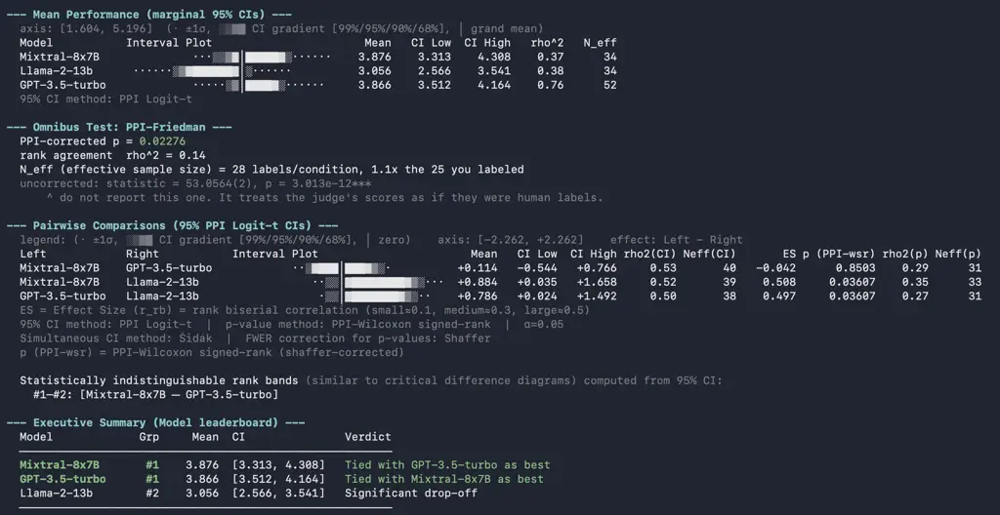

Figure 1. Running evalstats from the command line on a spreadsheet of AI
evaluation results prints 95% confidence intervals, $`p`$-values,
gradient plots (Correll and Gleicher, 2014), pairwise tests, and an
executive summary, with conditions grouped into rank bands (Demšar,
2006). Each method was chosen automatically for the sample size and data
type, backed by our simulations (§5-6). Shown are results from BiGGen
Bench (Kim et al., 2025), a benchmark that uses LLM judges as
evaluators, sampling three models at $`N{=}80`$ items each with
$`N_{\mathrm{lab}}{=}25`$ human labels as calibration. Every estimate on
screen—means, CIs, tests, $`p`$-values, and effect size—is corrected for
LLM judge bias using prediction-powered inference (Angelopoulos et al.,
2023a). The PPI-Friedman and PPI-Wilcoxon tests shown are contributions
of this paper.

###### Abstract.

Researchers across academia increasingly base significance claims on LLM
judge scores and small-sample AI evaluations. Yet without
well-calibrated confidence intervals (CIs), hypothesis tests, and
judge-bias corrections, such claims are unreliable. We address these
issues in several contributions. First, we find that running statistics
over raw LLM judge scores leads to inflated false positives:
counterintuitively, for many inter-rater agreement metrics, false
positive risk peaks at “almost perfect” human-LLM agreement. To help
researchers understand how to run statistics over LLM judges
responsibly, we present guidance and tooling for the statistical
analysis of mixed human-AI judge designs, and implement nine hypothesis
tests via prediction-powered inference (PPI), including the first known
PPI corrections for four rank-based tests (Wilcoxon signed-rank,
Mann-Whitney U, and omnibus variants). To keep PPI++ stable with small
human-labeled calibration sets, we introduce bootstrap-adaptive power
tuning, which shrinks the estimated weight toward a target estimated
from the labeled data, and accounts for that weight’s own sampling
variance. Second, through Monte Carlo simulations, we derive
recommendations for what CI, $`p`$-value, and FWER correction methods to
use for small-sample AI evaluations ($`N{<}100`$), and warn researchers
against bootstrap CIs. We package these recommendations into evalstats,
an open-source Python package that selects calibrated methods
automatically, and demonstrate it in three scenarios, including one
where a real LLM judge validated at “substantial agreement” would have
led a researcher to publish a spurious finding. evalstats is publicly
available at
[https://github.com/ianarawjo/evalstats](https://github.com/ianarawjo/evalstats).

## 1. Introduction

In AI evaluation, statistics is an afterthought, if it is a thought at
all. Only 16% of over 400 published benchmark papers report any
statistics, let alone the correct statistics (Bean et al., 2025).
Researchers across AI, NLP, and human-computer interaction (HCI) often
choose improper statistical methods for experiment analysis (Dror
et al., 2018; Bean et al., 2025; Jun et al., 2019). Among tools that
help users conduct small-scale AI evaluations, almost none quantify
uncertainty, and many rely upon LLM judges to work (e.g., (Kim et al.,
2024; Kim et al., 2026; Gebreegziabher et al., 2025; Chiang et al.,
2026; Desmond et al., 2024)), raising concerns of accuracy and
over-reliance.

In response to this state of affairs, researchers are now calling for
improved statistical rigour around AI evaluations. Proposed guidelines
from the Canadian AI Safety Institute and NIST ask practitioners to
quantify uncertainty via confidence intervals (CIs) (Keller et al.,
2026b) and conduct “error mitigation” for LLM judges (Canadian
Artificial Intelligence Safety Institute, 2026). Guidelines in software
engineering and HCI similarly ask researchers to evaluate LLM components
on small test sets (Felix Navarro et al., 2026), run “appropriate
inferential statistics,” and report “inter-rater reliability” (IRR)
between LLM judges and human raters (Baltes et al., 2025).

These calls are necessary, but often stop short of methodological
recommendations and tooling, leaving practitioners to choose methods
themselves. Where concrete recommendations do exist, they tend to assume
a large benchmark regime  (Miller, 2024; Keller et al., 2026a; Agarwal
et al., 2021), remaining silent on two common scenarios: small-sample
evals, and LLM judge scores. As a result, well-meaning practitioners may
make choices such as bootstrapping CIs, running overly conservative
family-wise error rate (FWER) corrections, or running statistical tests
over raw judge scores—choices which can produce miscalibrated estimates
in these settings, sometimes wildly so (S5, §6, and §8). On the other
hand, the methods they would need to better trust their results are most
likely unknown to them (Figure 2 and §6).

Of these choices, running statistical tests over raw LLM judge scores is
the most dangerous. Published papers at AI, NLP, and HCI venues now use
LLM judges as metrics in controlled experiments, run statistical tests
directly over their outputs (e.g., (Bai et al., 2026; Gao et al., 2025;
Tang et al., 2026; Nahar et al., 2026; Liu et al., 2025; Cheng et al.,
2026; Wang et al., 2024b; Zhou et al., 2024; Sadallah et al., 2025;
Panda et al., 2025; Fanous et al., 2025)), and produce $`p`$-values that
scientific claims rest upon. High IRR with human raters, using phrases
like “substantial agreement,” is often used to justify doing so. As we
shall show, this practice is not only wrong, but has it backwards: for
numeric metrics, false positive risk peaks at high IRR (Figure 6). And,
even for Cohen’s $`\kappa`$ over binary scores, false positive risk does
not go away entirely.

In AI evaluation settings—at small sample sizes, and with LLM
judges—what statistical methods best quantify uncertainty? In this
paper, we systematically investigate this question, and package the
resulting recommendations and implementations into evalstats, a Python
toolkit that automatically selects well-calibrated, uncertainty-aware
methods for both settings. We make four contributions:

1.  (1)
    LLM judge-bias-corrected hypothesis tests and guidance for mixed
    human-AI judge designs (§6). We present guidelines for analysis of
    mixed human-AI judge designs (§6.4), and validated tests that
    researchers can use to perform inference over LLM judge scores.
    Applying prediction-powered inference (PPI) (Angelopoulos et al.,
    2023a; Broska et al., 2025; Hullman et al., 2026), we implement and
    validate judge-bias-corrected versions of nine hypothesis tests
    commonly used in empirical research, including, to our knowledge,
    the first PPI corrections for rank-based tests Wilcoxon signed-rank,
    Mann-Whitney $`U`$, and their omnibus variants. To keep PPI++ stable
    with small calibration sets (Mani et al., 2026), we also introduce
    bootstrap-adaptive power tuning (§B.1). We find that, for many
    numeric IRR metrics, false-positive risk peaks around “almost
    perfect” agreement (§6.2), and derive rules of thumb that human-LLM
    judge alignment $`\rho^{2}`$ should be $`\geq 0.4`$ to be
    worthwhile, and below $`0.2`$ the judge is too poor to use.
2.  (2)
    Recommendations for statistical tests to use in small-sample AI
    evaluation settings. There is virtually no existing guidance on
    which CI, $`p`$-value, or FWER correction methods to use in
    small-sample eval settings ($`N{<}100`$). We run extensive Monte
    Carlo simulations to derive recommendations across eval data types,
    sample sizes, and setups (§5; full details in Appendix A).
3.  (3)
    The evalstats Python toolkit (§4). We package these results into an
    open-source Python library¹¹ 1
    [https://github.com/ianarawjo/evalstats](https://github.com/ianarawjo/evalstats)
    built around a single compare() method that, given a spreadsheet of
    AI evaluation results, automatically selects a well-calibrated CI,
    $`p`$-value, FWER correction, and (where relevant) PPI-corrected
    method from the data type, sample size, and setup, with a CLI,
    uncertainty visualizations, and PPI-corrected tests independently
    available in scipy-like format. Because methods validated in
    isolation can still fail in composition, we additionally validate
    compare() end-to-end (§7).
4.  (4)
    Demonstrations of toolkit utility (§8). We showcase evalstats
    through three demonstrations (Ledo et al., 2018) of common scenarios
    developers and researchers face analyzing AI evaluation results,
    including one where evalstats prevents a spurious LLM judge finding
    from entering peer review.

Our work warns researchers never to run statistical tests directly over
raw LLM judge scores. In §8.3 we demonstrate how a real LLM judge
validated at “substantial agreement” with human raters can create a
spurious finding that looks very significant, but is entirely false.
This false finding has nothing to do with lack of rigour: researchers
ensemble judges, use a held-out validation set, have two human raters
score a random subset of items, etc.—and still produce a vastly
miscalibrated result. Authors reporting mixed human-AI judge studies
therefore must employ a correction when analyzing data. Like previous
methodological contributions brought lesser-known statistical methods to
computing communities (Wobbrock et al., 2011; Elkin et al., 2021; Kay
et al., 2016b; Kaptein and Robertson, 2012; Kaptein et al., 2010;
Dragicevic, 2016; Agarwal et al., 2021), our work seeks to make PPI
 (Angelopoulos et al., 2023a) more accessible to researchers and
practitioners, providing concrete tooling they can employ, without
requiring them to abandon familiar statistical practice. The simulations
undergirding our technical sections are extensive; we thus push finer
details and large tables to the Appendix, and use figures to summarize
the major results in the main text.

## 2. Background and Related Work

LLM evaluation tools and statistical support for evals. A body of work
studies tools and interfaces for LLM evaluation. EvalLM (Kim et al.,
2024), LLMComparator (Kahng et al., 2024), and ChainForge (Arawjo
et al., 2024) help practitioners compare and explain differences between
LLM outputs, while MultEval (Chiang et al., 2026), Evalet (Kim et al.,
2026), EvalGen (Shankar et al., 2024), EvaluLLM (Desmond et al., 2024),
and MetricMate (Gebreegziabher et al., 2025) help align evaluation
criteria to user preferences. All address the “upstream” problem of
running evaluations, not the downstream one of analyzing results
statistically: none perform validated inference beyond a point estimate
(LLM Comparator displays 95% intervals but does not describe how they
are computed; our own prior tool, ChainForge, plots bar charts without
error bars, inviting overconfident decisions), and, at time of writing,
industry tools like Weights & Biases Weave and promptfoo offer no
uncertainty quantification either.

Many of these systems also rely on an LLM to judge output quality (e.g.,
(Chiang et al., 2026; Kim et al., 2024; Gebreegziabher et al., 2025;
Desmond et al., 2024)). Such LLM-as-a-judge systems rarely separate the
data used to align the judge from the data used to validate it (unlike
ML practice, which splits “validation” from “test” sets (Hardt, 2026)),
and none help users run calibrated statistics over judge scores that
incorporate the much smaller set of human annotations.

This is not the fault of authors or developers: neither they nor many AI
researchers seem to know what statistics are appropriate here. Existing
guidance targets large-sample benchmarks and leans on normality-assuming
approximations like the Wald interval (Miller, 2024; Angelopoulos
et al., 2023a), unrealistic for today’s custom, resource-limited test
sets (Shankar et al., 2024). Even the rare small-sample Bayesian paired
method for binary evals (Bowyer et al., 2025) deteriorates beyond
$`N{\approx}125`$ (§A.2.2, Supplementary Fig. S5), and the closest
related work, Keller et al. (2026a), restricts its analysis to binary
data and notes that very small benchmarks limit the usefulness of any
frequentist method. In ML and NLP, researchers have long flagged poor
statistical norms, such as under-reported variance across
seeds (Bouthillier et al., 2021; Henderson et al., 2018) or point
estimates without uncertainty (Dodge et al., 2019; Dror et al., 2018;
Agarwal et al., 2021; Miller, 2024; Keller et al., 2026a), prompting
remedies like the rliable library for bootstrapped benchmark-scale
CIs (Agarwal et al., 2021). But these target an already-fluent audience
at benchmark scale, not practitioners writing small, custom eval
sets (Shankar et al., 2024).

Despite this gap, researchers and developers are now being called to
compute 95% CIs on AI evaluation results (Keller et al., 2026b; Canadian
Artificial Intelligence Safety Institute, 2026) with no recommendations
for the small-sample and LLM judge regimes common in practice.
Felix Navarro et al. (2026) tell HCI researchers to evaluate LLM
components on modestly-sized eval sets but offer no statistical
guidance, and Baltes et al. (2025) ask software engineers for
“appropriate inferential statistics,” suggesting options such as
bootstrap-based comparisons that our simulations find often
miscalibrated at small $`N`$, and for “inter-rater agreement,” without
saying how to fold judge alignment into inference. These gaps in
expectation vs. reality mirror Jun et al. (2022a)’s finding that
statistical packages “expect analysts to have more statistical expertise
than may be realistic.”

##### Mixed human-AI judge designs and analysis

Researchers are eager to use LLMs as “judges” of quality to scale up
grading or annotation (He et al., 2024). Kumar et al. (2026), for
instance, found LLM judges outperformed crowdworkers at judging empathy
in text chats. Researchers typically validate a judge against a smaller
sample of human scores, report an inter-rater reliability (IRR) metric
like Cohen’s $`\kappa`$, then run statistics over the judge scores as if
“high IRR” licensed treating them as human surrogates—a pattern now
visible in published work at major HCI, AI, and NLP venues (e.g., (Bai
et al., 2026; Nahar et al., 2026; Gao et al., 2025; Li et al., 2025; Li
et al., 2026; Liu et al., 2025; Cheng et al., 2026; Wang et al., 2024b;
Sadallah et al., 2025)). This practice may only grow, and is worrying.
LLM judges carry systematic biases, toward longer or confident
responses, response position, or themselves (Zheng et al., 2023; Xu
et al., 2024; Wang et al., 2024a), casting doubt on them as “surrogates”
for humans (Hullman et al., 2026). And, as we shall show (§6.2),
reporting IRR alone means almost nothing for trusting claims.

Where researchers have often treated LLM judges as replacements for
human subjects (a fraught framing (Agnew et al., 2024)), emerging
“mixed-subjects” framings (Broska et al., 2025) position them as noisy,
cheap predictors that complement a smaller set of human labels, which
Hullman et al. (2026) term statistical calibration. We adopt the term
mixed human-AI judge designs for our setting, reserving Broska et al.
(2025)’s “mixed subjects” for designs where the LLM stands in for a
human participant (although our tests could be used for the latter, see
Discussion §9.4). Prediction-powered inference (PPI) (Angelopoulos
et al., 2023a) is one such calibration method. Rather than aligning the
judge upstream, it assumes the judge may always be biased, estimates
that bias from a small human-labeled sample, and uses it to correct
downstream inference—finding signal in the judge’s noise to improve
power to detect real effects (§6). Despite PPI’s establishment in the ML
statistics literature, researchers that we spoke to in software
engineering, HCI, and even NLP seemed unaware of it.²² 2 At time of
writing, a full-text search of the ACM library for “prediction-powered
inference” yields only 10 responses. The PPI authors provide a reference
implementation, ppi_py,³³ 3
[https://github.com/aangelopoulos/ppi_py](https://github.com/aangelopoulos/ppi_py)
covering means, quantiles, and regression coefficients (Angelopoulos
et al., 2023a), but it provides no two-sample, paired, rank-based, or
omnibus tests, no multiple-comparison correction, no automatic selection
of methods, and no small-sample calibration of the power-tuning weight
(§B.1).

##### Statistical methodology and toolkits

Statistical toolkit research is rare but has standout examples, notably
by Jun (Jun et al., 2022b; Jun et al., 2019; Jun et al., 2024; Jun
et al., 2022a), with many toolkits introducing domain-specific languages
(DSLs) for encoding analyst insight (such as rTisane (Jun et al., 2024),
which builds mixed-effects models from a DSL description of hypotheses
and causal relationships). These toolkits generally target scientists
analyzing complex, multi-factor experiments at scale; AI evals bring
their own needs—LLM judge score calibration, small-sample data hard to
fit GLMMs to—that make dedicated support worthwhile. General-purpose
libraries such as statsmodels implement individual tests and
corrections, leaving choice of method to the analyst.

Second, HCI in particular has had a long history of meta-scholarship on
statistical methodology. Wobbrock et al. (2011)’s Aligned Rank Transform
and ARTool gave a nonparametric alternative to factorial ANOVA; Kaptein
et al. (2010) brought nonparametric tests to experiment analysis;
Kaptein and Robertson (2012) catalogued errors in how CHI papers
interpret $`p`$-values, power, and effect sizes; Dragicevic (2016)
argued for estimation statistics (Cumming, 2014); and Kay et al. (2016b)
advocated for Bayesian methods, with Xiao et al. (2026) building tooling
that helps users define priors by externalizing domain knowledge. Here,
the choice to PPI-correct rank-based tests derives from their common
usage in experiment analysis.

Finally, our work draws upon uncertainty visualization research by
Hullman, Kay, Padilla, Gleicher, and others (Correll and Gleicher, 2014;
Padilla et al., 2022; Kay, 2023). evalstats adopts gradient plots, shown
to produce better-calibrated inferential judgments than bar charts with
error bars (Correll and Gleicher, 2014); violin plots offer similar
benefits, but gradient plots render in the terminal, take less space,
and stay agnostic to the underlying CI method.

## 3. Gaps, Scope, and Commitments

Four gaps follow from the work reviewed above. We state each one with an
example situation that a researcher or developer might find themselves
in today:

1.  G1.
    Limited guidance on statistical methods for small-sample eval
    reporting ($`N{<}100`$).  
      $`\hookrightarrow`$ *Ex: A system developer must choose the best
    of 8 models and 5 prompts on an $`N{=}30`$ eval set, factor in cost,
    and justify the choice in a written report.*
2.  G2.
    How to measure human-LLM judge alignment and carry this information
    into downstream inference.  
      $`\hookrightarrow`$ *Ex: A developer scores 150 agent traces per
    configuration with an LLM judge on a 1-5 rubric, hand-labels some
    traces, and wants to know which of five coding agents is best.*  
      $`\hookrightarrow`$ *Ex: A researcher compares three writing
    interfaces with 1,000 participants on Prolific, grades the essays
    with an LLM judge, and collects a subset of human ratings to check
    judge alignment. They report weighted Cohen’s $`\kappa{=}0.7`$ and
    then run their statistics over LLM judge scores directly, arguing
    that high inter-rater reliability justifies doing so. (This mirrors
    a practice in recent published work at HCI, AI, and NLP venues; see
    §2.)*
3.  G3.
    Limited guidance for stability testing across multiple runs or minor
    variations.  
      $`\hookrightarrow`$ *Ex: An ML engineer runs $`K{=}5`$ independent
    eval runs over 12 configurations of a RAG pipeline before
    deployment. One configuration scores highest, and they need to know
    whether it is stable enough to ship.*
4.  G4.
    Poor norms for visualizing uncertainty.  
      $`\hookrightarrow`$ *Ex: Comparing model performance by eyeballing
    whether error bars of standard errors overlap in a bar chart.*

G1 and G2 are coupled. Judge bias correction is estimated from a small
human-labeled subset (§6), hence every quantity inherits the
small-sample behavior of the CI and $`p`$-value method underlying it. If
those methods are miscalibrated at small $`n`$, the correction inherits
that problem. LLM judges are also widely used to evaluate AI
systems (Yan, 2024), particularly in interactive tools for AI
evaluation (Kim et al., 2026; Kim et al., 2024; Kahng et al., 2024;
Gebreegziabher et al., 2025).

Lastly, a note about scope: we address downstream analysis only and
assume the user has already collected evaluation results into
spreadsheet format, deferring the separate upstream problems of eval set
creation, construct validity, prompt optimization, and judge creation to
other work. The LLM judges we consider score artifacts produced by
people or models; we do not treat LLMs as stand-ins for human
participants (§9 discusses the synthetic users case).

### 3.1. Philosophy and Approach

Statistics is full of competing philosophies, rather than one right way
to analyze data. Thus, before we proceed, we declare our commitments and
perspective.

evalstatsforegrounds an estimation statistics framework (Cumming, 2014;
Dragicevic, 2016), emphasizing CIs and point-estimate effect sizes over
null hypothesis significance testing (NHST), whose interpretive problems
are well documented (Kaptein and Robertson, 2012). However, like
Statslator (Masson et al., 2023) and Robertson and Kaptein (2016), we
still support $`p`$-values and tests like Wilcoxon, since many venues
and researchers may expect them. Our project is also empiricist:
defaults are chosen by simulation-based evidence. We adopt a frequentist
framing throughout; where our CI methods draw on Bayesian ones, we
retain the term “confidence interval” for simplicity, while
acknowledging they are technically credible intervals.

“Best method” is also, to some degree, a matter of fit to circumstance.
AI evaluation brings nuances—high covariance, many pairwise
comparisons—that we engineered our investigation and package around. Our
governing principles were:

1.  (1)
    Err slightly conservative. CI methods target slightly-above-nominal
    coverage (e.g., $`\geq`$0.95 for $`\alpha{=}0.05`$), and we apply
    FWER correction for simultaneous pairwise comparisons.
2.  (2)
    Prefer CIs over standard errors (SEs). SEs assume normality and
    invite overconfident conclusions (Belia et al., 2005). We default to
    95% CIs with $`\alpha{=}{.05}`$, which users can adjust globally.
3.  (3)
    Prefer pairwise comparisons and report CIs on differences, since
    within-item comparisons cancel shared noise and are commonplace in
    AI evals (e.g., benchmarking).
4.  (4)
    Prefer non-parametric methods, as LLM outputs (pass/fail, Likert,
    bounded floats) are rarely normal.
5.  (5)
    Enforce a minimum sample floor: To focus our analysis, we needed a
    cutoff sample size beyond which no guarantees are made. evalstats
    reports no statistics below $`N{=}15`$, a hard cutoff that also
    applies to the number of human labels under PPI correction.⁴⁴ 4 This
    cutoff is loosely informed by our simulations, where $`N{=}15`$ is
    where Type I error control gets hardest to hold without sacrificing
    power, and by Eyre and Madras (2025), who find that PPI performs
    poorly when very few labeled examples are available.
6.  (6)
    Provide automatic defaults, grounded in simulation.
7.  (7)
    Support data types common to AI evaluation: Binary data (0/1);
    continuous bounded data (BLEU scores, etc.); and discrete / Likert
    scores (e.g., rubrics). Unbounded numeric data is supported, but is
    not a focus here.
8.  (8)
    Preserve user control: defaults can be overridden, including opting
    out of $`p`$-values and NHST output.

|                                                                                            |                                                                                                                                                                                                                                                                                                      |                                                                                                                                                                                                                                                                            |
| ------------------------------------------------------------------------------------------ | ---------------------------------------------------------------------------------------------------------------------------------------------------------------------------------------------------------------------------------------------------------------------------------------------------- | -------------------------------------------------------------------------------------------------------------------------------------------------------------------------------------------------------------------------------------------------------------------------- |
| What users need to know                                                                    | Common practice without evalstats                                                                                                                                                                                                                                                                    | With evalstats                                                                                                                                                                                                                                                             |
| Is the best-scoring condition really best?                                                 | Read overlapping error bars by eye, which does not answer the question; or run pairwise tests and correct them via a familiar correction like Bonferroni when comparisons share items and are therefore strongly dependent.                                                                          | compare(factors=...): pairwise CIs already widened for simultaneous coverage, plus rank bands marking statistical ties.                                                                                                                                                    |
| Does the result hold if I run it again?                                                    | Averaging or pass@k (Hariri et al., 2026) across runs, which hides per-item disagreement that caused the instability. Even if trying to accommodate runs, struggle to pick an estimator that respects the nesting.                                                                                   | Multi-run data is detected; per-input variance is reported alongside the means, or in isolation via stability().                                                                                                                                                           |
| Which condition wins once cost or latency counts?                                          | Rank on the primary metric and inspect the secondary one informally, eyeballing means.                                                                                                                                                                                                               | Simply passing secondary_metric= on compare() to get an uncertainty-aware Pareto front labeling each condition _frontier_, _dominated_, or _ambiguous_.                                                                                                                    |
| Which combination of two factors is best?                                                  | Test every factor level against every other—e.g., $`8{\times}5`$ grid of model-prompt pairs, for 780 comparisons—then choose a basic FWER correction that is overly conservative under strong correlation between conditions.                                                                        | The same call with two factors: Šidák simultaneous CIs and step-down FWER correction (Shaffer or Romano–Wolf) over the full grid.                                                                                                                                          |
| My metric is an LLM judge. Can I trust the comparison?                                     | Compute pooled inter-rater reliability once against a hand-labeled sample collected by convenience.                                                                                                                                                                                                  | label from the CLI to randomly sample items for labeling, then run judge_alignment().                                                                                                                                                                                      |
| Only part of my data is human-labeled, and I need to run statistics over LLM judge scores. | Analyze the labeled subset alone and discard the judge scores, losing power—or keep the judge scores, inherit their bias, and argue with reviewers or managers that high IRR with human raters warrants running familiar statistics over LLM judge scores, potentially leading to spurious findings. | alignment= on compare() propagates the labeled sample into every estimate, CI and $`p`$-value via PPI correction. PPI tests recover power from the unlabeled items while remaining calibrated, worth $`{\approx}1.5\times`$ the human labels at $`\rho^{2}{=}0.4`$ (§6.3). |

Table 1. How evalstats’ features can help developers and researchers
running statistics over AI evaluation results.

## 4. The evalstats Toolkit

evalstatsis an open-source Python package and command-line tool for the
statistical analysis of AI evaluation results. It is organized around a
single powerful function, compare(), which takes a spreadsheet of
results in long format, with one row per item, condition, and score
(optionally with a run column when the eval was executed more than once,
as well as other factors and metrics), and automatically returns
well-calibrated uncertainty estimates. Specifically, in four lines of
Python code (results.csv has item, model, and score columns):

1 import evalstats as es

2 data = es.load_from("results.csv")

3 result = es.compare(data, factors="model", score_range=(1, 5))

4 result.summary() \# prints in similar style to Figure 1

The same analysis can be run via evalstats analyze results.csv from the
command line, with results returned in color-coded terminal output
(Figure 1). PPI-corrected tests (§6) are also available independently in
evalstats.tests, with scipy-like method signatures.

Table 1 summarizes what a developer must otherwise do themselves,
compared to answering them with simple calls in evalstats. The first
four rows compress work that is possible but tedious and easy to get
wrong. The last two, on correcting for LLM judge bias, are not
straightforward at all without our contribution in §6.1.

Summary of compare(). Figure 1 shows example command-line output for a
three-model comparison. For each condition, evalstats reports the mean
with a 95% CI; for each pair, the mean difference with a simultaneous
CI, an effect size, and an FWER-corrected $`p`$-value, plus rank
bands (Demšar, 2006) grouping conditions that are statistically
indistinguishable. An executive summary states the verdict in plain
language (“tied with Gemma as best”) at $`\alpha{=}{.05}`$. When
method="auto", every method in compare() is automatically selected (G1)
from the data type, sample size, design, and number of conditions
compared, via the decision trees of Figure 2, each branch backed by the
simulations in §5-6. Users can override choices or suppress $`p`$-values
for an estimation-only workflow (Dragicevic, 2016; Cumming, 2014).

Communicating uncertainty (G4). Every interval evalstats plots is drawn
as a gradient plot (Padilla et al., 2022) rather than an error bar as
four nested CIs at $`68\%`$/$`90\%`$/$`95\%`$/$`99\%`$, rendered as
block characters of decreasing visual opacity. Following Correll and
Gleicher (2014), no dot marks the mean, since a point marker invites
binary readings. The encoding is agnostic to CI method. A similar plot
is also available via result.plot().

Two factors (e.g., prompts and models). At present, users can pass up to
two crossed factors. For two factors, evalstats compares every
combination rather than one variable at a time, and outputs a heatmap in
the terminal with statistically indistinguishable top performers (not
shown).

(a) 95% confidence interval

{forest}

(b) $`p`$-value / FWER correction

{forest}

Figure 2. Decision trees for selecting (a) a 95% CI method and (b) a
$`p`$-value or FWER-correction method, for small-samples AI evaluation
settings $`N{=}15`$-$`100`$. We focus on bounded scores (binary,
continuous $`[0,1]`$, and Likert), point estimates, and paired data,
common in benchmarking. For summary plots backing these recommendations,
see Figure 3; for detailed analysis, see §A.2–A.4. evalstats chooses
these methods by default in its compare() method (§4). Under LLM judge
correction (alignment=), two defaults change because the method has no
PPI correction: paired Likert CIs use logit-$`t`$ instead of NIG, and
binary pairwise $`p`$-values come from a PPI-corrected paired $`t`$-test
instead of McNemar (App. B.5).

Multi-run and two-metric data (G3). evalstats will present multi-run CIs
by default when repeated-run data is passed. These appear visually as
“noise plots” in the terminal output, with intra-class correlation
(ICC):

![[Uncaptioned
image]](arxiv-2609-35815v1--ef6dcd9ae27a.figures/figure-2.webp)

In addition, when a secondary_metric= argument is passed, evalstats
jointly bootstraps the two metrics together (e.g., latency or cost vs.
performance), plots an uncertainty-aware Pareto front, and adds a column
to its Executive Summary. evalstats also ships CI methods for multi-run
data, including multi-run adaptations of Wilson and Bonett-Price
intervals. Because their construction is more involved, we defer
multi-run method validation to future work.

Untrusted metrics (G2). What most distinguishes evalstats from a general
statistics library is the alignment= argument. When the eval metric was
produced by an LLM judge, the user draws a random sample of items for
human labeling with evalstats label, then passes those labels through
judge_alignment(), which reports agreement metrics, checks that the
labeled subset seems random and representative, and returns an alignment
object. Passing that object to compare() via alignment= declares the
metric untrusted, and each estimate on screen—means, CIs, pairwise
differences, and $`p`$-values—is corrected for LLM judge bias (Figure 1)
using the calibration set. See §8.2 and §8.3.

Availability. evalstats is open source under the MIT license at
[https://github.com/ianarawjo/evalstats](https://github.com/ianarawjo/evalstats).
The repository also contains the full simulation harness behind our
results. There is also a companion website,
[https://statsforevals.com](https://statsforevals.com).

evalstatshas some limitations in its current state. Its pairwise CIs for
between-subjects designs are not yet validated, since the methods of §5
target repeated measures. It focuses on means, which are most common in
AI evaluation for item-level data, rather than medians or other metrics.
Multi-run CI methods’ validation is not reported in this paper, and in
compare(), PPI correction currently requires a single factor and at
least 50 items and cannot be combined with multi-run data. We further
discuss limitations in §9.6.

The rest of this paper establishes that compare()’s defaults for
single-run data can be trusted. §5 finds calibrated CI, $`p`$-value, and
FWER methods for small-sample eval regimes; §6 corrects them for an LLM
judge; and §7 reports a final end-to-end test.

Figure 3. Evidence for our recommendations in Figure 2, showing coverage
rates, interval score (Gneiting and Raftery, 2007), and worst-case
coverage for CI methods; and error, power, and worst-case error for
$`p`$-values and FWER corrections. Blue marks the recommended method,
with orange its strongest runner-up; gray is every other method we
tested there (9-14 per panel). Shading marks differences
indistinguishable from Monte Carlo error. Per-method values in
Tables 4-6 and 10, and full reasoning in §A.2. Replicates per panel:
2,000 (single-sample CIs), 300 (paired CIs, pairwise $`p`$-values,
simultaneous CIs), 500 (multi-arm).

## 5. What are the best-performing CI, p-value, and FWER-correction methods for small-sample AI evaluation regimes ($`N{<}100`$)?

For evalstats’ compare() method (§4) to have reasonable defaults, we
must establish what those defaults should be. This is also a necessity
for PPI correction, especially of CIs, as the correction rests on a
smaller sample. We found no prior research that covers this
comprehensively for AI evaluation: some work covers specific topics,
like binary data evals (Bowyer et al., 2025), multi-run data (Gonzalez
et al., 2025), or why pass@k should be abandoned (Hariri et al., 2026),
but none surveys CI methods, hypothesis tests, or FWER control across
small-sample eval scenarios generally, and LLM outputs are not
parametric. Rather than go by rule-of-thumb, the gold standard is to run
simulations checking method performance against distributions likely to
be seen in practice.

Thus, we ran Monte Carlo simulations measuring CI, $`p`$-value, and
FWER-correction methods across three data types common to LLM eval
settings: binary, continuous \[0,1\], and Likert-like discrete scores
(1-5).⁵⁵ 5 We only consider “bounded” numeric data here, but unbounded
data of a finite set maps easily to continuous $`[0,1]`$; a fourth
“grades” suite (0-100) we tried performed virtually identically to
continuous $`[0,1]`$. We sometimes summarize the latter two as
“numeric.” For CIs we tested two regimes: synthetic data across a
diverse array of distributions, including adversarial scenarios like
zero-inflated results, and real-data simulations by randomly sampling
subsets of large-scale benchmark outputs using the OpenEval
dataset (Jiang et al., 2026) and Inspect AI harness. We also weigh each
method’s computational cost against its performance. Alongside coverage,
width, Type-I error, power, and run time, we report the *interval
score* (Gneiting and Raftery, 2007), a proper scoring rule (lower is
better) that combines width and on-target coverage to give a summary of
CI method performance. Since it can hide a bad coverage tail, we also
report worst-case coverage (MinCov). The scenario suite is described in
§A.1 with the per-method analysis in §A.2–A.4.

To pick candidates to test, we drew from multiple sources: for binary
proportions and their differences, previously recommended intervals by
Fagerland et al. (2014) (which includes Bonett and Price (2012)); for
numeric, the log-transform recommended by Dragicevic (2016); hypothesis
tests in NLP research (Dror et al., 2018); multiple comparisons
corrections from a survey in bioinformatics (Dudoit et al., 2003),
simultaneous-CI methodology (Fuchs and Sampson, 1987),
economics (Calonico and Galiani, 2025), and multcomp (Bretz et al.,
2016), leading us to corrections like Šidák (1967), Shaffer (1986),
max-T and Romano and Wolf (2005), and Westfall and Young (1993); methods
that recent AI work examines (Bowyer et al., 2025; Gonzalez et al.,
2025; Hariri et al., 2026); and common frequentist methods in current
HCI practice (Kaptein et al., 2010; Dragicevic, 2016). We also cover
bootstrap methods systematically—percentile, studentized, BCa, Bayesian
bootstrap, smooth bootstrap, and a joint bootstrap for simultaneous
CIs—as bootstrapping CIs was previously recommended to HCI researchers
by Dragicevic (2016).

We summarize the results here via two decision trees, Figure 2(a) for CI
methods and (b) for $`p`$-value/FWER correction, which are evalstats’
automatic defaults under method="auto". Figure 3 plots a summary of
evidence for each recommendation against every competing method we
tested, on calibration, efficiency, and worst-case performance. Some
highlights from our results include high performance for Romano-Wolf’s
step-down procedure (Romano and Wolf, 2005) for FWER correction of
p-values, a technique recommended in applied economics when many tests
are correlated (Calonico and Galiani, 2025) (we recommend it only at
$`n{\geq}30`$ due to few-samples instability; see §A.4). Our simulations
also surface a new result for CIs of paired binary data: Bonett and
Price (2012)’s method outperforms the Bayesian paired method of Bowyer
et al. (2025) on worst-case coverage and Type-I error control while
running much faster. Finally, bootstrap CI methods were overconfident
nearly everywhere, and on paired binary data none reached nominal
coverage even at $`N{=}100`$. The smooth bootstrap is the one variant
that holds nominal on continuous and Likert data, but it grows
conservative rather than converging, which makes it a poor rule of
thumb. We strongly advise against bootstrap CIs at $`\mathbf{N{<}100}`$.

## 6. How to run statistics over LLM judge scores? Mixed human-AI versions of standard hypothesis tests

Researchers in HCI, software engineering, and AI increasingly use LLM
judges to scale up data annotation and evaluate system quality (Yan,
2024). As §2 described, the usual practice is to report an IRR metric on
a small human-labeled sample and then run statistics over the judge’s
scores directly (Yan, 2024).

Two questions follow. Does high IRR mean that LLM judge scores can be
trusted as surrogates for human scores (Q1)? Second, is there a more
principled approach that factors in judge quality while controlling Type
I error and improving power over the human-only data, without abandoning
familiar frequentist practice (Q2)?

Until now, researchers have lacked an accessible answer to Q2 for
standard hypothesis tests. Thus, even if Q1 is negative, without a
practical alternative, researchers using LLM judges may remain tempted
to run statistics over judge scores directly.

In this section, we address both questions. We show that high IRR does
not engender trust, but often the opposite: higher IRR is often
associated with higher false-positive risk (§6.2). To address this
issue, we make prediction-powered inference (PPI) (Angelopoulos et al.,
2023a; Hullman et al., 2026; Eyre and Madras, 2025) practical for these
settings. Applying PPI, we implement LLM-judge-bias-corrected versions
of nine commonly used hypothesis tests, validate their calibration on
synthetic and real data (§6.1), quantify what a mixed human-AI judge
design buys in “effective sample size” (§6.3), and offer guidance for
researchers (§6.4).

#### Background on statistical frameworks to mitigate AI judge bias

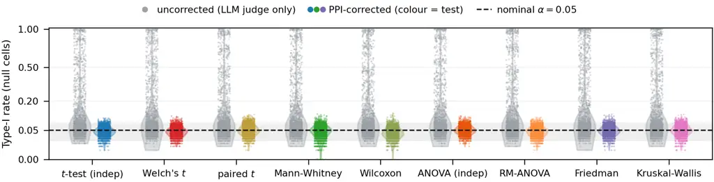

Figure 4. Type I error remains calibrated across all nine PPI-corrected
tests under an aggressive factorial sweep compounding judge bias
magnitude and judge noise with sample size $`N`$, labeled-item count
$`N_{\mathrm{lab}}`$, and data type (2,046 null scenarios/test, 200 MC
replicates each, $`\approx`$3.68M trials). PPI calibration holds even
when multiple judge biases compound simultaneously. These are null
scenarios under MCAR labeling; MNAR appears in Fig. 10. Classical tests
on uncorrected judge scores instead yield false positives (gray dots).
The shaded band is a perfectly-calibrated test’s scatter at this
replicate count. The $`y`$-axis is square-root scaled to resolve the
region near $`\alpha`$ while keeping the uncorrected spread visible.
§B.3 has full details.

Prediction-powered inference (PPI), introduced by Angelopoulos et al.
(2023a) in Science, combines noisy machine predictions with a smaller
set $`N_{\mathrm{lab}}`$ of human labels into a single corrected
estimate, offering Type I error control and, when predictions are
accurate, power gains over the human-only subset. Its refinement PPI++
adds power tuning, a data-estimated weight $`\hat{\lambda}\in[0,1]`$ on
the judge scores—near $`0`$ when the judge adds nothing, near $`1`$ when
it is accurate—under which, asymptotically, power never drops below the
human-only subset’s (Angelopoulos et al., 2023b). Despite this
validation, PPI remains little-used in applied research, as it requires
a custom implementation per test.

Three things need attention when adopting PPI. First, PPI targets
estimators built from item-wise averages, like means and regression
coefficients, so applying it to widely used nonparametric
tests (Robertson and Kaptein, 2016) like Wilcoxon requires an extra
step. One preprint generalizes PPI to any asymptotically linear
estimator (Zou et al., 2026), applied to binary-classifier metrics
including AUC, but constructs no hypothesis tests; we are not aware of
prior PPI corrections of the rank-based tests here. Concurrent work by
Gao et al. (2026) in August 2026 PPI-corrects a paired permutation test,
showing it is possible to PPI-correct a nonparametric test, albeit not a
rank-based one. Second, classical PPI assumes normality via a CLT
approximation (Angelopoulos et al., 2023a); a bootstrap variant relaxes
this (Zrnic, 2024), but bootstrap methods can themselves fail at small
$`N`$. Finally, Eyre and Madras (2025) found that PPI “performs poorly
(sometimes worse than classical inference) when very few labelled
examples are available”; informed by (Mani et al., 2026), we adopted
$`N_{\mathrm{lab}}=15`$ as evalstats’ floor for reporting LLM judge
statistics.

PPI is not the only calibration framework; design-based supervised
learning (DSL) (Egami et al., 2023) debiases inference via a different
construction. We adopt PPI for three reasons: DSL is inconsistent for
unknown reasons (de Pieuchon et al., 2025); PPI treats the judge as a
black box; and PPI correction extends cleanly to familiar hypothesis
tests. Other constructions such as Lee et al. (2026) focus on point
estimate CIs for binary proportions in large-sample settings, not
hypothesis testing across data types.

### 6.1. Validation of PPI-corrected tests

#### 6.1.1. Monte Carlo simulations of PPI-corrected statistical tests

We implemented PPI-corrected versions of nine standard hypothesis tests:
tests of two independent groups (t-test, Welch’s t-test, Mann-Whitney
U), paired/repeated measures (paired t-test, Wilcoxon signed-rank,
repeated-measures one-way ANOVA, and Friedman), and $`k`$ independent
groups (one-way ANOVA, Kruskal-Wallis). In addition, we PPI-corrected
the CI defaults of Figure 2, as these are needed to PPI-correct 95% CIs
when the user passes alignment data to compare() (§4); we also correct
the rank-biserial effect size reported alongside Wilcoxon and
Mann-Whitney (§C). As PPI corrections of parametric tests are
straightforward applications of standard asymptotic mean and variance
PPI rectifiers (Angelopoulos et al., 2023a; Chen et al., 2026), we focus
most of our technical details on reporting rank-based tests.⁶⁶ 6 Since
compare() requires at least $`N=50`$ judge-scored items for PPI
correction, we do not encounter low-samples recommendations that deviate
(Fig. 2).

As there are different PPI constructions, we clarify that all methods
use Angelopoulos et al. (2023b)’s power tuning (PPI++) with our
bootstrap-adaptive modification, whose effect fades as
$`N_{\mathrm{lab}}`$ grows (§B.1). We validate all methods’ Type I error
rate under the null hypothesis and power under a battery of adversarial
judge biases, effect sizes, and data distributions, on both synthetic
and real LLM judge data (§B.3 for Type-I error, §B.6 for power).

Two figures summarize our main results. Figure 4 reports calibrated Type
I error for all PPI tests under an aggressive factorial sweep, and
Figure 5 reports power for two-group tests against four alternatives,
including the human-only subset and the uncorrected judge. Table 13
provides descriptive statistics for data behind these plots. Calibration
also holds for real judge data (§B, Fig. 11) and our omnibus tests’
power (Fig. 13). These results assume the human subset was selected by
random sampling, meeting the missing-completely-at-random (MCAR)
assumption PPI requires (Angelopoulos et al., 2023a); for
missing-not-at-random (MNAR) regimes, see Fig. 10.

PPI is being steadily extended to new estimators (Zrnic, 2024; Zou
et al., 2026; Csillag et al., 2025), and rank-based tests needed one
such extension. Standard PPI corrects estimators built from itemwise
averages (Angelopoulos et al., 2023a), and an item’s rank depends on the
whole sample, so the correction does not apply to the literal rank
statistic. The usual remedy is to restate the hypothesis in terms of an
estimand that is stable under subsampling, which is what we do: for
Mann-Whitney, an exact $`U`$-statistic (dominance probability), with its
power-tuning weight estimated by the PPI bootstrap (Zrnic, 2024); for
Wilcoxon signed-rank, a Walsh-average estimand with an analytic
Hájek-projection; for Friedman, within-subject rank means, which need no
reformulation at all; and for Kruskal-Wallis, the pairwise-dominance
vector whose weighted row sums are its group rank means. To our
knowledge these are the first PPI corrections of these four tests.
Appendix §C breaks down each formulation, for technical readers.

Our results show good calibration for all tests, with expected
under-performance when PPI’s MCAR assumption is violated. Paired tests
RM-ANOVA, paired-$`t`$, and Wilcoxon appear the most robust to mild
deviations from MCAR (Fig. 10). Lastly, most tests assume numeric data;
for binary data we validate only Welch’s and paired $`t`$-tests, which
avoid rank-based ties, and leave the rest to follow-up work.

#### 6.1.2. Summary of simulation sweep (§B.2.1) for LLM judge bias scenarios.

Our simulation suite employs two complementary sweeps (Table 12):
one-factor-at-a-time, isolating a single change from a fixed baseline,
and a factorial sweep crossing several factors to catch failures that
emerge only in combination, varying the data, labeling mechanism, and
judge factors, each chosen to mirror a documented LLM-judge failure mode
like preference for longer responses (Zheng et al., 2023).

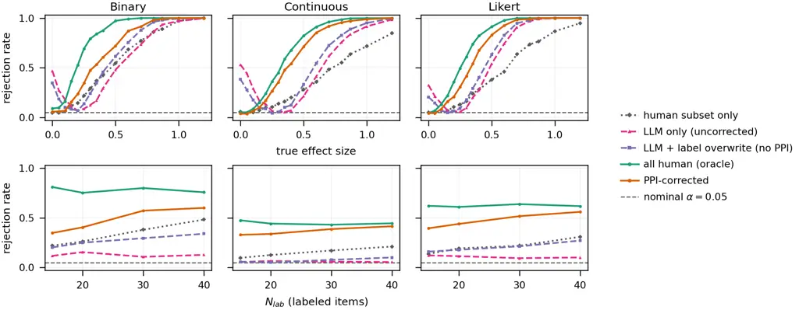

Figure 5. PPI-corrected tests (orange) recover power under biased LLM
judges, approaching a fully-human oracle (green) and improving on the
small human-only subset (gray dotted) across all data types. Pink:
running tests over uncorrected scores show false-positive rates at zero
effect; purple: swapping in some human gold labels still miscalibrates.
Bottom: power across human-only size $`N_{\mathrm{lab}}`$ at Cohen’s
$`d{=}0.3`$. Continuous/Likert averages five PPI-corrected tests and
their classical counterparts (independent, Welch’s, paired $`t`$-tests,
Wilcoxon, Mann-Whitney U); binary averages the two $`t`$-tests. For more
details, see §B.6. 200 Monte Carlo replicates per condition
(Appendix B).

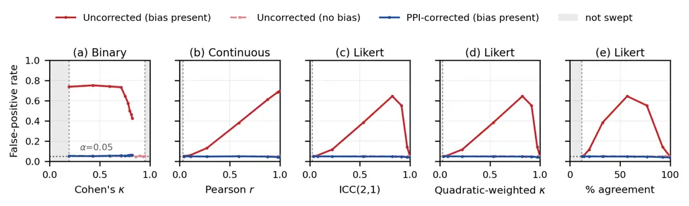

Figure 6. False-positive rate against human-LLM judge alignment on MCAR
data, with five IRR metrics across three data types. Uncorrected, the
false-positive rate peaks where agreement is high on Likert (c-e) and
continuous data (b). PPI (blue) and a no-bias control (dashed) hold
nominal $`\alpha{=}.05`$ throughout. Shading marks alignment our sweep
did not reach. A wider sweep across 11 IRR metrics shows similar
patterns (full-page plots in Appendix F). 200 MC replicates per scenario
(§B).

### 6.2. Does high inter-rater reliability certify judge trustworthiness?

We answer Q1—does high IRR certify judge trustworthiness?—by showing,
corroborating prior arguments (Egami et al., 2023; Chehbouni et al.,
2025), that a judge scoring high on standard IRR metrics can still
produce badly inflated false positives. Counter-intuitively, the risk
can peak at high IRR: for most metrics on Likert data, including
quadratic-weighted $`\kappa`$ and ICC(2,1), false-positive risk is worst
around 0.80-0.90 (Fig. 6c-e), or ‘‘almost perfect’’ agreement, remaining
high through 0.90 and returning to nominal only above 0.99.⁷⁷ 7 A larger
sweep crossed judge bias with noise over all four data types, up to 11
judge configurations, and up to 11 IRR metrics; full-page plots are in
§F. On numeric data the takeaway holds across metrics: false-positive
risk is worst at _high_ agreement. Only the exact peak moves.
Exact-match metrics (percent agreement, Gwet’s AC1, PABAK) are no safer,
since the same number can carry either little or near-total risk at high
bias. Binary Cohen’s $`\kappa`$ is the single more trustworthy metric:
higher $`\kappa`$ does mean lower risk, but not nominal (e.g.,
$`\kappa{=}0.81`$ still gave an $`{\approx{}}{37\%}`$ false-positive
rate). On continuous data the risk rises monotonically with agreement
for Pearson’s $`r`$ (Fig. 6b).⁸⁸ 8 $`r`$ and Spearman’s $`\rho`$ measure
relative agreement and can overlook systematic bias; quadratic-weighted
$`\kappa`$ and ICC(2,1) measure absolute agreement, yet can still be
high while the judge exhibits a systematic bias. For binary data, higher
Cohen’s $`\kappa`$ does reduce Type I error, but does not eliminate it
completely (Fig. 6a). Thus, we conclude that LLM judge-bias-corrected
statistics must be employed in all cases; it is never warranted to run
statistics solely over uncorrected judge scores and trust the
results (Hullman et al., 2026).⁹⁹ 9 The astute reader might wonder “what
if it’s 100% aligned?” The answer to that is: aligned to the human
sample that you have. 100% agreement, for instance on 30 samples, raises
more questions than it answers. evalstats does not guard against this at
time of writing, because 100% agreement is treated as perfect by PPI.
Until we add a guard, authors might apply a conservative pseudo-count
adjustment, in the spirit of Agresti & Coull’s “add two successes and
two failures” interval for proportions (Agresti and Coull, 1998): add
two pseudo-items to the _labeled_ set per condition, on which the judge
misses by the smallest possible step, once in each direction (binary:
one false positive and one false negative; Likert: one $`+1`$ and one
$`-1`$ point; continuous: $`\pm`$ the smallest increment in which scores
are recorded). Missing in both directions gives the correction some
disagreement to learn from while leaving its bias estimate at zero.
Disclose the pseudo-items.

### 6.3. How much power do LLM judges buy you? Quantifying effective human labels

Establishing that PPI-corrected tests are calibrated (§6.1) is necessary
but not sufficient for adoption. A critical question remains: Is running
a mixed human-AI judge design actually worth the trouble? (Hullman
et al., 2026) After mitigating for judge bias, how much statistical
power does mixing human and LLM judges actually buy us, compared to just
running statistics over the smaller human subset?

We report this as an effective human labels curve (Figure 7): for a
fixed human budget $`N_{\mathrm{lab}}`$ and judge, how many labels
$`N_{\mathrm{lab}}^{\prime}`$ would a human-only setup need to match the
power a PPI-corrected mixed design reaches with $`N_{\mathrm{lab}}`$
labels plus the full judge-scored dataset? (We pool rejection rates
across the three $`t`$-tests, Mann-Whitney U, and Wilcoxon for
continuous/Likert data; and Welch’s and paired $`t`$-tests only for
binary.) The $`y{=}x`$ diagonal in Fig. 7 marks “no benefit from the
judge,” and the dotted line is the theoretical prediction.

Following Broska et al. (2025) and Chen et al. (2026), PPI++’s label
efficiency follows $`1/(1-\rho_{P}^{2}(1-N_{\mathrm{lab}}/N))`$, a
special case of the general result that PPI variance reduction is
governed by $`(1{-}\operatorname{Corr}^{2})`$ between the influence
functions of the labeled and predicted statistics (Angelopoulos et al.,
2023b). Rank-based tests break linearity, so we predicted they would
instead track Spearman’s $`\rho_{S}`$ at small-to-moderate effect sizes;
our simulations confirm this for both Wilcoxon and Mann-Whitney $`U`$
(§D). Two caveats: rank tests’ effective $`\rho^{2}`$ declines as the
true effect grows (negligibly below $`d\leq 0.5`$), and which test is
more label-efficient depends on the shape of LLM judge noise, reversing
exactly like the tests’ classical counterparts do (McKean and Sheather,
2003)—if judge noise is non-Gaussian in practice, as is plausible,
rank-based tests may be more efficient. Thus, the specific $`\rho`$
depends on the test used—for a two-group parametric test or point
estimate correction, this is Pearson’s $`\rho_{P}`$; if non-parametric,
Spearman’s $`\rho_{S}`$. Table 15 provides the $`\rho`$ for omnibus
tests.

Our simulations show that practically meaningful gains begin around
$`\rho^{2}{\geq}0.4`$, regardless of metric, data type, effect size,
test, or judge-noise shape (Appendix D, Figs 16, 16, 14). Specifically,
the lower bound of the estimated efficiency multiplier at
$`\rho^{2}{=}0.4`$ in our simulations was $`1.36\times`$ (Fig. 7), with
the average at $`1.57\times`$ (Fig. 16)—meaning that $`\rho^{2}{=}0.4`$
guarantees at least some gains to offset the costs of using an LLM
judge. Thus we answer “How good does a judge need to be?” with a
rule-of-thumb: Researchers should aim for at least $`\rho^{2}{=}0.4`$
human-LLM judge alignment, as at this scale, there is an
$`{\approx}1.5\times`$ gain in effective sample size. At that threshold
Cohen’s $`\kappa`$ (binary) and quadratic-weighted $`\kappa`$ (Likert)
are $`{\approx}0.6`$, so as a corollary, we can reframe this in terms of
Landis and Koch (1977)’s bands for inter-rater reliability: Researchers
should try to attain at least “substantial agreement”
($`\kappa{\geq}0.61`$) between their LLM judge and human raters on their
validation set. This is the minimum alignment to target, not a
suggestion for what $`\rho^{2}`$ should be: gains rise steeply above it
($`{\approx}2.3\times`$ at $`\rho^{2}{=}0.6`$).

We can also address the related question of when a judge is too poor to
be usable at all. That secondary threshold is around
$`\rho^{2}{\approx}0.2`$, as at that point, we cannot promise any
meaningful gains: the worst cell we measured returns an average of
$`1.06\times`$ (Fig. 7). This leads to a follow-up: If the
test-appropriate $`\rho^{2}`$ correlation between the human raters and
LLM judges is below 0.2, the judge is too poor to justify its use. At
$`\rho^{2}{\approx}0.2`$, Cohen’s $`\kappa`$ (binary) and
quadratic-weighted $`\kappa`$ (Likert) are $`{\approx}0.43`$, so in
Landis and Koch (1977)’s terms for inter-rater reliability: If
$`\kappa`$ is below “moderate agreement” ($`{<}0.41`$), the LLM judge is
not worth the trouble.

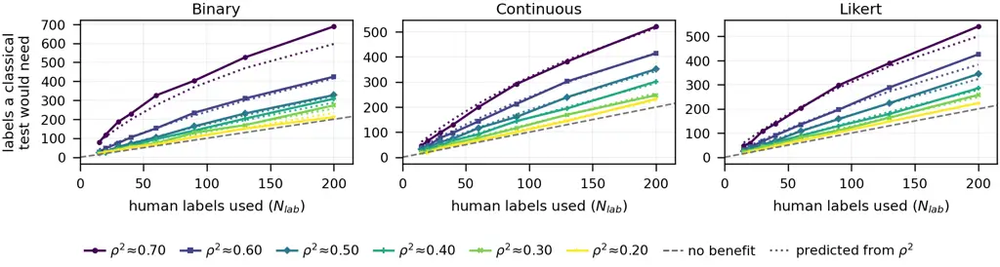

|              | Binary                       |                              |                              | Continuous                   |                              |                              | Likert                       |                              |                              |
| ------------ | ---------------------------- | ---------------------------- | ---------------------------- | ---------------------------- | ---------------------------- | ---------------------------- | ---------------------------- | ---------------------------- | ---------------------------- |
| $`\rho^{2}`$ | $`n_{lab}{=}30`$             | $`n_{lab}{=}90`$             | $`n_{lab}{=}200`$            | $`n_{lab}{=}30`$             | $`n_{lab}{=}90`$             | $`n_{lab}{=}200`$            | $`n_{lab}{=}30`$             | $`n_{lab}{=}90`$             | $`n_{lab}{=}200`$            |
| 0.70         | 5.73$`\times`$ \[5.15,8.25\] | 4.48$`\times`$ \[4.08,4.88\] | 3.37$`\times`$ \[3.37,3.60\] | 3.74$`\times`$ \[3.23,4.00\] | 3.46$`\times`$ \[3.25,3.60\] | 2.68$`\times`$ \[2.57,2.81\] | 3.92$`\times`$ \[3.55,4.09\] | 3.55$`\times`$ \[3.13,3.89\] | 2.83$`\times`$ \[2.54,3.07\] |
| 0.60         | 2.44$`\times`$ \[2.36,2.72\] | 2.67$`\times`$ \[2.21,2.88\] | 2.15$`\times`$ \[1.98,2.20\] | 2.73$`\times`$ \[2.57,2.90\] | 2.54$`\times`$ \[2.34,2.65\] | 2.14$`\times`$ \[2.01,2.16\] | 2.20$`\times`$ \[2.16,2.27\] | 2.25$`\times`$ \[2.14,2.37\] | 2.04$`\times`$ \[1.91,2.13\] |
| 0.50         | 1.82$`\times`$ \[1.80,1.91\] | 1.81$`\times`$ \[1.63,1.99\] | 1.63$`\times`$ \[1.62,1.67\] | 2.10$`\times`$ \[1.94,2.24\] | 1.90$`\times`$ \[1.81,2.00\] | 1.78$`\times`$ \[1.75,1.82\] | 1.77$`\times`$ \[1.74,1.81\] | 1.72$`\times`$ \[1.67,1.87\] | 1.71$`\times`$ \[1.53,1.90\] |
| 0.40         | 1.54$`\times`$ \[1.51,1.63\] | 1.55$`\times`$ \[1.47,1.67\] | 1.54$`\times`$ \[1.49,1.59\] | 1.89$`\times`$ \[1.56,1.98\] | 1.65$`\times`$ \[1.59,1.67\] | 1.59$`\times`$ \[1.50,1.64\] | 1.47$`\times`$ \[1.44,1.51\] | 1.42$`\times`$ \[1.40,1.49\] | 1.42$`\times`$ \[1.36,1.45\] |
| 0.30         | 1.38$`\times`$ \[1.31,1.39\] | 1.45$`\times`$ \[1.37,1.50\] | 1.37$`\times`$ \[1.26,1.47\] | 1.39$`\times`$ \[1.32,1.44\] | 1.31$`\times`$ \[1.30,1.39\] | 1.28$`\times`$ \[1.23,1.39\] | 1.40$`\times`$ \[1.32,1.49\] | 1.27$`\times`$ \[1.21,1.28\] | 1.27$`\times`$ \[1.21,1.31\] |
| 0.20         | 1.27$`\times`$ \[1.15,1.34\] | 1.18$`\times`$ \[1.16,1.21\] | 1.06$`\times`$ \[0.93,1.17\] | 1.31$`\times`$ \[1.20,1.35\] | 1.18$`\times`$ \[1.11,1.22\] | 1.18$`\times`$ \[1.15,1.18\] | 1.23$`\times`$ \[1.10,1.32\] | 1.13$`\times`$ \[1.09,1.16\] | 1.12$`\times`$ \[1.10,1.16\] |

Figure 7. How many human ratings can LLM judges save, once judge bias is
corrected for? Top: the label-efficiency multiplier
($`N_{\mathrm{lab}}^{\prime}/N_{\mathrm{lab}}`$) plotted across eval
types, the factor by which a PPI-corrected test with
$`N_{\mathrm{lab}}`$ human labels out of $`N`$ judge-scored items
behaves like a larger human-only sample $`N_{\mathrm{lab}}^{\prime}`$,
for $`N{=}1000`$. Judge quality is $`\rho^{2}`$, the squared judge-human
correlation (Pearson for parametric, Spearman for rank-based tests).
Each point pools labeling budgets, effect sizes, two-sample tests, and
judge-error shapes. Dotted lines show the predicted efficiency
$`1/(1-\rho^{2}(1-N_{\mathrm{lab}}/N))`$. Below: a table form of the
same data, expressed in terms of the multiplier. $`2\times`$ means PPI
doubled the effective sample size, acting like double the human raters.
Each cell is the median over four effect sizes with a bootstrapped 95%
CI. Likert and Binary exceed their predictions slightly at high
$`\rho^{2}`$ through a power-curve inversion artifact. See Appendix D
for simulation details.

### 6.4. Guidance for running mixed human-AI judge designs and analyzing results with PPI-corrected hypothesis tests

To help authors understand how to run mixed human-AI judge designs and
analyze results in a manner that respects PPI-corrected tests, we
provide the following guidelines.

Step 1: Confirm a mixed human-AI judge design is worth it. Mixing human
and LLM judges is typically worthwhile only if the full dataset is too
large or costly to grade entirely by hand, and the construct is
well-defined enough that human-human alignment would be “substantial
agreement” or above; otherwise label everything by hand or with a
trusted automated metric. (It is never correct to report only LLM judge
scores without alignment metrics, unless the judges are themselves the
object of study.) PPI’s benefits scale with how many more judge labels
there are than human labels (e.g., 50 human vs. 1,000 judge). Estimate
the effective sample size $`N_{\text{eff}}`$ with (Broska et al., 2025):

```math
N_{\text{eff}}\;=\;\frac{N_{\text{lab}}}{1-\rho^{2}\left(1-\dfrac{N_{\text{lab}}}{N}\right)}
```

where $`N_{\text{lab}}`$ is human-labeled units per condition (for
repeated measures, participants labeled on all $`k`$ conditions), $`N`$
is the total, and $`\rho^{2}`$ is the squared judge-human correlation on
the labeled subset. Since you have no labels yet, treat this as a power
analysis: posit $`\rho^{2}`$ from a prior validation of a similar judge,
or sweep a plausible range as a cost analysis.

Which $`\rho`$ depends on your test (Table 15); with 3+ conditions,
compute it via evalstats’ judge*alignment function rather than by hand.
Rank-test $`\rho`$ declines with effect size (§6.3), so treat a
rank-test $`N*{\text{eff}}`$ as an upper bound.

Step 2: Tune your LLM judge on data \*\*disjoint\*\* from your
human-labeled subset. When building an LLM judge, tune it on a separate,
held-out validation set completely disjoint from data used in PPI
correction. Even informal adjustments (eyeballing disagreements and
tweaking the prompt) count as cheating, like $`p`$-hacking: the judge
overfits to the labeled items, and the PPI rectifier underestimates its
error. Either randomly split off the validation set before looking at
the data, or collect it in a pilot; prefer splitting for rank-based
tests, since $`\rho`$ there is sensitive to score spread.

Step 3: Randomly sample the items that will get human labels. Draw the
items for human labeling $`N_{\mathrm{lab}}`$ completely at random from
the full dataset, stratified by condition/measure. This is not optional:
the guarantees of PPI correction depend on it. For within-subjects
designs, sampling must be _coupled across conditions_: the same items
need a human label in every condition, as our paired corrections only
work when an item’s full row has human scores. For between-subjects
designs, sample each group independently. If true random sampling is not
possible (MNAR), PPI-corrected tests are still worthwhile overall, but
disclose the violation and prefer paired tests (paired $`t`$-test,
Wilcoxon signed-rank, RM-ANOVA), the most robust under MNAR in our
simulations (Fig. 10).

Step 4: Collect enough human labels. Aim for at least 30 human labels
per condition/measure ($`N_{\mathrm{lab}}{=}30`$). The floor is 15:
evalstats reports no PPI statistics below it, since PPI can perform
poorly with very few labels (Eyre and Madras, 2025).

Step 5: Check your judge’s alignment with human labels. Compute the
test-appropriate $`\rho^{2}`$ (Step 1) between judge and human labels.
Aim for $`\geq 0.4`$; below $`\approx 0.2`$, a corrected test will
likely not outperform the human-only subset (§6.3). Other IRR metrics
are welcome too, but $`\rho^{2}`$ must be reported, since it directly
quantifies PPI’s efficiency; evalstats’ judge_alignment reports it when
given the planned test (test=). If the LLM judge lands below $`0.2`$ at
this stage, two options remain: run classical statistics over the
human-only subset and scrap the judge data; or improve the judge and
re-validate $`\rho^{2}`$ on a held-out set, never the study data itself,
since reusing it would violate the MCAR assumption (Step 2).

Step 6: Apply PPI correction regardless of how good the IRR looks.
Correction is mandatory, not conditional on alignment quality (§6.2): a
high IRR metric does not license running statistics directly on LLM
judge scores. (If for some reason you achieved “100% alignment,” see
Footnote 9.)

Step 7: Report the full setup alongside your result. We offer a
checklist as a guideline:

Box 1: Reporting checklist for mixed human-AI judge designs. When
publishing results, report: $`\square`$ The judge’s exact model version,
prompt, and configuration $`\square`$ How units were sampled for
labeling (at random, ideally; disclose deviations, per Step 3)
$`\square`$ How the judge was built and validated, with no contamination
ensured between validation and study data $`\square`$ Human rater
recruitment and process; with multiple raters, human-human IRR and the
aggregation rule (mean or median) $`\square`$ Judge-human alignment: the
test-appropriate $`\rho^{2}`$ (Table 15), per condition/measure, from
evalstats’ judge*alignment; and any other IRR metrics expected in your
setting $`\square`$ Which PPI-corrected method variant was applied, its
result (point estimate and CI, or $`p`$-value), and the effective sample
size $`N*{\text{eff}}`$ (i.e., for each CI, and if using hypothesis
tests, for the omnibus and each pairwise test).

evalstatsautomatically produces statistical quantities on this checklist
when researchers call judge_alignment and mark a metric as an LLM judge
in compare() (the latter shown by Figure 1).

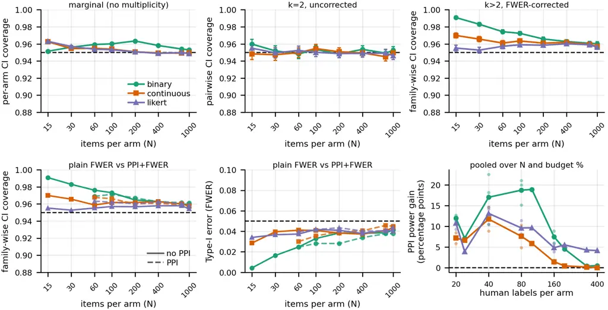

Figure 8. End-to-end validation of evalstats’ compare() with every
method choice left to "auto", across 7,176 cells with 100 MC
repetitions. Top row: CI method coverage at increasing multiplicity:
per-arm CIs, pairwise CIs at $`k{=}2`$, and FWER-corrected simultaneous
CIs at $`k>2`$. Bottom row: family-wise CI coverage and $`p`$-value
Type-I error split by non-PPI and PPI scenarios (dashed). Bottom-right
shows the power that PPI tests recover after FWER-correction for
$`k{=}3`$ groups, over analyzing the human-labeled subset alone. Dashed
black lines mark nominal ($`95\%`$ coverage, $`\alpha{=}.05`$, and zero
gain). Coverage is nominal at every level, Type-I is controlled with and
without PPI, and the PPI gains hold. For sweep details behind this plot,
see §E.

## 7. End-to-end validation of compare()

So far, we have provided recommendations and tests. However, our
simulations were run in isolation; unknown deficiencies could emerge
when methods interact. Thus, we ran a final end-to-end test, where we
fed our simulations’ data generation suite directly into evalstats’
compare(), leaving method choices to method="auto". Sweeping across
binary, continuous, and Likert data, varying sample size $`N{=}15`$ to
$`1000`$, number of conditions $`k{=}2`$ to $`10`$, and labeling budget,
across 717,600 calls, estimates are near-nominal at every level for
every datatype, from per-arm CIs through FWER-corrected simultaneous
CIs, and Type-I error of $`p`$-values remains controlled (Figure 8).
Critically, FWER correction does not destroy our PPI test’s gains,
leaving coverage intact and costing a fraction of Type-I error while
recovering up to $`{\approx}14`$ (on average $`{\approx}9`$) percentage
points of power over running tests over the human-labeled subset alone
at $`k{=}3`$. See §E for full details.

## 8. Demonstrations

Having established that evalstats’ compare() is well-calibrated, what
can we do with it? Toolkits are commonly evaluated by a demonstration,
which walks a reader through what the package makes possible, coupled
with a second evaluation such as technical validations (Ledo et al.,
2018). Thus, to demonstrate evalstats, here we follow a student building
an AI-powered job interview practice companion. We conclude with a
different example of a researcher analyzing mixed human-AI judge data
for a between-subjects study and preparing it for publication. Reported
values are from real calls to compare(), on data that is either real or,
where noted in a footnote, synthetic, but the narrative around the data
has been reframed to keep the story consistent.

### 8.1. Choosing a model and prompt for the dialogue component

Imagine a student is building an AI-powered job interview companion. It
has two LLM components: a dialogue component that plays the interviewer,
and a feedback component that offers constructive feedback on the user’s
performance (§8.2). Even with the dialogue component, the student faces
three decisions: which prompt to use, whether the model behind it is
stable across repeated runs, and whether the prompt responds fast enough
for live conversation.

Which prompt? Before the dialogue component replies, it sorts the user’s
last message into a category and answers accordingly. Latency matters
here, so the student chooses gemma3:1b, an on-device, small model. The
student writes eight candidate prompts, ranging from a bare instruction,
to a persona, to few-shot examples, chain of thought, structured JSON
output, and negative phrasing. They create a 20-item eval set,
hand-labeling ground truth, and score all eight prompts against those
labels. (This step uses real data, with a known ground truth.)¹⁰¹⁰ 10 We
made a support-ticket classification eval, which is distributed in the
evalstats repository (examples/support_ticket_prompts.py; analysis in
simulations/demo_tickets_smalln.py). All eight prompts were run over 120
tickets, five times each, over gemma3:1b. 20 items are drawn from those
tickets at random, and the full 120 tickets serve as ground truth for
what a 20-item eval could have concluded.

Let us imagine what someone without evalstats may do. The status quo in
AI evaluation is to eyeball performance without any uncertainty
estimates (Bean et al., 2025), as systems for LLM evaluation, whether
research prototypes or industry tools, rarely offer it.

If the student eyeballs a bar chart to determine their prompt in this
example, they will choose a sub-optimal prompt 43% of the time (5,000
draws of 20 items from the full 120).

If the student adds error bars as standard errors—also a common practice
in AI and science (Miller, 2024; Belia et al., 2005)—and eyeball whether
the bars overlap, they find nothing, since the bars separate on only
$`0.1\%`$ of the time.

Third, if they try a bootstrapped CI, which they heard somewhere was
robust, and do pairwise comparisons for every unique prompt pair (28
total), the percentile bootstrap’s intervals will be too narrow, holding
the true difference on only 88% of draws rather than the expected 95%.
The BCa bootstrap is worse, separating truly tied prompts 12% of the
time rather than the nominal 5%, and holding the true difference on only
82%.

A careful reader might object that the student has not corrected CIs for
multiple comparisons. Suppose they do. Under the same Šidák correction
evalstats applies, the bootstrap separates tied prompts far less often,
and a second problem takes its place. Across all 28 intervals at once,
at least one of them misses capturing its true mean difference about 90%
of the time—nearly always showing a miscalibrated result.

Now, consider the same data going through evalstats:

1 import evalstats as es

2 evaldata = es.load_from(df) \# prompt, item, score

3 result = es.compare(evaldata, factors="prompt", score_range=(0, 1))

4 result.summary()

![[Uncaptioned
image]](arxiv-2609-35815v1--ef6dcd9ae27a.figures/figure-8.webp)

evalstatsruns pairwise comparisons over Bonett-Price CIs,
Šidák-corrected for FWER control (not shown, since 28 comparisons would
take up the page). Compared to the bootstrap’s roughly 90% family-wise
miss rate, at least one of its pairwise intervals only misses the true
difference 0.6% of the time. However, at 20 tickets almost nothing is
significant (it rules out the worst prompt on 3% of draws). That is the
correct reading of 20 items spread over 28 comparisons. It suggests,
however, that roughly 80 tickets would help isolate the data more. If
the student scaled up to an 80-item eval, it would rule out the worst
prompt 97% of the time and about 2/7 others. Across 1,500 draws it never
discards a truly winning prompt.

This is real data, and evalstats is deliberately conservative here.
Binary scores are the hardest case for a paired interval, with our
simulations (§5) showing that most methods lose calibration at small
sample sizes, which is why evalstats selects the Bonett-Price interval
for binary data. The cost is that it will rarely name a winning
condition for a 20-item eval set and 28 comparisons. The benefit is that
its reported intervals very likely contain the truth—in other words, its
output is well-calibrated.

### 8.2. What if the metric is an LLM judge?

With the dialogue component chosen, the student turns to the second LLM
component that drafts written feedback for the user after each practice
session. They think the feedback content is pretty good, but the style
is overly long and sounds like AI slop. To address this, they add two
dozen style rules to the component’s system prompt and call the result
_“plain-writing variant.”_ To check whether this skill helps or not,
they devise an eval set composed of the transcripts of 60 practice
sessions from a public dataset.¹¹¹¹ 11 The skill and its 25-rule rubric
are real and public (Shankar, \[n. d.\]), but the eval data here is
synthetic. The response-length confound is simulated explicitly, using
the same per-item nuisance-covariate mechanism as the paper’s judge-bias
sweep (§B.2.1): length correlates with true quality at $`\rho{=}0.3`$,
baseline sits $`{\approx}0.4`$ SD above the mean and plain-writing mode
$`{\approx}0.4`$ SD below it, and the judge adds $`1.3`$ points per SD
of length to almost exactly cancel the true $`1.5`$-point gain.

They run their eval set through the interface twice, once per system
prompt variant, and score every output against the rubric with an LLM
judge, yielding a score out of 25 per item per condition. Eyeballing a
few outputs, they think the judge seems pretty good. They pass the
results to compare():

1 evaldata = es.load_from(df) \# item, condition, score

2 result = es.compare(

3 evaldata, factors="condition", metric="score",

4 score_range=(0, 25), design="paired")

Across their 60-item eval set the judge sees no real difference:
plain-writing mode scores $`0.08`$ points _lower_ on average, with a 95%
CI of $`[-1.15,0.98]`$, and evalstats reports the result a tie.

What the student does not know is that their judge is biased in an
important way: it rewards length, a well-documented tendency of LLM
judges (Zheng et al., 2023), and plain-writing mode makes text shorter
(the judge’s scores correlate $`r{=}0.43`$ with response length in our
constructed setup). Catching this unaided would mean suspecting it
first, then probing for it. The student has no reason to suspect
anything; the feature simply looks like it did not work.

They are disappointed, sure it was helping, but before shelving it they
check whether the judge itself is trustworthy, as they heard somewhere
that validating a judge against human labels is recommended industry
best practice (Yan, 2024). Using evalstats, they get a simple random
sample of 15 items per condition and, blinded to condition, manually
label them against their judge rubric:

1 \$ evalstats label eval_results.csv --factor condition --metric score
\\

2 --n-lab 15 --interactive

They then pass the labeled spreadsheet into judge_alignment:

1 ar = es.judge_alignment(

2 evaldata, llm_metric="score",

3 human_groundtruth="human_score",

4 selection="random")

The alignment report is reassuring: absolute agreement
ICC(2,1)$`{=}0.83`$, very high correlation. By that standard, there is
nothing left to do. But the astute student still passes the alignment
data to compare():

1 result = es.compare(

2 evaldata, factors="condition", metric="score",

3 score_range=(0, 25), design="paired",

4 alignment={"score": ar})

The corrected estimate tells a different story. Plain-writing mode is
ahead by $`1.43`$ points (95% CI $`[0.53,2.32]`$), potentially
significant.¹²¹² 12 The draw shown here is typical: the generative model
was fixed in advance, and across 60 random draws the uncorrected judge
recovers a mean effect of $`+0.24`$ against a true $`+1.5`$ while the
PPI-corrected estimate recovers $`+1.46`$, flipping the verdict in
$`{\approx}63\%`$ of draws. Correcting for the judge’s
condition-dependent length bias reversed the verdict, from “no
measurable effect” to “the feature helps,” sparing the student a
misleading answer.

Note that the LLM judge here is no less biased than it was: PPI does not
need it to be unbiased, since the labeled sample tells the correction
how it errs. Nor does PPI require the student to detect how, exactly,
the judge fails. What PPI needs is random sampling for human labeling,
and for human labels to be good quality. This example also showed a
practitioner setting, with an independent rating assumption relaxed; for
a scientific setting, we recommend more rigorous collection of the human
gold labels.

### 8.3. Preventing a spurious finding from reaching publication: Analysis of mixed human-AI judge designs

Between-subjects designs are common in human-subjects research,
including HCI and UX. evalstats’ PPI-corrected tests and marginal CIs
work for them, and data can be analyzed by setting design="unpaired" on
the compare() function. However, as we do not validate pairwise CI
methods for between-subjects designs in this paper (§5), this example
reports only the results for PPI tests and point estimates, which are
well-calibrated. This demonstration uses real data.¹³¹³ 13 Specifically,
we use four topics from the ELLIPSE corpus of argumentative essays by US
students learning English (Crossley et al., 2023), chosen because their
trained-rater scores are close to null ($`n=209`$, $`297`$, $`176`$,
$`178`$; true means $`3.06`$–$`3.15`$). Each human_label averages two
trained raters scoring a language-proficiency rubric. Six judges
(gemini-2.5-flash, gpt-4o-mini, nova-lite-v1, command-r7b, llama-3.1-8b,
qwen3-30b-a3b) score at temperature $`0`$ on a $`1`$–$`9`$ scale mapped
to the raters’ $`1`$–$`5`$ half-point lattice; their ensemble departs
from the raters mainly by up-rating _Being busy_ ($`+0.15`$) and
down-rating _Distance learning_ ($`-0.06`$). All numbers in this section
are real; only the narrative is lightly reframed. The script reproducing
this finding is available on request.

Consider a researcher studying online learning platforms, preparing a
conference submission. They would like to know if the way students
responded to the platform’s discussion feature differs by topic. The
class split students into cohorts to discuss four topic units across the
course—_Being busy_, _Distance learning_, _Impact of technology_, and
_Positive attitudes_. Enrollment fluctuations left the cohort sizes
unequal, with $`860`$ written responses in all.

Grading that many discussion responses by hand is infeasible, so the
researcher builds an LLM judge to score each response for writing
quality on a $`1`$-$`5`$ scale. Following what they have read about good
practice, they use a judge ensemble: they run six LLM judges from six
providers and average their scores, and calibrate each with
human-expert-rated examples, stratified by score level, drawn from a
held-out set of responses their platform collected on other topics. In
internal testing on a hand-made validation set, they achieve Pearson’s
$`\rho{=}0.76`$, and deem their judge well-calibrated.

##### Without evalstats.

The researcher validates their LLM judge in the best way they know how:
they and a coauthor each independently score $`30`$ randomly sampled
responses per condition, blinded to which condition an item came from,
average the two ratings per item as ground truth, and compute
inter-rater reliability against the panel. The result is
quadratic-weighted Cohen’s $`\kappa`$ of $`0.66`$, comfortably
“substantial agreement” by Landis and Koch (1977)’s standards.
Reassured, they run familiar NHST statistical tests over the raw LLM
judge scores. A Kruskal-Wallis omnibus rejects the null that the four
conditions score equally ($`p=1.9\times 10^{-4}`$), and post-hoc
Mann-Whitney $`U`$ comparisons, Holm-corrected, leave three of six pairs
significant, with Distance learning sitting $`0.17`$ points below
Positive attitudes ($`p=0.0003`$). They write this up as a finding and
submit it for peer review. Reviewers see an inter-rater reliability that
looks high and conclude that the LLM judge panel, and therefore the
result, can be trusted.

Every one of those $`p`$-values is wildly wrong. In the real data behind
this example there is no significant difference between conditions
($`p=0.47`$): the effect is an artifact of the judge, and the
$`\kappa{=}0.66`$ is not evidence to trust the results. Nothing in the
researcher’s procedure was careless. They sampled at random, blinded
their raters, aggregated ratings, reported IRR, and used an ensembled
LLM judge with few-shot examples from a held-out validation set. The
issue is that they stopped short of propagating human-LLM alignment into
downstream inference.

##### With evalstats.

Now suppose the same researcher reaches for evalstats at the outset. To
help ensure their sample for human labeling is random, they draw it with
the CLI’s label helper, which samples _within_ each condition and so
satisfies the missing-completely-at-random assumption PPI requires:¹⁴¹⁴
14 evalstatsalso checks the labeled subset against the full pool, using
the distributional and label-position tests detailed below. These remain
warnings, and cannot catch everything.

1 \$ evalstats label discussions.csv --factor unit \\

2 --metric quality_score --n-lab 30

This adds a "human_score" column to their spreadsheet, and marks the
randomly-selected cells for human labeling (the rest remain NaN). With
some finagling, they upload a blinded version to Google Sheets and have
their raters give separate ratings, performing the same two-rater
averaging as before. With their gold labels collected and the final
spreadsheet filled out, they then compute alignment, declaring how items
were selected:

1 al = es.judge_alignment(

2 evaldata, llm_metric="quality_score",

3 human_groundtruth="human_score", selection="random")

4 al.summary()

1 Judge alignment report

2 ------------------------------------------------------------

3 Alignment set : 120 of 860 items have human labels (14.0%)

4 Representativeness: labeled items look like the full pool

5 Pearson r 0.71 \[0.60, 0.79\] large positive correlation

6 Spearman r 0.68 \[0.56, 0.77\] large positive correlation

7 ICC(2,1) 0.67 \[0.55, 0.75\] moderate absolute agreement

8 ------------------------------------------------------------

The labeled subset seems random overall, with the LLM judge generally
agreeing with humans in the pooled IRR.

Now, the researcher proceeds to the comparison. All they need to do is
pass the alignment data straight into compare() via a single option,
which marks the metric untrusted:

1 result = es.compare(evaldata, factors="unit",

2 metric="quality_score", design="unpaired",

3 alignment={"quality_score": al},

4 score_range=(1, 5))

The corrected analysis finds nothing. The Kruskal–Wallis omnibus no
longer rejects ($`p{=}0.31`$), no pairwise comparison survives
correction, and all four conditions land in a single statistically
indistinguishable band---which is what the ground truth, unknown to the
researcher in this story, actually says.¹⁵¹⁵ 15 Across $`300`$ random
draws of which $`30`$ items per condition get human labels, the draw
shown sits at the $`27`$th percentile of corrected omnibus $`p`$; its
$`\kappa`$ of $`0.66`$ is on the high side, at the $`76`$th percentile,
against a median draw’s $`0.63`$, remaining “substantial agreement.” The
effect was also small even before correction (largest pairwise
rank-biserial $`-0.21`$). Correction did not so much shrink it
($`0.024`$) as expose its uncertainty.

In this alternate universe, both the authors and the published record
are spared a misleading result. The researcher writes up the results,
reporting the null finding:

> Judge-human agreement on the human-labeled calibration set was
> quadratic-weighted $`\kappa{=}0.66`$ and raw Spearman
> $`\rho_{S}{=}0.68`$. When running statistics over judge scores, we
> corrected for judge bias using prediction-powered inference \cite{…}.
> The test-appropriate $`\rho^{2}`$ governing the PPI-corrected
> Kruskal-Wallis test was $`\rho^{2}{=}0.42`$, for an estimated
> effective sample size of $`47`$ human ratings per condition
> ($`1.6\times`$ our labeled $`30`$). The PPI-Kruskal-Wallis test found
> no significant difference in discussion quality across the four units
> ($`p{=}0.31`$). Post-hoc PPI-corrected Mann-Whitney $`U`$ tests,
> FWER-controlled via Shaffer’s procedure, likewise found no difference.

How often would a researcher have been misled without judge bias
calibration, and reported a false result? Every time, at least given the
same LLM judge and labeling budget they chose for its calibration. Since
the $`30`$ items randomly selected for the human raters can change, let
us repeat the study across $`300`$ random draws of this subset.¹⁶¹⁶ 16
Each draw samples $`30`$ responses per condition uniformly at random and
re-runs both the corrected analysis and the hand-scored-only baseline on
it. The corpus is close to null but not exactly null—the trained raters
put the four units at $`p{=}0.47`$—so these are rates at which a finding
survives re-labeling, rather than exact Type-I error rates. Across
draws, quadratic-weighted Cohen’s $`\kappa`$ stays at a reassuring
median of $`0.63`$, or “substantial agreement.” The researcher may
continue to be misled. By contrast, evalstats’ PPI-corrected
Kruskal-Wallis test rejects the null only $`5.0\%`$ of the time (at
nominal $`\alpha{=}.05`$, 15/300), and the PPI-corrected MWU post-hoc
tests report at least one significant pair in only 11/300. Since writing
up a finding needs both omnibus and pairwise tests to be significant, a
true false positive happens only $`3.7\%`$ of the time had the
researcher used evalstats. Had they opted for no LLM judges at all,
randomly selected $`30`$ items for human scoring, and run statistics
over human scores alone, they would have reported a false positive,
coincidentally, also only $`3.7\%`$ of the time.

## 9. Discussion

Our work addresses gaps of statistical know-how identified in §3 and
targeted by proposed guidance from the Canadian AI Safety Institute and
NIST (Keller et al., 2026b; Canadian Artificial Intelligence Safety
Institute, 2026), which would be required by researchers attempting to
reconcile guidelines on LLM evaluation reporting (Felix Navarro et al.,
2026; Baltes et al., 2025) with calls to quantify
uncertainty (Dragicevic, 2016; Kaptein and Robertson, 2012; Agarwal
et al., 2021). We provide guidance and validated tests for running
statistics over LLM judge scores in mixed human-AI judge designs, and
concrete recommendations and tooling for statistical methods in
small-sample AI evaluation regimes. These regimes are inter-related, as
evals often invoke LLM judges, but also distinct. Researchers and
practitioners can use evalstats today for common scenarios. Here, we
reflect on the broader implications of our work and its limitations.

### 9.1. Implications for researchers

Previously, researchers may have wanted to use LLM judges to score data,
but hesitated or, even if using them, wondered how best to trust the
results. They now have calibrated options, for a practice that will
likely only grow. As §1 noted, some previously published papers in HCI,
AI, and NLP run statistics over raw LLM judge scores after reporting IRR
alone (e.g., (Gao et al., 2025; Zhou et al., 2024; Panda et al., 2025;
Fanous et al., 2025)).¹⁷¹⁷ 17 We reached out to authors of some of these
papers, but the underlying data could not be made available to us due to
ethics constraints. We stress that no individual authors nor reviewers
are at fault here: the corrective methods were simply not yet well-known
in these communities. And, in the much larger LLM-as-a-judge literature
in NLP, judge scores can be routinely compared across models with no
propagation of judge uncertainty (Lee et al., 2026; Fiedler, 2026). Our
concern is rather the practice—recall that, for some common IRR metrics,
higher IRR is associated with higher false-positive risk (§6.2). Now
that corrections are available and known, LLM-judge-bias-aware inference
is not an optional “nice-to-have”—it should be an expectation going
forward. Whether authors correct via PPI or evalstats specifically is a
different question (Hullman et al., 2026); alternatives like
design-based supervised learning exist (Egami et al., 2023; Lee et al.,
2026; Calderon et al., 2025).

One might still wonder if judge bias could simply be detected and
subtracted before running tests. For a mean, that _is_ what PPI already
does. But PPI also ensures the correction incorporates the uncertainty
estimated from the $`N_{\mathrm{lab}}`$ items into the variance. A
simple subtraction would miss this, as authors would still be treating
all $`N`$ adjusted judge scores as surrogates for human ones, and thus
report confidence much narrower than the data supports.

Our small-sample simulations also hold takeaways beyond AI evaluation.
Classical NHST $`p`$-values remained calibrated, if conservative at low
$`N`$, but the bootstrap CI variants we tested (§5) failed nominal
coverage at small sample sizes, even around $`N{=}50`$, with the main
exception of the smooth bootstrap (which is itself kind of a hack). We
caution researchers against bootstrap CI estimation in small-sample
regimes. Instead, we point researchers adopting estimation
statistics (Dragicevic, 2016; Cumming, 2014) to our recommendations
(Fig. 2).

Although evalstats is suited to LLM evals-like data, there is nothing
too special about its setup. It takes in results, and does not care
about data provenance—technically speaking, it works over non-AI evals
data, all the same. Comparing 3 interfaces across 24 participants in a
within-subjects study is, statistically, the same shape of problem as
comparing three models across 24 benchmark items, and evalstats’ CI
method and $`p`$-value choices remain reasonable, as we validated
against a wide range of scenarios. Two caveats apply to user studies
specifically—evalstats does not yet validate pairwise CI methods for
between-subjects comparisons and will refuse to output statistics below
its cut-off of $`N{=}15`$ (§3.1)—but within those bounds, it offers,
perhaps unwittingly, a practical toolkit implementing the estimation
statistics advocated by Dragicevic (2016), albeit with concessions made
to NHST by still allowing users to print $`p`$-values (Masson et al.,
2023).

### 9.2. Making uncertainty-aware interfaces for AI evaluation possible

Prior interfaces for AI evaluation do not support statistical inference,
despite often operating in small samples and LLM judge regimes (§2);
even if designers had wanted to add inference, it would be unclear what
methods they should choose. evalstats now makes well-calibrated
inference possible. For instance, MetricMate (Gebreegziabher et al., 2025) could surface a PPI-corrected estimate whenever a user checks
their evaluator against a few human-graded examples; ChainForge (Arawjo
et al., 2024) could flag a “winning” prompt on $`N{=}30`$ as
statistically indistinguishable from the runner-up; and
DocWrangler (Shankar et al., 2025) could use paired human-LLM judgments
to power judge-bias-aware inference over a full annotated document set.
Systems adopting evalstats can also inherit its gradient-plot
visualizations, shown to produce better-calibrated inferential judgments
than the error bars and bar charts rampant across AI evaluation (Correll
and Gleicher, 2014; Padilla et al., 2022). A natural next step is a
graphical interface that helps practitioners plan, run, analyze, and
report mixed human-AI judge designs.

### 9.3. Responsible setup and statistical analysis of mixed human-AI judge designs

While evalstats’ PPI tests enable researchers to run calibrated
statistics over LLM judges, they are not a panacea. For PPI-corrected
methods to deduce a signal from an untrustworthy judge, the smaller
subset of human labels must be trustworthy themselves. Neither LLM
judges nor PPI is a license to abdicate our responsibility to collect
quality data from human subjects and design the careful experiments
needed to obtain it. The fewer human labels $`N_{\mathrm{lab}}`$ feeding
a PPI-corrected method, the more critical their quality.

Researchers presented with early versions of this work asked whether our
PPI-corrected tests can accommodate disagreeing human raters. In
principle, yes: PPI’s guarantees only require the labeled subsample be
selected randomly and independently, not noise-free raters, and authors
can aggregate across multiple independent raters to improve label
quality (we leave formal multi-rater extensions to future work; one
promising direction is judge validation under rating
indeterminacy (Guerdan et al., 2025)). But PPI cannot manufacture
agreement where none exists, or substitute for careful thought about
what is being measured.

Our $`\rho^{2}{\geq}0.4`$ rule of thumb is also just that: researchers
must interpret “cost” and “gains” in their own context, since the gain
is conditional on the $`N_{\mathrm{lab}}`$ one started with. Given 30
human labels and 300 judge scores per condition, alignment at the low
end of “substantial agreement” ($`\rho^{2}{\approx}0.4`$) buys only
about 17 more effective human samples—so mixed designs may only be
worthwhile with a highly aligned judge or a very large dataset, which
cautions against LLM judges where human raters cannot feasibly reach
consensus.

### 9.4. PPI tests outside of LLM judge scenarios

Researchers might wonder whether our PPI tests work in “synthetic users”
regimes (Salminen et al., 2025), outside grading or annotation. PPI
reduces variance when the LLM’s score covaries with the human’s at the
individual-unit level, which requires the judge to score a real artifact
(essay, transcript, trace) a human also scored. That assumption fails
for synthetic users that experience a condition and self-report (e.g.,
an agent filling out SUS): the agent sees only the condition and
produces the same prediction for every participant assigned to it, so
the rectifier recovers the classical estimate with no gain. Broska
et al. (2025) shows PPI could apply if each synthetic subject is
conditioned on a real participant’s profile or trace, but this needs
separate validation we leave to future work. Our nonparametric PPI tests
may be especially useful here, since LLM judge scores are often discrete
or bounded, and many HCI metrics already favor nonparametric
tests (Kaptein et al., 2010).

PPI-corrected tests also apply to any noisy predictor, not just AI
models (Angelopoulos et al., 2023a). Crowdworker ratings are a recurring
concern in HCI, less reliable than in-lab or expert raters (Hube et al.,
2019; Draws et al., 2022; He et al., 2024) and increasingly confounded
by unsanctioned AI usage (Veselovsky et al., 2025). Prior work seeks to
improve the human annotations (e.g., (Oppenheimer et al., 2009; Hube
et al., 2019)), rather adjusting inference for annotation error. Our PPI
tests complement this, and could yield calibrated inference over a full
crowdsourced set given a random subset rated by trusted experts.

### 9.5. Why not Bayesian?

While adopting an estimation statistics philosophy (Dragicevic, 2016;
Cumming, 2014), we ultimately commit to a frequentist framing. It is
natural to wonder what a fully Bayesian evalstats would look like.
Bayesian methods are appealing in some ways: more principled inference
in small-$`n`$ studies (Kay et al., 2016b), prior information, and
posterior probability statements that map more directly onto how
practitioners already (mis)read confidence intervals (Belia et al.,
2005). We agree, and believe a Bayesian evalstats is an exciting
direction for future work. One of our own CI recommendations (Fig. 2) is
evidence in favor of Bayesian methods. However, going Bayesian comes
with its own difficulties: priors can be complex for users to
engineer (Xiao et al., 2026), and some Bayesian intervals we tested
erred conservative (Appendix A.2); many methods also demand heavier
computation (e.g., MCMC); and several of our target audiences may expect
frequentist output (§3.1).

### 9.6. Limitations

Notably missing are recommendations for pairwise CIs on unpaired data
($`k`$ independent samples, common to between-subjects designs, but
uncommon in AI evaluation settings), as well as reporting validation of
evalstats’ multi-run CI methods (§4). We also focus on means rather than
medians, as means dominate AI evaluation and capture tailed behavior
that medians mask. Like Mani et al. (2026), our shrinkage of the
power-tuning weight (§B.1) is also not free: with strongly aligned
judges it can cost a few points of power relative to classical PPI++.
Future work might add multi-metric analysis, stratified designs, other
metrics (F1, win-rates), and PPI corrections for ART (Wobbrock et al.,
2011), ordinal regression (Victor Syiem and Velloso, 2026), Chi-squared
test, linear mixed models, $`e`$-values (Csillag et al., 2025), or
multi-run data. Our simulation harness makes this easier: researchers
can hook up new tests rather than reimplement from scratch.

We also did not conduct a user study, which raises an interesting
question: even given well-calibrated statistics, would users still
ignore uncertainty when making decisions, and how could we improve that?
These questions are separate from statistical calibration, but deserve
careful study in their own right. Prior work suggests that uncertainty
visualizations lead to improved decision-making (Correll and Gleicher,
2014; Padilla et al., 2022; Kay et al., 2016a).

Finally, statistics is a field rife with controversy, exemplified by the
heated debates between frequentist and Bayesian methods and NHST versus
estimation statistics (Besançon and Dragicevic, 2019; Mayo and Hand,
2022). Critics might thus question some of evalstats’ decisions, such as
defaulting to empirically-tested yet less familiar CI methods, or still
printing $`p`$-values alongside 95% CIs. Our stance, like Masson et al.
(2023)’s Statslator, is to defer to the user’s judgement and support
both NHST and estimation statistics. (Our PPI corrections also work on
CIs; Appendix B.5.) While we can, and should, quibble over the
specifics, the risk of having no uncertainty quantification at all, or
running stats over raw LLM judge scores directly—both the status quo in
the wild west of AI evaluation—is far too great. We believe reasonable
uncertainty quantification, grounded in simulations and prior research,
is a good start, and look forward to other work that shares our goal,
but differs in philosophy or approach.

## 10. AI Usage Acknowledgment

The PPI-corrected methods in this work were built with the help of
Opus 5 and Sonnet 5, with Fable 5 in an advisor role for hard
mathematical problems, and validated in our simulation harness on real
and synthetic judge data. Plots and simulation code were prepared with
the coding help of Claude Code. Appendix C, which documents the
rank-test constructions, was drafted with Fable 5 from the
implementation, then checked line by line against the code by Fable 5,
by the author, and double-checked by GPT-5.6 Luna and Gemini 3.1 Pro.
All other text was written by the author, with minimal AI help for
line-editing, clarity, and conciseness. The author takes full
responsibility for any errors that may appear.

## References

- Agarwal et al. (2021) Rishabh Agarwal, Max Schwarzer, Pablo Samuel
  Castro, Aaron C Courville, and Marc Bellemare. 2021. Deep
  reinforcement learning at the edge of the statistical precipice.
  _Advances in neural information processing systems_ 34 (2021),
  29304–29320.
- Agnew et al. (2024) William Agnew, A. Stevie Bergman, Jennifer Chien,
  Mark Díaz, Seliem El-Sayed, Jaylen Pittman, Shakir Mohamed, and
  Kevin R. McKee. 2024. The Illusion of Artificial Inclusion. In
  _Proceedings of the 2024 CHI Conference on Human Factors in Computing
  Systems_ (Honolulu, HI, USA) _(CHI ’24)_. Association for Computing
  Machinery, New York, NY, USA, Article 286, 12 pages.
  [doi:10.1145/3613904.3642703](https://doi.org/10.1145/3613904.3642703)
- Agresti and Coull (1998) Alan Agresti and Brent A Coull. 1998.
  Approximate is better than “exact” for interval estimation of binomial
  proportions. _The American Statistician_ 52, 2 (1998), 119–126.
- Angelopoulos et al. (2023a) Anastasios N Angelopoulos, Stephen Bates,
  Clara Fannjiang, Michael I Jordan, and Tijana Zrnic. 2023a.
  Prediction-powered inference. _Science_ 382, 6671 (2023), 669–674.
- Angelopoulos et al. (2023b) Anastasios N Angelopoulos, John C Duchi,
  and Tijana Zrnic. 2023b. Ppi++: Efficient prediction-powered
  inference. _arXiv preprint arXiv:2311.01453_ (2023).
- Arawjo et al. (2024) Ian Arawjo, Chelse Swoopes, Priyan Vaithilingam,
  Martin Wattenberg, and Elena L. Glassman. 2024. ChainForge: A Visual
  Toolkit for Prompt Engineering and LLM Hypothesis Testing. In
  _Proceedings of the 2024 CHI Conference on Human Factors in Computing
  Systems_ (Honolulu, HI, USA) _(CHI ’24)_. Association for Computing
  Machinery, New York, NY, USA, Article 304, 18 pages.
  [doi:10.1145/3613904.3642016](https://doi.org/10.1145/3613904.3642016)
- Bai et al. (2026) Jingwen Bai, Wei Soon Cheong, Philippe Muller, and
  Brian Y Lim. 2026. iRULER: Intelligible Rubric-Based User-Defined LLM
  Evaluation for Revision. In _Proceedings of the 2026 CHI Conference on
  Human Factors in Computing Systems_ _(CHI ’26)_. Association for
  Computing Machinery, New York, NY, USA, Article 928, 28 pages.
  [doi:10.1145/3772318.3790539](https://doi.org/10.1145/3772318.3790539)
- Baltes et al. (2025) Sebastian Baltes, Florian Angermeir, Chetan
  Arora, Marvin Muñoz Barón, Chunyang Chen, Lukas Böhme, Fabio Calefato,
  Neil Ernst, Davide Falessi, Brian Fitzgerald, et al. 2025. Guidelines
  for empirical studies in software engineering involving large language
  models. _arXiv preprint arXiv:2508.15503_ (2025).
- Bean et al. (2025) Andrew M. Bean, Ryan Othniel Kearns, Angelika
  Romanou, Franziska Sofia Hafner, Harry Mayne, Jan Batzner, Negar
  Foroutan Eghlidi, Chris Schmitz, Karolina Korgul, Hunar Batra, Oishi
  Deb, Emma Beharry, Cornelius Emde, Thomas Foster, Anna Gausen, María
  Grandury, Sophia Han, Valentin Hofmann, Lujain Ibrahim, Hazel Kim,
  Hannah Rose Kirk, Fangru Lin, Gabrielle Liu, Lennart Luettgau, Jabez
  Magomere, Jonathan Rystrø m, Anna Sotnikova, Yushi Yang, Yilun Zhao,
  Adel Bibi, Antoine Bosselut, Ronald Clark, Arman Cohan, Jakob
  Foerster, Yarin Gal, Scott Hale, Deborah Raji, Christopher
  Summerfield, Philip Torr, Cozmin Ududec, Luc Rocher, and Adam
  Mahdi. 2025. Measuring what Matters: Construct Validity in Large
  Language Model Benchmarks. In _Advances in Neural Information
  Processing Systems_, D. Belgrave, C. Zhang, H. Lin, R. Pascanu,
  P. Koniusz, M. Ghassemi, and N. Chen (Eds.), Vol. 38. Curran
  Associates, Inc.
  [doi:10.52202/085713-0590](https://doi.org/10.52202/085713-0590)
- Belia et al. (2005) Sarah Belia, Fiona Fidler, Jennifer Williams, and
  Geoff Cumming. 2005. Researchers misunderstand confidence intervals
  and standard error bars. _Psychological methods_ 10, 4 (2005), 389.
- Benjamini and Hochberg (1995) Yoav Benjamini and Yosef Hochberg. 1995.
  Controlling the false discovery rate: a practical and powerful
  approach to multiple testing. _Journal of the Royal statistical
  society: series B (Methodological)_ 57, 1 (1995), 289–300.
- Besançon and Dragicevic (2019) Lonni Besançon and Pierre
  Dragicevic. 2019. The Continued Prevalence of Dichotomous Inferences
  at CHI. In _Extended Abstracts of the 2019 CHI Conference on Human
  Factors in Computing Systems_ (Glasgow, Scotland Uk) _(CHI EA ’19)_.
  Association for Computing Machinery, New York, NY, USA, 1–11.
  [doi:10.1145/3290607.3310432](https://doi.org/10.1145/3290607.3310432)
- Bonett and Price (2012) Douglas G Bonett and Robert M Price. 2012.
  Adjusted Wald confidence interval for a difference of binomial
  proportions based on paired data. _Journal of Educational and
  Behavioral Statistics_ 37, 4 (2012), 479–488.
- Bouthillier et al. (2021) Xavier Bouthillier, Pierre Delaunay, Mirko
  Bronzi, Assya Trofimov, Brennan Nichyporuk, Justin Szeto, Nazanin
  Mohammadi Sepahvand, Edward Raff, Kanika Madan, Vikram Voleti, Samira
  Ebrahimi Kahou, Vincent Michalski, Tal Arbel, Chris Pal, Gael
  Varoquaux, and Pascal Vincent. 2021. Accounting for Variance in
  Machine Learning Benchmarks. In _Proceedings of Machine Learning and
  Systems_, A. Smola, A. Dimakis, and I. Stoica (Eds.), Vol. 3. 747–769.
  [https://proceedings.mlsys.org/paper_files/paper/2021/file/0184b0cd3cfb185989f858a1d9f5c1eb-Paper.pdf](https://proceedings.mlsys.org/paper_files/paper/2021/file/0184b0cd3cfb185989f858a1d9f5c1eb-Paper.pdf)
- Bowyer et al. (2025) Sam Bowyer, Laurence Aitchison, and Desi R
  Ivanova. 2025. Position: Don’t Use the CLT in LLM Evals With Fewer
  Than a Few Hundred Datapoints. In _International Conference on Machine
  Learning_. PMLR, 81143–81184.
- Bretz et al. (2016) Frank Bretz, Torsten Hothorn, and Peter
  Westfall. 2016. _Multiple comparisons using R_. CRC press.
- Broska et al. (2025) David Broska, Michael Howes, and Austin van
  Loon. 2025. The mixed subjects design: Treating large language models
  as potentially informative observations. _Sociological Methods &
  Research_ 54, 3 (2025), 1074–1109.
- Calderon et al. (2025) Nitay Calderon, Roi Reichart, and Rotem
  Dror. 2025. The alternative annotator test for LLM-as-a-judge: How to
  statistically justify replacing human annotators with LLMs. In
  _Proceedings of the 63rd Annual Meeting of the Association for
  Computational Linguistics (Volume 1: Long Papers)_. 16051–16081.
- Calonico and Galiani (2025) Sebastian Calonico and Sebastian
  Galiani. 2025. _Beyond Bonferroni: Multiple Testing in Empirical
  Research_. Technical Report. National Bureau of Economic Research.
- Canadian Artificial Intelligence Safety Institute (2026) Canadian
  Artificial Intelligence Safety Institute. 2026. What Information
  Should AI Evaluators Share?
  [https://ised-isde.canada.ca/site/ised/en/canadian-artificial-intelligence-safety-institute/what-information-should-ai-evaluators-share](https://ised-isde.canada.ca/site/ised/en/canadian-artificial-intelligence-safety-institute/what-information-should-ai-evaluators-share)
  Canadian Artificial Intelligence Safety Institute.
- Chehbouni et al. (2025) Khaoula Chehbouni, Mohammed Haddou, Jackie CK
  Cheung, and Golnoosh Farnadi. 2025. Neither Valid nor Reliable?
  Investigating the Use of LLMs as Judges. In _Advances in Neural
  Information Processing Systems_, D. Belgrave, C. Zhang, H. Lin,
  R. Pascanu, P. Koniusz, M. Ghassemi, and N. Chen (Eds.), Vol. 38, Main
  Conference. Curran Associates, Inc.
  [doi:10.52202/085713-3029](https://doi.org/10.52202/085713-3029)
- Chen et al. (2026) Yiqun T Chen, Moran Guo, and Shengyi Li. 2026.
  Power Analysis for Prediction-Powered Inference. _arXiv preprint
  arXiv:2603.16041_ (2026).
- Cheng et al. (2026) Myra Cheng, Sunny Yu, Cinoo Lee, Pranav Khadpe,
  Lujain Ibrahim, and Dan Jurafsky. 2026. ELEPHANT: Measuring and
  understanding social sycophancy in LLMs. In _International Conference
  on Learning Representations_, C. Vondrick, B. Hariharan, C. Raffel,
  L. Pinto, D. Yang, and A. Faust (Eds.), Vol. 2026. 130060–130097.
  [https://proceedings.iclr.cc/paper_files/paper/2026/file/d3362f84979d16cee000f09eef61244c-Paper-Conference.pdf](https://proceedings.iclr.cc/paper_files/paper/2026/file/d3362f84979d16cee000f09eef61244c-Paper-Conference.pdf)
- Chiang et al. (2026) Charles Chiang, Simret Araya Gebreegziabher,
  Annalisa Szymanski, Yukun Yang, Hyo Jin Do, Zahra Ashktorab, Werner
  Geyer, Toby Jia-Jun Li, and Diego Gómez-Zará. 2026. MultEval:
  Collaboratively Creating Criteria for LLM-as-a-Judge Systems. In
  _Companion Proceedings of the 31st International Conference on
  Intelligent User Interfaces_ _(IUI ’26 Companion)_. Association for
  Computing Machinery, New York, NY, USA, 180–184.
  [doi:10.1145/3742414.3795100](https://doi.org/10.1145/3742414.3795100)
- Correll and Gleicher (2014) Michael Correll and Michael
  Gleicher. 2014. Error bars considered harmful: Exploring alternate
  encodings for mean and error. _IEEE transactions on visualization and
  computer graphics_ 20, 12 (2014), 2142–2151.
- Crossley et al. (2023) Scott Crossley, Yu Tian, Perpetual Baffour,
  Alex Franklin, Youngmeen Kim, Wesley Morris, Meg Benner, Aigner Picou,
  and Ulrich Boser. 2023. The english language learner insight,
  proficiency and skills evaluation (ELLIPSE) corpus. _International
  Journal of Learner Corpus Research_ 9, 2 (2023), 248–269.
- Csillag et al. (2025) Daniel Csillag, Claudio Jose Struchiner, and
  Guilherme Tegoni Goedert. 2025. Prediction-Powered E-Values. In
  _Forty-second International Conference on Machine Learning_.
  [https://openreview.net/forum?id=rkegUc8d0c](https://openreview.net/forum?id=rkegUc8d0c)
- Cumming (2014) Geoff Cumming. 2014. The New Statistics: Why and How.
  _Psychological Science_ 25, 1 (2014), 7–29.
- de Pieuchon et al. (2025) Nicolas Audinet de Pieuchon, Adel Daoud,
  Connor Thomas Jerzak, Moa Johansson, and Richard Johansson. 2025.
  Benchmarking Debiasing Methods for LLM-based Parameter Estimates. In
  _Proceedings of the 2025 Conference on Empirical Methods in Natural
  Language Processing_, Christos Christodoulopoulos, Tanmoy Chakraborty,
  Carolyn Rose, and Violet Peng (Eds.). Association for Computational
  Linguistics, Suzhou, China, 19757–19772.
  [doi:10.18653/v1/2025.emnlp-main.1000](https://doi.org/10.18653/v1/2025.emnlp-main.1000)
- Demšar (2006) Janez Demšar. 2006. Statistical comparisons of
  classifiers over multiple data sets. _Journal of Machine learning
  research_ 7, Jan (2006), 1–30.
- Desmond et al. (2024) Michael Desmond, Zahra Ashktorab, Qian Pan,
  Casey Dugan, and James M. Johnson. 2024. EvaluLLM: LLM assisted
  evaluation of generative outputs. In _Companion Proceedings of the
  29th International Conference on Intelligent User Interfaces_
  (Greenville, SC, USA) _(IUI ’24 Companion)_. Association for Computing
  Machinery, New York, NY, USA, 30–32.
  [doi:10.1145/3640544.3645216](https://doi.org/10.1145/3640544.3645216)
- Dodge et al. (2019) Jesse Dodge, Suchin Gururangan, Dallas Card, Roy
  Schwartz, and Noah A. Smith. 2019. Show Your Work: Improved Reporting
  of Experimental Results. In _Proceedings of the 2019 Conference on
  Empirical Methods in Natural Language Processing and the 9th
  International Joint Conference on Natural Language Processing
  (EMNLP-IJCNLP)_, Kentaro Inui, Jing Jiang, Vincent Ng, and Xiaojun Wan
  (Eds.). Association for Computational Linguistics, Hong Kong, China,
  2185–2194.
  [doi:10.18653/v1/D19-1224](https://doi.org/10.18653/v1/D19-1224)
- Dragicevic (2016) Pierre Dragicevic. 2016. Fair statistical
  communication in HCI. In _Modern statistical methods for HCI_.
  Springer, 291–330.
- Draws et al. (2022) Tim Draws, David La Barbera, Michael Soprano,
  Kevin Roitero, Davide Ceolin, Alessandro Checco, and Stefano
  Mizzaro. 2022. The Effects of Crowd Worker Biases in Fact-Checking
  Tasks. In _Proceedings of the 2022 ACM Conference on Fairness,
  Accountability, and Transparency_ (Seoul, Republic of Korea) _(FAccT
  ’22)_. Association for Computing Machinery, New York, NY, USA,
  2114–2124.
  [doi:10.1145/3531146.3534629](https://doi.org/10.1145/3531146.3534629)
- Dror et al. (2018) Rotem Dror, Gili Baumer, Segev Shlomov, and Roi
  Reichart. 2018. The Hitchhiker’s Guide to Testing Statistical
  Significance in Natural Language Processing. In _Proceedings of the
  56th Annual Meeting of the Association for Computational Linguistics
  (Volume 1: Long Papers)_, Iryna Gurevych and Yusuke Miyao (Eds.).
  Association for Computational Linguistics, Melbourne, Australia,
  1383–1392.
  [doi:10.18653/v1/P18-1128](https://doi.org/10.18653/v1/P18-1128)
- Dudoit et al. (2003) Sandrine Dudoit, Juliet Popper Shaffer, and
  Jennifer C Boldrick. 2003. Multiple hypothesis testing in microarray
  experiments. _Statist. Sci._ 18, 1 (2003), 71–103.
- Egami et al. (2023) Naoki Egami, Musashi Hinck, Brandon M Stewart, and
  Hanying Wei. 2023. Using imperfect surrogates for downstream
  inference: design-based supervised learning for social science
  applications of large language models. In _Proceedings of the 37th
  International Conference on Neural Information Processing Systems_.
  68589–68601.
- Elkin et al. (2021) Lisa A. Elkin, Matthew Kay, James J. Higgins, and
  Jacob O. Wobbrock. 2021. An Aligned Rank Transform Procedure for
  Multifactor Contrast Tests. In _The 34th Annual ACM Symposium on User
  Interface Software and Technology_ (Virtual Event, USA) _(UIST ’21)_.
  Association for Computing Machinery, New York, NY, USA, 754–768.
  [doi:10.1145/3472749.3474784](https://doi.org/10.1145/3472749.3474784)
- Eyre and Madras (2025) Benjamin Eyre and David Madras. 2025.
  Regression for the Mean: Auto-Evaluation and Inference with Few Labels
  through Post-hoc Regression. In _Proceedings of the 42nd International
  Conference on Machine Learning_ _(Proceedings of Machine Learning
  Research, Vol. 267)_, Aarti Singh, Maryam Fazel, Daniel Hsu, Simon
  Lacoste-Julien, Felix Berkenkamp, Tegan Maharaj, Kiri Wagstaff, and
  Jerry Zhu (Eds.). PMLR, 15596–15612.
  [https://proceedings.mlr.press/v267/eyre25a.html](https://proceedings.mlr.press/v267/eyre25a.html)
- Fagerland et al. (2014) Morten W Fagerland, Stian Lydersen, and Petter
  Laake. 2014. Recommended tests and confidence intervals for paired
  binomial proportions. _Statistics in medicine_ 33, 16 (2014),
  2850–2875.
- Fanous et al. (2025) Aaron Fanous, Jacob Goldberg, Ank Agarwal, Joanna
  Lin, Anson Zhou, Sonnet Xu, Vasiliki Bikia, Roxana Daneshjou, and
  Sanmi Koyejo. 2025. Syceval: Evaluating llm sycophancy. In
  _Proceedings of the AAAI/ACM Conference on AI, Ethics, and Society_,
  Vol. 8. 893–900.
- Felix Navarro et al. (2026) Karla Felix Navarro, Eugene Syriani, and
  Ian Arawjo. 2026. Reporting and Reviewing LLM-Integrated Systems in
  HCI: Challenges and Considerations. In _Proceedings of the 2026 CHI
  Conference on Human Factors in Computing Systems_ _(CHI ’26)_.
  Association for Computing Machinery, New York, NY, USA, Article 1546,
  18 pages.
  [doi:10.1145/3772318.3790439](https://doi.org/10.1145/3772318.3790439)
- Fiedler (2026) James Fiedler. 2026. Bias and Uncertainty in
  LLM-as-a-Judge Estimation. _arXiv preprint arXiv:2605.06939_ (2026).
- Fuchs and Sampson (1987) Camil Fuchs and Allan R Sampson. 1987.
  Simultaneous confidence intervals for the general linear model.
  _Biometrics_ (1987), 457–469.
- Gao et al. (2026) Mingqi Gao, Anthony Sicilia, and Weiyan Shi. 2026.
  Which Metrics Save the Most Human Annotation? Prediction-Powered
  Evaluation and Meta-Evaluation. _arXiv preprint arXiv:2608.26638_
  (2026).
- Gao et al. (2025) Nan Gao, Yibin Liu, Xin Tang, Yanyan Liu, Chun Yu,
  Yun Huang, Yuntao Wang, Flora D. Salim, Xuhai Xu, Jun Wei, and
  Yuanchun Shi. 2025. The Homework Wars: Exploring Emotions, Behaviours,
  and Conflicts in Parent-Child Homework Interactions. _Proc. ACM
  Interact. Mob. Wearable Ubiquitous Technol._ 9, 3, Article 80 (Sept.
  2025), 37 pages.
  [doi:10.1145/3749517](https://doi.org/10.1145/3749517)
- Gebreegziabher et al. (2025) Simret Araya Gebreegziabher, Charles
  Chiang, Zichu Wang, Zahra Ashktorab, Michelle Brachman, Werner Geyer,
  Toby Jia-Jun Li, and Diego Gómez-Zará. 2025. MetricMate: An
  Interactive Tool for Generating Evaluation Criteria for LLM-as-a-Judge
  Workflow. In _Proceedings of the 4th Annual Symposium on
  Human-Computer Interaction for Work_ _(CHIWORK ’25)_. Association for
  Computing Machinery, New York, NY, USA, Article 22, 18 pages.
  [doi:10.1145/3729176.3729199](https://doi.org/10.1145/3729176.3729199)
- Gneiting and Raftery (2007) Tilmann Gneiting and Adrian E
  Raftery. 2007. Strictly proper scoring rules, prediction, and
  estimation. _Journal of the American statistical Association_ 102, 477
  (2007), 359–378.
- Goeman and Solari (2014) Jelle J Goeman and Aldo Solari. 2014.
  Multiple hypothesis testing in genomics. _Statistics in medicine_ 33,
  11 (2014), 1946–1978.
- Gonzalez et al. (2025) Miguel Angel Alvarado Gonzalez, Michelle Bruno
  Hernandez, Miguel Angel Peñaloza Perez, Bruno Lopez Orozco, Jesus
  Tadeo Cruz Soto, and Sandra Malagon. 2025. Do repetitions matter?
  Strengthening reliability in LLM evaluations. _arXiv preprint
  arXiv:2509.24086_ (2025).
- Guerdan et al. (2025) Luke Guerdan, Solon Barocas, Kenneth Holstein,
  Hanna Wallach, Steven Wu, and Alexandra Chouldechova. 2025. Validating
  LLM-as-a-Judge Systems under Rating Indeterminacy. In _Advances in
  Neural Information Processing Systems_, D. Belgrave, C. Zhang, H. Lin,
  R. Pascanu, P. Koniusz, M. Ghassemi, and N. Chen (Eds.), Vol. 38.
  Curran Associates, Inc., 112282–112350.
  [doi:10.52202/085713-3751](https://doi.org/10.52202/085713-3751)
- Hardt (2026) Moritz Hardt. 2026. The emerging science of machine
  learning benchmarks.
- Hariri et al. (2026) Mohsen Hariri, Amirhossein Samandar, Michael
  Hinczewski, and Vipin Chaudhary. 2026. Don’t pass@k: A bayesian
  framework for large language model evaluation. In _International
  Conference on Learning Representations_, Vol. 2026. 148539–148579.
- He et al. (2024) Zeyu He, Chieh-Yang Huang, Chien-Kuang Cornelia Ding,
  Shaurya Rohatgi, and Ting-Hao Kenneth Huang. 2024. If in a
  Crowdsourced Data Annotation Pipeline, a GPT-4. In _Proceedings of the
  2024 CHI Conference on Human Factors in Computing Systems_ (Honolulu,
  HI, USA) _(CHI ’24)_. Association for Computing Machinery, New York,
  NY, USA, Article 1040, 25 pages.
  [doi:10.1145/3613904.3642834](https://doi.org/10.1145/3613904.3642834)
- Henderson et al. (2018) Peter Henderson, Riashat Islam, Philip
  Bachman, Joelle Pineau, Doina Precup, and David Meger. 2018. Deep
  reinforcement learning that matters. In _Proceedings of the AAAI
  conference on artificial intelligence_, Vol. 32.
- Hochberg (1988) Yosef Hochberg. 1988. A sharper Bonferroni procedure
  for multiple tests of significance. _Biometrika_ 75, 4 (1988),
  800–802.
- Hodges and Lehmann (1963) J. L. Hodges and E. L. Lehmann. 1963.
  Estimates of Location Based on Rank Tests. _Ann. Math. Statist._ 34, 4
  (1963), 598–611.
  [http://dml.mathdoc.fr/item/1177704172](http://dml.mathdoc.fr/item/1177704172)
- Hollander et al. (2013) Myles Hollander, Douglas A Wolfe, and Eric
  Chicken. 2013. _Nonparametric statistical methods_. John Wiley & Sons.
- Holm (1979) Sture Holm. 1979. A simple sequentially rejective multiple
  test procedure. _Scandinavian journal of statistics_ (1979), 65–70.
- Hotelling (1931) Harold Hotelling. 1931. The Generalization of
  Student’s Ratio. _Ann. Math. Statist._ 2, 4 (1931), 360–378.
- Hube et al. (2019) Christoph Hube, Besnik Fetahu, and Ujwal
  Gadiraju. 2019. Understanding and Mitigating Worker Biases in the
  Crowdsourced Collection of Subjective Judgments. In _Proceedings of
  the 2019 CHI Conference on Human Factors in Computing Systems_
  (Glasgow, Scotland Uk) _(CHI ’19)_. Association for Computing
  Machinery, New York, NY, USA, 1–12.
  [doi:10.1145/3290605.3300637](https://doi.org/10.1145/3290605.3300637)
- Hullman et al. (2026) Jessica Hullman, David Broska, Huaman Sun, and
  Aaron Shaw. 2026. This human study did not involve human subjects:
  Validating LLM simulations as behavioral evidence. _arXiv preprint
  arXiv:2602.15785_ (2026).
- Iman and Davenport (1980) Ronald L Iman and James M Davenport. 1980.
  Approximations of the critical region of the Friedman statistic.
  _Communications in Statistics-Theory and Methods_ 9, 6 (1980),
  571–595.
- Jiang et al. (2026) Hang Jiang, Susu Zhang, Xiaoyuan Yi, Xing Xie, and
  Ziang Xiao. 2026. Position: Science of AI Evaluation Requires
  Item-level Benchmark Data. arXiv.
  [https://www.microsoft.com/en-us/research/publication/position-science-of-ai-evaluation-requires-item-level-benchmark-data/](https://www.microsoft.com/en-us/research/publication/position-science-of-ai-evaluation-requires-item-level-benchmark-data/)
- Jun et al. (2022a) Eunice Jun, Melissa Birchfield, Nicole De Moura,
  Jeffrey Heer, and René Just. 2022a. Hypothesis Formalization:
  Empirical Findings, Software Limitations, and Design Implications.
  _ACM Trans. Comput.-Hum. Interact._ 29, 1, Article 6 (Jan. 2022),
  28 pages. [doi:10.1145/3476980](https://doi.org/10.1145/3476980)
- Jun et al. (2019) Eunice Jun, Maureen Daum, Jared Roesch, Sarah
  Chasins, Emery Berger, Rene Just, and Katharina Reinecke. 2019. Tea: A
  High-level Language and Runtime System for Automating Statistical
  Analysis. In _Proceedings of the 32nd Annual ACM Symposium on User
  Interface Software and Technology_ (New Orleans, LA, USA) _(UIST
  ’19)_. Association for Computing Machinery, New York, NY, USA,
  591–603.
  [doi:10.1145/3332165.3347940](https://doi.org/10.1145/3332165.3347940)
- Jun et al. (2024) Eunice Jun, Edward Misback, Jeffrey Heer, and Rene
  Just. 2024. rTisane: Externalizing conceptual models for data analysis
  prompts reconsideration of domain assumptions and facilitates
  statistical modeling. In _Proceedings of the 2024 CHI Conference on
  Human Factors in Computing Systems_ (Honolulu, HI, USA) _(CHI ’24)_.
  Association for Computing Machinery, New York, NY, USA, Article 1037,
  16 pages.
  [doi:10.1145/3613904.3642267](https://doi.org/10.1145/3613904.3642267)
- Jun et al. (2022b) Eunice Jun, Audrey Seo, Jeffrey Heer, and René
  Just. 2022b. Tisane: Authoring Statistical Models via Formal Reasoning
  from Conceptual and Data Relationships. In _Proceedings of the 2022
  CHI Conference on Human Factors in Computing Systems_ (New Orleans,
  LA, USA) _(CHI ’22)_. Association for Computing Machinery, New York,
  NY, USA, Article 490, 16 pages.
  [doi:10.1145/3491102.3501888](https://doi.org/10.1145/3491102.3501888)
- Kahng et al. (2024) Minsuk Kahng, Ian Tenney, Mahima Pushkarna,
  Michael Xieyang Liu, James Wexler, Emily Reif, Krystal Kallarackal,
  Minsuk Chang, Michael Terry, and Lucas Dixon. 2024. LLM Comparator:
  Visual Analytics for Side-by-Side Evaluation of Large Language Models.
  In _Extended Abstracts of the CHI Conference on Human Factors in
  Computing Systems_ (Honolulu, HI, USA) _(CHI EA ’24)_. Association for
  Computing Machinery, New York, NY, USA, Article 216, 7 pages.
  [doi:10.1145/3613905.3650755](https://doi.org/10.1145/3613905.3650755)
- Kaptein and Robertson (2012) Maurits Kaptein and Judy Robertson. 2012.
  Rethinking statistical analysis methods for CHI. In _Proceedings of
  the SIGCHI Conference on Human Factors in Computing Systems_.
  1105–1114.
- Kaptein et al. (2010) Maurits Clemens Kaptein, Clifford Nass, and
  Panos Markopoulos. 2010. Powerful and consistent analysis of
  likert-type rating scales. In _Proceedings of the SIGCHI Conference on
  Human Factors in Computing Systems_ (Atlanta, Georgia, USA) _(CHI
  ’10)_. Association for Computing Machinery, New York, NY, USA,
  2391–2394.
  [doi:10.1145/1753326.1753686](https://doi.org/10.1145/1753326.1753686)
- Kay (2023) Matthew Kay. 2023. ggdist: Visualizations of distributions
  and uncertainty in the grammar of graphics. _IEEE Transactions on
  Visualization and Computer Graphics_ 30, 1 (2023), 414–424.
- Kay et al. (2016a) Matthew Kay, Tara Kola, Jessica R. Hullman, and
  Sean A. Munson. 2016a. When (ish) is My Bus? User-centered
  Visualizations of Uncertainty in Everyday, Mobile Predictive Systems.
  In _Proceedings of the 2016 CHI Conference on Human Factors in
  Computing Systems_ (San Jose, California, USA) _(CHI ’16)_.
  Association for Computing Machinery, New York, NY, USA, 5092–5103.
  [doi:10.1145/2858036.2858558](https://doi.org/10.1145/2858036.2858558)
- Kay et al. (2016b) Matthew Kay, Gregory L Nelson, and Eric B Hekler.
  2016b. Researcher-centered design of statistics: Why Bayesian
  statistics better fit the culture and incentives of HCI. In
  _Proceedings of the 2016 CHI conference on human factors in computing
  systems_. 4521–4532.
- Keller et al. (2026a) Drew Keller, Kweku Kwegyir-Aggrey, Ryan Steed,
  Anita K. Rao, Julia L. Sharp, and A. Stevie Bergman. 2026a. Expanding
  the AI Evaluation Toolbox with Statistical Models. In _Forty-third
  International Conference on Machine Learning_.
  [https://openreview.net/forum?id=THqrfMr0r1](https://openreview.net/forum?id=THqrfMr0r1)
- Keller et al. (2026b) Drew Keller, Ryan Steed, Tony Wang, Stevie
  Bergman, and Peter Cihon. 2026b. _Practices for automated benchmark
  evaluations of language models (NIST 800-2 Working Draft)_. Technical
  Report. National Institute for Standards and Technology (NIST).
- Kim et al. (2025) Seungone Kim, Juyoung Suk, Ji Yong Cho, Shayne
  Longpre, Chaeeun Kim, Dongkeun Yoon, Guijin Son, Yejin Cho, Sheikh
  Shafayat, Jinheon Baek, et al. 2025. The BiGGen bench: A principled
  benchmark for fine-grained evaluation of language models with language
  models. In _Proceedings of the 2025 Conference of the Nations of the
  Americas Chapter of the Association for Computational Linguistics:
  Human Language Technologies (Volume 1: Long Papers)_. 5877–5919.
- Kim et al. (2026) Tae Soo Kim, Heechan Lee, Yoonjoo Lee, Joseph
  Seering, and Juho Kim. 2026. Evalet: Evaluating Large Language Models
  through Functional Fragmentation. In _Proceedings of the 2026 CHI
  Conference on Human Factors in Computing Systems_ _(CHI ’26)_.
  Association for Computing Machinery, New York, NY, USA, Article 896,
  27 pages.
  [doi:10.1145/3772318.3790285](https://doi.org/10.1145/3772318.3790285)
- Kim et al. (2024) Tae Soo Kim, Yoonjoo Lee, Jamin Shin, Young-Ho Kim,
  and Juho Kim. 2024. EvalLM: Interactive Evaluation of Large Language
  Model Prompts on User-Defined Criteria. In _Proceedings of the 2024
  CHI Conference on Human Factors in Computing Systems_ (Honolulu, HI,
  USA) _(CHI ’24)_. Association for Computing Machinery, New York, NY,
  USA, Article 306, 21 pages.
  [doi:10.1145/3613904.3642216](https://doi.org/10.1145/3613904.3642216)
- Kumar et al. (2026) Aakriti Kumar, Nalin Poungpeth, Diyi Yang, Erina
  Farrell, Bruce L Lambert, and Matthew Groh. 2026. When large language
  models are reliable for judging empathic communication. _Nature
  Machine Intelligence_ 8, 2 (2026), 173–185.
- Landis and Koch (1977) J Richard Landis and Gary G Koch. 1977. The
  measurement of observer agreement for categorical data. _biometrics_
  (1977), 159–174.
- Ledo et al. (2018) David Ledo, Steven Houben, Jo Vermeulen, Nicolai
  Marquardt, Lora Oehlberg, and Saul Greenberg. 2018. Evaluation
  Strategies for HCI Toolkit Research. In _Proceedings of the 2018 CHI
  Conference on Human Factors in Computing Systems_ (Montreal QC,
  Canada) _(CHI ’18)_. Association for Computing Machinery, New York,
  NY, USA, 1–17.
  [doi:10.1145/3173574.3173610](https://doi.org/10.1145/3173574.3173610)
- Lee et al. (2026) Chungpa Lee, Thomas Zeng, Jongwon Jeong, Jy yong
  Sohn, and Kangwook Lee. 2026. How to Correctly Report LLM-as-a-Judge
  Evaluations. In _Forty-third International Conference on Machine
  Learning_.
  [https://openreview.net/forum?id=VX8H2713oA](https://openreview.net/forum?id=VX8H2713oA)
- Lehmann and Romano (2005) Erich Leo Lehmann and Joseph P Romano. 2005.
  _Testing statistical hypotheses_. Springer.
- Li and Ignatiadis (2025) Sida Li and Nikolaos Ignatiadis. 2025.
  Prediction-powered adaptive shrinkage estimation. In _Proceedings of
  the 42nd International Conference on Machine Learning_ (Vancouver,
  Canada) _(ICML’25)_. JMLR.org, Article 1369, 40 pages.
- Li et al. (2026) Xian Li, Yuanning Han, Di Liu, Pengcheng An, and Shuo
  Niu. 2026. When Generative AI Is Intimate, Sexy, and Violent:
  Examining Not-Safe-For-Work (NSFW) Chatbots on FlowGPT. In
  _Proceedings of the 2026 CHI Conference on Human Factors in Computing
  Systems_ _(CHI ’26)_. Association for Computing Machinery, New York,
  NY, USA, Article 398, 17 pages.
  [doi:10.1145/3772318.3790522](https://doi.org/10.1145/3772318.3790522)
- Li et al. (2025) Zhuoming Li, Aitong Liu, Mengxi Jia, Yubo Lu,
  Tengxiang Zhang, Changzhi Sun, Dell Zhang, and Xuelong Li. 2025.
  Gestura: A LVLM-Powered System Bridging Motion and Semantics for
  Real-Time Free-Form Gesture Understanding. _Proc. ACM Interact. Mob.
  Wearable Ubiquitous Technol._ 9, 4, Article 193 (Dec. 2025), 29 pages.
  [doi:10.1145/3770709](https://doi.org/10.1145/3770709)
- Liu et al. (2025) Tingting Liu, Salvatore Giorgi, Ankit Aich, Allison
  Lahnala, Brenda Curtis, Lyle Ungar, and João Sedoc. 2025. The illusion
  of empathy: How AI chatbots shape conversation perception. In
  _Proceedings of the AAAI Conference on Artificial Intelligence_,
  Vol. 39. 14327–14335.
- Mani et al. (2026) Pranav Mani, Peng Xu, Zachary Chase Lipton, and
  Michael Oberst. 2026. No Free Lunch: Non-Asymptotic Analysis of
  Prediction-Powered Inference. In _Forty-third International Conference
  on Machine Learning_.
  [https://openreview.net/forum?id=zM5MbWc6wc](https://openreview.net/forum?id=zM5MbWc6wc)
- Masson et al. (2023) Damien Masson, Sylvain Malacria, Géry Casiez, and
  Daniel Vogel. 2023. Statslator: Interactive Translation of NHST and
  Estimation Statistics Reporting Styles in Scientific Documents. In
  _Proceedings of the 36th Annual ACM Symposium on User Interface
  Software and Technology_ (San Francisco, CA, USA) _(UIST ’23)_.
  Association for Computing Machinery, New York, NY, USA, Article 91,
  14 pages.
  [doi:10.1145/3586183.3606762](https://doi.org/10.1145/3586183.3606762)
- May and Johnson (1997) Warren L May and William D Johnson. 1997.
  Confidence intervals for differences in correlated binary proportions.
  _Statistics in Medicine_ 16, 18 (1997), 2127–2136.
- Mayo and Hand (2022) Deborah G Mayo and David Hand. 2022. Statistical
  significance and its critics: practicing damaging science, or damaging
  scientific practice? _Synthese_ 200, 3 (2022), 220.
- McKean and Sheather (2003) Joseph W. McKean and Simon J.
  Sheather. 2003. Statistics, Nonparametric. In _Encyclopedia of
  Physical Science and Technology (Third Edition)_ (third edition ed.),
  Robert A. Meyers (Ed.). Academic Press, New York, 891–914.
  [doi:10.1016/B0-12-227410-5/00732-8](https://doi.org/10.1016/B0-12-227410-5/00732-8)
- Miller (2024) Evan Miller. 2024. Adding error bars to evals: A
  statistical approach to language model evaluations. _arXiv preprint
  arXiv:2411.00640_ (2024).
- Nahar et al. (2026) Nadia Nahar, Chenyang Yang, Yanxin Chen, Wesley
  Hanwen Deng, Ken Holstein, Motahhare Eslami, and Christian
  Kästner. 2026. “I Don’t Think RAI Applies to My Model” – Engaging
  Non-champions with Sticky Stories for Responsible AI Work. In
  _Proceedings of the 2026 CHI Conference on Human Factors in Computing
  Systems_ _(CHI ’26)_. Association for Computing Machinery, New York,
  NY, USA, Article 1373, 23 pages.
  [doi:10.1145/3772318.3791285](https://doi.org/10.1145/3772318.3791285)
- Oppenheimer et al. (2009) Daniel M. Oppenheimer, Tom Meyvis, and
  Nicolas Davidenko. 2009. Instructional manipulation checks: Detecting
  satisficing to increase statistical power. _Journal of Experimental
  Social Psychology_ 45, 4 (2009), 867–872.
  [doi:10.1016/j.jesp.2009.03.009](https://doi.org/10.1016/j.jesp.2009.03.009)
- Padilla et al. (2022) Lace Padilla, Matthew Kay, and Jessica
  Hullman. 2022. Uncertainty visualization. _Computational Statistics in
  Data Science. Wiley_ (2022).
- Panda et al. (2025) Srikant Panda, Amit Agarwal, and Hitesh Laxmichand
  Patel. 2025. Accesseval: Benchmarking disability bias in large
  language models. In _Proceedings of the 2025 Conference on Empirical
  Methods in Natural Language Processing_. 32492–32518.
- Rink and Brannath (2025) Pascal Rink and Werner Brannath. 2025.
  Post-selection confidence bounds for prediction performance. _Machine
  Learning_ 114, 3 (2025), 82.
- Robertson and Kaptein (2016) Judy Robertson and Maurits Kaptein. 2016.
  _Modern Statistical Methods for HCI_ (1st ed.). Springer Publishing
  Company, Incorporated.
- Romano and Wolf (2005) Joseph P Romano and Michael Wolf. 2005. Exact
  and approximate stepdown methods for multiple hypothesis testing. _J.
  Amer. Statist. Assoc._ 100, 469 (2005), 94–108.
- Sadallah et al. (2025) Abdelrahman Sadallah, Tim Baumgärtner, Iryna
  Gurevych, and Ted Briscoe. 2025. The good, the bad and the
  constructive: Automatically measuring peer review’s utility for
  authors. In _Proceedings of the 2025 Conference on Empirical Methods
  in Natural Language Processing_. 28979–29009.
- Salminen et al. (2025) Joni Salminen, Danial Amin, Soon-Gyo Jung, and
  Bernard Jansen. 2025. The Use of Large Language Models in HCI: A
  Critical Analysis of Synthetic Users. In _Proceedings of the Augmented
  Humans International Conference 2025_ _(AHs ’25)_. Association for
  Computing Machinery, New York, NY, USA, 413–417.
  [doi:10.1145/3745900.3746108](https://doi.org/10.1145/3745900.3746108)
- Shaffer (1986) Juliet Popper Shaffer. 1986. Modified sequentially
  rejective multiple test procedures. _J. Amer. Statist. Assoc._ 81, 395
  (1986), 826–831.
- Shankar (\[n. d.\]) Shreya Shankar. \[n. d.\]. plain-writing-skill: a
  plain-writing rubric and evaluation suite. GitHub repository.
  [https://github.com/docwriter-org/plain-writing-skill](https://github.com/docwriter-org/plain-writing-skill)
  Evaluation suite at
  [https://github.com/docwriter-org/plain-writing-skill/tree/main/evals](https://github.com/docwriter-org/plain-writing-skill/tree/main/evals).
  Accessed 2026-08-15.
- Shankar et al. (2025) Shreya Shankar, Bhavya Chopra, Mawil Hasan,
  Stephen Lee, Bjoern Hartmann, Joseph Hellerstein, Aditya Parameswaran,
  and Eugene Wu. 2025. Steering Semantic Data Processing With
  DocWrangler. In _Proceedings of the 38th Annual ACM Symposium on User
  Interface Software and Technology_ _(UIST ’25)_. Association for
  Computing Machinery, New York, NY, USA, Article 84, 18 pages.
  [doi:10.1145/3746059.3747625](https://doi.org/10.1145/3746059.3747625)
- Shankar et al. (2024) Shreya Shankar, J.D. Zamfirescu-Pereira, Bjoern
  Hartmann, Aditya Parameswaran, and Ian Arawjo. 2024. Who Validates the
  Validators? Aligning LLM-Assisted Evaluation of LLM Outputs with Human
  Preferences. In _Proceedings of the 37th Annual ACM Symposium on User
  Interface Software and Technology_ (Pittsburgh, PA, USA) _(UIST ’24)_.
  Association for Computing Machinery, New York, NY, USA, Article 131,
  14 pages.
  [doi:10.1145/3654777.3676450](https://doi.org/10.1145/3654777.3676450)
- Shoham et al. (2025) Noa Shoham, Ron Dorfman, Shalev Shaer, Kfir Y.
  Levy, and Yaniv Romano. 2025. Prediction-Powered Semi-Supervised
  Learning with Online Power Tuning. In _Advances in Neural Information
  Processing Systems_, D. Belgrave, C. Zhang, H. Lin, R. Pascanu,
  P. Koniusz, M. Ghassemi, and N. Chen (Eds.), Vol. 38, Main Conference.
  Curran Associates, Inc., 108900–108937.
  [doi:10.52202/085713-3632](https://doi.org/10.52202/085713-3632)
- Šidák (1967) Zbyněk Šidák. 1967. Rectangular confidence regions for
  the means of multivariate normal distributions. _Journal of the
  American statistical association_ 62, 318 (1967), 626–633.
- Tang et al. (2026) Ningzhi Tang, Chaoran Chen, Zihan Fang, Gelei Xu,
  Maria Dhakal, Yiyu Shi, Collin McMillan, Yu Huang, and Toby Jia-Jun
  Li. 2026. Programming by chat: A large-scale behavioral analysis of
  11,579 real-world ai-assisted ide sessions. _arXiv preprint
  arXiv:2604.00436_ (2026).
- Van der Vaart (2000) Aad W Van der Vaart. 2000. _Asymptotic
  statistics_. Vol. 3. Cambridge university press.
- Veselovsky et al. (2025) Veniamin Veselovsky, Manoel Horta Ribeiro,
  Philip J. Cozzolino, Andrew Gordon, David Rothschild, and Robert
  West. 2025. Prevalence and Prevention of Large Language Model Use in
  Crowd Work. _Commun. ACM_ 68, 3 (Feb. 2025), 42–47.
  [doi:10.1145/3685527](https://doi.org/10.1145/3685527)
- Victor Syiem and Velloso (2026) Brandon Victor Syiem and Eduardo
  Velloso. 2026. Better Assumptions, Stronger Conclusions: The Case for
  Ordinal Regression in HCI. In _Proceedings of the 2026 CHI Conference
  on Human Factors in Computing Systems_ _(CHI ’26)_. Association for
  Computing Machinery, New York, NY, USA, Article 820, 21 pages.
  [doi:10.1145/3772318.3790821](https://doi.org/10.1145/3772318.3790821)
- Wang et al. (2024a) Peiyi Wang, Lei Li, Liang Chen, Zefan Cai, Dawei
  Zhu, Binghuai Lin, Yunbo Cao, Lingpeng Kong, Qi Liu, Tianyu Liu, and
  Zhifang Sui. 2024a. Large Language Models are not Fair Evaluators. In
  _Proceedings of the 62nd Annual Meeting of the Association for
  Computational Linguistics (Volume 1: Long Papers)_, Lun-Wei Ku, Andre
  Martins, and Vivek Srikumar (Eds.). Association for Computational
  Linguistics, Bangkok, Thailand, 9440–9450.
  [doi:10.18653/v1/2024.acl-long.511](https://doi.org/10.18653/v1/2024.acl-long.511)
- Wang et al. (2024b) Ruiyi Wang, Haofei Yu, Wenxin Zhang, Zhengyang Qi,
  Maarten Sap, Yonatan Bisk, Graham Neubig, and Hao Zhu. 2024b.
  Sotopia-$`\pi`$: Interactive learning of socially intelligent language
  agents. In _Proceedings of the 62nd Annual Meeting of the Association
  for Computational Linguistics (Volume 1: Long Papers)_. 12912–12940.
- Westfall and Young (1993) Peter H Westfall and S Stanley Young. 1993.
  _Resampling-based multiple testing: Examples and methods for p-value
  adjustment_. John Wiley & Sons.
- Wobbrock et al. (2011) Jacob O. Wobbrock, Leah Findlater, Darren
  Gergle, and James J. Higgins. 2011. The aligned rank transform for
  nonparametric factorial analyses using only anova procedures. In
  _Proceedings of the SIGCHI Conference on Human Factors in Computing
  Systems_ (Vancouver, BC, Canada) _(CHI ’11)_. Association for
  Computing Machinery, New York, NY, USA, 143–146.
  [doi:10.1145/1978942.1978963](https://doi.org/10.1145/1978942.1978963)
- Xiao et al. (2026) Yuwei Xiao, Shuai Ma, Antti Oulasvirta, and Eunice
  Jun. 2026. PriorWeaver: Prior Elicitation via Iterative Dataset
  Construction. In _Proceedings of the 2026 CHI Conference on Human
  Factors in Computing Systems_ _(CHI ’26)_. Association for Computing
  Machinery, New York, NY, USA, Article 897, 21 pages.
  [doi:10.1145/3772318.3790349](https://doi.org/10.1145/3772318.3790349)
- Xu et al. (2024) Wenda Xu, Guanglei Zhu, Xuandong Zhao, Liangming Pan,
  Lei Li, and William Wang. 2024. Pride and Prejudice: LLM Amplifies
  Self-Bias in Self-Refinement. In _Proceedings of the 62nd Annual
  Meeting of the Association for Computational Linguistics (Volume 1:
  Long Papers)_, Lun-Wei Ku, Andre Martins, and Vivek Srikumar (Eds.).
  Association for Computational Linguistics, Bangkok, Thailand,
  15474–15492.
  [doi:10.18653/v1/2024.acl-long.826](https://doi.org/10.18653/v1/2024.acl-long.826)
- Yan (2024) Eugene Yan. 2024. Evaluating the Effectiveness of
  LLM-Evaluators (aka LLM-as-Judge). _eugeneyan.com_ (Aug 2024).
  [https://eugeneyan.com/writing/llm-evaluators/](https://eugeneyan.com/writing/llm-evaluators/)
- Zheng et al. (2023) Lianmin Zheng, Wei-Lin Chiang, Ying Sheng, Siyuan
  Zhuang, Zhanghao Wu, Yonghao Zhuang, Zi Lin, Zhuohan Li, Dacheng Li,
  Eric Xing, et al. 2023. Judging llm-as-a-judge with mt-bench and
  chatbot arena. _Advances in neural information processing systems_ 36
  (2023), 46595–46623.
- Zhou et al. (2024) Xuhui Zhou, Zhe Su, Tiwalayo Eisape, Hyunwoo Kim,
  and Maarten Sap. 2024. Is this the real life? Is this just fantasy?
  The Misleading Success of Simulating Social Interactions With LLMs. In
  _Proceedings of the 2024 Conference on Empirical Methods in Natural
  Language Processing_, Yaser Al-Onaizan, Mohit Bansal, and Yun-Nung
  Chen (Eds.). Association for Computational Linguistics, Miami,
  Florida, USA, 21692–21714.
  [doi:10.18653/v1/2024.emnlp-main.1208](https://doi.org/10.18653/v1/2024.emnlp-main.1208)
- Zou et al. (2026) Runjia Zou, Daniela Witten, and Brian
  Williamson. 2026. Generalized Prediction-Powered Inference, with
  Application to Binary Classifier Evaluation.
  arXiv:2602.10332 \[stat.ME\]
  [https://arxiv.org/abs/2602.10332](https://arxiv.org/abs/2602.10332)
- Zrnic (2024) Tijana Zrnic. 2024. A note on the prediction-powered
  bootstrap. _arXiv preprint arXiv:2405.18379_ (2024).

## Appendix A Monte Carlo simulations comparing statistical methods in LLM evals-like data settings

All tests in this Appendix can be run from the root of the evalstats
repository
([https://github.com/ianarawjo/evalstats](https://github.com/ianarawjo/evalstats))
by running:

```ltx_verbatim
    python -m simulations.harness.cli --official-tests
```

from the root directory, then selecting the test. Many are
resource-intensive and therefore all are parallelized across CPUs; even
so, each can take many hours to run. All tests were performed on a
MacBook Pro 2024 with 64 GB RAM and an M4 Max chip.

Note that we tried our best to represent all information necessary to
validate main text claims in this appendix. Beautiful violin plots for
CI and $`p`$-value methods did not always fit the bill, unfortunately,
as they largely repeat information presented in tables. Rather than lose
them entirely, we put them in a separate Supplementary Material,
available as an ancillary file with this arXiv submission, for readers
who are curious. Our tables color-code cells to enhance glance-ability:
under-coverage or poor performance is shaded red, overly conservative
results are blue, and near-nominal results are left alone.

### A.1. Data distributions and scenario suite

#### A.1.1. Synthetic data generation

For consistency and simplicity, we use the same synthetic data
generation suite across our CI, $`p`$-value, FWER, and end-to-end
compare() simulations (the end-to-end simulations use its standard
subset). Table 2 summarizes the data generating processes and sweeps.
For group comparisons ($`k{\geq}2`$ arms), a further effect size
(Cohen’s $`d`$) shifts one or more groups, which is realized in units of
the specific shape’s standard deviation at the given ICC (i.e., so that
$`d{=}0.3`$ denotes the same gap for every shape and eval type
regardless of its scale or skew). Note that our PPI correction scenarios
use a separate generator for judge bias, see §B.2.

Eval type Shape family (parameters) Rationale Binary Pass rate $`p`$:
0.02, 0.05, 0.10, 0.20, 0.30, 0.50, 0.70, 0.80, 0.90, 0.92, 0.95, 0.98
(12 shapes) Spans rare-success to near-ceiling regimes, where some
intervals can misbehave; $`p=0.5`$ gives the maximum-variance case. 10
shapes of lopsided paired agreement, as (P(A-only pass), P(B-only pass),
P(both pass)) triples, at 5 magnitude levels: extreme (0.001, 0.384,
0.000), ultra (0.000, 0.520, 0.000), strong (0.020, 0.300, 0.050),
sparse (0.001, 0.090, 0.030), and moderate (0.050, 0.220, 0.150). Each
are also mirrored with A/B swapped. To these we add two standalone
near-ceiling (0.000, 0.080, 0.900) and near-floor (0.080, 0.000, 0.020)
scenarios. Used only in pairwise comparisons. Stress-tests paired binary
comparisons against highly lopsided disagreement patterns (wins
concentrated almost entirely in one direction) that a symmetric
ICC/effect-size sweep would not produce. Mirrored A/B pairs check that
paired tests behave symmetrically regardless of which model wins.
Continuous \[0,1\] Symmetric/boundary Beta$`(a,b)`$: $`(1,1)`$ uniform,
$`(0.5,0.5)`$ U-shaped, $`(6,6)`$ center-peaked, $`(0.6,0.6)`$ &
$`(0.3,0.3)`$ boundary-piled (5 shapes) Sweeps mass concentration of the
distribution from flat to strongly bimodal, and tests sensitivity to
boundary clustering (e.g., many near-perfect or near-zero scores).
Skewed Beta$`(a,b)`$: $`(2,8)/(8,2)`$ moderate, $`(2,5)`$ mild,
$`(0.35,6)/(6,0.35)`$ extreme skew (5 shapes) Tests robustness to the
skewed score distributions common in LLM benchmarks (e.g., many
failures, few high scores). Non-Beta: logit-Normal$`(-0.35,1.35)`$;
zero-inflated (70% zeros + Beta$`(2,4)`$); one-inflated (70% ones +
Beta$`(4,2)`$); two-population mixture (55% Beta$`(0.5,4)`$ / 45%
Beta$`(5.5,1.2)`$) (4 shapes) Stress-tests non-smooth densities that
violate parametric assumptions, such as boundary spikes (refusals,
perfect scores) or genuinely distinct sub-populations. Likert (1–5)
Location/spread sweep, latent Normal(mean, SD) before rounding, as
(mean, SD) pairs: (3.0, 1.2), (2.2, 1.2), (3.8, 1.2), (3.0, 2.0), (2.0,
1.1), (4.0, 1.1), (3.0, 0.55), (3.0, 1.4) (8 shapes) Covers combinations
of central tendency and dispersion on a coarse ordinal scale.
Floor/ceiling, latent Normal(mean, SD) before rounding, as (mean, SD)
pairs: (1.8, 1.2) floor, (1.5, 0.65) near-floor, (4.5, 0.65)
near-ceiling (3 shapes) Models rubric scores that pile up against a
scale endpoint. Bimodal: 50/50 mix of Normal$`(1.5,0.65)`$ and
Normal$`(4.5,0.65)`$, and a more extreme Normal$`(1.3,0.50)`$ and
Normal$`(4.7,0.50)`$ variant (2 shapes) Models rater disagreement (“love
it or hate it”) that violates unimodality. Cross-cutting sweep (applied
on top of every shape above) Reliability, pairwise/multiplicity ICC
$`\in\{0.01,0.30,0.50,0.65,0.75,0.85,0.95\}`$ Used only in pairwise
comparisons. Weighted towards the empirical per-item ICC distribution
measured on our real Inspect-AI benchmark corpus (median
$`\approx 0.75`$). $`0.01`$ is kept to test a near-chance extreme.
Effect size Cohen’s $`d\in\{0\text{ (null)},0.2,0.4\}`$ Zero effect
sizes checks Type-I error control. $`d{=}0.2`$/$`0.4`$ cover
small-to-moderate real-world effects. These are always in units of each
shape’s own realized standard deviation.

Table 2. Overview of our synthetic data generation suite’s distributions
and how we sweep over them. This suite is shared across all three
simulation studies (point estimate CI methods, pairwise comparison CI
methods, FWER-correction methods, and pairwise p-value hypothesis
tests). Each shape defines a distribution family for one evaluation
type. The reliability (ICC) and effect-size (Cohen’s $`d`$) rows vary
measurement noise and true differences on top of those shapes for
pairwise scenarios ($`k\geq 2`$ groups). Our sweep is not designed to be
exhaustive, but to have good coverage of a range of real-world,
evals-like scenarios. Full parameter values and generating code are
available in the evalstats codebase via its simulations harness.

#### A.1.2. Real evaluation data sourcing

To approximate real, small-sample evals datasets, we randomly sample
from larger benchmarks and take their population-level point estimate
(mean) as the ground truth. We then run the same tests as in the
synthetic case. This is not free of problems—the benchmark results can
themselves be imperfect predictors of underlying performance—however,
they resemble the scenario of making a small eval to approximate larger
performance.

Specifically, we compiled our real-data corpora from two sources:
(a) OpenEval (Jiang et al., 2026), choosing a diversity of 15 unique
model $`\times`$ benchmark pairs; and (b) running benchmarks manually
via the Inspect AI harness, six models across nine benchmarks (Table 3).
We report real data results only for binary and continuous data, as we
struggled to find large benchmarks that used Likert scores.

OpenEval (Jiang et al., 2026) — one benchmark per model, single run

| Model               | Benchmark         | Model                 | Benchmark      |
| ------------------- | ----------------- | --------------------- | -------------- |
| falcon-7b-instruct  | mmlu-pro          | gpt-4.1-mini          | hi-tom         |
| gpt-4o              | culturalbench     | gemma-3-27b-it        | ifeval^(c)     |
| o4-mini             | opentom           | falcon-40b-instruct   | imdb           |
| llama-65b           | bbq               | qwen-2.5-72b-instruct | omni-math      |
| vicuna-13b-v1.3     | cnndm^(c)         | kimi-k2               | salad-bench    |
| DeepSeek-V3-0324    | do-not-answer^(c) | llama-2-70b           | xsum^(c)       |
| DeepSeek-R1         | emobench          | grok-4                | truthfulqa^(c) |
| qwen-3-80b-instruct | gpqa              |                       |                |

Inspect AI — every model $`\times`$ every benchmark, 5 runs each at
$`T{=}0.7`$

| Model                         |            | Benchmarks                                                            |
| ----------------------------- | ---------- | --------------------------------------------------------------------- |
| gemma-3n-e4b-it^($`\dagger`$) | $`\times`$ | arc, bbq, boolq, gsm8k, hellaswag, mmlu, piqa, truthfulqa, winogrande |
| granite-4.1-8b                |            |                                                                       |
| ministral-8b-2512             |            |                                                                       |
| gpt-4o-mini                   |            |                                                                       |
| llama-3.1-8b-instruct         |            |                                                                       |
| qwen3.5-35b-a3b               |            |                                                                       |

^(c)Continuous metrics: ROUGE-L (cnndm, xsum), BLEU-max (truthfulqa),
rescaled $`[0,6]\!\to\![0,1]`$ (do-not-answer). ^($`\dagger`$)omits
boolq, on which it performed at near-zero accuracy.

Table 3. The two real evals corpora. OpenEval pairs one benchmark with
each model; Inspect AI crosses every model with every benchmark.
Unmarked benchmarks are binary, ^(c) marks continuous.

### A.2. Which confidence interval (CI) methods perform optimally in small-samples eval settings?

As evalstats foregrounds estimation statistics, 95% CIs $`[L,U]`$ are
the central measure of uncertainty. The classic measures for CIs are
coverage rate and interval width. To this we add minimum coverage
(MinCov, the worst single scenario/$`n`$ cell), Type-I error rate,
power, and mean wall-clock runtime per call. We also report the interval
score (Gneiting and Raftery, 2007), which combines coverage and width
$`U{-}L`$ into one number for a more glance-able metric of CI
“performance”:

```math
S_{\alpha}(L,U;\theta)=(U-L)+\tfrac{2}{\alpha}(L-\theta)\mathbf{1}({\theta<L})+\tfrac{2}{\alpha}(\theta-U)\mathbf{1}({\theta>U}),
```

where $`\theta`$ is the true mean the CI is trying to capture. However,
interval score can somewhat hide a bad coverage tail; thus, MinCov and
Pen(alty), which reports only the penalty part of this score, are
important to consider too.

We consider 95% CI methods across for the mean point estimate and the
mean pairwise difference. We report a summary for each below, with
summary tables of descriptive statistics and our overall recommendation.

#### A.2.1. Mean point estimates, single-run.

Table 4 shows the Jeffreys and Wilson intervals achieve the best
interval scores for synthetic binary data and maintain good coverage
across $`n`$ on synthetic and real data. For numeric data, logit-$`t`$
consistently holds nominal coverage. Based on these results, from
$`n=10`$ to $`100`$, we recommend:

Overall Coverage by $`n`$ Real evals data Method Cov MinCov Width Pen
$`\downarrow`$ Score $`\downarrow`$ T (ms) $`15`$ $`30`$ $`50`$ $`80`$
$`100`$ Cov Width Score $`\downarrow`$ $`15`$ $`30`$ $`50`$ $`80`$
$`100`$ Binary bootstrap .825 .166 .1834 .2521 .4355 1.8 .694 .797 .878
.904 .914 .910 .2412 .4234 .855 .909 .936 .949 .953 bca .824 .166 .2005
.2632 .4637 2.3 .678 .792 .879 .912 .929 .905 .2671 .4610 .832 .907 .939
.952 .959 bayes_bootstrap .838 .152 .1819 .2478 .4297 3.8 .714 .822 .879
.909 .931 .917 .2369 .4082 .858 .918 .935 .951 .955 smooth_bootstrap
.849 .166 .2129 .2369 .4498 4.3 .722 .836 .898 .924 .942 .930 .2769
.4342 .876 .933 .947 .960 .965 bootstrap_t .745 .166 .1837 .3779 .5616
2.6 .598 .740 .772 .841 .875 .870 .2520 .5617 .732 .856 .916 .943 .955
t_interval .837 .166 .2053 .2489 .4542 .074 .722 .835 .878 .903 .914
.915 .2667 .4409 .861 .918 .937 .945 .953 wilson .953 .908 .2090 .0352
.2442 .048 .956 .959 .952 .960 .946 .958 .2458 .2851 .961 .956 .958 .961
.962 jeffreys .956 .890 .2015 .0376 .2391 .088 .963 .950 .947 .954 .951
.956 .2444 .2891 .953 .952 .958 .961 .962 wald .826 .166 .1817 .2595
.4413 .040 .691 .803 .875 .901 .913 .906 .2404 .4312 .849 .907 .929 .940
.949 clopper_pearson .976 .950 .2303 .0181 .2484 .072 .986 .980 .975
.971 .968 .975 .2724 .2937 .983 .975 .971 .972 .974 bayes_indep .949
.810 .2094 .0358 .2452 .419 .967 .944 .952 .951 .947 .959 .2467 .2849
.962 .957 .957 .961 .962 Continuous bootstrap .907 .374 .1265 .0603
.1868 2.0 .862 .905 .923 .935 .940 .938 .1362 .1834 .916 .932 .945 .955
.964 bca .918 .345 .1297 .0499 .1796 2.5 .874 .917 .934 .944 .947 .945
.1395 .1779 .922 .943 .952 .959 .966 bayes_bootstrap .907 .370 .1240
.0594 .1834 4.1 .859 .906 .926 .937 .942 .939 .1332 .1793 .916 .931 .945
.955 .965 smooth_bootstrap .928 .377 .1437 .0454 .1891 5.0 .888 .927
.944 .952 .954 .959 .1545 .1876 .946 .956 .965 .969 .975 bootstrap_t
.918 .327 .1503 .0474 .1977 2.9 .888 .904 .922 .943 .949 .956 .1567
.2112 .934 .962 .963 .966 .972 t_interval .914 .376 .1382 .0532 .1915
.085 .879 .912 .927 .937 .940 .948 .1486 .1895 .934 .940 .948 .958 .966
beta .935 .840 .1338 .0400 .1738 3.8 .929 .937 .937 .939 .942 .944 .1395
.1753 .927 .936 .947 .957 .964 logit_t .951 .904 .1436 .0251 .1688 .098
.954 .953 .951 .950 .951 .961 .1492 .1683 .959 .957 .959 .964 .970 nig
.961 .908 .1401 .0283 .1684 .058 .963 .962 .961 .959 .961 .963 .1453
.1702 .960 .958 .962 .967 .972 el .914 .362 .1264 .0536 .1800 1.8 .868
.913 .932 .942 .944 .945 .1360 .1763 .927 .941 .950 .959 .967 Likert
bootstrap .935 .834 .6888 .2182 .9070 2.0 .921 .935 .940 .945 .946 – – –
– – – – – bca .935 .809 .6914 .2074 .8988 2.5 .921 .934 .941 .945 .946 –
– – – – – – – bayes_bootstrap .934 .739 .6757 .2208 .8965 4.1 .919 .935
.941 .946 .946 – – – – – – – – smooth_bootstrap .959 .934 .7809 .1322
.9131 4.9 .953 .960 .961 .961 .961 – – – – – – – – bootstrap_t .956 .892
.7698 .1267 .8965 2.8 .966 .959 .956 .954 .953 – – – – – – – –
t_interval .947 .927 .7509 .1679 .9188 .083 .945 .947 .946 .949 .950 – –
– – – – – – beta .941 .913 .7041 .1914 .8955 4.5 .933 .940 .942 .947
.947 – – – – – – – – logit_t .956 .938 .7359 .1172 .8531 .096 .961 .957
.953 .953 .952 – – – – – – – – nig .945 .898 .6934 .1727 .8660 .055 .943
.944 .945 .949 .948 – – – – – – – – el .940 .741 .6865 .1930 .8796 1.8
.928 .942 .944 .949 .949 – – – – – – – –

Table 4. CI methods for mean point estimates, single-run (nominal 95%,
2000 MC reps per cell).

- •
  Binary: Wilson interval, as the Jeffreys interval is Bayesian and we
  prefer a frequentist method for consistency.
- •
  Numeric: Logit-transformed t-interval (which here, has a
  Clopper-Pearson fallback in zero-width cases.)

In our internal testing, these recommendations remained reasonable past
$`n{=}100`$; thus, evalstats currently chooses them for mean point
estimates regardless of $`n`$.

#### A.2.2. Pairwise comparisons, single-run.

Table 5 reports coverage and interval scores for single-run
pairwise-difference CIs. (Note that a few of these methods, like Wald,
are technically for independent-samples settings, but we included them
as a check.) For binary data, the choice is tough: a floored
May-Johnson (May and Johnson, 1997) interval is the clear standout
across synthetic and real data, with the tightest, on-target CI.
However, its minimum coverage is 0.8, which we deem an unacceptable
price; thus, we choose the runner-up with good MinCov,
Bonett-Price (Bonett and Price, 2012), previously recommended
by Fagerland et al. (2014). For continuous data, logit-$`t`$ achieves
the best interval score, while for Likert, the Bayesian NIG method
performs better, offering tighter intervals. Thus, we recommend:

Overall Coverage by $`n`$ Real evals data Method Cov MinCov Width Pen
$`\downarrow`$ Score $`\downarrow`$ T-I Pow $`\uparrow`$ T (ms) $`15`$
$`30`$ $`50`$ $`80`$ $`100`$ Cov Width Score $`\downarrow`$ $`15`$
$`30`$ $`50`$ $`80`$ $`100`$ Binary bootstrap .781 .010 .1855 .2016
.3871 .023 .256 1.9 .629 .764 .828 .872 .886 .906 .2818 .4210 .830 .910
.935 .949 .955 bca .730 .010 .2101 .2546 .4648 .072 .414 2.4 .551 .703
.779 .836 .856 .878 .2923 .4846 .782 .876 .915 .937 .945 bayes_bootstrap
.771 .000 .1871 .2121 .3991 .279 .527 3.5 .611 .753 .819 .865 .879 .897
.2807 .4359 .808 .897 .930 .946 .953 smooth_bootstrap .824 .030 .2154
.1525 .3679 .022 .253 4.5 .684 .811 .869 .904 .915 .941 .3226 .4069 .895
.948 .961 .965 .969 bootstrap_t .760 .030 .1827 .2195 .4021 .086 .357
2.7 .591 .724 .805 .863 .879 .904 .2945 .4403 .823 .902 .934 .949 .955
newcombe_mover .978 .910 .2740 .0189 .2929 .016 .229 .102 .987 .981 .976
.972 .969 .970 .3217 .3546 .976 .971 .967 .965 .967 mj_floor .962 .800
.2136 .0311 .2447 .017 .234 .082 .974 .964 .958 .957 .955 .957 .2818
.3304 .955 .956 .955 .958 .961 tango_scc .976 .907 .2909 .0204 .3112
.015 .225 .147 .992 .982 .971 .965 .961 .969 .3396 .3714 .984 .969 .960
.962 .964 bayes_indep_comp .990 .907 .3119 .0098 .3216 .007 .146 .713
.993 .991 .989 .988 .987 .985 .3587 .3766 .984 .984 .984 .985 .986
bayes_paired_comp .974 .890 .2667 .0229 .2897 .023 .244 5.3 .986 .980
.973 .964 .957 .965 .3128 .3519 .971 .966 .961 .961 .962 wald_indep .917
.150 .2829 .0730 .3559 .011 .165 .072 .824 .916 .951 .970 .976 .969
.3583 .4080 .945 .974 .980 .983 .985 tango_exact .971 .903 .2799 .0241
.3040 .023 .258 .112 .990 .976 .966 .961 .957 .964 .3299 .3673 .979 .961
.957 .959 .960 mj_unfloored .817 .030 .1803 .1585 .3389 .023 .258 .053
.683 .807 .860 .896 .907 .930 .2706 .3662 .884 .933 .948 .954 .959
bonett_price .979 .917 .2609 .0169 .2778 .012 .204 .067 .992 .983 .975
.970 .967 .972 .3234 .3513 .982 .975 .969 .965 .968 Continuous bootstrap
.934 .823 .1096 .0351 .1446 .068 .713 2.0 .917 .935 .942 .944 .945 .938
.1540 .2015 .906 .931 .955 .959 .961 bca .931 .787 .1104 .0383 .1488
.074 .720 2.5 .911 .932 .940 .943 .945 .935 .1564 .2039 .902 .931 .951
.960 .960 bayes_bootstrap .929 .783 .1080 .0397 .1477 .075 .723 3.6 .906
.931 .940 .943 .944 .933 .1516 .2030 .898 .928 .951 .958 .961
smooth_bootstrap .958 .870 .1240 .0195 .1435 .042 .665 4.9 .953 .961
.963 .961 .962 .960 .1746 .2015 .944 .954 .974 .977 .972 bootstrap_t
.946 .853 .1279 .0269 .1548 .059 .693 2.8 .942 .947 .950 .949 .949 .952
.1753 .2066 .941 .946 .962 .965 .964 t_interval .949 .867 .1191 .0227
.1418 .050 .680 .087 .949 .950 .951 .950 .950 .951 .1678 .1999 .937 .944
.961 .964 .965 logit_t .950 .867 .1181 .0209 .1389 .049 .677 .083 .951
.951 .951 .950 .950 .954 .1672 .1946 .945 .946 .963 .967 .965 nig .967
.863 .1193 .0227 .1420 .032 .594 .056 .970 .969 .968 .964 .964 .957
.1596 .1914 .949 .953 .965 .968 .963 el .935 .787 .1119 .0360 .1479 .068
.711 1.9 .916 .939 .945 .947 .947 .939 .1565 .2025 .906 .936 .954 .962
.962 logit_t_dither .950 .867 .1180 .0209 .1389 .049 .677 .093 .951 .951
.951 .950 .950 .952 .1652 .1947 .939 .945 .961 .966 .963
smooth_bootstrap_dither .958 .870 .1239 .0195 .1434 .042 .665 4.8 .953
.961 .963 .961 .962 .960 .1727 .1990 .943 .957 .971 .976 .973 Likert
bootstrap .932 .703 .4980 .1767 .6746 .048 .609 2.1 .913 .930 .939 .944
.946 – – – – – – – – bca .923 .563 .5064 .2098 .7163 .069 .683 2.6 .893
.927 .934 .940 .943 – – – – – – – – bayes_bootstrap .931 .687 .4913
.1865 .6778 .102 .672 3.7 .911 .930 .939 .944 .946 – – – – – – – –
smooth_bootstrap .957 .703 .5653 .1029 .6682 .040 .586 5.1 .950 .960
.961 .962 .963 – – – – – – – – bootstrap_t .938 .373 .5469 .1643 .7112
.064 .630 2.9 .923 .945 .949 .951 .951 – – – – – – – – t_interval .947
.740 .5433 .1195 .6628 .047 .603 .091 .942 .948 .949 .951 .951 – – – – –
– – – logit_t .950 .890 .5458 .1006 .6464 .046 .601 .086 .949 .949 .949
.951 .951 – – – – – – – – nig .952 .873 .5152 .1032 .6184 .045 .598 .059
.953 .950 .950 .951 .951 – – – – – – – – el .937 .687 .5077 .1702 .6779
.097 .661 1.9 .920 .939 .944 .948 .949 – – – – – – – – logit_t_dither
.948 .890 .5802 .1156 .6958 .049 .541 .097 .948 .947 .948 .948 .947 – –
– – – – – – smooth_bootstrap_dither .957 .880 .6066 .1011 .7077 .041
.521 5.0 .951 .958 .960 .959 .960 – – – – – – – –

Table 5. CI methods for pairwise comparisons, single-run (nominal 95%,
300 MC reps per cell).

- •
  Binary, pairwise, single-run: Bonett and Price (2012). It never drops
  below .90 coverage in any cell on either synthetic or real data, keeps
  pooled Type-I error under nominal, and is extremely fast.
- •
  Continuous, pairwise, single-run: Logit-transformed t-interval (with
  Clopper-Pearson fallback).
- •
  Likert / discrete, pairwise, single-run: Bayesian Normal-Inverse Gamma
  (NIG). Specifically, we use the weakly-informed prior:
  $`m_{0}{=}0.5`$, $`\kappa_{0}{=}1`$, $`\alpha_{0}{=}2`$,
  $`\beta_{0}{=}0.0625/4`$.

### A.3. Which p-value methods for pairwise comparisons perform optimally in small-samples eval settings?

We evaluate hypothesis tests for a single pairwise comparison, and
consider them across the same three data types and our synthetic and
real data suite. For synthetic, we sweep a null condition (no true
difference between A and B, used to measure Type-I error) and two effect
sizes (Cohen’s $`d\in\{0.2,0.4\}`$). For our real eval corpus (§A.1.2),
we draw genuine A-vs-B differences for power, and build the null for
Type-I error by randomly swapping each item’s A and B scores. Our
metrics here are Type I error, power (ability to detect a real effect),
and the Max Type I error (the worst error across the entire sweep,
analogous to MinCov in our CI simulations).

Table 6 shows the results. Although there is not a clear standout,
Wilcoxon signed-rank and a classic paired t-test maintain good control
and power. Of resampling-based methods, only the smooth bootstrap and
the permutation test stayed near or below nominal across data types and
sizes. Based on these results, we recommend:

|                  | Overall |      |       | Type-I error by $`n`$ |        |        |        |         | Real evals data |      |       |        |        |         |
| ---------------- | ------- | ---- | ----- | --------------------- | ------ | ------ | ------ | ------- | --------------- | ---- | ----- | ------ | ------ | ------- |
| Method           | Type-I  | Max  | Power | $`20`$                | $`30`$ | $`50`$ | $`75`$ | $`100`$ | Type-I          | Max  | Power | $`20`$ | $`50`$ | $`100`$ |
| Binary           |         |      |       |                       |        |        |        |         |                 |      |       |        |        |         |
| bootstrap        | .029    | .110 | .370  | .019                  | .025   | .026   | .040   | .040    | .047            | .127 | .368  | .037   | .045   | .049    |
| bayes_bootstrap  | .043    | .143 | .408  | .047                  | .041   | .043   | .046   | .046    | .064            | .173 | .402  | .074   | .059   | .056    |
| smooth_bootstrap | .020    | .070 | .342  | .013                  | .017   | .022   | .029   | .030    | .033            | .093 | .341  | .028   | .035   | .040    |
| bootstrap_t      | .062    | .190 | .374  | .050                  | .033   | .076   | .069   | .065    | .059            | .213 | .368  | .052   | .051   | .050    |
| mcnemar          | .010    | .053 | .284  | .003                  | .007   | .011   | .018   | .018    | .017            | .063 | .290  | .008   | .021   | .030    |
| mcnemar_midp     | .019    | .077 | .332  | .009                  | .015   | .023   | .030   | .032    | .032            | .087 | .335  | .021   | .039   | .047    |
| permutation      | .010    | .053 | .284  | .003                  | .007   | .011   | .018   | .018    | .017            | .063 | .290  | .008   | .021   | .030    |
| sign_test        | .010    | .053 | .284  | .003                  | .007   | .011   | .018   | .018    | .017            | .063 | .290  | .008   | .021   | .030    |
| bayes_binary     | .042    | .193 | .374  | .021                  | .025   | .038   | .064   | .094    | .051            | .307 | .364  | .040   | .052   | .075    |
| wilcoxon         | .027    | .083 | .354  | .019                  | .026   | .034   | .040   | .042    | .038            | .090 | .345  | .036   | .047   | .051    |
| paired_t         | .028    | .083 | .369  | .019                  | .026   | .034   | .040   | .042    | .042            | .090 | .359  | .037   | .047   | .051    |
| Continuous       |         |      |       |                       |        |        |        |         |                 |      |       |        |        |         |
| bootstrap        | .066    | .133 | .581  | .070                  | .063   | .056   | .055   | .055    | .061            | .100 | .754  | .070   | .052   | .044    |
| bayes_bootstrap  | .070    | .147 | .588  | .074                  | .065   | .058   | .056   | .056    | .066            | .123 | .763  | .076   | .054   | .043    |
| smooth_bootstrap | .040    | .083 | .520  | .040                  | .039   | .037   | .039   | .039    | .038            | .070 | .716  | .042   | .034   | .031    |
| permutation      | .048    | .093 | .541  | .050                  | .050   | .049   | .050   | .051    | .045            | .073 | .724  | .048   | .048   | .041    |
| sign_test        | .032    | .070 | .439  | .028                  | .029   | .034   | .039   | .039    | .028            | .050 | .635  | .027   | .032   | .030    |
| wilcoxon         | .048    | .097 | .537  | .048                  | .050   | .050   | .050   | .051    | .046            | .070 | .696  | .047   | .049   | .041    |
| paired_t         | .049    | .097 | .542  | .049                  | .050   | .048   | .050   | .052    | .047            | .070 | .729  | .051   | .046   | .041    |
| Likert           |         |      |       |                       |        |        |        |         |                 |      |       |        |        |         |
| bootstrap        | .057    | .127 | .515  | .056                  | .058   | .052   | .052   | .049    | –               | –    | –     | –      | –      | –       |
| bca              | .057    | .127 | .515  | .056                  | .058   | .052   | .052   | .049    | –               | –    | –     | –      | –      | –       |
| bayes_bootstrap  | .071    | .167 | .543  | .078                  | .068   | .057   | .055   | .053    | –               | –    | –     | –      | –      | –       |
| smooth_bootstrap | .039    | .103 | .471  | .039                  | .040   | .038   | .035   | .037    | –               | –    | –     | –      | –      | –       |
| permutation      | .027    | .080 | .432  | .022                  | .028   | .032   | .034   | .037    | –               | –    | –     | –      | –      | –       |
| sign_test        | .025    | .063 | .408  | .019                  | .026   | .029   | .031   | .034    | –               | –    | –     | –      | –      | –       |
| wilcoxon         | .041    | .087 | .472  | .045                  | .047   | .048   | .049   | .049    | –               | –    | –     | –      | –      | –       |
| paired_t         | .047    | .090 | .492  | .049                  | .049   | .048   | .049   | .049    | –               | –    | –     | –      | –      | –       |

Table 6. Pairwise p-value methods (nominal $`\alpha{=}0.05`$, 300 MC
reps per cell), on synthetic and real evals data.

- •
  Numeric data (continuous, Likert): Wilcoxon signed-ranks, for three
  reasons: it is slightly more conservative at low $`n`$, where evals
  likely suffer construct validity issues anyway; it makes no parametric
  assumptions; and it is already well-known as a pairwise method in many
  scientific fields.
- •
  Binary data: McNemar’s mid-$`p`$, aligned with Fagerland et al.
  (2014). Oddly enough, Wilcoxon appears admissible and slightly more
  powerful. However, we chose mid-$`p`$ for two practical reasons: 1)
  when Wilcoxon was placed beside the Bonett-Price CI interval in
  evalstats, it disagrees with significance roughly three times as
  often, which would hand users inconsistent answers; and 2) Wilcoxon
  may raise concerns to stakeholders, as it is technically not meant for
  binary data.

### A.4. Which FWER correction methods perform optimally for CIs and p-values?

Eval statistics require comparing more than two conditions at once (many
models, prompts, or agents), which raises the multiple comparisons
problem. Because evals are repeated-measures setups over shared items,
pairwise test statistics are correlated rather than independent, the
situation that resampling-based corrections like Westfall-Young and
Romano-Wolf exploit (Calonico and Galiani, 2025). We also include
Friedman-Nemenyi post-hoc, the repeated-comparison design of older ML
benchmarking practice (Demšar, 2006).

We evaluate methods that control the _family-wise error rate_ (FWER, the
probability of any false positive across all comparisons), both for
confidence intervals widened to hold _simultaneously_ across comparisons
(“simultaneous CIs”) and for p-values, across binary, continuous, and
Likert 1-5 data, sweeping $`k\in\{3,5,10,20\}`$ groups. For CIs we
report family-wise coverage, the proportion of replicates in which
_every_ pairwise CI contains its true difference (ideal $`1-\alpha`$);
for p-values we report the FWER itself (ideal $`\alpha`$) and best-arm
selection power, the proportion in which the true best arm is marked
significantly different from every other. Width and run time are as
defined above. Both checks are also validated on real data (§A.1.2),
with $`k`$ limited by the number of models available per benchmark.

##### Simultaneous CIs.

We compare four methods: Bonferroni, Šidák, a joint-bootstrap that
computes an effective alpha for the underlying CI method
(Supplementary §S5), and the studentized bootstrap max-T (Goeman and
Solari, 2014), included because it is recommended for high-covariance,
many-comparison settings (Rink and Brannath, 2025; Goeman and Solari,
2014; Bretz et al., 2016). For the first three, the underlying
per-comparison CI is whichever method evalstats recommends for that eval
type (Bonett-Price for binary, logit-$`t`$ for continuous,
Normal-Inverse-Gamma for Likert), so these sweeps widen exactly the
interval a user would otherwise see; max-T instead requires a bootstrap
pairwise CI.

Tables 8 and 8 report the synthetic and real data cases, respectively.
max-T, whose parametric single-step form is the default in the multcomp
R package (Bretz et al., 2016) (we test a bootstrap version), struggles
with discrete or bounded data at small $`n`$ and yields no performance
gains over the simpler Šidák correction in small-sample regimes (though
around $`n{=}200`$, max-T does eventually yield better on-target
coverage, as expected). Thus:

CI method Cov(null) MinCov(null) Width(null) Pen(null) Score(null)
Cov(alt) MinCov(alt) Width(alt) Pen(alt) Score(alt) Type n=15 n=30 n=50
n=100 k=3 k=20 bonferroni (bin) 0.979 0.923 0.3738 0.0136 0.3873 0.975
0.913 0.3745 0.0154 0.3898 bin 0.993 0.986 0.979 0.972 0.970 0.984 max_t
(bin) 0.954 0.450 0.3081 0.0205 0.3285 0.864 0.033 0.3120 0.1311 0.4431
bin 0.780 0.882 0.926 0.953 0.905 0.906 sidak (bin) 0.981 0.923 0.3559
0.0109 0.3668 0.981 0.927 0.3570 0.0117 0.3687 bin 0.995 0.989 0.982
0.978 0.977 0.984 boot (bin) 0.961 0.500 0.3288 0.0157 0.3445 0.962
0.483 0.3304 0.0167 0.3471 bin 0.936 0.967 0.974 0.970 0.944 0.973
bonferroni (cont) 0.965 0.927 0.2331 0.0134 0.2465 0.964 0.920 0.2332
0.0150 0.2482 cont 0.973 0.965 0.962 0.963 0.957 0.972 max_t (cont)
0.961 0.917 0.2519 0.0136 0.2655 0.960 0.917 0.2559 0.0148 0.2708 cont
0.987 0.967 0.956 0.953 0.955 0.966 sidak (cont) 0.967 0.927 0.2281
0.0116 0.2398 0.965 0.920 0.2283 0.0132 0.2415 cont 0.978 0.968 0.964
0.964 0.958 0.975 boot (cont) 0.955 0.913 0.2180 0.0169 0.2349 0.953
0.913 0.2181 0.0189 0.2370 cont 0.963 0.954 0.952 0.953 0.951 0.958
bonferroni (lik) 0.964 0.923 0.9469 0.0604 1.0073 0.963 0.910 0.9468
0.0630 1.0098 lik 0.971 0.964 0.963 0.961 0.958 0.969 max_t (lik) 0.958
0.920 0.9709 0.0623 1.0332 0.957 0.897 0.9748 0.0649 1.0397 lik 0.979
0.963 0.955 0.950 0.954 0.962 sidak (lik) 0.958 0.913 0.8651 0.0741
0.9391 0.957 0.897 0.8654 0.0772 0.9426 lik 0.958 0.957 0.956 0.957
0.952 0.963 boot (lik) 0.943 0.883 0.8272 0.1096 0.9368 0.942 0.853
0.8274 0.1146 0.9420 lik 0.933 0.938 0.942 0.944 0.945 0.940

CI method Cov(null) MinCov(null) Width(null) Pen(null) Score(null)
Cov(alt) MinCov(alt) Width(alt) Pen(alt) Score(alt) Type n=10 n=15 n=20
n=30 n=50 n=75 n=100 k=3 k=5 bonferroni 0.976 0.910 0.5150 0.0277 0.5427
0.970 0.903 0.4870 0.0327 0.5197 bin 0.988 0.991 0.980 0.978 0.969 0.964
0.960 0.972 0.983 max_t 0.942 0.490 0.4328 0.0515 0.4843 0.821 0.037
0.4105 0.2911 0.7016 bin 0.860 0.928 0.957 0.968 0.962 0.962 0.958 0.929
0.963 sidak 0.981 0.900 0.4866 0.0187 0.5053 0.983 0.937 0.4681 0.0160
0.4841 bin 0.996 0.991 0.991 0.985 0.973 0.968 0.967 0.978 0.987 boot
0.962 0.583 0.4556 0.0248 0.4804 0.962 0.617 0.4351 0.0239 0.4590 bin
0.934 0.964 0.971 0.974 0.970 0.964 0.960 0.954 0.977

Table 7. Simultaneous CI methods on our synthetic suite (nominal 95%,
300 MC reps per cell).

Table 8. Simultaneous CI methods on our real evals data (binary only,
$`k\in\{3,5\}`$; resampling used 5000 reps).

For FWER correction of simultaneous CIs at small $`N{<}100`$, we
recommend Šidák. It never drops below 0.95 average coverage for any eval
type and $`n`$, and its worst cell is 0.897. The joint bootstrap looks
slightly narrower, but it is inconsistent, with lower worst-case
coverage and collapse on sparse or lopsided binary data.

##### P-value correction.

We compare eleven strategies: no correction, Holm (Holm, 1979),
Bonferroni, Benjamini-Hochberg FDR control (Benjamini and Hochberg,
1995), Hochberg (Hochberg, 1988), Shaffer (Shaffer, 1986),
Friedman-Nemenyi (Demšar, 2006), the max-T bootstrap (Goeman and Solari, 2014) and its step-down refinement Romano-Wolf (Romano and Wolf, 2005),
the permutation-based Westfall-Young (Westfall and Young, 1993), and a
joint-bootstrap correction. The first six are agnostic to the underlying
test, so we feed them evalstats’ single-comparison defaults, the McNemar
mid-$`p`$ for binary and the Wilcoxon signed-rank $`p`$-value for
numeric data (§A.3). max-T, Romano-Wolf, and Westfall-Young instead
build their own pairwise p-values. Friedman-Nemenyi is likewise
self-contained.

Tables 10 and 10 report the synthetic and real cases. Romano-Wolf is the
best choice at $`n\geq 30`$ (Figure 9), with well-calibrated Type I
control at slightly greater power than max-T (holding this performance
to $`n=1000`$ on synthetic data). However, Romano-Wolf’s failure mode,
shared with the other resampling methods, is extremely lopsided binary
data at low $`n`$ and $`k`$. Westfall-Young sits on nominal at larger
$`n`$ but exceeds it in places (0.069 at $`n=50`$ on binary data) and
runs much slower, so we do not recommend it. Among methods that correct
rather than replace the pairwise $`p`$-value, Shaffer’s procedure is the
safer choice. We recommend:

| Correction              | FWER  | Best-arm power | Time (ms) | Type | n=15  | n=30  | n=50  | n=100 | n=200 | n=500 | n=1000 | k=3   | k=5   | k=10  | k=20  |
| ----------------------- | ----- | -------------- | --------- | ---- | ----- | ----- | ----- | ----- | ----- | ----- | ------ | ----- | ----- | ----- | ----- |
| holm (bin)              | 0.023 | 0.219          | 0.0       | bin  | 0.002 | 0.010 | 0.018 | 0.026 | 0.031 | 0.036 | 0.038  | 0.029 | 0.023 | 0.022 | 0.018 |
| bonferroni (bin)        | 0.023 | 0.210          | 0.0       | bin  | 0.002 | 0.010 | 0.018 | 0.026 | 0.031 | 0.036 | 0.038  | 0.029 | 0.023 | 0.022 | 0.018 |
| fdr_bh (bin)            | 0.025 | 0.260          | 0.0       | bin  | 0.003 | 0.011 | 0.020 | 0.028 | 0.033 | 0.040 | 0.041  | 0.031 | 0.026 | 0.024 | 0.021 |
| hochberg (bin)          | 0.023 | 0.220          | 0.0       | bin  | 0.002 | 0.010 | 0.018 | 0.026 | 0.031 | 0.037 | 0.038  | 0.029 | 0.024 | 0.022 | 0.018 |
| shaffer (bin)           | 0.023 | 0.228          | 0.1       | bin  | 0.002 | 0.010 | 0.018 | 0.026 | 0.031 | 0.036 | 0.038  | 0.029 | 0.023 | 0.022 | 0.018 |
| friedman_nemenyi (bin)  | 0.000 | 0.078          | 12.7      | bin  | 0.000 | 0.000 | 0.000 | 0.000 | 0.000 | 0.000 | 0.000  | 0.000 | 0.000 | 0.000 | 0.000 |
| max_t (bin)             | 0.035 | 0.219          | 0.0       | bin  | 0.030 | 0.021 | 0.030 | 0.032 | 0.038 | 0.045 | 0.049  | 0.047 | 0.037 | 0.029 | 0.027 |
| romano_wolf (bin)       | 0.035 | 0.228          | 1.2       | bin  | 0.030 | 0.021 | 0.030 | 0.032 | 0.038 | 0.045 | 0.049  | 0.047 | 0.037 | 0.029 | 0.027 |
| westfall_young (bin)    | 0.046 | 0.229          | 44.3      | bin  | 0.018 | 0.039 | 0.069 | 0.049 | 0.046 | 0.051 | 0.049  | 0.046 | 0.046 | 0.046 | 0.046 |
| boot (bin)              | 0.027 | 0.217          | 0.1       | bin  | 0.010 | 0.009 | 0.015 | 0.024 | 0.034 | 0.045 | 0.051  | 0.036 | 0.027 | 0.023 | 0.022 |
| holm (cont)             | 0.031 | 0.405          | 0.0       | cont | 0.014 | 0.023 | 0.032 | 0.035 | 0.038 | 0.039 | 0.039  | 0.042 | 0.034 | 0.027 | 0.023 |
| bonferroni (cont)       | 0.031 | 0.393          | 0.0       | cont | 0.014 | 0.023 | 0.032 | 0.035 | 0.038 | 0.039 | 0.039  | 0.042 | 0.034 | 0.027 | 0.023 |
| fdr_bh (cont)           | 0.035 | 0.455          | 0.0       | cont | 0.015 | 0.026 | 0.035 | 0.039 | 0.043 | 0.043 | 0.043  | 0.044 | 0.038 | 0.031 | 0.026 |
| hochberg (cont)         | 0.032 | 0.406          | 0.0       | cont | 0.014 | 0.023 | 0.032 | 0.035 | 0.039 | 0.039 | 0.039  | 0.042 | 0.034 | 0.027 | 0.023 |
| shaffer (cont)          | 0.031 | 0.416          | 0.1       | cont | 0.014 | 0.023 | 0.032 | 0.035 | 0.038 | 0.039 | 0.039  | 0.042 | 0.034 | 0.027 | 0.023 |
| friedman_nemenyi (cont) | 0.019 | 0.364          | 15.6      | cont | 0.017 | 0.019 | 0.020 | 0.019 | 0.020 | 0.020 | 0.020  | 0.023 | 0.021 | 0.018 | 0.016 |
| max_t (cont)            | 0.040 | 0.404          | 0.3       | cont | 0.012 | 0.029 | 0.041 | 0.050 | 0.050 | 0.051 | 0.049  | 0.046 | 0.043 | 0.039 | 0.034 |
| romano_wolf (cont)      | 0.040 | 0.415          | 13.6      | cont | 0.012 | 0.029 | 0.041 | 0.050 | 0.050 | 0.051 | 0.049  | 0.046 | 0.043 | 0.039 | 0.034 |
| westfall_young (cont)   | 0.049 | 0.416          | 528.0     | cont | 0.049 | 0.047 | 0.049 | 0.051 | 0.050 | 0.051 | 0.049  | 0.050 | 0.050 | 0.049 | 0.048 |
| boot (cont)             | 0.030 | 0.394          | 0.3       | cont | 0.001 | 0.009 | 0.023 | 0.036 | 0.045 | 0.048 | 0.049  | 0.037 | 0.033 | 0.028 | 0.023 |
| holm (lik)              | 0.029 | 0.394          | 0.0       | lik  | 0.009 | 0.019 | 0.029 | 0.033 | 0.036 | 0.041 | 0.036  | 0.039 | 0.032 | 0.025 | 0.020 |
| bonferroni (lik)        | 0.029 | 0.382          | 0.0       | lik  | 0.009 | 0.019 | 0.029 | 0.033 | 0.036 | 0.041 | 0.036  | 0.039 | 0.032 | 0.025 | 0.020 |
| fdr_bh (lik)            | 0.032 | 0.444          | 0.0       | lik  | 0.010 | 0.022 | 0.032 | 0.036 | 0.040 | 0.045 | 0.041  | 0.041 | 0.036 | 0.028 | 0.023 |
| hochberg (lik)          | 0.029 | 0.395          | 0.0       | lik  | 0.009 | 0.019 | 0.029 | 0.033 | 0.036 | 0.041 | 0.037  | 0.039 | 0.032 | 0.025 | 0.020 |
| shaffer (lik)           | 0.029 | 0.405          | 0.1       | lik  | 0.009 | 0.019 | 0.029 | 0.033 | 0.036 | 0.041 | 0.036  | 0.039 | 0.032 | 0.025 | 0.020 |
| friedman_nemenyi (lik)  | 0.006 | 0.319          | 14.0      | lik  | 0.004 | 0.005 | 0.006 | 0.007 | 0.005 | 0.006 | 0.006  | 0.006 | 0.006 | 0.006 | 0.005 |
| max_t (lik)             | 0.043 | 0.395          | 0.2       | lik  | 0.018 | 0.036 | 0.047 | 0.048 | 0.049 | 0.053 | 0.048  | 0.046 | 0.045 | 0.041 | 0.038 |
| romano_wolf (lik)       | 0.043 | 0.405          | 12.2      | lik  | 0.018 | 0.036 | 0.047 | 0.048 | 0.049 | 0.053 | 0.048  | 0.046 | 0.045 | 0.041 | 0.038 |
| westfall_young (lik)    | 0.048 | 0.406          | 474.0     | lik  | 0.041 | 0.048 | 0.051 | 0.049 | 0.049 | 0.053 | 0.048  | 0.048 | 0.049 | 0.048 | 0.048 |
| boot (lik)              | 0.029 | 0.384          | 0.3       | lik  | 0.001 | 0.008 | 0.021 | 0.032 | 0.041 | 0.050 | 0.046  | 0.036 | 0.032 | 0.026 | 0.021 |

| Correction       | FWER  | Best-arm power | Time (ms) | Type | n=10  | n=15  | n=20  | n=30  | n=50  | n=75  | n=100 | k=3   | k=5   |
| ---------------- | ----- | -------------- | --------- | ---- | ----- | ----- | ----- | ----- | ----- | ----- | ----- | ----- | ----- |
| holm             | 0.020 | 0.134          | 0.0       | bin  | 0.004 | 0.007 | 0.013 | 0.019 | 0.029 | 0.032 | 0.037 | 0.023 | 0.015 |
| bonferroni       | 0.020 | 0.120          | 0.0       | bin  | 0.004 | 0.007 | 0.013 | 0.019 | 0.029 | 0.032 | 0.037 | 0.023 | 0.015 |
| fdr_bh           | 0.021 | 0.153          | 0.0       | bin  | 0.004 | 0.008 | 0.013 | 0.021 | 0.031 | 0.034 | 0.039 | 0.024 | 0.016 |
| hochberg         | 0.020 | 0.135          | 0.0       | bin  | 0.004 | 0.007 | 0.013 | 0.020 | 0.029 | 0.032 | 0.037 | 0.024 | 0.015 |
| shaffer          | 0.020 | 0.151          | 0.0       | bin  | 0.004 | 0.007 | 0.013 | 0.019 | 0.029 | 0.032 | 0.037 | 0.023 | 0.015 |
| friedman_nemenyi | 0.000 | 0.060          | 2.3       | bin  | 0.001 | 0.001 | 0.001 | 0.000 | 0.001 | 0.000 | 0.000 | 0.001 | 0.000 |
| max_t            | 0.042 | 0.127          | 0.0       | bin  | 0.078 | 0.046 | 0.031 | 0.025 | 0.034 | 0.036 | 0.043 | 0.047 | 0.033 |
| romano_wolf      | 0.042 | 0.143          | 1.7       | bin  | 0.078 | 0.046 | 0.031 | 0.025 | 0.034 | 0.036 | 0.043 | 0.047 | 0.033 |
| westfall_young   | 0.038 | 0.144          | 20.9      | bin  | 0.027 | 0.019 | 0.029 | 0.039 | 0.052 | 0.044 | 0.052 | 0.037 | 0.039 |
| boot             | 0.019 | 0.110          | 0.1       | bin  | 0.000 | 0.017 | 0.015 | 0.012 | 0.021 | 0.029 | 0.036 | 0.023 | 0.012 |

Table 9. p-value FWER correction methods’ Type I error rate and true
effect discovery power across our synthetic data suite (500 MC reps per
cell). Corrections are applied to the base $`p`$-value evalstats reports
for the data type—mid-$`p`$ on binary, Wilcoxon otherwise—except max-T,
Romano–Wolf and Westfall–Young, which build their own joint statistic.

Table 10. p-value FWER correction methods’ Type I error rate and true
effect discovery power on real evals data (binary only). Per-$`n`$ and
per-$`k`$ FWER columns are collapsed across the other dimension. (95% MC
band omitted for space; mean half-width $`\pm`$0.001.)

- •
  All eval types, $`n\geq 30`$: Romano-Wolf (Romano and Wolf, 2005),
  noting it _replaces_ rather than corrects $`p`$-values of pairwise
  tests.
- •
  All eval types, $`n<30`$, or when pairwise test p-values are required:
  Shaffer’s procedure, which corrects the Wilcoxon or McNemar
  $`p`$-value directly. (Benjamini-Hochberg has the highest power but
  controls FDR, not FWER, and is included for reference only.)
- •
  Exception to Romano-Wolf for extremely lopsided binary data: if any
  compared group has fewer than 5 observations of its rarer outcome,
  prefer Shaffer’s procedure for all comparisons; Romano-Wolf can
  exhibit inflated worst-case FWER here.

Figure 9. Family-wise error rate on real benchmark data, one gray line
per set. Shading is the Monte-Carlo interval for a perfectly calibrated
method at the reps behind this plot. Romano–Wolf is unstable below
$`n{\approx}20`$; Shaffer is conservative throughout. 500 replicates per
cell.

## Appendix B Validation of PPI-corrected tests

### B.1. Bootstrap-adaptive power tuning

PPI++ (Angelopoulos et al., 2023b) refines PPI with a weight $`\lambda`$
on the corrected estimate’s judge terms, chosen so that the estimate’s
asymptotic variance is minimized: for a mean,
$`\lambda^{\star}=\operatorname{Cov}(Y,f)/\big((1+N_{\mathrm{lab}}/N_{\mathrm{unlab}})\operatorname{Var}(f)\big)`$.
In practice, PPI++ estimates $`\lambda^{\star}`$ with a plug-in
$`\hat{\lambda}`$ computed on the labeled items, optionally clipped to
$`[0,1]`$, and forms intervals as if $`\hat{\lambda}`$ were known. Its
guarantees, including never losing power to the human-only estimate, are
asymptotic. With 15-50 labels, $`\hat{\lambda}`$ is noisy, and PPI++ can
underperform the human-only estimate (Mani et al., 2026)—meaning the
very regime that most practitioners want to use PPI for, i.e. few
human-labeled samples, is the regime it fails at.

To remedy this, one approach is to stabilize $`\hat{\lambda}`$ by
shrinking it toward a fixed value—in practice $`0`$ or $`1`$—but both
came with trade-offs when tested in our simulations. Toward $`1`$
(regular PPI) lost the benefits of PPI++, causing poor judges to falter
below running statistics over the human labels alone. Toward $`0`$
discarded power from a strong judge (well-aligned to human raters) at
small $`N_{\mathrm{lab}}`$, and also broke down in MNAR regimes due to
the over-reliance on the (now-biased) labeled sample. In short, PPI++’s
weight is fine, but its certainty about that weight is not; shrinkage
can fix it but needs a target, and a fixed target fails one way or the
other.

evalstatstherefore makes two changes: we let the labeled data choose the
target, by resampling it and asking how often it says the judge is
informative, and we add $`\hat{\lambda}`$’s own sampling variance to the
interval. This kept Type I error near nominal at small
$`N_{\mathrm{lab}}`$ without giving up power for a strong judge.

##### Shrinkage toward an estimated target.

We clip $`\hat{\lambda}`$ to $`[0,1]`$ and recompute it on $`B{=}800`$
resamples of the labeled pairs; the unlabeled sample is large enough
that its variance enters as a constant, so only the labeled pairs are
resampled. We then set
$`\tau=\tfrac{1}{B}\sum_{b=1}^{B}\mathbf{1}[\hat{\lambda}_{b}\geq 0.5]`$,
the share of resamples in which the judge earns at least half the
weight. We use that probability directly as the shrinkage target. The
weight used is:

```math
\lambda=w\hat{\lambda}+(1-w)\tau,\qquad w=\frac{N_{\mathrm{lab}}}{N_{\mathrm{lab}}+20}.
```

With few labels, $`\lambda`$ moves toward $`1`$ when resamples
consistently find an informative judge and toward $`0`$ when they do
not; as $`N_{\mathrm{lab}}`$ grows, $`w\to 1`$ and $`\lambda`$
approaches the PPI++ estimate. The pseudo-count $`20`$ puts
$`w{=}\tfrac{1}{2}`$ at $`N_{\mathrm{lab}}{=}20`$, so the data-driven
estimate dominates once labeling reaches the $`30`$ we recommend (§6.4).

For per-condition CIs on numeric data, a second blend guards against
non-random labeling (MNAR). Let $`r`$ be the difference between the
judge’s labeled and unlabeled mean scores, let $`z=r/\mathrm{SE}(r)`$,
let $`e=\max(0,z^{2}-1)`$, and let $`g=e/(e+3)`$. The weight then used
is: $`\lambda_{\mathrm{guard}}=(1-g)\,\lambda+g`$. Under the sampling
noise of truly random labeling, $`z`$ is approximately standard normal
and $`z^{2}`$ averages $`1`$. An inflated $`e`$ is therefore evidence of
a shift beyond that chance level, and $`g`$ reaches $`\tfrac{1}{2}`$ at
$`|z|{=}2`$. A detected shift pushes the weight back toward $`1`$,
recovering much of the coverage otherwise lost under non-random
labeling.

##### Variance of the estimated weight.

Because $`\lambda`$ is estimated from the same labels it weights, we add
its sampling variance to that of the corrected estimate. For an estimate
$`\hat{\theta}^{H}_{\mathrm{lab}}+\lambda r`$, where
$`\hat{\theta}^{H}_{\mathrm{lab}}`$ is the human-label estimate on the
labeled items, this is the delta-method term
$`r^{2}\,\widehat{\operatorname{Var}}(\hat{\lambda})`$, with the
variance taken over the bootstrap replicates. The standard error is
taken after this term is added, so the interval and the $`p`$-value both
widen. For bootstrap-based intervals, the same variance is added as
noise to the replicates. Appendix C gives the form for rank tests.

##### Related approaches.

Mani et al. (2026) address the same plug-in $`\hat{\lambda}`$ problem
with cross-fitting, which splits an already small labeled set. In our
ablations, their method was slightly closer to nominal Type I error in
MCAR, but at wider intervals; was much more fragile in MNAR regimes,
causing Type I error spikes; and held no power advantage at matched Type
I error. Li and Ignatiadis (2025) shrink power-tuning parameters across
many estimation tasks by empirical Bayes, and Shoham et al. (2025) tune
$`\lambda`$ online while training a model; neither targets a single test
with few labels. Despite the name, bootstrap-adaptive power tuning
differs from PPBoot (Zrnic, 2024), which resamples labeled and unlabeled
data to form the interval itself and plugs in a single bootstrap
estimate of $`\lambda`$. Here, resampling instead measures how reliable
$`\hat{\lambda}`$ is, which sets its shrinkage target and adds its
variance; our tests whose $`\lambda`$ comes from PPBoot replicates apply
the same shrinkage to it (e.g., Mann-Whitney U).

### B.2. LLM judge-bias simulation data

#### B.2.1. Synthetic judge-bias generation

Our synthetic simulations for PPI-corrected methods sweep LLM judge
behaviors alongside dataset size $`N`$ and human-labeled subset size
$`N_{\mathrm{lab}}`$, on top of the synthetic data generators of §A.1.1.
We use two sweep designs that complement each other:
One-factor-at-a-time (OFAT) varies a single judge-behavior factor from a
fixed baseline; and factorial crosses several factors at once for each
data type (bias magnitude, sample size, label count, label mechanism,
effect size, and bias direction, with judge noise varied in null-effect
cells only) to catch calibration failures that emerge only in
combination.

Each factor we sweep mimics a documented way an LLM judge misbehaves
(Table 12): additive *bias* (Zheng et al., 2023), separated into
constant (the same shift across groups, which cancels in a comparison)
and differential (group-specific); _confounding covariates_ such as
response length; per-item _noise_, either Gaussian or “contaminated”
(mostly on-target but occasionally very wrong/right); _scale
miscalibration_, modeled as a slope around an anchor; and _non-random
(MNAR) labeling_ at two strengths alongside the MCAR default, kept
separate in plots since PPI is known to fail under MNAR.

In the factorial sweep, bias, noise, and effect-size magnitudes are
fractions of each eval type’s population SD (Table 11) rather than raw
units, so “moderate” means the same severity across eval types; the OFAT
sweep mostly uses native-scale values, and binary judges use flip
probabilities. Crossing every factor with every truth shape in Table 2
is intractable, so truth is drawn from one representative shape per eval
type, with a handful of dedicated scenarios testing pathological shapes
(zero-inflated, bimodal, mixture).

| Eval type            | Population SD |
| -------------------- | ------------- |
| Binary $`\{0,1\}`$   | 0.5000        |
| Continuous $`[0,1]`$ | 0.1206        |
| Likert (1–5)         | 1.1447        |

Table 11. Population standard deviation of each eval type’s
representative truth distribution, used as the standardization unit for
all judge-bias/noise/effect-size magnitudes in Table 12 and §6.1. This
ensures that we can compare power across data types.

Factor Values swept Notes Sample size $`N`$ 60, 100, 200, 400 Group
balance 1:1, 2:1, 4:1 Model comparisons are rarely balanced in practice
(e.g. an established baseline with many logged runs vs. a new system
with few) Label fraction $`N_{\mathrm{lab}}/N`$ 5%, 10%, 20%, 40%
(one-factor-at-a-time); absolute $`N_{\mathrm{lab}}\in\{15,30,80\}`$
(factorial) Spans a handful of labels to a moderate portion. The same
grid is used for real data (§B.2.2). Label mechanism MCAR; MNAR (mild,
strength 0.8); MNAR (strong, strength 1.6) MNAR tests robustness to the
realistic case where a human labels only suspicious/borderline items
rather than a random sampling properly. Judge noise SD (population-SD
fraction) For factorial sweep: 31-point geometric grid, 0.025–28.4 (null
cells only); For OFAT sweep: $`\{0,0.10,0.35,0.70\}`$ Spans a
near-perfect judge to one barely better than chance. Noise family
Gaussian (uniformly uncertain); “contaminated” (90% small-noise items,
10% catastrophic-noise items) “Contaminated” models a judge that is
mostly right but occasionally very badly wrong, while Gaussian is
uniformly noisy around a mean. Bias type None; constant (same shift
every group); differential (group-specific shift) Favoritism toward one
group in a comparison over another (differential); and constant bias
regardless of situation. Bias magnitude (population-SD fraction) Mild
(0.03), moderate (0.07), severe (0.30) The degree of systemic, additive
bias of the judge. For instance, 0.30 SD means the judge rates items
that much higher/lower than humans, on average (in one direction). Scale
(slope) miscalibration Compress (0.80$`\times`$), expand
(1.20$`\times`$), per-group differential Models a judge reluctant to use
scale extremes, or one that overuses them, independent of any additive
bias. For instance, judges preferring scores closer to 3 on a 1-5 Likert
scale, or preferring the opposite, piling up at extremes. Shared error
across conditions for the same item 0.0, 0.3, 0.7 Repeated-measures
tests only. Higher means the judge’s error attaches to the item and
carries across conditions; lower means the error is redrawn each time.
Confound Pure-nuisance and truth-correlated variants, several magnitudes
Judge score depends on a variable (e.g., response length, formatting)
that is unrelated (nuisance) or correlated (quality-correlated) with
true quality. Factorial cross (combined-factor grid, used for
alignment-bucketed and per-test Type-I views)
$`N\times N_{\mathrm{lab}}\times\text{label mechanism}\times\text{effect size}\times\text{bias magnitude}\times\text{bias direction}\times\text{judge noise}`$
Bias magnitude $`\in\{`$none, moderate, severe$`\}`$; effect size
$`\in\{`$null, moderate ($`d{=}0.5`$), large ($`d{=}0.8`$)$`\}`$; bias
direction $`\in\{`$opposing, reinforcing$`\}`$ the injected real effect
— tests whether a favorable judge bias can mask a real effect’s absence,
or an unfavorable one can obscure a real effect’s presence

Table 12. Judge-bias-specific factors swept on top of our synthetic data
suite (§A.1.1, Table 2). Factors are chosen to model a concrete,
realistic way an LLM judge can misbehave. Each factor is varied one at a
time from a fixed baseline, except the factorial cross (bottom), which
combines seven factors simultaneously at a coarser per-factor
resolution, varying judge noise only in null-effect cells.

#### B.2.2. Real LLM judge data sourcing

We collected five real-world (human_label, judge_score) corpora, each
pairing a human label with one or more independently-collected LLM judge
scores on the same items, plus a within-item paired variant of one
corpus (Table 14). Unlike §A.1.2’s binary and continuous real-data
corpora (we struggled to find large benchmarks with Likert scores),
these span binary, continuous, and Likert-style data.

Four corpora (Arena, WMT DA, App Store, Privacy Judge) have several
independent judges for the same items, so we test the most adversarial
scenario, using as different judge’s scores per group under comparison
for the same items. Two corpora are narrower and feed a single check
each—ICLR Metareview has one judge, and WMT DA (paired) is our only
corpus with genuine within-item paired structure (the same segment
translated by $`{\geq}2`$ systems). Table 14 shows details per corpus.
For every corpus we reveal
$`\mathrm{label\_frac}\in\{5\%,10\%,20\%,40\%\}`$ of the human labels
(at least 15) uniformly at random (MCAR), the same convention as our
synthetic sweep (Table 12). We do not simulate MNAR labeling here too,
as PPI is already expected to falter under MNAR (Angelopoulos et al.,
2023b).

### B.3. Type I error rates of bias-corrected tests versus running statistics over uncorrected judge scores

Figure 4 shows results from our synthetic factorial sweep under MCAR
labeling: uncorrected statistics spike false positives under several
bias mechanisms, while every PPI-corrected test holds near the nominal
$`\alpha=0.05`$. Figure 10 shows the same factorial design under MNAR
labeling of which items receive human labels. Under MNAR, paired $`t`$,
Wilcoxon, and RM-ANOVA stay near nominal on average, while Friedman and
the independent-groups tests inflate, most under strong MNAR.

We repeated this same Type-I check on real judge data, specifically four
of the five corpora listed in Table 14: wmt_da, privacy_judge, arena,
appstore (iclr_metareview is excluded here because it has only a single
judge model, and a Type-I null comparison needs at least two judges to
compare). We pool across item count $`N`$ and judge pair/triple within
each cell. Figure 11 shows the results, demonstrating that our PPI
corrected tests’ Type I error control remains calibrated in the face of
real judge data, while without PPI, the false positive rate spikes (gray
pillars). Table 13 contains descriptive statistics for all three
figures.

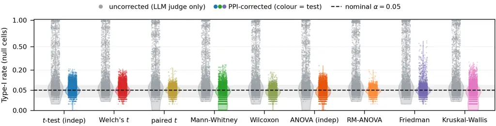

Figure 10. PPI-corrected Type-I error for hypothesis tests under
missing-not-at-random (MNAR) labeling, where items for human labeling
were not randomly selected, violating PPI’s assumptions (e.g., labeling
only the “easy” items). Computed from our aggressive factorial synthetic
data sweep, which compounds multiple bias mechanisms per scenario. Spans
4,092 null scenarios (2,046 each at mild/strong MNAR strength) across
all nine tests and 200 Monte Carlo repetitions each, for a total of
$`\approx`$7.3M simulated trials. Rejection rates for paired t-test,
Wilcoxon, and RM-ANOVA remain near nominal even as judge biases
compound, while others exhibit instability. Friedman, MWU, and K-W
rank-based tests appear to be the least reliable if MCAR labeling is
violated.

|                    | Synthetic, MCAR |      |      | Synthetic, MNAR |      |      | Real judge data |      |      | Power at $`d{=}0.3`$ |        |
| ------------------ | --------------- | ---- | ---- | --------------- | ---- | ---- | --------------- | ---- | ---- | -------------------- | ------ |
| Test               | PPI             | Unc. | Max  | PPI             | Unc. | Max  | PPI             | Unc. | Max  | PPI                  | Subset |
| $`t`$-test (indep) | .047            | .153 | .100 | .063            | .153 | .210 | .059            | .571 | .120 | .438                 | .165   |
| Welch’s $`t`$      | .048            | .153 | .110 | .063            | .153 | .210 | .058            | .571 | .115 | .363                 | .148   |
| paired $`t`$       | .053            | .154 | .120 | .054            | .154 | .220 | .053            | .788 | .110 | .477                 | .232   |
| Mann-Whitney $`U`$ | .049            | .154 | .120 | .051            | .154 | .255 | .052            | .637 | .110 | .383                 | .165   |
| Wilcoxon           | .044            | .156 | .125 | .047            | .157 | .180 | .043            | .855 | .080 | .328                 | .145   |
| ANOVA (indep)      | .053            | .154 | .110 | .057            | .154 | .245 | .056            | .896 | .110 | .927                 | .355   |
| RM-ANOVA           | .048            | .157 | .105 | .049            | .156 | .200 | .050            | .965 | .090 | .820                 | .385   |
| Friedman           | .051            | .172 | .120 | .061            | .172 | .590 | .050            | .965 | .095 | .512                 | .360   |
| Kruskal-Wallis     | .052            | .156 | .120 | .054            | .155 | .285 | .056            | .887 | .125 | .890                 | .418   |

Table 13. Type I error of the nine PPI-corrected tests at nominal
$`\alpha{=}0.05`$ (200 MC reps per cell), the numbers behind Figures 4
(MCAR) and 10 (MNAR). PPI and Unc. are the mean rejection rate across
null cells with and without correction. Max is the worst single null
cell, the analogue of MinCov in the CI tables. Synthetic columns pool
2,046 MCAR and 4,092 MNAR null cells per test over continuous and Likert
data; real columns pool 264 cells per test over the four multi-judge
corpora of Table 14. Power is at Cohen’s $`d{=}0.3`$ against a
human-only subset of the same labeling budget. Per-factor breakdowns are
in Supplementary Table S1.

Corpus Eval type Scale $`N`$ items Judge models used Human label Judge
score Pooled $`r`$ (mean $`\pm`$ SD) (mean $`\pm`$ SD) Chatbot Arena
Binary $`\{0,1\}`$ 1,293 Claude Haiku 4.5, Gemma-4 26B-A4B, GPT-OSS 20B,
Inkling $`0.514\pm 0.500`$ $`0.521\pm 0.500`$ 0.24 WMT DA Continuous
0–100 1,000 Claude Haiku 4.5, Gemma-4 26B-A4B, Inkling
$`73.97\pm 23.56`$ $`72.48\pm 24.99`$ 0.22 App Store reviews Likert 1–5
300 Claude Haiku 4.5, Gemma-4 26B-A4B, Inkling $`3.28\pm 1.85`$
$`2.84\pm 1.79`$ 0.82 Privacy Judge Continuous (avg. Likert) \[1.0,
5.0\] 250 Claude 3.5 Haiku, GPT-4o, Gemini 2.0 Flash, Gemma-3 4B,
Llama-3.2 1B (5 of 13 collected) $`2.40\pm 0.86`$ $`2.57\pm 1.24`$ 0.73
ICLR Metareview Binary $`\{0,1\}`$ 4,000 ReviewerToo Metareviewer
(single judge) $`0.283\pm 0.451`$ $`0.503\pm 0.500`$ 0.11 WMT DA
(paired) Continuous (paired) 0–100 1,000 Claude Haiku 4.5, Gemma-4
26B-A4B, Inkling $`66.87\pm 33.40`$ $`71.00\pm 25.81`$ 0.25

Table 14. The real LLM judge corpora (human_label, judge_score) used to
validate PPI correction against real judge bias. “Pooled $`r`$” is the
Pearson correlation across every (item, judge) row, pooled over judges.
Two corpora differ a bit: Privacy Judge’s human_label is an aggregate of
50–68 survey participants per item; and ICLR Metareview’s judge_score
comes from one automated pipeline (55.5% raw accuracy against real
conference decisions over 18,322 evaluated papers, from which we drew a
fixed-seed 4,000-paper sample).

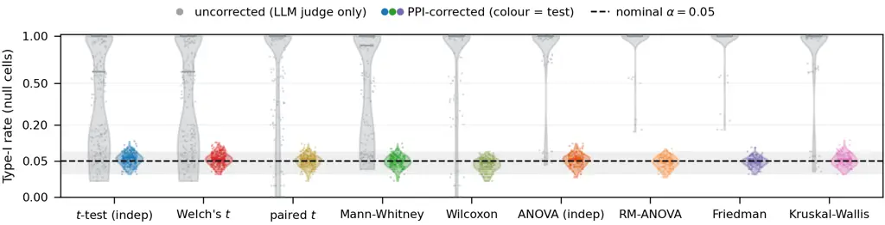

Figure 11. Type I error control of PPI-corrected tests on real LLM judge
data (counterpart to Figure 4) under an MCAR labeling regime.
Uncorrected rejection rates (gray) reach 1.0 for every test;
PPI-corrected rates (colored) cluster tightly around nominal
$`\alpha=0.05`$. 200 Monte Carlo replicates per test and corpus.

### B.4. Type I error by judge-human alignment, binary and continuous data

We repeat the same alignment-bucketed Type-I check for binary (Cohen’s
$`\kappa`$) and continuous (Pearson $`r`$) judge scores under MCAR
labeling, pairing each alignment bucket with a noise-only control so
that an elevated false-positive rate can be attributed to bias rather
than to the bucketing itself, and averaging over the five two-group
tests (Student’s, Welch’s, and paired $`t`$, Mann–Whitney $`U`$,
Wilcoxon) for continuous and Likert data, and over Welch’s and paired
$`t`$ for binary data. Figure 6 in the main text reports the result: PPI
correction stays well-calibrated across the alignment spectrum for all
three data types, removing bias that common IRR metrics do not spot.
Note that IRR near $`0`$ means no discernible human–judge correlation,
so noise dominates any effect there is to find.

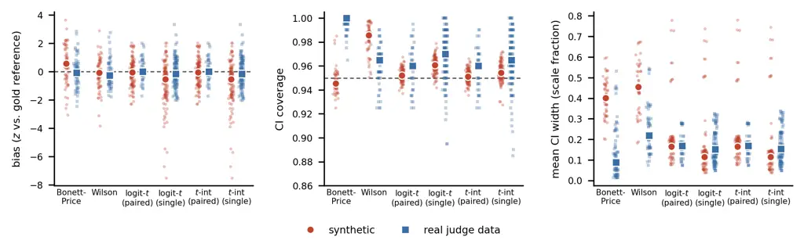

Figure 12. PPI correction of the four CI methods evalstats returns for
method="auto", on the synthetic suite (red circles) and real judge data
(blue squares). Small marks are individual scenarios, large marks their
median; the dashed lines mark zero bias and the nominal 95% target.
Bonett-Price’s real-data column runs conservative (99.7%) because our
real data simulation gives both arms the same human labels, leaving its
rectifier no disagreements to learn from. 2,000 replicates per synthetic
scenario, 200 per real-data scenario.

### B.5. PPI correction of main-path CI methods

evalstatsalso PPI-corrects marginal CIs and pairwise CIs that its
compare() method returns by default, following our recommendations
(Fig. 2): Wilson and Bonett-Price and for binary marginal/pairwise CIs,
a logit-$`t`$ interval for bounded $`[0,1]`$ data (we do not correct
NIG; hence for the PPI path, we return logit-$`t`$, its runner-up), and
(we include here) a $`t`$-interval in the case of unbounded numeric
data. However, as these are more straightforward to apply PPI to, we did
not focus on them in our main text. Figure 12 shows these PPI
corrections for CIs remain well-calibrated across synthetic and real
judge data, with coverage near or above nominal.

### B.6. Do PPI omnibus tests preserve the ability to detect real differences?

Figure 5 showed that our two-group PPI tests gain power over human-only
subset under bias. Here, Figure 13 shows similar power gains hold for
our four omnibus tests.

## Appendix C Extending PPI correction to rank-based nonparametric tests

Prediction-powered inference was formulated for estimators that are
averages of per-item terms, where the correction decomposes
linearly (Angelopoulos et al., 2023b; Angelopoulos et al., 2023a). Rank
statistics deviate, as an item’s rank depends on every other item, so
the item-wise decomposition cannot be applied to the literal statistic.
However, technically PPI only needs an asymptotically linear estimator
of a well-defined estimand. For rank-based tests we therefore identified
a population estimand that is defined on any subsample and represents
the same hypothesis, corrected that estimand, and referred the corrected
statistic to a reference distribution whose calibration we verify
empirically (Appendix B; Figs. 10, 11 and 13). The four tests are
different variations on that template, with Wilcoxon using the Hájek
projection of a one-sample $`U`$-statistic.¹⁸¹⁸ 18 The projection of a
$`U`$-statistic onto sums of per-item terms, which is linear up to
$`o_{p}(n^{-1/2})`$ (Van der Vaart, 2000, Ch. 12).

In the sections below, we describe each test. Items are assumed i.i.d.,
the labeled subset is a uniform random sample of the items (MCAR), and
every variance is first-order. Mann-Whitney, Kruskal-Wallis, and
Wilcoxon evaluate the variance of the corrected statistic under a
sharper null than the weak null $`\theta{=}0`$ they test
(exchangeability or sign symmetry, stated in each subsection), a
score-type construction with the variance a function of the data under
$`H_{0}`$ rather than of the estimate. This does not by itself guarantee
validity under every distribution satisfying the weaker null; that
finite-sample behavior is what the simulations of Appendix B measure. A
separate check (equal medians, human-side spread ratios up to four,
1,000 replicates per cell; classical inflation to roughly twice nominal)
found the PPI tests inheriting the Behrens–Fisher miscalibration of the
classical Mann-Whitney and Kruskal-Wallis tests, as expected, without
compounding it, with Wilcoxon and Friedman at nominal under a design
that kept paired differences symmetric. In every test the power-tuning
weight $`\lambda`$ is estimated from the data, clipped to $`[0,1]`$, and
shrunk as in §B.1; each subsection’s variance formula shows whether
$`\lambda`$’s own sampling variance enters. Throughout, a superscript
$`H`$ or $`J`$ names the source (human labels or judge scores) and a
subscript $`\mathrm{lab}`$ or $`\mathrm{unlab}`$ the sample;
$`\psi_{i}`$ is item $`i`$’s first-order influence, and
$`N_{\mathrm{lab}}`$ the total labeled count.

### C.1. PPI-corrected Friedman test

Friedman is the repeated-measures rank counterpart to one-way ANOVA:
each subject’s scores are ranked across the $`k`$ conditions. Because
ranking uses only the subject’s own row, the per-condition mean rank
survives restriction to the labeled subset and no reformulation is
needed. Writing $`\bar{r}^{H}_{\mathrm{lab}}`$,
$`\bar{r}^{J}_{\mathrm{lab}}`$, $`\bar{r}^{J}_{\mathrm{unlab}}`$ for the
$`k`$-vectors of per-condition mean ranks of the labeled human data and
of the labeled and disjoint-unlabeled judge data, the corrected
condition means are

```math
\hat{m}\;=\;\bar{r}^{H}_{\mathrm{lab}}+\lambda\,\big(\bar{r}^{J}_{\mathrm{unlab}}-\bar{r}^{J}_{\mathrm{lab}}\big),
```

with one $`\lambda`$ shared across conditions, since the $`k`$
conditions share one judge. Let
$`P=I-\tfrac{1}{k}\mathbf{1}\mathbf{1}^{\top}`$ project onto the
contrast space, and let $`V^{H}_{\mathrm{lab}}`$,
$`V^{J}_{\mathrm{lab}}`$, $`V^{J}_{\mathrm{unlab}}`$ and $`C`$ be the
estimated covariance matrices of the three mean-rank vectors (each a
row-sample covariance divided by its number of rows) and the
cross-covariance of the two labeled ones. Then
$`\lambda=\operatorname{tr}(PCP)/\operatorname{tr}\big(P(V^{J}_{\mathrm{unlab}}+V^{J}_{\mathrm{lab}})P\big)`$
minimizes the trace of the contrast-projected covariance of $`\hat{m}`$,
the vector form of the PPI++ weight.

The corrected means are no longer literal sample mean ranks, so no exact
finite-sample null distribution is available for them. The statistic
keeps the Iman–Davenport (Iman and Davenport, 1980) $`F`$-on-ranks shape
but replaces its residual with a delta-method covariance of $`\hat{m}`$:

```math
F\;=\;\frac{\sum_{j}(\hat{m}_{j}-\bar{\hat{m}})^{2}}{\operatorname{tr}(P\hat{V}P)},
```

```math
\displaystyle\hat{V}\;= \displaystyle V^{H}_{\mathrm{lab}}+\lambda^{2}\big(V^{J}_{\mathrm{unlab}}+V^{J}_{\mathrm{lab}}\big)
```

```math
\displaystyle-\lambda\,(C+C^{\top})+rr^{\top}\,\widehat{\operatorname{Var}}(\lambda),
```

with $`r=\bar{r}^{J}_{\mathrm{unlab}}-\bar{r}^{J}_{\mathrm{lab}}`$. We
refer $`F`$ to $`F\big(k-1,\,(N_{\mathrm{lab}}-1)(k-1)\big)`$, the
labeled count setting the denominator degrees of freedom because that is
where $`\hat{V}`$’s noise lives, and rely on the simulations of
Appendix B for its calibration.

### C.2. PPI-corrected Mann-Whitney $`U`$ test

For two groups $`A`$ and $`B`$ the estimand is
$`\theta=P(A{>}B)+\tfrac{1}{2}P(A{=}B)-\tfrac{1}{2}`$, a two-sample
$`U`$-statistic that equals zero whenever the groups share a
distribution, ties included, and, up to the shift, is the classical
$`U/(n_{A}n_{B})`$. It is defined on any subsample, so the corrected
estimator takes the standard power-tuned form

```math
\hat{\theta}\;=\;\hat{\theta}^{H}_{\mathrm{lab}}+\lambda\big(\hat{\theta}^{J}_{\mathrm{unlab}}-\hat{\theta}^{J}_{\mathrm{lab}}\big),
```

with
$`\lambda=\widehat{\operatorname{Cov}}\big(\hat{\theta}^{H}_{\mathrm{lab}},\hat{\theta}^{J}_{\mathrm{lab}}\big)/\widehat{\operatorname{Var}}\big(\hat{\theta}^{J}_{\mathrm{unlab}}-\hat{\theta}^{J}_{\mathrm{lab}}\big)`$,
the PPI++ weight with its covariance and variance taken over PPI
bootstrap replicates (Zrnic, 2024). Because $`\lambda`$ multiplies only
the judge terms, the estimator is unbiased at any fixed $`\lambda`$.

The test uses a null-structured Hájek-projection covariance. Write
$`h_{i}`$ and $`j_{i}`$ for item $`i`$’s human label and judge score,
and $`\Phi_{H}`$, $`\Phi_{J}`$ for the empirical mid-CDFs (ties at half
weight) of the _other_ group’s human labels and judge scores. The
first-order influence of an $`A`$ item on $`\theta`$ is $`F_{B}`$ at
that item (Van der Vaart, 2000, Thm. 12.3), which under $`H_{0}`$ the
other group’s mid-CDF estimates, so every item contributes one number,

```math
\psi_{i}\;=\;\Phi_{H}(h_{i})-\lambda\,\Phi_{J}(j_{i})\ \text{ if }i\text{ is labeled},\qquad\psi_{i}\;=\;\lambda\,\Phi_{J}(j_{i})\ \text{ if not},
```

signed by group ($`+`$ for $`A`$, $`-`$ for $`B`$); neither the sign nor
a centering constant enters a variance. Since the labeled and unlabeled
items enter $`\hat{\theta}`$ through separate averages,

```math
\widehat{\operatorname{Var}}(\hat{\theta})\;=\;\sum_{g\in\{A,B\}}\left[\frac{\operatorname{Var}_{\mathrm{lab},g}(\psi)}{n_{\mathrm{lab},g}}+\frac{\operatorname{Var}_{\mathrm{unlab},g}(\psi)}{n_{\mathrm{unlab},g}}\right],
```

the sample variances taken within each group’s labeled and unlabeled
items. Differencing the human and judge influence per item, rather than
assembling
$`V^{H}_{\mathrm{lab}}+\lambda^{2}(V^{J}_{\mathrm{unlab}}+V^{J}_{\mathrm{lab}})-2\lambda C`$
from separately estimated variances and a cross-covariance, avoids a
near-cancellation at $`\lambda\approx 1`$. The statistic
$`\hat{\theta}/\widehat{\mathrm{SE}}`$ is referred to a $`t`$
distribution on $`N_{\mathrm{lab}}-1`$ degrees of freedom, with
$`N_{\mathrm{lab}}`$ the total labeled count over both groups.

The reported effect size is the rank-biserial correlation
$`2\hat{\theta}`$, corrected by the same estimator. Unlike the classical
statistic, a normalized rank count that is bounded by construction, the
PPI-corrected $`\hat{\theta}`$ is a sum and is not confined to
$`[-\tfrac{1}{2},\tfrac{1}{2}]`$; therefore, upon display to users in
evalstats, we clip the reported correlation to $`[-1,1]`$.

### C.3. PPI-corrected Kruskal-Wallis test

Kruskal-Wallis compares the $`k`$ group mean ranks of a pooled ranking,
and pooled ranks do not survive subsampling. Each group’s mean rank is,
however, an exact affine function of its pairwise dominance
probabilities against the other groups. With
$`\theta_{ab}=P(\text{group }a>\text{group }b)+\tfrac{1}{2}P(\text{group }a=\text{group }b)`$
and $`\delta_{ab}=\theta_{ab}-\tfrac{1}{2}`$,

```math
\begin{gathered}\bar{R}_{j}\;=\;\frac{N+1}{2}+s_{j},\qquad s_{j}=\sum_{l\neq j}n_{l}\,\delta_{jl},\\
H\;=\;\frac{12}{N(N+1)}\sum_{j}n_{j}\,s_{j}^{2}\end{gathered}
```

up to the tie correction, since within-group midranks average to
$`(n_{j}+1)/2`$ and each other group $`l`$ contributes
$`n_{l}\theta_{jl}`$. So $`H`$ is a fixed quadratic form in the vector
$`\delta`$ of all $`\binom{k}{2}`$ pairwise Mann-Whitney estimands, and
we correct that vector. Each $`\hat{\delta}_{ab}`$ takes the power-tuned
form of §C.2, with one $`\lambda`$ shared across pairs, since the pairs
share one judge:
$`\lambda=\operatorname{tr}(C)/\operatorname{tr}\big(V^{J}_{\mathrm{unlab}}+V^{J}_{\mathrm{lab}}\big)`$,
where $`C`$ is the cross-covariance of the labeled human and judge pair
vectors and $`V^{J}`$ the covariances of the judge pair vectors, all
taken over a joint bootstrap that resamples every group once per
replicate (pairs sharing a group are correlated). The covariance used
below has rank $`k{-}1`$, so the test covers only the part of $`\delta`$
that determines the group rank means; like classical Kruskal-Wallis, it
has no power against cyclic dominance. At $`k=2`$ the estimand reduces
to Mann-Whitney’s.

Under exchangeability every group’s items share one human and one judge
distribution, so the reference mid-CDFs $`\Phi_{H}`$, $`\Phi_{J}`$ are
now pooled across all groups. (Each group is only $`1/k`$ of the pool.
At $`k=2`$ a pooled reference would be half fitted to the group it
scores, which is why §C.2 uses the other group instead.) With that
substitution, an item’s first-order influence on every pair containing
its group is the same scalar $`\psi_{i}`$ of §C.2, signed by the group’s
position in the pair. The Hájek projection of $`\hat{\delta}`$ is
therefore $`M\bar{\psi}`$, with $`\bar{\psi}_{g}`$ group $`g`$’s mean of
$`\psi`$ and $`M`$ the oriented incidence matrix of the complete graph
$`K_{k}`$. That matrix has rank $`k-1`$, so the first-order covariance
of $`\hat{\delta}`$ has rank exactly $`k-1`$ whenever every group’s
influence variance is positive. We estimate it in that form,

```math
\hat{\Sigma}\;=\;\sum_{g}v_{g}\,c_{g}c_{g}^{\top},\qquad v_{g}=\frac{\operatorname{Var}_{\mathrm{lab},g}\big(\psi^{H}{-}\lambda\,\psi^{J}\big)}{n_{\mathrm{lab},g}}+\lambda^{2}\,\frac{\operatorname{Var}_{\mathrm{unlab},g}\big(\psi^{J}\big)}{n_{\mathrm{unlab},g}},
```

over the columns $`c_{g}`$ of $`M`$, with $`v_{g}`$ the variance of
group $`g`$’s contribution, the sum of two independent averages as in
§C.2, so $`\mathrm{df}=k-1`$.

The statistic $`Q=\hat{\delta}^{\top}\hat{\Sigma}^{+}\hat{\delta}`$ is
asymptotically $`\chi^{2}_{k-1}`$, but that reference is liberal at
small $`N_{\mathrm{lab}}`$, where a noisy $`\hat{\Sigma}`$ inflates
$`E[Q]`$. As a small-sample calibration we refer
$`Q(\nu-\mathrm{df}+1)/(\nu\,\mathrm{df})`$ to
$`F(\mathrm{df},\,\nu-\mathrm{df}+1)`$, the Hotelling-$`T^{2}`$
scaling (Hotelling, 1931), with $`\nu=N_{\mathrm{lab}}`$ the total
labeled count (falling back to $`\chi^{2}_{\mathrm{df}}`$ when
$`\nu\leq\mathrm{df}`$); this is a calibration choice, not a claim that
$`\hat{\Sigma}`$ is Wishart. The reported effect size,
$`4\cdot\mathrm{mean}(\hat{\delta}_{ab}^{2})\in[0,1]`$ and zero under
$`H_{0}`$, is a scalar summary we define here and PPI-correct
separately, with the fixed $`\lambda{=}1`$ estimator and a
percentile-bootstrap interval.

### C.4. PPI-corrected Wilcoxon signed-rank test

For paired differences $`D=X-Y`$, the estimand is the Walsh-average
dominance probability

```math
\theta_{W}\;=\;P\!\left(\tfrac{D+D^{\prime}}{2}>0\right)+\tfrac{1}{2}\,P\!\left(\tfrac{D+D^{\prime}}{2}=0\right)-\tfrac{1}{2},
```

with $`D,D^{\prime}`$ independent copies. Its estimator on observed
differences $`d_{1},\dots,d_{n}`$ is

```math
\hat{\theta}_{W}\;=\;\frac{2}{n(n+1)}\sum_{i\leq j}\Big[\mathbf{1}\{d_{i}+d_{j}>0\}+\tfrac{1}{2}\,\mathbf{1}\{d_{i}+d_{j}=0\}\Big]-\tfrac{1}{2},
```

which includes the $`i=j`$ terms (a contribution of order $`1/n`$) and
counts ties at half weight. This is the sign construction behind the
Hodges-Lehmann estimator (Hodges and Lehmann, 1963), and
$`H_{0}\!:\theta_{W}=0`$ says the Walsh pseudomedian is zero. It is
implied by, but weaker than, the classical signed-rank null of
differences symmetric about zero; under symmetry it is the usual
Wilcoxon null. By Tukey’s identity (Hollander et al., 2013), with no
zero differences and no ties among the $`|d_{i}|`$, the classical
$`W^{+}`$ equals the number of positive Walsh averages, so
$`\hat{\theta}_{W}`$ is then an exact affine function of $`W^{+}`$. The
mid-probability form with self-pairs is the extension we use for zeros
and ties, which retains information that a per-item sign construction
discards under heavy ties (e.g. integer Likert scores).

The corrected estimator applies the same functional to the human and
judge differences on the labeled subset and to the judge differences on
the unlabeled items,

```math
\hat{\theta}\;=\;\hat{\theta}^{H}_{\mathrm{lab}}+\lambda\big(\hat{\theta}^{J}_{\mathrm{unlab}}-\hat{\theta}^{J}_{\mathrm{lab}}\big),\qquad\lambda\;=\;\frac{\widehat{\operatorname{Cov}}\big(\hat{\theta}^{H}_{\mathrm{lab}},\hat{\theta}^{J}_{\mathrm{lab}}\big)}{V^{J}_{\mathrm{unlab}}+V^{J}_{\mathrm{lab}}}.
```

The covariance and judge variances here are analytic, from the
estimand’s Hájek projection: with
$`\psi_{i}=\frac{1}{n}\sum_{j}\big[\mathbf{1}\{d_{i}+d_{j}>0\}+\tfrac{1}{2}\,\mathbf{1}\{d_{i}+d_{j}=0\}\big]`$
the empirical first-order component of item $`i`$ (the one-sample
analogue of the $`\psi_{i}`$ of §C.2),
$`\widehat{\operatorname{Var}}(\hat{\theta}_{W})=4\operatorname{Var}(\psi)/n`$,
and the covariance of the human and judge estimators on the labeled
items is the corresponding covariance of their projections. Here
$`V^{J}_{\mathrm{lab}}`$ and $`V^{J}_{\mathrm{unlab}}`$ are this same
$`4\operatorname{Var}(\psi^{J})/n`$ evaluated on the labeled and
unlabeled judge differences. Each is computed within its own sample (the
Walsh kernel pairs items inside a single sample, so unlike §C.2 there is
no shared reference distribution to fix).

The human-side variance is evaluated under $`H_{0}`$ rather than at the
estimate. Under sign symmetry, flipping the signs of the observed
labeled human differences at random, conditional on their magnitudes,
leaves the null distribution unchanged, so the variance of
$`\hat{\theta}^{H}_{\mathrm{lab}}`$ across such flips is its null
variance: the classical randomization reference for a signed-rank
statistic (Lehmann and Romano, 2005, Ch. 15), valid in the presence of
ties. We estimate it from 200 random sign flips. If every labeled
difference is zero, or either labeled variance is numerically zero, the
human term falls back to its Hájek variance, which is itself zero in
that degenerate case, leaving the judge terms to carry the standard
error. Writing $`V^{H}_{\mathrm{null}}`$ for it, $`\rho`$ for the
estimated correlation between the human and judge projections on the
labeled items, and
$`r=\hat{\theta}^{J}_{\mathrm{unlab}}-\hat{\theta}^{J}_{\mathrm{lab}}`$,

```math
\widehat{\operatorname{Var}}(\hat{\theta})\;=\;V^{H}_{\mathrm{null}}+\lambda^{2}\big(V^{J}_{\mathrm{unlab}}+V^{J}_{\mathrm{lab}}\big)-2\lambda\,\rho\,\sqrt{V^{H}_{\mathrm{null}}\,V^{J}_{\mathrm{lab}}}+r^{2}\,\widehat{\operatorname{Var}}(\lambda),
```

which keeps the estimated correlation so that the quadratic form stays
non-negative. This is score rather than Wald inference: $`\theta_{W}`$
is proportion-like, with variance typically largest near $`0`$ and
collapsing toward $`\pm\tfrac{1}{2}`$, so a plug-in variance at
$`\hat{\theta}_{W}`$ shrinks as $`|\hat{\theta}_{W}|`$ grows and a
two-sided test built on it is anti-conservative. The statistic
$`\hat{\theta}/\widehat{\mathrm{SE}}`$ is referred to a $`t`$
distribution on $`N_{\mathrm{lab}}-1`$ degrees of freedom.

The reported effect size is the rank-biserial correlation
$`2\hat{\theta}`$, clipped to $`[-1,1]`$ as in §C.2.

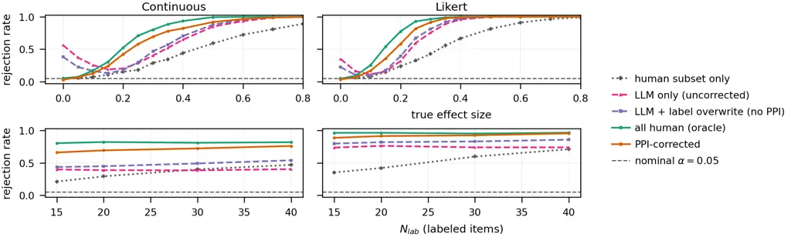

Figure 13. Omnibus-test (3+ condition) analogue of Figure 5, pooling
ANOVA-independent, ANOVA-repeated, Friedman, and Kruskal-Wallis
rejection rates across the same five-estimator comparison (all-human
oracle, PPI-corrected, LLM-plus-label-overwrite, raw uncorrected
LLM-only judgment, and a human-only subset matched in size to the
labeled budget) for continuous and Likert data types. Top row: rejection
rate as a function of true effect size at a fixed 20% labeled-item
budget. Bottom row: rejection rate as a function of labeled-item count
$`N_{\mathrm{lab}}`$ at effect size Cohen’s $`d{=}0.3`$. PPI-corrected
power tracks close behind the oracle and clearly ahead of both the
human-only subset and the uncorrected LLM baselines in every panel. 200
Monte Carlo replicates per condition.

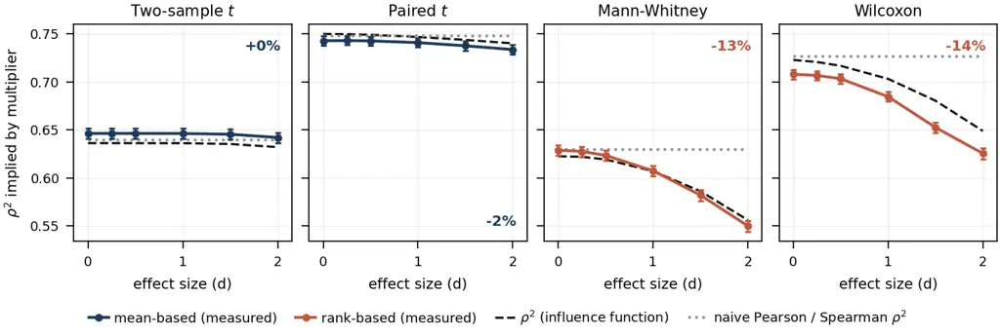

Figure 14. The variance multiplier is a property of judge quality only
for parametric tests, and degrades with effect size for rank-based ones.
Each panel sweeps the true effect at fixed judge quality ($`N=1000`$,
$`N_{\mathrm{lab}}=100`$, continuous, near-centred truth marginal),
plotting the $`\rho^{2}`$ implied by the measured multiplier (solid,
$`\pm 1`$ MC standard error over 20,000 replicates). Parametric tests
stay flat, as the algebra requires (Angelopoulos et al., 2023a), while
rank-based tests fall ($`-0.079\pm 0.008`$ Mann-Whitney,
$`-0.083\pm 0.007`$ Wilcoxon). Dashed lines show that evalstats’
influence-function $`\rho^{2}`$, output from its judge_alignment method,
stays within $`5\%`$ of the measured value.

## Appendix D Label efficiency and robustness of the $`\rho^{2}\geq 0.4`$ rule of thumb

We sweep judge quality against labeling budget on a pool of $`{N=}1000`$
items, labeling
$`N_{\mathrm{lab}}\in\{15,\allowbreak 20,\allowbreak 30,\allowbreak 40,\allowbreak 60,\allowbreak 90,\allowbreak 130,\allowbreak 200\}`$
of them, at six judge-quality tiers calibrated to target $`\rho^{2}`$,
four effect sizes ($`0.15`$, $`0.20`$, $`0.25`$ and $`0.35`$ of the eval
type’s population SD, see Table 11), and two judge-error distributions
(Gaussian, and a contaminated judge that is mostly right but
occasionally badly wrong), with 500 replicates per cell. The
_label-efficiency multiplier_ is the number of human labels a classical
test would need to match PPI’s power, divided by $`N_{\mathrm{lab}}`$.

|                                                                           |                  |                                                                         |
| ------------------------------------------------------------------------- | ---------------- | ----------------------------------------------------------------------- |
| Planned test                                                              | Use              | Computed between LLM judge & humans on…                                 |
| Estimation and two-condition tests                                        |                  |                                                                         |
| Mean, proportion, CI                                                      | $`\rho_{P}^{2}`$ | raw scores, per measure                                                 |
| Independent-samples $`t`$-test                                            | $`\rho_{P}^{2}`$ | raw scores, within each condition                                       |
| Paired $`t`$-test                                                         | $`\rho_{P}^{2}`$ | _difference_ scores ($`D_{i}=Y_{1,i}-Y_{2,i}`$)                         |
| Mann–Whitney $`U`$                                                        | $`\rho_{S}^{2}`$ | each item’s mid-rank placement against the other condition              |
| Wilcoxon signed-rank                                                      | $`\rho_{S}^{2}`$ | _difference_ scores, via their Hájek projection                         |
| Omnibus tests ($`k\geq 3`$ conditions): Use the judge_alignment function. |                  |                                                                         |
| One-way ANOVA                                                             | $`\rho_{P}^{2}`$ | scores centered within each condition, pooled                           |
| RM ANOVA                                                                  | $`\rho_{P}^{2}`$ | residuals after removing participant _and_ condition means              |
| Kruskal–Wallis                                                            | $`\rho_{S}^{2}`$ | scores centered within condition, pooled, then ranked                   |
| Friedman                                                                  | $`\rho^{2}`$     | within-participant rankings of the $`k`$ conditions, condition-centered |

Table 15. Which judge-human correlation $`\rho^{2}`$ to use in the
$`N_{\text{eff}}`$ formula, and what to compute it on. evalstats’
judge*alignment computes the correct value for a given test from labeled
data. For Mann–Whitney and Wilcoxon it correlates influence-function
values, which reduce to Spearman’s $`\rho*{S}`$ at a null effect. (Note:
For within-subjects/repeated-measures designs, randomly sample rows
(subjects) with all $`k`$ conditions filled, and have human raters label
all $`k`$ per selected subject.)

Rules of thumb. Figure 16 plots the multiplier against judge-human
agreement. Below $`\rho^{2}\approx 0.2`$ the saving is under
$`1.25\times`$ for every data type, teetering just above 1. At
$`\rho^{2}\approx 0.4`$ every data type clears $`1.25\times`$, which is
why we recommend it as the threshold to aim for. Figure 7 breaks this
out by labeling budget. Figure 14 shows the multiplier is invariant to
effect size for parametric tests, approximately so for the rank-based
ones. A rank test’s effective $`\rho^{2}`$ declines as the true effect
grows, because rank-based tests’ remaining variance concentrates in rare
rank reversals. The decline costs under $`2\%`$ at Cohen’s
$`d\leq 0.5`$. It should not necessarily be interpreted as a loss of
power, however.

$`\rho`$ is the Pearson correlation between the judge’s and the human’s
influence values, which follows from the general PPI variance reduction,
$`1-\operatorname{Corr}^{2}`$ between the influence functions of the
labeled and predicted statistics (Angelopoulos et al., 2023b). For a
mean that quantity is the score itself, so $`\rho`$ is a plain Pearson’s
$`r`$. For a rank-based test it is the item’s position within the
sample, an empirical-CDF value, which at a null effect gives Spearman’s
$`\rho_{S}`$. For a paired design it is the per-item _difference_ rather
than the raw score.

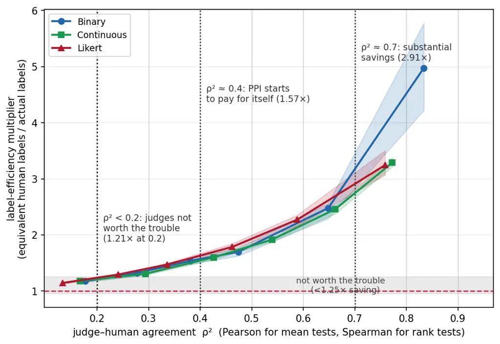

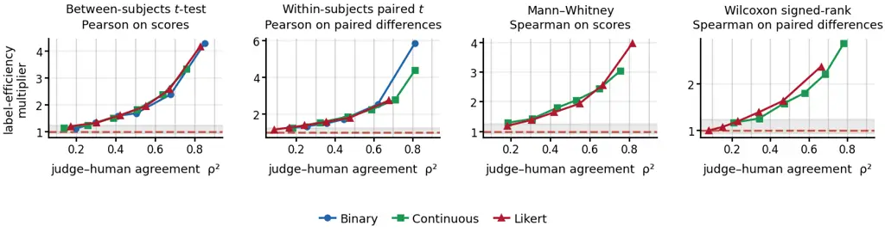

Figure 15. Label-efficiency multiplier against judge-human agreement
$`\rho^{2}`$, one line per data type, with bootstrap 95% CIs on the
median. The shaded band marks savings under $`1.25\times`$:
statistically above $`1`$, but perhaps not worth the cost. By
$`\rho^{2}\approx 0.4`$ all three data types have cleared it cleanly.
Results are averaged over parametric and nonparametric tests using their
respective $`\rho`$, showing the threshold is invariant to test type,
data type, effect size, and setup. A per-family breakdown is in
Figure 16. 500 replicates per cell (same run as Figure 7).

Figure 16. Which correlation to measure, by experimental design: Pearson
for mean-based tests, Spearman for rank-based, and the same correlations
on paired differences for paired designs. Rank tests do not show binary
because they are not appropriate there. Same run as Figure 16.

## Appendix E End-to-end validation of compare()

We feed compare() the same synthetic data generation suite (§A.1.1),
sweeping 23 distribution shapes across binary, continuous, and Likert
data; $`N\in\{15,\ldots,1000\}`$ items per arm; $`k\in\{2,3,5,10\}`$
arms for FWER correction; cross-arm reliability
$`\mathrm{ICC}\in\{0.05,0.20,0.60\}`$ (on the non-PPI path; PPI cells
use $`0.20`$); and, on the PPI path, human-label budgets of $`10`$,
$`20`$, and $`40\%`$ of items. Judge bias is applied only on the PPI
path; the non-PPI arm analyzes the evaluation results directly, treated
them as trusted. Beyond run settings (score range, data type, bootstrap
count, and seed), we pass only factors=, metric=, and (where applicable)
alignment=: every method choice is left to method="auto" and the routing
described in §A.4, except the FWER correction below. For FWER correction
of PPI hypothesis tests, we set correction="shaffer". We do this for
consistency of what we validated here, so that evalstats routes to the
PPI-Wilcoxon and PPI-paired-$`t`$ tests for numeric and binary data,
respectively, rather than Romano-Wolf, as R-W would replace the pairwise
$`p`$-values. A PPI-corrected Romano-Wolf exists in evalstats, but we
spare the reader the added complexity.

Table 16 provides descriptive statistics behind Figure 8.

|            |                              |          |        |        |                                          |                         |                               |
| ---------- | ---------------------------- | -------- | ------ | ------ | ---------------------------------------- | ----------------------- | ----------------------------- |
|            | CI coverage (target $`.95`$) |          |        |        | PPI power gain over labels-only (points) |                         |                               |
| Data type  | Per-arm                      | Pairwise | Family | Type-I | Peak                                     | at $`N_{\mathrm{lab}}`$ | at $`N_{\mathrm{lab}}{=}400`$ |
| Binary     | 0.957                        | 0.952    | 0.969  | 0.031  | +18.9                                    | 100                     | +0.5                          |
| Continuous | 0.952                        | 0.949    | 0.962  | 0.040  | +11.7                                    | 40                      | +0.0                          |
| Likert     | 0.952                        | 0.950    | 0.958  | 0.040  | +13.1                                    | 40                      | +4.1                          |
| All        | 0.954                        | 0.950    | 0.963  | 0.037  | +14.0                                    | 40                      | +1.6                          |

Table 16. End-to-end results of compare() by data type (100 MC reps per
cell), a descriptive summary of Figure 8.

## Appendix F Full-size plots of IRR metrics under differential judge bias, per data type

Figures 17–20 sweep systematic judge bias against judge noise for 5- and
7-point Likert, continuous, and binary data, plotting the uncorrected
false-positive rate against every common IRR metric for that data type
across up to eleven judge variants (1,000 replicates per cell).
PPI-corrected two-sample tests held at an average Type I error of 0.047
across all 5,420 cells.

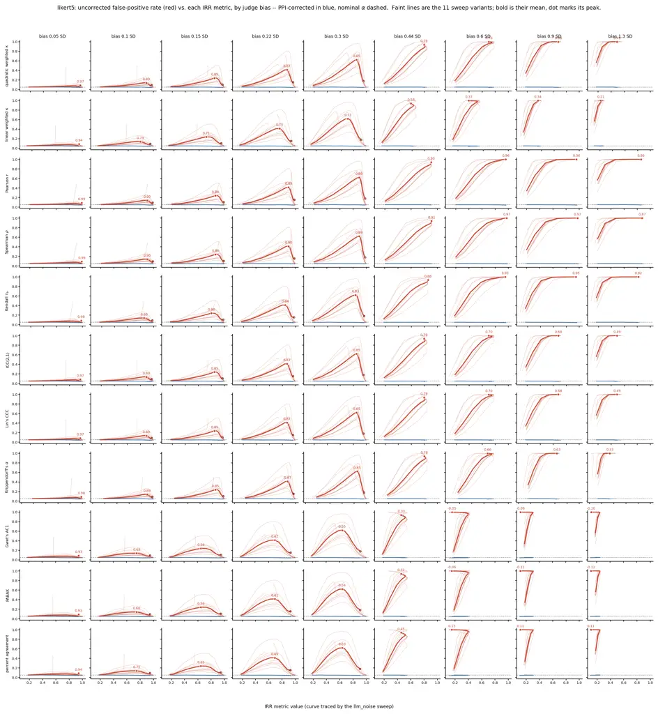

Figure 17. 5-point Likert: uncorrected false-positive rate (red) against
each IRR metric (rows), by judge bias (columns, in population SDs).
Faint lines are the eleven judge variants; bold is their mean, with the
dot marking its peak. PPI-corrected rates in blue hold at nominal
($`\alpha`$ dashed) in every cell.

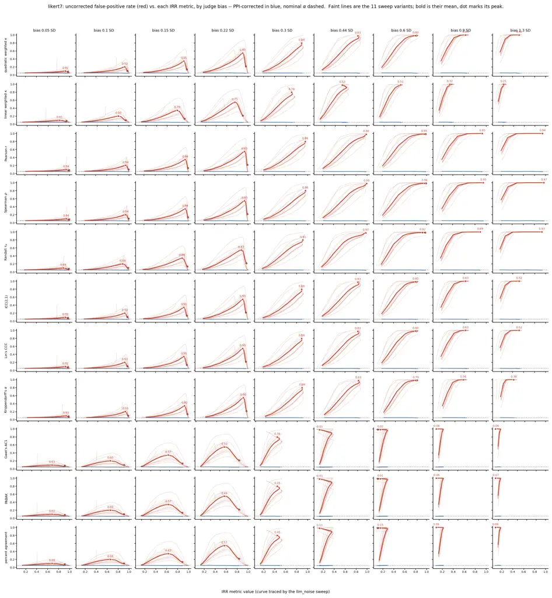

Figure 18. 7-point Likert, same layout as Fig. 17. The peaks sit higher
(0.92–0.95) because half a scale point, the rounding threshold, is a
smaller fraction of the scale’s SD.

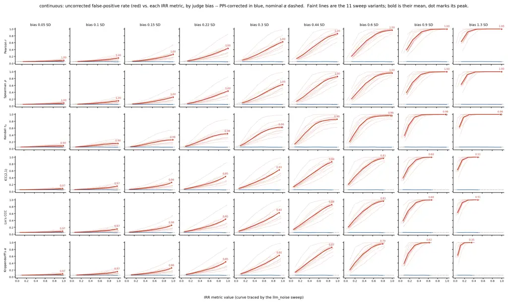

Figure 19. Continuous data IRR metrics. False positive risk rises
monotonically across IRR metrics.

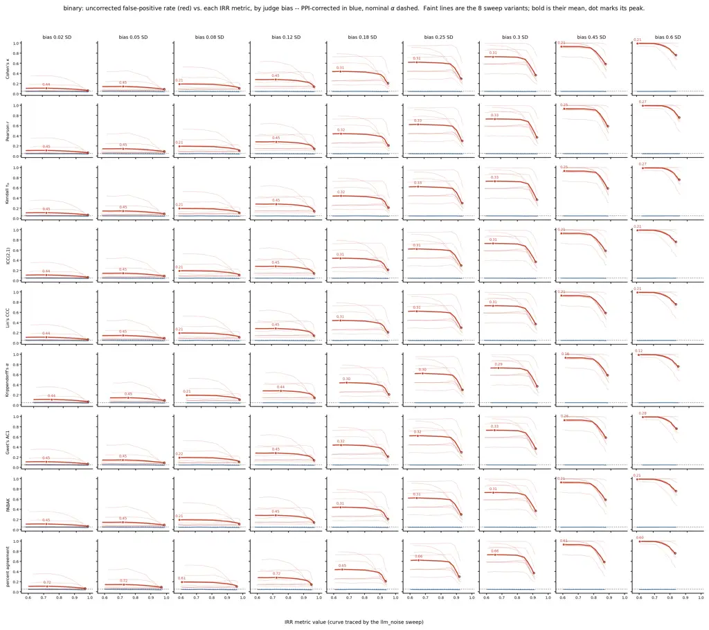

Figure 20. Binary data IRR metrics as judge bias grows. False positive
risk falls as agreement rises.
