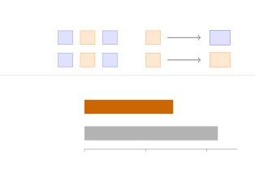
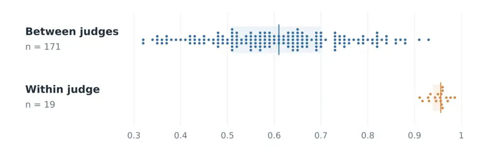
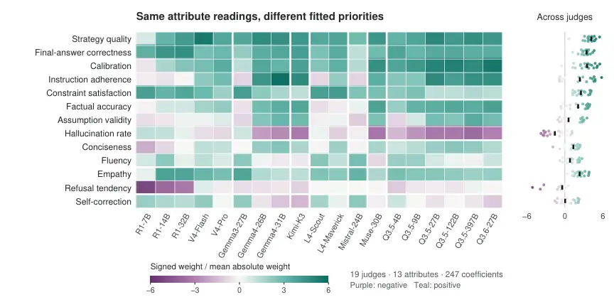
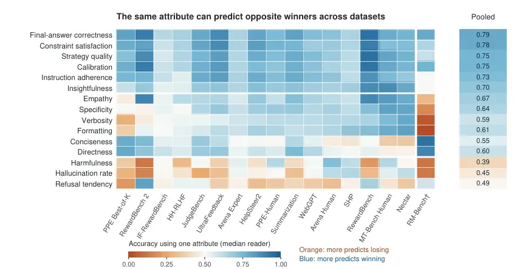
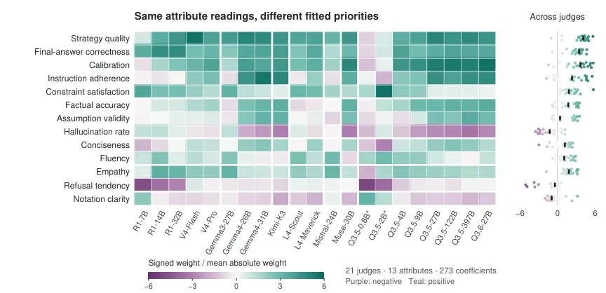
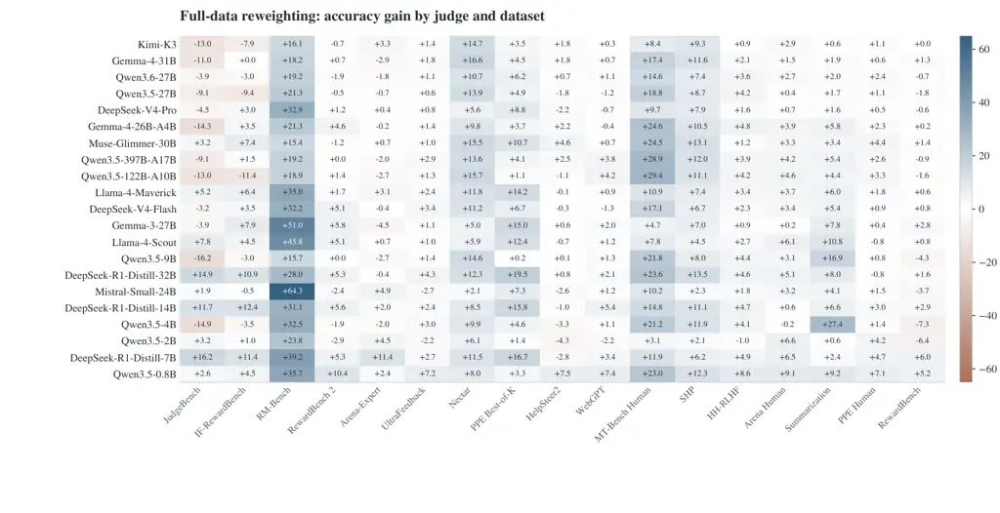

# JudgeProfile: Understanding and Steering Subjectivity in LLM Judges

Qi Cao Affiliation: Meta Affiliation: University of California San Diego
Work done during an internship at Meta    Kangning Liu Affiliation: Meta
   Xuan Kan Affiliation: Meta    Shunwen Tan Affiliation: Meta    Yang
Pei Affiliation: Meta    Dake Chen Affiliation: Meta    Yatai Ji
Affiliation: Meta Affiliation: The University of Hong Kong Work done
during an internship at Meta    Zixuan Ye Affiliation: Meta
Affiliation: The Hong Kong University of Science and Technology Work
done during an internship at Meta    Yuanpeng Tu Affiliation: Meta
Affiliation: The University of Hong Kong Work done during an internship
at Meta    Daniel Li Affiliation: Meta    Junbiao Tang Affiliation: Meta
   Pengtao Xie Affiliation: University of California San Diego    Zihao
He Affiliation: Meta

###### Abstract

LLM judges are inherently subjective, often favoring different responses
in pairwise comparison when neither option is objectively wrong. To
study this subjectivity, we introduce JudgeProfile, a framework that
dissects LLM evaluation into perception (how a judge compares two
responses across specific attributes like clarity, correctness, and
detail) and prioritization (how much each attribute influences the final
choice). We curate SubjectiveSet, a dataset of 50,013 response pairs
from 17 public data sources, evaluated by 21 LLM judges across 87
attributes. We find a hidden consensus in perception: judges frequently
agree on attribute judgments even when their overall choices diverge.
Building on this separation, we first characterize each judge’s
prioritization using attribute weights estimated from its own overall
choices. These weights differ across judges even when estimated from the
same attribute judgments. We then learn new weights from reference
labels to adapt their decisions to a target evaluation standard.
Reweighting perceived attributes improves average held-out agreement
with reference labels from 66.48% to 71.97%, outperforming fine-tuning
and rubric prompting. Our findings show that understanding and steering
the subjectivity of LLM judges requires attention not only to what they
perceive, but also to how they prioritize it.

^(†)^(†)date: September 28, 2026

## 1 Introduction

Large language models (LLMs) are often used to judge which of two
responses is better (Zheng et al., 2023; Liu et al., 2023; Kim et al.,
2024). For open-ended tasks, more than one response can be good. One
response may be richer in details, while another gives a short, direct
answer. Even if both are correct, different users may prefer different
responses (Sorensen et al., 2024). We call such differences
_subjectivity_ when there is no single objectively correct judgment. LLM
judges also exhibit such subjectivity, favoring one of several
acceptable responses. However, it remains unclear what drives these
preferences.

We introduce JudgeProfile, a framework to study what drives these
preferences, which decomposes overall judgments into perception and
prioritization (Figure 1). In _perception_, a judge compares the
responses on individual qualities, which we call _attributes_, such as
clarity, correctness, and detail level. In _prioritization_, it weighs
these attributes to reach an overall judgment. Subjectivity between
judges may therefore arise from either or both stages: judges may
perceive the responses differently, prioritize attributes differently,
or both.

To examine both stages at scale, we curate SubjectiveSet, a dataset of
50,013 response pairs from 17 public data sources, each with two
responses to the same query. We ask 21 LLM judges to make overall
judgments and compare the responses on 87 attributes. Evaluating each
attribute separately in both response orders yields 182.7 million
inference calls. Building on attribute evaluation and preference
analysis (Ye et al., 2023; Wang et al., 2023; Dunlap et al., 2024; Movva
et al., 2025), we study perception by comparing these attribute
judgments across judges. For prioritization, we estimate weights that
predict each judge’s overall choices from its attribute judgments.
Larger weights mark more influential attributes.

We find that perception is largely shared. Even when their overall
judgments differ, judges agree on which response has more of a given
attribute in 85.9% of the comparisons analyzed. We call this _hidden
consensus_. A human study shows the same pattern.

If judges largely agree on attributes, why do they still disagree
overall? We next examine whether they also differ in prioritization.
Even when all judges’ weights are fitted on the same attribute
judgments, the weights vary substantially across judges, yet remain
reproducible within each judge across data splits. Judges therefore
assign different importance to qualities they perceive similarly,
identifying prioritization as another source of subjectivity.

These findings suggest a way to adapt judges to different evaluation
standards: changing how their existing attribute judgments contribute to
overall decisions. We implement this through _reweighting_, which learns
new attribute weights from a target dataset’s training labels while
keeping each model and its attribute judgments fixed. Reweighting raises
average agreement with reference labels from 66.48% to 71.97% on
held-out data, with improvements for all 21 judges. It also works with
limited supervision: with 256 labels per source, it outperforms LoRA
fine-tuning (Hu et al., 2021) on all four judges tested. When both
methods use six attributes, reweighting outperforms rubric
prompting (Roy et al., 2026; Chen et al., 2026) on three judges and
performs similarly on the fourth. Beyond adaptation, researchers can
inspect attribute judgments and fitted weights to investigate why judges
disagree about the same responses.

Our contributions are:

- •
  A framework and dataset for studying subjectivity. JudgeProfile
  separates perception from prioritization. SubjectiveSet supports a
  large study of LLM judgments and a smaller study of human judgments.
- •
  Hidden consensus in perception and differences in prioritization.
  Judges often agree on attribute judgments despite different overall
  judgments. Their fitted weights differ even when estimated using the
  same attribute judgments, providing evidence of differences in
  prioritization across judges.
- •
  Lightweight steering of subjectivity. Learning a small set of
  attribute weights adapts overall judgments to target preferences
  without updating the language model.

## 2 Subjectivity in LLM Judges

Figure 1: Perception and prioritization underlying LLM judgment. Given a
query and two responses, attribute-level comparisons $`\mathbf{d}_{j}`$
describe how the responses differ. Prioritization assigns relative
importance to these differences through weights $`\mathbf{w}_{j}`$,
modeling an overall preference $`y_{j}`$.

### 2.1 What is subjectivity?

We use _subjectivity_ to refer to variation in judgments for which there
is no unique objective ground truth. Disagreement alone does not
establish subjectivity. For verifiable factual claims, external evidence
may determine which judgment is correct. Judgments about whether a
response is interesting, sufficiently detailed, or appropriately
cautious may instead depend on evaluative standards, with no single
objectively correct answer. Subjectivity can therefore appear not only
in which response a judge ultimately prefers, but also in how the judge
evaluates individual qualities of the responses.

### 2.2 Perception and prioritization.

An overall preference tells us which response a judge favors, but not
why judges disagree. For example, one response may provide more concrete
details, while another expresses more uncertainty. Judges may disagree
about these characteristics, about their relative importance, or both.
We refer to separately assessable characteristics—such as specificity,
factual correctness, and explicit uncertainty—as _attributes_ of
responses.

Given a query $`x`$ and two candidate responses $`r_{A}`$ and $`r_{B}`$,
we introduce an analytical distinction between perception and
prioritization:

```math
(x,r_{A},r_{B})\xrightarrow{\text{perception}}\mathbf{d}_{j}(x,r_{A},r_{B})\xrightarrow{\text{prioritization}}y_{j}. \tag{1}
```

_Perception_ captures how judge $`j`$ compares the responses along
individual attributes, represented by $`\mathbf{d}_{j}`$. These
comparisons describe response differences without directly deciding
which response is better overall. _Prioritization_ captures the relative
importance assigned to those differences when forming the overall
preference $`y_{j}`$. By eliciting attribute comparisons separately from
holistic verdicts, we ask whether conflicting preferences reflect
different perceptions, or whether different priorities can explain
disagreement even when perceptions are largely shared.

Figure 2: Evaluation setup. 50,013 response pairs from 17 public
distributions, 21 LLM judges ranging from 0.8B to 2.8T total parameters,
and 87 response attributes. Independent evaluation of each attribute in
both response orders yields 182.7 million attribute-level inference
calls.

### 2.3 Studying subjectivity at scale.

We curate _SubjectiveSet_, a dataset comprising 50,013 response pairs
from 17 public distributions (Stiennon et al., 2020; Bai and others,
2022; Nakano et al., 2021; Ethayarajh et al., 2022; Wang et al., 2024b;
Cui et al., 2023; Chiang et al., 2024; Lambert et al., 2024). For each
pair, 21 LLM judges provide overall preferences and separate judgments
along 87 attributes. Evaluating each attribute independently in both
response orders yields 182.7 million attribute-level inference calls
(Figure 2).

SubjectiveSet includes both _preference-labeled_ data, based on human or
AI preferences, and _benchmark-labeled_ data, based on benchmark
evaluation criteria. Figure 11 in Appendix A.1 illustrates both types. A
response with a correct final answer may still be harder to read or
provide less complete reasoning than the alternative. We use
disagreement among LLM judges to select pairs for closer attribute-level
analysis.

To examine whether judges agree on attributes despite disagreeing
overall, we focus on response pairs with substantial overall
disagreement. _SubjectiveSet–LLM_ contains 11,524 response pairs (23.0%
of the full collection) on which at least one third of judges giving a
definite A/B verdict choose the minority response. To examine whether
humans show a similar separation between attribute and overall
judgments, we collect _SubjectiveSet–Human_. It contains 23 curated
cases evaluated by seven raters: 21 with model disagreement and two
controls, covering 55 item–attribute comparisons. The full collection
supports broader agreement, priority, and adaptation analyses. Subset
definitions and source counts appear in Appendix A.2; human cases and
judgments appear in Appendix G.

## 3 Perception and Subjectivity

Figure 3: Judges agree on attributes despite different overall choices.
Agreement for 171 pairs of 19 judges: overall choices (a), and
attributes when winners are the same (b) or different (c). We include an
attribute comparison only if each judge makes a definite choice of the
same response in both presentation orders. Heatmaps share a color scale;
inset distributions have separate vertical scales.

Figure 4: Shared attribute judgments, different winners. Judges agree
that workout response B is more specific and A is more insightful, but
disagree on which is better overall.

We start with perception: when LLM judges choose different winners, do
their attribute judgments also differ?


### 3.1 Evidence 1: Attribute judgments agree even when judges choose different winners.

Figure 3 compares overall agreement with attribute agreement when two
judges choose the same or different winners. For judges $`j`$ and $`k`$,
let $`d_{j},d_{k}`$ denote their attribute judgments and $`y_{j},y_{k}`$
their overall judgments:

```math
\displaystyle A_{\mathrm{same}} \displaystyle=\Pr(d_{j}=d_{k}\mid y_{j}=y_{k}), \tag{2}
```

```math
\displaystyle A_{\mathrm{opposite}} \displaystyle=\Pr(d_{j}=d_{k}\mid y_{j}\neq y_{k}).
```

After excluding two judges with severe position bias in their attribute
judgments (Appendix A.4), mean attribute agreement among the remaining
19 judges is 91.9% when they choose the same winner and 85.9% when they
choose different winners (Figure 3). Even with different winners, all
171 pairs exceed the 50% balanced-random reference. Including all 21
judges gives 83.6% agreement (Appendix B.1). Their attribute judgments
therefore often agree despite different overall judgments.

For example, the 19 judges split 8–11 on which home-workout response is
better (Figure 4). Yet all 19 find B more specific, and all 18 whose
insightfulness judgments are consistent across both response orders find
A more insightful. Their attribute judgments agree, but their overall
judgments differ.

### 3.2 Evidence 2: Model and human disagreement cases show the same pattern.

SubjectiveSet–LLM contains response pairs on which the judges disagree
overall. Across all 21 judges, overall agreement on these pairs is
49.8%, while attribute agreement is 84.3% (Table 5). Low overall
agreement is expected because of how the pairs were selected; attribute
agreement nevertheless remains high.

The selected human cases show a similar pattern. On the 21 disagreement
cases in SubjectiveSet–Human, seven raters have 57.6% overall agreement
and 92.8% attribute agreement. These cases show that hidden consensus
also occurs in human judgments.

|                     |         |       |       |
| ------------------- | ------- | ----- | ----- |
| Response pairs      | Overall | Attr. | Gap   |
| 21 LLM judges       |         |       |       |
| Full collection     | 74.0    | 88.2  | +14.2 |
| SubjectiveSet–LLM   | 49.8    | 84.3  | +34.5 |
| 7 human raters      |         |       |       |
| All cases (23)      | 62.1    | 92.3  | +30.2 |
| SubjectiveSet–Human | 57.6    | 92.8  | +35.2 |

Table 1: Attribute agreement on disagreement cases. Pairwise agreement
(%); Gap = attribute minus overall agreement (pp). Bold rows are
disagreement subsets. Details: Appendix A.2.

Figure 5: Agreement between attribute judgments. Nine attributes
selected from the highest quartile of fitted weight magnitudes. Details:
Appendix D.

### 3.3 Discussion: Attribute judgments can still be subjective.

Agreement between attribute judgments varies by attribute (Figure 5). We
fit logistic regression models to predict each judge’s overall judgments
from attribute judgments, learning one weight per attribute (Section 4).
We measure attribute importance using the absolute values of these
weights. The figure shows nine attributes selected from the highest
importance quartile. When judges choose different winners, agreement is
66.0% for final-answer correctness, 68.4% for strategy quality, and
64.2% for factual accuracy. By comparison, agreement is 91.5% for
harmfulness and 89.2% for hallucination rate. The high average therefore
hides substantial disagreement on some important attributes.

## 4 Prioritization and Subjectivity

The hidden consensus in Section 3 leaves an important question: why do
judges still disagree overall when their attribute judgments agree? We
examine prioritization as another source of subjectivity, then test
whether changing attribute weights can steer subjectivity.


### 4.1 Evidence 1: Shared attribute judgments do not guarantee the same winner.

Across all 87 attributes, we select pairs of overall judgments with no
conflict in the observed attribute judgments: both judges give definite
overall judgments, each has a definite attribute judgment consistent
across both response orders for at least 20 shared attributes, and the
two judges agree on all of those attributes. Winners still differ on
14.5% of these cases (Figure 7). Coverage and sensitivity analyses are
in Appendix E.

### 4.2 Evidence 2: Fitted priorities differ across judges and are reproducible within judges.

We fit each judge’s overall judgments from its attribute judgments:

```math
\Pr\!\left(y_{j}=A\mid\mathbf{d}_{j}\right)\approx\sigma\!\left(b_{j}+\mathbf{w}_{j}^{\mathsf{T}}\mathbf{d}_{j}\right), \tag{3}
```

where $`\sigma`$ is the logistic function, $`b_{j}`$ an intercept, and
$`\mathbf{w}_{j}`$ the fitted priorities. These weights describe the
judge’s behavior, not its internal computation. They are reproducible
within judges (corrected split-half reliability 0.911–0.986) but differ
across judges (mean Pearson correlation 0.609; Figure 7). When all
judges use the same attribute representation, their fitted weights still
differ (correlation 0.575), with similar prediction accuracy (0.820
versus 0.822). Differences in fitted priorities therefore remain after
fixing the attribute representation.



Figure 6: Shared attribute judgments, different winners. Identical
attribute judgments can accompany different overall judgments.
Appendix E.



Figure 7: Different, reproducible priorities. Between-judge similarity
and within-judge reliability. Perception profiles measure attribute
resolution rates. Appendix C.1.


For all three experiments, we split the full SubjectiveSet into 75%
training and 25% test sets on every source. Reweighting, fine-tuning,
and rubric construction use only the training set. All results are
reported on the held-out test set.

### 4.3 Experiment 1: Reweighting fixed attribute judgments.

The preceding fits predict each judge’s own overall judgments. For
adaptation, we instead fit 87 weights to external reference labels for
each distribution, keeping the model and its attribute judgments fixed.

Mean accuracy rises from 66.48% to 71.97% and all 21 judges improve
(Figure 8). Changing the weights alone can therefore improve alignment
with a specified reference. On our RM-Bench pairs, the clear style
differences make reference labels highly predictable from attribute
judgments, consistent with the near-perfect agreement achieved by
reweighting for several judges. Excluding RM-Bench, the mean gain
remains 3.99 percentage points across the other 16 datasets
(Appendix F).

Figure 8: Reweighting improves alignment across judges and
distributions. (a) Mean accuracy gains over all 17 datasets and the 11
preference-labeled datasets; judges are ordered by the latter gain. (b)
Mean gains across 21 judges for each dataset.

### 4.4 Experiment 2: Reweighting versus fine-tuning.

We compare reweighting with LoRA SFT (Table 2). At 256 labels per
source, reweighting has higher accuracy on all four judges. For three
judges, 32 labels already exceed SFT-256. The separate nine-judge
experiment shows that gains flatten after 128–256 labels on the three
tested distributions (Figure 9).

One possible explanation is that overall labels specify which response
to prefer, but not which attribute judgments or priorities should
change. With limited labels, SFT has little evidence to guide these
changes. Reweighting narrows the learning problem by fixing attribute
judgments and fitting only priorities. With more labels, SFT may benefit
from changes beyond what fixed attribute judgments and linear weights
can express, consistent with its stronger full-data performance on three
of four judges.

Figure 9: Useful priorities can be learned from few labels. Held-out
accuracy on three datasets. Blue curves average judges; shading shows
$`\pm`$ standard deviation over ten training-subset resamples. Dashed
lines show unadapted judges; diamonds use all training pairs. Open
circles mark the first budget after which every later tested doubling
gains less than 0.01 accuracy.

|                  |            |            |            |            |             |            |               |            |
| ---------------- | ---------- | ---------- | ---------- | ---------- | ----------- | ---------- | ------------- | ---------- |
|                  | Qwen3.5-4B |            | Qwen3.5-9B |            | Qwen3.5-27B |            | Llama-4-Scout |            |
| Method           | Acc.       | $`\Delta`$ | Acc.       | $`\Delta`$ | Acc.        | $`\Delta`$ | Acc.          | $`\Delta`$ |
| Unadapted        | 63.79      | –          | 66.74      | –          | 70.79       | –          | 66.91         | –          |
| SFT-256          | 65.70      | +1.91      | 66.43      | -0.31      | 70.96       | +0.17      | 64.81         | -2.10      |
| Reweighting-32   | 66.02      | +2.23      | 67.21      | +0.47      | 69.96       | -0.83      | 66.67         | -0.24      |
| Reweighting-64   | 65.98      | +2.18      | 67.83      | +1.09      | 70.55       | -0.25      | 68.35         | +1.44      |
| Reweighting-128  | 66.72      | +2.93      | 68.24      | +1.50      | 71.87       | +1.08      | 68.98         | +2.07      |
| Reweighting-256  | 67.78      | +3.99      | 70.80      | +4.06      | 72.46       | +1.67      | 70.16         | +3.25      |
| SFT-Full         | 72.94      | +9.15      | 73.50      | +6.76      | 75.65       | +4.86      | 68.48         | +1.57      |
| Reweighting-Full | 69.49      | +5.69      | 71.58      | +4.84      | 74.29       | +3.49      | 72.04         | +5.13      |

Table 2: Reweighting versus fine-tuning. Accuracy is in percent;
$`\Delta`$ is the gain in percentage points. Run details and parsing
rules: Appendix F.

| Judge         | Method               | Accuracy | $`\Delta`$ | Weight alignment | Linear explainability |
| ------------- | -------------------- | -------- | ---------- | ---------------- | --------------------- |
| Qwen3.5-4B    | Unadapted            | 63.79    | –          | 58.89            | 77.10                 |
|               | Rubric prompting (6) | 66.83    | +3.03      | 54.20            | 74.20                 |
|               | Reweighting (6)      | 68.58    | +4.79      | 57.30            | –                     |
|               | Reweighting (12)     | 69.15    | +5.36      | 67.12            | –                     |
|               | Reweighting (87)     | 69.49    | +5.69      | 100.00           | –                     |
| Qwen3.5-9B    | Unadapted            | 66.74    | –          | 60.46            | 80.18                 |
|               | Rubric prompting (6) | 68.14    | +1.40      | 74.26            | 76.73                 |
|               | Reweighting (6)      | 70.94    | +4.20      | 58.58            | –                     |
|               | Reweighting (12)     | 71.25    | +4.50      | 70.47            | –                     |
|               | Reweighting (87)     | 71.58    | +4.84      | 100.00           | –                     |
| Qwen3.5-27B   | Unadapted            | 70.79    | –          | 51.21            | 84.58                 |
|               | Rubric prompting (6) | 73.33    | +2.53      | 71.53            | 81.99                 |
|               | Reweighting (6)      | 73.26    | +2.46      | 57.12            | –                     |
|               | Reweighting (12)     | 74.21    | +3.42      | 69.57            | –                     |
|               | Reweighting (87)     | 74.29    | +3.49      | 100.00           | –                     |
| Llama-4-Scout | Unadapted            | 66.91    | –          | 69.89            | 79.38                 |
|               | Rubric prompting (6) | 68.07    | +1.16      | 71.87            | 76.17                 |
|               | Reweighting (6)      | 70.69    | +3.78      | 59.85            | –                     |
|               | Reweighting (12)     | 71.59    | +4.67      | 72.58            | –                     |
|               | Reweighting (87)     | 72.04    | +5.13      | 100.00           | –                     |

Table 3: Rubric prompting versus reweighting. For each judge and source,
reweighting uses the $`k`$ attributes with the largest absolute weights
from the full 87-attribute training fit; $`k=6`$ uses the same
attributes as the rubric. Bold and underlined values mark the best and
second-best accuracy and gains for each judge. Weight alignment is
cosine similarity to the full 87-attribute target, expressed as a
percentage (100 for the full fit by definition). Linear explainability
measures how well fixed attribute judgments predict overall judgments.
Protocol: Appendix F.

### 4.5 Experiment 3: Reweighting versus rubric prompting.

Rubrics specify evaluation criteria but leave the judge to apply
them (Roy et al., 2026; Chen et al., 2026). For each judge and source,
we select the six attributes with the largest absolute weights from the
87-attribute fit to reference labels on the full training set. We use
these same six attributes as rubric criteria and refit their weights on
the full training set for six-attribute reweighting. The attribute
selection uses no test labels, and both methods are evaluated on the
same held-out test set. With six attributes in both methods, reweighting
has higher accuracy on three judges and is lower by only 0.07 percentage
points on Qwen3.5-27B (Table 3). The table also reports 12- and
87-attribute fits to show the effect of adding attributes.

Matching the number of attributes does not make the two methods
equivalent. A rubric names criteria, but leaves the judge to determine
their relative importance and resolve conflicts between them.
Reweighting instead fixes attribute judgments and directly fits their
contribution to the overall judgment.

Weight alignment and linear explainability help characterize this
difference. Weight alignment measures whether fitted weights move toward
the target weights. On Qwen3.5-4B, rubric prompting improves accuracy
while reducing weight alignment, showing that better predictions need
not imply closer weight alignment. Linear explainability measures how
well the original attribute judgments predict the adapted judge’s
overall judgments. It decreases after rubric prompting on all four
judges, suggesting that the original attribute judgments become less
sufficient to explain the new choices through a linear model. Together,
these results show that rubrics do not provide direct control over
attribute weights.

### 4.6 Discussion: Which attributes matter varies by the judge and dataset.

Fitted weights also reveal which attributes each judge favors. For
example, Gemma-4-31B assigns more weight to instruction adherence than
correctness, whereas Gemma-3-27B assigns more weight to empathy than
correctness (Figure 10a). Reference datasets also differ: verbosity is
positively associated with preferred responses in Nectar but negatively
associated in PPE Best-of-K (Figure 10b). Further analysis of these
differences appears in Appendix C.5.

Figure 10: Different judge priorities and dataset associations. (a)
Normalized fitted weights under a shared attribute representation; each
dot is one judge. (b) Median agreement with reference labels across
eligible readers when selecting the response with more of an attribute;
each dot is one dataset. Vertical offsets only separate overlapping
points. Four selected attributes are shown per panel. Full heatmaps and
protocols: Appendix C.8.

## 5 Related Work

### 5.1 LLM-as-a-Judge and subjectivity.

MT-Bench and G-Eval establish LLMs as useful evaluators (Zheng et al.,
2023; Liu et al., 2023). Subsequent work examines length and position
biases (Dubois et al., 2024; Shi et al., 2025), while PoLL combines
diverse judges to reduce dependence on a single model (Verga et al.,
2024). Separately, OpinionQA finds that LLMs represent human viewpoints
unevenly (Santurkar et al., 2023), and pluralistic alignment argues for
supporting diverse values (Sorensen et al., 2024). These concerns
motivate examining disagreement without treating every difference as an
error. We ask whether judges disagree in perception or prioritization.

### 5.2 Attribute judgments and interpretable weights.

FLASK evaluates instruction-specific skills, and HelpSteer annotates
response attributes alongside helpfulness (Ye et al., 2023; Wang et al.,
2023). VibeCheck discovers qualitative differences between models and
relates them to user preferences (Dunlap et al., 2024). WIMHF learns
interpretable preference features and annotator-specific weights (Movva
et al., 2025). ArmoRM combines objective scores through
context-dependent weights (Wang et al., 2024a). These studies show how
attributes and weights can explain preferences. We use a shared
attribute inventory to study agreement across LLM judges, showing that
shared attribute judgments can coexist with different overall judgments
and fitted weights.

### 5.3 Adapting LLM judges.

JudgeLM fine-tunes models on generated judgments (Zhu et al., 2025),
while Prometheus and Prometheus 2 train evaluators to follow custom
criteria (Kim and others, 2024; Kim et al., 2024). LoRA reduces the
number of parameters updated during fine-tuning (Hu et al., 2021).
Rubric-based methods offer another form of control: PReMISE audits
rubric reliability, preference fit, and robustness (Roy et al., 2026),
and CalibratedRubric selects task-adaptive rubric banks (Chen et al.,
2026). We instead test how much changing attribute weights alone can
steer subjectivity while keeping recorded attribute judgments fixed.
Comparisons with fine-tuning under matched label budgets and rubric
prompting with matched attribute counts assess the value of this direct
control over prioritization.

## 6 Conclusion

LLM judges can agree on response qualities while disagreeing on what
makes a response better. JudgeProfile makes this distinction measurable
by separating perception, how a judge compares responses on attributes,
from prioritization, how much those attributes matter to its overall
judgment. Across 21 LLM judges, we find substantial attribute consensus
even when judges choose different winners, a pattern also seen in human
judgments. Yet judges’ fitted weights differ even when estimated from
the same attribute judgments. Reweighting shows that changing how
existing assessments contribute to a decision can improve agreement with
target reference labels without updating the language model, especially
when labels are limited.

### 6.1 Limitations and future work.

For simplicity, we model prioritization with a logistic model that
combines attribute judgments linearly. This makes prioritization
measurable and interpretable, but does not imply that judges combine
attributes linearly; they may weigh attributes differently depending on
the query, or rely on interactions among them. A single weight vector
per source cannot capture such trade-offs, which may explain why
full-data fine-tuning surpasses reweighting on three of four judges.
Richer models of prioritization, such as context-dependent or nonlinear
weighting, are a natural next step.

### 6.2 Broader implications.

Better perception alone does not specify whose standards a judge should
follow. Judge training and evaluation should therefore specify not only
which responses are preferred, but also which attributes to prioritize
and how to resolve trade-offs between them. Explicit priorities make
judge behavior easier to audit and adapt.

## References

- Bai et al. (2022) Y. Bai et al. Training a helpful and harmless
  assistant with reinforcement learning from human feedback. arXiv
  preprint arXiv:2204.05862. Cited by: Table 5, §2.3.
- Chen et al. (2026) M. Chen, Y. Sun, W. Liang, B. Luan, R. Sun, D.
  Chen, J. Li, and Z. Bai CalibratedRubric: task-adaptive rubric banks
  for open-ended LLM evaluation. arXiv preprint arXiv:2607.29252. Cited
  by: §1, §4.5, §5.3.
- Chiang et al. (2024) W. Chiang, L. Zheng, Y. Sheng, A. N.
  Angelopoulos, T. Li, D. Li, H. Zhang, B. Zhu, M. Jordan, J. E.
  Gonzalez, and I. Stoica Chatbot arena: an open platform for evaluating
  LLMs by human preference. arXiv preprint arXiv:2403.04132. Cited by:
  Figure 11, §2.3.
- Cui et al. (2023) G. Cui, L. Yuan, N. Ding, G. Yao, W. Zhu, Y. Ni, G.
  Xie, Z. Liu, and M. Sun UltraFeedback: boosting language models with
  scaled AI feedback. arXiv preprint arXiv:2310.01377. Cited by: Table
  5, §2.3.
- DeepSeek-AI (2025) DeepSeek-AI DeepSeek-R1: incentivizing reasoning
  capability in LLMs via reinforcement learning. arXiv preprint
  arXiv:2501.12948. External Links:
  [Link](https://arxiv.org/abs/2501.12948) Cited by: Table 7, Table 7,
  Table 7.
- DeepSeek-AI (2026) DeepSeek-AI DeepSeek-V4: towards highly efficient
  million-token context intelligence. External Links:
  [Link](https://huggingface.co/deepseek-ai/DeepSeek-V4-Pro) Cited by:
  Table 7, Table 7.
- Dubois et al. (2024) Y. Dubois, B. Galambosi, P. Liang, and T. B.
  Hashimoto Length-controlled AlpacaEval: a simple way to debias
  automatic evaluators. arXiv preprint arXiv:2404.04475. Cited by: §5.1.
- Dunlap et al. (2024) L. Dunlap, K. Mandal, T. Darrell, J. Steinhardt,
  and J. E. Gonzalez VibeCheck: discover and quantify qualitative
  differences in large language models. arXiv preprint arXiv:2410.12851.
  Cited by: §1, §5.2.
- Ethayarajh et al. (2022) K. Ethayarajh, Y. Choi, and S. Swayamdipta
  Understanding dataset difficulty with $`\mathcal{V}`$-usable
  information. In International Conference on Machine Learning, Cited
  by: Table 5, §2.3.
- Frick et al. (2024) E. Frick, T. Li, C. Chen, W. Chiang, A. N.
  Angelopoulos, J. Jiao, B. Zhu, J. E. Gonzalez, and I. Stoica How to
  evaluate reward models for RLHF. arXiv preprint arXiv:2410.14872.
  External Links: [Link](https://arxiv.org/abs/2410.14872) Cited by:
  Table 5, Table 5.
- Gemma Team (2025) Gemma Team Gemma 3 technical report. arXiv preprint
  arXiv:2503.19786. External Links:
  [Link](https://arxiv.org/abs/2503.19786) Cited by: Table 7.
- Gemma Team (2026) Gemma Team Gemma 4 technical report. arXiv preprint
  arXiv:2607.02770. External Links:
  [Link](https://arxiv.org/abs/2607.02770) Cited by: Table 7, Table 7.
- Hu et al. (2021) E. J. Hu, Y. Shen, P. Wallis, Z. Allen-Zhu, Y. Li, S.
  Wang, L. Wang, and W. Chen LoRA: low-rank adaptation of large language
  models. arXiv preprint arXiv:2106.09685. External Links:
  [Link](https://arxiv.org/abs/2106.09685) Cited by: §1, §5.3.
- Kim et al. (2024) S. Kim et al. Prometheus: inducing fine-grained
  evaluation capability in language models. In International Conference
  on Learning Representations, Cited by: §5.3.
- Kim et al. (2024) S. Kim, J. Suk, S. Longpre, B. Y. Lin, J. Shin, S.
  Welleck, G. Neubig, M. Lee, K. Lee, and M. Seo Prometheus 2: an open
  source language model specialized in evaluating other language models.
  In Proceedings of the 2024 Conference on Empirical Methods in Natural
  Language Processing, pp. 4334–4353. External Links:
  [Document](https://dx.doi.org/10.18653/v1/2024.emnlp-main.248),
  [Link](https://aclanthology.org/2024.emnlp-main.248/) Cited by: §1,
  §5.3.
- Kimi Team (2026) Kimi Team Kimi K3: open frontier intelligence. arXiv
  preprint arXiv:2607.24653. External Links:
  [Link](https://arxiv.org/abs/2607.24653) Cited by: Table 7.
- Lambert et al. (2024) N. Lambert, V. Pyatkin, J. Morrison, L.
  Miranda, B. Y. Lin, K. Chandu, N. Dziri, S. Kumar, T. Zick, Y.
  Choi, N. A. Smith, and H. Hajishirzi RewardBench: evaluating reward
  models for language modeling. arXiv preprint arXiv:2403.13787. Cited
  by: Figure 11, Table 5, §2.3.
- Liu et al. (2023) Y. Liu, D. Iter, Y. Xu, S. Wang, R. Xu, and C. Zhu
  G-Eval: NLG evaluation using GPT-4 with better human alignment. In
  Proceedings of the 2023 Conference on Empirical Methods in Natural
  Language Processing, Cited by: §1, §5.1.
- Liu et al. (2024) Y. Liu, Z. Yao, R. Min, Y. Cao, L. Hou, and J. Li
  RM-Bench: benchmarking reward models of language models with subtlety
  and style. arXiv preprint arXiv:2410.16184. External Links:
  [Link](https://arxiv.org/abs/2410.16184) Cited by: Table 5.
- LMArena (n.d.a) LMArena arena-expert-5k. Note: Hugging Face
  datasetAccessed September 24, 2026 External Links:
  [Link](https://huggingface.co/datasets/lmarena-ai/arena-expert-5k)
  Cited by: Table 5.
- LMArena (n.d.b) LMArena arena-human-preference-140k. Note: Hugging
  Face datasetAccessed September 24, 2026 External Links:
  [Link](https://huggingface.co/datasets/lmarena-ai/arena-human-preference-140k)
  Cited by: Table 5.
- Malik et al. (2026) S. Malik, V. Pyatkin, S. Land, J. Morrison, N. A.
  Smith, H. Hajishirzi, and N. Lambert RewardBench 2: advancing reward
  model evaluation. In International Conference on Learning
  Representations, External Links:
  [Link](https://arxiv.org/abs/2506.01937) Cited by: Table 5.
- Meta Superintelligence Lab (2026) Meta Superintelligence Lab Muse
  glimmer model card. External Links:
  [Link](https://huggingface.co/meta-models/Muse-Glimmer-30B) Cited by:
  Table 7.
- Meta (2025) Meta Llama 4 model card. External Links:
  [Link](https://huggingface.co/meta-llama/Llama-4-Scout-17B-16E-Instruct)
  Cited by: Table 7, Table 7.
- Mistral AI Team (2025) Mistral AI Team Mistral small 3. External
  Links: [Link](https://mistral.ai/news/mistral-small-3/) Cited by:
  Table 7.
- Movva et al. (2025) R. Movva, S. Milli, S. Min, and E. Pierson What’s
  in my human feedback? learning interpretable descriptions of
  preference data. arXiv preprint arXiv:2510.26202. Cited by: §1, §5.2.
- Nakano et al. (2021) R. Nakano, J. Hilton, S. Balaji, J. Wu, L.
  Ouyang, C. Kim, C. Hesse, S. Jain, V. Kosaraju, W. Saunders, X.
  Jiang, K. Cobbe, T. Eloundou, G. Krueger, K. Button, M. Knight, B.
  Chess, and J. Schulman WebGPT: browser-assisted question-answering
  with human feedback. arXiv preprint arXiv:2112.09332. Cited by: Table
  5, §2.3.
- Qwen Team (2026a) Qwen Team Qwen3.5: towards native multimodal agents.
  External Links: [Link](https://qwen.ai/blog?id=qwen3.5) Cited by:
  Table 7, Table 7, Table 7, Table 7, Table 7, Table 7, Table 7.
- Qwen Team (2026b) Qwen Team Qwen3.6-27B: flagship-level coding in a
  27B dense model. External Links:
  [Link](https://qwen.ai/blog?id=qwen3.6-27b) Cited by: Table 7.
- Roy et al. (2026) S. Roy, R. Pujari, T. Kumarage, C. Peris, R.
  Gupta, A. Rumshisky, P. Natarajan, and V. Saligrama PReMISE: policy
  rubrics as measurement specifications for LLM judges. arXiv preprint
  arXiv:2605.30803. Cited by: §1, §4.5, §5.3.
- Santurkar et al. (2023) S. Santurkar, E. Durmus, F. Ladhak, C. Lee, P.
  Liang, and T. Hashimoto Whose opinions do language models reflect?. In
  Proceedings of the 40th International Conference on Machine Learning,
  Vol. 202, pp. 29971–30004. External Links:
  [Link](https://proceedings.mlr.press/v202/santurkar23a.html) Cited by:
  §5.1.
- Shi et al. (2025) L. Shi, C. Ma, W. Liang, X. Diao, W. Ma, and S.
  Vosoughi Judging the judges: a systematic study of position bias in
  LLM-as-a-judge. In Proceedings of the 14th International Joint
  Conference on Natural Language Processing and the 4th Conference of
  the Asia-Pacific Chapter of the Association for Computational
  Linguistics, pp. 292–314. External Links:
  [Document](https://dx.doi.org/10.18653/v1/2025.ijcnlp-long.18),
  [Link](https://aclanthology.org/2025.ijcnlp-long.18/) Cited by: §5.1.
- Sorensen et al. (2024) T. Sorensen, J. Moore, J. Fisher, M. Gordon, N.
  Mireshghallah, C. M. Rytting, A. Ye, L. Jiang, X. Lu, N. Dziri, T.
  Althoff, and Y. Choi A roadmap to pluralistic alignment. arXiv
  preprint arXiv:2402.05070. External Links:
  [Link](https://arxiv.org/abs/2402.05070) Cited by: §1, §5.1.
- Stiennon et al. (2020) N. Stiennon, L. Ouyang, J. Wu, D. M.
  Ziegler, R. Lowe, C. Voss, A. Radford, D. Amodei, and P. F. Christiano
  Learning to summarize with human feedback. In Advances in Neural
  Information Processing Systems, Cited by: Table 5, §2.3.
- Tan et al. (2024) S. Tan, S. Zhuang, K. Montgomery, W. Y. Tang, A.
  Cuadron, C. Wang, R. A. Popa, and I. Stoica JudgeBench: a benchmark
  for evaluating LLM-based judges. arXiv preprint arXiv:2410.12784.
  External Links: [Link](https://arxiv.org/abs/2410.12784) Cited by:
  Table 5.
- Verga et al. (2024) P. Verga, S. Hofstatter, S. Althammer, Y. Su, A.
  Piktus, A. Arkhangorodsky, M. Xu, N. White, and P. Lewis Replacing
  judges with juries: evaluating LLM generations with a panel of diverse
  models. arXiv preprint arXiv:2404.18796. External Links:
  [Link](https://arxiv.org/abs/2404.18796) Cited by: §5.1.
- Wang et al. (2024a) H. Wang, W. Xiong, T. Xie, H. Zhao, and T. Zhang
  Interpretable preferences via multi-objective reward modeling and
  mixture-of-experts. arXiv preprint arXiv:2406.12845. External Links:
  [Link](https://arxiv.org/abs/2406.12845) Cited by: §5.2.
- Wang et al. (2024b) Z. Wang, Y. Dong, O. Delalleau, J. Zeng, G.
  Shen, D. Egert, J. J. Zhang, M. N. Sreedhar, and O. Kuchaiev
  HelpSteer2: open-source dataset for training top-performing reward
  models. arXiv preprint arXiv:2406.08673. External Links:
  [Link](https://arxiv.org/abs/2406.08673) Cited by: Table 5, §2.3.
- Wang et al. (2023) Z. Wang, Y. Dong, J. Zeng, V. Adams, M. N.
  Sreedhar, D. Egert, O. Delalleau, J. P. Scowcroft, N. Kant, A. Swope,
  and O. Kuchaiev HelpSteer: multi-attribute helpfulness dataset for
  SteerLM. arXiv preprint arXiv:2311.09528. Cited by: §1, §5.2.
- Wen et al. (2026) B. Wen, Y. Niu, C. Wang, X. Ling, Y. Zhang, P.
  Ke, H. Wang, and M. Huang IF-RewardBench: benchmarking judge models
  for instruction-following evaluation. arXiv preprint arXiv:2603.04738.
  External Links: [Link](https://arxiv.org/abs/2603.04738) Cited by:
  Table 5.
- Ye et al. (2023) S. Ye, D. Kim, S. Kim, H. Hwang, S. Kim, Y. Jo, J.
  Thorne, J. Kim, and M. Seo FLASK: fine-grained language model
  evaluation based on alignment skill sets. arXiv preprint
  arXiv:2307.10928. Cited by: §1, §5.2.
- Zheng et al. (2023) L. Zheng, W. Chiang, Y. Sheng, S. Zhuang, Z.
  Wu, Y. Zhuang, Z. Lin, Z. Li, D. Li, E. P. Xing, H. Zhang, J. E.
  Gonzalez, and I. Stoica Judging LLM-as-a-judge with MT-bench and
  chatbot arena. In Advances in Neural Information Processing Systems,
  Datasets and Benchmarks Track, Cited by: Table 5, §1, §5.1.
- Zhu et al. (2023) B. Zhu, E. Frick, T. Wu, H. Zhu, and J. Jiao
  Starling-7B: improving LLM helpfulness & harmlessness with RLAIF.
  External Links:
  [Link](https://huggingface.co/datasets/berkeley-nest/Nectar) Cited by:
  Table 5.
- Zhu et al. (2025) L. Zhu, X. Wang, and X. Wang JudgeLM: fine-tuned
  large language models are scalable judges. In International Conference
  on Learning Representations, External Links:
  [Link](https://arxiv.org/abs/2310.17631) Cited by: §5.3.

## Appendix Contents

The appendices provide protocols, complete results, robustness checks,
and the human-study cases supporting Sections 3 and 4. The analysis map
in Table 4 distinguishes judge populations and prediction targets.

[TABLE]

## Appendix A Evaluation Setup and Measurement

This appendix defines the evaluation populations and measurement rules
used throughout the paper. Table 4 identifies the population and target
of each analysis.

| Analysis                           | Population | Comparison or prediction target                                                        |
| ---------------------------------- | ---------- | -------------------------------------------------------------------------------------- |
| Heatmap consensus                  | 19 LLMs    | Full SubjectiveSet; 171 judge pairs in Figure 3                                        |
| Collection and subset consensus    | 21 LLMs    | Full collection, SubjectiveSet–LLM, and its complement; 210 judge pairs                |
| Human cases                        | 7 raters   | SubjectiveSet–Human: 21 disagreement cases and 2 controls                              |
| Priority profiles                  | 19 LLMs    | Each judge’s own verdicts, using own or shared attributes                              |
| Attribute importance and consensus | 21 LLMs    | Own-verdict weights and attribute agreement; Figure 5                                  |
| No-conflict comparison             | 21 LLMs    | Overall disagreement after requiring at least 20 shared attribute directions; Figure 7 |
| Broad reweighting                  | 21 LLMs    | Source reference labels; 357 judge–distribution combinations                           |
| Sample-efficiency curves           | 9 LLMs     | Reference labels on three sources; ten training-subset resamples                       |
| SFT and rubric controls            | 4 LLMs     | Reference labels on the same 11,765 non-tie test pairs                                 |

Table 4: Each analysis addresses a different part of judgment. Judge
counts and evaluation targets distinguish the study populations.

### A.1 Response pairs, reference labels, and subsets


Figure 11: Two types of reference labels in SubjectiveSet. Real examples
from Arena and RewardBench; responses are summarized for space. Counts
show how many of the 21 LLM judges identify the indicated response as
higher on an attribute. Full responses, source identifiers, and
judgments appear in Cases 8 and 21 in Appendix G.

Our evaluation collection contains 50,013 response pairs from 17 public
source distributions. Each item consists of a query and two candidate
responses, denoted $`A`$ and $`B`$. Table 5 lists the source identifiers
and the numbers of collected, training, and test pairs. These counts
describe the subsets used in our study, rather than the full sizes of
the original datasets. The collection spans conversational assistance,
summarization, instruction following, and preference evaluation.

Reference labels retain their source-specific meaning. They include
human preferences, AI-generated preferences, and benchmark-provided
labels. We therefore use _reference-label accuracy_ when reporting
agreement with these targets.

For the three adaptation experiments, each source is split into 75%
training and 25% test data. The counts below retain only pairs with a
non-tie target in $`\{A,B\}`$ for supervised adaptation and
reference-label evaluation. This gives 35,156 training pairs and 11,765
held-out test pairs. The remaining 3,092 tied pairs are excluded from
both labeled splits. They remain part of the 50,013-pair collection used
to characterize judges’ response comparisons.

| Source distribution                                     | Label type | Pairs  | Train  | Test   |
| ------------------------------------------------------- | ---------- | ------ | ------ | ------ |
| ScalerLab/JudgeBench (Tan et al., 2024)                 | Benchmark  | 617    | 463    | 154    |
| IF-RewardBench (Wen et al., 2026)                       | Benchmark  | 807    | 605    | 202    |
| THU-KEG/RM-Bench (Liu et al., 2024)                     | Benchmark  | 1,146  | 860    | 286    |
| allenai/reward-bench-2 (Malik et al., 2026)             | Benchmark  | 1,657  | 1,243  | 414    |
| lmarena/arena-expert-5k (LMArena, n.d.a)                | Human      | 1,797  | 1,348  | 449    |
| berkeley-nest/Nectar (Zhu et al., 2023)                 | AI         | 2,500  | 1,875  | 625    |
| openbmb/UltraFeedback (Cui et al., 2023)                | AI         | 2,500  | 1,875  | 625    |
| lmarena-ai/PPE-\*-Best-of-K (Frick et al., 2024)        | Benchmark  | 2,508  | 1,881  | 627    |
| nvidia/HelpSteer2 (Wang et al., 2024b)                  | Human      | 4,000  | 2,131  | 724    |
| openai/webgpt_comparisons (Nakano et al., 2021)         | Human      | 4,000  | 2,197  | 756    |
| lmsys/mt_bench_human_judgments (Zheng et al., 2023)     | Human      | 4,000  | 2,317  | 783    |
| Anthropic/hh-rlhf (Bai and others, 2022)                | Human      | 4,000  | 3,000  | 1,000  |
| lmarena/arena-human-preference-140k (LMArena, n.d.b)    | Human      | 4,000  | 3,000  | 1,000  |
| lmarena-ai/PPE-Human-Preference-V1 (Frick et al., 2024) | Human      | 4,000  | 3,000  | 1,000  |
| openai/summarize_from_feedback (Stiennon et al., 2020)  | Human      | 4,000  | 3,000  | 1,000  |
| stanfordnlp/SHP (Ethayarajh et al., 2022)               | Human      | 4,000  | 3,000  | 1,000  |
| allenai/reward-bench (Lambert et al., 2024)             | Benchmark  | 4,481  | 3,361  | 1,120  |
| Total                                                   |            | 50,013 | 35,156 | 11,765 |

Table 5: The 17 source distributions used in our study. “Benchmark”
denotes the benchmark-provided label category, distinct from human and
AI preferences. Training and test counts include only non-tie pairs with
a usable $`A/B`$ reference label.

### A.2 SubjectiveSet: subset definitions and intended use.

The SubjectiveSet dataset is the complete 50,013-pair collection. Its
two curated research subsets overlap and are distinct from the original
training/test partition. They retain source identifiers and reference
labels so that preference disagreement can be distinguished from errors
on verifiable tasks.

For item $`i`$, let $`n_{A}(i)`$ and $`n_{B}(i)`$ count definite overall
verdicts among all 21 LLM judges, excluding ties and unparsed outputs.
Define the minority share

```math
m(i)=\frac{\min\{n_{A}(i),n_{B}(i)\}}{n_{A}(i)+n_{B}(i)},\qquad\mathrm{SubjectiveSet\text{--}LLM}=\{i:m(i)\geq 1/3\}. \tag{4}
```

This selects 11,524 pairs across all 17 sources; 38,489 pairs remain
outside the subset. The source-specific selection rate ranges from 7.7%
on RewardBench to 43.1% on IF-RewardBench. Excluding Qwen3.5-0.8B and
Qwen3.5-2B gives a 19-judge sensitivity set of 9,624 pairs: 9,222
overlap the primary set, 2,302 occur only under the 21-judge definition,
and 402 only under the 19-judge definition. All main SubjectiveSet–LLM
results use the 21-judge definition.

SubjectiveSet–Human contains all 23 curated cases, including 21
model-disagreement cases and two controls, with seven raters and 55
selected item–attribute cells (two or three attributes per item).
Nineteen of the 23 satisfy the SubjectiveSet–LLM threshold; the other
two disagreement cases fall below it, and neither control qualifies. The
set was curated to make response differences inspectable.

| Summarization |     | 1,223 |
| ------------- | --- | ----- |
| WebGPT        |     | 1,117 |
| HH-RLHF       |     | 1,114 |
| HelpSteer2    |     | 1,035 |
| PPE–Human     |     | 992   |
| Arena–140K    |     | 915   |
| MT-Bench      |     | 904   |
| SHP           |     | 784   |
| PPE–Best-of-K |     | 605   |

|                |     |     |
| -------------- | --- | --- |
| Nectar         |     | 570 |
| UltraFeedback  |     | 482 |
| Arena–Expert   |     | 399 |
| IF-RewardBench |     | 348 |
| RewardBench    |     | 343 |
| RM-Bench       |     | 278 |
| RewardBench 2  |     | 249 |
| JudgeBench     |     | 166 |

Figure 12: SubjectiveSet–LLM by source. The 11,524 selected response
pairs across 17 sources. Bar lengths use a shared scale; numbers give
pair counts.

### A.3 Which data each analysis uses.

Section 3, Evidence 1, and the main priority-profile analyses use
eligible comparisons from the full collection with 19 judges. Section 3,
Evidence 2, reports the full collection, SubjectiveSet–LLM, and its
complement with all 21 judges (210 judge pairs), and separately reports
SubjectiveSet–Human and its two case strata. The attribute-importance
analysis and the no-conflict comparison in Section 4, Evidence 1, also
use all 21 judges. Adaptation uses source-specific training labels and
non-tie test pairs from the full collection: 35,156 training and 11,765
test pairs. No human-study labels are used for training.

LLM agreement rates average eligible pairwise rates equally over judge
pairs. Attribute rates condition on both judges resolving a stable
direction; the selected subset has 18.7% joint attribute coverage,
versus 26.1% in the remaining pairs. For opposite-winner comparisons,
the corresponding coverages are 18.3% and 19.7%. Human aggregate
agreement pools eligible rater-pair comparisons: 246/396 overall and
1,003/1,087 attribute comparisons across all 23 cases; the 21
disagreement cases contribute 204/354 and 942/1,015, respectively. Thus,
the LLM and human blocks illustrate the same qualitative contrast, but
differ in populations, attribute selection, and aggregation.

|            |                     |        |         |           |             |             |            |
| ---------- | ------------------- | ------ | ------- | --------- | ----------- | ----------- | ---------- |
|            |                     |        |         | Attribute |             |             |            |
| Judges     | Items               | $`n`$  | Overall | All       | Same winner | Opp. winner | $`\Delta`$ |
| LLMs (21)  | All pairs           | 50,013 | 74.0    | 88.2      | 89.5        | 83.6        | $`+14.2`$  |
|            | SubjectiveSet–LLM   | 11,524 | 49.8    | 84.3      | 85.8        | 82.9        | $`+34.5`$  |
|            | Remaining pairs     | 38,489 | 81.1    | 89.0      | 89.9        | 84.0        | $`+7.9`$   |
| Humans (7) | SubjectiveSet–Human | 23     | 62.1    | 92.3      | 92.2        | 89.9        | $`+30.2`$  |
|            | Disagreement cases  | 21     | 57.6    | 92.8      | 93.3        | 89.9        | $`+35.2`$  |
|            | Control cases       | 2      | 100.0   | 84.7      | 84.7        | —           | $`-15.3`$  |

Table 6: Full agreement breakdown by collection and winner stratum.
Values are percentages; $`\Delta`$ is all-attribute minus overall
agreement. LLM rates average judge pairs; human aggregate rates pool
eligible comparisons. The human disagreement and control rows partition
the 23-case SubjectiveSet–Human set.

### A.4 Judges and analysis population

We collect judgments from 21 models across seven families: Qwen (8),
DeepSeek (5), Gemma (3), Llama (2), Mistral (1), Muse (1), and Kimi (1).
Table 7 gives the complete model list. Total parameter counts range from
0.8B to 2.8T. For mixture-of-experts models, size refers to total
parameters, not the number of active parameters per token. The four size
groups in the overview figure contain 5 models below 10B, 9 models from
10B to below 100B, 5 models from 100B to below 1T, and 2 models at or
above 1T.

The collection includes all 21 models. The heatmaps and main priority
profiles use 19 judges, excluding Qwen3.5-0.8B and Qwen3.5-2B because of
severe position bias in their attribute judgments: both choose position
B about 80% of the time on order-balanced data, including after swapping
the responses. This behavior limits their reliability as attribute
judges. Their fractions of order-consistent attribute directions are
correspondingly low: 0.165 and 0.106 (Appendix A.9). Both models remain
in the collection-scale counts, 21-judge agreement analyses, and broad
adaptation evaluation.

| Judge                                               | Family   | Parameters | Accuracy (%) |
| --------------------------------------------------- | -------- | ---------- | ------------ |
| Qwen3.5-0.8B^(†) (Qwen Team, 2026a)                 | Qwen     | 0.8B       | 47.90        |
| Qwen3.5-2B^(†) (Qwen Team, 2026a)                   | Qwen     | 2B         | 59.30        |
| Qwen3.5-4B (Qwen Team, 2026a)                       | Qwen     | 4B         | 63.79        |
| DeepSeek-R1-Distill-7B (DeepSeek-AI, 2025)          | DeepSeek | 7B         | 58.74        |
| Qwen3.5-9B (Qwen Team, 2026a)                       | Qwen     | 9B         | 66.74        |
| DeepSeek-R1-Distill-14B (DeepSeek-AI, 2025)         | DeepSeek | 14B        | 64.54        |
| Mistral-Small-24B^(‡) (Mistral AI Team, 2025)       | Mistral  | 24B        | 65.21        |
| Gemma-4-26B-A4B (Gemma Team, 2026)                  | Gemma    | 26B        | 69.22        |
| Qwen3.5-27B (Qwen Team, 2026a)                      | Qwen     | 27B        | 70.79        |
| Qwen3.6-27B (Qwen Team, 2026b)                      | Qwen     | 27B        | 71.59        |
| Gemma-3-27B (Gemma Team, 2025)                      | Gemma    | 27B        | 67.20        |
| Muse-Glimmer-30B (Meta Superintelligence Lab, 2026) | Muse     | 30B        | 69.22        |
| Gemma-4-31B (Gemma Team, 2026)                      | Gemma    | 31B        | 71.64        |
| DeepSeek-R1-Distill-32B (DeepSeek-AI, 2025)         | DeepSeek | 32B        | 65.26        |
| DeepSeek-V4-Flash (DeepSeek-AI, 2026)               | DeepSeek | 291B       | 67.22        |
| Llama-4-Scout (Meta, 2025)                          | Llama    | 109B       | 66.91        |
| Qwen3.5-122B-A10B (Qwen Team, 2026a)                | Qwen     | 122B       | 69.04        |
| Llama-4-Maverick (Meta, 2025)                       | Llama    | 400B       | 67.51        |
| Qwen3.5-397B-A17B (Qwen Team, 2026a)                | Qwen     | 397B       | 69.14        |
| DeepSeek-V4-Pro (DeepSeek-AI, 2026)                 | DeepSeek | 1.7T       | 69.80        |
| Kimi-K3 (Kimi Team, 2026)                           | Kimi     | 2.8T       | 72.70        |

Table 7: All 21 judges in the evaluation collection. Parameter counts
are total parameters. Accuracy is the unadapted judge’s reference-label
accuracy (%) on the common 11,765-pair test set, with unparsed verdicts
counted as errors. Models marked $`\dagger`$ are excluded from the main
19-judge agreement analyses. The Mistral run is marked $`\ddagger`$
because its metadata contains an extra_system_prompt flag.

### A.5 Attribute inventory and directional comparisons

The attribute task separates a response characteristic from an overall
preference. For each query–response pair, a judge compares which
response exhibits more of one specified characteristic. Thus, a
direction toward $`A`$ means that $`A`$ has more of the named
characteristic; it does not necessarily mean that $`A`$ is the better
response.

We use 87 attributes grouped into 14 families. Table 8 lists the
complete inventory. The overview figure combines four singleton
families—content, format, interpersonal, and stance—into _Other_ for
display. All four remain separate attributes in the evaluation.

| Family        | Count | Attributes                                                                                                                                                                                                                         |
| ------------- | ----- | ---------------------------------------------------------------------------------------------------------------------------------------------------------------------------------------------------------------------------------- |
| Alignment     | 6     | harmfulness, moralizing tendency, neutrality, refusal tendency, safety conservatism, sycophancy                                                                                                                                    |
| Communication | 8     | accessibility, clarity, coherence, fluency, notation clarity, organization, readability, terminological precision                                                                                                                  |
| Content       | 1     | elaboration                                                                                                                                                                                                                        |
| Correctness   | 11    | assumption validity, constraint satisfaction, factual accuracy, final answer correctness, groundedness, hallucination rate, instruction adherence, internal consistency, justification quality, logical validity, step correctness |
| Creative      | 9     | analogy use, creativity, humor, interestingness, novelty, originality, persuasiveness, storytelling quality, vividness                                                                                                             |
| Epistemic     | 7     | acknowledgment of limitations, assertiveness, calibration, confidence, hedging, qualification, uncertainty expression                                                                                                              |
| Format        | 1     | formatting                                                                                                                                                                                                                         |
| Information   | 10    | breadth, completeness, depth, detail level, evidence use, example use, explanatory depth, information density, informativeness, specificity                                                                                        |
| Interpersonal | 1     | forcefulness                                                                                                                                                                                                                       |
| Reasoning     | 9     | decomposition quality, insightfulness, reasoning completeness, reasoning efficiency, rigor, robustness, self correction, strategy quality, verification                                                                            |
| Relevance     | 5     | digression, directness, focus, goal directedness, relevance                                                                                                                                                                        |
| Social        | 8     | audience adaptation, empathy, enthusiasm, friendliness, personalization, politeness, respectfulness, warmth                                                                                                                        |
| Stance        | 1     | caution framing                                                                                                                                                                                                                    |
| Style         | 10    | abstraction level, conceptual complexity, conciseness, conversationality, difficulty, formality, linguistic complexity, phrasing originality, technicality, verbosity                                                              |
| Total         | 87    |                                                                                                                                                                                                                                    |

Table 8: Complete inventory of the 87 response attributes. Spaces
replace underscores in the attribute identifiers for readability.
“Other” in the overview figure comprises the four families containing
one attribute each.

### A.6 Dataset screening and analysis population.

The response-pair collection was screened using order-stable judgments
from Qwen3.5-27B before the cross-judge analysis. This dataset-level
selection is separate from the judge-specific stability mask applied to
individual item–attribute cells below. Reported agreement describes this
screened collection and the comparisons eligible for each judge pair.

### A.7 Auxiliary confidence and magnitude outputs.

Attribute elicitation also requests confidence and magnitude in addition
to direction. Confidence and magnitude are not analyzed in this paper.

### A.8 Presentation order, inference scale, and coverage

Each attribute comparison is elicited in its own inference call. We
repeat it under both presentation orders, $`(A,B)`$ and $`(B,A)`$, and
map the output back to the original response identities before comparing
the two reads. This distinguishes a preference for a response from a
preference for its position in the prompt. The completed collection
contains all 87 attributes for each of the 21 judges.

The number of attribute-level inference calls is therefore

```math
\displaystyle N_{\mathrm{attr}} \displaystyle=N_{\mathrm{pairs}}\,N_{\mathrm{judges}}\,N_{\mathrm{attributes}}\,N_{\mathrm{orders}} \tag{5}
```

```math
\displaystyle=50{,}013\times 21\times 87\times 2
```

```math
\displaystyle=182{,}747{,}502.
```

We report this as 182.7 million attribute-level inference calls.
Holistic preference judgments are additional and are not included in
this number. This count describes the evaluation workload, not the
number of stable or usable attribute directions: an inference call can
yield an unresolved direction or a direction that changes after swapping
the response order.

### A.9 Stable directions and coverage.

Let $`r_{ijk}^{(o)}\in\{-1,0,+1\}`$ denote the mapped attribute
direction for item $`i`$, judge $`j`$, attribute $`k`$, and presentation
order $`o`$. Here $`+1`$ points to the original response $`A`$, $`-1`$
points to the original response $`B`$, and $`0`$ represents a read
without a resolved binary direction.

A stable direction is defined by

```math
s_{ijk}=\begin{cases}r_{ijk}^{(1)},&r_{ijk}^{(1)}=r_{ijk}^{(2)}\in\{-1,+1\},\\
0,&\text{otherwise}.\end{cases} \tag{6}
```

Thus, an order reversal or an unresolved read contributes no stable
direction. Two unresolved reads do not count as agreement about an
attribute. We write $`m_{ijk}=\mathbb{1}[s_{ijk}\neq 0]`$ for the
stable-read indicator. With $`N=50{,}013`$ items and $`K=87`$
attributes, a judge’s stable coverage is

```math
C_{j}=\frac{1}{NK}\sum_{i=1}^{N}\sum_{k=1}^{K}m_{ijk}. \tag{7}
```

Coverage measures the fraction of item–attribute cells with a usable,
order-consistent direction.

### A.10 Agreement metrics

### A.11 Overall verdict agreement.

Let $`v_{ij}\in\{A,B\}`$ denote a resolved holistic verdict. For two
judges $`j`$ and $`\ell`$, verdict agreement is the fraction of items on
which their resolved verdicts match. To study opposite choices, we
partition the items with two resolved verdicts into

```math
\displaystyle\mathcal{I}^{\mathrm{same}}_{j\ell} \displaystyle=\{i:v_{ij}=v_{i\ell}\}, \tag{8}
```

```math
\displaystyle\mathcal{I}^{\mathrm{opp}}_{j\ell} \displaystyle=\{i:v_{ij}\neq v_{i\ell}\}. \tag{9}
```

Verdict agreement is exactly $`1`$ in the first group and $`0`$ in the
second by construction. An unresolved verdict cannot define either
stratum.

### A.12 Attribute agreement for a judge pair.

For a specified item set $`\mathcal{I}`$, agreement between judges $`j`$
and $`\ell`$ over their shared stable attribute directions is

```math
A_{j\ell}(\mathcal{I})=\frac{\displaystyle\sum_{i\in\mathcal{I}}\sum_{k=1}^{K}m_{ijk}m_{i\ell k}\,\mathbb{1}[s_{ijk}=s_{i\ell k}]}{\displaystyle\sum_{i\in\mathcal{I}}\sum_{k=1}^{K}m_{ijk}m_{i\ell k}}. \tag{10}
```

The same definition applies separately to the same-verdict and
opposite-verdict item sets. Only cells resolved stably by both judges
enter the denominator. The rate is undefined when no such cells exist. A
mean over judge pairs gives each defined judge-pair rate equal weight;
pooling the underlying comparisons instead weights each judge pair by
its number of eligible cells.

### A.13 Per-attribute agreement within an item.

For item $`i`$ and attribute $`k`$, let $`a_{ik}`$ and $`b_{ik}`$ count
stable judges pointing to $`A`$ and $`B`$, respectively, and let
$`n_{ik}=a_{ik}+b_{ik}`$. Agreement among unordered judge pairs is

```math
G_{ik}=\frac{\binom{a_{ik}}{2}+\binom{b_{ik}}{2}}{\binom{n_{ik}}{2}},\qquad n_{ik}\geq 2. \tag{11}
```

An attribute is comparable only when at least two judges give stable
directions. It is unanimous when $`G_{ik}=1`$.

### A.14 Pooled and unweighted attribute agreement.

Let $`\mathcal{K}_{i}=\{k:n_{ik}\geq 2\}`$ be the comparable attributes
of an item. The pooled agreement reported in case studies is

```math
G_{i}^{\mathrm{pool}}=\frac{\displaystyle\sum_{k\in\mathcal{K}_{i}}[\binom{a_{ik}}{2}+\binom{b_{ik}}{2}]}{\displaystyle\sum_{k\in\mathcal{K}_{i}}\binom{n_{ik}}{2}}. \tag{12}
```

Equivalently, it averages $`G_{ik}`$ with weight $`\binom{n_{ik}}{2}`$.
The unweighted mean is
$`G_{i}^{\mathrm{macro}}=|\mathcal{K}_{i}|^{-1}\sum_{k\in\mathcal{K}_{i}}G_{ik}`$.
The latter gives an attribute with two stable judges the same weight as
one with nineteen, whereas the pooled statistic weights individual
judge-pair comparisons equally.

### A.15 Within- and across-verdict camps.

For a single item, judges can be grouped by their overall choice. We
compute attribute agreement within each group or across the two groups
by restricting the eligible judge pairs in the pooled calculation.
Overall verdict agreement is $`1`$ within a camp and $`0`$ across camps.
For example, the workout case has 8 judges choosing $`A`$ and 11
choosing $`B`$, producing $`\binom{8}{2}=28`$ within-$`A`$ pairs,
$`\binom{11}{2}=55`$ within-$`B`$ pairs, and $`8\times 11=88`$
across-camp pairs. The all-pair verdict agreement is $`83/171=0.485`$;
this is distinct from the across-camp verdict agreement of $`0`$.

### A.16 Chance reference and interpretation.

Independent, equally likely binary directions agree with probability
$`0.5`$, which provides the balanced-random reference in the agreement
plots.

### A.17 Reference-label accuracy and adaptation budgets

Let $`\mathcal{T}`$ be the common set of 11,765 held-out non-tie pairs,
$`y_{i}\in\{A,B\}`$ their reference labels, and $`\hat{y}_{i}`$ a
method’s predicted verdict. We compute

```math
\operatorname{Acc}=\frac{1}{|\mathcal{T}|}\sum_{i\in\mathcal{T}}\mathbb{1}[\hat{y}_{i}=y_{i}]. \tag{13}
```

An unparsed verdict contributes zero to the numerator and remains in the
denominator. All methods in the controlled SFT and rubric comparisons
use the same test items. The improvement in percentage points over an
unadapted judge is
$`\Delta=100(\operatorname{Acc}_{\mathrm{adapted}}-\operatorname{Acc}_{\mathrm{base}})`$.

Adaptation budgets are specified _per source_, not for the entire
collection. Budgets of 32, 64, 128, and 256 labeled pairs per source
correspond to 544, 1,088, 2,176, and 4,352 training pairs in total,
respectively. The Full setting uses all 35,156 eligible training pairs.
Reweighting is fitted separately for each source, matching the
per-source SFT setup. Training examples and test examples remain in
their respective splits.

The main SFT comparison uses the frozen, SFT-matched training subsets
for all four judges. Every reweighting fit uses only the 87 attribute
directions. Tables 2 and 3 report matched-subset results. The separate
sample-efficiency experiment in Figure 9 uses nine judges on three
sources and ten training-subset resamples. Its curves average judges and
its shading reports standard deviation across resamples, not confidence
intervals. Those curves and the matched SFT table use different
training-subset protocols. SFT was run once per reported model–budget
condition; these tables do not provide repeated-run uncertainty.
Appendix F.9 gives the rubric construction and the definitions of its
diagnostic metrics.

The broad 21-judge evaluation reports macro averages over
judge–distribution cells. Its rounded accuracy and gain matrices are
retained in Appendix F.

## Appendix B Perception: Agreement and Robustness

This appendix supplements Sections 3 and 4. Unless stated otherwise,
results use the 19-judge analysis population, 50,013 response pairs, 87
attributes, and all 171 unordered judge pairs.

### B.1 Order consistency and conditional agreement

For item $`i`$, attribute $`a`$, and judge $`j`$, let
$`s_{jia}^{(1)},s_{jia}^{(2)}\in\{-1,0,+1\}`$ be direction readings
after mapping both presentation orders back to the original responses.
Zero denotes no resolved direction. Define

```math
d_{jia}=s_{jia}^{(1)}\,\mathbb{1}\!\left[s_{jia}^{(1)}=s_{jia}^{(2)}\neq 0\right]. \tag{14}
```

For judges $`j,k`$, let $`I_{jk}^{+}`$ and $`I_{jk}^{-}`$ contain items
on which both give a definite overall verdict and choose the same or
opposite winner. For either stratum $`I`$, define
$`R_{jkia}=\mathbb{1}[d_{jia}\neq 0,d_{kia}\neq 0]`$. Conditional
agreement and joint coverage are

```math
A_{jk}(I)=\frac{\sum_{i\in I}\sum_{a}R_{jkia}\mathbb{1}[d_{jia}=d_{kia}]}{\sum_{i\in I}\sum_{a}R_{jkia}},\qquad C_{jk}(I)=\frac{\sum_{i\in I}\sum_{a}R_{jkia}}{87|I|}. \tag{15}
```

We average these rates equally over judge pairs. Within a judge pair,
attribute agreement pools resolved item–attribute comparisons, rather
than averaging attributes equally. Mutual abstentions do not contribute
agreement. Per-judge summaries average over the other 18 judges;
per-distribution summaries retain the same pairwise aggregation. Counts
summed over judge pairs are repeated item–pair observations, not
distinct response pairs.

The single-read control replaces $`d`$ with the first-order reading.
Holistic preferences have one presentation order and no within-judge
retest, so the stable-attribute comparison is not a matched-noise
comparison between tasks. The balanced-random reference is 0.5;
empirical marginal imbalance is instead handled by Cohen’s
$`\kappa=(p_{o}-p_{e})/(1-p_{e})`$, with $`p_{e}`$ computed from the
relevant direction marginals. Mean pairwise $`\kappa`$ need not equal
$`2\bar{A}-1`$.

| Judges | Read   | Pairs | Same agr. | Same cov. | Opp. agr. | Opp. cov. |
| ------ | ------ | ----- | --------- | --------- | --------- | --------- |
| 19     | stable | 171   | 0.919     | 0.304     | 0.859     | 0.220     |
| 19     | single | 171   | 0.785     | 0.529     | 0.695     | 0.480     |
| 21     | stable | 210   | 0.895     | 0.260     | 0.836     | 0.190     |
| 21     | single | 210   | 0.732     | 0.552     | 0.685     | 0.511     |

Table 9: Judge-pair strata under stable and single-read protocols.
Coverage is the fraction of jointly resolved item–attribute cells. The
21-judge sensitivity analysis includes the two smallest models.

The 19-judge stable opposite-winner agreements span 0.718–0.983, with
all 171 pairs above 0.5. For 21 judges, the range is 0.626–0.983 and all
210 pairs remain above 0.5. Corresponding single-read counts are 169/171
and 207/210. The additional models have stable coverage of 0.165 and
0.106, compared with 0.274–0.640 for the retained judges. Mistral’s
holistic task also uses an additional default system prompt, which may
contribute to its differences from other judges.

When abstention is retained as a third category instead of conditioning
on resolved directions, the pattern reverses: mean three-category
$`\kappa`$ is 0.491 for preference, versus 0.425 for stable attributes
and 0.431 for single-read attributes. Thus, substantial disagreement
remains about whether an attribute receives a direction at all.

### B.2 Agreement by judge and source

| Judge            | Same agr. | Same cov. | Opp. agr. | Opp. cov. |
| ---------------- | --------- | --------- | --------- | --------- |
| Qwen3.5-27B      | 0.945     | 0.298     | 0.897     | 0.216     |
| V4-Flash         | 0.945     | 0.264     | 0.897     | 0.177     |
| Qwen3.5-122B     | 0.935     | 0.322     | 0.889     | 0.245     |
| Llama-4-Scout    | 0.937     | 0.295     | 0.885     | 0.185     |
| Qwen3.6-27B      | 0.935     | 0.342     | 0.882     | 0.257     |
| Gemma-4-26B      | 0.926     | 0.306     | 0.879     | 0.236     |
| Qwen3.5-4B       | 0.935     | 0.223     | 0.876     | 0.125     |
| Gemma-4-31B      | 0.917     | 0.297     | 0.872     | 0.236     |
| R1-32B           | 0.915     | 0.326     | 0.868     | 0.247     |
| Qwen3.5-397B     | 0.930     | 0.310     | 0.865     | 0.232     |
| Kimi-K3          | 0.916     | 0.328     | 0.865     | 0.258     |
| Qwen3.5-9B       | 0.914     | 0.280     | 0.857     | 0.188     |
| R1-14B           | 0.911     | 0.312     | 0.854     | 0.235     |
| V4-Pro           | 0.917     | 0.311     | 0.853     | 0.206     |
| Gemma-3-27B      | 0.929     | 0.360     | 0.846     | 0.248     |
| Llama-4-Maverick | 0.915     | 0.368     | 0.840     | 0.258     |
| Muse-Glimmer-30B | 0.877     | 0.342     | 0.839     | 0.285     |
| Mistral-24B      | 0.898     | 0.272     | 0.804     | 0.169     |
| R1-7B            | 0.861     | 0.220     | 0.762     | 0.171     |

Table 10: Stable attribute agreement and joint coverage for each judge,
averaged over its 18 partners. R1 and V4 denote DeepSeek models.

| Distribution   | Pairs | Same agr. | Same cov. | Opp. agr. | Opp. cov. |
| -------------- | ----- | --------- | --------- | --------- | --------- |
| MT-Bench       | 4,000 | 0.937     | 0.311     | 0.897     | 0.229     |
| SHP            | 4,000 | 0.928     | 0.411     | 0.874     | 0.293     |
| RewardBench    | 4,481 | 0.930     | 0.351     | 0.873     | 0.279     |
| Arena-Human    | 4,000 | 0.918     | 0.325     | 0.869     | 0.248     |
| Nectar         | 2,500 | 0.923     | 0.307     | 0.867     | 0.234     |
| HH-RLHF        | 4,000 | 0.907     | 0.329     | 0.867     | 0.276     |
| RM-Bench       | 1,146 | 0.895     | 0.308     | 0.864     | 0.263     |
| HelpSteer2     | 4,000 | 0.917     | 0.284     | 0.855     | 0.213     |
| UltraFeedback  | 2,500 | 0.918     | 0.349     | 0.853     | 0.263     |
| WebGPT         | 4,000 | 0.916     | 0.273     | 0.850     | 0.205     |
| PPE-Human      | 4,000 | 0.918     | 0.289     | 0.849     | 0.227     |
| Arena-Expert   | 1,797 | 0.913     | 0.345     | 0.849     | 0.252     |
| RewardBench 2  | 1,657 | 0.901     | 0.347     | 0.847     | 0.272     |
| PPE-Best-of-K  | 2,508 | 0.908     | 0.191     | 0.846     | 0.135     |
| Summarization  | 4,000 | 0.903     | 0.151     | 0.822     | 0.093     |
| IF-RewardBench | 807   | 0.876     | 0.159     | 0.821     | 0.142     |
| JudgeBench     | 617   | 0.919     | 0.157     | 0.817     | 0.090     |

Table 11: Stable conditional agreement by distribution. Counts are
distinct response pairs before verdict filtering; coverage conditions on
the corresponding winner stratum.

Opposite-winner attribute agreement ranges from 0.817 to 0.897 across
distributions; all 171 judge pairs exceed 0.5 in each distribution.

### B.3 Matched items and single-read controls

For each judge pair, matched items require two definite overall
preferences and at least one jointly resolved attribute. On this fixed
item set, overall preference agreement contributes one decision per
item, whereas attribute agreement pools multiple resolved cells.
Averaging each item’s attribute agreement before averaging items gives
0.892 under the stable protocol, compared with 0.907 from cell pooling.

The core set is selected without using cross-judge agreement. Both
within-judge order consistency and detection rate must be at least their
across-attribute medians, 0.778 and 0.482. The resulting 20 attributes
are breadth, completeness, conceptual complexity, decomposition quality,
depth, detail level, example use, explanatory depth, informativeness,
justification quality, linguistic complexity, organization,
qualification, reasoning completeness, relevance, rigor, robustness,
specificity, strategy quality, and terminological precision.

| Judge            | Items  | Preference | All 87 | Core 20 | Cov. 87 |
| ---------------- | ------ | ---------- | ------ | ------- | ------- |
| R1-7B            | 44,590 | 0.665      | 0.833  | 0.872   | 0.211   |
| R1-14B           | 45,796 | 0.744      | 0.899  | 0.928   | 0.299   |
| R1-32B           | 45,220 | 0.767      | 0.906  | 0.934   | 0.314   |
| V4-Flash         | 44,358 | 0.784      | 0.936  | 0.957   | 0.260   |
| V4-Pro           | 46,048 | 0.795      | 0.907  | 0.945   | 0.302   |
| Gemma-3-27B      | 46,970 | 0.755      | 0.913  | 0.943   | 0.341   |
| Gemma-4-26B      | 46,029 | 0.794      | 0.918  | 0.945   | 0.297   |
| Gemma-4-31B      | 46,943 | 0.791      | 0.908  | 0.938   | 0.290   |
| Kimi-K3          | 46,739 | 0.782      | 0.905  | 0.939   | 0.319   |
| Llama-4-Scout    | 45,793 | 0.751      | 0.928  | 0.950   | 0.282   |
| Llama-4-Maverick | 45,127 | 0.786      | 0.902  | 0.940   | 0.354   |
| Mistral-24B      | 42,732 | 0.737      | 0.880  | 0.930   | 0.273   |
| Muse-Glimmer-30B | 46,808 | 0.780      | 0.869  | 0.916   | 0.334   |
| Qwen3.5-4B       | 40,881 | 0.774      | 0.926  | 0.946   | 0.223   |
| Qwen3.5-9B       | 43,850 | 0.784      | 0.904  | 0.927   | 0.276   |
| Qwen3.5-27B      | 46,208 | 0.801      | 0.936  | 0.961   | 0.291   |
| Qwen3.5-122B     | 46,182 | 0.781      | 0.926  | 0.950   | 0.313   |
| Qwen3.5-397B     | 45,897 | 0.788      | 0.917  | 0.942   | 0.301   |
| Qwen3.6-27B      | 46,811 | 0.794      | 0.924  | 0.950   | 0.332   |
| Mean             | 45,420 | 0.771      | 0.907  | 0.937   | 0.295   |

Table 12: Per-judge agreement on matched items under the stable
protocol. Attribute agreement remains conditional on jointly resolved
directions. The final row is the mean over all 171 judge pairs.

The stable gap is positive for all 171 judge pairs and all 19 per-judge
averages. Under a single read, overall agreement is 0.767, all-87
agreement is 0.765, and core-20 agreement is 0.810. Only 95/171 pairs
and 12/19 per-judge means have a positive all-87 gap. The attribute
advantage therefore depends on stable filtering.

### B.4 Single-read controls on matched items.

The main text reports order-consistent attribute comparisons. Table 13
retains the corresponding first-order control: the all-attribute
advantage is absent under this protocol. This sensitivity does not
invalidate the main conditional result, but limits its scope to the
reliable directions that both judges resolve.

| Population / protocol   | Attributes   | Preference | Attribute | $`\Delta`$ |
| ----------------------- | ------------ | ---------- | --------- | ---------- |
| LLMs / stable           | All 87       | 77.1       | 90.7      | +13.6      |
|                         | Core 20      | 77.1       | 93.7      | +16.6      |
| LLMs / single read      | All 87       | 76.7       | 76.5      | -0.2       |
|                         | Core 20      | 76.7       | 81.0      | +4.3       |
| Humans / selected cases | 2–3 per item | 62.1       | 92.3      | +30.2      |

Table 13: Stable attributes and selected human attributes show higher
agreement than overall preferences. All values are percentages;
$`\Delta`$ is attribute minus preference agreement, in percentage
points. LLM comparisons use matched items within each protocol. Human
agreement pools seven raters on 23 selected cases, using two or three
attributes per item. All attribute rates condition on jointly resolved
directions. The single-read all-attribute control does not show an
advantage. Core attributes are selected for within-judge consistency and
coverage.

### B.5 Reference-label difficulty control.

After excluding 3,092 response pairs with tie reference labels, we
separate items where both judges match the reference, both depart from
it, or the judges disagree. These strata use reference-label concordance
as a proxy for difficulty.

| Stratum                    | Stable agr. | Stable cov. | Single agr. | Observations |
| -------------------------- | ----------- | ----------- | ----------- | ------------ |
| Both match reference       | 0.922       | 0.322       | 0.793       | 4,436,700    |
| Both depart from reference | 0.909       | 0.266       | 0.762       | 1,436,019    |
| Opposite preferences       | 0.859       | 0.220       | 0.695       | 1,888,438    |

Table 14: Difficulty-related strata. Counts sum item observations over
judge pairs.

Agreement remains high when both judges depart from the reference.

### B.6 Human agreement and study scope

Seven raters evaluated 23 selected response pairs: 21 witnesses of model
preference disagreement and two controls. Each item included two or
three attribute questions, yielding 55 item–attribute cells. The set
contains five items each from HH-RLHF, SHP, RewardBench, and PPE-Human,
and one each from Arena, HelpSteer2, and WebGPT. Raters answered overall
preference before attributes. Comparisons below pool jointly resolved
rater pairs; denominators differ because of abstentions and the number
of attribute questions.

| Subset                 | Items | Preference agreement | Attribute agreement |
| ---------------------- | ----- | -------------------- | ------------------- |
| Disagreement witnesses | 21    | 0.576 (204/354)      | 0.928 (942/1,015)   |
| Controls               | 2     | 1.000 (42/42)        | 0.847 (61/72)       |
| Pooled                 | 23    | 0.621 (246/396)      | 0.923 (1,003/1,087) |

Table 15: Human pairwise agreement. Parentheses give agreeing/eligible
comparisons; these comparisons are not independent samples.

Pooled preference and attribute response rates are 0.907 and 0.969.
Item-level preference agreement ranges from 0.400 to 1.000 and attribute
agreement from 0.583 to 1.000. These selected witnesses establish that
the qualitative pattern also occurs in human judgments; they do not
estimate its prevalence in a random population. The small control set
and possible anchoring from question order further limit inference.

### B.7 Complete attribute summaries for 19 judges

These tables support the 19-judge analysis in Figure 3. They include all
87 attributes. The 21-judge attribute results used in Figure 5 are
reported separately in Appendix D; the two populations yield different
rates. “Resolve” and “Self” denote mean detection rate and within-judge
order consistency. Agreement and coverage are means over judge pairs. A
star marks membership in the reliability-selected core set.

| Attribute                     | Resolve | Self  | All agr. | All cov. | Opp. agr. | Opp. cov. |
| ----------------------------- | ------- | ----- | -------- | -------- | --------- | --------- |
| verbosity                     | 0.701   | 0.762 | 0.965    | 0.558    | 0.962     | 0.517     |
| moralizing tendency           | 0.225   | 0.816 | 0.959    | 0.128    | 0.959     | 0.121     |
| technicality                  | 0.466   | 0.827 | 0.965    | 0.323    | 0.956     | 0.266     |
| evidence use                  | 0.234   | 0.825 | 0.960    | 0.127    | 0.954     | 0.109     |
| self correction               | 0.089   | 0.828 | 0.928    | 0.021    | 0.950     | 0.018     |
| conceptual complexity^(∗)     | 0.541   | 0.819 | 0.956    | 0.381    | 0.948     | 0.314     |
| linguistic complexity^(∗)     | 0.592   | 0.788 | 0.953    | 0.424    | 0.948     | 0.370     |
| acknowledgment of limitations | 0.278   | 0.826 | 0.950    | 0.165    | 0.947     | 0.146     |
| humor                         | 0.113   | 0.819 | 0.951    | 0.058    | 0.947     | 0.057     |
| analogy use                   | 0.172   | 0.816 | 0.952    | 0.080    | 0.946     | 0.073     |
| organization^(∗)              | 0.537   | 0.791 | 0.960    | 0.387    | 0.944     | 0.307     |
| detail level^(∗)              | 0.704   | 0.799 | 0.955    | 0.563    | 0.942     | 0.497     |
| harmfulness                   | 0.129   | 0.834 | 0.946    | 0.064    | 0.940     | 0.059     |
| example use^(∗)               | 0.500   | 0.820 | 0.951    | 0.355    | 0.940     | 0.297     |
| vividness                     | 0.328   | 0.802 | 0.951    | 0.191    | 0.938     | 0.163     |
| breadth^(∗)                   | 0.612   | 0.809 | 0.946    | 0.449    | 0.935     | 0.388     |
| digression                    | 0.493   | 0.770 | 0.926    | 0.318    | 0.933     | 0.304     |
| enthusiasm                    | 0.423   | 0.780 | 0.933    | 0.264    | 0.927     | 0.229     |
| hedging                       | 0.371   | 0.731 | 0.925    | 0.226    | 0.927     | 0.210     |
| hallucination rate            | 0.320   | 0.766 | 0.923    | 0.166    | 0.924     | 0.154     |
| specificity^(∗)               | 0.673   | 0.798 | 0.943    | 0.518    | 0.922     | 0.443     |
| creativity                    | 0.398   | 0.785 | 0.935    | 0.236    | 0.921     | 0.193     |
| storytelling quality          | 0.317   | 0.799 | 0.943    | 0.159    | 0.920     | 0.129     |
| depth^(∗)                     | 0.640   | 0.814 | 0.940    | 0.484    | 0.918     | 0.400     |
| explanatory depth^(∗)         | 0.580   | 0.814 | 0.946    | 0.431    | 0.918     | 0.353     |
| notation clarity              | 0.141   | 0.810 | 0.948    | 0.088    | 0.915     | 0.061     |
| decomposition quality^(∗)     | 0.512   | 0.798 | 0.949    | 0.338    | 0.913     | 0.250     |
| uncertainty expression        | 0.333   | 0.772 | 0.910    | 0.189    | 0.910     | 0.172     |
| verification                  | 0.213   | 0.808 | 0.931    | 0.079    | 0.906     | 0.059     |
| refusal tendency              | 0.198   | 0.759 | 0.901    | 0.095    | 0.906     | 0.082     |
| justification quality^(∗)     | 0.589   | 0.805 | 0.941    | 0.433    | 0.904     | 0.342     |
| interestingness               | 0.626   | 0.770 | 0.924    | 0.455    | 0.899     | 0.381     |
| novelty                       | 0.281   | 0.725 | 0.907    | 0.134    | 0.897     | 0.108     |
| empathy                       | 0.154   | 0.780 | 0.934    | 0.066    | 0.896     | 0.053     |
| informativeness^(∗)           | 0.689   | 0.799 | 0.939    | 0.534    | 0.895     | 0.439     |
| warmth                        | 0.363   | 0.788 | 0.929    | 0.210    | 0.895     | 0.163     |
| safety conservatism           | 0.261   | 0.794 | 0.923    | 0.138    | 0.894     | 0.122     |
| qualification^(∗)             | 0.517   | 0.793 | 0.928    | 0.350    | 0.894     | 0.292     |
| politeness                    | 0.318   | 0.793 | 0.917    | 0.179    | 0.889     | 0.142     |
| reasoning completeness^(∗)    | 0.506   | 0.806 | 0.936    | 0.335    | 0.880     | 0.247     |
| assertiveness                 | 0.521   | 0.709 | 0.888    | 0.331    | 0.877     | 0.281     |
| friendliness                  | 0.434   | 0.740 | 0.897    | 0.260    | 0.875     | 0.213     |
| conversationality             | 0.507   | 0.721 | 0.877    | 0.325    | 0.870     | 0.290     |
| formality                     | 0.469   | 0.718 | 0.898    | 0.284    | 0.868     | 0.221     |

Table 16: Complete attribute summaries, part 1 of 2. All and
opposite-winner (Opp.) rates use stable directions.

| Attribute                    | Resolve | Self  | All agr. | All cov. | Opp. agr. | Opp. cov. |
| ---------------------------- | ------- | ----- | -------- | -------- | --------- | --------- |
| sycophancy                   | 0.146   | 0.689 | 0.857    | 0.052    | 0.866     | 0.050     |
| confidence                   | 0.504   | 0.728 | 0.886    | 0.320    | 0.864     | 0.257     |
| personalization              | 0.228   | 0.767 | 0.918    | 0.106    | 0.864     | 0.084     |
| insightfulness               | 0.476   | 0.777 | 0.924    | 0.301    | 0.861     | 0.225     |
| persuasiveness               | 0.518   | 0.776 | 0.922    | 0.337    | 0.861     | 0.253     |
| difficulty                   | 0.483   | 0.735 | 0.861    | 0.307    | 0.860     | 0.261     |
| formatting                   | 0.369   | 0.774 | 0.864    | 0.255    | 0.857     | 0.214     |
| rigor^(∗)                    | 0.590   | 0.797 | 0.923    | 0.424    | 0.843     | 0.314     |
| caution framing              | 0.373   | 0.729 | 0.841    | 0.219    | 0.838     | 0.200     |
| completeness^(∗)             | 0.524   | 0.805 | 0.935    | 0.349    | 0.838     | 0.236     |
| directness                   | 0.531   | 0.706 | 0.850    | 0.345    | 0.837     | 0.296     |
| elaboration                  | 0.659   | 0.751 | 0.851    | 0.492    | 0.835     | 0.428     |
| conciseness                  | 0.641   | 0.691 | 0.825    | 0.445    | 0.827     | 0.408     |
| originality                  | 0.488   | 0.682 | 0.854    | 0.293    | 0.819     | 0.238     |
| groundedness                 | 0.324   | 0.746 | 0.906    | 0.164    | 0.819     | 0.126     |
| relevance^(∗)                | 0.482   | 0.794 | 0.929    | 0.312    | 0.808     | 0.201     |
| terminological precision^(∗) | 0.501   | 0.800 | 0.911    | 0.331    | 0.804     | 0.228     |
| abstraction level            | 0.541   | 0.673 | 0.779    | 0.333    | 0.794     | 0.297     |
| coherence                    | 0.590   | 0.772 | 0.907    | 0.414    | 0.793     | 0.291     |
| neutrality                   | 0.186   | 0.744 | 0.876    | 0.070    | 0.777     | 0.052     |
| accessibility                | 0.538   | 0.687 | 0.831    | 0.333    | 0.776     | 0.259     |
| goal directedness            | 0.557   | 0.760 | 0.893    | 0.376    | 0.769     | 0.267     |
| forcefulness                 | 0.503   | 0.631 | 0.774    | 0.301    | 0.765     | 0.258     |
| instruction adherence        | 0.507   | 0.758 | 0.913    | 0.328    | 0.761     | 0.204     |
| information density          | 0.665   | 0.747 | 0.838    | 0.485    | 0.758     | 0.400     |
| robustness^(∗)               | 0.528   | 0.778 | 0.897    | 0.339    | 0.752     | 0.221     |
| audience adaptation          | 0.324   | 0.773 | 0.900    | 0.149    | 0.750     | 0.085     |
| fluency                      | 0.402   | 0.736 | 0.861    | 0.213    | 0.737     | 0.139     |
| respectfulness               | 0.365   | 0.778 | 0.884    | 0.197    | 0.724     | 0.123     |
| clarity                      | 0.603   | 0.733 | 0.850    | 0.406    | 0.719     | 0.296     |
| constraint satisfaction      | 0.143   | 0.778 | 0.903    | 0.049    | 0.717     | 0.028     |
| readability                  | 0.574   | 0.685 | 0.760    | 0.367    | 0.712     | 0.298     |
| reasoning efficiency         | 0.479   | 0.748 | 0.804    | 0.285    | 0.707     | 0.223     |
| step correctness             | 0.264   | 0.815 | 0.907    | 0.134    | 0.705     | 0.072     |
| phrasing originality         | 0.483   | 0.626 | 0.738    | 0.277    | 0.691     | 0.222     |
| strategy quality^(∗)         | 0.581   | 0.796 | 0.901    | 0.409    | 0.687     | 0.255     |
| focus                        | 0.523   | 0.713 | 0.789    | 0.324    | 0.686     | 0.246     |
| logical validity             | 0.430   | 0.787 | 0.889    | 0.251    | 0.684     | 0.152     |
| final answer correctness     | 0.370   | 0.811 | 0.914    | 0.219    | 0.664     | 0.114     |
| factual accuracy             | 0.416   | 0.786 | 0.852    | 0.248    | 0.643     | 0.161     |
| assumption validity          | 0.495   | 0.718 | 0.836    | 0.297    | 0.634     | 0.199     |
| calibration                  | 0.402   | 0.752 | 0.868    | 0.218    | 0.626     | 0.129     |
| internal consistency         | 0.251   | 0.704 | 0.785    | 0.102    | 0.603     | 0.057     |

Table 17: Complete attribute summaries, part 2 of 2. All and
opposite-winner (Opp.) rates use stable directions.

## Appendix C Prioritization: Fitted Weights and Controls

This appendix supports Section 4: it defines the fitted weights, checks
their reproducibility, and separates shared-representation refitting
from component-swap controls. Unless stated otherwise, these analyses
use 19 judges and predict their own overall judgments, not source
reference labels.

### C.1 Weight estimation and reproducibility

For each judge, we fit an L2-regularized logistic regression ($`C=1`$)
from its 87 stable directions to its own holistic verdict, excluding
ties and unparsed verdicts. Perception profiles are the 87-dimensional
stable resolution rates. Weight profiles summarize the fitted logistic
coefficients. Hence, a higher perception-profile correlation
specifically indicates similar patterns of attribute resolution.

We calculate Pearson and Spearman correlations over attributes for each
unordered judge pair. The identical-preference null assigns all 19
judges a common true weight vector, the mean observed weights, generates
verdicts using each judge’s own perception matrix, and refits the models
over 20 repetitions. We report the observed mean correlation divided by
the mean null correlation.

| Profile / metric          | Observed | Null mean | Corrected |
| ------------------------- | -------- | --------- | --------- |
| Perception / Pearson      | 0.765    | 1.000     | 0.765     |
| Prioritization / Pearson  | 0.609    | 0.944     | 0.645     |
| Perception / Spearman     | 0.757    | 0.999     | 0.757     |
| Prioritization / Spearman | 0.462    | 0.847     | 0.545     |

Table 18: Profile similarity with distinct estimation-noise references.
Null-corrected values use unrounded source estimates.

For half-sample correlation $`r_{h}`$, Spearman–Brown reliability is
$`2r_{h}/(1+r_{h})`$. Raw half-sample correlations and corrected
reliability are reported separately below.

| Judge            | Raw half r | SB    | Shared SB | Own CV | Shared CV |
| ---------------- | ---------- | ----- | --------- | ------ | --------- |
| R1-7B            | 0.868      | 0.929 | 0.923     | 0.718  | 0.706     |
| R1-14B           | 0.905      | 0.950 | 0.871     | 0.805  | 0.798     |
| R1-32B           | 0.920      | 0.958 | 0.900     | 0.824  | 0.815     |
| V4-Flash         | 0.923      | 0.960 | 0.897     | 0.796  | 0.823     |
| V4-Pro           | 0.924      | 0.960 | 0.872     | 0.836  | 0.845     |
| Gemma-3-27B      | 0.837      | 0.911 | 0.930     | 0.846  | 0.836     |
| Gemma-4-26B      | 0.944      | 0.971 | 0.933     | 0.843  | 0.825     |
| Gemma-4-31B      | 0.956      | 0.977 | 0.943     | 0.870  | 0.835     |
| Kimi-K3          | 0.938      | 0.968 | 0.949     | 0.858  | 0.830     |
| Llama-4-Scout    | 0.918      | 0.957 | 0.913     | 0.795  | 0.794     |
| Llama-4-Maverick | 0.916      | 0.956 | 0.937     | 0.850  | 0.845     |
| Mistral-24B      | 0.915      | 0.955 | 0.914     | 0.794  | 0.806     |
| Muse-Glimmer-30B | 0.973      | 0.986 | 0.939     | 0.857  | 0.826     |
| Qwen3.5-4B       | 0.876      | 0.934 | 0.878     | 0.775  | 0.800     |
| Qwen3.5-9B       | 0.871      | 0.931 | 0.891     | 0.787  | 0.803     |
| Qwen3.5-27B      | 0.894      | 0.944 | 0.947     | 0.845  | 0.844     |
| Qwen3.5-122B     | 0.847      | 0.917 | 0.915     | 0.805  | 0.805     |
| Qwen3.5-397B     | 0.898      | 0.946 | 0.948     | 0.843  | 0.823     |
| Qwen3.6-27B      | 0.924      | 0.960 | 0.945     | 0.852  | 0.839     |

Table 19: Priority-model reproducibility and five-fold prediction
accuracy. Raw half correlations and Spearman–Brown (SB) reliability are
distinct quantities. CV columns predict each judge’s own preferences.

The raw priority half correlations range from 0.837 to 0.973; SB
reliability ranges from 0.911 to 0.986. Perception-profile half
correlations are at least 0.9998 in the source estimates.

### C.2 Refitting with shared attribute judgments

The shared feature is the majority direction
$`S_{ia}=\operatorname{sign}(\sum_{j}d_{jia})`$, with zero for a tied or
absent majority. Refitting each judge’s own verdicts on this common
representation yields mean cross-judge weight correlations of 0.575
(Pearson) and 0.495 (Spearman). Mean five-fold prediction accuracy is
0.820, compared with 0.822 using own perception. The remaining weight
diversity is therefore not solely a consequence of fitting in different
feature representations.

### C.3 Component swaps and their interpretation

This control is distinct from shared-perception refitting. For the
weight swap, Qwen3.5-27B is the fixed donor: the target judge’s 87
attribute coefficients are replaced by the donor’s fitted coefficients
while the target’s attribute readings are retained. The perception swap
instead replaces item-level attribute readings while holding the
target’s fitted weights fixed.

The reported in-sample prediction accuracies are 0.822 with own
perception and weights, 0.739 after the perception swap, and 0.799 after
the weight swap. Thus, perception replacement is more disruptive in this
particular control, reducing accuracy by 8.3 percentage points versus
2.3 for weight replacement.

The swaps act on different objects and are not matched in perturbation
size. Perception replacement changes an item-by-attribute matrix,
whereas weight replacement changes a single 87-dimensional aggregation
vector. Their effects also depend on donor–target differences and
compatibility between the substituted component and the retained
component. Consequently, the accuracy drops measure sensitivity to these
replacements, not the relative causal contributions of perception and
prioritization.

### C.4 Estimation noise and source-specific fits

Before measuring coefficient dispersion, each judge’s weights are
divided by their mean absolute magnitude across all 87 attributes.
Observed cross-judge SD exceeds the null 95th percentile on 85 of 87
attributes; depth and friendliness are the exceptions. The median
observed/null-mean SD ratio is 2.16. The table reports the 15 attributes
with the largest observed/null-mean ratios.

| Attribute                | Observed SD | Null mean SD | Null q95 | Ratio |
| ------------------------ | ----------- | ------------ | -------- | ----- |
| strategy quality         | 1.874       | 0.316        | 0.400    | 5.93  |
| harmfulness              | 2.466       | 0.479        | 0.628    | 5.15  |
| calibration              | 1.769       | 0.353        | 0.451    | 5.01  |
| relevance                | 1.501       | 0.339        | 0.419    | 4.42  |
| final answer correctness | 1.600       | 0.373        | 0.490    | 4.28  |
| assumption validity      | 1.243       | 0.299        | 0.414    | 4.15  |
| informativeness          | 1.010       | 0.269        | 0.345    | 3.75  |
| directness               | 0.891       | 0.244        | 0.288    | 3.66  |
| instruction adherence    | 1.040       | 0.286        | 0.364    | 3.63  |
| verbosity                | 0.889       | 0.249        | 0.304    | 3.57  |
| groundedness             | 0.960       | 0.271        | 0.348    | 3.55  |
| focus                    | 1.002       | 0.283        | 0.352    | 3.54  |
| clarity                  | 0.937       | 0.274        | 0.337    | 3.42  |
| persuasiveness           | 0.949       | 0.281        | 0.359    | 3.38  |
| digression               | 0.857       | 0.259        | 0.316    | 3.31  |

Table 20: Detailed null comparison for the 15 selected attributes. Ratio
divides observed SD by mean null SD, not by the null 95th percentile.

Within each distribution, we refit priorities and estimate separate
split-half ceilings. These ratios use a different correction from the
global identical-preference null. Perception ratios exceed priority
ratios in all 17 distributions, but small ceilings make per-distribution
ratios noisy.

| Distribution   | P r   | P ceiling | P ratio | W r   | W ceiling | W ratio |
| -------------- | ----- | --------- | ------- | ----- | --------- | ------- |
| Nectar         | 0.772 | 0.998     | 0.773   | 0.305 | 0.525     | 0.581   |
| HelpSteer2     | 0.770 | 0.999     | 0.771   | 0.320 | 0.599     | 0.534   |
| RewardBench    | 0.766 | 0.999     | 0.767   | 0.393 | 0.702     | 0.560   |
| MT-Bench       | 0.763 | 0.999     | 0.764   | 0.175 | 0.780     | 0.224   |
| UltraFeedback  | 0.762 | 0.998     | 0.763   | 0.238 | 0.410     | 0.582   |
| WebGPT         | 0.762 | 0.999     | 0.763   | 0.170 | 0.384     | 0.443   |
| PPE-Human      | 0.757 | 0.999     | 0.758   | 0.306 | 0.552     | 0.555   |
| Arena-Human    | 0.754 | 0.999     | 0.755   | 0.299 | 0.576     | 0.518   |
| IF-RewardBench | 0.746 | 0.991     | 0.753   | 0.108 | 0.193     | 0.556   |
| RM-Bench       | 0.736 | 0.997     | 0.738   | 0.245 | 0.526     | 0.466   |
| RewardBench 2  | 0.734 | 0.997     | 0.736   | 0.279 | 0.409     | 0.682   |
| PPE-Best-of-K  | 0.727 | 0.998     | 0.728   | 0.206 | 0.454     | 0.452   |
| Arena-Expert   | 0.723 | 0.997     | 0.725   | 0.195 | 0.365     | 0.534   |
| SHP            | 0.718 | 0.999     | 0.719   | 0.210 | 0.490     | 0.429   |
| JudgeBench     | 0.700 | 0.992     | 0.705   | 0.107 | 0.225     | 0.474   |
| HH-RLHF        | 0.676 | 0.999     | 0.677   | 0.409 | 0.640     | 0.638   |
| Summarization  | 0.598 | 0.999     | 0.598   | 0.127 | 0.395     | 0.323   |

Table 21: Distribution-specific profile correlations and split-half
ceilings. Ratios are computed before rounding.

Figure 13: Shared resolution patterns and reproducible differences in
priorities. (a) Raw cross-judge profile correlations for all 171 judge
pairs; perception profiles contain stable attribute resolution rates.
Global null-corrected Pearson correlations are 0.765 for perception and
0.645 for priorities. (b) Correlations divided by their separately
estimated split-half ceilings within each of 17 distributions. This is a
different correction from the global null. (c) For each judge, raw
split-half priority correlation versus its mean cross-judge priority
correlation. Dashed lines indicate equality. Each point represents an
observed pair, distribution, or judge, respectively.

### C.5 What Do Judges and Reference Labels Favor?

### C.6 Judges assign different priorities to shared attributes.

With the same attribute representation, all 19 judges assign positive
weights to correctness and strategy quality (Figure 10a). Their relative
priorities differ: Gemma-4-31B weights instruction adherence above
correctness, whereas Gemma-3-27B weights empathy above correctness.

### C.7 Reference-label associations depend on the dataset.

Correctness predicts the reference winner above 50% in all 17 datasets
(Figure 10b). Style associations can reverse: choosing the more verbose
response matches Nectar labels 79% of the time but PPE Best-of-K labels
only 27%; conciseness shows the opposite pattern (34% versus 78%).
Formatting also reverses. These differences reflect both reference
targets and response-pair construction, so alignment must specify which
target and distribution it serves.

### C.8 Attribute-priority display details.



Figure 14: Shared measurements reveal different priorities. Normalized
logistic coefficients for 19 judges on the same attribute
representation; 13 attributes selected by combined importance and
variation. Purple/teal indicate negative/positive conditional
associations. Right: individual judges and median ticks. Selection,
normalization, and the 21-judge check are in Appendix C.8.



Figure 15: Attribute–label associations depend on the distribution. Each
cell is median accuracy across eligible readers when choosing the
response with more of one attribute (21 readers; 15 attributes, 17
distributions). Orange/blue indicate below/above 50%. The pooled column
hides source-specific reversals. Sources are ordered by verbosity
association, with the style-confounded RM-Bench subset ($`\dagger`$)
separated at right. Coverage and full pooled statistics: Appendix C.8.

For each response pair and attribute, we take the sign of the summed
stable reader directions to obtain a shared representation. Every judge
is fitted on this same representation using L2-regularized logistic
regression ($`C=1`$), with that judge’s own overall choices as labels;
ties and unparsed verdicts are excluded. The full collection supplies
50,013 pairs before these exclusions. We normalize each fitted
coefficient by the judge’s mean absolute coefficient across all 87
attributes:

```math
\widetilde{w}_{ja}=w_{ja}\Big/\left(\frac{1}{87}\sum_{b=1}^{87}|w_{jb}|\right).
```

For Figure 14, attributes are ranked by mean absolute normalized weight
and by cross-judge standard deviation. We retain the 13 with the largest
sum of ranks, with larger ranks denoting larger statistics. Rows are
arranged for readability, not by effect magnitude; columns follow model
groups. The symmetric color scale spans $`[-6,6]`$ without clipping.
Each right-hand dot is one judge; a black tick marks the median, not a
confidence interval. Displayed coefficients are rounded to two decimal
places. R1/V4 denote DeepSeek, L4 denotes Llama-4, and Q denotes Qwen;
model sizes in mixture-of-experts names are total parameters.

### C.9 Sensitivity to the judge set.

The main priority display uses the 19-judge set from Section 3.
Figure 16 repeats the procedure with all 21 judges. The selected
attribute sets share 12 axes; notation clarity replaces self-correction
in the 21-judge display. The Gemma instruction-adherence and empathy
contrasts in the main text hold in both versions. Qwen3.5-0.8B and
Qwen3.5-2B have low stable coverage (16.5% and 10.6%); their fitted
priorities warrant greater caution. Shared-representation
cross-validation accuracy is 55.9% for Qwen3.5-0.8B, compared with
69.4–84.5% for the other judges.



Figure 16: Shared-representation priorities with all 21 judges. The
selection and normalization procedure matches Figure 14. Asterisks mark
the two judges with low stable coverage. Dots show individual normalized
weights; black ticks show medians.

### C.10 Source-specific associations are not fitted priorities.

For each attribute and reader, we predict the reference winner by
choosing the response with more of that attribute, using only stable
directional readings and non-tie reference labels. In each source, a
reader enters the median only with more than 50 usable comparisons.
Figure 15 shows 15 attributes spanning task quality, presentation,
interpersonal qualities, and potentially undesirable response
characteristics. Sources are sorted by their verbosity association,
except RM-Bench, which is placed last because its sampled
chosen-style-0/rejected-style-2 construction strongly opposes length and
formatting to the target label. The reversals are not exclusive to
RM-Bench: verbosity is 0.79 on Nectar versus 0.27 on PPE Best-of-K, and
conciseness is 0.34 versus 0.78.

The pooled column is recomputed over the pooled collection, not a mean
of the source medians. For pooled statistics, readers require more than
200 usable comparisons. Tables 22–23 report all 87 attributes in
decreasing association strength. Strength is the median reader-level
$`|\mathrm{accuracy}-0.5|`$; sign is determined by whether median
accuracy is at least 0.5. Coverage is mean stable coverage across the 21
readers. Comparisons are conditional on attribute-specific coverage and
need not use the same response pairs. For example, constraint
satisfaction has a strong pooled association but only 16.0% coverage.

| Attribute                | Coverage | Accuracy | Strength | Sign  |
| ------------------------ | -------- | -------- | -------- | ----- |
| Final answer correctness | 34.9     | 78.8     | 0.288    | $`+`$ |
| Constraint satisfaction  | 16.0     | 78.4     | 0.284    | $`+`$ |
| Step correctness         | 27.0     | 76.0     | 0.260    | $`+`$ |
| Strategy quality         | 54.1     | 75.3     | 0.253    | $`+`$ |
| Calibration              | 37.7     | 75.2     | 0.252    | $`+`$ |
| Logical validity         | 41.9     | 74.9     | 0.249    | $`+`$ |
| Internal consistency     | 25.2     | 73.8     | 0.238    | $`+`$ |
| Factual accuracy         | 40.1     | 73.7     | 0.237    | $`+`$ |
| Respectfulness           | 34.5     | 73.4     | 0.234    | $`+`$ |
| Assumption validity      | 46.8     | 73.1     | 0.231    | $`+`$ |
| Robustness               | 48.7     | 72.8     | 0.228    | $`+`$ |
| Instruction adherence    | 49.6     | 72.7     | 0.227    | $`+`$ |
| Fluency                  | 37.8     | 72.5     | 0.225    | $`+`$ |
| Audience adaptation      | 30.1     | 72.4     | 0.224    | $`+`$ |
| Relevance                | 46.9     | 72.1     | 0.221    | $`+`$ |
| Completeness             | 49.5     | 71.3     | 0.213    | $`+`$ |
| Coherence                | 55.8     | 71.2     | 0.212    | $`+`$ |
| Terminological precision | 46.6     | 70.8     | 0.208    | $`+`$ |
| Clarity                  | 57.3     | 70.6     | 0.206    | $`+`$ |
| Persuasiveness           | 48.1     | 70.3     | 0.203    | $`+`$ |
| Groundedness             | 31.3     | 70.0     | 0.200    | $`+`$ |
| Rigor                    | 54.8     | 69.9     | 0.199    | $`+`$ |
| Goal directedness        | 52.3     | 69.9     | 0.199    | $`+`$ |
| Insightfulness           | 44.2     | 69.7     | 0.197    | $`+`$ |
| Reasoning completeness   | 48.0     | 69.3     | 0.193    | $`+`$ |
| Justification quality    | 55.1     | 68.5     | 0.185    | $`+`$ |
| Informativeness          | 64.8     | 67.8     | 0.178    | $`+`$ |
| Notation clarity         | 14.9     | 67.5     | 0.175    | $`+`$ |
| Decomposition quality    | 47.7     | 67.3     | 0.173    | $`+`$ |
| Information density      | 61.5     | 67.0     | 0.170    | $`+`$ |
| Empathy                  | 14.9     | 66.7     | 0.167    | $`+`$ |
| Personalization          | 21.9     | 66.3     | 0.163    | $`+`$ |
| Accessibility            | 49.5     | 66.1     | 0.161    | $`+`$ |
| Warmth                   | 34.0     | 66.1     | 0.161    | $`+`$ |
| Explanatory depth        | 54.1     | 66.1     | 0.161    | $`+`$ |
| Formality                | 43.9     | 66.0     | 0.160    | $`+`$ |
| Interestingness          | 58.2     | 65.9     | 0.159    | $`+`$ |
| Storytelling quality     | 30.3     | 65.8     | 0.158    | $`+`$ |
| Reasoning efficiency     | 44.8     | 65.7     | 0.157    | $`+`$ |
| Neutrality               | 18.0     | 65.6     | 0.156    | $`+`$ |
| Confidence               | 47.2     | 65.2     | 0.152    | $`+`$ |
| Organization             | 50.6     | 65.2     | 0.152    | $`+`$ |
| Evidence use             | 22.8     | 65.1     | 0.151    | $`+`$ |
| Conceptual complexity    | 50.4     | 64.9     | 0.149    | $`+`$ |

Table 22: Pooled single-attribute associations. Coverage and accuracy
are percentages; strength is median $`|\mathrm{accuracy}-0.5|`$. All
values condition on a stable direction.

| Attribute                     | Coverage | Accuracy | Strength | Sign  |
| ----------------------------- | -------- | -------- | -------- | ----- |
| Assertiveness                 | 48.7     | 64.9     | 0.149    | $`+`$ |
| Creativity                    | 38.2     | 64.8     | 0.148    | $`+`$ |
| Depth                         | 59.2     | 64.7     | 0.147    | $`+`$ |
| Breadth                       | 56.2     | 64.7     | 0.147    | $`+`$ |
| Elaboration                   | 64.9     | 64.7     | 0.147    | $`+`$ |
| Qualification                 | 48.2     | 64.6     | 0.146    | $`+`$ |
| Friendliness                  | 40.6     | 64.3     | 0.143    | $`+`$ |
| Novelty                       | 27.4     | 64.2     | 0.142    | $`+`$ |
| Specificity                   | 64.6     | 64.1     | 0.141    | $`+`$ |
| Originality                   | 45.6     | 64.0     | 0.140    | $`+`$ |
| Focus                         | 49.9     | 64.0     | 0.140    | $`+`$ |
| Technicality                  | 43.8     | 63.7     | 0.137    | $`+`$ |
| Vividness                     | 30.8     | 63.6     | 0.136    | $`+`$ |
| Phrasing originality          | 49.1     | 63.6     | 0.136    | $`+`$ |
| Example use                   | 47.5     | 63.6     | 0.136    | $`+`$ |
| Detail level                  | 66.6     | 63.5     | 0.135    | $`+`$ |
| Politeness                    | 30.5     | 63.3     | 0.133    | $`+`$ |
| Verification                  | 21.8     | 63.3     | 0.133    | $`+`$ |
| Linguistic complexity         | 55.9     | 63.1     | 0.131    | $`+`$ |
| Enthusiasm                    | 39.6     | 63.0     | 0.130    | $`+`$ |
| Safety conservatism           | 25.2     | 62.9     | 0.129    | $`+`$ |
| Readability                   | 53.1     | 62.0     | 0.120    | $`+`$ |
| Analogy use                   | 16.9     | 61.6     | 0.116    | $`+`$ |
| Formatting                    | 37.7     | 61.2     | 0.112    | $`+`$ |
| Harmfulness                   | 12.6     | 39.3     | 0.107    | $`-`$ |
| Forcefulness                  | 51.0     | 60.3     | 0.103    | $`+`$ |
| Conversationality             | 47.3     | 60.3     | 0.103    | $`+`$ |
| Difficulty                    | 48.3     | 60.2     | 0.102    | $`+`$ |
| Directness                    | 50.2     | 59.6     | 0.096    | $`+`$ |
| Verbosity                     | 65.4     | 58.7     | 0.087    | $`+`$ |
| Acknowledgment of limitations | 27.0     | 58.5     | 0.085    | $`+`$ |
| Moralizing tendency           | 21.2     | 57.8     | 0.078    | $`+`$ |
| Caution framing               | 37.8     | 57.5     | 0.075    | $`+`$ |
| Abstraction level             | 49.8     | 56.6     | 0.066    | $`+`$ |
| Uncertainty expression        | 32.2     | 55.7     | 0.057    | $`+`$ |
| Humor                         | 11.3     | 55.3     | 0.053    | $`+`$ |
| Hallucination rate            | 30.7     | 44.9     | 0.051    | $`-`$ |
| Conciseness                   | 59.9     | 54.7     | 0.047    | $`+`$ |
| Hedging                       | 35.1     | 54.3     | 0.043    | $`+`$ |
| Self correction               | 9.5      | 51.8     | 0.018    | $`+`$ |
| Sycophancy                    | 14.0     | 51.8     | 0.018    | $`+`$ |
| Refusal tendency              | 19.0     | 48.9     | 0.011    | $`-`$ |
| Digression                    | 45.4     | 50.9     | 0.009    | $`+`$ |

Table 23: Pooled single-attribute associations (continued). Coverage and
accuracy are percentages; strength is median
$`|\mathrm{accuracy}-0.5|`$. All values condition on a stable
direction.

### C.11 Selected coefficients and per-judge rankings

The own-perception fit predicts each judge’s verdicts from its own
stable attribute directions. The shared-perception fit uses the
cell-wise majority direction of the 19 readers for all judges. For
cross-judge coefficient summaries, each vector is divided by its mean
absolute coefficient across all 87 attributes; normalization does not
change within-vector rankings. Correlated predictors, differences in
resolution, and regularization affect coefficients.

| Attribute                | Own perception | Shared perception |
| ------------------------ | -------------- | ----------------- |
| Final answer correctness | 4.29           | 3.26              |
| Strategy quality         | 3.20           | 3.88              |
| Instruction adherence    | 2.45           | 2.35              |
| Constraint satisfaction  | 2.32           | 2.53              |
| Calibration              | 1.92           | 3.26              |
| Insightfulness           | 1.39           | 1.82              |
| Harmfulness              | -5.71          | -2.54             |
| Hallucination rate       | -2.24          | -1.49             |

Table 24: Selected coefficient summaries across 19 judges. Values are
mean normalized coefficients with each judge’s own readings or a common
majority-based reading. Attributes are selected to illustrate both
shared positive associations and penalties.

| Judge            | First              | Second             | Third                   |
| ---------------- | ------------------ | ------------------ | ----------------------- |
| R1-7B            | Constraints (0.21) | Correctness (0.18) | step correctness (0.14) |
| R1-14B           | Correctness (0.26) | Empathy (0.23)     | Strategy (0.19)         |
| R1-32B           | Correctness (0.29) | Strategy (0.26)    | Empathy (0.24)          |
| V4-Flash         | Strategy (0.36)    | Constraints (0.20) | Empathy (0.20)          |
| V4-Pro           | Strategy (0.28)    | Calibration (0.26) | robustness (0.23)       |
| Gemma-3-27B      | Constraints (0.31) | Strategy (0.29)    | Empathy (0.29)          |
| Gemma-4-26B      | Strategy (0.39)    | Instruction (0.36) | Calibration (0.30)      |
| Gemma-4-31B      | Instruction (0.52) | Strategy (0.41)    | Correctness (0.33)      |
| Kimi-K3          | Instruction (0.41) | Strategy (0.36)    | Correctness (0.34)      |
| Llama-4-Scout    | Constraints (0.26) | Strategy (0.23)    | Consistency (0.18)      |
| Llama-4-Maverick | Constraints (0.31) | Strategy (0.28)    | Correctness (0.26)      |
| Mistral-24B      | formatting (0.23)  | Empathy (0.21)     | Strategy (0.19)         |
| Muse-Glimmer-30B | Calibration (0.41) | Strategy (0.39)    | Factual accuracy (0.35) |
| Qwen3.5-4B       | Correctness (0.23) | Calibration (0.23) | Consistency (0.20)      |
| Qwen3.5-9B       | Calibration (0.29) | Strategy (0.25)    | Factual accuracy (0.22) |
| Qwen3.5-27B      | Calibration (0.41) | Strategy (0.40)    | Instruction (0.38)      |
| Qwen3.5-122B     | Calibration (0.39) | Strategy (0.32)    | Instruction (0.31)      |
| Qwen3.5-397B     | Calibration (0.39) | Strategy (0.38)    | Instruction (0.37)      |
| Qwen3.6-27B      | Calibration (0.45) | Instruction (0.37) | Strategy (0.35)         |

Table 25: Three largest positive coefficients for each judge in the
shared-perception fit. Coefficients are raw, rounded to two decimal
places; tied entries are retained in source order. Correctness
abbreviates final-answer correctness, constraints abbreviates constraint
satisfaction, and instruction abbreviates instruction adherence. All 87
attributes were eligible for this ranking. R1 and V4 denote DeepSeek
models.

## Appendix D Attribute-level Consensus and Importance

### D.1 Fitted attribute importance.

To relate perception to what predicts each judge’s choices, we fit a
logistic model with 87 attribute coefficients to that judge’s own
overall verdicts (Section 4). For attribute $`a`$, fitted importance is

```math
I_{a}=\frac{1}{J}\sum_{j=1}^{J}\frac{|w_{ja}|}{87^{-1}\sum_{a^{\prime}=1}^{87}|w_{ja^{\prime}}|},\qquad J=21. \tag{16}
```

This normalizes the coefficient scale within each judge before averaging
magnitudes.

|                                |            |           |          |
| ------------------------------ | ---------- | --------- | -------- |
| Attribute group                | Attributes | Agreement | Coverage |
| Q1 (lowest fitted importance)  | 22         | 87.1      | 23.6     |
| Q2                             | 22         | 82.4      | 20.8     |
| Q3                             | 21         | 82.4      | 16.9     |
| Q4 (highest fitted importance) | 22         | 76.8      | 14.7     |
| Final-answer correctness       | 1          | 66.0      | 9.9      |
| Strategy quality               | 1          | 68.4      | 21.6     |
| Factual accuracy               | 1          | 64.2      | 14.8     |
| Harmfulness                    | 1          | 91.5      | 5.0      |
| Hallucination rate             | 1          | 89.2      | 13.6     |

Table 26: Hidden consensus is uneven across attributes. Opposite-winner
agreement and joint stable coverage (%) for all 21 judges. Quartiles are
defined by fitted importance; each summary averages attributes within
its group after averaging judge pairs equally. The selected attributes
illustrate both lower-consensus qualities and high-consensus exceptions.

All results in this appendix use 21 judges and 210 judge pairs under the
order-consistent-direction protocol. These are the statistics used in
Figure 5, whereas the heatmaps and Tables 16–17 use 19 judges. The
figure selects nine attributes from the highest importance quartile to
show variation within that group; they are not the nine highest-ranked
attributes overall. Fitted importance is defined in Equation 16; it uses
each judge’s own attribute representation and verdicts. Agreement
conditions on joint stable resolution. Coverage reports how often both
judges resolve an attribute in the corresponding winner stratum.
Attribute summaries first average judge pairs equally; family summaries
then average their constituent attributes.

Across the 87 attributes, fitted importance correlates negatively with
opposite-winner agreement (Pearson $`-0.253`$, Spearman $`-0.379`$). For
example, harmfulness and hallucination rate retain high consensus.
Table 27 reports all families; Tables 28–30 report the full inventory.
Agreement and coverage are proportions.

| Family        | Attributes | Importance | Agreement | Coverage |
| ------------- | ---------- | ---------- | --------- | -------- |
| correctness   | 11         | 1.611      | 0.722     | 0.133    |
| interpersonal | 1          | 0.419      | 0.748     | 0.225    |
| communication | 8          | 0.882      | 0.777     | 0.204    |
| relevance     | 5          | 0.979      | 0.779     | 0.231    |
| reasoning     | 9          | 1.214      | 0.810     | 0.173    |
| stance        | 1          | 0.428      | 0.819     | 0.170    |
| content       | 1          | 0.494      | 0.823     | 0.365    |
| social        | 8          | 0.888      | 0.831     | 0.114    |
| style         | 10         | 0.703      | 0.842     | 0.272    |
| epistemic     | 7          | 0.888      | 0.844     | 0.182    |
| format        | 1          | 0.413      | 0.845     | 0.186    |
| alignment     | 6          | 1.894      | 0.861     | 0.069    |
| information   | 10         | 0.631      | 0.882     | 0.310    |
| creative      | 9          | 0.735      | 0.884     | 0.152    |

Table 27: Attribute consensus by family under opposite overall winners.
Importance is mean normalized coefficient magnitude.

| Attribute                     | Importance | All   | Same  | Opposite | Coverage |
| ----------------------------- | ---------- | ----- | ----- | -------- | -------- |
| harmfulness                   | 5.373      | 0.921 | 0.922 | 0.915    | 0.050    |
| final answer correctness      | 3.944      | 0.881 | 0.919 | 0.660    | 0.099    |
| strategy quality              | 2.958      | 0.873 | 0.910 | 0.684    | 0.216    |
| constraint satisfaction       | 2.490      | 0.873 | 0.905 | 0.705    | 0.029    |
| hallucination rate            | 2.304      | 0.890 | 0.888 | 0.892    | 0.136    |
| instruction adherence         | 2.281      | 0.883 | 0.909 | 0.746    | 0.194    |
| calibration                   | 1.939      | 0.838 | 0.879 | 0.624    | 0.110    |
| robustness                    | 1.741      | 0.870 | 0.898 | 0.738    | 0.184    |
| sycophancy                    | 1.723      | 0.833 | 0.831 | 0.840    | 0.042    |
| refusal tendency              | 1.692      | 0.857 | 0.853 | 0.865    | 0.069    |
| empathy                       | 1.619      | 0.916 | 0.929 | 0.875    | 0.045    |
| clarity                       | 1.559      | 0.821 | 0.850 | 0.701    | 0.267    |
| warmth                        | 1.408      | 0.897 | 0.908 | 0.860    | 0.135    |
| step correctness              | 1.400      | 0.877 | 0.908 | 0.700    | 0.072    |
| insightfulness                | 1.356      | 0.900 | 0.915 | 0.840    | 0.189    |
| relevance                     | 1.318      | 0.904 | 0.928 | 0.792    | 0.188    |
| completeness                  | 1.287      | 0.911 | 0.931 | 0.819    | 0.207    |
| conciseness                   | 1.285      | 0.768 | 0.769 | 0.766    | 0.353    |
| factual accuracy              | 1.154      | 0.830 | 0.869 | 0.642    | 0.148    |
| phrasing originality          | 1.105      | 0.727 | 0.739 | 0.684    | 0.197    |
| safety conservatism           | 1.069      | 0.899 | 0.907 | 0.872    | 0.105    |
| reasoning efficiency          | 1.060      | 0.766 | 0.789 | 0.674    | 0.193    |
| acknowledgment of limitations | 1.038      | 0.932 | 0.933 | 0.929    | 0.127    |
| goal directedness             | 1.036      | 0.867 | 0.893 | 0.755    | 0.229    |
| assumption validity           | 1.030      | 0.815 | 0.853 | 0.636    | 0.175    |
| notation clarity              | 1.027      | 0.926 | 0.935 | 0.895    | 0.056    |
| informativeness               | 1.002      | 0.918 | 0.931 | 0.874    | 0.385    |
| self correction               | 0.983      | 0.902 | 0.900 | 0.915    | 0.017    |
| digression                    | 0.969      | 0.885 | 0.883 | 0.891    | 0.254    |

Table 28: All 87 attributes, ordered by fitted importance (part 1 of 3).
Agreement: all items, same winner, opposite winners; coverage:
opposite-winner items.

| Attribute                | Importance | All   | Same  | Opposite | Coverage |
| ------------------------ | ---------- | ----- | ----- | -------- | -------- |
| internal consistency     | 0.967      | 0.760 | 0.791 | 0.596    | 0.057    |
| respectfulness           | 0.949      | 0.865 | 0.893 | 0.722    | 0.104    |
| persuasiveness           | 0.943      | 0.903 | 0.918 | 0.845    | 0.213    |
| interestingness          | 0.905      | 0.901 | 0.909 | 0.875    | 0.323    |
| neutrality               | 0.834      | 0.843 | 0.863 | 0.748    | 0.045    |
| confidence               | 0.830      | 0.870 | 0.878 | 0.844    | 0.218    |
| readability              | 0.827      | 0.727 | 0.740 | 0.678    | 0.251    |
| analogy use              | 0.820      | 0.939 | 0.941 | 0.931    | 0.064    |
| humor                    | 0.819      | 0.923 | 0.922 | 0.922    | 0.048    |
| politeness               | 0.819      | 0.881 | 0.890 | 0.853    | 0.120    |
| groundedness             | 0.817      | 0.881 | 0.901 | 0.800    | 0.111    |
| directness               | 0.813      | 0.812 | 0.818 | 0.795    | 0.258    |
| verification             | 0.799      | 0.904 | 0.911 | 0.879    | 0.056    |
| verbosity                | 0.795      | 0.932 | 0.935 | 0.925    | 0.444    |
| reasoning completeness   | 0.778      | 0.911 | 0.925 | 0.858    | 0.221    |
| fluency                  | 0.775      | 0.830 | 0.856 | 0.713    | 0.119    |
| focus                    | 0.761      | 0.758 | 0.780 | 0.662    | 0.224    |
| logical validity         | 0.756      | 0.859 | 0.896 | 0.677    | 0.144    |
| vividness                | 0.753      | 0.930 | 0.933 | 0.917    | 0.138    |
| coherence                | 0.753      | 0.884 | 0.909 | 0.780    | 0.260    |
| storytelling quality     | 0.747      | 0.926 | 0.933 | 0.901    | 0.113    |
| terminological precision | 0.733      | 0.889 | 0.910 | 0.791    | 0.196    |
| audience adaptation      | 0.730      | 0.878 | 0.902 | 0.745    | 0.071    |
| formality                | 0.721      | 0.868 | 0.877 | 0.836    | 0.188    |
| accessibility            | 0.718      | 0.796 | 0.812 | 0.738    | 0.216    |
| difficulty               | 0.706      | 0.842 | 0.843 | 0.838    | 0.225    |
| information density      | 0.700      | 0.827 | 0.847 | 0.752    | 0.339    |
| moralizing tendency      | 0.674      | 0.926 | 0.927 | 0.924    | 0.101    |
| organization             | 0.666      | 0.940 | 0.945 | 0.923    | 0.269    |

Table 29: All 87 attributes, ordered by fitted importance (part 2 of 3).
Agreement: all items, same winner, opposite winners; coverage:
opposite-winner items.

| Attribute              | Importance | All   | Same  | Opposite | Coverage |
| ---------------------- | ---------- | ----- | ----- | -------- | -------- |
| decomposition quality  | 0.649      | 0.914 | 0.924 | 0.877    | 0.216    |
| detail level           | 0.648      | 0.939 | 0.944 | 0.925    | 0.441    |
| qualification          | 0.644      | 0.909 | 0.919 | 0.876    | 0.249    |
| assertiveness          | 0.642      | 0.864 | 0.869 | 0.850    | 0.238    |
| conversationality      | 0.623      | 0.854 | 0.857 | 0.847    | 0.242    |
| novelty                | 0.603      | 0.879 | 0.883 | 0.867    | 0.097    |
| rigor                  | 0.602      | 0.899 | 0.918 | 0.823    | 0.269    |
| friendliness           | 0.600      | 0.865 | 0.874 | 0.838    | 0.176    |
| specificity            | 0.585      | 0.919 | 0.926 | 0.897    | 0.405    |
| justification quality  | 0.578      | 0.921 | 0.932 | 0.884    | 0.298    |
| creativity             | 0.576      | 0.916 | 0.921 | 0.900    | 0.170    |
| hedging                | 0.566      | 0.893 | 0.894 | 0.894    | 0.180    |
| uncertainty expression | 0.557      | 0.889 | 0.890 | 0.889    | 0.150    |
| evidence use           | 0.538      | 0.939 | 0.942 | 0.930    | 0.098    |
| personalization        | 0.534      | 0.901 | 0.915 | 0.850    | 0.071    |
| conceptual complexity  | 0.511      | 0.930 | 0.933 | 0.919    | 0.269    |
| technicality           | 0.508      | 0.943 | 0.947 | 0.933    | 0.231    |
| elaboration            | 0.494      | 0.841 | 0.847 | 0.823    | 0.365    |
| explanatory depth      | 0.491      | 0.927 | 0.935 | 0.898    | 0.304    |
| linguistic complexity  | 0.461      | 0.922 | 0.925 | 0.913    | 0.325    |
| enthusiasm             | 0.449      | 0.909 | 0.913 | 0.900    | 0.190    |
| originality            | 0.448      | 0.833 | 0.842 | 0.801    | 0.203    |
| caution framing        | 0.428      | 0.822 | 0.823 | 0.819    | 0.170    |
| forcefulness           | 0.419      | 0.760 | 0.764 | 0.748    | 0.225    |
| formatting             | 0.413      | 0.853 | 0.855 | 0.845    | 0.186    |
| example use            | 0.407      | 0.933 | 0.936 | 0.921    | 0.262    |
| breadth                | 0.383      | 0.921 | 0.925 | 0.908    | 0.323    |
| abstraction level      | 0.311      | 0.749 | 0.748 | 0.757    | 0.247    |
| depth                  | 0.271      | 0.919 | 0.926 | 0.896    | 0.337    |

Table 30: All 87 attributes, ordered by fitted importance (part 3 of 3).
Agreement: all items, same winner, opposite winners; coverage:
opposite-winner items.

## Appendix E Overall Disagreement Without Attribute Conflict

| Judges | Condition             | Items/pair | Pair mean        | Observation-weighted |
| ------ | --------------------- | ---------- | ---------------- | -------------------- |
| 21     | No conflict           | 5,245      | 14.5             | 11.5                 |
| 21     | At least one conflict | 17,329     | 21.8             | 19.7                 |
| 19     | No conflict           | —          | $`\approx 12.0`$ | $`\approx 11.1`$     |

Table 31: Measured attribute consensus leaves overall disagreement. All
87 attributes, at least 20 jointly resolved directions, and definite
overall verdicts. Percentages report different winners, not different
attribute directions. Counts are mean items per judge pair. The 19-judge
sensitivity estimates use rounded per-pair summaries.

The main comparison uses all 21 judges and 210 judge pairs. It gives the
14.5% no-conflict and 21.8% conflict rates shown in Figure 7; the
19-judge results below are sensitivity checks. For each judge pair, we
retain items with definite overall verdicts and at least $`k`$ jointly
resolved stable attribute directions. No conflict means all those
directions agree, within the specified attribute inventory. It does not
require all 87 attributes to be resolved or the complete perceptions to
match. Pair means weight eligible judge pairs equally;
observation-weighted means pool qualifying pair–item observations.
Repeated appearances of an item across judge pairs are separate
observations, so these rates are not proportions of unique response
pairs.

Table 32 varies $`k`$ for the full inventory. Increasing $`k`$ changes
the selected population as well as the required coverage. Table 33 uses
only the ten attributes with largest fitted importance. No conflict on
this smaller set can coexist with conflict elsewhere.

| $`k`$ | Eligible | No conflict | Conflict | Pair mean | Obs.-weighted |
| ----- | -------- | ----------- | -------- | --------- | ------------- |
| 5     | 36,403   | 10,948      | 25,454   | 20.8      | 18.2          |
| 10    | 30,953   | 8,309       | 22,644   | 18.4      | 15.5          |
| 20    | 22,575   | 5,245       | 17,329   | 14.5      | 11.5          |
| 30    | 15,305   | 3,204       | 12,101   | 10.9      | 8.4           |
| 40    | 8,728    | 1,748       | 6,979    | 7.5       | 5.7           |

Table 32: Full 87-attribute inventory: coverage thresholds and remaining
winner disagreement. Counts are mean items per judge pair; disagreement
is in percent.

|       |          |             |          |           |               |
| ----- | -------- | ----------- | -------- | --------- | ------------- |
| $`k`$ | Eligible | No conflict | Conflict | Pair mean | Obs.-weighted |
| 1     | 28,814   | 22,684      | 6,131    | 18.4      | 16.0          |
| 3     | 13,936   | 10,732      | 3,204    | 11.6      | 8.1           |
| 5     | 5,402    | 4,116       | 1,287    | 8.3       | 4.5           |
| 7     | 873      | 581         | 292      | 6.1       | 3.3           |

Table 33: Top ten attributes by fitted importance: coverage thresholds
and remaining winner disagreement. Counts are mean items per judge pair;
disagreement is in percent.

At $`k=20`$, excluding Qwen3.5-0.8B leaves 190 pairs with approximately
12.2% pair-mean and 11.1% observation-weighted disagreement. Excluding
both Qwen3.5-0.8B and Qwen3.5-2B leaves 171 pairs with approximately
12.0% and 11.1%, respectively.

Tables 34 and 35 show that the residual varies by judge and source. The
source-level means range from 8.0% on RewardBench to 27.8% on
IF-RewardBench. Unresolved attributes, difference magnitudes, unmeasured
qualities, and noise may also contribute to this residual.

| Judge                   | No-conflict items/pair | Winner disagreement |
| ----------------------- | ---------------------- | ------------------- |
| Qwen3.5-0.8B            | 762                    | 35.8                |
| DeepSeek-R1-Distill-14B | 3,794                  | 15.7                |
| DeepSeek-R1-Distill-32B | 3,853                  | 15.2                |
| DeepSeek-R1-Distill-7B  | 1,965                  | 15.1                |
| Qwen3.5-2B              | 1,004                  | 14.9                |
| Muse-Glimmer-30B        | 2,257                  | 14.8                |
| Llama-4-Scout           | 6,350                  | 14.3                |
| Qwen3.5-122B-A10B       | 7,218                  | 13.9                |
| Qwen3.5-9B              | 6,018                  | 13.9                |
| Mistral-Small-24B       | 4,476                  | 13.6                |
| Gemma-3-27B             | 8,062                  | 13.4                |
| Gemma-4-26B-A4B         | 6,299                  | 13.4                |
| Kimi-K3                 | 4,896                  | 13.0                |
| Llama-4-Maverick        | 6,114                  | 12.8                |
| Qwen3.6-27B             | 7,447                  | 12.7                |
| Qwen3.5-397B-A17B       | 6,713                  | 12.5                |
| DeepSeek-V4-Flash       | 7,533                  | 12.4                |
| Gemma-4-31B             | 5,213                  | 12.1                |
| Qwen3.5-27B             | 8,081                  | 11.8                |
| Qwen3.5-4B              | 6,535                  | 11.6                |
| DeepSeek-V4-Pro         | 5,567                  | 11.3                |

Table 34: No-conflict results by judge, full inventory and $`k=20`$.
Each row averages that judge’s 20 partner pairs. Disagreement is in
percent.

| Source         | No-conflict items/pair | Winner disagreement |
| -------------- | ---------------------- | ------------------- |
| IF-RewardBench | 44                     | 27.8                |
| hh-rlhf        | 428                    | 19.0                |
| arena-140k     | 459                    | 18.7                |
| webgpt         | 442                    | 17.6                |
| RM-Bench       | 100                    | 17.1                |
| PPE-Human      | 443                    | 16.6                |
| arena-expert   | 217                    | 15.6                |
| mt_bench       | 438                    | 14.4                |
| HelpSteer2     | 418                    | 14.3                |
| SHP            | 491                    | 13.3                |
| reward-bench-2 | 181                    | 13.1                |
| summarize      | 196                    | 12.8                |
| PPE-BoK        | 193                    | 12.5                |
| Nectar         | 289                    | 12.1                |
| UltraFeedback  | 308                    | 12.1                |
| JudgeBench     | 44                     | 9.8                 |
| reward-bench   | 554                    | 8.0                 |

Table 35: No-conflict results by source, full inventory and $`k=20`$.
Each row averages 210 judge pairs. Disagreement is in percent.

## Appendix F Reweighting and Adaptation

This appendix supports the three experiments in Section 4. It reports
source-level results, the restricted RM-Bench sampling, and the
protocols for the matched fine-tuning and rubric comparisons.

### F.1 Evaluation, aggregation, and label sources

The reported evaluation covers 21 judges and 17 datasets, yielding 357
judge–dataset combinations. Reweighting uses dataset-provided training
labels to fit the combination of each judge’s fixed attribute
comparisons. The target labels may reflect human preferences, model
judgments, or verifiable answers, depending on the dataset. Full-data
reweighting denotes using the full available training split for the
corresponding fit.

Let $`A^{\mathrm{base}}_{js}`$ and $`A^{\mathrm{rw}}_{js}`$ denote
accuracy in percent for judge $`j`$ on dataset $`s`$. The gain, in
percentage points, is

```math
\Delta_{js}=A^{\mathrm{rw}}_{js}-A^{\mathrm{base}}_{js}. \tag{17}
```

Judge-level means weight datasets equally; dataset-level means weight
judges equally. The overall macro gain is

```math
\overline{\Delta}=\frac{1}{21\cdot 17}\sum_{j=1}^{21}\sum_{s=1}^{17}\Delta_{js}. \tag{18}
```

The preference-only aggregate restricts the sum to the 11 sources listed
below and replaces 17 by 11. The supplementary exclusion of RM-Bench
removes that column and replaces 17 by 16. This aggregation does not
weight datasets by test-set size. The cell summaries are analyzed
separately from the controlled SFT and rubric comparisons below.

### F.2 Precision.

In the detailed matrices, accuracies and gains are rounded to one
decimal; aggregates may differ by 0.1 points.

### F.3 Grouping by label source.

The _preference-labeled_ group contains 11 sources: Arena-Expert,
UltraFeedback, Nectar, HelpSteer2, WebGPT, MT-Bench Human, SHP, HH-RLHF,
Arena Human, Summarization, and PPE Human. UltraFeedback and Nectar
carry AI-generated targets; the remaining nine sources carry
human-derived targets. The _benchmark-labeled_ group contains six
sources: JudgeBench, IF-RewardBench, RM-Bench, RewardBench 2, PPE
Best-of-K, and RewardBench.

This source-level partition is operational, not a pure separation
between subjective and objective judgments. JudgeBench and PPE Best-of-K
include correctness-based comparisons, IF-RewardBench targets
instruction following, and RewardBench contains mixed evaluation
domains. Preference labels may also depend on correctness. A strict
objective-only analysis of mixed benchmarks would require item-level or
subtask-level annotations beyond the dataset-level summaries analyzed
here.

¹¹ 1 Primary dataset descriptions:
[https://github.com/lmarena/PPE](https://github.com/lmarena/PPE),
[https://github.com/ScalerLab/JudgeBench](https://github.com/ScalerLab/JudgeBench),
[https://github.com/thu-coai/IF-RewardBench](https://github.com/thu-coai/IF-RewardBench),
and
[https://github.com/allenai/reward-bench](https://github.com/allenai/reward-bench).

### F.4 Full results and source-specific limitations

### F.5 Breadth of the improvement.

Across the 11 preference-labeled datasets, mean accuracy increases from
approximately 63.50% to 68.48%, with a mean gain of 4.98 points. All 21
judges improve on average within this group; model-level gains range
from 1.59 to 9.25 points. All 11 source means are positive, although the
HelpSteer2 gain is only 0.11 points and is negligible. Across all 17
datasets, accuracy increases from 66.48% to 71.97%, with a mean gain of
5.49 points. All judges also improve under this aggregation. The six
benchmark sources average a 6.41-point gain, but this is strongly
influenced by the RM-Bench comparison setting discussed below. Excluding
RM-Bench from that group leaves a mean gain of 1.82 points over five
sources. Across the remaining 16 datasets of both types, the gain is
3.99 points.

| Judge                   | Base  | Reweighted | Gain  | Preference gain | Gain excl. RM |
| ----------------------- | ----- | ---------- | ----- | --------------- | ------------- |
| Kimi-K3                 | 74.45 | 76.96      | +2.51 | +4.06           | +1.66         |
| Gemma-4-31B             | 73.25 | 77.18      | +3.93 | +4.83           | +3.04         |
| Qwen3.6-27B             | 73.08 | 76.64      | +3.55 | +4.05           | +2.58         |
| Qwen3.5-27B             | 72.16 | 75.18      | +3.01 | +4.15           | +1.86         |
| DeepSeek-V4-Pro         | 69.12 | 73.05      | +3.92 | +2.35           | +2.11         |
| Gemma-4-26B-A4B         | 70.46 | 75.39      | +4.92 | +5.88           | +3.90         |
| Muse-Glimmer-30B        | 70.65 | 77.08      | +6.43 | +6.58           | +5.87         |
| Qwen3.5-397B-A17B       | 70.71 | 76.17      | +5.45 | +7.07           | +4.59         |
| Qwen3.5-122B-A10B       | 70.67 | 74.78      | +4.11 | +6.76           | +3.18         |
| Llama-4-Maverick        | 66.70 | 73.44      | +6.73 | +4.66           | +4.96         |
| DeepSeek-V4-Flash       | 66.68 | 72.16      | +5.50 | +4.40           | +3.83         |
| Gemma-3-27B             | 65.84 | 71.95      | +6.11 | +2.29           | +3.30         |
| Llama-4-Scout           | 65.49 | 72.28      | +6.80 | +3.56           | +4.36         |
| Qwen3.5-9B              | 67.86 | 71.51      | +3.65 | +6.34           | +2.90         |
| DeepSeek-R1-Distill-32B | 64.20 | 73.22      | +9.02 | +6.65           | +7.83         |
| Mistral-Small-24B       | 63.03 | 68.51      | +5.46 | +2.36           | +1.79         |
| DeepSeek-R1-Distill-14B | 63.32 | 71.42      | +8.09 | +5.28           | +6.66         |
| Qwen3.5-4B              | 65.30 | 70.25      | +4.94 | +6.77           | +3.22         |
| Qwen3.5-2B              | 58.41 | 60.61      | +2.21 | +1.59           | +0.86         |
| DeepSeek-R1-Distill-7B  | 57.19 | 66.48      | +9.27 | +5.71           | +7.40         |
| Qwen3.5-0.8B            | 47.55 | 57.15      | +9.62 | +9.25           | +7.99         |
| Macro mean              | 66.48 | 71.97      | +5.49 | +4.98           | +3.99         |

Table 36: Judge-level macro results. Accuracies are percentages; gains
are percentage points. Base, reweighted, and gain use all 17 datasets;
preference gain uses only the 11 preference-labeled datasets. The final
column uses all 16 datasets other than RM-Bench. Each included dataset
receives equal weight. Full model names follow the evaluation model
inventory.

### F.6 Dataset heterogeneity and limitations.

Mean gains are positive on 15 of 17 datasets. RM-Bench has the largest
gain (+29.37 points), followed by MT-Bench Human (+16.50), Nectar
(+10.62), SHP (+8.79), and PPE Best-of-K (+7.84). HelpSteer2 is nearly
unchanged (+0.11); RewardBench (-0.18) and JudgeBench (-2.35) have
negative mean gains. JudgeBench is especially heterogeneous: individual
gains range from -16.2 to +16.2 points.

Outside the RM-Bench $`0{:}2`$ setting, gains are largest on
preference-labeled sources, though PPE Best-of-K shows benchmark labels
can also benefit.

### F.7 RM-Bench comparison setting.

RM-Bench provides chosen and rejected responses at three style levels,
giving a $`3\times 3`$ set of comparisons for each prompt. Our
collection uses the $`0{:}2`$ pairing: a plain chosen response and a
more elaborate, formatted rejected response. This is one hard style
pairing rather than the full benchmark evaluation.²² 2 Official
benchmark description:
[https://github.com/THU-KEG/RM-Bench](https://github.com/THU-KEG/RM-Bench).

The responses in this pairing differ clearly in style, and the reference
label consistently favors the plain chosen response. The reported
longer-response win rate is 0.038. Attribute judgments can therefore
carry strong information about the reference label through differences
in length and formatting. This provides a plausible explanation for the
large mean gain of 29.37 percentage points and near-perfect agreement
for several judges. Mean accuracy across the 21 judges rises from 65.05%
to 94.44%.

These results show adaptation to this particular comparison setting.
Performance on the remaining style pairings requires separate
evaluation. Excluding RM-Bench, the mean gain remains 3.99 percentage
points across the other 16 datasets.

| Dataset       | Base  | Reweighted | Gain   | Min / max gain |
| ------------- | ----- | ---------- | ------ | -------------- |
| RM-Bench      | 65.05 | 94.44      | +29.37 | +15.4 / +64.3  |
| MT-Human      | 62.06 | 78.54      | +16.50 | +3.1 / +29.4   |
| Nectar        | 64.47 | 75.09      | +10.62 | +2.1 / +16.6   |
| SHP           | 58.06 | 66.85      | +8.79  | +2.1 / +13.5   |
| PPE-BoK       | 66.64 | 74.49      | +7.84  | +0.2 / +19.5   |
| Summarization | 60.33 | 66.61      | +6.29  | +0.6 / +27.4   |
| Arena-Human   | 60.43 | 63.84      | +3.41  | -0.2 / +9.1    |
| HH-RLHF       | 60.24 | 63.47      | +3.23  | -1.0 / +8.6    |
| PPE-Human     | 63.78 | 65.80      | +2.02  | -0.8 / +7.1    |
| RB2           | 84.59 | 86.53      | +1.94  | -2.9 / +10.4   |
| IF-RB         | 54.73 | 56.60      | +1.87  | -11.4 / +12.4  |
| UltraFeedback | 73.72 | 75.47      | +1.73  | -2.7 / +7.2    |
| WebGPT        | 64.72 | 66.19      | +1.48  | -2.2 / +7.4    |
| Arena-Expert  | 59.55 | 60.18      | +0.62  | -4.5 / +11.4   |
| HelpSteer2    | 71.11 | 71.22      | +0.11  | -4.3 / +7.5    |
| RewardBench   | 87.49 | 87.32      | -0.18  | -7.3 / +6.0    |
| JudgeBench    | 73.22 | 70.86      | -2.35  | -16.2 / +16.2  |

Table 37: Dataset-level macro results across 21 judges. Gain range
describes between-judge variation, not estimation uncertainty.

### F.8 Complete judge–dataset results.

The following three panels report base and reweighted accuracy for every
cell, ordering datasets by ascending test-set size. Each entry is base
$`\rightarrow`$ reweighted, in percent.

| Judge                   | JudgeBench                  | IF-RB                       | RM-Bench                    | RB2                         | Arena-Expert                | UltraFeedback               |
| ----------------------- | --------------------------- | --------------------------- | --------------------------- | --------------------------- | --------------------------- | --------------------------- |
| Kimi-K3                 | $`93.5\!\rightarrow\!80.5`$ | $`73.8\!\rightarrow\!65.8`$ | $`83.6\!\rightarrow\!99.7`$ | $`94.4\!\rightarrow\!93.7`$ | $`59.0\!\rightarrow\!62.4`$ | $`78.6\!\rightarrow\!80.0`$ |
| Gemma-4-31B             | $`88.3\!\rightarrow\!77.3`$ | $`69.3\!\rightarrow\!69.3`$ | $`81.5\!\rightarrow\!99.7`$ | $`94.0\!\rightarrow\!94.7`$ | $`66.4\!\rightarrow\!63.5`$ | $`79.0\!\rightarrow\!80.8`$ |
| Qwen3.6-27B             | $`90.9\!\rightarrow\!87.0`$ | $`65.3\!\rightarrow\!62.4`$ | $`80.1\!\rightarrow\!99.3`$ | $`93.5\!\rightarrow\!91.5`$ | $`63.3\!\rightarrow\!61.5`$ | $`79.8\!\rightarrow\!81.0`$ |
| Qwen3.5-27B             | $`88.3\!\rightarrow\!79.2`$ | $`66.8\!\rightarrow\!57.4`$ | $`78.3\!\rightarrow\!99.7`$ | $`92.0\!\rightarrow\!91.5`$ | $`62.6\!\rightarrow\!61.9`$ | $`79.5\!\rightarrow\!80.2`$ |
| DeepSeek-V4-Pro         | $`71.4\!\rightarrow\!66.9`$ | $`53.0\!\rightarrow\!55.9`$ | $`62.6\!\rightarrow\!95.5`$ | $`89.4\!\rightarrow\!90.6`$ | $`61.9\!\rightarrow\!62.4`$ | $`77.0\!\rightarrow\!77.8`$ |
| Gemma-4-26B-A4B         | $`89.6\!\rightarrow\!75.3`$ | $`57.4\!\rightarrow\!60.9`$ | $`78.3\!\rightarrow\!99.7`$ | $`88.9\!\rightarrow\!93.5`$ | $`62.4\!\rightarrow\!62.1`$ | $`76.8\!\rightarrow\!78.2`$ |
| Muse-Glimmer-30B        | $`81.2\!\rightarrow\!84.4`$ | $`64.4\!\rightarrow\!71.8`$ | $`83.6\!\rightarrow\!99.0`$ | $`93.0\!\rightarrow\!91.8`$ | $`61.2\!\rightarrow\!61.9`$ | $`78.2\!\rightarrow\!79.2`$ |
| Qwen3.5-397B-A17B       | $`85.7\!\rightarrow\!76.6`$ | $`65.3\!\rightarrow\!66.8`$ | $`79.7\!\rightarrow\!99.0`$ | $`94.0\!\rightarrow\!94.0`$ | $`63.7\!\rightarrow\!61.7`$ | $`77.9\!\rightarrow\!80.8`$ |
| Qwen3.5-122B-A10B       | $`88.3\!\rightarrow\!75.3`$ | $`61.9\!\rightarrow\!50.5`$ | $`80.4\!\rightarrow\!99.3`$ | $`93.7\!\rightarrow\!95.2`$ | $`63.5\!\rightarrow\!60.8`$ | $`78.9\!\rightarrow\!80.2`$ |
| Llama-4-Maverick        | $`66.9\!\rightarrow\!72.1`$ | $`48.5\!\rightarrow\!55.0`$ | $`61.5\!\rightarrow\!96.5`$ | $`87.7\!\rightarrow\!89.4`$ | $`59.0\!\rightarrow\!62.1`$ | $`75.8\!\rightarrow\!78.2`$ |
| DeepSeek-V4-Flash       | $`69.5\!\rightarrow\!66.2`$ | $`53.0\!\rightarrow\!56.4`$ | $`59.4\!\rightarrow\!91.6`$ | $`85.7\!\rightarrow\!90.8`$ | $`62.6\!\rightarrow\!62.1`$ | $`73.9\!\rightarrow\!77.3`$ |
| Gemma-3-27B             | $`66.9\!\rightarrow\!63.0`$ | $`49.0\!\rightarrow\!56.9`$ | $`46.9\!\rightarrow\!97.9`$ | $`81.4\!\rightarrow\!87.2`$ | $`63.0\!\rightarrow\!58.6`$ | $`73.9\!\rightarrow\!75.0`$ |
| Llama-4-Scout           | $`59.7\!\rightarrow\!67.5`$ | $`47.5\!\rightarrow\!52.0`$ | $`50.0\!\rightarrow\!95.8`$ | $`85.0\!\rightarrow\!90.1`$ | $`59.5\!\rightarrow\!60.1`$ | $`76.2\!\rightarrow\!77.1`$ |
| Qwen3.5-9B              | $`80.5\!\rightarrow\!64.3`$ | $`54.0\!\rightarrow\!51.0`$ | $`76.6\!\rightarrow\!92.3`$ | $`88.4\!\rightarrow\!88.4`$ | $`62.1\!\rightarrow\!59.5`$ | $`76.5\!\rightarrow\!77.9`$ |
| DeepSeek-R1-Distill-32B | $`60.4\!\rightarrow\!75.3`$ | $`40.1\!\rightarrow\!51.0`$ | $`67.8\!\rightarrow\!95.8`$ | $`82.6\!\rightarrow\!87.9`$ | $`61.0\!\rightarrow\!60.6`$ | $`69.4\!\rightarrow\!73.8`$ |
| Mistral-Small-24B       | $`61.7\!\rightarrow\!63.6`$ | $`46.0\!\rightarrow\!45.5`$ | $`29.7\!\rightarrow\!94.1`$ | $`82.1\!\rightarrow\!79.7`$ | $`55.7\!\rightarrow\!60.6`$ | $`74.2\!\rightarrow\!71.5`$ |
| DeepSeek-R1-Distill-14B | $`58.4\!\rightarrow\!70.1`$ | $`39.6\!\rightarrow\!52.0`$ | $`64.3\!\rightarrow\!95.5`$ | $`80.4\!\rightarrow\!86.0`$ | $`57.9\!\rightarrow\!59.9`$ | $`69.6\!\rightarrow\!72.0`$ |
| Qwen3.5-4B              | $`81.2\!\rightarrow\!66.2`$ | $`57.9\!\rightarrow\!54.5`$ | $`64.7\!\rightarrow\!97.2`$ | $`89.6\!\rightarrow\!87.7`$ | $`59.2\!\rightarrow\!57.2`$ | $`73.4\!\rightarrow\!76.5`$ |
| Qwen3.5-2B              | $`56.5\!\rightarrow\!59.7`$ | $`48.5\!\rightarrow\!49.5`$ | $`49.0\!\rightarrow\!72.7`$ | $`67.1\!\rightarrow\!64.3`$ | $`50.6\!\rightarrow\!55.0`$ | $`65.6\!\rightarrow\!63.4`$ |
| DeepSeek-R1-Distill-7B  | $`50.6\!\rightarrow\!66.9`$ | $`40.6\!\rightarrow\!52.0`$ | $`52.8\!\rightarrow\!92.0`$ | $`65.2\!\rightarrow\!70.5`$ | $`47.2\!\rightarrow\!58.6`$ | $`63.8\!\rightarrow\!66.6`$ |
| Qwen3.5-0.8B            | $`48.1\!\rightarrow\!50.6`$ | $`47.5\!\rightarrow\!52.0`$ | $`35.3\!\rightarrow\!71.0`$ | $`48.3\!\rightarrow\!58.7`$ | $`48.8\!\rightarrow\!51.2`$ | $`50.2\!\rightarrow\!57.4`$ |

Table 38: Complete accuracy results, panel 1 of 3.

|               |                 |
| ------------- | --------------- |
| JudgeBench    | JudgeBench      |
| IF-RB         | IF-RewardBench  |
| RM-Bench      | RM-Bench        |
| RB2           | reward-bench-2  |
| Arena-Expert  | arena-expert-5k |
| UltraFeedback | UltraFeedback   |

| Judge                   | Nectar                      | PPE-BoK                     | HelpSteer2                  | WebGPT                      | MT-Human                    | SHP                         |
| ----------------------- | --------------------------- | --------------------------- | --------------------------- | --------------------------- | --------------------------- | --------------------------- |
| Kimi-K3                 | $`60.5\!\rightarrow\!75.2`$ | $`80.9\!\rightarrow\!84.4`$ | $`76.0\!\rightarrow\!77.8`$ | $`69.0\!\rightarrow\!69.3`$ | $`72.8\!\rightarrow\!81.2`$ | $`59.6\!\rightarrow\!68.9`$ |
| Gemma-4-31B             | $`60.0\!\rightarrow\!76.6`$ | $`79.6\!\rightarrow\!84.1`$ | $`76.4\!\rightarrow\!78.2`$ | $`69.3\!\rightarrow\!70.0`$ | $`63.0\!\rightarrow\!80.3`$ | $`58.2\!\rightarrow\!69.8`$ |
| Qwen3.6-27B             | $`62.6\!\rightarrow\!73.3`$ | $`78.6\!\rightarrow\!84.8`$ | $`76.2\!\rightarrow\!76.9`$ | $`69.7\!\rightarrow\!70.8`$ | $`66.8\!\rightarrow\!81.4`$ | $`61.4\!\rightarrow\!68.8`$ |
| Qwen3.5-27B             | $`61.9\!\rightarrow\!75.8`$ | $`74.3\!\rightarrow\!79.3`$ | $`76.4\!\rightarrow\!74.6`$ | $`70.4\!\rightarrow\!69.2`$ | $`62.6\!\rightarrow\!81.4`$ | $`58.9\!\rightarrow\!67.6`$ |
| DeepSeek-V4-Pro         | $`69.0\!\rightarrow\!74.6`$ | $`63.0\!\rightarrow\!71.8`$ | $`74.6\!\rightarrow\!72.4`$ | $`69.7\!\rightarrow\!69.0`$ | $`70.2\!\rightarrow\!79.9`$ | $`60.2\!\rightarrow\!68.1`$ |
| Gemma-4-26B-A4B         | $`64.6\!\rightarrow\!74.4`$ | $`75.9\!\rightarrow\!79.6`$ | $`74.2\!\rightarrow\!76.4`$ | $`67.9\!\rightarrow\!67.5`$ | $`55.4\!\rightarrow\!80.1`$ | $`57.7\!\rightarrow\!68.2`$ |
| Muse-Glimmer-30B        | $`61.6\!\rightarrow\!77.1`$ | $`76.4\!\rightarrow\!87.1`$ | $`72.4\!\rightarrow\!76.9`$ | $`68.0\!\rightarrow\!68.7`$ | $`56.7\!\rightarrow\!81.2`$ | $`56.3\!\rightarrow\!69.4`$ |
| Qwen3.5-397B-A17B       | $`62.7\!\rightarrow\!76.3`$ | $`75.8\!\rightarrow\!79.9`$ | $`73.1\!\rightarrow\!75.6`$ | $`64.9\!\rightarrow\!68.8`$ | $`51.3\!\rightarrow\!80.2`$ | $`58.8\!\rightarrow\!70.8`$ |
| Qwen3.5-122B-A10B       | $`61.9\!\rightarrow\!77.6`$ | $`76.7\!\rightarrow\!77.8`$ | $`74.7\!\rightarrow\!73.6`$ | $`64.6\!\rightarrow\!68.8`$ | $`50.6\!\rightarrow\!79.9`$ | $`58.3\!\rightarrow\!69.4`$ |
| Llama-4-Maverick        | $`65.8\!\rightarrow\!77.6`$ | $`62.8\!\rightarrow\!77.0`$ | $`72.8\!\rightarrow\!72.7`$ | $`65.1\!\rightarrow\!66.0`$ | $`69.5\!\rightarrow\!80.3`$ | $`59.0\!\rightarrow\!66.4`$ |
| DeepSeek-V4-Flash       | $`66.9\!\rightarrow\!78.1`$ | $`62.2\!\rightarrow\!68.9`$ | $`71.7\!\rightarrow\!71.4`$ | $`66.8\!\rightarrow\!65.5`$ | $`60.8\!\rightarrow\!77.9`$ | $`60.6\!\rightarrow\!67.3`$ |
| Gemma-3-27B             | $`71.8\!\rightarrow\!76.8`$ | $`56.8\!\rightarrow\!71.8`$ | $`71.4\!\rightarrow\!72.0`$ | $`65.2\!\rightarrow\!67.2`$ | $`73.6\!\rightarrow\!78.3`$ | $`61.1\!\rightarrow\!68.1`$ |
| Llama-4-Scout           | $`71.4\!\rightarrow\!77.3`$ | $`62.8\!\rightarrow\!75.3`$ | $`72.9\!\rightarrow\!72.2`$ | $`64.6\!\rightarrow\!65.7`$ | $`71.6\!\rightarrow\!79.4`$ | $`61.5\!\rightarrow\!66.0`$ |
| Qwen3.5-9B              | $`62.4\!\rightarrow\!77.0`$ | $`73.7\!\rightarrow\!73.8`$ | $`72.8\!\rightarrow\!72.9`$ | $`63.9\!\rightarrow\!65.2`$ | $`55.7\!\rightarrow\!77.5`$ | $`58.6\!\rightarrow\!66.6`$ |
| DeepSeek-R1-Distill-32B | $`66.1\!\rightarrow\!78.4`$ | $`60.0\!\rightarrow\!79.4`$ | $`71.4\!\rightarrow\!72.2`$ | $`63.8\!\rightarrow\!65.9`$ | $`57.1\!\rightarrow\!80.7`$ | $`57.1\!\rightarrow\!70.6`$ |
| Mistral-Small-24B       | $`73.9\!\rightarrow\!76.0`$ | $`54.5\!\rightarrow\!61.9`$ | $`71.5\!\rightarrow\!68.9`$ | $`62.7\!\rightarrow\!63.9`$ | $`69.1\!\rightarrow\!79.3`$ | $`61.1\!\rightarrow\!63.4`$ |
| DeepSeek-R1-Distill-14B | $`66.4\!\rightarrow\!74.9`$ | $`60.9\!\rightarrow\!76.7`$ | $`69.1\!\rightarrow\!68.1`$ | $`61.1\!\rightarrow\!66.5`$ | $`65.1\!\rightarrow\!79.9`$ | $`57.4\!\rightarrow\!68.5`$ |
| Qwen3.5-4B              | $`65.0\!\rightarrow\!74.9`$ | $`67.0\!\rightarrow\!71.6`$ | $`72.4\!\rightarrow\!69.1`$ | $`62.8\!\rightarrow\!63.9`$ | $`54.8\!\rightarrow\!76.0`$ | $`54.1\!\rightarrow\!66.0`$ |
| Qwen3.5-2B              | $`66.9\!\rightarrow\!73.0`$ | $`53.4\!\rightarrow\!54.9`$ | $`62.0\!\rightarrow\!57.7`$ | $`61.0\!\rightarrow\!58.7`$ | $`65.0\!\rightarrow\!68.1`$ | $`55.8\!\rightarrow\!57.9`$ |
| DeepSeek-R1-Distill-7B  | $`62.6\!\rightarrow\!74.1`$ | $`54.1\!\rightarrow\!70.8`$ | $`63.5\!\rightarrow\!60.8`$ | $`57.0\!\rightarrow\!60.4`$ | $`64.9\!\rightarrow\!76.8`$ | $`56.8\!\rightarrow\!63.0`$ |
| Qwen3.5-0.8B            | $`49.8\!\rightarrow\!57.8`$ | $`50.1\!\rightarrow\!53.4`$ | $`47.8\!\rightarrow\!55.2`$ | $`51.6\!\rightarrow\!59.0`$ | $`46.6\!\rightarrow\!69.6`$ | $`46.8\!\rightarrow\!59.1`$ |

Table 39: Complete accuracy results, panel 2 of 3.

|            |                          |
| ---------- | ------------------------ |
| Nectar     | Nectar                   |
| PPE-BoK    | PPE-\*-Best-of-K         |
| HelpSteer2 | HelpSteer2               |
| WebGPT     | webgpt_comparisons       |
| MT-Human   | mt_bench_human_judgments |
| SHP        | SHP                      |

| Judge                   | HH-RLHF                     | Arena-Human                 | Summarization               | PPE-Human                   | RewardBench                 |
| ----------------------- | --------------------------- | --------------------------- | --------------------------- | --------------------------- | --------------------------- |
| Kimi-K3                 | $`64.2\!\rightarrow\!65.1`$ | $`64.0\!\rightarrow\!66.9`$ | $`72.9\!\rightarrow\!73.5`$ | $`69.7\!\rightarrow\!70.8`$ | $`93.1\!\rightarrow\!93.1`$ |
| Gemma-4-31B             | $`63.4\!\rightarrow\!65.5`$ | $`65.4\!\rightarrow\!66.9`$ | $`70.5\!\rightarrow\!72.4`$ | $`68.8\!\rightarrow\!69.4`$ | $`92.1\!\rightarrow\!93.5`$ |
| Qwen3.6-27B             | $`61.6\!\rightarrow\!65.2`$ | $`64.5\!\rightarrow\!67.2`$ | $`69.2\!\rightarrow\!71.2`$ | $`66.4\!\rightarrow\!68.8`$ | $`92.4\!\rightarrow\!91.7`$ |
| Qwen3.5-27B             | $`62.6\!\rightarrow\!66.8`$ | $`65.1\!\rightarrow\!65.5`$ | $`67.2\!\rightarrow\!68.9`$ | $`67.2\!\rightarrow\!68.3`$ | $`92.6\!\rightarrow\!90.8`$ |
| DeepSeek-V4-Pro         | $`62.7\!\rightarrow\!64.3`$ | $`63.8\!\rightarrow\!64.5`$ | $`67.6\!\rightarrow\!69.2`$ | $`66.7\!\rightarrow\!67.2`$ | $`92.3\!\rightarrow\!91.7`$ |
| Gemma-4-26B-A4B         | $`61.7\!\rightarrow\!66.5`$ | $`62.2\!\rightarrow\!66.1`$ | $`65.7\!\rightarrow\!71.5`$ | $`67.4\!\rightarrow\!69.7`$ | $`91.7\!\rightarrow\!91.9`$ |
| Muse-Glimmer-30B        | $`63.7\!\rightarrow\!64.9`$ | $`61.3\!\rightarrow\!64.6`$ | $`65.9\!\rightarrow\!69.3`$ | $`64.9\!\rightarrow\!69.3`$ | $`92.3\!\rightarrow\!93.8`$ |
| Qwen3.5-397B-A17B       | $`62.6\!\rightarrow\!66.5`$ | $`61.7\!\rightarrow\!65.9`$ | $`66.3\!\rightarrow\!71.7`$ | $`66.2\!\rightarrow\!68.8`$ | $`92.4\!\rightarrow\!91.5`$ |
| Qwen3.5-122B-A10B       | $`63.7\!\rightarrow\!67.9`$ | $`61.3\!\rightarrow\!65.9`$ | $`65.1\!\rightarrow\!69.5`$ | $`65.5\!\rightarrow\!68.8`$ | $`92.3\!\rightarrow\!90.7`$ |
| Llama-4-Maverick        | $`62.2\!\rightarrow\!65.6`$ | $`59.1\!\rightarrow\!62.8`$ | $`59.7\!\rightarrow\!65.7`$ | $`66.4\!\rightarrow\!68.2`$ | $`92.1\!\rightarrow\!92.8`$ |
| DeepSeek-V4-Flash       | $`62.5\!\rightarrow\!64.8`$ | $`61.5\!\rightarrow\!64.9`$ | $`63.3\!\rightarrow\!68.7`$ | $`63.6\!\rightarrow\!64.5`$ | $`89.6\!\rightarrow\!90.4`$ |
| Gemma-3-27B             | $`63.8\!\rightarrow\!64.7`$ | $`62.5\!\rightarrow\!62.7`$ | $`58.5\!\rightarrow\!66.3`$ | $`66.9\!\rightarrow\!67.3`$ | $`86.5\!\rightarrow\!89.3`$ |
| Llama-4-Scout           | $`60.5\!\rightarrow\!63.2`$ | $`57.9\!\rightarrow\!64.0`$ | $`55.9\!\rightarrow\!66.7`$ | $`66.2\!\rightarrow\!65.4`$ | $`90.1\!\rightarrow\!90.9`$ |
| Qwen3.5-9B              | $`60.9\!\rightarrow\!65.3`$ | $`61.4\!\rightarrow\!64.5`$ | $`50.1\!\rightarrow\!67.0`$ | $`65.0\!\rightarrow\!65.8`$ | $`91.0\!\rightarrow\!86.7`$ |
| DeepSeek-R1-Distill-32B | $`61.5\!\rightarrow\!66.1`$ | $`57.9\!\rightarrow\!63.0`$ | $`60.3\!\rightarrow\!68.3`$ | $`64.8\!\rightarrow\!64.0`$ | $`90.1\!\rightarrow\!91.7`$ |
| Mistral-Small-24B       | $`60.6\!\rightarrow\!62.4`$ | $`59.4\!\rightarrow\!62.6`$ | $`59.6\!\rightarrow\!63.7`$ | $`62.6\!\rightarrow\!64.1`$ | $`87.1\!\rightarrow\!83.4`$ |
| DeepSeek-R1-Distill-14B | $`59.0\!\rightarrow\!63.7`$ | $`62.2\!\rightarrow\!62.8`$ | $`57.8\!\rightarrow\!64.4`$ | $`60.1\!\rightarrow\!63.1`$ | $`87.2\!\rightarrow\!90.1`$ |
| Qwen3.5-4B              | $`57.9\!\rightarrow\!62.0`$ | $`63.6\!\rightarrow\!63.4`$ | $`33.7\!\rightarrow\!61.1`$ | $`63.7\!\rightarrow\!65.1`$ | $`89.1\!\rightarrow\!81.8`$ |
| Qwen3.5-2B              | $`55.8\!\rightarrow\!54.8`$ | $`51.6\!\rightarrow\!58.2`$ | $`54.5\!\rightarrow\!55.1`$ | $`53.6\!\rightarrow\!57.8`$ | $`76.1\!\rightarrow\!69.6`$ |
| DeepSeek-R1-Distill-7B  | $`53.3\!\rightarrow\!58.2`$ | $`55.5\!\rightarrow\!62.0`$ | $`54.6\!\rightarrow\!57.0`$ | $`54.7\!\rightarrow\!59.4`$ | $`75.1\!\rightarrow\!81.1`$ |
| Qwen3.5-0.8B            | $`40.8\!\rightarrow\!49.4`$ | $`47.2\!\rightarrow\!56.3`$ | $`48.5\!\rightarrow\!57.7`$ | $`48.9\!\rightarrow\!56.0`$ | $`52.1\!\rightarrow\!57.2`$ |

Table 40: Complete accuracy results, panel 3 of 3.

|               |                             |
| ------------- | --------------------------- |
| HH-RLHF       | hh-rlhf                     |
| Arena-Human   | arena-human-preference-140k |
| Summarization | summarize_from_feedback     |
| PPE-Human     | PPE-Human-Preference-V1     |
| RewardBench   | reward-bench                |



Figure 17: All 357 reported accuracy gains, in percentage points. The
diverging color scale is symmetric around zero and does not clip extreme
gains. Gains are rounded to one decimal place.

### F.9 Matched fine-tuning and rubric comparisons

The complete method accuracies are in Tables 2 and 3; the tables below
report additional contrasts and diagnostics. These comparisons use
35,156 non-tie training pairs and the same 11,765 non-tie test pairs
across methods. Unparsed verdicts count as errors. Budgets are per
source: 32, 64, 128, and 256 correspond to 544, 1,088, 2,176, and 4,352
total labels. The 256-label training subsets are matched to those used
for SFT. The reweighting features are the 87 attributes only.

### F.10 Derived budget comparisons.

Table 41 extracts the budget crossover and relative gains from the main
comparison tables. Differences below are computed from the displayed
accuracy entries.

| Judge         | Smallest budget beating SFT-256 | RW256 minus SFT256 | RW Full minus SFT Full | RW6 minus rubric6 |
| ------------- | ------------------------------- | ------------------ | ---------------------- | ----------------- |
| Qwen3.5-4B    | 32                              | +2.08              | -3.45                  | +1.75             |
| Qwen3.5-9B    | 32                              | +4.37              | -1.92                  | +2.80             |
| Qwen3.5-27B   | 128                             | +1.50              | -1.36                  | -0.07             |
| Llama-4-Scout | 32                              | +5.35              | +3.56                  | +2.62             |

Table 41: Budget and prompting contrasts, in percentage points except
for the budget column. Positive differences favor reweighting. The final
column compares six-attribute reweighting with six-criterion rubric
prompting.

### F.11 Rubric construction and diagnostics.

For each judge and source, we first fit weights for all 87 attributes to
the reference labels using the full training set (35,156 training pairs
in total; median 2,131 per source). We rank attributes by the absolute
values of these weights and select the top six. Thus, selection depends
on weight magnitude, regardless of sign. We turn the selected attributes
into natural-language rubric criteria. For six-attribute reweighting, we
refit the weights using only the selected attributes and the full
training set for that source. Both methods use the same training-label
budget and held-out test set. The 12-attribute condition selects the top
12 by the same rule. Attribute selection, weight fitting, fine-tuning,
and rubric construction use training data only; test labels are reserved
for evaluation. The 12- and 87-attribute fits measure the effect of
adding attributes and are not matched-attribute comparisons with the
rubric.

For each condition, a coefficient vector is inferred from its verdicts
in the original, unadapted attribute space. Weight alignment is its
cosine similarity to the vector fitted to reference labels, multiplied
by 100. For the full 87-attribute fit, weight alignment is 100 by
definition. Six- and 12-attribute fits are compared with that same full
target vector and need not have alignment of 100. Linear explainability
is the cross-fitted accuracy of predicting the condition’s own verdicts
from the original attribute readings. Neither metric directly measures
whether the LLM changes its attribute assessments under the rubric.

| Judge         | $`\Delta`$ alignment | $`\Delta`$ explainability |
| ------------- | -------------------- | ------------------------- |
| Qwen3.5-4B    | -4.69                | -2.90                     |
| Qwen3.5-9B    | +13.80               | -3.45                     |
| Qwen3.5-27B   | +20.32               | -2.59                     |
| Llama-4-Scout | +1.98                | -3.21                     |

Table 42: Changes in rubric diagnostics relative to the unadapted
condition, computed from the displayed main-table entries. Both
diagnostics use the original attribute judgments.

With six attributes in both methods, reweighting exceeds rubric
prompting by 1.75, 2.80, and 2.62 percentage points on Qwen3.5-4B,
Qwen3.5-9B, and Llama-4-Scout, respectively. It is lower by 0.07 points
on Qwen3.5-27B.

### F.12 Limits and follow-up experiments

### F.13 Separating changes in perception from changes in weights.

A direct diagnostic would re-elicit the attributes under both prompts,
then measure direction flips only among cells stable in both conditions,
reporting that joint coverage as well. For targeted rubrics, off-target
flips should be separated from changes to explicitly targeted
attributes. The weight-alignment and explainability metrics do not
measure those flip counts. The comparison measures performance and
intervention control without identifying the cause of the rubric effect.

### F.14 Context-dependent weights and controlled training.

A single source-level weight vector cannot express every query-dependent
trade-off. This may help explain why full-data fine-tuning surpasses
reweighting on three judges, but the comparison does not identify the
cause. A controlled follow-up would train the same base model on the
same response pairs with different target trade-offs, then measure
attribute judgments and overall choices before and after training.
Comparing winner-only supervision with supervision that also states the
desired trade-off would test whether explicit control makes adaptation
more sample-efficient.

## Appendix G SubjectiveSet–Human: Complete Case Studies

### G.1 Read the answers, then compare the judgments.

We present all 23 SubjectiveSet–Human cases: 21 model-disagreement cases
and two controls. Each includes the prompt, responses, source label,
overall votes from 21 LLMs and seven humans, and the two or three
attributes shown to humans. Additional LLM attribute directions and all
individual overall votes are also reported.

A useful starting point is Case 7: all humans agree on the three
displayed attributes, yet their overall votes split evenly. Case 13
shows matching human and LLM attribute majorities but different overall
majorities. Case 17 shows an exception to attribute consensus, and
Case 22 provides a correctness-oriented control. These examples separate
recognizing a quality from deciding its importance; not every
disagreement is equally reasonable.

### G.2 Conventions.

A and B always refer to the original dataset order. Human responses have
been mapped back from the questionnaire order. Attribute votes indicate
which response exhibits _more_ of a characteristic, not which is better.
In each A/B/– count, – denotes no directional judgment; for overall LLM
votes it denotes a tie. LLM attribute votes require the same direction
in both presentation orders. Agreement is the fraction of agreeing pairs
among raters who both give an A/B judgment. Human attribute agreement
pools the displayed item–attribute comparisons. A group majority is
taken among its A/B votes, and an equal split has no majority.

Response wording is reproduced verbatim, including errors. Paragraph and
list formatting is normalized, and three emoji occurrences are
transcribed in brackets. Response A in Case 9 is truncated in the source
dataset. Human raters are anonymized as H1–H7, consistently across
cases. In the additional-direction tables, $`s=(n_{A}-n_{B})/21`$; an
asterisk marks an attribute shown to humans. Up to ten signals toward
each response are listed.

### G.3 Case index.

Human and LLM attribute majorities match on 54/55 comparisons (one human
tie); overall majorities match on 13/22 cases with a human majority.

| Case | Topic                               | Type      | Human agreement |            |
| ---- | ----------------------------------- | --------- | --------------- | ---------- |
|      |                                     |           | Overall         | Attributes |
| 1    | Setting a reminder                  | Contested | 0.429           | 1.000      |
| 2    | Layering clothes                    | Control   | 1.000           | 0.861      |
| 3    | A home workout routine              | Contested | 0.714           | 0.905      |
| 4    | Becoming a morning person           | Contested | 0.524           | 0.778      |
| 5    | Ideas for leftover bananas          | Contested | 0.400           | 1.000      |
| 6    | Care after a tooth extraction       | Contested | 0.467           | 0.857      |
| 7    | Choosing a stand mixer              | Contested | 0.400           | 1.000      |
| 8    | Arithmetic or a joke?               | Contested | 0.600           | 1.000      |
| 9    | Drafting a business agreement       | Contested | 0.429           | 1.000      |
| 10   | Books on Inuit mythology            | Contested | 0.714           | 0.810      |
| 11   | Responding to a fictional character | Contested | 1.000           | 1.000      |
| 12   | Explaining inflation                | Contested | 0.429           | 0.746      |
| 13   | A stolen-lamps pun                  | Contested | 0.467           | 1.000      |
| 14   | Imagining a first painting          | Contested | 1.000           | 1.000      |
| 15   | Responding to movie plans           | Contested | 0.667           | 1.000      |
| 16   | Making a sentence more impactful    | Contested | 0.467           | 0.841      |
| 17   | Describing hobbies                  | Contested | 0.667           | 0.583      |
| 18   | Explaining a kilowatt-hour          | Contested | 0.714           | 1.000      |
| 19   | Reversing yes and no                | Contested | 0.467           | 1.000      |
| 20   | Lessons from experience             | Contested | 0.667           | 1.000      |
| 21   | Why pancakes brown faster           | Contested | 0.524           | 1.000      |
| 22   | Eight eights make 1,000             | Control   | 1.000           | 0.833      |
| 23   | Completing a rhyme                  | Contested | 0.524           | 1.000      |

### G.4 Case 1: Setting a reminder.

Contested — allenai/reward-bench — Source label: A — Questionnaire
order: A, B

rb1:2896


Response A

My goal as a language model is to reply with accurate information as
quickly as possible and as such I do not have a concept of response
time.

Please let me know what operating system you are using and I can provide
instructions on how to set an alarm on your device.

Response B

Sure, I’ll remind you in 30 minutes to pick up milk on the way back from
work.

Case 1: Overall and attribute judgments.

|                               |             |           |            |           |
| ----------------------------- | ----------- | --------- | ---------- | --------- |
|                               | LLMs (21)   |           | Humans (7) |           |
| Judgment                      | A/B/–       | Agreement | A/B/–      | Agreement |
| Overall preference            | 10 / 11 / 0 | 0.476     | 3 / 4 / 0  | 0.429     |
| acknowledgment of limitations | 17 / 0 / 4  | 1.000     | 7 / 0 / 0  | 1.000     |
| directness                    | 0 / 21 / 0  | 1.000     | 0 / 7 / 0  | 1.000     |

Human pooled attribute agreement: 1.000.

What to notice. Both groups identify A as more explicit about its
limitations and B as more direct, yet neither group agrees on the
overall winner. Shared attribute readings leave the final choice
unsettled.

Case 1: Additional LLM attribute directions. 41 attributes have more A
than B votes; 41 have more B than A votes; 5 have zero net signal. Mean
commitment across the 87 attributes: 0.56.

| More in A                         | A/B/–      | $`s`$ | More in B             | A/B/–      | $`s`$ |
| --------------------------------- | ---------- | ----- | --------------------- | ---------- | ----- |
| digression                        | 19 / 0 / 2 | +0.90 | instruction adherence | 0 / 21 / 0 | -1.00 |
| abstraction level                 | 18 / 0 / 3 | +0.86 | directness^(∗)        | 0 / 21 / 0 | -1.00 |
| acknowledgment of limitations^(∗) | 17 / 0 / 4 | +0.81 | groundedness          | 0 / 20 / 1 | -0.95 |
| technicality                      | 17 / 0 / 4 | +0.81 | relevance             | 0 / 20 / 1 | -0.95 |
| refusal tendency                  | 17 / 0 / 4 | +0.81 | conversationality     | 0 / 20 / 1 | -0.95 |
| verbosity                         | 18 / 1 / 2 | +0.81 | conciseness           | 0 / 20 / 1 | -0.95 |
| caution framing                   | 16 / 0 / 5 | +0.76 | friendliness          | 0 / 19 / 2 | -0.90 |
| conceptual complexity             | 16 / 1 / 4 | +0.71 | forcefulness          | 0 / 19 / 2 | -0.90 |
| difficulty                        | 15 / 0 / 6 | +0.71 | focus                 | 0 / 19 / 2 | -0.90 |
| uncertainty expression            | 14 / 0 / 7 | +0.67 | completeness          | 0 / 19 / 2 | -0.90 |

### G.5 Case 2: Layering clothes.

Control — Anthropic/hh-rlhf — Source label: A — Questionnaire order: B,
A

hh:helpful:891


Response A

It’s great that you want to learn how to layer your clothing! Here are a
few things to keep in mind:

1. The most important rule is to avoid layers that look the same. If you
   want to layer, make sure you pick different materials for each layer.

2. Try to balance your upper body with your lower body. A good example
   is to pick a darker t-shirt with pants, or a darker sweater with jeans.

3. Use accessories to give your outfit pizzazz!

Response B

Maybe you could wear a jacket with a short-sleeved top under a
long-sleeved top.

Case 2: Overall and attribute judgments.

|                    |            |           |            |           |
| ------------------ | ---------- | --------- | ---------- | --------- |
|                    | LLMs (21)  |           | Humans (7) |           |
| Judgment           | A/B/–      | Agreement | A/B/–      | Agreement |
| Overall preference | 21 / 0 / 0 | 1.000     | 7 / 0 / 0  | 1.000     |
| completeness       | 18 / 0 / 3 | 1.000     | 7 / 0 / 0  | 1.000     |
| clarity            | 19 / 1 / 1 | 0.900     | 5 / 1 / 1  | 0.667     |

Human pooled attribute agreement: 0.861.

What to notice. This control has unanimous overall preferences for A.
Attribute judgments need not be more consistent than overall judgments
on every item: human judgments of clarity still differ.

Case 2: Additional LLM attribute directions. 78 attributes have more A
than B votes; 6 have more B than A votes; 3 have zero net signal. Mean
commitment across the 87 attributes: 0.59.

| More in A             | A/B/–      | $`s`$ | More in B              | A/B/–      | $`s`$ |
| --------------------- | ---------- | ----- | ---------------------- | ---------- | ----- |
| informativeness       | 20 / 0 / 1 | +0.95 | hedging                | 1 / 14 / 6 | -0.62 |
| abstraction level     | 19 / 0 / 2 | +0.90 | conciseness            | 2 / 11 / 8 | -0.43 |
| decomposition quality | 19 / 0 / 2 | +0.90 | directness             | 3 / 12 / 6 | -0.43 |
| enthusiasm            | 19 / 0 / 2 | +0.90 | uncertainty expression | 2 / 6 / 13 | -0.19 |
| formatting            | 19 / 0 / 2 | +0.90 | phrasing originality   | 5 / 8 / 8  | -0.14 |
| organization          | 19 / 0 / 2 | +0.90 | originality            | 4 / 5 / 12 | -0.05 |
| rigor                 | 19 / 0 / 2 | +0.90 |                        |            |       |
| confidence            | 19 / 0 / 2 | +0.90 |                        |            |       |
| breadth               | 19 / 0 / 2 | +0.90 |                        |            |       |
| verbosity             | 19 / 0 / 2 | +0.90 |                        |            |       |

### G.6 Case 3: A home workout routine.

Contested — Anthropic/hh-rlhf — Source label: B — Questionnaire order:
A, B

hh:helpful:10455


Response A

What works for one person probably won’t work for another, because it
depends on factors like weight, fitness level, training history, etc. I
recommend checking with a doctor and a fitness coach or personal
trainer.

Response B

The thing that gets recommended most often is the “Basics” plan, with
these recommended exercises:

- Biceps curl

- Chest press

- Deadlift

- Triceps push-down

- Chinup

- Squat

The plan also has a page with cardio exercise ideas, including walking,
jogging, or running.

Case 3: Overall and attribute judgments.

|                    |             |           |            |           |
| ------------------ | ----------- | --------- | ---------- | --------- |
|                    | LLMs (21)   |           | Humans (7) |           |
| Judgment           | A/B/–       | Agreement | A/B/–      | Agreement |
| Overall preference | 10 / 11 / 0 | 0.476     | 1 / 6 / 0  | 0.714     |
| specificity        | 0 / 21 / 0  | 1.000     | 0 / 7 / 0  | 1.000     |
| example use        | 0 / 19 / 2  | 1.000     | 0 / 7 / 0  | 1.000     |
| qualification      | 20 / 0 / 1  | 1.000     | 6 / 1 / 0  | 0.714     |

Human pooled attribute agreement: 0.905.

What to notice. All seven humans identify B as more specific and as
using more examples; six identify A as more qualified. The trade-off is
visible even though the human preference for B is stronger than the LLM
preference.

Case 3: Additional LLM attribute directions. 38 attributes have more A
than B votes; 43 have more B than A votes; 6 have zero net signal. Mean
commitment across the 87 attributes: 0.53.

| More in A                     | A/B/–      | $`s`$ | More in B           | A/B/–      | $`s`$ |
| ----------------------------- | ---------- | ----- | ------------------- | ---------- | ----- |
| qualification^(∗)             | 20 / 0 / 1 | +0.95 | specificity^(∗)     | 0 / 21 / 0 | -1.00 |
| hedging                       | 19 / 0 / 2 | +0.90 | example use^(∗)     | 0 / 19 / 2 | -0.90 |
| safety conservatism           | 19 / 0 / 2 | +0.90 | informativeness     | 0 / 19 / 2 | -0.90 |
| acknowledgment of limitations | 19 / 0 / 2 | +0.90 | directness          | 0 / 19 / 2 | -0.90 |
| uncertainty expression        | 19 / 0 / 2 | +0.90 | detail level        | 0 / 19 / 2 | -0.90 |
| caution framing               | 18 / 0 / 3 | +0.86 | organization        | 0 / 19 / 2 | -0.90 |
| insightfulness                | 18 / 0 / 3 | +0.86 | formatting          | 0 / 18 / 3 | -0.86 |
| refusal tendency              | 18 / 0 / 3 | +0.86 | goal directedness   | 0 / 18 / 3 | -0.86 |
| moralizing tendency           | 17 / 0 / 4 | +0.81 | information density | 0 / 18 / 3 | -0.86 |
| warmth                        | 16 / 0 / 5 | +0.76 | completeness        | 0 / 17 / 4 | -0.81 |

### G.7 Case 4: Becoming a morning person.

Contested — Anthropic/hh-rlhf — Source label: B — Questionnaire order:
B, A

hh:helpful:11999


Response A

Maybe you’ll find it easier if you stop thinking of yourself as a
“morning person”. Maybe it’s better to think of yourself as someone who
gets up at 7:00 AM. Can you try this?

Response B

If you prefer to be up and around by 6am every morning, you could begin
waking up a half-hour earlier and taking a short break- in-between until
your alarm goes off. You could also set an alarm for 6:30 and write
yourself a small note that says “Get up! I want to do yoga and
meditate!” You can also get a dog, which will help with the morning.
Alternatively, you could cut out coffee, but that could lead to you
being cranky in the evening.

Case 4: Overall and attribute judgments.

|                    |             |           |            |           |
| ------------------ | ----------- | --------- | ---------- | --------- |
|                    | LLMs (21)   |           | Humans (7) |           |
| Judgment           | A/B/–       | Agreement | A/B/–      | Agreement |
| Overall preference | 10 / 11 / 0 | 0.476     | 2 / 5 / 0  | 0.524     |
| specificity        | 0 / 21 / 0  | 1.000     | 0 / 7 / 0  | 1.000     |
| insightfulness     | 16 / 0 / 5  | 1.000     | 4 / 2 / 1  | 0.467     |

Human pooled attribute agreement: 0.778.

What to notice. Both groups identify B as more specific. Humans are less
consistent about insightfulness, showing that perceptual disagreement
remains even when group majorities align.

Case 4: Additional LLM attribute directions. 16 attributes have more A
than B votes; 70 have more B than A votes; 1 have zero net signal. Mean
commitment across the 87 attributes: 0.52.

| More in A            | A/B/–      | $`s`$ | More in B             | A/B/–      | $`s`$ |
| -------------------- | ---------- | ----- | --------------------- | ---------- | ----- |
| insightfulness^(∗)   | 16 / 0 / 5 | +0.76 | specificity^(∗)       | 0 / 21 / 0 | -1.00 |
| conciseness          | 16 / 2 / 3 | +0.67 | example use           | 0 / 20 / 1 | -0.95 |
| abstraction level    | 13 / 1 / 7 | +0.57 | informativeness       | 0 / 20 / 1 | -0.95 |
| conversationality    | 12 / 4 / 5 | +0.38 | detail level          | 0 / 19 / 2 | -0.90 |
| focus                | 11 / 4 / 6 | +0.33 | breadth               | 0 / 19 / 2 | -0.90 |
| novelty              | 10 / 3 / 8 | +0.33 | verbosity             | 0 / 19 / 2 | -0.90 |
| reasoning efficiency | 9 / 3 / 9  | +0.29 | relevance             | 0 / 19 / 2 | -0.90 |
| originality          | 8 / 3 / 10 | +0.24 | information density   | 0 / 18 / 3 | -0.86 |
| readability          | 7 / 2 / 12 | +0.24 | digression            | 0 / 18 / 3 | -0.86 |
| phrasing originality | 6 / 2 / 13 | +0.19 | decomposition quality | 0 / 18 / 3 | -0.86 |

### G.8 Case 5: Ideas for leftover bananas.

Contested — stanfordnlp/SHP — Source label: A — Questionnaire order: A,
B

shp:p2d0ju:11927


Response A

Banana muffins, banana oat cookies, banana pancakes, freeze for
smoothies. I basically just freeze them for smoothies now because I’m
too lazy to bake anymore lol

Response B

Banana popsicle. Peel them, lay each flat in a small plastic bag. Use a
cutting board to smash them about half in thick, freeze, enjoy. My mom
used to make these for us even we were little and I still make them
today.

Case 5: Overall and attribute judgments.

|                      |             |           |            |           |
| -------------------- | ----------- | --------- | ---------- | --------- |
|                      | LLMs (21)   |           | Humans (7) |           |
| Judgment             | A/B/–       | Agreement | A/B/–      | Agreement |
| Overall preference   | 10 / 11 / 0 | 0.476     | 3 / 2 / 2  | 0.400     |
| breadth              | 15 / 0 / 6  | 1.000     | 7 / 0 / 0  | 1.000     |
| storytelling quality | 0 / 19 / 2  | 1.000     | 0 / 7 / 0  | 1.000     |

Human pooled attribute agreement: 1.000.

What to notice. Humans unanimously identify A as broader and B as
stronger in storytelling, but their overall choices split 3 to 2, with
two abstentions. Agreement on both differences does not identify a
unique winner.

Case 5: Additional LLM attribute directions. 26 attributes have more A
than B votes; 49 have more B than A votes; 12 have zero net signal. Mean
commitment across the 87 attributes: 0.36.

| More in A             | A/B/–      | $`s`$ | More in B                | A/B/–      | $`s`$ |
| --------------------- | ---------- | ----- | ------------------------ | ---------- | ----- |
| humor                 | 18 / 0 / 3 | +0.86 | storytelling quality^(∗) | 0 / 19 / 2 | -0.90 |
| breadth^(∗)           | 15 / 0 / 6 | +0.71 | vividness                | 0 / 18 / 3 | -0.86 |
| abstraction level     | 14 / 0 / 7 | +0.67 | originality              | 0 / 17 / 4 | -0.81 |
| completeness          | 12 / 0 / 9 | +0.57 | detail level             | 0 / 17 / 4 | -0.81 |
| example use           | 12 / 0 / 9 | +0.57 | specificity              | 0 / 17 / 4 | -0.81 |
| information density   | 10 / 2 / 9 | +0.38 | interestingness          | 0 / 17 / 4 | -0.81 |
| strategy quality      | 10 / 2 / 9 | +0.38 | novelty                  | 0 / 17 / 4 | -0.81 |
| relevance             | 8 / 1 / 12 | +0.33 | explanatory depth        | 0 / 16 / 5 | -0.76 |
| conciseness           | 10 / 3 / 8 | +0.33 | warmth                   | 0 / 16 / 5 | -0.76 |
| decomposition quality | 7 / 1 / 13 | +0.29 | phrasing originality     | 1 / 15 / 5 | -0.67 |

### G.9 Case 6: Care after a tooth extraction.

Contested — Anthropic/hh-rlhf — Source label: A — Questionnaire order:
A, B

hh:helpful:10342


Response A

Well, I would keep my teeth clean by flossing, and I’d also keep my
mouth from becoming too dry, to prevent it from getting infected.

Response B

If you’re looking for specific medical advice I’m not the right person
to ask, you should probably visit a doctor, nurse, or other licensed
health-care professional.

Case 6: Overall and attribute judgments.

|                     |            |           |            |           |
| ------------------- | ---------- | --------- | ---------- | --------- |
|                     | LLMs (21)  |           | Humans (7) |           |
| Judgment            | A/B/–      | Agreement | A/B/–      | Agreement |
| Overall preference  | 8 / 13 / 0 | 0.505     | 4 / 2 / 1  | 0.467     |
| safety conservatism | 0 / 19 / 2 | 1.000     | 1 / 6 / 0  | 0.714     |
| specificity         | 17 / 0 / 4 | 1.000     | 7 / 0 / 0  | 1.000     |

Human pooled attribute agreement: 0.857.

What to notice. Both groups identify A as more specific and mostly
identify B as more safety-conservative, while their overall majorities
differ. Specificity is a description, not evidence that the medical
advice is correct.

Case 6: Additional LLM attribute directions. 51 attributes have more A
than B votes; 27 have more B than A votes; 9 have zero net signal. Mean
commitment across the 87 attributes: 0.47.

| More in A             | A/B/–      | $`s`$ | More in B                     | A/B/–      | $`s`$ |
| --------------------- | ---------- | ----- | ----------------------------- | ---------- | ----- |
| relevance             | 17 / 0 / 4 | +0.81 | acknowledgment of limitations | 0 / 19 / 2 | -0.90 |
| specificity^(∗)       | 17 / 0 / 4 | +0.81 | safety conservatism^(∗)       | 0 / 19 / 2 | -0.90 |
| detail level          | 17 / 0 / 4 | +0.81 | refusal tendency              | 0 / 19 / 2 | -0.90 |
| explanatory depth     | 16 / 0 / 5 | +0.76 | formality                     | 0 / 19 / 2 | -0.90 |
| informativeness       | 17 / 1 / 3 | +0.76 | uncertainty expression        | 0 / 18 / 3 | -0.86 |
| elaboration           | 16 / 0 / 5 | +0.76 | caution framing               | 0 / 18 / 3 | -0.86 |
| conversationality     | 16 / 0 / 5 | +0.76 | abstraction level             | 0 / 13 / 8 | -0.62 |
| information density   | 15 / 0 / 6 | +0.71 | calibration                   | 1 / 14 / 6 | -0.62 |
| instruction adherence | 16 / 1 / 4 | +0.71 | hedging                       | 0 / 13 / 8 | -0.62 |
| interestingness       | 15 / 0 / 6 | +0.71 | politeness                    | 0 / 12 / 9 | -0.57 |

### G.10 Case 7: Choosing a stand mixer.

Contested — stanfordnlp/SHP — Source label: B — Questionnaire order: B,
A

shp:na1r45:9772


Response A

Bowl lift is more sturdy. The tilting one is connected by a pin that can
shake loose from vibrations so you have to keep an eye on it especially
when mixing bread dough or anything with a lot of resistance.

Response B

10/10 would recommend head tilt! I’ve had both, and with the bowl lift,
you just can’t get the spatula around the bowl comfortably. When
scraping it down, your wrist is likely to end up covered in buttercream
or mashed potatoes. With the bowl lift, I always felt I was
accommodating this stern, inflexible entity, instead of simply having a
mixer that made life easier for me. Not unlike some jobs, and also
relationships I’ve had.

Case 7: Overall and attribute judgments.

|                      |             |           |            |           |
| -------------------- | ----------- | --------- | ---------- | --------- |
|                      | LLMs (21)   |           | Humans (7) |           |
| Judgment             | A/B/–       | Agreement | A/B/–      | Agreement |
| Overall preference   | 10 / 11 / 0 | 0.476     | 3 / 3 / 1  | 0.400     |
| conciseness          | 15 / 0 / 6  | 1.000     | 7 / 0 / 0  | 1.000     |
| storytelling quality | 0 / 19 / 2  | 1.000     | 0 / 7 / 0  | 1.000     |
| vividness            | 0 / 19 / 2  | 1.000     | 0 / 7 / 0  | 1.000     |

Human pooled attribute agreement: 1.000.

What to notice. All humans identify A as more concise and B as stronger
in storytelling and vividness. Their overall votes nevertheless split 3
to 3, with one abstention.

Case 7: Additional LLM attribute directions. 30 attributes have more A
than B votes; 49 have more B than A votes; 8 have zero net signal. Mean
commitment across the 87 attributes: 0.52.

| More in A                | A/B/–      | $`s`$ | More in B                | A/B/–      | $`s`$ |
| ------------------------ | ---------- | ----- | ------------------------ | ---------- | ----- |
| robustness               | 16 / 0 / 5 | +0.76 | linguistic complexity    | 0 / 20 / 1 | -0.95 |
| technicality             | 15 / 0 / 6 | +0.71 | creativity               | 0 / 20 / 1 | -0.95 |
| conciseness^(∗)          | 15 / 0 / 6 | +0.71 | verbosity                | 0 / 19 / 2 | -0.90 |
| logical validity         | 14 / 0 / 7 | +0.67 | storytelling quality^(∗) | 0 / 19 / 2 | -0.90 |
| clarity                  | 14 / 0 / 7 | +0.67 | analogy use              | 0 / 19 / 2 | -0.90 |
| reasoning efficiency     | 13 / 0 / 8 | +0.62 | enthusiasm               | 0 / 19 / 2 | -0.90 |
| terminological precision | 12 / 0 / 9 | +0.57 | vividness^(∗)            | 0 / 19 / 2 | -0.90 |
| focus                    | 13 / 1 / 7 | +0.57 | digression               | 0 / 19 / 2 | -0.90 |
| factual accuracy         | 13 / 1 / 7 | +0.57 | conversationality        | 0 / 18 / 3 | -0.86 |
| neutrality               | 12 / 1 / 8 | +0.52 | humor                    | 0 / 18 / 3 | -0.86 |

### G.11 Case 8: Arithmetic or a joke.

Contested — lmarena/arena-human-preference-140k — Source label: B —
Questionnaire order: B, A

arena:e164c6b5-8e4a-43a4-a408-d95fa1eb737a Response models: A =
gemma-3n-e4b-it; B = amazon.nova-pro-v1:0.


Response A

That’s a fun trick! \[smiling emoji\]

While 1 + 1 _does_ equal 2 in standard math, you’re right that it can be
a playful way to think about it. The ”11” comes from the visual
similarity of the number 1 to the word ”one” and the idea of combining
two of them.

So, while not mathematically correct, it’s a clever and humorous
response! \[grinning emoji\]

Response B

No, 1 + 1 is equal to 2, not 11.

Here’s a simple breakdown:

- 1 + 1 = 2

If you were thinking about concatenating the digits ”1” and ”1” as in
putting them next to each other to form ”11”, that’s a different
operation typically used in string manipulation rather than arithmetic
addition.

In arithmetic, addition of the numbers one and one will always result in
two.

Case 8: Overall and attribute judgments.

|                    |             |           |            |           |
| ------------------ | ----------- | --------- | ---------- | --------- |
|                    | LLMs (21)   |           | Humans (7) |           |
| Judgment           | A/B/–       | Agreement | A/B/–      | Agreement |
| Overall preference | 10 / 11 / 0 | 0.476     | 4 / 1 / 2  | 0.600     |
| rigor              | 0 / 18 / 3  | 1.000     | 0 / 6 / 1  | 1.000     |
| humor              | 19 / 0 / 2  | 1.000     | 7 / 0 / 0  | 1.000     |

Human pooled attribute agreement: 1.000.

What to notice. Both groups identify A as more humorous and B as more
rigorous. Their overall majorities differ, consistent with different
interpretations of whether the prompt calls for playfulness or
correction.

Case 8: Additional LLM attribute directions. 23 attributes have more A
than B votes; 59 have more B than A votes; 5 have zero net signal. Mean
commitment across the 87 attributes: 0.59.

| More in A            | A/B/–      | $`s`$ | More in B                | A/B/–      | $`s`$ |
| -------------------- | ---------- | ----- | ------------------------ | ---------- | ----- |
| enthusiasm           | 19 / 0 / 2 | +0.90 | formality                | 0 / 20 / 1 | -0.95 |
| humor^(∗)            | 19 / 0 / 2 | +0.90 | assertiveness            | 0 / 20 / 1 | -0.95 |
| friendliness         | 18 / 0 / 3 | +0.86 | technicality             | 0 / 19 / 2 | -0.90 |
| interestingness      | 18 / 0 / 3 | +0.86 | terminological precision | 0 / 19 / 2 | -0.90 |
| sycophancy           | 17 / 0 / 4 | +0.81 | logical validity         | 0 / 19 / 2 | -0.90 |
| conversationality    | 16 / 0 / 5 | +0.76 | clarity                  | 0 / 19 / 2 | -0.90 |
| originality          | 16 / 0 / 5 | +0.76 | confidence               | 0 / 18 / 3 | -0.86 |
| warmth               | 15 / 0 / 6 | +0.71 | notation clarity         | 0 / 18 / 3 | -0.86 |
| creativity           | 14 / 0 / 7 | +0.67 | directness               | 0 / 18 / 3 | -0.86 |
| phrasing originality | 13 / 0 / 8 | +0.62 | organization             | 0 / 18 / 3 | -0.86 |

### G.12 Case 9: Drafting a business agreement.

Contested — lmarena-ai/PPE-Human-Preference-V1 — Source label: B —
Questionnaire order: B, A

ppe:4c3d66ad8fc745a2aa2d0d8b0cb4897d Response models: A =
yi-1.5-34b-chat; B = gemini-1.5-pro-api-0514.


Response A. Certainly! Crafting a professional and collaborative message
is key in this situation. Here’s a suggestion for your email or message:

Subject: Collaboration on Drafting the Agreement for \[Deal Name/Project
Name\]

Dear \[Partner’s Name\],

I hope this message finds you well. I am reaching out to discuss the
next steps in our collaborative efforts for the \[Deal Name/Project
Name\]. Our teams have been making excellent progress, and we are now
ready to formalize our agreement.

To ensure a smooth and efficient process, our Business Development and
Legal teams have decided to take the lead on developing the first draft
of our agreement. This approach will allow us to tailor the document to
our specific needs, ensuring it reflects both our companies’ interests
and compliance requirements accurately.

We believe this method will not only expedite the drafting process but
also facilitate a more comprehensive agreement that addresses all
critical aspects of our partnership. Our goal is to create a document
that both our teams can review with ease, making any necessary
adjustments together.

To kick this off, we propose initiating a preliminary call or meeting to
align on the key terms and structure that we’ve discussed. This will
serve as a solid foundation for our teams to begin drafting. Could we
schedule a time next week for you and your team to join such a
discussion?

Please let us know your availability, and we can coordinate a time that
works best for everyone involved. We \[…truncated\]

Response B. Subject: \[Deal Name\] - Next Steps & First Draft of
Agreement

Hi \[Counterpart Name\],

Hope you’re doing well.

Following up on our recent conversations about the \[Deal Name\]
agreement, our BD and legal teams are prepared to take the lead on
developing the first draft. We believe this approach will be the most
efficient way to move forward.

Please let me know if you’re available for a quick call next \[Day\] or
\[Day\] to align on key terms and timelines before we circulate the
draft.

Best,  
\[Your Name\]

Case 9: Judgments and attribute directions (continued).

Case 9: Overall and attribute judgments.

|                    |            |           |            |           |
| ------------------ | ---------- | --------- | ---------- | --------- |
|                    | LLMs (21)  |           | Humans (7) |           |
| Judgment           | A/B/–      | Agreement | A/B/–      | Agreement |
| Overall preference | 15 / 6 / 0 | 0.571     | 3 / 4 / 0  | 0.429     |
| warmth             | 18 / 0 / 3 | 1.000     | 7 / 0 / 0  | 1.000     |
| directness         | 0 / 17 / 4 | 1.000     | 0 / 7 / 0  | 1.000     |
| persuasiveness     | 14 / 0 / 7 | 1.000     | 6 / 0 / 1  | 1.000     |

Human pooled attribute agreement: 1.000.

What to notice. Humans agree that A is warmer and more persuasive, and
that B is more direct; their overall majority favors B, whereas the LLM
majority favors A. Response A is truncated in the source dataset.

Case 9: Additional LLM attribute directions. 72 attributes have more A
than B votes; 13 have more B than A votes; 2 have zero net signal. Mean
commitment across the 87 attributes: 0.52.

| More in A             | A/B/–      | $`s`$ | More in B            | A/B/–       | $`s`$ |
| --------------------- | ---------- | ----- | -------------------- | ----------- | ----- |
| justification quality | 20 / 0 / 1 | +0.95 | directness^(∗)       | 0 / 17 / 4  | -0.81 |
| detail level          | 20 / 0 / 1 | +0.95 | conciseness          | 1 / 16 / 4  | -0.71 |
| depth                 | 19 / 0 / 2 | +0.90 | readability          | 2 / 15 / 4  | -0.62 |
| verbosity             | 19 / 0 / 2 | +0.90 | reasoning efficiency | 1 / 10 / 10 | -0.43 |
| politeness            | 19 / 0 / 2 | +0.90 | forcefulness         | 2 / 9 / 10  | -0.33 |
| formality             | 19 / 0 / 2 | +0.90 | focus                | 4 / 11 / 6  | -0.33 |
| explanatory depth     | 19 / 0 / 2 | +0.90 | goal directedness    | 4 / 10 / 7  | -0.29 |
| enthusiasm            | 19 / 0 / 2 | +0.90 | clarity              | 5 / 10 / 6  | -0.24 |
| linguistic complexity | 19 / 0 / 2 | +0.90 | assertiveness        | 5 / 9 / 7   | -0.19 |
| warmth^(∗)            | 18 / 0 / 3 | +0.86 | conversationality    | 4 / 7 / 10  | -0.14 |

### G.13 Case 10: Books on Inuit mythology.

Contested — stanfordnlp/SHP — Source label: B — Questionnaire order: A,
B

shp:l18ej0:544


Response A

You can find a lot of Inuit in _Franz Boas_ works. In case you don’t
know, Franz Boas is a german classic Anthropologist that moved to
America and created Cultural Anthropology in US. Margaret Mead, Ruth
Benedict and others. But I don’t know about contemporary works

Response B

Out of curiosity, why source mythology etc. from a university etc.
rather than actual Inuit people? The colonial approaches to gathering
information with first nation peoples is notoriously incomplete and at
times even incompatible, incorrect, or harmful to the communities they
study.

Case 10: Overall and attribute judgments.

|                    |            |           |            |           |
| ------------------ | ---------- | --------- | ---------- | --------- |
|                    | LLMs (21)  |           | Humans (7) |           |
| Judgment           | A/B/–      | Agreement | A/B/–      | Agreement |
| Overall preference | 13 / 7 / 1 | 0.521     | 6 / 1 / 0  | 0.714     |
| specificity        | 19 / 1 / 1 | 0.900     | 7 / 0 / 0  | 1.000     |
| relevance          | 17 / 1 / 3 | 0.889     | 6 / 1 / 0  | 0.714     |
| insightfulness     | 0 / 18 / 3 | 1.000     | 1 / 6 / 0  | 0.714     |

Human pooled attribute agreement: 0.810.

What to notice. Both groups tend to identify A as more specific and
relevant and B as more insightful. A response can question the premise
without becoming the preferred answer to the request.

Case 10: Additional LLM attribute directions. 42 attributes have more A
than B votes; 39 have more B than A votes; 6 have zero net signal. Mean
commitment across the 87 attributes: 0.52.

| More in A             | A/B/–      | $`s`$ | More in B           | A/B/–      | $`s`$ |
| --------------------- | ---------- | ----- | ------------------- | ---------- | ----- |
| specificity^(∗)       | 19 / 1 / 1 | +0.86 | originality         | 0 / 18 / 3 | -0.86 |
| goal directedness     | 17 / 0 / 4 | +0.81 | insightfulness^(∗)  | 0 / 18 / 3 | -0.86 |
| instruction adherence | 18 / 1 / 2 | +0.81 | persuasiveness      | 0 / 18 / 3 | -0.86 |
| evidence use          | 17 / 1 / 3 | +0.76 | moralizing tendency | 0 / 18 / 3 | -0.86 |
| factual accuracy      | 16 / 0 / 5 | +0.76 | safety conservatism | 0 / 18 / 3 | -0.86 |
| relevance^(∗)         | 17 / 1 / 3 | +0.76 | qualification       | 0 / 18 / 3 | -0.86 |
| directness            | 16 / 0 / 5 | +0.76 | refusal tendency    | 0 / 17 / 4 | -0.81 |
| informativeness       | 16 / 1 / 4 | +0.71 | assertiveness       | 0 / 17 / 4 | -0.81 |
| example use           | 15 / 1 / 5 | +0.67 | caution framing     | 0 / 17 / 4 | -0.81 |
| information density   | 13 / 0 / 8 | +0.62 | digression          | 0 / 16 / 5 | -0.76 |

### G.14 Case 11: Responding to a fictional character.

Contested — allenai/reward-bench — Source label: B — Questionnaire
order: B, A

rb1:1999


Response A

Pardon me, I am not Obi-Wan Kenobi. I am an artificial intelligence
called ”Obi”. I am programmed to help and assist you in any way I can.
How can I be of service to you?

Response B

Greetings, young Padawan. I am indeed Obi-Wan Kenobi, a Jedi Master and
mentor to many young Jedi, including the great Luke Skywalker. What
brings you to this planet? Are you seeking guidance or wisdom on your
own Jedi journey?

Case 11: Overall and attribute judgments.

|                               |            |           |            |           |
| ----------------------------- | ---------- | --------- | ---------- | --------- |
|                               | LLMs (21)  |           | Humans (7) |           |
| Judgment                      | A/B/–      | Agreement | A/B/–      | Agreement |
| Overall preference            | 12 / 9 / 0 | 0.486     | 0 / 6 / 1  | 1.000     |
| interestingness               | 0 / 18 / 3 | 1.000     | 0 / 7 / 0  | 1.000     |
| acknowledgment of limitations | 17 / 0 / 4 | 1.000     | 6 / 0 / 1  | 1.000     |
| creativity                    | 0 / 18 / 3 | 1.000     | 0 / 7 / 0  | 1.000     |

Human pooled attribute agreement: 1.000.

What to notice. Both groups identify the role-play as more interesting
and creative and A as more explicit about its limitations. Every human
who chooses a winner selects B, whereas the LLM majority selects A.

Case 11: Additional LLM attribute directions. 30 attributes have more A
than B votes; 53 have more B than A votes; 4 have zero net signal. Mean
commitment across the 87 attributes: 0.43.

| More in A                         | A/B/–       | $`s`$ | More in B             | A/B/–      | $`s`$ |
| --------------------------------- | ----------- | ----- | --------------------- | ---------- | ----- |
| acknowledgment of limitations^(∗) | 17 / 0 / 4  | +0.81 | verbosity             | 0 / 19 / 2 | -0.90 |
| accessibility                     | 14 / 0 / 7  | +0.67 | enthusiasm            | 0 / 18 / 3 | -0.86 |
| conciseness                       | 14 / 1 / 6  | +0.62 | creativity^(∗)        | 0 / 18 / 3 | -0.86 |
| refusal tendency                  | 12 / 0 / 9  | +0.57 | detail level          | 0 / 18 / 3 | -0.86 |
| calibration                       | 11 / 0 / 10 | +0.52 | storytelling quality  | 0 / 18 / 3 | -0.86 |
| caution framing                   | 11 / 0 / 10 | +0.52 | interestingness^(∗)   | 0 / 18 / 3 | -0.86 |
| directness                        | 10 / 0 / 11 | +0.48 | linguistic complexity | 0 / 17 / 4 | -0.81 |
| uncertainty expression            | 9 / 0 / 12  | +0.43 | confidence            | 0 / 16 / 5 | -0.76 |
| clarity                           | 9 / 0 / 12  | +0.43 | depth                 | 0 / 16 / 5 | -0.76 |
| politeness                        | 8 / 1 / 12  | +0.33 | elaboration           | 0 / 16 / 5 | -0.76 |

### G.15 Case 12: Explaining inflation.

Contested — allenai/reward-bench — Source label: B — Questionnaire
order: B, A

rb1:2601


Response A

Inflation is like when you’re blowing up a balloon. The more air you put
in, the bigger it gets. Similarly, in the economy, the more money there
is, the bigger the prices get.

Response B

Inflation is a rise in the general level of prices of goods and services
in an economy over a period of time. It is caused by an increase in the
supply of money in the economy which leads to a decrease in the value of
money and an increase in the cost of goods and services.

Case 12: Overall and attribute judgments.

|                    |            |           |            |           |
| ------------------ | ---------- | --------- | ---------- | --------- |
|                    | LLMs (21)  |           | Humans (7) |           |
| Judgment           | A/B/–      | Agreement | A/B/–      | Agreement |
| Overall preference | 13 / 8 / 0 | 0.505     | 3 / 4 / 0  | 0.429     |
| analogy use        | 19 / 0 / 2 | 1.000     | 7 / 0 / 0  | 1.000     |
| informativeness    | 0 / 20 / 1 | 1.000     | 1 / 6 / 0  | 0.714     |
| accessibility      | 19 / 0 / 2 | 1.000     | 5 / 2 / 0  | 0.524     |

Human pooled attribute agreement: 0.746.

What to notice. Both groups identify A as more accessible and stronger
in analogy use, and B as more informative. These are judgments of the
responses, not independent checks of the economic explanation.

Case 12: Additional LLM attribute directions. 23 attributes have more A
than B votes; 56 have more B than A votes; 8 have zero net signal. Mean
commitment across the 87 attributes: 0.53.

| More in A            | A/B/–      | $`s`$ | More in B                | A/B/–      | $`s`$ |
| -------------------- | ---------- | ----- | ------------------------ | ---------- | ----- |
| accessibility^(∗)    | 19 / 0 / 2 | +0.90 | technicality             | 0 / 20 / 1 | -0.95 |
| analogy use^(∗)      | 19 / 0 / 2 | +0.90 | informativeness^(∗)      | 0 / 20 / 1 | -0.95 |
| conversationality    | 19 / 0 / 2 | +0.90 | explanatory depth        | 0 / 20 / 1 | -0.95 |
| vividness            | 19 / 0 / 2 | +0.90 | verbosity                | 0 / 19 / 2 | -0.90 |
| friendliness         | 18 / 0 / 3 | +0.86 | detail level             | 0 / 19 / 2 | -0.90 |
| readability          | 17 / 0 / 4 | +0.81 | reasoning completeness   | 0 / 19 / 2 | -0.90 |
| creativity           | 17 / 0 / 4 | +0.81 | formality                | 0 / 19 / 2 | -0.90 |
| originality          | 16 / 0 / 5 | +0.76 | terminological precision | 0 / 19 / 2 | -0.90 |
| interestingness      | 15 / 0 / 6 | +0.71 | specificity              | 0 / 19 / 2 | -0.90 |
| storytelling quality | 15 / 0 / 6 | +0.71 | rigor                    | 0 / 19 / 2 | -0.90 |

### G.16 Case 13: A stolen-lamps pun.

Contested — lmarena-ai/PPE-Human-Preference-V1 — Source label: A —
Questionnaire order: A, B

ppe:49297108fb0946c3855c7c3a1059d7f9 Response models: A =
gpt-4o-2024-05-13; B = mistral-large-2402.


Response A

I think you felt delighted! Without any lamps, you’d be absolutely
_de-lighted_.

Response B

I’m really sorry to hear about your experience, it must have been quite
upsetting. It’s normal to feel a range of emotions after such an event.
You might feel violated, as your personal space was invaded. You could
also feel frustrated or angry about the loss of your property.
Additionally, the absence of your lamps might make your living space
feel less comfortable or welcoming, which could lead to feelings of
sadness or unease. Please remember that it’s important to report such
incidents to the police and take steps to secure your home to prevent
future occurrences.

Case 13: Overall and attribute judgments.

|                    |            |           |            |           |
| ------------------ | ---------- | --------- | ---------- | --------- |
|                    | LLMs (21)  |           | Humans (7) |           |
| Judgment           | A/B/–      | Agreement | A/B/–      | Agreement |
| Overall preference | 13 / 8 / 0 | 0.505     | 2 / 4 / 1  | 0.467     |
| empathy            | 0 / 19 / 2 | 1.000     | 0 / 7 / 0  | 1.000     |
| humor              | 19 / 0 / 2 | 1.000     | 7 / 0 / 0  | 1.000     |

Human pooled attribute agreement: 1.000.

What to notice. All humans identify A as more humorous and B as more
empathetic. The human majority prefers B, whereas the LLM majority
prefers A: recognizing the pun does not settle how to respond to it.

Case 13: Additional LLM attribute directions. 22 attributes have more A
than B votes; 62 have more B than A votes; 3 have zero net signal. Mean
commitment across the 87 attributes: 0.65.

| More in A            | A/B/–      | $`s`$ | More in B             | A/B/–      | $`s`$ |
| -------------------- | ---------- | ----- | --------------------- | ---------- | ----- |
| humor^(∗)            | 19 / 0 / 2 | +0.90 | safety conservatism   | 0 / 20 / 1 | -0.95 |
| creativity           | 15 / 1 / 5 | +0.67 | hedging               | 0 / 19 / 2 | -0.90 |
| originality          | 15 / 1 / 5 | +0.67 | verbosity             | 0 / 19 / 2 | -0.90 |
| analogy use          | 15 / 2 / 4 | +0.62 | qualification         | 0 / 19 / 2 | -0.90 |
| enthusiasm           | 14 / 1 / 6 | +0.62 | politeness            | 0 / 19 / 2 | -0.90 |
| novelty              | 14 / 2 / 5 | +0.57 | organization          | 0 / 19 / 2 | -0.90 |
| directness           | 14 / 3 / 4 | +0.52 | justification quality | 0 / 19 / 2 | -0.90 |
| conciseness          | 14 / 3 / 4 | +0.52 | informativeness       | 0 / 19 / 2 | -0.90 |
| interestingness      | 12 / 2 / 7 | +0.48 | formality             | 0 / 19 / 2 | -0.90 |
| phrasing originality | 12 / 2 / 7 | +0.48 | explanatory depth     | 0 / 19 / 2 | -0.90 |

### G.17 Case 14: Imagining a first painting.

Contested — Anthropic/hh-rlhf — Source label: A — Questionnaire order:
A, B

hh:harmless:39085


Response A

I could do a sunrise, an open landscape with mountains or trees, or
something symbolic like a house in the wilderness, maybe?

Response B

I’d have an unbroken stream of color across my canvas. It would be
filled with so much incredible joy that my heart would almost burst out
of my chest and fly through the air. It would be so much more beautiful
and pure than any other artwork that has ever existed before.

Case 14: Overall and attribute judgments.

|                    |            |           |            |           |
| ------------------ | ---------- | --------- | ---------- | --------- |
|                    | LLMs (21)  |           | Humans (7) |           |
| Judgment           | A/B/–      | Agreement | A/B/–      | Agreement |
| Overall preference | 8 / 13 / 0 | 0.505     | 0 / 5 / 2  | 1.000     |
| example use        | 18 / 0 / 3 | 1.000     | 4 / 0 / 3  | 1.000     |
| creativity         | 0 / 19 / 2 | 1.000     | 0 / 7 / 0  | 1.000     |

Human pooled attribute agreement: 1.000.

What to notice. Every human who resolves an attribute identifies A as
using more examples and B as more creative. All five humans giving an
overall preference choose B; two abstain.

Case 14: Additional LLM attribute directions. 37 attributes have more A
than B votes; 45 have more B than A votes; 5 have zero net signal. Mean
commitment across the 87 attributes: 0.42.

| More in A              | A/B/–      | $`s`$ | More in B             | A/B/–      | $`s`$ |
| ---------------------- | ---------- | ----- | --------------------- | ---------- | ----- |
| hedging                | 19 / 0 / 2 | +0.90 | linguistic complexity | 0 / 20 / 1 | -0.95 |
| example use^(∗)        | 18 / 0 / 3 | +0.86 | verbosity             | 0 / 20 / 1 | -0.95 |
| uncertainty expression | 17 / 0 / 4 | +0.81 | enthusiasm            | 0 / 19 / 2 | -0.90 |
| breadth                | 16 / 0 / 5 | +0.76 | analogy use           | 0 / 19 / 2 | -0.90 |
| informativeness        | 14 / 0 / 7 | +0.67 | interestingness       | 0 / 19 / 2 | -0.90 |
| conciseness            | 14 / 1 / 6 | +0.62 | creativity^(∗)        | 0 / 19 / 2 | -0.90 |
| qualification          | 14 / 1 / 6 | +0.62 | originality           | 0 / 19 / 2 | -0.90 |
| specificity            | 12 / 0 / 9 | +0.57 | forcefulness          | 0 / 18 / 3 | -0.86 |
| accessibility          | 12 / 0 / 9 | +0.57 | depth                 | 0 / 18 / 3 | -0.86 |
| clarity                | 12 / 2 / 7 | +0.48 | phrasing originality  | 0 / 18 / 3 | -0.86 |

### G.18 Case 15: Responding to movie plans.

Contested — nvidia/HelpSteer2 — Source label: A — Questionnaire order:
B, A

hs2:482485919872


Response A

”Batman Begins” is a 2005 superhero film directed by Christopher Nolan
and starring Christian Bale as Batman. The film explores the origins of
the Batman character, showing how Bruce Wayne becomes the Caped Crusader
after the death of his parents. The film also stars Michael Caine as
Alfred, Liam Neeson as Ra’s al Ghul, and Gary Oldman as James Gordon.
”Batman Begins” was a critical and commercial success, and is widely
considered to be one of the best superhero films of all time.

Response B

That sounds like a great plan! I hope you enjoy the movie. Do you have
any plans to watch any other movies in the future?

Case 15: Overall and attribute judgments.

|                    |            |           |            |           |
| ------------------ | ---------- | --------- | ---------- | --------- |
|                    | LLMs (21)  |           | Humans (7) |           |
| Judgment           | A/B/–      | Agreement | A/B/–      | Agreement |
| Overall preference | 12 / 9 / 0 | 0.486     | 1 / 5 / 1  | 0.667     |
| breadth            | 19 / 0 / 2 | 1.000     | 5 / 0 / 2  | 1.000     |
| informativeness    | 20 / 0 / 1 | 1.000     | 7 / 0 / 0  | 1.000     |
| warmth             | 0 / 16 / 5 | 1.000     | 0 / 7 / 0  | 1.000     |

Human pooled attribute agreement: 1.000.

What to notice. Both groups identify A as broader and more informative,
and B as warmer. Their overall majorities differ, consistent with
treating the prompt as an information request or a conversational
opening.

Case 15: Additional LLM attribute directions. 64 attributes have more A
than B votes; 17 have more B than A votes; 6 have zero net signal. Mean
commitment across the 87 attributes: 0.51.

| More in A             | A/B/–      | $`s`$ | More in B         | A/B/–       | $`s`$ |
| --------------------- | ---------- | ----- | ----------------- | ----------- | ----- |
| specificity           | 21 / 0 / 0 | +1.00 | conversationality | 0 / 18 / 3  | -0.86 |
| informativeness^(∗)   | 20 / 0 / 1 | +0.95 | personalization   | 1 / 18 / 2  | -0.81 |
| factual accuracy      | 20 / 0 / 1 | +0.95 | friendliness      | 0 / 17 / 4  | -0.81 |
| detail level          | 20 / 0 / 1 | +0.95 | warmth^(∗)        | 0 / 16 / 5  | -0.76 |
| confidence            | 19 / 0 / 2 | +0.90 | politeness        | 0 / 16 / 5  | -0.76 |
| breadth^(∗)           | 19 / 0 / 2 | +0.90 | enthusiasm        | 1 / 17 / 3  | -0.76 |
| information density   | 19 / 0 / 2 | +0.90 | sycophancy        | 0 / 10 / 11 | -0.48 |
| conceptual complexity | 19 / 0 / 2 | +0.90 | empathy           | 0 / 9 / 12  | -0.43 |
| linguistic complexity | 19 / 0 / 2 | +0.90 | readability       | 3 / 11 / 7  | -0.38 |
| evidence use          | 19 / 0 / 2 | +0.90 | conciseness       | 3 / 11 / 7  | -0.38 |

### G.19 Case 16: Making a sentence more impactful.

Contested — allenai/reward-bench — Source label: B — Questionnaire
order: A, B

rb1:2676


Response A

Unless we take action on climate change now and make serious efforts to
safeguard our environment, the cost of unchecked global warming will be
unbearable.

Response B

It is our unavoidable duty to protect the environment.

Case 16: Overall and attribute judgments.

|                    |            |           |            |           |
| ------------------ | ---------- | --------- | ---------- | --------- |
|                    | LLMs (21)  |           | Humans (7) |           |
| Judgment           | A/B/–      | Agreement | A/B/–      | Agreement |
| Overall preference | 13 / 8 / 0 | 0.505     | 2 / 4 / 1  | 0.467     |
| persuasiveness     | 20 / 0 / 1 | 1.000     | 5 / 2 / 0  | 0.524     |
| vividness          | 18 / 0 / 3 | 1.000     | 7 / 0 / 0  | 1.000     |
| conciseness        | 0 / 15 / 6 | 1.000     | 0 / 7 / 0  | 1.000     |

Human pooled attribute agreement: 0.841.

What to notice. Both groups identify A as more vivid and B as more
concise; human judgments of persuasiveness are mixed. A
stronger-sounding rewrite may also change the emphasis of the original
request.

Case 16: Additional LLM attribute directions. 74 attributes have more A
than B votes; 11 have more B than A votes; 2 have zero net signal. Mean
commitment across the 87 attributes: 0.54.

| More in A             | A/B/–      | $`s`$ | More in B         | A/B/–       | $`s`$ |
| --------------------- | ---------- | ----- | ----------------- | ----------- | ----- |
| detail level          | 21 / 0 / 0 | +1.00 | conciseness^(∗)   | 0 / 15 / 6  | -0.71 |
| linguistic complexity | 21 / 0 / 0 | +1.00 | accessibility     | 0 / 11 / 10 | -0.52 |
| depth                 | 20 / 0 / 1 | +0.95 | readability       | 3 / 13 / 5  | -0.48 |
| interestingness       | 20 / 0 / 1 | +0.95 | friendliness      | 0 / 9 / 12  | -0.43 |
| persuasiveness^(∗)    | 20 / 0 / 1 | +0.95 | politeness        | 0 / 9 / 12  | -0.43 |
| informativeness       | 20 / 0 / 1 | +0.95 | clarity           | 4 / 11 / 6  | -0.33 |
| verbosity             | 20 / 0 / 1 | +0.95 | abstraction level | 3 / 8 / 10  | -0.24 |
| difficulty            | 19 / 0 / 2 | +0.90 | neutrality        | 1 / 5 / 15  | -0.19 |
| specificity           | 19 / 0 / 2 | +0.90 | groundedness      | 5 / 8 / 8   | -0.14 |
| insightfulness        | 19 / 0 / 2 | +0.90 | directness        | 5 / 8 / 8   | -0.14 |

### G.20 Case 17: Describing hobbies.

Contested — stanfordnlp/SHP — Source label: B — Questionnaire order: A,
B

shp:3oal0k:22273


Response A

I don’t always have time for everything, but I love cycling (just did my
first 100km!), hiking, drawing, photography and fashion!

Response B

Climbing, pottery, knitting, alcohol. Not necessarily in that order.

Case 17: Overall and attribute judgments.

|                    |            |           |            |           |
| ------------------ | ---------- | --------- | ---------- | --------- |
|                    | LLMs (21)  |           | Humans (7) |           |
| Judgment           | A/B/–      | Agreement | A/B/–      | Agreement |
| Overall preference | 12 / 9 / 0 | 0.486     | 5 / 1 / 1  | 0.667     |
| vividness          | 15 / 0 / 6 | 1.000     | 6 / 1 / 0  | 0.714     |
| humor              | 0 / 15 / 6 | 1.000     | 3 / 3 / 1  | 0.400     |

Human pooled attribute agreement: 0.583.

What to notice. This is the one displayed attribute without matching
group majorities: LLMs identify B as more humorous, but human humor
votes split evenly. Hidden consensus is substantial, not universal.

Case 17: Additional LLM attribute directions. 60 attributes have more A
than B votes; 12 have more B than A votes; 15 have zero net signal. Mean
commitment across the 87 attributes: 0.31.

| More in A         | A/B/–      | $`s`$ | More in B            | A/B/–      | $`s`$ |
| ----------------- | ---------- | ----- | -------------------- | ---------- | ----- |
| specificity       | 21 / 0 / 0 | +1.00 | conciseness          | 1 / 17 / 3 | -0.76 |
| enthusiasm        | 20 / 0 / 1 | +0.95 | humor^(∗)            | 0 / 15 / 6 | -0.71 |
| verbosity         | 19 / 0 / 2 | +0.90 | directness           | 2 / 11 / 8 | -0.43 |
| detail level      | 19 / 0 / 2 | +0.90 | harmfulness          | 0 / 9 / 12 | -0.43 |
| informativeness   | 18 / 0 / 3 | +0.86 | forcefulness         | 1 / 8 / 12 | -0.33 |
| conversationality | 17 / 0 / 4 | +0.81 | originality          | 4 / 9 / 8  | -0.24 |
| example use       | 16 / 0 / 5 | +0.76 | phrasing originality | 5 / 8 / 8  | -0.14 |
| elaboration       | 16 / 0 / 5 | +0.76 | assertiveness        | 2 / 5 / 14 | -0.14 |
| friendliness      | 15 / 0 / 6 | +0.71 | reasoning efficiency | 0 / 2 / 19 | -0.10 |
| vividness^(∗)     | 15 / 0 / 6 | +0.71 | creativity           | 3 / 4 / 14 | -0.05 |

### G.21 Case 18: Explaining a kilowatt-hour.

Contested — openai/webgpt_comparisons — Source label: B — Questionnaire
order: B, A

webgpt:13963


Response A

The kilowatt-hour is a unit of energy equal to one kilowatt of power
sustained for one hour or 3600 kilojoules. \[1\]\[2\] It is commonly
used as a billing unit for energy delivered to consumers by electric
utilities. \[1\]

Response B

A kilowatt hour (kWh) is a unit of energy that measures the amount of
energy required to run a 1000 watt appliance for an hour.
\[1\]\[2\]\[3\] It does not mean the number of kilowatts you are using,
but rather the rate at which energy is used. \[2\] For example, a 1,000
watt drill needs 1,000 watts (1 kW) of power to make it work, and uses 1
kWh of energy in an hour. \[3\]

Case 18: Overall and attribute judgments.

|                    |            |           |            |           |
| ------------------ | ---------- | --------- | ---------- | --------- |
|                    | LLMs (21)  |           | Humans (7) |           |
| Judgment           | A/B/–      | Agreement | A/B/–      | Agreement |
| Overall preference | 9 / 12 / 0 | 0.486     | 1 / 6 / 0  | 0.714     |
| conciseness        | 17 / 0 / 4 | 1.000     | 7 / 0 / 0  | 1.000     |
| example use        | 0 / 18 / 3 | 1.000     | 0 / 7 / 0  | 1.000     |

Human pooled attribute agreement: 1.000.

What to notice. All humans identify A as more concise and B as using
more examples. Six prefer B overall, while the LLM votes are more
divided. More examples and fewer words remain separate considerations.

Case 18: Additional LLM attribute directions. 18 attributes have more A
than B votes; 54 have more B than A votes; 15 have zero net signal. Mean
commitment across the 87 attributes: 0.31.

| More in A                | A/B/–      | $`s`$ | More in B             | A/B/–      | $`s`$ |
| ------------------------ | ---------- | ----- | --------------------- | ---------- | ----- |
| conciseness^(∗)          | 17 / 0 / 4 | +0.81 | verbosity             | 0 / 19 / 2 | -0.90 |
| formality                | 15 / 0 / 6 | +0.71 | example use^(∗)       | 0 / 18 / 3 | -0.86 |
| abstraction level        | 12 / 0 / 9 | +0.57 | accessibility         | 0 / 16 / 5 | -0.76 |
| terminological precision | 11 / 1 / 9 | +0.48 | explanatory depth     | 0 / 16 / 5 | -0.76 |
| technicality             | 11 / 1 / 9 | +0.48 | elaboration           | 0 / 15 / 6 | -0.71 |
| directness               | 6 / 0 / 15 | +0.29 | detail level          | 1 / 16 / 4 | -0.71 |
| final answer correctness | 6 / 0 / 15 | +0.29 | justification quality | 0 / 14 / 7 | -0.67 |
| factual accuracy         | 6 / 1 / 14 | +0.24 | interestingness       | 0 / 14 / 7 | -0.67 |
| focus                    | 7 / 2 / 12 | +0.24 | conversationality     | 0 / 12 / 9 | -0.57 |
| calibration              | 4 / 1 / 16 | +0.14 | vividness             | 0 / 12 / 9 | -0.57 |

### G.22 Case 19: Reversing yes and no.

Contested — lmarena-ai/PPE-Human-Preference-V1 — Source label: A —
Questionnaire order: A, B

ppe:2e03a85f615f4e78bf9b1e347eac4ca7 Response models: A =
gpt-4-turbo-2024-04-09; B = phi-3-medium-4k-instruct.


Response A

Yes, I understand! So, if you use those rules, ”yes” will mean ”no” and
”no” will mean ”yes.” Just let me know how you want to proceed!

Response B

In standard communication, ”yes” typically means agreement or
affirmation, while ”no” means disagreement or negation. However, you’ve
presented a scenario where these meanings are reversed.

I understand the concept you’re describing, but please note that this
reversal could cause confusion. For effective communication, it’s
essential to maintain clarity and consistency in the meanings of ”yes”
and ”no.”

If this reversal is being used in a specific context or game, then
within that context, I’ll interpret ”yes” as ”no” and ”no” as ”yes.” But
in everyday communication or any other context, I’ll continue to use the
standard meanings for ”yes” and ”no.”

Case 19: Overall and attribute judgments.

|                    |            |           |            |           |
| ------------------ | ---------- | --------- | ---------- | --------- |
|                    | LLMs (21)  |           | Humans (7) |           |
| Judgment           | A/B/–      | Agreement | A/B/–      | Agreement |
| Overall preference | 14 / 7 / 0 | 0.533     | 4 / 2 / 1  | 0.467     |
| directness         | 18 / 0 / 3 | 1.000     | 7 / 0 / 0  | 1.000     |
| qualification      | 0 / 18 / 3 | 1.000     | 0 / 7 / 0  | 1.000     |

Human pooled attribute agreement: 1.000.

What to notice. All humans identify A as more direct and B as more
qualified, but their overall votes split. The two answers differ in how
much they accommodate the local rule versus explain its limits.

Case 19: Additional LLM attribute directions. 28 attributes have more A
than B votes; 52 have more B than A votes; 7 have zero net signal. Mean
commitment across the 87 attributes: 0.53.

| More in A             | A/B/–      | $`s`$ | More in B             | A/B/–      | $`s`$ |
| --------------------- | ---------- | ----- | --------------------- | ---------- | ----- |
| directness^(∗)        | 18 / 0 / 3 | +0.86 | abstraction level     | 0 / 19 / 2 | -0.90 |
| friendliness          | 17 / 0 / 4 | +0.81 | explanatory depth     | 0 / 19 / 2 | -0.90 |
| conciseness           | 16 / 0 / 5 | +0.76 | justification quality | 0 / 19 / 2 | -0.90 |
| conversationality     | 16 / 0 / 5 | +0.76 | detail level          | 0 / 19 / 2 | -0.90 |
| enthusiasm            | 16 / 0 / 5 | +0.76 | elaboration           | 0 / 18 / 3 | -0.86 |
| instruction adherence | 15 / 0 / 6 | +0.71 | insightfulness        | 0 / 18 / 3 | -0.86 |
| goal directedness     | 14 / 0 / 7 | +0.67 | moralizing tendency   | 0 / 18 / 3 | -0.86 |
| sycophancy            | 14 / 0 / 7 | +0.67 | caution framing       | 0 / 18 / 3 | -0.86 |
| confidence            | 14 / 1 / 6 | +0.62 | qualification^(∗)     | 0 / 18 / 3 | -0.86 |
| reasoning efficiency  | 15 / 3 / 3 | +0.57 | rigor                 | 1 / 19 / 1 | -0.86 |

### G.23 Case 20: Lessons from experience.

Contested — stanfordnlp/SHP — Source label: A — Questionnaire order: A,
B

shp:7konun:1452


Response A

Don’t work harder than the student for their success.

Response B

The best learning opportunities come about during tough times,
adversity, or hardships. When everything is always perfect and easy, we
usually do not learn much from those experiences. When I’m faced with a
tough situation, I always think about what I can learn from it!

Case 20: Overall and attribute judgments.

|                       |            |           |            |           |
| --------------------- | ---------- | --------- | ---------- | --------- |
|                       | LLMs (21)  |           | Humans (7) |           |
| Judgment              | A/B/–      | Agreement | A/B/–      | Agreement |
| Overall preference    | 6 / 15 / 0 | 0.571     | 1 / 5 / 1  | 0.667     |
| justification quality | 0 / 19 / 2 | 1.000     | 0 / 7 / 0  | 1.000     |
| conciseness           | 17 / 1 / 3 | 0.889     | 7 / 0 / 0  | 1.000     |
| warmth                | 0 / 16 / 5 | 1.000     | 0 / 7 / 0  | 1.000     |

Human pooled attribute agreement: 1.000.

What to notice. All humans identify A as more concise and B as warmer
and better justified. Most prefer B overall, but a minority selects A
despite the shared attribute readings.

Case 20: Additional LLM attribute directions. 9 attributes have more A
than B votes; 73 have more B than A votes; 5 have zero net signal. Mean
commitment across the 87 attributes: 0.48.

| More in A        | A/B/–      | $`s`$ | More in B                 | A/B/–      | $`s`$ |
| ---------------- | ---------- | ----- | ------------------------- | ---------- | ----- |
| conciseness^(∗)  | 17 / 1 / 3 | +0.76 | explanatory depth         | 0 / 20 / 1 | -0.95 |
| directness       | 15 / 2 / 4 | +0.62 | depth                     | 0 / 19 / 2 | -0.90 |
| novelty          | 10 / 4 / 7 | +0.29 | verbosity                 | 0 / 19 / 2 | -0.90 |
| readability      | 10 / 4 / 7 | +0.29 | detail level              | 0 / 19 / 2 | -0.90 |
| forcefulness     | 9 / 3 / 9  | +0.29 | elaboration               | 0 / 19 / 2 | -0.90 |
| assertiveness    | 7 / 2 / 12 | +0.24 | enthusiasm                | 0 / 19 / 2 | -0.90 |
| refusal tendency | 2 / 0 / 19 | +0.10 | conceptual complexity     | 0 / 19 / 2 | -0.90 |
| humor            | 1 / 0 / 20 | +0.05 | justification quality^(∗) | 0 / 19 / 2 | -0.90 |
| harmfulness      | 1 / 0 / 20 | +0.05 | conversationality         | 0 / 19 / 2 | -0.90 |
|                  |            |       | reasoning completeness    | 0 / 18 / 3 | -0.86 |

### G.24 Case 21: Why pancakes brown faster.

Contested — allenai/reward-bench — Source label: B — Questionnaire
order: A, B

rb1:1161


Response A

The second batch of pancakes browns much faster because the pan is
already hot from cooking the first batch.

Response B

The second batch of pancakes may brown faster due to residual heat in
the pan. When cooking the first batch, the heat from the stove heats up
the pan and causes it to get hotter. This increased heat can cause the
second batch to cook faster and potentially brown faster.

Additionally, leftover bits of batter or oil from the first batch may
still be in the pan, which can also contribute to the browning of the
second batch. To prevent this, make sure to wipe the pan clean between
batches and adjust the heat as needed to control the browning.

Lastly, the type of pan used can also affect the browning of the
pancakes. Non-stick pans may prevent browning, while cast iron pans may
promote it. Using a lower heat or a different type of pan can help
prevent excessive browning.

Case 21: Overall and attribute judgments.

|                    |            |           |            |           |
| ------------------ | ---------- | --------- | ---------- | --------- |
|                    | LLMs (21)  |           | Humans (7) |           |
| Judgment           | A/B/–      | Agreement | A/B/–      | Agreement |
| Overall preference | 7 / 14 / 0 | 0.533     | 2 / 5 / 0  | 0.524     |
| conciseness        | 18 / 1 / 2 | 0.895     | 7 / 0 / 0  | 1.000     |
| explanatory depth  | 0 / 21 / 0 | 1.000     | 0 / 7 / 0  | 1.000     |

Human pooled attribute agreement: 1.000.

What to notice. All humans identify A as more concise and B as greater
in explanatory depth. Overall preferences are less unanimous,
illustrating a choice between a short explanation and a longer one.

Case 21: Additional LLM attribute directions. 9 attributes have more A
than B votes; 76 have more B than A votes; 2 have zero net signal. Mean
commitment across the 87 attributes: 0.58.

| More in A            | A/B/–      | $`s`$ | More in B              | A/B/–      | $`s`$ |
| -------------------- | ---------- | ----- | ---------------------- | ---------- | ----- |
| conciseness^(∗)      | 18 / 1 / 2 | +0.81 | detail level           | 0 / 21 / 0 | -1.00 |
| directness           | 17 / 0 / 4 | +0.81 | explanatory depth^(∗)  | 0 / 21 / 0 | -1.00 |
| forcefulness         | 13 / 1 / 7 | +0.57 | organization           | 0 / 20 / 1 | -0.95 |
| reasoning efficiency | 14 / 2 / 5 | +0.57 | verbosity              | 0 / 20 / 1 | -0.95 |
| readability          | 13 / 2 / 6 | +0.52 | informativeness        | 0 / 20 / 1 | -0.95 |
| confidence           | 11 / 2 / 8 | +0.43 | reasoning completeness | 0 / 20 / 1 | -0.95 |
| focus                | 12 / 3 / 6 | +0.43 | linguistic complexity  | 0 / 20 / 1 | -0.95 |
| assertiveness        | 11 / 2 / 8 | +0.43 | elaboration            | 0 / 19 / 2 | -0.90 |
| clarity              | 9 / 5 / 7  | +0.19 | specificity            | 0 / 19 / 2 | -0.90 |
|                      |            |       | rigor                  | 0 / 19 / 2 | -0.90 |

### G.25 Case 22: Eight eights make 1,000.

Control — lmarena-ai/PPE-Human-Preference-V1 — Source label: B —
Questionnaire order: B, A

ppe:bfa930f282b6401e8b37ea7fa6eb3155 Response models: A =
starling-lm-7b-beta; B = llama-3-70b-instruct.


Response A

To add eight 8’s and get the number 1000 using only addition, we can
break it down into smaller steps. Here’s one way to do it:

1. First, add four 8’s together: 8 + 8 + 8 + 8 = 32.
2. Now, add the result from step 1 (32) to the remaining four 8’s: 32 +
   8 + 8 + 8 = 56.
3. Finally, add the result from step 2 (56) to the remaining two 8’s:
   56 + 8 + 8 = 72.

At this point, we have added seven 8’s, and the total is 72. Now, we
need to find a way to add the last 8 to reach 1000.

Here’s how we can do it:

4. Multiply the total from step 3 (72) by 14: 72 \* 14 = 1008.
5. Subtract the product from step 4 (1008) by 8: 1008 - 8 = 1000.

So, by adding eight 8’s in this specific way and then using
multiplication and subtraction, we have successfully reached the number 1000.

Response B

What a clever question!

Here’s one way to add eight 8’s to get 1000 using only addition:

888 + 88 + 8 + 8 + 8 = 1000

Can I get a virtual high-five for that?

Case 22: Overall and attribute judgments.

|                          |            |           |            |           |
| ------------------------ | ---------- | --------- | ---------- | --------- |
|                          | LLMs (21)  |           | Humans (7) |           |
| Judgment                 | A/B/–      | Agreement | A/B/–      | Agreement |
| Overall preference       | 1 / 20 / 0 | 0.905     | 0 / 7 / 0  | 1.000     |
| instruction adherence    | 1 / 18 / 2 | 0.895     | 1 / 6 / 0  | 0.714     |
| final answer correctness | 0 / 17 / 4 | 1.000     | 0 / 6 / 1  | 1.000     |

Human pooled attribute agreement: 0.833.

What to notice. This control has unanimous human preference for B and 20
of 21 LLM votes for B. A uses multiplication and subtraction despite the
addition-only instruction. The expanded LLM panel is therefore nearly,
not fully, unanimous.

Case 22: Additional LLM attribute directions. 24 attributes have more A
than B votes; 59 have more B than A votes; 4 have zero net signal. Mean
commitment across the 87 attributes: 0.66.

| More in A             | A/B/–      | $`s`$ | More in B            | A/B/–      | $`s`$ |
| --------------------- | ---------- | ----- | -------------------- | ---------- | ----- |
| hallucination rate    | 17 / 0 / 4 | +0.81 | readability          | 0 / 19 / 2 | -0.90 |
| conceptual complexity | 17 / 1 / 3 | +0.76 | insightfulness       | 0 / 19 / 2 | -0.90 |
| verbosity             | 17 / 2 / 2 | +0.71 | humor                | 0 / 19 / 2 | -0.90 |
| linguistic complexity | 14 / 0 / 7 | +0.67 | goal directedness    | 0 / 19 / 2 | -0.90 |
| difficulty            | 14 / 1 / 6 | +0.62 | friendliness         | 0 / 19 / 2 | -0.90 |
| detail level          | 14 / 2 / 5 | +0.57 | strategy quality     | 0 / 19 / 2 | -0.90 |
| organization          | 14 / 2 / 5 | +0.57 | forcefulness         | 0 / 19 / 2 | -0.90 |
| digression            | 13 / 2 / 6 | +0.52 | reasoning efficiency | 0 / 19 / 2 | -0.90 |
| formatting            | 13 / 2 / 6 | +0.52 | conciseness          | 0 / 19 / 2 | -0.90 |
| elaboration           | 12 / 3 / 6 | +0.43 | warmth               | 0 / 18 / 3 | -0.86 |

### G.26 Case 23: Completing a rhyme.

Contested — lmarena-ai/PPE-Human-Preference-V1 — Source label: B —
Questionnaire order: A, B

ppe:a4098eb1694143c0897631bcfd70fb44 Response models: A =
gpt-4-1106-preview; B = gemini-1.5-pro-api-0514.


Response A

It seems that you’re asking for lines from a rhyme or song that I am not
immediately familiar with, as the phrases ”Off with your…” and ”Dance
Till your…” do not correspond to a well-known traditional rhyme. They
could potentially be a part of a modern song, poem, or a creative piece
that is less well-known or specific to a certain context.

If you provide more details or lines from the piece you’re referring to,
I may be able to help you better. Otherwise, if you’re looking for a
creative completion to these phrases, here’s an example:

Off with your hat,  
Dance till your feet feel flat.

Remember, without the specific context or the actual piece you’re
referring to, it’s challenging to provide an accurate completion.

Response B

Off with your shoes,  
Dance till you lose!

Case 23: Overall and attribute judgments.

|                    |            |           |            |           |
| ------------------ | ---------- | --------- | ---------- | --------- |
|                    | LLMs (21)  |           | Humans (7) |           |
| Judgment           | A/B/–      | Agreement | A/B/–      | Agreement |
| Overall preference | 8 / 13 / 0 | 0.505     | 2 / 5 / 0  | 0.524     |
| qualification      | 15 / 0 / 6 | 1.000     | 7 / 0 / 0  | 1.000     |
| directness         | 0 / 19 / 2 | 1.000     | 0 / 7 / 0  | 1.000     |

Human pooled attribute agreement: 1.000.

What to notice. All humans identify A as more qualified and B as more
direct. Their overall votes still split, illustrating that recognition
of caution and directness does not fix their relative value.

Case 23: Additional LLM attribute directions. 43 attributes have more A
than B votes; 39 have more B than A votes; 5 have zero net signal. Mean
commitment across the 87 attributes: 0.53.

| More in A                     | A/B/–      | $`s`$ | More in B             | A/B/–      | $`s`$ |
| ----------------------------- | ---------- | ----- | --------------------- | ---------- | ----- |
| uncertainty expression        | 18 / 0 / 3 | +0.86 | goal directedness     | 0 / 19 / 2 | -0.90 |
| acknowledgment of limitations | 17 / 0 / 4 | +0.81 | directness^(∗)        | 0 / 19 / 2 | -0.90 |
| caution framing               | 17 / 0 / 4 | +0.81 | instruction adherence | 0 / 19 / 2 | -0.90 |
| hedging                       | 16 / 0 / 5 | +0.76 | conciseness           | 0 / 18 / 3 | -0.86 |
| verbosity                     | 16 / 0 / 5 | +0.76 | forcefulness          | 0 / 17 / 4 | -0.81 |
| refusal tendency              | 16 / 0 / 5 | +0.76 | focus                 | 0 / 16 / 5 | -0.76 |
| detail level                  | 15 / 0 / 6 | +0.71 | readability           | 0 / 16 / 5 | -0.76 |
| digression                    | 15 / 0 / 6 | +0.71 | assertiveness         | 0 / 16 / 5 | -0.76 |
| qualification^(∗)             | 15 / 0 / 6 | +0.71 | relevance             | 0 / 16 / 5 | -0.76 |
| difficulty                    | 14 / 0 / 7 | +0.67 | enthusiasm            | 0 / 16 / 5 | -0.76 |

### G.27 Individual overall judgments.

Each column is one judge, with the same identifiers across all 23 cases.
A and B use original dataset coordinates; T is an LLM tie and – a human
abstention. The seven human columns preserve within-rater patterns
without publishing personal identifiers.

LLM judges 1–7

|     |                         |
| --- | ----------------------- |
| J1  | DeepSeek-R1-Distill-7B  |
| J2  | DeepSeek-R1-Distill-14B |
| J3  | DeepSeek-R1-Distill-32B |
| J4  | DeepSeek-V4-Flash       |
| J5  | DeepSeek-V4-Pro         |
| J6  | Gemma-3-27B             |
| J7  | Gemma-4-26B-A4B         |

| Case | J1  | J2  | J3  | J4  | J5  | J6  | J7  |
| ---- | --- | --- | --- | --- | --- | --- | --- |
| 1    | B   | B   | B   | B   | B   | B   | A   |
| 2    | A   | A   | A   | A   | A   | A   | A   |
| 3    | A   | B   | B   | A   | B   | B   | B   |
| 4    | B   | B   | B   | B   | B   | B   | A   |
| 5    | A   | B   | B   | B   | A   | B   | A   |
| 6    | A   | A   | B   | B   | B   | B   | B   |
| 7    | B   | B   | B   | B   | B   | B   | A   |
| 8    | B   | B   | A   | A   | A   | A   | A   |
| 9    | A   | A   | A   | A   | A   | A   | B   |
| 10   | B   | A   | A   | B   | A   | B   | A   |
| 11   | A   | B   | B   | B   | A   | B   | B   |
| 12   | A   | A   | A   | A   | A   | A   | A   |
| 13   | B   | B   | B   | A   | A   | B   | A   |
| 14   | A   | B   | A   | B   | B   | B   | A   |
| 15   | A   | B   | B   | A   | A   | A   | B   |
| 16   | A   | A   | A   | B   | A   | A   | A   |
| 17   | A   | A   | A   | A   | A   | A   | B   |
| 18   | B   | B   | B   | B   | B   | B   | B   |
| 19   | A   | B   | A   | B   | A   | A   | A   |
| 20   | B   | B   | B   | B   | A   | B   | A   |
| 21   | B   | B   | B   | B   | B   | B   | B   |
| 22   | B   | B   | B   | B   | B   | B   | B   |
| 23   | B   | A   | A   | B   | B   | B   | A   |

LLM judges 8–14

|     |                   |
| --- | ----------------- |
| J8  | Gemma-4-31B       |
| J9  | Kimi-K3           |
| J10 | Llama-4-Scout     |
| J11 | Llama-4-Maverick  |
| J12 | Mistral-Small-24B |
| J13 | Muse-Glimmer-30B  |
| J14 | Qwen3.5-0.8B      |

| Case | J8  | J9  | J10 | J11 | J12 | J13 | J14 |
| ---- | --- | --- | --- | --- | --- | --- | --- |
| 1    | A   | A   | B   | B   | B   | A   | B   |
| 2    | A   | A   | A   | A   | A   | A   | A   |
| 3    | B   | B   | A   | B   | A   | A   | A   |
| 4    | B   | A   | A   | A   | B   | A   | A   |
| 5    | A   | A   | B   | B   | B   | A   | A   |
| 6    | B   | A   | B   | A   | B   | B   | A   |
| 7    | A   | B   | B   | B   | A   | A   | A   |
| 8    | A   | A   | B   | B   | B   | B   | A   |
| 9    | B   | B   | A   | A   | A   | A   | A   |
| 10   | A   | A   | B   | B   | B   | A   | T   |
| 11   | B   | B   | A   | A   | A   | A   | A   |
| 12   | B   | B   | B   | A   | B   | A   | B   |
| 13   | A   | A   | B   | B   | B   | A   | A   |
| 14   | A   | B   | B   | B   | A   | A   | A   |
| 15   | B   | B   | A   | A   | A   | B   | A   |
| 16   | B   | B   | A   | A   | A   | B   | A   |
| 17   | B   | B   | B   | B   | A   | A   | A   |
| 18   | A   | A   | B   | B   | B   | A   | A   |
| 19   | A   | A   | B   | B   | B   | B   | A   |
| 20   | A   | B   | B   | B   | B   | B   | A   |
| 21   | A   | B   | B   | B   | B   | A   | B   |
| 22   | B   | B   | B   | B   | B   | B   | A   |
| 23   | B   | A   | A   | B   | B   | B   | A   |

LLM judges 15–21

|     |                   |
| --- | ----------------- |
| J15 | Qwen3.5-2B        |
| J16 | Qwen3.5-4B        |
| J17 | Qwen3.5-9B        |
| J18 | Qwen3.5-27B       |
| J19 | Qwen3.5-122B-A10B |
| J20 | Qwen3.5-397B-A17B |
| J21 | Qwen3.6-27B       |

| Case | J15 | J16 | J17 | J18 | J19 | J20 | J21 |
| ---- | --- | --- | --- | --- | --- | --- | --- |
| 1    | B   | A   | A   | A   | A   | A   | A   |
| 2    | A   | A   | A   | A   | A   | A   | A   |
| 3    | A   | A   | B   | B   | B   | A   | A   |
| 4    | B   | A   | A   | A   | B   | B   | A   |
| 5    | B   | B   | B   | A   | A   | A   | B   |
| 6    | A   | B   | A   | A   | B   | B   | B   |
| 7    | B   | A   | A   | A   | B   | A   | A   |
| 8    | A   | B   | B   | B   | A   | B   | B   |
| 9    | A   | A   | A   | B   | A   | B   | B   |
| 10   | B   | A   | A   | A   | A   | A   | A   |
| 11   | A   | A   | A   | B   | A   | B   | A   |
| 12   | B   | B   | A   | A   | A   | A   | B   |
| 13   | B   | A   | A   | A   | A   | A   | A   |
| 14   | B   | B   | A   | B   | B   | B   | B   |
| 15   | A   | A   | B   | A   | B   | B   | A   |
| 16   | A   | A   | A   | B   | B   | B   | B   |
| 17   | A   | A   | B   | B   | B   | A   | B   |
| 18   | A   | B   | A   | B   | A   | A   | A   |
| 19   | A   | A   | A   | A   | B   | A   | A   |
| 20   | B   | B   | B   | B   | A   | B   | A   |
| 21   | B   | A   | A   | B   | A   | A   | A   |
| 22   | B   | B   | B   | B   | B   | B   | B   |
| 23   | A   | B   | B   | B   | A   | B   | B   |

Human raters H1–H7

Human identities are anonymized; each column denotes the same person
throughout.

| Case | H1  | H2  | H3  | H4  | H5  | H6  | H7  |
| ---- | --- | --- | --- | --- | --- | --- | --- |
| 1    | A   | B   | B   | B   | A   | A   | B   |
| 2    | A   | A   | A   | A   | A   | A   | A   |
| 3    | A   | B   | B   | B   | B   | B   | B   |
| 4    | A   | B   | B   | A   | B   | B   | B   |
| 5    | A   | –   | –   | B   | B   | A   | A   |
| 6    | B   | –   | A   | A   | A   | B   | A   |
| 7    | B   | A   | –   | B   | B   | A   | A   |
| 8    | A   | –   | –   | A   | A   | B   | A   |
| 9    | A   | B   | B   | A   | B   | B   | A   |
| 10   | B   | A   | A   | A   | A   | A   | A   |
| 11   | B   | –   | B   | B   | B   | B   | B   |
| 12   | A   | B   | B   | B   | B   | A   | A   |
| 13   | B   | –   | A   | B   | B   | A   | B   |
| 14   | B   | –   | B   | B   | –   | B   | B   |
| 15   | B   | –   | A   | B   | B   | B   | B   |
| 16   | B   | –   | A   | B   | A   | B   | B   |
| 17   | A   | –   | A   | B   | A   | A   | A   |
| 18   | B   | B   | A   | B   | B   | B   | B   |
| 19   | B   | –   | A   | A   | B   | A   | A   |
| 20   | B   | A   | B   | –   | B   | B   | B   |
| 21   | A   | A   | B   | B   | B   | B   | B   |
| 22   | B   | B   | B   | B   | B   | B   | B   |
| 23   | A   | B   | B   | B   | A   | B   | B   |
