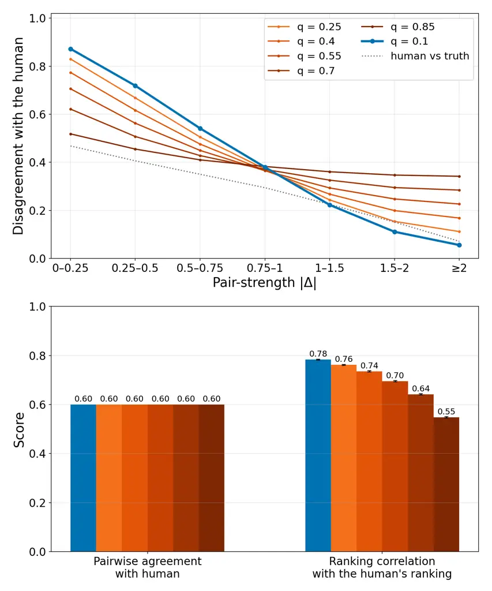
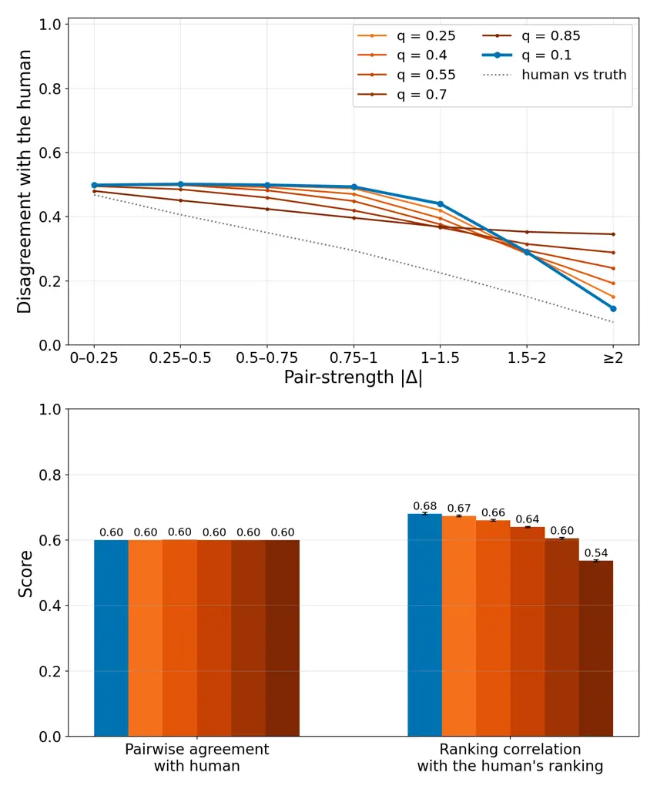

# Pair Difficulty Matters: Rethinking Pairwise LLM-as-a-Judge Evaluation and Consistency

Bruno Brocai Affiliation: Heidelberg University Affiliation: German
Department Email: [bruno.brocai@gs.uni-heidelberg.de ](mailto:)    Maria
Becker Affiliation: Heidelberg University Affiliation: German Department
Email: [ maria.becker@gs.uni-heidelberg.de](mailto:)

###### Abstract

Large Language Model judges are widely used to rank texts and
text-generating systems through pairwise comparison, and their
reliability is typically assessed via three proxies: position bias,
transitivity, and pairwise agreement (self- or human-labeled). Because
these proxies drive judge selection and benchmarking, a substantial
literature reporting that judges perform poorly on them risks steering
practitioners away from otherwise capable evaluators. We argue this
assessment is misleading. Under the Bradley–Terry geometry underlying
pairwise aggregation, each proxy is dominated by close-rank-gap pairs,
where inconsistency is expected and errors cost little aggregate ranking
accuracy; far-gap pairs determine the ranking accuracy but barely move
the proxies. We formalize this argument and validate it in a controlled
simulation and on two human-rated corpora: the proxies correlate only
weakly with ranking accuracy against gold, and their predictive
component concentrates in the far-gap regime. Judges should therefore be
assessed on rank-gap-conditional metrics, ideally against human
rankings. Code at
[https://github.com/brunobrocai/PairDifficulty](https://github.com/brunobrocai/PairDifficulty).

## 1 Introduction

LLM-as-a-judge has become a central paradigm for evaluating generated
text across many domains Gu et al. (2026). However, a growing body of
work has documented systematic problems with LLM-judges that fall
broadly under the heading of inconsistency, and several distinct forms
have been identified. Models exhibit run-to-run inconsistency, returning
different verdicts across repeated queries under identical or
near-identical settings. They exhibit position bias — by far the
most-discussed failure mode — preferring one slot of a pairwise
comparison at rates well above chance. They also exhibit
non-transitivity at the level of the induced preference graph.

A separate line of work has compared LLM verdicts not to internal
consistency criteria but to individual pairwise judgments, focusing on
human–LLM divergence at the pair level (Fein et al., 2026; Zheng et al.,
2023; Li et al., 2024, e.g.,). These two strands — internal
inconsistency on the one hand, and disagreement with humans on the other
— are typically treated as distinct problems. However, the comparisons
that dominate aggregate inconsistency metrics are often the comparisons
that matter least for ranking recovery. We argue that they are closely
connected: They are both affected by pair gap / difficulty, and because
of this, are both unreliable proxies of judge quality when it comes to
recovering human-derived rankings.

## 2 Related Work

Swapping two responses can flip a judge’s verdict — a phenomenon
documented early on by Wang et al. (2024) and Zheng et al. (2023), and
usually addressed by balanced-position aggregation. Shi et al. (2025)
provide the most thorough analysis to date and find that the gap between
texts is a key factor: pairs close in quality are affected far more
strongly than distant ones.

Xu et al. (2025) document non-transitivity in pairwise rankings and show
that, like position bias, it concentrates on close pairs; they mitigate
it through round-robin tournaments and Bradley–Terry (BT) aggregation.
Wang et al. (2026) target inconsistency directly and document that
85–90% of transitivity violations are tie-driven and that judge
capability does not monotonically reduce inconsistency. SAGE Feng et al.
(2025) evaluates judges along exactly these two axes without requiring
human-labeled comparisons, and finds that even top models fail on
roughly a quarter of difficult cases. All of this work treats
inconsistency as a defect that needs to be reduced rather than asking
what its structure reveals about the judge.

Zheng et al. (2023) measure pair-level agreement between LLM judges and
humans directly and find that this agreement is gap-conditional: the
residual disagreement concentrates on close pairs where humans also
disagree. Thakur et al. (2025) argue that aggregate alignment metrics
are misleading proxies for judge usefulness: judges with substantially
lower percent agreement can still produce ranking correlations with
humans that are nearly identical, because consistent biases preserve
relative ordering even when they distort absolute scores. We extend this
line of argument along an orthogonal axis. While Thakur et al. decompose
by use case (scoring versus ranking), we decompose by the rank gap of
the items being compared, and show that aggregate inconsistency is
dominated by close-pair behavior that a calibrated judge often produces.

## 3 Theory

We aggregate pairwise verdicts under the BT model Bradley and Terry
(1952), the most robust ranking algorithm for most use cases Daynauth
et al. (2025). Under BT, each item $`i`$ carries a latent strength
$`\theta_{i}`$, and the probability that $`i`$ is preferred to $`j`$ is
$`\Pr(i\succ j)=\sigma(\theta_{i}-\theta_{j})`$, where
$`\sigma(x)=(1+e^{-x})^{-1}`$ is the logistic function. In a pair with a
true strength gap $`\Delta=\theta_{i}-\theta_{j}`$, the two possible
outcomes have log-probabilities $`\log\sigma(\Delta)`$ and
$`\log\sigma(-\Delta)`$, which differ by exactly $`|\Delta|`$. Close
pairs are near-coinflips, and the two outcomes are nearly equally
consistent with the model; far pairs are lopsided, and one outcome is
much more consistent than the other. A flipped verdict therefore changes
that pair’s log-likelihood contribution by $`|\Delta|`$:

- •
  Close pair ($`\Delta\approx 0`$): both outcomes have nearly the same
  likelihood, so a flip is nearly free under the model.
- •
  Far pair (large $`|\Delta|`$): the two outcomes differ in
  log-likelihood by $`|\Delta|`$, so a flip is strong evidence of judge
  error.

This separates two failure modes that aggregate metrics conflate.
Close-pair _self-inconsistency_ — the judge flipping its own verdict
across runs — is expected noise: the BT model itself assigns the two
outcomes near-equal probability, so a flip is consistent with the model,
and averages out across comparisons. Far-pair self-inconsistency, by
contrast, is where calibration error becomes visible: the model strongly
predicts one outcome, so a flip is a real error, and such errors tend to
push an item’s score consistently in one direction. Noise of the first
kind does not systematically bias the recovered ranking; error of the
second kind compresses the recovered scale and yields a worse ranking at
matched comparison budget. The same $`|\Delta|`$-weighting applies to
judge–human _disagreement_: when the judge’s verdict diverges from the
human verdict, the disagreement is again most diagnostic in the
high-$`|\Delta|`$ regime, while close-pair disagreement is bounded below
by the noise human annotators themselves cannot avoid, so under a
BT-behaving human reference, close-pair observations carry little
information about judge quality. Pair-level agreement metrics —
Krippendorff’s $`\alpha`$, raw agreement rates, position-flip rates —
weight every pair equally and therefore systematically overweight the
regime that contributes least to ranking distance from gold, whether the
comparison is judge-vs-judge or judge-vs-human.

This predicts the empirical pattern: pair-level reliability and
position-bias scores should correlate weakly with ranking accuracy
against human gold, with predictive signal concentrated in the far-pair
tail. It also clarifies prior findings: position bias is empirically
strongest on close pairs (Shi et al., 2025), exactly where it costs the
ranking least, and human annotators themselves disagree most on close
pairs (Zheng et al., 2023) — as BT predicts. Judges and humans agree on
what the hard cases are; the question this paper takes up is whether the
measures recognize that the hard cases are also the cheap ones.

## 4 Simulation: Human Agreement

To isolate the effect of disagreement distribution independently of
model-specific behavior, we construct a controlled simulation in which
judges differ only in where across the rank-gap spectrum their errors
occur.

We simulate a dataset with normally distributed BT strengths and
generate human comparisons from randomly drawing the winner of each
comparison by using BT-probability (see appendix C for results with
other simulation settings). Then we simulate models based on the human
comparisons to ensure exactly equal pairwise agreement. The simulated
models pick the human’s winner 60% of the time — they only differ on
which pair gold gaps these errors concentrate. We do that by sampling
error pairs with different weights, where weight $`q=0`$ means the
disagreement is completely evenly distributed and $`q=1`$ means all
disagreement is concentrated on far pairs.

As Figure 1 shows, pairwise agreement between simulated judges and
humans is equal across different $`q`$ — the only difference is that
some judges agree less with humans on distant pairs, while others more
on close pairs. Despite that, agreement with gold falls sharply as judge
errors increase at higher $`|\Delta|`$s, even if these errors are
counterbalanced by higher accuracy on close pairs. Therefore,
pairwise-level agreement is not the same as ranking correlation due to
the spread of disagreement, and cannot substitute for ranking
correlation. Namely, it cannot distinguish a judge that performs well on
easy/far pairs but uses a misaligned heuristic (e.g. length) to
tie-break close pairs from a judge doing exactly the opposite, but the
former is a much better judge.

Figure 1: Simulation results for BT Judges with identical pairwise
agreement. Top shows how disagreement between judges and humans is
differently distributed, while overall agreement is exactly equal
(bottom left). Despite this, ranking correlation with the human gold
varies substantially depending on where disagreement occurs (bottom
right).

## 5 Experiment: Model Inconsistencies

#### Datasets

Clear Crossley et al. (2023) is a dataset of English school text
excerpts rated on comprehensibility by teachers. The human rating was
performed pairwise: teachers were shown two texts and asked to pick
which one is easier for students to understand. We use 200 randomly
selected texts. ASAP 2.0 Crossley et al. (2025) is a corpus of student
writing tests for grades 6 to 10, where students were tasked to argue
for a position on a topic using a source text on that topic. The essays
are human-rated on a scale of 1–6. We use 200 student essays from the
test set on the topic of algorithmic facial emotion detection for grade 10.

Ranking human-labeled corpus texts rather than model outputs provides a
clean gold standard for pairwise rank gaps, which is unavailable when
the ranked items are the generating models themselves.

|       |                 |                          |          |          |      |                         |     |      |            |
| ----- | --------------- | ------------------------ | -------- | -------- | ---- | ----------------------- | --- | ---- | ---------- |
|       |                 | Consistency ($`1-`$flip) |          |          | IPP  | % non-transitive triads |     |      |            |
|       | Judge           | all                      | close    | far      | all  | cyc                     | mix | ineq | $`\rho`$   |
|       |                 |                          | (Q1 gap) | (Q4 gap) |      |                         |     |      |            |
| CLEAR | GPT-5.4-nano    | .78                      | .72      | .90      | .61  | 0.0                     | 0.8 | 9.9  | $`+0.691`$ |
|       | GPT-5.4-mini    | .80                      | .66      | .96      | .97  | 0.0                     | 0.4 | 9.5  | $`+0.825`$ |
|       | Ministral-3-3B  | .79                      | .70      | .92      | .89  | 0.0                     | 0.4 | 6.2  | $`+0.755`$ |
|       | Ministral-3-14B | .84                      | .73      | .97      | .89  | 0.0                     | 0.8 | 4.1  | $`+0.788`$ |
|       | Gemma-3-4B      | .22                      | .09      | .46      | 1.00 | 0.0                     | 0.0 | 27.2 | $`+0.676`$ |
|       | Gemma-3-12B     | .76                      | .57      | .96      | .99  | 0.0                     | 0.0 | 7.8  | $`+0.830`$ |
| ASAP  | GPT-5.4-nano    | .79                      | .74      | .85      | .21  | 0.0                     | 4.9 | 10.7 | $`+0.677`$ |
|       | GPT-5.4-mini    | .73                      | .62      | .84      | .03  | 0.0                     | 0.0 | 13.8 | $`+0.674`$ |
|       | Ministral-3-3B  | .78                      | .65      | .94      | .02  | 0.0                     | 0.4 | 7.1  | $`+0.726`$ |
|       | Ministral-3-14B | .83                      | .77      | .94      | .02  | 0.0                     | 0.0 | 3.6  | $`+0.690`$ |
|       | Gemma-3-4B      | .34                      | .19      | .53      | 1.00 | 0.0                     | 0.0 | 29.3 | $`+0.668`$ |
|       | Gemma-3-12B     | .84                      | .78      | .95      | .86  | 0.0                     | 0.9 | 4.9  | $`+0.735`$ |

Table 1: Inconsistency as a close-pair phenomenon does not track ranking
accuracy. Consistency is how often the judge chooses the same text
across the swapped pairs; IPP is inconsistent-pair primacy, with .5
indicating perfect balance. close/far are the same rate restricted to
the bottom/top quartile of the gold gap $`|g_{a}-g_{b}|`$. Triad-% is
the proportion of all triads. $`\rho`$ is the Spearman correlation of
the LLM-derived BT skill against human gold.

#### Position Bias

We evaluate GPT-5.4-nano and -mini, Ministral-3-3B and -14B, as well as
Gemma-3-4B and -12B (see appendix A) on both the Clear and the ASAP 2.0
corpus. Each pair is evaluated twice with reversed answer orderings. We
measure position bias using two standard metrics: (1) the consistency,
i.e., the frequency with which the same verdict is retained after
position reversal; and (2) inconsistent-pair primacy (IPP), the
proportion of inconsistent pairs in which the judge prefers the
first-shown response. An IPP of .5 indicates that inconsistent verdicts
split evenly between positions.

Dividing positional consistency into different $`|\Delta|`$-quartiles
shows that position bias exists mostly on close pairs. Since a flipped
verdict amounts to a tie under balanced aggregation, this reflects
indecision on very close pairs ("too close to score").

Crucially, consistency, IPP, and rank correlation with gold do not track
each other (Tables 1 and 2). On Clear, the two GPTs flip at
indistinguishable rates¹¹ 1 Differences in consistency, IPP and
intransitivity are tested with an exact McNemar test at the item level;
differences in $`\rho`$ use a paired item bootstrap. Within each corpus,
$`p`$-values are Holm-corrected; $`\alpha=0.05`$., yet mini achieves
significantly higher $`\rho`$. On Asap the pattern reverses: nano is
significantly more consistent while the two rank the field equally well.
Ministral behaves similarly on Asap; only on Clear do its bias and
correlation align in the expected direction. This is evidence that
aggregate bias metrics are weak predictors of ranking performance, not
that bias is benign.

Gemma-3-4B is the limiting case: almost entirely indecisive on close
pairs, yet its far-pair judgments suffice to recover a ranking
comparable to much more consistent judges. Its ceiling is naturally
capped — it cannot resolve the "middle pack" — but the bias metric
overstates the damage. The mild top-quartile inconsistency present in
every model points instead to genuine conceptual misalignment: some
pairs humans rank far apart are treated by the model as close. Fixing
that is the more promising lever for correlation gains.

#### Non-Transitivity

We analyze non-transitivity only on triads, distinguishing (1) cyclical
($`A\prec B`$, $`B\prec C`$, $`C\prec A`$), (2) mixed ($`A\succ B`$,
$`B\succ C`$, $`C\sim A`$), and (3) inequality ($`A\sim B`$,
$`B\sim C`$, $`A\not\sim C`$). Given the close-pair indecision
documented above, inequality non-transitivity can be substantively
valid: if $`|\Delta|`$ between $`A`$ and $`C`$ is large enough to score,
the triad is consistent with the model’s own behavior.

Across all judges, non-transitivity is dominated by the inequality type
and tracks inconsistency tightly (Pearson $`r=.928`$): it is largely a
re-expression of the indecision already captured by position bias.
Within each family the larger model generally produces fewer
non-transitivities, so the metric mainly tracks model size — generally,
but not reliably, a proxy for judge quality. Despite far higher
non-transitivity, Gemma-3-4B does not correlate significantly worse with
human gold than GPT-5.4-nano (Table 1), confirming that intransitivity
is a weak model-selection signal.

|                    |                                  |                     |
| ------------------ | -------------------------------- | ------------------- |
| Proxy              | $`\rho_{s}`$ vs ranking $`\rho`$ | $`p_{\text{Holm}}`$ |
| Consistency, all   | $`+0.559`$                       | $`0.198`$           |
| Consistency, close | $`+0.245`$                       | $`0.892`$           |
| Consistency, far   | $`+0.897`$                       | $`0.001^{*}`$       |
| Primacy (IPP)      | $`+0.126`$                       | $`0.892`$           |
| Intransitivity     | $`-0.608`$                       | $`0.174`$           |

Table 2: Spearman correlation between inconsistencies and the model’s
ability to replicate human gold ranking, and the associated
Holm-corrected significance. Two-sided permutation $`p`$ (10,000
reshuffles) over the 12 judge-corpus points, Holm-corrected across the
five proxies. With N=12 the test is well-powered for strong effects but
has limited power against moderate effects. We note this as a limitation
but emphasize the practical implication: a metric whose correlation with
gold ranking is too weak to survive correction at this scale is too
noisy to be used as a model-selection signal in practice.

## 6 Conclusion

Internal consistency and pairwise agreement with humans are useful judge
properties, but the central question is whether a judge recovers the
same latent ranking structure as humans. Therefore, the most direct
evaluation criterion is the agreement between human and LLM rankings,
and imperfect local consistency should not be treated as disqualifying.
Aggregate inconsistency metrics such as position bias should be read in
light of pair difficulty: a metric that weights all pairs equally
rewards judges that excel on low-impact comparisons and penalizes those
that excel on far-gap comparisons, which are more informative of judge
quality.

This is not to say close pairs are irrelevant. Bias mitigation does help
in making an already well-aligned judge more decisive on close pairs,
which improves ranking granularity. Close pairs will matter more as
judges improve and as tasks get harder (e.g. leaderboarding
closely-performing state-of-the-art models). But since LLM judges still
struggle on many tasks Bavaresco et al. (2025), the far-pair regime is
where gains are currently largest.

Two implications follow for benchmarks. For item design, judge accuracy
scales with the rank gap between responses, so prompts that are
difficult for the models being judged are exactly those that yield pairs
that are easy for an aligned judge. This offers an explanation for the
separability reported for benchmarks such as ArenaHard Li et al. (2025).
However, item pools that elicit uniformly strong or uniformly weak
responses both compress the gap, so item difficulty should be designed
for response spread, not for higher difficulty as such. For gold
standards, pair difficulty should be made observable. Items should be
organized into rankings rather than isolated pairs wherever possible,
and where that is infeasible, pair-difficulty-aware metrics should be
reported. We do not recommend a specific metric, however, since the
choice depends on how the human gold pairs were elicited and needs new
behavioral data. For example, annotators could rate pair closeness
directly, but this presupposes that humans can estimate closeness
reliably; alternatively, annotator disagreement could proxy for
difficulty, but how well disagreement tracks the rank gap has, to our
knowledge, not been systematically studied. Instead of chasing
ever-lower bias and ever-higher pairwise agreement, the next generation
of judge evaluations should target the regimes where ranking signal
actually lives.

## Limitations

Our rank-gap analysis requires a notion of latent strength on each
corpus. Clear comes with BT-scores pre-computed. On ASAP 2.0 we use
pointwise human ratings as a strength proxy; this is a noisier estimator
of $`\theta^{\mathrm{human}}`$ than pairwise-derived strengths and
weakens within-bucket contrasts, so the reported pattern on ASAP 2.0 is
a lower bound. Specifically, real ties, though likely rare, cannot be
distinguished from a quality gap that is below the rating resolution. We
therefore also provide a reanalysis excluding gold ties in appendix D.

The datasets we used both come from the educational domain, and so our
results may not generalize to certain settings where LLM-as-a-judge is
often used, such as QA and leaderboards. We made this choice because the
two datasets provide text-level ground truth, which is needed to measure
pair difficulty. For these other settings, to our knowledge, there do
not exist datasets with item-level ground truth we could have evaluated
on.

We restrict our attention to pairwise judging. The theoretical argument
is specific to binary comparison, and listwise judging introduces
additional position-bias structure Shi et al. (2025) that the present
framework does not address.

Finally, our experiments assume the goal of LLM-as-a-judge is to recover
a human gold standard that is usually somewhat subjective. Human raters
are themselves imperfect estimators of any underlying quality, and what
they rate may diverge from what we actually care about estimating — on
Clear, for instance, teacher ratings of text comprehensibility are not
the same construct as comprehension measured directly from student
readers. In settings with an objective gold and well-separated
candidates, such as verifiable math or code tasks with skill-stratified
models, the close-pair regime our analysis emphasizes becomes sparse and
the practical importance of the misweighting effect diminishes, though
the underlying theory remains unchanged.

## Acknowledgements

We thank Mayumi Ohta for identifying a flaw in our original account of
why far pairs tend to matter more, which led to the revision in
Section 3.

## Use of AI Assistants

AI writing assistance was used for sentence-level paraphrasing and
polishing of author-written text; it was not used to generate research
ideas, technical claims, related-work positioning, or citations.
AI-assisted coding tools used during analysis script development are
documented in the released code repository’s README.

## References

- Bavaresco et al. (2025) Anna Bavaresco, Raffaella Bernardi, Leonardo
  Bertolazzi, Desmond Elliott, Raquel Fernández, Albert Gatt, Esam
  Ghaleb, Mario Giulianelli, Michael Hanna, Alexander Koller, Andre
  Martins, Philipp Mondorf, Vera Neplenbroek, Sandro Pezzelle, Barbara
  Plank, David Schlangen, Alessandro Suglia, Aditya K Surikuchi, Ece
  Takmaz, and Alberto Testoni. 2025. [LLMs instead of Human Judges? A
  Large Scale Empirical Study across 20 NLP Evaluation
  Tasks](https://doi.org/10.18653/v1/2025.acl-short.20). In _Proceedings
  of the 63rd Annual Meeting of the Association for Computational
  Linguistics (Volume 2: Short Papers)_, pages 238–255, Vienna, Austria.
- Bradley and Terry (1952) Ralph Allan Bradley and Milton E.
  Terry. 1952. [Rank Analysis of Incomplete Block Designs: I. The Method
  of Paired Comparisons](https://doi.org/10.2307/2334029). _Biometrika_,
  39(3/4):324–345.
- Crossley et al. (2023) Scott Crossley, Aron Heintz, Joon Suh Choi,
  Jordan Batchelor, Mehrnoush Karimi, and Agnes Malatinszky. 2023. A
  large-scaled corpus for assessing text readability. _Behavior Research
  Methods_, 55(2):491–507.
- Crossley et al. (2025) Scott A. Crossley, Perpetual Baffour,
  L. Burleigh, and Jules King. 2025. [A Large-Scale Corpus for Assessing
  Source-Based Writing Quality: ASAP
  2.0](https://doi.org/10.1016/j.asw.2025.100954). _Assessing Writing_,
  65:100954.
- Daynauth et al. (2025) Roland Daynauth, Christopher Clarke, Krisztian
  Flautner, Lingjia Tang, and Jason Mars. 2025. [Ranking Unraveled:
  Recipes for LLM Rankings in Head-to-Head AI
  Combat](https://doi.org/10.18653/v1/2025.acl-long.1265). In
  _Proceedings of the 63rd Annual Meeting of the Association for
  Computational Linguistics (Volume 1: Long Papers)_, pages 26078–26091,
  Vienna, Austria.
- Fein et al. (2026) Daniel Fein, Sebastian Russo, Violet Xiang, Kabir
  Jolly, Rafael Rafailov, and Nick Haber. 2026. [LitBench: A Benchmark
  and Dataset for Reliable Evaluation of Creative
  Writing](https://doi.org/10.18653/v1/2026.eacl-long.362). In
  _Proceedings of the 19th Conference of the European Chapter of the
  Association for Computational Linguistics (Volume 1: Long Papers)_,
  pages 7740–7755, Rabat, Morocco.
- Feng et al. (2025) Yuanning Feng, Sinan Wang, Zhengxiang Cheng, Yao
  Wan, and Dongping Chen. 2025. [Are We on the Right Way to Assessing
  LLM-as-a-Judge?](https://arxiv.org/abs/2512.16041) _Preprint_,
  arXiv:2512.16041.
- Gemma Team et al. (2025) Gemma Team, Aishwarya Kamath, Johan Ferret,
  Shreya Pathak, Nino Vieillard, Ramona Merhej, Sarah Perrin, Tatiana
  Matejovicova, Alexandre Ramé, Morgane Rivière, Louis Rouillard, Thomas
  Mesnard, Geoffrey Cideron, Jean bastien Grill, Sabela Ramos, Edouard
  Yvinec, Michelle Casbon, Etienne Pot, Ivo Penchev, and 197
  others. 2025. [Gemma 3 Technical
  Report](https://arxiv.org/abs/2503.19786). _Preprint_,
  arXiv:2503.19786.
- Gu et al. (2026) Jiawei Gu, Xuhui Jiang, Zhichao Shi, Hexiang Tan,
  Xuehao Zhai, Chengjin Xu, Wei Li, Yinghan Shen, Shengjie Ma, Honghao
  Liu, Saizhuo Wang, Kun Zhang, Zhouchi Lin, Bowen Zhang, Lionel Ni, Wen
  Gao, Yuanzhuo Wang, and Jian Guo. 2026. [A survey on
  LLM-as-a-judge](https://doi.org/10.1016/j.xinn.2025.101253). _The
  Innovation_, 7(6):101253.
- Li et al. (2024) Junlong Li, Shichao Sun, Weizhe Yuan, Run-Ze Fan, Hai
  Zhao, and Pengfei Liu. 2024. [Generative Judge for Evaluating
  Alignment](https://proceedings.iclr.cc/paper_files/paper/2024/file/747dc7c6566c74eb9a663bcd8d057c78-Paper-Conference.pdf).
  In _International Conference on Learning Representations_, volume
  2024, pages 27547–27574.
- Li et al. (2025) Tianle Li, Wei-Lin Chiang, Evan Frick, Lisa Dunlap,
  Tianhao Wu, Banghua Zhu, Joseph E. Gonzalez, and Ion Stoica. 2025.
  [From crowdsourced data to high-quality benchmarks: Arena-hard and
  benchbuilder pipeline](https://openreview.net/forum?id=KfTf9vFvSn). In
  _Proceedings of the 42nd International Conference on Machine
  Learning_, volume 267 of _Proceedings of Machine Learning Research_,
  pages 34209–34231, Vancouver, Canada. PMLR.
- Liu et al. (2026) Alexander H. Liu, Kartik Khandelwal, Sandeep
  Subramanian, Victor Jouault, Abhinav Rastogi, Adrien Sadé, Alan
  Jeffares, Albert Jiang, Alexandre Cahill, Alexandre Gavaudan,
  Alexandre Sablayrolles, Amélie Héliou, Amos You, Andy Ehrenberg, Andy
  Lo, Anton Eliseev, Antonia Calvi, Avinash Sooriyarachchi, Baptiste
  Bout, and 101 others. 2026. [Ministral
  3](https://arxiv.org/abs/2601.08584). _Preprint_, arXiv:2601.08584.
- OpenAI (2026) OpenAI. 2026. Introducing GPT-5.4 mini and nano.
  https://openai.com/index/introducing-gpt-5-4-mini-and-nano/.
- Shi et al. (2025) Lin Shi, Chiyu Ma, Wenhua Liang, Xingjian Diao,
  Weicheng Ma, and Soroush Vosoughi. 2025. [Judging the Judges: A
  Systematic Study of Position Bias in
  LLM-as-a-Judge](https://doi.org/10.18653/v1/2025.ijcnlp-long.18). In
  _Proceedings of the 14th International Joint Conference on Natural
  Language Processing and the 4th Conference of the Asia-Pacific Chapter
  of the Association for Computational Linguistics_, pages 292–314,
  Mumbai, India. The Asian Federation of Natural Language Processing and
  The Association for Computational Linguistics.
- Thakur et al. (2025) Aman Singh Thakur, Kartik Choudhary,
  Venkat Srinik Ramayapally, Sankaran Vaidyanathan, and Dieuwke
  Hupkes. 2025. Judging the Judges: Evaluating Alignment and
  Vulnerabilities in LLMs-as-Judges. In _Proceedings of the Fourth
  Workshop on Generation, Evaluation and Metrics (GEM²)_, pages 404–430,
  Vienna, Austria.
- Wang et al. (2024) Peiyi Wang, Lei Li, Liang Chen, Zefan Cai, Dawei
  Zhu, Binghuai Lin, Yunbo Cao, Lingpeng Kong, Qi Liu, Tianyu Liu, and
  Zhifang Sui. 2024. [Large Language Models are not Fair
  Evaluators](https://doi.org/10.18653/v1/2024.acl-long.511). In
  _Proceedings of the 62nd Annual Meeting of the Association for
  Computational Linguistics (Volume 1: Long Papers)_, pages 9440–9450,
  Bangkok, Thailand.
- Wang et al. (2026) Yidong Wang, Yunze Song, Tingyuan Zhu, Xuanwang
  Zhang, Zhuohao Yu, Hao Chen, Chiyu Song, Qiufeng Wang, Zhen Wu, Xinyu
  Dai, Yue Zhang, Cunxiang Wang, Wei Ye, and Shikun Zhang. 2026.
  [TrustJudge: Inconsistencies of LLM-as-a-judge and how to alleviate
  them](https://openreview.net/forum?id=4uPyOCeN6U). In _The Fourteenth
  International Conference on Learning Representations (ICLR)_.
- Xu et al. (2025) Yi Xu, Laura Ruis, Tim Rocktäschel, and Robert
  Kirk. 2025. [Investigating Non-Transitivity in
  LLM-as-a-Judge](https://proceedings.mlr.press/v267/xu25w.html). In
  _Proceedings of the 42nd International Conference on Machine
  Learning_, volume 267 of _Proceedings of Machine Learning Research_,
  pages 69583–69612, Vancouver, Canada. PMLR.
- Zheng et al. (2023) Lianmin Zheng, Wei-Lin Chiang, Ying Sheng, Siyuan
  Zhuang, Zhanghao Wu, Yonghao Zhuang, Zi Lin, Zhuohan Li, Dacheng Li,
  Eric Xing, Hao Zhang, Joseph Gonzalez, and Ion Stoica. 2023. [Judging
  LLM-as-a-Judge with MT-Bench and Chatbot
  Arena](https://doi.org/10.52202/075280-2020). In _Advances in Neural
  Information Processing Systems_, volume 36, pages 46595–46623. Curran
  Associates, Inc.

## Appendix A Models

We evaluate six judges spanning three model families and two size tiers
per family. Table 3 summarizes parameter counts, licenses, and access
modalities. All model use is consistent with the intended research and
evaluation use stated by each provider. We focus on smaller models
(3B–14B parameters) because the variance-limited regime our analysis
targets is most pronounced at this scale; larger models exhibit ceiling
effects on the corpora we use.

|                                      |             |              |
| ------------------------------------ | ----------- | ------------ |
| Model                                | Params      | Access       |
| GPT-5.4 nano OpenAI (2026)           | undisclosed | API          |
| GPT-5.4 mini OpenAI (2026)           | undisclosed | API          |
| Ministral 3 3B Liu et al. (2026)     | 3B          | Open weights |
| Ministral 3 14B Liu et al. (2026)    | 14B         | Open weights |
| Gemma 3 4B Gemma Team et al. (2025)  | 4B          | Open weights |
| Gemma 3 12B Gemma Team et al. (2025) | 12B         | Open weights |

Table 3: Judge models.

Note that this generation of OpenAI models does not support fully
deterministic output (which we used for the open weight models), which
may inflate the reported inconsistency numbers and prevent exact
replication. Nevertheless, these models are state-of-the-art (e.g.,
mini’s top performance on Clear) and widely used in production, so we
felt it was important to include them in order to situate API-based
models within our broader thesis.

All open-weights inference was run locally on Apple Silicon using
llama.cpp with Q8_0 quantization, which is deterministic under greedy
decoding and introduces minimal precision loss relative to FP16. Total
wall-clock across the four open-weights judges and two corpora was
approximately 20 hours.

## Appendix B Prompts

### B.1 CLEAR: readability ease

Note: Exact instructions used for the human rating.

### B.2 ASAP 2.0: holistic essay quality

Reformulates the pointwise criteria of the human raters into pairwise
criteria.

## Appendix C Simulation Under Different Settings

The simulation in section 4 makes several assumptions (BT-behaving
human, normal strength distribution, LLM-human pairwise agreement of
only .6, judges that do not tie), but our code also allows for other
simulation settings, which was run as a robustness check.

- •
  Deterministic human judge. The human picks the higher-gold item with
  fixed probability $`p`$ rather than according to BT probabilities,
  deterministically at $`p=1`$. Every judge disagreement is now an
  outright error with respect to gold, so far-pair disagreement is even
  more damaging for ranking recovery. Close-pair disagreements are
  errors in the same sense, but cost almost no ranking quality.
- •
  Uniform strength distribution. A uniform distribution yields fewer
  close pairs and more far pairs relative to the normal baseline, so
  far-pair performance carries an even larger share of the ranking
  signal, and ranking recovery separates more strongly.
- •
  Higher pairwise agreement. As agreement rises, all simulated judges
  approach the rank-correlation ceiling; the ranking correlation
  differences between them shrink, and pair difficulty matters less.

|                 |                          |              |                  |                  |            |
| --------------- | ------------------------ | ------------ | ---------------- | ---------------- | ---------- |
|                 | Consistency ($`1-`$flip) |              |                  | $`\rho`$ vs gold |            |
| Judge           | close                    | close        | far              | all              | tied       |
|                 | (gap $`=0`$)             | (gap $`=1`$) | (gap $`\geq 2`$) | verdicts         | excluded   |
|                 | 28.2%                    | 44.9%        | 26.8%            |                  |            |
| GPT-5.4-nano    | .74                      | .78          | .85              | $`+0.677`$       | $`+0.735`$ |
| GPT-5.4-mini    | .62                      | .73          | .84              | $`+0.674`$       | $`+0.726`$ |
| Ministral-3-3B  | .65                      | .76          | .94              | $`+0.726`$       | $`+0.786`$ |
| Ministral-3-14B | .77                      | .80          | .94              | $`+0.690`$       | $`+0.753`$ |
| Gemma-3-4B      | .19                      | .32          | .53              | $`+0.668`$       | $`+0.678`$ |
| Gemma-3-12B     | .78                      | .81          | .95              | $`+0.735`$       | $`+0.797`$ |

Table 4: ASAP 2.0 robustness check with gold-tied pairs removed.
Consistency is reported for the three gold-gap buckets.

For a judge that coinflips on close pairs instead of actively
disagreeing, the judges with identical agreement still recover the
ranking differently, though the difference is lower. Naturally, fewer of
the judges’ disagreements can now come from close pairs, so more
disagreements have to fall on far pairs even for the far-pair-aligned
judges. We report this variant separately (Figure 2) since it changes
both the agreement distribution as well as the ranking recovery.

Figure 2: Simulation results for BT Judges with identical pairwise
agreement that coinflip below a certain pair gap. Top shows how
disagreement between judges and humans is differently distributed, while
overall agreement is exactly equal (bottom left). Despite this, ranking
correlation with the human gold varies substantially depending on where
disagreement occurs (bottom right).

## Appendix D ASAP Without Gold-Tied Pairs

Due to integer pointwise scoring, ASAP 2.0 gold gaps have a low
resolution, and ties are common. But a tie indicates a quality
difference below rating resolution, not necessarily equality. The items
may still have a quality difference that is imperceptible by the gold
standard. But judge inconsistency is still measurable, unless we assume
exact ties. We therefore report the numbers including ties in Table 1.
But to confirm that no conclusion depends on these pairs, we repeat the
ASAP analyses with them excluded (Table 4) as a robustness check.

The close bucket then becomes gap $`=1`$; the far bucket is unchanged
(gap $`\geq 2`$). Consistency remains close $`<`$ far for all six
judges. Ranking recovery does not degrade when gold-tied pairs are
dropped from the BT input: $`\rho`$ against the human gold rises for
every judge, by $`+0.01`$ to $`+0.06`$, likely because we are removing
noise. The Table 2 result is likewise unaffected, with
Spearman(far-consistency, correlation with human gold) $`=.897`$ under
the new binning, identical to the reported value.
