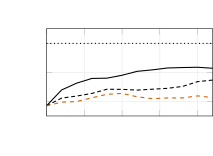
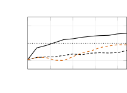
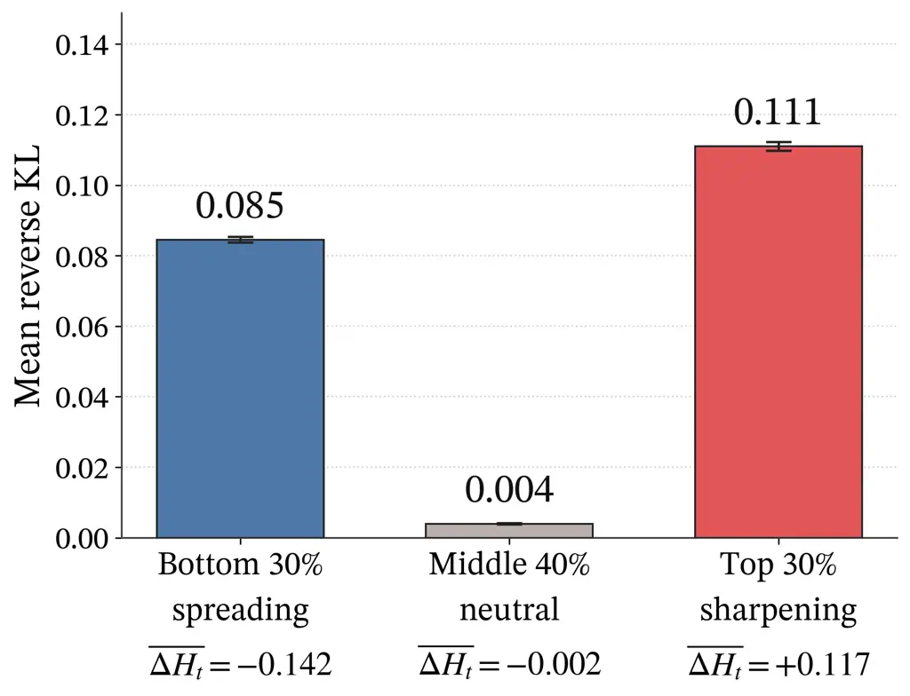
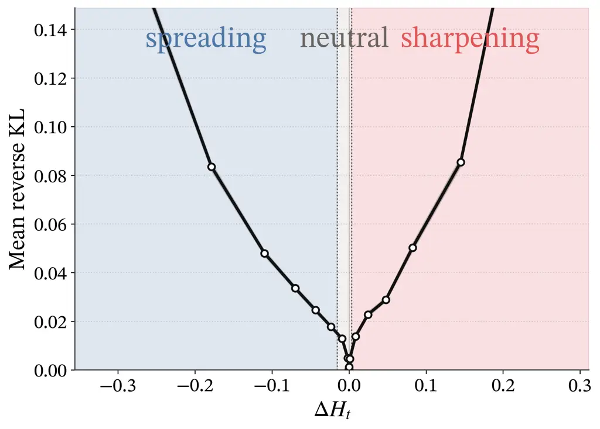
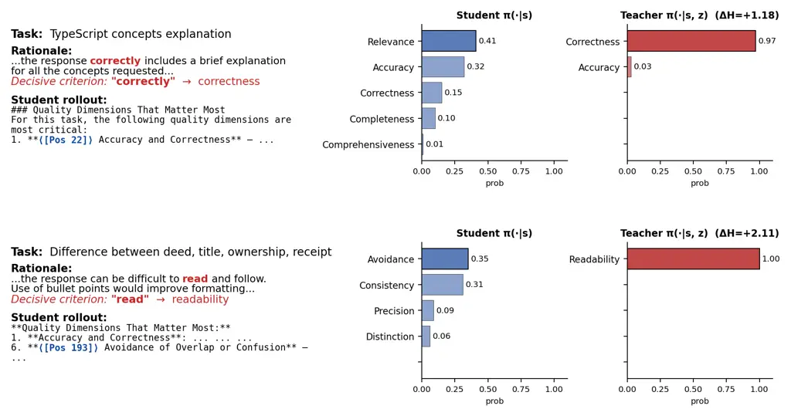
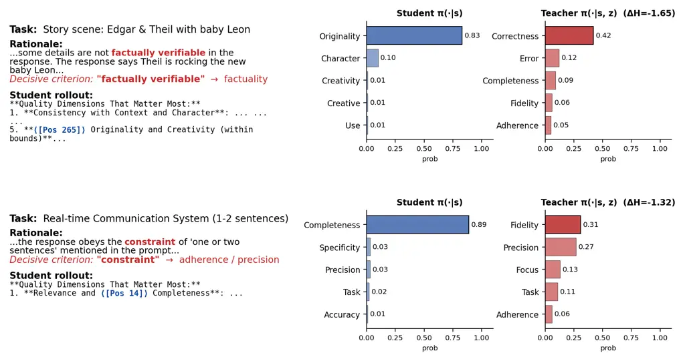
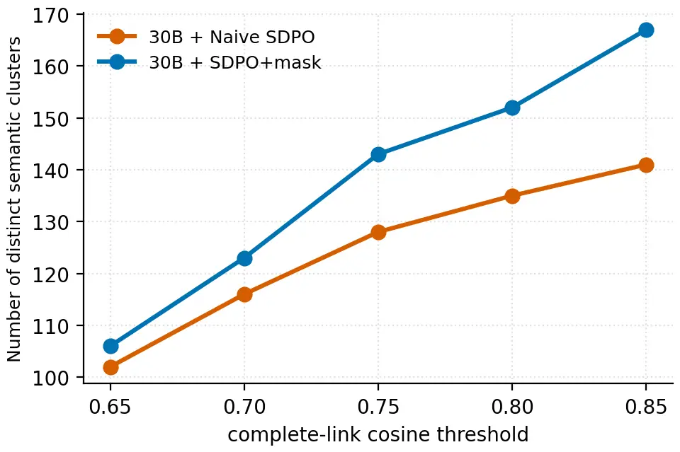
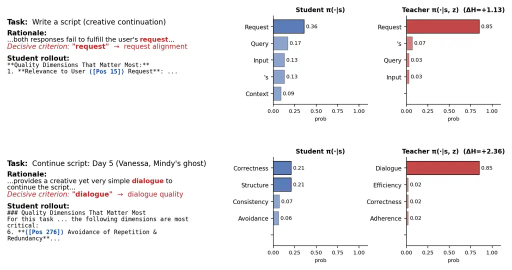
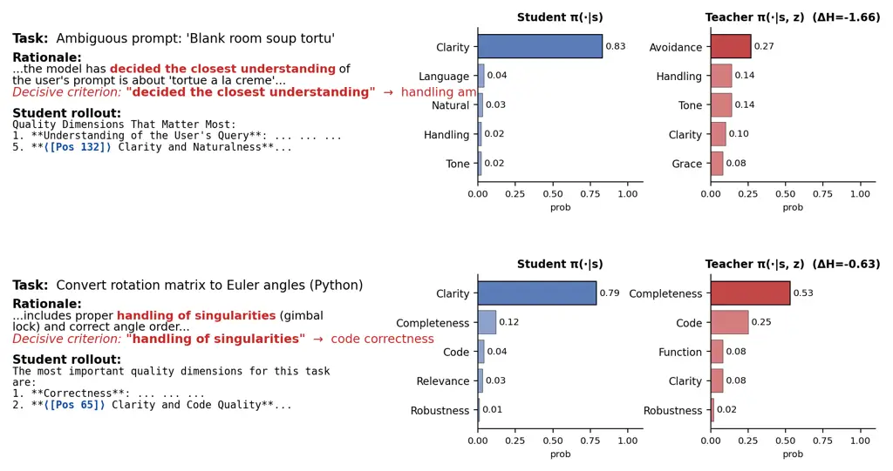

# Training LLM Judges from Language Feedback via Position-Selective Self-Distillation

Ilgee Hong Affiliation: Georgia Institute of Technology    Changlong Yu
Affiliation: Amazon    Zhenghao Xu Affiliation: Georgia Institute of
Technology    Xin Liu Affiliation: Amazon    Yuwei Zhang Affiliation: UC
San Diego    Qin Lu Affiliation: Amazon    Bing Yin Affiliation: Amazon
   Tuo Zhao Affiliation: Amazon

###### Abstract

We study training LLM judges from natural language feedback, especially
for subjective tasks where the verdict depends strongly on which
evaluation criteria the judge invokes and how it weighs them. The
dominant approach, outcome-supervised RL (e.g., GRPO), credits every
token in the rollout with a single scalar determined only by the
accuracy of the final verdict, providing no separate credit at the
criterion-choice tokens and ignoring the rich language feedback (e.g.,
preference rationales) that naturally accompanies preference labels.
Self-Distillation (SD) is one natural way to use this language feedback:
the same model, conditioned on this feedback, acts as a teacher
providing dense, position-level supervision. However, not all positions
carry equally useful signal. Using the per-position entropy shift
between teacher and student, we identify two regimes: _context
sharpening_, where the teacher concentrates probability on a particular
feedback-aligned criterion expression, and _context spreading_, where
the teacher distributes probability across multiple feedback-aligned
alternatives. We interpret these patterns as follows: sharpening
encourages memorization of a particular criterion expression, whereas
spreading promotes semantic understanding by preserving these
alternatives. Motivated by this asymmetry, we introduce position masking
based on the entropy shift that retains the lower tail of the
entropy-shift distribution. Experiments show that masking
higher-entropy-shift positions improves out-of-distribution
generalization over naive SD. The resulting self-distilled judges
outperform judges trained with outcome-supervised RL by 2–9 percentage
points on the evaluated subjective subcategories, while remaining
competitive on objective ones.


^(†)^(†)footnotetext: ^(†)Work done during internship at Amazon.



Training LLM Judges from Language Feedback via Position-Selective
Self-Distillation

Figure 1: Out-of-distribution RM-Bench accuracy during training. Curves
show the debiased EMA ($`\beta=0.6`$) of accuracy evaluated every 20
training steps. All methods start from a judge prompt template tuned for
best base-model accuracy. SD+mask outperforms naive SD and Dr. GRPO.

## 1 Introduction

Training LLMs to _judge_ responses, both as standalone evaluators and as
reward models for downstream training, is a core building block of
modern post-training. A judge’s verdict varies along two distinct axes:
1) *criterion choice*, i.e., which evaluation criteria the model invokes
and how it weighs them, and 2) *application rigor*, i.e., how rigorously
those criteria are applied to evaluate responses. Judgment tasks fall
into two regimes by which of these two axes decides the verdict:
_objective_ tasks, where the decisive criterion is clear-cut (e.g.,
correctness), so the verdict depends on application rigor (e.g., math,
coding), and _subjective_ tasks, where the decisive criterion is subtle
and multifaceted (e.g., what counts as helpful for this chat), so the
choice and weighting of criteria can drive the verdict.
Outcome-supervised RL (e.g., GRPO \[Shao et al., 2024\], Dr. GRPO \[Liu
et al., 2025d\], DAPO \[Yu and others, 2025\]) with a single
verdict-correctness reward is the dominant approach to train LLM
judges \[Whitehouse et al., 2025, Hong et al., 2025, Guo et al., 2025,
Chen et al., 2026, Wang et al., 2026a, Xu et al., 2026a\], and works
well on objective tasks by sharpening reasoning over a clear-cut
criterion.

For subjective tasks, however, outcome-supervised RL provides limited
explicit guidance on criterion choice. It credits every token in the
rollout with a single scalar determined only by the accuracy of the
final verdict; it shapes criterion selection and weighting indirectly,
through whether a given choice produces a correct verdict, without
explicitly distinguishing the contributions of criterion choice and
criterion application. Even with high application rigor, a model that
applies the _wrong_ criterion (or weighs competing criteria poorly)
still produces a wrong verdict. Compounding the problem,
outcome-supervised RL is known to drive policy entropy downward over
training \[Cui and others, 2025, Yu and others, 2025\], which further
narrows the pool of criteria the judge explores.

Many preference datasets naturally contain per-example natural language
feedback alongside the preference label, since obtaining the label
typically requires annotators to articulate why one response is
preferred over the other: preference rationales that explicitly name the
decisive criterion \[Wang et al., 2025b, Liu et al., 2025b\], a signal
that the outcome-only objective leaves unused. Self-Distillation
(SD) \[Hübotter et al., 2026, Zhao et al., 2026\] is one natural way to
use this language feedback: the same model, conditioned on this
feedback, acts as a teacher and provides dense distributional guidance
at every position of the student’s rollouts. Unlike outcome-supervised
RL, this dense per-position supervision now provides separate credit at
the criterion-choice tokens, since the teacher’s distributional signal
at those positions is directly shaped by the language feedback that
names the decisive criterion.

Not every position in the distillation loss carries equally useful
signal. To characterize this heterogeneity, we define the per-position
_entropy shift_ as the entropy reduction in the teacher’s next-token
distribution relative to the student’s, induced by conditioning the
teacher on the language feedback, and use it to identify two regimes. At
positions with a large positive entropy shift (_context sharpening_),
the teacher concentrates probability on a particular feedback-aligned
criterion expression. At positions with a large negative entropy shift
(_context spreading_), the teacher distributes probability across
multiple feedback-aligned alternatives. We interpret these patterns as
follows: sharpening encourages memorization of a particular criterion
expression, whereas spreading promotes semantic understanding by
preserving these alternatives. Figures 3, 4, 6, and 7 illustrate
concrete examples of these two regimes. Motivated by this asymmetry, we
introduce _position masking based on entropy shift_: retain the lower
tail of each generation’s entropy-shift distribution for the
distillation loss, favoring context-spreading positions while removing
the highest-shift positions.

Experiments show that self-distilled judges outperform judges trained
with outcome-supervised RL (Dr. GRPO) by $`2`$–$`9`$ percentage points
on the evaluated subjective subcategories, while Dr. GRPO remains
competitive on objective subcategories where application rigor matters
most. Further, masking higher-entropy-shift positions improves
out-of-distribution (OOD) generalization over naive SD. As Figure 1
shows, SD+mask leads both naive SD and Dr. GRPO on RM-Bench \[Liu et
al., 2025c\] throughout training for Qwen3-4B-Instruct and
Qwen3-30B-A3B-Instruct \[Yang and others, 2025\], surpassing strong
reasoning judges including DeepSeek-R1 \[DeepSeek-AI, 2025\] and
Claude-Sonnet-4 \[Anthropic, 2025\] at the 30B scale.

## 2 Related Work

##### Learning from natural language feedback.

Prior work uses natural language feedback primarily through refinement
or critique pipelines. At inference time, models are prompted to
iteratively revise outputs from self- or external-model-generated
language feedback \[Madaan et al., 2023, Wadhwa et al., 2024, Lee et
al., 2025\]. At training time, models are fine-tuned on refinements that
incorporate language feedback \[Scheurer et al., 2023\], on
self-critiques and revisions generated from natural language
principles \[Bai et al., 2022\], while other methods augment GRPO with
additional refinement rollouts conditioned on a critique of the initial
response \[Zhang et al., 2025a\]. Text2Grad \[Wang et al., 2026b\]
instead aligns critique phrases with response spans and converts these
alignments into per-span differentiable reward signals that drive
gradient updates on the offending tokens. A more recent line of
on-policy SD uses the same model, additionally conditioned on language
feedback unavailable to the student at inference, as the teacher. This
framework incorporates diverse types of language feedback, including
reference solutions, environmental feedback, successful rollouts, expert
demonstrations, and dynamically summarized skills \[Zhao et al., 2026,
Hübotter et al., 2026, Shenfeld et al., 2026, Wang et al., 2026c\]. Our
work uses one- or two-sentence annotator rationales as language feedback
for judge training. These rationales expose the evaluation criteria
behind each preference label, which is especially useful for subjective
tasks where generalization depends on selecting and weighting the right
criteria.

##### Token selection methods for post-training.

Recent work has begun to replace uniform token-level supervision with
selective updates during LLM post-training. In supervised fine-tuning
and preference optimization, several methods filter or reweight tokens
based on influence-based quality, counterfactual importance, per-token
KL, or preference-derived importance scores \[Pang et al., 2025, Ruan et
al., 2025, Zeng et al., 2024, Liu et al., 2025a, Yang et al., 2026\]. In
RLVR, high-entropy token selection identifies a small set of uncertain
“forking” tokens that dominate policy-gradient learning, while
polarity–entropy decomposition and gradient-magnitude selection further
refine token-level credit assignment \[Wang et al., 2025a, He et al.,
2026, Lv et al., 2026\]. Closest to our setting, on-policy distillation
methods select or reweight token losses using teacher entropy, student
entropy and teacher–student divergence, log-probability gaps with
LLM-judged relevance, training-trajectory dynamics, position-based
teacher reliability, or asymmetric updates in non-positive-advantage
regions \[Feng and Vaid, 2026, Jin et al., 2026, Xu et al., 2026b, Shen
et al., 2026b, Liu et al., 2026, Jia et al., 2026\]. In contrast, our
method studies position selection in full-logit on-policy SD for judge
training via the entropy shift between the student and
feedback-conditioned teacher distributions.

## 3 Method

### 3.1 Preliminary: Outcome-Supervised RL for LLM Judges

A pairwise LLM judge is trained on examples of the form
$`(x,y_{A},y_{B},c^{\star})`$: a prompt $`x`$, two candidate responses
$`y_{A},y_{B}`$, and a gold preference label $`c^{\star}\in\mathcal{C}`$
where $`\mathcal{C}`$ is a finite set of possible verdicts. The verdict
set $`\mathcal{C}`$ could be simply binary ($`y_{A}\succ y_{B}`$ or
$`y_{A}\prec y_{B}`$) or multiclass \[Hong et al., 2025, Wang et al.,
2026a\], for example including tie, unknown/unclear, or a multi-way
ordinal preference such as $`y_{A}\succ\succ y_{B}`$,
$`y_{A}\succ y_{B}`$, $`y_{A}\sim y_{B}`$. In this paper, we consider
the binary setting with $`\mathcal{C}=\{A,B\}`$. Given
$`(x,y_{A},y_{B})`$, the judge generates a token sequence
$`\tau=(a_{1},a_{2},\ldots,a_{T})`$ one token at a time,
$`a_{t}\sim\pi(\cdot\mid s_{t})`$, where
$`s_{t}=(x,y_{A},y_{B},a_{1},\ldots,a_{t-1})`$ is the prefix at position
$`t`$. The sequence consists of an intermediate trace (criterion choice
and application) and a final verdict $`c\equiv a_{T}\in\mathcal{C}`$.

The dominant training algorithm is outcome-supervised RL. Each rollout
is scored by whether its final verdict matches the gold preference
label:

```math
R(\tau)\;=\;\mathbf{1}\!\left[c=c^{\star}\right]. \tag{1}
```

The judge is then optimized against this reward using GRPO-style
policy-optimization algorithms \[Shao et al., 2024, Liu et al., 2025d,
Yu and others, 2025\]. Even when a training example contains language
feedback $`z`$, such as a preference rationale that articulates why one
response is preferred over the other and identifies the decisive
criterion, this outcome-only reward leaves $`z`$ unused. It also assigns
the same outcome-based credit to every token position, with no direct
supervision where the judge chooses and weighs evaluation criteria.

### 3.2 Language Feedback Self-Distillation for LLM Judges

To use the language feedback left unused by the outcome-only objective,
we apply self-distillation (SD) to provide dense, position-specific
supervision for the judge’s intermediate trace.

Each training example carries a piece of language feedback $`z`$
underlying its preference label $`c^{\star}`$. We use a single model
$`\pi`$ in two roles: as the _student_, conditioned on the prompt alone,
$`\pi(\cdot\mid s_{t})`$; and as the _teacher_, which additionally
conditions on $`z`$, $`\pi(\cdot\mid s_{t},z)`$. The context is
_privileged_ in the sense that the student is never given $`z`$, either
during training or at deployment. We adopt the on-policy reverse-KL SD
objective from \[Hübotter et al., 2026, Zhao et al., 2026\] as the
underlying loss. Over a training set $`\mathcal{D}`$ of judge examples
$`(x,y_{A},y_{B},z)`$ with on-policy rollouts
$`\tau=(a_{1},\ldots,a_{T})\sim\pi`$ drawn per example,

```math
\mathcal{L}_{\text{SD}}(\pi)=\mathbb{E}_{(x,y_{A},y_{B},z)\sim\mathcal{D},\;\tau\sim\pi}\left[\frac{1}{T}\sum_{t=1}^{T}\mathrm{KL}\!\left(\pi(\cdot\mid s_{t})\;\Big\|\;\mathrm{sg}\!\left[\pi(\cdot\mid s_{t},z)\right]\right)\right], \tag{2}
```

where $`\mathrm{sg}[\cdot]`$ is stop-gradient and the inner KL is a
full-vocabulary sum at each position. Unlike a verdict-level reward,
this objective transfers the feedback-conditioned teacher distribution
at every token position, including positions where the judge selects
evaluation criteria.



(a) Mean reverse KL by $`\Delta H_{t}`$ tier.



(b) Mean reverse KL as a function of $`\Delta H_{t}`$.

Figure 2: Both $`\Delta H_{t}`$ tails account for most of the
distillation loss. (a) Three-way per-sequence percentile partition
(top-30% $`\Delta H_{t}`$ / middle 40% / bottom-30%): both tails carry
$`\sim`$20–28$`\times`$ the per-position KL of the neutral middle. (b)
Binned mean reverse KL along $`\Delta H_{t}`$ using 20 equal-count bins
(95% x-range shown).

### 3.3 Analysis of Per-Position Self-Distillation Signal

Eq. 2 treats every response position as an equally valid imitation
target, but the language feedback $`z`$ does not affect the teacher
uniformly across positions. We characterize this heterogeneity through
the per-position entropy shift, then examine its connection to criterion
choice. As discussed above, language feedback identifies the decisive
criteria behind a preference label, allowing self-distillation to
provide direct supervision at criterion-choice tokens. We therefore
study how this feedback changes the teacher’s next-token distribution at
positions where the judge names and defines evaluation criteria.

##### Per-position entropy shift.

To measure how the language feedback $`z`$ changes next-token
uncertainty at position $`t`$, we define

```math
\Delta H(s_{t},z)\;=\;H\!\left(\pi(\cdot\mid s_{t})\right)\;-\;H\!\left(\pi(\cdot\mid s_{t},z)\right), \tag{3}
```

the entropy of the model’s next-token distribution without $`z`$ minus
the entropy with $`z`$, both evaluated at position $`t`$. When the
language feedback is fixed for an example, we abbreviate this as
$`\Delta H_{t}`$. _Positive_ $`\Delta H_{t}`$ means the teacher
conditioned on $`z`$ has lower entropy than the student; $`z`$ has
sharpened the teacher’s distribution. _Negative_ $`\Delta H_{t}`$ means
the teacher has higher entropy than the student; $`z`$ has spread the
teacher’s distribution. _Near-zero_ $`\Delta H_{t}`$ means little change
in entropy, though not necessarily little change in the next-token
distribution.

##### Both $`\Delta H_{t}`$ tails carry substantial distillation loss.

We analyze 104,046 response positions from 102
HelpSteer3-Preference \[Wang et al., 2025b\] validation rollouts
generated by Qwen3-30B-A3B-Instruct-2507 \[Yang and others, 2025\], with
34 examples each from code, general, and STEM. Empirically, per-position
reverse KL exhibits a U-shaped relationship with $`\Delta H_{t}`$:
positions at either tail of the per-sequence $`\Delta H_{t}`$
distribution carry substantially more per-position KL than positions in
the near-zero middle (Figure 2). Partitioning each rollout into the
bottom 30%, middle 40%, and top 30% by $`\Delta H_{t}`$, both tails
carry approximately 20–28$`\times`$ the per-position KL of the middle.
Thus, substantial distillation loss occurs both where the language
feedback sharpens the teacher’s distribution and where it spreads it.



Figure 3: Context sharpening on two HelpSteer3-Preference rollouts
(Qwen3-30B-A3B-Instruct-2507). Each panel shows the user task, the
rationale (anchor word red), the student rollout excerpt with the
annotated position $`\langle`$Pos $`N`$$`\rangle`$ marked in blue, and
student vs. teacher top-5 next-token distributions at that position. All
positions sit at criterion-naming slots in the rollout’s opening
evaluation-criteria list. The teacher concentrates probability on a
token semantically equivalent to the rationale’s anchor while the
student is uncertain across multiple plausible criteria. Two further
rollouts are shown in Figure 6.

##### Criterion-choice tokens account for disproportionate distillation loss.

Criterion choice determines which evaluation criteria the judge invokes
and how it weighs them, and is particularly important for subjective
tasks. Positions where the judge names and defines these criteria make
this choice explicit in the intermediate trace. Since the preference
rationale identifies the decisive criteria, these positions provide a
natural location to examine how language feedback shapes criterion
choice.

We analyze the same 102 rollouts using GPT-5.5 \[OpenAI, 2026\], with
the generation and rationale annotated separately. From the generation
alone, the annotator marks _criterion-selection spans_, comprising
tokens that name and define evaluation criteria, and _criterion-name
positions_, marking each criterion’s head noun. These annotations are
mapped to model-token positions. From the rationale alone, the annotator
extracts the decisive criteria, which serve as the reference for the
semantic analysis below.

Criterion-selection spans comprise only 16.7% of response tokens but
account for 44.4% of total reverse-KL mass, corresponding to
approximately 4.0$`\times`$ the per-token KL of other positions.
Criterion-name positions alone comprise 0.4% of tokens but account for
11.1% of total reverse-KL mass. They also exhibit 5.7$`\times`$ larger
mean $`|\Delta H_{t}|`$ than other response positions, and 94.8% fall
within the two extreme 30% tails, which together contain 60% of response
positions. Thus, criterion-choice tokens account for disproportionate
distillation loss, and criterion-name positions concentrate in both
entropy-shift tails. This motivates examining how the two tails differ
in the criterion choices favored by the teacher.

##### Two regimes of language-feedback influence on criterion choice.

The sign of $`\Delta H_{t}`$ distinguishes sharpening from spreading,
but entropy alone does not reveal which criteria the teacher favors. We
therefore examine whether its candidate criterion names align with the
decisive criteria extracted from the preference rationale.

Among the annotated criterion-name positions, we select those with
$`|\Delta H_{t}|\geq 0.50`$, yielding 87 sharpening positions from 56
rollouts and 71 spreading positions from 51 rollouts. At each position,
we take the teacher’s top-10 next-token candidates as candidate
criterion-name tokens. We force each token and greedily complete it into
a criterion name, truncating at the head noun. Using
Qwen3-Embedding-8B \[Zhang et al., 2025b\], we score each completed name
by its maximum cosine similarity to the extracted decisive criteria. For
sharpening, we score the name obtained from the top-1 token, measuring
alignment of the teacher’s most probable criterion. For spreading, we
average across all ten candidates, measuring alignment across the
broader set of criteria.

As a control, we replace the teacher’s language feedback with another
example’s rationale and repeat the candidate selection and completion
procedure. The student prefix, evaluation position, and regime
assignment remain fixed as determined under the matched condition. Both
conditions are scored against the same decisive criteria from the
original rationale. We report paired mean differences, with 95%
confidence intervals obtained from 2,000 bootstrap resamples at the
rollout level.



Figure 4: Context spreading on two HelpSteer3-Preference rollouts
(Qwen3-30B-A3B-Instruct-2507). Same layout as Figure 3. Each panel
features a position where the student commits to a criterion that is
non-decisive in the rationale (top-1 probability $`\geq 0.79`$), while
the teacher reopens with a spread of alternatives that include semantic
equivalents of the rationale’s decisive criterion. All positions sit at
criterion-naming slots in the rollout’s opening evaluation-criteria
list. Two further rollouts are shown in Figure 7.

_Context sharpening._ At positions with large positive $`\Delta H_{t}`$,
the language feedback makes the teacher more confident than the student.
Figure 3 illustrates how this concentrates probability on a specific
decisive criterion. In the TypeScript-explanation rollout, the rationale
phrase _“correctly includes”_ causes the teacher to concentrate on
Correctness (top-1 $`0.97`$), while the student is uncertain across
several plausible criteria. In the legal-term explanation rollout,
_“difficult to read”_ causes the teacher to concentrate on Readability
(top-1 $`1.00`$).

Across the annotated sharpening positions, the teacher’s top-1 criterion
name has mean similarity 0.713 to the decisive criteria under the
matched rationale, compared with 0.647 under the control. The paired
difference is $`+0.066`$, with a 95% confidence interval of
$`[0.033,0.100]`$. Together with the lower teacher entropy, this
supports the interpretation that context sharpening concentrates
probability on a particular feedback-aligned criterion expression. We
interpret this concentrated supervision as encouraging memorization of a
particular criterion expression rather than understanding of the
underlying criterion.

_Context spreading._ At positions with large negative $`\Delta H_{t}`$,
the language feedback makes the teacher less certain than the student.
Figure 4 illustrates how this reopens a criterion choice by spreading
probability across alternatives. In the story-writing rollout, the
student commits to Originality (top-1 $`0.83`$), while the rationale’s
emphasis on _“factually verifiable”_ details shifts the teacher toward
alternatives including Correctness, Error, and Fidelity. In the
project-description rollout, the student commits to Completeness, while
the _“one or two sentences”_ constraint shifts the teacher toward
alternatives including Precision, Focus, and Adherence.

Across the annotated spreading positions, mean similarity over the
teacher’s top-10 criterion names is 0.646 under the matched rationale,
compared with 0.610 under the control. The paired difference is
$`+0.037`$, with a 95% confidence interval of $`[0.022,0.051]`$. The
result is consistent when using the top-3 or top-5 candidates. Together
with the higher teacher entropy, this supports the interpretation that
context spreading distributes probability across multiple
feedback-aligned alternatives. We interpret this supervision as
promoting semantic understanding of the underlying criterion by
preserving multiple feedback-aligned alternatives.

### 3.4 Position Masking Based on Entropy Shift

Section 3.3 shows that context sharpening concentrates probability on a
particular feedback-aligned criterion expression, while context
spreading distributes probability across multiple feedback-aligned
alternatives. Motivated by the possibility that preserving these
alternatives promotes semantic understanding, we propose a
per-generation mask that drops the upper tail and retains the lower tail
of the entropy-shift distribution. Concretely, we rank positions within
each generation by $`\Delta H_{t}`$, mask the top $`\rho`$ fraction with
the largest values, and retain the remaining bottom $`1-\rho`$ fraction:

```math
\displaystyle\mathcal{L}_{\text{SD}}^{(\rho)}(\pi) \displaystyle=\;\mathbb{E}_{(x,y_{A},y_{B},z)\sim\mathcal{D},\;\tau\sim\pi}\left[\frac{1}{\sum_{t}m_{t}}\sum_{t=1}^{T}m_{t}\cdot\mathrm{KL}\!\left(\pi(\cdot\mid s_{t})\;\Big\|\;\mathrm{sg}\bigl[\pi(\cdot\mid s_{t},z)\bigr]\right)\right], \tag{4}
```

```math
\displaystyle m_{t} \displaystyle=\;\mathbf{1}\!\left[\Delta H_{t}\leq Q_{1-\rho}\right],
```

where $`Q_{1-\rho}`$ is the $`(1-\rho)`$-quantile of
$`\{\Delta H_{1},\dots,\Delta H_{T}\}`$ for that generation. The mask is
detached from the computation graph. Setting $`\rho=0`$ recovers naive
SD.

##### Entropy-shift masking is associated with broader criterion diversity.



Figure 5: Distinct semantic clusters of evaluation criteria invoked by
trained 30B judges across a sweep of complete-link cosine clustering
thresholds. Naive SD invokes a markedly smaller pool than SD+mask at
every threshold; the gap widens with stricter clustering.

Section 3.3 shows that, at the analyzed criterion-name positions,
context spreading distributes probability across multiple
feedback-aligned alternatives, whereas context sharpening concentrates
probability on a particular criterion expression. This suggests that
prioritizing lower-entropy-shift positions during distillation helps
preserve a broader repertoire of evaluation criteria. We examine this
possibility by measuring the diversity of criteria invoked by the
trained judges at inference time. For each judgment a trained judge
produces (across 300 samples each from RM-Bench \[Liu et al., 2025c\],
RewardBench v2 \[Malik et al., 2025\], and HelpSteer3-Preference
validation \[Wang et al., 2025b\]), we extract the evaluation criteria
the model proposes and uses (e.g., “adherence to user intent”, “factual
accuracy”, “relevance to the request”), apply text normalization
(lowercase, strip punctuation, sort tokens to merge order-variants), and
embed each criterion string with Qwen3-Embedding-8B \[Zhang et al.,
2025b\]. We then cluster the resulting 4096-dimensional vectors with
_complete-link agglomerative clustering_ at cosine threshold $`t`$: two
criterion strings belong to the same cluster only if _every pair_ within
the cluster has cosine similarity $`\geq t`$. This procedure groups
semantically similar criterion expressions (e.g., “factual accuracy,”
“factual correctness,” and “accuracy of facts”), reducing sensitivity to
differences in wording. Larger $`t`$ enforces tighter clusters; lower
$`t`$ allows looser merging.

Figure 5 shows that SD+mask invokes more distinct criterion clusters
than naive SD at every evaluated clustering threshold, with the
difference increasing from 4 clusters at $`t=0.65`$ to 26 at $`t=0.85`$.
This pattern is consistent with the interpretation suggested by §3.3:
supervision that preserves multiple feedback-aligned alternatives helps
maintain a broader criterion repertoire after training. Different
prompts call for different evaluation criteria, making criterion
diversity a relevant property of a general-purpose judge.

## 4 Experiments

### 4.1 Setup

##### Base models.

We train two instruct models as judges: Qwen3-4B-Instruct-2507⁰⁰ 0
[https://huggingface.co/Qwen/Qwen3-4B-Instruct-2507](https://huggingface.co/Qwen/Qwen3-4B-Instruct-2507)
and Qwen3-30B-A3B-Instruct-2507¹¹ 1
[https://huggingface.co/Qwen/Qwen3-30B-A3B-Instruct-2507](https://huggingface.co/Qwen/Qwen3-30B-A3B-Instruct-2507).
The judge prompt template is given in Appendix E; we tuned a small set
of candidate templates on the base model and chose the one that yielded
the best validation accuracy.

##### Training data.

All methods are trained on a cleaned version of
HelpSteer3-Preference \[Wang et al., 2025b\] with three modifications
applied in order: (1) filter out rows with domain == "multilingual" or
overall_preference == 0 (tie); (2) within-split deduplication by content
hash (sha1(context, response1, response2)), keeping the first
occurrence; upstream HelpSteer3-Preference contains $`\sim`$35%
byte-identical duplicate rows after step (1); (3) cross-split
deduplication: drop validation rows whose content hash also appears in
train-split; upstream HelpSteer3-Preference has $`\sim`$918 of
$`\sim`$1,553 filtered-deduped validation rows that are byte-identical
to a train-split row and would otherwise cause train/val leakage. Each
retained example contains a prompt, two candidate responses, a gold
preference label, and a one- or two-sentence human-written rationale
explaining the label.

##### Language feedback types.

We mainly use the preference rationale as the source of language
feedback $`z`$. Preference rationales are the most naturally available
and easiest-to-collect form of textual feedback during preference-data
construction. To assign a binary preference label, an annotator must
already compare the two responses and identify why one is better. To
test sensitivity to a substantially different language-feedback format,
we also generated a per-example rubric for every HelpSteer3-Preference
sample using Claude Opus 4.8 \[Anthropic, 2026a\], following the
iterative rubric-generation procedures of \[Shen et al., 2026a\].
Generating rubrics requires a separate generation or annotation process
and careful design to ensure that the criteria are discriminative,
non-redundant, and aligned with the response pair and preference
direction. The generated rubrics average 2,062 characters, making them
approximately 7.7 times longer than the original preference rationales.
Results using these rubrics as language feedback are reported in
Appendix B.

##### Evaluation benchmarks.

We evaluate out-of-distribution (OOD) judge accuracy on RM-Bench \[Liu
et al., 2025c\] and RewardBench v2 \[Malik et al., 2025\].

##### Baselines.

We compare three on-policy training methods. We use Dr. GRPO as the
outcome-supervised RL baseline. Naive SD ($`\rho=0`$) is the objective
in Eq. 2 with all positions included. SD+mask uses $`\rho=0.7`$, masking
the top 70% of positions by $`\Delta H_{t}`$ and keeping the 30% of
positions with the lowest entropy shifts. Implementation details for all
three are in Appendix D. We additionally compare against strong
prompting baselines (DeepSeek-R1 \[DeepSeek-AI, 2025\],
Claude-Sonnet-4 \[Anthropic, 2025\]) and trained reward-model baselines
(Think-RM-8B \[Hong et al., 2025\], RM-R1-DeepSeek-Distilled-Qwen-7B and
RM-R1-DeepSeek-Distilled-Qwen-32B \[Chen et al., 2026\],
Llama-3.3-Nemotron-Super-49B-GenRM \[NVIDIA, 2025\]) evaluated from
their authors’ released checkpoints, and RationaleRM-30B \[Wang et al.,
2026a\] for which we cite the authors’ reported numbers.

|                                               |          |       |       |        |         |                |       |       |            |        |         |            |
| --------------------------------------------- | -------- | ----- | ----- | ------ | ------- | -------------- | ----- | ----- | ---------- | ------ | ------- | ---------- |
| Models                                        | RM-Bench |       |       |        |         | RewardBench v2 |       |       |            |        |         | Total Avg. |
|                                               | Chat     | Code  | Math  | Safety | Overall | Factuality     | Focus | Math  | Precise IF | Safety | Overall |            |
| Prompting                                     |          |       |       |        |         |                |       |       |            |        |         |            |
| Claude-Sonnet-4-20250514                      | 79.93    | 81.77 | 93.05 | 95.34  | 87.52   | 84.00          | 87.27 | 85.25 | 56.88      | 94.00  | 81.48   | 84.50      |
| DeepSeek-R1                                   | 78.38    | 79.29 | 94.01 | 92.27  | 85.99   | 74.53          | 80.40 | 87.43 | 43.12      | 86.00  | 74.30   | 80.15      |
| Training (Small Model $`<`$10B)               |          |       |       |        |         |                |       |       |            |        |         |            |
| Think-RM-8B                                   | 65.20    | 54.63 | 71.92 | 91.71  | 70.87   | 49.26          | 62.42 | 58.47 | 26.88      | 75.56  | 54.52   | 62.70      |
| RM-R1-DeepSeek-Distilled-Qwen-7B              | 64.51    | 60.87 | 88.55 | 85.99  | 74.98   | 28.21          | 58.59 | 74.32 | 19.38      | 51.56  | 46.41   | 60.70      |
| Qwen3-4B-Instruct + Dr. GRPO                  | 68.91    | 73.83 | 94.01 | 90.93  | 81.92   | 62.74          | 75.76 | 86.34 | 43.12      | 83.78  | 70.35   | 76.14      |
| Qwen3-4B-Instruct + Naive SD                  | 75.71    | 73.34 | 93.51 | 92.06  | 83.66   | 68.42          | 80.20 | 85.79 | 38.75      | 85.56  | 71.74   | 77.70      |
| Qwen3-4B-Instruct + SD+mask                   | 77.95    | 75.88 | 94.10 | 90.95  | 84.72   | 70.74          | 77.78 | 84.15 | 45.00      | 89.11  | 73.36   | 79.04      |
| Training (Medium and Large Model $`\geq`$10B) |          |       |       |        |         |                |       |       |            |        |         |            |
| RM-R1-DeepSeek-Distilled-Qwen-32B             | 72.78    | 76.12 | 92.46 | 94.89  | 84.06   | 60.84          | 80.40 | 85.25 | 38.75      | 82.89  | 69.63   | 76.85      |
| RationaleRM-30B                               | 74.90    | 84.40 | 95.50 | 93.60  | 87.10   | –              | –     | –     | –          | –      | –       | –          |
| Llama-3.3-Nemotron-Super-49B-GenRM            | 73.64    | 73.34 | 90.55 | 90.15  | 81.92   | 70.95          | 81.41 | 83.61 | 44.38      | 81.56  | 72.38   | 77.15      |
| Qwen3-30B-A3B-Instruct + Dr. GRPO             | 74.07    | 79.68 | 95.59 | 93.78  | 85.78   | 71.79          | 80.00 | 87.43 | 42.50      | 92.44  | 74.83   | 80.31      |
| Qwen3-30B-A3B-Instruct + Naive SD             | 76.74    | 76.56 | 94.45 | 94.26  | 85.50   | 78.53          | 86.26 | 81.42 | 40.62      | 87.33  | 74.83   | 80.17      |
| Qwen3-30B-A3B-Instruct + SD+mask              | 80.53    | 80.07 | 95.63 | 94.81  | 87.76   | 79.16          | 85.66 | 84.15 | 48.75      | 88.44  | 77.23   | 82.50      |

Table 1: Judge accuracy (%) on RM-Bench and RewardBench v2. Dark gray
(in bold) and light gray highlight the best and second-best performance
per column, respectively. RationaleRM-30B numbers are taken from Wang et
al. \[2026a\] as the model has not been released; RewardBench v2 cells
are left empty.

### 4.2 Main Results

Table 1 reports judge accuracy on RM-Bench and RewardBench v2 for the
Qwen3-4B-Instruct and Qwen3-30B-A3B-Instruct base models, using
preference rationales as language feedback, alongside prompting-based
and trained reward-model baselines.

##### Main findings.

Per-category results in Table 1 can be split along the
objective/subjective axis.

_Outcome-supervised RL vs. self-distillation._ On the objective
subcategories (e.g., math, coding), where the decisive criterion is
clear-cut, Dr. GRPO sharpens application rigor against that criterion
and is competitive with both naive SD and SD+mask: at 30B it matches
them on RM-Bench Math (95.59 (Dr. GRPO) vs 94.45 (SD) / 95.63 (SD+mask))
and beats them on RewardBench v2 Math (87.43 vs 81.42 / 84.15). On the
subjective subcategories (e.g., chat helpfulness; factuality, where the
judge must prioritize factual accuracy over otherwise persuasive
presentation; focus, which tests detection of high-quality, on-topic
answers to general user queries), the gap flips: both SD variants gain
over Dr. GRPO by 2–9 percentage points (30B Chat 74.07 vs 76.74 / 80.53;
30B Factuality 71.79 vs 78.53 / 79.16; 30B Focus 80.00 vs 86.26 / 85.66;
4B Chat 68.91 vs 75.71 / 77.95; 4B Factuality 62.74 vs 68.42 / 70.74; 4B
Focus 75.76 vs 80.20 / 77.78).

_Naive SD vs. SD+mask._ SD+mask consistently improves over naive SD on
overall accuracy at both scales (Total Avg: $`77.70\to 79.04`$ at 4B;
$`80.17\to 82.50`$ at 30B), with the largest per-subcategory gains
spread across different subcategories (30B RM-Bench Code
$`76.56\to 80.07`$; 30B Chat $`76.74\to 80.53`$; 30B RewardBench v2
Precise IF $`40.62\to 48.75`$). Because both benchmarks are OOD with
respect to the training data, these gains are consistent with the
proposed mechanism: masking higher-entropy-shift positions reduces
overreliance on particular criterion expressions, while the broader
inference-time criterion vocabulary in Figure 5 provides additional
support for this interpretation.

Our 30B SD+mask judge outperforms leading judge baselines in the
literature, including RM-R1-DeepSeek-Distilled-Qwen-32B,
Llama-3.3-Nemotron-Super-49B-GenRM, and RationaleRM-30B, on overall
benchmark accuracy, and remains comparable to Claude-Sonnet-4.

### 4.3 Downstream Utility for Policy Optimization

The benchmark results above evaluate judges directly, but a reward model
is ultimately used to determine which on-policy outputs receive higher
reward and advantage during policy optimization. The strongest
downstream validation would train separate policies with GRPO using each
learned judge as the reward model. Because this requires multiple full
RLHF runs, we instead evaluate the core pairwise-selection operation
used by judge-guided GRPO through a controlled multi-round best-of-eight
tournament.

##### Setup.

For each subjective creative-writing prompt from Arena-Hard-v2 \[Li et
al., 2024\], GLM-4.5-Air \[Zeng and others, 2025\] generates eight
responses with temperature $`1.0`$, top-$`p`$ $`1.0`$, and a maximum of
8K new tokens. We randomly pair the eight responses into four matchups
and use a judge to select the winner of each pair. We repeat this
procedure with the four winners, and then with the two remaining
responses, until one final response is selected. We run the tournament
separately using Qwen3-30B-A3B-Instruct judges trained with Dr. GRPO,
naive SD, and SD+mask ($`\rho=0.7`$). Claude Sonnet 5 \[Anthropic,
2026b\] evaluates the selected responses against the Arena-Hard-v2
reference responses to compute the creative-writing win rate.

| Selector               | Creative-writing win rate |
| ---------------------- | ------------------------- |
| Dr. GRPO               | 0.556                     |
| Naive SD               | 0.612                     |
| SD+mask ($`\rho=0.7`$) | 0.632                     |

Table 2: Creative-writing win rate of responses selected through
multi-round best-of-eight tournaments. Each tournament uses a different
Qwen3-30B-A3B-Instruct judge as its pairwise selector; selected
responses are evaluated against the Arena-Hard-v2 reference responses by
Claude Sonnet 5.

SD+mask selects the strongest downstream responses, improving the
creative-writing win rate over the Dr. GRPO-trained judge by $`7.6`$
percentage points and over naive SD by $`2.0`$ percentage points.
Although this tournament does not include the subsequent gradient-based
policy updates of a full GRPO run, it directly tests the repeated
pairwise reward comparisons that determine which on-policy outputs would
be preferentially reinforced. The result therefore provides evidence
that the gains from SD+mask are not confined to standalone judge
benchmarks: when used as a reward selector, it more reliably favors
responses preferred under the downstream evaluation.

### 4.4 Ablations

#### 4.4.1 Mask-fraction ($`\rho`$) sweep

| $`\rho`$ (fraction masked) | RM-Bench |       |       |        |         | RewardBench v2 |       |       |            |        |         | Total Avg. |
| -------------------------- | -------- | ----- | ----- | ------ | ------- | -------------- | ----- | ----- | ---------- | ------ | ------- | ---------- |
|                            | Chat     | Code  | Math  | Safety | Overall | Factuality     | Focus | Math  | Precise IF | Safety | Overall |            |
| $`0.00`$ (naive SD)        | 76.74    | 76.56 | 94.45 | 94.26  | 85.50   | 78.53          | 86.26 | 81.42 | 40.62      | 87.33  | 74.83   | 80.17      |
| $`0.30`$                   | 77.52    | 75.78 | 95.02 | 94.21  | 85.63   | 80.00          | 83.03 | 85.79 | 43.75      | 85.56  | 75.63   | 80.63      |
| $`0.50`$                   | 77.17    | 77.49 | 94.85 | 94.15  | 85.92   | 78.95          | 83.43 | 84.15 | 46.88      | 83.78  | 75.44   | 80.68      |
| $`0.70`$ (canonical)       | 80.53    | 80.07 | 95.63 | 94.81  | 87.76   | 79.16          | 85.66 | 84.15 | 48.75      | 88.44  | 77.23   | 82.50      |

Table 3: $`\rho`$-sweep on Qwen3-30B-A3B-Instruct, all masking the
top-$`\rho`$ fraction by $`\Delta H_{t}`$ and training on the remaining
bottom $`(1-\rho)`$.

We sweep the mask fraction $`\rho\in\{0,0.3,0.5,0.7\}`$ on
Qwen3-30B-A3B-Instruct (Table 3) to characterize how aggressive the mask
should be; the corresponding Qwen3-4B-Instruct results are reported in
Appendix C. $`\rho=0`$ recovers naive SD (no positions masked). Overall
accuracy rises as we mask more of the upper $`\Delta H_{t}`$ tail (Total
Avg: $`80.17\to 80.63\to 80.68\to 82.50`$ across
$`\rho\in\{0,0.3,0.5,0.7\}`$), with $`\rho=0.7`$ achieving the highest
overall accuracy among the tested mask fractions. The same pattern holds
at 4B, where $`\rho=0.7`$ also obtains the highest total average
(Table 6).

#### 4.4.2 Selector ablation

| Selector                                                                                         | RM-Bench      |                                                 |       |        |         | RewardBench v2 |       |       |            |        |         | Total Avg. |
| ------------------------------------------------------------------------------------------------ | ------------- | ----------------------------------------------- | ----- | ------ | ------- | -------------- | ----- | ----- | ---------- | ------ | ------- | ---------- | ----- | ----- |
|                                                                                                  | Chat          | Code                                            | Math  | Safety | Overall | Factuality     | Focus | Math  | Precise IF | Safety | Overall |            |
| Mask top $`\rho`$ fraction by $`\Delta H_{t}`$ (ours; drops highest-shift positions)             | 80.53         | 80.07                                           | 95.63 | 94.81  | 87.76   | 79.16          | 85.66 | 84.15 | 48.75      | 88.44  | 77.23   | 82.50      |
| Mask bottom $`\rho`$ fraction by $`\Delta H_{t}`$ (direction flip; drops lowest-shift positions) | 75.37         | 74.22                                           | 93.40 | 94.13  | 84.28   | 72.63          | 84.95 | 85.55 | 40.67      | 87.05  | 74.17   | 79.23      |
| Mask bottom $`\rho`$ fraction by $`                                                              | \Delta H\_{t} | `$ (both tails; drops smallest absolute shifts) | 76.14 | 76.17  | 93.47   | 93.78          | 84.89 | 73.05 | 86.60      | 84.39  | 44.00   | 84.77      | 74.56 | 79.73 |
| Random masking                                                                                   | 75.11         | 75.88                                           | 93.72 | 94.41  | 84.78   | 77.47          | 85.45 | 81.97 | 40.00      | 86.67  | 74.31   | 79.55      |
| Mask bottom $`\rho`$ fraction by student entropy                                                 | 74.59         | 75.44                                           | 93.59 | 94.15  | 84.44   | 76.63          | 86.46 | 84.70 | 40.00      | 85.78  | 74.71   | 79.57      |
| Mask bottom $`\rho`$ fraction by teacher entropy                                                 | 75.45         | 75.44                                           | 94.01 | 93.35  | 84.56   | 78.11          | 83.84 | 83.06 | 35.62      | 82.67  | 72.66   | 78.61      |

Table 4: Selector ablation on Qwen3-30B-A3B-Instruct, all at matched
mask fraction $`\rho=0.7`$.

Is the OOD gain specific to the entropy-shift criterion, or does any
sensible per-position selector at matched $`\rho`$ give the same
benefit? We compare our top-$`\Delta H_{t}`$-masked selector against
five alternatives at matched $`\rho=0.7`$ on Qwen3-30B-A3B-Instruct
(Table 4):

- •
  $`\Delta H_{t}`$, mask bottom $`\rho`$ fraction (_direction flip_):
  drop the positions with the lowest entropy shifts and retain the
  highest-shift positions instead. Tests whether the gain depends on the
  masking direction.
- •
  $`|\Delta H_{t}|`$, mask bottom $`\rho`$ fraction (_both tails_): drop
  positions with near-zero entropy shifts and retain positions with
  large absolute entropy shifts, where the teacher and student entropies
  differ substantially. Tests whether retaining positions with large
  absolute entropy shifts is sufficient, regardless of whether the shift
  is positive or negative.
- •
  Random masking: mask a uniformly sampled $`\rho`$ fraction of response
  positions. Tests whether the gain follows simply from reducing the
  number of supervised positions.
- •
  Student-entropy masking: mask the bottom $`\rho`$ fraction of
  positions by student next-token entropy. Tests whether retaining
  positions where the unconditioned student is uncertain is sufficient.
- •
  Teacher-entropy masking: mask the bottom $`\rho`$ fraction of
  positions by teacher next-token entropy. Tests whether retaining
  positions where the feedback-conditioned teacher is uncertain is
  sufficient.

Our top-$`\Delta H_{t}`$-masked selector outperforms all five controls
on overall RM-Bench and RewardBench v2 accuracy. The gain is therefore
not explained by the masking fraction alone, by either distribution’s
entropy in isolation, by reversing the masking direction, or by
retaining high-$`|\Delta H_{t}|`$ positions of either sign. Together,
these ablations support selecting positions by signed entropy shift,
with lower-shift selection outperforming the tested alternatives. The
corresponding Qwen3-4B-Instruct results are reported in Appendix C.

## 5 Conclusion

We studied on-policy dense supervision for training LLM judges on
subjective tasks, where the verdict hinges on which evaluation criteria
the judge invokes and how it weighs them. Outcome-supervised RL credits
every token by the final verdict and does not provide explicit guidance
on criterion choice; SD converts the per-example language feedback that
names the decisive criterion into per-position supervision, but not
every position carries equally useful signal. Using the per-position
entropy shift between teacher and student, we identified two regimes,
context sharpening and context spreading, and proposed a simple mask
that retains the lower tail of the entropy-shift distribution. Across
model sizes, SD outperforms outcome-supervised RL on the evaluated
subjective tasks, and our mask further improves generalization over
naive SD.

## 6 Limitations and Scope

Our method has two main limitations. First, the method depends on
feedback quality: entropy-shift masking does not guarantee useful
supervision when the feedback fails to identify a decisive criterion or
provides only generic guidance. Second, our method does not explicitly
address known limitations of self-distillation, including hallucination
and training instability in long-chain-of-thought reasoning models \[Kim
et al., 2026\]. We focus on instruction-tuned models to support
efficient judge inference; extending the method to long-chain-of-thought
reasoning models remains future work.

## References

- Anthropic (2025) Anthropic Introducing Claude 4. Note:
  [https://www.anthropic.com/news/claude-4](https://www.anthropic.com/news/claude-4)
  Cited by: §1, §4.1.
- Anthropic (2026a) Anthropic Introducing Claude Opus 4.8. Note:
  [https://www.anthropic.com/news/claude-opus-4-8](https://www.anthropic.com/news/claude-opus-4-8)
  Cited by: §4.1.
- Anthropic (2026b) Anthropic Introducing Claude Sonnet 5. Note:
  [https://www.anthropic.com/news/claude-sonnet-5](https://www.anthropic.com/news/claude-sonnet-5)
  Cited by: §4.3.
- Bai et al. (2022) Y. Bai, S. Kadavath, S. Kundu, A. Askell, J.
  Kernion, A. Jones, A. Chen, A. Goldie, A. Mirhoseini, C. McKinnon, et
  al. Constitutional AI: harmlessness from AI feedback. arXiv preprint
  arXiv:2212.08073. External Links:
  [Link](https://arxiv.org/abs/2212.08073) Cited by: §2.
- Chen et al. (2026) X. Chen, G. Li, Z. Wang, B. Jin, C. Qian, Y.
  Wang, H. Wang, Y. Zhang, D. Zhang, T. Zhang, H. Tong, and H. Ji RM-R1:
  reward modeling as reasoning. In International Conference on Learning
  Representations (ICLR), External Links:
  [Link](https://arxiv.org/abs/2505.02387) Cited by: §1, §4.1.
- Cui et al. (2025) G. Cui et al. The entropy mechanism of reinforcement
  learning for reasoning language models. arXiv preprint
  arXiv:2505.22617. External Links:
  [Link](https://arxiv.org/abs/2505.22617) Cited by: §1.
- DeepSeek-AI (2025) DeepSeek-AI DeepSeek-R1: incentivizing reasoning
  capability in LLMs via reinforcement learning. Nature 645,
  pp. 633–638. External Links: [Link](https://arxiv.org/abs/2501.12948)
  Cited by: §1, §4.1.
- Feng and Vaid (2026) R. Feng and P. Vaid Bringing capabilities in
  distribution via relevance-masked self-distillation. Note: Applied
  Compute Research External Links:
  [Link](https://www.appliedcompute.com/research/relevance-masked-self-distillation)
  Cited by: §2.
- Guo et al. (2025) J. Guo, Z. Chi, L. Dong, Q. Dong, X. Wu, S. Huang,
  and F. Wei Reward reasoning model. arXiv preprint arXiv:2505.14674.
  External Links: [Link](https://arxiv.org/abs/2505.14674) Cited by: §1.
- He et al. (2026) Y. He, H. Wu, S. Liu, H. Ge, H. Zhou, K. Wu, Z.
  Zheng, Q. Lin, Z. Zhong, and Y. Zhang Rethinking token-level credit
  assignment in RLVR: a polarity-entropy analysis. arXiv preprint
  arXiv:2604.11056. External Links:
  [Link](https://arxiv.org/abs/2604.11056) Cited by: §2.
- Hong et al. (2025) I. Hong, C. Yu, L. Qiu, W. Yan, Z. Xu, H. Jiang, Q.
  Zhang, Q. Lu, X. Liu, C. Zhang, and T. Zhao Think-RM: enabling
  long-horizon reasoning in generative reward models. arXiv preprint
  arXiv:2505.16265. External Links:
  [Link](https://arxiv.org/abs/2505.16265) Cited by: §1, §3.1, §4.1.
- Hübotter et al. (2026) J. Hübotter, F. Lübeck, L. Behric, A.
  Baumann, M. Bagatella, D. Marta, I. Hakimi, I. Shenfeld, T. Kleine
  Buening, C. Guestrin, and A. Krause Reinforcement learning via
  self-distillation. arXiv preprint arXiv:2601.20802. External Links:
  [Link](https://arxiv.org/abs/2601.20802) Cited by: Appendix D, §1, §2,
  §3.2.
- Jia et al. (2026) N. Jia, H. Yang, X. Ma, J. Lian, S. Zhang, W.
  Zhang, K. Zeng, X. Cai, and Z. Sun Asymmetric on-policy distillation:
  bridging exploitation and imitation at the token level. arXiv preprint
  arXiv:2605.06387. External Links:
  [Link](https://arxiv.org/abs/2605.06387) Cited by: §2.
- Jin et al. (2026) W. Jin, T. Min, Y. Yang, S. R. Kadhe, Y. Zhou, D.
  Wei, N. Baracaldo, and K. Lee Entropy-aware on-policy distillation of
  language models. arXiv preprint arXiv:2603.07079. External Links:
  [Link](https://arxiv.org/abs/2603.07079) Cited by: §2.
- Kim et al. (2026) J. Kim, X. Luo, M. Kim, S. Lee, D. Kim, J. Jeon, D.
  Li, and Y. Yang Why does self-distillation (sometimes) degrade the
  reasoning capability of LLMs?. arXiv preprint arXiv:2603.24472.
  External Links: [Link](https://arxiv.org/abs/2603.24472) Cited by: §6.
- Kwon et al. (2023) W. Kwon, Z. Li, S. Zhuang, Y. Sheng, L.
  Zheng, C. H. Yu, J. E. Gonzalez, H. Zhang, and I. Stoica Efficient
  memory management for large language model serving with
  PagedAttention. In ACM Symposium on Operating Systems Principles
  (SOSP), External Links: [Link](https://arxiv.org/abs/2309.06180) Cited
  by: Appendix D.
- Lee et al. (2025) Y. Lee, J. Boen, and C. Finn Feedback descent:
  open-ended text optimization via pairwise comparison. arXiv preprint
  arXiv:2511.07919. External Links:
  [Link](https://arxiv.org/abs/2511.07919) Cited by: §2.
- Li et al. (2024) T. Li, W. Chiang, E. Frick, L. Dunlap, T. Wu, B.
  Zhu, J. E. Gonzalez, and I. Stoica From crowdsourced data to
  high-quality benchmarks: Arena-Hard and BenchBuilder pipeline. arXiv
  preprint arXiv:2406.11939. External Links:
  [Link](https://arxiv.org/abs/2406.11939) Cited by: §4.3.
- Liu et al. (2025a) A. Liu, H. Bai, Z. Lu, Y. Sun, X. Kong, S. Wang, J.
  Shan, A. M. Jose, X. Liu, L. Wen, P. S. Yu, and M. Cao TIS-DPO:
  token-level importance sampling for direct preference optimization
  with estimated weights. arXiv preprint arXiv:2410.04350. External
  Links: [Link](https://arxiv.org/abs/2410.04350) Cited by: §2.
- Liu et al. (2025b) T. Liu, R. Xu, T. Yu, I. Hong, C. Yang, T. Zhao,
  and H. Wang OpenRubrics: towards scalable synthetic rubric generation
  for reward modeling and LLM alignment. arXiv preprint
  arXiv:2510.07743. External Links:
  [Link](https://arxiv.org/abs/2510.07743) Cited by: §1.
- Liu et al. (2026) X. Liu, X. Wang, Y. Ma, Y. Zhang, and C. Xiao When
  are teacher tokens reliable? Position-Weighted on-policy
  self-distillation for reasoning. arXiv preprint arXiv:2605.21606.
  External Links: [Link](https://arxiv.org/abs/2605.21606) Cited by: §2.
- Liu et al. (2025c) Y. Liu, Z. Yao, R. Min, Y. Cao, L. Hou, and J. Li
  RM-Bench: benchmarking reward models of language models with subtlety
  and style. In International Conference on Learning Representations
  (ICLR), Note: Oral External Links:
  [Link](https://arxiv.org/abs/2410.16184) Cited by: §1, §3.4, §4.1.
- Liu et al. (2025d) Z. Liu, C. Chen, W. Li, P. Qi, T. Pang, C.
  Du, W. S. Lee, and M. Lin Understanding R1-zero-like training: a
  critical perspective. arXiv preprint arXiv:2503.20783. External Links:
  [Link](https://arxiv.org/abs/2503.20783) Cited by: §1, §3.1.
- Loshchilov and Hutter (2019) I. Loshchilov and F. Hutter Decoupled
  weight decay regularization. In International Conference on Learning
  Representations (ICLR), External Links:
  [Link](https://arxiv.org/abs/1711.05101) Cited by: Appendix D.
- Lv et al. (2026) O. Lv, Y. Zhang, and X. Zhang GMTS: gradient
  magnitude-based token selection improves RLVR training for LLM
  reasoning. In OpenReview preprint, External Links:
  [Link](https://openreview.net/forum?id=JGvOicAo3g) Cited by: §2.
- Madaan et al. (2023) A. Madaan, N. Tandon, P. Gupta, S. Hallinan, L.
  Gao, S. Wiegreffe, U. Alon, N. Dziri, S. Prabhumoye, Y. Yang, S.
  Welleck, B. P. Majumder, S. Gupta, A. Yazdanbakhsh, and P. Clark
  Self-refine: iterative refinement with self-feedback. In Advances in
  Neural Information Processing Systems (NeurIPS), External Links:
  [Link](https://arxiv.org/abs/2303.17651) Cited by: §2.
- Malik et al. (2025) S. Malik, V. Pyatkin, S. Land, J. Morrison, N. A.
  Smith, H. Hajishirzi, and N. Lambert RewardBench 2: advancing reward
  model evaluation. arXiv preprint arXiv:2506.01937. External Links:
  [Link](https://arxiv.org/abs/2506.01937) Cited by: §3.4, §4.1.
- NVIDIA (2025) NVIDIA Llama-3.3-Nemotron-Super-49B-GenRM. Note:
  [https://huggingface.co/nvidia/Llama-3_3-Nemotron-Super-49B-GenRM](https://huggingface.co/nvidia/Llama-3_3-Nemotron-Super-49B-GenRM)
  Cited by: §4.1.
- OpenAI (2026) OpenAI Introducing GPT-5.5. Note:
  [https://openai.com/index/introducing-gpt-5-5/](https://openai.com/index/introducing-gpt-5-5/)
  Cited by: §3.3.
- Pang et al. (2025) J. Pang, N. Di, Z. Zhu, J. Wei, H. Cheng, C. Qian,
  and Y. Liu Token cleaning: fine-grained data selection for LLM
  supervised fine-tuning. In International Conference on Machine
  Learning (ICML), External Links:
  [Link](https://arxiv.org/abs/2502.01968) Cited by: §2.
- Ruan et al. (2025) Z. Ruan, Y. Li, H. Zhu, Y. Chen, P. Li, Y. Liu,
  and G. Chen Enhancing large language model reasoning via selective
  critical token fine-tuning. arXiv preprint arXiv:2510.10974. External
  Links: [Link](https://arxiv.org/abs/2510.10974) Cited by: §2.
- Scheurer et al. (2023) J. Scheurer, J. A. Campos, T. Korbak, J. S.
  Chan, A. Chen, K. Cho, and E. Perez Training language models with
  language feedback at scale. In arXiv preprint arXiv:2303.16755,
  External Links: [Link](https://arxiv.org/abs/2303.16755) Cited by: §2.
- Shao et al. (2024) Z. Shao, P. Wang, Q. Zhu, R. Xu, J. Song, X. Bi, H.
  Zhang, M. Zhang, Y. K. Li, Y. Wu, and D. Guo DeepSeekMath: pushing the
  limits of mathematical reasoning in open language models. arXiv
  preprint arXiv:2402.03300. External Links:
  [Link](https://arxiv.org/abs/2402.03300) Cited by: §1, §3.1.
- Shen et al. (2026a) W. F. Shen, X. Qiu, C. Whitehouse, L. Alazraki, S.
  Goel, F. Barbieri, T. Willi, A. Mathur, and I. Leontiadis Rethinking
  rubric generation for improving LLM judge and reward modeling for
  open-ended tasks. arXiv preprint arXiv:2602.05125. External Links:
  [Link](https://arxiv.org/abs/2602.05125) Cited by: §4.1.
- Shen et al. (2026b) Z. Shen, J. Hu, Z. Qin, H. Chen, W. Ye, Z.
  Huang, Y. Zhuang, G. Lu, J. Zhou, and J. Zhao
  Training-trajectory-aware token selection. arXiv preprint
  arXiv:2601.10348. External Links:
  [Link](https://arxiv.org/abs/2601.10348) Cited by: §2.
- Shenfeld et al. (2026) I. Shenfeld, M. Damani, J. Hübotter, and P.
  Agrawal Self-distillation enables continual learning. arXiv preprint
  arXiv:2601.19897. External Links:
  [Link](https://arxiv.org/abs/2601.19897) Cited by: §2.
- Sheng et al. (2025) G. Sheng, C. Zhang, Z. Ye, X. Wu, W. Zhang, R.
  Zhang, Y. Peng, H. Lin, and C. Wu HybridFlow: a flexible and efficient
  RLHF framework. In European Conference on Computer Systems (EuroSys),
  External Links: [Link](https://arxiv.org/abs/2409.19256) Cited by:
  Appendix D.
- Wadhwa et al. (2024) M. Wadhwa, X. Zhao, J. J. Li, and G. Durrett
  Learning to refine with fine-grained natural language feedback. In
  Findings of the Association for Computational Linguistics: EMNLP,
  External Links: [Link](https://arxiv.org/abs/2407.02397) Cited by: §2.
- Wang et al. (2026a) B. Wang, Y. Liu, Y. Liu, T. Tang, S. Wang, C.
  Gao, C. Zheng, Y. Zhang, L. Yu, S. Liu, T. Gui, Q. Zhang, X. Huang, B.
  Yu, F. Huang, and J. Lin Outcome accuracy is not enough: aligning the
  reasoning process of reward models. arXiv preprint arXiv:2602.04649.
  External Links: [Link](https://arxiv.org/abs/2602.04649) Cited by: §1,
  §3.1, §4.1, Table 1, Table 1.
- Wang et al. (2026b) H. Wang, L. Wang, C. Zhang, T. Mao, S. Qin, Q.
  Lin, S. Rajmohan, and D. Zhang Text2Grad: reinforcement learning from
  natural language feedback. In International Conference on Learning
  Representations (ICLR), External Links:
  [Link](https://arxiv.org/abs/2505.22338) Cited by: §2.
- Wang et al. (2026c) H. Wang, G. Wang, H. Xiao, Y. Zhou, Y. Pan, J.
  Wang, K. Xu, Y. Wen, X. Ruan, X. Chen, and H. Qi Skill-SD:
  skill-conditioned self-distillation for multi-turn LLM agents. arXiv
  preprint arXiv:2604.10674. External Links:
  [Link](https://arxiv.org/abs/2604.10674) Cited by: §2.
- Wang et al. (2025a) S. Wang, L. Yu, C. Gao, C. Zheng, S. Liu, R.
  Lu, K. Dang, X. Chen, J. Yang, Z. Zhang, Y. Liu, A. Yang, A. Zhao, Y.
  Yue, S. Song, B. Yu, G. Huang, and J. Lin Beyond the 80/20 rule:
  high-entropy minority tokens drive effective RL for LLM reasoning.
  arXiv preprint arXiv:2506.01939. External Links:
  [Link](https://arxiv.org/abs/2506.01939) Cited by: §2.
- Wang et al. (2025b) Z. Wang, J. Zeng, O. Delalleau, H. Shin, F.
  Soares, A. Bukharin, E. Evans, Y. Dong, and O. Kuchaiev
  HelpSteer3-preference: open human-annotated preference data across
  diverse tasks and languages. arXiv preprint arXiv:2505.11475. External
  Links: [Link](https://arxiv.org/abs/2505.11475) Cited by: §1, §3.3,
  §3.4, §4.1.
- Whitehouse et al. (2025) C. Whitehouse, T. Wang, P. Yu, X. Li, J.
  Weston, I. Kulikov, and S. Saha J1: incentivizing thinking in
  LLM-as-a-judge via reinforcement learning. arXiv preprint
  arXiv:2505.10320. External Links:
  [Link](https://arxiv.org/abs/2505.10320) Cited by: §1.
- Xu et al. (2026a) R. Xu, T. Liu, Z. Dong, T. Yu, I. Hong, C. Yang, L.
  Zhang, T. Zhao, and H. Wang Alternating reinforcement learning for
  rubric-based reward modeling in non-verifiable LLM post-training.
  arXiv preprint arXiv:2602.01511. External Links:
  [Link](https://arxiv.org/abs/2602.01511) Cited by: §1.
- Xu et al. (2026b) Y. Xu, H. Sang, Z. Zhou, R. He, Z. Wang, and A.
  Geramifard TIP: token importance in on-policy distillation. arXiv
  preprint arXiv:2604.14084. External Links:
  [Link](https://arxiv.org/abs/2604.14084) Cited by: §2.
- Yang et al. (2025) A. Yang et al. Qwen3 Technical Report. arXiv
  preprint arXiv:2505.09388. External Links:
  [Link](https://arxiv.org/abs/2505.09388) Cited by: §1, §3.3.
- Yang et al. (2026) N. Yang, H. Lin, Y. Liu, B. Tian, G. Liu, and H.
  Zhang Token-importance guided direct preference optimization. In
  International Conference on Learning Representations (ICLR), External
  Links: [Link](https://arxiv.org/abs/2505.19653) Cited by: §2.
- Yu et al. (2025) Q. Yu et al. DAPO: an open-source LLM reinforcement
  learning system at scale. arXiv preprint arXiv:2503.14476. External
  Links: [Link](https://arxiv.org/abs/2503.14476) Cited by: §1, §1,
  §3.1.
- Zeng et al. (2025) A. Zeng et al. GLM-4.5: agentic, reasoning, and
  coding (ARC) foundation models. arXiv preprint arXiv:2508.06471.
  External Links: [Link](https://arxiv.org/abs/2508.06471) Cited by:
  §4.3.
- Zeng et al. (2024) Y. Zeng, G. Liu, W. Ma, N. Yang, H. Zhang, and J.
  Wang Token-level direct preference optimization. In International
  Conference on Machine Learning (ICML), External Links:
  [Link](https://arxiv.org/abs/2404.11999) Cited by: §2.
- Zhang et al. (2025a) X. Zhang, Y. Zhang, H. Sun, K. Feng, C. Lu, C.
  Yang, and H. Meng Critique-GRPO: advancing LLM reasoning with natural
  language and numerical feedback. arXiv preprint arXiv:2506.03106.
  External Links: [Link](https://arxiv.org/abs/2506.03106) Cited by: §2.
- Zhang et al. (2025b) Y. Zhang, M. Li, D. Long, X. Zhang, H. Lin, B.
  Yang, P. Xie, A. Yang, D. Liu, J. Lin, F. Huang, and J. Zhou Qwen3
  Embedding: advancing text embedding and reranking through foundation
  models. arXiv preprint arXiv:2506.05176. External Links:
  [Link](https://arxiv.org/abs/2506.05176) Cited by: §3.3, §3.4.
- Zhao et al. (2026) S. Zhao, Z. Xie, M. Liu, J. Huang, G. Pang, F.
  Chen, and A. Grover Self-distilled reasoner: on-policy
  self-distillation for large language models. arXiv preprint
  arXiv:2601.18734. External Links:
  [Link](https://arxiv.org/abs/2601.18734) Cited by: §1, §2, §3.2.
- Zhao et al. (2023) Y. Zhao, A. Gu, R. Varma, L. Luo, C. Huang, M.
  Xu, L. Wright, H. Shojanazeri, M. Ott, S. Shleifer, A. Desmaison, C.
  Balioglu, P. Damania, B. Nguyen, G. Chauhan, Y. Hao, A. Mathews,
  and S. Li PyTorch FSDP: experiences on scaling fully sharded data
  parallel. Proceedings of the VLDB Endowment 16 (12), pp. 3848–3860.
  External Links: [Link](https://arxiv.org/abs/2304.11277) Cited by:
  Appendix D.

## Appendix A Additional Context-Sharpening and Context-Spreading Examples

Figures 6 and 7 present two further rollouts each for context sharpening
and context spreading, supplementing the two featured examples in the
main body (Figures 3 and 4). The plot layout and construction are
identical to the main-body figures.



Figure 6: Additional context-sharpening examples on two
HelpSteer3-Preference rollouts (Qwen3-30B-A3B-Instruct-2507).



Figure 7: Additional context-spreading examples on two
HelpSteer3-Preference rollouts (Qwen3-30B-A3B-Instruct-2507).

## Appendix B Additional Experiments with Rubric Feedback

We repeat the Qwen3-4B-Instruct self-distillation experiments using the
generated per-example rubrics instead of the original preference
rationales as language feedback $`z`$. Table 5 compares naive SD and
SD+mask under both feedback formats, along with the same Dr. GRPO
outcome-supervised baseline reported in the main results.

| Models                                   | RM-Bench |       |       |        |         | RewardBench v2 |       |       |            |        |         | Total Avg. |
| ---------------------------------------- | -------- | ----- | ----- | ------ | ------- | -------------- | ----- | ----- | ---------- | ------ | ------- | ---------- |
|                                          | Chat     | Code  | Math  | Safety | Overall | Factuality     | Focus | Math  | Precise IF | Safety | Overall |            |
| Qwen3-4B-Instruct + Dr. GRPO             | 68.91    | 73.83 | 94.01 | 90.93  | 81.92   | 62.74          | 75.76 | 86.34 | 43.12      | 83.78  | 70.35   | 76.14      |
| Qwen3-4B-Instruct + Naive SD (rubric)    | 75.45    | 75.19 | 93.57 | 92.34  | 84.14   | 61.68          | 74.23 | 84.39 | 36.00      | 79.09  | 67.08   | 75.61      |
| Qwen3-4B-Instruct + SD+mask (rubric)     | 77.26    | 75.97 | 93.28 | 91.91  | 84.61   | 65.89          | 75.05 | 84.97 | 48.00      | 79.55  | 70.69   | 77.65      |
| Qwen3-4B-Instruct + Naive SD (rationale) | 75.71    | 73.34 | 93.51 | 92.06  | 83.66   | 68.42          | 80.20 | 85.79 | 38.75      | 85.56  | 71.74   | 77.70      |
| Qwen3-4B-Instruct + SD+mask (rationale)  | 77.95    | 75.88 | 94.10 | 90.95  | 84.72   | 70.74          | 77.78 | 84.15 | 45.00      | 89.11  | 73.36   | 79.04      |

Table 5: Judge accuracy (%) for Qwen3-4B-Instruct using preference
rationales or generated per-example rubrics as language feedback. Dark
gray (in bold) and light gray highlight the best and second-best
performance per column, respectively.

Entropy-shift masking improves the total average under both feedback
formats: from 75.61 to 77.65 with generated rubrics and from 77.70 to
79.04 with preference rationales. This suggests that the benefit of
entropy-shift masking is not specific to one language-feedback format.

Second, the rationale-based configuration achieves stronger overall
performance than the rubric-based configuration, despite using
substantially shorter feedback. One possible explanation is that the
original rationales focus directly on the decisive reasons for the
observed preferences, whereas generated rubrics introduce additional
criteria that are less relevant to those preferences.

These results support our practical choice of preference rationales:
they are the most naturally available and easiest-to-collect textual
feedback during preference-data construction, require little additional
annotation beyond the preference judgment itself, and outperform the
substantially longer, separately generated rubrics in our experiments.

## Appendix C Additional Ablation Results

Table 6 reports the full mask-fraction sweep for Qwen3-4B-Instruct,
complementing the Qwen3-30B-A3B-Instruct results in Table 3.

| $`\rho`$ (fraction masked) | RM-Bench |       |       |        |         | RewardBench v2 |       |       |            |        |         | Total Avg. |
| -------------------------- | -------- | ----- | ----- | ------ | ------- | -------------- | ----- | ----- | ---------- | ------ | ------- | ---------- |
|                            | Chat     | Code  | Math  | Safety | Overall | Factuality     | Focus | Math  | Precise IF | Safety | Overall |            |
| $`0.00`$ (naive SD)        | 75.71    | 73.34 | 93.51 | 92.06  | 83.66   | 68.42          | 80.20 | 85.79 | 38.75      | 85.56  | 71.74   | 77.70      |
| $`0.30`$                   | 75.54    | 74.51 | 93.97 | 91.38  | 83.85   | 67.79          | 75.96 | 83.06 | 41.88      | 87.33  | 71.20   | 77.53      |
| $`0.50`$                   | 76.92    | 75.54 | 93.82 | 91.74  | 84.50   | 67.58          | 76.36 | 83.61 | 46.88      | 88.22  | 72.53   | 78.52      |
| $`0.70`$ (canonical)       | 77.95    | 75.88 | 94.10 | 90.95  | 84.72   | 70.74          | 77.78 | 84.15 | 45.00      | 89.11  | 73.36   | 79.04      |

Table 6: $`\rho`$-sweep on Qwen3-4B-Instruct, all masking the
top-$`\rho`$ fraction by $`\Delta H_{t}`$ and training on the remaining
bottom $`(1-\rho)`$.

At 4B, the total average changes from 77.70 with naive SD to 77.53,
78.52, and 79.04 as $`\rho`$ increases to $`0.3`$, $`0.5`$, and $`0.7`$,
respectively. Thus, the canonical $`\rho=0.7`$ setting is also the
strongest configuration at the smaller model scale.

Table 7 reports the corresponding selector ablation at 4B. As in the 30B
results, every selector uses the same mask fraction, $`\rho=0.7`$.

| Selector                                                                                         | RM-Bench      |                                                 |       |        |         | RewardBench v2 |       |       |            |        |         | Total Avg. |
| ------------------------------------------------------------------------------------------------ | ------------- | ----------------------------------------------- | ----- | ------ | ------- | -------------- | ----- | ----- | ---------- | ------ | ------- | ---------- | ----- | ----- |
|                                                                                                  | Chat          | Code                                            | Math  | Safety | Overall | Factuality     | Focus | Math  | Precise IF | Safety | Overall |            |
| Mask top $`\rho`$ fraction by $`\Delta H_{t}`$ (ours; drops highest-shift positions)             | 77.95         | 75.88                                           | 94.10 | 90.95  | 84.72   | 70.74          | 77.78 | 84.15 | 45.00      | 89.11  | 73.36   | 79.04      |
| Mask bottom $`\rho`$ fraction by $`\Delta H_{t}`$ (direction flip; drops lowest-shift positions) | 76.23         | 74.12                                           | 93.24 | 92.06  | 83.91   | 68.21          | 80.20 | 83.61 | 43.75      | 88.22  | 72.80   | 78.35      |
| Mask bottom $`\rho`$ fraction by $`                                                              | \Delta H\_{t} | `$ (both tails; drops smallest absolute shifts) | 74.33 | 73.25  | 93.85   | 92.49          | 83.48 | 66.53 | 81.03      | 84.39  | 40.67   | 87.27      | 71.98 | 77.73 |
| Random masking                                                                                   | 75.28         | 72.61                                           | 93.85 | 92.19  | 83.48   | 68.63          | 80.40 | 85.79 | 37.50      | 88.22  | 72.11   | 77.80      |
| Mask bottom $`\rho`$ fraction by student entropy                                                 | 73.64         | 73.20                                           | 93.43 | 92.06  | 83.08   | 69.89          | 81.01 | 83.06 | 38.12      | 87.78  | 71.97   | 77.53      |
| Mask bottom $`\rho`$ fraction by teacher entropy                                                 | 74.07         | 72.95                                           | 93.30 | 91.79  | 83.03   | 67.79          | 78.18 | 82.51 | 43.12      | 88.22  | 71.97   | 77.50      |

Table 7: Selector ablation on Qwen3-4B-Instruct, all at matched mask
fraction $`\rho=0.7`$.

At 4B, top-$`\Delta H_{t}`$ masking obtains a total average of 79.04,
compared with 78.35 for the direction-flipped selector and at most 77.80
for the $`|\Delta H_{t}|`$, random, student-entropy, and teacher-entropy
controls. As at 30B, these results support selecting positions by signed
entropy shift, with lower-shift selection outperforming the tested
alternatives.

## Appendix D Implementation Details

##### Training framework.

All runs use the verl \[Sheng et al., 2025\]²² 2 Apache-2.0 license.
on-policy RL framework with FSDP \[Zhao et al., 2023\] for
parameter/optimizer sharding and vLLM \[Kwon et al., 2023\]³³ 3
Apache-2.0 license. for rollouts.

##### Optimizer and schedule.

We use AdamW \[Loshchilov and Hutter, 2019\] with a constant
learning-rate schedule (no warmup).

##### Common training hyperparameters.

The following are shared across all six training runs (Qwen3-4B-Instruct
and Qwen3-30B-A3B-Instruct, each with Dr. GRPO, naive SD, and SD+mask):
train batch size $`256`$ (mini-batch and PPO mini-batch both equal to
$`256`$); $`3`$ training epochs; same order of training samples across
runs; max prompt length $`4096`$, max response length $`8192`$;
per-epoch A/B response-order swap enabled.

##### Per-method hyperparameters.

Dr. GRPO uses learning rate $`1\mathrm{e}{-}6`$ (4B) /
$`2\mathrm{e}{-}6`$ (30B) and $`8`$ rollouts per prompt. Naive SD and
SD+mask both use learning rate $`5\mathrm{e}{-}6`$ (4B) /
$`1\mathrm{e}{-}5`$ (30B), $`4`$ rollouts per prompt, and $`k=100`$. To
reduce computational cost, we approximate the full-vocabulary reverse KL
using the teacher’s top-$`k`$ tokens and a tail-remainder
bucket \[Hübotter et al., 2026\]. Student and teacher entropies used to
compute $`\Delta H_{t}`$ are calculated from their full-vocabulary
distributions. The teacher parameters are maintained as an exponential
moving average (EMA) of the student parameters, with an update rate of
$`0.01`$, to stabilize training.

##### Inference / evaluation decoding.

At evaluation we sample one rollout per prompt with temperature $`0.7`$,
top-$`p`$ $`0.8`$, and top-$`k`$ $`20`$, following the official
Qwen3-Instruct model cards. We use the prompt template in Appendix E.

## Appendix E Prompt Templates

##### Input format.

We send a single user message of the form shown in the templates below;
no system prompt is used. The judge expects each turn of the dialog and
each candidate response to be wrapped with \<user\>...\</user\> and
\<assistant\>...\</assistant\> tags.

The placeholder {context} is the user-side input: for a single-turn
query it is just one \<user\>...\</user\> block; for a multi-turn
conversation it is the full alternating dialog (which must alternate
user, assistant, user, $`\ldots`$ and end on a \<user\> turn). The
placeholders {response_a} and {response_b} are the two candidate
replies, each wrapped in a single \<assistant\> block. The teacher
prompt inserts the language feedback at {feedback}. This field is
omitted from the student and evaluation prompts.

##### Rationale language-feedback template.

> You are an impartial judge tasked with determining which of two
> assistant responses is better for the given context.  
> Below is a context (a user query or a conversation between the user
> and an assistant) and two assistant responses to that context.  
> \[Start of Context\]  
> {context}  
> \[End of Context\]  
> \[Start of Assistant A’s Response\]  
> {response_a}  
> \[End of Assistant A’s Response\]  
> \[Start of Assistant B’s Response\]  
> {response_b}  
> \[End of Assistant B’s Response\]
>
> {feedback}
>
> Identify the quality dimensions that matter most for this specific
> task, then evaluate and compare the two assistant responses step by
> step across those dimensions. When correctness matters, solve the
> problem yourself and check each response for any errors. After your
> analysis, determine which response is better overall and provide your
> final verdict (A or B only) in \<verdict\>...\</verdict\>.

##### Rubric language-feedback template.

The rubric-feedback experiments use the same prompt, except for the
final instruction paragraph:

> You are an impartial judge tasked with determining which of two
> assistant responses is better for the given context.  
> Below is a context (a user query or a conversation between the user
> and an assistant) and two assistant responses to that context.  
> \[Start of Context\]  
> {context}  
> \[End of Context\]  
> \[Start of Assistant A’s Response\]  
> {response_a}  
> \[End of Assistant A’s Response\]  
> \[Start of Assistant B’s Response\]  
> {response_b}  
> \[End of Assistant B’s Response\]
>
> {feedback}
>
> Identify the rubric that matters most for this specific task: the hard
> requirements the response must satisfy, ranked by importance, and the
> discriminative criteria that most decisively separate a better
> response from a worse one, ranked most decisive first, stating for
> each what makes a response better versus worse. Then evaluate and
> compare the two assistant responses step by step against that rubric.
> When correctness matters, solve the problem yourself and check each
> response for any errors. After your analysis, determine which response
> is better overall and provide your final verdict (A or B only) in
> \<verdict\>...\</verdict\>.

##### Single-turn example.

> \[Start of Context\]  
> \<user\>  
> What is the capital of France?  
> \</user\>  
> \[End of Context\]  
> \[Start of Assistant A’s Response\]  
> \<assistant\>  
> The capital of France is Paris.  
> \</assistant\>  
> \[End of Assistant A’s Response\]  
> \[Start of Assistant B’s Response\]  
> \<assistant\>  
> Lyon.  
> \</assistant\>  
> \[End of Assistant B’s Response\]

##### Multi-turn example.

> \[Start of Context\]  
> \<user\>  
> I’m planning a 3-day trip to Tokyo next month. Any recommendations?  
> \</user\>  
> \<assistant\>  
> Sure, what kind of activities are you interested in (food, history,
> nightlife, shopping)?  
> \</assistant\>  
> \<user\>  
> Mostly food and history.  
> \</user\>  
> \[End of Context\]  
> \[Start of Assistant A’s Response\]  
> \<assistant\>  
> Day 1: Tsukiji outer market for breakfast $`\ldots`$  
> \</assistant\>  
> \[End of Assistant A’s Response\]  
> \[Start of Assistant B’s Response\]  
> \<assistant\>  
> Just go to Shibuya and figure it out when you get there.  
> \</assistant\>  
> \[End of Assistant B’s Response\]
