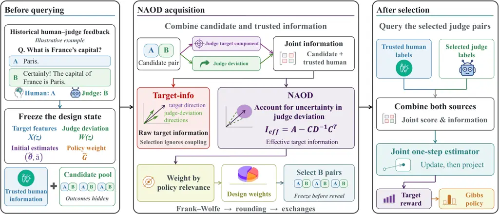

# Optimal Design for Active Preference Learning with Biased LLM Judges

Zhongman Du    Huiming Zhang    Haodong Zhu Affiliation: Beihang
University  Zhongguancun Academy    Baochang Zhang Affiliation: Hangzhou
Innovation Institute of Beihang University

###### Abstract

Learning from human preferences is central to large language model (LLM)
alignment, but human preference annotation is costly. Active preference
learning reduces this cost by selecting informative comparisons, and LLM
judges can provide additional scalable feedback. However, the
preferences of the judges may deviate from those of the target human
population. Even after calibration on trusted reference data, active
acquisition can shift the comparison distribution and expose residual
judge bias. We therefore incorporate judge deviations into the
acquisition design rather than relying on a separate calibration stage.
Under joint estimation, comparisons that appear highly informative about
the reward may also reflect judge bias and therefore provide less
information about human preferences. To address this issue, we propose
Nuisance-Adjusted Optimal Design (NAOD), a comparison-selection strategy
that prioritizes policy-relevant target information after nuisance
adjustment and uses the Frank–Wolfe algorithm for optimization.
Theoretically, we establish a sharp conditional local asymptotic minimax
lower bound on policy risk and construct an estimator that attains it.
We further characterize the finite-sample cost of learning the nuisance
representation and show that representation error can reverse an oracle
design advantage. Finally, we validate these predictions experimentally
and evaluate NAOD on Chatbot Arena data across 17 judges, 15 budget
configurations, and 15 random cluster-level splits. NAOD reduces the
mean regret of proxy policy by 29.1% relative to a matched
target-information design, outperforms existing methods, and improves
human-preference prediction on held-out data.

|     |
| --- |
|     |

## 1 Introduction

Preference feedback (Christiano et al., 2017) provides a standard way to
align large language models (LLMs) with human preferences when desired
behavior is difficult to specify directly (Ouyang et al., 2022; Rafailov
et al., 2023). Reward models are trained on pairwise response
comparisons and then used to guide downstream policy optimization
(Stiennon et al., 2020). The resulting policy therefore depends not only
on how the reward model is trained, but also on which comparisons are
selected for feedback. When human annotation is costly or limited,
active preference learning and experimental design make more efficient
use of a fixed annotation budget by selecting informative comparisons
(Muldrew et al., 2024; Mukherjee et al., 2024). Recent methods further
incorporate reward-model information (Lin et al., 2026) or downstream
policy objectives (Feng et al., 2025) into their acquisition criteria.

A complementary approach to reducing annotation cost is to obtain
preference feedback from LLM judges (Lee et al., 2024). However, their
judgments can differ systematically from the preferences of the target
human population (Zheng et al., 2023). A natural response is to
calibrate the judge against trusted human data before relying on its
feedback (Polo et al., 2025). However, calibration can deteriorate under
distribution shift (Ovadia et al., 2019; Chan et al., 2020), while
active acquisition itself changes the comparison distribution by
selecting which pairs receive feedback (Farquhar et al., 2021). Residual
judge biases that cancel under the reference calibration distribution
can therefore become unbalanced on the acquired distribution. Thus, pair
selection determines both how much information is collected and which
judge errors can influence the learned reward.

It is additionally difficult to model these judge deviations during
estimation. The human reward and judge-specific deviation must now be
estimated jointly and distinguished from one another. On some selected
pairs, changes in the human reward and changes in the judge deviation
can have nearly the same effect on label probabilities. A design that
treats all apparent reward information as target information can
therefore overstate the precision with which the human target can be
estimated.



Figure 1: Overview of the NAOD acquisition and estimation pipeline.
Historical human–judge feedback is used to construct the frozen target
and judge-deviation representations. Before current outcomes are
observed, NAOD selects comparisons using nuisance-adjusted target
information weighted by policy relevance. After selection, trusted human
and judge feedback are combined in a joint estimator to update the
target reward and induced policy.

For acquisition, what matters is not the raw information about reward
parameters, but the information about the human target that remains
after judge-specific deviations have been accounted for. Even this
remaining information is not equally important across reward directions,
because some reward errors substantially alter downstream policy
decisions whereas others have little effect on the induced policy.
Reward-model accuracy alone therefore need not reflect downstream policy
performance (Gao et al., 2023; Wen et al., 2025; Frick et al., 2025). We
therefore propose Nuisance-Adjusted Optimal Design (NAOD), a design
strategy that selects comparisons using nuisance-adjusted target
information weighted by downstream policy relevance. Figure 1 provides
an overview of the NAOD pipeline from pre-acquisition design to
post-selection estimation.

A sharp conditional local asymptotic minimax lower bound for policy risk
is established, together with an estimator that attains it. The
resulting risk coincides with the nuisance-adjusted, policy-weighted
objective optimized by NAOD. The same target–nuisance cross-information
controls both residual exposure and the loss of target information.
Further, when the judge-deviation representation is learned, a
design-dependent risk term appears that can reverse oracle design
rankings.

Empirically, controlled experiments validate the predicted policy-risk
behavior and the design-ranking reversal. On Chatbot Arena, across 17
judges, 15 budget configurations, and 15 random cluster-level splits,
NAOD reduces mean proxy policy regret by $`29.1\%`$ relative to the
matched Target-info design and improves held-out human-preference
prediction. Its gains tend to be larger when target–nuisance coupling is
stronger, consistent with the mechanism predicted by our theory.

Our contributions can be summarized as follows:

- •
  We formulate active preference learning with biased LLM judges as a
  joint target–nuisance design problem and characterize how acquisition
  exposes judge residuals.
- •
  We introduce NAOD, establish its sharp local minimax interpretation,
  and characterize the additional risk from learning the judge-deviation
  representation.
- •
  We develop a practical comparison-selection algorithm for finite
  candidate pools, validate our theoretical risk predictions in
  synthetic experiments, and evaluate NAOD on Chatbot Arena with
  held-out human evaluation.

## 2 Related Work

#### Active preference acquisition and nuisance-aware design.

Active preference learning reduces feedback cost by selecting
informative comparisons. Prior work studies adaptive pairwise
comparisons (Maystre & Grossglauser, 2017), preference-based
reinforcement learning (Lee et al., 2021), query-efficient learning from
pairwise preferences (Wu & Sun, 2024), and subset selection for reliable
LLM ranking (Liusie et al., 2024). Information-based methods use Fisher
information for reward modeling (Shen et al., 2025) or D-optimal design
with randomized Frank–Wolfe optimization (Thekumparampil et al., 2025),
while other work incorporates downstream policy relevance or reward
uncertainty into acquisition (Hu et al., 2024; Sun et al., 2025b). When
observations jointly inform target and nuisance parameters, acquisition
must also account for nuisance uncertainty (Sloman et al., 2024). Our
work combines policy-aware preference acquisition with nuisance-aware
experimental design under LLM-judge feedback.

#### LLM judges and calibration.

LLM judges provide scalable evaluation but exhibit systematic biases,
including position effects (Wang et al., 2024), stylistic preferences
(Feuer et al., 2025), and broader recurring biases across human and
model evaluators (Chen et al., 2024; Ye et al., 2025). Related work also
studies pairwise feedback from systematically biased evaluators (Tang
et al., 2025). Existing mitigation approaches characterize limits of
debiasing with limited high-quality labels (Dorner et al., 2025),
fine-tune evaluators on debiased data (Park et al., 2024), optimize
prompts (Zhou et al., 2024), calibrate pairwise prediction distributions
(Li et al., 2025), or use human calibration data to correct judge
estimates and allocate calibration samples (Lee et al., 2026). Our focus
is instead on how judge discrepancies should change which comparisons
are acquired for human reward estimation.

## 3 Problem Setting

#### The Bradley-Terry model of human preferences.

Let $`z=(s,y_{A},y_{B})`$ denote an ordered comparison, where $`s`$ is a
prompt and $`y_{A},y_{B}`$ are two candidate responses. Let
$`\phi(s,y)\in\mathbb{R}^{d}`$ be a fixed $`d`$-dimensional feature map.
We model the reward as linear in this feature representation,
$`r_{\theta}(s,y)=\phi(s,y)^{\top}\theta`$, where
$`\theta\in\mathbb{R}^{d}`$ is the reward parameter. We define the
comparison feature $`X(z)=\phi(s,y_{A})-\phi(s,y_{B})`$. Let
$`Y\in\{0,1\}`$ denote the human preference label, with $`Y=1`$
indicating that $`y_{A}`$ is preferred to $`y_{B}`$. Under the
Bradley-Terry model (Bradley & Terry, 1952), the preference probability
is determined by the reward difference between the two responses,

```math
p_{\theta}(z)=\mathbb{P}_{\theta}(Y=1\mid z)=\sigma\!\left(r_{\theta}(s,y_{A})-r_{\theta}(s,y_{B})\right)=\sigma\!\left(X(z)^{\top}\theta\right), \tag{1}
```

where $`\sigma(u)=(1+e^{-u})^{-1}`$ is the sigmoid function. We write
$`\theta^{\star}`$ for the reward parameter of the target human
population and $`p^{\star}=p_{\theta^{\star}}`$ for its preference
probability.

#### Performance metric.

We evaluate the learned reward through the policy it induces. Let
$`\mu_{e}`$ denote the evaluation distribution over prompts. For each
prompt $`s`$, let $`\mathcal{A}(s)`$ be a finite set of candidate
responses and let $`\pi_{\mathrm{ref}}(\cdot\mid s)`$ be a reference
policy on $`\mathcal{A}(s)`$ with full support. Given a regularization
parameter $`\tau>0`$, let $`\pi_{\theta}(\cdot\mid s)`$ denote the
optimizer of the KL-regularized reward objective (Azar et al., 2012; Liu
et al., 2024). Its closed form is

```math
\pi_{\theta}(y\mid s)=\frac{\pi_{\mathrm{ref}}(y\mid s)\exp\!\left(r_{\theta}(s,y)/\tau\right)}{\sum_{y^{\prime}\in\mathcal{A}(s)}\pi_{\mathrm{ref}}(y^{\prime}\mid s)\exp\!\left(r_{\theta}(s,y^{\prime})/\tau\right)}. \tag{2}
```

The corresponding optimal regularized value is

```math
F(\theta)=\tau\,\mathbb{E}_{s\sim\mu_{e}}\log\sum_{y\in\mathcal{A}(s)}\pi_{\mathrm{ref}}(y\mid s)\exp\!\left(r_{\theta}(s,y)/\tau\right). \tag{3}
```

When the target reward parameter is $`\theta^{\star}`$, deploying the
policy induced by $`\theta`$ incurs the loss

```math
D_{F}(\theta^{\star},\theta)=F(\theta^{\star})-F(\theta)-\nabla F(\theta)^{\top}(\theta^{\star}-\theta)=\tau\,\mathbb{E}_{s\sim\mu_{e}}\mathrm{KL}\!\left(\pi_{\theta}(\cdot\mid s)\,\|\,\pi_{\theta^{\star}}(\cdot\mid s)\right). \tag{4}
```

See Appendix A.1 for derivations. Thus, our performance metric measures
error through its effect on the induced policy.

#### LLM judge and active acquisition.

For a fixed LLM judge and annotation protocol, let $`q(z)\in[0,1]`$
denote its preference probability for comparison $`z`$. Its preferences
need not match those of the target human population. We define the judge
discrepancy on the probability scale as $`\delta(z)=q(z)-p^{\star}(z)`$.
Let $`\nu`$ denote a reference distribution over comparisons and let
$`Z\sim\nu`$. Conventional probability calibration with respect to the
target human population requires $`\mathbb{E}_{\nu}[Y\mid q(Z)]=q(Z)`$
(Guo et al., 2017; Futami & Fujisawa, 2024; Chidambaram & Ge, 2025).
Under the target preference model in equation 1, this is equivalent to

```math
\mathbb{E}_{\nu}[\delta(Z)\mid q(Z)]=0.
```

Thus, under $`\nu`$, calibration constrains the conditional mean of the
judge discrepancy given $`q(Z)`$. However, active acquisition changes
the comparison distribution. Let $`\xi`$ denote the acquired comparison
distribution and assume $`\xi\ll\nu`$, so that the density ratio
$`\omega(z)=d\xi/d\nu(z)`$ is well defined.

#### Acquisition-dependent residual exposure.

Probability calibration is defined under the reference distribution
$`\nu`$ and is not guaranteed to hold under the acquired distribution
$`\xi`$ (Park et al., 2020). For reward estimation, the relevant issue
is how judge discrepancies align with the reward-feature directions.
Under the acquired distribution $`\xi`$, define the residual
contribution to the target score as
$`b_{\xi}=\mathbb{E}_{\xi}[\delta(Z)X(Z)]`$, and define
$`b_{\nu}=\mathbb{E}_{\nu}[\delta(Z)X(Z)]`$ analogously under the
reference distribution. This residual-feature moment can be viewed as a
multiaccuracy-style residual moment over linear reward-feature tests
(Kim et al., 2019; Kern et al., 2024). A change of measure gives

```math
b_{\xi}=b_{\nu}+\mathbb{E}_{\nu}\left[\{\omega(Z)-1\}\delta(Z)X(Z)\right]. \tag{5}
```

The second term captures how acquisition reweights judge discrepancies
across reward-feature directions. Calibration does not imply
$`b_{\nu}=0`$, and even when $`b_{\nu}=0`$, acquisition can yield
$`b_{\xi}\neq 0`$. In that case, treating judge feedback as target
feedback shifts the population score away from zero at
$`\theta^{\star}`$, potentially moving the fitted reward away from the
human target. Appendix B.1 gives the corresponding parameter and
policy-regret consequences.

Thus, active acquisition can expose judge discrepancies that are
balanced under the reference distribution. This motivates accounting for
judge deviations directly in the acquisition design rather than relying
on reference calibration alone.

## 4 Nuisance-Adjusted Optimal Design

### 4.1 Joint Target-Nuisance Model

We model human and judge preferences jointly. Let
$`W(z)\in\mathbb{R}^{r}`$ be a fixed representation of judge deviations,
where $`r`$ is its dimension, and let $`a\in\mathbb{R}^{r}`$ be the
associated nuisance parameter. We model the fixed judge preference
probability $`q(z)`$ introduced in Section 3 using a Bradley–Terry model
augmented with a structured judge-specific component (Movva et al.,
2026),

```math
q_{\theta,a}(z)=\sigma\!\left(X(z)^{\top}\theta+W(z)^{\top}a\right). \tag{6}
```

Human labels follow the preference model $`p_{\theta}`$ in equation 1,
while $`W(z)^{\top}a`$ represents the difference between judge and human
log odds. For the theory in this section, we assume that
$`q(z)=q_{\theta^{\star},a^{\star}}(z)`$ for some unknown nuisance
parameter $`a^{\star}`$. Thus, $`W(z)^{\top}a^{\star}`$ parameterizes
the judge-human discrepancy on the log-odds scale, while $`\delta(z)`$
measures the corresponding discrepancy on the probability scale.
Throughout this section, $`W`$ is treated as fixed. Section 5.1 studies
the additional error when $`W`$ is learned from historical human and
judge feedback.

For the approximate-design formulation, we first consider a finite
support of $`L`$ comparison types $`z_{1},\ldots,z_{L}`$. Write
$`X_{i}=X(z_{i})`$ and $`W_{i}=W(z_{i})`$. At type $`i`$, we collect
$`n_{i}`$ judge labels, each indicating a preference for the first
response with probability $`q_{\theta,a}(z_{i})`$. An independent
trusted sample contains $`n_{c}`$ human labels, whose preference
probabilities are given by $`p_{\theta}`$. Conditional on the comparison
features, all current labels are independent Bernoulli observations. Let
$`n=\sum_{i=1}^{L}n_{i}`$ be the total number of judge labels. We
represent the asymptotic allocation by $`\xi=(\xi_{1},\ldots,\xi_{L})`$,
where $`n_{i}/n\to\xi_{i}`$, $`\xi_{i}\geq 0`$, and
$`\sum_{i=1}^{L}\xi_{i}=1`$. We also assume that $`n_{c}/n\to\kappa`$
for some $`\kappa\in[0,\infty)`$. We condition on the historical data
used to construct $`W`$ and select the allocation. These data are
independent of the current labels.

### 4.2 Effective Target Information

Joint estimation must separate target-score variation from
nuisance-score variation (Sloman et al., 2024; Barker & Kavalieris,
2001). Let $`k=d+r`$ be the joint parameter dimension. Define
$`\gamma=(\theta^{\top},a^{\top})^{\top}\in\mathbb{R}^{k}`$ and the
corresponding feature $`v_{i}=(X_{i}^{\top},W_{i}^{\top})^{\top}`$. Fix
a local analysis center
$`\gamma_{0}=(\theta_{0}^{\top},a_{0}^{\top})^{\top}`$, where
$`\theta_{0}`$ and $`a_{0}`$ are the target and nuisance components,
respectively. The Bernoulli variance of the judge label at this center
is
$`t_{i}=q_{\theta_{0},a_{0}}(z_{i})\{1-q_{\theta_{0},a_{0}}(z_{i})\}`$,
and one judge label contributes Fisher information
$`J_{i}=t_{i}v_{i}v_{i}^{\top}`$. Let $`H_{c}`$ denote the limiting
Fisher information per trusted label at $`\theta_{0}`$. Let $`X_{c}`$
denote a random comparison feature in the trusted sample. Then
$`H_{c}=\mathbb{E}[\sigma^{\prime}(X_{c}^{\top}\theta_{0})X_{c}X_{c}^{\top}]`$.
Let $`A_{\kappa}(\xi)`$, $`D_{\xi}`$, and $`C_{\xi}`$ denote the target,
nuisance, and cross-information blocks, respectively. The joint
information normalized by the judge sample size is

```math
M_{\kappa}(\xi)=\kappa\operatorname{diag}(H_{c},0_{r\times r})+\sum_{i=1}^{L}\xi_{i}J_{i}=\begin{pmatrix}A_{\kappa}(\xi)&C_{\xi}\\
C_{\xi}^{\top}&D_{\xi}\end{pmatrix}. \tag{7}
```

Here, $`A_{\kappa}(\xi)`$ is the target-information block, $`D_{\xi}`$
is the nuisance-information block, and $`C_{\xi}`$ is the
target–nuisance cross-information block. Specifically,
$`A_{\kappa}(\xi)=\kappa H_{c}+\sum_{i=1}^{L}\xi_{i}t_{i}X_{i}X_{i}^{\top}`$,
$`C_{\xi}=\sum_{i=1}^{L}\xi_{i}t_{i}X_{i}W_{i}^{\top}`$, and
$`D_{\xi}=\sum_{i=1}^{L}\xi_{i}t_{i}W_{i}W_{i}^{\top}`$. When
$`M_{\kappa}(\xi)`$ is positive definite, the effective information for
the human reward parameter is

```math
I_{\mathrm{eff},\kappa}(\xi)=A_{\kappa}(\xi)-C_{\xi}D_{\xi}^{-1}C_{\xi}^{\top}. \tag{8}
```

Estimating the nuisance parameter reduces the information available for
$`\theta`$ from $`A_{\kappa}(\xi)`$ to the Schur complement
$`I_{\mathrm{eff},\kappa}(\xi)`$, with information loss
$`C_{\xi}D_{\xi}^{-1}C_{\xi}^{\top}`$ (Fewster & Jupp, 2013). The
inverse of $`I_{\mathrm{eff},\kappa}(\xi)`$ is the target block of
$`M_{\kappa}(\xi)^{-1}`$.

The cross-information also connects this adjustment to the residual
exposure in equation 5. Holding the human parameter at $`\theta_{0}`$,
define
$`b_{\xi}(a)=\sum_{i=1}^{L}\xi_{i}\{q_{\theta_{0},a}(z_{i})-p_{\theta_{0}}(z_{i})\}X_{i}`$.
Let $`C_{\xi}(a)`$ denote the cross-information evaluated at
$`(\theta_{0},a)`$, so that $`C_{\xi}(a_{0})=C_{\xi}`$. Differentiation
gives the exact Jacobian identity

```math
\frac{\partial b_{\xi}(a)}{\partial a^{\top}}=C_{\xi}(a). \tag{9}
```

The same cross-information governs the sensitivity of the exposed target
score and the information loss from nuisance estimation. See
Appendices A.2 and A.3 for the statistical foundations of the joint and
effective information, and Appendices B.1 and B.3 for the
residual-exposure and target–nuisance coupling results.

### 4.3 Policy-Weighted Design and Minimax Risk

Effective information describes how precisely the human reward can be
estimated after nuisance adjustment. The policy regret in equation 4
determines which estimation errors matter. Define the policy curvature
at $`\theta_{0}`$ by

```math
G_{0}=\nabla^{2}F(\theta_{0})=\frac{1}{\tau}\mathbb{E}_{s\sim\mu_{e}}\operatorname{Cov}_{y\sim\pi_{\theta_{0}}(\cdot\mid s)}[\phi(s,y)].
```

For $`h\in\mathbb{R}^{d}`$, the local regret satisfies
$`D_{F}(\theta_{0},\theta_{0}+h)=\tfrac{1}{2}h^{\top}G_{0}h+o(\|h\|^{2})`$
as $`h\to 0`$. Thus, $`G_{0}`$ weights reward-parameter directions by
their effect on the induced policy. For a reward estimator
$`\widehat{\theta}_{n}`$, we measure policy risk by
$`\mathbb{E}[D_{F}(\theta^{\star},\widehat{\theta}_{n})]`$. Let
$`G_{e}=\operatorname{diag}(G_{0},0_{r\times r})`$, and let
$`\operatorname{tr}`$ denote the matrix trace. Combining policy
curvature with effective target information gives

```math
\Phi_{\kappa}(\xi)=\frac{1}{2}\operatorname{tr}\!\left(G_{0}I_{\mathrm{eff},\kappa}(\xi)^{-1}\right)=\frac{1}{2}\operatorname{tr}\!\left(G_{e}M_{\kappa}(\xi)^{-1}\right). \tag{10}
```

This is a weighted optimal design criterion for the target parameter
(Pukelsheim, 2006). Let $`\Xi`$ be a nonempty compact convex set of
allocations on the $`L`$ comparison types, and assume that
$`M_{\kappa}(\xi)`$ is uniformly positive definite over $`\Xi`$. We
define nuisance-adjusted optimal design (NAOD) by

```math
\xi^{\star}\in\operatorname*{arg\,min}_{\xi\in\Xi}\Phi_{\kappa}(\xi).
```

Since $`M_{\kappa}(\xi)`$ is affine in $`\xi`$, the objective is convex.
To state its local minimax characterization, let
$`\eta=(h^{\top},\upsilon^{\top})^{\top}`$, where
$`\upsilon\in\mathbb{R}^{r}`$, and define
$`\gamma_{n,\eta}=\gamma_{0}+\eta/\sqrt{n}`$, with target component
$`\theta_{n,h}=\theta_{0}+h/\sqrt{n}`$. Write $`\mathbb{E}_{\eta}`$ for
expectation under this local model, conditional on the historical data.

###### Theorem 4.1 (Conditional local policy risk).

Fix $`\xi`$ and condition on the historical data. Under the regularity
conditions in Appendix A.1, suppose $`M_{\kappa}(\xi)\succ 0`$. If
$`G_{0}\succ 0`$, then

```math
\lim_{R\to\infty}\liminf_{n\to\infty}\inf_{T_{n}}\sup_{\|\eta\|\leq R}n\,\mathbb{E}_{\eta}D_{F}(\theta_{n,h},T_{n})\geq\Phi_{\kappa}(\xi), \tag{11}
```

where $`T_{n}`$ ranges over reward estimators based on the current
observations. Under the additional trusted-sample and initialization
conditions in Appendix B.2, with $`\kappa>0`$, the projected one-step
estimator defined there attains this bound uniformly on every fixed
local ball.

Thus, for the projected one-step estimator,
$`\mathbb{E}_{\eta}D_{F}(\theta_{n,h},\widehat{\theta}_{n})=\Phi_{\kappa}(\xi)/n+o(n^{-1})`$
uniformly over every fixed local ball. The case $`G_{0}\succeq 0`$ is
handled by removing policy-null directions.

A matched Target-info design replaces $`I_{\mathrm{eff},\kappa}(\xi)`$
by $`A_{\kappa}(\xi)`$ in equation 10 while retaining the same final
joint estimator. The two criteria can select different designs, and
Proposition B.1 shows that Target-info can incur strictly larger leading
policy risk.

### 4.4 Finite-Pool Comparison Selection

We now translate the approximate design into the selection of $`B`$
distinct comparisons from a finite pool of $`N`$ candidates. Let
$`x_{i}\in[0,1]`$ be the relaxed inclusion weight of candidate $`i`$,
and write $`x=(x_{1},\ldots,x_{N})`$. Before querying the pool, we
evaluate the information atoms and policy weight at a center fitted from
historical feedback, yielding $`\widehat{J}_{i}`$ and
$`\widehat{G}_{e}`$. Let $`\widehat{I}_{c}`$ denote the corresponding
total trusted information, embedded in the joint parameter space. The
fitted information under $`x`$ is
$`\widehat{\mathcal{I}}(x)=\widehat{I}_{c}+\sum_{i=1}^{N}x_{i}\widehat{J}_{i}`$.

Let $`\mathcal{C}`$ partition the candidate indices into groups from
which at most one comparison may be selected. Without group
restrictions, each candidate forms its own group. Let $`S_{0}`$ be a
fixed feasible seed, possibly empty, used when needed to ensure positive
definite fitted information. Its comparisons count toward the budget
$`B`$. The relaxed feasible set is

```math
\mathcal{X}_{B}=\left\{x\in[0,1]^{N}\;\middle|\;\sum_{i=1}^{N}x_{i}=B,\quad x_{i}=1\ \text{for }i\in S_{0},\quad\sum_{i\in c}x_{i}\leq 1\ \text{for }c\in\mathcal{C}\right\}.
```

We solve

```math
\min_{x\in\mathcal{X}_{B}}f_{B}(x),\qquad f_{B}(x)=\frac{1}{2}\operatorname{tr}\!\left[\widehat{G}_{e}\widehat{\mathcal{I}}(x)^{-1}\right]. \tag{12}
```

For $`\xi_{i}=x_{i}/B`$ and $`\kappa=n_{c}/B`$, this is the fitted
finite-pool counterpart of $`\Phi_{\kappa}(\xi)/B`$, preserving the
total-information scaling of policy risk.

We solve the convex relaxation using the Frank–Wolfe algorithm (Jaggi,
2013), followed by feasible largest-weight rounding and improving
exchanges. Algorithm 1 in Appendix C.1 gives the complete acquisition
procedure, and the same appendix provides a computable optimization
certificate for the returned subset.

Because rounding need not preserve the relaxed allocation proportions,
the statistical guarantee is stated in terms of the information of the
selected comparisons themselves. For an asymptotic sequence of selected
sets $`S_{B}`$ containing $`B`$ distinct comparisons selected before
their outcomes are observed, let $`J_{Bi}`$ denote the true information
of candidate $`i`$ at $`\gamma_{0}`$, and let $`I^{\mathrm{exp}}_{c,B}`$
denote the total expected trusted information. Define the normalized
information of the selected set by
$`M_{B}=B^{-1}\!\left(I^{\mathrm{exp}}_{c,B}+\sum_{i\in S_{B}}J_{Bi}\right)`$.
Let $`\widehat{\theta}_{B}`$ be the target component of the projected
one-step estimator based on the trusted sample and the selected judge
labels.

###### Theorem 4.2 (Policy risk for distinct comparisons).

Condition on the historical data, candidate features, and selected set.
Under the distinct-comparison regularity conditions in Appendix C.2,
suppose $`M_{B}`$ is uniformly positive definite. Under the local model
$`\gamma_{0}+\eta/\sqrt{B}`$,

```math
B\,\mathbb{E}_{\eta}D_{F}\!\left(\theta_{0}+\frac{h}{\sqrt{B}},\widehat{\theta}_{B}\right)-\frac{1}{2}\operatorname{tr}(G_{e}M_{B}^{-1})\longrightarrow 0 \tag{13}
```

uniformly over bounded local parameters. If $`M_{B}`$ converges to a
positive definite limit, the corresponding conditional local minimax
lower bound also holds.

The theorem evaluates the information of the realized subset and
therefore retains the effect of rounding. Appendix C.2 gives the proof,
while Appendix C.3 gives the plug-in analysis and computational details.

## 5 Learning the Judge-Deviation Representation

In this section, we study the additional error introduced when the
judge-deviation representation is learned from historical feedback. This
error contributes a design-dependent term to policy risk and can reverse
the ordering of acquisition rules.

### 5.1 Finite-Sample Representation Cost

We use the same finite support $`z_{1},\ldots,z_{L}`$ and evaluate
policy risk at the human target $`\theta_{0}=\theta^{\star}`$. Let $`m`$
denote the number of independent historical units used to learn the
judge-deviation representation. Write
$`\widehat{W}_{m}\in\mathbb{R}^{L\times r}`$ for the learned
representation, with row $`i`$ given by $`\widehat{W}_{m,i}^{\top}`$.
Let $`a_{0m}\in\mathbb{R}^{r}`$ be the nuisance component of the local
center $`\gamma_{0m}=(\theta_{0}^{\top},a_{0m}^{\top})^{\top}`$. The
nuisance parameter $`a`$ is re-estimated from the current data. Write
$`\operatorname{logit}(u)=\log\{u/(1-u)\}`$ for $`u\in(0,1)`$, and
define the remaining logit error
$`e_{m}=(e_{m,1},\ldots,e_{m,L})^{\top}`$ by

```math
e_{m,i}=\operatorname{logit}q(z_{i})-X_{i}^{\top}\theta_{0}-\widehat{W}_{m,i}^{\top}a_{0m},\qquad i=1,\ldots,L. \tag{14}
```

Let $`\xi_{m,i}=n_{i}/n`$ denote the judge allocation proportion for
type $`i`$. Define
$`v_{m,i}=(X_{i}^{\top},\widehat{W}_{m,i}^{\top})^{\top}`$ and
$`t_{m,i}=\sigma^{\prime}(v_{m,i}^{\top}\gamma_{0m})`$. Let $`M_{m}`$
denote the normalized joint information at $`\gamma_{0m}`$, formed as in
equation 7 from the learned representation, the actual judge allocation,
and the expected trusted information. Set
$`\Phi_{m}=\tfrac{1}{2}\operatorname{tr}(G_{e}M_{m}^{-1})`$, and let
$`P_{\theta}=[I_{d}\;0_{d\times r}]`$ select the target coordinates. For
$`e=(e_{1},\ldots,e_{L})^{\top}\in\mathbb{R}^{L}`$, define

```math
B_{m}e=P_{\theta}M_{m}^{-1}\sum_{i=1}^{L}\xi_{m,i}t_{m,i}v_{m,i}e_{i},\qquad R_{m}=B_{m}^{\top}G_{0}B_{m}. \tag{15}
```

The first-order effect of $`e_{m}`$ on the target parameter is
$`B_{m}e_{m}`$. Let $`\widehat{\theta}_{n,m}`$ be the target component
of the projected one-step estimator based on the learned representation
and the current observations. Expectations below are over both the
historical and current data.

###### Theorem 5.1 (Policy risk with a learned representation).

Under the regularity conditions in Appendix D.2, suppose
$`n_{c}/n\to\kappa>0`$ and the smallest eigenvalue of $`M_{m}`$ is
bounded away from zero. Let $`m,n\to\infty`$ with
$`n/m\to\lambda_{P}\in[0,\infty)`$. Suppose
$`(\Phi_{m},R_{m})\to(\Phi_{0},R_{0})`$ in probability for deterministic
limits, and $`\sqrt{m}\,e_{m}`$ converges in distribution to a random
vector $`Z_{P}`$ with mean $`b_{P}`$ and covariance $`\Sigma_{P}`$. Then

```math
\mathbb{E}\!\left[D_{F}(\theta_{0},\widehat{\theta}_{n,m})\right]=\frac{\Phi_{0}}{n}+\frac{C_{P}}{m}+o(n^{-1}+m^{-1}),\qquad C_{P}=\frac{1}{2}\left\{\operatorname{tr}(R_{0}\Sigma_{P})+b_{P}^{\top}R_{0}b_{P}\right\}. \tag{16}
```

The first term is the oracle sampling risk and the second is the
representation-learning cost, which depends on the direction of the
representation error through $`R_{0}`$ and includes both covariance and
bias contributions. Proofs and additional representation-learning
results are given in Appendix D.

### 5.2 Design Ranking Reversals

The representation-cost term in equation 16 can reverse the ordering
induced by the oracle sampling risk. We compare NAOD with the matched
Target-info design under the same learned representation, label budgets,
and final estimator. Let $`\mathcal{L}_{\mathrm{N}}(n,m)`$ and
$`\mathcal{L}_{\mathrm{T}}(n,m)`$ denote their expected policy risks.
Write $`\Phi_{\mathrm{N}},\Phi_{\mathrm{T}}`$ for their limiting oracle
risk constants and $`C_{P,\mathrm{N}},C_{P,\mathrm{T}}`$ for their
representation-cost coefficients. Applying Theorem 5.1 to the two
designs gives

```math
n\{\mathcal{L}_{\mathrm{N}}(n,m)-\mathcal{L}_{\mathrm{T}}(n,m)\}\longrightarrow\Phi_{\mathrm{N}}-\Phi_{\mathrm{T}}+\lambda_{P}(C_{P,\mathrm{N}}-C_{P,\mathrm{T}}). \tag{17}
```

If $`\Phi_{\mathrm{N}}<\Phi_{\mathrm{T}}`$, the leading-order ordering
reverses whenever
$`\lambda_{P}(C_{P,\mathrm{N}}-C_{P,\mathrm{T}})>\Phi_{\mathrm{T}}-\Phi_{\mathrm{N}}`$.
Thus, NAOD can have lower oracle sampling risk while being more
sensitive to representation error.

When $`n/m\to 0`$, the representation-cost term vanishes and the oracle
ordering is recovered. When $`n/m\to\lambda_{P}>0`$, it can contribute
at leading order. Thus, NAOD optimizes the fitted design criterion
rather than the full two-stage risk.

## 6 Experiments

### 6.1 Synthetic Experiments

#### Effective information predicts policy risk.

We first consider a scalar three-type Bernoulli construction with a
constant nuisance component and equal trusted and judge sample sizes,
$`n_{c}=n`$. NAOD, Target-info, and Random use the same correctly
specified joint model and projected one-step estimator and differ only
in the acquisition design. Each setting is evaluated over 6,000
independent replications. Across $`n\in\{240,960,3840,15360\}`$, the
empirical scaled risks in Figure 2(a) closely track their corresponding
theoretical information constants, supporting the effective-information
characterization of leading policy risk.

Figure 2: Controlled tests of the theoretical predictions. Dashed
references in panels (a) and (b) denote the corresponding theoretical
predictions. Panel (c) reports the NAOD-minus-Target-info scaled-risk
difference.

#### Learning the representation adds the predicted risk term.

We next use a scalar two-type Bernoulli construction with $`n_{c}=n`$,
in which the first-order cost of learning the judge-deviation
representation is explicit. For this construction, $`\Phi_{0}=50/49`$
and $`C_{P}=25/98`$. Figure 2(b) tests the risk expansion in equation 16
across $`n\in\{960,3840,15360\}`$ and $`m/n\in\{1/4,1,4\}`$. The
empirical scaled risks closely follow the theoretical prediction
$`\Phi_{0}+(n/m)C_{P}`$, with the largest finite-sample deviation
occurring at the smallest representation-learning sample size.

#### Representation error can reverse design rankings.

We then learn the representation in the three-type experiment and
compare NAOD with Target-info under otherwise identical conditions, with
$`n=n_{c}=960`$. Figure 2(c) shows the paired NAOD-minus-Target-info
scaled-risk difference as $`m/n`$ varies. With limited historical data,
the difference is positive and Target-info has lower risk. As the
historical sample grows, the gap shrinks, becomes indistinguishable from
zero around $`m/n=1`$, and turns negative by $`m/n=2`$, where NAOD has
lower risk. This confirms the design-ranking reversal mechanism in
Section 5.2. Full constructions, finite-sample diagnostics, and
additional analyses are reported in Appendices E.2 and E.3.

### 6.2 Chatbot Arena Evaluation

#### Experimental setup.

We evaluate finite-pool acquisition on a frozen Chatbot Arena LLM-judge
archive (Chiang et al., 2024) with $`49{,}635`$ usable comparisons in
$`42{,}875`$ connected text clusters and 17 judges. Current budgets are
$`H\in\{32,64,128,256,512\}`$ human labels and $`B\in\{256,512,1024\}`$
judge records, yielding 15 budget combinations. Each combination is
evaluated over 15 cluster-level splits. Within each split,
representation learning, acquisition, and evaluation use disjoint
clusters. At most one comparison is selected from each candidate
cluster.

All acquisition methods differ only in the acquisition rule. Frozen
Qwen3 embeddings (Zhang et al., 2025) are used to construct
judge-specific two-dimensional target and nuisance representations, with
the full procedure given in Appendix F.1. Representation learning uses
$`8{,}575`$ shared upstream human–judge comparisons, and initialization
uses 128 historical comparisons. These shared resources are fixed across
acquisition rules and are not counted in the current $`(H,B)`$ budgets.
We compare NAOD against five acquisition baselines, Random, Entropy,
D-opt, PA D-opt (Shen et al., 2025), and Target-info. Initial and
Human-only serve as reference baselines from the common initialization.
Judge feedback uses the archived A/B/tie probabilities (Sun et al.,
2025a) through the soft target $`p_{A}+\tfrac{1}{2}p_{T}`$, where
$`p_{A}`$ and $`p_{T}`$ are the archived probabilities of an A win and a
tie, respectively. For these bounded soft targets, Appendix A.4 gives
the corresponding sandwich-risk characterization. Under mean
correctness, Theorem A.4 shows that the population curvature criterion
underlying NAOD equals the worst-case leading sandwich policy-risk
coefficient over bounded soft-feedback laws with the same conditional
means.

#### Evaluation.

The primary endpoint is proxy policy regret relative to a
human-preference reference fitted only from upstream data. We
additionally report held-out human cross-entropy and tie-aware human
choice accuracy. Test losses are first averaged within connected
clusters and then equally across clusters. Within each split, judges and
budget combinations are macro-averaged. Paired uncertainty is reported
using two-sided 95% $`t`$-intervals across the 15 split-level
differences.

#### Results.

NAOD achieves the lowest mean proxy policy regret and human
cross-entropy in Table 1, together with the highest mean human choice
accuracy. Relative to the matched Target-info design, NAOD reduces mean
proxy policy regret by $`29.11\%`$, with 14 of 15 split averages
favoring NAOD. Relative to D-opt, the reduction is $`18.87\%`$, with 12
of 15 split averages favoring NAOD.

| Method      | Proxy regret $`\downarrow`$ | Human CE $`\downarrow`$ | Acc. $`\uparrow`$ | Drop (%) | Wins  |
| ----------- | --------------------------- | ----------------------- | ----------------- | -------- | ----- |
| Initial     | 8.86                        | 0.6752                  | 57.82             | 77.53    | 13/15 |
| Human-only  | 18.25                       | 0.6829                  | 56.84             | 89.09    | 15/15 |
| Random      | 4.88                        | 0.6727                  | 58.22             | 59.18    | 15/15 |
| Entropy     | 13.42                       | 0.6784                  | 57.10             | 85.17    | 15/15 |
| D-opt       | 2.45                        | 0.6703                  | 58.19             | 18.87    | 12/15 |
| PA D-opt    | 2.46                        | 0.6703                  | 58.19             | 18.93    | 12/15 |
| Target-info | 2.81                        | 0.6705                  | 58.21             | 29.11    | 14/15 |
| NAOD        | 1.99                        | 0.6699                  | 58.27             | —        | —     |

Table 1: Overall Chatbot Arena results. Means over 17 judges, 15 budget
regimes, and 15 random cluster-level splits. Regret is reported in
$`10^{-3}`$ units, CE in nats per pair, and accuracy in percent. The
last two columns report NAOD’s relative regret reduction and paired
split wins against each row. Bold denotes the best mean.

#### Budget dependence.

NAOD reduces mean proxy policy regret relative to Target-info in all 15
budget settings. At a fixed human budget $`H`$, the relative advantage
consistently narrows as the judge budget $`B`$ increases. Moreover,
settings with the same ratio $`H/B`$ can exhibit substantially different
gains, showing that absolute budget size matters in addition to the
human-to-judge budget ratio. The complete $`5\times 3`$ budget grid is
reported in Figure 4 in Appendix F.3.

#### Target–nuisance coupling.

The acquisition gain varies across judges and tends to be larger when
Target-info induces stronger target–nuisance coupling. This pattern is
consistent with the theoretical prediction that nuisance-aware
acquisition is most valuable when target and nuisance information are
strongly coupled. The corresponding judge-level analysis is reported in
Figure 5 in Appendix F.3.

## 7 Conclusion

We studied active preference learning with LLM-judge feedback that may
systematically deviate from target human preferences. NAOD prioritizes
policy-relevant target information after nuisance adjustment. The design
criterion has a sharp local minimax characterization, while controlled
experiments validate the predicted risk behavior and Arena results show
that gains tend to be larger under stronger target–nuisance coupling.
Representation error can nevertheless change the preferred acquisition
design, motivating future work on jointly learning judge-deviation
representations and selecting comparisons.

### AI use statement

Generative AI tools were used to assist with language polishing and to
check the algebraic consistency of author-derived mathematical
derivations. All AI-assisted suggestions and checks were reviewed and
independently verified by the authors. The authors take full
responsibility for the final content of the paper.

### Ethics statement

This work uses archived Chatbot Arena preference data and collects no
new human-subject data. The available preference feedback and LLM-judge
outputs may reflect population- and model-specific biases and may not be
universally representative. Preference models and acquisition strategies
based on such feedback should therefore be evaluated with respect to the
intended target population and deployment setting.

### Reproducibility statement

We provide the code required to reproduce the reported experimental
results in the supplementary material. The main text and appendices
provide the statistical model, acquisition and estimation procedures,
optimization details, and experimental protocols required for
reproduction, together with the assumptions and proofs underlying the
theoretical results.

## References

- Azar et al. (2012) Mohammad Gheshlaghi Azar, Vicenç Gómez, and
  Hilbert J. Kappen. Dynamic policy programming. _Journal of Machine
  Learning Research_, 13(103):3207–3245, 2012.
- Barker & Kavalieris (2001) Richard J. Barker and Laimonis Kavalieris.
  Efficiency gain from auxiliary data requiring additional nuisance
  parameters. _Biometrics_, 57(2):563–566, 2001.
- Bradley & Terry (1952) Ralph Allan Bradley and Milton E. Terry. Rank
  analysis of incomplete block designs: I. the method of paired
  comparisons. _Biometrika_, 39(3-4):324–345, 1952.
- Chan et al. (2020) Alex Chan, Ahmed Alaa, Zhaozhi Qian, and Mihaela
  Van Der Schaar. Unlabelled data improves Bayesian uncertainty
  calibration under covariate shift. In _Proceedings of the 37th
  International Conference on Machine Learning_, volume 119 of
  _Proceedings of Machine Learning Research_, pp. 1392–1402. PMLR, 2020.
- Chen et al. (2024) Guiming Hardy Chen, Shunian Chen, Ziche Liu, Feng
  Jiang, and Benyou Wang. Humans or LLMs as the judge? a study on
  judgement bias. In _Proceedings of the 2024 Conference on Empirical
  Methods in Natural Language Processing_, pp. 8301–8327. Association
  for Computational Linguistics, 2024.
- Chiang et al. (2024) Wei-Lin Chiang, Lianmin Zheng, Ying Sheng,
  Anastasios Nikolas Angelopoulos, Tianle Li, Dacheng Li, Banghua Zhu,
  Hao Zhang, Michael Jordan, Joseph E. Gonzalez, and Ion Stoica. Chatbot
  Arena: An open platform for evaluating LLMs by human preference. In
  _Proceedings of the 41st International Conference on Machine
  Learning_, volume 235 of _Proceedings of Machine Learning Research_,
  pp. 8359–8388. PMLR, 2024.
- Chidambaram & Ge (2025) Muthu Chidambaram and Rong Ge. Reassessing how
  to compare and improve the calibration of machine learning models. In
  _International Conference on Learning Representations_, 2025.
- Christiano et al. (2017) Paul F. Christiano, Jan Leike, Tom B. Brown,
  Miljan Martic, Shane Legg, and Dario Amodei. Deep reinforcement
  learning from human preferences. In _Advances in Neural Information
  Processing Systems_, volume 30, pp. 4299–4307, 2017.
- Dorner et al. (2025) Florian E. Dorner, Vivian Y. Nastl, and Moritz
  Hardt. Limits to scalable evaluation at the frontier: LLM as judge
  won’t beat twice the data. In _International Conference on Learning
  Representations_, 2025.
- Farquhar et al. (2021) Sebastian Farquhar, Yarin Gal, and Tom
  Rainforth. On statistical bias in active learning: How and when to fix
  it. In _International Conference on Learning Representations_, 2021.
- Feng et al. (2025) Yunzhen Feng, Ariel Kwiatkowski, Kunhao Zheng,
  Julia Kempe, and Yaqi Duan. PILAF: Optimal human preference sampling
  for reward modeling. In _Proceedings of the 42nd International
  Conference on Machine Learning_, volume 267 of _Proceedings of Machine
  Learning Research_, pp. 16744–16776. PMLR, 2025.
- Feuer et al. (2025) Benjamin Feuer, Micah Goldblum, Teresa Datta,
  Sanjana Nambiar, Raz Besaleli, Samuel Dooley, Max Cembalest, and
  John P. Dickerson. Style outweighs substance: Failure modes of LLM
  judges in alignment benchmarking. In _International Conference on
  Learning Representations_, 2025.
- Fewster & Jupp (2013) R. M. Fewster and P. E. Jupp. Information on
  parameters of interest decreases under transformations. _Journal of
  Multivariate Analysis_, 120:34–39, 2013.
- Frick et al. (2025) Evan Frick, Tianle Li, Connor Chen, Wei-Lin
  Chiang, Anastasios N. Angelopoulos, Jiantao Jiao, Banghua Zhu,
  Joseph E. Gonzalez, and Ion Stoica. How to evaluate reward models for
  RLHF. In _International Conference on Learning Representations_, 2025.
- Futami & Fujisawa (2024) Futoshi Futami and Masahiro Fujisawa.
  Information-theoretic generalization analysis for expected calibration
  error. In _Advances in Neural Information Processing Systems_,
  volume 37, pp. 84246–84297, 2024.
- Gao et al. (2023) Leo Gao, John Schulman, and Jacob Hilton. Scaling
  laws for reward model overoptimization. In _Proceedings of the 40th
  International Conference on Machine Learning_, volume 202 of
  _Proceedings of Machine Learning Research_, pp. 10835–10866.
  PMLR, 2023.
- Guo et al. (2017) Chuan Guo, Geoff Pleiss, Yu Sun, and Kilian Q.
  Weinberger. On calibration of modern neural networks. In _Proceedings
  of the 34th International Conference on Machine Learning_, volume 70
  of _Proceedings of Machine Learning Research_, pp. 1321–1330.
  PMLR, 2017.
- Hu et al. (2024) Xiao Hu, Jianxiong Li, Xianyuan Zhan, Qing-Shan Jia,
  and Ya-Qin Zhang. Query-policy misalignment in preference-based
  reinforcement learning. In _International Conference on Learning
  Representations_, 2024.
- Jaggi (2013) Martin Jaggi. Revisiting Frank-Wolfe: Projection-free
  sparse convex optimization. In _Proceedings of the 30th International
  Conference on Machine Learning_, volume 28 of _Proceedings of Machine
  Learning Research_, pp. 427–435. PMLR, 2013.
- Kern et al. (2024) Christoph Kern, Michael P. Kim, and Angela Zhou.
  Multi-accurate CATE is robust to unknown covariate shifts.
  _Transactions on Machine Learning Research_, 2024.
- Kim et al. (2019) Michael P. Kim, Amirata Ghorbani, and James Zou.
  Multiaccuracy: Black-box post-processing for fairness in
  classification. In _Proceedings of the 2019 AAAI/ACM Conference on AI,
  Ethics, and Society_, pp. 247–254. ACM, 2019.
- Lee et al. (2026) Chungpa Lee, Thomas Zeng, Jongwon Jeong, Jy-yong
  Sohn, and Kangwook Lee. How to correctly report LLM-as-a-judge
  evaluations. In _Proceedings of the 43rd International Conference on
  Machine Learning_, volume 306 of _Proceedings of Machine Learning
  Research_. PMLR, 2026.
- Lee et al. (2024) Harrison Lee, Samrat Phatale, Hassan Mansoor, Thomas
  Mesnard, Johan Ferret, Kellie Ren Lu, Colton Bishop, Ethan Hall,
  Victor Carbune, Abhinav Rastogi, and Sushant Prakash. RLAIF vs. RLHF:
  Scaling reinforcement learning from human feedback with AI feedback.
  In _Proceedings of the 41st International Conference on Machine
  Learning_, volume 235 of _Proceedings of Machine Learning Research_,
  pp. 26874–26901. PMLR, 2024.
- Lee et al. (2021) Kimin Lee, Laura M. Smith, and Pieter Abbeel.
  PEBBLE: Feedback-efficient interactive reinforcement learning via
  relabeling experience and unsupervised pre-training. In _Proceedings
  of the 38th International Conference on Machine Learning_, volume 139
  of _Proceedings of Machine Learning Research_, pp. 6152–6163.
  PMLR, 2021.
- Li et al. (2025) Haitao Li, Junjie Chen, Qingyao Ai, Zhumin Chu, Yujia
  Zhou, Qian Dong, and Yiqun Liu. CalibraEval: Calibrating prediction
  distribution to mitigate selection bias in LLMs-as-judges. In
  _Proceedings of the 63rd Annual Meeting of the Association for
  Computational Linguistics (Volume 1: Long Papers)_, pp. 16537–16552.
  Association for Computational Linguistics, 2025.
- Lin et al. (2026) Xiaoqiang Lin, Arun Verma, Zhongxiang Dai, Daniela
  Rus, See-Kiong Ng, and Bryan Kian Hsiang Low. ActiveDPO: Active direct
  preference optimization for sample-efficient alignment. In
  _International Conference on Learning Representations_, 2026.
- Liu et al. (2024) Zhihan Liu, Miao Lu, Shenao Zhang, Boyi Liu, Hongyi
  Guo, Yingxiang Yang, Jose Blanchet, and Zhaoran Wang. Provably
  mitigating overoptimization in RLHF: Your SFT loss is implicitly an
  adversarial regularizer. In _Advances in Neural Information Processing
  Systems_, volume 37, pp. 138663–138697, 2024.
- Liusie et al. (2024) Adian Liusie, Vatsal Raina, Yassir Fathullah, and
  Mark Gales. Efficient LLM comparative assessment: A product of experts
  framework for pairwise comparisons. In _Proceedings of the 2024
  Conference on Empirical Methods in Natural Language Processing_, pp.
  6835–6855. Association for Computational Linguistics, 2024.
- Maystre & Grossglauser (2017) Lucas Maystre and Matthias Grossglauser.
  Just sort it! A simple and effective approach to active preference
  learning. In _Proceedings of the 34th International Conference on
  Machine Learning_, volume 70 of _Proceedings of Machine Learning
  Research_, pp. 2344–2353. PMLR, 2017.
- Movva et al. (2026) Rajiv Movva, Smitha Milli, Sewon Min, and Emma
  Pierson. What’s in my human feedback? learning interpretable
  descriptions of preference data. In _International Conference on
  Learning Representations_, 2026.
- Mukherjee et al. (2024) Subhojyoti Mukherjee, Anusha Lalitha, Kousha
  Kalantari, Aniket Deshmukh, Ge Liu, Yifei Ma, and Branislav Kveton.
  Optimal design for human preference elicitation. In _Advances in
  Neural Information Processing Systems_, volume 37, pp.
  90132–90159, 2024.
- Muldrew et al. (2024) William Muldrew, Peter Hayes, Mingtian Zhang,
  and David Barber. Active preference learning for large language
  models. In _Proceedings of the 41st International Conference on
  Machine Learning_, volume 235 of _Proceedings of Machine Learning
  Research_, pp. 36577–36590. PMLR, 2024.
- Ouyang et al. (2022) Long Ouyang, Jeffrey Wu, Xu Jiang, Diogo Almeida,
  Carroll L. Wainwright, Pamela Mishkin, Chong Zhang, Sandhini Agarwal,
  Katarina Slama, Alex Ray, John Schulman, Jacob Hilton, Fraser Kelton,
  Luke Miller, Maddie Simens, Amanda Askell, Peter Welinder, Paul F.
  Christiano, Jan Leike, and Ryan Lowe. Training language models to
  follow instructions with human feedback. In _Advances in Neural
  Information Processing Systems_, volume 35, pp. 27730–27744, 2022.
- Ovadia et al. (2019) Yaniv Ovadia, Emily Fertig, Jie Ren, Zachary
  Nado, D. Sculley, Sebastian Nowozin, Joshua V. Dillon, Balaji
  Lakshminarayanan, and Jasper Snoek. Can you trust your model’s
  uncertainty? evaluating predictive uncertainty under dataset shift. In
  _Advances in Neural Information Processing Systems_, volume 32, pp.
  13991–14002, 2019.
- Park et al. (2024) Junsoo Park, Seungyeon Jwa, Ren Meiying, Daeyoung
  Kim, and Sanghyuk Choi. OffsetBias: Leveraging debiased data for
  tuning evaluators. In _Findings of the Association for Computational
  Linguistics: EMNLP 2024_, pp. 1043–1067. Association for Computational
  Linguistics, 2024.
- Park et al. (2020) Sangdon Park, Osbert Bastani, James Weimer, and
  Insup Lee. Calibrated prediction with covariate shift via unsupervised
  domain adaptation. In _Proceedings of the Twenty Third International
  Conference on Artificial Intelligence and Statistics_, volume 108 of
  _Proceedings of Machine Learning Research_, pp. 3219–3229. PMLR, 2020.
- Polo et al. (2025) Felipe Maia Polo, Xinhe Wang, Mikhail Yurochkin,
  Gongjun Xu, Moulinath Banerjee, and Yuekai Sun. Bridging human and LLM
  judgments: Understanding and narrowing the gap. In _Advances in Neural
  Information Processing Systems_, volume 38, pp. 16857–16908, 2025.
- Pukelsheim (2006) Friedrich Pukelsheim. _Optimal Design of
  Experiments_. Society for Industrial and Applied Mathematics, 2006.
- Rafailov et al. (2023) Rafael Rafailov, Archit Sharma, Eric Mitchell,
  Christopher D. Manning, Stefano Ermon, and Chelsea Finn. Direct
  preference optimization: Your language model is secretly a reward
  model. In _Advances in Neural Information Processing Systems_,
  volume 36, pp. 53728–53741, 2023.
- Shen et al. (2025) Yunyi Shen, Hao Sun, and Jean-Francois Ton. Active
  reward modeling: Adaptive preference labeling for large language model
  alignment. In _Proceedings of the 42nd International Conference on
  Machine Learning_, volume 267 of _Proceedings of Machine Learning
  Research_, pp. 54410–54430. PMLR, 2025.
- Sloman et al. (2024) Sabina J. Sloman, Ayush Bharti, Julien
  Martinelli, and Samuel Kaski. Bayesian active learning in the presence
  of nuisance parameters. In _Proceedings of the Fortieth Conference on
  Uncertainty in Artificial Intelligence_, volume 244 of _Proceedings of
  Machine Learning Research_, pp. 3245–3263. PMLR, 2024.
- Stiennon et al. (2020) Nisan Stiennon, Long Ouyang, Jeffrey Wu,
  Daniel M. Ziegler, Ryan Lowe, Chelsea Voss, Alec Radford, Dario
  Amodei, and Paul F. Christiano. Learning to summarize with human
  feedback. In _Advances in Neural Information Processing Systems_,
  volume 33, pp. 3008–3021, 2020.
- Sun et al. (2025a) Guangzhi Sun, Anmol Kagrecha, Potsawee Manakul,
  Phil Woodland, and Mark Gales. SkillAggregation: Reference-free
  LLM-dependent aggregation. In _Proceedings of the 63rd Annual Meeting
  of the Association for Computational Linguistics (Volume 1: Long
  Papers)_, pp. 15532–15548. Association for Computational Linguistics,
  2025a.
- Sun et al. (2025b) Zexu Sun, Yiju Guo, Yankai Lin, Xu Chen, Qi Qi,
  Xing Tang, Xiuqiang He, and Ji-Rong Wen. Uncertainty and influence
  aware reward model refinement for reinforcement learning from human
  feedback. In _International Conference on Learning Representations_,
  2025b.
- Tang et al. (2025) Ming Tang, Yuxuan Zhou, and Chao Huang. Tackling
  biased evaluators in dueling bandits. In _Advances in Neural
  Information Processing Systems_, volume 38, pp. 83569–83602, 2025.
- Thekumparampil et al. (2025) Kiran Koshy Thekumparampil, Gaurush
  Hiranandani, Kousha Kalantari, Shoham Sabach, and Branislav Kveton.
  Comparing few to rank many: Active human preference learning using
  randomized Frank-Wolfe method. In _Proceedings of the 42nd
  International Conference on Machine Learning_, volume 267 of
  _Proceedings of Machine Learning Research_, pp. 59355–59376.
  PMLR, 2025.
- Wang et al. (2024) Peiyi Wang, Lei Li, Liang Chen, Zefan Cai, Dawei
  Zhu, Binghuai Lin, Yunbo Cao, Lingpeng Kong, Qi Liu, Tianyu Liu, and
  Zhifang Sui. Large language models are not fair evaluators. In
  _Proceedings of the 62nd Annual Meeting of the Association for
  Computational Linguistics (Volume 1: Long Papers)_, pp. 9440–9450.
  Association for Computational Linguistics, 2024.
- Wen et al. (2025) Xueru Wen, Jie Lou, Yaojie Lu, Hongyu Lin, Xing Yu,
  Xinyu Lu, Ben He, Xianpei Han, Debing Zhang, and Le Sun. Rethinking
  reward model evaluation: Are we barking up the wrong tree? In
  _International Conference on Learning Representations_, 2025.
- Wu & Sun (2024) Runzhe Wu and Wen Sun. Making RL with preference-based
  feedback efficient via randomization. In _International Conference on
  Learning Representations_, 2024.
- Ye et al. (2025) Jiayi Ye, Yanbo Wang, Yue Huang, Dongping Chen, Qihui
  Zhang, Nuno Moniz, Tian Gao, Werner Geyer, Chao Huang, Pin-Yu Chen,
  Nitesh V. Chawla, and Xiangliang Zhang. Justice or prejudice?
  quantifying biases in LLM-as-a-judge. In _International Conference on
  Learning Representations_, 2025.
- Zhang et al. (2025) Yanzhao Zhang, Mingxin Li, Dingkun Long, Xin
  Zhang, Huan Lin, Baosong Yang, Pengjun Xie, An Yang, Dayiheng Liu,
  Junyang Lin, Fei Huang, and Jingren Zhou. Qwen3 embedding: Advancing
  text embedding and reranking through foundation models. _arXiv
  preprint arXiv:2506.05176_, 2025.
- Zheng et al. (2023) Lianmin Zheng, Wei-Lin Chiang, Ying Sheng, Siyuan
  Zhuang, Zhanghao Wu, Yonghao Zhuang, Zi Lin, Zhuohan Li, Dacheng Li,
  Eric P. Xing, Hao Zhang, Joseph E. Gonzalez, and Ion Stoica. Judging
  LLM-as-a-judge with MT-Bench and Chatbot Arena. In _Advances in Neural
  Information Processing Systems_, volume 36, pp. 46595–46623, 2023.
- Zhou et al. (2024) Han Zhou, Xingchen Wan, Yinhong Liu, Nigel Collier,
  Ivan Vulić, and Anna Korhonen. Fairer preferences elicit improved
  human-aligned large language model judgments. In _Proceedings of the
  2024 Conference on Empirical Methods in Natural Language Processing_,
  pp. 1241–1252. Association for Computational Linguistics, 2024.

## Appendix

## Appendix A Technical Foundations

This appendix collects the common statistical and policy-loss facts used
throughout the analysis. We specify the conditional experiment and
policy loss, establish the local likelihood expansion, characterize
efficient target information and policy-null directions, and finally
separate likelihood curvature from score covariance for soft feedback.

### A.1 Notation, Regularity, and Policy Loss

#### Conditioning and notation.

Let $`\mathcal{F}_{P}`$ denote the historical information available
before the current outcomes are observed, including the frozen nuisance
representation, comparison features, allocation, and numerical settings.
Unless explicitly stated otherwise, probabilities and expectations in
the fixed-representation theory are conditional on $`\mathcal{F}_{P}`$.
Write $`\gamma=(\theta^{\top},a^{\top})^{\top}\in\mathbb{R}^{k}`$, with
$`k=d+r`$, and let $`P_{\theta}=[I_{d}\;\;0]`$ select the target
coordinates. A judge observation of comparison type $`i`$ has augmented
feature $`v_{i}=(X_{i}^{\top},W_{i}^{\top})^{\top}`$, while a trusted
observation with feature $`X_{cj}`$ has padded feature
$`v_{cj}=(X_{cj}^{\top},0^{\top})^{\top}`$. There are $`n_{i}`$ judge
observations of type $`i`$, $`n=\sum_{i=1}^{L}n_{i}`$ judge observations
in total, and $`n_{c}`$ trusted observations. For bounded
$`\eta=(h^{\top},\upsilon^{\top})^{\top}`$, the local parameter is
$`\gamma_{n,\eta}=\gamma_{0}+\eta/\sqrt{n}`$, with target component
$`\theta_{n,h}=\theta_{0}+h/\sqrt{n}`$.

#### Regularity.

For the fixed-support theory, $`L,d,r`$ are fixed and all feature
vectors are uniformly bounded. Conditional on their features, current
judge and trusted outcomes are mutually independent Bernoulli variables
under the joint model in equation 6. A compact convex product set
$`\mathcal{K}=\mathcal{K}_{\theta}\times\mathcal{K}_{a}`$ contains
$`\gamma_{0}`$ in its interior, with a bounded open neighborhood
available for derivative expansions. The proportions satisfy
$`n_{i}/n\to\xi_{i}`$ and $`n_{c}/n\to\kappa<\infty`$. Uniformly over
bounded root-$`n`$ neighborhoods, the normalized expected information
converges to the positive-definite matrix $`M_{\kappa}(\xi)`$ in
equation 7. Trusted covariates may be bounded deterministic arrays with
the stated information limit or independent bounded random covariates
independent of the judge block. The policy value $`F`$ is twice
continuously differentiable near the target region, with bounded
uniformly continuous Hessian. For the Gibbs policy considered here,
boundedness follows directly from the covariance representation below,
while uniform continuity follows on the compact target neighborhood.
Bounded features and the compact parameter region also imply a common
interior probability bound $`q(1-q)\geq t_{\min}>0`$. Additional
conditions required by the concrete preliminary estimator are stated in
Appendix B.2.

#### Gibbs policy and directed policy loss.

For the Gibbs policy in equation 2 and value function in equation 3,
substituting the log probability ratio into the regularized policy
objective gives

```math
V_{\theta}(\pi)=F(\theta)-\tau\,\mathbb{E}_{\mu_{e}}\mathrm{KL}\!\left(\pi(\cdot\mid s)\,\|\,\pi_{\theta}(\cdot\mid s)\right).
```

Thus $`\pi_{\theta}`$ is the unique optimizer. Differentiating the log
partition function yields

```math
\nabla F(\theta)=\mathbb{E}_{s\sim\mu_{e}}\mathbb{E}_{y\sim\pi_{\theta}(\cdot\mid s)}[\phi(s,y)],\qquad\nabla^{2}F(\theta)=\frac{1}{\tau}\mathbb{E}_{s\sim\mu_{e}}\operatorname{Cov}_{y\sim\pi_{\theta}(\cdot\mid s)}[\phi(s,y)].
```

In particular, $`F`$ is convex. If the policy optimized at parameter
$`y`$ is evaluated under reward parameter $`x`$, linearity of the reward
gives $`V_{x}(\pi_{y})=F(y)+\nabla F(y)^{\top}(x-y)`$, and therefore

```math
F(x)-V_{x}(\pi_{y})=D_{F}(x,y)=\tau\,\mathbb{E}_{\mu_{e}}\mathrm{KL}\!\left(\pi_{y}(\cdot\mid s)\,\|\,\pi_{x}(\cdot\mid s)\right).
```

Hence the first Bregman argument is the reward under which performance
is evaluated, whereas the second determines the deployed policy. At the
local center,

```math
D_{F}(\theta_{0},\theta_{0}+h)=\frac{1}{2}h^{\top}G_{0}h+o(\|h\|^{2}),\qquad G_{0}=\nabla^{2}F(\theta_{0}). \tag{18}
```

This gives the policy weighting used by NAOD.

### A.2 Scores, Information, and Local Asymptotic Normality

Let $`\operatorname{sp}(u)=\log(1+e^{u})`$. For judge labels
$`Y_{i\ell}`$ and trusted labels $`H_{j}`$, the total negative log
likelihood is

```math
Q_{n}(\gamma)=\sum_{i=1}^{L}\sum_{\ell=1}^{n_{i}}\left\{\operatorname{sp}(v_{i}^{\top}\gamma)-Y_{i\ell}v_{i}^{\top}\gamma\right\}+\sum_{j=1}^{n_{c}}\left\{\operatorname{sp}(X_{cj}^{\top}\theta)-H_{j}X_{cj}^{\top}\theta\right\}.
```

Define the total score and observed information by
$`U_{n}(\gamma)=-\nabla Q_{n}(\gamma)`$ and
$`I_{n}(\gamma)=\nabla^{2}Q_{n}(\gamma)`$. A judge observation with
probability $`q_{i}(\gamma)=\sigma(v_{i}^{\top}\gamma)`$ contributes
$`(Y_{i\ell}-q_{i}(\gamma))v_{i}`$ to the score and
$`q_{i}(\gamma)\{1-q_{i}(\gamma)\}v_{i}v_{i}^{\top}`$ to the
information. Trusted observations have the same form with padded
features. Hence $`Q_{n}`$ is globally convex.

At the correctly specified Bernoulli center,

```math
M_{n}:=\frac{1}{n}\mathbb{E}I_{n}(\gamma_{0})=\frac{1}{n}\operatorname{Cov}\{U_{n}(\gamma_{0})\}\longrightarrow M_{\kappa}(\xi).
```

The equality between score covariance and curvature is specific to the
correctly specified Bernoulli experiment. Appendix A.4 treats soft
feedback separately. Let $`\Delta_{n}=U_{n}(\gamma_{0})/\sqrt{n}`$.
Bounded independent score summands in fixed dimension give
$`\sup_{n}\mathbb{E}\|\Delta_{n}\|^{4}<\infty`$, while the normalized
Hessian differs from its expectation by $`O_{L^{4}}(n^{-1/2})`$ when
current trusted covariates are random. For fixed covariate arrays, it is
deterministic conditional on the features.

###### Proposition A.1 (Conditional LAN).

Under the regularity conditions of Appendix A.1,

```math
\Delta_{n}\Rightarrow N\!\left(0,M_{\kappa}(\xi)\right),
```

and, writing $`\ell_{n}=-Q_{n}`$, for every fixed $`R<\infty`$,

```math
\ell_{n}\!\left(\gamma_{0}+\frac{\eta}{\sqrt{n}}\right)-\ell_{n}(\gamma_{0})=\eta^{\top}\Delta_{n}-\frac{1}{2}\eta^{\top}M_{\kappa}(\xi)\eta+o_{P}(1)
```

uniformly over $`\|\eta\|\leq R`$. The same derivative and moment bounds
hold uniformly along bounded local truth sequences.

###### Proof.

Every scalar projection of $`\Delta_{n}`$ is a triangular array of
independent centered bounded terms whose largest summand is
$`O(n^{-1/2})`$ and whose total variance converges to the corresponding
quadratic form of $`M_{\kappa}(\xi)`$. The triangular-array central
limit theorem and the Cramér–Wold device give the Gaussian limit. A
third-order Taylor expansion of the log likelihood around $`\gamma_{0}`$
gives the displayed quadratic likelihood ratio. Bounded third
derivatives make the remainder $`O(n^{-1/2})`$ uniformly on each fixed
local ball, while normalized information converges uniformly to
$`M_{\kappa}(\xi)`$. ∎

### A.3 Efficient Target Information and Policy-Null Directions

Suppress $`(\kappa,\xi)`$ and partition the correctly specified
Bernoulli information as

```math
M=\begin{pmatrix}A&C\\
C^{\top}&D\end{pmatrix}\succ 0.
```

Let $`(S_{\theta},S_{a})`$ denote the target and nuisance components of
the limiting LAN score, whose covariance is $`M`$. Since $`D\succ 0`$,
define $`S_{\rm eff}=S_{\theta}-CD^{-1}S_{a}`$. Then

```math
\operatorname{Cov}(S_{\rm eff},S_{a})=0,\qquad\operatorname{Cov}(S_{\rm eff})=A-CD^{-1}C^{\top}=I_{\rm eff}.
```

Thus the Schur complement removes exactly the target-score component
linearly reproducible by nuisance-score variation. Equivalently, for
every target direction $`h`$,

```math
h^{\top}I_{\rm eff}h=\min_{b\in\mathbb{R}^{r}}\left\{h^{\top}Ah-2h^{\top}Cb+b^{\top}Db\right\},
```

with minimizer $`b=D^{-1}C^{\top}h`$. Block elimination gives

```math
P_{\theta}M^{-1}P_{\theta}^{\top}=I_{\rm eff}^{-1}. \tag{19}
```

Finally, with $`K=A^{-1/2}CD^{-1/2}`$,

```math
A^{-1/2}I_{\rm eff}A^{-1/2}=I-KK^{\top}. \tag{20}
```

The latter is the whitening identity used by the target–nuisance
coupling analysis.

At the saturation extreme, if the judge target-score directions lie
entirely in the nuisance-score span, judge feedback contributes no
additional effective information for the human target. In particular, if
$`W_{i}=X_{i}`$ with unrestricted nuisance coefficients, the judge
likelihood identifies only $`\theta+a`$, and
$`I_{\rm eff}=\kappa H_{c}`$.

#### Policy-null directions.

Theorem 4.1 states the lower bound directly for $`G_{0}\succ 0`$. For
the Gibbs policy, the reduction required when $`G_{0}\succeq 0`$ is
exact.

###### Proposition A.2 (Exact policy-null quotient).

Let $`\mathcal{N}=\ker\nabla^{2}F(\theta_{0})`$. For the finite-response
Gibbs policy with full-support reference policy, $`\mathcal{N}`$ is the
same at every finite parameter. For every $`h\in\mathcal{N}`$ and finite
$`t`$,

```math
\pi_{\theta+th}(\cdot\mid s)=\pi_{\theta}(\cdot\mid s)\qquad\text{for $\mu_{e}$-almost every }s.
```

In orthogonal coordinates
$`\theta=(\beta,\zeta)\in\mathcal{N}^{\perp}\oplus\mathcal{N}`$, the
value decomposes as $`F(\beta,\zeta)=f(\beta)+c^{\top}\zeta`$, so

```math
D_{F}\bigl((\beta,\zeta),(\beta^{\prime},\zeta^{\prime})\bigr)=D_{f}(\beta,\beta^{\prime}).
```

Unless the policy loss is identically zero,
$`\nabla^{2}f(\beta_{0})\succ 0`$.

###### Proof.

For $`h\in\mathcal{N}`$, the covariance representation of the policy
Hessian gives

```math
0=h^{\top}\nabla^{2}F(\theta_{0})h=\frac{1}{\tau}\mathbb{E}_{\mu_{e}}\operatorname{Var}_{\pi_{\theta_{0}}(\cdot\mid s)}\{h^{\top}\phi(s,y)\}.
```

Because the Gibbs policy has full support, $`h^{\top}\phi(s,y)`$ must be
constant over responses for almost every prompt. Adding $`th`$ therefore
multiplies every unnormalized Gibbs weight at that prompt by the same
factor, leaving the normalized policy unchanged and making $`F`$ affine
along $`h`$. The same response-constant characterization holds at every
finite parameter, so the null space is parameter-independent. The affine
component cancels from the Bregman divergence, giving the quotient
representation. ∎

Policy-null target coordinates may therefore be treated as additional
nuisance coordinates. Applying the positive-curvature argument on
$`\mathcal{N}^{\perp}`$ yields the same policy-weighted trace criterion
in the original coordinates.

### A.4 Soft Feedback and Sandwich Policy Risk

For binary evaluation comparisons with equal reference weights and
$`\tau=1`$, let
$`F_{e}(\theta)=\mathbb{E}_{e}\operatorname{sp}(X^{\top}\theta)`$ up to
an affine term. Under the correctly specified human model,

```math
\operatorname{CE}(\theta)-\operatorname{CE}(\theta^{\star})=D_{F_{e}}(\theta,\theta^{\star}),\qquad\operatorname{Regret}(\pi_{\theta};\theta^{\star})=D_{F_{e}}(\theta^{\star},\theta).
```

The two losses therefore have opposite Bregman orientations, although
both have the same local quadratic expansion

```math
\frac{1}{2}(\theta-\theta^{\star})^{\top}\nabla^{2}F_{e}(\theta^{\star})(\theta-\theta^{\star})+o(\|\theta-\theta^{\star}\|^{2}).
```

This distinction is used in Appendix F.2, where proxy policy regret and
held-out human cross-entropy are separate endpoints.

Now allow conditionally independent responses $`Y_{nj}\in[0,1]`$. The
logistic loss remains
$`\operatorname{sp}(v_{nj}^{\top}\gamma)-Y_{nj}v_{nj}^{\top}\gamma`$,
with

```math
U_{n}(\gamma)=\sum_{j}v_{nj}\{Y_{nj}-q_{nj}(\gamma)\},\qquad I_{n}(\gamma)=\sum_{j}q_{nj}(\gamma)\{1-q_{nj}(\gamma)\}v_{nj}v_{nj}^{\top},
```

where $`q_{nj}(\gamma)=\sigma(v_{nj}^{\top}\gamma)`$. Hence soft and
Bernoulli responses share the same logistic curvature, while their score
covariances need not agree.

###### Proposition A.3 (Soft-label sandwich policy risk).

Suppose interior population roots
$`\gamma_{n}^{\dagger}=(\theta_{n}^{\dagger\top},a_{n}^{\dagger\top})^{\top}\to\gamma^{\dagger}`$
satisfy $`\mathbb{E}U_{n}(\gamma_{n}^{\dagger})=0`$, and

```math
M_{n}:=\frac{1}{n}\mathbb{E}I_{n}(\gamma_{n}^{\dagger})\to M\succ 0,\qquad\Omega_{n}:=\frac{1}{n}\operatorname{Cov}\{U_{n}(\gamma_{n}^{\dagger})\}\to\Omega\succeq 0.
```

Assume a regular estimator satisfies

```math
\sqrt{n}(\widehat{\gamma}_{n}-\gamma_{n}^{\dagger})=M^{-1}\frac{U_{n}(\gamma_{n}^{\dagger})}{\sqrt{n}}+o_{L^{2}}(1).
```

Partition $`M=\left(\begin{smallmatrix}A&C\\
C^{\top}&D\end{smallmatrix}\right)`$, set
$`I_{\rm eff}=A-CD^{-1}C^{\top}`$, $`L=[I_{d}\;\;-CD^{-1}]`$, and
$`\Omega_{\rm eff}=L\Omega L^{\top}`$. Then, with
$`G^{\dagger}=\nabla^{2}F(\theta^{\dagger})`$,

```math
n\,\mathbb{E}D_{F}(\theta_{n}^{\dagger},\widehat{\theta}_{n})\longrightarrow\Psi_{\rm soft}:=\frac{1}{2}\operatorname{tr}\!\left(G^{\dagger}I_{\rm eff}^{-1}\Omega_{\rm eff}I_{\rm eff}^{-1}\right).
```

If every row is additionally mean-correct,
$`\mathbb{E}[Y_{nj}\mid v_{nj}]=q_{nj}(\gamma_{n}^{\dagger})`$, then

```math
\Omega\preceq M,\qquad\Omega_{\rm eff}\preceq I_{\rm eff},\qquad\Psi_{\rm soft}\leq\frac{1}{2}\operatorname{tr}\!\left(G^{\dagger}I_{\rm eff}^{-1}\right).
```

For correctly specified Bernoulli feedback, all three inequalities
become equalities.

###### Proof.

The assumed asymptotic linear expansion gives target covariance
$`P_{\theta}M^{-1}\Omega M^{-1}P_{\theta}^{\top}`$. Since
$`LM=[I_{\rm eff}\;\;0]`$, block elimination gives
$`P_{\theta}M^{-1}=I_{\rm eff}^{-1}L`$, which yields the stated sandwich
covariance and, after the local Bregman expansion, the policy-risk
limit.

Under mean correctness and $`0\leq Y_{nj}\leq 1`$,

```math
\operatorname{Var}(Y_{nj}\mid v_{nj})=q_{nj}(1-q_{nj})-\mathbb{E}[Y_{nj}(1-Y_{nj})\mid v_{nj}]\leq q_{nj}(1-q_{nj}).
```

Conditional independence and summation of the score-covariance
contributions give $`\Omega\preceq M`$. Congruence by $`L`$ gives
$`\Omega_{\rm eff}\preceq I_{\rm eff}`$ and hence the risk bound. For
Bernoulli responses, $`Y_{nj}(1-Y_{nj})=0`$ almost surely, so equality
is recovered. ∎

###### Theorem A.4 (Least-favorable bounded soft feedback).

Fix an admissible design $`\xi\in\Xi`$ and suppose the conditions of
Proposition A.3 hold under mean correctness with limiting root
$`\gamma^{\dagger}=\gamma_{0}`$. Let $`\Psi_{\rm soft}(\xi;P)`$ denote
the limiting sandwich policy-risk coefficient under a conditionally
independent response law $`P`$ with the same conditional means and
responses in $`[0,1]`$. The supremum over all such response laws for
which the asymptotic expansion in Proposition A.3 holds is

```math
\sup_{P}\Psi_{\rm soft}(\xi;P)=\Phi_{\kappa}(\xi).
```

The supremum is attained by conditionally Bernoulli feedback with the
same conditional means. Consequently,

```math
\arg\min_{\xi\in\Xi}\sup_{P}\Psi_{\rm soft}(\xi;P)=\arg\min_{\xi\in\Xi}\Phi_{\kappa}(\xi).
```

Thus the NAOD criterion minimizes the worst-case leading sandwich
policy-risk coefficient over the bounded mean-correct soft-feedback
class.

###### Proof.

Fix $`\xi`$. Under mean correctness, the logistic curvature depends on
the conditional means but not on the conditional variances of the
responses. Hence all response laws considered in the theorem have the
same limiting curvature $`M_{\kappa}(\xi)`$ and the same effective
information $`I_{\rm eff,\kappa}(\xi)`$.

For any such response law $`P`$, Proposition A.3 gives

```math
\Omega_{P}\preceq M_{\kappa}(\xi).
```

With $`L=[I_{d}\;\;-C_{\xi}D_{\xi}^{-1}]`$, congruence preserves the
Loewner order and therefore

```math
\Omega_{{\rm eff},P}=L\Omega_{P}L^{\top}\preceq LM_{\kappa}(\xi)L^{\top}=I_{\rm eff,\kappa}(\xi).
```

Since $`G_{0}\succeq 0`$ and $`I_{\rm eff,\kappa}(\xi)\succ 0`$,

```math
\Psi_{\rm soft}(\xi;P)\leq\frac{1}{2}\operatorname{tr}\!\left(G_{0}I_{\rm eff,\kappa}(\xi)^{-1}\right)=\Phi_{\kappa}(\xi).
```

Now take conditionally Bernoulli responses with the same conditional
means. Then

```math
\operatorname{Var}(Y_{nj}\mid v_{nj})=q_{nj}(\gamma_{0})\{1-q_{nj}(\gamma_{0})\},
```

so the score covariance equals the logistic curvature. Hence
$`\Omega_{P}=M_{\kappa}(\xi)`$ and
$`\Omega_{{\rm eff},P}=I_{\rm eff,\kappa}(\xi)`$, which gives
$`\Psi_{\rm soft}(\xi;P)=\Phi_{\kappa}(\xi)`$. The upper bound is
therefore attainable and the first claim follows.

Because the equality
$`\sup_{P}\Psi_{\rm soft}(\xi;P)=\Phi_{\kappa}(\xi)`$ holds pointwise
for every admissible design, minimizing both sides over $`\Xi`$ gives
the stated equality of minimizer sets. ∎

The Arena experiment in Section 6.2 uses the archived soft target
$`Y_{J}=p_{A}+\frac{1}{2}p_{T}\in[0,1]`$. NAOD therefore uses the same
logistic curvature geometry as in the Bernoulli theory without
identifying curvature with score covariance. Under mean correctness,
Proposition A.3 gives the corresponding sandwich risk, while Theorem A.4
shows that the population curvature criterion underlying NAOD is the
worst-case leading sandwich policy-risk coefficient over bounded
mean-correct soft feedback. Under mean misspecification, the sandwich
result describes fluctuations around the joint population root rather
than eliminating displacement of that root from the human target.

## Appendix B Theory for Nuisance-Adjusted Optimal Design

This appendix develops the theory used in Section 3 and
Sections 4.1–4.3. We first connect acquisition-dependent residual
exposure to target displacement and policy loss, then prove the
conditional local minimax characterization and attainment of the NAOD
criterion. We finally give the explicit separation from Target-info and
formalize the target–nuisance coupling diagnostic used in the empirical
analysis.

### B.1 Acquisition-Dependent Residual Exposure

Section 3 defines the probability-scale judge discrepancy
$`\delta(z)=q(z)-p^{\star}(z)`$ and the acquired residual score
$`b_{\xi}=\mathbb{E}_{\xi}[\delta(Z)X(Z)]`$. The change-of-measure
identity in equation 5 does not require a parametric model for the judge
discrepancy. We now give its consequences for a nuisance-ignorant reward
fit.

Suppose an interior population root $`\theta_{\xi}`$ satisfies
$`\mathbb{E}_{\xi}[(q-p_{\theta_{\xi}})X]=0`$, and write
$`\Delta=\theta_{\xi}-\theta^{\star}`$. Define the integrated
statistical and policy curvatures

```math
H_{\xi}=\int_{0}^{1}\mathbb{E}_{\xi}\!\left[\sigma^{\prime}\!\left(X^{\top}(\theta^{\star}+t\Delta)\right)XX^{\top}\right]dt,\qquad G_{\xi}=2\int_{0}^{1}(1-t)\nabla^{2}F(\theta_{\xi}-t\Delta)\,dt.
```

Subtracting the population score equations and integrating the logistic
derivative along the segment from $`\theta^{\star}`$ to $`\theta_{\xi}`$
gives $`H_{\xi}\Delta=b_{\xi}`$. Hence, whenever $`H_{\xi}\succ 0`$,

```math
\theta_{\xi}-\theta^{\star}=H_{\xi}^{-1}b_{\xi},\qquad D_{F}(\theta^{\star},\theta_{\xi})=\frac{1}{2}\,b_{\xi}^{\top}H_{\xi}^{-1}G_{\xi}H_{\xi}^{-1}b_{\xi}.
```

Thus policy impact depends on how the residual aligns with reward-score
directions under the acquired law rather than on residual magnitude
alone.

The joint target–nuisance model gives a complementary local
interpretation. Holding the human parameter at $`\theta_{0}`$, define
$`b_{\xi}(a)=\sum_{i=1}^{L}\xi_{i}\{q_{\theta_{0},a}(z_{i})-p_{\theta_{0}}(z_{i})\}X_{i}`$.
Differentiation gives
$`\partial b_{\xi}(a)/\partial a^{\top}=C_{\xi}(a)`$, as in equation 9.
Since $`b_{\xi}(0)=0`$, the fundamental theorem of calculus yields

```math
b_{\xi}(a)=\int_{0}^{1}C_{\xi}(ta)a\,dt,\qquad b_{\xi}\!\left(a_{0}+\frac{\upsilon}{\sqrt{n}}\right)-b_{\xi}(a_{0})=\frac{C_{\xi}(a_{0})\upsilon}{\sqrt{n}}+O(n^{-1}).
```

Hence the same cross-information that produces the Schur-complement
adjustment in equation 8 also controls the local sensitivity of the
exposed target score.

### B.2 Conditional Local Minimax Risk and Attainment

We condition throughout on the historical information
$`\mathcal{F}_{P}`$, so the representation $`W`$, allocation $`\xi`$,
and all design quantities are fixed before the current outcomes are
observed. Write $`M=M_{\kappa}(\xi)`$ as in equation 7 and
$`G_{e}=\operatorname{diag}(G_{0},0)`$.

#### Preliminary estimation and projected one-step estimator.

For attainment, assume $`\kappa>0`$, a common positive lower bound on
normalized trusted likelihood curvature over $`\mathcal{K}_{\theta}`$, a
common positive lower bound on the weighted nuisance Gram matrix
$`\sum_{i}(n_{i}/n)W_{i}W_{i}^{\top}`$, and a fixed positive distance of
the local truths from the boundary of
$`\mathcal{K}=\mathcal{K}_{\theta}\times\mathcal{K}_{a}`$. Let
$`c_{s}>0`$ be smaller than one half of a valid asymptotic lower bound
on $`\lambda_{\min}(M)`$.

Let $`\widetilde{\theta}_{n}`$ minimize the trusted negative log
likelihood on $`\mathcal{K}_{\theta}`$. Holding its target contribution
fixed as an offset, let

```math
\widetilde{a}_{n}\in\arg\min_{a\in\mathcal{K}_{a}}\sum_{i=1}^{L}\sum_{\ell=1}^{n_{i}}\left\{\operatorname{sp}(X_{i}^{\top}\widetilde{\theta}_{n}+W_{i}^{\top}a)-Y_{i\ell}(X_{i}^{\top}\widetilde{\theta}_{n}+W_{i}^{\top}a)\right\}.
```

Set
$`\widetilde{\gamma}_{n}=(\widetilde{\theta}_{n}^{\top},\widetilde{a}_{n}^{\top})^{\top}`$.
If the declared nuisance-curvature check fails, a fixed interior anchor
may be used. Under the stated conditions, this event is asymptotically
negligible. The guarded one-step update is

```math
\gamma_{n}^{\circ}=\begin{cases}\widetilde{\gamma}_{n}+I_{n}(\widetilde{\gamma}_{n})^{-1}U_{n}(\widetilde{\gamma}_{n}),&\lambda_{\min}\{I_{n}(\widetilde{\gamma}_{n})/n\}\geq c_{s},\\
\widetilde{\gamma}_{n},&\text{otherwise},\end{cases}\qquad\widehat{\gamma}_{n}=\operatorname{Proj}_{\mathcal{K}}(\gamma_{n}^{\circ}),
```

with target output
$`\widehat{\theta}_{n}=P_{\theta}\widehat{\gamma}_{n}`$. The preliminary
and one-step update may use the same current observations. No
independence between them is assumed.

Strong convexity of the trusted likelihood and the bounded-score moment
bound from Appendix A.2 give
$`\|\widetilde{\theta}_{n}-\theta_{n,h}\|_{L^{4}}=O(n^{-1/2})`$. At the
true nuisance coefficient, the normalized offset score is a centered
judge-score average plus a term Lipschitz in
$`\widetilde{\theta}_{n}-\theta_{n,h}`$. The nuisance Gram lower bound
and the common interior probability bound therefore give
$`\|\widetilde{a}_{n}-a_{n,\upsilon}\|_{L^{4}}=O(n^{-1/2})`$, and hence
$`\|\widetilde{\gamma}_{n}-\gamma_{n,\eta}\|_{L^{4}}=O(n^{-1/2})`$
uniformly on every fixed local parameter ball.

To obtain the one-step expansion, put
$`e_{n}=\widetilde{\gamma}_{n}-\gamma_{n,\eta}`$,
$`\widehat{H}_{n}=I_{n}(\widetilde{\gamma}_{n})/n`$, and
$`\overline{H}_{n}=\int_{0}^{1}I_{n}(\gamma_{n,\eta}+te_{n})/n\,dt`$.
Since the derivative of the score is minus the information, on the guard
event the Newton update satisfies the exact identity

```math
\sqrt{n}(\gamma_{n}^{\circ}-\gamma_{n,\eta})=\widehat{H}_{n}^{-1}\frac{U_{n}(\gamma_{n,\eta})}{\sqrt{n}}+\widehat{H}_{n}^{-1}(\widehat{H}_{n}-\overline{H}_{n})\sqrt{n}\,e_{n}.
```

Normalized Hessians are uniformly Lipschitz on the compact neighborhood,
so
$`\|\widehat{H}_{n}-\overline{H}_{n}\|_{\mathrm{op}}\leq C\|e_{n}\|`$.
The second term is therefore $`O_{L^{2}}(n^{-1/2})`$. Hessian
concentration from Appendix A.2, local information convergence, and the
fixed spectral guard permit replacing $`\widehat{H}_{n}^{-1}`$ by
$`M^{-1}`$. The guard complement has vanishing squared contribution by
the fourth-moment bound, and the fixed boundary margin makes the final
projection asymptotically inactive in mean square. Consequently,

```math
\sqrt{n}(\widehat{\gamma}_{n}-\gamma_{n,\eta})=M^{-1}\frac{U_{n}(\gamma_{n,\eta})}{\sqrt{n}}+o_{L^{2}}(1)
```

uniformly on bounded local parameter sets.

The same argument will be used in Appendix D.2 around a nearby
population root rather than the correctly specified center. More
generally, if an interior population root $`\gamma_{n}^{\dagger}`$ has
normalized expected Hessian and score covariance converging to the same
$`M\succ 0`$, and a preliminary satisfies
$`r_{n}=\|\widetilde{\gamma}_{n}-\gamma_{n}^{\dagger}\|_{L^{4}}=o(n^{-1/4})`$,
then the nonlinear Newton remainder is
$`O_{L^{2}}(\sqrt{n}\,r_{n}^{2})=o(1)`$ and

```math
\sqrt{n}(\widehat{\gamma}_{n}-\gamma_{n}^{\dagger})=M^{-1}\frac{U_{n}(\gamma_{n}^{\dagger})}{\sqrt{n}}+o_{L^{2}}(1).
```

#### Conditional local minimax lower bound.

We now prove the lower-bound part of Theorem 4.1. Assume first
$`G_{0}\succ 0`$. Fix $`\varepsilon\in(0,1)`$ and a bounded local
parameter set. Continuity of the policy Hessian gives a neighborhood of
$`\theta_{0}`$ on which $`\nabla^{2}F\succeq(1-\varepsilon)G_{0}`$.
Project the rescaled output of an arbitrary reward estimator onto a
fixed $`G_{0}`$-metric ball containing the target local parameters.
Metric projection cannot increase its quadratic distance to any point in
this ball. For decisions outside the local neighborhood, convexity
together with positive local curvature gives a fixed positive policy
loss, whereas the projected quadratic loss remains bounded. Hence, for
all sufficiently large $`n`$,

```math
nD_{F}\!\left(\theta_{0}+\frac{h}{\sqrt{n}},T_{n}\right)\geq\frac{1-\varepsilon}{2}\|\overline{T}_{n}-h\|_{G_{0}}^{2},
```

where $`\overline{T}_{n}`$ denotes the corresponding localized rescaled
decision.

Place a smooth product prior on $`\eta`$ supported on $`(-t,t)^{k}`$,
with prior Fisher information $`\pi^{2}t^{-2}I_{k}`$. Let
$`E_{n}=\overline{T}_{n}-P_{\theta}\eta`$ and let $`S_{n}`$ be the joint
score of the conditional likelihood and this local prior. Integration by
parts in the local parameter gives
$`\mathbb{E}[E_{n}S_{n}^{\top}]=P_{\theta}`$. Writing
$`J_{n}=\mathbb{E}[S_{n}S_{n}^{\top}]`$, positive semidefiniteness of

```math
\mathbb{E}\!\left[(E_{n}-P_{\theta}J_{n}^{-1}S_{n})(E_{n}-P_{\theta}J_{n}^{-1}S_{n})^{\top}\right]
```

therefore gives

```math
\mathbb{E}[E_{n}E_{n}^{\top}]\succeq P_{\theta}J_{n}^{-1}P_{\theta}^{\top},\qquad J_{n}=\mathbb{E}_{\eta}\mathcal{I}_{n}(\eta)+\pi^{2}t^{-2}I_{k},
```

where $`\mathcal{I}_{n}(\eta)`$ is Fisher information for the local
coordinate $`\eta`$. The regularity conditions in Appendix A.1 imply
that $`\mathcal{I}_{n}(\eta)\to M`$ uniformly on every fixed prior
support. Taking the trace against $`G_{0}`$, using worst-case risk to
dominate prior-averaged risk, and then letting $`n\to\infty`$,
$`t\to\infty`$, and $`\varepsilon\downarrow 0`$ yields equation 11,
because equation 19 gives
$`P_{\theta}M^{-1}P_{\theta}^{\top}=I_{\mathrm{eff},\kappa}^{-1}`$. When
$`G_{0}\succeq 0`$ is singular, Proposition A.2 removes the exact
policy-null coordinates and the same argument applies on the
policy-relevant quotient.

#### Attainment.

Under correct specification, $`U_{n}(\gamma_{n,\eta})/\sqrt{n}`$ is
centered, its covariance converges to $`M`$, and its fourth moments are
uniformly bounded. Combining the one-step expansion with the local
Bregman expansion in equation 18 and the resulting uniform integrability
gives

```math
n\,\mathbb{E}_{\eta}D_{F}(\theta_{n,h},\widehat{\theta}_{n})\longrightarrow\frac{1}{2}\operatorname{tr}(G_{e}M^{-1})=\Phi_{\kappa}(\xi)
```

uniformly on every fixed local parameter ball. Thus the projected
one-step estimator attains the lower-bound constant in Theorem 4.1.

### B.3 Separation and Target–Nuisance Coupling

###### Proposition B.1 (Separation from Target-info).

Let $`\lambda>1`$, and consider the scalar two-type model with
$`(X_{1},X_{2})=(2\lambda,2)`$, $`(W_{1},W_{2})=(2,-2\lambda)`$,
$`\theta_{0}=a_{0}=0`$, and $`H_{c}=(\lambda^{2}+1)/2`$. For
unrestricted allocation with $`\kappa>0`$ and $`G_{0}>0`$, Target-info
selects $`\xi_{\mathrm{T}}=(1,0)`$, whereas NAOD selects
$`\xi^{\star}=(\lambda,1)/(\lambda+1)`$. Their leading risk ratio is

```math
\frac{\Phi_{\kappa}(\xi_{\mathrm{T}})}{\Phi_{\kappa}(\xi^{\star})}=1+\frac{2(\lambda^{2}+1)}{\kappa(\lambda+1)^{2}}>1.
```

###### Proof.

At the zero center, every judge variance is $`1/4`$. If $`x\in[0,1]`$
denotes the fraction of judge labels assigned to the first type, the two
judge information atoms are

```math
J_{1}=\begin{pmatrix}\lambda^{2}&\lambda\\
\lambda&1\end{pmatrix},\qquad J_{2}=\begin{pmatrix}1&-\lambda\\
-\lambda&\lambda^{2}\end{pmatrix}.
```

The raw target information is $`\kappa H_{c}+x\lambda^{2}+(1-x)`$, which
is strictly increasing in $`x`$ because $`\lambda>1`$. Hence Target-info
selects $`x=1`$.

For the judge block $`J(x)=xJ_{1}+(1-x)J_{2}`$, the nuisance entry is
$`D(x)=x+\lambda^{2}(1-x)`$ and $`\det J(x)=x(1-x)(\lambda^{2}+1)^{2}`$.
Because trusted information enters only the target block, the effective
target information is

```math
I_{\mathrm{eff}}(x)=\kappa H_{c}+\frac{x(1-x)(\lambda^{2}+1)^{2}}{x+\lambda^{2}(1-x)}.
```

The derivative of the second term has roots $`\lambda/(\lambda+1)`$ and
$`\lambda/(\lambda-1)`$. Only the first lies in $`[0,1]`$, and the
derivative changes from positive to negative there. Thus NAOD selects
$`x^{\star}=\lambda/(\lambda+1)`$. At this allocation,
$`I_{\mathrm{eff}}(x^{\star})=\kappa H_{c}+(\lambda^{2}+1)^{2}/(\lambda+1)^{2}`$,
whereas $`I_{\mathrm{eff}}(1)=\kappa H_{c}`$. Since the scalar leading
policy risk is $`G_{0}/\{2I_{\mathrm{eff}}(x)\}`$ by equation 10,
substituting $`H_{c}=(\lambda^{2}+1)/2`$ gives the stated ratio. ∎

This construction isolates the acquisition criterion because both rules
use the same correctly specified joint model and final estimator, while
Target-info favors the type with the largest raw target block even when
that type cannot separate target from nuisance variation.

#### Target–nuisance coupling.

For any positive-definite design, define

```math
K_{\xi}=A_{\kappa}(\xi)^{-1/2}C_{\xi}D_{\xi}^{-1/2},\qquad\rho^{2}(\xi)=\|K_{\xi}\|_{\mathrm{op}}^{2}.
```

Positive definiteness of the Schur complement implies
$`0\leq\rho^{2}(\xi)<1`$. By the whitening identity in equation 20, if
$`\rho_{j}^{2}`$ are the eigenvalues of $`K_{\xi}K_{\xi}^{\top}`$, then
$`1-\rho_{j}^{2}`$ are the corresponding fractions of whitened target
information remaining after nuisance adjustment. Thus $`\rho^{2}(\xi)`$
records the strongest target–nuisance coupling. Values near one indicate
a target-score direction that is nearly reproducible by nuisance
variation and for which raw Target-info can substantially overstate
usable target information.

This coupling measure is geometric rather than policy-weighted, so its
consequence for policy risk also depends on whether the coupled target
directions receive substantial weight under $`G_{0}`$. The Arena
analysis in Figure 5 and Table 12 evaluates $`\rho^{2}`$ for the
Target-info-selected design and uses it as a diagnostic of
target–nuisance confounding rather than as a finite-sample prediction of
the realized NAOD gain.

## Appendix C Finite-Pool Selection and Computation

This appendix gives the optimization, statistical, and computational
details for the finite-pool procedure in Section 4.4. We first justify
the convex relaxation and its executable optimality certificate, then
prove Theorem 4.2 directly for the realized set of distinct comparisons.
We finally separate plug-in error from numerical optimization error and
record the computational cost of the implementation.

### C.1 Finite-Pool Optimization and Certificates

For the fitted finite-pool criterion in equation 12, write
$`\widehat{\mathcal{I}}_{x}=\widehat{\mathcal{I}}(x)`$. The seed
$`S_{0}`$ is chosen only when needed to keep fitted information positive
definite. Because all information atoms are positive semidefinite,
positive definiteness of the trusted-plus-seed information then implies
$`\widehat{\mathcal{I}}_{x}\succ 0`$ for every $`x\in\mathcal{X}_{B}`$.

The map $`M\mapsto\tfrac{1}{2}\operatorname{tr}(GM^{-1})`$ is convex for
$`G\succeq 0`$ on the positive-definite cone. Indeed, for a symmetric
perturbation $`H`$,

```math
\frac{d^{2}}{dt^{2}}\left.\frac{1}{2}\operatorname{tr}\!\left\{G(M+tH)^{-1}\right\}\right|_{t=0}=\operatorname{tr}\!\left(GM^{-1}HM^{-1}HM^{-1}\right)\geq 0.
```

Since $`\widehat{\mathcal{I}}(x)`$ is affine in $`x`$, $`f_{B}`$ is
convex on $`\mathcal{X}_{B}`$. Differentiation gives the gradient used
by the linear oracle.

For a feasible relaxed point $`x`$, define the full Frank–Wolfe gap

```math
g_{\mathrm{FW}}(x)=\max_{u\in\mathcal{X}_{B}}\nabla f_{B}(x)^{\top}(x-u).
```

Convexity gives
$`0\leq f_{B}(x)-\min_{u\in\mathcal{X}_{B}}f_{B}(u)\leq g_{\mathrm{FW}}(x)`$.
The word full is important because the linear oracle must optimize over
the complete declared feasible set. Under the group constraints in
Section 4.4, this oracle is exact. After fixing the seed coordinates, it
selects the smallest gradient coefficient in each available group and
then the required number of groups with the smallest such coefficients.

Let $`\widehat{x}`$ be the final relaxed iterate and let $`S`$ be the
returned feasible subset after rounding and exchanges. Write
$`f_{B}(S)=f_{B}(\mathbf{1}_{S})`$, and let
$`f^{\star}_{B,\mathrm{int}}`$ denote the minimum over feasible integer
selections. Since every integer design is feasible for the relaxation,

```math
0\leq f_{B}(S)-f^{\star}_{B,\mathrm{int}}\leq f_{B}(S)-f_{B}(\widehat{x})+g_{\mathrm{FW}}(\widehat{x}). \tag{21}
```

Thus the final Frank–Wolfe gap and the actual rounding-and-exchange
change give a computable certificate for the returned subset under the
frozen fitted criterion. This is an optimization certificate, not a
statistical confidence interval and not a certificate that the fitted
information equals population information. The complete optimization and
integerization procedure is summarized in Algorithm 1.

1: Input Fitted information atoms $`\{\widehat{J}_{i}\}_{i=1}^{N}`$,
policy weight $`\widehat{G}_{e}`$, trusted information
$`\widehat{I}_{c}`$, budget $`B`$, feasible set $`\mathcal{X}_{B}`$,
seed $`S_{0}`$, tolerance $`\varepsilon>0`$, and iteration limit
$`T_{\max}`$.

2: Choose $`x\in\mathcal{X}_{B}`$ with
$`\widehat{\mathcal{I}}(x)\succ 0`$.

3: for $`t=1,\ldots,T_{\max}`$ do

4:   Compute
$`s_{t}\in\operatorname*{arg\,min}_{u\in\mathcal{X}_{B}}\nabla f_{B}(x)^{\top}u`$.

5:   if $`\nabla f_{B}(x)^{\top}(x-s_{t})\leq\varepsilon`$ then

6:    break

7:   end if

8:   Choose
$`\alpha_{t}\in\operatorname*{arg\,min}_{\alpha\in[0,1]}f_{B}(x+\alpha(s_{t}-x))`$.

9:   Update $`x\leftarrow x+\alpha_{t}(s_{t}-x)`$.

10: end for

11: Set $`\widehat{x}\leftarrow x`$ and recompute
$`g_{\mathrm{FW}}(\widehat{x})`$.

12: Round $`\widehat{x}`$ by largest weights to a feasible set $`S`$ of
size $`B`$, including $`S_{0}`$ and respecting all group capacities.

13: Apply feasible exchanges that decrease $`f_{B}(S)`$ and preserve
positive-definite fitted information.

14: Freeze $`S`$ before observing its judge labels.

15: return $`S`$ and the certificate in equation 21.

Algorithm 1 NAOD finite-pool acquisition

The final gap is recomputed regardless of whether optimization stops by
tolerance or by the iteration limit. Reaching the limit is not treated
as convergence. Improving exchanges can only reduce the certificate
because equation 21 is evaluated at the final returned subset. The
selected IDs and their fitted information are frozen before any selected
judge outcome is revealed.

### C.2 Statistical Guarantees for Distinct Comparisons

We now prove Theorem 4.2. Unlike the fixed-support analysis in
Appendix B.2, the selected comparisons need not repeat a finite set of
feature types. The proof therefore retains each selected row and works
with the realized information matrix $`M_{B}`$ appearing in the theorem.

#### Distinct-comparison regularity.

Condition on the historical data, candidate features, and the selected
set $`S_{B}`$, all fixed before the selected outcomes are observed. The
dimensions $`d`$ and $`r`$ are fixed. Selected and trusted feature rows
are uniformly bounded. Current labels are conditionally independent and
correctly specified under the joint Bernoulli model. The parameter
centers lie a fixed positive distance from the boundary of a common
compact product set. Assume $`n_{c,B}/B`$ is bounded above and away from
zero, trusted likelihood curvature has a common positive lower bound,
and $`\lambda_{\min}(M_{B})\geq\mu>0`$. The guards, projection region,
and derivative bounds are the same as in Appendix B.2.

For $`\gamma_{B,\eta}=\gamma_{0}+\eta/\sqrt{B}`$, let $`M_{B}(\eta)`$ be
the expected joint information divided by $`B`$ at the local truth.
Bounded rows and bounded logistic derivatives imply, for every fixed
$`R<\infty`$,

```math
\sup_{\|\eta\|\leq R}\|M_{B}(\eta)-M_{B}\|_{\mathrm{op}}=O_{R}(B^{-1/2}).
```

No convergence of $`M_{B}`$ is needed for this comparison.

Let $`U_{B}`$ denote the total joint score from the trusted block and
the selected judge records, and define
$`\Delta_{B,\eta}=U_{B}(\gamma_{B,\eta})/\sqrt{B}`$. There are $`O(B)`$
independent bounded score summands, so $`\Delta_{B,\eta}`$ has uniformly
bounded fourth moments on bounded local parameter sets, and the
normalized observed information has $`L^{4}`$ fluctuation
$`O(B^{-1/2})`$ when trusted covariates are random. Trusted curvature
gives the target preliminary an $`O_{L^{4}}(B^{-1/2})`$ error. Moreover,
the nuisance principal block of $`M_{B}`$ is at least $`\mu I_{r}`$.
Since logistic variances are at most $`1/4`$,
$`B^{-1}\sum_{i\in S_{B}}W_{Bi}W_{Bi}^{\top}\succeq 4\mu I_{r}`$, which
supplies the strong convexity required by the offset nuisance fit. The
full preliminary is therefore root-$`B`$ in $`L^{4}`$.

Applying the exact Newton expansion from Appendix B.2 with the
finite-array information retained gives

```math
\sqrt{B}(\widehat{\gamma}_{B}-\gamma_{B,\eta})=M_{B}(\eta)^{-1}\Delta_{B,\eta}+o_{L^{2}}(1)
```

uniformly over bounded $`\eta`$ and eligible frozen selected arrays. The
guard complement and final projection are negligible by the common
information floor, fourth-moment bounds, and boundary margin.

Under correct specification,
$`\operatorname{Cov}(\Delta_{B,\eta})=M_{B}(\eta)`$. Hence the leading
expected policy quadratic form is
$`\tfrac{1}{2}\operatorname{tr}\{G_{e}M_{B}(\eta)^{-1}\}`$. The
preceding $`O_{R}(B^{-1/2})`$ information comparison, the
inverse-information bound, and the local Bregman expansion in
equation 18 then yield exactly equation 13, uniformly over bounded local
parameters. This proves the risk statement in Theorem 4.2 without
requiring the selected empirical proportions to approach a fixed-support
allocation.

If $`M_{B}\to M_{\infty}\succ 0`$, the bounded triangular-array central
limit theorem and the same third-order likelihood expansion as in
Proposition A.1 give a LAN experiment with information $`M_{\infty}`$.
The localized lower-bound argument of Appendix B.2 therefore gives the
corresponding conditional local minimax bound. If $`G_{0}`$ is singular,
Proposition A.2 applies on the policy-relevant quotient.

The theorem is conditional on the realized selected set and uses its
true information. It therefore preserves the statistical effect of
rounding, but it does not assert that every rounded set satisfies the
information floor, nor does fitted positive definiteness imply true
positive definiteness. Those are separate plug-in questions addressed
next.

### C.3 Plug-In Error, Numerical Accuracy, and Computation

#### Plug-in error.

Define the population counterpart by
$`f_{B}^{0}(x)=\tfrac{1}{2}\operatorname{tr}\{G_{e}\mathcal{I}_{0}(x)^{-1}\}`$,
where $`\mathcal{I}_{0}(x)=I_{c}+\sum_{i=1}^{N}x_{i}J_{i}`$, and recall
that $`f_{B}`$ in equation 12 uses the fitted quantities
$`\widehat{G}_{e}`$ and $`\widehat{\mathcal{I}}(x)`$. Suppose both
information matrices have eigenvalues at least $`\underline{\mu}_{B}>0`$
over the feasible family. The inverse identity and the trace inequality
give

```math
|f_{B}(x)-f_{B}^{0}(x)|\leq\frac{\|\widehat{G}_{e}-G_{e}\|_{*}}{2\underline{\mu}_{B}}+\frac{\operatorname{tr}(G_{e})}{2\underline{\mu}_{B}^{2}}\|\widehat{\mathcal{I}}(x)-\mathcal{I}_{0}(x)\|_{\mathrm{op}}.
```

For example, bounds
$`\|\widehat{I}_{c}-I_{c}\|_{\mathrm{op}}\leq\delta_{c}`$ and
$`\max_{i}\|\widehat{J}_{i}-J_{i}\|_{\mathrm{op}}\leq\delta_{J}`$ imply
$`\sup_{x\in\mathcal{X}_{B}}\|\widehat{\mathcal{I}}(x)-\mathcal{I}_{0}(x)\|_{\mathrm{op}}\leq\delta_{c}+B\delta_{J}`$
because every feasible design has total mass $`B`$.

Let $`\Delta_{B}=\sup_{x\in\mathcal{X}_{B}}|f_{B}(x)-f_{B}^{0}(x)|`$. If
$`S_{B}^{0,\star}`$ minimizes the population criterion over feasible
integer selections, then the fitted optimization certificate and two
applications of the uniform plug-in bound give

```math
0\leq f_{B}^{0}(S)-f_{B}^{0}(S_{B}^{0,\star})\leq 2\Delta_{B}+f_{B}(S)-f_{B}(\widehat{x})+g_{\mathrm{FW}}(\widehat{x}).
```

Thus plug-in error and numerical/rounding error enter separately. A
small Frank–Wolfe certificate establishes accurate optimization of the
fitted objective. It does not by itself establish that the fitted
objective accurately represents the population criterion or that the
joint model is correctly specified.

#### Numerical accuracy of the estimator.

The statistical proofs in Appendix B.2 are written for exact trusted and
offset preliminary minimizers, but approximate convex solutions preserve
the required rates under a quantitative stopping rule. For a normalized
convex objective $`Q`$ with Hessian bounded below by $`cI`$, let
$`t^{\star}`$ be its constrained minimizer and define the global
first-order gap
$`g_{Q}(t)=\max_{u\in\mathcal{K}}\nabla Q(t)^{\top}(t-u)`$. Strong
convexity and convexity give

```math
\frac{c}{2}\|t-t^{\star}\|^{2}\leq Q(t)-Q(t^{\star})\leq g_{Q}(t).
```

Hence gaps of order $`O(n_{c}^{-1})`$ for the normalized trusted
objective and $`O(B^{-1})`$ for the normalized nuisance objective yield
numerical errors of order $`O(n_{c}^{-1/2})`$ and $`O(B^{-1/2})`$,
respectively, or smaller, leaving the one-step expansions unchanged.
Selection line searches need not themselves prove convergence because
the final Frank–Wolfe gap is recomputed at the returned relaxed point
and is the quantity entering equation 21.

#### Computation.

For $`k=d+r`$, each fitted information atom has rank-one form
$`\widehat{J}_{i}=\widehat{t}_{i}\widehat{v}_{i}\widehat{v}_{i}^{\top}`$.
Storing $`(\widehat{t}_{i},\widehat{v}_{i})`$ rather than a dense
$`k\times k`$ matrix for every candidate requires $`O(Nk+k^{2})`$
memory. After factorizing $`\widehat{\mathcal{I}}_{x}`$, the gradient
coordinate can be evaluated as

```math
\frac{\partial f_{B}(x)}{\partial x_{i}}=-\frac{1}{2}\widehat{t}_{i}\,\widehat{v}_{i}^{\top}\widehat{\mathcal{I}}_{x}^{-1}\widehat{G}_{e}\widehat{\mathcal{I}}_{x}^{-1}\widehat{v}_{i}.
```

A dense full information-and-gradient evaluation costs
$`O(Nk^{2}+k^{3})`$, with the $`k^{3}`$ term coming from the
factorization. The implementation uses positive-definite factorizations
and linear solves rather than forming matrix inverses explicitly. Total
selection time additionally depends on the number of Frank–Wolfe
iterations, line-search evaluations, rounding, and improving exchanges.

## Appendix D Learning the Judge-Deviation Representation

This appendix proves the representation-learning results in Sections 5.1
and 5.2. We first characterize the target effect of representation error
and the exact cancellation of modeled nuisance directions, then prove
the finite-sample representation cost in Theorem 5.1 and its
design-ranking consequence. We finally give the higher-order
population-root expansion that clarifies the limit of first-order
cancellation.

### D.1 Representation Error and Oracle Recovery

Recall the learned-representation residual $`e_{m}`$ in equation 14 and
the target influence operator $`B_{m}`$ and policy kernel $`R_{m}`$ in
equation 15. We first justify the first-order interpretation of these
quantities.

###### Proposition D.1 (Local representation-error expansion).

Fix the learned representation, nuisance center, and allocation, and
suppose the regularity conditions of Appendices A.1 and B.2 hold with
positive joint information $`M_{m}`$. If the true judge logits equal the
nominal logits at $`\gamma_{0m}`$ plus a sufficiently small
deterministic vector $`e\in\mathbb{R}^{L}`$, while the trusted model
remains correctly specified at $`\theta_{0}`$, then the fitted
population score has a unique local root $`\gamma_{m}^{\dagger}(e)`$
satisfying

```math
\gamma_{m}^{\dagger}(e)-\gamma_{0m}=M_{m}^{-1}\sum_{i=1}^{L}\xi_{m,i}t_{m,i}v_{m,i}e_{i}+O(\|e\|^{2}).
```

Consequently,

```math
P_{\theta}\{\gamma_{m}^{\dagger}(e)-\gamma_{0m}\}=B_{m}e+O(\|e\|^{2}).
```

###### Proof.

Let $`\Psi_{m}(\gamma,e)`$ denote the normalized expected fitted score
when the true judge logit at type $`i`$ is
$`v_{m,i}^{\top}\gamma_{0m}+e_{i}`$, while the trusted probabilities
remain those of $`\theta_{0}`$. At $`(\gamma_{0m},0)`$, the score is
zero, its derivative with respect to $`\gamma`$ is $`-M_{m}`$, and its
derivative with respect to $`e`$ applied to a direction $`e`$ is
$`\sum_{i}\xi_{m,i}t_{m,i}v_{m,i}e_{i}`$. The inverse-information bound
and bounded logistic derivatives give a local implicit-function
expansion with the stated linear term and an $`O(\|e\|^{2})`$ remainder.
Taking target coordinates and using the definition of $`B_{m}`$ in
equation 15 gives the second display. ∎

The operator $`B_{m}`$ annihilates representation errors that lie in the
learned nuisance span. In particular, for any $`c\in\mathbb{R}^{r}`$,

```math
B_{m}\widehat{W}_{m}c=P_{\theta}M_{m}^{-1}\sum_{i=1}^{L}\xi_{m,i}t_{m,i}v_{m,i}\widehat{W}_{m,i}^{\top}c=P_{\theta}M_{m}^{-1}M_{m}\binom{0}{c}=0,
```

so $`B_{m}\widehat{W}_{m}=0`$. Thus an error component in the column
span of $`\widehat{W}_{m}`$ has no first-order effect on the target
parameter. More strongly, if $`e=\widehat{W}_{m}c`$ and $`a_{0m}+c`$
remains in the admissible interior neighborhood, then
$`\gamma_{0m}+(0^{\top},c^{\top})^{\top}`$ reproduces every perturbed
judge logit exactly while leaving the trusted model unchanged. Such a
represented error is therefore absorbed entirely by the nuisance
coefficient, although estimating that coefficient still reduces
effective target information through equation 8.

Proposition D.1 also gives a generic oracle-recovery condition. Along a
deterministic sequence of learned representations and designs, if
$`\|e_{m}\|=o(n^{-1/4})`$ and $`\sqrt{n}\,\|B_{m}e_{m}\|\to 0`$, then
the target population-root displacement is $`o(n^{-1/2})`$. The
nearby-root one-step expansion in Appendix B.2 then recovers the oracle
leading policy risk. For random representation errors, expected-risk
recovery additionally requires the moment control used below.

### D.2 Finite-Sample Representation Cost and Design Reversals

#### Representation-learning regularity.

Let $`\mathcal{F}_{m}`$ denote the historical information used to learn
the judge-deviation representation. Conditional on $`\mathcal{F}_{m}`$,
the aligned representation $`\widehat{W}_{m}`$, nuisance center
$`a_{0m}`$, and realized allocation proportions $`\xi_{m,i}`$ are fixed
before the current outcomes are observed. We assume fixed support and
parameter dimensions, common bounded feature and logit ranges, a common
compact product parameter set whose nominal centers
$`\gamma_{0m}=(\theta_{0}^{\top},a_{0m}^{\top})^{\top}`$ remain a fixed
positive distance from the boundary, and the trusted-curvature,
nuisance-curvature, guard, and projection conditions of Appendix B.2
with common constants. Conditional on $`\mathcal{F}_{m}`$, current judge
outcomes are independent Bernoulli variables with their actual
probabilities and are independent of a correctly specified trusted
block. The trusted-to-judge sample ratio is bounded above and away from
zero, and $`M_{m}\succeq\mu I`$ for some fixed $`\mu>0`$. In addition to
the convergence assumptions in Theorem 5.1, assume
$`\sup_{m}\mathbb{E}\|\sqrt{m}\,e_{m}\|^{4}<\infty`$.

###### Proof of Theorem 5.1.

Condition on $`\mathcal{F}_{m}`$. On the event that $`\|e_{m}\|`$ lies
in the common local neighborhood, Proposition D.1 gives a population
root $`\gamma_{m}^{\dagger}`$ satisfying

```math
\gamma_{m}^{\dagger}-\gamma_{0m}=M_{m}^{-1}\sum_{i=1}^{L}\xi_{m,i}t_{m,i}v_{m,i}e_{m,i}+O(\|e_{m}\|^{2}).
```

The fourth-moment assumption gives
$`\mathbb{P}(\|e_{m}\|>\varepsilon)=O(m^{-2})`$ for every fixed
sufficiently small $`\varepsilon>0`$. Since $`n/m`$ is bounded and
policy loss is bounded on the common compact parameter set, these
exceptional historical samples contribute $`o(1)`$ to the expected
policy loss after multiplication by $`n`$.

On the local event, let

```math
\Delta_{m}=\frac{U_{n}(\gamma_{m}^{\dagger})}{\sqrt{n}},\qquad A_{m}^{\dagger}=\frac{1}{n}\mathbb{E}[I_{n}(\gamma_{m}^{\dagger})\mid\mathcal{F}_{m}].
```

Because $`\gamma_{m}^{\dagger}`$ is the conditional population root,
$`\mathbb{E}[\Delta_{m}\mid\mathcal{F}_{m}]=0`$. Bounded logistic
derivatives and Proposition D.1 imply
$`A_{m}^{\dagger}=M_{m}+O(\|e_{m}\|)`$ and
$`\operatorname{Cov}(\Delta_{m}\mid\mathcal{F}_{m})=M_{m}+O(\|e_{m}\|)`$.

The trusted-plus-offset preliminary has $`L^{4}`$ distance
$`O(n^{-1/2}+m^{-1/2})`$ from $`\gamma_{m}^{\dagger}`$. Since $`n/m`$ is
bounded, the Newton argument of Appendix B.2, retaining the conditional
matrix $`A_{m}^{\dagger}`$, gives

```math
\sqrt{n}(\widehat{\gamma}_{n,m}-\gamma_{m}^{\dagger})=(A_{m}^{\dagger})^{-1}\Delta_{m}+o_{L^{2}}(1).
```

Combining this expansion with the population-root expansion and taking
target coordinates yields

```math
\sqrt{n}(\widehat{\theta}_{n,m}-\theta_{0})=P_{\theta}(A_{m}^{\dagger})^{-1}\Delta_{m}+\sqrt{n}\,B_{m}e_{m}+o_{L^{2}}(1).
```

Indeed, the omitted quadratic root remainder is negligible because
$`\sqrt{n}\,\|e_{m}\|_{L^{4}}^{2}=O(\sqrt{n}/m)=o(1)`$. The first
leading term has conditional mean zero given $`\mathcal{F}_{m}`$,
whereas $`B_{m}e_{m}`$ is $`\mathcal{F}_{m}`$-measurable, so their cross
second moment vanishes.

Using the local policy expansion in equation 18, the common Hessian
bound, and the fourth-moment controls therefore gives the
finite-sequence identity

```math
n\,\mathbb{E}D_{F}(\theta_{0},\widehat{\theta}_{n,m})=\mathbb{E}\Phi_{m}+\frac{n}{2}\,\mathbb{E}[e_{m}^{\top}R_{m}e_{m}]+o(1).
```

This identity separates current-sample variation from
representation-induced displacement before taking the historical-sample
limit.

Write $`Z_{m}=\sqrt{m}\,e_{m}`$. The information floor uniformly bounds
$`\Phi_{m}`$ and $`\|R_{m}\|_{\mathrm{op}}`$, so $`\Phi_{m}\to\Phi_{0}`$
in probability implies $`\mathbb{E}\Phi_{m}\to\Phi_{0}`$. Moreover,
$`Z_{m}\Rightarrow Z_{P}`$ and $`R_{m}\to R_{0}`$ in probability imply
$`Z_{m}^{\top}R_{m}Z_{m}\Rightarrow Z_{P}^{\top}R_{0}Z_{P}`$. The
uniform fourth-moment bound makes these quadratic forms uniformly
integrable, and hence

```math
\mathbb{E}[Z_{m}^{\top}R_{m}Z_{m}]\longrightarrow\mathbb{E}[Z_{P}^{\top}R_{0}Z_{P}]=\operatorname{tr}(R_{0}\Sigma_{P})+b_{P}^{\top}R_{0}b_{P}.
```

Since $`n/m\to\lambda_{P}`$, substitution into the preceding
finite-sequence identity and division by $`n`$ give exactly the risk
expansion in equation 16. ∎

The same expansion gives the ranking result in Section 5.2. Applying
equation 16 to NAOD and Target-info under the same
representation-learning protocol, label budgets, and final estimator,
and subtracting the two risks, gives equation 17. Thus the oracle
ordering is recovered when $`n/m\to 0`$, whereas for
$`n/m\to\lambda_{P}>0`$ the design-dependent representation cost can
contribute at the same leading order as the oracle sampling risk.

### D.3 Higher-Order Representation Effects

First-order influence does not by itself characterize finite
representation error. We therefore record the second-order
population-root expansion that determines when cancellation of
$`B_{m}e_{m}`$ is sufficient for oracle recovery.

For a fixed regular design, let $`V=[v_{1},\ldots,v_{L}]`$,
$`\Lambda_{\xi}=\operatorname{diag}(\xi_{1},\ldots,\xi_{L})`$,
$`T=\operatorname{diag}(t_{1},\ldots,t_{L})`$, and define
$`\mathcal{L}_{\xi}=M^{-1}V\Lambda_{\xi}T`$. For
$`v_{c}=(X_{c}^{\top},0^{\top})^{\top}`$, define

```math
\displaystyle Q_{J}(e,f) \displaystyle=\sum_{i=1}^{L}\xi_{i}\sigma^{\prime\prime}(v_{i}^{\top}\gamma_{0})v_{i}e_{i}f_{i},
```

```math
\displaystyle Q_{M}(h,g) \displaystyle=\sum_{i=1}^{L}\xi_{i}\sigma^{\prime\prime}(v_{i}^{\top}\gamma_{0})v_{i}(v_{i}^{\top}h)(v_{i}^{\top}g)+\kappa\,\mathbb{E}\!\left[\sigma^{\prime\prime}(X_{c}^{\top}\theta_{0})v_{c}(v_{c}^{\top}h)(v_{c}^{\top}g)\right].
```

###### Proposition D.2 (Second-order population-root expansion).

Suppose the true judge logits are $`v_{i}^{\top}\gamma_{0}+e_{i}`$,
while the trusted model remains correctly specified at $`\theta_{0}`$.
For sufficiently small $`e`$, the nearby fitted population root
satisfies

```math
\gamma^{\dagger}(e)-\gamma_{0}=s_{1}(e)+s_{2}(e)+O(\|e\|^{3}),
```

```math
s_{2}(e)=\frac{1}{2}M^{-1}\!\left\{Q_{J}(e,e)-Q_{M}(s_{1}(e),s_{1}(e))\right\},
```

where $`s_{1}(e)=\mathcal{L}_{\xi}e`$. If $`e=Wb`$ and $`a_{0}+b`$
remains in the admissible interior neighborhood, then
$`\gamma^{\dagger}(e)=\gamma_{0}+(0^{\top},b^{\top})^{\top}`$ exactly,
so the target displacement vanishes to every order and in particular
$`s_{2}(Wb)=0`$.

###### Proof.

Let $`\ell_{i}=v_{i}^{\top}\gamma_{0}`$. The normalized population score
at $`\gamma_{0}+h`$ under logit perturbation $`e`$ is

```math
\Psi(h,e)=\sum_{i=1}^{L}\xi_{i}\{\sigma(\ell_{i}+e_{i})-\sigma(\ell_{i}+v_{i}^{\top}h)\}v_{i}+\kappa\,\mathbb{E}\!\left[\{\sigma(X_{c}^{\top}\theta_{0})-\sigma(X_{c}^{\top}\theta_{0}+v_{c}^{\top}h)\}v_{c}\right].
```

At $`(h,e)=(0,0)`$, the derivatives with respect to $`h`$ and $`e`$ are
$`-M`$ and $`V\Lambda_{\xi}T`$, respectively, so the local root
satisfies $`h=O(\|e\|)`$. A second-order Taylor expansion of the
true-mean and fitted-mean terms gives

```math
0=V\Lambda_{\xi}Te+\frac{1}{2}Q_{J}(e,e)-Mh-\frac{1}{2}Q_{M}(h,h)+O(\|e\|^{3}+\|h\|^{3}).
```

The first-order relation gives $`h-s_{1}(e)=O(\|e\|^{2})`$. Bilinearity
of $`Q_{M}`$ then allows $`Q_{M}(h,h)`$ to be replaced by
$`Q_{M}(s_{1},s_{1})`$ at third-order error, yielding the stated
expansion. If $`e=Wb`$, shifting only the nuisance coefficient
reproduces the perturbed judge logits exactly and leaves the trusted
probabilities unchanged, establishing exact cancellation. ∎

Proposition D.2 explains why first-order cancellation alone is
insufficient at the $`n^{-1/4}`$ scale. Along a sequence of learned
representations and designs, a sufficient generic condition for
representation error to be negligible at the oracle root-$`n`$ scale is

```math
\sqrt{n}\,\|B_{m}e_{m}\|\to 0,\qquad\|e_{m}\|=o(n^{-1/4}),
```

together with the corresponding moment control when $`e_{m}`$ is random.
Errors lying exactly in the learned nuisance span are different because
they are absorbed by recentering the nuisance coefficient and are not
subject to this generic first-order remainder condition.

## Appendix E Synthetic Experiments

This appendix provides the constructions and diagnostics underlying the
synthetic results in Section 6.1. Section E.1 specifies the common
protocol, Section E.2 gives the complete numerical evidence behind
Figure 2, and Section E.3 tests mechanism boundaries not needed in the
main text.

### E.1 Experimental Protocol

#### Common experimental setup.

Unless an intervention explicitly changes one component, all controlled
studies use independent Bernoulli observations from the canonical
joint-logit model in equation 6, with the same target and nuisance
representations, parameter region, and final estimator across
acquisition rules. Oracle studies condition on a fixed nuisance
representation. Representation-learning studies first generate
independent historical human–judge data, freeze the learned
representation and acquisition rule, and then generate independent
current trusted and judge observations. Thus acquisition comparisons
change the information collected rather than the outcome-generating law
or final estimation procedure.

#### Estimator and numerical implementation.

The main studies use the projected one-step estimator of Appendix B.2.
Trusted logistic regression supplies the target preliminary, an offset
nuisance fit supplies the nuisance preliminary, and one guarded joint
update is followed by projection. Numerical search and safeguard
settings are summarized in Table 2. Numerical damping is used only to
stabilize optimization and is never counted as statistical information.
Fixed-support theoretical criteria are evaluated using the realized
integer counts after rounding. The distinct-comparison experiment
instead uses the finite-pool procedure of Algorithm 1 and the
certificate in equation 21.

| Component                   | Convention                                                           |
| --------------------------- | -------------------------------------------------------------------- |
| Current outcomes            | Independent Bernoulli trusted and judge labels                       |
| Final estimator             | Trusted preliminary + offset nuisance preliminary + one joint update |
| Target / nuisance radii     | $`2`$ and $`3`$, respectively, unless stated otherwise               |
| Preliminary gap tolerance   | $`10^{-6}`$ divided by fit sample size                               |
| Nuisance-Gram threshold     | $`10^{-10}`$                                                         |
| Joint-information guard     | $`10^{-5}`$                                                          |
| Numerical damping           | $`10^{-12}I`$, search only                                           |
| Final likelihood            | Unpenalized                                                          |
| Fixed-support design solver | SLSQP, analytic gradient, tolerance $`10^{-12}`$, cap $`600`$        |
| Finite-pool procedure       | Algorithm 1 framework, iteration cap $`180`$                         |
| Primary endpoint            | Scaled policy loss $`nD_{F}`$, unless stated otherwise               |

Table 2: Common controlled-study protocol. Experiment-specific
constructions and sample sizes are given in Sections E.2–E.3.

#### Replication units and uncertainty.

For fixed-support studies, one independently generated Bernoulli dataset
is one Monte Carlo replication, and MC SE is the sample standard
deviation across replications divided by the square root of their
number. In nested representation-learning studies, current losses are
first averaged within each independent historical realization and
uncertainty is computed across those historical realizations. In the
distinct-pool study, current losses are first averaged within each
independently generated pool and uncertainty is computed across pools.
Error bars in the appendix figures are $`1.96`$ MC SE. Inner current
draws are therefore not treated as additional independent outer
replications.

### E.2 Controlled Mechanism Studies

#### Effective information and policy risk.

The experiment behind Figure 2(a) uses target features $`X=(3,2,-1)`$,
constant nuisance feature $`W=1`$, target center $`\theta_{0}=0`$,
nuisance center $`a_{0}=\log(3/2)`$, and $`n_{c}=n`$ trusted labels with
feature one. The judge probability is $`0.6`$ at every comparison type.
The evaluation policy has feature gap two and temperature one, so
$`F(\theta)=\log(1+e^{2\theta})`$ up to an additive constant and
$`G_{0}=1`$. Every allocation has coordinate floor $`0.05`$. NAOD,
Target-info, and Random share the same correctly specified joint model
and projected one-step estimator and differ only in acquisition. Each
method–budget pair uses $`6{,}000`$ independent datasets, and
$`\Phi_{\kappa}`$ is evaluated at the realized integer allocation.

| $`n`$ | Design      | $`\Phi`$ | Mean $`nD_{F}`$ | MC SE |
| ----- | ----------- | -------- | --------------- | ----- |
| 240   | NAOD        | 0.426    | 0.430           | 0.008 |
| 240   | Target-info | 1.139    | 1.164           | 0.021 |
| 240   | Random      | 0.530    | 0.527           | 0.010 |
| 960   | NAOD        | 0.426    | 0.441           | 0.008 |
| 960   | Target-info | 1.139    | 1.161           | 0.022 |
| 960   | Random      | 0.530    | 0.518           | 0.010 |
| 3840  | NAOD        | 0.426    | 0.426           | 0.008 |
| 3840  | Target-info | 1.139    | 1.105           | 0.020 |
| 3840  | Random      | 0.530    | 0.526           | 0.009 |
| 15360 | NAOD        | 0.426    | 0.431           | 0.008 |
| 15360 | Target-info | 1.139    | 1.144           | 0.021 |
| 15360 | Random      | 0.530    | 0.541           | 0.010 |

Table 3: Effective-information experiment underlying Figure 2(a). Each
row uses $`6{,}000`$ independent repetitions. $`\Phi`$ is evaluated
using the realized integer counts.

Table 3 shows that empirical risks track the information constants
across all four budgets. Because the likelihood and final estimator are
identical across methods, the Target-info gap isolates acquisition
geometry. Raw target-score variation is valuable only to the extent that
it remains distinguishable from nuisance variation. This variance
mechanism is separate from the exposure effect in equation 5. Under
reference weights $`(0.1,0.2,0.7)`$, the probability-residual score
balances to zero, whereas uniform exposure gives $`b_{\xi}=2/15`$.

#### Finite-sample representation-learning cost.

The experiment behind Figure 2(b) uses two equally weighted comparison
types with $`X=(1,-1)^{\top}`$, true nuisance direction
$`W_{0}=(1,1)^{\top}`$, $`\theta_{0}=0`$, and $`a_{0}=c=\log(3/2)`$.
Human probabilities are $`0.5`$ and judge probabilities are $`0.6`$. The
historical sample contains $`m`$ independent units, each contributing
one human and one judge label, with the units split equally across the
two comparison types. Let $`\widehat{h}_{i}`$ and $`\widehat{j}_{i}`$
denote the corresponding sample means, let $`s=1/4`$, $`t=0.24`$, and
set $`g=1/2`$. The historical learner first estimates the rotation

```math
\delta_{m}^{\rm raw}=\frac{g\{(\widehat{j}_{1}-\widehat{h}_{1})-(\widehat{j}_{2}-\widehat{h}_{2})\}}{2ct}.
```

We then set
$`\widehat{\delta}_{m}=\operatorname{clip}(\delta_{m}^{\rm raw},-0.5,0.5)`$
and
$`\widehat{W}_{m}=(1+\widehat{\delta}_{m},1-\widehat{\delta}_{m})^{\top}`$.
The current design is equally weighted with $`n_{c}=n`$. Propagating the
historical rotation through the target-influence operator gives
$`\Phi_{0}=50/49`$ and $`C_{P}=25/98`$, so equation 16 predicts scaled
risk $`\Phi_{0}+(n/m)C_{P}`$. Each setting below uses $`6{,}000`$
independent historical–current replications.

| $`n`$ | $`m/n`$ | Prediction | Mean $`nD_{F}`$ | MC SE | Clip (%) |
| ----- | ------- | ---------- | --------------- | ----- | -------- |
| 960   | $`1/4`$ | 2.041      | 1.891           | 0.034 | 3.1      |
| 960   | $`1`$   | 1.276      | 1.252           | 0.023 | 0.0      |
| 960   | $`4`$   | 1.084      | 1.085           | 0.020 | 0.0      |
| 3840  | $`1/4`$ | 2.041      | 1.993           | 0.037 | 0.0      |
| 3840  | $`1`$   | 1.276      | 1.281           | 0.024 | 0.0      |
| 3840  | $`4`$   | 1.084      | 1.116           | 0.020 | 0.0      |
| 15360 | $`1/4`$ | 2.041      | 2.046           | 0.037 | 0.0      |
| 15360 | $`1`$   | 1.276      | 1.299           | 0.024 | 0.0      |
| 15360 | $`4`$   | 1.084      | 1.091           | 0.020 | 0.0      |

Table 4: Representation-learning cost underlying Figure 2(b). Prediction
is $`\Phi_{0}+(n/m)C_{P}`$. “Clip” is the percentage of historical fits
for which the bounded rotation is active.

At fixed $`m/n`$, the predicted scaled risk is asymptotically constant
rather than vanishing with the absolute current sample size. The
empirical values in Table 4 approach these common levels as both samples
grow, confirming that representation learning contributes at the same
leading order as current-sample variance when $`n/m`$ does not vanish.
The largest discrepancy occurs in the only setting with nonzero
clipping, identifying a finite-sample departure from the local regime
rather than a different asymptotic mechanism.

#### Design-ranking reversal.

The experiment behind Figure 2(c) returns to the three-type
persistent-residual construction with $`n=n_{c}=960`$. For each
$`m/n\in\{1/4,1/2,1,2\}`$, we generate $`300`$ independent balanced
historical datasets, each containing $`m`$ independent units with one
human and one judge label per unit. At each comparison type, clipped
human and judge sample means are transformed to logits and differenced.
The resulting discrepancy vector is normalized to form the learned
one-dimensional nuisance representation. A historical trusted logistic
fit supplies the target center and an offset logistic fit supplies the
nuisance coefficient. NAOD and Target-info use this same learned
representation, current budgets, and final estimator.

Each historical realization generates eight current datasets per design.
Losses are first averaged within the historical realization, and paired
uncertainty is computed across the $`300`$ outer averages. Table 5
reports the NAOD-minus-Target-info scaled-risk difference. Positive
values favor Target-info.

| $`m/n`$ | NAOD–Target-info | Outer SE | 95% interval          |
| ------- | ---------------- | -------- | --------------------- |
| $`1/4`$ | $`+1.588`$       | 0.237    | $`[1.122,\,2.054]`$   |
| $`1/2`$ | $`+0.772`$       | 0.200    | $`[0.378,\,1.165]`$   |
| $`1`$   | $`-0.039`$       | 0.100    | $`[-0.235,\,0.157]`$  |
| $`2`$   | $`-0.446`$       | 0.049    | $`[-0.541,\,-0.350]`$ |

Table 5: Design-ranking reversal underlying Figure 2(c). Differences are
paired over $`300`$ independent historical realizations, each averaging
eight current datasets. Intervals are pointwise two-sided $`t_{299}`$
intervals.

The sign change is the empirical counterpart of equation 17.
Representation sensitivity dominates when historical information is
scarce, the two leading contributions nearly balance around $`m/n=1`$,
and the oracle acquisition advantage dominates once representation error
is sufficiently reduced. Because both designs use the same learned
nuisance model and final estimator, the reversal is induced by how
acquisition responds to representation error rather than by a difference
in fitted model class.

### E.3 Additional Ablations and Diagnostics

#### The direction of omitted error matters.

The representation analysis in Appendix D.1 predicts that policy cost
depends on how omitted logit error passes through the target-influence
operator, not on its norm alone. At the zero-center NAOD allocation, let
$`u_{1}`$ be the unit direction aligned with the target-influence row. A
near-null direction $`u_{2}`$ is obtained by projecting the all-ones
vector onto the orthogonal complement of $`u_{1}`$ and rotating it by
$`\pi/12`$ toward $`u_{1}`$. At $`n=3840`$, both directions receive the
same magnitudes $`\rho\in\{0,1,2,3,4,6,8\}`$, with true judge logits
perturbed by $`\rho u_{j}/\sqrt{n}`$. Each point uses $`6{,}000`$
independent datasets.

Figure 3: Controlled diagnostics. (a) Directional omitted-error
diagnostic. Dashed curves are local predictions from the frozen
logit-influence kernel. Solid curves are empirical mean scaled policy
risks. The two perturbation directions have identical Euclidean
magnitudes. (b) Policy-anisotropy diagnostic. Dashed curves are
information-based predictions. Solid curves are empirical mean scaled
policy risks. The Unweighted rule changes only the acquisition weight
and is evaluated under the same policy loss. Error bars show $`1.96`$ MC
SE over $`6{,}000`$ independent datasets.

Figure 3(a) shows that equal error magnitude can produce sharply
different policy costs. The aligned perturbation follows the predicted
quadratic increase, whereas the near-null perturbation remains much less
consequential. Residual magnitude alone therefore cannot rank
acquisition risk. The relevant quantity is its policy-weighted target
projection through the target-influence operator and $`G_{0}`$.

#### Policy weighting changes which information is useful.

To isolate $`G_{0}`$, we use target rows
$`(3,0),(2,0),(-1,0),(0,3),(0,2),(0,-1)`$, constant nuisance feature
$`W=1`$, $`\theta_{0}=0`$, and $`a_{0}=\log(3/2)`$. Half of the trusted
observations use each coordinate direction, giving $`H_{c}=I_{2}/8`$.
The evaluation distribution weights two binary-action contexts by
$`0.8`$ and $`0.2`$, each with feature gap two, so

```math
F(\theta)=0.8\log(1+e^{2\theta_{1}})+0.2\log(1+e^{2\theta_{2}}),\qquad G_{0}=\operatorname{diag}(0.8,0.2).
```

The Unweighted ablation replaces this policy curvature by $`I_{2}/2`$
only during acquisition and is evaluated under the same true policy
loss. The allocation floor is $`0.03`$, $`n_{c}=n`$, and each setting
uses $`6{,}000`$ repetitions.

Figure 3(b) shows that NAOD remains below the Unweighted design across
all budgets, even though both account for nuisance estimation. The gap
therefore isolates policy weighting. $`I_{\mathrm{eff}}`$ determines
which target directions remain identifiable after nuisance adjustment,
while $`G_{0}`$ determines which of those directions matter for
downstream policy loss. Target-info incurs the additional cost of
ignoring target–nuisance coupling.

#### Nuisance rank separates misspecification from information loss.

Using the same two-dimensional construction at $`n=3840`$, we vary only
the fitted nuisance rank while keeping the actual judge probability at
$`0.6`$. Underfit uses no nuisance feature, Correct uses the constant
feature, Overfit adds an unnecessary axis-group contrast, and Saturated
uses $`W=I_{6}`$. In the saturated model, every judge target-score
direction lies in the nuisance span.

| Fitted model | $`r`$ | Nominal $`\Phi`$ | Mean $`nD_{F}`$ | MC SE |
| ------------ | ----- | ---------------- | --------------- | ----- |
| Underfit     | 0     | 0.391            | 27.562          | 0.064 |
| Correct      | 1     | 0.686            | 0.699           | 0.010 |
| Overfit      | 2     | 0.772            | 0.764           | 0.011 |
| Saturated    | 6     | 4.000            | 4.015           | 0.059 |

Table 6: Nuisance-rank ablation at $`n=3840`$. The Underfit nominal
criterion is not a true-risk prediction because its fitted model omits
the actual judge discrepancy.

Table 6 separates three distinct effects. Underfitting creates
omitted-discrepancy bias, so its favorable nominal criterion is
misleading. Overfitting remains correctly specified but incurs a
variance cost from an unnecessary nuisance direction. Saturation is also
correctly specified, but the Schur complement removes all judge-derived
target information because nuisance variation can reproduce every judge
target-score direction. Nuisance dimension is therefore neither
uniformly beneficial nor uniformly harmful. Its effect depends on
representation adequacy and target–nuisance geometry.

#### Distinct finite-pool selection.

We generate $`24`$ independent pools, each containing $`N=600`$
target-feature rows sampled uniformly from $`[-2,2]^{2}`$. We set
$`W_{i}=1`$, $`\theta_{0}=0`$, $`a_{0}=\log(3/2)`$, and use $`300`$
trusted labels with balanced coordinate features and the same
$`0.8/0.2`$ policy weighting as above. Judge budgets are
$`B\in\{60,180,360\}`$. NAOD and Target-info use the finite-pool
relaxation, rounding, and exchange procedure of Algorithm 1 with their
respective frozen objectives and a common charged seed, while Random
samples the remaining IDs without replacement. For each pool and budget,
$`300`$ independent outcome datasets are generated. Only selected
outcomes enter the fit, and uncertainty is computed across the $`24`$
pool-level mean losses.

| $`B`$ | Design      | Nominal risk         | Mean $`D_{F}`$       | Pool SE              |
| ----- | ----------- | -------------------- | -------------------- | -------------------- |
|       |             | $`(\times 10^{-3})`$ | $`(\times 10^{-3})`$ | $`(\times 10^{-3})`$ |
| 60    | NAOD        | 6.108                | 6.146                | 0.081                |
| 60    | Target-info | 6.145                | 6.181                | 0.081                |
| 60    | Random      | 8.945                | 8.851                | 0.117                |
| 180   | NAOD        | 3.420                | 3.361                | 0.053                |
| 180   | Target-info | 3.430                | 3.373                | 0.051                |
| 180   | Random      | 5.287                | 5.191                | 0.082                |
| 360   | NAOD        | 2.459                | 2.376                | 0.029                |
| 360   | Target-info | 2.461                | 2.385                | 0.030                |
| 360   | Random      | 3.293                | 3.224                | 0.046                |

Table 7: Distinct finite-pool experiment. Risks are reported in
$`10^{-3}`$ units. Nominal risk uses the actual selected-subset
information. SE is computed across $`24`$ independent pool-level means,
each averaging $`300`$ current datasets.

Table 7 shows that the realized-subset criterion tracks empirical policy
loss without requiring the rounded subset to approximate a fixed-support
fractional allocation. Across the $`24`$ pools, the largest NAOD
Frank–Wolfe gap is $`4.0\times 10^{-8}`$ and the largest integer
certificate is $`1.1\times 10^{-6}`$. The corresponding Target-info
maxima are $`5.7\times 10^{-9}`$ and $`1.2\times 10^{-7}`$. These values
certify numerical optimization of each frozen criterion, not statistical
uncertainty.

As a numerical check, we also compared the projected one-step estimator
with a fully converged constrained joint likelihood on paired datasets.
Their scaled-risk differences decreased with sample size and were
negligible relative to the acquisition gaps.

## Appendix F Chatbot Arena Evaluation

### F.1 Data, Representations, and Experimental Protocol

#### Frozen archive and cluster construction.

We use the frozen revision of the Chatbot Arena LLM-judge archive. The
raw archive contains $`49{,}938`$ rows. After removing non-string or
empty text and identical-response comparisons, $`49{,}635`$ usable rows
remain in $`42{,}875`$ connected text clusters. Text is Unicode NFKC
normalized and whitespace is collapsed. Connected components are formed
before filtering by transitive exact-text matching on the prompt or
either response. Cluster identity is the ownership unit for splitting
and the capacity unit for acquisition.

| Role                      | Clusters     | Use                                                                 |
| ------------------------- | ------------ | ------------------------------------------------------------------- |
| Upstream                  | $`8{,}575`$  | Target representation, nuisance representation, and human reference |
| Historical initialization | $`128`$      | Initial target and nuisance estimates                               |
| Policy support            | $`1{,}024`$  | Policy weighting covariates with no labels                          |
| Current human reservoir   | $`512`$      | Nested trusted budgets $`H\leq 512`$                                |
| Candidate                 | $`24{,}061`$ | Judge acquisition with cluster capacity one                         |
| Test                      | $`8{,}575`$  | Held-out human evaluation                                           |

Table 8: Arena cluster partition within each repeated split. Roles are
cluster-disjoint. Candidate clusters may contain multiple rows, but at
most one row from a connected cluster can be acquired.

Table 8 summarizes these role assignments. Upstream, historical
initialization, policy support, and the human reservoir use one
representative row from each assigned cluster. Candidate retains all
eligible rows subject to cluster capacity one. Test performance is first
averaged within connected clusters. We use $`15`$ prespecified repeated
cluster-level splits. Each split relearns the downstream representations
and human reference, while all $`15`$ budget combinations within a split
share these upstream objects.

#### Target and nuisance representations.

Response features are extracted with Qwen3-Embedding-0.6B. The pair
representation is the difference between the A and B response
embeddings. An upstream-fitted whitened PCA reduces this representation
to $`128`$ coordinates.

For each judge, we fit four ridge heads separately to human preferences
and to that judge’s hard preferences. The leading two-dimensional
singular-vector span of the resulting coefficient vectors defines the
target representation $`X_{J}`$. Policy-weighted residual learning is
performed separately. The resulting standardized swap-antisymmetric
residual score $`r_{J}(z)`$ defines the nuisance representation
$`W_{J}(z)=(1,r_{J}(z))^{\top}`$. Thus the target and nuisance
representations are learned from upstream data and frozen before current
acquisition. Table 9 records the frozen numerical configuration used
across methods.

| Component               | Configuration                                                                                                |
| ----------------------- | ------------------------------------------------------------------------------------------------------------ |
| Embedding               | Qwen3-Embedding-0.6B, last-token pooling, $`L_{2}`$ normalization                                            |
| Maximum input           | $`2{,}048`$ tokens with prompt cap $`512`$                                                                   |
| Base reduction          | Upstream-fitted whitened PCA, $`128`$ dimensions                                                             |
| Target representation   | Judge-specific SVD span, dimension $`d=2`$                                                                   |
| Target-head penalties   | $`32,128,512,2048`$                                                                                          |
| Nuisance representation | Intercept and standardized learned residual, dimension $`r=2`$                                               |
| Residual learner        | ExtraTrees, $`128`$ trees, depth $`10`$, min leaf $`20`$, feature fraction $`0.5`$, weight clip $`[0.1,10]`$ |
| Inner residual folds    | $`4`$                                                                                                        |
| Human budgets           | $`H\in\{32,64,128,256,512\}`$                                                                                |
| Judge budgets           | $`B\in\{256,512,1024\}`$                                                                                     |
| Parameter boxes         | $`\|\theta\|_{\infty}\leq 20`$, $`\|a\|_{\infty}\leq 10`$                                                    |
| Final step size         | $`\alpha=1`$                                                                                                 |
| Finite-pool solver      | Frank–Wolfe cap $`180`$, tolerance $`10^{-5}`$                                                               |
| Cluster capacity        | At most one selected comparison per connected cluster                                                        |

Table 9: Frozen Arena configuration. All acquisition methods use the
same representation, initialization, current budgets, and final
estimator unless required otherwise by the method definition.

#### Feedback and common estimator.

Human outcomes are encoded as $`1`$ for A, $`0`$ for B, and $`1/2`$ for
ties. For judge feedback, the archived A/B/tie probabilities are
converted to the soft target $`y_{J}=p_{A}+\tfrac{1}{2}p_{T}`$. The
logistic quasi-likelihood therefore uses the archived graded preference
signal directly.

A common historical set of $`128`$ comparisons supplies the initial
target and nuisance estimates before current acquisition. After current
trusted feedback and the selected judge feedback are revealed, every
acquisition method uses the same unpenalized joint observed-information
update and the same fixed parameter boxes. Historical initialization
rows are not reused in the final score. NAOD and Target-info use the
same charged feasibility anchors. Their comparison therefore changes the
acquisition criterion while holding the representation, budgets, and
final estimator fixed.

#### Resource accounting.

The varying current resource is $`(H,B)`$. The $`8{,}575`$ upstream
human–judge comparisons used for representation learning and the $`128`$
historical comparisons used for initialization are shared across
acquisition rules and are not counted in $`H`$ or $`B`$. Policy support
contributes covariates without labels, while test human outcomes are
used only for evaluation.

### F.2 Metrics, Baselines, and Statistical Analysis

#### Acquisition baselines.

Random samples feasible candidate comparisons uniformly. Entropy
prioritizes candidates with high predictive uncertainty. D-opt and PA
D-opt use Fisher-information acquisition on the common judge-specific
target representation, with PA D-opt additionally incorporating the
historical initialization as past information. Target-info minimizes the
policy-weighted target-information criterion without nuisance
adjustment. NAOD instead uses effective target information after
nuisance adjustment. Initial performs no current update. Human-only
updates from the common initialization using current trusted feedback
without acquired judge outcomes.

#### Evaluation endpoints.

The primary endpoint is proxy policy regret
$`D_{F}(\theta_{\mathrm{ref}},\widehat{\theta})`$, where
$`\theta_{\mathrm{ref}}`$ is fitted only from upstream human feedback.
We additionally report held-out human cross-entropy and tie-aware human
choice accuracy. Cross-entropy uses the full predicted probability. For
hard choice accuracy, we predict A when the fitted preference
probability is at least $`0.5`$ and B otherwise. Human ties receive half
credit.

#### Aggregation and paired uncertainty.

Test losses are first averaged within connected clusters and then
equally across clusters. Judges are macro-averaged within each split.
For overall results, the $`15`$ budget combinations are also equally
weighted. The repeated split is the inference unit. For loss endpoints,
paired gain is baseline minus NAOD. For accuracy, paired gain is NAOD
minus baseline. Positive values therefore favor NAOD throughout.
Two-sided $`95\%`$ Student $`t`$ intervals are computed from the $`15`$
paired split-level differences using $`t_{14}`$. Budget and judge
intervals are pointwise intervals. Relative proxy-regret reduction is
$`100(1-\overline{R}_{\mathrm{NAOD}}/\overline{R}_{b})`$, which is a
ratio of aggregated mean regrets rather than an average of
split-specific percentage reductions.

### F.3 Complete Results and Diagnostics

#### Paired comparisons across methods.

The main text reports absolute endpoint means. Table 10 reports the
corresponding paired split-level effects and their uncertainty.

| Baseline    | Proxy-regret gain           | Human-CE gain               | Accuracy gain              |
| ----------- | --------------------------- | --------------------------- | -------------------------- |
| Initial     | $`+6.870\,[3.020,10.721]`$  | $`+5.308\,[1.952,8.664]`$   | $`+0.448\,[0.117,0.780]`$  |
| Human-only  | $`+16.259\,[8.849,23.668]`$ | $`+12.981\,[7.214,18.748]`$ | $`+1.426\,[0.331,2.520]`$  |
| Random      | $`+2.886\,[2.455,3.318]`$   | $`+2.814\,[2.388,3.241]`$   | $`+0.050\,[-0.069,0.169]`$ |
| Entropy     | $`+11.433\,[4.783,18.083]`$ | $`+8.527\,[3.669,13.385]`$  | $`+1.166\,[0.079,2.252]`$  |
| D-opt       | $`+0.463\,[0.093,0.833]`$   | $`+0.385\,[0.011,0.759]`$   | $`+0.075\,[0.028,0.121]`$  |
| PA D-opt    | $`+0.465\,[0.095,0.834]`$   | $`+0.386\,[0.013,0.760]`$   | $`+0.075\,[0.029,0.121]`$  |
| Target-info | $`+0.818\,[0.348,1.287]`$   | $`+0.531\,[0.211,0.850]`$   | $`+0.058\,[0.015,0.101]`$  |

Table 10: Overall paired Arena comparisons. Positive values favor NAOD.
Proxy-regret and human-CE gains are in $`10^{-3}`$ units. Accuracy gains
are percentage points. Brackets give paired $`95\%`$ $`t_{14}`$
intervals across the $`15`$ repeated splits.

Relative to Target-info, the proxy-regret gain is accompanied by lower
held-out human cross-entropy and higher held-out choice accuracy. The
D-opt and PA D-opt differences are smaller but remain positive in the
overall paired analysis. The smaller accuracy gain is expected because
hard choice accuracy changes only when the predicted preference crosses
the $`0.5`$ threshold, whereas cross-entropy remains sensitive to
probability improvements that preserve the predicted winner. The
resulting accuracy gain is positive in $`12`$ of $`15`$ repeated splits.

#### Budget dependence.

Figure 4 reports relative proxy-regret reductions over the complete
$`5\times 3`$ budget grid. Table 11 reports the paired absolute gains
and uncertainty for Target-info and D-opt.

Figure 4: Budget dependence on Chatbot Arena. NAOD relative reduction in
mean proxy policy regret across the complete $`5\times 3`$ Arena budget
grid. Positive values favor NAOD. Panel (a) compares against Target-info
and panel (b) against D-opt. Cell values are ratios of macro-averaged
mean regrets rather than averages of split-specific percentage
reductions.

| $`H`$ | $`B`$ | Target-info–NAOD           | D-opt–NAOD                 |
| ----- | ----- | -------------------------- | -------------------------- |
| 32    | 256   | $`+2.103\,[0.263,3.944]`$  | $`+1.543\,[0.612,2.474]`$  |
| 32    | 512   | $`+1.141\,[0.447,1.835]`$  | $`+0.715\,[0.138,1.291]`$  |
| 32    | 1024  | $`+0.408\,[0.143,0.673]`$  | $`+0.160\,[-0.192,0.512]`$ |
| 64    | 256   | $`+1.731\,[0.507,2.955]`$  | $`+1.234\,[0.359,2.109]`$  |
| 64    | 512   | $`+1.123\,[0.476,1.770]`$  | $`+0.703\,[0.125,1.281]`$  |
| 64    | 1024  | $`+0.471\,[0.184,0.758]`$  | $`+0.234\,[-0.119,0.587]`$ |
| 128   | 256   | $`+1.172\,[0.205,2.138]`$  | $`+0.814\,[0.062,1.565]`$  |
| 128   | 512   | $`+0.843\,[0.071,1.615]`$  | $`+0.434\,[-0.117,0.986]`$ |
| 128   | 1024  | $`+0.367\,[-0.044,0.778]`$ | $`+0.092\,[-0.303,0.487]`$ |
| 256   | 256   | $`+0.844\,[0.211,1.477]`$  | $`+0.466\,[0.008,0.924]`$  |
| 256   | 512   | $`+0.553\,[0.221,0.885]`$  | $`+0.186\,[-0.222,0.594]`$ |
| 256   | 1024  | $`+0.176\,[-0.044,0.396]`$ | $`-0.084\,[-0.405,0.238]`$ |
| 512   | 256   | $`+0.664\,[0.203,1.124]`$  | $`+0.395\,[0.001,0.790]`$  |
| 512   | 512   | $`+0.515\,[0.199,0.831]`$  | $`+0.157\,[-0.186,0.500]`$ |
| 512   | 1024  | $`+0.155\,[-0.044,0.354]`$ | $`-0.103\,[-0.369,0.162]`$ |

Table 11: Paired proxy-regret gains across the Arena budget grid.
Entries are baseline-minus-NAOD gains in $`10^{-3}`$ units with
pointwise paired $`95\%`$ $`t_{14}`$ intervals.

The Target-info mean comparison favors NAOD in all $`15`$ budget cells,
with $`12`$ pointwise paired intervals entirely above zero. At every
fixed human budget, the relative gain narrows as the judge budget
increases. The pattern is not determined by $`H/B`$ alone. Along
$`H/B=1/8`$, the relative reductions are $`50.1\%`$, $`36.7\%`$, and
$`15.3\%`$ for $`(H,B)=(32,256),(64,512),(128,1024)`$. Selection overlap
increases from $`0.446`$ to $`0.505`$ to $`0.568`$ over the same
sequence. Absolute information scale and finite-pool geometry therefore
matter in addition to the human-to-judge budget ratio.

The D-opt gap narrows more sharply at large judge budgets. At
$`(256,1024)`$ and $`(512,1024)`$, the mean difference changes sign,
while both paired intervals include zero. The separation from D-opt is
therefore budget dependent rather than uniform across the grid.

#### Judge-level target–nuisance coupling.

Figure 5 summarizes the judge-level association between Target-info
coupling and realized policy gain, while Table 12 reports the
corresponding coupling values and paired policy gains with pointwise
$`95\%`$ intervals.

Figure 5: Judge-level coupling and realized acquisition gain. The
horizontal axis is Target-info target–nuisance coupling $`\rho^{2}`$ and
the vertical axis is the Target-info-minus-NAOD proxy-regret gain in
$`10^{-3}`$ units. Each point represents one judge after averaging over
the $`15`$ budget combinations and $`15`$ repeated cluster-level splits.
The Spearman rank correlation is $`r_{s}=0.576`$. Positive vertical
values favor NAOD.

| Judge                      | $`\rho_{T}^{2}`$ | Policy gain                |
| -------------------------- | ---------------- | -------------------------- |
| Athene-70B                 | 0.570            | $`+0.428\,[-0.290,1.145]`$ |
| dolphin-2.1-mistral-7b     | 0.956            | $`+2.063\,[1.076,3.049]`$  |
| dolphin-2.5-mixtral-8x7b   | 0.960            | $`+2.819\,[1.248,4.390]`$  |
| Hermes-3-Llama-3.1-70B     | 0.610            | $`+0.366\,[-0.305,1.038]`$ |
| Meta-Llama-3-70B-Instruct  | 0.459            | $`-0.037\,[-0.358,0.285]`$ |
| Meta-Llama-3-8B-Instruct   | 0.716            | $`+0.733\,[0.069,1.397]`$  |
| Meta-Llama-3-8B            | 0.958            | $`+4.024\,[1.184,6.865]`$  |
| Mistral-7B-Instruct-v0.1   | 0.713            | $`+0.096\,[-0.035,0.227]`$ |
| Mistral-7B-Instruct-v0.2   | 0.666            | $`+0.491\,[0.129,0.854]`$  |
| Mistral-7B-OpenOrca        | 0.646            | $`+0.067\,[-0.151,0.285]`$ |
| Mixtral-8x7B-Instruct-v0.1 | 0.604            | $`+0.749\,[0.332,1.166]`$  |
| OpenHermes-2-Mistral-7B    | 0.676            | $`+0.194\,[-0.141,0.529]`$ |
| OpenHermes-2.5-Mistral-7B  | 0.611            | $`+0.531\,[0.153,0.909]`$  |
| Qwen2-72B-Instruct         | 0.551            | $`+0.211\,[-0.252,0.673]`$ |
| StableBeluga-7B            | 0.915            | $`+0.873\,[0.234,1.511]`$  |
| Starling-LM-7B-alpha       | 0.646            | $`+0.391\,[0.045,0.736]`$  |
| zephyr-7b-beta             | 0.647            | $`-0.099\,[-0.283,0.084]`$ |

Table 12: Judge-level coupling and policy gain. $`\rho_{T}^{2}`$ is the
squared target–nuisance coupling under Target-info. Policy gain is
Target-info minus NAOD in $`10^{-3}`$ units with pointwise paired
$`95\%`$ $`t_{14}`$ intervals.

Mean policy gain is positive for $`15`$ of the $`17`$ judges. The
largest gains occur for Meta-Llama-3-8B and the two dolphin judges,
whose Target-info coupling values all exceed $`0.95`$. By contrast,
Meta-Llama-3-70B-Instruct has strong residual predictability but
substantially weaker coupling and essentially no policy gain. This
contrast separates residual learnability from target–nuisance
interference. The Spearman association in Figure 5 summarizes this
judge-level relationship.

Across all budget and split designs, mean squared coupling decreases
from $`0.700`$ under Target-info to $`0.290`$ under NAOD. The mean
selected-set overlap is $`0.521`$. NAOD therefore changes which
comparisons are acquired in a direction that reduces target–nuisance
coupling rather than applying a different estimator to essentially the
same selected set.

#### Representation and numerical diagnostics.

All $`255=15\times 17`$ split-by-judge nuisance fits achieve positive
out-of-fold soft-label cross-entropy gain, with mean gain $`0.0370`$.
The learned nuisance representation therefore captures systematic judge
residual structure across the full evaluation.

The audit finds no budget, duplicate-ID, duplicate-cluster, out-of-pool,
projection, or design failures in $`22{,}950`$ acquisition arrays.
Across $`7{,}650`$ NAOD and Target-info designs, the maximum Frank–Wolfe
gap is $`8.62\times 10^{-8}`$ and the maximum integer certificate is
$`6.01\times 10^{-7}`$, indicating that the observed acquisition
differences are not explained by unresolved selection optimization.
