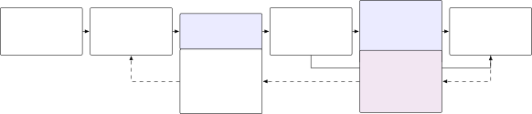

# Better Deck or Different Judge? Evaluating Agentic Harness Gains in Corporate and Investment Banking

Ludovic Gibert Affiliation: AIData2Action
Email: [ludovic.gibert@protonmail.com](mailto:)    Matis Despujols
Affiliation: TW3 Partners Email: [m.despujols@tw3partners.com](mailto:)
   André-Louis Rochet Affiliation: TW3 Partners
Email: [arochet@tw3partners.com](mailto:)

###### Abstract

Corporate and investment banking teams use presentations to support
credit decisions and advise clients on financing and transactions.
Producing these decks requires reconciling financial data, tracing
sources and turning analysis into a recommendation. We retrospectively
study the development of an agentic harness combining a 27B language
model, financial calculations, narrative templates and validation
checks. LLM judges guide engineering changes and assess the resulting
decks, raising the question of whether higher scores reflect better
documents or changes in grading. In shared-session text-only grading
with template markers removed, five judges score the complete system
20.4 to 33.6 points out of 95 above the same model generating directly
from a short prompt. Every judge scores the system higher on all
seventeen development deliverables. Margins against direct Opus
generation from a short prompt range from $`-4.7`$ to $`+0.8`$ points.
Judges agree on broad progress across development rounds but agree less
on final-deck rankings than on pooled scores. Repeated grading also
shifts scores on unchanged decks, making small improvements difficult to
distinguish from judge variability.

## 1 Introduction

Corporate and investment banking (CIB) presentations turn financial
analysis into decisions about credit, financing and transactions. A
recommendation must be supported by figures that agree across slides and
can be traced to sources. Automating these documents therefore involves
more than drafting prose.

During development, an LLM judge can apply an expert rubric (Zheng
et al., 2023; Liu et al., 2023) and return a score, a verdict and a list
of defects. In our development loop, these assessments guided changes to
prompts, templates and code. The judge served both as a source of
feedback and as the measure of whether those changes helped.

Scores also move when the documents have not changed. The same judge can
grade the same deck differently on a second pass, and two configurations
of the same judge can apply the rubric at different levels. Prior work
documents position, verbosity and self-preference biases (Wang et al.,
2024; Panickssery et al., 2024; Ye et al., 2025) and the
self-inconsistency of repeated LLM ratings on standard benchmarks
(Haldar and Hockenmaier, 2025). Development teams, however, decide in
rubric points and in a ship-or-not verdict, and reliability is rarely
reported in those units for long documents.

We measured this during the development of a CIB presentation system
(Section 3). Seventeen deliverables were graded over eight development
rounds. A later panel of eight judges from six model families compared
development versions, direct-generation baselines and two text-only
passes, the second with template markers removed. We examine score
repeatability, agreement on progress and final rankings, and the
advantage of the complete system over direct generation.



Figure 1: The hybrid generation system and its development loop. Blue
boxes denote model roles; deterministic prose can bypass the conditional
model role. The evaluated contrast starts from collected inputs.
Collection services and the application’s banker and supervisor review
loop lie outside this contrast.

## 2 Related work

Rubric-guided judges can correlate with human ratings (Zheng et al.,
2023; Liu et al., 2023; Chiang and Lee, 2023), with documented position,
length and self-preference biases (Wang et al., 2024; Dubois et al.,
2024; Panickssery et al., 2024; Ye et al., 2025). Agreement depends on
the task (Bavaresco et al., 2025; Thakur et al., 2025). Surveys, trained
judges and adversarial benchmarks address accuracy against references
(Gu et al., 2024; Kim et al., 2024; Zhu et al., 2023; Zeng et al.,
2024).

Haldar and Hockenmaier (2025) study repeated-rating reliability,
Schroeder and Wood-Doughty (2024) treat judgments as draws from a
distribution, and Atil et al. (2024) document variation under nominally
deterministic settings. Li (2026) distinguishes system drift from judge
drift using human anchors and sequential inference. Our retrospective
study measures repeated scores during presentation development, without
human anchors or a drift-detection guarantee.

Clustered inference matters when evaluation items share context (Miller,
2024); seed variation and power also constrain comparisons (Madaan
et al., 2024; Card et al., 2020; Dror et al., 2018). We use established
agreement statistics (Shrout and Fleiss, 1979; McGraw and Wong, 1996;
Koo and Li, 2016), detectable-change estimates (Weir, 2005), kappa
(Cohen, 1960; Cohen, 1968), paired differences (Bland and Altman, 1986)
and rank tests (Wilcoxon, 1945).

Financial benchmarks span numerical reasoning and question answering
(Chen et al., 2021; Islam et al., 2023; Xie et al., 2024). MBABench
evaluates complete financial spreadsheets with expert validation (Yen
et al., 2026). Slide-generation research includes document
summarisation, agentic generation and broader PowerPoint evaluation (Fu
et al., 2022; Zheng et al., 2025; Gandhi et al., 2026). Harness
evaluation also requires matched feedback and compute budgets and
reserved tasks (Wang et al., 2026). We study repeated and cross-judge
assessments of complete CIB decks, comparing an iteratively developed
harness with direct generation.

## 3 The generation harness

The system combines an on-premises Qwen3.8-27B model with financial
calculations, playbooks and output checks (Figure 1). It builds on a
staged pipeline for debt capital markets and coverage pitches
(Appendix A). We evaluate the resulting hybrid system, with explicit
separation between model roles and compiled prose.

The evaluated contrast starts from collected financial inputs and a
mandate. A deterministic engine constructs a typed registry of facts,
with value, unit, period and provenance class. Sources and formulas are
recorded where applicable. Unavailable bank-held information is
represented as a named gap. Collection services exist in the wider
application but are not compared here.

Playbooks determine the page plan. A model role states a recommendation
under the input constraints. Narrative production combines clauses
compiled from registry facts, explicit prose templates and conditional
model selection, ordering or writing. Template pages can bypass the
writer call. Output validation rejects unsupported numeric literals
after generation; this is not constrained decoding. Editing and
rendering then produce the presentation and a controls workbook.

Historical templates contain long literal passages found in every
evaluated final deck. However, the archives do not link each deck to a
complete code, input and generation-log snapshot. We therefore cannot
quantify the model-written share of the evaluated prose. Later logs with
fewer writer calls cannot establish that share retrospectively. Figure 2
illustrates the registry mechanism.

After rendering, checks cover model configuration, registry consistency,
narrative contradictions and layout defects. These checks determine
whether the generated files pass validation. The application’s
supervisor and banker review loop is outside this evaluation.

Registry entry. LEV-NET-PF = 2.99x; period FY2026 pro forma; class
computed; formula DEBT-NET-PF / EBITDA-FY26; sources: annual report
2025, mandate. Narrative slot. “The recommended sequence brings pro
forma net debt to EBITDA to {{LEV-NET-PF}}, below the agency threshold
of {{THR-AGENCY}}.” Rendered. “…to 2.99x, below the agency threshold of
3.5x.” Refused. “…to about 3.0x” contains a digit outside a key and
fails output validation. A title claiming a fall contradicts the
registered increase from 2.53x to 2.99x and fails the
narrative-consistency gate.

Figure 2: An invented illustration of registry-based rendering and
validation, translated from French. It is not an empirical test of the
checks.

## 4 Setting and protocol

The seventeen deliverables span coverage documents, credit reviews,
financing pitches and M&A advisory (Table 1). Each is an exercise on a
listed or rated issuer built from public information. Between rounds,
coding agents changed templates, the engine and the prompts, mostly to
fix defects quoted in the previous round’s verdicts and partly on
written feedback from a practitioner.

| Session       | Deliverable                     | Sector        |
| ------------- | ------------------------------- | ------------- |
| Coverage (3)  | Company credit fact sheet       | Bus. services |
|               | Coverage summary                | TMT           |
|               | Teaser and info. memorandum     | TMT           |
| Credit (5)    | LBO participation review        | Industrials   |
|               | Project-finance review          | Energy        |
|               | Credit committee, green loan    | Technology    |
|               | Annual credit review            | Bus. services |
|               | Annual credit review            | TMT           |
| Financing (5) | Share buyback programme         | Technology    |
|               | Refinancing of acquisition debt | TMT           |
|               | Rating advisory                 | TMT           |
|               | Sustainability-linked bond      | Industrials   |
|               | Green financing pitch           | Technology    |
| M&A (4)       | Acquisition bond financing      | Bus. services |
|               | Offer price assessment          | Consumer      |
|               | Sell-side floor price           | Technology    |
|               | IPO preparation                 | Technology    |

Table 1: The seventeen deliverables. One judge session grades one group
of three to five decks.

The rubric follows senior-banker review practice. Reader orientation,
ten-second synthesis, recommendation and financial depth each receive 15
points. Consistency and auditability receive 20, title storyline 10, why
this bank 5 and visual quality 5. For each deck it writes criterion
scores with quotations, a total, a verdict (not sendable, after one
round of corrections, send as is) and the five worst defects
(Appendix E). Decks receive fresh random letters in every campaign, and
the judge sees the rendered slides and the extracted text with no
information about authorship or round.

For agent-based judges, each session is fresh, with file-reading tools,
no memory of other sessions and default sampling settings (Appendix D).
The panel used Claude Opus 5.5, Sonnet 5.5 and Haiku 4.5; the
development campaigns used the Opus and Sonnet versions served at the
time, which we could not pin. The development campaigns (24 and 25
September 2026) used Opus, plus Sonnet in rounds 5 and 6, in a
configuration we cannot reconstruct exactly. The panel (29 September)
used a controlled configuration with no additional system instructions
and tools restricted to reading and writing files; it graded rounds 1, 5
and 7 with Sonnet and rounds 1 and 7 with Haiku. An earlier panel pass
of Sonnet and Haiku on rounds 1 and 7 ran with an extraneous system
instruction unrelated to the task, and we use it only as a second pass.

The cross-family panel graded the round-1 and round-7 decks with
DeepSeek V4.1 Flash, GLM 5.3 FlashX, GPT-6 Luna Pro and Gemini 3.8 Flash
through their commercial APIs, and with Qwen3.8-27B on the on-premises
GPU server that serves the generator. Each session is one request
carrying every slide image, downscaled to 1600 pixels, and the extracted
text, with the same French instruction and one added paragraph
requesting a closing JSON block of scores. Commercial API judges use low
reasoning effort; the on-premises judge has no effort setting. We log
the serving provider of every call and, for the API judges, reasoning
tokens and deck position. DeepSeek, GLM, GPT-6 Luna Pro and Qwen graded
each round twice, once in the original sessions and once with decks
reassigned to four random mixed sessions. As a check on the
configuration, Sonnet graded round 7 once more with the downscaled
images and the JSON paragraph and moved by 1.4 points. Opus graded round
7 and the no-harness sets in the controlled configuration, 1.1 points
above its development-campaign score on round 7, and Table 3 uses these
configuration-matched scores.

For the no-harness condition, Qwen3.8-27B (on premises) and Opus each
wrote the seventeen deliverables directly. They received collected
financials, a mandate, decisions to make, a one-line deliverable
description and a request for 10 to 18 slides as JSON. The archived Opus
prompts match the current input files, but the historical harness inputs
lack snapshots to verify exact equality. A neutral template rendered the
slides in the same image and text format as the harness decks. The
condition omits the fact engine, playbooks, compiled narration and
gates, while retaining collected inputs. For a stronger baseline, both
models also received a longer prompt that states the rubric, the
conventions of a CIB pitch book and a self-check before answering. The
conventions cover action titles, a synthesis page, a dated ask,
scenarios, named data gaps and figures reconciled across pages. The 27B
decks for this prompt were generated through the API, eight with medium
and nine with low reasoning effort. The strong-prompt 27B decks were
graded in mixed sessions that also contain the harness decks of the same
deliverables, which removes the between-session offset for that
comparison. These decks also differ from the short-prompt ones in
serving (the API instead of the on-premises server) and reasoning
effort, not only in the prompt. The seven judges other than Haiku graded
both short-prompt sets in the original sessions; Opus, Sonnet, DeepSeek
and GLM also graded the strong-prompt Opus decks, in separate sessions.
The rubric and instruction were otherwise identical in every campaign
except the text-only passes described below.

Two text-only passes remove the slides. Each original session holds
three versions per deliverable under fresh letters and in random order,
giving 9 to 15 texts. The second pass applies identical normalisation
rules to every version. It removes agenda pages, confidentiality
footers, page numbers, section codes, capitalised headings and bullet
glyphs, and standardises table rows and slide breaks. Wording, structure
and length still differ. The instruction sets visual quality to zero,
giving a total out of 95, and asks judges not to penalise absent layout
elsewhere. Opus, Sonnet, DeepSeek, GLM and GPT-6 Luna Pro each graded
both passes once. We use the second pass as the main text-only result.
The first retained identifying template material and is summarised in
Appendix B.

Rounds 7a and 7b are two Opus passes on byte-identical text and images,
run concurrently, as are rounds 8a and 8b with a controls workbook
added. Round 5 was graded by Opus, by Sonnet in the development
campaign, and by Sonnet again in the panel, on the same files.

For two passes of a judge on the same $`n`$ documents, with per-document
differences $`d_{i}`$, a conventional per-document minimal detectable
change estimate is

```math
\mathrm{MDC}_{95}=1.96\,\sqrt{2}\,\mathrm{SEM}=1.96\,\mathrm{sd}(d) \tag{1}
```

for one document (Weir, 2005). For a mean over $`n`$ documents with
independent errors it is $`1.96\,\mathrm{sd}(d)/\sqrt{n}`$. Intervals
use 4,000 bootstrap resamples of decks, or a chi-square calculation for
$`\mathrm{sd}(d)`$. Deck-level intervals and Wilcoxon and sign-flip
tests assume independence across decks. We report them as exploratory
and add sign-flip sensitivities at the session level. These also assume
symmetric differences and have limited resolution with four sessions.

We preserve fractional scores and use closing JSON totals when they
differ from narrative prose, logging each discrepancy. Analyses omit
missing scores. Appendix I gives the evaluation counts, missing values
and extraction checks.

## 5 Results

### 5.1 Two passes of the same judge

Two Opus passes on identical decks agree at an ICC of 0.77 in round 7
and 0.78 in round 8 (Table 2). The point estimates are in the “good”
band of Koo and Li (2016), but their intervals reach down to 0.31 and
0.44. Pooling the 34 pairs gives $`\mathrm{sd}(d)=4.05`$ (interval 3.3
to 5.3), yielding a per-deck noise scale of 7.9 points (6.4 to 10.4), or
8.4 when the systematic shift is included. These estimates depend on the
independence and distributional assumptions in Section 4.

|                                       |                            |                            |                           |
| ------------------------------------- | -------------------------- | -------------------------- | ------------------------- |
|                                       | Opus / Opus, round 7       | Opus / Opus, round 8       | Opus / Sonnet, round 5    |
| Campaign means                        | 75.8 / 77.8                | 75.7 / 76.8                | 75.0 / 86.8               |
| Mean shift \[95% CI\]                 | +2.0 \[0.1, 3.8\]          | +1.1 \[$`-`$0.8, 2.9\]     | +11.8 \[8.7, 14.6\]       |
| Wilcoxon $`p`$ / permutation $`p`$    | 0.033 / 0.063              | 0.31 / 0.31                | $`<`$0.001 / $`<`$0.001   |
| Shift by session (Cov, Cre, Fin, M&A) | +0.7, +5.6, +1.2, $`-`$0.5 | +4.7, +0.2, +1.0, $`-`$0.3 | +16.0, +6.0, +14.8, +12.0 |
| sd($`d`$), MDC₉₅ per deck             | 3.97, 7.8                  | 4.20, 8.2                  | 6.28, 12.3                |
| Spearman $`\rho`$                     | 0.71                       | 0.69                       | 0.43                      |
| ICC(A,1) \[95% CI\]                   | 0.77 \[0.31, 0.92\]        | 0.78 \[0.44, 0.89\]        | 0.18 \[0.00, 0.32\]       |
| Verdicts equal, Cohen’s $`\kappa`$    | 12/17, 0.11                | 15/17, 0.60                | 6/17, $`-`$0.19           |
| “Send as is” verdicts                 | 0 / 0                      | 0 / 0                      | 0 / 5                     |

Table 2: Agreement between two judge passes on identical decks ($`n=17`$
per column). $`d`$ is the per-deck difference in total, second pass
minus first. ICC(A,1) is the absolute-agreement, single-rater
coefficient (McGraw and Wong, 1996); intervals are bootstrap over decks.
The Sonnet column is the development pass of 24 September.

### 5.2 Shifts cluster by judge session

A single session carried most of each replication shift, the credit
decks in round 7 and the coverage decks in round 8 (Table 2). Decks
graded together appear to share an offset. For unchanged round-7 decks,
the Wilcoxon test gives $`p=0.033`$, the deck-level sign-flip test
$`p=0.063`$ and its session-level counterpart $`p=0.375`$. The root mean
square of the two campaign shifts, multiplied by 1.96, is 3.2 points,
compared with 1.9 under independent deck errors. With only two shifts,
3.2 is an exploratory noise scale, not a calibrated decision threshold.

|                     | Harness        | 27B without harness |                   | Opus without harness |                 |
| ------------------- | -------------- | ------------------- | ----------------- | -------------------- | --------------- |
| Judge               | (27B, round 7) | short prompt        | strong prompt^(a) | short prompt         | strong prompt   |
| Claude Opus         | 76.9           | +16.9 (17/17)       | +20.4 (17/17)     | $`-`$2.1 (8/17)      | $`-`$3.4 (6/17) |
| Claude Sonnet       | 75.5           | +13.6 (15/17)       | +19.1 (16/17)     | +1.1 (12/17)         | $`-`$1.4 (8/17) |
| DeepSeek V4.1 Flash | 89.1           | +12.9 (17/17)       | +17.1 (16/17)     | +3.2 (12/17)         | +1.6 (10/16)    |
| Qwen3.8-27B         | 93.4           | +11.6 (16/17)       |                   | +4.3 (14/17)         |                 |
| Gemini 3.8 Flash    | 91.5           | +10.7 (15/17)       |                   | +1.9 (10/17)         |                 |
| GLM 5.3 FlashX      | 87.8           | +10.5 (17/17)       | +14.2 (17/17)     | +2.3 (12/17)         | $`-`$0.5 (6/17) |
| GPT-6 Luna Pro      | 79.8           | +8.5 (15/17)        | +10.6 (14/16)     | +4.2 (12/17)         |                 |

Table 3: Advantage of the harness deck (27B, round 7) over each
no-harness condition, in points of the mean total, with the number of
deliverables where the harness deck scores higher. ^(a)Graded in mixed
sessions that also contain the harness decks; the difference is taken
against the harness decks of those same sessions. Opus is graded here in
the panel configuration; a blank cell means the judge did not grade that
condition, and a count out of 16 means one deck’s score is missing.

Figure 3: Opus campaign mean over the 17 decks by round, with Sonnet
passes marked. Open points repeat assessments on identical decks; labels
show the observed mean shifts.

| Rounds      | $`\Delta`$ mean | Up  | Down | Wilcoxon $`p`$ |
| ----------- | --------------- | --- | ---- | -------------- |
| 1 $`\to`$ 2 | +6.7            | 10  | 7    | 0.169          |
| 2 $`\to`$ 3 | +2.8            | 15  | 1    | 0.003          |
| 3 $`\to`$ 4 | +3.9            | 14  | 3    | 0.003          |
| 4 $`\to`$ 5 | $`-`$1.8        | 4   | 11   | 0.064          |
| 5 $`\to`$ 7 | +0.8            | 9   | 8    | 0.585          |
| 7 $`\to`$ 8 | $`-`$0.1        | 8   | 6    | 0.975          |

Table 4: Change in the Opus campaign mean between consecutive rounds
(first passes), with decks up and down, alongside the exploratory
replication scale of 3.2 points (Section 5.2; replications in Table 2).
Round 6 has no Opus pass; values are rounded independently.

### 5.3 An offset that did not replicate

Sonnet’s development pass scored the round-5 decks 11.8 points above
Opus, with every deck at or above Opus. It sent five decks as is that
Opus returned for corrections (Figure 7 in Appendix G). Taken at face
value, this offset is larger than any Opus transition in the loop.

Five days later, the panel’s Sonnet rerun of the same round-5 files
averaged 73.8, with no “send as is” verdict. That is a difference of
$`-1.2`$ points from Opus (interval $`-3.8`$ to $`+1.2`$) and of
$`-13.0`$ points from the earlier Sonnet pass ($`-14.9`$ to $`-11.1`$),
for a cause we cannot identify. Settings, tool access and the served
model version may all have differed. The pass with an extraneous system
instruction differed by $`-0.4`$ points; that comparison does not
isolate the instruction effect. The rerun still ranks the decks
differently from Opus ($`\rho=0.55`$, $`\mathrm{sd}(d)=5.4`$). A model
name was not enough to reproduce that judge’s level, and round 6, graded
only by the earlier Sonnet setup at 89.4, cannot be compared with any
Opus round.

Figure 4: Mean score per judge for the 27B with the harness (filled) and
for decks written without it (open). Panel (a) compares separate-session
means for the harness, the direct 27B with a short prompt, and direct
Opus with a short or strong prompt. Panel (b) compares the strong-prompt
27B and harness decks graded together in mixed sessions. Paired
differences and deck counts are in Table 3.

### 5.4 Eight judges from six model families

Every judge sees the decks improve between round 1 and round 7
(Table 5). The gain ranges from 5.6 points (Haiku) to 13.9 points
(DeepSeek), covers 11 to 14 of the 17 decks, and passes a Wilcoxon test
at $`p<0.03`$ for every judge except Haiku ($`p=0.11`$). Judges that did
not steer the loop are the useful check (Section 6), and those from five
other families see gains of 7 to 14 points.

The same round-7 decks average 75.5 with Sonnet and 93.4 with
Qwen3.8-27B, and the lenient judges (Qwen, GLM, Gemini) send 9 or 10 of
the 17 decks as is where Opus, Sonnet and GPT-6 Luna Pro send none. A
descriptive generalizability analysis (Appendix J) of the round-7 scores
attributes 59% of the variance to the judge, 14% to the deck and 27% to
their interaction and error. In round 1, when the decks still differed
widely, the deck carried 59% and the judge 23%. Removing Haiku changes
these shares by at most 4.4 points. The eight judges were chosen by
convenience, so the shares describe this panel and do not generalise to
other judges. Averaging judges helps rankings more than levels (Figure 8
in Appendix H). The relative coefficient reaches 0.72 with five judges,
while the absolute one rises only to 0.45.

Pooling rounds obscures weaker agreement on final rankings. Among the
seven judges excluding Haiku, median pairwise rank correlation is 0.63
in round 1, 0.30 in round 7 and 0.53 when both rounds are pooled
(Figure 5). Reduced dispersion among final decks may also lower
correlation. Correlation with the pooled consensus ranges from 0.46 to
0.76. With decks reassigned to sessions, estimated per-deck detectable
change is 13.5 to 16.1 points for the four judges measured that way
(Table 5).

| Judge               | Round 1 | Round 7 | Gain  | Up  | $`\rho_{\text{cons}}`$ | MDC  |
| ------------------- | ------- | ------- | ----- | --- | ---------------------- | ---- |
| Claude Sonnet       | 65.4    | 75.5    | +10.1 | 12  | 0.76                   |      |
| GPT-6 Luna Pro      | 71.8    | 79.8    | +8.0  | 14  | 0.72                   | 15.4 |
| GLM 5.3 FlashX      | 80.4    | 87.8    | +7.4  | 13  | 0.65                   | 14.5 |
| Claude Opus         | 63.3    | 75.8    | +12.5 | 13  | 0.61                   | 7.8  |
| Gemini 3.8 Flash    | 80.3    | 91.5    | +11.2 | 13  | 0.59                   |      |
| Qwen3.8-27B         | 84.8    | 93.4    | +8.6  | 11  | 0.59                   | 13.5 |
| DeepSeek V4.1 Flash | 75.2    | 89.1    | +13.9 | 14  | 0.46                   | 16.1 |
| Claude Haiku        | 81.1    | 86.7    | +5.6  | 11  | 0.24                   |      |

Table 5: Mean total in rounds 1 and 7, gain, decks that improved,
Spearman $`\rho`$ with the median of the other judges over the 34 deck
versions, and per-deck MDC₉₅ between two passes. Opus values come from
the development campaign, and its MDC from identical sessions; the other
MDC values come from reshuffled sessions; a blank cell means no second
pass (Gemini) or a second pass with an extraneous system instruction
(Sonnet, Haiku).

Figure 5: Pairwise Spearman correlation among seven judges, excluding
Haiku. Each line follows the same judge pair across round 1, round 7 and
their pooled scores. Bars mark the median. Pooling includes the common
improvement across rounds. Pairs share judges and decks and are not
independent observations.

### 5.5 Observed system comparisons

This comparison pairs iteratively developed harness outputs with
single-sample direct generations on the development cases. Every judge
that graded both conditions scores the harness decks above the same
model’s decks written from the short prompt (Table 3, Figure 4). The gap
ranges from 8.5 points (GPT-6 Luna Pro) to 16.9 points (Opus), the
harness deck wins on 15 to 17 of the 17 deliverables, and every
bootstrap interval excludes zero. Part of the gap sits in presentation,
since the no-harness decks use a plain template. Leaving out visual
quality and why this bank, the six remaining criteria (90 points) still
show a gap of 6.7 to 14.1 points, with the harness deck ahead on 15 to
16 deliverables. Consistency and auditability show the largest content
gap relative to criterion weight, 19% against the short prompt and 32%
against the strong prompt. Financial depth follows against the short
prompt (Table 6).

The stronger baseline does not close the observed gap. Compared across
sessions, it moves the 27B by $`-6.2`$ to $`+1.9`$ points relative to
the short prompt. In sessions that mix both conditions, the harness
decks lead by 10.6 to 20.4 points with the five judges that graded them
(8.6 to 18.1 on the six criteria) and are ahead on 14 to 17
deliverables. Mixing may add a contrast effect, since the harness decks
themselves score between 4.1 points lower (GPT-6 Luna Pro) and 5.4
points higher (Opus) than in their round-7 sessions, so part of that
range can come from the comparison itself.

Against Opus writing without the harness, the 27B with the harness is
close. With the short prompt the difference in total ranges from
$`-2.1`$ (Opus judge) to $`+4.3`$ (Qwen judge), and with the strong
prompt from $`-3.4`$ (Opus judge) to $`+1.6`$ (DeepSeek judge). The Opus
judge gives the harness its smallest margin in both cases and prefers
the Opus-written short-prompt content by 3.4 points on the six criteria
(interval 0.2 to 6.9), which is consistent with the self-preference
reported by Panickssery et al. (2024). Against direct Opus with the
short prompt, the six content gaps are close to zero. The remaining
advantage lies mostly in visual quality (19% of its weight) and, to a
lesser extent, in why this bank. The Qwen judge’s preference for the
harness decks, produced by the system containing that model, is matched
by GPT-6 Luna Pro and does not isolate self-preference.

The advantage persists after removing slides and template markers. Every
judge scores the harness text above the direct 27B text on all seventeen
deliverables, with mean gaps of 20.4 to 33.6 points out of 95 (Table 7).
These shared-session gaps use a different scale from Table 3 and may
include contrast effects.

Against direct Opus text, the margins range from $`-4.7`$ to $`+0.8`$.
Only the Opus judge’s deck-bootstrap interval excludes zero, favouring
Opus text. Its nominal Wilcoxon $`p=0.026`$ becomes $`0.25`$ in the
session-level sign-flip sensitivity. The minimum two-sided value with
four sessions is $`0.125`$. Self-preference (Panickssery et al., 2024)
is therefore a possible explanation, not an identified effect. A
non-significant difference also does not establish equivalence.

Median lengths are 4,996 words for the harness, 3,575 for Opus and 2,061
for the 27B. Correlations between length difference and the margin over
Opus range from 0.02 to 0.54. Only the Opus correlation has nominal
$`p<0.05`$, but the Sonnet estimate remains 0.46. Length-related bias
remains possible (Dubois et al., 2024), including against the shorter
27B baseline. The second pass also changes random order and judge
sampling, so the change between passes cannot isolate the effect of
template removal.

### 5.6 Progress across development rounds

The Opus mean rose from 63.3 in round 1 to 76.8 in round 4 (Figure 3,
Table 4). Rounds 2 to 4 raised almost every deck; the first transition
raised the mean by 6.7 points with ten decks up and seven down. Later
campaign-mean transitions stayed within the exploratory 3.2-point scale,
although individual decks sometimes improved by more than the per-deck
noise estimate. Round 8 also added a controls workbook to the judge’s
input. These single-pass trajectories cannot establish whether later
reconciliation work improved professional quality.

### 5.7 Verdicts and arithmetic

Opus never returned “send as is” in its 153 development records, and its
effectively binary verdict tracks the score (ROC area 0.89). Seven of 34
repeated verdicts flipped, on decks scored between 66 and 80
(Appendix F). Opus made no addition errors in 357 complete records
across development and panel conditions. Controlled Sonnet made one in
255, including the configuration check; development Sonnet made two in 34. The second Sonnet pass made one in 34, Haiku twelve in 31, GPT-6
Luna Pro none in 235 and Gemini one in 68. These counts compare
criterion sums with stated totals after preserving fractional scores.

## 6 Threats to validity

We compare judges with themselves and each other, without a banker-rated
reference set. Agreement cannot establish accuracy or professional
acceptability. The convenience panel includes related model families,
and its variance shares and projected averaging benefits need not
generalise. With one observation per deck and judge, the residual
combines interaction and measurement error.

Seventeen deliverables in four sessions and two replication pairs
constrain inference. Deck-level intervals ignore session dependence,
while session-level sensitivities have little resolution. All
significance tests are exploratory and unadjusted for multiple
comparisons. More independently randomised passes and sessions would be
needed for stable variance estimates. API and agent interfaces also
differ. DeepSeek used six providers, including one serving 97 of its 255
records.

The harness comparison combines calculations, playbooks, compiled prose,
model roles, validation and presentation. No matched ablation isolates
these components. Historical runs show operational differences between
writing modes but cannot attribute final quality gains (Appendix I).
Archived Opus prompts match current inputs, while exact historical input
equality remains unverified. Generation and judge logs lack a complete
version-linked provenance chain.

The final harness decks benefited from repeated engineering changes
driven partly by Opus feedback. Direct-generation baselines were single
samples without comparable adaptation budgets or reserved test tasks.
Changes in serving and reasoning effort confound the stronger 27B prompt
comparison. Separate-session comparisons also confound system
differences with session offsets. The text-only comparisons control
template markers and presentation only partially, leave length
differences, and may introduce within-session contrast effects.

Development can adapt to its judge (Manheim and Garrabrant, 2018; Gao
et al., 2023). Gains observed by other model families suggest they are
not specific to Opus, but shared preferences remain possible. The
text-only passes each provide one assessment per judge under different
preprocessing and order. They are not identical-condition replications.

## 7 Reproducibility

The development table contains 187 records and the panel table 1,479.
Anonymised scores, analysis scripts and an exclusion register are
available from the authors on request. The archived API expenditure was
8.2 US dollars for judging and strong-prompt 27B generation. This
excludes local compute, agent sessions and development labour. Decks,
verdict texts, generator inputs and the parser remain private because
they contain bank and issuer names.

## 8 Conclusion

On the development cases, the complete harness receives consistently
higher scores than direct generation by its 27B model. Against the short
prompt, the cleaned text-only gains are 20.4 to 33.6 points. Its scores
are close to direct Opus generation in this setting. Judges agree on
broad development progress but less on the ranking of final decks. A
change of judge or session can also shift scores without changing the
deck. Comparisons should therefore hold the judge configuration fixed
and repeat grading before treating small differences as progress
(Appendix C).

## References

- Atil et al. (2024) Berk Atil, Sarp Aykent, Alexa Chittams, Lisheng Fu,
  Rebecca J. Passonneau, Evan Radcliffe, Guru Rajan Rajagopal, Adam
  Sloan, Tomasz Tudrej, Ferhan Ture, Zhe Wu, Lixinyu Xu, and Breck
  Baldwin. 2024. Non-determinism of “deterministic” LLM settings. _arXiv
  preprint arXiv:2408.04667_.
- Bavaresco et al. (2025) Anna Bavaresco, Raffaella Bernardi, Leonardo
  Bertolazzi, Desmond Elliott, Raquel Fernández, Albert Gatt, Esam
  Ghaleb, Mario Giulianelli, Michael Hanna, Alexander Koller, André
  F. T. Martins, Philipp Mondorf, Vera Neplenbroek, Sandro Pezzelle,
  Barbara Plank, David Schlangen, Alessandro Suglia, Aditya K.
  Surikuchi, Ece Takmaz, and Alberto Testoni. 2025. LLMs instead of
  human judges? A large scale empirical study across 20 NLP evaluation
  tasks. In _Proceedings of the 63rd Annual Meeting of the Association
  for Computational Linguistics (Volume 2: Short Papers)_, pages
  238–255.
- Bland and Altman (1986) J. Martin Bland and Douglas G. Altman. 1986.
  Statistical methods for assessing agreement between two methods of
  clinical measurement. _The Lancet_, 327(8476):307–310.
- Card et al. (2020) Dallas Card, Peter Henderson, Urvashi Khandelwal,
  Robin Jia, Kyle Mahowald, and Dan Jurafsky. 2020. With little power
  comes great responsibility. In _Proceedings of the 2020 Conference on
  Empirical Methods in Natural Language Processing_, pages 9263–9274.
- Chen et al. (2021) Zhiyu Chen, Wenhu Chen, Charese Smiley, Sameena
  Shah, Iana Borova, Dylan Langdon, Reema Moussa, Matt Beane, Ting-Hao
  Huang, Bryan Routledge, and William Yang Wang. 2021. FinQA: A dataset
  of numerical reasoning over financial data. In _Proceedings of the
  2021 Conference on Empirical Methods in Natural Language Processing_,
  pages 3697–3711.
- Chiang and Lee (2023) Cheng-Han Chiang and Hung-yi Lee. 2023. Can
  large language models be an alternative to human evaluations? In
  _Proceedings of the 61st Annual Meeting of the Association for
  Computational Linguistics (Volume 1: Long Papers)_, pages 15607–15631.
- Cohen (1960) Jacob Cohen. 1960. A coefficient of agreement for nominal
  scales. _Educational and Psychological Measurement_, 20(1):37–46.
- Cohen (1968) Jacob Cohen. 1968. Weighted kappa: Nominal scale
  agreement provision for scaled disagreement or partial credit.
  _Psychological Bulletin_, 70(4):213–220.
- Dror et al. (2018) Rotem Dror, Gili Baumer, Segev Shlomov, and Roi
  Reichart. 2018. The hitchhiker’s guide to testing statistical
  significance in natural language processing. In _Proceedings of the
  56th Annual Meeting of the Association for Computational Linguistics
  (Volume 1: Long Papers)_, pages 1383–1392.
- Dubois et al. (2024) Yann Dubois, Balázs Galambosi, Percy Liang, and
  Tatsunori B. Hashimoto. 2024. Length-controlled AlpacaEval: A simple
  way to debias automatic evaluators. _arXiv preprint arXiv:2404.04475_.
- Fu et al. (2022) Tsu-Jui Fu, William Yang Wang, Daniel McDuff, and
  Yale Song. 2022. DOC2PPT: Automatic presentation slides generation
  from scientific documents. In _Proceedings of the AAAI Conference on
  Artificial Intelligence_, volume 36, pages 634–642.
- Gandhi et al. (2026) Apurva Gandhi, Vishwas Suryanarayanan,
  Raja Hasnain Anwar, Firoz Shaik, Shubhang Desai, Thong Q. Nguyen,
  Muhammad Taqi Raza, Vishal Chowdhary, and Graham Neubig. 2026.
  [PPT-Eval: A benchmark for computer-use agents on PowerPoint
  tasks](https://proceedings.mlr.press/v306/gandhi26a.html). In
  _Proceedings of the 43rd International Conference on Machine
  Learning_, volume 306 of _Proceedings of Machine Learning Research_,
  pages 32917–32957. PMLR.
- Gao et al. (2023) Leo Gao, John Schulman, and Jacob Hilton. 2023.
  Scaling laws for reward model overoptimization. In _Proceedings of the
  40th International Conference on Machine Learning_, volume 202 of
  _PMLR_, pages 10835–10866.
- Gu et al. (2024) Jiawei Gu, Xuhui Jiang, Zhichao Shi, Hexiang Tan,
  Xuehao Zhai, Chengjin Xu, Wei Li, Yinghan Shen, Shengjie Ma, Honghao
  Liu, Saizhuo Wang, Kun Zhang, Yuanzhuo Wang, Wen Gao, Lionel Ni, and
  Jian Guo. 2024. A survey on LLM-as-a-judge. _arXiv preprint
  arXiv:2411.15594_.
- Haldar and Hockenmaier (2025) Rajarshi Haldar and Julia
  Hockenmaier. 2025. Rating roulette: Self-inconsistency in
  LLM-as-a-judge frameworks. In _Findings of the Association for
  Computational Linguistics: EMNLP 2025_, pages 24986–25004.
- Islam et al. (2023) Pranab Islam, Anand Kannappan, Douwe Kiela,
  Rebecca Qian, Nino Scherrer, and Bertie Vidgen. 2023. FinanceBench: A
  new benchmark for financial question answering. _arXiv preprint
  arXiv:2311.11944_.
- Kim et al. (2024) Seungone Kim, Jamin Shin, Yejin Cho, Joel Jang,
  Shayne Longpre, Hwaran Lee, Sangdoo Yun, Seongjin Shin, Sungdong Kim,
  James Thorne, and Minjoon Seo. 2024. Prometheus: Inducing fine-grained
  evaluation capability in language models. In _International Conference
  on Learning Representations_.
- Koo and Li (2016) Terry K. Koo and Mae Y. Li. 2016. A guideline of
  selecting and reporting intraclass correlation coefficients for
  reliability research. _Journal of Chiropractic Medicine_,
  15(2):155–163.
- Li (2026) Yitao Li. 2026. [Who drifted: the system or the judge?
  anytime-valid attribution in LLM evaluation
  pipelines](https://arxiv.org/abs/2606.15474v1). _arXiv preprint
  arXiv:2606.15474_.
- Liu et al. (2023) Yang Liu, Dan Iter, Yichong Xu, Shuohang Wang,
  Ruochen Xu, and Chenguang Zhu. 2023. G-Eval: NLG evaluation using
  GPT-4 with better human alignment. In _Proceedings of the 2023
  Conference on Empirical Methods in Natural Language Processing_, pages
  2511–2522.
- Madaan et al. (2024) Lovish Madaan, Aaditya K. Singh, Rylan Schaeffer,
  Andrew Poulton, Sanmi Koyejo, Pontus Stenetorp, Sharan Narang, and
  Dieuwke Hupkes. 2024. Quantifying variance in evaluation benchmarks.
  _arXiv preprint arXiv:2406.10229_.
- Manheim and Garrabrant (2018) David Manheim and Scott
  Garrabrant. 2018. Categorizing variants of Goodhart’s law. _arXiv
  preprint arXiv:1803.04585_.
- McGraw and Wong (1996) Kenneth O. McGraw and Seok P. Wong. 1996.
  Forming inferences about some intraclass correlation coefficients.
  _Psychological Methods_, 1(1):30–46.
- Miller (2024) Evan Miller. 2024. Adding error bars to evals: A
  statistical approach to language model evaluations. _arXiv preprint
  arXiv:2411.00640_.
- Panickssery et al. (2024) Arjun Panickssery, Samuel R. Bowman, and Shi
  Feng. 2024. LLM evaluators recognize and favor their own generations.
  In _Advances in Neural Information Processing Systems 37_.
- Schroeder and Wood-Doughty (2024) Kayla Schroeder and Zach
  Wood-Doughty. 2024. Can you trust LLM judgments? Reliability of
  LLM-as-a-judge. _arXiv preprint arXiv:2412.12509_.
- Shrout and Fleiss (1979) Patrick E. Shrout and Joseph L. Fleiss. 1979.
  Intraclass correlations: Uses in assessing rater reliability.
  _Psychological Bulletin_, 86(2):420–428.
- Thakur et al. (2025) Aman Singh Thakur, Kartik Choudhary,
  Venkat Srinik Ramayapally, Sankaran Vaidyanathan, and Dieuwke
  Hupkes. 2025. Judging the judges: Evaluating alignment and
  vulnerabilities in LLMs-as-judges. In _Proceedings of the Fourth
  Workshop on Generation, Evaluation and Metrics (GEM)_, pages 404–430.
- Wang et al. (2024) Peiyi Wang, Lei Li, Liang Chen, Zefan Cai, Dawei
  Zhu, Binghuai Lin, Yunbo Cao, Lingpeng Kong, Qi Liu, Tianyu Liu, and
  Zhifang Sui. 2024. Large language models are not fair evaluators. In
  _Proceedings of the 62nd Annual Meeting of the Association for
  Computational Linguistics (Volume 1: Long Papers)_, pages 9440–9450.
- Wang et al. (2026) Yike Wang, Huaisheng Zhu, Zhengyu Hu, Yige Yuan,
  Zhengyu Chen, Shakti Senthil, Hannaneh Hajishirzi, Yulia Tsvetkov,
  Pradeep Dasigi, and Teng Xiao. 2026. [Rethinking the evaluation of
  harness evolution for agents](https://arxiv.org/abs/2607.12227v2).
  _arXiv preprint arXiv:2607.12227_.
- Weir (2005) Joseph P. Weir. 2005. Quantifying test-retest reliability
  using the intraclass correlation coefficient and the SEM. _Journal of
  Strength and Conditioning Research_, 19(1):231–240.
- Wilcoxon (1945) Frank Wilcoxon. 1945. Individual comparisons by
  ranking methods. _Biometrics Bulletin_, 1(6):80–83.
- Xie et al. (2024) Qianqian Xie, Weiguang Han, Zhengyu Chen, Ruoyu
  Xiang, Xiao Zhang, et al. 2024. FinBen: A holistic financial benchmark
  for large language models. In _Advances in Neural Information
  Processing Systems 37, Datasets and Benchmarks Track_.
- Ye et al. (2025) Jiayi Ye, Yanbo Wang, Yue Huang, Dongping Chen, Qihui
  Zhang, Nuno Moniz, Tian Gao, Werner Geyer, Chao Huang, Pin-Yu Chen,
  Nitesh V. Chawla, and Xiangliang Zhang. 2025. Justice or prejudice?
  Quantifying biases in LLM-as-a-judge. In _International Conference on
  Learning Representations_.
- Yen et al. (2026) Thomson Yen, Julian Poeltl, Harshith Srinivas Gear,
  Yilin Meng, Joshua Fan, Adam Shen, Yili Liu, Ali Bauyrzhan, Patrick
  Shea, Siri Du, Haoyang Liu, Daniel Guetta, and Hongseok
  Namkoong. 2026. [MBABench: Evaluating LLM agents on end-to-end
  spreadsheet tasks in finance](https://arxiv.org/abs/2605.22664v5).
  _arXiv preprint arXiv:2605.22664_.
- Zeng et al. (2024) Zhiyuan Zeng, Jiatong Yu, Tianyu Gao, Yu Meng,
  Tanya Goyal, and Danqi Chen. 2024. Evaluating large language models at
  evaluating instruction following. In _International Conference on
  Learning Representations_.
- Zheng et al. (2025) Hao Zheng, Xinyan Guan, Hao Kong, Wenkai Zhang,
  Jia Zheng, Weixiang Zhou, Hongyu Lin, Yaojie Lu, Xianpei Han, and
  Le Sun. 2025. [PPTAgent: Generating and evaluating presentations
  beyond
  text-to-slides](https://doi.org/10.18653/v1/2025.emnlp-main.728). In
  _Proceedings of the 2025 Conference on Empirical Methods in Natural
  Language Processing_, pages 14402–14418.
- Zheng et al. (2023) Lianmin Zheng, Wei-Lin Chiang, Ying Sheng, Siyuan
  Zhuang, Zhanghao Wu, Yonghao Zhuang, Zi Lin, Zhuohan Li, Dacheng Li,
  Eric P. Xing, Hao Zhang, Joseph E. Gonzalez, and Ion Stoica. 2023.
  Judging LLM-as-a-judge with MT-Bench and Chatbot Arena. In _Advances
  in Neural Information Processing Systems 36, Datasets and Benchmarks
  Track_.
- Zhu et al. (2023) Lianghui Zhu, Xinggang Wang, and Xinlong Wang. 2023.
  JudgeLM: Fine-tuned large language models are scalable judges. _arXiv
  preprint arXiv:2310.17631_.

## Appendix A The original pipeline

The original pipeline targets debt capital markets and coverage pitches.
Each stage uses a separate model session with specified input files and
versioned outputs.

Collection runs in two passes. A first web collection fills a manifest
of required fields and is checked for inconsistencies and grey areas; a
second collection targets the gaps and conflicts that check found and
resolves each conflict by its cause. The result is a self-contained data
block and a data contract that fixes what later steps may no longer
guess. A calculation engine performs arithmetic from that block and
writes a reconciliation file with one key per number and an audit log.
The model transcribes inputs and adds options, a recommended sequence
and stress cases.

Three documents are drafted from the same reconciliation file in
separate conversations, for the executive committee, the risk committee
and the client, each citing numbers by key. Senior-editing passes then
work on tone, consistency and finish without inventing or recomputing
anything. A script checks every cited number against the reconciliation
file (discrepancies, orphan keys, numbers without a key, forbidden
tokens) and blocks the process on any failure. An adversarial review in
a fresh context, run on a model at least as strong as the producing one,
then judges scope, storyline and the stress cases and returns a verdict
with a routing decision. A failure is corrected at its root step, never
on the slide, and all documents are regenerated before the review is run
again. Only a passing document is laid out, with a blocking visual check
per slide.

A defect register is the one file that crosses runs. Each review reads
it first and appends findings. Periodic reviews turn recurring error
classes into rules, preferably implemented in code, and retire rules
that no longer detect defects. The design calls for a mandatory
calculation engine, blocking verification, shorter prompts split into
more steps, structured output and internal data sources. It also
proposes a strong review model and seeded defects to validate checks
before production.

## Appendix B Harness gap by criterion and on text alone

Table 6 breaks the harness advantage of Section 5.5 down by rubric
criterion, and Table 7 gives the cleaned text-only pass.

The first text-only pass retained identifying template material. Its
mean harness advantage ranged from 17.5 to 36.4 points against the
direct 27B and from $`-4.1`$ to $`+1.9`$ against direct Opus. Each judge
preferred the harness to the 27B on sixteen or seventeen deliverables.
These earlier results are secondary to the cleaned pass.

| Criterion (weight)    | 27B short (7) | 27B strong (5) | Opus short (7) |
| --------------------- | ------------- | -------------- | -------------- |
| Reader’s problem (15) | +7%           | +10%           | 0%             |
| Synthesis (15)        | +8%           | +14%           | +1%            |
| Recommendation (15)   | +6%           | +6%            | 0%             |
| Depth, scenarios (15) | +15%          | +13%           | $`-`$1%        |
| Consistency (20)      | +19%          | +32%           | +3%            |
| Storyline (10)        | +8%           | +13%           | +1%            |
| Why this bank (5)     | +23%          | +3%            | +8%            |
| Visual (5)            | +20%          | +38%           | +19%           |

Table 6: Mean advantage of the harness deck (27B, round 7) over each
no-harness condition, per criterion, as a share of the criterion’s
weight, averaged over the judges that graded the condition (number of
judges in the column header). Short and strong refer to the prompt.

[TABLE]

Table 7: Harness text (27B, round 7) minus text written without the
harness in the cleaned text-only pass, out of 95 without visual quality.
Cells give 95% bootstrap intervals and the number of deliverables where
the harness text scores higher. All three versions of a deliverable were
graded in the same session. The last column is the Spearman correlation,
over deliverables, between the harness margin over the Opus text and the
difference in word count. All totals and criterion scores are available
in this pass.

## Appendix C Protocol for grading with an LLM judge

1.  1.  Repeat grading with decks assigned to sessions at random. Two passes
        expose discrepancies; estimating variability precisely requires a
        larger design matched to the desired precision.
2.  2.  Treat decks graded in the same session as a cluster when testing a
        change.
3.  3.  Estimate per-document and campaign-level variability, report its
        uncertainty and avoid treating a small change as conclusive from one
        pass.
4.  4.  Compare systems within a single judge and configuration, and anchor
        any change of judge on a shared set of decks.
5.  5.  Read the continuous score rather than a ship-or-not verdict when the
        score lies near the verdict threshold.
6.  6.  Record model, provider, date, reasoning effort and input format for
        every judge call.
7.  7.  When systems differ in presentation, add a pass on the text alone
        and check whether document length tracks the score.
8.  8.  Check a subset of decks with human experts before trusting absolute
        levels.

## Appendix D Judge configurations

| Judge               | Access      | Effort  | Slides    |
| ------------------- | ----------- | ------- | --------- |
| Opus                | agent       | default | full size |
| Sonnet              | agent       | default | full size |
| Haiku               | agent       | default | full size |
| DeepSeek V4.1 Flash | API         | low     | 1600 px   |
| GLM 5.3 FlashX      | API         | low     | 1600 px   |
| GPT-6 Luna Pro      | API         | low     | 1600 px   |
| Gemini 3.8 Flash    | API         | low     | 1600 px   |
| Qwen3.8-27B         | on premises | not set | 1600 px   |

Table 8: Judge configurations. Effort refers to reasoning; sampling
settings are provider defaults. All judges received extracted text.
Text-only passes omitted slide images (Section 4).

## Appendix E Judge instruction

We translate and reformat the French instruction.

> You are an investment-bank managing director. Your area is debt
> capital markets, credit or M&A, depending on the deliverable. You
> grade draft presentations, given as rendered images (four slides per
> image) and extracted text. You do not know who made them or which are
> recent. Read the slides first and the text second, to quote exactly.
>
> Use the following weighted rubric. Criteria (1) reader orientation,
> (2) ten-second synthesis, (3) recommendation and ask (what, when,
> who), and (4) financial depth and scenarios each receive 15 points.
> Criterion (5) consistency and auditability receives 20. Criterion (6)
> title storyline receives 10. Criteria (7) why this bank and (8) visual
> quality and meeting effectiveness each receive 5.
>
> For each deck, give criterion scores with justifications and exact
> quotations with page numbers, then a total out of 100. Answer whether
> you would send it as is (yes / after one round of corrections / no),
> with the reason. List the five most serious defects with quotations,
> pages and precise corrections. Be cold and exact. A claim without a
> quotation does not count. Check the arithmetic you can redo.
>
> “Yes” means you would send it to the client or the committee as it is,
> without retouching. A figure unverifiable from the pages or a
> contradiction between pages prevents a “yes”. So does machine-sounding
> wording or a layout defect a director would notice.

## Appendix F Verdicts against scores

A threshold at 70 classifies 86% of development Opus judgments, but the
two verdict classes overlap between 56 and 79 (Figure 6). The same
threshold, chosen on these data, would have flipped one and two decks
between the two Opus passes of rounds 7 and 8. The development Sonnet
pass returned “send as is” 7 times in 34, always at 92 or above.

Figure 6: Total of every development Opus judgment by verdict
($`n=153`$, vertical jitter added).

## Appendix G Paired scores on identical decks

Figure 7 plots, deck by deck, the scores of the three pairs of passes
summarised in Table 2.

Figure 7: Per-deck totals from two passes on identical decks: Opus/Opus
in rounds 7 and 8 (top, middle) and Opus/Sonnet on 24 September in round
5 (bottom). Open points changed verdict between the passes.

## Appendix H Judge agreement

Figure 8 projects dependability when averaging judges. Appendix J gives
the model and its assumptions. Round-specific rank agreement is shown in
Figure 5.

Figure 8: Projected dependability when averaging $`n`$ judges,
conditional on the round-7 variance decomposition. Curves show absolute
($`\Phi`$) and relative ($`E\rho^{2}`$) coefficients. The residual
includes interaction and error; extrapolation beyond this convenience
panel is unvalidated.

## Appendix I Evaluation inventory and archives

Table 9 separates requested evaluation records from recoverable scores.
These are repeated measurements of the same deliverables, not
independent documents.

|                           |         |        |
| ------------------------- | ------- | ------ |
| Phase                     | Records | Scores |
| Development               | 187     | 187    |
| Panel development decks   | 493     | 491    |
| Short-prompt comparisons  | 238     | 238    |
| Strong-prompt comparisons | 238     | 236    |
| First text-only pass      | 255     | 254    |
| Cleaned text-only pass    | 255     | 255    |
| Total                     | 1,666   | 1,661  |

Table 9: Records and recoverable totals by evaluation phase. The
strong-prompt phase includes the harness decks regraded in mixed
sessions. Missing totals remain missing; none are imputed.

The archive contains 1,666 evaluation records, of which 1,661 contain
recoverable totals. A parser preserves fractional scores and recognises
both total and score headings. Development criterion sums match totals
in 185 of 187 records. All controlled Opus and Sonnet records contain
complete criteria, including both text-only passes. API and on-premises
judges omit totals in four of 918 records. Haiku lacks one total and ten
categorical verdicts. Parsed scores were checked against the raw judge
responses.

An archive audit identified five pilot sessions containing 21 scores
outside the main collection, three earlier verdicts using different deck
sets or formats, and a truncated test response. Earlier calibration
archives contain 25 reports with 50 presentation-order rows. Their
grids, candidates and admissibility rules differ from the main study. We
retain them in an exclusion register rather than pooling them with the
main scores. The pilot exclusion rationale was not fully recorded
contemporaneously, limiting retrospective selection checks.

One earlier case compared free-field writing with compiled assertions.
The archived diagnostics record 121 versus 41 model calls and
approximately 191 versus 85 seconds. Repetition warnings increased from
six to 30, and blocking defects from zero to one. Page titles and
exhibits match, but prose and the thesis differ, and the claimed common
registry lacks a preserved snapshot. Later tuning reduced calls further;
it is not an independent replication. These archives document
operational tradeoffs, not a component effect on final-deck quality.

## Appendix J Statistical estimands

Fixed-group repetitions measure within-context variability. Reassigned
sessions also vary grouping and order; configuration comparisons vary
further factors. Their detectable-change estimates are not
interchangeable.

The pooled Opus estimate reuses seventeen deliverables across 34
differences. Deck-bootstrap and chi-square intervals omit
repeated-document and session dependence.

Each round uses the first original-grouping score per deck and judge,
from development for Opus and the controlled panel for others.
Replications are not averaged. In $`Y_{dj}=\mu+a_{d}+b_{j}+e_{dj}`$,
$`a_{d}`$ and $`b_{j}`$ represent deck and judge effects. The residual
combines interaction and error. With $`D`$ decks and $`J`$ judges,
two-way mean squares give

```math
\displaystyle\hat{v}_{d} \displaystyle=\max\{(MS_{d}-MS_{e})/J,0\}, \tag{2}
```

```math
\displaystyle\hat{v}_{j} \displaystyle=\max\{(MS_{j}-MS_{e})/D,0\}, \tag{3}
```

```math
\displaystyle\hat{v}_{e} \displaystyle=MS_{e}. \tag{4}
```

Negative component estimates are truncated to zero. Session and
model-family effects are not fitted. For the projected mean of $`k`$
judges,

```math
\displaystyle\Phi_{k} \displaystyle=\frac{\hat{v}_{d}}{\hat{v}_{d}+(\hat{v}_{j}+\hat{v}_{e})/k}, \tag{5}
```

```math
\displaystyle E\rho^{2}_{k} \displaystyle=\frac{\hat{v}_{d}}{\hat{v}_{d}+\hat{v}_{e}/k}. \tag{6}
```

Projections assume uncorrelated judge and residual contributions. They
are conditional on this convenience panel, without validated precision
guarantees for new judges.
