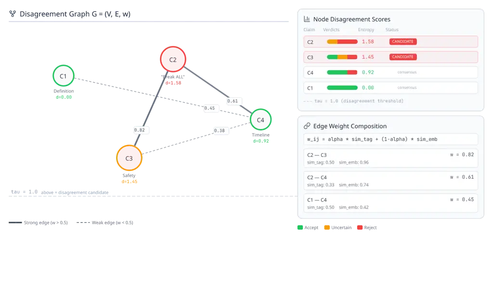

\correspondingauthor

# JuryFlow: Disagreement-Guided Human-in-the-Loop Multi-Agent Evaluation

Conference: Proceedings of the 14th International Conference on
Human-Agent Interaction; November 16–19, 2026; Osaka, JapanProceedings
of the 14th International Conference on Human-Agent Interaction (HAI
’26), November 16–19, 2026, Osaka,
JapanDOI: [10.1145/3841580.3841619](https://doi.org/10.1145/3841580.3841619)ISBN: 979-8-4007-2575-3/2026/11CCS: Computing
methodologies Natural language processingCCS: Human-centered
computing Interactive systems and toolsCCS: Computing
methodologies Machine learning

Mufeng Yang
[](https://orcid.org/0009-0005-1714-2544)
Note: Mufeng Yang and Junwei Yu contributed equally to the paper.
Affiliation: University of Tsukuba, Ibaraki, Japan email:
<s2321728@u.tsukuba.ac.jp> , Junwei Yu
[](https://orcid.org/0009-0004-1657-3310)
Affiliation: The University of Tokyo, Tokyo, Japan email:
<yujw@satolab.itc.u-tokyo.ac.jp> and Yepeng Ding
[](https://orcid.org/0000-0002-6996-9333)
Affiliation: Hiroshima University, Higashihiroshima, Japan email:
<ypding@hiroshima-u.ac.jp>

© cc

![A conceptual illustration showing the JuryFlow pipeline from left to
right. Three AI robot icons (labeled Agents) each produce a document
icon (labeled Claim). Arrows flow from agents and claims into a central
disagreement graph, a dense network of interconnected nodes with some
edges highlighted in amber to indicate conflict. A human selects the
highest-entropy focal node (automated in our experiments). Dashed arrows
lead rightward to a second, lighter graph representing Propagated
Re-Evaluation, and finally to a checklist document icon labeled Rubric
Update.](arxiv-2609-40103v1--4b628ad1c35d.figures/figure-1.webp)

Figure 1. Conceptual overview of JuryFlow. Multiple LLM _Agents_ extract
_Claims_ from a candidate response and produce per-claim verdicts,
forming a _Disagreement Graph_ that surfaces conflicts. A _Human_
selects the most critical disagreement point—the only human intervention
(made automatically by entropy ranking in our experiments). The system
then performs _Propagated Re-Evaluation_ across related claims and
historical cases, and abstracts the correction into a _Rubric Update_
that all agents inherit, closing the loop.A conceptual illustration
showing the JuryFlow pipeline from left to right. Three AI robot icons
(labeled Agents) each produce a document icon (labeled Claim). Arrows
flow from agents and claims into a central disagreement graph, a dense
network of interconnected nodes with some edges highlighted in amber to
indicate conflict. A human selects the highest-entropy focal node
(automated in our experiments). Dashed arrows lead rightward to a
second, lighter graph representing Propagated Re-Evaluation, and finally
to a checklist document icon labeled Rubric Update.

###### Abstract.

Large language models (LLMs) are increasingly deployed as automated
judges for AI-generated content, yet a single judge is unreliable and
even a panel of judges leaves a hard residue: when judges disagree,
majority voting simply discards the conflict instead of resolving it. We
present JuryFlow, a disagreement-guided, human-in-the-loop multi-agent
evaluation framework that treats inter-judge disagreement not as noise
to be averaged away, but as a precise, claim-level signal indicating
where an evaluation is uncertain. JuryFlow decomposes each candidate
response into atomic claims, has a panel of heterogeneous judges assign
per-claim verdicts, and builds a disagreement graph whose nodes are
scored by verdict entropy and whose edges encode structural similarity
between claims. A human acts as a structural guide, i.e., selecting
which disagreement to resolve through a single, minimal intervention
rather than re-labeling the response, after which the focal claim is
re-evaluated, the correction propagates along graph edges and to
historically similar cases, and is crystallized into reusable rubric
entries that all judges inherit, making the evaluator progressively
self-refining. To enable large-scale, reproducible benchmarking without
human studies, we evaluate JuryFlow in an automatic configuration in
which the focal selection is made by entropy ranking. On MT-Bench and
LLMBar, JuryFlow improves agreement with gold labels over single-judge
and majority-vote panel baselines, and ablations isolate the
contributions of disagreement-targeted re-evaluation, propagation, and
rubric induction. We contribute (1) a human-in-the-loop paradigm that
recasts the human from labeler to structural guide, (2) the JuryFlow
framework operationalizing it through a disagreement graph, focal
re-evaluation, and closed-loop rubric induction, and (3) an evaluation
protocol with ablations that isolate where the gains originate.

###### Keywords: 

Disagreement Graph, Multi-Agent Evaluation, Human-in-the-Loop,
LLM-as-a-Judge, Uncertainty Quantification, Self-Refining Evaluation,
Rubric Induction

^(†)^(†)cc-license: by

## 1. Introduction

Large language models (LLMs) are increasingly used as automated judges
to evaluate AI-generated content at scale, such as ranking chatbot
responses, scoring factuality, and screening for safety (Zheng et al.,
2023; Liu et al., 2023; Dubois et al., 2024). A single LLM judge is
susceptible to position, verbosity, and self-enhancement biases (Wang et
al., 2023; Zheng et al., 2024; Panickssery et al., 2024). Its verdicts
are particularly fragile in fine-grained, few-shot settings with
ambiguous criteria, conflicting standards, or incomplete evidence. A
_panel_ of heterogeneous judges can reduce model-specific bias and
improve agreement with human preferences (Verga et al., 2024; Chan et
al., 2023). Yet the panel still requires a resolution procedure when its
judges disagree.

The standard response is to aggregate the conflicting verdicts through
majority voting or confidence-weighted reconciliation (Chen et al.,
2024; Jiang et al., 2023). This procedure discards useful information.
Inter-judge disagreement provides a claim-level indication of _where_ an
evaluation is uncertain (Seung et al., 1992; Lakshminarayanan et al.,
2017). Claims with conflicting verdicts are also those for which a
holistic verdict is least reliable. Existing methods either operate at a
coarser granularity or require more human effort. Uncertainty-driven
escalation routes entire uncertain _instances_ to stronger models or
human annotators (Jung et al., 2025; Wang et al., 2024; Kim et al.,
2024a). These systems re-evaluate a full response rather than the
contested claim within it. Interactive criteria tools such as EvalGen
and MetricMate instead address the upstream task of specifying what to
evaluate before inspecting a case (Shankar et al., 2024; Gebreegziabher
et al., 2025). A complementary mechanism is needed to locate contested
claims automatically, direct additional evaluation to them, and retain
the resulting corrections for subsequent evaluations.

We therefore treat disagreement as an evaluation signal and assign the
human the role of _structural guide_ rather than _labeler_. The human
makes one selection instead of re-evaluating the full response. The
system then performs an evidence-based re-evaluation of the selected
claim. A structured _disagreement graph_ exposes conflicts, and verdict
entropy ranks claims for selection. The human therefore chooses from a
small set of claims with high entropy. The same ranking supports
automatic selection when no human is available, as in our large-scale
evaluation.

We implement this approach in JuryFlow, a disagreement-guided,
human-in-the-loop evaluation framework that operates in five stages
(Figure 1). (1) A panel of heterogeneous judge agents independently
decomposes a candidate response into atomic claims and assigns per-claim
verdicts and dimension tags. (2) The system constructs a disagreement
graph whose nodes carry entropy-based disagreement scores and whose
edges encode structural similarity between claims. (3) A human makes the
only structural intervention by selecting the focal claim to resolve.
For automated benchmarking, the system instead selects claims with the
highest entropy using the same ranking. (4) Each focal selection
triggers _propagated re-evaluation_: the focal claim is re-judged
against evidence, and the correction propagates along graph edges to
structurally related claims and, via embedding retrieval, to
historically similar cases. (5) The correction is abstracted into a
reusable rubric entry that all judges inherit in subsequent evaluations.
Stages 4 and 5 extend each targeted correction to related claims and
incorporate it into subsequent evaluation criteria. JuryFlow can
therefore improve across instances, unlike panels that evaluate each
instance independently.

We evaluate JuryFlow on the MT-Bench and LLMBar benchmarks (Zheng et
al., 2023; Zeng et al., 2024) against single-judge and majority-vote
panel baselines. Because human studies are out of scope here, we use the
automatic-selection configuration, which isolates the multi-agent
machinery from human factors. We therefore use _human-in-the-loop_
throughout to name the interaction design rather than an empirically
validated property of this study. The human’s only action is to select a
claim in the disagreement graph, not to assign a label or rewrite a
verdict. Every reported result uses entropy ranking in place of that
selection. Section 6 describes the information that a human could
provide beyond this proxy, and Section 7 lists the unvalidated mode as a
limitation. Four questions organize the experiments: whether
disagreement-targeted re-evaluation beats aggregation, how the gain
splits between propagation (Stage 4) and rubric induction (Stage 5), how
the trade-off between accuracy and cost varies with the propagation
threshold, and whether the gains require genuine model diversity rather
than ensemble size alone (Section 5).

This paper makes three contributions. (1) A formulation of disagreement
as an actionable signal: we use inter-judge disagreement to identify
claims that require additional inference, replacing holistic aggregation
with targeted re-evaluation. (2) The JuryFlow framework, which
operationalizes that signal through a disagreement graph, human-guided
focal selection (automated by entropy ranking for unattended
evaluation), graph- and retrieval-based correction propagation, and
incremental rubric induction that links disagreement resolution to
criteria refinement. (3) An evaluation protocol with ablations on
MT-Bench and LLMBar that isolates the contributions of focal
re-evaluation, propagation, and rubric induction and characterizes the
trade-off between accuracy and cost.

## 2. Related Work

The following subsections relate JuryFlow to work on LLM-based
evaluation, claim-level decomposition, iterative evaluation alignment,
uncertainty in multi-agent systems, and human-AI collaboration.

### 2.1. LLM-as-a-Judge and Multi-Agent Evaluation

LLMs are widely used to evaluate generated content (Zheng et al., 2023;
Liu et al., 2023; Dubois et al., 2024). Zheng et al. (Zheng et al., 2023) introduced MT-Bench and found that GPT-4 judgments correlate
strongly with human preferences. Single-model judges, however, exhibit
position, verbosity, and self-enhancement biases (Wang et al., 2023;
Zheng et al., 2024). Multi-agent frameworks attempt to reduce these
biases. ChatEval uses role-playing agents to create prompt-level persona
diversity (Chan et al., 2023); ReConcile resolves disagreement by
multi-round discussion and confidence-weighted voting across genuinely
different models rather than prompt variation alone (Chen et al., 2024);
and Auto-J adapts evaluation criteria to each scenario (Li et al.,
2023). Verga et al. (Verga et al., 2024) showed that a _panel of diverse
models_ (PoLL) can match or exceed a single large judge while reducing
model-specific bias. This result motivates the panel design in JuryFlow
and is consistent with evidence that judges favor their own generations
over equally good alternatives (Panickssery et al., 2024). Zeng et
al. (Zeng et al., 2024) introduced LLMBar, a benchmark containing cases
that induce disagreement among judges. These approaches resolve
disagreement through aggregation or majority voting. JuryFlow instead
represents disagreement as a structured signal for targeted
intervention.

### 2.2. Claim-Level Decomposition and Iterative Evaluation Alignment

Fine-grained evaluation decomposes responses into verifiable units
rather than assigning a holistic verdict. For example, Min et al. (2023)
use atomic facts as the unit of factuality evaluation and show that
binary holistic judgments are inadequate when a response contains both
supported and unsupported claims; Wei et al. (2024) add search-augmented
verification against retrieved evidence; and Kim et al. (2024b) carry
claim-level analysis into open-ended evaluation through customizable
rubrics. Evaluation design also varies by domain. In particular, Ye et
al. (2023) decompose evaluation into 12 fine-grained skills with
separate rubrics and show that dimension-specific prompting outperforms
unified assessment. Safety evaluation requires judge architectures that
differ from those used for factuality or coherence (Inan et al., 2023).

Beyond static rubrics, iterative alignment between human intent and
automated evaluation has been studied through mixed-initiative
interfaces. Shankar et al. (2024) define _criteria drift_ as the change
in users’ evaluation standards as they inspect more outputs. They
identify this drift as a central obstacle to specifying criteria before
observing model behavior. Kim et al. (2024c) show that interactive
criteria refinement reduces the number of required prompt revisions by
59%. In addition, Gebreegziabher et al. (2025) present MetricMate, which
supports hierarchical criteria definition and calibration through
curated success/failure examples. These tools address the upstream task
of articulating and stabilizing evaluation criteria. JuryFlow addresses
the complementary downstream problem of resolving claim-level
disagreement under established criteria. It identifies the claim with
the highest entropy within an instance and directs re-evaluation to that
claim.

### 2.3. Uncertainty-Driven Human Escalation and Active Learning

A related line of work studies when and how uncertain automated
judgments should be escalated for human oversight. Jung et al. (2025)
propose _Trust or Escalate_, establishing provable guarantees of human
agreement by routing low-confidence LLM evaluations to stronger models
through a cascaded selective evaluation framework; Wang et al. (2024)
show that routing only low-verifier-score labels to human re-annotators
cuts annotation cost while preserving label quality; and Kim et al.
(2024a) operationalize the principle in MEGAnno+, a deployed system for
human verification of LLM-generated labels. Selective routing is related
to active learning (Settles, 2009), particularly
query-by-committee (Seung et al., 1992), which uses disagreement among
models to identify uncertain instances. These approaches frame
escalation at the _instance_ level by selecting which outputs require
human attention. JuryFlow operates at the claim level and does not
escalate the judgment to a human. Given an uncertain instance, it
identifies the claim that requires focused re-evaluation and replaces
full response review with targeted computation.

### 2.4. Disagreement and Uncertainty in Multi-Agent Systems

Disagreement among models is a recognized signal of uncertainty in
ensemble methods (Lakshminarayanan et al., 2017) and committee-based
active learning (Seung et al., 1992), and in NLP it has been used to
calibrate confidence estimates (Xiong et al., 2023). In LLM contexts,
Jiang et al. (2023) use self-consistency and voting across multiple
generations, while Green and Chen (2019) show that people struggle to
calibrate their reliance on algorithmic advice even when disagreement
signals are available. These approaches treat disagreement as a scalar
quantity for aggregation. The JuryFlow disagreement graph instead
represents conflict at the claim level, so the system can direct
re-evaluation to specific claims.

### 2.5. Human-AI Collaboration and Mixed-Initiative Interaction

JuryFlow follows the mixed-initiative interaction paradigm (Horvitz,
1999), which allocates control between people and machines according to
their respective strengths. Its design also draws on empirical studies
of human-AI decision making (Lai et al., 2023). Because people overrely
on AI when verification is costly (Buçinca et al., 2021; Vasconcelos et
al., 2023), we keep the human’s action minimal: a single structural
selection over a disagreement graph rather than a holistic
re-evaluation. This design reduces the cost of oversight while leaving
the final verdict to the system. Zeno (Cabrera et al., 2023) and
ChainForge (Arawjo et al., 2024) support human-directed analysis at the
_dataset_ level for behavioral evaluation and visual prompt engineering,
respectively. JuryFlow instead organizes within-instance disagreement so
that a single selection, made either by a human or by entropy ranking,
determines the target of re-evaluation.

## 3. Method

Unlike methods that aggregate judgments by voting or treat human input
as an isolated correction, JuryFlow uses each selected disagreement to
update structurally similar cases and reusable evaluation criteria. This
process links downstream disagreement resolution to subsequent criteria
refinement. The framework has five stages, as shown in Figure 2.

![A three-column workflow diagram showing five stages of the JuryFlow
evaluation pipeline. Stage 3 carries a Human badge, the others an Agents
badge. Column 1 (Stage 1) displays three AI judge agents with per-claim
verdicts and tags. Column 2 has Stage 2 (disagreement graph with claim
nodes and verdict-colored edges) above Stage 3 (human focal selection).
An elbow connector leads to Column 3 with Stage 4 (focal re-judgment,
intra/cross-instance propagation, final verdict) above Stage 5 (pattern
extraction, rubric entry generation, deduplication). A dashed polyline
arrow along the bottom connects Stage 5 back to Stage
1.](arxiv-2609-40103v1--4b628ad1c35d.figures/figure-2.webp)

Figure 2. The five-stage JuryFlow pipeline, illustrated with a
cryptography question whose candidate response contains three claims: C1
(“Definition”), C2 (“Break ALL current encryption”), and C3 (“Safety”).
Each stage is labeled _Agents_ (automated) or _Human_. Stage 1 produces
per-claim verdicts and dimension tags. Stage 2 constructs the
disagreement graph and detects high-entropy claims. Stage 3 contains the
only human input, a single focal-claim selection. Stage 4 propagates
corrections through graph edges and cross-instance retrieval. Stage 5
converts the correction into a reusable rubric entry.A three-column
workflow diagram showing five stages of the JuryFlow evaluation
pipeline. Stage 3 carries a Human badge, the others an Agents badge.
Column 1 (Stage 1) displays three AI judge agents with per-claim
verdicts and tags. Column 2 has Stage 2 (disagreement graph with claim
nodes and verdict-colored edges) above Stage 3 (human focal selection).
An elbow connector leads to Column 3 with Stage 4 (focal re-judgment,
intra/cross-instance propagation, final verdict) above Stage 5 (pattern
extraction, rubric entry generation, deduplication). A dashed polyline
arrow along the bottom connects Stage 5 back to Stage 1.

### 3.1. Stage 1: Multi-Agent Structured Judging

Given an evaluation instance consisting of a prompt $`Q`$ and a
candidate response $`A`$, we invoke a panel of $`N`$ heterogeneous judge
agents $`\{J_{1},J_{2},\dots,J_{N}\}`$. We obtain _model diversity_
primarily by using LLMs from different providers, which have distinct
training data and architectural biases (Verga et al., 2024). We
optionally add _prompt diversity_ by varying evaluation personas or
domain-specific instructions (Chan et al., 2023; Ye et al., 2023). A
predefined output schema enforces consistent claim-level decomposition
across providers and makes their outputs directly comparable. Each agent
independently produces a judgment comprising:

- •
  A set of extracted claims $`C=\{c_{1},c_{2},\dots,c_{k}\}`$, where
  $`k`$ is the number of claims and each claim is an atomic, verifiable
  proposition derived from $`A`$;
- •
  A verdict
  $`v_{i}^{(j)}\in\{\texttt{accept},\texttt{reject},\texttt{uncertain}\}`$
  assigned by agent $`J_{j}`$ to claim $`c_{i}`$;
- •
  A set of tags $`T_{i}^{(j)}\subseteq\mathcal{T}`$, where
  $`\mathcal{T}`$ is a predefined set of high-level evaluation
  dimensions (e.g., factual accuracy, logical coherence, safety).
  Following the fine-grained skill taxonomy of Ye et al. (2023), we take
  $`\mathcal{T}`$ to be a fixed, domain-configurable set of 5 to 7
  dimensions, which keeps tag assignment consistent across agents and
  stabilizes the tag-based similarity of Stage 2.

No aggregation or voting occurs at this stage. The disagreement analysis
receives every judgment and its associated tags.

### 3.2. Stage 2: Disagreement Graph Construction

We represent the multi-agent evaluation output as a weighted
disagreement graph $`G=(V,E,w)`$, where each node $`v_{i}\in V`$
corresponds to a claim $`c_{i}`$ and each edge $`e_{ij}\in E`$ encodes
the structural relationship between two claims. Figure 3 shows a worked
four-claim instance.

#### Node-level disagreement score.

For each claim $`c_{i}`$, we compute a disagreement score $`d_{i}`$
based on the entropy of the verdict distribution across agents:

```math
d_{i}=-\sum_{v\in\mathcal{V}}p_{i}(v)\log p_{i}(v), \tag{1}
```

where $`p_{i}(v)`$ is the proportion of agents assigning verdict $`v`$
to claim $`c_{i}`$, and
$`\mathcal{V}=\{\texttt{accept},\texttt{reject},\texttt{uncertain}\}`$.
Claims with $`d_{i}`$ exceeding a threshold $`\tau`$ are marked as
disagreement candidates.

#### Edge weights.

The weight $`w_{ij}`$ between two claim nodes captures their structural
similarity along two complementary dimensions:

```math
w_{ij}=\alpha\cdot\text{sim}_{\text{tag}}(c_{i},c_{j})+(1-\alpha)\cdot\text{sim}_{\text{emb}}(c_{i},c_{j}), \tag{2}
```

where $`\text{sim}_{\text{tag}}`$ is the Jaccard similarity over the
union of agent-assigned tags, $`\text{sim}_{\text{emb}}`$ is the cosine
similarity of claim embeddings, and $`\alpha\in[0,1]`$ is a mixing
coefficient. The two terms capture distinct relationships between a pair
of claims. $`\text{sim}_{\text{tag}}`$ measures whether the panel
evaluated the claims along the same dimensions, whereas
$`\text{sim}_{\text{emb}}`$ measures whether the claims express similar
content. A factual error and a safety error in the same sentence score
high on the first measure and low on the second. Two paraphrases of one
assertion exhibit the reverse pattern. A correction can transfer when
either relationship holds, so we use a convex combination that is
monotonic in both signals. A product would instead require both forms of
similarity. The coefficient $`\alpha`$ controls their relative
contributions. Because $`\mathcal{T}`$ is a fixed, finite set shared by
all agents, $`\text{sim}_{\text{tag}}`$ is well-defined and bounded.
Agents may disagree on _verdicts_ while still agreeing on which
_dimensions_ are relevant to a claim, a similarity signal independent of
verdict agreement. The graph identifies both contentious claims, which
have high $`d_{i}`$, and structurally related claims, which have high
$`w_{ij}`$. Stage 4 uses this structure to propagate focal corrections.



Figure 3. Disagreement graph detail for a four-claim instance. Nodes
carry entropy-based disagreement scores $`d_{i}`$; those above $`\tau`$
(dashed line) are disagreement candidates. Edge thickness and opacity
encode $`w_{ij}`$, a mixture of tag Jaccard and embedding cosine
similarity. Right: per-claim verdict distributions and the edge-weight
decomposition for the three strongest edges.A two-panel figure. The left
panel shows a graph with four claim nodes (C1 green, C2 red, C3 yellow,
C4 yellow) connected by edges of varying thickness. C2 and C3 are above
the tau threshold line and marked as candidates. Edge labels show w
values (0.82, 0.61, 0.45, 0.38). The right panel contains a table of
node disagreement scores with stacked verdict bars and a breakdown of
edge weight composition showing sim\\tag and sim\\emb values.

### 3.3. Stage 3: Human-Guided Focal Selection

JuryFlow is designed as a human-in-the-loop framework. Let $`m`$ denote
the focal budget for an instance. The system presents the disagreement
graph and highlights the top-$`m`$ candidates ranked by $`d_{i}`$
(Figure 4). It then asks the human one question: _which disagreement
should the system resolve first?_ The human selects one focal claim
$`c^{*}`$; no verdict, label, or justification is required. This
selection is the only human input. The system remains responsible for
the final verdict.


Figure 4. Human-guided focal selection interface. Left: disagreement
candidates ranked by entropy $`d_{i}`$. Right: the selected claim’s
per-agent verdicts and rationales. The human confirms a single selection
with no justification required; in our experiments the selection is made
automatically by entropy ranking (Section 4).A web application mockup
with a Human Review Mode badge. The left sidebar lists three
disagreement candidates with entropy values and dimension tags; one is
selected via a radio button. The right detail panel shows the selected
claim's per-agent verdicts with reasons, an entropy score, and a Confirm
Selection button.

For large-scale, reproducible benchmarking without human studies,
JuryFlow also supports an _automatic_ focal-selection mode: the system
selects the top-$`m`$ claims whose score exceeds $`\tau`$, with
$`c^{*}=\arg\max_{i}d_{i}`$ anchoring propagation in Stage 4 and the
remaining candidates re-evaluated independently. Verdict entropy is
maximal when the panel is most divided. Thus, $`d_{i}`$ provides a
reproducible proxy for human selection by locating claims for which an
aggregated verdict is least reliable. The budget $`m`$ and threshold
$`\tau`$ trade re-evaluation cost against coverage. All experiments in
this paper use the automatic mode (Section 4), isolating the multi-agent
machinery from human factors; a user study of the human-guided mode is
left to future work.

### 3.4. Stage 4: Propagated Re-Evaluation

Selecting $`c^{*}`$ triggers the two re-evaluation processes shown in
Figure 5.

#### Focal re-judgment.

A reviewer agent re-evaluates the focal claim $`c^{*}`$ using supporting
and opposing evidence from the original context $`(Q,A)`$. It returns a
revised verdict $`v^{*}`$ with an evidence-grounded rationale
(Appendix A).

#### Graph-based propagation.

The correction is then propagated through $`G`$ in two directions. Let
$`\beta`$ denote the propagation threshold. _Intra-instance:_ within the
current instance, claims $`c_{j}`$ with edge weight $`w_{c^{*}j}>\beta`$
are flagged for automatic re-evaluation by the reviewer agent, on the
assumption that strongly related claims are affected by the same
underlying issue. _Cross-instance:_ the system retrieves historical
instances whose claim embeddings are similar to $`c^{*}`$ using a
nearest-neighbor index over all previously evaluated claims. Historical
instances that contain high-disagreement claims are queued for batch
re-evaluation. The reviewer uses the revised verdict and rationale for
$`c^{*}`$ as contextual guidance. The threshold $`\beta`$ controls the
trade-off between correction coverage and computational cost.

![A two-panel figure. Left panel (Intra-Instance Propagation) shows a
graph with focal claim C2 (blue, selected) connected by amber arrows to
C3 and C4 (both marked re-eval), with edge weights 0.82 and 0.61 above
beta=0.5. C1 is connected by dashed gray lines (below beta). Right panel
(Cross-Instance Propagation) shows the focal claim C2 feeding into a
nearest-neighbor index lookup, which retrieves two historical instances
(42 and 87) each containing claims marked for re-evaluation. A batch
re-evaluation process lists three steps: find similar claims, filter by
disagreement, and re-evaluate with revised verdict as
guidance.](arxiv-2609-40103v1--4b628ad1c35d.figures/figure-5.webp)

Figure 5. Two propagation mechanisms triggered by selecting $`c^{*}`$.
Left: Intra-instance propagation flags claims connected to $`c^{*}`$ by
edges with $`w>\beta`$ for re-evaluation (amber); claims connected by
edges below the threshold (dashed gray) are unaffected. Right:
Cross-instance propagation uses nearest-neighbor embedding search to
retrieve historical instances with similar, high-disagreement claims.
These claims are queued for batch re-evaluation using the revised
verdict for $`c^{*}`$ as guidance.A two-panel figure. Left panel
(Intra-Instance Propagation) shows a graph with focal claim C2 (blue,
selected) connected by amber arrows to C3 and C4 (both marked re-eval),
with edge weights 0.82 and 0.61 above beta=0.5. C1 is connected by
dashed gray lines (below beta). Right panel (Cross-Instance Propagation)
shows the focal claim C2 feeding into a nearest-neighbor index lookup,
which retrieves two historical instances (42 and 87) each containing
claims marked for re-evaluation. A batch re-evaluation process lists
three steps: find similar claims, filter by disagreement, and
re-evaluate with revised verdict as guidance.

#### Final verdict.

For each evaluated or re-evaluated instance, the system combines the
original agent judgments with the focused re-judgments.
Evidence-grounded revisions of high-disagreement claims receive priority
in the final verdict.

### 3.5. Stage 5: Incremental Rubric Update

Each focal correction encodes an implicit evaluation preference that may
apply beyond the current instance. JuryFlow converts this preference
into a reusable rubric entry in three steps. During _pattern
extraction_, the system analyzes $`c^{*}`$, its tags, the original
conflicting verdicts, and the revised verdict. This analysis identifies
the evaluation dimension and boundary condition associated with the
disagreement. During _rubric entry generation_, an LLM produces a
candidate entry containing a natural-language criterion, one positive
example from the corrected case, and one negative example from the
original erroneous judgment. During _deduplication and integration_, the
system compares the candidate with existing entries using embedding
similarity. It adds the new example to a near-duplicate entry or appends
the candidate when no near-duplicate exists.

All judge agents inherit the updated rubric in subsequent evaluations.
The system can therefore accumulate corrections and reduce residual
disagreement on recurring patterns. One selection in Stage 3 can affect
related claims through Stage 4 and future evaluation criteria through
Stage 5. Disagreement is thus retained for targeted re-evaluation, and
downstream corrections inform later criteria.

## 4. Experimental Setup

JuryFlow is a human-in-the-loop framework, but to enable large-scale,
reproducible benchmarking we evaluate its _automatic-selection_
configuration, in which the focal claim (Stage 3) is chosen by entropy
ranking rather than by a human. This configuration evaluates the
multi-agent panel, disagreement graph, propagation, and rubric induction
without introducing human factors. We leave evaluation of the
human-guided configuration to future work. All results are averaged over
three random seeds and reported as mean $`\pm`$ standard deviation where
applicable.

### 4.1. Datasets

We use two complementary public benchmarks. MT-Bench (Zheng et al., 2023) contains multi-turn questions spanning reasoning, writing, math,
and knowledge, with human preference annotations serving as gold labels;
we evaluate $`300`$ pairwise-preference instances. LLMBar (Zeng et al., 2024) is a meta-evaluation benchmark whose instances pair two responses
with a single objectively better option; its Natural and Adversarial
splits contain cases prone to judge disagreement. We evaluate all
$`419`$ instances ($`100`$ Natural and $`319`$ Adversarial:
Neighbor 134, GPTInst 92, GPTOut 47, Manual 46). Gold labels come
directly from the datasets’ released human annotations; we add no manual
labeling.

### 4.2. Pairwise Evaluation Protocol

Both benchmarks use pairwise comparisons: each instance contains two
candidate responses and asks which is preferable. In contrast, the
JuryFlow pipeline from Section 3.2 onward evaluates one response. We
therefore apply the full pipeline independently to each response. Each
response is decomposed into claims, evaluated by the panel, and
subjected to propagated re-evaluation for claims with high disagreement.
Each response’s final per-claim verdicts are reduced to a response-level
quality score using a weakest-link rule. This rule penalizes a response
in proportion to its rejected and uncertain claims. JuryFlow predicts
that the response with the higher score is preferable. It resolves ties
using the holistic verdict from the _strongest judge_, defined as the
panel member with the highest standalone accuracy on the development
split. This judge also serves as the single-judge baseline in
Section 4.4. Accuracy and Cohen’s $`\kappa`$ are measured against each
dataset’s gold preferred response. Both baselines use the same reduction
and omit only disagreement-guided re-evaluation, thereby isolating its
contribution.

### 4.3. Judge Panel and Implementation

The panel comprises $`N=5`$ heterogeneous judge agents: GPT-4o,
Claude 3.5 Sonnet, Gemini 1.5 Pro, Llama-3.1-70B-Instruct, and
Qwen2.5-72B-Instruct. We obtain heterogeneity primarily from distinct
LLM families (Verga et al., 2024) and, in the persona condition, from
prompt diversity (Chan et al., 2023). Each agent follows a fixed output
schema to produce claims, per-claim verdicts, and dimension tags
(Appendix A). Claim embeddings for $`\text{sim}_{\text{emb}}`$ and
cross-instance retrieval are produced by text-embedding-3-large. We
index them with the FAISS library using a hierarchical navigable
small-world (HNSW) graph for approximate nearest-neighbor retrieval. The
Stage 4 reviewer is instantiated from the _same_ model as the strongest
panel judge, so no model outside the panel is introduced and the gains
in Table 2 cannot be attributed to a stronger second opinion. Decoding
temperature is fixed to $`0.0`$ (greedy). Residual variation across
seeds arises from provider-side nondeterminism and instance order. The
seed permutes the instance order, which affects cross-instance retrieval
and the sequence in which rubric entries accumulate. The $`\pm`$ ranges
in Table 2 therefore also measure sensitivity to ordering.

### 4.4. Baselines

We compare JuryFlow with two aggregation baselines that use the same
panel but omit disagreement-guided re-evaluation. Single judge uses a
holistic verdict from the strongest individual model in the panel,
following the standard LLM-as-a-judge setup. Majority-vote panel
aggregates verdicts from the full panel by majority vote and uses the
strongest model to break ties, following the PoLL-style baseline (Verga
et al., 2024). Both baselines use the same models, prompts, and claim
decomposition as JuryFlow, which isolates the effect of
disagreement-guided re-evaluation. We omit baselines based on full human
review or human escalation because our evaluation targets the
automatic-selection configuration (Section 7).

### 4.5. Metrics

We report accuracy (agreement with gold labels) and Cohen’s $`\kappa`$,
which corrects for chance agreement. To quantify cost we report the mean
re-evaluation LLM calls per instance, capturing the trade-off between
accuracy and computation in Stages 3 and 4.

### 4.6. Hyperparameters

The disagreement threshold $`\tau`$, edge-mixing coefficient $`\alpha`$,
propagation threshold $`\beta`$, focal budget $`m`$, and panel size
$`N`$ are selected by grid search on a held-out development split. This
split contains data from both datasets and is disjoint from the
evaluated instances (Table 1). Section 5 analyzes sensitivity to
$`\beta`$.

| Symbol     | Role                                 | Grid                            | Selected         |
| ---------- | ------------------------------------ | ------------------------------- | ---------------- |
| $`\tau`$   | disagreement threshold (Stages 2, 3) | $`\{0.3,0.5,0.7,0.9\}`$         | $`\mathbf{0.7}`$ |
| $`\alpha`$ | tag/embedding edge mix (Stage 2)     | $`\{0.0,0.2,0.4,0.6,0.8,1.0\}`$ | $`\mathbf{0.4}`$ |
| $`\beta`$  | propagation threshold (Stage 4)      | $`\{0.0,0.3,0.5,0.7,0.9\}`$     | $`\mathbf{0.5}`$ |
| $`m`$      | focal budget per instance (Stage 3)  | $`\{1,2,3,5\}`$                 | $`\mathbf{3}`$   |
| $`N`$      | panel size (Stage 1)                 | $`\{3,5,7\}`$                   | $`\mathbf{5}`$   |

Table 1. Hyperparameters: role, search grid, and selected value (tuned
on a held-out development split). For $`\alpha`$, the selected $`0.4`$
places $`0.6`$ weight on embedding similarity and $`0.4`$ on tag
similarity, reflecting that judges may split on verdicts while agreeing
on relevant dimensions.

## 5. Results

We organize results around four research questions. All numbers are
averaged over three seeds; standard deviations appear in Table 2 and are
omitted elsewhere for readability.

### 5.1. RQ1: Does disagreement-guided re-evaluation beat aggregation?

Table 2 tests whether directing re-evaluation to high-entropy claims
yields higher agreement with gold labels than aggregating the same
panel’s verdicts. JuryFlow improves over the best single judge by
$`5.3`$ accuracy points on MT-Bench ($`0.804\rightarrow 0.857`$) and by
$`10.5`$ points on LLMBar ($`0.679\rightarrow 0.784`$). Cohen’s
$`\kappa`$ increases from $`0.59`$ to $`0.71`$ on MT-Bench and from
$`0.36`$ to $`0.57`$ on LLMBar. JuryFlow also exceeds the stronger
majority-vote panel by $`2.9`$ and $`6.6`$ points, respectively. The
gain is larger on LLMBar, which contains adversarial cases prone to
judge disagreement. On MT-Bench, the panel already has higher agreement
with human preferences, leaving less room for improvement.

|                     | MT-Bench                    |                   | LLMBar                      |                   |
| ------------------- | --------------------------- | ----------------- | --------------------------- | ----------------- |
| Method              | Acc.                        | $`\kappa`$        | Acc.                        | $`\kappa`$        |
| Single judge (best) | $`0.804\pm 0.011`$          | $`0.59`$          | $`0.679\pm 0.014`$          | $`0.36`$          |
| Majority-vote panel | $`0.828\pm 0.009`$          | $`0.64`$          | $`0.718\pm 0.012`$          | $`0.44`$          |
| JuryFlow (full)     | $`\mathbf{0.857\pm 0.008}`$ | $`\mathbf{0.71}`$ | $`\mathbf{0.784\pm 0.010}`$ | $`\mathbf{0.57}`$ |

Table 2. Main results: agreement with gold labels on MT-Bench and LLMBar
(mean $`\pm`$ std over three seeds). Best per column in bold.

### 5.2. RQ2: Where do the gains come from?

Table 3 ablates the two amplification stages: removing rubric induction
(Stage 5) measures the contribution of accumulated criteria, removing
propagation (Stage 4) measures the contribution of correction transfer,
and removing both retains only focal re-evaluation. On LLMBar, focal
re-evaluation alone already lifts the majority-vote baseline by $`3.0`$
points ($`0.718\rightarrow 0.748`$). In leave-one-out comparisons with
the full system, propagation contributes $`2.8`$ points and rubric
induction contributes another $`1.2`$ points. Their effects are
approximately additive ($`0.748+2.8+1.2\approx 0.784`$), and propagation
makes the larger contribution. The cost results show a similar pattern.
Of the $`3.6`$ re-evaluation calls per instance, propagation accounts
for approximately $`1.7`$ and rubric induction for approximately
$`0.6`$, while focal re-evaluation alone costs $`1.3`$. Thus, focal
re-evaluation explains $`3.0`$ of the $`6.6`$ points gained over the
majority-vote panel on LLMBar, while propagation and rubric induction
jointly explain the remaining $`3.6`$ points.

| Variant                          | MT-Bench Acc.      | LLMBar Acc.        | Calls   |
| -------------------------------- | ------------------ | ------------------ | ------- |
| JuryFlow (full)                  | $`\mathbf{0.857}`$ | $`\mathbf{0.784}`$ | $`3.6`$ |
| $`-`$ rubric (Stage 5)           | $`0.851`$          | $`0.772`$          | $`3.0`$ |
| $`-`$ propagation (Stage 4)      | $`0.847`$          | $`0.756`$          | $`1.9`$ |
| $`-`$ both (focal only)          | $`0.841`$          | $`0.748`$          | $`1.3`$ |
| Majority-vote panel (no re-eval) | $`0.828`$          | $`0.718`$          | $`0`$   |

Table 3. Component ablation, where _Calls_ denotes the mean number of
re-evaluation LLM calls per instance (lower is cheaper). Best per column
in bold.

### 5.3. RQ3: How does the trade-off between accuracy and cost vary with propagation?

The propagation threshold $`\beta`$ controls how aggressively
corrections spread (Section 3.4). Table 4 sweeps $`\beta`$, reporting
accuracy and the number of re-evaluation calls per instance. Accuracy
follows an inverted U shape and reaches its maximum of $`0.784`$ at
$`\beta=0.5`$, the value selected in Table 1. At $`\beta=0.0`$, nearly
every related claim triggers propagation. The number of calls increases
to $`8.7`$ per instance, while accuracy falls to $`0.761`$ because
errors propagate across weakly related claims. At $`\beta=0.9`$, limited
propagation yields performance closer to focal-only re-evaluation, with
$`0.756`$ accuracy at $`1.4`$ calls. The selected value $`\beta=0.5`$
lies at the knee of the curve.

| $`\beta`$ | 0.0       | 0.3       | 0.5                | 0.7       | 0.9       |
| --------- | --------- | --------- | ------------------ | --------- | --------- |
| Acc.      | $`0.761`$ | $`0.779`$ | $`\mathbf{0.784}`$ | $`0.773`$ | $`0.756`$ |
| Calls     | $`8.7`$   | $`5.4`$   | $`3.6`$            | $`2.1`$   | $`1.4`$   |

Table 4. Sensitivity to the propagation threshold $`\beta`$ on LLMBar,
where _Calls_ denotes the mean number of re-evaluation LLM calls per
instance. Best accuracy in bold.

### 5.4. RQ4: Does judge heterogeneity matter?

Table 5 compares three panel constructions at a fixed panel size of
$`N=5`$: multi-model, multi-persona (one model with varied prompts), and
mixed (both model and prompt diversity). This comparison tests whether
the gains depend on model diversity (Verga et al., 2024; Panickssery et
al., 2024) or only on ensemble size. On adversarial LLMBar, a
multi-persona panel from a single model reaches only $`0.726`$, barely
above the $`0.718`$ majority-vote baseline. Judges that share a model
also share its blind spots, so their disagreement is less informative
about model errors. The multi-model ($`0.779`$) and mixed ($`0.784`$)
panels recover the full gain. The mixed panel is our main configuration
(Table 2).

| Panel construction | MT-Bench Acc.      | LLMBar Acc.        |
| ------------------ | ------------------ | ------------------ |
| Multi-model        | $`0.854`$          | $`0.779`$          |
| Multi-persona      | $`0.823`$          | $`0.726`$          |
| Mixed              | $`\mathbf{0.857}`$ | $`\mathbf{0.784}`$ |

Table 5. Effect of judge heterogeneity source (panel size fixed at
$`N=5`$). Best per column in bold.

## 6. Discussion

#### What the human adds that entropy cannot.

Although all reported gains come from the automatic configuration,
entropy and a human selector use different information. First, entropy
measures how strongly the panel is divided, not the consequence of the
disagreement. It may therefore rank a strong disagreement about style
above a weaker disagreement about safety. A person familiar with the
downstream stakes could reverse that order. Second, entropy is zero when
all judges agree. It cannot identify confident, correlated errors in a
homogeneous panel (Section 7), whereas a human could select a claim that
every judge accepted. A human can also draw on task context, domain
knowledge, and standards that evolve as more outputs are
inspected (Shankar et al., 2024; Gebreegziabher et al., 2025). In this
sense, our results are a _lower bound_ for the amplification process
when driven by the least costly selector. They do not measure
performance when consensus errors can be identified by a human.

#### Why disagreement-targeting helps.

Verdict entropy provides an inexpensive, model-internal measure of
uncertainty. It is maximal when the panel is evenly divided, where an
aggregated verdict is least reliable. Directing a second,
evidence-grounded evaluation to these claims uses additional inference
on cases where it can alter the outcome. Uniform re-evaluation would
also spend computation on claims with confident verdicts, while voting
would discard the conflict.

#### Relationship to prior frameworks.

JuryFlow is complementary to panel evaluation (Verga et al., 2024): PoLL
aggregates independent votes, whereas JuryFlow adds
disagreement-targeted re-evaluation and a closed correction loop on the
same panel. It also differs from fixed-rubric evaluation (Ye et al.,
2023; Kim et al., 2024b). Rather than using a static rubric for each
dimension, JuryFlow induces entries from its own corrections and updates
them over time.

#### Generality.

The sequence of targeting, propagation, and rubric induction is not
specific to text quality evaluation. It can apply to multi-agent
decision pipelines that expose disagreement, including data labeling,
content moderation, and multi-agent reasoning.

## 7. Limitations and Future Work

#### The human-guided mode is unvalidated.

Every result here uses automatic focal selection, so we establish the
value of disagreement-targeted re-evaluation but not that of the human
selector motivating the design. The argument in Section 6 follows from
the construction of the entropy proxy, not from measurement. A user
study comparing human and entropy-based selection in terms of accuracy
and effort is therefore necessary.

#### Correlated judges.

Disagreement is informative only when judges err conditionally
independently. Judges sharing training data or exhibiting
self-preference bias (Panickssery et al., 2024) can reach confident but
wrong consensus, which low entropy will not flag; mitigating such blind
spots requires diversity-aware panel construction.

#### Cost and rubric drift.

Cross-instance propagation and a growing rubric raise inference cost and
risk unbounded growth or drift over long runs. Embedding-based
deduplication (Stage 5) mitigates but does not bound these risks.
Principled pruning remains future work.

#### Scope and evidence.

Our protocol covers two English benchmarks; generalization to other
languages, modalities, and long-form responses is untested. The reviewer
also re-judges using only the original context. Retrieving external
evidence, as in SAFE (Wei et al., 2024), is a natural extension.

## 8. Conclusion

JuryFlow treats inter-judge disagreement as a claim-level signal for
allocating additional evaluation. It scores claims by verdict entropy,
re-evaluates the most contested claims, propagates each correction
through a structural graph, and incorporates the correction into a
shared rubric. This process converts a judge panel into an evaluator
that can improve from a single selection. On MT-Bench and LLMBar,
JuryFlow agrees with gold labels more often than single-judge and
majority-vote baselines. Our ablations identify the contributions of
focal re-evaluation, propagation, and rubric induction. Because entropy
ranking replaces human selection in all experiments, future work must
establish what a person contributes beyond this proxy, particularly when
the panel reaches an incorrect consensus.

###### Acknowledgements.

This research was supported by JSPS KAKENHI Grant Number 25K21201.

## Appendix A System Prompt Templates

Templates used by each agent; {curly} fields are instantiated per
instance.

#### Judge agent (Stage 1).

You are an impartial judge. Decompose the response into atomic,
independently verifiable claims. For each claim, output a verdict
(accept / reject / uncertain), a one-sentence rationale, and the
relevant evaluation dimensions from the fixed tag set {T}. Consider the
current rubric: {rubric}. Question: {Q}. Response: {A}. Return JSON
matching the schema.

Reviewer agent (Stage 4). Re-evaluate the focal claim {c\*} using only
evidence in the question and response. Weigh supporting and opposing
evidence, then output a revised verdict and an evidence-grounded
rationale. Conflicting prior verdicts: {v}.

Rubric-entry generation (Stage 5). Given the focal claim, its tags, the
original conflicting verdicts, and the revised verdict, write one
reusable rubric entry: a criterion description, one positive example,
and one negative example. Output JSON.

## References

- Arawjo et al. (2024) I. Arawjo, C. Swoopes, P. Vaithilingam, M.
  Wattenberg, and E. L. Glassman ChainForge: A Visual Toolkit for Prompt
  Engineering and LLM Hypothesis Testing. In Proceedings of the 2024 CHI
  Conference on Human Factors in Computing Systems, CHI ’24, New York,
  NY, USA, pp. 1–18. External Links:
  [Document](https://dx.doi.org/10.1145/3613904.3642016),
  [Link](https://dl.acm.org/doi/10.1145/3613904.3642016), ISBN
  979-8-4007-0330-0 Cited by: §2.5.
- Buçinca et al. (2021) Z. Buçinca, M. B. Malaya, and K. Z. Gajos To
  Trust or to Think: Cognitive Forcing Functions Can Reduce Overreliance
  on AI in AI-assisted Decision-making. Proc. ACM Hum.-Comput. Interact.
  5 (CSCW1), pp. 188:1–188:21. External Links:
  [Document](https://dx.doi.org/10.1145/3449287),
  [Link](https://dl.acm.org/doi/10.1145/3449287) Cited by: §2.5.
- Cabrera et al. (2023) Á. A. Cabrera, E. Fu, D. Bertucci, K.
  Holstein, A. Talwalkar, J. I. Hong, and A. Perer Zeno: An Interactive
  Framework for Behavioral Evaluation of Machine Learning. In
  Proceedings of the 2023 CHI Conference on Human Factors in Computing
  Systems, ACM Conferences, pp. 1–14. External Links:
  [Document](https://dx.doi.org/10.1145/3544548.3581268),
  [Link](https://dl.acm.org/doi/10.1145/3544548.3581268), ISBN
  978-1-4503-9421-5 Cited by: §2.5.
- Chan et al. (2023) C. Chan, W. Chen, Y. Su, J. Yu, W. Xue, S.
  Zhang, J. Fu, and Z. Liu ChatEval: towards better llm-based evaluators
  through multi-agent debate. External Links: 2308.07201 Cited by: §1,
  §2.1, §3.1, §4.3.
- Chen et al. (2024) J. C. Chen, S. Saha, and M. Bansal ReConcile:
  round-table conference improves reasoning via consensus among diverse
  LLMs. In Proceedings of the 62nd Annual Meeting of the Association for
  Computational Linguistics (Volume 1: Long Papers), Bangkok, Thailand.
  External Links: [Link](https://aclanthology.org/2024.acl-long.381/)
  Cited by: §1, §2.1.
- Dubois et al. (2024) Y. Dubois, X. Li, R. Taori, T. Zhang, I.
  Gulrajani, J. Ba, C. Guestrin, P. Liang, and T. B. Hashimoto
  AlpacaFarm: a simulation framework for methods that learn from human
  feedback. Advances in Neural Information Processing Systems 36. Cited
  by: §1, §2.1.
- Gebreegziabher et al. (2025) S. A. Gebreegziabher, C. Chiang, Z.
  Wang, Z. Ashktorab, M. Brachman, W. Geyer, T. J. Li, and D. Gómez-Zará
  MetricMate: An Interactive Tool for Generating Evaluation Criteria for
  LLM-as-a-Judge Workflow. In Proceedings of the 4th Annual Symposium on
  Human-Computer Interaction for Work, CHIWORK ’25, New York, NY, USA,
  pp. 1–18. External Links:
  [Document](https://dx.doi.org/10.1145/3729176.3729199),
  [Link](https://dl.acm.org/doi/10.1145/3729176.3729199), ISBN
  979-8-4007-1384-2 Cited by: §1, §2.2, §6.
- Green and Chen (2019) B. Green and Y. Chen The Principles and Limits
  of Algorithm-in-the-Loop Decision Making. Proceedings of the ACM on
  Human-Computer Interaction 3 (CSCW), pp. 1–24. External Links:
  [Document](https://dx.doi.org/10.1145/3359152),
  [Link](https://dl.acm.org/doi/10.1145/3359152) Cited by: §2.4.
- Horvitz (1999) E. Horvitz Principles of mixed-initiative user
  interfaces. In Proceedings of the SIGCHI Conference on Human Factors
  in Computing Systems, CHI ’99, New York, NY, USA, pp. 159–166.
  External Links: [Document](https://dx.doi.org/10.1145/302979.303030),
  [Link](https://dl.acm.org/doi/10.1145/302979.303030), ISBN
  978-0-201-48559-2 Cited by: §2.5.
- Inan et al. (2023) H. Inan, K. Upasani, J. Chi, R. Rungta, K. Iyer, Y.
  Mao, M. Tontchev, Q. Hu, B. Fuller, D. Testuggine, and M. Khabsa Llama
  guard: llm-based input-output safeguard for human-ai conversations.
  External Links: 2312.06674 Cited by: §2.2.
- Jiang et al. (2023) D. Jiang, X. Ren, and B. Y. Lin LLM-blender:
  ensembling large language models with pairwise ranking and generative
  fusion. External Links: 2306.02561 Cited by: §1, §2.4.
- Jung et al. (2025) J. Jung, F. Brahman, and Y. Choi Trust or escalate:
  LLM judges with provable guarantees for human agreement. In The
  Thirteenth International Conference on Learning Representations
  (ICLR), Singapore. External Links:
  [Link](https://openreview.net/forum?id=UHPnqSTBPO) Cited by: §1, §2.3.
- Kim et al. (2024a) H. Kim, K. Mitra, R. Li Chen, S. Rahman, and D.
  Zhang MEGAnno+: a human-LLM collaborative annotation system. In
  Proceedings of the 18th Conference of the European Chapter of the
  Association for Computational Linguistics: System Demonstrations, St.
  Julian’s, Malta, pp. 168–176. External Links:
  [Document](https://dx.doi.org/10.18653/v1/2024.eacl-demo.18) Cited by:
  §1, §2.3.
- Kim et al. (2024b) S. Kim, J. Shin, Y. Cho, J. Jang, S. Longpre, H.
  Lee, S. Yun, S. Shin, S. Kim, J. Thorne, and M. Seo Prometheus:
  inducing fine-grained evaluation capability in language models. In The
  Twelfth International Conference on Learning Representations (ICLR),
  Vienna, Austria. External Links:
  [Link](https://openreview.net/forum?id=8euJaTveKw) Cited by: §2.2, §6.
- Kim et al. (2024c) T. S. Kim, Y. Lee, J. Shin, Y. Kim, and J. Kim
  EvalLM: interactive evaluation of large language model prompts on
  user-defined criteria. In Proceedings of the 2024 CHI Conference on
  Human Factors in Computing Systems, New York, NY, USA. External Links:
  [Document](https://dx.doi.org/10.1145/3613904.3642216) Cited by: §2.2.
- Lai et al. (2023) V. Lai, C. Chen, A. Smith-Renner, Q. V. Liao, and C.
  Tan Towards a Science of Human-AI Decision Making: An Overview of
  Design Space in Empirical Human-Subject Studies. In Proceedings of the
  2023 ACM Conference on Fairness, Accountability, and Transparency,
  FAccT ’23, New York, NY, USA, pp. 1369–1385. External Links:
  [Document](https://dx.doi.org/10.1145/3593013.3594087),
  [Link](https://dl.acm.org/doi/10.1145/3593013.3594087), ISBN
  979-8-4007-0192-4 Cited by: §2.5.
- Lakshminarayanan et al. (2017) B. Lakshminarayanan, A. Pritzel, and C.
  Blundell Simple and scalable predictive uncertainty estimation using
  deep ensembles. Advances in Neural Information Processing Systems 30.
  Cited by: §1, §2.4.
- Li et al. (2023) J. Li, S. Sun, W. Yuan, R. Fan, H. Zhao, and P. Liu
  Generative judge for evaluating alignment. External Links: 2310.05470
  Cited by: §2.1.
- Liu et al. (2023) Y. Liu, D. Iter, Y. Xu, S. Wang, R. Xu, and C. Zhu
  G-eval: nlg evaluation using gpt-4 with better human alignment.
  External Links: 2303.16634 Cited by: §1, §2.1.
- Min et al. (2023) S. Min, K. Krishna, X. Lyu, M. Lewis, W. Yih, P. W.
  Koh, M. Iyyer, L. Zettlemoyer, and H. Hajishirzi FActScore:
  fine-grained atomic evaluation of factual precision in long form text
  generation. External Links: 2305.14251 Cited by: §2.2.
- Panickssery et al. (2024) A. Panickssery, S. R. Bowman, and S. Feng
  LLM evaluators recognize and favor their own generations. External
  Links: 2404.13076 Cited by: §1, §2.1, §5.4, §7.
- Settles (2009) B. Settles Active learning literature survey. Computer
  Sciences Technical Report Technical Report 1648, University of
  Wisconsin–Madison. Cited by: §2.3.
- Seung et al. (1992) H. S. Seung, M. Opper, and H. Sompolinsky Query by
  committee. In Proceedings of the Fifth Annual Workshop on
  Computational Learning Theory, New York, NY, USA, pp. 287–294. Cited
  by: §1, §2.3, §2.4.
- Shankar et al. (2024) S. Shankar, J.D. Zamfirescu-Pereira, B.
  Hartmann, A. G. Parameswaran, and I. Arawjo Who validates the
  validators? Aligning LLM-assisted evaluation of LLM outputs with human
  preferences. In Proceedings of the 37th Annual ACM Symposium on User
  Interface Software and Technology (UIST ’24), New York, NY, USA,
  pp. 1–14. External Links:
  [Document](https://dx.doi.org/10.1145/3654777.3676450) Cited by: §1,
  §2.2, §6.
- Vasconcelos et al. (2023) H. Vasconcelos, M. Jörke, M.
  Grunde-McLaughlin, T. Gerstenberg, M. S. Bernstein, and R. Krishna
  Explanations Can Reduce Overreliance on AI Systems During
  Decision-Making. Proc. ACM Hum.-Comput. Interact. 7 (CSCW1),
  pp. 129:1–129:38. External Links:
  [Document](https://dx.doi.org/10.1145/3579605),
  [Link](https://dl.acm.org/doi/10.1145/3579605) Cited by: §2.5.
- Verga et al. (2024) P. Verga, S. Hofstätter, S. Althammer, Y. Su, A.
  Piktus, A. Arkhangorodsky, M. Xu, N. White, and P. Lewis Replacing
  judges with juries: evaluating llm generations with a panel of diverse
  models. External Links: 2404.18796 Cited by: §1, §2.1, §3.1, §4.3,
  §4.4, §5.4, §6.
- Wang et al. (2023) P. Wang, L. Li, L. Chen, D. Zhu, B. Lin, Y. Cao, Q.
  Liu, T. Liu, and Z. Sui Large language models are not fair evaluators.
  External Links: 2305.17926 Cited by: §1, §2.1.
- Wang et al. (2024) X. Wang, H. Kim, Z. Miao, K. Mitra, and S. Rahman
  Human-LLM collaborative annotation through effective verification of
  LLM labels. In Proceedings of the 2024 CHI Conference on Human Factors
  in Computing Systems, New York, NY, USA. External Links:
  [Document](https://dx.doi.org/10.1145/3613904.3641960) Cited by: §1,
  §2.3.
- Wei et al. (2024) J. Wei, C. Yang, X. Song, Y. Lu, N. Hu, D. Tran, D.
  Peng, R. Liu, D. Huang, C. Du, and Q. V. Le Long-form factuality in
  large language models. Note: Introduces SAFE (Search-Augmented
  Factuality Evaluator) External Links: 2403.18802 Cited by: §2.2, §7.
- Xiong et al. (2023) M. Xiong, Z. Hu, X. Lu, Y. Li, J. Fu, J. He,
  and B. Hooi Can llms express their uncertainty? an empirical
  evaluation of confidence elicitation in llms. External Links:
  2306.13063 Cited by: §2.4.
- Ye et al. (2023) S. Ye, D. Kim, S. Kim, H. Hwang, S. Kim, Y. Jo, J.
  Thorne, J. Kim, and M. Seo FLASK: fine-grained language model
  evaluation based on alignment skill sets. External Links: 2307.10928
  Cited by: §2.2, 3rd item, §3.1, §6.
- Zeng et al. (2024) Z. Zeng, J. Yu, T. Gao, Y. Meng, T. Goyal, and D.
  Chen Evaluating large language models at evaluating instruction
  following. In The Twelfth International Conference on Learning
  Representations (ICLR), External Links:
  [Link](https://openreview.net/forum?id=tr0KidwPLc), 2310.07641 Cited
  by: §1, §2.1, §4.1.
- Zheng et al. (2024) C. Zheng, H. Zhou, F. Meng, J. Zhou, and M. Huang
  Large language models are not robust multiple choice selectors. In The
  Twelfth International Conference on Learning Representations (ICLR),
  External Links: 2309.03882 Cited by: §1, §2.1.
- Zheng et al. (2023) L. Zheng, W. Chiang, Y. Sheng, S. Zhuang, Z.
  Wu, Y. Zhuang, Z. Lin, Z. Li, D. Li, E. P. Xing, H. Zhang, J. E.
  Gonzalez, and I. Stoica Judging llm-as-a-judge with mt-bench and
  chatbot arena. In Advances in Neural Information Processing Systems,
  Vol. 36, Red Hook, NY, USA, pp. 46595–46623. Note: NeurIPS 2023
  Datasets and Benchmarks Track Cited by: §1, §1, §2.1, §4.1.
