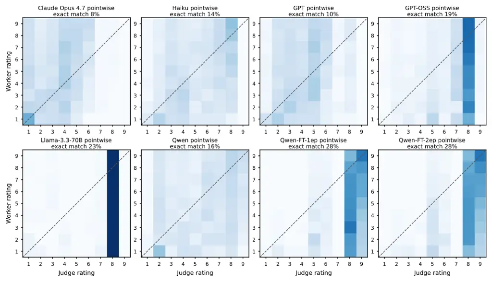
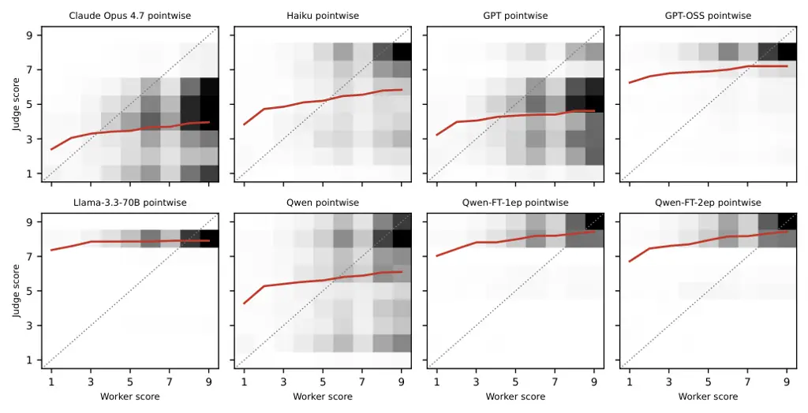

# Right Order, Wrong Scale: Auditing LLM Judges for Occupational AI Measurement

Harry Lyu Affiliation: Massachusetts Institute of Technology
Email: [hlyu@mit.edu](mailto:)    Neil Thompson
Affiliation: Massachusetts Institute of Technology
Email: [neil_t@mit.edu](mailto:)

###### Abstract

LLM judges are increasingly used to assess whether AI outputs meet
workplace requirements, but agreement on response rankings does not
establish agreement on acceptance rates or occupational aggregates. We
introduce O\*NET-BENCH, an audit suite derived from an existing survey
of 45,796 worker ratings, and evaluate 33 pre-existing judge
configurations across six model families on 4,501 test ratings.
Twenty-five configurations achieve tie-aware pair accuracy of at least
0.60, although a train-fitted response-only TF–IDF baseline nearly
matches the strongest judge. Despite this ordering agreement, judges
estimate that 3.0%–97.9% of responses are acceptable, compared with
61.1% for occupation-matched workers. In one fine-tuned lineage,
changing from pointwise scoring to a bundled few-shot/listwise protocol
improves response ordering while reducing agreement with worker means at
the task and occupation levels; this reversal replicates on a task- and
worker-disjoint validation split under prespecified criteria.
Cross-validated calibration largely removes mean bias, but calibrated
scores explain at most 8.5% of individual worker-rating variance.
Prediction-assisted estimation yields at most small precision gains at
the studied label budgets. These results show that ranking agreement
alone is insufficient for occupational measurement. Judges should be
validated against the acceptance rates and aggregates their scores will
be used to estimate.

|     |
| --- |
|     |

## 1 Introduction

How should evaluations determine whether AI outputs meet workplace
requirements? Occupational and professional benchmarks assess model
outputs on work-related tasks (Patwardhan et al., 2026; Wang et al.,
2026; Shao et al., 2026; Li et al., 2026), while exposure studies and
usage analyses address related questions about AI and work (Eloundou et
al., 2024; Felten et al., 2023; Gan, 2026; Appel et al., 2025). These
approaches measure different quantities. We focus on evaluations that
use numerical judgments to estimate the share of responses that meet an
acceptance threshold or to summarize performance across tasks and
occupations. Interpreting such estimates requires validating the scores
from which they are calculated.

These scores increasingly come from an LLM judge, because expert grading
is a major cost in many such evaluations. Judges are commonly selected
by agreement with human ratings on individual responses, through
correlation, pairwise accuracy, or recovered rankings. Ranking agreement
establishes whether a judge prefers the same responses as workers. It
does not establish whether the judge assigns comparable scores or
identifies the same responses as acceptable. We call judge selection
that evaluates ordering without checking these downstream quantities
_scale-blind selection_. This paper audits its consequences.

Figure 1: The scale problem. (a) A real pair of test-split task
instances, responses sorted by worker score: the judge reproduces every
within-task ordering exactly, yet the task means (horizontal markers,
joined by dashed lines) move oppositely and Task A’s majority verdict
flips. (b) Test-split score distributions: judges reproduce neither the
location nor the shape of the worker distribution; parenthesized values
are mean bias. (c) The quantity these evaluations report, the share
judged acceptable at threshold $`\tau`$, depends on the grader; judge
curves are steep near the acceptance threshold, so small location errors
become large level errors.

Consider a worker with paralegal experience who rates five AI-drafted
case summaries 5, 6, 7, 8, and 9 on a nine-point acceptability scale
where a score of 7 or higher counts as acceptable, and a judge that
rates the same five summaries 1, 2, 3, 4, and 5. By any purely
rank-based selection metric the judge is perfect: it reproduces the
worker’s ordering exactly. But the worker says three of the five
summaries are usable as-is; the judge says none is. Aggregated over an
occupation, the two instruments yield different conclusions from the
same responses, and ranking agreement cannot distinguish them, because
within-task order is invariant to shifts and stretches of the scale.
Figure 1a shows a real test-split pair with this structure (civil
engineering and psychology teaching, ten-exemplar fine-tuned listwise
judge); over 7,000 such pairs occur across the 32 near-complete
configurations (pairs where one judge reproduces both instances’
worker-decisive orderings while the instance means move oppositely by
$`\geq`$0.6 points). The example separates _ordinal_ validity (which
response is better), _cardinal_ validity (how good each response is, in
location and spread), and _aggregate_ validity (whether task and
occupation means agree).

To study these forms of agreement in occupational evaluation, we
construct O\*NET-Bench from the existing worker-evaluation corpus of
Mertens et al. (2026). The source contains 45,796 ratings of AI
responses to O\*NET-derived workplace tasks (National Center for O\*NET
Development, 2026), provided by workers with self-reported experience in
the corresponding occupations. Our audit suite aligns responses with
ratings, defines task- and worker-disjoint splits, and supports
evaluation from individual responses to job families. On the test split,
we compare 33 pre-existing judge configurations spanning six model
families and six train-fitted controls.

The audited judges contain information about response ordering, although
a response-only TF–IDF baseline nearly matches the strongest
configuration. Their numerical scores agree less well with the worker
reference: mean-bias intervals exclude zero for all 33 configurations,
and estimated acceptance shares vary substantially. Ranking performance
is only weakly associated with these differences in score placement. In
one fine-tuned lineage, a bundled few-shot/listwise protocol improves
response-level ordering while reducing agreement with worker means at
the task and occupation levels. This reversal replicates under
prespecified criteria on the validation split; a separate,
non-preregistered eight-arm check reproduces the main severity pattern.
Calibration largely removes mean bias, but the calibrated scores explain
at most 8.5% of individual worker-rating variance.

We contribute O\*NET-Bench, an audit suite derived from an existing
worker-evaluation corpus (no new human ratings were collected); a
comparison of 33 judge configurations across ordering, score levels, and
aggregates, including a prespecified reversal replication in one
fine-tuned lineage; and an evaluation of calibration and
prediction-assisted estimation. Appendix A translates the findings into
a six-item reporting standard.

## 2 Related work

#### Judge selection and evaluation protocols.

Work on MT-Bench, Chatbot Arena, G-Eval, and RewardBench has developed
influential approaches to model evaluation (Zheng et al., 2023; Chiang
et al., 2024; Liu et al., 2023; Lambert et al., 2025), while
Prometheus 2 and JudgeLM train specialized evaluators (Kim et al., 2024;
Zhu et al., 2025); our audit covers general foundation models adapted as
judges, not purpose-built evaluators of this kind. Listwise protocols
place candidate responses in a shared context (Yang et al., 2024).
Evaluation criteria in this literature include correlations, preference
accuracy, leaderboard agreement, and exact label agreement; ProfBench
also uses macro-F1 and a bias index (Wang et al., 2026). These criteria
provide different kinds of evidence. Our question is whether the
evidence used to evaluate a judge supports the acceptance rates and
occupational aggregates subsequently computed from its scores.
Paired-comparison scaling in the style of Bradley–Terry identifies
utilities only up to location and scale, so it does not by itself yield
the absolute threshold quantities studied here.

#### Judge bias, severity, and calibration.

Position, verbosity, self-preference, format, model-family, and leniency
effects have been documented in judge evaluations (Shi et al., 2025;
Dubois et al., 2024; Panickssery et al., 2024; Bavaresco et al., 2025).
Proposed responses address different problems: pairwise evaluation
changes the elicitation format, whereas offset correction and
recalibration adjust aspects of the numerical scale. Their effectiveness
must nevertheless be assessed against the intended quantity on held-out
data. We examine whether common judge configurations and calibration
procedures support agreement with workers on response ordering, score
levels, acceptance shares, and occupational aggregates.

#### Validation after aggregation and limits of substitution.

JuStRank shows that instance-level judge quality and aggregate system
ranking can diverge (Gera et al., 2025); rating-indeterminacy and
human-uncertainty analyses complicate single gold labels (Guerdan et
al., 2025; Elangovan et al., 2025); agreement-metric guidance urges
explicit scales, ties, and coverage (Rao and Callison-Burch, 2026); and
judge identity itself changes the measurement (Yang et al., 2026).
Dorner et al. (2025) prove that a judge no more accurate than the
evaluated model cannot reduce annotation requirements by more than half.
We supply the empirical complement: the level error itself, its
occupational consequences, and the small effective-sample value of a
judge under prediction-powered inference (Angelopoulos et al., 2023).

#### Measurement across levels.

Evaluation is measurement: evidence is valid for an interpretation and
use, not for a score in the abstract (Wallach et al., 2025). Ordinal and
interval information are distinct; reliability and invariance can differ
between within-group and between-group components of the same data (Jak
and Jorgensen, 2017); ecological correlations need not reproduce
individual relationships (Robinson, 1950); and classical test theory
supplies attenuation machinery for noisy targets (Spearman, 1904; Brown,
1910; Cronbach, 1951; Shrout and Fleiss, 1979). Our
ordinal/cardinal/aggregate distinction is the judge-evaluation instance
of this classical structure.

#### Occupational evaluation of AI.

GDPval, the Anthropic Economic Index, exposure studies, ProfBench,
WORKBank, and JobBench make occupational measurement consequential
(Patwardhan et al., 2026; Appel et al., 2025; Eloundou et al., 2024;
Gan, 2026; Wang et al., 2026; Shao et al., 2026; Li et al., 2026). We
are not aware of a systematic test of whether automated judges reproduce
occupation-matched workers’ score levels across judge designs. That is
the audit we perform, on a testbed whose target quantities come from an
economic study of labor-market tasks (Mertens et al., 2026).

## 3 Data and experimental design

#### Provenance.

The ratings were collected by Mertens et al. (2026) in a large-scale
survey studying AI automation through worker evaluations of labor-market
tasks. No new human data were collected for this audit. Participants
were recruited in the United States through Prolific, selected an
occupation in which they reported experience, and confirmed the offered
job matched that experience; submissions passed the source study’s
preregistered quality and experience screens (Mertens et al., 2026). The
audit uses a frozen extraction provided by the source study’s authors
(45,796 ratings, 47 generator variants; snapshot of 2026-08-18). The
source publication analyzes an earlier snapshot of the same ongoing
collection (17,205 post-screen ratings), so its published counts are
smaller. The workers define the audit’s estimand: we treat them as
_target raters_ with self-reported relevant experience and measure
agreement with them, not with an assumed objective truth. For the audit,
O\*NET-Bench adds per-response alignment of ratings with AI outputs,
disjoint splits, fixed prompts and an evaluation protocol over the
aggregation hierarchy, and a prediction matrix covering every
configuration.

#### Hierarchy and target.

Each observation links an O\*NET occupation and task, a concrete task
instance, an AI-generated response, and one worker rating. The
aggregation hierarchy is response $`\to`$ task instance $`\to`$ task ID
$`\to`$ occupation $`\to`$ job family; each instance contains
approximately five responses. The primary target, manager_accept, uses a
nine-point scale: 1 indicates that the response requires complete
rework, 7 that it is minimally sufficient without edits, and 9 that it
is of superior quality without edits. Following the source study, we set
the acceptance threshold to $`\tau=7`$ and classify scores of 7 or
higher as acceptable. The training, validation, and test splits contain
36,649, 4,646, and 4,501 ratings, respectively. Task IDs and workers are
disjoint across splits, while occupations and generator variants overlap
(Table 5). The design therefore evaluates new tasks and workers within a
shared occupation and generator universe. Validation loss was monitored
during fine-tuning but was not used to select checkpoints. Subsequent
validation analyses include the prespecified reversal replication and
separately identified exploratory checks.

#### Judge configurations.

We audit stored predictions from 33 pre-existing configurations spanning
six model families: Claude (Haiku 4.5 and Opus 4.7), GPT-5.4-mini,
GPT-OSS-120B, DeepSeek-V4-Pro, Llama-3.3-70B, and Qwen3.5-9B, including
one- and two-epoch LoRA checkpoints (Hu et al., 2022). Variations
include exemplars, pointwise or listwise presentation, rubric and other
prompting scaffolds, reasoning and decoding settings, self-consistency,
ensembling, and fine-tuning. The configurations are related experimental
conditions, not 33 independent replications.

Thirty-two configurations cover at least 99.8% of test rows; we call
these _near-complete_. One reasoning variant covers 22.3% because of the
serving issue documented in Appendix O. Unless otherwise stated,
configuration summaries include all 33 arms, evaluating the
partial-coverage arm on its available rows; cross-configuration
comparisons use the 32 near-complete arms. Six train-fitted controls
(training-set mean, response-position means, occupation means,
length-plus-position regression, and response-only and full-context
TF–IDF ridge regressions) measure agreement obtainable from simple
statistical structure. Appendix B reports the full registry.

Pointwise prompts score one response at a time and elicit the survey’s
multi-field schema. Listwise prompts score the responses of a task
instance (typically five) together, in a fixed, non-randomized order
(Appendix G), and elicit only manager_accept (abridged templates:
Appendix C). A base-model $`2{\times}2`$ comparison varies presentation
and exemplars; because every listwise prompt elicits only
manager_accept, its presentation factor also bundles the schema change.
The primary fine-tuned contrast changes presentation, exemplars, and
elicitation schema, so we interpret it as a bundled protocol change
rather than an isolated effect of listwise presentation.

## 4 Validity must be measured at the intended level

Let $`y_{ti}`$ and $`\hat{y}_{ti}`$ be worker and judge scores for
response $`i`$ in task instance $`t`$. Table 1 summarizes the audit
design. Each metric below matches one way judge scores are consumed
downstream.

| Component                        | Main measures                                  | Evaluation level                |
| -------------------------------- | ---------------------------------------------- | ------------------------------- |
| Ordering agreement               | Tie-aware pair accuracy, coverage, $`\rho`$    | response; within-instance pairs |
| Score-level agreement            | Mean bias, SD ratio, acceptance share          | response                        |
| Aggregate agreement              | Cell-mean corr., classification disagreement   | task; occupation; family        |
| Calibration and label efficiency | CV bias and $`R^{2}`$; PPI precision, coverage | response; pooled                |

Table 1: Audit overview. All test-split analyses are exploratory;
preregistered validation covers the primary fine-tuned protocol
contrast, in its response-ordering and aggregate-agreement directions
(§5.7), and the separate eight-arm severity check was not preregistered.

#### Ordinal validity.

For every worker-decisive pair within an instance, the judge earns 1 for
the same ordering, 0 for the reverse, and $`\tfrac{1}{2}`$ for a tie:

```math
\mathrm{PairAcc}_{1/2}=\frac{\sum_{t,i<j:y_{ti}\neq y_{tj}}\bigl[\mathbf{1}\{s_{tij}=\hat{s}_{tij}\}+\tfrac{1}{2}\,\mathbf{1}\{\hat{s}_{tij}=0\}\bigr]}{\sum_{t}|\{(i,j):i<j,\,y_{ti}\neq y_{tj}\}|}, \tag{1}
```

where $`s_{tij}=\mathrm{sign}(y_{ti}-y_{tj})`$ and
$`\hat{s}_{tij}=\mathrm{sign}(\hat{y}_{ti}-\hat{y}_{tj})`$. We report
$`\mathrm{PairAcc}_{1/2}`$ together with conditional accuracy on
judge-decisive pairs and _pair coverage_, the share of decisive pairs on
which the judge expresses an ordering. Response-level Spearman $`\rho`$
is the pooled rank correlation over all covered test rows. A constant
judge cannot rank, and coverage makes that visible.

#### Cardinal validity.

Signed mean bias, MAE, the judge/worker score-SD ratio, the full score
distribution, and threshold-crossing rates $`\Pr(\hat{y}\geq\tau)`$ for
$`\tau\in\{5,\dots,8\}`$. Cardinal validity is not mean bias alone:
compressed distributions concentrate mass near the threshold, so a judge
with a near-zero mean bias can still misreport the thresholded level
badly (GPT-OSS below: bias $`+0.12`$, acceptance-share difference
$`+17.3`$ percentage points). _Cardinal_ is operational shorthand for
the numerical levels and spread consumed downstream.¹¹ 1 Not a claim
that the nine-point survey scale has interval properties.

#### Aggregate validity.

Worker and judge cell means at task ID, occupation, and job family
(minimum 5, 5, and 8 ratings; 515, 307, and 21 evaluable cells, with one
of the 22 job families below the minimum), compared by correlation, and
by threshold-based occupation classification: the share of occupations
in which a strict majority of sampled responses is rated acceptable.

#### Ordering does not identify level.

For any scores $`x_{ti}`$ and any desired task means $`m_{t}`$, the
transformation $`x^{\prime}_{ti}=a_{t}x_{ti}+b_{t}`$ with $`a_{t}>0`$,
$`b_{t}=m_{t}-a_{t}\bar{x}_{t}`$ preserves every within-task rank and
pairwise decision while setting $`\bar{x}^{\prime}_{t}=m_{t}`$.
Occupation means, as weighted averages of task means, move freely as
well (Figure 1a). Perfect ordinal validity therefore guarantees nothing
about cardinal or aggregate validity. This construction is stated for
real-valued scores; restricting outputs to the nine-point scale limits
the admissible transformations but does not remove the distinction, and
Figure 1a gives a bounded-scale example in which within-task ordering is
preserved while task means and an acceptance verdict change. To locate
the empirical differences, we also use one-way variance shares
$`V_{G}(z)=\sum_{g}n_{g}(\bar{z}_{g}-\bar{z})^{2}/\sum_{i}(z_{i}-\bar{z})^{2}`$
for groupings $`G`$ (descriptive and non-additive).

#### Uncertainty and epistemic status.

Response-level 95% intervals use 1,000 bootstrap draws clustered by task
ID; paired contrasts use common rows; occupation-classification
intervals resample occupation cells; and calibration uses task-grouped
cross-validation. Comparisons across the related judge configurations
are descriptive. Each response has only one worker rating, so the audit
measures agreement with an observed worker reference rather than an
error-free target. Occupation-level split-half reliability is low
(Spearman–Brown estimate 0.093; Appendix M), but this estimate does not
quantify reliability at every aggregation level. Under classical
assumptions, independent mean-zero target noise attenuates population
correlations and contributes no expected mean bias; finite-sample
uncertainty and nonlinear thresholding still require separate treatment.
We therefore report clustered intervals and sensitivity analyses for
acceptance shares and occupation classifications (§5.5; Appendix J). All
test-split analyses are exploratory or robustness checks because these
configurations were inspected repeatedly. Only analyses explicitly
identified as preregistered had their directions and numerical
thresholds fixed before evaluation on the validation split.

## 5 Results

Sections 5.1–5.3 establish the ordering signal, the systematic
departures in score placement, and the decoupling between the two.
Sections 5.4–5.6 evaluate prompting interventions and label-based
repairs and trace the disagreement to the published acceptance share.
Section 5.7 presents the preregistered protocol reversal.

### 5.1 Ordering signal is widespread but shallow

Ordering agreement is above chance for all 33 configurations: every
task-clustered interval for tie-aware pair accuracy excludes 0.5.
Twenty-five configurations reach at least 0.60, the median is 0.631, and
the strongest near-complete configuration, the fine-tuned
few-shot/listwise judge, reaches 0.658 with 0.912 pair coverage.
Coverage exposes a limitation of conditional accuracy: Llama-3.3-70B
orders only 5.1% of worker-decisive pairs, so its conditional accuracy
of 0.631 corresponds to a tie-aware accuracy of 0.507. Across six
matched model comparisons, the few-shot/listwise protocol improves
response-level Spearman correlation by 0.043–0.110 relative to the
pointwise protocol, with every interval excluding zero (Appendix E). The
primary fine-tuned contrast also improves response correlation on
validation, by 0.033 $`[0.003,0.062]`$ (Appendix F). These comparisons
describe the evaluated protocol changes; they do not all isolate
presentation alone.

The signal is nonetheless shallow. A ridge regression on response-only
TF–IDF features, fully supervised on the 36,649 training ratings (unlike
the zero- and few-shot judges) and never shown an occupation label,
reaches 0.643 pair accuracy at full pair coverage and 0.229 response
Spearman against the top judge’s 0.658 and 0.263; because generator
variants overlap across splits, lexical features may also partly track
generator identity (Appendix G). Most configurations contain useful
information about which response workers prefer, and the train-fitted
bag-of-words control exceeds the median configuration while coming
within 0.015 pair accuracy of the strongest.

### 5.2 Score placement departs systematically from the target ratings

Figure 2: Cardinal validity across the audit. (a) Mean bias (judge $`-`$
worker) for all 33 configurations, with 95% task-clustered intervals,
grouped by model family. Squares are pointwise arms, and the faded row
is the partial-coverage reasoning variant. Every interval excludes zero.
(b) Tie-aware pair accuracy against mean bias (point size: pair
coverage).

Mean scores differ systematically from the worker reference (Figure 2a).
All 33 task-clustered mean-bias intervals exclude zero: 29
configurations score below workers on average and four score above them.
The median bias is $`-1.18`$ rating points on the nine-point scale; 29
configurations are at least 0.5 rating points below workers and ten are
at least 1.5 rating points below. Claude Opus 4.7 has the largest
negative bias, $`-3.23`$ $`[-3.36,-3.11]`$, equivalent to 1.7 worker
standard deviations, and assigns a lower score than the worker on 86% of
responses. The two fine-tuned pointwise checkpoints have positive biases
of $`+1.21`$ and $`+1.24`$. Llama-3.3-70B has bias $`+0.91`$ but
produces near-constant scores, whereas GPT-OSS-120B pointwise has the
smallest absolute mean bias, $`+0.12`$ $`[0.01,0.22]`$. Table 3 gives
every configuration; Appendix N describes the fine-tuned score
concentration without identifying its causal mechanism.

GPT-OSS also shows why location is not the whole of cardinal validity.
Its distribution is compressed (score-SD ratio 0.83), concentrating mass
near the threshold, so a $`+0.12`$ mean bias becomes a 78.4% acceptance
rate against the workers’ 61.1%, a 17.3-percentage-point difference from
the worker acceptance share for a judge with near-zero mean bias.
Because listwise scores carry protocol-dependent location (§5.7), we
base the severity claim on the pointwise arms and read listwise biases
as properties of the protocol.

Independent mean-zero rating noise contributes no expected mean
difference (finite-sample variation aside), and a non-preregistered
eight-arm validation check reproduces the main severity pattern: Haiku
has bias $`-1.41`$ on both splits, GPT-5.4-mini has $`-2.50`$ on test
and $`-2.49`$ on validation, and the fine-tuned
pointwise-to-few-shot/listwise sign change of $`+1.21`$ to $`-0.65`$
reappears as $`+1.26`$ to $`-0.70`$ (Appendix F). These results support
the persistence of disagreement with the worker reference across splits.

### 5.3 Ordering performance carries little information about placement

Across the 32 near-complete configurations, pair accuracy is only weakly
associated with signed bias (Pearson $`-0.22`$) and its magnitude
(Spearman $`-0.29`$), and the individual contrasts are large
(Figure 2b): Opus and the pointwise fine-tune sit 4.4 rating points
apart in mean bias at nearly identical pair accuracy (0.595 versus
0.596), and the judge with the smallest mean bias, GPT-OSS, is among the
worst rankers. The same holds one level up: tie-aware pair accuracy
tracks response-level Spearman at $`\rho=0.91`$ but shows little
association with task-level ($`-0.06`$) or occupation-level agreement
(0.00).

An exploratory selection experiment illustrates the practical
consequence within this judge roster. Across 1,000 random half-splits of
test tasks, we select a configuration on one half and evaluate it on the
other (Appendix H). Selection by pair accuracy yields a mean absolute
acceptance-share error of 10.5 percentage points, compared with 5.8 when
selecting directly for acceptance-share error; the respective
2.5th–97.5th percentile ranges across splits are $`[7.7,24.1]`$ and
$`[3.6,8.3]`$. Direct selection reduces acceptance-share error by 4.7
percentage points on average, with a 0.018 reduction in pair accuracy.
Selection by absolute mean bias always chooses GPT-OSS pointwise and
yields a larger acceptance-share error of 17.3 percentage points.
Because the configurations were previously inspected on the test split,
these results describe selection within the audited roster rather than
prospective performance on a new benchmark.

### 5.4 Evaluated interventions do not consistently recover the worker scale

Across the evaluated groups, no intervention consistently recovers the
worker scale (Table 2). Self-consistency and ensembles retain negative
mean biases of approximately $`-1.3`$ to $`-1.5`$ rating points, while
fine-tuned score placement depends on protocol (§5.2). The TF–IDF
control has small mean bias ($`-0.05`$) and competitive ordering, yet
estimates acceptance at 43.5% versus the workers’ 61.1%. Matching the
mean therefore does not recover the acceptance estimand.

| Configuration group             | $`n`$ | Pair acc. | Bias      | $`   | `$Bias$` | `$   | Acc. (score $`{\geq}7`$) | Cov. |
| ------------------------------- | ----- | --------- | --------- | ---- | -------- | ---- | ------------------------ | ---- |
| proprietary pointwise           | 3     | 0.595     | $`-2.50`$ | 2.50 | 0.117    | 0.66 |
| few-shot/listwise prompting     | 8     | 0.629     | $`-1.61`$ | 1.61 | 0.348    | 0.90 |
| self-consistency                | 2     | 0.637     | $`-1.53`$ | 1.53 | 0.336    | 0.93 |
| ensembling                      | 4     | 0.643     | $`-1.31`$ | 1.31 | 0.353    | 0.92 |
| scaffold prompting              | 3     | 0.620     | $`-0.82`$ | 0.82 | 0.497    | 0.89 |
| reasoning/decoding              | 3     | 0.643     | $`-0.74`$ | 0.74 | 0.495    | 0.89 |
| fine-tuned (listwise)           | 4     | 0.654     | $`-0.62`$ | 0.62 | 0.513    | 0.91 |
| open-weight pointwise           | 3     | 0.545     | $`+0.12`$ | 0.91 | 0.784    | 0.53 |
| fine-tuned (pointwise)          | 2     | 0.592     | $`+1.22`$ | 1.22 | 0.903    | 0.49 |
| control: TF-IDF (response only) | 1     | 0.643     | $`-0.05`$ | 0.05 | 0.435    | 1.00 |
| Workers (target raters)         | —     | —         | $`0`$     | 0    | 0.611    | —    |

Table 2: Medians by configuration group for the 32 near-complete arms
($`\geq`$99.8% test coverage); acceptance uses scores $`\geq 7`$. Groups
differ in models and protocols, so these are descriptive summaries, not
controlled intervention comparisons.

### 5.5 Scale disagreement propagates to the reported occupational quantity

Workers rate 61.1% of test responses acceptable at the survey threshold
of 7. On the same responses, judge acceptance shares range from 3.0% for
Opus to 97.9% for near-constant Llama, with a median of 43.9%; the
pointwise fine-tunes yield 89.8% and 90.8%. Thus, the reported
acceptance share depends strongly on the scoring instrument even with
responses held fixed. This comparison measures disagreement with the
sampled worker reference (§6).

The score differences also change occupation classifications. Workers
rate a strict majority of sampled responses acceptable in 68.7% of the
307 evaluable occupations. Opus does so in 0.3% $`[0.0,1.0]`$ and
disagrees with the sampled worker majority in 68.4% $`[63.5,73.6]`$ of
occupations. The pointwise fine-tune and near-zero-mean-bias GPT-OSS
disagree in 31.3% and 30.9%, respectively, compared with 31.3% for a
constant classifier that labels every occupation acceptable
(Appendix J). These are disagreements with sampled worker majorities,
not errors against an established population classification.

Threshold, cell-size, and aggregation-weight sensitivity checks preserve
substantial disagreement (Figure 3; Appendix J). Restricting to the 102
occupations whose worker acceptance share is bootstrap-separated from
one half yields disagreement of 15%–84% across configurations, with a
median of 66%. This restriction reduces ambiguity around the sampled
majority but also changes the subset’s composition and does not resolve
sparse task coverage or uncertainty about the underlying occupational
population.

Figure 3: Downstream consequences by threshold $`\tau`$. (a) Share of
responses judged acceptable. (b) Share of occupations with a strict
majority acceptable. (c) Share of occupations whose classification
disagrees with the sampled worker majority.

### 5.6 Calibration and label efficiency

Two label-based repairs could in principle restore the scale:
recalibrating judge scores against worker labels, and using judge
predictions to stretch a small labeled sample. We evaluate both.
Task-grouped five-fold isotonic calibration reduces absolute mean bias
to at most 0.003 for every near-complete configuration. Predictive
agreement with individual worker ratings remains limited: the best
cross-validated $`R^{2}`$ is 0.085, with residual SD 1.85 compared with
worker-rating SD 1.94 (Appendix I). This result concerns prediction of
observed individual ratings; it is not an estimate of agreement with
noise-free response quality. Calibration must also match the intended
estimand. A score calibrated to predict a mean rating does not directly
estimate the probability that the rating is at least 7: conditional-mean
predictors shrink dispersion, so hard thresholding under-counts the
upper tail of a distribution concentrated near the cutoff. Accordingly,
thresholding mean-calibrated scores leaves a median acceptance-share
error of 10.7 percentage points, whereas directly calibrating acceptance
probabilities reduces pooled error to at most 0.1 percentage points. A
fold-fitted constant achieves similarly small pooled error without judge
input, so aggregate bias correction alone does not establish useful
predictive information (Table 13).

We also evaluate whether judge predictions improve estimation of the
worker mean or acceptance share when only a task-clustered fraction of
test ratings is labeled (prediction-assisted estimation; Angelopoulos et
al., 2023). The cross-fitted construction combines a finite-population,
task-clustered residual variance with a heuristic calibrator-fitting
term (procedure and coverage assessment: Appendix I). Across the
evaluated conditions, absolute bias is at most 0.013 and empirical
coverage is 0.92–0.98. However, estimator SD is not consistently lower
than for human-only estimation (median SD ratio 1.00), and the
constructed intervals are wider at every studied budget. A tuned-weight
heuristic and a TF–IDF predictor provide no consistent improvement in
this cross-fitted design. Raw train-frozen scores with a tuned weight
yield at most small gains, with SD ratios of 0.96–1.02; these sit at the
theoretical floor, since with $`R^{2}\leq 0.085`$ a tuned linear
correction can reduce estimator SD by at most
$`1-\sqrt{1-R^{2}}\approx 4.3\%`$. These results indicate limited
label-efficiency gains in this setting; they do not establish that
prediction assistance cannot help elsewhere.

### 5.7 A replicated ordering–aggregation reversal in one fine-tuned lineage

The clearest ordering–aggregation reversal occurs within the two-epoch
fine-tuned lineage. Holding checkpoint and temperature fixed, changing
from pointwise to the bundled few-shot/listwise protocol raises response
Spearman correlation from 0.214 to 0.263 (difference $`+0.049`$
$`[0.021,0.078]`$) and tie-aware pair accuracy from 0.596 to 0.658. In
the same comparison, correlation with worker means falls from 0.215 to
0.096 at the task level ($`-0.119`$ $`[-0.218,-0.022]`$) and from 0.254
to 0.087 at the occupation level ($`-0.167`$ $`[-0.296,-0.043]`$). All
three contrasts satisfy the prespecified validation criteria; validation
differences are $`+0.033`$, $`-0.112`$, and $`-0.108`$, respectively,
with every interval excluding zero (Table 8; Appendix F). Aggregate
correlations throughout should be read against the low reliability of
the worker cell means (Appendix M).

The broader matched comparisons delimit this result. In the base-model
$`2{\times}2`$, the estimated presentation/schema effect on response
correlation exceeds the exemplar effect on both test ($`+0.082`$ versus
$`+0.028`$) and validation ($`+0.092`$ versus $`+0.019`$), while
aggregate effects are small and inconsistent across splits (Appendix E).
The strong replicated reversal therefore supports a finding about the
evaluated fine-tuned lineage and protocol bundle, not a general claim
that listwise presentation reduces aggregate validity.

The distribution of score variance is consistent with more rank-oriented
listwise scoring: the share lying across tasks falls from 29.5% to 11.8%
and across occupations from 20.7% to 7.8%, while the share aligned with
response-generator identity rises from 13.2% to 34.6% (position controls
remove only 14% of that shift; Appendix G). Listwise output approaches a
within-set rank code: only 18.1% of its variance lies between task
instances, and the judge’s own within-instance rank explains 90.1% of
the rest; scores are monotone in their own ranks, so the evidence is the
pointwise contrast (37.8% and 69.4%). A rank code carries little
between-cell location, consistent with the protocol-dependent listwise
“bias” and the decline in task- and occupation-level agreement.
Permuting each instance’s pointwise values into the listwise order
recovers part of the local gain with every cell mean unchanged, so
ordering and location are separable (Appendix K).

## 6 Discussion

The audit’s practical implication concerns validation practice, not any
single judge configuration. Judge validation should match the reported
quantity: acceptance probabilities or shares for acceptance estimates,
and task or occupation means for aggregates. Ranking agreement alone
does not establish these properties. The distinction follows from rank
invariance (§4), but the observed reversal concerns one fine-tuned
protocol bundle; the distributional diagnostics do not identify a
general causal mechanism.

Calibration should be evaluated on held-out labels with simple
label-fitted controls. Prediction assistance should be compared with
human-only estimation for precision and interval coverage at the same
label budget. The small gains here show that ranking performance and
mean-bias correction do not establish label efficiency.

#### Scope and limitations.

The corpus covers English-language text outputs for U.S. occupational
tasks screened for text-based suitability, rated by workers with
self-reported relevant experience; the sample is not
employment-weighted, and acceptance prevalence depends on the generator
mix. The worker ratings define the audit’s target, not an objective
standard: each response has one rating, so we cannot determine whether a
disagreement reflects the worker, the judge, or both, and the low
split-half estimates do not quantify reliability at every level
(Appendix M). Test-split analyses remain exploratory; prespecified
validation covers the named reversal, not every audit result. The strong
aggregate reversal occurs in one fine-tuned lineage under a bundled
protocol change (§5.7); response order was not randomized, limiting
position diagnostics (Appendix G); and generalization to other work
settings, modalities, or population capability estimates requires
additional evidence.

## 7 Conclusion

Agreement with workers on response ordering did not ensure agreement on
score levels, acceptance rates, or occupational aggregates. A protocol
change in one fine-tuned lineage improved ordering while reducing
aggregate agreement. Calibration corrected the quantity it targeted,
while prediction-assisted estimation yielded at most small precision
gains. Occupational evaluations should therefore validate judges against
the quantities they intend to report (Appendix A). Extending these
findings to other occupational settings will require independent corpora
and repeated human ratings.

## References

- Angelopoulos et al. (2023) A. N. Angelopoulos, S. Bates, C.
  Fannjiang, M. I. Jordan, and T. Zrnic Prediction-powered inference.
  Science 382 (6671), pp. 669–674. External Links:
  [Document](https://dx.doi.org/10.1126/science.adi6000),
  [Link](https://www.science.org/doi/abs/10.1126/science.adi6000),
  https://www.science.org/doi/pdf/10.1126/science.adi6000 Cited by: §2,
  §5.6.
- Appel et al. (2025) R. Appel, P. McCrory, A. Tamkin, M. McCain, T.
  Neylon, and M. Stern Anthropic economic index report: uneven
  geographic and enterprise ai adoption. External Links: 2511.15080,
  [Link](https://arxiv.org/abs/2511.15080) Cited by: §1, §2.
- Bavaresco et al. (2025) A. Bavaresco, R. Bernardi, L. Bertolazzi, D.
  Elliott, R. Fernández, A. Gatt, E. Ghaleb, M. Giulianelli, M.
  Hanna, A. Koller, A. Martins, P. Mondorf, V. Neplenbroek, S.
  Pezzelle, B. Plank, D. Schlangen, A. Suglia, A. K. Surikuchi, E.
  Takmaz, and A. Testoni LLMs instead of human judges? a large scale
  empirical study across 20 NLP evaluation tasks. In Proceedings of the
  63rd Annual Meeting of the Association for Computational Linguistics
  (Volume 2: Short Papers), W. Che, J. Nabende, E. Shutova, and M. T.
  Pilehvar (Eds.), Vienna, Austria, pp. 238–255. External Links:
  [Link](https://aclanthology.org/2025.acl-short.20/),
  [Document](https://dx.doi.org/10.18653/v1/2025.acl-short.20), ISBN
  979-8-89176-252-7 Cited by: §2.
- Brown (1910) W. Brown SOME experimental results in the correlation of
  mental abilities. British Journal of Psychology, 1904-1920 3 (3),
  pp. 296–322. External Links:
  [Document](https://dx.doi.org/https%3A//doi.org/10.1111/j.2044-8295.1910.tb00207.x),
  [Link](https://bpspsychub.onlinelibrary.wiley.com/doi/abs/10.1111/j.2044-8295.1910.tb00207.x),
  https://bpspsychub.onlinelibrary.wiley.com/doi/pdf/10.1111/j.2044-8295.1910.tb00207.x
  Cited by: Appendix M, §2.
- Chiang et al. (2024) W. Chiang, L. Zheng, Y. Sheng, A. N.
  Angelopoulos, T. Li, D. Li, B. Zhu, H. Zhang, M. I. Jordan, J. E.
  Gonzalez, and I. Stoica Chatbot arena: an open platform for evaluating
  llms by human preference. In Proceedings of the 41st International
  Conference on Machine Learning, ICML’24. Cited by: §2.
- Cronbach (1951) L. J. Cronbach Coefficient alpha and the internal
  structure of tests. Psychometrika 16, pp. 297–334. External Links:
  [Link](https://api.semanticscholar.org/CorpusID:13820448) Cited by:
  §2.
- Dorner et al. (2025) F. E. Dorner, V. Y. Nastl, and M. Hardt Limits to
  scalable evaluation at the frontier: LLM as judge won’t beat twice the
  data. In The Thirteenth International Conference on Learning
  Representations, External Links:
  [Link](https://openreview.net/forum?id=NO6Tv6QcDs) Cited by: §2.
- Dubois et al. (2024) Y. Dubois, P. Liang, and T. Hashimoto
  Length-controlled alpacaeval: a simple debiasing of automatic
  evaluators. In First Conference on Language Modeling, External Links:
  [Link](https://openreview.net/forum?id=CybBmzWBX0) Cited by: §2.
- Elangovan et al. (2025) A. Elangovan, L. Xu, J. Ko, M. Elyasi, L.
  Liu, S. B. Bodapati, and D. Roth Beyond correlation: the impact of
  human uncertainty in measuring the effectiveness of automatic
  evaluation and LLM-as-a-judge. In The Thirteenth International
  Conference on Learning Representations, External Links:
  [Link](https://openreview.net/forum?id=E8gYIrbP00) Cited by: §2.
- Eloundou et al. (2024) T. Eloundou, S. Manning, P. Mishkin, and D.
  Rock GPTs are gpts: labor market impact potential of llms. Science 384
  (6702), pp. 1306–1308. External Links:
  [Document](https://dx.doi.org/10.1126/science.adj0998),
  [Link](https://www.science.org/doi/abs/10.1126/science.adj0998),
  https://www.science.org/doi/pdf/10.1126/science.adj0998 Cited by: §1,
  §2.
- Felten et al. (2023) E. Felten, M. Raj, and R. Seamans How will
  language modelers like chatgpt affect occupations and industries?.
  External Links: 2303.01157, [Link](https://arxiv.org/abs/2303.01157)
  Cited by: §1.
- Gan (2026) L. Gan Execution and evaluation: a new occupational measure
  and long-run employment gradients. External Links: 2607.20807,
  [Link](https://arxiv.org/abs/2607.20807) Cited by: §1, §2.
- Gera et al. (2025) A. Gera, O. Boni, Y. Perlitz, R. Bar-Haim, L. Eden,
  and A. Yehudai JuStRank: benchmarking LLM judges for system ranking.
  In Proceedings of the 63rd Annual Meeting of the Association for
  Computational Linguistics (Volume 1: Long Papers), W. Che, J.
  Nabende, E. Shutova, and M. T. Pilehvar (Eds.), Vienna, Austria,
  pp. 682–712. External Links:
  [Link](https://aclanthology.org/2025.acl-long.34/),
  [Document](https://dx.doi.org/10.18653/v1/2025.acl-long.34), ISBN
  979-8-89176-251-0 Cited by: §2.
- Guerdan et al. (2025) L. Guerdan, S. Barocas, K. Holstein, H.
  Wallach, S. Wu, and A. Chouldechova Validating LLM-as-a-judge systems
  under rating indeterminacy. In The Thirty-ninth Annual Conference on
  Neural Information Processing Systems, External Links:
  [Link](https://openreview.net/forum?id=ZwDMrArTBg) Cited by: §2.
- Hu et al. (2022) E. J. Hu, yelong shen, P. Wallis, Z. Allen-Zhu, Y.
  Li, S. Wang, L. Wang, and W. Chen LoRA: low-rank adaptation of large
  language models. In International Conference on Learning
  Representations, External Links:
  [Link](https://openreview.net/forum?id=nZeVKeeFYf9) Cited by: §3.
- Jak and Jorgensen (2017) S. Jak and T. D. Jorgensen Relating
  measurement invariance, cross-level invariance, and multilevel
  reliability. Frontiers in Psychology Volume 8 - 2017. External Links:
  [Link](https://www.frontiersin.org/journals/psychology/articles/10.3389/fpsyg.2017.01640),
  [Document](https://dx.doi.org/10.3389/fpsyg.2017.01640), ISSN
  1664-1078 Cited by: §2.
- Kim et al. (2024) S. Kim, J. Suk, S. Longpre, B. Y. Lin, J. Shin, S.
  Welleck, G. Neubig, M. Lee, K. Lee, and M. Seo Prometheus 2: an open
  source language model specialized in evaluating other language models.
  In Proceedings of the 2024 Conference on Empirical Methods in Natural
  Language Processing, Y. Al-Onaizan, M. Bansal, and Y. Chen (Eds.),
  Miami, Florida, USA, pp. 4334–4353. External Links:
  [Link](https://aclanthology.org/2024.emnlp-main.248/),
  [Document](https://dx.doi.org/10.18653/v1/2024.emnlp-main.248) Cited
  by: §2.
- Lambert et al. (2025) N. Lambert, V. Pyatkin, J. Morrison, L.
  Miranda, B. Y. Lin, K. Chandu, N. Dziri, S. Kumar, T. Zick, Y.
  Choi, N. A. Smith, and H. Hajishirzi RewardBench: evaluating reward
  models for language modeling. In Findings of the Association for
  Computational Linguistics: NAACL 2025, L. Chiruzzo, A. Ritter, and L.
  Wang (Eds.), Albuquerque, New Mexico, pp. 1755–1797. External Links:
  [Link](https://aclanthology.org/2025.findings-naacl.96/),
  [Document](https://dx.doi.org/10.18653/v1/2025.findings-naacl.96),
  ISBN 979-8-89176-195-7 Cited by: §2.
- Li et al. (2026) Y. Li, Y. Feng, Z. Xu, Z. Ma, K. Zheng, F. Jiang, X.
  Sun, R. Shao, Z. Chen, Y. Huang, X. Han, B. Lee, K. Xu, S. Zeng, H.
  Hua, X. Zhang, B. Alomair, R. Krishna, L. Zettlemoyer, P. W. Koh, B.
  Ramasubramanian, L. Niu, X. Yue, and R. Poovendran JobBench: aligning
  agent work with human will. External Links: 2605.26329,
  [Link](https://arxiv.org/abs/2605.26329) Cited by: §1, §2.
- Liu et al. (2023) Y. Liu, D. Iter, Y. Xu, S. Wang, R. Xu, and C. Zhu
  G-eval: NLG evaluation using gpt-4 with better human alignment. In
  Proceedings of the 2023 Conference on Empirical Methods in Natural
  Language Processing, H. Bouamor, J. Pino, and K. Bali (Eds.),
  Singapore, pp. 2511–2522. External Links:
  [Link](https://aclanthology.org/2023.emnlp-main.153/),
  [Document](https://dx.doi.org/10.18653/v1/2023.emnlp-main.153) Cited
  by: §2.
- Mertens et al. (2026) M. Mertens, A. Kuzee, B. S. Harris, H. Lyu, W.
  Li, J. Rosenfeld, M. Anto, M. Fleming, and N. Thompson Crashing waves
  vs. rising tides: findings on ai automation from thousands of worker
  evaluations of labor market tasks. External Links: 2604.01363,
  [Link](https://arxiv.org/abs/2604.01363) Cited by: §1, §2, §3.
- National Center for O\*NET Development (2026) National Center for
  O\*NET Development O\*NET OnLine. Note:
  [https://www.onetonline.org/](https://www.onetonline.org/)Accessed:
  2026-09-14 Cited by: §1.
- Panickssery et al. (2024) A. Panickssery, S. R. Bowman, and S. Feng
  LLM evaluators recognize and favor their own generations. In
  Proceedings of the 38th International Conference on Neural Information
  Processing Systems, NIPS ’24, Red Hook, NY, USA. External Links: ISBN
  9798331314385 Cited by: §2.
- Patwardhan et al. (2026) T. Patwardhan, R. Dias, E. Proehl, G. Kim, M.
  Wang, O. Watkins, S. P. Fishman, M. Aljubeh, P. Thacker, L.
  Fauconnet, N. S. Kim, S. Miserendino, G. Chabot, D. Li, P. Chao, M.
  Sharman, A. Barr, A. Glaese, and J. Tworek GDPval: evaluating AI model
  performance on real-world economically valuable tasks. In The
  Fourteenth International Conference on Learning Representations,
  External Links: [Link](https://openreview.net/forum?id=hcuEdq6eKD)
  Cited by: §1, §2.
- Rao and Callison-Burch (2026) D. Rao and C. Callison-Burch Agreement
  metrics for llm-as-judge evaluation: what to report and why. External
  Links: 2606.00093, [Link](https://arxiv.org/abs/2606.00093) Cited by:
  §2.
- Robinson (1950) W. S. Robinson Ecological correlations and the
  behavior of individuals. American Sociological Review 15 (3),
  pp. 351–357. External Links: ISSN 00031224, 19398271,
  [Link](http://www.jstor.org/stable/2087176) Cited by: §2.
- Shao et al. (2026) Y. Shao, H. Zope, Y. Jiang, J. Pei, D. Nguyen, E.
  Brynjolfsson, and D. Yang Future of work with ai agents: auditing
  automation and augmentation potential across the u.s. workforce.
  External Links: 2506.06576, [Link](https://arxiv.org/abs/2506.06576)
  Cited by: §1, §2.
- Shi et al. (2025) L. Shi, C. Ma, W. Liang, X. Diao, W. Ma, and S.
  Vosoughi Judging the judges: a systematic study of position bias in
  LLM-as-a-judge. In Proceedings of the 14th International Joint
  Conference on Natural Language Processing and the 4th Conference of
  the Asia-Pacific Chapter of the Association for Computational
  Linguistics, K. Inui, S. Sakti, H. Wang, D. F. Wong, P.
  Bhattacharyya, B. Banerjee, A. Ekbal, T. Chakraborty, and D. P. Singh
  (Eds.), Mumbai, India, pp. 292–314. External Links:
  [Link](https://aclanthology.org/2025.ijcnlp-long.18/),
  [Document](https://dx.doi.org/10.18653/v1/2025.ijcnlp-long.18), ISBN
  979-8-89176-298-5 Cited by: §2.
- Shrout and Fleiss (1979) P. E. Shrout and J. L. Fleiss Intraclass
  correlations: uses in assessing rater reliability.. Psychological
  bulletin 86 2, pp. 420–8. External Links:
  [Link](https://api.semanticscholar.org/CorpusID:13168820) Cited by:
  §2.
- Spearman (1904) C. E. Spearman The proof and measurement of
  association between two things.. International journal of epidemiology
  39 5, pp. 1137–50. External Links:
  [Link](https://api.semanticscholar.org/CorpusID:14780428) Cited by:
  Appendix M, §2.
- Wallach et al. (2025) H. Wallach, M. Desai, A. F. Cooper, A. Wang, C.
  Atalla, S. Barocas, S. L. Blodgett, A. Chouldechova, E. Corvi, P. A.
  Dow, J. Garcia-Gathright, A. Olteanu, N. J. Pangakis, S. Reed, E.
  Sheng, D. Vann, J. W. Vaughan, M. Vogel, H. Washington, and A. Z.
  Jacobs Position: evaluating generative AI systems is a social science
  measurement challenge. In Proceedings of the 42nd International
  Conference on Machine Learning, A. Singh, M. Fazel, D. Hsu, S.
  Lacoste-Julien, F. Berkenkamp, T. Maharaj, K. Wagstaff, and J. Zhu
  (Eds.), Proceedings of Machine Learning Research, Vol. 267,
  pp. 82232–82251. External Links:
  [Link](https://proceedings.mlr.press/v267/wallach25a.html) Cited by:
  §2.
- Wang et al. (2026) Z. Wang, J. Jung, X. Lu, S. Diao, E. Evans, J.
  Zeng, P. Molchanov, Y. Choi, J. Kautz, and Y. Dong ProfBench:
  multi-domain rubrics requiring professional knowledge to answer and
  judge. In The Fourteenth International Conference on Learning
  Representations, External Links:
  [Link](https://openreview.net/forum?id=VwNzKPqBxk) Cited by: §1, §2,
  §2.
- Yang et al. (2024) S. Yang, K. Bi, W. Cui, J. Guo, and X. Cheng
  LINKAGE: listwise ranking among varied-quality references for
  non-factoid QA evaluation via LLMs. In Findings of the Association for
  Computational Linguistics: EMNLP 2024, Y. Al-Onaizan, M. Bansal,
  and Y. Chen (Eds.), Miami, Florida, USA, pp. 6985–7000. External
  Links: [Link](https://aclanthology.org/2024.findings-emnlp.410/),
  [Document](https://dx.doi.org/10.18653/v1/2024.findings-emnlp.410)
  Cited by: §2.
- Yang et al. (2026) Z. Yang, Y. Hou, and X. Yang When the judge
  changes, so does the measurement: auditing llm-as-judge reliability.
  External Links: 2607.08535, [Link](https://arxiv.org/abs/2607.08535)
  Cited by: §2.
- Zheng et al. (2023) L. Zheng, W. Chiang, Y. Sheng, S. Zhuang, Z.
  Wu, Y. Zhuang, Z. Lin, Z. Li, D. Li, E. P. Xing, H. Zhang, J. E.
  Gonzalez, and I. Stoica Judging llm-as-a-judge with mt-bench and
  chatbot arena. In Proceedings of the 37th International Conference on
  Neural Information Processing Systems, NIPS ’23, Red Hook, NY, USA.
  Cited by: §2.
- Zhu et al. (2025) L. Zhu, X. Wang, and X. Wang JudgeLM: fine-tuned
  large language models are scalable judges. In The Thirteenth
  International Conference on Learning Representations, External Links:
  [Link](https://openreview.net/forum?id=xsELpEPn4A) Cited by: §2.

## Appendix A Reporting standard

For evaluations that aggregate LLM-judge scores:

1.  1.  Decision level. Name the target (response, item, domain/occupation,
        population, or system) before selecting the judge.
2.  2.  Ordering with ties and coverage. Report tie-aware accuracy, accuracy
        conditional on a decision, and the share of evaluable comparisons
        receiving a decision. For listwise or comparative protocols,
        randomize or counterbalance presentation order and report position
        sensitivity.
3.  3.  Score level and distribution. Report signed bias with clustered
        uncertainty, the score-SD ratio, the full distribution, and
        threshold-crossing rates across a threshold sweep.
4.  4.  Simple controls. Include train-fitted lexical predictors and
        group-mean controls to expose stable priors that can drive apparent
        agreement.
5.  5.  Level-matched uncertainty and target reliability. Cluster at the
        assignment unit, propagate within-cell sampling error for
        hierarchical means, and report the reliability of the human quantity
        being predicted.
6.  6.  Separated configuration and confirmation data. When configurations
        are tuned or repeatedly inspected, re-estimate the selected
        comparison on excluded data under prespecified directions or
        thresholds.

## Appendix B Configuration registry with severity and ordering metrics

Table 3 lists all 33 judge configurations and the six train-fitted
controls with row coverage (Cover.), mean bias (95% task-clustered CI),
acceptance share at scores $`\geq 7`$ (Acc.; workers: 0.611), tie-aware
pair accuracy (PairAcc), and decisive-pair coverage (PairCov); Table 4
decodes the configuration names; and Table 5 details the splits. The
reasoning variant with 22.3% row coverage is reported on covered rows
and excluded from cross-configuration statistics. Figure 4 checks split
representativeness against the full corpus.

|                                 |           |             |        |                             |                          |         |         |
| ------------------------------- | --------- | ----------- | ------ | --------------------------- | ------------------------ | ------- | ------- |
| Configuration                   | Family    | Present.    | Cover. | Bias \[95% CI\]             | Acc. (score $`{\geq}7`$) | PairAcc | PairCov |
| Claude Opus 4.7 pointwise       | Claude    | pointwise   | 1.000  | $`-3.23`$ $`[-3.36,-3.11]`$ | 0.030                    | 0.595   | 0.618   |
| Haiku pointwise                 | Claude    | pointwise   | 1.000  | $`-1.41`$ $`[-1.56,-1.28]`$ | 0.439                    | 0.600   | 0.709   |
| Haiku fs+lw                     | Claude    | listwise    | 1.000  | $`-1.33`$ $`[-1.43,-1.22]`$ | 0.377                    | 0.632   | 0.929   |
| GPT pointwise                   | GPT       | pointwise   | 1.000  | $`-2.50`$ $`[-2.63,-2.37]`$ | 0.117                    | 0.568   | 0.657   |
| GPT fs+lw                       | GPT       | listwise    | 1.000  | $`-2.47`$ $`[-2.60,-2.35]`$ | 0.214                    | 0.601   | 0.869   |
| GPT-OSS fs+lw                   | GPT-OSS   | listwise    | 1.000  | $`-1.49`$ $`[-1.61,-1.37]`$ | 0.337                    | 0.632   | 0.855   |
| GPT-OSS pointwise               | GPT-OSS   | pointwise   | 1.000  | $`+0.12`$ $`[+0.01,+0.22]`$ | 0.784                    | 0.545   | 0.531   |
| DeepSeek-V4-Pro fs+lw           | DeepSeek  | listwise    | 1.000  | $`-2.09`$ $`[-2.21,-1.99]`$ | 0.283                    | 0.619   | 0.923   |
| Llama-3.3-70B pointwise         | Llama     | pointwise   | 1.000  | $`+0.91`$ $`[+0.83,+0.99]`$ | 0.979                    | 0.507   | 0.051   |
| Qwen few-shot                   | Qwen-base | pointwise   | 1.000  | $`-2.01`$ $`[-2.16,-1.87]`$ | 0.315                    | 0.594   | 0.798   |
| Qwen fs(10ex)+lw                | Qwen-base | listwise    | 1.000  | $`-1.61`$ $`[-1.73,-1.50]`$ | 0.361                    | 0.631   | 0.922   |
| Qwen listwise                   | Qwen-base | listwise    | 1.000  | $`-1.61`$ $`[-1.74,-1.48]`$ | 0.381                    | 0.627   | 0.856   |
| Qwen fs+lw                      | Qwen-base | listwise    | 1.000  | $`-1.58`$ $`[-1.69,-1.47]`$ | 0.360                    | 0.634   | 0.921   |
| SelfConsist average (Qwen 5x)   | Qwen-base | listwise    | 1.000  | $`-1.54`$ $`[-1.65,-1.43]`$ | 0.307                    | 0.639   | 0.972   |
| SelfConsist majority (Qwen 5x)  | Qwen-base | listwise    | 1.000  | $`-1.53`$ $`[-1.63,-1.42]`$ | 0.366                    | 0.635   | 0.896   |
| Qwen pointwise                  | Qwen-base | pointwise   | 1.000  | $`-1.09`$ $`[-1.25,-0.94]`$ | 0.476                    | 0.558   | 0.754   |
| Qwen analogical+lw              | Qwen-base | listwise    | 1.000  | $`-0.98`$ $`[-1.07,-0.87]`$ | 0.449                    | 0.628   | 0.892   |
| Qwen ranked+lw                  | Qwen-base | listwise    | 0.999  | $`-0.82`$ $`[-0.90,-0.73]`$ | 0.497                    | 0.620   | 0.983   |
| Qwen rubric+fs+lw               | Qwen-base | listwise    | 1.000  | $`-0.72`$ $`[-0.84,-0.61]`$ | 0.529                    | 0.615   | 0.835   |
| Qwen-FT-2ep 5ex think/t1        | Qwen-FT   | listwise    | 0.223  | $`-0.76`$ $`[-0.99,-0.54]`$ | 0.485                    | 0.659   | 0.940   |
| Qwen-FT-2ep 5ex noThink/t0.7    | Qwen-FT   | listwise    | 1.000  | $`-0.75`$ $`[-0.84,-0.64]`$ | 0.495                    | 0.643   | 0.888   |
| Qwen-FT-2ep 10ex noThink/t0.7   | Qwen-FT   | listwise    | 1.000  | $`-0.74`$ $`[-0.83,-0.64]`$ | 0.494                    | 0.645   | 0.896   |
| Qwen-FT-2ep 10ex                | Qwen-FT   | listwise    | 1.000  | $`-0.67`$ $`[-0.75,-0.57]`$ | 0.507                    | 0.654   | 0.923   |
| Qwen-FT-2ep fs+lw               | Qwen-FT   | listwise    | 1.000  | $`-0.65`$ $`[-0.73,-0.55]`$ | 0.510                    | 0.658   | 0.912   |
| Qwen-FT-2ep analog noThink/t0.7 | Qwen-FT   | listwise    | 1.000  | $`-0.60`$ $`[-0.69,-0.51]`$ | 0.523                    | 0.628   | 0.819   |
| Qwen-FT-1ep fs+lw               | Qwen-FT   | listwise    | 1.000  | $`-0.59`$ $`[-0.68,-0.50]`$ | 0.517                    | 0.655   | 0.914   |
| Qwen-FT-2ep analogical          | Qwen-FT   | listwise    | 1.000  | $`-0.52`$ $`[-0.61,-0.43]`$ | 0.554                    | 0.639   | 0.757   |
| Qwen-FT-2ep pointwise           | Qwen-FT   | pointwise   | 1.000  | $`+1.21`$ $`[+1.13,+1.29]`$ | 0.898                    | 0.596   | 0.510   |
| Qwen-FT-1ep pointwise           | Qwen-FT   | pointwise   | 1.000  | $`+1.24`$ $`[+1.16,+1.32]`$ | 0.908                    | 0.588   | 0.479   |
| Ensemble3 average (fs+lw)       | Ensemble  | ensemble    | 1.000  | $`-1.47`$ $`[-1.58,-1.36]`$ | 0.304                    | 0.644   | 0.953   |
| Ensemble3 majority (fs+lw)      | Ensemble  | ensemble    | 1.000  | $`-1.43`$ $`[-1.55,-1.33]`$ | 0.361                    | 0.638   | 0.877   |
| EnsHQF average (H+Q+FT)         | Ensemble  | ensemble    | 1.000  | $`-1.19`$ $`[-1.28,-1.09]`$ | 0.346                    | 0.653   | 0.961   |
| EnsHQF majority (H+Q+FT)        | Ensemble  | ensemble    | 1.000  | $`-1.18`$ $`[-1.28,-1.09]`$ | 0.407                    | 0.643   | 0.897   |
| Control: train mean             | —         | constructed | 1.000  | $`-0.05`$ $`[-0.13,+0.04]`$ | 0.000                    | 0.500   | 0.000   |
| Control: response position      | —         | constructed | 1.000  | $`-0.05`$ $`[-0.13,+0.04]`$ | 0.400                    | 0.531   | 1.000   |
| Control: occupation mean        | —         | constructed | 1.000  | $`-0.04`$ $`[-0.12,+0.05]`$ | 0.435                    | 0.500   | 0.000   |
| Control: length + position      | —         | constructed | 1.000  | $`-0.05`$ $`[-0.13,+0.03]`$ | 0.407                    | 0.592   | 1.000   |
| Control: TF–IDF response only   | —         | constructed | 1.000  | $`-0.05`$ $`[-0.13,+0.02]`$ | 0.435                    | 0.643   | 1.000   |
| Control: TF–IDF full context    | —         | constructed | 1.000  | $`-0.05`$ $`[-0.12,+0.03]`$ | 0.438                    | 0.634   | 1.000   |

Table 3: Full registry. “Present.” is the presentation protocol; naming
tokens are decoded in Table 4, and column quantities are defined in §4.
Bias intervals use 1,000 task-clustered bootstrap draws.

| Token                      | Meaning                                                                                                        |
| -------------------------- | -------------------------------------------------------------------------------------------------------------- |
| pointwise / lw             | one response per prompt / all responses of a task instance (typically five) scored together in one prompt (§3) |
| fs                         | few-shot exemplars in the prompt; _5ex_/_10ex_ give the count where it is varied                               |
| rubric, ranked, analogical | alternative prompt scaffolds                                                                                   |
| think / noThink            | hybrid reasoning enabled / disabled                                                                            |
| t0.7, t1                   | decoding temperature (all other arms decode at 0)                                                              |
| 5x                         | five sampled judgments per response (self-consistency), combined by average or majority                        |
| Ensemble3, EnsHQF          | three-judge ensembles of listwise members; H+Q+FT = Haiku, Qwen, and the fine-tuned checkpoint                 |
| FT-1ep / FT-2ep            | LoRA checkpoint after one / two training epochs (Appendix N)                                                   |
| Control:                   | train-fitted non-LLM predictor (§3)                                                                            |

Table 4: Configuration naming key for Table 3, Figure 2a, and Figure 5.

| Split      | Ratings | Task IDs | Workers | Occup. | Families | Generators |
| ---------- | ------- | -------- | ------- | ------ | -------- | ---------- |
| Train      | 36,649  | 4,119    | 7,339   | 680    | 22       | 47         |
| Validation | 4,646   | 515      | 931     | 311    | 22       | 47         |
| Test       | 4,501   | 515      | 901     | 307    | 22       | 47         |

Table 5: Dataset splits. Task IDs and workers are disjoint across
splits; occupations and response-generator variants overlap.

Figure 4: Split representativeness. (a) Worker manager_accept shares by
split against the full corpus: split means are 6.92/7.00/6.97, and the
largest per-score share difference between the test split and the full
corpus is 0.008. (b) The two configurations run on the full corpus
reproduce their test-split distributions (GPT-5.4-mini mean 4.54 versus
4.47; Haiku 5.64 versus 5.56), and both assign a score of 9 to fewer
than 0.05% of the 45,796 rows.

## Appendix C Prompt templates (abridged)

The two templates below anchor the primary contrast of §5.7; both are
abridged, with runner-filled placeholders in braces and elisions marked
by \[…\]. The remaining six variants (zero-shot listwise, rubric,
ranked, analogical, ten-exemplar few-shot/listwise, and few-shot
pointwise) modify these skeletons.

#### Pointwise (original 35-field survey schema).

```ltx_verbatim
SYSTEM  You are a professional worker completing a workplace survey. You will
be told your occupation and years of experience [...] Your response must be a
single JSON object that follows the exact schema provided in the user message.
Output ONLY the JSON object. Use exactly the field names shown. [...]

USER  You are a {selected_occupation} with {work_experience} of work experience.
Your manager has assigned you the following task. One of the general
responsibilities of your job is: "{task_desc}"
Here is the specific task you have been assigned: {task_instance_text}
A colleague has produced a response to this task. Here is response
#{response_index}: {response_full_text}
Now answer the following survey questions. Provide your answers as a single
JSON object using exactly this schema:
{ "task_understandability": "", ...        [33 further survey fields elided]
  "resp_manager_accept": 0,
  // Overall, how would a manager view this response?
  // 1 = Not useful: Requires complete rework (started over from scratch)
  // 2 = Not useful: Requires extensive rework
  // 3 = Not useful: Requires substantial rework
  // 4 = Useful with edits: Requires major edits
  // 5 = Useful with edits: Requires moderate edits
  // 6 = Useful with edits: Requires minor edits
  // 7 = Useful as is: Requires no edits to be minimally sufficient
  // 8 = Useful as is: Requires no edits to be of average quality
  // 9 = Useful as is: Requires no edits to be of superior quality
  ... }
```

#### Few-shot listwise (manager rating only).

```ltx_verbatim
SYSTEM  You are a professional worker completing a workplace survey. [...] To
help you judge consistently, you will first be given the rating scale, then a
worked example from your field: a task with several real responses and the
manager rating each one actually received. Use the example to calibrate how
you apply the scale. You will then be shown several candidate responses to a
NEW task; read all of them before judging, and rate each relative to the
others. [...]

USER  You are a {selected_occupation} with {work_experience} of work experience.
You will judge how a manager would view a colleague’s response to a task,
using the following 1-9 scale:            [the nine anchors as shown above]
WORKED EXAMPLE (to calibrate the scale) [...] "{example_task_desc}"
{example_task_instance_text}
Example responses and the manager rating each received: {anchor_block}
NOW RATE A NEW TASK
Apply the same 1-9 scale, calibrated to the example above. Below are several
candidate responses to a new task assigned to you. Read ALL of them before
answering, then judge them together. [...] "{task_desc}" {task_instance_text}
Candidate responses to judge: {responses_block}
Provide your answer as a single JSON object using exactly this schema:
{ "ratings": [ { "response_index": 0, "resp_manager_accept": 0 } ] }
```

The few-shot anchor is a worked example from the same occupation in the
training split (fallback: the same job family), shown with all of its
responses and the manager rating each received, in shuffled order.

## Appendix D Score distributions and score placement

Figure 5 compares the manager_accept score distribution of each
configuration with the worker distribution, supplementing Figure 1b and
§5.2. Figure 6 shows row-normalized joint score distributions for eight
pointwise configurations, making systematic shifts and concentration
visible. Figure 7 summarizes the conditional mean judge score at each
worker rating: these means vary over a narrower range than the worker
scale and do not track the diagonal across its full range. These plots
describe score placement; within-instance ordering agreement is
quantified separately in §5.1.

Figure 5: Score distributions for the workers (top left) and all 33
configurations on the test split, grouped and colored by model family
(Figure 2b palette; legend below). Bars are shares of ratings on a
common axis capped at 0.6; the one clipped bar is break-marked and
annotated with its value, and the cased dark line in each judge panel is
the workers’ distribution. Panel headers give valid rows and the mean
(workers: 6.97); the dashed line marks each panel’s mean. No
configuration reproduces the workers’ right-shifted distribution: most
judges shift mass left of the worker outline, the pointwise fine-tunes
overshoot onto 8–9, and Llama collapses to a near-constant 8.



Figure 6: Conditional distributions of judge scores (columns) given
worker scores (rows), normalized within each worker-score row, for eight
pointwise configurations on the test split. Panel titles report
exact-match rates. The distributions show differences in score placement
and concentration; Llama assigns nearly constant scores. Agreement in
within-instance response ordering is evaluated separately using the
metrics in §5.1.

Figure 7: Mean judge score conditional on each worker score for eight
pointwise configurations on the test split. The diagonal marks equality
between the conditional mean judge score and the worker score.
Conditional means vary less than the full worker-score range, and their
levels differ substantially across configurations. This descriptive view
complements the marginal distributions in Figure 5 and the ordering
metrics in §5.1.

## Appendix E Matched protocol pairs and the $`2\times 2`$ decomposition

| Pointwise $`\to`$ few-shot/listwise | $`\Delta`$ response $`\rho`$ | $`\Delta`$ task $`\rho`$             | $`\Delta`$ occ. $`\rho`$             |
| ----------------------------------- | ---------------------------- | ------------------------------------ | ------------------------------------ |
| Qwen base                           | $`+0.110`$ \[0.077,0.144\]   | $`-0.006`$ \[$`-0.079`$,0.072\]      | $`-0.025`$ \[$`-0.079`$,0.062\]      |
| Haiku                               | $`+0.070`$ \[0.042,0.096\]   | $`-0.011`$ \[$`-0.065`$,0.044\]      | $`-0.007`$ \[$`-0.058`$,0.047\]      |
| GPT-OSS                             | $`+0.109`$ \[0.078,0.142\]   | $`-0.003`$ \[$`-0.078`$,0.072\]      | $`+0.029`$ \[$`-0.055`$,0.090\]      |
| GPT                                 | $`+0.060`$ \[0.036,0.085\]   | $`+0.031`$ \[$`-0.017`$,0.077\]      | $`+0.013`$ \[$`-0.026`$,0.072\]      |
| Qwen FT1                            | $`+0.043`$ \[0.014,0.072\]   | $`-0.116`$ \[$`-0.207`$,$`-0.023`$\] | $`-0.145`$ \[$`-0.224`$,$`-0.041`$\] |
| Qwen FT2                            | $`+0.049`$ \[0.021,0.078\]   | $`-0.119`$ \[$`-0.218`$,$`-0.022`$\] | $`-0.167`$ \[$`-0.296`$,$`-0.043`$\] |

Table 6: Matched pairs with 95% task-clustered intervals; boldface marks
estimates whose intervals exclude zero. Local ordering improves in all
six pairs. Statistically clear aggregate declines are confined to the
two checkpoints of one LoRA lineage, which differ by a single training
epoch and are not independent. The FT2 row reports the canonical
preregistered intervals of Table 8; the remaining rows use an earlier
matched-pair bootstrap draw set.

|              |           |                |               |               |                |               |               |
| ------------ | --------- | -------------- | ------------- | ------------- | -------------- | ------------- | ------------- |
|              |           | Test           |               |               | Validation     |               |               |
| Presentation | Exemplars | Resp. $`\rho`$ | Task $`\rho`$ | Occ. $`\rho`$ | Resp. $`\rho`$ | Task $`\rho`$ | Occ. $`\rho`$ |
| Pointwise    | zero-shot | 0.109          | 0.067         | 0.075         | 0.088          | 0.051         | 0.007         |
| Pointwise    | few-shot  | 0.138          | 0.087         | 0.058         | 0.124          | 0.018         | $`-0.066`$    |
| Listwise     | zero-shot | 0.191          | 0.087         | 0.036         | 0.196          | 0.092         | 0.015         |
| Listwise     | few-shot  | 0.219          | 0.060         | 0.049         | 0.200          | 0.056         | $`-0.049`$    |

Table 7: $`2\times 2`$ on base Qwen3.5-9B, test and validation. Mean
response-level effects, computed from unrounded cell means:
presentation/schema $`+0.082`$ (test) and $`+0.092`$ $`[0.068,0.115]`$
(validation); exemplars $`+0.028`$ and $`+0.019`$ $`[0.001,0.038]`$.
Occupation-level factor effects are small and change sign across splits.

## Appendix F Validation-split replications

#### Protocol reversal.

Table 8 reports the preregistered replication: 4,646 ratings, disjoint
task IDs, task instances, and workers; directions and thresholds
recorded before the runs; both arms at complete coverage. The
preregistered criterion was the validation point estimate falling beyond
the stated threshold; the reported intervals additionally exclude zero,
though they do not establish effects as large as the thresholds. Levels
on validation: response 0.216 $`\to`$ 0.250; task 0.241 $`\to`$ 0.129;
occupation 0.201 $`\to`$ 0.093. Differences here and in Tables 7 and 8
are computed from unrounded values.

| Level               | Test $`\Delta`$ \[95% CI\]     | Validation $`\Delta`$ \[95% CI\] | Pre-registered threshold |
| ------------------- | ------------------------------ | -------------------------------- | ------------------------ |
| Response $`\rho`$   | $`+0.049`$ $`[+0.021,+0.078]`$ | $`+0.033`$ $`[+0.003,+0.062]`$   | $`\geq+0.025`$           |
| Task $`\rho`$       | $`-0.119`$ $`[-0.218,-0.022]`$ | $`-0.112`$ $`[-0.185,-0.032]`$   | $`\leq-0.05`$            |
| Occupation $`\rho`$ | $`-0.167`$ $`[-0.296,-0.043]`$ | $`-0.108`$ $`[-0.196,-0.006]`$   | $`\leq-0.10`$            |

Table 8: Same-checkpoint protocol reversal (few-shot/listwise minus
pointwise, Qwen-FT-2ep, temperature 0), task-clustered intervals.
Thresholds were fixed before the validation runs; all three replicate.

#### Severity (validation robustness check, not preregistered).

Mean bias on validation for the arms with validation predictions,
against their test values: Haiku pointwise $`-1.41`$ (test $`-1.41`$);
GPT-5.4-mini pointwise $`-2.49`$ ($`-2.50`$); Qwen base pointwise
$`-1.07`$ ($`-1.09`$); Qwen few-shot pointwise $`-1.99`$ ($`-2.01`$);
Qwen listwise zero-shot $`-1.71`$ ($`-1.61`$); Qwen few-shot/listwise
$`-1.61`$ ($`-1.58`$); FT2 pointwise $`+1.26`$ ($`+1.21`$); FT2
few-shot/listwise $`-0.70`$ ($`-0.65`$). Validation acceptance at scores
$`\geq 7`$: workers 0.607; FT2 pointwise 0.920; FT2 few-shot/listwise
0.498.

## Appendix G Protocol diagnostics

| Grouping   | Worker $`V_{G}`$ | Pointwise $`V_{G}`$ | Listwise $`V_{G}`$ | $`\Delta V_{G}`$ \[95% CI\]       |
| ---------- | ---------------- | ------------------- | ------------------ | --------------------------------- |
| Task       | .227             | .295                | .118               | $`-`$.177 \[$`-`$.212,$`-`$.143\] |
| Occupation | .145             | .207                | .078               | $`-`$.128 \[$`-`$.181,$`-`$.111\] |
| Job family | .027             | .072                | .016               | $`-`$.056 \[$`-`$.085,$`-`$.041\] |
| Generator  | .058             | .132                | .346               | $`+`$.214 \[.186,.239\]           |

Table 9: One-way variance shares for the primary matched comparison
(shares overlap; do not sum). Task-clustered bootstrap intervals.

#### Position control.

Generator identity is associated with response index ($`\chi^{2}=1119`$,
$`\mathrm{df}=160`$, Cramér’s $`V=0.25`$), and listwise judges receive
responses in index order. Removing an additive response-index effect
from every score column leaves the generator-share increase at
$`+0.182`$ $`[0.154,0.206]`$, which is 86% of the uncontrolled
$`+0.212`$ on the same rows (Table 9 reports $`+0.214`$ on all rows),
while the task and occupation contractions are essentially unchanged
($`-0.173`$ and $`-0.126`$). Response index carries 5.7% of listwise
score variance versus 0.9% pointwise and 0.8% in worker ratings. Because
order was not randomized, these are observational controls, not causal
position effects.

#### Scale-aligned diagnostics.

After matching each judge’s global mean and SD to the workers’,
task-cell dispersion relative to workers contracts from 1.11 (pointwise)
to 0.71 (listwise) and occupation-cell dispersion from 1.09 to 0.70;
slopes of judge on worker group means fall from 0.262 to 0.084 (task)
and 0.301 to 0.072 (occupation). Task and occupation offset RMS
_decline_ ($`-0.143`$ and $`-0.093`$) while generator offset RMS rises
($`+0.414`$ $`[0.314,0.428]`$): the failure is compression of
occupational structure plus generator-linked variance, not larger group
intercepts.

#### Rank determinism.

For listwise FT2, 18.1% of score variance lies between task instances
and the judge’s own within-instance rank explains 90.1% of
within-instance variance; for pointwise FT2 the figures are 37.8% and
69.4%. Scores are monotone in their own ranks by construction, so the
informative quantity is the pointwise–listwise contrast, consistent with
a rank-oriented response pattern.

#### Length association.

Conditional on worker score, response index, and generator, the listwise
FT2 judge assigns $`+0.538`$ $`[0.455,0.622]`$ rating points per SD of
log response length, an observational association indicating variation
in the judge score not explained by the included controls.

#### Aggregation robustness.

Across mean/median/10%-trimmed aggregation and minimum cell sizes
$`\{1,3,5,8,10\}`$, all 15 task deltas ($`-0.128`$ to $`-0.108`$) and
all 15 occupation deltas ($`-0.181`$ to $`-0.113`$) are negative, as is
every leave-one-family-out and leave-one-generator-group-out estimate.
Figure 8 summarizes these diagnostics and their scope.

Figure 8: Variance patterns and scope of the protocol reversal (§5.7).
(a) In the primary fine-tuned comparison, the few-shot/listwise scores
have smaller task- and occupation-associated variance shares and a
larger generator-associated share than the pointwise scores; the one-way
shares are descriptive and non-additive. (b) All six matched protocol
changes improve response correlation; task-clustered intervals for the
occupation-level difference exclude zero only for the two LoRA
checkpoints (orange). (c) The primary task- and occupation-level
declines persist across the 15 aggregation specifications; horizontal
bars mark medians.

## Appendix H Judge-selection experiment

In each of 1,000 replicates we randomly split the 515 test task IDs in
half, compute selection metrics for the 32 near-complete configurations
on the selection half, and evaluate the selected configuration on the
disjoint evaluation half. Criteria: highest tie-aware pair accuracy;
lowest absolute acceptance-share error; lowest absolute mean bias; and
highest pair accuracy among configurations within five points of the
worker acceptance share (falling back to the acceptance criterion when
no configuration qualifies). Because every configuration was previously
inspected on the test split, this is a descriptive exercise. Pair
accuracy selects the two-epoch listwise fine-tune in 88% of replicates;
the acceptance criterion selects the fine-tuned analogical arm in 99%;
the bias criterion selects GPT-OSS pointwise in every replicate. The
combined criterion’s eligibility set is empty in 72% of replicates (no
configuration comes within five points of the worker share on the
selection half), so it usually reduces to the acceptance fallback and
its rows match the acceptance criterion in Table 10.

| Selection criterion                      | $`                  | `$Acc. err$` | `$ (pct. pts) | $`  | `$Bias$` | `$  | Pair acc. |
| ---------------------------------------- | ------------------- | ------------ | ------------- | --- | -------- | --- | --------- |
| Pair accuracy                            | 10.5 \[7.7, 24.1\]  | 0.66         | 0.657         |
| Acceptance-share error                   | 5.8 \[3.6, 8.3\]    | 0.53         | 0.639         |
| Mean-bias magnitude                      | 17.3 \[14.4, 19.9\] | 0.12         | 0.546         |
| Pair accuracy within 5 pts of acceptance | 5.8 \[3.6, 8.3\]    | 0.53         | 0.639         |

Table 10: Held-out performance by selection criterion over 1,000 task
half-splits (means; brackets are the 2.5–97.5 percentile range of the
acceptance error). Selecting for the reported estimand roughly halves
the acceptance error at a cost of 0.018 pair accuracy; selecting for
mean bias alone is worst on the acceptance share.

## Appendix I Calibration and prediction-powered inference

#### Estimand and procedure.

The target is the finite audited test sample: its mean rating and
acceptance share, with ratings equally weighted. Labeled sets are whole
task clusters sampled uniformly without replacement, so the human-only
standard error carries the finite-population correction
$`\sqrt{1-k/515}`$. The isotonic calibrator is task-level cross-fitted
within the labeled set (five folds): each labeled row’s rectifier
residual comes from a calibrator fit on the other folds, and unlabeled
predictions average the fold models. Intervals combine a task-clustered,
finite-population rectifier variance with a fold-dispersion term for
calibrator fitting; the fold models share training data, so this added
term is a heuristic rather than a derived variance component, and the
empirical coverage in Table 12 assesses the construction within this
simulation only (Monte Carlo standard error about 0.01 per cell). The
tuned weight is likewise a plug-in heuristic computed from labeled
cluster sums. An in-sample variant that fits and rectifies on the same
labeled rows makes the isotonic rectifier zero by construction (isotonic
fits preserve the training mean) and overstates efficiency; we therefore
report the cross-fitted design and the frozen-predictor contrast below.

#### Frozen-predictor contrast.

The raw judge scores and the train-fitted TF–IDF control are frozen
predictors: no test-split label touches them. The classic estimator
$`\bar{f}+\overline{(y-f)}_{L}`$ therefore involves no calibrator
fitting, and its task-clustered, finite-population interval follows
directly from the design. Full-weight correction is harmful for weakly
correlated judges (empirical SD ratios up to 1.8 versus human-only),
while a tuned weight
$`\hat{\lambda}=\widehat{\mathrm{Cov}}_{L}(y,f)/\mathrm{Var}(f)`$
recovers at most small gains: SD ratios 0.96–1.02 across predictors,
budgets, and estimands, with coverage 0.92–0.96. Prediction assistance
is therefore not worthless in this corpus, only small, and label-fit
recalibration adds no consistent precision on top of it.

| Condition                     | Raw bias  | Post-cal. bias | CV $`R^{2}`$ | Residual SD |
| ----------------------------- | --------- | -------------- | ------------ | ----------- |
| Qwen-FT-2ep 10ex              | $`-0.67`$ | $`+0.002`$     | 0.085        | 1.85        |
| Qwen-FT-2ep fs+lw             | $`-0.65`$ | $`-0.001`$     | 0.082        | 1.86        |
| Qwen-FT-1ep fs+lw             | $`-0.59`$ | $`-0.001`$     | 0.078        | 1.86        |
| EnsHQF average (H+Q+FT)       | $`-1.19`$ | $`+0.002`$     | 0.077        | 1.86        |
| EnsHQF majority (H+Q+FT)      | $`-1.18`$ | $`+0.001`$     | 0.064        | 1.87        |
| Qwen-FT-2ep 10ex noThink/t0.7 | $`-0.74`$ | $`+0.001`$     | 0.061        | 1.88        |
| Qwen-FT-2ep 5ex think/t1      | $`-0.76`$ | $`-0.001`$     | 0.058        | 1.92        |
| Qwen-FT-2ep analogical        | $`-0.52`$ | 0.000          | 0.058        | 1.88        |
| Qwen-FT-2ep 5ex noThink/t0.7  | $`-0.75`$ | $`+0.002`$     | 0.057        | 1.88        |
| Qwen-FT-2ep pointwise         | $`+1.21`$ | $`+0.002`$     | 0.056        | 1.88        |

Table 11: Task-grouped 5-fold cross-validated isotonic calibration, ten
highest-$`R^{2}`$ conditions (worker SD: 1.94). Calibration removes
location error. The remaining signal explains at most 8.5% of
individual-rating variance.



Figure 9: Joint distributions of judge and worker scores (grey, share of
rows) for eight pointwise configurations on the test split. Red curves
are isotonic fits predicting judge score from worker score; the dotted
line marks equal scores. The curves describe how judge scores vary
across worker ratings. They are distinct from the cross-validated
calibrators in Table 11, which predict worker ratings from judge scores,
and should not be interpreted as those calibrators or as a direct
explanation of their $`R^{2}`$.

|                                 |       |       |       |       |                        |       |           |
| ------------------------------- | ----- | ----- | ----- | ----- | ---------------------- | ----- | --------- | ---------- | -------- |
| Predictor                       | 5%    | 10%   | 25%   | 50%   | Eff. $`n`$ gain at 25% | $`    | `$Bias$`  | \_{\max}`$ | Coverage |
| _Mean rating_                   |       |       |       |       |                        |       |           |
|   FT2 pointwise                 | 1.064 | 1.028 | 1.018 | 1.034 | -3.4%                  | 0.006 | 0.95–0.96 |
|   FT2 listwise                  | 1.078 | 1.052 | 1.042 | 1.052 | -7.9%                  | 0.004 | 0.95–0.97 |
|   Haiku pointwise               | 1.120 | 1.079 | 1.065 | 1.072 | -11.8%                 | 0.013 | 0.94–0.98 |
|   TF–IDF (response only)        | 1.089 | 1.055 | 1.035 | 1.045 | -6.6%                  | 0.009 | 0.94–0.96 |
| _Acceptance (score $`\geq 7`$)_ |       |       |       |       |                        |       |           |
|   FT2 pointwise                 | 1.067 | 1.039 | 1.029 | 1.043 | -5.6%                  | 0.001 | 0.94–0.98 |
|   FT2 listwise                  | 1.084 | 1.055 | 1.046 | 1.063 | -8.6%                  | 0.000 | 0.95–0.97 |
|   Haiku pointwise               | 1.109 | 1.076 | 1.062 | 1.074 | -11.4%                 | 0.002 | 0.92–0.97 |
|   TF–IDF (response only)        | 1.084 | 1.052 | 1.035 | 1.049 | -6.6%                  | 0.004 | 0.95–0.96 |

Table 12: Simulation of task-level cross-fitted prediction-assisted
estimation with isotonic calibration, using 500 repetitions per
condition. Entries are interval-width ratios relative to human-only
estimation; values above 1 indicate wider intervals. The width-based
effective-sample-size summary at the 25% label budget is
$`(w_{\mathrm{human}}/w)^{2}-1`$. The final columns report maximum
absolute bias and the empirical coverage range of nominal 95% intervals
across budgets; human-only coverage is 0.90–0.97. The interval
construction includes the heuristic calibrator-fitting term described in
Appendix I, so the reported coverage assessment applies to this
simulation. Across conditions, empirical estimator SD ratios have median
1.00 and range 0.96–1.08. Judge-only estimates retain biases of
$`+1.21`$/$`-0.65`$/$`-1.41`$ rating points and
$`+0.29`$/$`-0.10`$/$`-0.17`$ in acceptance share.

|                                           | $`     | `$Acceptance err.$` | `$ (pct. pts) |       | $`  | `$Mean err.$` | `$ (rating pts) |     |
| ----------------------------------------- | ------ | ------------------- | ------------- | ----- | --- | ------------- | --------------- | --- |
| Calibrator                                | median | max                 | median        | max   |
| Fold-mean constant (no judge input)       | 0.0    | 0.0                 | 0.001         | 0.001 |
| Raw score, threshold at 7                 | 24.0   | 58.1                | 1.223         | 3.231 |
| Intercept-corrected, threshold at 7       | 11.2   | 35.2                | 0.002         | 0.003 |
| Affine-calibrated, threshold at 7         | 11.6   | 39.6                | 0.001         | 0.002 |
| Isotonic mean-calibrated, threshold at 7  | 10.7   | 39.6                | 0.001         | 0.003 |
| Direct binary isotonic (mean probability) | 0.0    | 0.1                 | –             | –     |

Table 13: Calibrator–estimand match under task-grouped 5-fold
cross-validation, summarized over the 32 near-complete configurations
(median and maximum absolute error). Mean-targeted calibrators recover
the mean rating almost exactly, but thresholding their output does not
recover the acceptance share; calibrating the acceptance probability
directly does. The fold-mean constant shows that near-zero pooled error
is attainable with no judge input, so aggregate unbiasedness alone is
not evidence of judge information.

|                        | Mean rating |             | Acceptance (score $`\geq 7`$) |             |
| ---------------------- | ----------- | ----------- | ----------------------------- | ----------- |
| Predictor              | cross-fit   | tuned       | cross-fit                     | tuned       |
| FT2 pointwise          | 1.018–1.064 | 1.014–1.054 | 1.029–1.067                   | 1.019–1.038 |
| FT2 listwise           | 1.042–1.078 | 1.038–1.070 | 1.046–1.084                   | 1.035–1.056 |
| Haiku pointwise        | 1.065–1.120 | 1.060–1.104 | 1.062–1.109                   | 1.047–1.058 |
| TF–IDF (response only) | 1.035–1.089 | 1.029–1.073 | 1.035–1.084                   | 1.019–1.033 |

Table 14: Tuned-$`\lambda`$ heuristic (cluster-sum plug-in weight) under
the same cross-fitted design: CI-width ratio ranges versus the
human-only estimator over label fractions 0.05–0.50. Tuning does not
produce consistent gains here either (empirical SD ratio median 1.00),
and the LLM judges are no better predictors than the response-only
TF–IDF control.

Figure 10: CI-width ratio of the cross-fitted prediction-assisted
estimator relative to the human-only estimator, by labeled fraction, for
the four predictors of Table 12; values above one are wider.

## Appendix J Occupation classification: intervals and sensitivity

| Judge                           | Majority-acceptable share | Disagreement with workers |
| ------------------------------- | ------------------------- | ------------------------- |
| Claude Opus 4.7 (pointwise)     | 0.003 $`[0.000,0.010]`$   | 0.684 $`[0.635,0.736]`$   |
| Claude Haiku 4.5 (pointwise)    | 0.378 $`[0.326,0.430]`$   | 0.505 $`[0.450,0.564]`$   |
| Qwen-FT-2ep (pointwise)         | 0.974 $`[0.954,0.990]`$   | 0.313 $`[0.264,0.362]`$   |
| Qwen-FT-2ep (few-shot/listwise) | 0.479 $`[0.423,0.534]`$   | 0.489 $`[0.436,0.541]`$   |
| GPT-OSS-120B (pointwise)        | 0.873 $`[0.834,0.909]`$   | 0.309 $`[0.261,0.365]`$   |
| TF–IDF full context (control)   | 0.410 $`[0.358,0.469]`$   | 0.466 $`[0.407,0.521]`$   |
| Constant “acceptable” baseline  | 1.000                     | 0.313                     |

Table 15: Occupation classification at scores $`\geq 7`$ (strict
majority; 307 occupations with $`\geq 5`$ ratings; workers: 0.687
majority-acceptable). Intervals from 1,000 occupation-cell bootstrap
draws. Each reported configuration disagrees with the sampled
worker-majority classification for at least 30.9% of occupations; the
final row is a constant classifier that marks every occupation
acceptable.

Sensitivity: the disagreement pattern is stable across thresholds
$`\tau\in\{5,6,7,8\}`$ and minimum cell sizes $`\{3,5,8\}`$. For Opus,
disagreement is 69.4% at $`\tau=5`$, 88.3% at $`\tau=6`$, 68.4% at
$`\tau=7`$, and 48.2% at $`\tau=8`$, largest where judge and worker
acceptance curves are steepest. Discrimination is uniformly weak:
balanced accuracy against the sampled worker majority is 0.50–0.58
across the six reported instruments, versus 0.50 for the constant
baseline, so disagreement rates near one third do not indicate
occupational discrimination.

#### Stability of the worker reference.

Occupation classifications rest on sampled majorities, so we flag an
occupation as stable when a within-occupation bootstrap 95% interval for
the worker acceptable share excludes one half, resampling task instances
rather than individual ratings (1,000 draws; the median occupation has
two instances, so certification is coarse and effectively requires
agreement across clusters). Of the 307 occupations, 102 qualify; a
rating-level bootstrap gives 70, and a margin rule (share $`\leq 0.40`$
or $`\geq 0.60`$) retains 256, with the same pattern under all three
rules. On the 102 instance-stable occupations, disagreement across the
32 near-complete configurations spans 14.7% to 84.3% with a median of
65.7% (margin rule: 22.7% to 76.6%, median 59.2%), against 30.6% to
68.4% on all 307. The stable set is not a neutral sample: 86 of the 102
(84%) are majority-acceptable for workers, so harsh judges disagree more
often there (Opus rises from 68.4% to 83.3%) while the lenient pointwise
fine-tune falls from 31.3% to 16.7%. Classification disagreement is
therefore not an artifact of occupations near the 50% boundary, but
stable-subset rates must be read against this composition.

#### Aggregation weighting.

The acceptance estimand is insensitive to the aggregation weights in
this corpus: the workers’ share is 61.1% response-weighted, 61.5% with
equal task weights, and 61.6% with equal occupation weights, and the
corresponding within-judge shifts have median magnitude below half a
point, leaving the 3.0%–97.9% cross-judge range essentially unchanged.
Because every configuration scores the same responses, the task and
generator mixture is held fixed across instruments by design.

## Appendix K Hybrid estimator across matched pairs

Within each instance, the hybrid assigns the sorted pointwise values
according to the listwise ordering. Every task, occupation, and family
mean is unchanged by construction, so aggregate correlations equal
pointwise exactly. It requires both judgments per instance and inherits
pointwise location, including its bias.

| Pair      | Pointwise | Listwise | Hybrid | $`\Delta`$ vs. pointwise \[95% CI\] | Recovered |
| --------- | --------- | -------- | ------ | ----------------------------------- | --------- |
| Qwen base | .109      | .219     | .150   | $`+`$.041 \[$`+`$.027,$`+`$.055\]   | 37%       |
| Haiku     | .149      | .219     | .162   | $`+`$.013 \[$`+`$.004,$`+`$.021\]   | 18%       |
| GPT-OSS   | .093      | .203     | .153   | $`+`$.059 \[$`+`$.038,$`+`$.081\]   | 54%       |
| GPT       | .091      | .151     | .100   | $`+`$.010 \[$`-`$.000,$`+`$.020\]   | 16%       |
| Qwen FT1  | .215      | .258     | .219   | $`+`$.004 \[$`-`$.009,$`+`$.015\]   | 9%        |
| Qwen FT2  | .214      | .263     | .228   | $`+`$.013 \[$`+`$.001,$`+`$.027\]   | 27%       |

Table 16: Response Spearman for the hybrid across all six matched pairs;
boldface marks estimates whose intervals exclude zero. “Recovered” is
the share of each pair’s listwise local gain.

## Appendix L Field-specific agreement

The pointwise FT2 judge aligns more with holistic workforce judgments
than with individual rubric criteria, cautioning against treating “judge
quality” as one latent capability.

| Worker target      | $`n`$ | Response $`\rho`$ | $`\mathrm{PairAcc}_{1/2}`$ | Pair coverage |
| ------------------ | ----- | ----------------- | -------------------------- | ------------- |
| Understandability  | 4,501 | .122              | .537                       | .249          |
| Relevance          | 4,501 | .127              | .541                       | .187          |
| Factual accuracy   | 4,241 | .097              | .531                       | .182          |
| Tone               | 4,501 | .114              | .541                       | .181          |
| Employee quality   | 4,501 | .236              | .621                       | .529          |
| Manager acceptance | 4,501 | .214              | .596                       | .510          |

Table 17: Per-field agreement for the pointwise FT2 judge (“accuracy not
applicable” treated as missing).

We additionally evaluate GPT-5.4-mini and Haiku pointwise over the full
45,796-rating corpus. Neither configuration was fine-tuned on the
corpus’s worker labels, and both prediction sets were generated in May
2026, before the audit was designed. These full-corpus results provide a
descriptive comparison across survey fields, rather than a new
task-disjoint confirmation of analyses developed on the test split.
Agreement is higher for several task characteristics and time estimates
than for response-quality ratings (Figure 11): every graded
response-quality field, including manager_accept, has Spearman
correlation at most 0.17. Thus, agreement varies substantially across
fields. Differences in field scales, response distributions, and
reference reliability limit interpretation of this pattern as a
difference in underlying judging capability.

Figure 11: Per-field Spearman correlation with the worker over the full
corpus (45,796 ratings) for the two full-corpus pointwise runs.
Time-to-complete estimates, task frequency, the primary
required-information type, and failure cost reach
$`\rho=0.46`$–$`0.73`$; every graded response-quality field, including
the target (highlighted), stays below $`0.17`$ for both judges.

## Appendix M Reliability of the human cell means

Across 200 random splits of raters within cells, the median correlation
between occupation-level half-sample means is 0.049, corresponding to a
Spearman–Brown estimate of 0.093 over 237 cells (Brown, 1910). Splitting
requires at least two distinct raters per cell, which retains 237 of the
307 evaluable occupations and 380 of the 515 task IDs. The task- and
family-level Spearman–Brown estimates are 0.065 and 0.731. If the
occupation estimate is interpreted as classical reliability, and the
relevant measurement-error assumptions hold, attenuation theory gives an
approximate maximum correlation of $`\sqrt{0.093}\approx 0.30`$ with an
error-free latent occupation score (Spearman, 1904). This is
assumption-dependent context, not a universal ceiling for every
judge–worker correlation. The reliability estimate is also uncertain:
the reported interval on the uncorrected split-half correlation is
0.010–0.087, and an independent rater split yields corrected reliability
0.100, corresponding to $`\sqrt{0.100}\approx 0.316`$. These
calculations combine variation across raters with task sampling within
occupations and cannot replace repeated ratings of the same response.
Independent mean-zero target noise contributes no expected mean bias,
but finite-sample variation and nonlinear thresholding remain relevant
to the audit’s mean, acceptance-share, and classification estimates.

## Appendix N Fine-tuning configuration

The Qwen3.5-9B LoRA run uses the 36,649-row training split and the
4,646-row validation split for loss monitoring only. LoRA rank 16,
$`\alpha=32`$, dropout 0.05, adapters on all linear modules; AdamW,
learning rate $`5\times 10^{-5}`$, cosine decay, warmup ratio 0.03,
effective batch size 8, sequence packing, max gradient norm 1, seed 42.
Checkpoints retained after one and two epochs; validation loss 0.0726
$`\to`$ 0.0721. Fine-tuning used the original pointwise full-schema
prompt format, so the listwise arms evaluate the checkpoint under a
transferred prompt format, consistent with reading the reversal as a
bundled protocol contrast (§5.7). At matched settings, the intervals for
FT2-minus-base and FT2-minus-FT1 differences in response Spearman
correlation and pair accuracy include zero. These comparisons do not
establish an ordering improvement from fine-tuning, nor do they
establish equivalence. The pointwise score distributions show a
substantial change in location, which we describe separately below.

#### Score concentration under greedy decoding.

Training labels have mean 6.92, with 49.7% at scores 8–9 and a mode of 9
(27%). Under temperature-0 decoding, the two-epoch pointwise checkpoint
assigns 8 or 9 to 89.8% of test responses, never assigns 7, and has mean
score 8.18. This is 1.26 rating points above the training-label mean and
1.21 rating points above the test-worker mean of 6.97. The concentration
near the upper end of the scale accounts for the high acceptance share
in §5.2. It is compatible with mode-seeking output under greedy
decoding, but these observations do not isolate decoding from the
effects of fine-tuning, prompting, or the label distribution.

## Appendix O Serving-stack reproduction check

The fine-tuned checkpoint requires hybrid reasoning to be disabled
through the serving stack’s chat-template flag. Some deployments accept
an alternative request field and ignore it silently. In a
validation-split attempt, listwise parse coverage fell to 22.7% (the
model emitted one rating object instead of a list) and pointwise scores
shifted without any request error; that attempt was discarded and rerun
with the corrected flag. The partial-coverage reasoning variant in the
registry (22.3% of test rows) is a separate occurrence with the same
signature, retained as the audited instance; both trace to the ignored
thinking-disable flag. Reproductions should compare a small sample
against the released predictions before evaluating a full split.
