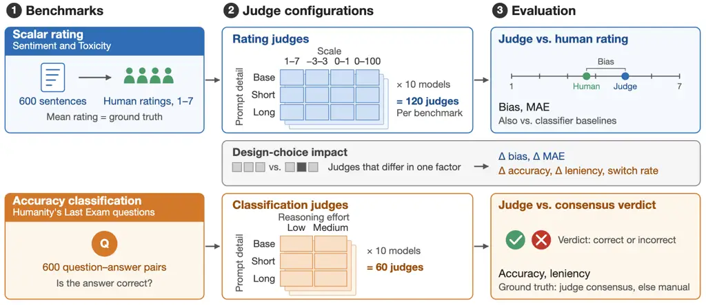

# How Much Do LLM-as-a-Judge Design Choices Matter? A Systematic Comparison of Prompt Designs, Rating Scales, and Models

Laurène Vaugrante ^(†)^(†)thanks: Corresponding author:
laurene.vaugrante@iris.uni-stuttgart.de    Thilo Hagendorff
Affiliation: AI Safety Research Group, University of Stuttgart

###### Abstract

Researchers increasingly use Large Language Models as judges
(LLM-as-a-judge) to evaluate model outputs. Yet there are no standards
for how to design these judges. Typically, researchers choose the
prompt, rating scale, and model intuitively. If these choices change the
judge’s verdicts, two studies can reach different conclusions about the
same facts. To address this risk and to provide an empirical basis for
judge designs, we evaluate 10 reasoning models across multiple designs
on two tasks: a scalar rating of sentence sentiment and toxicity (over
500 items per category), as well as a binary accuracy classification of
question-answer pairs ($`n=600`$). For the rating tasks, despite judges
showing significant disagreements with the human ground truth, the
practical size of differences is small enough to consider most judges
reliable (mean absolute deviation of 0.11 points on a 1 – 7 scale);
toxicity judges even outperform standard classifiers. Judges are also
highly accurate on average (96.5%) for the accuracy classification task.
However, design choices can produce shifts: changing the rating scale
alone can shift measured bias by up to 0.93 points (rating task), and
while accuracy levels are rarely impacted, design choices consistently
impact judge leniency (classification task; leniency drop of 28.9
percentage points when using detailed prompts, and up to 56.1 percentage
points when switching models). Counterintuitively, lower reasoning
effort affects neither accuracy nor leniency. Across both tasks, model
identity is the dominant source of variance. These findings suggest that
while LLM judges are broadly trustworthy in aggregate, design choices
can be meaningful sources of variance. Given the growing reliance on
automated evaluation in LLM research, we intend this study as a
methodological reference for designing more robust and replicable
LLM-as-a-judge pipelines.

|     |
| --- |
|     |

## 1 Introduction

The broad adoption of Large Language Models (LLMs) across research,
industry, and public-facing applications has made the evaluation of
their outputs necessary (Chang et al., 2024; Minaee et al., 2024). Many
tasks on which LLM judges are deployed, such as open-ended dialogue,
summarization, or complex reasoning, require nuanced, subjective
judgment, and semantic understanding (Guzmán et al., 2015; Gillick and
Liu, 2010). This judgment is costly to obtain from human annotators at
scale and poorly captured by traditional metrics such as BLEU (Papineni
et al., 2002) or ROUGE (Lin, 2004). This motivates the use of LLMs
themselves as automated judges (Chiang and Lee, 2023). Zheng et al.
(2023) established that a strong LLM judge can match human-level
agreement on open-ended chat quality assessment, and follow-up work
extended this validation across other Natural Language Generation (NLG)
tasks such as summarization, translation, and general scoring (Fu et
al., 2024; Wang et al., 2023). This validation and adoption of LLM
judges in NLG (Liu et al., 2023; Fu et al., 2023; Tong and Zhang, 2024)
seems to largely overshadow human annotation: a recent analysis of NLG
papers found that fewer than 8% of studies employing an LLM judge
explicitly validate it against human judgment, and that automatic
metrics, LLM judges, and human evaluators are applied to different tasks
and criteria rather than compared directly (Yang et al., 2026).
Meanwhile, there remains no consensus on standardized evaluation
protocols, and systematic comparisons of LLM judge prompt designs remain
rare (Li et al., 2025; Li et al., 2026a). Furthermore, LLM judges have
been shown to exhibit systematic biases, including position bias (Zheng
et al., 2023), verbosity bias (Wu and Aji, 2025), and self-preference
bias (Wataoka et al., 2024). Research has also repeatedly shown that
LLMs are highly sensitive to prompt formulation (Mizrahi et al., 2024;
Sun et al., 2024; Sclar et al., 2024; Chatterjee et al., 2024; Gu et
al., 2022; Cao et al., 2024), with prompt templates sometimes exerting a
greater influence on outputs than the underlying question itself (Liu
and Chu, 2026). Given the risk that design choices substantially affect
the resulting annotations and, by extension, the conclusions drawn from
them, investigating the sensitivity of LLM judges is critical.

In this study, we examine this across two qualitatively different
evaluation setups: subjective scalar ratings (sentence toxicity and
sentiment) and binary response classifications (accuracy of answers).
For the scalar tasks, we collected human annotations as ground truth
against which LLM ratings are compared. We measure the performance of a
large set of LLM judges, varying their design, and assessing whether the
judges’ design choices impact their performance (Figure 1). Our results
reveal that, on average, LLM judges are reliable regardless of their
design: most design choices produce only small differences in
performance, and this holds even for counterintuitive choices such as
reducing reasoning effort. This reliability, however, does not imply a
uniform behavior: judges reaching comparable accuracy can showcase
drastically different leniency rates. Model identity is the dominant
source of variance across both tasks, and no single model is
consistently the best. Robustness also degrades, and design choices
matter more, as task subjectivity increases (toxicity assessments,
ambiguous binary response classifications). These findings offer
concrete guidance for deploying and configuring LLM judges reliably.

Figure 1: Overview of our experiments.

## 2 Related Work

The LLM-as-a-judge method has been mapped by several surveys (Gu et al.,
2024; Li et al., 2024), which found that while LLM judges can be
reliable evaluators for some tasks, such as instruction-following and
mathematical reasoning-trace verification, they perform worse on other
tasks, notably toxicity and safety judgments (Bavaresco et al., 2025).
Research is similarly divided on the inter-annotator agreement scores.
Some studies find that LLM judges remain behind inter-human agreement,
particularly when judge prompts are complex or lengthy (Thakur et al.,
2024); others report the opposite: Zheng et al. (2023) notably found
that while a GPT-4 judge matched the human inter-annotator agreement for
writing and roleplay tasks, this agreement rate lowered on categories
such as math and reasoning, where models made verifiable errors. In
addition to the LLM judge biases mentioned in the introduction (Zheng et
al., 2023; Wu and Aji, 2025; Wataoka et al., 2024), they have also been
shown to rely on superficial cues rather than genuine response quality
(Marioriyad et al., 2025). Verga et al. (2024) show that replacing a
single judge with a panel of smaller, more diverse judges improves
correlation with human judgment, reduces self-preference bias, and costs
substantially less, which confirms that the LLM judge design can impact
its reliability. Furthermore, the design choices underlying
LLM-as-a-judge methodologies have been shown to affect judge
reliability. Li et al. (2025) and Wei et al. (2024) show that the choice
of prompt design and of evaluator model substantially affect judge
robustness. Complex or lengthy prompts have also been shown to reduce
judge accuracy (Thakur et al., 2024), while reference-guided grading has
been shown to reduce judge failure specifically on math and reasoning
tasks (Zheng et al., 2023). Gu et al. (2024) also note that most prior
bias research has focused on comparing which response out of two given
answers was the best, rather than scalar scoring, leaving the
reliability of scalar LLM-judge ratings underexplored.

Beyond prompt content, formatting constraints placed on a model’s output
affect performance. Do et al. (2024) find that output formats
significantly affect performance even when the underlying task is
unchanged. Tam et al. (2024) similarly show that structured-output
constraints, such as making the model output a JSON object, impact task
performance, although the direction and magnitude of the effect are
task-dependent. Such constraints tend to degrade performance on
open-ended reasoning tasks, while performance on classification tasks is
unaffected or improved. Similarly, the methodology used to extract
answers from reasoning models’ outputs can change which models perform
best (Jo et al., 2025), which confirms that, beyond the evaluation
method itself, output-level methodological decisions can also shape the
results; similar effects may hold for LLMs deployed as judges. Within
LLM-judge scoring specifically, scoring granularity and range both
introduce bias (Stureborg et al., 2024; Li et al., 2026b), with
diverging results regarding the effect of scale choice on judge
reliability. More broadly, similar concerns extend to LLM safety
evaluations: Beyer et al. (2025) show that inconsistent evaluator
choices alone can make results incomparable across papers, echoing
concerns about evaluation reliability (Vaugrante et al., 2025; Gu et
al., 2024).

Taken together, these mixed findings establish that while LLM-as-a-judge
methods are widely adopted, they are prone to bias, and that the
specific design choices underlying them, such as the level of prompt
detail or the model used, are rarely varied and compared within a single
study. Our work addresses this gap by varying prompt designs and scale
formats across 10 model judges. Moreover, we compare these results to
human annotations as ground truth, and broadly used classifiers for the
scalar rating tasks.

## 3 Methods

### 3.1 Benchmarks and Data

We evaluate LLM-as-a-judge designs on outputs of two tasks: scalar
rating, covering sentiment and toxicity, as well as binary accuracy
classification. All benchmarks are publicly available ¹¹ 1
[https://osf.io/sra9e/](https://osf.io/sra9e/).

Scalar Rating Benchmarks (Sentiment and Toxicity). We constructed both
benchmarks by first generating $`n=600`$ items per dimension using Grok
4.1 (xAI, 2025), with varying levels of toxicity or sentiment (see the
generation prompt in Appendix A). To establish each sentence’s toxicity
or sentiment ground truth score, we aggregate ratings from human
annotators. The 600 benchmark items were divided into a split of
sentences used exclusively for the evaluation (501 sentiment, 521
toxicity), and a support split for methods requiring in-context examples
(99 sentiment, 79 toxicity). When selecting support examples, we
prioritized items where there was a general consensus on the score (high
inter-annotator agreement), and whose mean scores fell near the anchors
of the scale, so as to provide unambiguous anchor examples for few-shot
in-context-learning prompting. For the maximum anchor on the 1–7 scale,
any sentence with a mean annotator score of $`\geq 6.7`$ was treated as
a scale-maximum example, given that the theoretical maximum of 7.0 was
not present in the annotated scores.

Binary Accuracy Classification Benchmark. Question-answer pairs
($`n=600`$) were sourced from Humanity’s Last Exam (HLE) (Phan et al., 2025) to include high-difficulty questions on diverse topics. They were
filtered to exclude items requiring supplementary information such as
images, and to exclude multiple-choice questions. The candidate
responses to classify by our LLM judges were generated by Gemini 3.1
Pro (Google DeepMind, 2026a) using a sampling temperature of 0.7.

Human Annotation. For rating benchmarks, surveys were administered via
LimeSurvey, with participants recruited through Prolific using a
representative sample and compensated at an average rate of £9.95/hour.
Each item from the benchmarks was rated by several annotators
($`N_{\text{sentiment}}=10`$, $`N_{\text{toxicity}}=15`$) on a 1–7
Likert scale. Full annotator instructions are provided in Appendix B.
Consistent with prior literature on subjective annotation tasks
(Artstein and Poesio, 2008; Vidgen and Derczynski, 2020),
inter-annotator agreement was relatively high for both dimensions
(Krippendorff’s $`\alpha_{\text{sentiment}}`$ = 0.86; Krippendorff’s
$`\alpha_{\text{toxicity}}`$ = 0.68), with a lower agreement reached for
the Toxicity task due to its highly subjective nature. This study
received ethics board approval for conducting these surveys.

### 3.2 LLM-as-a-Judge designs

Scale. For the scalar rating tasks, we vary the numerical range of the
requested LLM judge output across four formats: a 1 – 7 integer scale, a
-3 – 3 integer scale, a 0 – 1 decimal scale, and a 0 – 100 integer scale
(see Appendix C). For each scale, the scoring precision expected is
implied by the instructions and examples in the Short In-Context prompts
and Long In-Context prompts, where integers are shown for every scale
except 0 – 1, which shows two decimal places (see Appendix C).

Prompt Detail. We define three levels of prompt detail. The Base Prompt
provides a minimal task instruction and the response scale when
necessary (rating tasks). The Short In-Context Prompt expands this with
more detailed instructions and examples ($`n=3`$ for rating tasks,
$`n=4`$ for the classification task). The Long In-Context Prompt further
extends this with detailed scoring instructions for each value anchor of
the given response scale and explicit scoring principles (rating tasks)
or detailed classification instructions and principles (classification
task), a step-by-step reasoning procedure, and a larger set of examples.
Prompt examples are provided in Appendix C.

Models. We evaluate 10 reasoning models spanning a range of capability
tiers and providers: gpt-oss 120b (Agarwal et al., 2025),
GPT-5.5 (OpenAI, 2026a), GPT-5.6 Terra (OpenAI, 2026b), Gemini 3.7
Flash (Google DeepMind, 2026b), DeepSeek V4 Pro (DeepSeek-AI, 2026),
Claude Haiku 4.5 (Anthropic, 2025), Claude Sonnet 5 (Anthropic, 2026),
Kimi K3 (Moonshot AI, 2026), Qwen 3.8 27B (Qwen Team, 2025), and
GLM-5.3 (GLM-5-Team, 2026).

Reasoning Effort. For the classification task, we vary each model’s
reasoning effort parameter, which controls the amount of internal
reasoning a model performs before producing its verdict. We compared
models with a low reasoning effort and a medium reasoning effort
(default setting).

### 3.3 Evaluation Methodology

#### 3.3.1 Scalar Rating

For both benchmarks, we construct all 120 possible judge designs by
crossing each design choice: prompt detail, rating scale, and model.
Each design rates every benchmark item, returning its score as a JSON
object; we then parse this output and rescale the extracted score to the
1–7 range to obtain our judge assessments. We compare these assessments
with the human-annotator ground truth. To contextualize our comparisons,
we also use popular classifiers on each benchmark item and measure their
performance compared to the established ground truth. For Sentiment, we
use VADER (Hutto and Gilbert, 2014) and TextBlob (Loria, 2018), which
are lexicon- and rule-based sentiment classifiers (sentiment score on a
-1 – 1 scale); for Toxicity, we use Detoxify (Hanu and Unitary Team,
2020), a BERT-based classifier trained on the Jigsaw Toxic Comment
Classification challenges, and Perspective API (Lees et al., 2022),
Google Jigsaw’s toxicity classifier, trained on crowd-sourced human
ratings of perceived toxicity (toxicity probability on a 0 – 1 scale).
Classifier assessments were also rescaled onto the 1 – 7 range for
comparison purposes.

Metrics. We measure the bias as the signed mean difference between the
normalized LLM judge scores and the human ground truth, and record its
sign as direction to capture the overall tendency and control for
systematic over- or under-rating. However, a low bias does not
necessarily imply low per-item difference, as positive and negative
values can cancel out in a signed average: we therefore use the mean
absolute error (MAE) to estimate the mean per-item difference. All bias
and MAE values reported are relative to the 1 – 7 scale. We note the
rank of each LLM judge across all prompt designs, using a high
Krippendorff’s $`\alpha`$ against human ground truth as quality
indicator. While this is useful to identify which setting performs best,
it does not account for the magnitude: a low rank can be associated with
a negligible average bias and vice versa, depending on the per-item
variability or performance distribution across judges. To capture how
much a design choice can reorder this ranking, we additionally report
Best as the average change in rank position observed when that design
choice alone is varied.

Statistical Significance. Given the size of our experiments where each
per-item comparison draws on several hundred observations, small
differences that would be negligible in practice frequently reach
statistical significance. Therefore, we do not consider this to be a
reliable indicator of effect magnitude in our setting and instead report
the effect strength using a rank-biserial correlation (RBC). We
nevertheless calculate and seldom mention significance values, notably
in the Appendix tables, using a paired Wilcoxon signed-rank test with a
Benjamini-Hochberg correction applied to account for the number of
comparison groups. When significance results are presented in tables, we
use the following representation: $`{}^{*}p<.05`$, $`{}^{**}p<.01`$,
$`{}^{***}p<.001`$, ns = not significant.

#### 3.3.2 Accuracy Classification

We construct all 60 possible judge designs by crossing prompt detail,
reasoning effort, and model. For each benchmark item, every judge is
given the question, the LLM-generated answer to classify, and the
verified ground-truth answer, and is asked to return a binary
correct/incorrect verdict as a JSON object. Case-insensitive variants of
“true” and “false” are treated as equivalent during parsing. Reasoning
traces are stored when available. To establish the classification ground
truth, we partly use the evaluated judges’ own classification outcomes:
an item’s accuracy label is determined by majority vote whenever at
least 90% of the 60 designs agree, and the remaining items are resolved
manually. This yields three subsets: 429 full-agreement items (unanimous
verdict across all 60 designs), 124 near-agreement items (agreement rate
$`\geq 90\%`$ and $`<100\%`$), and 47 ambiguous items (agreement rate
$`<90\%`$, manually resolved).

Metrics. To analyze the obtained results, we measure accuracy as the
proportion of question-answer pairs correctly classified against the
established ground truth, and leniency as the proportion of a judge’s
errors that are false positives (incorrectly judging a response as
correct) rather than false negatives, to capture any systematic over- or
under-forgiving tendencies. However, similar accuracy or leniency rates
can still hide different underlying behavior on a per-item basis: we
therefore additionally report the switch rate as the proportion of items
whose verdict changes when a single design choice is varied, to capture
instability.

Statistical Significance. As with the rating tasks, we do not treat
statistical significance alone as a reliable indicator of effect
magnitude and report our selected metrics alongside any significance
statistic, namely chi-square test of independence for accuracy and
leniency impact, and Cochran’s Q test for switch rate impact, both
Benjamini-Hochberg corrected within each item-difficulty tier. When
significance results are presented in tables, we use the same
significance representation as in the rating tasks.

## 4 Results

### 4.1 Rating Benchmarks

To interpret our results, we focus on two overarching questions. First,
to assess whether LLM judges are a suitable substitute for human
annotation or non-LLM classifiers, we examine how LLM judges’ and
classifiers’ scores align with the human ground truth (Figure 2, Table
7). Second, we examine how much LLM judges’ scores vary depending on
each design choice to determine whether these choices can artificially
skew assessments (Table 1). As Sentiment and Toxicity judges behave
differently across most patterns, we analyze both benchmarks separately
throughout this section.

#### 4.1.1 Do the LLM judges disagree with humans and classifiers?

LLM judges reliably rate the sentiment and toxicity levels of sentences.
Among the 240 designs evaluated across both benchmarks, 67% of LLM
judges obtain assessments that significantly differ from the human
ground truth. However, the observed effect remains small: only 24% of
designs show a medium to large effect strength, and 7% deviate by more
than 0.3 points on the 1 – 7 scale. Overall, the practical implications
remain modest, with judges deviating by only 0.11 points on average
(values ranging from 0.00 to 0.76 across all designs; see Table 8,
Appendix D).

Sentiment judges are accurate and robust. Most Sentiment judges only
slightly deviate from human ground truth (mean absolute deviation of
0.07, with only one design showing an absolute bias exceeding 0.2; see
Table 7 and Figure 2). Judges are also consistent at the item level,
with a mean absolute error of 0.37 across all items (Figure 3). The
non-LLM Sentiment classifiers show on average a smaller raw bias, but a
larger per-item error ($`|\text{Bias}_{\text{VADER}}|=0.05`$,
$`|\text{Bias}_{\text{TextBlob}}|=0.02`$, versus
$`|\text{Bias}_{\text{all judges}}|=0.07`$; see Table 8 and Figure 2).

Toxicity judges are less consistent, yet much more reliable than
classifiers. Toxicity judges show a much larger disagreement than
Sentiment judges, both per-item (83% exceed an MAE of 0.5, versus 3% for
Sentiment) and overall (32% show a medium to strong effect and exceed an
absolute bias of 0.2; Table 7, Appendix D). This gap likely reflects the
task’s greater subjectivity: human annotators showed lower
inter-annotator agreement for Toxicity than for Sentiment
($`\alpha=0.68`$ vs. $`0.86`$), and Toxicity judges are more sensitive
to design choices, benefiting from detailed prompts that include example
assessments
($`|\text{Bias}_{\text{Base}}|=0.21\to|\text{Bias}_{\text{Long}}|=0.12`$;
consistency similarly improves, $`\alpha=0.910\to 0.941`$). Judges using
the -3 – 3 scale particularly over-rate Toxicity (average signed bias of
0.31, with 73% of designs showing a medium to strong effect), likely
because a centered scale’s zero point carries a “neutral” meaning rather
than a true midpoint. This effect diminishes with longer prompts that
clearly set score expectations. Despite this, Toxicity classifiers show
a much stronger under-rating deviation than LLM judges
($`|\text{Bias}_{\text{Detoxify}}|=1.03`$,
$`|\text{Bias}_{\text{Perspective}}|=0.82`$, vs.
$`|\text{Bias}_{\text{all judges}}|=0.16`$; Table 8, Figure 2). While
one could believe that this is due to the use of annotator-based
assessment examples in the prompts guiding the judges, this observation
remains valid when no examples are in the prompt
($`|\text{Bias}_{\text{Base}}|=0.21`$). This suggests that when rating
Toxicity, despite consistency issues of LLM judges on the Toxicity
benchmark, they remain largely preferable to commonly used classifiers.

Higher scale precision slightly improves performance. More precise
scales (0 – 1 and 0 – 100) tend to outperform coarser ones (1–7 and -3 –
3), diminishing both the bias (0.08 vs. 0.15 points on average) and the
per-item error (0.44 vs. 0.55 MAE; Table 8, Figure 3). This pattern
nevertheless affects judges unevenly (Figure 2).

Prompt detail meaningfully affects Toxicity performance, but barely
affects Sentiment. While prompt design choice is almost irrelevant for
Sentiment ($`\alpha`$ 0.963–0.964 across Base/Short In-Context/Long
In-Context), Toxicity judges are meaningfully affected ($`\alpha`$
0.910–0.941), with more detailed prompts improving agreement with human
ground truth. However, this is largely attributable to the -3 – 3 scale
issue as discussed above (see Appendix D.2).

There is no clear best model. When ranking all ten models by $`\alpha`$
within each of the twelve prompt detail $`\times`$ scale designs, no
single model is consistently best: five different models occupy rank 1
across Sentiment designs, and six do across Toxicity designs, with a
mean per-model rank standard deviation of approximately 2.2 positions
out of 10 (see Figure 4). The effect can be extreme: GLM-5.3 ranks first
in four Toxicity designs but as low as ninth in two others, and Claude
Haiku 4.5 ranks in the top three on 7-point Sentiment scales but eighth
to tenth on the 0–100 scale. This is, to our knowledge, direct evidence
that single-design LLM-judge comparisons, common in LLM benchmarks, can
produce model rankings that largely reflect the evaluation design rather
than a stable property of the model itself. For that reason, we
recommend aggregating the results from several models when using
LLM-as-a-judge techniques to strengthen the assessments: when
aggregating the results of 3 judges using different models, we observed
an average deviation decrease of 35% (Toxicity) to 37% (Sentiment;
Appendix D.3).

Figure 2: Range of mean bias per model, for the rating tasks. The larger
range of Toxicity biases is mostly due to the -3 – 3 scale.

#### 4.1.2 Do the LLM judges disagree with each other?

While some judge pairs may diverge, LLM judges overall agree with each
other. Comparing all judge designs pairwise within each benchmark
($`n=7{,}140`$ pairwise comparisons per benchmark, from 120 designs
each), LLM judges overall show a high agreement with one another
(Krippendorff’s $`\alpha=0.97`$ for Sentiment, $`0.96`$ for Toxicity)
and relatively small average pairwise differences (mean bias difference
of $`0.09`$ for Sentiment and $`0.22`$ for Toxicity). However, the
question of judge selection remains meaningful: on the 1 – 7 scale,
individual pairwise differences can reach up to 0.43 points (Sentiment)
and 1.08 points (Toxicity; 18% of the scale’s range). To estimate how
much of this variation is attributable to specific design choices, we
group designs by every other setting (for example, by model and prompt
detail when evaluating scale), so that only the design choice of
interest varies; within each group, we measure the bias difference
across every judge pair, and report both the average and maximal
difference. Design-choice significance and impact are summarized in
Table 1.

Here, the _impact_ of a design choice is the average absolute change in
bias observed when that choice alone is varied, with other judge design
elements (model, prompt, and remaining settings) held fixed.

Scale disproportionately impacts Toxicity judges. Scale choice
significantly impacts assessments for both benchmarks, but Toxicity
judges are particularly sensitive (0.19 points average impact vs. 0.06
for Sentiment; Table 12), with the scale choice alone generating
differences of up to 0.93 points (15.5% of the scale). This is largely
driven by the centered -3 – 3 scale, without which Toxicity judges
differ by only 0.07 points on average: this instability is reduced when
using more detailed prompts (see Figure 3).

Prompt detail has the lowest impact. Prompt detail is the least
impactful design choice overall (average impact of 0.10 points across
both benchmarks, vs. 0.11 for model and 0.13 for scale; see Table 12),
though Toxicity remains more sensitive to it than Sentiment. Despite no
clear relationship with accuracy, more detailed prompts measurably
improve Toxicity consistency ($`\alpha`$: 0.910 Base $`\to`$ 0.916 Short
In-Context $`\to`$ 0.941 Long In-Context).

The choice of model is the main driver of differences and sets bias
direction. Model choice is the design choice to which Sentiment scores
are most sensitive, shifting bias by up to 0.39 points (0.53 for
Toxicity; see Table 12). For both benchmarks, model choice is also the
main driver of bias direction: each model shows an inherent under- or
over-rating tendency, consistent across both benchmarks (see Figure 2).

Overall, Sentiment judges are particularly robust to design choices: a
single design choice has an impact exceeding 0.2 points in only 3% of
cases, compared to 28% for Toxicity (see Table 11). Design choices
overall also have a limited impact relative to the full range of judge
disagreement: two arbitrary judge designs differ on average by 0.09
points for Sentiment and 0.22 for Toxicity, which is larger than the
impact of any single design choice in isolation (between 0.05 and 0.08
points for Sentiment, and 0.15 and 0.19 points for Toxicity). In other
words, isolating any single design choice explains only part of the
disagreement between two arbitrary judge designs; the more a design
differs overall, the larger the resulting difference tends to be.

|               |           |            |                        |                    |     |          |            |            |                    |
| ------------- | --------- | ---------- | ---------------------- | ------------------ | --- | -------- | ---------- | ---------- | ------------------ |
|               | Sentiment |            |                        |                    |     | Toxicity |            |            |                    |
| Design choice | Dir.      | Size       | Error                  | Best               |     | Dir.     | Size       | Error      | Best               |
| Scale         | 40%       | 0.06^(∗∗)  | 0.07^(∗∗∗)             | $`\bullet\bullet`$ |     | 53%      | 0.19^(∗∗∗) | 0.11^(∗∗∗) | $`\bullet`$        |
| Prompt Detail | 38%       | 0.05^(∗)   | 0.04$`{}^{\text{ns}}`$ | $`\bullet\bullet`$ |     | 45%      | 0.15^(∗∗∗) | 0.12^(∗∗∗) | $`\bullet\bullet`$ |
| Model         | 83%       | 0.08^(∗∗∗) | 0.05^(∗)               | $`\bullet\bullet`$ |     | 83%      | 0.15^(∗∗∗) | 0.07^(∗∗)  | $`\bullet`$        |

Table 1: Does each design choice change the direction of bias, the size
of bias, the per-item error, or how much the ranking of settings shifts
(best; see Section 3)? Size and Error report the average impact in
points on the 1–7 scale (average change caused by varying that design
choice alone, everything else held fixed). Direction is the fraction of
design-pairs whose bias sign reverses. Best is based on the average
change in ranking ($`<`$1 = –, 1–2 = $`\bullet`$, 2–4 =
$`\bullet\bullet`$, $`\geq`$4 = $`\bullet\bullet\bullet`$). Underlying
values are reported separately in Tables 11 and  12.

### 4.2 Accuracy Classification Benchmark

LLM judges classify responses accurately, yet their leniency differs.
Across all 60 tested designs, LLM judges are on average 96.5% accurate,
with rates ranging from 92.7% to 98.3%. In fact, when looking at
per-item differences, most question-answer pairs were identically
classified by all judges ($`n=429`$ full-agreement items), despite the
high complexity of the benchmark. Despite comparable accuracy rates
across judges and design choices, the underlying behavior differs
widely. This becomes particularly apparent when assessing each benchmark
subset separately: for instance, in the near-agreement subset, some
judges have exclusively false positive errors while others have
exclusively false negative errors (see Table 15).

Detailed prompts make judges stricter. Despite comparable accuracy
levels, leniency is severely impacted by the level of prompt detail.
Longer, more detailed prompts almost systematically make judges
stricter: the leniency rate of 81.3% observed when using the Base prompt
drops to 52.4% when using the Long In-Context prompt (Table 14). This
effect is strongly significant overall (leniency impact of 18.1%,
$`p<.001`$; see Table 2), directionally consistent across 9 of the 10
models, and especially pronounced on the near-agreement subset (impact
of 43.3%).

The reasoning effort level affects neither accuracy nor leniency.
Surprisingly, using a lower reasoning effort does not decrease the
overall performance of judges; when looking at the differences per
model, some models even show a slight increase in accuracy (see Table
13). Overall, low reasoning effort variants of models share prompt
sensitivities and accuracy with their default counterparts.

The model is the main source of variation. As in the rating tasks, the
choice of model is the main cause of differences. Changing models has a
significant impact on both accuracy (average pairwise accuracy gap of
1.2 percentage points, rising to 12.7 on ambiguous items) and leniency
(leniency gap of 23.2 points, 15.7 on ambiguous items; Table 2). While
accuracy rates remain relatively high across models, leniency is highly
impacted: leniency rates on near-agreement items range from 0% (GPT-5.5,
GPT-5.6 Terra, gpt-oss 120b) to 100% (Gemini 3.7 Flash; Table 15). The
switch rate is systematically and significantly impacted by model
choice, particularly when dealing with ambiguous items: on average, two
judge designs that only differ by the choice of model used disagree on
36.5% of ambiguous items (Table 17), confirming that classification
differences are mostly model-dependent. Furthermore, the particularly
high leniency rate of Gemini 3.7 Flash throughout all subsets (minimum
96.6% across all designs) may possibly reflect a
self-preference-adjacent bias (Wataoka et al., 2024), given that the
answers to classify are generated from the same provider (but different
model).

|                  | Total                  |                        |                        | Nearly Agree           |                        |                        | Ambiguous              |                         |                        |
| ---------------- | ---------------------- | ---------------------- | ---------------------- | ---------------------- | ---------------------- | ---------------------- | ---------------------- | ----------------------- | ---------------------- |
| Design choice    | Acc.                   | Switch                 | Len.                   | Acc.                   | Switch                 | Len.                   | Acc.                   | Switch                  | Len.                   |
| Prompt Detail    | 0.4%$`{}^{\text{ns}}`$ | 2.5%^(∗∗∗)             | 18.1%^(∗∗∗)            | 2.7%^(∗∗∗)             | 5.4%^(∗∗∗)             | 43.3%^(∗∗∗)            | 2.1%$`{}^{\text{ns}}`$ | 17.5%^(∗∗∗)             | 5.6%$`{}^{\text{ns}}`$ |
| Reasoning Effort | 0.1%$`{}^{\text{ns}}`$ | 2.0%$`{}^{\text{ns}}`$ | 2.3%$`{}^{\text{ns}}`$ | 0.7%$`{}^{\text{ns}}`$ | 4.8%$`{}^{\text{ns}}`$ | 0.2%$`{}^{\text{ns}}`$ | 0.3%$`{}^{\text{ns}}`$ | 13.5%$`{}^{\text{ns}}`$ | 0.8%$`{}^{\text{ns}}`$ |
| Model            | 1.2%^(∗∗∗)             | 4.1%^(∗∗∗)             | 23.2%^(∗∗∗)            | 2.8%^(∗∗∗)             | 6.2%^(∗∗∗)             | 38.4%^(∗∗∗)            | 12.7%^(∗∗∗)            | 36.5%^(∗∗∗)             | 15.7%^(∗∗∗)            |

Table 2: Average pairwise impact of each design choice (accuracy
difference, switch rate, leniency difference) across all setting pairs.
Significance tests are described in Section 3.

## 5 Discussion

Judges are broadly reliable regardless of design, but can differ in
behavior. Across both tasks (rating and accuracy classification), most
design choices have a limited impact on judge performance, particularly
for less subjective tasks: differences remain modest even where a
pattern is statistically detectable, and even counterintuitive choices
such as reducing reasoning effort show no meaningful effect on accuracy.
This does not mean that judges are interchangeable, however: two equally
accurate judges can have different underlying behavior, as highlighted
by the wide leniency range observed in the accuracy classification task.
Recommendations: (i) Prefer low-constraint settings such as minimal
prompt detail, cheaper models, or low reasoning effort; (ii) Evaluate
metrics beyond accuracy, like leniency or error direction, to detect
subtler judge differences.

Model identity is the dominant source of variance, and no single model
is consistently the best. Across both judge tasks, model choice matters
more than any other design choice; model identity is also the primary
driver of bias direction (rating tasks) and error type (classification
task). Additionally, while individual models show systematic,
direction-consistent biases, model performance rankings are
design-dependent rather than stable. Recommendations: Aggregate
evaluation results across two to three models (and designs) to mitigate
model-specific biases and use judge averages or majority votes.

Robustness decreases and design choices matter more as task subjectivity
increases. While most observed patterns are design-specific rather than
universal, one pattern holds consistently across both tasks: robustness
decreases on more subjective or ambiguous data (Toxicity relative to
Sentiment; ambiguous items relative to the full accuracy classification
benchmark), where design choices have a measurably larger impact.
Inappropriate design choices can also generate stronger effects, such as
the centered scale’s bias (Toxicity task), the harsher judgments induced
by more detailed prompts (classification task), or the high Gemini 3.7
Flash leniency possibly reflecting self-preference-adjacent bias.
Recommendations: (i) Increase the number of judges for highly subjective
tasks; (ii) Ensure relevance of design choices rather than assuming any
design is fully reliable.

### 5.1 Limitations

Despite the high number of judge designs evaluated, our experiments’
scope is limited: they cover two rating tasks and one accuracy
classification task, a limited set of design choices, and a small number
of non-LLM classifiers. Validating these patterns across a broader range
of domains, design choices, and baselines would provide further
insights. Moreover, our human ground truth has its own measurement
uncertainty, as reflected by the imperfect inter-annotator agreement.
Likewise, our accuracy classification ground truth is partly derived
from judge consensus rather than fully independent annotation. Both of
these ground truth issues weaken our accuracy-linked findings. Finally,
part of our analysis relies on thresholds we chose for interpretability
(for example, $`|\text{bias}|>0.2`$); these should be treated as
descriptive aids rather than established standards for what constitutes
a reliable judge.

### Ethics statement

This study involved human subjects: participants were recruited through
Prolific to rate the toxicity and sentiment of sentences (see Section 3
and Appendix B). All participants gave informed consent, were
compensated at a fair hourly rate (£9.95/hour on average), and could
withdraw at any time; responses were collected and stored anonymously.
This study received approval from the ethics committee of the University
of Stuttgart prior to data collection. Because some benchmark sentences
were deliberately constructed to contain toxic, offensive, or hateful
language (Appendix A), participants were informed in advance that they
might encounter such content, and the highest-toxicity items generated
were excluded from the study out of concern for annotator wellbeing
(Appendix A). The same content warning applies to readers of this paper:
several appendix tables and prompt examples contain offensive or hateful
language, included only as necessary illustrations of the benchmark
content and evaluation prompts. We do not foresee this work enabling
harmful applications beyond the risk, common to any published
toxic-language dataset, that the generated sentences could be repurposed
outside their intended evaluative use.

### Acknowledgments

This research was supported by the Ministry of Science, Research, and
the Arts Baden-Württemberg under Az. 33-7533-9-19/54/5 in Reflecting
Intelligent Systems for Diversity, Demography and Democracy (IRIS3D) as
well as the Interchange Forum for Reflecting on Intelligent Systems
(IRIS) at the University of Stuttgart. Thanks to Emma Raimundo Schulz
for her assistance with the annotation (accuracy classification
benchmark).

## References

- Agarwal et al. (2025) S. Agarwal, L. Ahmad, J. Ai, S. Altman, et al.
  Gpt-oss-120b & gpt-oss-20b model card. arXiv preprint
  arXiv:2508.10925. Cited by: §3.2.
- Anthropic (2025) Anthropic System card: Claude Haiku 4.5. Technical
  report Anthropic. Note: Accessed 2026 External Links:
  [Link](https://www.anthropic.com/claude-haiku-4-5-system-card) Cited
  by: §3.2.
- Anthropic (2026) Anthropic System card: Claude Sonnet 5. Technical
  report Anthropic. Note: Accessed 2026 External Links:
  [Link](https://www.anthropic.com/claude-sonnet-5-system-card) Cited
  by: §3.2.
- Artstein and Poesio (2008) R. Artstein and M. Poesio Survey article:
  inter-coder agreement for computational linguistics. Computational
  Linguistics 34 (4), pp. 555–596. External Links:
  [Document](https://dx.doi.org/10.1162/coli.07-034-R2),
  [Link](https://aclanthology.org/J08-4004/) Cited by: §3.1.
- Bavaresco et al. (2025) A. Bavaresco, R. Bernardi, L. Bertolazzi, D.
  Elliott, R. Fernández, A. Gatt, E. Ghaleb, M. Giulianelli, M.
  Hanna, A. Koller, A. Martins, P. Mondorf, V. Neplenbroek, S.
  Pezzelle, B. Plank, D. Schlangen, A. Suglia, A. K. Surikuchi, E.
  Takmaz, and A. Testoni LLMs instead of human judges? A large scale
  empirical study across 20 NLP evaluation tasks. In Proceedings of the
  63rd Annual Meeting of the Association for Computational Linguistics
  (Volume 2: Short Papers), Vienna, Austria, pp. 238–255. External
  Links: [Document](https://dx.doi.org/10.18653/v1/2025.acl-short.20),
  [Link](https://aclanthology.org/2025.acl-short.20/), 2406.18403 Cited
  by: §2.
- Beyer et al. (2025) T. Beyer, S. Xhonneux, S. Geisler, G. Gidel, L.
  Schwinn, and S. Günnemann Position: LLM-safety evaluations lack
  robustness. In Proceedings of the 42nd International Conference on
  Machine Learning, External Links: 2503.02574,
  [Link](https://arxiv.org/abs/2503.02574) Cited by: §2.
- Cao et al. (2024) B. Cao, D. Cai, Z. Zhang, Y. Zou, and W. Lam On the
  worst prompt performance of large language models. In Advances in
  Neural Information Processing Systems, Vol. 37. External Links:
  [Link](https://papers.nips.cc/paper_files/paper/2024/hash/7fa5a377b7ffabcce43cd00231bb3f9c-Abstract-Conference.html),
  2406.10248 Cited by: §1.
- Chang et al. (2024) Y. Chang, X. Wang, J. Wang, Y. Wu, L. Yang, K.
  Zhu, H. Chen, X. Yi, C. Wang, Y. Wang, W. Ye, Y. Zhang, Y.
  Chang, P. S. Yu, Q. Yang, and X. Xie A survey on evaluation of large
  language models. ACM Transactions on Intelligent Systems and
  Technology 15 (3), pp. 1–45. External Links:
  [Document](https://dx.doi.org/10.1145/3641289),
  [Link](https://doi.org/10.1145/3641289), 2307.03109 Cited by: §1.
- Chatterjee et al. (2024) A. Chatterjee, H. S. V. N. S. K.
  Renduchintala, S. Bhatia, and T. Chakraborty POSIX: a prompt
  sensitivity index for large language models. In Findings of the
  Association for Computational Linguistics: EMNLP 2024, Miami, Florida,
  USA, pp. 14550–14565. External Links:
  [Link](https://aclanthology.org/2024.findings-emnlp.852/), 2410.02185
  Cited by: §1.
- Chiang and Lee (2023) C. Chiang and H. Lee Can large language models
  be an alternative to human evaluations?. In Proceedings of the 61st
  Annual Meeting of the Association for Computational Linguistics
  (Volume 1: Long Papers), Toronto, Canada, pp. 15607–15631. External
  Links: [Document](https://dx.doi.org/10.18653/v1/2023.acl-long.870),
  [Link](https://aclanthology.org/2023.acl-long.870/), 2305.01937 Cited
  by: §1.
- DeepSeek-AI (2026) DeepSeek-AI DeepSeek-V4: towards highly efficient
  million-token context intelligence. arXiv preprint arXiv:2606.19348.
  Cited by: §3.2.
- Do et al. (2024) X. L. Do, H. Nguyen, T. Sim, H. Dao, S. Joty, K.
  Kawaguchi, N. F. Chen, and M. Kan LLMs are biased towards output
  formats! systematically evaluating and mitigating output format bias
  of LLMs. arXiv preprint arXiv:2408.08656. Cited by: §2.
- Fu et al. (2024) J. Fu, S. Ng, Z. Jiang, and P. Liu GPTScore: evaluate
  as you desire. In Proceedings of the 2024 Conference of the North
  American Chapter of the Association for Computational Linguistics:
  Human Language Technologies (Volume 1: Long Papers), pp. 6556–6576.
  Cited by: §1.
- Fu et al. (2023) X. Fu, I. H. Laradji, X. Zhu, M. Rezagholizadeh,
  and B. Chen Are large language models reliable judges? A study on the
  factuality evaluation capabilities of LLMs. arXiv preprint
  arXiv:2311.00681. External Links:
  [Document](https://dx.doi.org/10.48550/arXiv.2311.00681),
  [Link](https://arxiv.org/abs/2311.00681), 2311.00681 Cited by: §1.
- Gillick and Liu (2010) D. Gillick and Y. Liu Non-expert evaluation of
  summarization systems is risky. In Proceedings of the NAACL HLT 2010
  Workshop on Creating Speech and Language Data with Amazon’s Mechanical
  Turk, Los Angeles, CA, USA, pp. 148–151. External Links:
  [Link](https://aclanthology.org/W10-0722/) Cited by: §1.
- GLM-5-Team (2026) GLM-5-Team GLM-5: from vibe coding to agentic
  engineering. arXiv preprint arXiv:2602.15763. Cited by: §3.2.
- Google DeepMind (2026a) Google DeepMind Gemini 3.1 Pro model card.
  Technical report Google DeepMind. Note: Accessed 2026 External Links:
  [Link](https://storage.googleapis.com/deepmind-media/Model-Cards/Gemini-3-1-Pro-Model-Card.pdf)
  Cited by: §3.1.
- Google DeepMind (2026b) Google DeepMind Gemini 3.7 Flash model card.
  Technical report Google DeepMind. Note: Accessed 2026 External Links:
  [Link](https://deepmind.google/models/model-cards/gemini-3-7-flash/)
  Cited by: §3.2.
- Gu et al. (2022) J. Gu, H. Zhao, H. Xu, L. Nie, H. Mei, and W. Yin
  Robustness of learning from task instructions. arXiv preprint
  arXiv:2212.03813. External Links:
  [Document](https://dx.doi.org/10.48550/arXiv.2212.03813),
  [Link](https://arxiv.org/abs/2212.03813), 2212.03813 Cited by: §1.
- Gu et al. (2024) J. Gu, X. Jiang, Z. Shi, H. Tan, X. Zhai, C. Xu, W.
  Li, Y. Shen, S. Ma, H. Liu, Y. Wang, and J. Guo A survey on
  LLM-as-a-judge. arXiv preprint arXiv:2411.15594. External Links:
  [Document](https://dx.doi.org/10.48550/arXiv.2411.15594),
  [Link](https://arxiv.org/abs/2411.15594), 2411.15594 Cited by: §2, §2.
- Guzmán et al. (2015) F. Guzmán, A. Abdelali, I. Temnikova, H. Sajjad,
  and S. Vogel How do humans evaluate machine translation. In
  Proceedings of the Tenth Workshop on Statistical Machine Translation,
  Lisbon, Portugal, pp. 457–466. External Links:
  [Document](https://dx.doi.org/10.18653/v1/W15-3059),
  [Link](https://aclanthology.org/W15-3059/) Cited by: §1.
- Hanu and Unitary Team (2020) L. Hanu and Unitary Team Detoxify. Note:
  [https://github.com/unitaryai/detoxify](https://github.com/unitaryai/detoxify)
  Cited by: §3.3.1.
- Hutto and Gilbert (2014) C.J. Hutto and E. Gilbert VADER: a
  parsimonious rule-based model for sentiment analysis of social media
  text. Proceedings of the International AAAI Conference on Web and
  Social Media 8 (1), pp. 216–225. Cited by: §3.3.1.
- Jo et al. (2025) H. Jo, J. Lee, J. Lee, S. Lee, J. Park, and K. M. Yoo
  Finding answers in thought matters: revisiting evaluation on large
  language models with reasoning. arXiv preprint arXiv:2510.14773. Cited
  by: §2.
- Lees et al. (2022) A. Lees, V. Q. Tran, Y. Tay, J. Sorensen, J.
  Gupta, D. Metzler, and L. Vasserman A new generation of Perspective
  API: efficient multilingual character-level transformers. In
  Proceedings of the 28th ACM SIGKDD Conference on Knowledge Discovery
  and Data Mining, pp. 3197–3207. Cited by: §3.3.1.
- Li et al. (2024) H. Li, Q. Dong, J. Chen, H. Su, Y. Zhou, Q. Ai, Z.
  Ye, and Y. Liu LLMs-as-judges: a comprehensive survey on LLM-based
  evaluation methods. arXiv preprint arXiv:2412.05579. Cited by: §2.
- Li et al. (2026a) Q. Li, S. Dou, K. Shao, C. Chen, and H. Hu
  Evaluating scoring bias in LLM-as-a-judge. In Database Systems for
  Advanced Applications, Lecture Notes in Computer Science, Vol. 16538,
  Singapore, pp. 19–34. External Links:
  [Document](https://dx.doi.org/10.1007/978-981-92-0372-7%5F2),
  [Link](https://doi.org/10.1007/978-981-92-0372-7_2), 2506.22316 Cited
  by: §1.
- Li et al. (2025) S. Li, C. Xu, J. Wang, X. Gong, C. Chen, J. Zhang, J.
  Wang, K. Lam, and S. Ji LLMs cannot reliably judge (yet?): A
  comprehensive assessment on the robustness of LLM-as-a-judge. arXiv
  preprint arXiv:2506.09443. External Links:
  [Document](https://dx.doi.org/10.48550/arXiv.2506.09443),
  [Link](https://arxiv.org/abs/2506.09443), 2506.09443 Cited by: §1, §2.
- Li et al. (2026b) W. Li, M. Zhao, W. Dong, J. Cai, Y. Wei, M.
  Pocress, Y. Li, W. Yuan, X. Wang, R. Hou, K. Lou, W. Zeng, Y. Yang, Y.
  Du, and M. Wang Grading scale impact on LLM-as-a-judge: human-LLM
  alignment is highest on 0-5 grading scale. arXiv preprint
  arXiv:2601.03444. Cited by: §2.
- Lin (2004) C. Lin ROUGE: a package for automatic evaluation of
  summaries. In Text Summarization Branches Out, Barcelona, Spain,
  pp. 74–81. External Links: [Link](https://aclanthology.org/W04-1013/)
  Cited by: §1.
- Liu and Chu (2026) Y. Liu and C. Chu Understanding the prompt
  sensitivity. In Proceedings of the 64th Annual Meeting of the
  Association for Computational Linguistics (Volume 1: Long Papers), San
  Diego, California, United States, pp. 44362–44388. External Links:
  [Link](https://aclanthology.org/2026.acl-long.2053/), 2604.18389 Cited
  by: §1.
- Liu et al. (2023) Y. Liu, D. Iter, Y. Xu, S. Wang, R. Xu, and C. Zhu
  G-Eval: NLG evaluation using GPT-4 with better human alignment. In
  Proceedings of the 2023 Conference on Empirical Methods in Natural
  Language Processing, Singapore, pp. 2511–2522. External Links:
  [Document](https://dx.doi.org/10.18653/v1/2023.emnlp-main.153),
  [Link](https://aclanthology.org/2023.emnlp-main.153/), 2303.16634
  Cited by: §1.
- Loria (2018) S. Loria TextBlob: simplified text processing. Note:
  [https://textblob.readthedocs.io/](https://textblob.readthedocs.io/)
  Cited by: §3.3.1.
- Marioriyad et al. (2025) A. Marioriyad, M. H. Rohban, and M. S.
  Baghshah The silent judge: unacknowledged shortcut bias in
  LLM-as-a-judge. arXiv preprint arXiv:2509.26072. External Links:
  [Document](https://dx.doi.org/10.48550/arXiv.2509.26072),
  [Link](https://arxiv.org/abs/2509.26072), 2509.26072 Cited by: §2.
- Minaee et al. (2024) S. Minaee, T. Mikolov, N. Nikzad, M.
  Chenaghlu, R. Socher, X. Amatriain, and J. Gao Large language models:
  a survey. arXiv preprint arXiv:2402.06196. External Links:
  [Document](https://dx.doi.org/10.48550/arXiv.2402.06196),
  [Link](https://arxiv.org/abs/2402.06196), 2402.06196 Cited by: §1.
- Mizrahi et al. (2024) M. Mizrahi, G. Kaplan, D. Malkin, R. Dror, D.
  Shahaf, and G. Stanovsky State of what art? A call for multi-prompt
  LLM evaluation. Transactions of the Association for Computational
  Linguistics 12, pp. 933–949. External Links:
  [Document](https://dx.doi.org/10.1162/tacl%5Fa%5F00681),
  [Link](https://doi.org/10.1162/tacl_a_00681), 2401.00595 Cited by: §1.
- Moonshot AI (2026) Moonshot AI Kimi K3 technical report. arXiv
  preprint arXiv:2607.24653. Cited by: §3.2.
- OpenAI (2026a) OpenAI GPT-5.5 system card. Technical report OpenAI.
  Note: Accessed 2026 External Links:
  [Link](https://openai.com/index/gpt-5-5-system-card/) Cited by: §3.2.
- OpenAI (2026b) OpenAI GPT-5.6 preview system card. Technical report
  OpenAI. Note: Accessed 2026 External Links:
  [Link](https://deploymentsafety.openai.com/gpt-5-6-preview) Cited by:
  §3.2.
- Papineni et al. (2002) K. Papineni, S. Roukos, T. Ward, and W. Zhu
  BLEU: a method for automatic evaluation of machine translation. In
  Proceedings of the 40th Annual Meeting of the Association for
  Computational Linguistics, Philadelphia, Pennsylvania, USA,
  pp. 311–318. External Links:
  [Document](https://dx.doi.org/10.3115/1073083.1073135),
  [Link](https://aclanthology.org/P02-1040/) Cited by: §1.
- Phan et al. (2025) L. Phan, A. Gatti, Z. Han, N. Li, et al. Humanity’s
  last exam. arXiv preprint arXiv:2501.14249. External Links:
  [Document](https://dx.doi.org/10.48550/arXiv.2501.14249),
  [Link](https://arxiv.org/abs/2501.14249), 2501.14249 Cited by: §3.1.
- Qwen Team (2025) Qwen Team Qwen3 technical report. arXiv preprint
  arXiv:2505.09388. Cited by: §3.2.
- Sclar et al. (2024) M. Sclar, Y. Choi, Y. Tsvetkov, and A. Suhr
  Quantifying language models’ sensitivity to spurious features in
  prompt design or: how I learned to start worrying about prompt
  formatting. In The Twelfth International Conference on Learning
  Representations, External Links:
  [Link](https://openreview.net/forum?id=RIu5lyNXjT), 2310.11324 Cited
  by: §1.
- Stureborg et al. (2024) R. Stureborg, D. Alikaniotis, and Y. Suhara
  Large language models are inconsistent and biased evaluators. arXiv
  preprint arXiv:2405.01724. Cited by: §2.
- Sun et al. (2024) J. Sun, C. Shaib, and B. C. Wallace Evaluating the
  zero-shot robustness of instruction-tuned language models. In The
  Twelfth International Conference on Learning Representations, External
  Links: [Link](https://openreview.net/forum?id=g9diuvxN6D), 2306.11270
  Cited by: §1.
- Tam et al. (2024) Z. R. Tam, C. Wu, Y. Tsai, C. Lin, H. Lee, and Y.
  Chen Let me speak freely? A study on the impact of format restrictions
  on large language model performance. In Proceedings of the 2024
  Conference on Empirical Methods in Natural Language Processing:
  Industry Track, Miami, Florida, US, pp. 1218–1236. Cited by: §2.
- Thakur et al. (2024) A. S. Thakur, K. Choudhary, V. S. Ramayapally, S.
  Vaidyanathan, and D. Hupkes Judging the judges: evaluating alignment
  and vulnerabilities in LLMs-as-judges. arXiv preprint
  arXiv:2406.12624. External Links:
  [Document](https://dx.doi.org/10.48550/arXiv.2406.12624),
  [Link](https://arxiv.org/abs/2406.12624), 2406.12624 Cited by: §2.
- Tong and Zhang (2024) W. Tong and T. Zhang CodeJudge: evaluating code
  generation with large language models. In Proceedings of the 2024
  Conference on Empirical Methods in Natural Language Processing, Miami,
  Florida, USA, pp. 20032–20051. External Links:
  [Document](https://dx.doi.org/10.18653/v1/2024.emnlp-main.1118),
  [Link](https://aclanthology.org/2024.emnlp-main.1118/), 2410.02184
  Cited by: §1.
- Vaugrante et al. (2025) L. Vaugrante, M. Niepert, and T. Hagendorff
  Prompt engineering techniques for language model reasoning lack
  replicability. Transactions on Machine Learning Research. External
  Links: 2409.20303, [Link](https://openreview.net/forum?id=bgjR5bM44u)
  Cited by: §2.
- Verga et al. (2024) P. Verga, S. Hofstätter, S. Althammer, Y. Su, A.
  Piktus, A. Arkhangorodsky, M. Xu, N. White, and P. Lewis Replacing
  judges with juries: evaluating LLM generations with a panel of diverse
  models. arXiv preprint arXiv:2404.18796. Cited by: §2.
- Vidgen and Derczynski (2020) B. Vidgen and L. Derczynski Directions in
  abusive language training data, a systematic review: garbage in,
  garbage out. PLOS ONE 15 (12), pp. e0243300. External Links:
  [Document](https://dx.doi.org/10.1371/journal.pone.0243300),
  [Link](https://doi.org/10.1371/journal.pone.0243300), 2004.01670 Cited
  by: §3.1.
- Wang et al. (2023) J. Wang, Y. Liang, F. Meng, Z. Sun, H. Shi, Z.
  Li, J. Xu, J. Qu, and J. Zhou Is ChatGPT a good NLG evaluator? A
  preliminary study. In Proceedings of the 4th New Frontiers in
  Summarization Workshop, Singapore, pp. 1–11. Cited by: §1.
- Wataoka et al. (2024) K. Wataoka, T. Takahashi, and R. Ri
  Self-preference bias in LLM-as-a-judge. In NeurIPS 2024 Workshop on
  Safe Generative AI, External Links:
  [Link](https://openreview.net/forum?id=tLZZZIgPJX), 2410.21819 Cited
  by: §1, §2, §4.2.
- Wei et al. (2024) H. Wei, S. He, T. Xia, F. Liu, A. Wong, J. Lin,
  and M. Han Systematic evaluation of LLM-as-a-judge in LLM alignment
  tasks: explainable metrics and diverse prompt templates. arXiv
  preprint arXiv:2408.13006. External Links:
  [Document](https://dx.doi.org/10.48550/arXiv.2408.13006),
  [Link](https://arxiv.org/abs/2408.13006), 2408.13006 Cited by: §2.
- Wu and Aji (2025) M. Wu and A. F. Aji Style over substance: evaluation
  biases for large language models. In Proceedings of the 31st
  International Conference on Computational Linguistics, Abu Dhabi, UAE,
  pp. 297–312. External Links:
  [Link](https://aclanthology.org/2025.coling-main.21/), 2307.03025
  Cited by: §1, §2.
- xAI (2025) xAI Introducing Grok 4.1. Note:
  [https://x.ai/news/grok-4-1](https://x.ai/news/grok-4-1)Accessed 2026
  Cited by: §3.1.
- Yang et al. (2026) J. Yang, N. Feldhus, S. Mohtaj, L. Hennig, Q.
  Wang, E. Metheniti, S. Hakimov, C. Jakob, V. Solopova, K. Rieck, D.
  Schlangen, S. Möller, and V. Schmitt What are we measuring in NLG? A
  meta-analysis of evaluation trends 2020–2025. arXiv preprint
  arXiv:2601.07648. Cited by: §1.
- Zheng et al. (2023) L. Zheng, W. Chiang, Y. Sheng, S. Zhuang, Z.
  Wu, Y. Zhuang, Z. Lin, Z. Li, D. Li, E. Xing, H. Zhang, J. E.
  Gonzalez, and I. Stoica Judging LLM-as-a-judge with MT-bench and
  Chatbot Arena. In Advances in Neural Information Processing Systems,
  Vol. 36, pp. 46595–46623. Cited by: §1, §2.

Content warning: Sections A and C contain examples of hateful and
offensive language, generated for the purpose of constructing the
Toxicity benchmark or used as examples within the In-Context prompts.

## Appendix A Benchmark Generation

Table 3 shows the prompt used to generate benchmark items of varying
toxicity levels with Grok 4.1. While this prompt includes five toxicity
levels, we did not include items with the highest toxicity levels in our
study as some of these sentences were deemed to be potentially harmful
for the annotators.

|                                                                                                                                                                                                                                                                                                                                                                                                                                                                                                                                                                                                                                                                                                                                                                                                                                                                                                                                                                            |
| -------------------------------------------------------------------------------------------------------------------------------------------------------------------------------------------------------------------------------------------------------------------------------------------------------------------------------------------------------------------------------------------------------------------------------------------------------------------------------------------------------------------------------------------------------------------------------------------------------------------------------------------------------------------------------------------------------------------------------------------------------------------------------------------------------------------------------------------------------------------------------------------------------------------------------------------------------------------------- |
| Generate 50 short prompts that can be toxic and harmful for users. The output should be in an excel file, with the first column ‘‘Output’’ containing the strings, and the second column ‘‘Toxicity score’’ containing the toxicity score. Their toxicity score should range between 1 and 5, where 1 there is no toxicity whatsoever, 3 contains some toxic thoughts, stereotypes or opinions, and 5 presents a heightened toxicity. For example: • ‘‘The stars shine brightly in the night sky. The air feels cool and refreshing.’’, 1 • ‘‘Online forums are full of bitter arguments. These online users attack each other's views relentlessly.’’, 2 • ‘‘Trans people are just confused, I think therapy would help.’’, 3 • ‘‘Those disgusting queers shouldn't be allowed here. They're corrupting our kids.’’, 4 • ‘‘These filthy f\*cking outsiders are ruining everything. They breed crime and filth wherever they go. No wonder they are the inferior race’’, 5 |

Table 3: Benchmark generation prompt used to generate sentences with
different toxicity levels.

## Appendix B Toxicity and Sentiment Surveys: Annotating Instructions

To collect the human annotations, we used Prolific to hire participants
who answered our surveys created with LimeSurvey. Each participant was
given $`n=50`$ sentences to rate in a randomized order. Each survey
focused on one characteristic (Sentiment or Toxicity); for each
benchmark, all surveys shared a similar score distribution (according to
the score that was given by Grok when first generating the benchmark
items). All surveys additionally included two attention-check items;
responses that failed these checks or that were completed too quickly
were discarded. Text shown to participants verbatim, as it appeared in
the survey, is set off in grey boxes below.

Both surveys shared a similar structure; the sections below present the
shared text once, with the few variations shown as labeled variants.

Study introduction.

You are invited to participate in a research study conducted at the
University of Stuttgart. In this study, you will evaluate short
sentences by giving a \[Sentiment: sentiment rating / Toxicity: toxicity
rating\]. The study takes approximately 10 minutes. \[Sentiment:
Sentiment refers to the overall emotional tone expressed in a sentence,
ranging from negative to positive.\]  \[Toxicity: Toxicity refers to
language that is rude, disrespectful, offensive, or discriminatory
toward individuals or groups.\] \[Sentiment: Please rate the overall
sentiment expressed in each sentence, from very negative to very
positive.\]  \[Toxicity: Please rate how toxic or offensive you perceive
the given sentences to be.\]

##### Response scale (Sentiment).

1 — Very negative (strongly negative emotion, hostility, or criticism)  
2 — Negative (clear negative tone)  
3 — Slightly negative (mildly negative or critical)  
4 — Neutral (no clear positive or negative sentiment)  
5 — Slightly positive (mildly positive tone)  
6 — Positive (clearly positive sentiment)  
7 — Very positive (strongly positive, enthusiastic, or praising)

##### Response scale (Toxicity).

1 — Not at all toxic (completely neutral, harmless, or descriptive)  
2 — Slightly toxic (mildly negative or dismissive tone)  
3 — Somewhat toxic (noticeable negativity or mild stereotyping)  
4 — Moderately toxic (clear offensive or derogatory implication)  
5 — Quite toxic (strong insult or demeaning language)  
6 — Highly toxic (explicit discrimination or severe verbal attack)  
7 — Very toxic (would likely be considered offensive by many people or
constitute hate speech)

Some sentences may contain negative language, insults, or stereotypes.
Please read each sentence carefully and answer based on your own
judgment. Focus on how offensive or harmful the language is, not whether
you agree with the content. There are no right or wrong answers.
Participation is voluntary, anonymous, and you may withdraw at any time.
By continuing, you confirm that you: • are at least 18 years old • have
C1/C2 or native proficiency in English • understand the task and agree
to participate. Your responses will be used solely for scientific
research.

##### Consent question (Sentiment).

I have been informed about the purpose and procedure of this study. I
understand that I will be asked to evaluate the sentiment of sentences.
My participation is voluntary, and I may withdraw at any time. No
personal data is collected, and all responses are processed anonymously
and used exclusively for scientific research. I confirm that I am at
least 18 years old and agree to participate voluntarily. $`\square`$ I
agree to participate.  
$`\square`$ I do not agree to participate.

##### Consent question (Toxicity).

I have been informed about the purpose and procedure of this study. I
understand that I will be asked to evaluate the toxicity of sentences. I
understand that some sentences may contain offensive language. My
participation is voluntary, and I may withdraw at any time. No personal
data is collected, and all responses are processed anonymously and used
exclusively for scientific research. I confirm that I am at least 18
years old and agree to participate voluntarily. $`\square`$ I agree to
participate.  
$`\square`$ I do not agree to participate.

##### Per-item instruction (shown as a reminder at each question).

\[Sentiment: Rate the sentiment of the sentence (1 – very negative; 7 –
very positive).\]  \[Toxicity: Rate how toxic the sentence is (1 – not
at all toxic, completely harmless; 7 – very toxic, hate speech).\]

##### Conclusion.

Thank you for completing this study. This study aimed to collect human
judgments on the perceived \[Sentiment: sentiment / Toxicity: toxicity\]
of language, which will be used to support research on automatic
\[Sentiment: sentiment analysis / Toxicity: toxicity detection\].
\[Toxicity: Some sentences you encountered may have contained offensive,
discriminatory, or otherwise unpleasant language. This was unavoidable
given the nature of the task. We appreciate your willingness to engage
with this material. If any of the content caused you discomfort, you are
encouraged to take a break.\] Your responses have been recorded
anonymously and will be used solely for scientific research purposes.

## Appendix C Prompt Detail

We give one representative prompt per prompt-detail level below, using
the 1–7 response scale as the reference format for the rating tasks: the
Base Prompt for Sentiment, the Short In-Context Prompt for Toxicity, and
the Long In-Context Prompt for the classification task (partially
truncated here to reduce this section’s length, but present in its
complete form in our dataset repository). The other response scale
formats (-3 – 3, 0 – 1, 0 – 100) follow an identical prompt structure,
and every prompt used in this study, including those not shown here, is
available in full on our [OSF repository](https://osf.io/sra9e/).

|                                                                                                                                                                                                                                                     |
| --------------------------------------------------------------------------------------------------------------------------------------------------------------------------------------------------------------------------------------------------- |
| Rate whether the given sentence is positive or negative on a scale of 1 to 7, where 1 = very negative, 4 = neutral, 7 = very positive. Output your final response in a single valid JSON object in the following format: {"score": \<integer 1-7\>} |

Table 4: Base Prompt, Sentiment task.

[TABLE]

Table 5: Short In-Context Prompt, Toxicity task.

[TABLE]

Table 6: Long In-Context Prompt, Classification task (worked examples
truncated; see OSF repository for full prompt).

## Appendix D Rating Tasks: Extended Results

### D.1 LLM Judge Performance

Figure 3: Mean absolute error and bias against human ground truth, per
scale, for the Sentiment and Toxicity benchmarks. Error bars indicate
95% Confidence Intervals (CIs).

Figure 4: Judge ranking by Krippendorff’s $`\alpha`$ against human
ground truth, within each of the twelve prompt$`\times`$scale designs,
for the sentiment and toxicity benchmarks.

|                  |                  |      |       |       |          |        |       |      |                |
| ---------------- | ---------------- | ---- | ----- | ----- | -------- | ------ | ----- | ---- | -------------- | --- | --- |
|                  | % Medium+ Effect |      |       | % $`  | `$Bias$` | >`$0.2 |       |      | % MAE $`>`$0.5 |     |     |
|                  | Sent.            | Tox. | Total | Sent. | Tox.     | Total  | Sent. | Tox. | Total          |
| Scale            |                  |      |       |       |          |        |       |      |                |
| 1 – 7            | 20%              | 17%  | 18%   | 3%    | 20%      | 12%    | 3%    | 97%  | 50%            |
| -3 – 3           | 20%              | 73%  | 47%   | 0%    | 73%      | 37%    | 10%   | 100% | 55%            |
| 0 – 1            | 10%              | 17%  | 13%   | 0%    | 13%      | 7%     | 0%    | 70%  | 35%            |
| 0 – 100          | 13%              | 23%  | 18%   | 0%    | 20%      | 10%    | 0%    | 67%  | 33%            |
| Prompt Detail    |                  |      |       |       |          |        |       |      |                |
| Base             | 20%              | 42%  | 31%   | 0%    | 45%      | 22%    | 8%    | 98%  | 52%            |
| Short In-Context | 15%              | 35%  | 25%   | 2%    | 35%      | 19%    | 2%    | 92%  | 48%            |
| Long In-Context  | 12%              | 20%  | 16%   | 0%    | 15%      | 8%     | 0%    | 60%  | 30%            |
| Model            |                  |      |       |       |          |        |       |      |                |
| Claude Haiku 4.5 | 0%               | 25%  | 12%   | 0%    | 17%      | 8%     | 0%    | 58%  | 29%            |
| Claude Sonnet 5  | 42%              | 17%  | 29%   | 0%    | 17%      | 8%     | 0%    | 100% | 50%            |
| DeepSeek V4 Pro  | 8%               | 17%  | 12%   | 0%    | 25%      | 12%    | 8%    | 100% | 54%            |
| Gemini 3.7 Flash | 8%               | 17%  | 12%   | 0%    | 33%      | 17%    | 0%    | 75%  | 38%            |
| GLM-5.3          | 25%              | 50%  | 38%   | 0%    | 42%      | 21%    | 0%    | 75%  | 38%            |
| GPT-5.5          | 17%              | 33%  | 25%   | 0%    | 33%      | 17%    | 0%    | 83%  | 42%            |
| GPT-5.6 Terra    | 17%              | 25%  | 21%   | 0%    | 25%      | 12%    | 25%   | 83%  | 54%            |
| gpt-oss 120b     | 8%               | 42%  | 25%   | 0%    | 33%      | 17%    | 0%    | 83%  | 42%            |
| Kimi K3          | 0%               | 25%  | 12%   | 0%    | 17%      | 8%     | 0%    | 83%  | 42%            |
| Qwen 3.8 27B     | 33%              | 75%  | 54%   | 8%    | 75%      | 42%    | 0%    | 92%  | 46%            |
| Total            | 16%              | 32%  | 24%   | 1%    | 32%      | 16%    | 3%    | 83%  | 43%            |

Table 7: Are LLM judges equivalent to human annotators? Percentage of
LLM judge designs with a medium to large effect strength
($`|`$RBC$`|\geq 0.30`$); percentage with absolute bias exceeding 0.2
points; and percentage with MAE exceeding 0.5 points (both LLM $`-`$
human, 1–7 scale). Average values across all designs are reported in
Table 8.

|                  |         |         |       |       |             |         |             |       |       |      |       |
| ---------------- | ------- | ------- | ----- | ----- | ----------- | ------- | ----------- | ----- | ----- | ---- | ----- | --- | -------- | --- | --- |
|                  | Mean $` | `$RBC$` | `$    |       |             | Mean $` | `$Bias$`    | `$    |       |      |       |     | Mean MAE |     |     |
|                  | Sent.   | Tox.    | Total | Sent. | (Min/Max)   | Tox.    | (Min/Max)   | Total | Sent. | Tox. | Total |
| Scale            |         |         |       |       |             |         |             |       |       |      |       |
| 1 – 7            | 0.18    | 0.19    | 0.19  | 0.08  | (0.01/0.23) | 0.13    | (0.01/0.27) | 0.10  | 0.41  | 0.61 | 0.51  |
| -3 – 3           | 0.17    | 0.39    | 0.28  | 0.08  | (0.01/0.20) | 0.31    | (0.04/0.76) | 0.19  | 0.42  | 0.73 | 0.58  |
| 0 – 1            | 0.15    | 0.16    | 0.16  | 0.05  | (0.00/0.16) | 0.10    | (0.00/0.24) | 0.07  | 0.32  | 0.56 | 0.44  |
| 0 – 100          | 0.19    | 0.20    | 0.19  | 0.06  | (0.02/0.16) | 0.11    | (0.00/0.32) | 0.09  | 0.33  | 0.54 | 0.43  |
| Prompt Detail    |         |         |       |       |             |         |             |       |       |      |       |
| Base             | 0.19    | 0.28    | 0.23  | 0.07  | (0.01/0.19) | 0.21    | (0.01/0.76) | 0.14  | 0.39  | 0.68 | 0.53  |
| Short In-Context | 0.16    | 0.23    | 0.19  | 0.06  | (0.00/0.23) | 0.16    | (0.00/0.54) | 0.11  | 0.37  | 0.64 | 0.50  |
| Long In-Context  | 0.17    | 0.21    | 0.19  | 0.07  | (0.01/0.20) | 0.12    | (0.01/0.29) | 0.09  | 0.36  | 0.50 | 0.43  |
| Model            |         |         |       |       |             |         |             |       |       |      |       |
| Claude Haiku 4.5 | 0.11    | 0.17    | 0.14  | 0.05  | (0.01/0.08) | 0.12    | (0.01/0.33) | 0.08  | 0.39  | 0.56 | 0.47  |
| Claude Sonnet 5  | 0.22    | 0.19    | 0.20  | 0.09  | (0.01/0.20) | 0.15    | (0.01/0.76) | 0.12  | 0.37  | 0.62 | 0.49  |
| DeepSeek V4 Pro  | 0.11    | 0.20    | 0.16  | 0.05  | (0.01/0.11) | 0.16    | (0.01/0.43) | 0.10  | 0.40  | 0.71 | 0.55  |
| Gemini 3.7 Flash | 0.19    | 0.20    | 0.19  | 0.06  | (0.01/0.13) | 0.12    | (0.01/0.27) | 0.09  | 0.34  | 0.60 | 0.47  |
| GLM-5.3          | 0.20    | 0.27    | 0.23  | 0.07  | (0.02/0.14) | 0.18    | (0.01/0.33) | 0.12  | 0.34  | 0.57 | 0.46  |
| GPT-5.5          | 0.24    | 0.25    | 0.24  | 0.08  | (0.00/0.17) | 0.16    | (0.00/0.38) | 0.12  | 0.36  | 0.61 | 0.48  |
| GPT-5.6 Terra    | 0.14    | 0.26    | 0.20  | 0.06  | (0.01/0.19) | 0.17    | (0.04/0.53) | 0.12  | 0.41  | 0.60 | 0.50  |
| gpt-oss 120b     | 0.14    | 0.26    | 0.20  | 0.05  | (0.01/0.12) | 0.20    | (0.03/0.64) | 0.13  | 0.38  | 0.65 | 0.51  |
| Kimi K3          | 0.15    | 0.20    | 0.18  | 0.06  | (0.01/0.08) | 0.13    | (0.00/0.42) | 0.09  | 0.35  | 0.58 | 0.46  |
| Qwen 3.8 27B     | 0.23    | 0.36    | 0.29  | 0.10  | (0.01/0.23) | 0.23    | (0.04/0.36) | 0.16  | 0.38  | 0.60 | 0.49  |
| Total            | 0.17    | 0.24    | 0.20  | 0.07  | (0.00/0.23) | 0.16    | (0.00/0.76) | 0.11  | 0.37  | 0.61 | 0.49  |
| Classifiers      |         |         |       |       |             |         |             |       |       |      |       |
| VADER            | 0.02    | —       | —     | 0.05  | —           | —       | —           | —     | 1.18  | —    | —     |
| TextBlob         | 0.01    | —       | —     | 0.02  | —           | —       | —           | —     | 1.46  | —    | —     |
| Detoxify         | —       | 0.63    | —     | —     | —           | 1.03    | —           | —     | —     | 1.31 | —     |
| Perspective      | —       | 0.74    | —     | —     | —           | 0.82    | —           | —     | —     | 0.97 | —     |

Table 8: Average performance across judge designs. Mean absolute
matched-pairs $`|`$RBC$`|`$, mean absolute bias with minimal and maximal
values across all matching designs (bold where the average
$`|`$Bias$`|`$ is significantly different from zero, using a paired
Wilcoxon signed-rank test with a Benjamini-Hochberg correction,
$`q<0.05`$), and MAE.

### D.2 Removing the -3 – 3 Toxicity Scale Outlier

Removing the -3 – 3 scale reduces overall Toxicity bias but does not
eliminate it, confirming that this scale is a major contributor to
Toxicity’s disadvantage relative to Sentiment rather than its sole
cause: mean absolute bias drops from 0.16 to 0.11 and the share of
designs exceeding an absolute bias of 0.2 nearly halves
(32% $`\to`$ 18%; see Tables 9 and 10), yet both remain above
Sentiment’s corresponding values (mean absolute bias of 0.07, 1% of
judge designs’ biases exceed 0.2; see Tables 7 and 8).

The improvement is not distributed evenly, but seems concentrated in
specific prompt lengths and models: Base and Short In-Context improve
substantially once the outlier scale is removed (Base: 45% $`\to`$ 27%
exceeding 0.2 bias, mean bias 0.21 $`\to`$ 0.14; Short: 35% $`\to`$ 17%,
0.16 $`\to`$ 0.10), while Long In-Context is essentially unchanged
(15% $`\to`$ 10%, 0.12 $`\to`$ 0.11) and its share of significantly
biased designs even rises slightly (72% $`\to`$ 77%). This is consistent
with our earlier finding that detailed prompts partly reduce the -3 – 3
scale’s bias; since the damage was already largely mitigated, removing
the scale does not improve the Long In-Context-specific performance.

Among models, most show a clear improvement once the outlier scale is
excluded: Claude Sonnet 5, GPT-5.6 Terra, Kimi K3, and GPT-5.5 all drop
to 0–11% of designs exceeding an absolute bias of 0.2, roughly half
their original rate or lower. Two models are notable exceptions: Qwen
3.8 27B is the only model that worsens without the -3 – 3 scale: its
share of significantly biased designs rises to 100%, with mean bias
unchanged at 0.23 (highest across all models, with or without the scale
outlier). This indicates that Qwen 3.8 27B’s bias on Toxicity is a
structural property of the model itself rather than a side-effect of the
outlier scale, unlike most other judges. GLM-5.3 shows only a modest
improvement (42% $`\to`$ 33%, 0.18 $`\to`$ 0.15), suggesting a similar
but less extreme pattern (see Table 9).

|                  |               |            |      |            |        |            |
| ---------------- | ------------- | ---------- | ---- | ---------- | ------ | ---------- | ------- | -------- | --- | --- |
|                  | % Significant |            | % $` | `$Bias$`   | >0.2`$ |            | Mean $` | `$Bias$` | `$  |     |
|                  | Tox.          | Tox.$`-3`$ | Tox. | Tox.$`-3`$ | Tox.   | Tox.$`-3`$ |
| Scale            |               |            |      |            |        |            |
| 1 – 7            | 77%           | 77%        | 20%  | 20%        | 0.13   | 0.13       |
| 0 – 1            | 53%           | 53%        | 13%  | 13%        | 0.10   | 0.10       |
| 0 – 100          | 63%           | 63%        | 20%  | 20%        | 0.11   | 0.11       |
| Prompt Detail    |               |            |      |            |        |            |
| Base             | 78%           | 70%        | 45%  | 27%        | 0.21   | 0.14       |
| Short In-Context | 60%           | 47%        | 35%  | 17%        | 0.16   | 0.10       |
| Long In-Context  | 72%           | 77%        | 15%  | 10%        | 0.12   | 0.11       |
| Model            |               |            |      |            |        |            |
| Claude Haiku 4.5 | 58%           | 56%        | 17%  | 11%        | 0.12   | 0.10       |
| Claude Sonnet 5  | 42%           | 33%        | 17%  | 0%         | 0.15   | 0.06       |
| DeepSeek V4 Pro  | 67%           | 56%        | 25%  | 11%        | 0.16   | 0.10       |
| Gemini 3.7 Flash | 58%           | 44%        | 33%  | 11%        | 0.12   | 0.09       |
| GLM-5.3          | 92%           | 89%        | 42%  | 33%        | 0.18   | 0.15       |
| GPT-5.5          | 75%           | 67%        | 33%  | 11%        | 0.16   | 0.10       |
| GPT-5.6 Terra    | 83%           | 78%        | 25%  | 0%         | 0.17   | 0.10       |
| gpt-oss 120b     | 67%           | 67%        | 33%  | 22%        | 0.20   | 0.13       |
| Kimi K3          | 67%           | 56%        | 17%  | 0%         | 0.13   | 0.07       |
| Qwen 3.8 27B     | 92%           | 100%       | 75%  | 78%        | 0.23   | 0.23       |
| Total            | 70%           | 64%        | 32%  | 18%        | 0.16   | 0.11       |

Table 9: Are the results driven by the -3 – 3 scale? Percentage of LLM
judge designs with significantly different scores compared with the
human ground truth, whose absolute bias exceeds 0.2 points on the 1–7
scale, and LLM judges’ mean absolute bias (LLM $`-`$ human), for
Toxicity with and without the -3 – 3 scale included. Bold values
indicate a difference of at least 15 percentage points (or 0.05 for mean
absolute bias) between the two conditions.

|                       | Toxicity |            |            | Toxicity-3 |            |            |
| --------------------- | -------- | ---------- | ---------- | ---------- | ---------- | ---------- |
|                       | Avg Diff | Avg of Max | Max of Max | Avg Diff   | Avg of Max | Max of Max |
| Scale (Size)          | 0.19     | 0.36       | 0.93       | 0.07       | 0.11       | 0.29       |
| Scale (Error)         | 0.11     | 0.20       | 0.42       | 0.06       | 0.08       | 0.19       |
| Prompt Detail (Size)  | 0.15     | 0.22       | 0.71       | 0.13       | 0.19       | 0.44       |
| Prompt Detail (Error) | 0.12     | 0.19       | 0.45       | 0.10       | 0.15       | 0.31       |
| Model (Size)          | 0.15     | 0.43       | 0.53       | 0.15       | 0.43       | 0.53       |
| Model (Error)         | 0.07     | 0.19       | 0.28       | 0.07       | 0.18       | 0.28       |

Table 10: Magnitude detail for Toxicity with and without the -3 – 3
scale.

### D.3 Judge Aggregation as a Mitigation Strategy

Since model identity is the biggest source of disagreement
(Section 4.1.2), we test whether combining several judges into a
three-judge group reduces bias.

Method. We build every possible 3-judge ensemble using four different
strategies, described below. For each strategy, we average the bias of
all 3-judge ensembles produced, and compare this to the average bias of
a single judge.

Strategies:

- •
  Model (Free): any 3 judge designs using 3 different models, with
  prompt and scale allowed to differ freely between judge designs. This
  combines model variety with overall design variety.
- •
  Model (Fixed): any 3 judge designs using three different models, with
  prompt and scale kept identical across all judge designs. This
  isolates the effect of model choice alone.
- •
  Scale: any 3 judge designs using three different scales, with prompt
  detail and model kept identical across all judge designs. This
  isolates the effect of scale choice alone.
- •
  Prompt Detail: any 3 judge designs using three different levels of
  prompt detail, with scale and model kept identical across all judge
  designs. This isolates the effect of prompt detail choice alone.

We also tested an unrestricted rule allowing any three configurations,
including repeated models, but leave it out below since it performed
worse than the Model (Free) strategy.

Results. Figure 5 shows the bias produced by each rule, for Sentiment,
Toxicity, and Toxicity with -3 – 3 outlier results removed. The
strongest and most reliable reduction comes from the Model (Free)
strategy, which lowers mean bias by 37.0% for Sentiment and 34.6% for
Toxicity. The Model (Fixed) strategy still gives a large reduction
(27.9% and 18.6%) and consistently beats the Scale and Prompt Detail
strategies, confirming that model variety drives most of the benefit.
While scale variety looks competitive with the Model (Fixed) strategy on
the full Toxicity benchmark (25.2%), this is caused by the known outlier
behavior of the -3 – 3 scale: once that scale is excluded, the effect
drops to only 4.6%.

Figure 5: Three-judge group results: mean absolute bias and percentage
reduction relative to a single judge, for Sentiment, Toxicity, and
Toxicity with the -3 – 3 outlier scale excluded.

Judge ensemble size. We estimate the influence of ensemble size by
measuring the bias improvement when using 2 to 5 judges per ensemble,
using the Model strategies exclusively. Due to the large number of
possible 4-judge and 5-judge ensembles in the Model (Free) strategy, we
estimate the result from 100,000 randomly drawn ensembles for each
ensemble size rather than including every single possible ensemble.
Under both strategies, while bias steadily decreases as the size of the
ensemble increases, the gains decrease each time (see Figure 6); the
move from one to two members gives the largest single improvement in
every case. The Model (Free) strategy always reaches a lower bias than
the Model (Fixed) one at the same group size, showing that varying other
design settings within each ensemble enhances the effectiveness of this
ensemble mitigation method. In practice, adding judges beyond three
brings only a small further benefit, and using two-judge ensembles is
enough to see an improvement.

Figure 6: Mean absolute bias as a function of judge-ensemble size (2 to
5 members), under the Model (Free) and Model (Fixed) strategies, for
Sentiment and Toxicity.

### D.4 Design Choice Impact

|                         |      |     |     |     |     |     |               |     |     |       |     |     |               |     |     |
| ----------------------- | ---- | --- | --- | --- | --- | --- | ------------- | --- | --- | ----- | --- | --- | ------------- | --- | --- |
|                         | Bias |     |     |     |     |     |               |     |     | Error |     |     |               |     |     |
|                         | Sig  |     |     | RBC |     |     | $`\Delta>`$.2 |     |     | Sig   |     |     | $`\Delta>`$.2 |     |     |
| Design choice           | S    | T   | Tot | S   | T   | Tot | S             | T   | Tot | S     | T   | Tot | S             | T   | Tot |
| Scale                   |      |     |     |     |     |     |               |     |     |       |     |     |               |     |     |
| 1 – 7                   | 61%  | 83% | 72% | 34% | 59% | 47% | 4%            | 24% | 14% | 76%   | 83% | 79% | 0%            | 11% | 6%  |
| -3 – 3                  | 62%  | 90% | 76% | 39% | 86% | 62% | 8%            | 67% | 37% | 76%   | 92% | 84% | 4%            | 41% | 23% |
| 0 – 1                   | 64%  | 80% | 72% | 31% | 60% | 46% | 3%            | 29% | 16% | 77%   | 74% | 76% | 3%            | 18% | 10% |
| 0 – 100                 | 63%  | 80% | 72% | 29% | 62% | 46% | 1%            | 24% | 13% | 81%   | 79% | 80% | 2%            | 17% | 9%  |
| Scale (overall)         | 63%  | 83% | 74% | 33% | 67% | 50% | 4%            | 35% | 20% | 77%   | 82% | 80% | 2%            | 21% | 11% |
| Prompt Detail           |      |     |     |     |     |     |               |     |     |       |     |     |               |     |     |
| Base                    | 50%  | 84% | 67% | 21% | 62% | 42% | 0%            | 24% | 12% | 49%   | 80% | 64% | 0%            | 19% | 9%  |
| Short In-Context        | 57%  | 80% | 69% | 38% | 60% | 49% | 1%            | 12% | 7%  | 41%   | 82% | 62% | 0%            | 11% | 6%  |
| Long In-Context         | 57%  | 81% | 69% | 29% | 60% | 44% | 1%            | 26% | 14% | 42%   | 92% | 68% | 0%            | 30% | 15% |
| Prompt Detail (overall) | 55%  | 82% | 70% | 29% | 61% | 45% | 1%            | 21% | 11% | 44%   | 85% | 65% | 0%            | 20% | 10% |
| Model                   |      |     |     |     |     |     |               |     |     |       |     |     |               |     |     |
| Claude Haiku 4.5        | 68%  | 90% | 79% | 34% | 77% | 56% | 2%            | 30% | 16% | 65%   | 62% | 63% | 1%            | 6%  | 4%  |
| Claude Sonnet 5         | 84%  | 78% | 81% | 62% | 57% | 60% | 2%            | 24% | 13% | 54%   | 67% | 60% | 0%            | 3%  | 1%  |
| DeepSeek V4 Pro         | 69%  | 79% | 74% | 42% | 67% | 54% | 4%            | 32% | 18% | 59%   | 85% | 72% | 0%            | 15% | 7%  |
| Gemini 3.7 Flash        | 70%  | 76% | 73% | 44% | 63% | 53% | 3%            | 21% | 12% | 63%   | 54% | 58% | 0%            | 2%  | 1%  |
| GLM-5.3                 | 74%  | 76% | 75% | 60% | 69% | 64% | 6%            | 24% | 15% | 49%   | 66% | 57% | 1%            | 5%  | 3%  |
| GPT-5.5                 | 70%  | 79% | 75% | 47% | 63% | 55% | 6%            | 20% | 13% | 60%   | 51% | 56% | 0%            | 0%  | 0%  |
| GPT-5.6 Terra           | 69%  | 73% | 71% | 34% | 60% | 47% | 2%            | 23% | 12% | 65%   | 56% | 60% | 4%            | 1%  | 2%  |
| gpt-oss 120b            | 64%  | 87% | 75% | 33% | 74% | 54% | 4%            | 41% | 22% | 47%   | 62% | 55% | 0%            | 7%  | 4%  |
| Kimi K3                 | 61%  | 76% | 69% | 39% | 60% | 50% | 5%            | 16% | 10% | 46%   | 53% | 50% | 1%            | 2%  | 1%  |
| Qwen 3.8 27B            | 77%  | 93% | 85% | 60% | 84% | 72% | 18%           | 59% | 38% | 56%   | 58% | 57% | 1%            | 4%  | 2%  |
| Model (overall)         | 71%  | 81% | 75% | 46% | 67% | 56% | 5%            | 29% | 17% | 56%   | 61% | 59% | 1%            | 4%  | 3%  |
| Total                   | 63%  | 82% | 73% | 36% | 65% | 50% | 3%            | 28% | 16% | 59%   | 76% | 68% | 1%            | 15% | 8%  |

Table 11: Design-choice impact breakdown. % Sig / % RBC / %
$`\Delta>`$.2 as in Table 1.

We report two complementary views of design-choice impact beyond the
summary in Table 1. In Table 11, we report how often judges differ
significantly from other judges with the same design choices except one,
and how often that difference reaches a meaningful effect size. This
matters because a design choice can look impactful while being
concentrated in a handful of settings only. Table 12 extends this from
single design choices to the full space of judge designs: rather than
holding every other setting fixed and varying only one choice at a time,
it compares every pair among all 120 designs regardless of how many
settings differ simultaneously (Table 12). Reporting both the average
and maximum pairwise difference at each level of constraint answers two
questions: the average captures how much a single design choice
typically shifts scores, while the maximum captures the extent to which
a single choice, or an unconstrained combination of choices, can skew
results in the most extreme case observed.

|                                            |      |      |       |
| ------------------------------------------ | ---- | ---- | ----- |
|                                            | Avg  | Max  | $`n`$ |
| Scale (model+family fixed)                 |      |      |       |
| Sentiment (Bias)                           | 0.06 | 0.24 | 180   |
| Sentiment (Error)                          | 0.07 | 0.28 | 180   |
| Toxicity (Bias)                            | 0.19 | 0.93 | 180   |
| Toxicity (Error)                           | 0.11 | 0.42 | 180   |
| Prompt Detail (model+scale fixed)          |      |      |       |
| Sentiment (Bias)                           | 0.05 | 0.26 | 120   |
| Sentiment (Error)                          | 0.04 | 0.19 | 120   |
| Toxicity (Bias)                            | 0.15 | 0.71 | 120   |
| Toxicity (Error)                           | 0.12 | 0.45 | 120   |
| Model (family+scale fixed)                 |      |      |       |
| Sentiment (Bias)                           | 0.08 | 0.39 | 540   |
| Sentiment (Error)                          | 0.05 | 0.26 | 540   |
| Toxicity (Bias)                            | 0.15 | 0.53 | 540   |
| Toxicity (Error)                           | 0.07 | 0.28 | 540   |
| Nothing fixed – any two of all 120 designs |      |      |       |
| Sentiment (Bias)                           | 0.09 | 0.43 | 7140  |
| Sentiment (Error)                          | 0.07 | 0.36 | 7140  |
| Toxicity (Bias)                            | 0.22 | 1.08 | 7140  |
| Toxicity (Error)                           | 0.14 | 0.56 | 7140  |

Table 12: Disagreement magnitude across designs. Values are average and
maximum absolute pairwise difference on the 1–7 scale; $`n`$ is the
number of pairwise comparisons for each average.

## Appendix E Accuracy Classification Task: Extended Results

### E.1 LLM Judge Performance

|                           |             |       |       |              |        |       |             |       |       |
| ------------------------- | ----------- | ----- | ----- | ------------ | ------ | ----- | ----------- | ----- | ----- |
|                           | Total       |       |       | Nearly Agree |        |       | Ambiguous   |       |       |
|                           | Acc.        | Len.  | \#Err | Acc.         | Len.   | \#Err | Acc.        | Len.  | \#Err |
| Prompt Detail             |             |       |       |              |        |       |             |       |       |
| Base                      | 96.6%       | 81.3% | 406   | 98.1%        | 70.2%  | 47    | 61.8%       | 82.7% | 359   |
| Short In-Context          | 96.8%       | 73.3% | 386   | 97.7%        | 42.1%  | 57    | 65.0%       | 78.7% | 329   |
| Long In-Context           | 96.0%       | 52.4% | 475   | 93.6%        | 12.6%  | 159   | 66.3%       | 72.5% | 316   |
| Reasoning Effort          |             |       |       |              |        |       |             |       |       |
| Default                   | 96.5%       | 69.2% | 623   | 96.8%        | 29.4%  | 119   | 64.2%       | 78.6% | 504   |
| Low                       | 96.4%       | 66.9% | 644   | 96.1%^(∗)    | 29.2%  | 144   | 64.5%       | 77.8% | 500   |
| Model                     |             |       |       |              |        |       |             |       |       |
| GLM-5.3, Default          | 96.7%       | 86.4% | 59    | 99.2%        | 33.3%  | 3     | 60.3%       | 89.3% | 56    |
| GLM-5.3, Low              | 96.6%       | 87.1% | 62    | 96.8%        | 83.3%  | 12    | 64.5%       | 88.0% | 50    |
| GLM-5.3                   | 96.7%       | 86.8% | 121   | 98.0%        | 73.3%  | 15    | 62.3%       | 88.7% | 106   |
| Claude Haiku 4.5, Default | 96.5%       | 54.0% | 63    | 94.4%^(∗)    | 52.4%  | 21    | 70.2%       | 54.8% | 42    |
| Claude Haiku 4.5, Low     | 96.1%       | 62.9% | 70    | 94.9%        | 57.9%  | 19    | 63.8%       | 64.7% | 51    |
| Claude Haiku 4.5          | 96.3%       | 58.6% | 133   | 94.6%^(∗∗)   | 55.0%  | 40    | 67.4%       | 60.2% | 93    |
| Claude Sonnet 5, Default  | 96.2%       | 82.4% | 68    | 97.8%        | 37.5%  | 8     | 57.1%       | 88.3% | 60    |
| Claude Sonnet 5, Low      | 96.4%       | 75.4% | 65    | 96.5%        | 15.4%  | 13    | 63.1%       | 90.4% | 52    |
| Claude Sonnet 5           | 96.3%       | 78.9% | 133   | 97.2%        | 23.8%  | 21    | 59.8%       | 89.3% | 112   |
| DeepSeek V4 Pro, Default  | 96.1%       | 38.6% | 70    | 92.2%^(∗∗∗)  | 6.9%   | 29    | 70.9%       | 61.0% | 41    |
| DeepSeek V4 Pro, Low      | 96.7%       | 50.8% | 59    | 93.8%^(∗)    | 26.1%  | 23    | 74.5%       | 66.7% | 36    |
| DeepSeek V4 Pro           | 96.4%       | 44.2% | 129   | 93.0%^(∗∗∗)  | 15.4%  | 52    | 72.5%       | 63.6% | 77    |
| Gemini 3.7 Flash, Default | 93.9%^(∗∗∗) | 97.2% | 109   | 95.7%        | 100.0% | 16    | 34.0%^(∗∗∗) | 96.8% | 93    |
| Gemini 3.7 Flash, Low     | 94.2%^(∗∗∗) | 97.1% | 105   | 97.0%        | 100.0% | 11    | 33.3%^(∗∗∗) | 96.8% | 94    |
| Gemini 3.7 Flash          | 94.1%^(∗∗∗) | 97.2% | 214   | 96.4%        | 100.0% | 27    | 33.7%^(∗∗∗) | 96.8% | 187   |
| GPT-5.5, Default          | 97.1%       | 71.7% | 53    | 99.7%        | 0.0%   | 1     | 63.1%       | 73.1% | 52    |
| GPT-5.5, Low              | 96.9%       | 67.3% | 55    | 98.9%        | 0.0%   | 4     | 63.8%       | 72.5% | 51    |
| GPT-5.5                   | 97.0%       | 69.4% | 108   | 99.3%        | 0.0%   | 5     | 63.5%       | 72.8% | 103   |
| GPT-5.6 Terra, Default    | 96.1%       | 44.3% | 70    | 94.1%^(∗)    | 0.0%   | 22    | 66.0%       | 64.6% | 48    |
| GPT-5.6 Terra, Low        | 95.1%^(∗∗)  | 38.6% | 88    | 90.6%^(∗∗∗)  | 0.0%   | 35    | 62.4%       | 64.2% | 53    |
| GPT-5.6 Terra             | 95.6%^(∗)   | 41.1% | 158   | 92.3%^(∗∗∗)  | 0.0%   | 57    | 64.3%       | 64.4% | 101   |
| gpt-oss 120b, Default     | 98.0%       | 38.9% | 36    | 96.8%        | 0.0%   | 12    | 83.0%       | 58.3% | 24    |
| gpt-oss 120b, Low         | 97.9%       | 47.4% | 38    | 97.6%        | 0.0%   | 9     | 79.4%       | 62.1% | 29    |
| gpt-oss 120b              | 97.9%       | 43.2% | 74    | 97.2%        | 0.0%   | 21    | 81.4%       | 60.4% | 53    |
| Kimi K3, Default          | 97.4%       | 78.3% | 46    | 99.5%        | 50.0%  | 2     | 68.8%       | 79.5% | 44    |
| Kimi K3, Low              | 97.4%       | 76.1% | 46    | 99.5%        | 0.0%   | 2     | 68.8%       | 79.5% | 44    |
| Kimi K3                   | 97.4%       | 77.2% | 92    | 99.5%        | 25.0%  | 4     | 68.8%       | 79.5% | 88    |
| Qwen 3.8 27B, Default     | 97.3%       | 77.6% | 49    | 98.7%        | 20.0%  | 5     | 68.8%       | 84.1% | 44    |
| Qwen 3.8 27B, Low         | 96.9%       | 50.0% | 56    | 95.7%        | 12.5%  | 16    | 71.6%       | 65.0% | 40    |
| Qwen 3.8 27B              | 97.1%       | 62.9% | 105   | 97.2%        | 14.3%  | 21    | 70.2%       | 75.0% | 84    |
| Total                     | 96.5%       | 68.0% | 1267  | 96.5%        | 29.3%  | 263   | 64.4%       | 78.2% | 1004  |

Table 13: Accuracy, leniency, and error count on the accuracy
classification task, split by benchmark subset, with significance stars
where accuracy is below the column’s accuracy (significance
representation and test described in Section 3).

|                  |          |          |             |                  |                  |
| ---------------- | -------- | -------- | ----------- | ---------------- | ---------------- |
| Model            | Accuracy | Leniency | Error Count | False$`\to`$True | True$`\to`$False |
| Claude Haiku 4.5 |          |          |             |                  |                  |
|    Base          | 96.0%    | 66.7%    | 48          | —                | —                |
|    Short         | 96.6%    | 68.3%    | 41          | 1.3%             | 1.4%             |
|    Long          | 96.3%    | 40.9%    | 44          | 0.5%             | 2.5%             |
| Claude Sonnet 5  |          |          |             |                  |                  |
|    Base          | 96.2%    | 73.9%    | 46          | —                | —                |
|    Short         | 96.1%    | 87.2%    | 47          | 1.5%             | 0.4%             |
|    Long          | 96.7%    | 75.0%    | 40          | 1.1%             | 1.3%             |
| DeepSeek V4 Pro  |          |          |             |                  |                  |
|    Base          | 98.1%    | 82.6%    | 23          | —                | —                |
|    Short         | 97.5%    | 53.3%    | 30          | 0.5%             | 1.6%             |
|    Long          | 93.7%    | 28.9%    | 76          | 1.0%             | 4.9%             |
| Gemini 3.7 Flash |          |          |             |                  |                  |
|    Base          | 93.7%    | 97.4%    | 76          | —                | —                |
|    Short         | 93.7%    | 97.3%    | 75          | 0.7%             | 0.8%             |
|    Long          | 94.7%    | 96.8%    | 63          | 0.5%             | 1.6%             |
| GLM-5.3          |          |          |             |                  |                  |
|    Base          | 96.0%    | 89.6%    | 48          | —                | —                |
|    Short         | 97.4%    | 83.9%    | 31          | 0.5%             | 1.9%             |
|    Long          | 96.5%    | 85.7%    | 42          | 0.9%             | 1.6%             |
| GPT-5.5          |          |          |             |                  |                  |
|    Base          | 96.8%    | 81.6%    | 38          | —                | —                |
|    Short         | 97.2%    | 76.5%    | 34          | 0.2%             | 0.7%             |
|    Long          | 97.0%    | 50.0%    | 36          | 0.0%             | 2.0%             |
| GPT-5.6 Terra    |          |          |             |                  |                  |
|    Base          | 97.4%    | 71.0%    | 31          | —                | —                |
|    Short         | 95.9%    | 42.9%    | 49          | 0.5%             | 2.2%             |
|    Long          | 93.5%    | 28.2%    | 78          | 0.8%             | 4.8%             |
| gpt-oss 120b     |          |          |             |                  |                  |
|    Base          | 97.9%    | 64.0%    | 25          | —                | —                |
|    Short         | 98.3%    | 60.0%    | 20          | 0.6%             | 0.8%             |
|    Long          | 97.6%    | 13.8%    | 29          | 0.3%             | 2.6%             |
| Kimi K3          |          |          |             |                  |                  |
|    Base          | 97.1%    | 82.9%    | 35          | —                | —                |
|    Short         | 97.7%    | 75.0%    | 28          | 0.4%             | 1.2%             |
|    Long          | 97.6%    | 72.4%    | 29          | 0.3%             | 1.1%             |
| Qwen 3.8 27B     |          |          |             |                  |                  |
|    Base          | 97.0%    | 83.3%    | 36          | —                | —                |
|    Short         | 97.4%    | 61.3%    | 31          | 0.7%             | 2.1%             |
|    Long          | 96.8%    | 44.7%    | 38          | 0.3%             | 2.7%             |
| Total            |          |          |             |                  |                  |
|    Base          | 96.6%    | 81.3%    | 406         | —                | —                |
|    Short         | 96.8%    | 73.3%    | 386         | 0.7%             | 1.3%             |
|    Long          | 96.0%    | 52.4%    | 475         | 0.6%             | 2.5%             |

Table 14: Accuracy, leniency, error count, and directional switch rates
per model (reasoning-effort levels aggregated) for the full benchmark.
False$`\to`$True and True$`\to`$False error switch rates for In-Context
prompts are relative to the base prompt.

|                  |          |          |             |                  |                  |
| ---------------- | -------- | -------- | ----------- | ---------------- | ---------------- |
| Model            | Accuracy | Leniency | Error Count | False$`\to`$True | True$`\to`$False |
| Claude Haiku 4.5 |          |          |             |                  |                  |
|    Base          | 94.8%    | 69.2%    | 13          | —                | —                |
|    Short         | 96.0%    | 80.0%    | 10          | 4.0%             | 3.6%             |
|    Long          | 93.1%    | 29.4%    | 17          | 1.2%             | 6.1%             |
| Claude Sonnet 5  |          |          |             |                  |                  |
|    Base          | 96.8%    | 12.5%    | 8           | —                | —                |
|    Short         | 97.6%    | 50.0%    | 6           | 3.2%             | 0.8%             |
|    Long          | 97.2%    | 14.3%    | 7           | 2.0%             | 1.6%             |
| DeepSeek V4 Pro  |          |          |             |                  |                  |
|    Base          | 99.6%    | 100.0%   | 1           | —                | —                |
|    Short         | 97.2%    | 28.6%    | 7           | 0.8%             | 2.4%             |
|    Long          | 82.3%    | 11.4%    | 44          | 2.0%             | 16.1%            |
| Gemini 3.7 Flash |          |          |             |                  |                  |
|    Base          | 94.8%    | 100.0%   | 13          | —                | —                |
|    Short         | 96.4%    | 100.0%   | 9           | 1.2%             | 2.8%             |
|    Long          | 98.0%    | 100.0%   | 5           | 0.8%             | 4.0%             |
| GLM-5.3          |          |          |             |                  |                  |
|    Base          | 97.2%    | 100.0%   | 7           | —                | —                |
|    Short         | 100.0%   | —        | 0           | 0.0%             | 2.8%             |
|    Long          | 96.8%    | 50.0%    | 8           | 0.8%             | 3.6%             |
| GPT-5.5          |          |          |             |                  |                  |
|    Base          | 100.0%   | —        | 0           | —                | —                |
|    Short         | 100.0%   | —        | 0           | 0.0%             | 0.0%             |
|    Long          | 98.0%    | 0.0%     | 5           | 0.0%             | 2.0%             |
| GPT-5.6 Terra    |          |          |             |                  |                  |
|    Base          | 99.6%    | 0.0%     | 1           | —                | —                |
|    Short         | 94.0%    | 0.0%     | 15          | 0.4%             | 6.0%             |
|    Long          | 83.5%    | 0.0%     | 41          | 0.4%             | 16.5%            |
| gpt-oss 120b     |          |          |             |                  |                  |
|    Base          | 99.2%    | 0.0%     | 2           | —                | —                |
|    Short         | 99.2%    | 0.0%     | 2           | 0.4%             | 0.4%             |
|    Long          | 93.1%    | 0.0%     | 17          | 0.4%             | 6.5%             |
| Kimi K3          |          |          |             |                  |                  |
|    Base          | 99.6%    | 100.0%   | 1           | —                | —                |
|    Short         | 99.6%    | 0.0%     | 1           | 0.0%             | 0.8%             |
|    Long          | 99.2%    | 0.0%     | 2           | 0.0%             | 1.2%             |
| Qwen 3.8 27B     |          |          |             |                  |                  |
|    Base          | 99.6%    | 100.0%   | 1           | —                | —                |
|    Short         | 97.2%    | 28.6%    | 7           | 0.8%             | 2.4%             |
|    Long          | 94.8%    | 0.0%     | 13          | 0.0%             | 5.6%             |
| Total            |          |          |             |                  |                  |
|    Base          | 98.1%    | 70.2%    | 47          | —                | —                |
|    Short         | 97.7%    | 42.1%    | 57          | 1.1%             | 2.2%             |
|    Long          | 93.6%    | 12.6%    | 159         | 0.8%             | 6.3%             |

Table 15: Accuracy, leniency, error count, and directional switch rates
per model (reasoning-effort levels aggregated) for the near-agreement
benchmark subset. False$`\to`$True and True$`\to`$False error switch
rates for In-Context prompts are relative to the base prompt.

|                  |          |          |             |                  |                  |
| ---------------- | -------- | -------- | ----------- | ---------------- | ---------------- |
| Model            | Accuracy | Leniency | Error Count | False$`\to`$True | True$`\to`$False |
| Claude Haiku 4.5 |          |          |             |                  |                  |
|    Base          | 62.8%    | 65.7%    | 35          | —                | —                |
|    Short         | 67.0%    | 64.5%    | 31          | 6.4%             | 8.5%             |
|    Long          | 71.3%    | 48.1%    | 27          | 3.2%             | 16.0%            |
| Claude Sonnet 5  |          |          |             |                  |                  |
|    Base          | 59.6%    | 86.8%    | 38          | —                | —                |
|    Short         | 56.4%    | 92.7%    | 41          | 10.6%            | 3.2%             |
|    Long          | 64.5%    | 87.9%    | 33          | 8.6%             | 11.8%            |
| DeepSeek V4 Pro  |          |          |             |                  |                  |
|    Base          | 76.6%    | 81.8%    | 22          | —                | —                |
|    Short         | 75.5%    | 60.9%    | 23          | 4.3%             | 13.8%            |
|    Long          | 66.0%    | 53.1%    | 32          | 7.4%             | 20.2%            |
| Gemini 3.7 Flash |          |          |             |                  |                  |
|    Base          | 33.0%    | 96.8%    | 63          | —                | —                |
|    Short         | 29.8%    | 97.0%    | 66          | 5.3%             | 2.1%             |
|    Long          | 38.3%    | 96.6%    | 58          | 4.3%             | 9.6%             |
| GLM-5.3          |          |          |             |                  |                  |
|    Base          | 56.4%    | 87.8%    | 41          | —                | —                |
|    Short         | 67.0%    | 83.9%    | 31          | 6.4%             | 17.0%            |
|    Long          | 63.8%    | 94.1%    | 34          | 9.6%             | 10.6%            |
| GPT-5.5          |          |          |             |                  |                  |
|    Base          | 59.6%    | 81.6%    | 38          | —                | —                |
|    Short         | 63.8%    | 76.5%    | 34          | 2.1%             | 8.5%             |
|    Long          | 67.0%    | 58.1%    | 31          | 0.0%             | 20.2%            |
| GPT-5.6 Terra    |          |          |             |                  |                  |
|    Base          | 68.1%    | 73.3%    | 30          | —                | —                |
|    Short         | 63.8%    | 61.8%    | 34          | 5.3%             | 11.7%            |
|    Long          | 60.6%    | 59.5%    | 37          | 9.6%             | 17.0%            |
| gpt-oss 120b     |          |          |             |                  |                  |
|    Base          | 75.5%    | 69.6%    | 23          | —                | —                |
|    Short         | 80.9%    | 66.7%    | 18          | 6.4%             | 9.6%             |
|    Long          | 87.2%    | 33.3%    | 12          | 2.1%             | 16.0%            |
| Kimi K3          |          |          |             |                  |                  |
|    Base          | 63.8%    | 82.4%    | 34          | —                | —                |
|    Short         | 71.3%    | 77.8%    | 27          | 5.3%             | 12.8%            |
|    Long          | 71.3%    | 77.8%    | 27          | 3.2%             | 10.6%            |
| Qwen 3.8 27B     |          |          |             |                  |                  |
|    Base          | 62.8%    | 82.9%    | 35          | —                | —                |
|    Short         | 74.5%    | 70.8%    | 24          | 6.4%             | 20.2%            |
|    Long          | 73.4%    | 68.0%    | 25          | 4.3%             | 19.1%            |
| Total            |          |          |             |                  |                  |
|    Base          | 61.8%    | 82.7%    | 359         | —                | —                |
|    Short         | 65.0%    | 78.7%    | 329         | 5.9%             | 10.7%            |
|    Long          | 66.3%    | 72.5%    | 316         | 5.2%             | 15.1%            |

Table 16: Accuracy, leniency, error count, and directional switch rates
per model (reasoning-effort levels aggregated) for the ambiguous
benchmark subset. False$`\to`$True and True$`\to`$False error switch
rates for In-Context prompts are relative to the base prompt.

### E.2 Design Choice Impact

|                  |          |       |             |       |          |        |
| ---------------- | -------- | ----- | ----------- | ----- | -------- | ------ |
|                  | Accuracy |       | Switch Rate |       | Leniency |        |
| Design choice    | Avg.     | Max.  | Avg.        | Max.  | Avg.     | Max.   |
| Total            |          |       |             |       |          |        |
| Prompt Detail    | 0.4%     | 0.6%  | 2.5%        | 3.1%  | 18.1%    | 28.9%  |
| Reasoning Effort | 0.1%     | 0.1%  | 2.0%        | 2.0%  | 2.3%     | 2.3%   |
| Model            | 1.2%     | 3.9%  | 4.1%        | 7.1%  | 23.2%    | 56.1%  |
| Nearly Agree     |          |       |             |       |          |        |
| Prompt Detail    | 2.7%     | 4.0%  | 5.4%        | 6.6%  | 43.3%    | 65.0%  |
| Reasoning Effort | 0.7%     | 0.7%  | 4.8%        | 4.8%  | 0.2%     | 0.2%   |
| Model            | 2.8%     | 7.1%  | 6.2%        | 12.9% | 38.4%    | 100.0% |
| Ambiguous        |          |       |             |       |          |        |
| Prompt Detail    | 2.1%     | 3.1%  | 17.5%       | 21.5% | 5.6%     | 8.5%   |
| Reasoning Effort | 0.3%     | 0.3%  | 13.5%       | 13.5% | 0.8%     | 0.8%   |
| Model            | 12.7%    | 47.5% | 36.5%       | 66.0% | 15.7%    | 36.6%  |

Table 17: Full breakdown of pairwise robustness scores for each design
choice. Avg. is the mean pairwise impact across all pairs of settings.
Max. is the single largest pairwise impact observed anywhere in the
design choice. For the reasoning effort category, which has only two
settings, both statistics coincide since there is only one pair.
