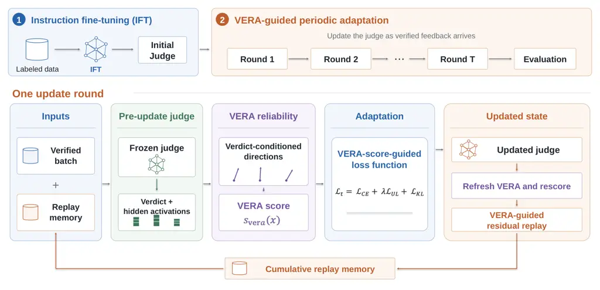
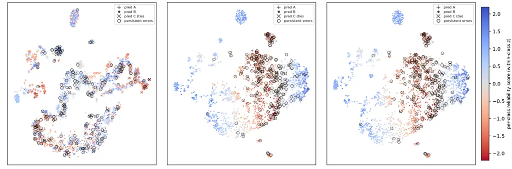
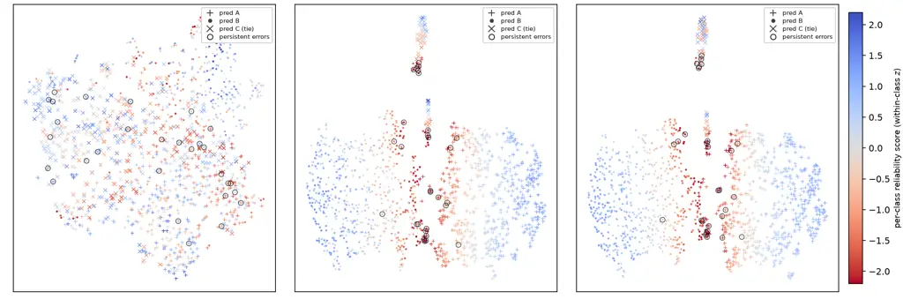
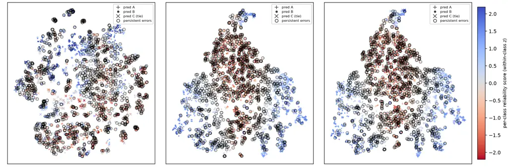

# VERA: Verdict-Conditioned Reliability for Adaptive LLM Judges

Qiushui Xu ^(†)^(†)thanks: This work was done during an internship at
Amazon. Affiliation:  Penn State University    Syamil Mohd Razak, Tao
Yuan, Piotr Habas Affiliation:  Amazonqjx5019@psu.edu,
{rsyamil,yuanty,phabas}@amazon.com

###### Abstract

Accurately estimating judgment reliability is a central challenge in
adapting LLM judges to newly verified feedback while preserving
previously learned behavior. However, existing approaches often rely on
output-level confidence, which can be overconfident and poorly aligned
with judgment correctness. We propose VERA, a _VErdict-conditioned
Reliability Axis_ that estimates reliability from hidden activations by
distinguishing correct from incorrect judgments within each
predicted-verdict group. Using VERA as a control signal, we develop a
VERA-guided periodic adaptation framework that integrates
reliability-ranked corrective updates, reliability-residual replay, and
periodic refresh of the reliability directions. After VERA-guided
adaptation on Chatbot Arena, 8B- and 14B-parameter judges outperform the
strongest baseline on each of four held-out public benchmarks, with
relative gains of up to 23.01%. The framework also improves focal-class
recall by up to 16.1% relative to the strongest adaptive baselines on a
separate proprietary temporal auditing task.

|     |
| --- |
|     |

## 1 Introduction

Large language models (LLMs) are increasingly used as judges to rank
candidate responses (Zheng et al., 2023), provide reward signals for
model alignment (Yuan et al., 2024), curate training data (Majumdar et
al., 2025), and automate evaluation (Liu et al., 2023). Supervised
instruction fine-tuning has further enabled specialized open-weight
evaluators (Zhu et al., 2025; Kim et al., 2024), while iterative
preference learning can improve both response generation and judging
capabilities (Yuan et al., 2024). _Adaptive judging_ extends evaluation
beyond a fixed checkpoint by periodically updating a trained judge with
newly available verified judgments. This feedback provides opportunities
to correct recurring errors and improve performance on subsequently
encountered cases. However, repeated fine-tuning can degrade previously
acquired behavior, creating a need to incorporate new feedback while
retaining useful prior capabilities (Wang et al., 2024).

A central challenge in this setting is estimating _judgment
reliability_: the probability that the judge’s predicted verdict agrees
with a verified reference judgment (Tian et al., 2023; Guo et al.,
2017). An estimate of this quantity can inform which decisions warrant
stronger correction and which labeled examples should be retained for
future updates. Existing approaches obtain confidence estimates through
verbalized self-assessment (Tian et al., 2023; Xiong et al., 2024),
model probabilities (Tian et al., 2023), repeated sampling and
consistency (Xiong et al., 2024; Manakul et al., 2023), or post-hoc
calibration (Guo et al., 2017). However, these estimates need not
faithfully track verdict correctness: a model can strongly prefer one
verdict without that verdict agreeing with the reference. For the frozen
judges in Figure 1, verbalized confidence provides weak correctness
discrimination, while the informativeness of model probabilities varies
across tasks and model scales. These observations motivate our central
question: _can we obtain a more faithful estimate of judgment
reliability and use it to guide how judges learn from newly verified
feedback?_

Figure 1: Reliability signals at frozen checkpoints. AUROC for
distinguishing correct from incorrect judgments using verbalized
confidence, model probability, and VERA, evaluated on the proprietary
auditing task and MT-Bench-HJ with Qwen3-8B and Qwen3-14B. Values and
evaluation conventions follow Table 3. The dashed line denotes
chance-level discrimination.

To address this question, we introduce VERA, a _VErdict-conditioned
Reliability Axis_ that estimates judgment reliability from hidden
activations. Rather than pooling all judgments into a single correctness
direction, VERA compares correct and incorrect judgments within each
predicted-verdict group. This conditioning accounts for verdict-specific
representation structure and reduces the risk of conflating differences
between verdicts with differences in their reliability. For a new
judgment, VERA projects its hidden activation onto the direction
associated with the predicted verdict, producing a reliability score
from the same forward pass used for judging. Figure 1 shows that this
signal achieves higher correctness-ranking AUROC than verbalized
confidence and model probabilities across the four evaluated task–model
configurations.

Using this signal, we develop a VERA-guided periodic adaptation
framework. Within-verdict reliability ranks modulate corrective updates,
while the discrepancy between post-update reliability estimates and
observed correctness defines a _reliability residual_ for prioritizing
replay. We periodically refresh the reliability directions as the judge
evolves. Verified verdicts remain the supervision targets; VERA controls
how feedback is weighted and retained. This connects reliability
estimation with adaptation, allowing us to assess both signal quality
and its utility for improving judges across diverse tasks.

Our key contributions are summarized as follows:

- •
  Verdict-conditioned internal reliability. We introduce VERA, a
  lightweight, single-pass reliability signal that distinguishes correct
  from incorrect judgments within each predicted-verdict group. At
  frozen checkpoints, VERA provides stronger correctness discrimination
  than verbalized confidence and model probabilities across two judging
  tasks and both Qwen3-8B and Qwen3-14B.
- •
  VERA-guided periodic adaptation. We develop an adaptation framework
  that uses internal reliability to modulate corrective updates,
  prioritize replay through reliability residuals, and periodically
  refresh the reliability directions. On a proprietary human-verified
  temporal auditing task, the framework improves focal-class recall by
  16.1% and 8.8% relative to the strongest adaptive baseline at Qwen3-8B
  and Qwen3-14B, respectively.
- •
  Cross-benchmark generalization and empirical analysis. We evaluate
  judges initialized through JudgeLM instruction fine-tuning (Zhu et
  al., 2025) and periodically adapted on Chatbot Arena (Zheng et al.,
  2023). The adapted judges outperform the strongest evaluated baseline
  on each of four held-out public benchmarks: MT-Bench-HJ (Zheng et al.,
  2023), Auto-J (Li et al., 2024), JudgeBench (Tan et al., 2025), and
  LLMBar (Zeng et al., 2024), with relative gains of up to 8.92% and
  23.01% at Qwen3-8B and Qwen3-14B, respectively. Additional analyses on
  RewardBench 2 (Malik et al., 2026) characterize domain-specific Safety
  degradation and the benefits and costs of reliability-guided
  corrective replay.

## 2 Related Work

##### Learned and adaptive LLM judges.

LLM-as-a-judge methods provide scalable evaluation of open-ended model
responses (Zheng et al., 2023). Specialized open-weight evaluators
further improve judging capabilities through supervised judgment data
and task-specific evaluation criteria (Zhu et al., 2025; Kim et al.,
2024; Leng and others, 2025). Beyond supervised specialization,
Self-Rewarding Language Models (Yuan et al., 2024) use model-generated
judgments as rewards for iterative preference optimization, improving
both instruction following and evaluation capabilities. These approaches
establish that judging capabilities can be learned and iteratively
refined. Our focus is on how an existing judge incorporates newly
verified feedback: reference verdicts remain the supervision targets,
while the judge’s internal reliability determines how that supervision
is weighted and retained.

##### Confidence and internal reliability.

LLM confidence estimation draws on verbalized self-assessment (Tian et
al., 2023; Xiong et al., 2024), model probabilities (Tian et al., 2023),
sampling-based consistency (Xiong et al., 2024; Manakul et al., 2023),
and post-hoc calibration (Guo et al., 2017). Internal representations
provide a complementary source of correctness information. Mahaut et
al. (Mahaut et al., 2024) find supervised hidden-state probes effective
for factual confidence estimation, while InternalInspector (Beigi et
al., 2024) uses contrastive learning over internal states across
transformer layers. The concurrent Value Axis study (Jiang et al., 2026)
constructs a difference-in-means direction from synthetic in-context
reinforcement-learning trajectories to analyze and steer confidence and
self-correction. This activation-direction perspective motivates our
representation, but VERA targets the correctness of an evaluator’s
discrete verdict rather than the expected success of a task-solving
trajectory. It conditions the direction on the predicted verdict and
uses the resulting signal to guide corrective updates and replay,
extending reliability estimation from assessing judgments to controlling
subsequent adaptation.

##### Sequential adaptation and replay.

Sequential language-model adaptation seeks to incorporate new data while
preserving previously acquired capabilities. Continual-T0 (Scialom et
al., 2022) studies sequential acquisition of language-generation tasks,
while replay-based methods address which historical examples should
accompany subsequent updates. InsCL (Wang et al., 2024) guides replay
using instruction-based task similarity and measures of instruction
complexity and diversity. KPIG (He et al., 2025) uses key-part
information gain to select replay data and refine the instruction-tuning
objective. Our setting retains the judging task and verdict semantics
while incorporating periodically arriving verified feedback. Within this
setting, VERA prioritizes replay using a reliability residual: the
discrepancy between estimated reliability and observed correctness. This
criterion retains judgments whose outcomes disagree with the model’s
reliability estimate, rather than relying solely on instruction
similarity or error status. Combined with reliability-ranked correction
and periodic direction refresh, it connects memory selection with the
evolving judge’s estimate of its own correctness.

## 3 Methodology

We formalize judgment reliability in Section 3.1, introduce VERA in
Section 3.2, and describe reliability-guided adaptation in Section 3.3.
Figure 2 summarizes the framework and the complete procedure appears in
Appendix A.

### 3.1 Problem Formulation

An LLM judge $`\pi_{\theta}`$ receives an evaluation input $`x`$ and
predicts a verdict from a finite set $`\mathcal{Y}`$. Given a verified
reference $`y^{\star}`$, its prediction and realized correctness are

```math
\hat{y}_{\theta}(x)=\arg\max_{y\in\mathcal{Y}}\pi_{\theta}(y\mid x),\qquad r_{\theta}(x)=\mathbf{1}\{\hat{y}_{\theta}(x)=y^{\star}\}. \tag{1}
```

Following the correctness-probability interpretation of
confidence (Kadavath et al., 2022; Tian et al., 2023; Guo et al., 2017),
we define the quantity to be estimated.

###### Definition 1 (Judgment Reliability).

For an input $`x`$ and fixed judge $`\theta`$, judgment reliability is

```math
R_{\theta}(x)=\mathbb{P}\!\left(Y^{\star}=\hat{y}_{\theta}(x)\mid X=x\right)=\mathbb{E}\!\left[r_{\theta}(X)\mid X=x\right], \tag{2}
```

where $`(X,Y^{\star})`$ follows the reference input–label distribution.

Reliability concerns agreement with the reference, whereas
$`\max_{y}\pi_{\theta}(y\mid x)`$ is the model probability assigned to
its prediction; the two need not coincide. We use this reliability
estimate to guide _periodic adaptation_: starting from an initial judge
$`\theta_{0}`$, each verified batch $`\mathcal{D}_{t}`$ and previously
retained examples $`\mathcal{M}_{t-1}`$ are used to obtain
$`\theta_{t}`$. The objective is to incorporate new feedback while
preserving useful prior behavior.



Figure 2: Overview of VERA-guided periodic adaptation. Pre-update
reliability guides corrective training; the updated judge and current
reliability estimator guide replay selection for later rounds.

### 3.2 Verdict-Conditioned Reliability Directions

Let $`h_{\ell}(x)\in\mathbb{R}^{d}`$ denote the hidden activation at
layer $`\ell`$ at the final prompt position, immediately before verdict
generation. A pooled comparison of correct and incorrect judgments can
mix correctness information with differences in predicted-verdict
composition. VERA instead compares judgments within the same
predicted-verdict group.

###### Definition 2 (VERA Direction).

For layer $`\ell`$ and predicted verdict $`c\in\mathcal{Y}`$, define

```math
\displaystyle v_{\ell,c}={} \displaystyle\mathbb{E}[h_{\ell}(x)\mid\hat{y}_{\theta}(x)=c,r_{\theta}(x)=1]-\mathbb{E}[h_{\ell}(x)\mid\hat{y}_{\theta}(x)=c,r_{\theta}(x)=0]. \tag{3}
```

The expectations are estimated by sample means on verified training
judgments.

###### Remark 1 (Global Reliability Direction).

Removing the predicted-verdict conditioning in Definition 2 yields a
global reliability direction:

```math
v_{\ell}^{\mathrm{global}}=\mathbb{E}[h_{\ell}(x)\mid r_{\theta}(x)=1]-\mathbb{E}[h_{\ell}(x)\mid r_{\theta}(x)=0]. \tag{4}
```

This construction pools judgments across all predicted verdicts. When
verdict composition differs between correct and incorrect judgments, the
resulting direction may capture verdict-specific structure in addition
to correctness. We use this pooled construction as a comparison to
assess the effect of verdict conditioning. More details can be found in
Table 6.

The difference of means captures correctness-related variation while
holding the predicted verdict fixed, without training an auxiliary
neural probe. We convert this direction into a scalar score using cosine
similarity.

###### Definition 3 (VERA Score).

For input $`x`$, the _VERA score_ is

```math
s_{\texttt{VERA}}(x)=\cos\!\left(h_{\ell^{\star}}(x),v_{\ell^{\star},\hat{y}_{\theta}(x)}\right), \tag{5}
```

where $`\ell^{\star}`$ is the selected representation layer.

Cosine similarity measures alignment with the corresponding reliability
direction rather than activation magnitude. For each candidate layer
$`\ell\in\mathcal{L}`$, we estimate the directions on the training split
and select the layer that maximizes correctness separation on a disjoint
validation split:

```math
\ell^{\star}=\arg\max_{\ell\in\mathcal{L}}\mathcal{J}_{\mathrm{val}}(\ell), \tag{6}
```

where $`\mathcal{J}_{\mathrm{val}}`$ measures how well the layer’s
reliability scores distinguish correct from incorrect judgments. We use
raw-score AUROC for proprietary judging and within-verdict mean-rank
separation for public judging. The selected layer is shared across
verdicts and fixed throughout periodic adaptation. The exact criteria
and layer sweeps are reported in Appendix C.4.

The raw score is not a correctness probability. For adaptation, we use
two transformations:

```math
\displaystyle q(x) \displaystyle=\widehat{F}_{\hat{y}_{\theta}(x)}\!\left(s_{\texttt{VERA}}(x)\right), \tag{7}
```

```math
\displaystyle V(x) \displaystyle=C_{\hat{y}_{\theta}(x)}\!\left(s_{\texttt{VERA}}(x)\right). \tag{8}
```

Here $`\widehat{F}_{c}`$ is the empirical CDF within predicted-verdict
group $`c`$ of the current batch, and $`C_{c}`$ is a verdict-specific
calibration map. The rank $`q(x)\in[0,1]`$ expresses relative
reliability for corrective weighting, whereas $`V(x)\in[0,1]`$ estimates
correctness probability for residual replay. Implementation details
appear in Appendix A.1.

### 3.3 VERA-Guided Periodic Adaptation

At round $`t`$, we train on
$`\mathcal{S}_{t}=\mathcal{D}_{t}\cup\mathcal{M}_{t-1}`$. Pre-update
reliability guides correction, while post-update reliability identifies
examples to retain for subsequent rounds.

##### Reliability-ranked correction.

Let $`\hat{y}_{t}^{-}(x)=\hat{y}_{\theta_{t-1}}(x)`$ and
$`q_{t}^{-}(x)`$ denote the pre-update verdict and within-verdict rank.
We assign larger corrective weights to lower-ranked judgments:

```math
\widetilde{g}_{t}(x)=\frac{1+\alpha(1-q_{t}^{-}(x))^{2}}{\mathbb{E}_{z\in\mathcal{D}_{t}}[1+\alpha(1-q_{t}^{-}(z))^{2}]},\qquad\alpha\geq 0. \tag{9}
```

The quadratic gate smoothly emphasizes the low-reliability tail, while
normalization keeps its batch-average weight at one. We optimize

```math
\displaystyle\mathcal{L}_{t}(\theta) \displaystyle=\mathcal{L}_{\mathrm{CE}}+\lambda\mathcal{L}_{\mathrm{UL}}+\mathcal{L}_{\mathrm{KL}}, \tag{10}
```

```math
\displaystyle\mathcal{L}_{\mathrm{UL}} \displaystyle=\mathbb{E}_{x\in\mathcal{D}_{t}}\!\left[\widetilde{g}_{t}(x)\rho(x)\mathbf{1}\{\hat{y}_{t}^{-}(x)\neq y^{\star}\}\,u_{t}(x;\theta)\right], \tag{11}
```

where $`u_{t}`$ is an unlikelihood penalty on the previously incorrect
verdict, $`\rho(x)\geq 1`$ is a task-specific error weight, and
$`\lambda\geq 0`$ controls the corrective term. Weighted cross-entropy
$`\mathcal{L}_{\mathrm{CE}}`$ learns from verified labels in
$`\mathcal{S}_{t}`$, while $`\mathcal{L}_{\mathrm{KL}}`$ discourages
unnecessary deviation from $`\theta_{t-1}`$. Reference predictions,
ranks, and weights remain fixed during optimization. The full loss
specification appears in Appendix A.2.

##### Periodic reliability refresh.

Because adaptation changes the hidden representations, we periodically
re-estimate directions using the updated judge $`\theta_{t}`$ on
$`\mathcal{D}_{t}`$. At the fixed layer $`\ell^{\star}`$, we smooth the
new and previous directions:

```math
v_{c,t}=\operatorname{Normalize}\!\left(\gamma v^{\mathrm{new}}_{c,t}+(1-\gamma)v_{c,t-1}\right), \tag{12}
```

where both input directions are normalized before averaging and
$`\gamma\in[0,1]`$ controls the contribution of the new estimate.
Smoothing balances tracking the updated judge with retaining earlier
reliability information. The calibration maps are also refitted on
refresh rounds; otherwise, directions and maps remain unchanged.

##### Reliability-residual replay.

After training and any scheduled refresh, we evaluate the current batch
under $`\theta_{t}`$ and compute

```math
\Delta_{\texttt{VERA},t}(x)=\left|r_{\theta_{t}}(x)-V_{t}(x)\right|, \tag{13}
```

where $`V_{t}(x)`$ uses the updated judge and current reliability
estimator. The residual is large for an incorrect judgment estimated to
be reliable or a correct judgment estimated to be unreliable,
prioritizing disagreement beyond error status alone. We add the
$`K_{t}`$ highest-residual examples to the cumulative replay memory:

```math
\mathcal{C}_{t}=\operatorname{Top}_{K_{t}}(\mathcal{D}_{t};\Delta_{\texttt{VERA},t}),\qquad\mathcal{M}_{t}=\mathcal{M}_{t-1}\cup\mathcal{C}_{t}. \tag{14}
```

The union retains distinct examples, and $`K_{t}`$ is the per-round
selection budget. The initial memory contains residual-selected
historical examples available before the first update. Selected examples
remain available to later rounds, preserving access to judgments that
previously disagreed with the reliability estimate.

## 4 Experiments

We evaluate VERA on public judging benchmarks and a proprietary temporal
auditing task, examining both adaptation performance and
judgment-reliability estimation. We first describe the experimental
setup, then present results for each judging setting and compare
reliability signals across training stages.

### 4.1 Experimental Setup

#### 4.1.1 Datasets

##### Public judging benchmarks.

We initialize judges through instruction fine-tuning on JudgeLM (Zhu et
al., 2025) and construct five periodic feedback batches from Chatbot
Arena (Zheng et al., 2023). We evaluate the resulting judges on four
held-out benchmarks: MT-Bench-HJ (Zheng et al., 2023), Auto-J Eval-P (Li
et al., 2024), JudgeBench (Tan et al., 2025), and LLMBar (Zeng et al.,
2024). MT-Bench-HJ contains $`6{,}710`$ ordered examples, and Auto-J
contains $`1{,}392`$ response pairs; both include A-win, B-win, and tie
verdicts. We use the $`350`$-item GPT-4o subset of JudgeBench for
objective-correctness evaluation and the four adversarial subsets of
LLMBar for instruction-following evaluation. RewardBench 2 (Malik et
al., 2026) provides an additional cross-format evaluation and
Safety-retention analysis. The JudgeLM training set contains
$`99{,}647`$ response pairs, and the five-batch Arena feedback stream
contains $`31{,}340`$ comparisons.

##### Proprietary temporal auditing.

We additionally evaluate a binary auditing task with approximately
$`65`$K human-verified historical examples followed by periodic
feedback. An earlier holdout measures _anchor retention_, while a later
window measures _forward performance_ under a substantial change in
class prevalence. For confidentiality, we denote the verdicts by
Critical and Non-Critical. The number of feedback batches, anchor-set
size, and forward-set size are 4, $`2{,}634`$, and $`894`$,
respectively.

#### 4.1.2 Metrics

We distinguish verdict quality from reliability discrimination.
Verdict-quality metrics include accuracy, macro-F1, and focal-class
recall and F1. The focal class is Critical in the proprietary task and
the tie verdict in three-way preference judging. For public benchmarks,
we retain the respective evaluation metrics: row accuracy for
MT-Bench-HJ, two-order agreement and consistency for Auto-J, two-order
accuracy for JudgeBench, and macro-averaged accuracy across the four
adversarial subsets of LLMBar. More details can be found in Appendix F.
For reliability estimation, we report AUROC for distinguishing correct
from incorrect judgments and explicitly identify the confidence signal
being evaluated. Anchor performance and source-validation accuracy are
used to assess retention. Relative gains over a baseline score $`b`$ are
computed as $`100(s-b)/b\%`$, where $`s`$ is the corresponding
VERA score. Absolute changes are explicitly identified. In public
three-way judging, C denotes a tie and is scored as a regular verdict.
In proprietary auditing, C denotes abstention and is retained in the
evaluation denominator as an incorrect judgment. The candidate-token
argmax used in the main experiments always returns one of the valid
verdicts, so invalid outputs do not occur.

#### 4.1.3 Baselines

For public judging, we compare against IFT, a judge instruction-tuned on
JudgeLM (Zhu et al., 2025), and DPO, which further trains the IFT judge
on Chatbot Arena preferences (Zheng et al., 2023; Rafailov et al.,
2023). For proprietary auditing, we compare periodic IFT, periodic DPO,
and periodic RAG (Lewis et al., 2020), together with a frozen initial
judge that is not updated during the feedback stream. Throughout the
comparisons below, the strongest baseline is determined separately for
each metric and model scale: the better of IFT and DPO for public
judging, and the best of periodic IFT, DPO, and RAG for proprietary
adaptation.

#### 4.1.4 Implementation Details

We use Qwen3-8B and Qwen3-14B (Yang and others, 2025) with unified
single-token verdicts matched to each task’s label space. Reliability
directions are constructed from training examples, and representation
layers are selected using disjoint validation data. The proprietary task
uses validation correctness AUROC, whereas public adaptation uses
correct–incorrect separation after within-verdict rank normalization,
matching the score used by its corrective objective. The forward set is
a strictly independent test set used only for final evaluation. For
periodic adaptation, we fix the IFT-selected zero-indexed layers at
$`20`$ and $`38`$ for the proprietary 8B and 14B judges, and at $`33`$
and $`32`$ for their public counterparts. Each selected layer remains
fixed across subsequent checkpoints and reliability refreshes. The
proprietary VERA configurations use replay fractions $`f=0.010`$ at 8B
and $`f=0.015`$ at 14B. The public replay buffer initially contains
$`740`$ and $`1{,}480`$ selected JudgeLM items and adds $`240`$ and
$`480`$ items from each observed Arena batch at 8B and 14B respectively;
both response orders are retained for every selected item, and the
replay weight is $`0.15`$. Initial IFT uses a learning rate of
$`10^{-4}`$, an effective batch size of $`256`$, and two epochs; DPO
uses $`5\times 10^{-6}`$, $`128`$, and one epoch; each VERA-guided
periodic update uses $`5\times 10^{-5}`$, $`128`$, and one epoch per
feedback batch. The proprietary RAG baseline keeps the IFT judge fixed
and retrieves the top three examples from a FAISS cosine-similarity
index over labeled feedback batches observed up to the current period,
using sentence-transformer embeddings and excluding the query itself by
identifier. All training and adaptation hyperparameters are fixed before
evaluation on the forward set. More details can be found in Appendix B.

### 4.2 Public Judging Benchmarks

We first examine whether VERA-guided adaptation improves performance
across different judging tasks. Table 1 compares IFT, DPO, and VERA at
both model scales. Within each method, the same resulting checkpoint is
evaluated across all four benchmarks.

|                                  |        |                    |                    |                    |                    |
| -------------------------------- | ------ | ------------------ | ------------------ | ------------------ | ------------------ |
| Model                            | Method | MT-Bench-HJ (%)    | Auto-J(%)          | JudgeBench(%)      | LLMBar(%)          |
| Qwen3-8B                         | IFT    | $`64.42\pm 0.13`$  | $`58.93\pm 0.61`$  | $`56.48\pm 0.59`$  | $`56.06\pm 0.37`$  |
|                                  | DPO    | $`64.57\pm 0.19`$  | $`58.93\pm 0.49`$  | $`57.06\pm 0.32`$  | $`59.63\pm 0.12`$  |
|                                  | VERA   | 66.69 $`\pm`$ 0.36 | 59.85 $`\pm`$ 1.01 | 57.22 $`\pm`$ 1.86 | 64.95 $`\pm`$ 2.40 |
| Relative gain over best baseline |        | $`+3.28`$          | $`+1.56`$          | $`+0.28`$          | $`+8.92`$          |
| Qwen3-14B                        | IFT    | $`64.10\pm 0.21`$  | $`60.69\pm 0.17`$  | $`60.20\pm 1.17`$  | $`54.95\pm 0.58`$  |
|                                  | DPO    | $`64.50\pm 0.13`$  | $`60.85\pm 0.25`$  | $`60.46\pm 1.31`$  | $`57.05\pm 1.25`$  |
|                                  | VERA   | 67.73 $`\pm`$ 0.24 | 62.54 $`\pm`$ 0.43 | 62.08 $`\pm`$ 1.02 | 70.18 $`\pm`$ 1.12 |
| Relative gain over best baseline |        | $`+5.01`$          | $`+2.78`$          | $`+2.68`$          | $`+23.01`$         |

Table 1: Performance on four held-out public judging benchmarks (%).
MT-Bench-HJ reports row accuracy; Auto-J reports two-order agreement;
JudgeBench reports two-order accuracy on its $`350`$-item GPT-4o subset;
LLMBar reports the macro-average over four adversarial subsets. Entries
report means and sample standard deviations over three seeds. Gains are
relative improvements (%) over the stronger of IFT and DPO within each
model–benchmark comparison. Bold marks the best score within each model
scale. Scores should be compared within columns rather than averaged
across benchmarks with different evaluation metrics.

VERA achieves the highest observed mean score on all four benchmarks at
both scales. At Qwen3-8B, relative improvements over the stronger
baseline range from $`0.28\%`$ to $`8.92\%`$; at Qwen3-14B, they range
from $`2.68\%`$ to $`23.01\%`$. The largest gain occurs on adversarial
instruction following: VERA raises LLMBar accuracy from $`59.63\%`$ to
$`64.95\%`$ at 8B and from $`57.05\%`$ to $`70.18\%`$ at 14B.

The gains extend beyond pairwise preference judging to objective
correctness and adversarial instruction following, supporting
cross-benchmark generalization of the adapted judge. Their magnitudes
remain task-dependent: on 8B JudgeBench, the means are $`57.22\%`$ for
VERA and $`57.06\%`$ for DPO, while the VERA seed standard deviation is
$`1.86\%`$. This is an observed mean difference, not a claim of
statistical significance; the adversarial gains are substantially
larger. The 14B judge shows larger relative gains than 8B on each
benchmark, although these comparisons alone do not identify which
component of the framework produces the improvement.

### 4.3 Proprietary Temporal Auditing

We next evaluate adaptation on the proprietary feedback stream. Table 2
reports critical-class recall and F1 for the final judge on the earlier
anchor and later forward sets, allowing adaptation and retention to be
examined together.

|                                  |                      |                |          |             |          |
| -------------------------------- | -------------------- | -------------- | -------- | ----------- | -------- |
| Model                            | Method               | Earlier anchor |          | Forward set |          |
|                                  |                      | Recall (%)     | F1 (%)   | Recall (%)  | F1 (%)   |
| Qwen3-8B                         | Frozen initial judge | 85.8           | 78.8     | 65.7        | 58.8     |
|                                  | Periodic RAG         | 82.0           | 79.0     | 61.6        | 61.6     |
|                                  | Periodic IFT         | 72.5           | 77.4     | 57.6        | 64.0     |
|                                  | Periodic DPO         | 84.1           | 78.7     | 62.6        | 57.9     |
|                                  | VERA                 | 86.0           | 79.1     | 72.7        | 66.1     |
| Relative gain over best baseline |                      | $`+2.3`$       | $`+0.1`$ | $`+16.1`$   | $`+3.3`$ |
| Qwen3-14B                        | Frozen initial judge | 82.6           | 78.8     | 70.7        | 56.7     |
|                                  | Periodic RAG         | 77.9           | 77.5     | 68.7        | 70.8     |
|                                  | Periodic IFT         | 76.6           | 79.0     | 65.7        | 69.1     |
|                                  | Periodic DPO         | 81.5           | 78.7     | 69.7        | 60.8     |
|                                  | VERA                 | 85.3           | 79.1     | 75.8        | 69.1     |
| Relative gain over best baseline |                      | $`+4.7`$       | $`+0.1`$ | $`+8.8`$    | $`-2.4`$ |

Table 2: Periodic adaptation on the proprietary auditing task (%).
Recall and F1 refer to the Critical verdict at the final update.
VERA uses replay fractions $`f=0.010`$ and $`f=0.015`$ at 8B and 14B,
respectively. The frozen initial judge is task-trained but receives no
subsequent feedback updates. Gains are relative improvements (%) over
the strongest adaptive baseline among periodic IFT, DPO, and RAG,
determined separately for each model scale and metric. Bold marks the
best reported score within each model scale and column.

##### Forward performance.

At Qwen3-8B, VERA improves forward critical-class recall from $`0.626`$
under the strongest adaptive baseline, periodic DPO, to $`0.727`$, a
relative gain of 16.1%. It also achieves the highest forward F1
($`0.661`$ versus $`0.640`$). At Qwen3-14B, periodic DPO provides the
strongest baseline recall ($`0.697`$), while VERA reaches $`0.758`$, a
relative improvement of 8.8%. Thus, VERA improves forward critical-class
recall at both scales.

##### Retention and recall–F1 trade-offs.

VERA also achieves the highest anchor recall at both scales, reaching
$`0.860`$ at 8B and $`0.853`$ at 14B, compared with $`0.858`$ and
$`0.826`$ for the corresponding frozen initial judges. Anchor F1 is
$`0.791`$ at both scales, close to the frozen reference of $`0.788`$.
Periodic RAG has higher forward F1 at 14B ($`0.708`$ versus $`0.691`$),
but lower forward recall ($`0.687`$ versus $`0.758`$). These results
show improved critical-case coverage while maintaining the reported
anchor performance, with a forward recall–F1 trade-off at 14B.

### 4.4 Reliability Analysis

We finally compare the reliability signals used to distinguish correct
from incorrect judgments. Table 3 evaluates verbalized confidence, model
probabilities, and VERA at frozen, IFT, and DPO checkpoints. Here,
_Frozen_ denotes the pre-IFT checkpoint, unlike the task-trained frozen
baseline in Table 2.

| Setting     | Model | Stage  | Verbalized | Softmax | VERA  |
| ----------- | ----- | ------ | ---------- | ------- | ----- |
| Proprietary | 8B    | Frozen | 0.649      | 0.593   | 0.812 |
|             |       | IFT    | 0.497      | 0.857   | 0.867 |
|             |       | DPO    | 0.513      | 0.852   | 0.866 |
|             | 14B   | Frozen | 0.618      | 0.628   | 0.831 |
|             |       | IFT    | 0.747      | 0.866   | 0.869 |
|             |       | DPO    | 0.779      | 0.870   | 0.872 |
| MT-Bench-HJ | 8B    | Frozen | 0.572      | 0.636   | 0.710 |
|             |       | IFT    | 0.532      | 0.732   | 0.726 |
|             |       | DPO    | 0.528      | 0.736   | 0.727 |
|             | 14B   | Frozen | 0.595      | 0.710   | 0.744 |
|             |       | IFT    | 0.532      | 0.735   | 0.736 |
|             |       | DPO    | 0.537      | 0.730   | 0.735 |

Table 3: AUROC for distinguishing correct from incorrect judgments.
Frozen denotes the pre-IFT checkpoint. MT-Bench-HJ verbalized confidence
uses a separate generation pass, with correctness determined by that
pass’s verdict. Bold marks the largest AUROC or mean in each row.

##### Reliability before task-specific training.

On the frozen proprietary judges, VERA exceeds softmax AUROC by
$`0.219`$ at 8B and $`0.203`$ at 14B. The corresponding improvements on
MT-Bench-HJ are $`0.074`$ and $`0.034`$. VERA also outperforms
verbalized confidence in all four frozen configurations. The proprietary
14B result illustrates why reliability discrimination must be
distinguished from verdict quality: the judge exhibits
near-single-verdict predictions despite a strong AUROC.

##### Reliability after task-specific training.

Following IFT and DPO, the difference between VERA and softmax narrows
to an absolute gap of at most $`0.014`$ across the reported settings.
Verbalized confidence remains near chance on MT-Bench-HJ but becomes
more informative for the proprietary 14B judge. These results identify
cold-start judging as a particularly effective use of VERA: verified
judgments establish a reliability estimator before optimizing the judge
for the task. After IFT or DPO, the estimator supplies the corrective
weights and replay scores used for further adaptation (Appendices D.3
and D.4). The signal also transfers to unseen judging tasks, and
incorporating verified target judgments further improves its
discrimination (Appendix C.5).

##### Additional analyses.

Appendix C compares global directions, verdict-conditioned VERA, and
logistic-regression probes, and examines layer selection and task
transfer; verdict conditioning improves AUROC, while target-specific
directions improve average AUROC across public benchmarks. For Qwen3-8B
on the proprietary task, verdict conditioning raises AUROC from
$`0.671`$ to $`0.812`$ at the frozen checkpoint and from $`0.848`$ to
$`0.867`$ after IFT. Appendix D studies replay selection, budgets,
component ablations, and Safety repair; VERA replay improves forward
recall over random and softmax-residual selection in the proprietary
experiment and recovers more Safety accuracy than random replay at both
scales. Appendix E evaluates training-free inference harnesses; these
changes do not consistently improve both accuracy and
verbalized-confidence AUROC on MT-Bench-HJ, while multi-call panels
increase latency over a single judge call in the proprietary evaluation.
These findings further motivate using internal reliability signals to
guide adaptation beyond prompt and harness changes. Appendix F examines
cross-format generalization and benchmark placement across preference
agreement, multi-way selection, objective correctness, and adversarial
instruction following. VERA achieves higher mean scores than IFT and DPO
on all four pairwise benchmarks at both scales, alongside Safety losses
on RewardBench 2. It is also competitive with published judge results:
on JudgeBench, 14B VERA achieves $`62.08\%`$ accuracy, compared with the
published $`56.57\%`$ for GPT-4o with Arena-Hard prompting.

## 5 Conclusion & Future Work

We introduced VERA, a verdict-conditioned internal reliability
representation for adaptive LLM judges. VERA uses this internal signal
to rank corrective updates and replay examples. It improves
critical-verdict recall on the proprietary task. On public data, the
same periodically adapted checkpoints improve over JudgeLM IFT and Arena
DPO on four public judge benchmarks at both model scales. On
RewardBench 2, a VERA-selected replay update recovers more held-out
Safety accuracy than random replay, with a small decrease in MT-Bench-HJ
accuracy. Future work should investigate whether this reliability signal
can guide online reinforcement learning through feedback selection and
update weighting. Another direction is to track domain-level accuracy
and reliability through the update sequence, identify early signs of
capability degradation, and trigger targeted replay before further
performance declines. Adapting feedback and replay budgets to these
domain-level diagnostics could help balance learning from new judgments
with retaining earlier capabilities under limited annotation budgets.

## References

- Beigi et al. (2024) M. Beigi, Y. Shen, R. Yang, Z. Lin, Q. Wang, A.
  Mohan, J. He, M. Jin, C. Lu, and L. Huang InternalInspector $`I^{2}`$:
  robust confidence estimation in LLMs through internal states. In
  Findings of the Association for Computational Linguistics: EMNLP 2024,
  pp. 12847–12865. External Links:
  [Document](https://dx.doi.org/10.18653/v1/2024.findings-emnlp.751)
  Cited by: §2.
- Chan et al. (2023) C. Chan, W. Chen, Y. Su, J. Yu, W. Xue, S.
  Zhang, J. Fu, and Z. Liu ChatEval: towards better LLM-based evaluators
  through multi-agent debate. arXiv preprint arXiv:2308.07201. External
  Links: [Link](https://arxiv.org/abs/2308.07201) Cited by: §E.1.
- Guo et al. (2017) C. Guo, G. Pleiss, Y. Sun, and K. Q. Weinberger On
  calibration of modern neural networks. In Proceedings of the 34th
  International Conference on Machine Learning, Proceedings of Machine
  Learning Research, Vol. 70, pp. 1321–1330. External Links:
  [Link](https://proceedings.mlr.press/v70/guo17a.html) Cited by: §1,
  §2, §3.1.
- He et al. (2025) Y. He, W. Zhang, X. Huang, P. Zhang, L. Meng, X.
  Zhou, K. Zeng, and X. Cai Don’t half-listen: capturing key-part
  information in continual instruction tuning. In Proceedings of the
  63rd Annual Meeting of the Association for Computational Linguistics
  (Volume 1: Long Papers), pp. 23649–23668. External Links:
  [Document](https://dx.doi.org/10.18653/v1/2025.acl-long.1153) Cited
  by: §2.
- Jiang et al. (2026) N. Jiang, I. Kauvar, and J. Lindsey The value
  axis: language models encode whether they’re on the right track. arXiv
  preprint arXiv:2606.17056. External Links:
  [Link](https://arxiv.org/abs/2606.17056) Cited by: §2.
- Kadavath et al. (2022) S. Kadavath, T. Conerly, A. Askell, T.
  Henighan, D. Drain, E. Perez, N. Schiefer, Z. Hatfield-Dodds, N.
  DasSarma, E. Tran-Johnson, S. Johnston, S. El-Showk, A. Jones, N.
  Elhage, T. Hume, A. Chen, Y. Bai, S. Bowman, S. Fort, D. Ganguli, D.
  Hernandez, J. Jacobson, J. Kernion, S. Kravec, L. Lovitt, K.
  Ndousse, C. Olsson, S. Ringer, D. Amodei, T. Brown, J. Clark, N.
  Joseph, B. Mann, S. McCandlish, C. Olah, and J. Kaplan Language models
  (mostly) know what they know. arXiv preprint arXiv:2207.05221.
  External Links: [Link](https://arxiv.org/abs/2207.05221) Cited by:
  §3.1.
- Kim et al. (2024) S. Kim, J. Suk, S. Longpre, B. Y. Lin, J. Shin, S.
  Welleck, G. Neubig, M. Lee, K. Lee, and M. Seo Prometheus 2: an open
  source language model specialized in evaluating other language models.
  In Proceedings of the 2024 Conference on Empirical Methods in Natural
  Language Processing, Miami, Florida, USA, pp. 4334–4353. External
  Links: [Document](https://dx.doi.org/10.18653/v1/2024.emnlp-main.248),
  [Link](https://aclanthology.org/2024.emnlp-main.248/) Cited by: §1,
  §2.
- Leng et al. (2025) Y. Leng et al. Praetor: a fine-grained generative
  llm evaluator with interpretable output. In Proceedings of the 63rd
  Annual Meeting of the Association for Computational Linguistics
  (Volume 1: Long Papers), Cited by: §2.
- Lewis et al. (2020) P. Lewis, E. Perez, A. Piktus, F. Petroni, V.
  Karpukhin, N. Goyal, H. Küttler, M. Lewis, W. Yih, T. Rocktäschel, S.
  Riedel, and D. Kiela Retrieval-augmented generation for
  knowledge-intensive NLP tasks. In Advances in Neural Information
  Processing Systems, Vol. 33. External Links:
  [Link](https://arxiv.org/abs/2005.11401) Cited by: §E.1, §4.1.3.
- Li et al. (2024) J. Li, S. Sun, W. Yuan, R. Fan, H. Zhao, and P. Liu
  Generative judge for evaluating alignment. In The Twelfth
  International Conference on Learning Representations, External Links:
  [Link](https://openreview.net/forum?id=gtkFw6sZGS) Cited by: §F.1, 3rd
  item, §4.1.1.
- Liu et al. (2023) Y. Liu, D. Iter, Y. Xu, S. Wang, R. Xu, and C. Zhu
  G-eval: NLG evaluation using GPT-4 with better human alignment. In
  Proceedings of the 2023 Conference on Empirical Methods in Natural
  Language Processing, pp. 2511–2522. External Links:
  [Document](https://dx.doi.org/10.18653/v1/2023.emnlp-main.153) Cited
  by: §1.
- Mahaut et al. (2024) M. Mahaut, L. Aina, P. Czarnowska, M.
  Hardalov, T. Müller, and L. Marquez Factual confidence of LLMs: on
  reliability and robustness of current estimators. In Proceedings of
  the 62nd Annual Meeting of the Association for Computational
  Linguistics (Volume 1: Long Papers), pp. 4554–4570. External Links:
  [Document](https://dx.doi.org/10.18653/v1/2024.acl-long.250) Cited by:
  §2.
- Majumdar et al. (2025) S. Majumdar, V. Noroozi, M. Samadi, S.
  Narenthiran, A. Ficek, W. U. Ahmad, J. Huang, J. Balam, and B.
  Ginsburg Genetic instruct: scaling up synthetic generation of coding
  instructions for large language models. In Proceedings of the 63rd
  Annual Meeting of the Association for Computational Linguistics
  (Volume 6: Industry Track), pp. 208–221. Cited by: §1.
- Malik et al. (2026) S. Malik, V. Pyatkin, S. Land, J. Morrison, N. A.
  Smith, H. Hajishirzi, and N. Lambert RewardBench 2: advancing reward
  model evaluation. In The Fourteenth International Conference on
  Learning Representations, Cited by: §F.2, 3rd item, §4.1.1.
- Manakul et al. (2023) P. Manakul, A. Liusie, and M. Gales
  SelfCheckGPT: zero-resource black-box hallucination detection for
  generative large language models. In Proceedings of the 2023
  Conference on Empirical Methods in Natural Language Processing,
  Singapore, pp. 9004–9017. External Links:
  [Document](https://dx.doi.org/10.18653/v1/2023.emnlp-main.557),
  [Link](https://aclanthology.org/2023.emnlp-main.557/) Cited by: §1,
  §2.
- Rafailov et al. (2023) R. Rafailov, A. Sharma, E. Mitchell, C. D.
  Manning, S. Ermon, and C. Finn Direct preference optimization: your
  language model is secretly a reward model. In Advances in Neural
  Information Processing Systems, Vol. 36. External Links:
  [Link](https://proceedings.neurips.cc/paper_files/paper/2023/hash/a85b405ed65c6477a4fe8302b5e06ce7-Abstract-Conference.html)
  Cited by: §4.1.3.
- Scialom et al. (2022) T. Scialom, T. Chakrabarty, and S. Muresan
  Fine-tuned language models are continual learners. In Proceedings of
  the 2022 Conference on Empirical Methods in Natural Language
  Processing, pp. 6107–6122. External Links:
  [Document](https://dx.doi.org/10.18653/v1/2022.emnlp-main.410) Cited
  by: §2.
- Tan et al. (2025) S. Tan, S. Zhuang, K. Montgomery, W. Y. Tang, A.
  Cuadron, C. Wang, R. A. Popa, and I. Stoica JudgeBench: a benchmark
  for evaluating llm-based judges. In The Thirteenth International
  Conference on Learning Representations, Cited by: §F.3, 3rd item,
  §4.1.1.
- Tian et al. (2023) K. Tian, E. Mitchell, A. Zhou, A. Sharma, R.
  Rafailov, H. Yao, C. Finn, and C. Manning Just ask for calibration:
  strategies for eliciting calibrated confidence scores from language
  models fine-tuned with human feedback. In Proceedings of the 2023
  Conference on Empirical Methods in Natural Language Processing,
  Singapore, pp. 5433–5442. External Links:
  [Document](https://dx.doi.org/10.18653/v1/2023.emnlp-main.330),
  [Link](https://aclanthology.org/2023.emnlp-main.330/) Cited by: §1,
  §2, §3.1.
- Verga et al. (2024) P. Verga, S. Hofstatter, S. Althammer, Y. Su, A.
  Piktus, A. Arkhangorodsky, M. Xu, N. White, and P. Lewis Replacing
  judges with juries: evaluating LLM generations with a panel of diverse
  models. arXiv preprint arXiv:2404.18796. External Links:
  [Link](https://arxiv.org/abs/2404.18796) Cited by: §E.1.
- Wang et al. (2024) Y. Wang, Y. Liu, C. Shi, H. Li, C. Chen, H. Lu,
  and Y. Yang InsCL: a data-efficient continual learning paradigm for
  fine-tuning large language models with instructions. In Proceedings of
  the 2024 Conference of the North American Chapter of the Association
  for Computational Linguistics: Human Language Technologies (Volume 1:
  Long Papers), pp. 663–677. External Links:
  [Document](https://dx.doi.org/10.18653/v1/2024.naacl-long.37) Cited
  by: §1, §2.
- Xiong et al. (2024) M. Xiong, Z. Hu, X. Lu, Y. Li, J. Fu, J. He,
  and B. Hooi Can llms express their uncertainty? an empirical
  evaluation of confidence elicitation in llms. In The Twelfth
  International Conference on Learning Representations, External Links:
  [Link](https://openreview.net/forum?id=gjeQKFxFpZ) Cited by: §1, §2.
- Yang et al. (2025) A. Yang et al. Qwen3 technical report. arXiv
  preprint arXiv:2505.09388. Cited by: §4.1.4.
- Yuan et al. (2024) W. Yuan, R. Y. Pang, K. Cho, X. Li, S.
  Sukhbaatar, J. Xu, and J. E. Weston Self-rewarding language models. In
  Proceedings of the 41st International Conference on Machine Learning,
  Proceedings of Machine Learning Research, Vol. 235, pp. 57905–57923.
  Cited by: §1, §2.
- Zeng et al. (2024) Z. Zeng, J. Yu, T. Gao, Y. Meng, T. Goyal, and D.
  Chen Evaluating large language models at evaluating instruction
  following. In The Twelfth International Conference on Learning
  Representations, Cited by: §F.4, 3rd item, §4.1.1.
- Zheng et al. (2023) L. Zheng, W. Chiang, Y. Sheng, S. Zhuang, Z.
  Wu, Y. Zhuang, Z. Lin, Z. Li, D. Li, E. P. Xing, H. Zhang, J. E.
  Gonzalez, and I. Stoica Judging LLM-as-a-judge with MT-bench and
  chatbot arena. In Advances in Neural Information Processing Systems,
  Vol. 36, pp. 46595–46623. External Links:
  [Link](https://proceedings.neurips.cc/paper_files/paper/2023/hash/91f18a1287b398d378ef22505bf41832-Abstract-Datasets_and_Benchmarks.html)
  Cited by: 3rd item, §1, §2, §4.1.1, §4.1.3.
- Zhu et al. (2025) L. Zhu, X. Wang, and X. Wang JudgeLM: fine-tuned
  large language models are scalable judges. In The Thirteenth
  International Conference on Learning Representations, External Links:
  [Link](https://proceedings.iclr.cc/paper_files/paper/2025/hash/7f8f73134e253845a8f82983219a8452-Abstract-Conference.html)
  Cited by: 3rd item, §1, §2, §4.1.1, §4.1.3.

## Appendix A Additional Details of VERA-Guided Periodic Adaptation

We provide score-processing conventions, the full training objective,
and the adaptation procedure omitted from Section 3. Layer-selection
criteria and experiments are reported separately in Appendix C.4.

### A.1 Reliability-Score Implementation

##### Direction estimation.

We use the pre-verdict hidden activation specified in Section 3.2 for
both construction and scoring. The global comparison omits
predicted-verdict conditioning:

```math
v_{\ell}^{\mathrm{global}}=\mathbb{E}[h_{\ell}(x)\mid r_{\theta}(x)=1]-\mathbb{E}[h_{\ell}(x)\mid r_{\theta}(x)=0]. \tag{15}
```

This is a comparison method, not an automatic fallback for small verdict
groups. For normalization, including Eq. 12, we use

```math
\operatorname{Normalize}(v)=\frac{v}{\|v\|_{2}+\epsilon},\qquad\epsilon=10^{-8}. \tag{16}
```

An exactly zero direction receives score zero. On refresh rounds, both
the new and stored directions are normalized before mixing, and the
weighted sum is normalized again with $`\gamma=0.5`$.

##### Calibration.

We instantiate the verdict-specific map in Eq. 8 as

```math
C_{c}(s)=\sigma(a_{c}s+b_{c}), \tag{17}
```

where $`\sigma`$ is the logistic function and $`(a_{c},b_{c})`$ are
fitted to correctness labels. Initial maps are fitted on held-out
reference judgments. A map is fitted when its verdict group contains at
least 20 examples and both correctness outcomes; otherwise, we use
$`(a_{c},b_{c})=(1,0)`$, yielding $`C_{c}(s)=\sigma(s)`$. This default
is a score-to-probability transformation, not a guarantee of
calibration. On refresh rounds, directions and calibration maps are
re-estimated using post-update judgments from $`\mathcal{D}_{t}`$; the
same batch is then used for replay selection. These label-informed
scores guide future training rather than constitute an independent
evaluation of calibration quality.

### A.2 Full Training Objective

For $`\mathcal{S}_{t}=\mathcal{D}_{t}\cup\mathcal{M}_{t-1}`$, let
$`w_{t}(x)=1`$ on current examples and $`w_{t}(x)=w_{r}`$ on replay
examples, with
$`\overline{w}_{t}=\mathbb{E}_{x\in\mathcal{S}_{t}}[w_{t}(x)]`$. The
cross-entropy and KL terms in Eq. 10 are

```math
\displaystyle\mathcal{L}_{\mathrm{CE}} \displaystyle=\mathbb{E}_{x\in\mathcal{S}_{t}}\!\left[-\frac{w_{t}(x)}{\overline{w}_{t}}\log\pi_{\theta}(y^{\star}\mid x)\right], \tag{18}
```

```math
\displaystyle\mathcal{L}_{\mathrm{KL}} \displaystyle=\mathbb{E}_{x\in\mathcal{S}_{t}}\!\left[\beta_{t}(x)D_{\mathrm{KL}}\!\left(\pi_{\theta_{t-1}}(\cdot\mid x)\,\|\,\pi_{\theta}(\cdot\mid x)\right)\right]. \tag{19}
```

The dataset-wide normalization preserves the relative replay weight
while keeping the mean cross-entropy weight at one. We relax the KL
penalty for incorrect current judgments:

```math
\beta_{t}(x)=\begin{cases}\beta_{\mathrm{wr}},&x\in\mathcal{D}_{t}\ \text{and}\ \hat{y}_{t}^{-}(x)\neq y^{\star},\\
\beta_{\mathrm{cor}},&\text{otherwise}.\end{cases} \tag{20}
```

Thus, replay examples and previously correct current judgments receive
the stronger preservation weight. The unlikelihood penalty in Eq. 11 is

```math
u_{t}(x;\theta)=-\log\!\left(1-\min\{\pi_{\theta}(\hat{y}_{t}^{-}(x)\mid x),\kappa\}\right). \tag{21}
```

The cap bounds the penalty; above $`\kappa`$, this term has zero
gradient with respect to the predicted probability.

We use $`\alpha=4`$, $`\lambda=0.5`$, $`\kappa=0.99`$,
$`\beta_{\mathrm{cor}}=0.02`$, and $`\beta_{\mathrm{wr}}=0.002`$. The
error weight $`\rho(x)`$ is three for missed Critical cases in
proprietary auditing or missed ties in public judging, and one
otherwise. Task-specific replay settings are reported with the
experimental setup.

### A.3 Complete Periodic Adaptation Procedure

Algorithm 1 summarizes the complete procedure. Reliability ranks for
corrective training are computed using the pre-update judge
$`\theta_{t-1}`$, whereas residual replay is selected using the updated
judge $`\theta_{t}`$ after any scheduled reliability refresh.

1: Initial judge $`\theta_{0}`$; selected layer $`\ell^{\star}`$;
initial reliability directions $`\{v_{c,0}\}_{c\in\mathcal{Y}}`$;
initial calibration maps $`\{C_{c,0}\}_{c\in\mathcal{Y}}`$; verified
batches $`\{\mathcal{D}_{t}\}_{t=1}^{T}`$; initial historical replay
memory $`\mathcal{M}_{0}`$; selection budgets $`\{K_{t}\}_{t=1}^{T}`$;
update hyperparameters
$`\alpha,\lambda,\kappa,w_{r},\rho,\beta_{\mathrm{cor}},\beta_{\mathrm{wr}}`$;
refresh rate $`\gamma`$ and refresh schedule

2:
$`\mathcal{M}_{0}\leftarrow\operatorname{Dedup}_{\mathrm{uid}}(\mathcal{M}_{0})`$

3: for $`t=1,\ldots,T`$ do

4:

5:   // Pre-update reliability estimation

6:   for all $`x\in\mathcal{D}_{t}`$ do

7:    Compute pre-update verdict
$`\hat{y}_{t}^{-}(x)\leftarrow\hat{y}_{\theta_{t-1}}(x)`$

8:    Extract $`h_{\ell^{\star}}(x)`$ using the frozen judge
$`\theta_{t-1}`$

9:    Compute the VERA score using $`v_{\hat{y}_{t}^{-}(x),t-1}`$ and
Eq. 5

10:   end for

11:   Compute within-verdict ranks
$`\{q_{t}^{-}(x):x\in\mathcal{D}_{t}\}`$ using Eq. 7

12:   Compute normalized corrective gates
$`\{\widetilde{g}_{t}(x):x\in\mathcal{D}_{t}\}`$ using Eq. 9

13:

14:   // Periodic model update

15:   $`\mathcal{S}_{t}\leftarrow\mathcal{D}_{t}\cup\mathcal{M}_{t-1}`$

16:   Compute reference verdict distributions on $`\mathcal{S}_{t}`$
using $`\theta_{t-1}`$

17:   Initialize $`\theta\leftarrow\theta_{t-1}`$

18:   Optimize $`\theta`$ on $`\mathcal{S}_{t}`$ using Eq. 10, holding
pre-update signals and weights fixed

19:   $`\theta_{t}\leftarrow\theta`$

20:

21:   // Post-update reliability refresh

22:   Run $`\theta_{t}`$ on $`\mathcal{D}_{t}`$ and cache updated
verdicts, hidden activations, and realized correctness

23:   if $`t`$ is a reliability-refresh round then

24:    Estimate $`\{v^{\mathrm{new}}_{c,t}\}_{c\in\mathcal{Y}}`$ using
Eq. 3

25:    Normalize the new and previous directions and refresh
$`\{v_{c,t}\}_{c\in\mathcal{Y}}`$ using Eq. 12

26:    Refit $`\{C_{c,t}\}_{c\in\mathcal{Y}}`$ on $`\mathcal{D}_{t}`$
using the updated judgments and refreshed directions

27:   else

28:    $`v_{c,t}\leftarrow v_{c,t-1}`$ for all $`c\in\mathcal{Y}`$

29:    $`C_{c,t}\leftarrow C_{c,t-1}`$ for all $`c\in\mathcal{Y}`$

30:   end if

31:

32:   // Residual replay for the next round

33:   for all $`x\in\mathcal{D}_{t}`$ do

34:    Compute $`V_{t}(x)`$ using the updated verdict, cached
activation, and current reliability estimator

35:
   $`\Delta_{\texttt{VERA},t}(x)\leftarrow|r_{\theta_{t}}(x)-V_{t}(x)|`$

36:   end for

37:
  $`\mathcal{C}_{t}\leftarrow\operatorname{Top}_{K_{t}}(\mathcal{D}_{t};\Delta_{\texttt{VERA},t})`$

38:
  $`\mathcal{M}_{t}\leftarrow\operatorname{Dedup}_{\mathrm{uid}}(\mathcal{M}_{t-1}\cup\mathcal{C}_{t})`$

39: end for

40: return $`\theta_{T}`$, $`\{v_{c,T}\}_{c\in\mathcal{Y}}`$,
$`\{C_{c,T}\}_{c\in\mathcal{Y}}`$, and $`\mathcal{M}_{T}`$

Algorithm 1 VERA-Guided Periodic Adaptation

## Appendix B Hyperparameter Settings

##### Training configurations.

Table 4 summarizes the training configurations used for both judging
tasks and model scales. The IFT checkpoint initializes both the DPO
baseline and VERA-guided periodic adaptation. The proprietary
periodic-IFT controls at both scales instead use a maximum sequence
length of $`2{,}048`$, an effective batch size of $`128`$, and one epoch
per feedback batch, matching VERA’s context length and batch size while
retaining the IFT learning rate of $`10^{-4}`$.

All configurations use LoRA with rank $`16`$, scaling parameter
$`\alpha_{\mathrm{LoRA}}=32`$, and dropout $`0.05`$. Adapters are
applied to the attention projections (q*proj, k_proj, v_proj, and
o_proj) and feed-forward projections (gate_proj, up_proj, and
down_proj). The DPO baseline uses $`\beta*{\mathrm{DPO}}=0.1`$, distinct
from the KL coefficients in the VERA objective. Single-seed experiments
use seed $`13`$; the seed set for multi-seed experiments is $`13`$,
$`17`$, and $`23`$.

|                                  |                     |                     |                             |
| -------------------------------- | ------------------- | ------------------- | --------------------------- |
| Hyperparameter                   | IFT                 | DPO                 | VERA-guided periodic update |
| Optimizer                        | AdamW               | AdamW               | AdamW                       |
| Maximum sequence length (tokens) | $`4{,}096`$         | $`2{,}048`$         | $`2{,}048`$                 |
| Peak learning rate               | $`1\times 10^{-4}`$ | $`5\times 10^{-6}`$ | $`5\times 10^{-5}`$         |
| Training epochs                  | $`2`$               | $`1`$               | $`1`$ per feedback batch    |
| Effective global batch size      | $`256`$             | $`128`$             | $`128`$                     |
| Warmup ratio                     | $`0.03`$            | $`0.05`$            | $`0.05`$                    |
| Learning-rate schedule           | Cosine              | Cosine              | Cosine                      |
| Weight decay                     | $`0`$               | $`0`$               | $`0`$                       |
| Numerical precision              | bfloat16            | bfloat16            | bfloat16                    |
| Gradient checkpointing           | Enabled             | Enabled             | Enabled                     |

Table 4: Training hyperparameters shared across tasks and model scales.
IFT initializes the judge; DPO and VERA-guided adaptation are subsequent
training alternatives. Effective global batch sizes include gradient
accumulation across eight data-parallel workers. For periodic
adaptation, the epoch count applies to each feedback-batch update.

##### VERA objective and reliability refresh.

The corrective objective uses rank-gate strength $`\alpha=4`$,
unlikelihood weight $`\lambda=0.5`$, and probability cap
$`\kappa=0.99`$. The KL coefficient is $`\beta_{\mathrm{wr}}=0.002`$ for
incorrect current-batch judgments and $`\beta_{\mathrm{cor}}=0.02`$ for
all remaining examples, including replay examples. The task-specific
error weight $`\rho(x)`$ is $`3`$ for missed Critical verdicts in
proprietary auditing and missed ties in public judging, and $`1`$
otherwise. Replay examples receive cross-entropy weight $`w_{r}=0.15`$
before the dataset-wide normalization defined in Appendix A.2.
Reliability refresh uses direction-smoothing coefficient $`\gamma=0.5`$;
the refresh interval is $`1`$ batch, i.e., refresh occurs after each of
the feedback batches.

##### Task-specific settings.

Table 5 reports the adaptation schedule, representation layer, and
replay budget for each task and scale. The layer is selected before
adaptation and remains fixed across all updates and direction refreshes.
Selection criteria and validation sweeps are reported in Appendix C.4.

Proprietary replay uses the same selection fraction for the initial pool
and each feedback batch. Public replay uses separate initial and
per-batch budgets, reported as both item counts and equivalent selection
fractions. For public judging, each selected item contributes both
response orders, yielding two training examples. Replay memory
accumulates selected examples across batches, as specified in
Algorithm 1.

|                                 |             |             |             |             |
| ------------------------------- | ----------- | ----------- | ----------- | ----------- |
|                                 | Proprietary |             | Public      |             |
| Hyperparameter                  | 8B          | 14B         | 8B          | 14B         |
| Feedback batches $`T`$          | $`4`$       | $`4`$       | $`5`$       | $`5`$       |
| Selected layer $`\ell^{\star}`$ | $`20`$      | $`38`$      | $`33`$      | $`32`$      |
| Initial selection fraction (%)  | $`1.00`$    | $`1.50`$    | $`0.75`$    | $`1.50`$    |
| Feedback selection fraction (%) | $`1.00`$    | $`1.50`$    | $`3.83`$    | $`7.66`$    |
| Final replay examples           | $`747`$     | $`1{,}120`$ | $`3{,}880`$ | $`7{,}760`$ |

Table 5: Task- and scale-specific adaptation settings. Layer indices are
zero-indexed decoder-block indices. Proprietary selection uses fraction
$`f`$ for both the initial pool and feedback batches. Public fractions
are rounded percentages of $`98{,}400`$ unique source items and
$`6{,}268`$ unique items per feedback batch, respectively; the listed
item counts specify the exact budgets. Each public item contributes two
response orders. Final public replay counts therefore equal
$`2(740+5\times 240)=3{,}880`$ at 8B and
$`2(1{,}480+5\times 480)=7{,}760`$ at 14B.

##### Replay-budget analysis.

Appendix D.2 evaluates $`f\in\{0.010,0.015,0.020\}`$ for proprietary
replay while keeping the other hyperparameters fixed, to examine
sensitivity to replay volume. The independent proprietary forward set is
reserved for evaluation and is not used for training, layer selection,
or hyperparameter selection.

##### Periodic RAG baseline.

The proprietary periodic-RAG baseline keeps the IFT judge fixed and
retrieves the three nearest labeled examples available before the
current evaluation period. Retrieval uses normalized embeddings from a
sentence-transformer encoder (intfloat/multilingual-e5-large) and a
FAISS IndexFlatIP index. Examples sharing the query identifier are
excluded, and each retrieved input is truncated to $`1{,}500`$
characters.

##### Computing environment.

Training uses eight NVIDIA A100 GPUs with $`40`$ GB of memory each, with
data parallelism and no model sharding. The software environment
comprises PyTorch 2.12.1, Transformers 5.12.1, TRL 1.7.0, PEFT 0.19.1,
Accelerate 1.14.0, and Datasets 5.0.0.

## Appendix C Additional Reliability Evaluations

### C.1 AUROC Convention and Reliability Estimators

Throughout the paper, an unqualified AUROC is the correctness-ranking
AUROC of the verdict-conditioned VERA score:

```math
\operatorname{AUROC}\left(s_{\texttt{VERA}}(x),\mathbf{1}\{\hat{y}_{\theta}(x)=y^{\star}\}\right). \tag{22}
```

An AUROC based on another score is named explicitly as
_softmax-confidence AUROC_ or _verbalized-confidence AUROC_.

##### Compared hidden-state estimators.

We compare three estimators using Qwen3-8B at the Frozen and IFT
checkpoints on both judging tasks. The _global_ estimator applies the
single difference-of-means direction in Eq. 4 to every judgment. The
_per-class_ estimator is VERA: it constructs a separate
difference-of-means direction for each predicted verdict using Eq. 3 and
scores each judgment against the corresponding direction. Both
constructions use sample means of labeled reference judgments. The _LR
probe_ fits a class-balanced logistic regression to predict correctness
from $`\ell_{2}`$-normalized activations at each layer, using its
decision value for AUROC. The LR fit is capped at $`20{,}000`$ training
judgments.

For each estimator, we select its layer on a disjoint validation split
and report correctness AUROC on the corresponding test set. For
proprietary judging, construction, layer selection, and evaluation use
the proprietary training, validation, and test splits, respectively. For
the external comparison, estimators are constructed on JudgeLM training
judgments, layers are selected on JudgeLM validation judgments, and
transfer is evaluated on MT-Bench-HJ. MT-Bench-HJ labels are not used
for estimator construction or layer selection.

|             |          |        |                             |                    |                    |
| ----------- | -------- | ------ | --------------------------- | ------------------ | ------------------ |
| Setting     | Model    | Stage  | Global                      | Per-class (VERA)   | LR probe           |
| Proprietary | Qwen3-8B | Frozen | 0.671                       | 0.812              | 0.761              |
|             |          | IFT    | 0.848                       | 0.867              | 0.862              |
| MT-Bench-HJ | Qwen3-8B | Frozen | $`0.534`$                   | $`\mathbf{0.712}`$ | $`0.669`$          |
|             |          | IFT    | $`\mathbf{0.730\pm 0.011}`$ | $`0.719\pm 0.009`$ | $`0.725\pm 0.006`$ |

Table 6: Correctness AUROC for three hidden-state estimators at
Qwen3-8B. Frozen denotes the pre-IFT checkpoint. Each estimator uses its
own validation-selected layer. Proprietary rows use the proprietary
training, validation, and test splits; MT-Bench-HJ rows use JudgeLM for
construction and layer selection and MT-Bench-HJ for transfer
evaluation. MT-Bench-HJ ties are valid verdicts and are retained. Frozen
proprietary abstentions are excluded consistently across estimators
($`n=1{,}983`$ retained judgments); the proprietary IFT judge has no
abstentions. MT-Bench-HJ IFT entries report means and sample standard
deviations over three seeds; Frozen is a single evaluation. MT-Bench-HJ
results use regenerated predictions, as in Table 7; Table 3 retains the
original reference evaluations. Bold marks the highest AUROC or mean in
each row.

Per-class directions achieve the highest AUROC in three of the four
comparisons. On the proprietary task, VERA outperforms both alternatives
at the Frozen and IFT checkpoints. For the Frozen external judge, it
reaches $`0.712`$, compared with $`0.534`$ for the global direction and
$`0.669`$ for the LR probe. After JudgeLM IFT, however, the global
direction exceeds per-class VERA  by $`0.011`$ in mean AUROC ($`0.730`$
versus $`0.719`$). Verdict conditioning is therefore beneficial in these
comparisons but does not uniformly yield the highest AUROC.

We use per-class VERA to account for predicted-verdict composition
without fitting an additional classifier. Its direction construction is
training-free with respect to parameter optimization: it requires
labeled reference judgments, but neither gradient-based probe
optimization nor updates to the judge.

### C.2 Reliability Geometry Across Judging Distributions

We visualize correctness-relevant geometry at the checkpoints used to
initialize or benchmark VERA-guided periodic updates. All panels use
Qwen3-8B and compare the Frozen, IFT, and DPO checkpoints. The
proprietary visualization uses the fixed IFT-selected layer 20, and the
public visualizations use the JudgeLM-selected layer 33. Within each
displayed split and predicted-verdict group, the direction is estimated
with two-fold cross-fitting, and each held-out fold is scored with a
direction that excludes that row. Colors show the resulting score
standardized within the predicted-verdict group; blue denotes a higher
score and red a lower score. Marker shapes identify the predicted
verdict, and black circles mark the same examples that all three
checkpoints judge incorrectly.

For visualization only, each panel independently reduces the
selected-layer activations to 50 principal components and then applies
t-SNE with perplexity 30 and seed 0. Consequently, absolute positions
and distances must not be compared across panels. The cross-fitted
directions in these figures are diagnostic and use labels from the
displayed split; they are distinct from the source-axis protocol in
Table 8, which transfers directions constructed on JudgeLM without
target labels.



\(a\) Frozen

\(b\) Proprietary IFT

\(c\) Proprietary DPO

Figure 3: Correctness-relevant geometry on the proprietary test set.
Each panel contains the same $`2{,}634`$ judgments at the fixed layer
used for 8B periodic adaptation. After task-specific training, the score
varies systematically within each predicted verdict, and the examples
that remain incorrect at all three checkpoints occur predominantly in
lower-score regions. This figure visualizes the reliability signal
available to VERA; it is not an endpoint comparison of
periodic-adaptation methods.

JudgeLM validation



\(a\) Frozen

\(b\) JudgeLM IFT

\(c\) Arena DPO

MT-Bench-HJ



\(d\) Frozen

\(e\) JudgeLM IFT

\(f\) Arena DPO

Figure 4: Correctness-relevant geometry on the public source and target
distributions. The top row shows $`1{,}247`$ JudgeLM validation
judgments, the source distribution for IFT; the bottom row shows
$`6{,}710`$ MT-Bench-HJ judgments, which are not used for judge training
or layer selection. JudgeLM IFT leaves few source errors, so the top-row
error geometry should be interpreted qualitatively. On MT-Bench-HJ,
lower-score regions continue to contain many of the judgments that
remain incorrect across checkpoints, showing that correctness-relevant
structure remains present at the JudgeLM-selected layer under the
target-distribution shift.

Figures 3 and 4 support the premise that a verdict-conditioned score can
distinguish difficult judgments that standard IFT and DPO leave
unresolved. The MT-Bench-HJ visualization does not by itself establish
why periodic adaptation improves accuracy. Rather, it shows that
correctness-relevant structure remains available at the public
representation layer on the held-out target, while Table 8 establishes
source-axis transfer without MT-Bench-HJ labels and Table 1 reports the
$`3.28\%`$ relative gain over the stronger 8B baseline.

### C.3 Post-Training Quality and Correctness Ranking

Table 7 compares verdict quality and correctness ranking before
task-specific training, after IFT, and after DPO. This analysis
complements Table 3: here AUROC is computed from softmax confidence
rather than the VERA score.

|             |       |        |                            |                            |                             |
| ----------- | ----- | ------ | -------------------------- | -------------------------- | --------------------------- |
| Setting     | Model | Stage  | Acc. (%)                   | Macro-F1 (%)               | Softmax AUROC               |
| Proprietary | 8B    | Frozen | 49.5                       | 56.5                       | 0.543                       |
|             |       | IFT    | $`\mathbf{86.3\pm 0.2}`$   | $`\mathbf{84.3\pm 0.1}`$   | $`\mathbf{0.861\pm 0.005}`$ |
|             |       | DPO    | $`\mathbf{86.3\pm 0.2}`$   | $`\mathbf{84.3\pm 0.2}`$   | $`0.859\pm 0.007`$          |
|             | 14B   | Frozen | 30.4                       | 24.4                       | 0.630                       |
|             |       | IFT    | 87.1                       | 84.8                       | 0.866                       |
|             |       | DPO    | 86.9                       | 84.6                       | 0.870                       |
| MT-Bench-HJ | 8B    | Frozen | $`56.48`$                  | $`51.20`$                  | $`0.640`$                   |
|             |       | IFT    | $`64.44\pm 0.15`$          | $`\mathbf{57.19\pm 0.48}`$ | $`0.732\pm 0.006`$          |
|             |       | DPO    | $`\mathbf{64.56\pm 0.18}`$ | $`56.94\pm 0.24`$          | $`\mathbf{0.734\pm 0.004}`$ |
|             | 14B   | Frozen | $`61.22`$                  | $`48.36`$                  | $`0.713`$                   |
|             |       | IFT    | $`64.10\pm 0.26`$          | $`56.81\pm 0.17`$          | $`\mathbf{0.734\pm 0.001}`$ |
|             |       | DPO    | $`\mathbf{64.52\pm 0.13}`$ | $`\mathbf{57.45\pm 0.45}`$ | $`0.728\pm 0.002`$          |

Table 7: Judge quality and correctness ranking across post-training
stages. Accuracy and macro-F1 are reported as percentages; AUROC uses
softmax confidence. Frozen denotes the pre-IFT checkpoint. For
MT-Bench-HJ, IFT and DPO correspond to JudgeLM instruction fine-tuning
and subsequent Arena preference optimization, respectively. Entries with
$`\pm`$ report means and sample standard deviations over three seeds.
Entries without $`\pm`$ report single evaluations. MT-Bench-HJ metrics
here use the predictions regenerated for reliability evaluation; Table 1
uses the original benchmark predictions. Proprietary 8B Frozen metrics
retain abstentions as incorrect, whereas Table 3 excludes them for that
comparison. Bold marks the highest reported score or mean within each
setting–model combination, including ties at the displayed precision.

From IFT to DPO, accuracy and macro-F1 change by at most $`0.79\%`$, and
softmax-confidence AUROC changes by at most $`0.006`$ across the two
tasks and model scales at the displayed precision. Thus, DPO does not
consistently improve the reported verdict quality or correctness ranking
over IFT.

### C.4 Layer Selection Analysis

We select the representation layer by maximizing correctness separation
on a disjoint validation split, following Eq. 6. At each candidate
decoder-block output, verdict-conditioned directions are estimated on
training judgments and held fixed during validation. The selection
criterion is

```math
\mathcal{J}_{\mathrm{val}}(\ell)=\begin{cases}\operatorname{AUROC}_{\mathrm{val}}\!\left(s_{\texttt{VERA},\ell},r_{\theta}\right),&\text{proprietary judging},\\[5.69054pt]
\mu_{\ell,1}^{\mathrm{val}}-\mu_{\ell,0}^{\mathrm{val}},&\text{public judging},\end{cases} \tag{23}
```

where $`\mu_{\ell,b}^{\mathrm{val}}`$ is the empirical mean
within-verdict rank among validation judgments with correctness
$`b\in\{0,1\}`$:

```math
\displaystyle q_{\ell}^{\mathrm{val}}(x) \displaystyle=\widehat{F}_{\ell,\hat{y}_{\theta}(x)}^{\mathrm{val}}\!\left(s_{\texttt{VERA},\ell}(x)\right), \tag{24}
```

```math
\displaystyle\mu_{\ell,b}^{\mathrm{val}} \displaystyle=\mathbb{E}_{\mathrm{val}}\!\left[q_{\ell}^{\mathrm{val}}(x)\mid r_{\theta}(x)=b\right].
```

Here $`\widehat{F}_{\ell,c}^{\mathrm{val}}`$ is the empirical CDF of
validation scores within predicted-verdict group $`c`$ at layer
$`\ell`$. The proprietary criterion measures discrimination by the raw
score, whereas the public criterion measures separation after the
normalization used for corrective weighting. Both criteria use
validation judgments only; test labels do not enter direction
construction or layer selection. All layer indices below are
zero-indexed decoder-block indices.

##### Proprietary judging.

Figure 5 reports the raw-score validation AUROC sweeps for the
proprietary setting. The Frozen curves characterize the pre-IFT judges,
while the IFT curves determine the layers used for periodic adaptation.

\(a\) Qwen3-8B

\(b\) Qwen3-14B

Figure 5: Validation raw-score AUROC by layer on the proprietary task.
Directions are estimated on the training split and evaluated on the
disjoint validation split. Open circles mark the IFT-selected layers
used throughout periodic adaptation; Frozen curves are diagnostic. The
dashed line denotes chance-level AUROC.

The Frozen sweeps peak at layer 12 for Qwen3-8B and layer 27 for
Qwen3-14B, whereas the IFT sweeps peak at layers 20 and 38,
respectively. Because periodic adaptation starts from the IFT judge, we
fix layers 20 and 38 throughout adaptation and subsequent direction
refreshes. The Frozen-selected layers are used only for the
corresponding checkpoint-level reliability analysis.

##### Public judging.

For public adaptation, directions are estimated on JudgeLM training
judgments, and layer selection uses a disjoint JudgeLM validation split.
We maximize the correct–incorrect mean-rank difference in Eq. 23,
matching the within-verdict ranks used by the corrective objective. This
selects layer 33 at Qwen3-8B and layer 32 at Qwen3-14B.

For comparison with the proprietary sweeps, Figure 6 displays
correctness AUROC computed from the rank-normalized scores
$`q_{\ell}^{\mathrm{val}}`$, rather than the raw scores
$`s_{\texttt{VERA},\ell}`$. In the reported IFT sweeps, the selected
layers also maximize this rank-normalized AUROC. However, the selection
rule remains the mean-rank difference, not maximization of raw-score
AUROC.

\(a\) Qwen3-8B

\(b\) Qwen3-14B

Figure 6: Validation rank-normalized AUROC by layer on JudgeLM.
Directions are estimated on training judgments; validation scores are
ranked within each predicted-verdict group before computing AUROC. Open
circles mark the IFT layers selected by the correct–incorrect mean-rank
gap, which also maximize rank-normalized AUROC in these sweeps. Frozen
curves are diagnostic, and the dashed line denotes chance-level AUROC.

At the selected IFT layers, raw-score correctness AUROCs for predicted
verdicts A, B, and C are $`0.948`$, $`0.950`$, and $`0.917`$ at 8B,
respectively. The corresponding AUROCs at 14B are $`0.948`$, $`0.970`$,
and $`0.870`$, respectively. Thus, the shared layer retains substantial
correctness discrimination within all three verdict groups. We use one
layer across verdicts to avoid separate layer tuning for the predicted-C
group, which contains only approximately 50 validation examples at each
scale. The selected IFT layer remains fixed throughout periodic
adaptation.

##### Fixed layer and representation drift.

The overall design pursues both accurate judgments and strong
reliability discrimination, assessed by correctness AUROC. Initial
validation selects a layer with strong correctness separation under
Eq. 23; periodic direction refresh then tracks changes in the judge’s
representations at that layer (Eq. 12). Keeping $`\ell^{\star}`$ fixed
provides a consistent representation for reliability-guided correction
and replay, while allowing the directions to adapt with the judge.
Figures 5 and 6 establish the initial layer choice; tracking changes in
the optimal layer during adaptation is a separate sensitivity question.

##### Separate Safety replay analysis.

The RewardBench 2 Safety replay analysis selects its layer by grouped
cross-validation within the adaptation split. It does not use the
held-out Safety evaluation set or determine the layers used in the main
judging experiments.

### C.5 Source and In-Domain Axes for New Tasks

We compare source-transferred and in-domain reliability directions while
holding the Qwen3-8B JudgeLM-IFT checkpoint fixed. Source
VERA constructs its directions and selects its layer on JudgeLM, then
transfers them unchanged to the target task. In-domain VERA instead uses
verified target judgments to construct verdict-conditioned directions
and select the representation layer. This comparison examines how access
to target labels affects reliability estimation, rather than changes to
the judge itself.

| Signal               | MT-Bench-HJ | Auto-J | JudgeBench | LLMBar | RewardBench 2 | Avg.  |
| -------------------- | ----------- | ------ | ---------- | ------ | ------------- | ----- |
| Source VERA          | 0.732       | 0.711  | 0.616      | 0.565  | 0.760         | 0.677 |
| In-domain VERA(ours) | 0.732       | 0.721  | 0.633      | 0.745  | 0.814         | 0.729 |
| Softmax              | 0.732       | 0.719  | 0.623      | 0.576  | 0.796         | 0.689 |
| Verbalized           | 0.535       | 0.568  | 0.556      | 0.466  | 0.545         | 0.534 |

Table 8: Source and in-domain reliability directions at Qwen3-8B. All
entries report correctness-ranking AUROC for the same JudgeLM-IFT
checkpoint. Source VERA uses JudgeLM for direction construction and
layer selection. In-domain VERA uses grouped five-fold cross-validation
on each target: examples sharing a uid remain in the same fold,
directions are estimated on four folds, and scores are computed on the
remaining fold. The reported in-domain result is selected by the highest
pooled cross-validation AUROC across layers. On RewardBench 2, Source
VERA uses a global direction because JudgeLM lacks a fourth response
option; in-domain VERA constructs directions for all four options. Avg.
is the unweighted mean across the five benchmarks. Bold marks the
highest value in each column, including ties at the displayed precision.

The source and in-domain results differ by at most $`0.017`$ on
MT-Bench-HJ, Auto-J, and JudgeBench. Larger gaps appear on LLMBar
($`0.180`$) and RewardBench 2 ($`0.054`$), indicating that target
judgments can reveal reliability information not captured by the
transferred source directions. On RewardBench 2, in-domain VERA reaches
$`0.814`$, compared with $`0.760`$ for Source VERA and $`0.796`$ for
softmax. Source VERA retains correctness-ranking information across all
five unseen judging tasks, with AUROCs from $`0.565`$ to $`0.760`$ and a
mean of $`0.677`$. Using verified target judgments to initialize
task-specific directions and select their layer raises the mean to
$`0.729`$. Relative to softmax, this target-calibrated estimator
improves AUROC by $`0.169`$ on LLMBar and $`0.018`$ on RewardBench 2,
with a mean improvement of $`0.040`$ across the five tasks. However, the
comparison changes both the construction data and, for RewardBench 2,
the global versus verdict-conditioned representation; it does not
isolate the effect of adding the fourth verdict direction.

##### Use on a new downstream task.

When target labels are unavailable, Source VERA provides a transferable
reliability estimate. Transfer across the evaluated judging formats and
domains shows that the judge’s internal representations retain
correctness-relevant information that generalizes beyond the source
task. When verified target judgments become available, they can be
divided into a construction split for estimating directions and a
disjoint validation split for selecting the layer. The resulting
estimator is then fixed before evaluating new judgments.

The in-domain entries in Table 8 are target-label-informed reference
estimates, not independently held-out deployment results. Although each
judgment is scored by directions fitted on other folds, selecting the
best layer from the pooled cross-validation scores can introduce
selection optimism. An independent target test set is therefore needed
to evaluate the selected estimator’s generalization.

## Appendix D Additional Periodic-Adaptation Results

### D.1 Internal Replay Selection

We first distinguish the benefit of replay from that of its selection
rule. Table 9 compares no replay, random replay, softmax-residual
replay, and VERA-residual replay with Qwen3-8B on the proprietary task.
Softmax residual replaces the reliability score $`V`$ with the predicted
verdict’s softmax confidence in $`|r-V|`$. The three replay selectors
use matched replay budgets at $`f=0.010`$, replay dose, update schedule,
optimizer, and training seed.

| Model    | Selection rule   | Anchor Rec. (%) | Forward Rec. (%) | Forward F1 (%) |
| -------- | ---------------- | --------------- | ---------------- | -------------- |
| Qwen3-8B | No replay        | 78.7            | 61.6             | 63.9           |
|          | Random           | 85.0            | 69.7             | 63.0           |
|          | Softmax residual | 85.5            | 69.7             | 63.0           |
|          | VERA residual    | 86.0            | 72.7             | 66.1           |

Table 9: Replay-selection ablation on the proprietary task (%). Recall
and F1 refer to the Critical verdict. All configurations use Qwen3-8B;
replay selectors use matched budgets at $`f=0.010`$. Bold marks the best
result in each column.

All three replay rules increase anchor and forward recall over no
replay. VERA achieves higher forward recall and F1 than both random and
softmax-residual replay: $`72.7\%`$ versus $`69.7\%`$ recall and
$`66.1\%`$ versus $`63.0\%`$ F1. Softmax-residual and random replay have
identical forward metrics at the reported precision. These observations
concern the 8B configuration.

### D.2 Replay-Budget Sensitivity

Table 10 varies the selected residual fraction while keeping the update
objective fixed. Each row reports the final checkpoint after four
periodic updates, evaluated on the same earlier anchor and later forward
sets.

| Model     | Fraction $`f`$ | Earlier anchor |        | Forward set |        |
| --------- | -------------- | -------------- | ------ | ----------- | ------ |
|           |                | Recall (%)     | F1 (%) | Recall (%)  | F1 (%) |
| Qwen3-8B  | $`0.010`$      | 86.0           | 79.1   | 72.7        | 66.1   |
|           | $`0.015`$      | 85.3           | 79.5   | 69.7        | 65.1   |
|           | $`0.020`$      | 89.0           | 78.1   | 75.8        | 62.8   |
| Qwen3-14B | $`0.010`$      | 84.2           | 80.0   | 72.7        | 68.6   |
|           | $`0.015`$      | 85.3           | 79.1   | 75.8        | 69.1   |
|           | $`0.020`$      | 88.4           | 79.2   | 77.8        | 67.2   |

Table 10: Sensitivity to the reliability-residual replay budget (%).
Metrics refer to the Critical verdict after four updates. The anchor and
forward sets contain $`2{,}634`$ and $`894`$ examples, respectively.
Each configuration uses one training seed. Bold marks the best result
within each model scale and column.

Among the evaluated fractions, forward F1 is highest at $`f=0.010`$ for
8B and $`f=0.015`$ for 14B. At 14B, forward recall increases across the
tested fractions, whereas F1 peaks at $`f=0.015`$. At 8B, forward recall
is non-monotonic, and $`f=0.020`$ gives the highest recall but the
lowest F1. The replay fraction therefore changes the recall–F1 trade-off
rather than uniformly improving performance. This ablation evaluates
replay-budget sensitivity on the same independent anchor and forward
test sets, containing $`2{,}634`$ and $`894`$ judgments, respectively.
The sweep reports the effect of varying $`f`$.

### D.3 Internal Component Ablation

We remove replay, reliability refresh, or reliability-ranked
unlikelihood from the complete Qwen3-8B configuration while keeping the
other components fixed. Table 11 reports both anchor and forward
performance.

| Configuration             | Earlier anchor |        |      | Forward set |        |      |
| ------------------------- | -------------- | ------ | ---- | ----------- | ------ | ---- |
|                           | Bal. Acc.      | Recall | F1   | Bal. Acc.   | Recall | F1   |
| Complete VERA             | 86.5           | 86.0   | 79.1 | 83.4        | 72.7   | 66.1 |
| $`-`$ replay              | 85.2           | 78.7   | 79.2 | 78.8        | 61.6   | 63.9 |
| $`-`$ reliability refresh | 86.9           | 84.9   | 80.3 | 81.2        | 67.7   | 64.7 |
| $`-`$ rank-UL             | 85.4           | 79.1   | 79.4 | 77.6        | 58.6   | 63.0 |

Table 11: Component ablation on the proprietary task (%). All
configurations use Qwen3-8B, $`f=0.010`$, and one training seed. Recall
and F1 refer to the Critical verdict; balanced accuracy averages recall
across both verdicts. Each ablation removes one component from the
complete framework. Bold marks the highest score in each column.

Removing rank-UL, replay, and reliability refresh reduces forward recall
by $`14.1\%`$, $`11.1\%`$, and $`5.0\%`$, respectively. The complete
configuration also has the highest forward balanced accuracy and F1.
Retention effects differ: removing refresh slightly improves anchor
balanced accuracy and F1, while reducing anchor recall. These
comparisons support contributions to forward adaptation in the tested
configuration, rather than uniform improvements from every component on
every metric.

### D.4 RewardBench 2 Safety Selection and Repair

We examine whether reliability-residual selection can help repair Safety
performance degraded during periodic adaptation. The experiment
separates identifying relevant examples from measuring the effect of
training on those examples.

##### Item-disjoint selection.

RewardBench 2 contains $`1{,}865`$ items in the evaluated collection,
each scored under four cyclic response rotations. We stratify by
benchmark subset into $`1{,}119`$ selection items and $`746`$ evaluation
items, grouping by $`(\textsc{subset},\textsc{uid})`$ so that all
rotations of an item remain in the same split. The selection target
consists of Safety items whose reference response contains an explicit
refusal or inability phrase and on which the adapted judge makes an
error. Each selector ranks the full selection pool rather than a
Safety-filtered subset. For VERA, directions and calibration maps are
fitted without Safety judgments and then used to score the selection
pool. We select $`300`$ items and convert each into three pairwise
examples, producing a $`900`$-example repair set. A target failure is a
Safety item with a refusal or inability match in the first $`600`$
characters of its reference response and an incorrect judgment under at
least one of its four rotations. The VERA item score is the arithmetic
mean of the four rotation-level residuals $`|r-V|`$; unavailable
residuals receive $`-1`$ before averaging. Items are ranked by
decreasing score, with ties broken by
$`(\textsc{subset},\textsc{uid})`$.

| Model     | Selector      | Target-failure recall (%) | Enrichment              |
| --------- | ------------- | ------------------------- | ----------------------- |
| Qwen3-8B  | Random        | 28.1                      | $`1.05\times`$          |
|           | VERA residual | 68.5                      | $`\mathbf{2.56\times}`$ |
| Qwen3-14B | Random        | 26.3                      | $`0.98\times`$          |
|           | VERA residual | 81.6                      | $`\mathbf{3.04\times}`$ |

Table 12: Selection of RewardBench 2 Safety failures. Each selector
retains $`300`$ of the same $`1{,}119`$ selection items. Recall is the
fraction of target failures selected; enrichment is their prevalence
among selected items divided by their prevalence in the full selection
pool ($`8.0\%`$ at 8B and $`6.8\%`$ at 14B). These metrics are computed
on the selection split before the repair update. Bold marks the larger
value within each model scale and column.

VERA-residual selection retrieves a larger fraction of the target Safety
failures than random selection at both scales, despite ranking a pool
that contains all benchmark domains. This establishes the selection
result; whether the selected examples improve subsequent judgments is
tested separately below.

##### Failure diagnostics.

Refusal-stratified diagnostics for the repair experiment show that the
unrepaired checkpoints reverse the IFT judge’s relative advantage on
Safety items whose preferred response contains a refusal or inability
phrase. This identifies appropriate-refusal judgments as a target for
repair. One possible hypothesis is that repeated exposure to difficult
tie cases drives this change.

##### Held-out repair.

Starting from the same unrepaired post-stream checkpoint, we perform
$`24`$ optimizer steps on either the random or VERA-selected repair set
alone. The optimizer, schedule, selected-item count, and training seed
are matched between selectors. We evaluate Safety on the $`180`$ Safety
items in the $`746`$-item evaluation split and measure MT-Bench-HJ
accuracy to assess the effect on preference judging.

| Model     | Intervention  | Safety Acc. (%) | Safety gain (%)    | MT-Bench-HJ Acc. (%) |
| --------- | ------------- | --------------- | ------------------ | -------------------- |
| Qwen3-8B  | Before repair | 49.6            | –                  | 66.4                 |
|           | Random replay | 80.6            | $`+31.0`$          | 65.7                 |
|           | VERA replay   | 86.9            | $`\mathbf{+37.3}`$ | 65.2                 |
| Qwen3-14B | Before repair | 54.0            | –                  | 68.0                 |
|           | Random replay | 72.1            | $`+18.1`$          | 65.9                 |
|           | VERA replay   | 78.6            | $`\mathbf{+24.6}`$ | 66.0                 |

Table 13: Held-out effect of Safety repair. Both replay interventions
use $`900`$ pairwise examples and $`24`$ optimizer steps. Safety gain is
the absolute change (%) from the unrepaired checkpoint at the same model
scale. Selection and evaluation items are disjoint, with all rotations
grouped by item. Bold marks the best value within each model scale and
column.

Relative to matched random replay, VERA improves held-out Safety
accuracy by $`6.3\%`$ at 8B and $`6.5\%`$ at 14B. Random replay also
produces substantial recovery, so the selector’s added benefit should be
distinguished from the effect of additional training. Relative to the
unrepaired checkpoints, VERA repair reduces MT-Bench-HJ accuracy by
$`1.2\%`$ and $`2.0\%`$, respectively. The experiment therefore supports
the usefulness of reliability-residual selection for targeted repair,
while exposing a trade-off between restoring Safety judgments and
retaining preference-judging performance.

## Appendix E Inference-Time Harnesses and Verbalized Reliability

### E.1 Configurations and Motivation

We ask whether changing the inference harness can improve the
correctness ranking induced by verbalized confidence while leaving model
parameters fixed. These training-free comparisons complement the
internal-reliability analysis: stronger judging performance or
additional model calls need not imply that the confidence reported by
the final judge better separates correct and incorrect verdicts.

We evaluate three harnesses: 0-judge, a single direct judge call;
3-subjudge, three independent judgments aggregated by a meta-judge; and
3-subjudge + RAG, which additionally supplies retrieved labeled examples
to the meta-judge. The panel construction is motivated by multi-judge
evaluation (Chan et al., 2023; Verga et al., 2024), and retrieval
follows the use of exemplars in retrieval-augmented generation (Lewis et
al., 2020). These references motivate the configurations rather than
specify identical implementations. Prompts, temperatures, retrieval
corpora, retrieval depths, and panel size are matched across model
scales for each harness.

##### Evaluation population.

All harness AUROCs in this section use verbalized confidence, not the
VERA score. For the proprietary task, Unsure is not a reference verdict.
All-sample accuracy counts these abstentions as incorrect. The reported
AUROCs exclude Unsure before extracting confidence and therefore use
harness-dependent committed subsets. The scorer reads confidence.label,
accepting a scalar confidence field as a fallback; values that cannot be
converted to a number receive $`0.5`$, and missing or unreadable
prediction files are excluded. For MT-Bench-HJ, a tie is a valid
verdict, not an abstention, and correctness is determined by agreement
with the three-way reference label.

### E.2 Proprietary Harness Results

Table 14 examines whether changing the inference harness improves
verdict accuracy and verbalized-confidence discrimination while keeping
model parameters fixed.

| Model     | Harness          | Acc. (%) | Verbalized AUROC |
| --------- | ---------------- | -------- | ---------------- |
| Qwen3-8B  | 0-judge          | 63.7     | 0.665            |
|           | 3-subjudge       | 65.3     | 0.634            |
|           | 3-subjudge + RAG | 66.0     | 0.658            |
| Qwen3-14B | 0-judge          | 65.6     | 0.636            |
|           | 3-subjudge       | 68.9     | 0.628            |
|           | 3-subjudge + RAG | 70.4     | 0.603            |

Table 14: Training-free harness comparison on the proprietary task.
Model parameters are fixed within each scale, and all harnesses may
output Unsure. Accuracy is computed over all $`2{,}634`$ examples,
counting Unsure as incorrect. Verbalized AUROC is computed only on
non-Unsure judgments; its evaluation subset may therefore differ across
harnesses. Bold marks the highest accuracy within each model scale.

The panel-based harnesses reduce abstention and increase all-sample
accuracy at both scales. The highest observed accuracy rises from
$`63.7\%`$ to $`66.0\%`$ at 8B and from $`65.6\%`$ to $`70.4\%`$ at 14B.
The committed-only AUROC values vary across harnesses, but they cannot
establish a full-population confidence-ranking advantage because
different examples are excluded by abstention. The all-sample AUROC
comparison is therefore needed before concluding whether changing the
harness improves verbalized reliability on this task.

##### Computational context.

Table 15 reports the available latency measurements. Within the harness
implementation, the multi-call configurations take longer than a single
direct judge call at both scales. The post-trained-judge timings are
included for context, but use different batching and timing boundaries;
they are not a matched estimate of speedup or of the incremental cost of
the VERA readout.

| Model     | Configuration          | Time (s/example) |
| --------- | ---------------------- | ---------------- |
| Qwen3-8B  | 0-judge                | 14.04            |
|           | 3-subjudge             | 36.21            |
|           | 3-subjudge + RAG       | 37.18            |
|           | Post-trained judge^(†) | 0.24             |
| Qwen3-14B | 0-judge                | 12.18            |
|           | 3-subjudge             | 43.64            |
|           | 3-subjudge + RAG       | 44.91            |
|           | Post-trained judge^(†) | 0.39             |

Table 15: Reported inference times on the proprietary task. Harness rows
report mean per-example time under the sequential local implementation,
excluding model loading, file I/O, retrieval-service time, and idle time
after a shard finishes. ^(†)Post-trained-judge times are measured end to
end over all $`2{,}634`$ examples on one A100-40GB GPU with batch size
four, including model loading. The timing conventions differ across the
two groups.

### E.3 Public Pairwise Harness Results

On MT-Bench-HJ, the three harnesses use the same evaluation set of
$`6{,}710`$ examples. The RAG configuration supplies the top five
labeled JudgeLM examples to the meta-judge, matching the retrieval
placement in the proprietary experiment. None of the six runs abstains,
so the verbalized AUROCs in Table 16 already include the full set.

| Model     | Harness              | Unsure (%) | Acc. (%) | Verbalized AUROC |
| --------- | -------------------- | ---------- | -------- | ---------------- |
| Qwen3-8B  | 0-judge              | 0.0        | 62.0     | 0.533            |
|           | 3-subjudge^(†)       | 0.0        | 60.6     | 0.551            |
|           | 3-subjudge + RAG^(†) | 0.0        | 59.6     | 0.565            |
| Qwen3-14B | 0-judge              | 0.0        | 62.8     | 0.557            |
|           | 3-subjudge^(†)       | 0.0        | 64.2     | 0.566            |
|           | 3-subjudge + RAG^(†) | 0.0        | 64.4     | 0.558            |

Table 16: Training-free harness comparison on MT-Bench-HJ. All metrics
use all $`6{,}710`$ examples; ties are valid verdicts and are retained.
Verbalized AUROC uses the explicit high, medium, low, or unsure
confidence label. For otherwise valid truncated outputs, confidence is
recovered only from its named field. The 0-judge rows use temperature
zero; ^(†)stochastic panel rows are single-run results. Bold marks the
highest accuracy or AUROC within each model scale.

Changing the harness affects stated-confidence ranking, but its effect
is not aligned uniformly with accuracy. At 8B, the RAG panel raises
verbalized AUROC from $`0.533`$ to $`0.565`$ while reducing accuracy
from $`62.0\%`$ to $`59.6\%`$. At 14B, the RAG panel improves accuracy
from $`62.8\%`$ to $`64.4\%`$, while verbalized AUROC changes only from
$`0.557`$ to $`0.558`$; the panel without RAG yields the highest AUROC,
$`0.566`$. Across these configurations, verbalized AUROC remains between
$`0.533`$ and $`0.566`$. Additional inference can therefore change the
reported confidence signal, but does not consistently produce strong
correctness discrimination in this evaluation. This motivates examining
internal reliability information alongside output-level confidence,
rather than assuming that a more elaborate harness resolves the
reliability-estimation problem.

For task-performance context, the VERA-adapted judges in Table 1 achieve
MT-Bench-HJ accuracies of $`66.69\%`$ and $`67.73\%`$, exceeding the
strongest harness accuracy at each scale by relative margins of
$`7.56\%`$ and $`5.17\%`$, respectively. This compares complete trained
judges with fixed-parameter harnesses; it does not isolate the effect of
the reliability readout from the effect of training.

## Appendix F Cross-Format Generalization and Benchmark Placement

We extend the public comparison in Table 1 with benchmark-specific
results and selected published references. Our results in the tables in
this section report means and sample standard deviations over three
seeds, consistent with Table 1. The primary comparison is between IFT,
DPO, and VERA-guided periodic adaptation at the same model scale.
Published references provide context rather than a parameter- or
training-compute-matched comparison. The reference set follows evaluator
categories, spanning specialized and general-purpose open- and
closed-source LLM judges while excluding dedicated reward models and
references classified as preference-optimization-based evaluators. The
Safety-repaired checkpoints in Table 13 are not included in these
tables.

### F.1 Pairwise Preference Judging: Auto-J

Auto-J Eval-P (Li et al., 2024) evaluates three-way preference judgments
with genuine ties. Agreement requires predictions under both response
orders to be consistent after label inversion and to match the human
reference; consistency measures agreement between the two orders
regardless of correctness.

|                                  |                            |                            |
| -------------------------------- | -------------------------- | -------------------------- |
| Evaluator                        | Agreement (%)              | Consistency (%)            |
| _Published Auto-J results_       |                            |                            |
| LLaMA-2-13B-Chat                 | 29.81                      | 48.56                      |
| WizardLM-13B-v1.2                | 36.35                      | 57.69                      |
| Vicuna-13B-v1.5                  | 39.22                      | 62.07                      |
| PandaLM                          | 39.44                      | 66.88                      |
| Claude-2                         | 42.60                      | 63.43                      |
| ChatGPT                          | 42.74                      | 62.43                      |
| LLaMA-2-70B-Chat                 | 46.12                      | 69.90                      |
| Auto-J-13B                       | 54.96                      | 83.41                      |
| GPT-4                            | 62.28                      | 86.28                      |
| _Qwen3-8B_                       |                            |                            |
| IFT                              | $`58.93\pm 0.61`$          | $`\mathbf{89.94\pm 1.25}`$ |
| DPO                              | $`58.93\pm 0.49`$          | $`89.45\pm 0.97`$          |
| VERA                             | $`\mathbf{59.85\pm 1.01}`$ | $`85.84\pm 2.29`$          |
| Relative gain over best baseline | $`+1.56`$                  | $`-4.56`$                  |
| _Qwen3-14B_                      |                            |                            |
| IFT                              | $`60.69\pm 0.17`$          | $`\mathbf{90.26\pm 0.23}`$ |
| DPO                              | $`60.85\pm 0.25`$          | $`89.95\pm 0.19`$          |
| VERA                             | $`\mathbf{62.54\pm 0.43}`$ | $`87.42\pm 0.45`$          |
| Relative gain over best baseline | $`+2.78`$                  | $`-3.15`$                  |

Table 17: Auto-J Eval-P results. Published references are taken from the
Auto-J comparison. IFT, DPO, and VERA denote JudgeLM instruction
fine-tuning, subsequent Arena DPO, and VERA-guided periodic adaptation,
respectively. Entries report means and sample standard deviations over
three seeds. Gains are relative improvements (%) computed from displayed
means, comparing VERA with the stronger of IFT and DPO for each metric
and model scale. Bold marks the best mean of these three methods.

VERA improves mean agreement over the strongest post-training baseline
by $`1.56\%`$ at 8B and $`2.78\%`$ at 14B in relative terms. Mean
consistency is lower by $`4.56\%`$ and $`3.15\%`$ relative to the
strongest baseline, respectively. Thus, adaptation improves agreement
with reference judgments but does not improve every aspect of
response-order robustness.

### F.2 Multi-Way Selection: RewardBench 2

RewardBench 2 (Malik et al., 2026) tests response selection across six
subsets. Our generative judges select among four responses and are
scored by averaging item accuracy over four cyclic rotations. Table 18
reports the per-subset results, allowing improvements and retention
losses to be examined separately.

|                                   |                            |                            |                            |                            |                            |                            |                            |
| --------------------------------- | -------------------------- | -------------------------- | -------------------------- | -------------------------- | -------------------------- | -------------------------- | -------------------------- |
| Evaluator                         | Avg.^(†)                   | Fact.                      | Prec. IF                   | Math                       | Safety                     | Focus                      | Ties^(†)                   |
| _Published RewardBench 2 results_ |                            |                            |                            |                            |                            |                            |                            |
| LMUnit-Qwen2.5-72B                | 82.1                       | 87.2                       | 54.4                       | 72.7                       | 91.3                       | 96.8                       | 90.1                       |
| LMUnit-Llama3.1-70B               | 80.5                       | 84.6                       | 48.8                       | 71.6                       | 90.7                       | 97.0                       | 90.6                       |
| Gemini-2.5-Pro                    | 79.5                       | 75.5                       | 61.9                       | 89.8                       | 88.1                       | 80.5                       | 81.1                       |
| Gemini-2.5-Flash                  | 77.7                       | 67.4                       | 57.5                       | 85.2                       | 90.9                       | 84.1                       | 80.9                       |
| Claude Opus 4                     | 76.5                       | 82.7                       | 41.9                       | 74.9                       | 89.5                       | 86.2                       | 83.7                       |
| Claude 3.7 Sonnet                 | 75.4                       | 73.3                       | 54.4                       | 75.0                       | 90.3                       | 92.1                       | 67.2                       |
| GPT-4.1                           | 72.3                       | 82.9                       | 39.7                       | 65.2                       | 87.3                       | 73.4                       | 85.4                       |
| GPT-4o                            | 64.9                       | 56.8                       | 33.1                       | 62.3                       | 86.2                       | 72.9                       | 78.2                       |
| _Qwen3-8B_                        |                            |                            |                            |                            |                            |                            |                            |
| IFT                               | $`\mathbf{66.87\pm 0.04}`$ | $`51.97\pm 0.49`$          | $`30.84\pm 0.55`$          | $`66.54\pm 0.15`$          | $`\mathbf{81.43\pm 0.82}`$ | $`76.91\pm 0.18`$          | $`93.45\pm 0.39`$          |
| DPO                               | $`66.36\pm 0.25`$          | $`51.47\pm 0.20`$          | $`31.01\pm 0.35`$          | $`66.68\pm 0.27`$          | $`76.06\pm 1.44`$          | $`79.09\pm 0.51`$          | $`93.88\pm 0.25`$          |
| VERA                              | $`65.22\pm 0.07`$          | $`\mathbf{55.96\pm 0.59}`$ | $`\mathbf{35.00\pm 0.62}`$ | $`\mathbf{70.04\pm 0.75}`$ | $`50.36\pm 0.88`$          | $`\mathbf{84.50\pm 0.93}`$ | $`\mathbf{95.50\pm 0.36}`$ |
| _Qwen3-14B_                       |                            |                            |                            |                            |                            |                            |                            |
| IFT                               | $`67.06\pm 0.14`$          | $`50.49\pm 0.40`$          | $`30.26\pm 1.02`$          | $`67.70\pm 0.82`$          | $`\mathbf{81.09\pm 0.37}`$ | $`79.88\pm 0.83`$          | $`93.04\pm 0.13`$          |
| DPO                               | $`66.31\pm 0.17`$          | $`49.65\pm 0.45`$          | $`30.28\pm 0.32`$          | $`67.58\pm 0.64`$          | $`75.27\pm 0.83`$          | $`81.39\pm 0.51`$          | $`93.70\pm 0.50`$          |
| VERA                              | $`\mathbf{67.35\pm 0.28}`$ | $`\mathbf{56.39\pm 0.32}`$ | $`\mathbf{34.84\pm 0.94}`$ | $`\mathbf{70.80\pm 1.08}`$ | $`57.29\pm 1.60`$          | $`\mathbf{89.82\pm 0.83}`$ | $`\mathbf{94.85\pm 0.88}`$ |

Table 18: RewardBench 2 results (%). Our judges use position-averaged
discrete best-of-four accuracy over four cyclic rotations. Entries
report means and sample standard deviations over three seeds. Bold marks
the best mean of IFT, DPO, and VERA within each model scale. ^(†)The
published Ties score incorporates score margins, whereas our Ties
evaluation uses discrete selection. Consequently, neither the Ties
column nor an average incorporating it is directly comparable between
published-reference and Qwen3 blocks.

Within the Qwen3 comparisons, VERA improves all five non-Safety subset
scores over both IFT and DPO at each scale.

These transfer gains coexist with domain-specific retention losses. The
public training pipeline uses JudgeLM judgments and Arena preferences,
without a dedicated Safety-training objective; RewardBench 2 Safety
therefore probes transfer beyond the adaptation target. The IFT scores
document Safety-judging capability already present before periodic
adaptation. On RewardBench 2, mean Safety accuracy falls from
$`81.43\%`$ under IFT to $`50.36\%`$ after adaptation at 8B, and from
$`81.09\%`$ to $`57.29\%`$ at 14B (Table 18). The macro-average
decreases from $`66.87\%`$ to $`65.22\%`$ at 8B and increases from
$`67.06\%`$ to $`67.35\%`$ at 14B. Auto-J response-order consistency
also falls from $`89.94\%`$ to $`85.84\%`$ at 8B and from $`90.26\%`$ to
$`87.42\%`$ at 14B (Table 17). The separate Safety-repair experiment
uses additional labeled target judgments and produces new checkpoints
(Appendix D.4); it measures targeted recovery, not retention by the
original adaptation procedure.

### F.3 Objective Correctness: JudgeBench

JudgeBench (Tan et al., 2025) evaluates pairwise judgments of objective
correctness without ties. Table 19 uses its $`350`$-item GPT-4o subset
and two-order aggregation.

|                                  |                            |
| -------------------------------- | -------------------------- |
| Evaluator                        | Accuracy (%)               |
| _Published JudgeBench results_   |                            |
| o3-mini (high), Arena-Hard       | 80.86                      |
| Claude-3.5-Sonnet, Arena-Hard    | 64.29                      |
| GPT-4o, Arena-Hard               | 56.57                      |
| Skywork-LLaMA-3.1-8B judge       | 53.43                      |
| VertexAI Gemini-1.5-Pro          | 44.57                      |
| Prometheus2-8x7B                 | 40.29                      |
| Auto-J                           | 36.57                      |
| JudgeLM-33B                      | 35.71                      |
| PandaLM                          | 13.14                      |
| _Qwen3-8B_                       |                            |
| IFT                              | $`56.48\pm 0.59`$          |
| DPO                              | $`57.06\pm 0.32`$          |
| VERA                             | $`\mathbf{57.22\pm 1.86}`$ |
| Relative gain over best baseline | $`+0.28`$                  |
| _Qwen3-14B_                      |                            |
| IFT                              | $`60.20\pm 1.17`$          |
| DPO                              | $`60.46\pm 1.31`$          |
| VERA                             | $`\mathbf{62.08\pm 1.02}`$ |
| Relative gain over best baseline | $`+2.68`$                  |

Table 19: JudgeBench objective-correctness results. Scores use the
$`350`$-item GPT-4o subset with two-order aggregation. Published
references provide contextual comparisons with prompted and fine-tuned
LLM judges. Entries report means and sample standard deviations over
three seeds. Gains are relative improvements (%) over the stronger of
IFT and DPO, calculated from the displayed two-decimal means. Bold marks
the best mean of our three methods within each model scale.

VERA reaches mean accuracy of $`57.22\%`$ at 8B and $`62.08\%`$ at 14B,
exceeding the stronger post-training baseline by relative margins of
$`0.28\%`$ and $`2.68\%`$, respectively. The 8B improvement is small;
the 14B result provides a larger numerical gain on a task whose labels
do not include ties. These values are reported as observed differences
rather than evidence of statistical significance.

### F.4 Adversarial Instruction Following: LLMBar

LLMBar (Zeng et al., 2024) evaluates whether a judge identifies the
response that follows the instruction despite misleading surface cues.
We report the macro-average over its Neighbor, GPTInst, GPTOut, and
Manual subsets, averaging predictions over both response orders.

|                                  |                            |
| -------------------------------- | -------------------------- |
| Evaluator                        | Adversarial Acc. (%)       |
| _Published LLMBar results_       |                            |
| ChatGPT, vanilla                 | 32.0                       |
| ChatGPT, enhanced prompt         | 38.9                       |
| LLaMA-2-70B, vanilla             | 32.6                       |
| LLaMA-2-70B, enhanced prompt     | 43.4                       |
| PaLM2, vanilla                   | 60.7                       |
| PaLM2, Rules+Metrics+Ref         | 69.5                       |
| GPT-4, vanilla                   | 73.1                       |
| GPT-4, Rules+Metrics+Ref         | 82.8                       |
| _Qwen3-8B_                       |                            |
| IFT                              | $`56.06\pm 0.37`$          |
| DPO                              | $`59.63\pm 0.12`$          |
| VERA                             | $`\mathbf{64.95\pm 2.40}`$ |
| Relative gain over best baseline | $`+8.92`$                  |
| _Qwen3-14B_                      |                            |
| IFT                              | $`54.95\pm 0.58`$          |
| DPO                              | $`57.05\pm 1.25`$          |
| VERA                             | $`\mathbf{70.18\pm 1.12}`$ |
| Relative gain over best baseline | $`+23.01`$                 |

Table 20: LLMBar adversarial instruction-following results. Accuracy is
macro-averaged across four adversarial subsets using position-averaged
evaluation over both response orders. Published references retain
multiple prompting configurations because LLMBar explicitly compares
these protocols. Entries report means and sample standard deviations
over three seeds. Gains are relative improvements (%) over the stronger
of IFT and DPO; bold marks the best mean of our three methods within
each model scale.

Across three seeds, VERA improves mean adversarial accuracy from
$`59.63\%`$ to $`64.95\%`$ at 8B and from $`57.05\%`$ to $`70.18\%`$ at
14B, relative gains of $`8.92\%`$ and $`23.01\%`$ over the stronger
baseline. These are the largest gains among the four public benchmarks
in Table 1. Together with the Auto-J and JudgeBench results, they show
that the benefits of periodic adaptation extend beyond the preference
data used for updating the judge. The Safety and consistency results
also show why this transfer should not be interpreted as uniform
improvement across all capabilities.
