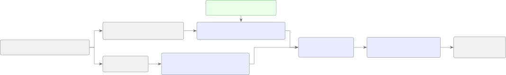
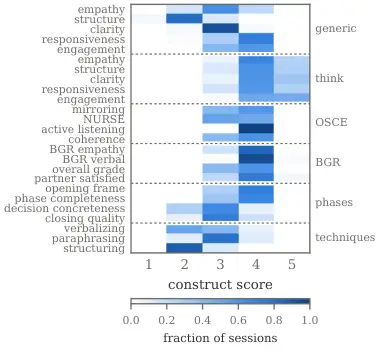

# Instrument-Anchored LLM Judges Transfer Expert Counseling-Quality Ratings Across Three German Corpora

Tobias Hallmen Affiliation: Chair for Human-Centered
Affiliation: Artificial Intelligence Affiliation: University of Augsburg
Email: [tobias.hallmen@uni-a.de](mailto:)    Elisabeth André
Affiliation: Chair for Human-Centered Affiliation: Artificial
Intelligence Affiliation: University of Augsburg
Email: [elisabeth.andre@uni-a.de](mailto:)

###### Abstract

Automatic assessment of communication quality in counseling
conversations is bottlenecked by data: expert-rated corpora are small
and expensive to grow. Therefore we study cross-domain prediction of the
expert’s overall impression across three German simulated-counseling
corpora from one university (two general-practice medical, one
parent–teacher; $`n{=}195`$ sessions). Features are construct scores
that four small LLM judges assign from the transcript, drawn from the
experts’ own rating instruments, plus a compact nonverbal block; all
models are open-weight and run locally, preserving data protection.
Trained on the other two corpora, this stack predicts the held-out
corpus at Spearman $`\rho=.533`$; in-domain training on the same
sessions falls about a fifth short ($`.420`$; paired gap $`+.113`$, 95%
CI $`[+.067,+.157]`$), and the gap holds at matched training size and on
identical test sessions. The signal lies in what is said: the four
judges alone transfer at $`.523`$, and the nonverbal block adds $`+.01`$
(CI includes zero). Asking a judge for instrument constructs instead of
generic dialogue qualities raises its transfer by about 30% ($`.32`$ to
$`.42`$); restoring speaker attribution where per-speaker audio was lost
is worth $`+.08`$ to $`+.10`$ on that fold. Where a program’s own
ratings are scarce, other programs’ data is a viable training set and
language carries it.

## 1 Introduction

Professional communication training programs in medicine and education
rely on simulated conversations, such as objective structured clinical
examinations (OSCEs) and parent–teacher role-plays, that are rated by
human experts on global communication quality. Such ratings are
expensive: they consume scarce expert time, and professional actors
where simulations use them, and each such program produces only dozens
of sessions, rated with program-specific instruments. Automating them
would enable formative feedback at scale, but the obvious supervised
route collides with the data reality: at $`53`$–$`85`$ sessions per
corpus, within-domain models stay well below the reliability reference
of the ratings themselves (Section 6).

Figure 1: Pipeline over the three corpora (Section 3): LLM judges score
generic dialogue qualities and instrument-derived constructs from both
speakers’ transcript, compact nonverbal features come from the
recordings, all blocks are standardized with training statistics, and a
model trained on two domains predicts the third’s expert rating.

This work asks whether the assessment itself transfers: can a model
trained on other counseling domains predict the experts’ overall
impression in an unseen one? We use three German-language corpora of
simulated dyadic counseling, each pairing a student with a simulated
interlocutor: general-practice consultations about tick bites,
vaccination counseling, and parent–teacher conversations, each rated by
domain experts on a 1–5 overall-impression scale. The programs share one
university, and their three instruments start from different counseling
theories but operationalize overlapping techniques and end in the same
kind of global rating (Section 3), which makes transfer plausible. We
evaluate leave-one-domain-out (LODO), so the test domain contributes no
training sessions, and compare _cross-domain_ training on the other two
corpora with _in-domain_ cross-validation inside the held-out corpus, on
the same sessions.

Our primary system is the _compact stack_: construct scores from four
small open-weight large language models (LLM) judges reading the
two-speaker transcript, plus a compact nonverbal block, with the judge
membership chosen by nested selection on the training corpora alone
(Section 4.4). Two of the judges ask constructs derived from the
instruments the experts actually used, the Berlin Global Rating
(Scheffer, 2009) and an OSCE checklist of empathic techniques, so the
scores also name what a learner would practice. Trained on the other two
corpora, the stack predicts the held-out corpus at $`\rho=.53`$, against
$`.42`$ when trained inside it; the four judges alone transfer at
$`.52`$.

#### Contributions.

\(1\) Cross-domain training for expert overall ratings: a
leave-one-domain-out comparison with in-domain training on the same
sessions, across three counseling corpora from two disciplines, in which
in-domain training falls about a fifth short of training on the other
programs (Section 5). (2) Instrument-derived LLM judges as features:
small open-weight judges score the constructs of the experts’ own
instruments from the transcript; asking a judge for the experts’
instrument constructs instead of generic dialogue qualities raises its
transfer by about 30%, and judges from three model families ensemble
above any single one (Section 5). (3) What speaker attribution is worth:
for the corpus that lost its per-role audio, speaker-attribution error
priced in predictive validity rather than in diarization error rate
(Section 5.1).

## 2 Related Work

Prior studies of these corpora are correlational or single-domain. They
relate expert ratings of the medical consultations to nonverbal
behavior, arousal and smiling (Zerbini et al., 2025; Schneider et al.,
2025), cues we test as predictors across domains; feed extracted
features back to trainees (Gietl et al., 2026a; Gietl et al., 2026b;
Hallmen et al., 2025a), describing behavior where we predict the
expert’s rating; and annotate the phases and techniques of a counseling
phase model (Benien, 2003), where encoder baselines degrade across
domains (Hallmen et al., 2026), labels we turn into judge constructs for
a session-level rating.

LLM-as-judge is established for machine-generated text (Zheng et al.,
2023; Liu et al., 2023) but biased and inconsistent (Wang et al., 2024;
Stureborg et al., 2024; Bavaresco et al., 2025; Panickssery et al.,
2024). We instead use judges as feature extractors over _human_ behavior
(Ziems et al., 2024; Rathje et al., 2024; Withanage Don et al., 2024;
Withanage Don et al., 2026): small local open-weight models (for
privacy) score constructs from validated instruments without observing
expert ratings; the BGR+OSCE battery includes an overall-impression
construct, and a separate regressor maps all scores to the rating.
Psychotherapy work predicts codes and competence from transcripts (Xiao
et al., 2015; Tanana et al., 2016; Gibson et al., 2016; Gibson et al.,
2022; Flemotomos et al., 2022; Flemotomos et al., 2021; Pérez-Rosas
et al., 2019; Eberhardt et al., 2025; André et al., 2026) in-domain,
with hundreds to thousands of sessions; we test on an unseen domain with
53–85 sessions each. The public counseling corpora carry utterance-level
codes or a binary quality label (Wu et al., 2022; Pérez-Rosas et al.,
2019), not an expert overall rating of a simulated session, so they
cannot enter our comparison. Schwartz et al. (2024) combine modalities
with shallow language features, which our judges replace with
construct-level scores; classroom scoring stays within one instrument
(Wang and Demszky, 2023; Ramakrishnan et al., 2023), while we transfer
across three. Text dominates multimodal impressions (Naim et al., 2018;
Hazarika et al., 2020; Gkoumas et al., 2021; Hallmen et al., 2025b); we
measure what the nonverbal channel adds under domain shift. Models
degrade across corpora, which adversarial domain generalization counters
(Gideon et al., 2019); we add no such step and rely on the construct
lineage the three instruments share (Section 3).

## 3 Data

The data are three German-language corpora of simulated dyadic
counseling conversations, recorded in communication training programs at
one German university. In each session one _assessed_ person (a medical
student or a teacher-education student) converses with a _simulated
interlocutor_ (a trained actor, or a peer in role). All three
collections were designed for per-speaker capture, one camera on each
participant’s face and one microphone per participant, so that role
attribution follows from the channel rather than from a model.

Ticks (57 sessions): medical students hold a simulated general-practice
consultation in which a standardized patient worries about a tick bite
she has already removed, embedded in a longitudinal communication
curriculum (Zerbini et al., 2024); one expert rated all sessions with
the Berlin Global Rating (BGR) (Scheffer, 2009), a second expert a
subset (Zerbini et al., 2025). Vacc (53 sessions): medical students
counsel a trained actor playing a parent who hesitates about the
scheduled vaccination of their three-month-old infant; four
communication experts split the sessions and rated them with the BGR
(Schneider et al., 2025). In Vacc the per-role audio was lost to a
lapel-microphone failure, so both speakers share one mixed channel:
speaker labels come from diarizing it, repaired against human
speech-activity annotation (Section 5.1), and overlapping speech cannot
be split by speaker, so overlap features (who talks over whom) are zero
by construction. Its per-role video is unaffected. Teach (85 sessions):
teacher-education students in a counseling-competence seminar hold
school-related parent–teacher conversations, as peer role-plays and as
final simulations with professional actors (Hallmen et al., 2026;
Hallmen et al., 2025a); each session was rated once by one of four
school counseling experts on the questionnaire’s overall item.

Ticks and Vacc are the closer pair: medical students, the BGR
instrument, a doctor–patient dyad and a rater pool overlapping by one
person, though topic and recording differ. Teach shares the
simulated-counseling format, but not the instrument, the rater pool or
the dyad type. For all three corpora we include every session with a
complete audio-video recording and an available expert overall rating at
analysis time; session counts therefore differ from the analysis subsets
of the corpus publications, which also report the participant
demographics.

|                   |               |               |               |
| ----------------- | ------------- | ------------- | ------------- |
|                   | Ticks         | Vacc          | Teach         |
| sessions          | 57            | 53            | 85            |
| duration (min)    | 7.1$`\pm`$0.6 | 6.9$`\pm`$0.9 | 9.5$`\pm`$2.3 |
| assessed role     | doctor        | doctor        | teacher       |
| interlocutor role | patient       | patient       | parent        |
| target instrument | BGR           | BGR           | global item   |
| rating            | 1–5           | 1–5           | 1–5 / 1–4     |
| expert raters     | 2             | 4             | 4             |
| agreement (ICC)   | .80           | .77–.85       | .53–.82       |

Table 1: Corpora. BGR = Berlin Global Rating overall impression
(inverted, 5 = best). ICC = between-expert agreement on the double-rated
subsets (Ticks/Vacc) and single- to average-rater ICC on the four-rater
panel (Teach, parallel item; Appendix A). Teach switched its item from
five to four points after 24 sessions (Appendix A).

The prediction target is one expert’s overall rating of the assessed
person per session, on five levels from 5 = very good to 1 = very bad:
the BGR overall item (_Gesamteindruck_, inverted) for the two medical
corpora and the global item (_Gesamturteil_) of the teacher
questionnaire. After its first 24 sessions Teach used a four-point
version of that item, whose ratings we re-spread onto the five-point
scale (Appendix A), as they re-rated the 24 also on 1–4. Vacc and Teach
distribute primary ratings across four experts each, one rater per
session, and additional ratings exist on overlap subsets, with pairwise
exact agreement of $`.42`$–$`.47`$ (Appendix A): the targets are
single-rater scores carrying one expert’s measurement error, which the
reliability reference of Section 6 rests on. Both medical corpora also
contain the standardized patient’s and the student’s own BGR ratings,
which we use to estimate human cross-perspective agreement (Appendix C).
Most ratings lie at 3–4, as expected from a student population, which
motivates rank over absolute-error metrics (Section 4.4).

All three are counseling conversations whose instruments stem from
different theories: client-centered active listening and empathic
techniques such as NURSE (Naming, Understanding, Respecting, Supporting,
Exploring) (Back et al., 2005) for the medical corpora, a
counseling-phase model and conversation techniques (Benien, 2003) for
Teach. Their operationalizations converge: the teacher questionnaire’s
subscales mirror the BGR’s item structure, its items ask for the
techniques the medical OSCE checklist rates (paraphrasing, active
listening, offering support), and all three end in a global rating. This
is the common ground the transfer we measure can draw on.

## 4 Method

Terms used throughout: each corpus is one _domain_; a _fold_ holds one
domain out and trains on the other two, so leave-one-domain-out (LODO)
has three folds. A _battery_ is a set of construct questions (e.g.
verbalizing, paraphrasing, structuring), a _judge_ is one LLM run with
one battery (e.g. gemma3-12B (Gemma Team, 2025) answering the eight
BGR+OSCE questions is one judge), and an _ensemble_ is a set of judges
whose score vectors are concatenated. A _configuration_ is one feature
set (including the judge membership) with one preprocessing, projection
and regressor setting. The _primary system_ is one fixed configuration
on the _compact stack_: the construct scores of four judges plus the
compact nonverbal block and its dyadic deltas; _language-only_ keeps the
same preprocessing, projection and regressor settings on the four judges
alone. Two _training settings_ are compared on the same sessions:
_cross-domain_, trained on the other two corpora, and _in-domain_, plain
shuffled 5-fold cross-validation inside the held-out corpus
(stratification impossible under data scarcity).

### 4.1 Feature families

All features are extracted with DISCOVER (Hallmen et al., 2025c):
transcription and speaker diarization (for Vacc see Section 3), facial
expression, gaze and smiling from the video, and acoustic and prosodic
descriptors from the audio. All features are session-level scalars over
the assessed role and, for dyadic features, the interlocutor (Table 2).

| Block               | What                                                                                                                                                                                                                               | dims | role                            |
| ------------------- | ---------------------------------------------------------------------------------------------------------------------------------------------------------------------------------------------------------------------------------- | ---- | ------------------------------- |
| LLM judges          | construct scores of four judges (Section 4.2)                                                                                                                                                                                      | 26   | primary (language-only, stack)  |
| Compact (cmp)       | pitch mean/std, loudness, sentiment, gaze/smile rates, happy/neutral fractions, words/s, speech-emotion V/A/D (Wagner et al., 2023), facial V/A                                                                                    | 14   | primary (stack)                 |
| Deltas (dlt)        | assessed minus interlocutor, same 14                                                                                                                                                                                               | 14   | primary (stack)                 |
| Nonverbal-dyadic    | deltas, mutual gaze/smile (intersections of both speakers’ intervals), turn-taking (latencies, interruption/overlap, share, turns/min, lengths), windowed prosodic synchrony                                                       | 39   | exploratory (alternative stack) |
| Wide functionals    | eGeMAPS (Eyben et al., 2016) LLDs (88), OpenFace 2.0 (Baltrušaitis et al., 2018) AUs (17), EmotiEffLib (Savchenko, 2023) V/A (2) $`\times`$ 5 functionals; expression fractions (8), sentiment (Barbieri et al., 2022), gaze/smile | 563  | exploratory baseline            |
| Shallow transcript  | WhisperX (Bain et al., 2023) segments, words/min, word length, questions, speaking share, segment duration, unfinished segments                                                                                                    | 7    | exploratory baseline            |
| Sentence embeddings | duration-weighted means (Reimers and Gurevych, 2019), MiniLM-L12-v2                                                                                                                                                                | 384  | exploratory baseline            |

Table 2: Feature blocks. Stack = compact stack (judges, compact block
and deltas, 54 columns); V/A(/D) = valence/arousal(/dominance).

Transcripts, and so sentiment, words per second and turn timing, derive
from the audio, as the acoustic features do: the only modality-clean
split is audio versus video. The compact and nonverbal-dyadic blocks
thus carry a few transcript-derived columns; Appendix D reports a
strictly audio-visual control, the nonverbal-dyadic block with its
transcript-derived columns removed.

### 4.2 Instrument-anchored LLM judges

The core feature family works in two stages (Figure 1). A small local
LLM reads the _entire_ two-speaker transcript, time-ordered and
speaker-labeled with domain-neutral tags (B: assessed, G: interlocutor,
after German _Bewertete(r)_ and _Gesprächspartner(in)_; no professions),
and returns session-level construct ratings (1–5) as JSON; these scores
are then features for the regressor of Section 4.4. Every judge receives
the complete transcript (transcript cap 16k characters, never reached:
longest transcript 15.2k).

Figure 2: Judge score distributions over the 195 sessions: three
batteries in six groups (generic dialogue without and with thinking;
BGR+OSCE as OSCE and BGR; phase+technique as phases and techniques);
cross-family BGR+OSCE runs omitted (inventory in Table 6).

Three batteries, all prompted in German, supply the constructs: generic
dialogue (empathy, structure, clarity, responsiveness, engagement);
BGR+OSCE, derived from the experts’ instruments: BGR items (flipped so 5
= best), OSCE empathic techniques (e.g. NURSE (Back et al., 2005)) from
the medical communication curriculum (Zerbini et al., 2024), and a
perspective-flip item (“how satisfied does _G_ leave?”); and
phase+technique, from a counseling phase model and technique codebook
(Hallmen et al., 2026; Benien, 2003) (e.g. concreteness of the decision
phase, paraphrasing). The primary ensemble has four judges (Qwen Team,
2025; IBM Research, 2026): generic dialogue on gemma3-12B and on
qwen3-14B in thinking mode, BGR+OSCE on gemma3-12B, and BGR+OSCE with
anti-band wording on granite4.1-30B (an added instruction to use the
full scale, Appendix B). Sampling uses each model card’s recommended
parameters with pinned seeds (temperature $`0.4`$ for gemma3 and
granite, $`0.6`$ for the thinking variant). The membership is chosen by
nested selection (Section 4.4); Table 6 (Appendix B) inventories all
eight full runs.

#### Constructs, not items.

Asking the judge for the constructs the experts rate is the design goal;
the judge is zero-shot and never sees a rating. The batteries
operationalize the instruments rather than replay them, and the mapping
is deliberately not one-to-one (Appendix C). In prompt design we asked
the instrument items directly, as rephrased constructs, and as a
selected subset with rephrased level descriptions; the selection with
rephrasing worked best, and on the 30-session screening subset the
instruments’ literal overall-item wordings alone reach
$`\rho=.26`$–$`.28`$ against $`.35`$ for the battery’s overall construct
(screening-level evidence, Appendix B). Teach, whose rating instrument
the judges do not quote, is nevertheless the strongest fold.

#### Screening.

The regressor needs between-session variance, so before any full run a
candidate model must pass a label-free gate on 30 pilot sessions: a
parseable JSON object within three seeded attempts for $`\geq 90\%`$ of
sessions and a mean per-construct standard deviation $`\geq.35`$. The
gate excludes judges whose scores collapse to a constant, such as the
scale ceiling; it reads outputs only, never targets (prompt wording was
target-screened separately, Appendix B). Admitted judges span 1–5 and
concentrate at 3–4 like the expert ratings without collapsing (gate
spread $`0.37`$–$`0.80`$); two BGR+OSCE constructs are near-constant
(Figure 2), and the variance threshold drops such a column where it is
constant across the training sessions.

### 4.3 Feature standardization

In every standardized feature set (Figure 3), each column is
z-standardized, $`z=(x-\mu)/\sigma`$ with mean $`\mu`$ and standard
deviation $`\sigma`$ taken from training sessions only and
asymmetrically: each training corpus is standardized with its own
$`\mu`$ and $`\sigma`$, the held-out corpus with the pooled raw $`\mu`$
and $`\sigma`$ of the two training corpora. No held-out feature
statistics or ratings are used to fit a fold. The per-corpus statistics
on the training side remove instrument and register offsets: a judge’s
“3” sits at a different point of the quality range in a clinical
consultation than in a parent conversation. Corpus standardization
precedes median imputation; in in-domain cross-validation all pipeline
stages are fitted on the training four fifths, while the corpus
standardization uses the corpus’s own label-free feature statistics.

### 4.4 Protocol

#### What is compared.

For each held-out domain both training settings predict exactly the same
sessions ($`n{=}57/53/85`$ for Ticks/Vacc/Teach). The _cross-domain_
model is trained once on all sessions of the other two domains
($`138/142/110`$) and predicts every session of the held-out domain. The
_in-domain_ reference is 5-fold cross-validation inside that domain:
each session is predicted by a model trained on the other four fifths of
its own corpus ($`45`$–$`46/42`$–$`43/68`$ sessions; test fifths of
$`11`$–$`12/10`$–$`11/17`$), the out-of-fold predictions are
concatenated, and the split is repeated over 20 random partitions
($`\mu`$ and $`\sigma`$ reported). Spearman’s $`\rho`$ (Spearman, 1904)
is computed per domain and averaged over domains: the targets are
ordinal levels with ties, which suits a rank rather than a Pearson
correlation, and pooling corpora with different rating distributions
would reward predicting the corpus, not the session. The gap between the
settings is estimated by a paired session bootstrap: $`10^{4}`$
resamples, stratified by domain, each session keeping its rating and
both predictions, models fixed. On each resample the per-domain gap is
the cross-domain $`\rho`$ minus the in-domain $`\rho`$ (mean over the 20
splits), then averaged over domains. The interval is conditional on
these three corpora and excludes training variance. We call this, with
the standardization of Section 4.3, the _inductive protocol_. Two
controls address the two obvious confounds. _Training-size matched_: the
cross-domain model is trained on $`m=\mathrm{round}(0.8\,n)`$
other-domain sessions, $`n`$ the held-out corpus size ($`m=46/42/68`$;
200 draws), the training count of an in-domain fold model. _Test
matched_: the full cross-domain model and the in-domain fold model are
scored on the same test fifth, for all five fifths of the same 20
splits; we report the gap averaged over fifths and splits, and the
number of splits in which it is positive. The full-domain correlation
and the mean of fifth-wise correlations are different estimands; we
report both.

#### Configuration.

Feature set, projection and regressor are fixed by design: median
imputation $`\to`$ variance threshold (drops constant columns) $`\to`$
standardization $`\to`$ PCA to 10 principal components (dimensions)
$`\to`$ elastic net ($`\alpha=0.5`$, $`\ell_{1}`$ ratio $`0.5`$, up to
5000 iterations) (Wold et al., 1987; Zou and Hastie, 2005), every stage
fitted on training sessions only; the result is identical at every
requested width from 1 to 50 (the effective width is capped by the
column count; Appendix D). The judge-ensemble membership is chosen by
nested selection: in each outer fold, every candidate membership
(Appendix D, Membership selection; picks in Table 9) is scored on the
inner leave-one-training-domain-out split of the two training corpora,
under the same training-statistics standardization, and the best inner
score is kept; the held-out corpus never informs the choice. The picks
are reported with the results (Section 5); we fix the same four judges
for both systems for comparability. Imputation handles missing values
with identifiable causes (Appendix D). Code, prompts and out-of-fold
predictions are linked in Appendix F.

## 5 Results

|                                                                                            |                    |                   |                             |                   |
| ------------------------------------------------------------------------------------------ | ------------------ | ----------------- | --------------------------- | ----------------- |
| Training setting                                                                           | Ticks ($`n{=}57`$) | Vacc ($`n{=}53`$) | Teach ($`n{=}85`$)          | mean              |
| _Compact stack (primary system): four judges $`+`$ compact nonverbal block and its deltas_ |                    |                   |                             |                   |
| cross-domain (training $`n{=}138/142/110`$)                                                | .485               | .517              | .598                        | .533              |
| training size matched ($`m{=}46/42/68`$, 200 draws)                                        | .486               | .426              | .607                        | .506              |
| in-domain 5-fold CV, 20 splits (sd)                                                        | .348 (.048)        | .380 (.054)       | .533 (.030)                 | .420              |
| gap, paired bootstrap \[95% CI\]                                                           |                    |                   | $`+.113`$ $`[+.067,+.157]`$ |                   |
| gap on identical test fifths (splits $`>0`$)                                               | $`+.098`$ (19/20)  | $`+.070`$ (19/20) | $`+.025`$ (18/20)           | $`+.065`$ (19/20) |
| _Language-only: the four LLM judges_                                                       |                    |                   |                             |                   |
| cross-domain                                                                               | .485               | .486              | .597                        | .523              |
| training size matched                                                                      | .476               | .452              | .595                        | .508              |
| in-domain 5-fold CV, 20 splits (sd)                                                        | .415 (.026)        | .423 (.031)       | .559 (.024)                 | .466              |
| gap, paired bootstrap \[95% CI\]                                                           |                    |                   | $`+.057`$ $`[+.038,+.077]`$ |                   |
| gap on identical test fifths (splits $`>0`$)                                               | $`+.014`$ (16/20)  | $`-.005`$ (7/20)  | $`+.007`$ (15/20)           | $`+.006`$ (14/20) |

Table 3: Primary system under the inductive protocol: Spearman $`\rho`$
per held-out domain and their mean, for both training settings on the
same sessions, with the training-size and identical-test-fifth controls
and the paired session bootstrap of Section 4.4. sd = across the 20
in-domain splits; $`k/20`$ = splits with a positive gap.

Figure 3: Feature families at the fixed configuration under the
inductive protocol: cross-domain $`\rho`$, mean over held-out domains
(bars), and the 20-split in-domain mean (diamonds); the judge-ensemble,
stack, nonverbal-dyadic and shallow rows use the standardization of
Section 4.3, the others raw columns. The qwen3.6 and phase+technique
judges are not in the primary system. Per-fold values are in Table 11
(Appendix D).

All numbers use the de-rounded Teach target (Appendix A) and the
repaired Vacc attribution (Section 5.1).

#### Cross-domain training exceeds in-domain training for the compact stack.

Trained on the other two corpora, the primary system reaches
$`\rho=.533`$ (folds $`.485/.517/.598`$, Table 3); trained inside the
held-out corpus and scored on the same sessions it reaches $`.420`$ (20
splits; per-domain $`\sigma`$ $`.030`$–$`.054`$). The paired bootstrap
puts the gap at $`+.113`$, 95% CI $`[+.067,+.157]`$, one-sided bootstrap
$`p\leq 10^{-4}`$ (no resample at or below zero), and the cross-domain
model is ahead in every domain.

#### The advantage persists under training-size and test-grouping controls.

Subsampled to the in-domain training count, the cross-domain stack
reaches $`.506`$ ($`.486/.426/.607`$), above the in-domain reference in
every domain, a gap of $`+.086`$ at approximately equal training size;
the Vacc value varies most across draws ($`\sigma=.098`$). Scored on
identical test fifths, the gap is $`+.065`$, positive in 19 of 20 splits
($`+.098/+.070/+.025`$ per domain). The stack’s advantage therefore
persists under each control separately. The result does not depend on
the per-corpus standardization step: without it (raw columns, keeping
only the pipeline’s standardization fitted on the training sessions) the
stack reaches $`.551`$ and language-only $`.521`$, with gaps of
$`+.131`$ $`[+.089,+.173]`$ and $`+.055`$ $`[+.037,+.075]`$
(Appendix D); the protocol keeps the pre-specified training-statistics
variant (Section 4.3).

#### Nested selection confirms the membership.

For the compact stack the inner selection picks the same four judges in
every fold (Table 9), so the primary system is one fixed membership and
its nested and fixed results coincide ($`.533`$). For the language-only
system the Vacc fold’s inner selection adds two judges (strict nested
$`.495`$ against $`.523`$ with the fixed four).

#### Language-only and in-domain training differ little on identical test fifths; the stack exceeds both.

The four judges alone transfer at $`.523`$ ($`.485/.486/.597`$) against
$`.466`$ in-domain, a full-domain gap of $`+.057`$ $`[+.038,+.077]`$ and
$`+.042`$ at matched training size. On identical test fifths, the mean
gap is small ($`+.006`$, positive in 14 of 20 splits;
$`+.014/-.005/+.007`$ per domain). The judges also fit better in-domain
than the stack does, so their smaller cross-domain margin mostly
reflects stronger in-domain fitting ($`.466`$ against $`.420`$) rather
than weaker transfer ($`.523`$ against $`.533`$). The block increment,
stack minus language-only on the same sessions, is $`+.011`$
$`[-.019,+.040]`$ (one-sided bootstrap $`p=.24`$), almost entirely in
the Vacc fold ($`.000/+.031/+.001`$): the four judges carry the signal.

#### Language dominates the feature families.

In Figure 3 every single judge transfers at $`.32`$–$`.45`$ and the
four-judge ensemble at $`.523`$, while the compact nonverbal block with
its deltas reaches $`.161`$ and the nonverbal-dyadic block, the shallow
transcript statistics and the sentence embeddings stay at or below
$`.06`$ at the fixed configuration; in-domain, no nonverbal or surface
block exceeds $`.15`$.

#### The constructs matter more than the quoted level descriptions.

At the same model and transcript, asking the experts’ constructs instead
of generic dialogue qualities raises transfer from $`.321`$ to $`.418`$,
a comparison that also varies construct count and prompt length; quoting
the instruments’ level descriptions, with the battery fixed, adds
$`+.004`$ in a controlled comparison under the same protocol, within
sampling-seed variation (Table 7, Appendix C). Judges from three model
families ensemble to $`.523`$, above the strongest single judge,
granite4.1-30B at $`.448`$; for the compact stack the inner selection
picks the same four judges in every fold; for language-only the Vacc
fold adds qwen3.6 and phi4 (Table 9). Alone, the qwen3.6 judge transfers
at $`.375`$ and the phase+technique judge, which was not a candidate, at
$`.361`$.

#### Single-source transfer.

Trained on one corpus at a time (Table 4), every directed cell is
positive, and the harder test pair Teach–medical transfer better
($`.558`$ stack, $`.536`$ language-only) than the medical pair
($`.477`$, $`.487`$), which suggests the result does not rest on the two
medical corpora resembling each other, and a single corpus of 53–85
sessions already transfers at $`.47`$–$`.63`$.

| Training | Test  | $`n_{\mathrm{train}}`$ | stack | language-only |
| -------- | ----- | ---------------------- | ----- | ------------- |
| Vacc     | Ticks | 53                     | .485  | .482          |
| Teach    | Ticks | 85                     | .488  | .479          |
| Ticks    | Vacc  | 57                     | .469  | .492          |
| Teach    | Vacc  | 85                     | .507  | .487          |
| Ticks    | Teach | 57                     | .631  | .587          |
| Vacc     | Teach | 53                     | .608  | .589          |

Table 4: Directed single-source transfer, fixed configuration (Spearman
$`\rho`$ on the full test corpus).

#### Ranking, not scoring.

Predictions are rank-associated with the expert ratings ($`\rho=.53`$)
but compress the scale. Mean absolute error (MAE) rewards mean-collapse;
absolute-error and calibration results are in Appendix  efapp:errors.
The mean prediction rises monotonically with the rating from level 2
upward ($`3.28`$, $`3.59`$, $`3.75`$, $`3.94`$ for rounded true levels
$`2`$–$`5`$; level 1 has two sessions), quadratic-weighted $`\kappa`$ is
$`.33`$, and MAE is $`.702`$ against $`.815`$ for a constant at the
pooled target mean (an oracle that uses the held-out targets). Like any
regularized regressor, it shrinks predictions toward the center: their
$`\sigma`$ is $`0.44`$ against $`0.99`$, and the level means span only
$`3.28`$ to $`3.94`$ of the five-point range (Appendix E). It should
rank sessions and flag the lowest, not report instrument-scale levels
without calibration.

### 5.1 Recording Attribution

#### What correct speaker attribution is worth.

Vacc lost its per-role audio (Section 3). Against its human
speech-activity annotation, 16.1% of diarized segments carried the wrong
speaker; restoring the attribution lifts the language-only Vacc fold
from $`.402`$ to $`.486`$ and the language-only mean from $`.493`$ to
$`.523`$, and the compact stack’s Vacc fold from $`.414`$ to $`.517`$
and its mean from $`.502`$ to $`.533`$, since those sessions also train
the other two folds (Appendix A).

## 6 Discussion

#### How high is the ceiling?

An out-of-domain Spearman of $`.53`$ should be read against how well
_humans_ agree, not against 1.0. Our targets are effectively
single-rater; under a classical measurement-error reading (Spearman,
1904), $`\sqrt{\mathrm{ICC}}`$ is a rough reliability reference rather
than a strict ceiling for a Spearman correlation: $`.73`$ on Teach
(single-rater ICC(2,1) $`=.53`$, from a parallel item) and
$`.88`$–$`.92`$ on the medical corpora (double-rated subset ICCs
$`.77`$–$`.85`$). On the medical corpora the model ($`.485`$/$`.517`$ on
Ticks/Vacc) also agrees with the expert better than the other people in
the room do (standardized patient $`.33`$/$`.47`$, student self-rating
$`.31`$/$`.29`$; Appendix C).

#### Why does the transcript carry so much?

The expert instruments are largely language-defined, and the one
construct the judges cannot see, BGR’s nonverbal item, is not required
to reach $`.523`$; whether richer nonverbal representations would add
more is untested. Adding the compact nonverbal block gives $`.533`$
($`+.011`$, interval including zero), so the judges carry the signal.
Very poor nonverbal behavior would also show in how the conversation
goes, which may be why the block adds little beyond the transcript.

#### Deployment view.

Learners on these programs ask for interpreted, construct-level
statements rather than bare numbers (Bauermann et al., 2025; Gietl
et al., 2026b); a predictor that carries the expert’s judgment into a
program that trained none of it is the step before that. The ordering it
needs is supported ($`\rho=.53`$, quadratic-weighted $`\kappa=.33`$,
mean predictions monotone in the expert level from level 2 upward;
Section 5), enough to flag which sessions to look at first; the
construct scores suggest what to look at, their item-level validity is
future work.

## 7 Conclusion

Across three German counseling corpora, an expert’s overall impression
of a session is predictable in a domain that contributed no training
data: instrument-anchored LLM judges with a compact nonverbal block
reach $`\rho=.53`$ against $`.42`$ in-domain, with most of the signal in
the transcript.

The judges and the nonverbal feature models are small, open-weight and
run on institutional hardware, so no recording leaves it, preempting
privacy concerns. The judges read transcripts and the nonverbal block
adds little, and the attribution repair motivates reliable per-speaker
audio capture, for instance a lapel microphone per speaker
(Section 5.1). Therefore a less intrusive audio-only recording setup
without cameras suffices. Programs with few rated sessions can start
from other programs’ data, which here trained the compact stack better
than their own, and counseling settings beyond medical and teacher
education whose instruments share these constructs are candidates. A
rank-valid predictor shows which learners to look at first, and a low
construct score suggests what to practice. Establishing whether those
scores are valid item by item and help learners requires a long-term
controlled study; calibration to levels is future work.

## Limitations

Three domains. The cross-domain estimate rests on three folds whose
values vary ($`.485`$–$`.598`$ stack, $`.485`$–$`.597`$ language-only);
the bootstrap interval is conditional on these corpora, and transfer to
a fourth domain is untested. Single-rater targets. Each session carries
one expert’s rating, mostly at 3–4, and pairwise exact agreement between
experts on overlap subsets is $`.42`$–$`.47`$, which limits attainable
correlation (Section 6). Setting. All sessions are simulated,
German-language role-plays from one university; real consultations,
other languages and other rating cultures are untested. In-domain folds
are not grouped by actor; actor-grouped in-domain values (Vacc, Teach;
actor-grouped CV, not tabulated) move language-only from $`.423`$ to
$`.401`$ (Vacc) and $`.559`$ to $`.535`$ (Teach), and the stack from
$`.380`$ to $`.205`$ and $`.533`$ to $`.501`$. Target coding. The Teach
target re-spreads rounded four-point answers under an equal-interval
assumption (Appendix A). Modality. The nonverbal increment ($`+.01`$) is
not modality-clean, since the compact block carries transcript sentiment
and speech rate (Section 4.1); a strictly audio-visual control of the
nonverbal-dyadic block is in Appendix D. Ranking, not scoring. The
predictor orders sessions; reporting levels on the instrument’s scale
needs recalibration first (Appendix E). Wording and model family. Within
the primary ensemble, the cross-family judge (granite4.1-30B) also
differs from the gemma3 BGR+OSCE judge in prompt wording (the anti-band
instruction), so there the two effects are not separated (Appendix C).

## Ethical Considerations

All conversations are simulated role-plays between consenting adult
students and trained actors or peers, recorded within the regular
curricula of the students’ degree programs; the underlying data
collections have documented ethics approvals and consent procedures in
the respective corpus publications (Zerbini et al., 2025; Schneider
et al., 2025; Hallmen et al., 2026). Automatic communication scoring is
intended for formative feedback, not for high-stakes decisions; we
report domain transfer precisely because deploying an in-domain-trained
scorer on new populations without validation would be unsafe. No
personally identifying data leaves the institution’s infrastructure; all
LLM inference runs on open-weight models on institutional hardware. We
have not established that the scores are equally valid across speaker
groups: the corpora are too small and their demographic records too
incomplete to estimate subgroup performance, the judges’ pretraining may
carry register and accent priors, and the diarization error we measure
in one corpus need not fall evenly across speakers. Differential
validity is therefore untested, which is a reason to keep such scores
formative and paired with human review.

## Acknowledgments

This work was partially funded by the KodiLL project (FBM2020, Stiftung
Innovation in der Hochschullehre).

## References

- Abdin et al. (2024) Marah Abdin, Jyoti Aneja, Harkirat Behl, Sébastien
  Bubeck, Ronen Eldan, Suriya Gunasekar, Michael Harrison, Russell J
  Hewett, Mojan Javaheripi, Piero Kauffmann, et al. 2024. Phi-4
  technical report. _arXiv preprint arXiv:2412.08905_.
- André et al. (2026) Elisabeth André, Steffen Eberhardt, Tobias
  Hallmen, Alexander Heimerl, Silvan Mertes, Gerhard Prinz, Jana
  Schaffrath, Dominik Schiller, Brian Schwartz, Antonia Vehlen, and
  Wolfgang Lutz. 2026. [Nutzung von KI-technologien für diagnostik und
  gesprächsanalyse in der psychotherapie: Potential und
  herausforderungen](https://doi.org/10.1055/a-2784-7779). _PPmP –
  Psychotherapie · Psychosomatik · Medizinische Psychologie_.
- Back et al. (2005) Anthony L Back, Robert M Arnold, Walter F Baile,
  James A Tulsky, and Kelly Fryer-Edwards. 2005. [Approaching difficult
  communication tasks in
  oncology](https://doi.org/10.3322/canjclin.55.3.164). _CA: a cancer
  journal for clinicians_, 55(3):164–177.
- Bain et al. (2023) Max Bain, Jaesung Huh, Tengda Han, and Andrew
  Zisserman. 2023. [WhisperX: Time-accurate speech transcription of
  long-form audio](https://doi.org/10.21437/Interspeech.2023-78). In
  _Proc. INTERSPEECH 2023_, pages 4489–4493.
- Baltrušaitis et al. (2018) Tadas Baltrušaitis, Amir Zadeh, Yao Chong
  Lim, and Louis-Philippe Morency. 2018. [OpenFace 2.0: Facial behavior
  analysis toolkit](https://doi.org/10.1109/FG.2018.00019). In _2018
  13th IEEE International Conference on Automatic Face & Gesture
  Recognition (FG 2018)_, pages 59–66. IEEE.
- Barbieri et al. (2022) Francesco Barbieri, Luis Espinosa Anke, and
  Jose Camacho-Collados. 2022. XLM-T: Multilingual language models in
  Twitter for sentiment analysis and beyond. In _Proceedings of the
  thirteenth language resources and evaluation conference_, pages
  258–266.
- Bauermann et al. (2025) Moritz Bauermann, Thomas Rotthoff, Tobias
  Hallmen, Miriam Kunz, Elisabeth André, and Ann-Kathrin
  Schindler. 2025. [Medical students’ perceptions of AI-based feedback
  and feedforward on communication skills in doctor–patient
  consultation - an acceptance study in a video-based
  simulation](https://doi.org/10.1080/10872981.2025.2592414). _Medical
  Education Online_, 30(1):2592414. PMID: 41324408.
- Bavaresco et al. (2025) Anna Bavaresco, Raffaella Bernardi, Leonardo
  Bertolazzi, Desmond Elliott, Raquel Fernández, Albert Gatt, Esam
  Ghaleb, Mario Giulianelli, Michael Hanna, Alexander Koller, Andre
  Martins, Philipp Mondorf, Vera Neplenbroek, Sandro Pezzelle, Barbara
  Plank, David Schlangen, Alessandro Suglia, Aditya K Surikuchi, Ece
  Takmaz, and Alberto Testoni. 2025. [LLMs instead of human judges? a
  large scale empirical study across 20 NLP evaluation
  tasks](https://doi.org/10.18653/v1/2025.acl-short.20). In _Proceedings
  of the 63rd Annual Meeting of the Association for Computational
  Linguistics (Volume 2: Short Papers)_, pages 238–255.
- Benien (2003) Karl Benien. 2003. Schwierige gespräche führen. _Modelle
  für Beratungs-, Kritik-und Konfliktgespräche im Berufsalltag. Rowohlt,
  Reinbek bei Hamburg_.
- Boguslav and Cohen (2017) Mayla Boguslav and Kevin Bretonnel
  Cohen. 2017. [Inter-annotator agreement and the upper limit on machine
  performance: Evidence from biomedical natural language
  processing](https://doi.org/10.3233/978-1-61499-830-3-298). In
  _MEDINFO 2017: Precision Healthcare through Informatics_, volume 245
  of _Studies in Health Technology and Informatics_, pages 298–302. IOS
  Press.
- Eberhardt et al. (2025) Steffen T Eberhardt, Antonia Vehlen, Jana
  Schaffrath, Brian Schwartz, Tobias Baur, Dominik Schiller, Tobias
  Hallmen, Elisabeth André, and Wolfgang Lutz. 2025. [Development and
  validation of large language model rating scales for automatically
  transcribed psychological therapy
  sessions](https://doi.org/10.1038/s41598-025-14923-y). _Scientific
  Reports_, 15(1):29541.
- Eyben et al. (2016) Florian Eyben, Klaus R Scherer, Bjorn W Schuller,
  Johan Sundberg, Elisabeth André, Carlos Busso, Laurence Y Devillers,
  Julien Epps, Petri Laukka, Shrikanth S Narayanan, et al. 2016. [The
  Geneva minimalistic acoustic parameter set (GeMAPS) for voice research
  and affective computing](https://doi.org/10.1109/TAFFC.2015.2457417).
  _IEEE transactions on affective computing_, 7(2):190–202.
- Flemotomos et al. (2021) Nikolaos Flemotomos, Victor R Martinez,
  Zhuohao Chen, Torrey A Creed, David C Atkins, and Shrikanth
  Narayanan. 2021. [Automated quality assessment of cognitive behavioral
  therapy sessions through highly contextualized language
  representations](https://doi.org/10.1371/journal.pone.0258639). _PloS
  one_, 16(10):e0258639.
- Flemotomos et al. (2022) Nikolaos Flemotomos, Victor R Martinez,
  Zhuohao Chen, Karan Singla, Victor Ardulov, Raghuveer Peri, Derek D
  Caperton, James Gibson, Michael J Tanana, Panayiotis Georgiou,
  et al. 2022. [Automated evaluation of psychotherapy skills using
  speech and language
  technologies](https://doi.org/10.3758/s13428-021-01623-4). _Behavior
  research methods_, 54(2):690–711.
- Gemma Team (2025) Gemma Team. 2025. Gemma 3 technical report.
  [https://goo.gle/Gemma3Report](https://goo.gle/Gemma3Report).
  Technical report, published by Google via Kaggle.
- Gemma Team (2026) Gemma Team. 2026. [Gemma 4 technical
  report](https://arxiv.org/abs/2607.02770). _Preprint_,
  arXiv:2607.02770.
- Gibson et al. (2022) James Gibson, David C. Atkins, Torrey A. Creed,
  Zac Imel, Panayiotis Georgiou, and Shrikanth Narayanan. 2022.
  [Multi-label multi-task deep learning for behavioral
  coding](https://doi.org/10.1109/taffc.2019.2952113). _IEEE
  Transactions on Affective Computing_, 13(1):508–518.
- Gibson et al. (2016) James Gibson, Doğan Can, Bo Xiao, Zac E. Imel,
  David C. Atkins, Panayiotis Georgiou, and Shrikanth S.
  Narayanan. 2016. [A deep learning approach to modeling empathy in
  addiction counseling](https://doi.org/10.21437/interspeech.2016-554).
  In _Interspeech 2016_, pages 1447–1451.
- Gideon et al. (2019) John Gideon, Melvin G McInnis, and Emily Mower
  Provost. 2019. [Improving cross-corpus speech emotion recognition with
  adversarial discriminative domain generalization
  (addog)](https://doi.org/10.1109/TAFFC.2019.2916092). _IEEE
  Transactions on Affective Computing_, 12(4):1055–1068.
- Gietl et al. (2026a) Kathrin Gietl, Tobias Hallmen, Sandra Littwin,
  Moritz Bauermann, and Andreas Hartinger. 2026a. [KI-basiertes feedback
  zu simulierten beratungsgesprächen im studium des lehramts an
  grundschulen: Eine explorative
  analyse](https://doi.org/10.35468/6250-40). In _Bildung ohne Grenzen
  denken_, pages 303–309. Verlag Julius Klinkhardt, Bad Heilbrunn.
- Gietl et al. (2026b) Kathrin Gietl, Karoline Hillesheim, Moritz
  Bauermann, Tobias Hallmen, and Andreas Hartinger. 2026b. [Förderung
  der beratungskompetenz von studierenden des lehramts an grundschulen
  durch simulierte elterngespräche und KI-basiertes feedback. erste
  ergebnisse aus einem interdisziplinären
  projekt.](https://doi.org/10.35468/6213-26) In Markus Peschel, Pascal
  Kihm, Melanie Platz, and Lea Marie Gebauer, editors,
  _Bezugsnotwendigkeiten der Grundschule. Pädagogik und Fachdidaktik in
  der Grundschulbildung._, Jahrbuch Grundschulforschung. 29, pages
  321–330. Verlag Julius Klinkhardt, Bad Heilbrunn.
- Gkoumas et al. (2021) Dimitris Gkoumas, Qiuchi Li, Christina Lioma,
  Yijun Yu, and Dawei Song. 2021. [What makes the difference? an
  empirical comparison of fusion strategies for multimodal language
  analysis](https://doi.org/10.1016/j.inffus.2020.09.005). _Information
  Fusion_, 66:184–197.
- Hallmen et al. (2025a) Tobias Hallmen, Kathrin Gietl, Karoline
  Hillesheim, Moritz Bauermann, Annemarie Friedrich, and Elisabeth
  André. 2025a. [AI-based feedback in counselling competence training of
  prospective teachers](https://arxiv.org/abs/2505.03423). _Preprint_,
  arXiv:2505.03423.
- Hallmen et al. (2026) Tobias Hallmen, Kathrin Gietl, Karoline
  Hillesheim, Annemarie Friedrich, and Elisabeth André. 2026.
  [Annotating conversational phases and communication techniques: A
  corpus of german teacher-parent counseling
  conversations](https://doi.org/10.63317/4ukmi5gkdygr). In _Proceedings
  of the Fifteenth Language Resources and Evaluation Conference (LREC 2026)_, pages 6361–6372, Palma, Mallorca, Spain. European Language
  Resources Association (ELRA).
- Hallmen et al. (2025b) Tobias Hallmen, Robin-Nico Kampa, Fabian
  Deuser, Norbert Oswald, and Elisabeth André. 2025b. [Semantic matters:
  Multimodal features for affective
  analysis](https://doi.org/10.1109/cvprw67362.2025.00570). In _2025
  IEEE/CVF Conference on Computer Vision and Pattern Recognition
  Workshops (CVPRW)_, pages 5715–5724.
- Hallmen et al. (2025c) Tobias Hallmen, Dominik Schiller, Antonia
  Vehlen, Steffen Eberhardt, Tobias Baur, Daksitha Withanage Don,
  Wolfgang Lutz, and Elisabeth André. 2025c. [DISCOVER: a data-driven
  interactive system for comprehensive observation, visualization, and
  exploration of human
  behavior](https://doi.org/10.3389/fdgth.2025.1638539). _Frontiers in
  Digital Health_, 7:1638539.
- Hazarika et al. (2020) Devamanyu Hazarika, Roger Zimmermann, and
  Soujanya Poria. 2020. [MISA: Modality-invariant and -specific
  representations for multimodal sentiment
  analysis](https://doi.org/10.1145/3394171.3413678). In _Proceedings of
  the 28th ACM International Conference on Multimedia_, pages 1122–1131.
- IBM Research (2026) IBM Research. 2026. Granite 4.1 language models.
  [https://huggingface.co/blog/ibm-granite/granite-4-1](https://huggingface.co/blog/ibm-granite/granite-4-1).
  Accessed: 2026-04-28.
- Liu et al. (2023) Yang Liu, Dan Iter, Yichong Xu, Shuohang Wang,
  Ruochen Xu, and Chenguang Zhu. 2023. [G-eval: NLG evaluation using
  gpt-4 with better human
  alignment](https://doi.org/10.18653/v1/2023.emnlp-main.153). In
  _Proceedings of the 2023 Conference on Empirical Methods in Natural
  Language Processing_, pages 2511–2522, Singapore. Association for
  Computational Linguistics.
- Naim et al. (2018) Iftekhar Naim, Md. Iftekhar Tanveer, Daniel Gildea,
  and Mohammed Ehsan Hoque. 2018. [Automated analysis and prediction of
  job interview
  performance](https://doi.org/10.1109/TAFFC.2016.2614299). _IEEE
  Transactions on Affective Computing_, 9(2):191–204.
- Panickssery et al. (2024) Arjun Panickssery, Samuel R. Bowman, and Shi
  Feng. 2024. Llm evaluators recognize and favor their own generations.
  In _Advances in Neural Information Processing Systems_, volume 37,
  pages 68772–68802.
- Pedregosa et al. (2017) Fabian Pedregosa, Francis Bach, and Alexandre
  Gramfort. 2017. [On the consistency of ordinal regression
  methods](http://jmlr.org/papers/v18/15-495.html). _Journal of Machine
  Learning Research_, 18(55):1–35.
- Pedregosa et al. (2011) Fabian Pedregosa, Gaël Varoquaux, Alexandre
  Gramfort, Vincent Michel, Bertrand Thirion, Olivier Grisel, Mathieu
  Blondel, Peter Prettenhofer, Ron Weiss, Vincent Dubourg, et al. 2011.
  Scikit-learn: Machine learning in python. _the Journal of machine
  Learning research_, 12:2825–2830.
- Pérez-Rosas et al. (2019) Verónica Pérez-Rosas, Xinyi Wu, Kenneth
  Resnicow, and Rada Mihalcea. 2019. [What makes a good counselor?
  learning to distinguish between high-quality and low-quality
  counseling conversations](https://doi.org/10.18653/v1/P19-1088). In
  _Proceedings of the 57th annual meeting of the association for
  computational linguistics_, pages 926–935.
- Plank (2022) Barbara Plank. 2022. [The “problem” of human label
  variation: On ground truth in data, modeling and
  evaluation](https://doi.org/10.18653/v1/2022.emnlp-main.731). In
  _Proceedings of the 2022 Conference on Empirical Methods in Natural
  Language Processing_, pages 10671–10682.
- Qwen Team (2025) Qwen Team. 2025. [Qwen3 technical
  report](https://arxiv.org/abs/2505.09388). _Preprint_,
  arXiv:2505.09388.
- Qwen Team (2026) Qwen Team. 2026. [Qwen3.6-27B: Flagship-level coding
  in a 27B dense model](https://qwen.ai/blog?id=qwen3.6-27b).
  [https://qwen.ai/blog?id=qwen3.6-27b](https://qwen.ai/blog?id=qwen3.6-27b).
- Ramakrishnan et al. (2023) Anand Ramakrishnan, Brian Zylich, Erin
  Ottmar, Jennifer LoCasale-Crouch, and Jacob Whitehill. 2023. [Toward
  automated classroom observation: Multimodal machine learning to
  estimate CLASS positive climate and negative
  climate](https://doi.org/10.1109/TAFFC.2021.3059209). _IEEE
  Transactions on Affective Computing_, 14(1):664–679.
- Rathje et al. (2024) Steve Rathje, Dan-Mircea Mirea, Ilia Sucholutsky,
  Raja Marjieh, Claire E. Robertson, and Jay J. Van Bavel. 2024. [GPT is
  an effective tool for multilingual psychological text
  analysis](https://doi.org/10.1073/pnas.2308950121). _Proceedings of
  the National Academy of Sciences_, 121(34):e2308950121.
- Reimers and Gurevych (2019) Nils Reimers and Iryna Gurevych. 2019.
  [Sentence-bert: Sentence embeddings using siamese
  bert-networks](https://doi.org/10.18653/v1/D19-1410). In _Proceedings
  of the 2019 conference on empirical methods in natural language
  processing and the 9th international joint conference on natural
  language processing (EMNLP-IJCNLP)_, pages 3982–3992.
- Savchenko (2023) Andrey Savchenko. 2023. [Facial expression
  recognition with adaptive frame rate based on multiple testing
  correction](https://proceedings.mlr.press/v202/savchenko23a.html). In
  _Proceedings of the 40th International Conference on Machine Learning
  (ICML)_, volume 202 of _Proceedings of Machine Learning Research_,
  pages 30119–30129. PMLR.
- Scheffer (2009) Simone Scheffer. 2009. [_Validierung des „Berliner
  Global Rating “(BGR): ein Instrument zur Prüfung kommunikativer
  Kompetenzen Medizinstudierender im Rahmen klinisch-praktischer
  Prüfungen
  (OSCE)_](http://www.diss.fu-berlin.de/diss/receive/FUDISS_thesis_000000010951).
  Dissertation, Medizinische Fakultät Charité – Universitätsmedizin
  Berlin.
- Schneider et al. (2025) Pia Schneider, Giulia Zerbini, Philipp
  Reicherts, Miriam Reicherts, Nina Roob, Tobias Hallmen, Elisabeth
  André, Thomas Rotthoff, and Miriam Kunz. 2025. [Smiling doctor,
  satisfied patient—the impact of facial expressions on doctor-patient
  interactions](https://doi.org/10.3389/fmed.2025.1518517). _Frontiers
  in Medicine_, 12.
- Schwartz et al. (2024) Brian Schwartz, A. Vehlen, S. T. Eberhardt,
  Tobias Baur, Dominik Schiller, Tobias Hallmen, Elisabeth André, and
  W. Lutz. 2024. [Going multimodal and multimethod using different data
  layers of video recordings to predict outcome in psychological
  therapy](https://www.psychologicalscience.org/publications/clinical/call_for_abstracts_feb24).
  _Clinical Psychological Science (special issue on Multidisciplinary
  Clinical Psychological Science)_.
- Spearman (1904) C. Spearman. 1904. [The proof and measurement of
  association between two things](http://www.jstor.org/stable/1412159).
  _The American Journal of Psychology_, 15(1):72–101.
- Stureborg et al. (2024) Rickard Stureborg, Dimitris Alikaniotis, and
  Yoshi Suhara. 2024. [Large language models are inconsistent and biased
  evaluators](https://arxiv.org/abs/2405.01724). _Preprint_,
  arXiv:2405.01724.
- Tanana et al. (2016) Michael Tanana, Kevin A. Hallgren, Zac E. Imel,
  David C. Atkins, and Vivek Srikumar. 2016. [A comparison of natural
  language processing methods for automated coding of motivational
  interviewing](https://doi.org/10.1016/j.jsat.2016.01.006). _Journal of
  Substance Abuse Treatment_, 65:43–50.
- Uma et al. (2021) Alexandra N. Uma, Tommaso Fornaciari, Dirk Hovy,
  Silviu Paun, Barbara Plank, and Massimo Poesio. 2021. [Learning from
  disagreement: A survey](https://doi.org/10.1613/jair.1.12752).
  _Journal of Artificial Intelligence Research_, 72:1385–1470.
- Virtanen et al. (2020) Pauli Virtanen, Ralf Gommers, Travis E.
  Oliphant, Matt Haberland, Tyler Reddy, David Cournapeau, Evgeni
  Burovski, Pearu Peterson, Warren Weckesser, Jonathan Bright, Stéfan J.
  van der Walt, Matthew Brett, Joshua Wilson, K. Jarrod Millman, Nikolay
  Mayorov, Andrew R. J. Nelson, Eric Jones, Robert Kern, Eric Larson,
  and 16 others. 2020. [SciPy 1.0: Fundamental Algorithms for Scientific
  Computing in Python](https://doi.org/10.1038/s41592-019-0686-2).
  _Nature Methods_, 17:261–272.
- Wagner et al. (2023) Johannes Wagner, Andreas Triantafyllopoulos,
  Hagen Wierstorf, Maximilian Schmitt, Felix Burkhardt, Florian Eyben,
  and Björn W. Schuller. 2023. [Dawn of the transformer era in speech
  emotion recognition: Closing the valence
  gap](https://doi.org/10.1109/TPAMI.2023.3263585). _IEEE Transactions
  on Pattern Analysis and Machine Intelligence_, 45(9):10745–10759.
- Wang et al. (2024) Peiyi Wang, Lei Li, Liang Chen, Zefan Cai, Dawei
  Zhu, Binghuai Lin, Yunbo Cao, Lingpeng Kong, Qi Liu, Tianyu Liu, and
  Zhifang Sui. 2024. [Large language models are not fair
  evaluators](https://doi.org/10.18653/v1/2024.acl-long.511). In
  _Proceedings of the 62nd Annual Meeting of the Association for
  Computational Linguistics (Volume 1: Long Papers)_, pages 9440–9450.
- Wang and Demszky (2023) Rose Wang and Dorottya Demszky. 2023. [Is
  ChatGPT a good teacher coach? measuring zero-shot performance for
  scoring and providing actionable insights on classroom
  instruction](https://doi.org/10.18653/v1/2023.bea-1.53). In
  _Proceedings of the 18th Workshop on Innovative Use of NLP for
  Building Educational Applications (BEA 2023)_, pages 626–667, Toronto,
  Canada. Association for Computational Linguistics.
- Withanage Don et al. (2026) Daksitha Senel Withanage Don, Tobias
  Hallmen, Mitho Müller, Lea Kaubisch, Linda Stürmlinger, Yaren Günay,
  Anna-Lena Zietlow, Beate Ditzen, Johannes C. Ehrenthal, Cristina
  Luna-Jiménez, Corinna Reck, and Elisabeth André. 2026. [Automated
  behavioural analysis in parent-infant interactions using
  multimodal-large-language
  models](https://doi.org/10.1145/3776574.3831216). In _Proceedings of
  the 28th International Conference on Multimodal Interaction_, pages
  1029–1038.
- Withanage Don et al. (2024) Daksitha Senel Withanage Don, Dominik
  Schiller, Tobias Hallmen, Silvan Mertes, Tobias Baur, Florian
  Lingenfelser, Mitho Müller, Lea Kaubisch, Corinna Reck, and Elisabeth
  André. 2024. [Towards automated annotation of infant-caregiver
  engagement phases with multimodal foundation
  models](https://doi.org/10.1145/3678957.3685704). In _Proceedings of
  the 26th International Conference on Multimodal Interaction_, pages
  428–438.
- Wold et al. (1987) Svante Wold, Kim Esbensen, and Paul Geladi. 1987.
  [Principal component
  analysis](<https://doi.org/10.1016/0169-7439(87)80084-9>). _Chemometrics
  and intelligent laboratory systems_, 2(1-3):37–52.
- Wu et al. (2022) Zixiu Wu, Simone Balloccu, Vivek Kumar, Rim Helaoui,
  Ehud Reiter, Diego Reforgiato Recupero, and Daniele Riboni. 2022.
  [Anno-MI: A dataset of expert-annotated counselling
  dialogues](https://doi.org/10.1109/icassp43922.2022.9746035). In
  _ICASSP 2022 – 2022 IEEE International Conference on Acoustics, Speech
  and Signal Processing (ICASSP)_, pages 6177–6181.
- Xiao et al. (2015) Bo Xiao, Zac E. Imel, Panayiotis G. Georgiou,
  David C. Atkins, and Shrikanth S. Narayanan. 2015. [“rate my
  therapist”: Automated detection of empathy in drug and alcohol
  counseling via speech and language
  processing](https://doi.org/10.1371/journal.pone.0143055). _PLOS ONE_,
  10(12):e0143055.
- Zerbini et al. (2024) Giulia Zerbini, Philipp Reicherts, Miriam
  Reicherts, Nina Roob, Pia Schneider, Andrea Dankert, Sophie-Kathrin
  Greiner, Martina Kadmon, Veronica Lechner, Marco Roos, Mareike
  Schimmel, Wolfgang Strube, Selin Temizel, Luise Uhrmacher, and Miriam
  Kunz. 2024. [Communication skills of medical students: Evaluation of a
  new communication curriculum at the university of
  augsburg](https://doi.org/10.3205/zma001681). _GMS Zeitschrift für
  medizinische Ausbildung_, 41.
- Zerbini et al. (2025) Giulia Zerbini, Pia Schneider, Miriam Reicherts,
  Nina Roob, Kathrin Jung-Can, Miriam Kunz, and Philipp Reicherts. 2025.
  [A novel multi-measure approach to study medical students’
  communication performance and predictors of their communication
  quality - a cross-sectional
  study](https://doi.org/10.1186/s12909-025-07018-9). _BMC Medical
  Education_, 25(1):685.
- Zheng et al. (2023) Lianmin Zheng, Wei-Lin Chiang, Ying Sheng, Siyuan
  Zhuang, Zhanghao Wu, Yonghao Zhuang, Zi Lin, Zhuohan Li, Dacheng Li,
  Eric Xing, et al. 2023. Judging llm-as-a-judge with mt-bench and
  chatbot arena. _Advances in neural information processing systems_,
  36:46595–46623.
- Ziems et al. (2024) Caleb Ziems, William Held, Omar Shaikh, Jiaao
  Chen, Zhehao Zhang, and Diyi Yang. 2024. [Can large language models
  transform computational social
  science?](https://doi.org/10.1162/coli_a_00502) _Computational
  Linguistics_, 50(1):237–291.
- Zou and Hastie (2005) Hui Zou and Trevor Hastie. 2005. Regularization
  and variable selection via the elastic net. _Journal of the Royal
  Statistical Society Series B: Statistical Methodology_, 67(2):301–320.

## Appendix A Data and Target Integrity

#### The attribution repair in detail.

Vacc, the corpus whose per-role streams were lost (Section 3), carries
human speech-activity annotation for all 53 sessions. Re-attributing
every diarized segment to the role whose annotated speech overlaps it
most shows that 16.1% carried the wrong speaker. Restoring the
attribution lifts the granite judge’s strongest constructs markedly
($`+.08`$ on the overall grade, $`+.11`$ on partner satisfaction) and
the language-only Vacc fold from $`.402`$ to $`.486`$, the language-only
mean from $`.493`$ to $`.523`$ (compact stack: $`.414`$ to $`.517`$ and
$`.502`$ to $`.533`$), since those sessions also train the other folds.
That is what the microphone failure cost: a recording-setup decision
priced in predictive validity rather than in diarization error rate. The
repair propagates to every transcript-derived feature, turn-taking
included, but not to the voice features, which have no per-role channel
to come from; face and gaze were never affected. It errs in both
directions: segmentation and overlap errors still come from the mixed
signal, while human annotation attributes more cleanly than a second
channel with bleed would.

| Placement of the four-point era      | $`\rho`$ | ties  |
| ------------------------------------ | -------- | ----- |
| $`\{1,3,4,5\}`$ as stored            | .44      | 33.2% |
| $`\{1,2,4,5\}`$ midpoint-skipping    | .47      | 30.8% |
| $`\{1,2.33,3.67,5\}`$ equal-interval | .53      | 21.0% |
| $`\{1,2,3,4\}`$ shifted below        | .58      | 30.4% |
| equipercentile^(†)                   | .40      | 50.3% |
| within-era reference                 | .51      | —     |

Table 5: Sensitivity of the Teach fold to how the four-point era is
placed on the five-point range, at one fixed reference configuration (an
earlier development configuration: three judges plus the compact block,
elastic net on 10 principal components). The within-era reference is
invariant to the placement, since every candidate is monotone within an
era; a pooled value below it indicates destroyed cross-era ordering,
above it manufactured separation. ^(†)The equipercentile map degenerates
at $`n{=}24`$, sending two four-point categories to the same value,
which is why it also depresses the within-era reference (to $`.44`$)
rather than only the pooled score.

The second artifact is in the target itself. Teach switched its overall
item from five to four points after the first 24 of its 85 sessions, and
the four-point answers were stored as $`\mathrm{round}(x\cdot 5/4)`$,
i.e. $`\{1,2,3,4\}\mapsto\{1,3,4,5\}`$. The map is injective, and it is
a defensible equating rather than a slip: it aligns the four-point
categories with the top four five-point ones, and is within two session
pairs of what one obtains by collapsing the five-point era’s near-empty
bottom category ($`\rho=.99998`$; exactly one of those 24 sessions was
ever rated 2, and none 1). What it also is, however, is the equating
that maximizes ties. Four categories placed on an integer five-point
grid must collide with categories the five-point era already occupies,
and because both eras sit in one LODO fold the rank metric is computed
_across_ them: $`33.2\%`$ of session pairs in the fold are tied in the
target, capping the Spearman a strictly ordered prediction can reach on
that fold at $`.93`$ (a predictor that reproduced the ties exactly could
still reach $`1`$). It is not a level distortion, the two eras’ means
under this coding being $`3.79`$ and $`3.90`$, but a loss of resolution.

No session was rated on both versions of the target item, so no
common-item design is available and no coding can be validated directly.
Two facts let us choose anyway. First, any coding is monotone _within_
an era, so within-era rank performance is invariant to the choice and
serves as a coding-free reference: a pooled coding that scores below it
is destroying cross-era ordering, and one that scores above it is
manufacturing separation the model cannot demonstrate within either era.
Table 5 scores the candidates against that reference. The equal-interval
coding is the only one that lands within $`.02`$ of it; the coding that
shifts the four-point era below the five-point one scores highest of all
and is thereby identified as over-correction, not repair. Second, the
four expert raters also scored the 24 five-point sessions on a separate
four-point instrument (Appendix A); their mean, $`2.98`$, sits
essentially where the four-point era itself sits ($`2.93`$) and where a
linear rescaling of the five-point ratings puts it ($`3.09`$). An
instrument that was natively four-point and never rescaled thus places
the two eras at the same level independently, which is what an
over-correcting coding has to deny.

We therefore invert the rounding and re-spread the four-point answers
over the five-point range, leaving the 24 five-point sessions untouched.
This raises the fold’s attainable Spearman from $`.93`$ to $`.97`$,
mechanical bookkeeping since any interpolating coding breaks ties. At
that configuration, de-rounding against the stored coding moves the
three-fold mean by about $`+.03`$; the residual choice among reasonable
interpolating codings moves it by under $`.01`$. The same inversion
exposed one session whose rescale had been missed and later “corrected”
to the wrong neighbor; we restore it from the surviving raw four-point
sheet.

#### Rater Designs and Agreement.

In Ticks one expert rated all sessions and a second independently rated
15% of them (ICC $`=.80`$) (Zerbini et al., 2025). In Vacc four experts
(experienced OSCE assessors with a long-shared, partly consensual rating
practice, a pool that also includes the Ticks rater) split the analyzed
sessions (13–14 of the 53 each); reliability on double-rated subsets is
ICC $`=.77`$–$`.85`$ (Schneider et al., 2025), yet on the six-session
calibration overlap (five of them rated by all four, one by two)
pairwise exact agreement on the overall item is $`.42`$, within-one
$`.94`$, and Krippendorff’s ordinal $`\alpha=.24`$ over 31 rater pairs,
deflated by the overlap’s restricted variance. In Teach the target comes
from a pool of four school counseling experts (one rating per session);
the same four each rated a 24-session subset on an overall-helpfulness
item (100% overlap there): mean pairwise $`\rho=.56`$, Krippendorff’s
$`\alpha=.52`$, ICC(2,1) $`=.53`$, average-raters ICC(2,$`k`$) $`=.82`$,
pairwise exact agreement $`.47`$, within-one $`.97`$. The four-rater
mean on that subset correlates with the per-session target at
$`\rho=.57`$, about $`.86`$ once corrected for the attenuation implied
by those reliabilities, i.e. the same construct read through two noisy
instruments.

## Appendix B Judge Prompts and Variants

| Battery             | Model (family)           | \#c | ens.        |
| ------------------- | ------------------------ | --- | ----------- |
| generic dialogue    | gemma3-12B (gemma)       | 5   | $`\bullet`$ |
| generic dialogue    | qwen3-14B, think (qwen)  | 5   | $`\bullet`$ |
| BGR$`+`$OSCE        | gemma3-12B (gemma)       | 8   | $`\bullet`$ |
| anti-band wording   | gemma3-12B (gemma)       | 8   |             |
| anti-band wording   | qwen3.6-27B (qwen)       | 8   |             |
| anti-band wording   | granite4.1-30B (granite) | 8   | $`\bullet`$ |
| anti-band wording   | phi4-14B (phi)           | 8   |             |
| phase$`+`$technique | gemma3-12B (gemma)       | 7   |             |

Table 6: The eight full judge runs: three construct batteries (one of
them in two promptings, Appendix B) across five models from four
open-weight families (Gemma Team, 2025; Qwen Team, 2025; IBM Research,
2026; Abdin et al., 2024). \#c = constructs returned per session; _ens._
marks the four judges of the primary ensemble, chosen by the inner
selection of Section 4.4 (Appendix D, Membership selection; picks in
Table 9); qwen3.6, phi4 and the anti-band gemma3 run are candidates the
stack’s inner selection does not pick; the phase$`+`$technique judge was
not a candidate (its battery overlaps BGR$`+`$OSCE). Each run scores all
195 sessions. The two generic-dialogue runs share a prompt and differ
only in model, which is what makes them ensemble partners with
decorrelated errors.

All judges receive the merged, time-ordered two-speaker transcript with
domain-neutral labels (B: assessed person, G: interlocutor), capped at
16k characters (never reached), and must answer with a single JSON
object; parse failures trigger up to two retries with incremented seeds.
Sampling uses each model card’s recommended parameters (temperature
$`0.4`$ for gemma3, granite and phi4, $`0.6`$ for the thinking variant,
$`0.7`$ for qwen3.6) with pinned seeds. Prompts are German (the corpus
language); the BGR+OSCE and phase+technique judges inline abridged level
descriptions derived from the expert instruments. The generic dialogue
judge (gemma3-12B, and qwen3-14B in thinking mode):

Du bewertest die Gesprächsführung der Person ’’B’’ anhand des folgenden
Gesprächstranskripts. ’’B’’ ist die zu bewertende Person, ’’G’’ ist ihr
Gesprächspartner. Bewerte NUR Person B auf einer Skala von 1 (sehr
schlecht) bis 5 (sehr gut) in diesen Dimensionen:

- empathie: einfühlsam, geht auf Gefühle von G ein

- struktur: klar gegliedert, roter Faden

- klarheit: verständlich, präzise formuliert

- eingehen: reagiert auf das von G Gesagte, greift es auf, stellt Fragen

- engagement: aktiv, zugewandt, engagiert

Sei streng und differenziert \[...\] Antworte AUSSCHLIESSLICH mit einem
JSON-Objekt.

_English translation:_ “You rate the conversational conduct of person
‘B’ based on the following transcript. ‘B’ is the person being assessed,
‘G’ is their interlocutor. Rate ONLY person B on a scale from 1 (very
poor) to 5 (very good) on these dimensions: empathy (sensitive, responds
to G’s feelings); structure (clearly organized, common thread); clarity
(comprehensible, precisely phrased); responsiveness (reacts to what G
said, picks it up, asks questions); engagement (active, attentive,
committed). Be strict and discriminating \[…\] Answer EXCLUSIVELY with a
JSON object.”

The BGR+OSCE judge (gemma3-12B) quotes the BGR items and the OSCE
checklist’s level descriptions:

Du bewertest die Gesprächsführung der Person ’’B’’ anhand des folgenden
Gesprächstranskripts. ’’B’’ ist die zu bewertende Person, ’’G’’ ist ihr
Gesprächspartner bzw. ihre Gesprächspartnerin. Bewerte NUR Person B nach
diesen Kriterien aus Expertenbögen für Gesprächsführung (alle Skalen: 5
= am besten):

- spiegeln: Paraphrasieren (Gesagtes in eigenen Worten wiedergeben) /
  Verbalisieren (vermutete oder geäußerte Emotionen benennen). 1 =
  spiegelt nie; 2 = an wenig treffender Stelle oder sprachlich hölzern; 3
  = an treffender Stelle, aber wenig authentisch/elaboriert; 4 = an
  treffender Stelle, elaboriert und authentisch; 5 = zusätzlich als
  fragendes Angebot, sodass G sich dazu äußern kann.

- nurse: benennt Emotionen von G, zeigt Verständnis für die Lage/Sicht
  von G, respektiert Gefühle/Sicht von G, bietet Unterstützung an,
  exploriert bei Unklarheit. 1 = nichts davon; 2 = ein Aspekt an wenig
  treffender Stelle oder hölzern; 3 = ein Aspekt, wenig
  authentisch/elaboriert; 4 = ein Aspekt an treffender Stelle, elaboriert
  und authentisch; 5 = mehrere Aspekte an treffenden Stellen, elaboriert
  und authentisch.

- aktives_zuhoeren: offene Fragen, ausreden lassen, Hörsignale, zur
  Weiterrede ermutigen, Nachfragen, Gehörtes zusammenfassen. 1 = kein
  aktives Zuhören; 2 = selten oder an unpassender Stelle; 3 = mehrfach,
  aber wenig Variation; 4 = häufig und vielfältig, aber noch ausbaufähig;
  5 = durchgängig angemessener, vielfältiger Einsatz.

- kohaerenz: Stimmigkeit und roter Faden der Gesprächsführung. 1 = keine
  erkennbare Struktur, G muss die Führung übernehmen; 3 = schablonenhaft,
  minimal flexibel oder inkonsistente Führung; 5 = sehr gute Struktur,
  Kontrolle über das Gespräch, transparente Überleitungen, flexibel.

- bgr_empathie: 5 = geht durchgehend verständnisvoll auf Hinweise und
  Bedürfnisse von G ein bzw. reagiert angemessen; 1 = geht nicht auf
  offensichtliche Hinweise/Bedürfnisse ein oder reagiert unangemessen.

- bgr_verbal: 5 = kommuniziert so, dass G ihn leicht versteht (Wortwahl,
  angemessene Ausdrucksweise); 1 = erschwert das Verstehen.

- gesamtnote: Gesamteindruck des Gesprächs als invertierte Schulnote, 5
  = sehr gut, 1 = mangelhaft.

- partner_zufrieden: Wie zufrieden verlässt G vermutlich das Gespräch? 5
  = sehr zufrieden, 1 = sehr unzufrieden.

Sei streng und differenziert: 3 bedeutet durchschnittlich, 5 nur ohne
erkennbare Schwächen. Nutze die gesamte Skala. \[Transkript\] Antworte
AUSSCHLIESSLICH mit einem JSON-Objekt, keine Erklärung.

_English translation (constructs):_ mirroring (paraphrasing /
verbalizing emotions; 1 = never mirrors … 5 = additionally offered as a
question so G can respond); NURSE (names G’s emotions, shows
understanding, respects G’s view, offers support, explores when unclear;
with level descriptions 1–5); active listening (open questions, letting
finish, listener signals, encouraging, summarizing; 1 = none … 5 =
consistently varied); coherence (common thread and control of the
conversation; 1 = no discernible structure, G must take over … 5 =
transparent transitions, flexible); BGR empathy (5 = consistently
responds understandingly to G’s cues and needs; 1 = ignores obvious cues
or reacts inappropriately); BGR verbal expression (5 = communicates so G
understands easily; 1 = impedes understanding); overall as inverted
school grade (5 = very good); partner satisfaction (how satisfied does G
presumably leave, 1–5).

The phase+technique judge (gemma3-12B) quotes the phase-model and
technique definitions of the annotation guideline:

Du bewertest die Gesprächsführung der Person ’’B’’ anhand des folgenden
Gesprächstranskripts eines Beratungsgesprächs. \[...\] Grundlage:
Gesprächsphasenmodell (Benien) und Gesprächstechniken (Verbalisieren,
Paraphrasieren, Strukturieren). Phasen dürfen in der Reihenfolge
variieren und mehrfach vorkommen; bewerte Vorhandensein und Qualität,
nicht starre Abfolge. Alle Skalen: 1 = fehlt/sehr schlecht, 5 =
vorbildlich.

- anfang_rahmen: Anfangsphase --- Begrüßung, ggf. Smalltalk, zeitlicher
  Rahmen (Zeitangabe) und inhaltlicher Rahmen (Anliegen/Agenda) werden
  geklärt. 5 = Kontakt hergestellt UND Zeit- und Inhaltsrahmen explizit
  geklärt.

- phasen_vollstaendig: Sind die der Situation angemessenen Phasen
  erkennbar (Anfang, Information, Argumentation/Lösungssuche, Beschluss,
  Abschluss)? 5 = alle klar erkennbar und sinnvoll gefüllt; 1 = Gespräch
  bleibt in einer Phase stecken oder Phasen fehlen.

- beschluss_konkret: Beschlussphase --- werden Vorschläge in konkrete
  Handlungsschritte übersetzt, ggf. (SMARTe) Ziele oder Vereinbarungen? 5
  = konkrete, gemeinsam getragene nächste Schritte; 1 = nichts vereinbart.

- abschluss_qualitaet: Abschlussphase --- wertschätzende Reflexion, ggf.
  Terminvereinbarung, Verabschiedung. 5 = würdigender, runder Abschluss; 1
  = abruptes Ende.

- verbalisieren: B fokussiert wahrgenommene Gefühle von G --- kurze
  Aufmerksamkeitsreaktionen, direktes Benennen eines Gefühls, klärende
  Fragen bei vagen Andeutungen, weiterführende emotionale offene Fragen. 5
  = mehrfach, treffend, vertiefend.

- paraphrasieren: B gibt die sachliche Kernaussage von G in eigenen
  Worten wieder (ggf. verknappt). 5 = mehrfach und treffend an wichtigen
  Stellen.

- strukturieren: B wechselt auf die metakommunikative Ebene, um Ablauf
  zu steuern und transparent zu machen --- Agenda, Überleitungen,
  Zusammenfassen des Gesagten. 5 = durchgängig klare, transparente
  Steuerung.

Sei streng und differenziert \[...\] Antworte AUSSCHLIESSLICH mit einem
JSON-Objekt, keine Erklärung.

_English translation (constructs):_ opening frame (greeting, small talk
if appropriate, explicit time frame and content frame/agenda); phase
completeness (are the situation-appropriate phases discernible: opening,
information, argumentation/solution search, decision, closing; 1 =
conversation stuck in one phase); decision concreteness (proposals
turned into concrete, jointly supported next steps or (SMART)
agreements); closing quality (appreciative reflection, follow-up
appointment if appropriate, farewell; 1 = abrupt ending); verbalizing
(focuses G’s perceived feelings: attention signals, naming a feeling,
clarifying questions on vague hints, deepening open emotional
questions); paraphrasing (restates G’s factual core message in own
words); structuring (switches to the metacommunicative level to steer
and make the process transparent: agenda, transitions, summarizing).
Phases may vary in order and recur; presence and quality are rated, not
rigid sequence.

#### Generation, budget and screening details.

Generation uses model-card sampling parameters with pinned seeds and
seed-bumped retries; all 195 sessions parse within three attempts for
every judge. The prompt caps the transcript at 16k characters, which no
session reaches: the longest transcript is 15.2k characters and the
longest prompt built from it 18k. Nor did any run approach the
generation budget: the think-mode judge, the only configuration where
prompt and budget could collide, spends 455–780 generated tokens on its
seven longest sessions, whose prompts measure 4186–4469 tokens, well
below the 8192-token context we pin. The screening gate is on
_between_-session variance, whether a judge separates conversations at
all; _within_-session variance, whether it repeats its own score, is
measured separately (Section 4.2 and Appendix C). The gate excludes
ceiling collapse rather than certifying quality; survivors clear both,
at $`100\%`$ parse and $`0.37`$–$`0.80`$ spread. Four negative results:
gemma4-12B (Gemma Team, 2026) and granite4.1-8B collapse to the scale
ceiling despite the level descriptions, and reasoning modes repeatedly
break the JSON contract (qwen3.5-27B mostly unparseable; qwen3.6-27B
(Qwen Team, 2026) _in think mode_ parses only 63%).

#### Judge-Variant Screening.

On a 30-session screening subset (10 per domain) we compared prompt and
model variants of the BGR+OSCE judge against its cached run, using
per-domain standardized scores against the expert target. (i) An added
instruction to use the full scale and differentiate between dimensions
improved the strongest constructs markedly (coherence $`.35\to.53`$,
mirroring $`.30\to.48`$, overall grade $`.35\to.48`$). (ii) Running the
BGR+OSCE prompt in a reasoning model (qwen3-14B, thinking mode) was
unstable: single constructs improved while others turned negative.
(iii) Asking the two literal overall-item wordings of the instruments
alone ($`\rho=.26`$–$`.28`$) did not outperform the battery’s
overall-grade construct ($`.35`$); a bare target question is weaker than
a construct battery.

Variant (i) was then run on all 195 sessions, and the screening estimate
does not survive at full scale: per construct the gains shrink and
change sign (coherence $`.35\to.39`$, overall grade $`.34\to.38`$, BGR
empathy $`.13\to.21`$, but mirroring $`.33\to.29`$ and NURSE
$`.25\to.18`$). The inner selection of Appendix D does not pick the
anti-band gemma3 judge in any fold. This is the clearest single
illustration of why the screening subset cannot be used to set a
headline: an improvement of up to $`+.18`$ per construct on 30 sessions
does not survive at full scale.

## Appendix C What the Judges Measure

The judge batteries are derived from the expert instruments, not
transcribed from them, and the mapping is many-to-one in places. BGR
contributes three constructs directly (_bgr_empathie_, _bgr_verbal_, and
_gesamtnote_ for the overall impression, all flipped so 5 = best); its
structuring aspect is carried by _kohaerenz_, which is worded from the
OSCE checklist’s level descriptions, and its nonverbal item is dropped,
since a transcript-reading judge cannot observe it, which is precisely
the modality gap Section 5 measures. The OSCE checklist of empathic
techniques contributes _spiegeln_, _nurse_, _aktives_zuhoeren_ and
_kohaerenz_, each with the checklist’s own level descriptions abridged
to prompt length. The phase model (Benien, 2003) contributes four
constructs rather than one per phase: its five phases enter through
_phasen_vollstaendig_ (are the situation-appropriate phases present and
filled), while the opening, decision and closing phases additionally get
a quality item each, since those are the phases the codebook describes
most concretely. One construct is added that no instrument contains,
_partner_zufrieden_ (“how satisfied does G presumably leave?”), as a
perspective flip on the same session.

Three arguments defend this over literal replay. _Empirically_, the
instruments’ own overall-item wordings, asked alone, correlate at
$`\rho=.26`$–$`.28`$ on the screening subset against $`.35`$ for the
battery’s overall construct (screening-level evidence, Appendix B); and
among the battery’s constructs it is the behavior-level ones (phase
completeness, coherence) that transfer across domains, while the most
directly quoted scale items (BGR empathy, BGR verbal) are the unstable
ones (Table 8). The instruments thus help at the level of observable
behavior, not of scale labels. _Structurally_, a rating instrument is
written for a trained human who watches the whole interaction after a
calibration session and may consult the manual; a zero-shot judge has
one self-contained prompt, no visual channel and no calibration, so the
level descriptions must be inlined and the visual items dropped.
_Methodologically_, we do not claim measurement equivalence with the
instruments: the judge scores are features whose validity is argued
predictively, against held-out expert ratings in domains that
contributed no training data. An item-level equivalence claim would
additionally require a within-domain agreement study against the
instrument’s own trained raters, which our rating designs (Appendix A)
do not support.

#### Model family and prompt wording.

The BGR+OSCE battery has one original-wording run (gemma3-12B) and four
anti-band runs (gemma3-12B, qwen3.6-27B, granite4.1-30B, phi4-14B;
Table 6). Within the primary ensemble the gemma3 BGR+OSCE judge uses the
original wording and granite4.1-30B the anti-band wording, so there a
model-family effect and a prompt-wording effect cannot be told apart.
Outside the ensemble the anti-band runs separate them: alone, the
anti-band gemma3 run transfers at $`.421`$ ($`.36/.43/.47`$), against
$`.448`$ for granite4.1-30B at the same wording and $`.418`$ for the
original-wording gemma3 run on the same model. The controlled comparison
below holds the model fixed and varies only the level descriptions.

#### What quoting the level descriptions is worth, controlled.

The $`.321\to.418`$ comparison in Section 5 varies the construct count
(5 vs 8), the constructs themselves, the prompt length and the presence
of an overall-grade item, so it cannot attribute the gain; Table 7
separates generic versus bare expert constructs ($`.321\to.414`$) from
adding the level descriptions ($`.414\to.418`$). A third prompt isolates
the level descriptions: same eight construct keys in the same order,
same scale direction, same JSON contract, same strictness sentence, same
model, transcripts and seeds, with each instrument-derived level
description replaced by a one-line gloss ($`2653\to 919`$ prompt
characters).

| Prompt                          | LODO $`\rho`$ | folds       |
| ------------------------------- | ------------- | ----------- |
| generic, 5 constructs           | .321          | .34/.32/.30 |
| experts’ 8 constructs, bare     | .414          | .45/.36/.43 |
| $`+`$ quoted level descriptions | .418          | .40/.43/.42 |

Table 7: Level-description control. All rows share model, transcripts
and seeds; only the last two rows share construct keys and differ solely
in the instrument-derived level descriptions.

Selecting the experts’ constructs is worth $`+.093`$; quoting their
level descriptions on top is worth $`+.004`$, well inside the seed noise
of a single run. The instruments matter as a source of _what to ask_,
not as text to reproduce, which is consistent with literal item wordings
transferring worse still (Appendix B). Removing roughly two thirds of
the prompt changes mean transfer by $`-.004`$.

#### Constructs against the target.

|                        |          |          |     |          |
| ---------------------- | -------- | -------- | --- | -------- |
| Construct (judge)      | Tic      | Vac      | Tea | min      |
| phase completeness (P) | .33      | .44      | .40 | .33      |
| coherence (B)          | .33      | .35      | .38 | .33      |
| overall grade (B)      | .32      | .29      | .41 | .29      |
| clarity (think)        | .31      | .27      | .28 | .27      |
| structure (generic)    | .26      | .31      | .27 | .26      |
| empathy (generic)      | .30      | .25      | .38 | .25      |
| BGR empathy (B)        | .20      | $`-`$.05 | .23 | $`-`$.05 |
| structuring (P)        | $`-`$.09 | .19      | .15 | $`-`$.09 |
| BGR verbal (B)         | $`-`$.18 | .27      | .15 | $`-`$.18 |

Table 8: Per-construct Spearman $`\rho`$ with the expert target, per
domain (B = BGR+OSCE judge, P = phase+technique judge, think = thinking
variant); the six most domain-consistent constructs (top, ranked by
their weakest domain) and the three least stable (bottom). Bold = best,
underlined = second best per column, over all constructs of all judges.

#### Construct-level transfer.

Table 8 correlates each judge construct with the expert target per
domain. The most domain-consistent constructs are _phase completeness_
(mean $`\rho=.39`$, weakest domain $`.33`$) and _coherence_
($`.35`$/$`.33`$): experts across professions reward a conversation that
moves through its phases under the professional’s control. Directly
quoted rating-scale items (BGR empathy, BGR verbal) are unstable across
domains, while _technique_ constructs with behavioral level descriptions
transfer; the instruments help at the level of observable behaviors, not
scale labels. None of the constructs in Table 8 has a cross-domain mean
above $`\rho=.39`$, yet the primary language-only ensemble reaches
$`.523`$: the judges form a battery of individually modest, partially
decorrelated measurements that composite into a reliable score: the
classical construction of a reliable instrument from unreliable items,
not one single good question.

#### The judge as another rater in the room.

Read as a rater, the BGR+OSCE judge’s overall grade agrees with the
expert at $`\rho=.32`$/$`.29`$/$`.41`$ (Ticks/Vacc/Teach); the
standardized patient reaches $`.33`$/$`.47`$/—, the student’s
self-rating $`.31`$/$`.29`$/—, and the calibrated four-expert panel
$`.57`$ (Teach). A single zero-shot judge scores like the non-expert
humans present in the conversation. On the medical corpora the trained
model ($`.485`$/$`.517`$) surpasses the patient and self-ratings by
combining many such judgments; on Teach it reaches $`.598`$, which is
not directly comparable with the panel’s $`.57`$ (a different item, on a
24-session subset).

#### How high is the ceiling, and what would the top of it mean?

Section 6 reads $`.53`$ against $`\sqrt{\mathrm{ICC}}`$, which treats
expert disagreement as measurement error attenuating an otherwise
recoverable true score. That reading is standard but contested in two
ways, and both matter for how the number should be reported.
Empirically, annotator agreement has been shown not to cap system
performance: models exceed it where the annotation task is harder for
humans than the prediction task is for a model (Boguslav and Cohen,
2017). Conceptually, disagreement between competent experts on a
subjective construct is better read as genuine variation than as noise
around one true score (Plank, 2022; Uma et al., 2021), in which case
there is no single ceiling to approach. Both readings cut the same way
here. A model that agreed perfectly with one expert would be reproducing
that expert’s idiosyncrasy rather than the construct the instrument
names, so we report $`\sqrt{\mathrm{ICC}}`$ as the scale our number
should be read on, not as a target we are falling short of. It is also
why the calibrated four-expert panel ($`\rho=.57`$ on Teach) is the more
informative comparison than any single rater.

#### Judges are reproducible.

Judge variance decomposes on two axes that are easy to conflate. The
screening gate of Section 4.2 asks whether a construct varies _between_
sessions, which is what makes it able to discriminate conversations;
seed stability asks whether it repeats _within_ a session, which is
measurement error. A useful judge maximizes the first and minimizes the
second, and the two are the numerator and the denominator of a
reliability ratio rather than competing goals. Across seeds the judges
reproduce 80–98% of their scores, except qwen3.6-27B at its higher
sampling temperature (44–56%), which therefore enters the candidate
memberships as its three-seed mean (Appendix D). Re-running the BGR+OSCE
judge with two fresh sampling seeds on 30 sessions reproduces
$`91`$–$`95\%`$ of construct scores exactly (mean pairwise
$`\rho=.75`$–$`.83`$ per non-constant construct). Its disagreement is
confined to adjacent scale points, so at the resolution the expert
target carries it behaves as a near-deterministic feature extractor. We
quote exact agreement rather than within-one because the bands are
compressed: $`99`$–$`100\%`$ of all scores already lie within one point
of the modal level, so a within-one reproducibility figure would mostly
restate that compression.

#### Do speaker labels matter at all?

Feeding the merged transcript _without_ speaker tags and asking the
judge to identify the counselor itself gains a little on the two medical
corpora ($`+.02`$/$`+.03`$ mean construct correlation, since the
doctor’s register is identifiable from content) but costs $`-.19`$ in
Teach, where two lay adults discussing a child are not separable by
register.

## Appendix D Protocol and Robustness Controls

Unless varied below, everything here uses the fixed configuration and
the training-statistics standardization of Section 4.3. Imputation
handles missing values with identifiable causes, not random gaps: absent
per-role streams, one corpus’s diarized audio without per-role
acoustics, and one session whose face mask silently corrupted every
facial feature while detector confidence stayed high.

#### Membership selection.

The candidate memberships are sets of judge runs of Table 6. With _base
three_ = {generic dialogue on gemma3-12B, generic dialogue on qwen3-14B
in thinking mode, BGR+OSCE on gemma3-12B}, the candidates are: base
three; base three $`+`$ {anti-band gemma3-12B}; base three $`+`$
{granite4.1-30B} (the primary membership); base three $`+`$
{granite4.1-30B, qwen3.6-27B}; and base three $`+`$ {granite4.1-30B,
qwen3.6-27B, phi4-14B}, qwen3.6 entering as its three-seed mean.
Language-only uses the judges alone. For the compact stack each
membership enters with the compact block and its deltas; one candidate,
base three $`+`$ {granite4.1-30B, qwen3.6-27B}, additionally includes 22
prosody functionals (11 F0, voice-quality, loudness and voicing
functionals and their assessed-minus-interlocutor deltas); it is never
picked. The nonverbal-dyadic stack pairs each membership, the prosody
candidate included, with the nonverbal-dyadic block instead of the
compact block. The inner rule: in each outer fold every candidate is
fitted on one training domain and scored on the other, with the
validation domain standardized by the inner-training domain’s
statistics, both directions averaged; the best inner score is applied
once to the held-out domain, which never informs the choice (Table 9).
The compact stack picks the primary membership in all three folds, so
its nested and fixed results coincide ($`.533`$). Language-only picks it
in the Ticks and Teach folds and the largest membership in the Vacc fold
($`.403`$ there, $`.495`$ mean). The nonverbal-dyadic stack picks a
different membership in each fold ($`.488`$).

|            |                 |       |      |       |      |
| ---------- | --------------- | ----- | ---- | ----- | ---- |
| Membership | System          | Ticks | Vacc | Teach | mean |
| nested     | compact stack   | .485  | .517 | .598  | .533 |
| nested     | language-only   | .485  | .403 | .597  | .495 |
| nested     | nv-dyadic stack | .464  | .425 | .575  | .488 |
| primary    | compact stack   | .485  | .517 | .598  | .533 |
| primary    | language-only   | .485  | .486 | .597  | .523 |

Table 9: Membership selection under LODO (Appendix D). _nested_:
membership chosen per outer fold by the inner rule. The compact stack
picks the primary membership in all three folds; language-only picks it
for Ticks and Teach and base three $`+`$ {granite, qwen3.6, phi4} for
Vacc; the nonverbal-dyadic stack picks a different membership per fold.
_primary_: the four-judge membership fixed for both systems.

#### Standardization source.

The result does not depend on how the held-out corpus is standardized.
Without the per-corpus standardization (raw columns, keeping only the
pipeline’s standardization fitted on the training sessions) the compact
stack reaches $`.551`$ and language-only $`.521`$, and the paired
transfer gap over in-domain training is $`+.131`$ $`[+.089,+.173]`$ and
$`+.055`$ $`[+.037,+.075]`$. Standardizing the held-out corpus with a
small unlabeled batch of its own sessions ($`k=10`$ or $`20`$, the
deployment case of a program with a cohort) gives $`.541`$/$`.540`$ for
the stack and $`.525`$/$`.524`$ language-only. These target-batch
variants are not strictly inductive; the protocol keeps the
pre-specified training-statistics variant of Section 4.3 ($`.533`$ and
$`.523`$).

#### Training-size matched per domain.

Table 10 gives the per-domain values behind Table 3: the cross-domain
training set is subsampled to $`m=\mathrm{round}(0.8\,n)`$ other-domain
sessions, $`n`$ the held-out domain’s size, 200 draws, and compared with
the 20-split in-domain reference at the same configuration. Vacc is the
fold where subsampling costs most (stack $`.517\to.426`$,
$`\sigma=.098`$ across draws) and the only one where the size-matched
model does not beat in-domain training in nearly every draw ($`76\%`$ of
draws for the stack, $`82\%`$ language-only).

| System     | Held-out | $`n`$ | $`m`$ | full | matched (sd) | in-domain (sd) | draws $`>`$ in-domain |
| ---------- | -------- | ----- | ----- | ---- | ------------ | -------------- | --------------------- |
| stack      | Ticks    | 57    | 46    | .485 | .486 (.022)  | .348 (.048)    | 100%                  |
| stack      | Vacc     | 53    | 42    | .517 | .426 (.098)  | .380 (.054)    | 76%                   |
| stack      | Teach    | 85    | 68    | .598 | .607 (.014)  | .533 (.030)    | 100%                  |
| lang.-only | Ticks    | 57    | 46    | .485 | .476 (.017)  | .415 (.026)    | 99%                   |
| lang.-only | Vacc     | 53    | 42    | .486 | .452 (.075)  | .423 (.031)    | 82%                   |
| lang.-only | Teach    | 85    | 68    | .597 | .595 (.005)  | .559 (.024)    | 100%                  |

Table 10: Size-matched cross-domain training against repeated in-domain
CV, per held-out domain. sd = across the 200 draws or the 20 splits.

#### Single-source transfer.

Table 4 (Section 5) trains on one corpus and tests on another. The
Teach–medical cells average $`.558`$ for the stack and $`.536`$
language-only, against $`.477`$ and $`.487`$ for the medical pair, so
the pooled result is not carried by the two BGR-rated medical corpora
resembling each other. The medical pair is the harder test pair: from
the same 57 and 53 training sessions, Ticks and Vacc transfer to Teach
at $`.61`$–$`.63`$ (stack).

#### A strictly audio-visual block.

The nonverbal-dyadic block times turn-taking from the transcripts and
its deltas include speech rate and sentiment, so it is dyadic rather
than non-linguistic. Removing every transcript-derived column leaves 26
of its 39 features, all audio-visual. Alone they reach $`\rho=.182`$
against $`.004`$ for the full block at the fixed configuration, so the
transcript-derived columns were diluting the block rather than carrying
it. Paired with the four judges, the strict block gives $`.517`$ and the
full block $`.519`$, both at or below language-only ($`.523`$); neither
version adds to the judges, and the modality attribution does not depend
on the transcript-derived columns.

#### Projection width.

The compact stack returns a mean $`\rho`$ of $`.533`$ and language-only
$`.523`$ at every requested PCA width from 1 to 50 (the effective width
is capped by the column count).

#### Per-family values.

Table 11 gives the per-fold values behind Figure 3.

|                                          |                       |      |       |      |           |
| ---------------------------------------- | --------------------- | ---- | ----- | ---- | --------- |
|                                          | cross-domain $`\rho`$ |      |       |      | in-domain |
| Feature set                              | Ticks                 | Vacc | Teach | mean | mean      |
| _Language: LLM judges_                   |                       |      |       |      |           |
| four-judge ensemble (language-only)      | .485                  | .486 | .597  | .523 | .466      |
| granite4.1-30B judge                     | .440                  | .329 | .575  | .448 | .353      |
| BGR+OSCE judge (gemma3)                  | .398                  | .434 | .423  | .418 | .283      |
| qwen3.6 judge (3-seed mean)              | .485                  | .279 | .363  | .375 | .274      |
| phase+technique judge                    | .371                  | .369 | .343  | .361 | .223      |
| generic dialogue judge (gemma3)          | .340                  | .324 | .299  | .321 | .084      |
| generic dialogue judge (qwen3-14B think) | .370                  | .265 | .389  | .341 | .190      |
| _Language $`+`$ nonverbal_               |                       |      |       |      |           |
| compact stack (primary system)           | .485                  | .517 | .598  | .533 | .420      |
| _Nonverbal and surface baselines_        |                       |      |       |      |           |
| compact$`+`$deltas                       | .249                  | .100 | .134  | .161 | $`-`$.066 |
| nonverbal-dyadic                         | $`-`$.026             | .000 | .037  | .004 | .022      |
| shallow transcript stats                 | .000                  | .032 | .101  | .044 | $`-`$.054 |
| sentence embeddings                      | .087                  | .001 | .067  | .052 | .141      |

Table 11: Per-fold values behind Figure 3: feature families at the fixed
configuration (PCA-10 $`+`$ elastic net) under the inductive protocol,
cross-domain Spearman $`\rho`$ per held-out domain and mean, and the
20-split in-domain CV mean.

#### In-domain reference.

The in-domain reference is averaged over 20 random 5-fold splits because
one split is unstable at $`53`$–$`85`$ sessions: the per-domain
$`\sigma`$ across splits is $`.030`$–$`.054`$ for the stack and
$`.024`$–$`.031`$ language-only (Table 3), so any in-domain number at
this $`n`$ should be reported with its spread. Neither a single split
nor best-over-grid in-domain cells are used as the reference.

## Appendix E Error Analysis

Out-of-fold cross-domain predictions of the primary system are strongly
compressed toward the scale center: the mean prediction rises
monotonically with the expert rating from level 2 upward ($`3.28`$,
$`3.59`$, $`3.75`$, $`3.94`$ for rounded true $`2`$ to $`5`$; $`32`$,
$`41`$, $`73`$, $`47`$ sessions; level 1 has two sessions,
$`\mu=3.52`$), but spans only $`0.7`$ of the five-point range. Mean
predictions increase across rating levels while individual ranking
errors remain, and the level is not recovered, which is the regime in
which rank metrics are informative and MAE is not: predicting the pooled
mean everywhere would cost little absolute error and all rank
information.

|        | $`\rho`$ | MAE  | mean-only | QWK  | sd(pred) |
| ------ | -------- | ---- | --------- | ---- | -------- |
| Ticks  | .485     | .741 | .908      | .381 | 0.45     |
| Vacc   | .517     | .751 | .816      | .215 | 0.42     |
| Teach  | .598     | .645 | .754      | .343 | 0.32     |
| pooled | .533     | .702 | .815      | .327 | 0.44     |

Table 12: Absolute-error and agreement metrics for the primary system,
per domain and pooled; $`\rho`$ pooled = mean over domains; MAE,
mean-only, QWK and sd(pred) pooled over the 195 sessions. _mean-only_ is
the MAE of a constant at the evaluated sessions’ own target mean (per
domain, or pooled), an oracle; QWK = quadratic-weighted $`\kappa`$
against the rounded target.

MAE beats the mean-only baseline (a constant at the evaluated sessions’
own target mean, an oracle that uses held-out targets) everywhere, but
only by $`.07`$–$`.17`$, and quadratic-weighted $`\kappa`$ is $`.33`$
pooled, well below the rank correlation. The predictions’ standard
deviation is $`0.44`$ against $`0.99`$ for the targets, so the model
keeps a rank association while compressing the scale by more than half.
Any deployment reporting numbers rather than rankings would need to
recalibrate first; the language-only ensemble behaves the same way (MAE
$`.707`$, QWK $`.307`$, sd $`0.47`$).

The rank error is _not_ concentrated at the extremes: normalized within
each domain it is $`0.229`$ for the 49 sessions rated $`\leq 1.5`$ or
$`\geq 4.5`$ against $`0.208`$ for the middle mass. Average rank error
is thus similar at the extremes and in the middle, but the two level-1
sessions give little evidence about identifying the poorest
conversations. The predictions stay near the center, the expected
behavior of a regularized model trained on concentrated targets, and an
argument for growing the pooled corpus at the tails rather than
uniformly (only two sessions in the whole pool are rated $`1`$).

## Appendix F Reproducibility, Resources, and AI Assistance

#### Compute.

All experiments ran on two university workstations with one NVIDIA RTX
4090 (24 GB) each. LLM judging totals roughly 40 GPU-hours (195 sessions
$`\times`$ 8 full judge runs plus the level-description control,
screening and seed-stability reruns, 12B–30B models via ollama 0.32.1,
4-bit quantizations); feature extraction ran on the DISCOVER platform;
the regression sweeps are CPU-only (scikit-learn Pedregosa et al., 2011;
mord Pedregosa et al., 2017; SciPy Virtanen et al., 2020) and complete
in a few hours.

#### Determinism.

Every stochastic component is seeded, in the protocol and in the earlier
exploratory sweeps outside it: cross-validation folds,
mutual-information estimation, gradient boosting, and PCA. The last is
easy to miss: for feature blocks wider than a few hundred columns
scikit-learn’s PCA switches to a randomized solver whose seed defaults
to unset. The effect is modest but real: re-running the two wide blocks
with the seed pinned moved 107 of their 300 projection cells, by $`.01`$
on average and up to $`.10`$, and it is confined to those blocks; every
narrow block reproduces bit-identically either way. The per-judge
seed-agreement figures reported in Appendix C are kept as a table
(seed_agreement.csv) rather than quoted only in prose; the per-session
judge outputs behind them are cached, so the agreement report recomputes
offline.

#### Provenance of every printed number.

The earlier exploratory sweeps outside the protocol live in six result
CSVs, and nine feature sets were run twice: once on the original feature
matrix and once after the attribution repair; a loader resolves each
feature set to exactly one sweep (repaired build first) and asserts the
resolution, so no cell can be an average of two experiments. The primary
system, the in-domain reference, the bootstrap, the size- and
test-matched controls and the appendix controls are one script family
that refits from the feature matrices under the inductive protocol;
every table in Section 5 and Appendices D–E, and Figure 3, is generated
from its outputs. The code is available at
[https://github.com/saveli/transfer-judges](https://github.com/saveli/transfer-judges):
the feature and judging pipeline with the verbatim judge prompts, the
fixed-configuration inductive fit, the environment lock and the ollama
model digests, together with the out-of-fold predictions of the compact
stack and the language-only system for every session under opaque
per-domain indices, so the primary numbers can be recomputed from the
file. The recordings and their session-level derivatives are not
released, for the reasons given in Ethical Considerations.

#### Models and licenses.

Judge models: gemma3-12B (Gemma Terms of Use), qwen3-14B, qwen3.5-27B,
qwen3.6-27B and granite4.1-8B/30B (Apache 2.0), gemma4-12B (Gemma Terms
of Use), phi4-14B (MIT). Feature extractors: WhisperX, openSMILE/eGeMAPS
(audEERING research license, non-commercial), EmotiEffLib, a wav2vec2
speech-emotion model (Wagner et al., 2023), and multilingual
sentence/sentiment models (Reimers and Gurevych, 2019; Barbieri et al.,
2022); all used within their research license terms. No model was
fine-tuned; all inference runs on institutional hardware.

#### Data.

The three corpora contain identifiable recordings of consenting students
and actors and are not released, following the consent terms under which
they were collected and the practice of the corpus publications
(Section 3). Feature matrices and judge outputs are session-level
derivatives of those recordings, so they are not released either. No
recording, transcript, or personally identifying information leaves the
institution’s infrastructure at any stage; remote inference within the
institution transfers transcripts transiently over encrypted channels
without storing them.

#### AI assistance.

We used generative AI (Claude, Codex) for assistance in coding and in
drafting text passages of this paper. Apart from the local judge models
that are the object of study (Section 4.2), no labels, targets, or
reported results were AI-generated. All decisions and responsibilities
rest with the authors.
