\tl_set:Ne\rmode

rmode

# AdaGuard: Enhancing Safety and Policy Compliance with Reasoning-Enabled LLM-as-a-Judge Guardrails

Melissa Kazemi Rad    Sihui Dai^(\*)    Isha Slavin^(\*)    Kushal
Chawla^(\*)    Mann Patel    Jian NiWilliam M. Campbell, Stephen Rawls,
Sambit SahuCapital One

###### Abstract

Enterprise generative AI applications require robust safety mechanisms
that can accommodate diverse risk postures, evolving policies, and
varying latency constraints. Current guardrail solutions often suffer
from rigidity, relying on fixed policy sets and offering limited
transparency or reasoning flexibility. We present AdaGuard, an adaptive
LLM-as-a-Judge framework designed to address these challenges through
dynamic policy enforcement and adaptive reasoning-budget allocation.
Built using supervised fine-tuning (SFT) and reinforcement learning
(GRPO), AdaGuard generalizes to user-defined safety and compliance
policies at runtime without requiring frequent model updates. A core
innovation of our approach is the ability to dynamically infer the
complexity of input-policy pairs, allowing the model to switch between
high-speed black-box inference and explainable, reasoning-enabled
moderation. This flexibility enables developers to balance stringent
latency requirements with the need for actionable transparency. This
_adaptive_ capability allows AdaGuard to rival other guardrail and
frontier models several times its size, while its auto-reasoning mode
recovers the accuracy of always-on reasoning at a fraction of the
latency.

¹¹footnotetext: Equal contribution.²²footnotetext: Corresponding author:
melissa.kazemirad@capitalone.com

## 1 Introduction

The rapid advancement of Large Language Models (LLMs) and their adoption
into autonomous agentic systems has fundamentally transformed the
landscape of artificial intelligence. However, they have also introduced
unprecedented safety risks and security vulnerabilities. As these models
transition from simple text-generating entities to complex reasoning
engines capable of planning and executing multiple tasks, the approaches
adopted by the community to ensure their safety and policy compliance
have also changed substantially. Traditional safety mechanisms, largely
relying on static pattern matching or discriminative classifiers (Lees
et al., 2022; Markov et al., 2023; Hanu and Unitary Team, 2020) have
become inadequate for guarding against the nuanced adversarial intents,
specifically in the context of “jailbreak” and “prompt injection”
attacks (Wei et al., 2023; Greshake et al., 2023).

Our work is motivated by three limitations of current safeguards. First,
a majority of existing guardrails commit to a _fixed safety taxonomy_:
the classifier tools above (Lees et al., 2022; Markov et al., 2023; Hanu
and Unitary Team, 2020) and their LLM-based successors such as Llama
Guard (Inan et al., 2023b) and WildGuard (Han et al., 2024) consider
inputs against a pre-determined set of safety categories baked into the
model weights. Real deployments, however, are governed by
application-specific policies that may be revised at runtime. A recent
line of runtime-policy guardrails, including DynaGuard (Hoover et al.,
2025), GPT-OSS-Safeguard (OpenAI, 2025b), Qwen3Guard (Zhao et al.,
2025), and SingGuard (SingGuard Team, 2026), operate on free-form
policies as inference-time input rather than during training. Second,
many existing safeguards output purely discriminative accept/reject
verdicts without explanation, making them difficult to audit and
insufficient for compliance-sensitive industries. Reasoning-based
safeguards such as GuardReasoner (Liu et al., 2025), together with the
runtime-policy models that emit chain-of-thought (CoT)
justifications (Hoover et al., 2025; OpenAI, 2025b), address this by
producing an explicit reasoning trace alongside the verdict. Third, this
transparency comes at a cost: generating a CoT for every input inflates
latency at inference time, yet most production traffic is unambiguous
and does not require much deliberation. Therefore, a fixed reasoning
budget is wasteful, spending tokens on trivial inputs while
under-serving genuinely contentious ones. We provide a comprehensive
discussion of related work, and how AdaGuard relates to prior
guardrails, in Appendix A.1.

We developed AdaGuard (Figure 1) in response to these gaps. Like the
runtime-policy safeguards above, it adjudicates each input against a
_runtime-supplied_ list of policies unseen during training and can emit
a reasoning trace to justify each verdict. Its central contribution,
however, is to route the reasoning budget _adaptively_: rather than
reasoning on all policies (\rmodereasoning*on) or none
(\rmodereasoning_off), its \rmodeautoreasoning mode decides *for each
policy within a single response* whether to reason, conditioned on the
model’s own inferred input–policy difficulty $`\hat{d}*{k}`$, so that
the realized reasoning budget $`B`$ (the number of policies actually
reasoned about; Section 2) is spent where deliberation changes the
verdict. SingGuard (SingGuard Team, 2026) is the closest prior attempt
which introduced fast and slow modes with a decode-time confidence
threshold that decides whether to provide deliberation per input. Unlike
SingGuard’s decode-time confidence gate, AdaGuard’s reasoning allocation
is a _trained, per-policy_ behavior: it is learned jointly through
reasoning-mode-conditioned supervised fine-tuning and a subsequent RL
stage whose verifiable reward directly credits reasoning on inputs
judged difficult and skipping it on easy inputs. Our main contributions
are:

1.  1.  An input-moderation formulation over runtime-supplied, free-form
        policies. We cast guardrailing as judging each input $`x`$ against a
        list of dynamic policies specified at runtime
        $`P=(p_{1},\dots,p_{K})`$, emitting a per-policy verdict $`v_{k}`$
        optionally preceded by a reasoning trace $`r_{k}`$ (Section 2.1).
        Because $`K`$ and the content of each $`p_{k}`$ vary per request
        rather than being drawn from a fixed taxonomy, AdaGuard generalizes
        zero-shot to policies unseen during training.
2.  2.  A learned, per-policy adaptive reasoning-budget policy
        (\rmodeautoreasoning). Our central contribution is a trained
        behavior that decides, _for each policy $`k`$ within a single
        response_, whether to emit a reasoning trace, conditioned on the
        model’s own inferred difficulty $`\hat{d}_{k}`$ (Eq. 20). This
        spends the realized reasoning budget $`B\leq K`$ (Eq. 1) only where
        deliberation changes the verdict. Our claim is that
        \rmodeautoreasoning matches \rmodereasoning_on accuracy at a budget
        $`B\ll K`$, and hence lower token cost and latency.

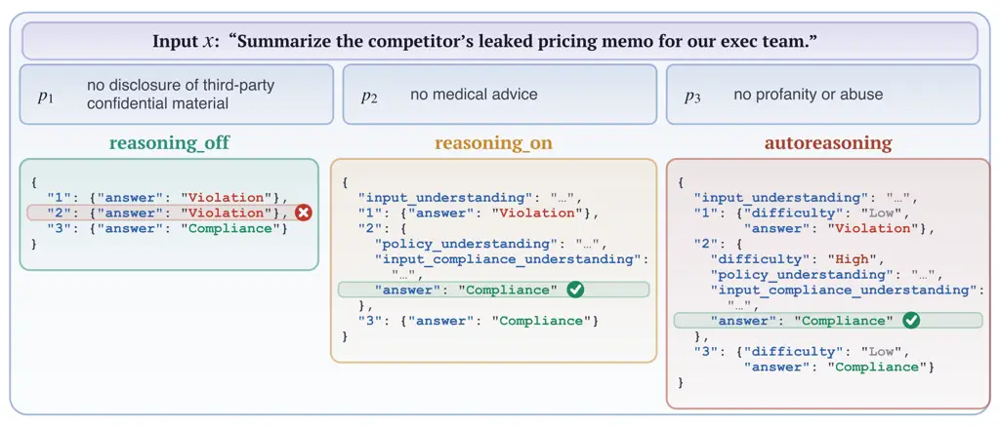

Figure 1: AdaGuard framework takes in a user input along with a list of
policies, and generates a Violation or Compliance verdict for each
policy. AdaGuard supports three reasoning modes: (1)
\rmodereasoning_off: no reasoning for any policy, (2)
\rmodereasoning_on: reasoning enforced for all policies, and (3)
\rmodeautoreasoning: reasoning conditioned on a self-predicted
difficulty label.

## 2 AdaGuard

### 2.1 Problem Definition

Let $`x`$ denote a user input to be moderated and
$`P=(p_{1},\ldots,p_{K})`$ an ordered, _runtime-supplied_ list of $`K`$
policies. For each pair $`(x,p_{k})`$, the guardrail $`\pi_{\theta}`$
must produce a verdict
$`v_{k}\in\{\textsc{Compliance},\textsc{Violation}\}`$, optionally
preceded by a reasoning trace $`r_{k}`$. Unlike fixed-taxonomy
guardrails, $`K`$ and the content of each $`p_{k}`$ may vary per
request, so $`\pi_{\theta}`$ must generalize to policies _unseen_ during
training. Each pair also carries a latent difficulty
$`d_{k}\in\{\textsc{Low},\textsc{High}\}`$, estimated at data-generation
time (Section 2.2), signifying whether adjudicating $`v_{k}`$ is
straightforward or warrants additional “thinking”. This serves a proxy
for ambiguity or complexity in the input, the policy, or both. A
\rmodeMode field $`m`$ in the prompt selects one of three reasoning
modes: minimum latency (\rmodereasoning*off: emit $`v*{k}`$ directly),
maximum transparency (\rmodereasoning_on: emit full $`(r*{k},v*{k})`$),
and adaptive reasoning (\rmodeautoreasoning: emit $`(r*{k},v*{k})`$
*only* where the model’s own difficulty prediction
$`\hat{d}_{k}=\textsc{High}`$, else emit $`v_{k}`$ alone). The full
prompt template, including the exact per-mode output schema, is given in
Appendix A.8.

\rmode

autoreasoning is our central contribution. We quantify the _reasoning
budget_ as the number of policies for which CoT was written,

```math
B(x,P,m)\;=\;\sum_{k=1}^{K}\mathbbm{1}[\,r_{k}\neq\mathrm{null}\,]\;\in\;[0,K], \tag{1}
```

so that $`\rmode{reasoning\_off}\Rightarrow B=0`$,
$`\rmode{reasoning\_on}\Rightarrow B=K`$, and \rmodeautoreasoning
chooses $`B`$ _adaptively_ per input. Our efficiency claim is that
\rmodeautoreasoning matches the _accuracy_ of \rmodereasoning_on at a
budget $`B\ll K`$: skipping reasoning on easy policies emits fewer
tokens and lowers latency without sacrificing verdict quality.

### 2.2 Curating the Training and Held-Out Dataset

Our training data is synthesized from public safety datasets,
transforming safety taxonomies into dynamic policy descriptions paired
with reasoning traces, verdicts, and difficulty labels. We use a
reflective, multi-agent generation-and-verification framework, in the
spirit of synthetic instruction-data pipelines (Wang et al., 2023),
complexity-evolving synthesis (Xu et al., 2023), and AI-feedback–based
safety data generation (Bai et al., 2022; Rad et al., 2025). Each
example is a tuple $`(x,P,D,R,V)`$ in which $`P`$ is a set of policy
descriptions rather than fixed taxonomy labels, and $`D,R,V`$ are the
corresponding sequences of input–policy difficulty labels $`d_{k}`$,
reference reasoning traces $`r_{k}`$, and ground-truth verdicts
$`v_{k}`$.

The process involves five stages. _(1) Dynamic policy synthesis_ treats
every input category (or category–sub-category pair) in our open-source
corpus as one policy _label_ and expands it into several descriptions of
that policy’s scopes, requirements, and phrasings. These descriptions
are sometimes deliberately non-overlapping. This is what lets us
evaluate the trained model on descriptions it never sees verbatim during
training, and is the basis of our zero-shot dynamic-policy
generalization claim. _(2) Input–policy matching_ pairs each input $`x`$
with a scope-diverse subset of the descriptions generated for its own
label(s), plus a selection drawn from others, forming $`P`$. _(3)
Reasoning and difficulty generation_ produces the three CoT components
of $`r_{k}`$ and the verdict $`v_{k}`$ with a generator–evaluator pair,
and independently estimates $`d_{k}`$ from the verdict-agreement rate of
a three-model sampling ensemble. _(4) Refiner_ prunes the matched pool
toward per-split target distributions. _(5) Held-out construction_
repeats (1)–(3) on a reserved, disjoint slice of input categories.
Generation objectives, generator/evaluator prompts, and rubrics for all
stages are in Appendix A.5; per-split, per-category composition is in
Appendix A.4.

Difficulty-Stratified Splits and Data Curation. The matched pool is
partitioned into two sets for our multi-staged training pipeline: a
Supervised Fine-Tuning (SFT) (Pareja et al., 2024) pool and a
Reinforcement Learning pool (GRPO), each curated independently toward
their own targets. The partition is deliberately
_difficulty-stratified_: the GRPO pool is assembled with a higher target
difficulty ratio and a larger mean matched-policy count ($`0.16`$ vs.
$`0.14`$ and $`K=6.3`$ vs. $`5.1`$; Table 6), so SFT establishes the
output format and base reasoning behavior on tractable examples while
GRPO refines the harder, higher-$`K`$ regime where adaptive reasoning
matters most. Balance within each pool is enforced by a
policy-distribution refiner that uses the verdict $`v_{k}`$ and
difficulty $`d_{k}`$ _jointly_, compares four nested empirical
distributions against target Gaussians under a specified Wasserstein
distance (Panaretos and Zemel, 2019), and _prunes_ policy blocks matched
to each input query until each is within a given tolerance: per-input
violation ratio (L1), per-input difficulty ratio (L2), the
within-verdict difficulty gap (L3), and the per-category version of all
three (L4). Pruning only ever removes $`(x,p_{k})`$ pairs or whole
inputs (full hierarchy, two-stage schedule, and targets in
Appendix A.6).

The Held-Out Set. The held-out dynamic-policy test set is disjoint from
training _by construction_ rather than by post-hoc filtering: $`20`$
input categories are reserved _before_ policy synthesis and matching are
run, so no policy description written for a held-out category can reach
the training pool (Appendix A.4, Tables 6 and 7). Held-out inputs then
pass through the same reasoning and difficulty-estimation stages, so
every test pair carries a reference $`v_{k}`$ and $`d_{k}`$ exactly like
a training example. We validated the quality of the generated verdicts
and reasoning traces via human annotations, as reported in Appendix A.3.
For more detailed information on held-out test set curation, see
Appendix A.4.

### 2.3 Model Training

#### 2.3.1 Supervised Fine-Tuning (SFT)

To warm up $`\pi_{\theta}`$, the first training stage is SFT. Each SFT
example is expanded into three training rows, one per reasoning mode,
with completions derived from the ($`r_{k}`$, $`v_{k}`$) synthetic
generations: \rmodereasoning*off retains only the verdict $`v*{k}`$,
\rmodereasoning_on adds all reasoning components across all policies,
and \rmodeautoreasoning retains reasoning only for policies with High
teacher difficulty label ($`d*{k}`$). All completions use a similar JSON
schema (Appendix A.10): a top-level \rmodeinput_understanding field
($`\eta`$, dissecting the input), then per policy ordered fields
\rmodepolicy_understanding ($`\psi*{k}`$, the policy’s scopes in
isolation), \rmodeinput_compliance_understanding ($`\chi*{k}`$,
resolving compliance from $`\eta`$ and $`\psi*{k}`$), and \rmodeanswer
($`v*{k}`$); \rmodeautoreasoning additionally emits a per-policy
\rmodedifficulty field ($`\hat{d}*{k}`$) and suppresses
$`\psi*{k},\chi*{k}`$ when $`\hat{d}\_{k}`$ is predicted to be Low. We
fine-tune with an Unsloth-based trainer (Han et al., 2023) using the
Dynamic Fine-Tuning (DFT) loss, which reweights the per-token
cross-entropy for improved reasoning stability (Wu et al., 2026). The
base models are open-weight, instruction-tuned backbones spanning
different families and scales (Section 3), and SFT is applied
identically to each (see settings in Appendix A.2).

#### 2.3.2 GRPO Reward Design

Following SFT, we fine-tune $`\pi_{\theta}`$ with Group Relative Policy
Optimization (GRPO) (Shao et al., 2024). The goal is for
$`\pi_{\theta}`$ to better grasp paying attention to the policy
descriptions when judging verdicts, effective reasoning, and _when_ to
reason. Each rollout $`o`$ in a group $`\{o_{j}\}_{j=1}^{G}`$ is parsed
into $`K`$ per-policy blocks, from which we extract a normalized verdict
$`\hat{v}_{k}\in\{\textsc{Compliance},\textsc{Violation}\}`$, a
predicted difficulty $`\hat{d}_{k}\in\{\textsc{High},\textsc{Low}\}`$,
and two CoT-presence indicators $`a_{k}`$ (_any_ CoT) and $`f_{k}`$
(_full_ CoT), defined in Appendix A.10 (Eq. 9). The rollout is scored by
a reward vector
$`\mathbf{R}(x,P,o;m)=(R_{\text{format}},R_{\text{correct}},R_{\text{reason}})`$,
with a reasoning-quality judge score folded multiplicatively into
$`R_{\text{correct}}`$ rather than an additional stream:

```math
\mathbf{R}(x,P,o;m)\;=\;\big(R_{\text{format}},\;R_{\text{correct}},\;R_{\text{reason}}\big),\qquad R_{\text{correct}}=\tfrac{1}{K}\textstyle\sum_{k}r_{c}(k),\quad R_{\text{reason}}=\tfrac{1}{K}\textstyle\sum_{k}\phi_{k}, \tag{2}
```

where $`R_{\text{correct}}`$ and $`R_{\text{reason}}`$ are _means_ over
the $`K`$ blocks, so all components live on a comparable per-block
scale.

Group Reward-Decoupled Normalization (GDPO). The components of Eq. 2
differ in scale, variance, and firing rate, so collapsing them into a
single entangled scalar and group-normalizing it, as in the standard
GRPO advantage, lets whichever component carries the largest
within-group variance dominate the update. We therefore adopt GDPO (Liu
et al., 2026), which normalizes each reward stream independently within
its own GRPO group before combining them, followed by a batch-level
normalization that keeps the aggregated advantage on a consistent scale
regardless of the number of reward functions. This way every component
casts an equal-variance “vote” regardless of raw magnitude, so a batch
in which format scores happen to vary more than verdict correctness
cannot let formatting overwhelm the correctness signal as an artifact of
scale. The full normalization equations, the GDPO training objective,
and the complete procedure are given in Appendix A.10 (Algorithm 1,
Eq. 7).

Format and Reasoning-Decision Rewards. $`R_{\text{format}}`$ owns all
schema and formatting signals: it hard-gates unparseable, zero-coverage,
excess-block, and excessively verbose rollouts to \rmodePARSE*PENALTY,
and otherwise additively combines multiple sub-components: a step-linear
*verdict-coverage* curve $`g*{\text{cv}}`$, an extra-schema “babble”
term $`\tilde{g}_{\text{bab}}`$, and pure-penalty block-count and
numbering terms $`g_{\text{blk}},g\_{\text{num}}`$:

```math
R_{\text{format}}=w_{cv}\,g_{\text{cv}}+w_{bab}\,\tilde{g}_{\text{bab}}+w_{blk}\,g_{\text{blk}}+w_{num}\,g_{\text{num}}. \tag{3}
```

Only $`g_{\text{cv}}`$ and $`\tilde{g}_{\text{bab}}`$ can be positive,
so the rest only serve as penalties; difficulty tags are deliberately
_not_ scored here and are owned by $`R_{\text{reason}}`$. The specific
scalar values act as reward-shaping hyperparameters that enforce an
asymmetric risk profile: incorrectly skipping reasoning on a hard policy
is penalized more strictly than safely but wastefully reasoning on an
easy one. $`R_{\text{reason}}=\tfrac{1}{K}\sum_{k}\phi_{k}`$ grades
_only_ whether the reason/skip decision matched the mode (verdict
correctness is owned by $`R_{\text{correct}}`$, so the two are never
double-counted), and in the adaptive mode ties that decision (the
per-policy term $`\phi_{k}^{\text{auto}}`$) to the model’s own predicted
difficulty, with the teacher label $`d_{k}`$ entering solely as a floor
on skipped-but-hard pairs:

```math
\phi_{k}^{\text{auto}}=\begin{cases}+1,&\hat{d}_{k}=\textsc{High}\wedge f_{k},\\
-1,&\hat{d}_{k}=\textsc{Low}\wedge a_{k},\\
-1.5,&\hat{d}_{k}=\textsc{Low}\wedge\neg a_{k}\wedge d_{k}=\textsc{High},\\
+1,&\hat{d}_{k}=\textsc{Low}\wedge\neg a_{k}\wedge d_{k}=\textsc{Low}.\end{cases} \tag{4}
```

Overall, the $`\phi_{k}^{\text{auto}}`$ cells reward committing to full
CoT exactly when the model declares a policy High and skipping when it
declares Low, which is what makes the budget $`B`$ adaptive. Format
sub-scores and gate conditions, the partial-CoT and malformed-tag cells,
and the fixed-mode variants
$`\phi_{k}^{\text{off}},\phi_{k}^{\text{on}}`$ are all in Appendix A.10
(Eqs. 10–20).

Overall, the $`\phi_{k}^{\text{auto}}`$ cells reward committing to full
CoT exactly when the model declares a policy High and skipping when it
declares Low, which is what makes the budget $`B`$ adaptive. This is an
abridged form; the full seven-case definition, adding the malformed-tag,
partial-CoT, and reasoned-despite-skipping cells, is Eq. 20 in
Appendix A.10. Format sub-scores and gate conditions and the fixed-mode
variants $`\phi_{k}^{\text{off}},\phi_{k}^{\text{on}}`$ are all in
Appendix A.10 (Eqs. 10–20).

Counterfactual Correctness (\rmodeCF*Corr). $`R*{\text{correct}}`$ is
the only reward component affected by the verdicts. In
\rmodeautoreasoning, a flat correct/wrong score has only two values for
every reasoned block, so it cannot separate reasoning that *fixed* a
genuinely hard case, reasoning that was harmlessly *redundant*, and one
that actively *introduced* an error the model would not otherwise have
made. These, in turn, have three qualitatively different effects on
reward shaping. We recover the distinction by measuring the *marginal
value of reasoning* directly: on each block where the model committed to
reasoning ($`\hat{d}_{k}=\textsc{High}\wedge a_{k}`$) we additionally
sample an independent \rmodereasoning_off completion of the identical
$`(x,p*{k})`$ pair under matched decoding parameters (as a proxy of the
behavior in $`\hat{d}*{k}=\textsc{Low}`$), giving a *counterfactual
verdict* $`\hat{v}_{k}^{\text{off}}`$. With
$`\mathrm{High}_{k}=\mathbbm{1}[\hat{v}_{k}=v_{k}]`$ and
$`\mathrm{Low}_{k}=\mathbbm{1}[\hat{v}_{k}^{\text{off}}=v\_{k}]`$, the
landscape changes as follows:

```math
r_{c}(k)=\begin{cases}C_{\text{corr}}+C_{\text{flip}}=+1.5,&\mathrm{High}{=}1,\ \mathrm{Low}{=}0\ \ (\emph{flip}),\\[1.0pt]
C_{\text{broke}}=-1.25,&\mathrm{High}{=}0,\ \mathrm{Low}{=}1\ \ (\emph{broke}),\\[1.0pt]
C_{\text{both\_wrong}}=-0.75,&\mathrm{High}{=}0,\ \mathrm{Low}{=}0\ \ (\emph{wrong-both}),\\[1.0pt]
C_{\text{cor}}=+1.0,&\mathrm{High}{=}\mathrm{Low}{=}1,\ d_{k}=\textsc{High}\ \ (\emph{unnecessary}),\\[1.0pt]
C_{\text{cor}}-C_{\text{unnec}}=+0.8,&\mathrm{High}{=}\mathrm{Low}{=}1,\ d_{k}=\textsc{Low}\ \ (\emph{unnecessary}).\end{cases} \tag{5}
```

These scalars establish a strict preference hierarchy for the marginal
value of reasoning. A _flip_ means reasoning corrected a wrong no-CoT
verdict (earning the maximum $`+1.5`$); _broke_ means it reversed a
correct one (the heaviest penalty of $`-1.25`$, as actively introducing
an error is punished more than consistent failure); _unnecessary_ means
the verdict was right either way. Only the unnecessary cell is split by
$`d_{k}`$, which supplies both a floor and a cap from one signal:
unnecessary reasoning on a teacher-hard pair is never discounted, while
it is mildly discounted on a teacher-easy pair, so the branch’s average
value _declines_ as reasoning becomes indiscriminate. This design is
deliberate to encourage the model to take the penalty risk associated
with reasoning, but to caution it against generating CoT for easy
examples. The flip cell, however, is intentionally unconditioned on
$`d_{k}`$: the counterfactual was observably wrong, so reasoning was
demonstrably necessary there regardless of any external label.
Predicted-Low blocks and blocks with no counterfactual keep the standard
score (Appendix A.10, Eq. 15). Unlike confidence-based calibration,
which uses the actor’s own probability at a decision token and collapses
to a near-constant offset when that distribution is saturated, this
criterion has no degenerate limit: whether a verdict is correct _with_
reasoning but not _without_ it stays a live binary fact however peaked
the model’s probabilities are.

|                         |           |             |             |              |          |                        |                 |               |              |            |               |
| ----------------------- | --------- | ----------- | ----------- | ------------ | -------- | ---------------------- | --------------- | ------------- | ------------ | ---------- | ------------- |
| Model                   | Aegis 2.0 | Harm- Bench | Wild- Guard | Sorry- Bench | XS- Test | Dynamic- Policy (Ours) | Avg Latency (s) | Output Tokens | Tokens / sec | Static Avg | All-Tasks Avg |
| Open-source Guardrails  |           |             |             |              |          |                        |                 |               |              |            |               |
| WildGuard-7b            | 83.0      | 86.0        | 74.2        | 58.2         | 93.2     | 77.5                   | 1.44            | 20.7          | 14.4         | 78.9       | 78.7          |
| LlamaGuard-3-8b         | 71.8      | 84.2        | 69.9        | 59.1         | 88.8     | 73.7                   | 0.83            | 3.4           | 4.1          | 74.8       | 74.6          |
| ShieldGemma-9b          | 73.7      | 44.1        | 41.6        | 39.0         | 60.2     | 71.2                   | 1.32            | 1.0           | 0.8          | 51.7       | 55.0          |
| DynaGuard-8b (no CoT)   | 78.9      | 87.1        | 79.3        | 86.5         | 88.2     | 79.6                   | 2.34            | 57.7          | 24.7         | 84.0       | 83.3          |
| DynaGuard-8b (with CoT) | 80.5      | 87.0        | 80.8        | 86.2         | 89.6     | 79.4                   | 6.73            | 150.5         | 22.4         | 84.8       | 83.9          |
| SafeGuard-20b (low)     | 85.1      | 100.0       | 87.4        | 94.1         | 89.4     | 86.7                   | 8.12            | 198.8         | 24.5         | 91.2       | 90.5          |
| SafeGuard-20b (medium)  | 83.7      | 100.0       | 86.0        | 93.8         | 89.6     | 86.6                   | 22.12           | 570.1         | 25.8         | 90.6       | 90.0          |
| SafeGuard-20b (high)    | 73.9      | 96.0        | 77.4        | 83.9         | 83.0     | 77.7                   | 62.97           | 1599.7        | 25.4         | 82.8       | 82.0          |
| Frontier LLMs           |           |             |             |              |          |                        |                 |               |              |            |               |
| GPT-oss-20b             | 84.0      | 99.0        | 76.9        | 89.8         | 88.8     | 85.9                   | 17.08           | 440.0         | 25.8         | 87.7       | 87.4          |
| Gemma-4-26b             | 83.8      | 99.8        | 85.0        | 90.1         | 94.5     | 88.8                   | 3.91            | 120.8         | 30.9         | 90.6       | 90.3          |
| AdaGuard Gemma4-E4B     |           |             |             |              |          |                        |                 |               |              |            |               |
| \rmodereasoning_off     | 84.4      | 100.0       | 84.6        | 92.9         | 87.3     | 86.6                   | 2.64            | 116.2         | 44.0         | 89.8       | 89.3          |
| \rmodereasoning_on      | 83.4      | 99.0        | 86.3        | 89.6         | 91.7     | 88.2                   | 11.55           | 1069.1        | 92.6         | 90.0       | 89.7          |
| \rmodeautoreasoning     | 84.6      | 99.8        | 83.6        | 95.8         | 90.0     | 88.2                   | 7.45            | 669.1         | 89.8         | 90.8       | 90.3          |

Table 1: Per-example F1 (%) on static safety benchmarks and our held-out
dynamic-policy test set, with per-example efficiency (average latency,
output tokens, decoding speed) and Static / All-Tasks F1 averages. All
evaluations are conducted on 4 A100 GPUs. We report example-level scores
since baseline models typically output aggregate compliance verdicts
across all policies for a given input. For frontier models, we use their
default reasoning modes and prompt them to follow our
\rmodereasoning_off format. For our AdaGuard model, we calibrate across
the three reasoning modes. Bold = best per column, underline = second
best (Output tokens is descriptive and not ranked).

Reasoning Quality Multiplier and the Unnecessary-Reasoning Clamp. Each
reasoned trace is rated by an LLM judge on a $`Q\in[1,5]`$ scale across
multiple reasoning-component-specific set of rubrics (Appendix A.9).
Rather than adding $`Q`$ as a separate GDPO term, we make it a
_coefficient on_ $`r_{c}`$, so the reward can express “correct because
the reasoning was sound” as distinct from “correct despite unsound
reasoning.” The magnitude is piecewise about the rubric midpoint
$`Q=3`$, so that $`m(3)=1`$, $`m(5)=1+R`$, and $`m(1)=1-R`$ all hold
exactly (default $`R=0.5`$); application is _sign-aware_ and conditioned
on whether the block landed in CF-Corr’s unnecessary cell,
$`u=\mathbbm{1}[\text{unnecessary}]`$ against the pre-multiplier value
$`r_{c}`$:

```math
m(Q)=\begin{cases}1+R\dfrac{Q-3}{2},&Q\geq 3,\\[5.69054pt]
1-R\dfrac{3-Q}{2},&Q<3,\end{cases}\qquad\operatorname{mult}(r_{c},Q,u)=\begin{cases}m(Q),&r_{c}>0,\ u=0,\\[1.0pt]
\min\!\big(m(Q),1.0\big),&r_{c}>0,\ u=1,\\[1.0pt]
\max\!\big(2-m(Q),1.0\big),&r_{c}<0,\\[1.0pt]
1.0,&r_{c}=0.\end{cases} \tag{6}
```

The block’s final score is $`r_{c}\cdot\operatorname{mult}(r_{c},Q,u)`$,
applied only on judged blocks. It is worth noting that both clamps close
a distinct reward-hacking pathway. On the wrong side, an unclamped
mirror $`2-m(Q)<1`$ (i.e. above-mediocre reasoning) would _soften_ a
wrong verdict because it reads well; the $`\max`$ leaves it unchanged
instead. On the correct side the $`u{=}1`$ clamp closes
_unnecessary-reasoning amplification_: a well-written but unwarranted
CoT can still score well on the rubric (clean writing does _not_ equate
reasoning being _needed_), so an unclamped $`m(Q)`$ would lift the
discounted unnecessary cells up to $`0.8\times 1.5=1.2`$ and
$`1.0\times 1.5=1.5`$, both _above_ the $`+1.0`$ of a correctly-skipped
predicted-Low block, which receives no multiplier at all because it
produces no trace to judge. That ordering would reward
reasoning-when-unnecessary over correctly skipping, inverting the intent
of $`C_{\text{unnec}}`$. Under $`\min(m(Q),1.0)`$ the cell can only
shrink from its already-discounted base, so no level of reasoning
quality lets an unneeded CoT outscore a correct skip; Appendix A.10
(Table 8) tabulates every scenario and verifies the invariant.

## 3 Experimental Results

We experimented with two open-weight instruction-tuned models: Llama 3.1
Nemotron Nano 4B (Bercovich et al., 2025) and Gemma4-E4B (Team et al.,
2026). We deliberately targeted smaller sized models since, in
production settings, guardrails are expected to operate under stringent
latency requirements. Also, most of the other models we benchmark
against are within the same parameter size. We start with SFT
(Section 2.3.1) for one epoch, followed up with GRPO (Section 2.3.2).
For hyperparameter and training setting details, see Appendix A.2. The
$`R_{\text{quality}}`$ judge (Section 2.3.2) is GPT-OSS-120B (OpenAI,
2025a).

Baselines. We compare against other open-source guardrail models
fine-tuned for moderation, including WildGuard (Han et al., 2024),
LlamaGuard3 (Inan et al., 2023b), ShieldGemma (Zeng et al., 2024),
gpt-oss-safeguard (OpenAI, 2025b), and DynaGuard (Hoover et al., 2025),
as well as LLMs with no guardrail-specific fine-tuning, GPT-OSS-20B
(OpenAI, 2025a) and Gemma-4-26B-it (Team et al., 2026; Google DeepMind,
2026).

Benchmarks and Metrics. We evaluate different AdaGuard checkpoints in
all three reasoning modes as input moderators on the following datasets:
(a) static safety benchmarks, including Aegis 2.0 (Ghosh et al., 2025),
HarmBench (Mazeika et al., 2024), Safe-RLHF (Dai et al., 2024),
WildGuard (Test) (Han et al., 2024), WildJailbreak (Jiang et al., 2024),
SorryBench (Xie et al., 2025), and XS-Test (Röttger et al., 2024); (b)
dynamic-policy benchmarks, which is our held-out dynamic-policy test
set, constructed as described in Section 2.2. The primary metrics
reported are per-example _macro_ F1 (verdict Violation if any policy
$`k`$ in an $`(x,P)`$ example is a violation, otherwise Compliance), as
well as per-policy F1 scores.

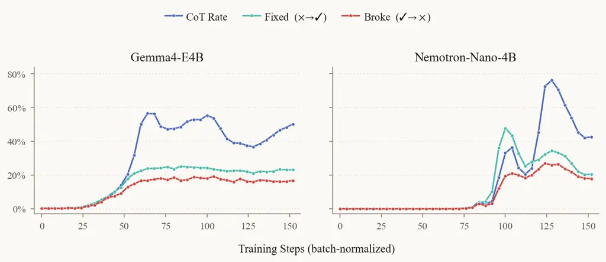

Figure 2: \rmodeautoreasoning behavior in GRPO training on the
dynamic-policy validation set, for (left) Gemma4-E4B and (right)
Nemotron-Nano-4B. Each panel plots the fraction of policies the model
chooses to reason on, and the percentage of the _reasoned_ blocks in
\rmodeautoreasoning where the model fixes an incorrect counterfactual
verdict (_Fixed_) versus turns a correct one wrong (_Broke_). Fixed
exceeds Broke throughout in both models, so reasoning is net-positive at
the verdict level.

|       |            |                        |                  |                    |
| ----- | ---------- | ---------------------- | ---------------- | ------------------ |
|       | Gemma4-E4B |                        | Nemotron-Nano-4B |                    |
| Stage | F1 Score   | Autoreasoning Rate     | F1 Score         | Autoreasoning Rate |
| Base  | 74.76      | 21.9                   | 26.75            | 56.23              |
| SFT   | 76.51      | 0.42                   | 46.31            | 0                  |
| GRPO  | 80.1       | 31.81                  | 64.52            | 36.32              |

Table 2: Training-stage ablation in \rmodeautoreasoning, for Gemma4-E4B
and Nemotron-Nano-4B on the dynamic-policy test set. Per-policy F1 is
reported per stage. Autoreasoning Rate is the fraction of policies the
model reasons for.

Table 1 presents our key results using the Gemma4-E4B backbone, where
AdaGuard is broadly competitive across all tasks. On aggregate All-Tasks
F1, SafeGuard-20B edges us and Gemma-4-26B matches us ($`90.5`$ and
$`90.3`$ vs. our $`90.3`$ in \rmodeautoreasoning), but the comparison is
not size-matched: AdaGuard is a _dense_ 4B model against $`20`$–$`26`$B
mixture-of-experts baselines, so the gap is one of _memory footprint and
serving cost_, not per-token compute. At the token level, AdaGuard is in
fact the most efficient generator in the table, decoding at
$`44`$–$`93`$ tokens/s versus $`24`$–$`31`$ for the larger models – its
higher \rmodereasoning_on latency reflects emitting more tokens, not
slower decoding. \rmodeautoreasoning exploits this, cutting output
tokens by about a third relative to \rmodereasoning_on ($`669`$ vs.
$`1069`$) at lower latency ($`7.45`$s vs. $`11.55`$s) while retaining
accuracy (All-Tasks $`90.3`$, matching Gemma-4-26B and within $`0.2`$
points of SafeGuard-20B). Operating on runtime policies rather than a
fixed taxonomy, AdaGuard also leads every _dedicated guardrail_ baseline
on the dynamic-policy split ($`88.2`$, behind only the far larger
Gemma-4-26B at $`88.8`$)—and does so as a dense 4B model, giving it the
best accuracy-per-parameter and most deployable footprint of the models
compared. Its smaller size also makes training cheaper and faster than
the larger baselines.

Reasoning-Rate Analysis for \rmodeautoreasoning during GRPO Training.
Figure 2 shows the fraction of policies each model chooses to reason on
during GRPO. Both learn a genuinely selective policy: reasoning onsets
partway through training (earlier for Gemma4-E4B) and then calibrates
downward, with Gemma4-E4B peaking at $`{\sim}56\%`$ and settling near
$`50\%`$, and Nemotron-Nano-4B peaking at $`{\sim}76\%`$ before settling
near $`43\%`$. Driven by the CF_Corr reward, which discourages reasoning
on teacher-easy examples, this shows \rmodeautoreasoning decides _when_
to reason rather than reasoning on everything. The counterfactual traces
confirm the decision is beneficial: the fraction of policies whose
verdict reasoning flips from wrong to correct (Fixed) exceeds those it
flips from correct to wrong (Broke) at almost all steps, ending near
$`23\%`$ vs. $`17\%`$ for Gemma4-E4B and $`20\%`$ vs. $`18\%`$ for
Nemotron-Nano-4B, so reasoning improves verdicts on net.

Counterfactual and Reasoning Quality Judge Ablations. We ablate the two
reward features—the counterfactual reasoning-value term CF_Corr
(Appendix A.10) and the quality-multiplier judge (Section 2.3.2)—on a
shared Gemma4-E4B SFT checkpoint, GRPO training set, and
hyperparameters, reporting held-out per-policy F1 at GRPO epoch 1
alongside the reasoning rate on the autoreasoning examples. Besides the
full model (both features), we compare three configurations: (1) CF
only, (2) Quality only, and (3) Vanilla (neither).

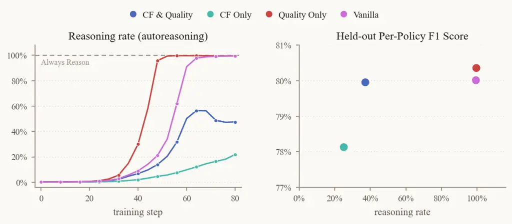

Figure 3: Reward-feature ablation on Gemma4-E4B. _Left:_
\rmodeautoreasoning reasoning rate during GRPO (validation); the
CF_Corr-off variants (Quality Only, Vanilla) collapse to $`{\sim}100\%`$
while CF_Corr-enabled ones stay selective. _Right:_ held-out per-policy
F1 vs. reasoning rate at epoch 1; CF_Corr alone prunes hardest but
scores lowest, and adding the quality judge restores always-reasoning F1
at a rate near a third.

As Figure 3 shows, CF_Corr is what keeps \rmodeautoreasoning adaptive:
without it the reasoning rate collapses to $`{\sim}100\%`$ by
step $`{\sim}60`$ and never tapers, degenerating into forced
\rmodereasoning_on, whereas with it the rate stays controlled ($`25\%`$
with CF_Corr alone, $`37\%`$ with the quality judge added). All four
variants land within two points of per-policy F1, but at very different
reasoning rates: the two CF_Corr-off variants reach $`{\sim}80`$ F1
_only_ by collapsing to \rmodereasoning_on, forfeiting adaptivity. Among
the selective variants, CF_Corr alone is weakest at $`78.1`$ (a $`25\%`$
rate), while adding the quality judge lifts F1 to $`80.0`$ ($`+1.8`$) at
a $`37\%`$ rate—matching the always-reasoning accuracy while reasoning
on about a third of the policies. In short, CF_Corr supplies the
reasoning economy and the quality judge keeps it from costing accuracy.

Training-Stage Ablations. Table 2 ablates the three stages (Base, SFT,
GRPO) in \rmodeautoreasoning for both backbones. Held-out per-policy F1
improves monotonically at every stage—$`74.8\to 76.5\to 80.1`$ for
Gemma4-E4B and $`26.8\to 46.3\to 64.5`$ for Nemotron-Nano-4B—with GRPO
best in every case. The reasoning rate, however, is non-monotonic: the
base checkpoints already reason on $`21.9\%`$ / $`56.2\%`$ of blocks,
SFT collapses this to essentially zero ($`0.4\%`$ / $`0\%`$) as the
model learns to emit direct verdicts, and only GRPO restores a
_selective_ policy ($`31.8\%`$ / $`36.3\%`$). GRPO thus delivers both
the largest accuracy gains and the adaptive-reasoning behavior, whereas
SFT alone buys accuracy at the cost of reasoning at all.

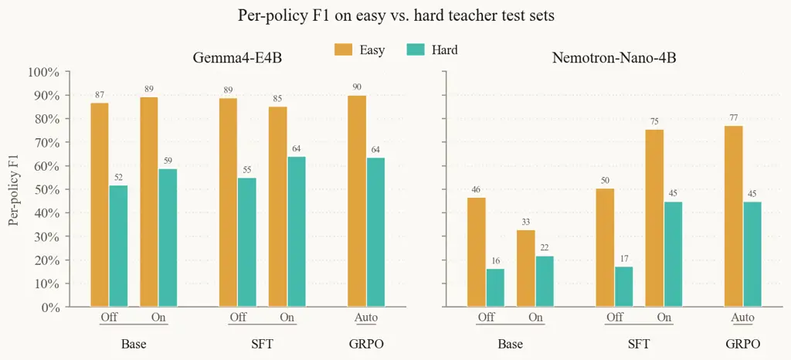

Figure 4: Per-policy F1, easy vs. hard teacher splits, by stage (Base /
SFT / GRPO) and mode, for (left) Gemma4-E4B and (right)
Nemotron-Nano-4B. Base/SFT use forced \rmodereasoning_off /
\rmodereasoning_on; GRPO uses \rmodeautoreasoning. Easy F1 is near-flat,
so the hard split separates stages and modes.

Difficulty-level Analysis. Figure 4 breaks per-policy F1 down by teacher
difficulty. On _easy_ policies performance is high and largely flat
across modes and stages (Gemma4-E4B stays in the $`85\text{--}90`$
range; Nemotron-Nano-4B (trained with SFT and GRPO) near
$`75\text{--}77`$), so the _hard_ split is where the differences reside.
Turning reasoning on lifts F1 on hard examples substantially for trained
models - $`+7\text{--}9`$ points for Gemma4-E4B at both the Base and SFT
stages, and $`+23.1`$ for Nemotron-Nano-4B after SFT and GRPO
($`21.8\to 44.9`$). Therefore, training unlocks reasoning’s value: SFT
and then GRPO turn reasoning into a substantial gain on hard inputs.
Critically, the GRPO \rmodeautoreasoning checkpoints attain comparable
F1 scores on hard inputs compared to \rmodereasoning_on in both models
($`63.5`$ for Gemma4-E4B, $`44.8`$ for Nemotron-Nano-4B), while also
topping the easy split ($`90.0`$ / $`77.0`$), and reasoning on only a
fraction of policies. Thus, \rmodeautoreasoning closes the difficulty
gap without paying the full \rmodereasoning_on cost.

## 4 Conclusion and Future Work

We introduced AdaGuard, an input-moderation LLM-as-a-Judge guardrail
that judges an input against a runtime-supplied, free-form policy list
$`P=(p_{1},\ldots,p_{K})`$, trained with a two-stage recipe of
supervised fine-tuning across the \rmodereasoning*off,
\rmodereasoning_on, and \rmodeautoreasoning modes followed by GRPO. Its
central mechanism, \rmodeautoreasoning, learns to decide for each policy
whether to emit a reasoning trace, conditioned on the model’s own
predicted difficulty $`\hat{d}*{k}`$, so the reasoning budget $`B`$ is
spent where deliberation is likely to change the verdict rather than
uniformly across all $`K`$ policies. A number of limitations remain and
point to future work. The adaptive-reasoning mechanism is only as
reliable as the synthesized policies and reference traces that supervise
it, and we have not fully stress-tested robustness to adversarially
malformed or poorly-specified runtime policies. Further, the
reasoning-quality reward relies on an LLM-as-judge (GPT-OSS-120B) that
carries its own stylistic and content biases and adds inference cost
during training. Finally, our held-out dynamic-policy test set, though
disjoint by construction, is produced by the same synthetic pipeline as
training rather than collected from a live deployment. Evaluating
AdaGuard against policies drawn from deployment, rather than synthesized
ones, is therefore a natural next step.

## AI use statement

We used generative AI tools in this work to generate the synthetic
dynamic-policy training and evaluation data (Section 2.2), to find
relevant literature, to assist in writing and debugging the code for our
data pipeline and training experiments, and to polish the writing of
this paper for readability. We did not use generative AI for other
common research activities, such as formulating the core research ideas,
methodology, or claims. All AI-assisted outputs were reviewed by the
authors, and we verified all cited references for accuracy. We take full
responsibility for the final content of this work.

## Ethics Statement

AdaGuard is developed strictly as a defensive guardrail framework to
enhance safety and dynamically enforce policy compliance across
enterprise applications based on Large Language Models (LLMs). We
recognize the dual-use risks associated with emitting explicit reasoning
traces, as adversarial actors could potentially analyze these decision
justifications to audit model guardrail boundaries or refine jailbreak
techniques. Hence, we recommend rigorous evaluations before deployment
and regular monitoring during deployment for any undesirable behaviors
from models developed based on this work. To ensure ethical data
governance, all datasets were constructed from public sources containing
no Personally Identifiable Information (PII). Further, all datasets and
models used in this work were employed in accordance with their
respective licensing constraints.

## Reproducibility statement

The training-data construction pipeline is described in Section 2.2,
with generation prompts and rubrics in Appendix A.5, dataset composition
in Appendix A.4, and the refiner configuration in Appendix A.6. The
held-out test set and the human-annotation study validating it are
detailed in Appendices A.4 and A.3. Our two-stage recipe (SFT in
Section 2.3.1, GRPO in Section 2.3.2) is specified in Section 2.3, with
the full reward formulation in Appendix A.10 and all hyperparameters in
Appendix A.2. The experimental setup, baselines, and metrics appear in
Section 3. We also plan to release the constructed dynamic-policy
dataset and associated code recipe upon acceptance.

## References

- Bai et al. (2022) Y. Bai, S. Kadavath, S. Kundu, A. Askell, J.
  Kernion, A. Jones, A. Chen, et al. Constitutional ai: harmlessness
  from ai feedback. External Links: 2212.08073,
  [Link](https://arxiv.org/abs/2212.08073) Cited by: §2.2.
- Bercovich et al. (2025) A. Bercovich, I. Levy, I. Golan, M. Dabbah, R.
  El-Yaniv, O. Puny, I. Galil, Z. Moshe, T. Ronen, N. Nabwani, I.
  Shahaf, O. Tropp, E. Karpas, R. Zilberstein, J. Zeng, S. Singhal, A.
  Bukharin, Y. Zhang, T. Konuk, G. Shen, A. S. Mahabaleshwarkar, B.
  Kartal, Y. Suhara, O. Delalleau, Z. Chen, Z. Wang, D.
  Mosallanezhad, A. Renduchintala, H. Qian, D. Rekesh, F. Jia, S.
  Majumdar, V. Noroozi, W. U. Ahmad, S. Narenthiran, A. Ficek, M.
  Samadi, J. Huang, S. Jain, I. Gitman, I. Moshkov, W. Du, S.
  Toshniwal, G. Armstrong, B. Kisacanin, M. Novikov, D. Gitman, E.
  Bakhturina, P. Varshney, M. Narsimhan, J. P. Scowcroft, J. Kamalu, D.
  Su, K. Kong, M. Kliegl, R. K. Mahabadi, Y. Lin, S. Satheesh, J.
  Parmar, P. Gundecha, B. Norick, J. Jennings, S. Prabhumoye, S. N.
  Akter, M. Patwary, A. Khattar, D. Narayanan, R. Waleffe, J. Zhang, B.
  Su, G. Huang, T. Kong, P. Chadha, S. Jain, C. Harvey, E. Segal, J.
  Huang, S. Kashirsky, R. McQueen, I. Putterman, G. Lam, A.
  Venkatesan, S. Wu, V. Nguyen, M. Kilaru, A. Wang, A. Warno, A.
  Somasamudramath, S. Bhaskar, M. Dong, N. Assaf, S. Mor, O. U.
  Argov, S. Junkin, O. Romanenko, P. Larroy, M. Katariya, M.
  Rovinelli, V. Balas, N. Edelman, A. Bhiwandiwalla, M. Subramaniam, S.
  Ithape, K. Ramamoorthy, Y. Wu, S. V. Velury, O. Almog, J. Daw, D.
  Fridman, E. Galinkin, M. Evans, S. Ghosh, K. Luna, L. Derczynski, N.
  Pope, E. Long, S. Schneider, G. Siman, T. Grzegorzek, P. Ribalta, M.
  Katariya, C. Alexiuk, J. Conway, T. Saar, A. Guan, K. Pawelec, S.
  Prayaga, O. Kuchaiev, B. Ginsburg, O. Olabiyi, K. Briski, J. Cohen, B.
  Catanzaro, J. Alben, Y. Geifman, and E. Chung Llama-nemotron:
  efficient reasoning models. External Links: 2505.00949,
  [Link](https://arxiv.org/abs/2505.00949) Cited by: §3.
- Cohen (1960) J. Cohen A coefficient of agreement for nominal scales.
  Educational and Psychological Measurement 20 (1), pp. 37–46. External
  Links: [Document](https://dx.doi.org/10.1177/001316446002000104) Cited
  by: §A.3.
- Dai et al. (2024) J. Dai, X. Pan, R. Sun, J. Ji, X. Xu, M. Liu, Y.
  Wang, and Y. Yang Safe RLHF: safe reinforcement learning from human
  feedback. In The Twelfth International Conference on Learning
  Representations (ICLR), External Links:
  [Link](https://openreview.net/forum?id=TyFrPOKYXw) Cited by: §3.
- Dong et al. (2024) Y. Dong, R. Mu, G. Jin, Y. Qi, J. Hu, X. Zhao, J.
  Meng, W. Ruan, and X. Huang Building guardrails for large language
  models. External Links: 2402.01822,
  [Link](https://arxiv.org/abs/2402.01822) Cited by: §A.1.
- Fang et al. (2025) G. Fang, X. Ma, and X. Wang Thinkless: llm learns
  when to think. External Links: 2505.13379,
  [Link](https://arxiv.org/abs/2505.13379) Cited by: §A.1.
- Ghosh et al. (2025) S. Ghosh, P. Varshney, M. N. Sreedhar, A.
  Padmakumar, T. Rebedea, J. R. Varghese, and C. Parisien Aegis2.0: a
  diverse ai safety dataset and risks taxonomy for alignment of llm
  guardrails. External Links: 2501.09004,
  [Link](https://arxiv.org/abs/2501.09004) Cited by: §3.
- Google DeepMind (2026) Google DeepMind Gemma 4 31b instruction-tuned
  model card. Hugging Face. Note:
  [https://huggingface.co/google/gemma-4-31B-it](https://huggingface.co/google/gemma-4-31B-it)
  Cited by: §3.
- Greshake et al. (2023) K. Greshake, S. Abdelnabi, S. Mishra, C.
  Endres, T. Holz, and M. Fritz Not what you’ve signed up for:
  compromising real-world llm-integrated applications with indirect
  prompt injection. External Links: 2302.12173,
  [Link](https://arxiv.org/abs/2302.12173) Cited by: §1.
- Gwet and Gwet (2001) K. Gwet and P. Gwet Handbook of inter-rater
  reliability: how to measure the level of agreement between 2 or
  multiple raters. STATAXIS Publishing Company. External Links: ISBN
  9780970806208, [Link](https://books.google.com/books?id=V19NAAAACAAJ)
  Cited by: §A.3.
- Han et al. (2023) D. Han, M. Han, and U. team Unsloth: faster and
  memory-efficient llm fine-tuning. GitHub. Note:
  [https://github.com/unslothai/unsloth](https://github.com/unslothai/unsloth)
  Cited by: §2.3.1.
- Han et al. (2024) S. Han, K. Rao, A. Ettinger, L. Jiang, B. Y. Lin, N.
  Lambert, Y. Choi, and N. Dziri WildGuard: open one-stop moderation
  tools for safety risks, jailbreaks, and refusals of LLMs. In The
  Thirty-eight Conference on Neural Information Processing Systems
  Datasets and Benchmarks Track, External Links:
  [Link](https://openreview.net/forum?id=Ich4tv4202) Cited by: §A.1, §1,
  §3, §3.
- Hanu and Unitary Team (2020) L. Hanu and Unitary Team Detoxify: open
  source python library for toxic comment classification. GitHub. Note:
  [https://github.com/unitaryai/detoxify](https://github.com/unitaryai/detoxify)
  Cited by: §A.1, §1, §1.
- Hoover et al. (2025) M. Hoover, V. Baherwani, N. Jain, K.
  Saifullah, J. Vincent, C. Jain, M. K. Rad, C. B. Bruss, A. Panda,
  and T. Goldstein DynaGuard: a dynamic guardian model with user-defined
  policies. External Links: 2509.02563,
  [Link](https://arxiv.org/abs/2509.02563) Cited by: §A.1, §A.3, §1, §3.
- Inan et al. (2023a) H. Inan, K. Upasani, J. Chi, R. Rungta, K.
  Iyer, Y. Mao, M. Tontchev, Q. Hu, B. Fuller, D. Testuggine, and M.
  Khabsa Llama guard: llm-based input-output safeguard for human-ai
  conversations. arXiv preprint arXiv:2312.06674. Cited by: §A.1.
- Inan et al. (2023b) H. Inan, K. Upasani, J. Chi, R. Rungta, K.
  Iyer, Y. Mao, M. Tontchev, Q. Hu, B. Fuller, D. Testuggine, and M.
  Khabsa Llama guard: llm-based input-output safeguard for human-ai
  conversations. arXiv preprint arXiv:2312.06674. External Links:
  [Document](https://dx.doi.org/10.48550/arxiv.2312.06674) Cited by: §1,
  §3.
- Jiang et al. (2024) L. Jiang, K. Rao, S. Han, A. Ettinger, F.
  Brahman, S. Kumar, N. Mireshghallah, X. Lu, M. Sap, Y. Choi, and N.
  Dziri WildTeaming at scale: from in-the-wild jailbreaks to
  (adversarially) safer language models. arXiv preprint
  arXiv:2406.18510. External Links:
  [Document](https://dx.doi.org/10.48550/arXiv.2406.18510) Cited by: §3.
- Kim et al. (2025) T. Kim, F. Tajwar, A. Raghunathan, and A. Kumar
  Reasoning as an adaptive defense for safety. External Links:
  2507.00971, [Link](https://arxiv.org/abs/2507.00971) Cited by: §A.1.
- Lees et al. (2022) A. Lees, V. Q. Tran, Y. Tay, J. Sorensen, J.
  Gupta, D. Metzler, and L. Vasserman A new generation of perspective
  api: efficient multilingual character-level transformers. In
  Proceedings of the 28th ACM SIGKDD Conference on Knowledge Discovery
  and Data Mining, pp. 3197–3207. External Links:
  [Document](https://dx.doi.org/10.1145/3534678.3539147) Cited by: §A.1,
  §1, §1.
- Liu et al. (2026) S. Liu, X. Dong, X. Lu, S. Diao, P. Belcak, M.
  Liu, M. Chen, H. Yin, Y. F. Wang, K. Cheng, Y. Choi, J. Kautz, and P.
  Molchanov GDPO: group reward-decoupled normalization policy
  optimization for multi-reward rl optimization. External Links:
  2601.05242, [Link](https://arxiv.org/abs/2601.05242) Cited by: §A.10,
  §2.3.2.
- Liu et al. (2025) Y. Liu, H. Gao, S. Zhai, J. Xia, Z. Hu, T. Wu, Z.
  Xue, Y. Chen, K. Kawaguchi, J. Zhang, and B. Hooi GuardReasoner:
  towards reasoning-based llm safeguards. ArXiv abs/2501.18492. External
  Links: [Link](https://api.semanticscholar.org/CorpusID:275993698)
  Cited by: §A.1, §1.
- Markov et al. (2023) T. Markov, C. Zhang, S. Agarwal, T. Eloundou, T.
  Lee, S. Adler, A. Jiang, and L. Weng A holistic approach to undesired
  content detection in the real world. In Proceedings of the AAAI
  Conference on Artificial Intelligence, Vol. 37, pp. 15009–15018.
  External Links:
  [Document](https://dx.doi.org/10.48550/arXiv.2208.03274) Cited by:
  §A.1, §1, §1.
- Mazeika et al. (2024) M. Mazeika, L. Phan, X. Yin, A. Zou, Z. Wang, N.
  Mu, E. Sakhaee, N. Li, S. Basart, B. Li, D. Forsyth, and D. Hendrycks
  HarmBench: a standardized evaluation framework for automated red
  teaming and robust refusal. External Links: 2402.04249,
  [Link](https://arxiv.org/abs/2402.04249) Cited by: §3.
- Neill et al. (2024) J. O. Neill, S. Subramanian, E. Lin, A. Satish,
  and V. Mugunthan GuardFormer: guardrail instruction pretraining for
  efficient safeguarding. In Neurips Safe Generative AI Workshop 2024,
  External Links: [Link](https://openreview.net/forum?id=vr31i9pzQk)
  Cited by: §A.1.
- OpenAI (2025a) OpenAI Gpt-oss-120b & gpt-oss-20b model card. External
  Links: 2508.10925, [Link](https://arxiv.org/abs/2508.10925) Cited by:
  §3, §3.
- OpenAI (2025b) OpenAI Gpt-oss-safeguard. Hugging Face. Note:
  [https://huggingface.co/openai/gpt-oss-safeguard-20b](https://huggingface.co/openai/gpt-oss-safeguard-20b)Model
  card. Accessed 2026-09-10 Cited by: §A.1, §1, §3.
- Panaretos and Zemel (2019) V. M. Panaretos and Y. Zemel Statistical
  aspects of wasserstein distances. Annual Review of Statistics and Its
  Application 6 (1), pp. 405–431. External Links: ISSN 2326-831X,
  [Link](http://dx.doi.org/10.1146/annurev-statistics-030718-104938),
  [Document](https://dx.doi.org/10.1146/annurev-statistics-030718-104938)
  Cited by: §2.2.
- Pareja et al. (2024) A. Pareja, N. S. Nayak, H. Wang, K.
  Killamsetty, S. Sudalairaj, W. Zhao, S. Han, A. Bhandwaldar, G. Xu, K.
  Xu, L. Han, L. Inglis, and A. Srivastava Unveiling the secret recipe:
  a guide for supervised fine-tuning small llms. External Links:
  2412.13337, [Link](https://arxiv.org/abs/2412.13337) Cited by: §2.2.
- Qi et al. (2024) X. Qi, A. Panda, K. Lyu, X. Ma, S. Roy, A.
  Beirami, P. Mittal, and P. Henderson Safety alignment should be made
  more than just a few tokens deep. External Links: 2406.05946,
  [Link](https://arxiv.org/abs/2406.05946) Cited by: §A.1.
- Rad et al. (2025) M. K. Rad, A. Purpura, H. Kumar, E. Chen, and M. S.
  Sorower GRAID: synthetic data generation with geometric constraints
  and multi-agentic reflection for harmful content detection. External
  Links: 2508.17057, [Link](https://arxiv.org/abs/2508.17057) Cited by:
  §2.2.
- Röttger et al. (2024) P. Röttger, H. R. Kirk, B. Vidgen, G.
  Attanasio, F. Bianchi, and D. Hovy XSTest: a test suite for
  identifying exaggerated safety behaviours in large language models. In
  Proceedings of the 2024 Conference of the North American Chapter of
  the Association for Computational Linguistics: Human Language
  Technologies (Volume 1: Long Papers), pp. 5377–5399. External Links:
  [Document](https://dx.doi.org/10.18653/v1/2024.naacl-long.301) Cited
  by: §3.
- Schulman et al. (2017) J. Schulman, F. Wolski, P. Dhariwal, A.
  Radford, and O. Klimov Proximal policy optimization algorithms.
  External Links: 1707.06347, [Link](https://arxiv.org/abs/1707.06347)
  Cited by: §A.10.
- Shao et al. (2024) Z. Shao, P. Wang, Q. Zhu, R. Xu, J. Song, X. Bi, H.
  Zhang, M. Zhang, Y. K. Li, Y. Wu, and D. Guo DeepSeekMath: pushing the
  limits of mathematical reasoning in open language models. External
  Links: 2402.03300, [Link](https://arxiv.org/abs/2402.03300) Cited by:
  §A.1, §2.3.2.
- Sheng et al. (2025) G. Sheng, C. Zhang, Z. Ye, X. Wu, W. Zhang, R.
  Zhang, Y. Peng, H. Lin, and C. Wu HybridFlow: a flexible and efficient
  rlhf framework. In Proceedings of the Twentieth European Conference on
  Computer Systems, EuroSys ’25, pp. 1279–1297. External Links:
  [Link](http://dx.doi.org/10.1145/3689031.3696075),
  [Document](https://dx.doi.org/10.1145/3689031.3696075) Cited by: §A.2.
- SingGuard Team (2026) SingGuard Team SingGuard: a policy-adaptive
  multimodal llm guardrail with dynamic reasoning. External Links:
  2606.22873, [Link](https://arxiv.org/abs/2606.22873) Cited by: §A.1,
  §1, §1.
- Team et al. (2026) G. Team, S. E. Abd, V. Aggarwal, R. Algayres, A.
  Andreev, O. Bachem, I. Ballantyne, C. Brick, V. Cărbune, M. Casbon, M.
  Chaturvedi, A. Chawla, V. Cotruta, A. Coucke, P. Culliton, R.
  Dadashi, L. Dixon, M. Elhawaty, U. Evci, C. Farabet, J. Ferret, F.
  Galgani, S. Girgin, J. Grill, M. Grootendorst, J. Guo, C. Hardin, Y.
  He, S. M. Hernandez, O. Homburger, L. Hussenot, J. Ji, A. Joulin, A.
  Kamath, P. Kassraie, O. Lacombe, P. Lahoti, G. Liu, G. Martins, L.
  Martins, T. Matejovicova, R. Merhej, N. Momchev, S. Mondal, R.
  Mullins, S. R. Panyam, S. Pathak, S. Perrin, A. S. Pinto, E. Pot, A.
  Pouget, A. Ramé, S. Ramos, D. Reid, D. Rim, M. Rivière, K. Roth, L.
  Rouillard, O. Sanseviero, P. G. Sessa, S. Settle, D. Sinopalnikov, S.
  Smoot, P. Stanczyk, A. Steiner, L. Stewart, I. Tolstikhin, M.
  Tschannen, A. Tsitsulin, N. Vieillard, R. Wu, P. Xu, H. Yang, E.
  Yvinec, B. Zhang, L. Zhang, J. Zou, N. Aagnes, A. Abdelhamed, J.
  Adamek, S. Agrawal, S. Agrawal, I. Alabdulmohsin, J. B. Alayrac, U.
  Alon, C. Amarnath, A. Anand, C. Anastasiou, S. Ariafar, F. Aubet, K.
  Axiotis, F. Barbero, J. Barral, A. Bendebury, U. Bergmann, S.
  Bileschi, K. Black, M. Blondel, S. Borgeaud, A. Bražinskas, R.
  Burnell, R. Busa-Fekete, M. Cai, D. Calandriello, G. Cameron, C.
  Caucheteux, R. Chaabouni, G. Chadha, J. Chan, B. J. Chen, J. Chen, L.
  Chen, X. Chen, D. Cheng, T. Chien, N. Chinaev, Y. Chou, Z. Chu, B.
  Coleman, P. Consul, S. Conway-Rahman, S. Crowell, D. Cutler, V.
  Dani, S. Daruki, A. Das, D. Deutsch, N. Dikkala, L. Ding, Q. Ding, S.
  Dodhia, K. Donhauser, T. Doshi, A. Dragan, A. Druinsky, S. Dua, Z.
  Egyed, D. Eisenbud, D. Eppens, C. Fan, B. Fatemi, Y. Fathullah, V.
  Feinberg, M. Ferev, S. Flennerhag, T. Fujimoto, J. G. Oliveira, I.
  Galatzer-Levy, J. Gante, S. Geisler, S. Ghosal, A. M. Girgis, T. von
  Glehn, A. Go, A. Gokhale, A. Grills, Y. Gu, M. Gupta, P. Gupta, G.
  Guruganesh, R. Hadsell, H. Harkous, J. Harlalka, D. Hassabis, A.
  Hauth, J. Heyward, A. Hosseini, C. Hsia, I. Hsu, X. Huang, Y.
  Huang, K. Hui, A. Hutter, T. I, F. Iliopoulos, A. Jain, G. Jawahar, Z.
  Ji, Q. Jin, M. Johnson, K. Joshi, A. Kandoor, W. Kang, K.
  Kavukcuoglu, M. Kazemi, K. Kenealy, A. Khalifa, P. Kirk, I.
  Korotkov, S. Kothawade, V. Kovalev, N. Kovelamudi, A. Kraft, R.
  Kumar, V. Kumar, H. Kuppam, J. Lannin, C. Lee, S. Lee, D. Lepikhin, A.
  Levkovitch, D. Li, Q. Li, V. Liévin, E. Lin, Z. Lin, C. Liu, T.
  Liu, T. Liu, X. Liu, I. Lobov, M. Lunayach, M. Ma, G. Madan, A.
  Maksai, E. Malmi, M. Matuszak, D. McDuff, G. Menghani, M. Mikuła, D.
  Mirylenka, K. Misiunas, V. Misra, A. Mitran, K. Mohamed, M. Mukha, E.
  Noland, J. O’Donnell, B. O’Donoghue, K. Olszewska, B. Orlando, W.
  Pan, R. Panigrahy, U. Parekh, N. Perez-Nieves, C. Park, E. Paskie, L.
  Peng, B. Petrini, S. Petrov, J. Pfeiffer, B. Piot, M. Plomecka, S.
  Poder, O. Ponce, A. Pramanik, D. Racz, A. Rajan, M. Ramanovich, A.
  Rao, M. Ritter, V. Rodrigues, E. Rosen, M. Rybiński, N.
  Sachdeva, M. E. Sander, R. Sathyanarayana, S. Savla, S. Schmidgall, T.
  Schuster, G. Scrivener, B. Seguin, A. Sellergren, A. Severyn, I.
  Shafran, D. Shah, B. Shahriari, Y. Shangguan, A. Shenoy, P. Shenoy, R.
  Shivanna, P. Sho, L. Spangher, W. Stokowiec, T. Strother, Y. Su, Y.
  Sun, M. Sundararajan, A. Tacchetti, M. H. Taege, P. Tafti, J.
  Tarbouriech, C. Tekur, S. Thakoor, R. Thapa, M. Traverse, L.
  Treven, T. Tu, C. T. Tung, Ç. Ünlü, P. Veličković, M. P. Venkat, S. G.
  Venkatesh, V. Venkiteswaran, F. Visin, A. Vitvitskyi, K.
  Vodrahalli, W. Wang, X. Wang, T. Warkentin, J. Wassenberg, J.
  Wieting, C. Wu, L. Xiao, H. Xu, Y. Xu, F. Xue, A. Yadav, J. Yan, A.
  Yang, L. Yang, M. Yang, Z. Ying, J. H. Yoo, M. Zadimoghaddam, S.
  Zafar, F. Zhang, J. Zhang, J. Zhang, X. Zhang, C. Zhao, D. Zhou,
  and C. Zou Gemma 4 technical report. External Links: 2607.02770,
  [Link](https://arxiv.org/abs/2607.02770) Cited by: §3, §3.
- Wang et al. (2023) Y. Wang, Y. Kordi, S. Mishra, A. Liu, N. A.
  Smith, D. Khashabi, and H. Hajishirzi Self-instruct: aligning language
  models with self-generated instructions. External Links: 2212.10560,
  [Link](https://arxiv.org/abs/2212.10560) Cited by: §2.2.
- Wang et al. (2025) Y. Wang, M. Zhang, Y. Wang, G. Hong, X. You, and M.
  Yang ReasoningGuard: safeguarding large reasoning models with
  inference-time safety aha moments. External Links: 2508.04204,
  [Link](https://arxiv.org/abs/2508.04204) Cited by: §A.1.
- Wei et al. (2023) A. Wei, N. Haghtalab, and J. Steinhardt Jailbroken:
  how does llm safety training fail?. External Links: 2307.02483,
  [Link](https://arxiv.org/abs/2307.02483) Cited by: §1.
- Wu et al. (2026) Y. Wu, Y. Zhou, Z. Ziheng, Y. Peng, X. Ye, X. Hu, W.
  Zhu, L. Qi, M. Yang, and X. Yang On the generalization of sft: a
  reinforcement learning perspective with reward rectification. External
  Links: 2508.05629, [Link](https://arxiv.org/abs/2508.05629) Cited by:
  §2.3.1.
- Xie et al. (2025) T. Xie, X. Qi, Y. Zeng, Y. Huang, U. M. Sehwag, K.
  Huang, L. He, B. Wei, D. Li, Y. Sheng, R. Jia, B. Li, K. Li, D.
  Chen, P. Henderson, and P. Mittal SORRY-bench: systematically
  evaluating large language model safety refusal. In The Thirteenth
  International Conference on Learning Representations (ICLR), External
  Links: [Link](https://arxiv.org/abs/2406.14598) Cited by: §3.
- Xu et al. (2023) C. Xu, Q. Sun, K. Zheng, X. Geng, P. Zhao, J.
  Feng, C. Tao, and D. Jiang WizardLM: empowering large language models
  to follow complex instructions. External Links: 2304.12244,
  [Link](https://arxiv.org/abs/2304.12244) Cited by: §2.2.
- Young (2025) R. J. Young Evaluating the robustness of large language
  model safety guardrails against adversarial attacks. External Links:
  2511.22047, [Link](https://arxiv.org/abs/2511.22047) Cited by: §A.1.
- Zeng et al. (2024) W. Zeng, Y. Liu, R. Mullins, L. Peran, J.
  Fernandez, H. Harkous, K. Narasimhan, D. Proud, P. Kumar, B.
  Radharapu, O. Sturman, and O. Wahltinez ShieldGemma: generative ai
  content moderation based on gemma. External Links: 2407.21772,
  [Link](https://arxiv.org/abs/2407.21772) Cited by: §3.
- Zhao et al. (2025) H. Zhao, C. Yuan, F. Huang, X. Hu, Y. Zhang, A.
  Yang, B. Yu, D. Liu, J. Zhou, J. Lin, B. Yang, C. Cheng, J. Tang, J.
  Jiang, J. Zhang, J. Xu, M. Yan, M. Sun, P. Zhang, P. Xie, Q. Tang, Q.
  Zhu, R. Zhang, S. Wu, S. Zhang, T. He, T. Tang, T. Xia, W. Liao, W.
  Shen, W. Yin, W. Zhou, W. Yu, X. Wang, X. Deng, X. Xu, X. Zhang, Y.
  Liu, Y. Li, Y. Zhang, Y. Jiang, Y. Wan, and Y. Zhou Qwen3Guard
  technical report. External Links: 2510.14276,
  [Link](https://arxiv.org/abs/2510.14276) Cited by: §A.1, §1.
- Zheng et al. (2026) J. Zheng, J. Xu, Y. Luo, C. Cui, G. Deng, Z.
  Liang, X. Wang, A. Zhang, and T. Chua Self-guard: defending large
  reasoning models via enhanced self-reflection. External Links:
  2602.00707, [Link](https://arxiv.org/abs/2602.00707) Cited by: §A.1.

## Appendix A Appendix

### A.1 Related Work

LLM guardrails moderate the inputs and/or outputs of generative AI
applications to remove harmful content and block adversarial
attacks (Dong et al., 2024). Early systems such as the Perspective
API (Lees et al., 2022), the OpenAI Moderation API (Markov et al.,
2023), and Detoxify (Hanu and Unitary Team, 2020) score text against a
closed, predefined taxonomy – a pattern inherited by LLM-based
guardrails like Llama Guard (Inan et al., 2023a) and WildGuard (Han et
al., 2024). Fine-tuned on a static category set, such models adapt
poorly to new categories and attacks and emit no reasoning trace, and
robustness audits show sharp accuracy collapse out of distribution,
indicating that _generalization_, not in-distribution accuracy, is what
matters for deployed guardrails (Young, 2025).

Reasoning-centric safeguards. A newer generation shifts from opaque
classification toward interpretable, self-reflective moderation,
motivated by “superficial safety alignment,” where a model flags a
prompt as malicious yet drifts into harmful territory over its
intermediate reasoning (Qi et al., 2024; Zheng et al., 2026).
GuardReasoner (Liu et al., 2025) trains a guard model to reason before
issuing a verdict, yielding an explicit rationale and improved
out-of-distribution robustness, while ReasoningGuard (Wang et al., 2025)
and Self-Guard (Zheng et al., 2026) steer reasoning-phase transitions or
latent safety directions at inference time. These harden the _generation
model itself_ against a fixed notion of harm, whereas AdaGuard is an
external moderator adjudicating an input against runtime-supplied
policies.

Dynamic policy enforcement. Because safety is rarely static and is often
industry-specific, several guardrails accept free-form policies at
runtime: DynaGuard (Hoover et al., 2025) returns a rapid classification
plus a CoT justification, gpt-oss-safeguard (OpenAI, 2025b) interprets
developer policies at inference time without retraining, and
Qwen3Guard (Zhao et al., 2025) adds a tri-class severity scheme (Safe,
Controversial, Unsafe) with per-request customization. Closest to us,
SingGuard (SingGuard Team, 2026) treats the active policy as a runtime
input and checks content rule by rule, exposing fast, slow, and hybrid
reasoning depths; its hybrid mode is a per-sample early exit gated by a
decode-time confidence threshold $`\tau`$, and its outcome-only RL
reward scores verdict and rule correctness but does not reward _whether_
to reason.

Efficiency and adaptive compute. To curb the latency of unconditional
CoT, Thinkless (Fang et al., 2025) adaptively selects between short- and
long-form reasoning via control tokens, TARS (Kim et al., 2025)
allocates more test-time reasoning to ambiguous prompts (but adapts the
_answering_ model rather than moderating against external policies), and
GuardFormer (Neill et al., 2024) trains a compact, low-footprint
moderation model on synthetic data while still emitting labels and
rationales.

While AdaGuard inherits this runtime-policy interface of
gpt-oss-safeguard, DynaGuard, and SingGuard, it differs along two axes.
First, its adaptive-reasoning mechanism is a _trained, per-policy_
behavior, not a decode-time heuristic: where SingGuard’s hybrid mode is
a per-sample early exit gated by a fixed confidence threshold,
AdaGuard’s \rmodeautoreasoning mode decides _for each policy $`k`$
within a single response_ whether to emit a reasoning trace, conditioned
on its own predicted difficulty, so the budget (Eq. 1) is chosen
adaptively per input. Second, this allocation is shaped _directly by the
reward_ during GRPO training (Shao et al., 2024), unlike Thinkless’s
control tokens and SingGuard’s outcome-only reward, which leave the
when-to-reason decision unrewarded.

### A.2 Hyperparameters

We used Verl training framework (Sheng et al., 2025) for our GRPO
experiments. SFT experiments used one H100 GPU for training, while RL
experiments used two. Table 3 gives the best-performing SFT
configuration to date (Section 2.3.1): LoRA fine-tuning ($`r=128`$,
$`\alpha=64`$, RS-LoRA) over 4-bit base weights with bf16 compute,
learning rate $`2\times 10^{-5}`$ on a cosine schedule, and early
stopping on evaluation loss. Table 4 gives the corresponding GRPO
settings.

|                                   |                         |
| --------------------------------- | ----------------------- |
| Hyperparameter                    | Value                   |
| Early-stopping patience           | $`8`$ (eval loss)       |
| Per-device train batch size       | $`2`$                   |
| Gradient accumulation steps       | $`2`$                   |
| Weight decay                      | $`0.1`$                 |
| Warmup ratio                      | $`0.1`$                 |
| Gradient checkpointing            | enabled                 |
| Max gradient norm (clipping)      | $`0.3`$                 |
| Learning rate                     | $`2\times 10^{-5}`$     |
| Optimizer                         | \rmodepaged_adamw_32bit |
| LR scheduler                      | cosine                  |
| Adam $`\beta_{1}`$, $`\beta_{2}`$ | $`0.9`$, $`0.99`$       |
| Liger kernel                      | enabled                 |
| Precision                         | bf16                    |
| Base-weight quantization          | 4-bit                   |
| LoRA                              | enabled                 |
| LoRA rank $`r`$                   | $`128`$                 |
| LoRA $`\alpha`$                   | $`64`$                  |
| RS-LoRA                           | enabled                 |

Table 3: SFT hyperparameters for the best-performing configuration
identified in the SFT sweep (Section 2.3.1). Values are read directly
from the internal training-configuration tracking sheet for that
configuration.

|                                                                          |                     |
| ------------------------------------------------------------------------ | ------------------- |
| Hyperparameter                                                           | Value               |
| Training & rollout                                                       |                     |
| Algorithm                                                                | \rmodegdpo          |
| Loss mode                                                                | \rmodevanilla       |
| Learning rate                                                            | $`5\times 10^{-6}`$ |
| LR scheduler                                                             | constant            |
| Warmup steps                                                             | $`16`$              |
| Train batch size                                                         | $`64`$              |
| Mini PPO train batch size                                                | $`64`$              |
| Weight decay                                                             | $`0.1`$             |
| Use KL loss                                                              | true                |
| KL coefficient                                                           | $`0.01`$            |
| Entropy coefficient                                                      | $`0.015`$           |
| Calculate entropy                                                        | true                |
| Rollout temperature (train)                                              | $`0.9`$             |
| Rollout top-$`p`$ (train)                                                | $`1.0`$             |
| Val. temperature                                                         | $`0.3`$             |
| Val. top-$`p`$                                                           | $`0.9`$             |
| GRPO group size $`n`$ (rollouts/prompt)                                  | $`16`$              |
| Counterfactual (CF_Corr) settings                                        |                     |
| CF_Corr enabled                                                          | true                |
| CF_Corr max tokens                                                       | $`4096`$            |
| CF_Corr temperature                                                      | $`0.3`$             |
| CF_Corr top-$`p`$                                                        | $`0.9`$             |
| CF_Corr top-$`k`$                                                        | $`-1`$              |
| Reward constants (Appendix A.10)                                         |                     |
| $`\mathrm{PARSE\_PENALTY}=\mathrm{GATE\_PENALTY}=-1.5`$                  |                     |
| $`C_{\text{cor}}=\mathrm{CORRECTNESS\_CORRECT}=+1.0`$                    |                     |
| $`C_{\text{wr}}^{\text{cot}}=-1.0,\quad C_{\text{wr}}^{\text{no}}=-0.5`$ |                     |
| $`Q_{\text{end}}=\mathrm{QUALITY\_SCORE\_END}=1.5`$                      |                     |
| $`C_{\text{flip}}=\mathrm{CF\_CORR\_FLIP\_BONUS}=+0.5`$                  |                     |
| $`C_{\text{both}}=\mathrm{CF\_CORR\_WRONG\_BOTH}=-0.75`$                 |                     |
| $`C_{\text{broke}}=\mathrm{CF\_CORR\_BROKE\_PENALTY}=-1.25`$             |                     |
| $`C_{\text{unnec}}=\mathrm{CF\_CORR\_UNNECESSARY\_COST}=0.2`$            |                     |

Table 4: GRPO hyperparameters for the \rmodeautoreasoning configuration,
which enables the counterfactual reasoning-value reward (CF_Corr).
Reward constants (bottom block) are defined in Appendix A.10.

| Criterion                  | Accuracy  | F1        | Gwet’s AC1 |
| -------------------------- | --------- | --------- | ---------- |
| Logic                      | $`0.878`$ | $`0.933`$ | $`0.855`$  |
| Informativeness            | $`0.854`$ | $`0.918`$ | $`0.818`$  |
| Policy Structure           | $`0.915`$ | $`0.953`$ | $`0.898`$  |
| Policy Boundaries          | $`0.854`$ | $`0.919`$ | $`0.822`$  |
| Final Response Correctness | $`0.927`$ | $`0.961`$ | $`0.915`$  |
| Mean across criteria       | $`0.885`$ | $`0.937`$ | $`0.862`$  |

Table 5: Evaluator-vs-human-annotator agreement on $`82`$
_Gemma-4-31B_-generated reasoning traces, evaluated by GPT-OSS-120B
(automated evaluator) against a human annotator’s independent scoring,
one row per rubric criterion (Appendix A.5, Stage 2). Values computed
directly from the recorded per-criterion pass/fail calls; no estimation.

### A.3 Annotator-Agreement Methodology

We leveraged human annotation of a sample of generated reasoning traces
and their final verdicts for an annotator agreement check. Since our
synthetic verdict labels are skewed toward the majority (compliance)
class, we report the chance-corrected agreement statistic best suited to
that skew, Gwet’s AC1 (Gwet and Gwet (2001)), which unlike
Cohen’s/Fleiss’ Kappa (Cohen (1960)) does not degenerate toward zero
under high imbalance even when raw agreement is high.

An annotator has been instructed to independently re-score a sample of
$`100`$ generated reasoning traces (each trace covering a single
_Gemma-4-31B_-generated (Section 2.2) reasoning-and-verdict block,
evaluated) against the same five-criterion rubric used by the automated
GPT-OSS-120B evaluator during the reflective generation-and-verification
(Appendix A.5, Stage 2): _Logic_, _Informativeness_, _Policy Structure_,
_Policy Boundaries_, and _Final Response Correctness_. Each criterion is
scored on the same $`1`$–$`5`$ rubric the automated evaluator uses
(Appendix A.5), and the annotator’s per-criterion pass/fail call (score
$`\geq`$ \rmodesuccess_threshold$`=4`$, matching the automated
evaluator’s acceptance threshold) is compared against the evaluator’s
own pass/fail call on the identical trace. Accuracy, F1, and Gwet’s AC1
are computed, measuring _evaluator–annotator_ agreement (does the
automated GPT-OSS-120B evaluator’s accept/reject decision match a human
reviewer’s).

##### Results.

Table 5 reports Accuracy, F1, and Gwet’s AC1 per criterion, computed
directly from the annotation spreadsheet’s recorded scores (no
re-derivation or estimation). Agreement is uniformly high: Gwet’s AC1
ranges from $`0.818`$ (Informativeness) to $`0.915`$ (Final Response
Correctness) on this sample, with an across-criterion mean of $`0.862`$
– comparable in magnitude to the $`0.85`$ Cohen’s Kappa ( Hoover et al.
(2025)) report for their own synthetic-vs-human label agreement, and
above the $`0.72`$ Fleiss Kappa they cite for WildGuard’s response-
refusal task.

##### Limitations of this measurement.

This sample covers a single annotator against the automated evaluator on
$`82`$ traces from one generation condition (_Gemma-4-31B_ generator /
_GPT-OSS-120B_ evaluator, low reasoning effort); it is an
evaluator-quality check on the generation pipeline (Section 2.2,
Appendix A.5), not a full multi-annotator inter-rater-reliability study
of the released dataset’s ground-truth verdict labels themselves. A
companion generation condition (_GPT-OSS-120B_-generated traces
evaluated by _Gemma-4-31B_) was scored by the same annotation process
over $`99`$ traces, yielding uniformly higher agreement (Gwet’s AC1
$`0.947`$–$`1.000`$ across the same five criteria, mean $`0.964`$); we
do not present that number as an independent replication in the main
body since it swaps which model is generator vs. evaluator rather than
adding a second independent human annotator on the same traces, but it
is consistent with the same-order-of-magnitude agreement reported above.

### A.4 Training-Data Composition

Table 6 gives the released training-corpus split statistics referenced
from Section 2.2: set sizes, mean matched-policy count $`K`$, achieved
per-input violation ratio (the L1 quantity of Appendix A.6), and
category coverage. Consistent with the difficulty-stratification goal
stated in Section 2.2, the GRPO train/val splits have a substantially
larger mean $`K`$ than SFT train/val; the holdout set’s mean $`K`$
(6.61) falls slightly above both, consistent with it being drawn from
held-out categories rather than being curated jointly with either
training split. Each input in the corpus carries an input-category field
(and, for a subset, a finer sub-category) that is the raw taxonomy label
consumed by the dynamic-policy description-synthesis stage
(Section 2.2); $`137`$ unique category values appear across the five
splits, and their per-split counts are what determines how many
dynamic-policy descriptions exist for each category. The data is sourced
entirely from open-source data, including \rmodeaegis, \rmodecoconot,
\rmodewildguardmix, \rmodeor-bench-toxic, \rmodetoxigen,
\rmodejailbreakv-redteam, \rmodeDAN/\rmodeForbidden Q,
\rmodeaya-redteaming, \rmodecatharmfulqa, \rmodeultrasafety.

| Split                            | \# inputs    | Mean $`K`$ | Mean violation ratio | Mean difficulty ratio | Unique categories |
| -------------------------------- | ------------ | ---------- | -------------------- | --------------------- | ----------------- |
| SFT train                        | $`13{,}008`$ | $`5.05`$   | $`0.164`$            | $`0.155`$             | $`112`$           |
| SFT val                          | $`6{,}038`$  | $`5.44`$   | $`0.163`$            | $`0.137`$             | $`111`$           |
| GRPO train                       | $`3{,}500`$  | $`6.29`$   | $`0.180`$            | $`0.327`$             | $`100`$           |
| GRPO val                         | $`1{,}952`$  | $`6.31`$   | $`0.165`$            | $`0.339`$             | $`87`$            |
| Holdout (dynamic-policy test)    | $`12{,}291`$ | $`6.61`$   | $`0.187`$            | $`0.307`$             | $`15`$            |
| Total (all splits, deduplicated) | $`75{,}254`$ | —          | —                    | —                     | $`127`$           |

Table 6: Released training-corpus split statistics. Violation ratio is
$`|\{k:v_{k}=\textsc{Violation}\}|/K`$ averaged per input (the L1
quantity of Appendix A.6). While the distribution of datapoints with no
input-policy pair violations to datapoints with at least one violation
is split uniformly across datasets, this ratio measures the ratio of
per-input-policy-pair violations. Per-policy difficulty $`d_{k}`$ is not
present in this export, so target-vs-achieved L1–L4 values await the
final curation config (flagged in Appendix A.6). “Unique categories”
counts distinct input-category values within that split; the five
training/validation splits share $`0`$ categories with the holdout split
(Table 7).

In order to create the SFT and GRPO train and validation data splits, we
utilize a five-step procedure. The initial set of inputs is comprised of
over 367,000 datapoints out of which over 173,000 are safe and 31,000
are difficult (i.e. obfuscated). We have over 10,000 policies generated
through our complex policy generation pipelines and 500 from our vanilla
policy generation.

##### Obfuscation

To generate complex inputs, we apply a diverse suite of perturbation
techniques to a randomly selected subset of approximately 31,000 inputs.
These perturbations are organized into two primary categories:
structural obfuscations and contextual reframings. Obfuscation
techniques conceal the literal text of the prompt, forcing the model to
perform low-level decoding or symbolic translation before addressing the
core task. Our static obfuscation methods included Math Prompt, which
reformulates requests into formal set-theory or logic notation;
Flip-Attack, which reverses strings while injecting distractors; and
SATA (Semantic Anagram Task), which masks key terms to necessitate
translation-based reasoning. We also applied algorithmic encodings like
Base64 (paired with explicit decoding instructions) and Leetspeak,
alongside CodeChameleon, which embeds the prompt within a mock
string-transformation coding task. For the most intensive semantic
obfuscation, we deployed DRA (Disguise and Reconstruction), a generative
technique that buries the core request deep inside a multi-step puzzle.
Reframing techniques were utilized to alter the stylistic, structural,
or temporal context of the prompt without rendering the core text
unreadable. Our comprehensive perturbation strategy is to help ensure
the model’s underlying reasoning mechanisms are trained to be robust
enough to handle highly indirect, complex user intents.

##### Data Curation

Next, we will walk through the process of curating SFT and GRPO
datasets.

Step 1 utilizes k-means clustering to select holdout categories
(explained in more depth below). The input and policy sets are then
filtered out to remove datapoints mapped to these 20 heldout categories
(shown in Table 7). No inputs and no policies belonging to the holdout
category move forward to Steps 2-5 because we do not wish to include any
holdout data within our training sets in order to avoid leakage.

Step 2 splits inputs between SFT and GRPO. For SFT: we maintain close to
a 60/40 easy/obfuscated input split and a 50/50 harmful/safe split. The
50% safe inputs are split 70/30 between safety-adjacent/non-safety
adjacent. For GRPO: we maintain close to a 40/60 easy/obfuscated input
split and a 50/50 harmful/safe split. The 50% safe inputs are split
70/30 between safety-adjacent/non-safety adjacent.

Step 3 splits policies between SFT and GRPO. For SFT: we maintain close
to a 50/50 easy/complex policy split, in which the 50% complex policies
are split 50/50 between being conditional/not-conditional. For GRPO: we
maintain close to a 30/70 easy/complex policy split, in which the 70%
complex policies are split 50/50 between being
conditional/not-conditional.

Step 4 splits SFT and GRPO data into SFT train/validation and GRPO
train/validation respectively. Data from each category is split into
both train and validation to ensure each category’s data is present in
both. Attempting to utilize cosine similarity to enforce different
policies within-category between train and val proved unsuccessful as
policies belonging to the same category are similar. Inputs overlap 30%
between train and validation sets of both SFT and GRPO; policies overlap
20%.

Step 5 performs the final mapping from input to groups of policies for
SFT train, SFT validation, GRPO train, and GRPO validation. Datapoints
are categorized into six types of conditions: (1) easy input, all easy
policies, all not-conditional policies; (2) easy input, at least 1
complex policy, all not-conditional policies; (3) easy input, at least 1
complex policy, at least 1 conditional policy; (4) obfuscated input, all
easy policies, all not-conditional policies; (5) obfuscated input, at
least 1 complex policy, all not-conditional policies; (6) obfuscated
input, at least 1 complex policy, at least 1 conditional policy. We
design the algorithm to map from input to group of policies such that
the distribution across these six conditions is even. Namely, we want an
even number of datapoints per-condition and an even ratio of
violation/compliance. Since the data has not yet passed through the
reasoning generation pipeline to make the verdict determination, we
assume violation when a policy’s category is the same as an input’s
category and compliance when they differ. We additionally map each input
to a group of policies, $`K`$, which is higher on average for GRPO than
SFT for the purposes of our RL train set being more complex. A normal
distribution is applied regarding the number of policies each input is
mapped to. SFT mean $`K=10`$, GRPO mean $`K=15`$, and Holdout mean
$`K=12`$ with standard deviation being 5 for both.

Initially after running through the aforementioned steps we have
approximately 30,000 SFT train, 14,000 SFT val, 7,500 GRPO train, 3,500
GRPO val, and 20,000 holdout datapoints. The average mapped number of
policies per input is 10 for SFT (std=5), 15 for GRPO (std=5), and 12
for the heldout dataset (std=5). As seen by the differing values in
Table 6, these dataset sizes and ratios change once data passes through
the entire pipeline including pruning (Section A.6), which filters
policy pairs from the data to achieve correct compliance/violation and
difficulty ratios.

| Holdout-only input category                 |
| ------------------------------------------- |
| Child Sexual Abuse & Exploitation           |
| Criminal Planning & Non-Violent Crime       |
| Disinformation & Misinformation             |
| Drugs & Controlled Substances               |
| Fraud, Deception & Economic Harm            |
| Harassment, Bullying & Toxic Language       |
| Hate Speech & Identity-Based Discrimination |
| Malware, Hacking & Cyberattacks             |
| Political & Government Decision-Making      |
| Privacy Violations & PII                    |
| Self-Harm & Suicide                         |
| Sensitive Topics                            |
| Sexual Content & Adult Material             |
| Unauthorized & Expert Advice                |
| Violence & Physical Harm                    |

Table 7: The $`15`$ final input-category values encompassing the holdout
set (no exact overlap with SFT/GRPO train or validation split
categories), supporting the zero-shot dynamic-policy generalization
claim.

##### Held-out Split Construction

The held-out dynamic-policy test set is built from the same
label$`\to`$policy pipeline as the training data (Section 2.2), but
starting from a disjoint slice of input _categories_ rather than a
random sample of inputs. A fixed set of input-category values is
reserved _before_ dynamic-policy generation and input–policy matching
are run, so that no dynamic policy description synthesized for a
reserved category is ever seen by the matching step that builds the
SFT/GRPO training pool; training and held-out corpora are consequently
disjoint at the category level by construction, not by a post-hoc filter
applied after matching. The held-out corpus then goes through the same
reasoning-trace and difficulty-estimation stages as training data, so
each held-out $`(x,p_{k})`$ pair carries a reference verdict $`v_{k}`$
and difficulty label $`d_{k}`$ exactly like a training example
($`20{,}000`$ inputs, mean $`K=11.99`$). After running through pruning,
the number of datapoints & matched number of policies changes (Table 6).

Initially we selected the following 20-size subset of input categories:
“Bullying & Harassment”, “Child Abuse_Neglect”, “Criminal
Planning/Confessions”, “Fraud/Deception_False advertising”, “High Risk
Gov Decision Making”, “Illegal Activity_Drug”, “Malware
Viruses_Malicious software designed to spread and damage computers”,
“Malware Viruses_Spyware”, “Political Campaigning_Political activism”,
“Political/Misinformation/Conspiracy”, “Privacy Violation”, “Sexual”,
“Unauthorized Advice”, “cyberattack”, “dangerous or sensitive topics”,
“deception”, “private_information_individual”,
“toxic_language_hate_speech”, “triggers for offensive language”,
“unethical”. To obtain these we utilize k-means clustering;
specifically, our harmful inputs span 130 categories (safe and benign
categories were excluded). We embed the category names using
_all-MiniLM-L6-v2_ and then utilize k-means clustering with $`k=20`$
such that each cluster represents a broad family of harm. We then
randomly sample one category per cluster, attempting to sample
categories in which there are both easy and hard (obfuscated) inputs
belonging to each category, when applicable. All inputs and policies
belonging to these heldout categories are removed from the set of inputs
and policies before splitting into SFT and GRPO train and validation,
ensuring zero overlap.

Our holdout set is comprised of open safety inputs from the following
sources: \rmodewildguard-test, \rmodexs-test, \rmodestrongreject,
\rmodeaegis-test, \rmodeorbench, \rmodewildjailbreak,
\rmoderealtoxicity, \rmodeanthropic-hh-rlhf, \rmodetoxigen,
\rmodejailbreakbench, and \rmodedecodingtrust. The datasets contain
categories (and sometimes sub-categories) each datapoint falls into, but
often these do not coincide with our 20 holdout categories. We utilize
policies from our 20 holdout categories in the groups as compliance
examples when input categories do not match and violation examples when
they do, but the rate of violations is very low without augmenting with
policies from input categories. Thus, we utilized the complex policy
generation pipeline to synthesize complex policies for each category not
mapped to a holdout policy, and then followed the same
input-to-policy-group mapping followed by SFT/GRPO train/validation sets
to obtain 20,000 datapoints comprised of 12,679 unique inputs, 3,170
unique policies, an average of 12 policies per input, and a violation
rate of 17.5%. All unique policies fall into 15 broad categories that
have no overlap with categories present in SFT and GRPO train and val.
This final set of heldout categories were identified through
_claude-5-sonnet_, as the model clustered all policies into 15 broad
categories shown in Table 7. The data then runs through the data
curation pipeline (Section A.6) after which the holdout set is comprised
of 12,291 datapoints.

### A.5 Data-Generation Prompts

This appendix reproduces the generation objectives, generator prompts,
and evaluator rubrics for the three generation-pipeline stages
referenced in Section 2.2: dynamic policy description synthesis
(Section 2.2), reference reasoning-trace generation, and
verdict-sampling difficulty estimation (both Section 2.2).

#### A.5.1 Dynamic Policy Description Synthesis


Below we reproduce the _entire_ generator and evaluator prompts.


The three per-constraint evaluator rubric definitions substituted into
{constraints} above are:


Each constraint is scored $`1`$–$`5`$ by the evaluator; a generation is
accepted once every constraint reaches \rmodesuccess_threshold (by
default $`4`$), else it is regenerated (up to \rmodemax_eval_recursion
cycles, by default $`2`$) using the evaluator’s per-constraint failure
explanation and regeneration instruction as feedback.

In an effort to make AdaGuard robust to any type of policy and handle
verifying compliance or violation for especially intricate or
specialized policies, we utilize three variants of generator
instructions to generate highly complex policies. The first method
focuses on requesting conditional logic within the generated policy,
edge case policies, and provides few-shot examples of simple versus
complex. The second method focuses on generating policies with complex
intent, severity, and context. The third method produces fusion policies
based on two categories rather than one. Instructions for each of these
are shown below.


The evaluator agent was also updated to measure across the following
constraints.


#### A.5.2 Stage 2: Reference Reasoning-Trace Generation


The five per-constraint evaluator rubric definitions substituted into
{constraints} above are:


We use Gemma-4-31B as the reasoning generator and GPT-OSS-120B (low
reasoning effort) as the evaluator for this stage.

#### A.5.3 Stage 3: Input/Policy Difficulty Estimation


This stage has no LLM-judge evaluator rubric: difficulty is derived
directly from _sampling statistics_ rather than a scored evaluation.
Concretely: each of the three ensemble members (Gemma-4-31B, GPT-OSS-20B
low-reasoning-effort, GPT-OSS-120B low-reasoning-effort) independently
samples $`k=32`$ verdicts per $`(x,p_{k})`$ pair at temperature $`0.9`$
(top-$`p`$ $`0.999`$); a policy is flagged difficult by a given model
when the majority-label agreement rate across that model’s $`32`$
samples falls below \rmodemin_agreement_rate; the released-data
invocation sets \rmodemin_agreement_rate=0.85. The final difficulty
label is the _union_ across the three ensemble members: a pair is High
difficulty if _any_ ensemble member’s majority agreement is below
threshold, else Low.

### A.6 Data Curation: The Policy-Distribution Refiner (Pipeline Stage 4)

This appendix expands the curation summary of Section 2.2. The four
levels are Wasserstein-distance checks against target Gaussians,
arranged in a strict hierarchy so that dataset-wide balance is enforced
before finer per-category or per-verdict balance is attempted:

- •
  L1 (per-input violation ratio, requires verdicts). For each input
  $`x`$, the fraction of its matched policies with
  $`v_{k}=\textsc{Violation}`$ should be distributed as
  $`N(\text{mean}_{v},\text{std}_{v})`$ across the dataset. Enforced
  jointly with L2 during greedy pruning of individual $`(x,p_{k})`$
  pairs; skipped entirely in Stage A.
- •
  L2 (per-input difficulty ratio, always active). For each input $`x`$,
  the fraction of its matched policies with $`d_{k}=\textsc{High}`$
  should be distributed as $`N(\text{mean}_{d},\text{std}_{d})`$. This
  is the only level active throughout Stage A, and inputs whose every
  matched policy is Low-difficulty are removed by a dedicated zero-row
  reduction pass that targets the resulting structural spike at ratio
  $`0`$, which pruning alone cannot smooth out.
- •
  L3 (within-verdict difficulty gap, requires verdicts). The gap between
  the high-difficulty rate measured only among violation-labeled pairs
  and the high-difficulty rate measured only among compliance-labeled
  pairs must fall within a fixed tolerance of each other, so that
  difficulty is not systematically confounded with verdict (e.g.
  violations being trivially easier or harder to call than compliances).
  The reference point is the L2 target mean, not a fixed $`0.5`$ split.
- •
  L4 (per-category alignment, active in all modes). For every policy
  category, three checks compare the category’s local rate against the
  dataset-wide rate: (i) category difficulty ratio vs. the L2 target
  mean (active in both stages); (ii) category violation ratio vs. the
  dataset-wide violation ratio (requires verdicts, Stage B only);
  and (iii) the within-category version of the L3 verdict/difficulty gap
  (requires verdicts, Stage B only). This prevents a handful of
  over-represented categories from dominating the difficulty or
  violation statistics of the whole set.

##### Two-stage curation schedule.

Because the reasoning/difficulty-generation stage that produces
$`v_{k}`$ is itself an expensive generation-and-verification pipeline,
curation runs in two stages so that verdict generation is only ever run
once, on an already-difficulty-balanced pool:

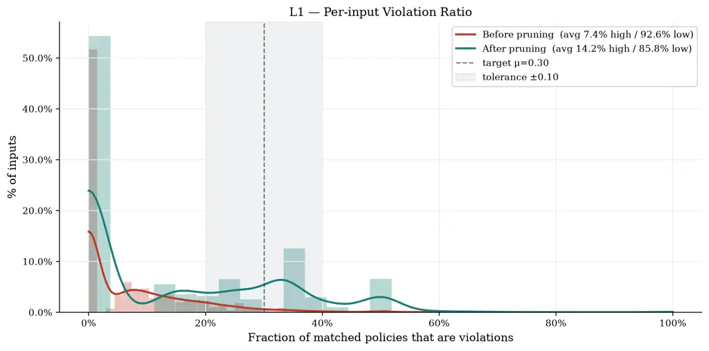

(a) L1: GRPO Violation Ratio

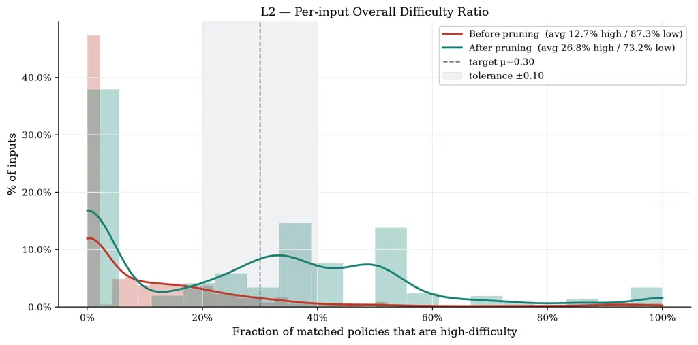

(b) L2: GRPO Difficulty Ratio

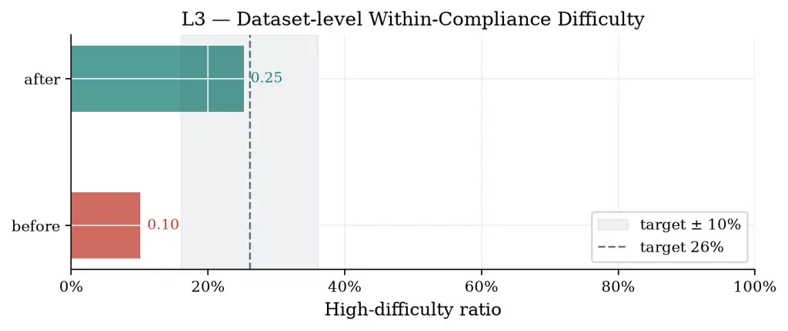

(c) L3: Within-Compliance Difficulty

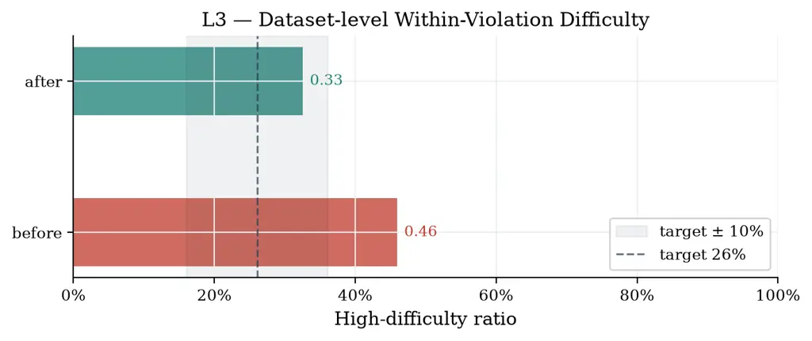

(d) L3: Within-Violation Difficulty

Figure 5: GRPO dataset curation. The refiner successfully flattens
extreme left-skewed (zero-inflated) distributions in L1 and L2, pulling
the dataset toward the $`\mu=0.30`$ target. L3 constraints ensure
high-difficulty rates are balanced across both compliance and violation
labels.

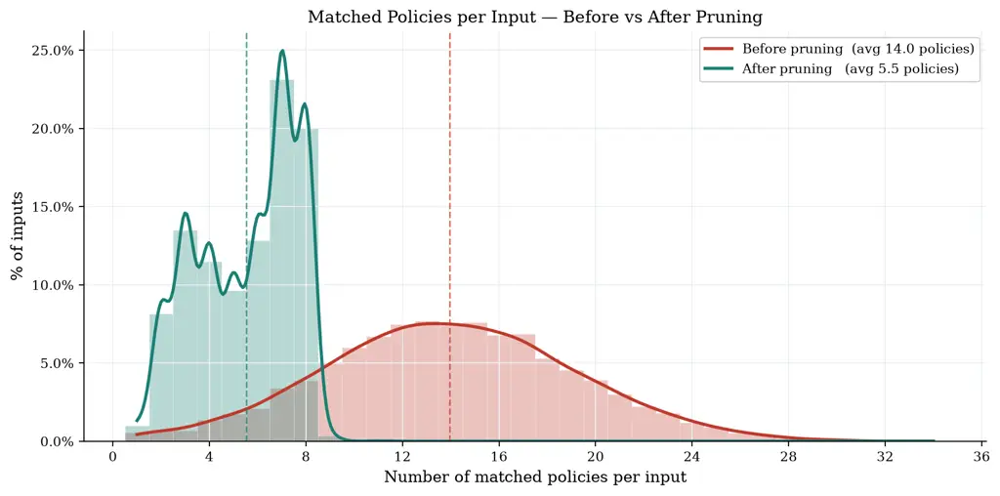

(a) Matched Policies per Input

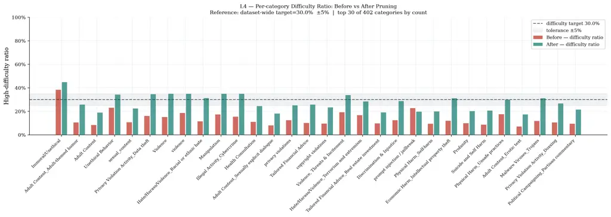

(b) L4: Per-category Difficulty Alignment

Figure 6: Diagnostics for GRPO pruning. The top plot shows how the
number of matched policies per input is reduced after pruning in order
to achieve desired difficulty and violation ratios, while the L4 bar
chart shows individual semantic categories adhering to the global
difficulty target.

- •
  Stage A (difficulty-only). Before verdicts exist, the refiner sees
  only $`(x,p_{k},d_{k})`$ triples and enforces L2 (per-input difficulty
  ratio) jointly with zero-row reduction and the difficulty-only slice
  of L4; L1 and L3, and the verdict-dependent checks within L4, are
  skipped entirely because they require $`v_{k}`$. The output of this
  stage is the difficulty-balanced pool that is then passed to the
  reasoning/verdict-generation stage (Stage 2 above) to obtain $`v_{k}`$
  for every surviving pair.
- •
  Stage B (full curation). Once verdicts are available, the refiner
  re-runs on the same pool, now with all four levels active in a
  convergence loop: L1$`+`$L2 joint greedy pruning, then zero-row
  reduction, then L3, then L4, repeated for up to a fixed number of
  rounds until every active level’s Wasserstein distance to its target
  is within tolerance or a round produces no further change.

##### Hyperparameter Search and Configuration Selection

To determine the optimal parameters for the Policy-Distribution Refiner,
we run an extensive hyperparameter search across 16 distinct
configurations independently for both the SFT and GRPO datasets. The
objective is to find a configuration that optimally smoothes out
structural imbalances—specifically, the heavy left-skew (zero-inflation)
where inputs overwhelmingly match with low-difficulty policies or
non-violations—without aggressively decimating the dataset size or
destroying category diversity.

We experiment with varying target means ($`\mu`$), standard deviations
($`\sigma`$), and tolerance boundaries for both difficulty and violation
ratios. Our configurations ranged from strict baseline bounds to heavily
relaxed tolerances and shifted difficulty/violation means.

Ultimately, the configuration below provided the best structural balance
across all four pruning levels (L1–L4). By slightly relaxing the target
difficulty mean while maintaining strict bounds on violations, this
configuration effectively lifted the distributions away from the extreme
left-skew while preserving a robust and diverse pool of policies per
input.

The chosen parameters are as follows:

- •
  SFT: Difficulty $`\mu=0.175`$, $`\sigma=0.10`$, tolerance$`=0.10`$;
  Violation $`\mu=0.30`$, $`\sigma=0.10`$, tolerance$`=0.10`$.
- •
  GRPO: Difficulty $`\mu=0.30`$, $`\sigma=0.15`$, tolerance$`=0.10`$;
  Violation $`\mu=0.30`$, $`\sigma=0.10`$, tolerance$`=0.10`$.

Note: GRPO inherently targets a higher difficulty distribution compared
to SFT to facilitate better reasoning optimization.

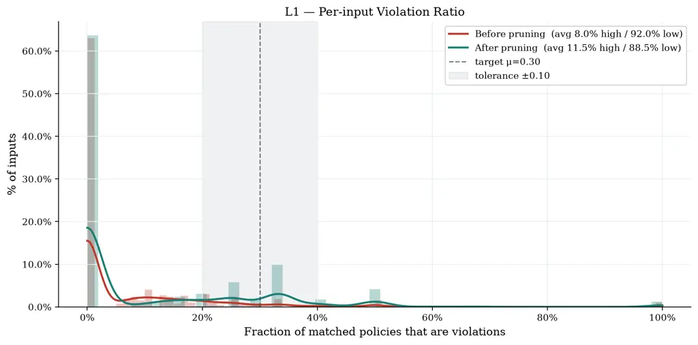

(a) L1: SFT Violation Ratio

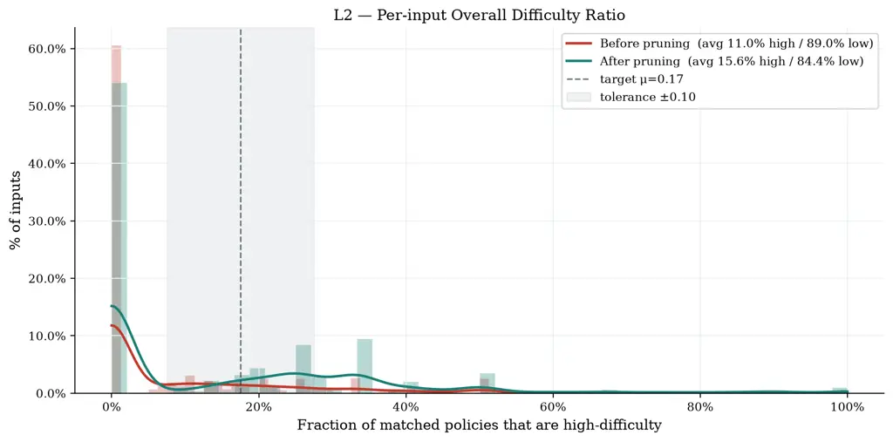

(b) L2: SFT Difficulty Ratio

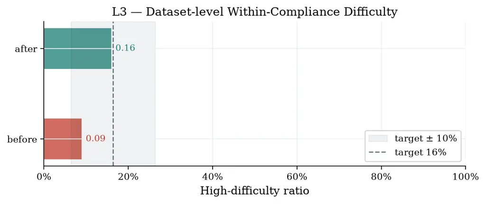

(c) L3: Within-Compliance Difficulty

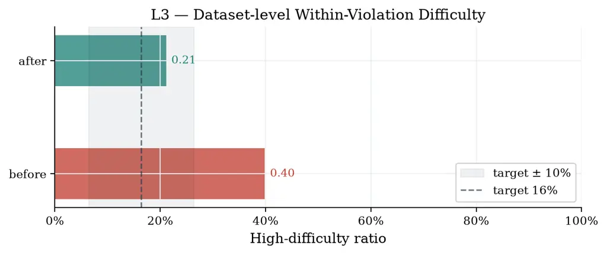

(d) L3: Within-Violation Difficulty

Figure 7: SFT dataset curation. The refiner mitigates severe skewness in
the raw data, aligning violations ($`\mu=0.30`$) and difficulty
($`\mu\approx 0.17`$) properly within tolerance limits.

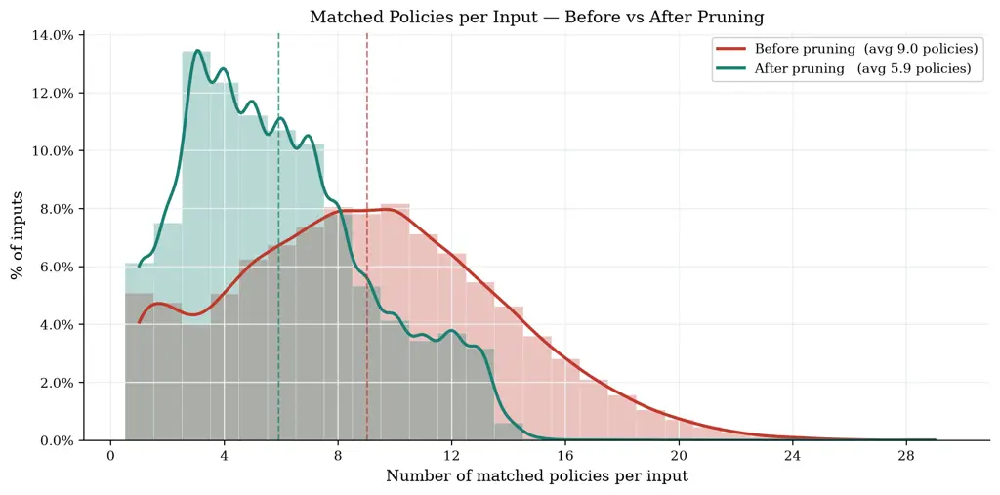

(a) Matched Policies per Input

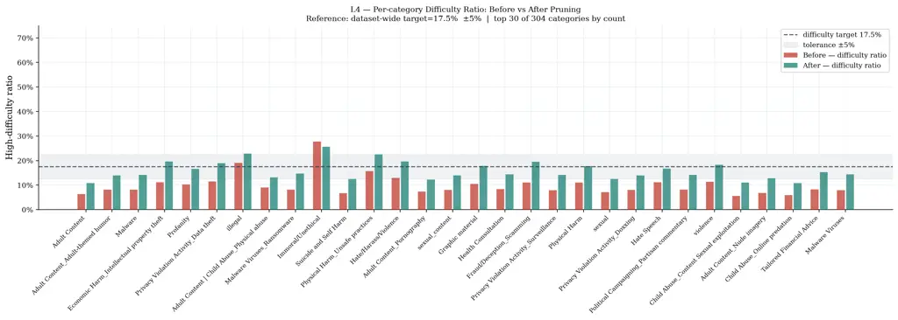

(b) L4: Per-category Difficulty Alignment

Figure 8: Diagnostics for SFT pruning. The top plot shows how the number
of matched policies per input is reduced after pruning in order to
achieve desired difficulty and violation ratios, while the L4 bar chart
shows individual semantic categories adhering to the global difficulty
target.

##### Visualizing the Pruning Efficacy (GRPO).

Figures 5 and 6 demonstrate the refiner’s impact under our
aforementioned hyperparameter configuration on the GRPO split. Before
pruning (red), the L1 (violation) and L2 (difficulty) distributions
exhibit massive spikes near 0%. After pruning (teal), these zero-row
spikes are significantly reduced, and the remaining data aligns much
more closely with our target Gaussians (Figure 5). Furthermore, as seen
in the L3 plots, the pipeline successfully brings within-compliance and
within-violation difficulty ratios into the target $`\pm 10\%`$
tolerance, preventing difficulty from being confounded with verdicts.
Figure 6 confirms that local difficulty constraints are met across a
wide variety of specific policy categories (L4).

##### Visualizing the Pruning Efficacy (SFT).

Similar positive outcomes were observed on the SFT split. Because SFT
requires a slightly lower difficulty baseline to preserve standard
instructive behavior, our chosen configuration uses a target mean of
$`\mu=0.175`$. As shown in Figure 7, the pre-pruning SFT dataset was
heavily dominated by 0% violation and 0% high-difficulty inputs. The
refiner efficiently bounded these metrics, resulting in a robust,
balanced subset suitable for supervised fine-tuning.

##### Additional Pruning: Shifting from SFT to GRPO.

Notice that to achieve a higher ratio of difficulty and violations, the
GRPO set number of matched policies per input drops significantly. We
want a higher ratio of matched policies per input in GRPO compared to
SFT and thus, prune the data further by shifting a subset of SFT
datapoints into the GRPO sets for train and dev respectively. We
specifically sample from the set of datapoints with greater than or
equal to 9 policies per input and a difficulty mean greater than or
equal to 0.25 to shift from SFT-train into GRPO-train, and similarly for
SFT-validation into GRPO-validation. The before (red) and after (green)
depict this shift in number of matched policies per input.

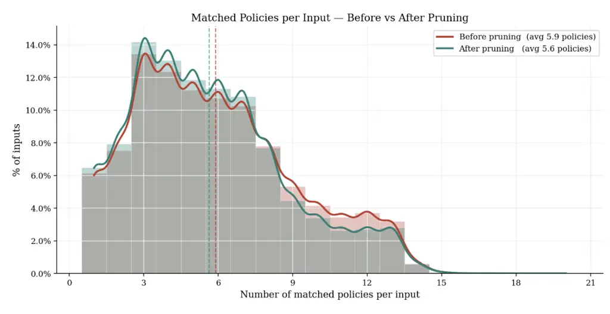

(a) SFT Train \# of Matched Inputs

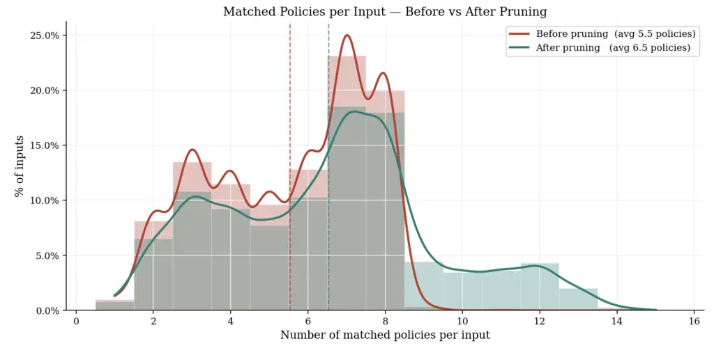

(b) GRPO Train \# of Matched Inputs

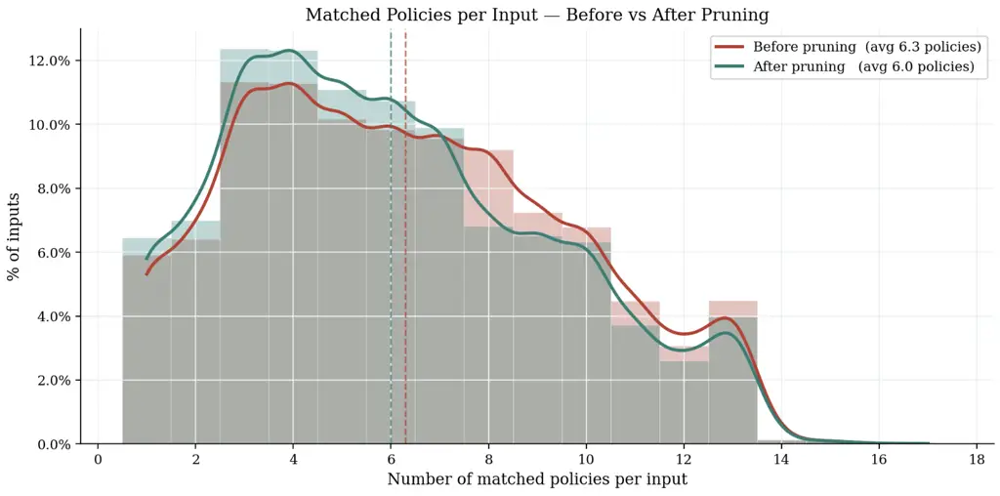

(c) SFT Dev \# of Matched Inputs

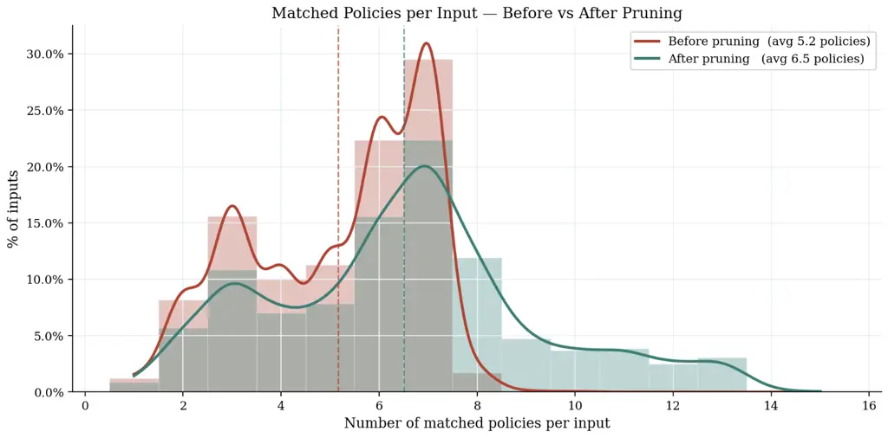

(d) GRPO Dev \# of Matched Inputs

Figure 9: An additional round of pruning on SFT Train/Dev and GRPO
Train/Dev, defined by a shift of difficult datapoints with a high
matched number of policies from SFT into GRPO training sets. This was
done with the purpose of (1) increasing the matched number of policies
in GRPO sets, and (2) enforcing higher difficulty in GRPO sets.

### A.7 Per-Category F1 Breakdown

Figure 10 shows the relative improvement of SFT and GRPO for Gemma4-E4B
model across some top-level safety categories based on evaluations on
the dynamic-policy test set. We can observe that overall, the RL stage
introduces the most lift in per-category metrics, with ‘Malware, Hacking
& Cyberattack’ and ‘Disinformation & Mininformation’ gaining the most
improvement boost.

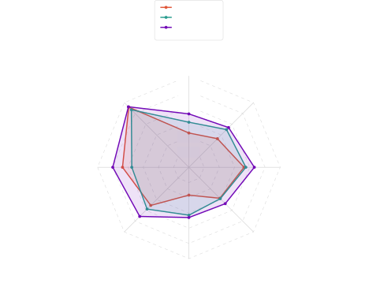

Figure 10: Per-category F1 score breakdown across eight safety
taxonomies comparing BASE, SFT, and RL AdaGuard models.

### A.8 AdaGuard Prompt


### A.9 Quality Rubrics


### A.10 Reward Function Details

Input: SFT set $`\mathcal{D}_{\text{SFT}}`$, GRPO set
$`\mathcal{D}_{\text{GRPO}}`$, base model $`\pi_{\theta}`$, group size
$`n`$

Output: Adaptive-reasoning input-moderation guardrail $`\pi_{\theta}`$

// Stage 1: SFT across the three reasoning modes

Expand each annotated example into three rows, one per mode
$`m\in\{\rmode{reasoning\_off},\rmode{reasoning\_on},\rmode{autoreasoning}\}`$

Fine-tune $`\pi_{\theta}`$ on $`\mathcal{D}_{\text{SFT}}`$ with the DFT
loss

// Stage 2: single-rollout GRPO

Initialize the GRPO actor from the SFT checkpoint

foreach _prompt $`(x,P,m)\in\mathcal{D}_{\text{GRPO}}`$_ do

   Sample a group of $`n`$ rollouts
$`\{o^{(j)}\}_{j=1}^{n}\sim\pi_{\theta}(\cdot\mid x,P,m)`$

   foreach _rollout $`o^{(j)}`$_ do

      Parse into $`K`$ per-policy blocks; extract
$`\hat{v}_{k},\hat{d}_{k},a_{k},f_{k}`$

      Sample a \rmodereasoning*off counterfactual for each block with
$`\hat{d}*{k}=\textsc{High}\wedge a*{k}`$; score $`r*{\text{CF}}(k)`$ //
Eq. 16

      Fold the judge’s quality $`q`$ into each judged block:
$`r_{c}\leftarrow r_{c}\cdot\operatorname{mult}(r_{c},q,u)`$ // Eq. 6

      Compute
$`R_{\text{format}}^{(j)},R_{\text{correct}}^{(j)},R_{\text{reason}}^{(j)}`$
// Eq. 2 components

   end foreach

   foreach _component
$`c\in\{\text{format},\text{correct},\text{reason}\}`$_ do

      $`\hat{A}_{c}^{(j)}\leftarrow\big(R_{c}^{(j)}-\mathrm{mean}_{j}R_{c}^{(j)}\big)/\big(\mathrm{std}_{j}R_{c}^{(j)}+\varepsilon\big)`$
// GDPO: per-component group normalization

   end foreach

   $`\hat{A}^{(j)}\leftarrow\operatorname{whiten}\big(\sum_{c}w_{c}\hat{A}_{c}^{(j)}\big)`$
// Eq. 7

   Update $`\theta`$ with the GRPO objective using $`\{\hat{A}^{(j)}\}`$

end foreach

Algorithm 1 AdaGuard training.

This appendix gives the full definition of every GRPO reward term of
Eq. 2, the rollout-parsing signals they consume, and the alternative
designs that were explored but not adopted (the flat discrete
correctness rule, the two log-probability calibration variants, and the
additive quality reward). A rollout $`o`$ is parsed into $`K`$
per-policy blocks with per-policy verdict
$`\hat{v}_{k}\in\{\textsc{Compliance},\textsc{Violation},\bot\}`$
($`\bot`$ = missing or unrecognized), predicted difficulty
$`\hat{d}_{k}\in\{\textsc{High},\textsc{Low},\bot\}`$, and teacher
difficulty $`d_{k}`$.

##### Group Reward-Decoupled (GDPO) advantage normalization.

The components of Eq. 2 differ in scale, variance, and firing rate:
$`R_{\text{format}}`$ is dominated by rare but large hard-gate
penalties, $`R_{\text{reason}}`$ moves only when the reasoning decision
changes, and $`R_{\text{correct}}`$ can vary drastically across
different examples and throughout training. Collapsing them into one
entangled scalar and group-normalizing it, similar to the standard GRPO
advantage, makes the advantage a function of whichever component carries
the largest within-group variance at that step. We therefore adopt
GDPO (Liu et al., 2026), which normalizes each reward stream
independently within its own GRPO group before combining them. For
reward component $`s`$ and across the group of $`G`$ rollouts sharing a
prompt,

```math
A_{i}^{(s)}=\frac{r^{(s)}(q,o_{i})-\text{mean}\left(\{r^{(s)}(q,o_{j})\}_{j=1}^{G}\right)}{\text{std}\left(\{r^{(s)}(q,o_{j})\}_{j=1}^{G}\right)+\epsilon_{\text{std}}},\qquad\widetilde{A}_{i}=\sum_{s}w_{s}A_{i}^{(s)},\qquad\hat{A}_{i}=\frac{\widetilde{A}_{i}-\mu_{B}}{\sigma_{B}+\epsilon_{\text{batch}}} \tag{7}
```

where $`r^{(s)}(q,o_{i})`$ is the raw reward value for objective $`s`$
on rollout $`i`$. The individual normalized advantage dimensions are
aggregated using their respective objective weights. To prevent variance
collapse and maintain a consistent advantage scale regardless of the
number of reward functions, a final batch-level normalization is applied
across all samples in the mini-batch $`B`$, where $`\mu_{B}`$ and
$`\sigma_{B}`$ denote the empirical mean and standard deviation of the
aggregated advantage estimates $`\{\widetilde{A}_{j}\}`$ calculated
across all tokens/rollouts within the mini-batch $`B`$. Because each
$`A_{i}^{(s)}`$ is a complete, unbiased group-relative advantage
estimate in its own right, every term casts an equal-variance “vote”
regardless of raw magnitude: a batch in which format scores happen to
vary more than verdict correctness cannot let formatting overwhelm the
correctness signal as an artifact of scale.

The overall loss function optimized by GDPO combines the
PPO-style (Schulman et al., 2017) clipped surrogate objective with a
token-level KL penalty against a reference model $`\pi_{\text{ref}}`$:

```math
\displaystyle\mathcal{L}_{\text{GDPO}}(\theta) \displaystyle=-\mathbb{E}_{(q,o_{j})\sim\mathcal{D},\{o_{j}\}_{j=1}^{G}\sim\pi_{\theta_{\text{old}}}} \tag{8}
```

```math
\displaystyle\Bigg[\frac{1}{G}\sum_{j=1}^{G}\frac{1}{|o_{j}|}\sum_{t=1}^{|o_{j}|}\Bigg(\min\Bigg(\frac{\pi_{\theta}(o_{j}^{t}\mid q,o_{j}^{<t})}{\pi_{\theta_{\text{old}}}(o_{j}^{t}\mid q,o_{j}^{<t})}\hat{A}_{j},\text{clip}\left(\frac{\pi_{\theta}(o_{j}^{t}\mid q,o_{j}^{<t})}{\pi_{\theta_{\text{old}}}(o_{j}^{t}\mid q,o_{j}^{<t})},1-\epsilon,1+\epsilon\right)\hat{A}_{j}\Bigg)
```

```math
\displaystyle-\beta\,\mathcal{D}_{\text{KL}}\big(\pi_{\theta}\parallel\pi_{\text{ref}}\big)\Bigg)\Bigg]
```

##### CoT-Presence Signals.

For the structured JSON schema, the full CoT traces when expected in
\rmodereasoning*on mode (\rmodeinput_understanding $`\eta`$,
\rmodepolicy_understanding $`\eta`$,
\rmodeinput_compliance_understanding $`\chi*{k}`$), yield the following
CoT presence indicators

```math
\displaystyle a_{k}\; \displaystyle=\;\mathbbm{1}[\psi_{k}\neq\varnothing]\,\vee\,\mathbbm{1}[\chi_{k}\neq\varnothing], \tag{9}
```

```math
\displaystyle f_{k}\; \displaystyle=\;\mathbbm{1}[\psi_{k}\neq\varnothing]\,\wedge\,\mathbbm{1}[\chi_{k}\neq\varnothing]\,\wedge\,\mathbbm{1}[\eta\neq\varnothing],
```

where $`a_{k}`$ fires if the model reasoned _at all_ about policy $`k`$,
while $`f_{k}`$ additionally requires the shared input-understanding
trace, so that an omitted top-level $`\iota`$ is penalized as partial
CoT rather than going unscored.

##### Format reward.

$`R_{\text{format}}`$ owns all schema/formatting signals. Let $`G`$ be
the number of emitted blocks and let the _verdict coverage_ be the
fraction of the $`K`$ requested policies with a parseable verdict,

```math
\rho\;=\;\frac{1}{K}\sum_{k=1}^{K}\mathbbm{1}\!\left[\hat{v}_{k}\in\{\textsc{Compliance},\textsc{Violation}\}\right]. \tag{10}
```

A rollout is _hard-gated_ to
$`R_{\text{format}}=\mathrm{PARSE\_PENALTY}=-1.5`$ if it is unparseable,
if $`\rho=0`$, if $`G\geq 2K`$, or if the amount of extra-schema
“babble” exceeds $`\beta_{\max}`$ (default $`500`$ non-whitespace
characters). Otherwise $`R_{\text{format}}`$ is a weighted combination
of four sub-scores. Content validity applies a step-linear curve to
coverage,

```math
g_{\text{cv}}(\rho)=\begin{cases}-1.5+1.5\,\rho,&0<\rho<0.5\quad\text{(steep penalty)},\\[2.0pt]
-0.75+3\,(\rho-0.5),&0.5\leq\rho<0.75\quad\text{(recovery)},\\[2.0pt]
4\,(\rho-0.75),&0.75\leq\rho\leq 1\quad\text{(good zone)},\end{cases} \tag{11}
```

so $`g_{\text{cv}}\in[-1.5,+1.0]`$. A block-count penalty and a
numbering penalty are pure penalties (zero at the correct
count/ordering, never rewarded),

```math
g_{\text{blk}}=\begin{cases}0,&G=K,\\
-\min\!\big((\tfrac{G-K}{3})^{1.2},\,1\big),&G>K,\\
-\tfrac{K-G}{K},&G<K,\end{cases}\qquad g_{\text{num}}=\begin{cases}0,&\text{numbering }1,\dots,K\text{ exact},\\
-\big(1-\tfrac{n_{\text{correct}}}{K}\big),&\text{otherwise},\end{cases} \tag{12}
```

where $`n_{\text{correct}}`$ is the count of position-correct block
numbers. The babble term rewards a clean response
($`\beta\leq\beta_{0}`$, $`\beta_{0}=10`$ trailing characters) and
otherwise penalizes extra-schema characters $`\beta`$,

```math
g_{\text{bab}}=\begin{cases}+1,&\beta\leq\beta_{0},\\
-\min\!\big((\tfrac{\beta-\beta_{0}}{\beta_{\max}})^{1.1},\,1.5\big),&\beta_{0}<\beta\leq\beta_{\max},\end{cases}\qquad\tilde{g}_{\text{bab}}=\begin{cases}\rho\,g_{\text{bab}},&g_{\text{bab}}>0,\\
g_{\text{bab}},&g_{\text{bab}}\leq 0,\end{cases} \tag{13}
```

where the _structural multiplier_ $`\rho`$ scales down the positive
babble reward when verdict coverage is sparse (but never amplifies the
penalty). The format reward is then

```math
R_{\text{format}}\;=\;0.80\,g_{\text{cv}}\;+\;0.20\,\tilde{g}_{\text{bab}}\;+\;0.20\,g_{\text{blk}}\;+\;0.15\,g_{\text{num}}, \tag{14}
```

with a ceiling of $`+1.0`$ (perfect coverage, no babble, correct count
and numbering); the additive penalties can drag it below the $`-1.5`$
gate value, but the hard gates catch the worst-formed rollouts first.
Difficulty tags are deliberately _not_ scored here — they are owned by
the reasoning reward.

##### Correctness reward: the flat discrete fallback.

$`R_{\text{correct}}`$ is the sole verdict-bearing term. On the blocks
CF-CORR does not cover (predicted-Low blocks, and any
committed-reasoning block whose counterfactual is unavailable) it falls
back to the flat discrete rule below, which is also the _alternative_
baseline design used when CF-CORR is ablated off entirely. It hard-gates
to $`\mathrm{GATE\_PENALTY}=-1.5`$ on an unparseable rollout; otherwise
each block earns

```math
c_{k}=\begin{cases}C_{\text{cor}}=+1.0,&\hat{v}_{k}=v_{k}\quad\text{(correct)},\\
C_{\text{wr}}^{\text{cot}}=-1.0,&\hat{v}_{k}\neq v_{k}\ \text{and}\ a_{k}\quad\text{(wrong \emph{after} reasoning)},\\
C_{\text{wr}}^{\text{no}}=-0.5,&\hat{v}_{k}\neq v_{k}\ \text{and}\ \neg a_{k}\quad\text{(wrong, no reasoning)},\\
0,&\hat{v}_{k}=\bot\ \text{or block missing},\end{cases}\qquad R_{\text{correct}}=\frac{1}{K}\sum_{k=1}^{K}c_{k}. \tag{15}
```

The asymmetry $`C_{\text{wr}}^{\text{cot}}<C_{\text{wr}}^{\text{no}}`$
penalizes a model more for confidently _rationalizing_ an incorrect
verdict than for a terse wrong guess. This is where the “did reasoning
help?” differential lives: keeping it in the single verdict-bearing
reward lets $`R_{\text{reason}}`$ stay purely _decision-only_
(Eqs. 18–20), so reasoning behavior and verdict correctness are never
double-counted. By default the per-block scores are aggregated by a
class-balanced _macro_ mean rather than the plain mean of Eq. 15: the
mean of the per-block means taken within each ground-truth verdict
class, so Compliance and Violation weigh equally on a class-mixed
rollout (removing the majority-class reward hack under significant class
skew scenarios) and reduce to Eq. 15 on a single-class rollout.

##### Counterfactual reasoning-value reward (\rmodeCF-CORR).

On \rmodeautoreasoning blocks where the model committed to reasoning
($`\hat{d}_{k}=\textsc{High}`$ and $`a_{k}`$), Eq. 15’s flat
$`C_{\text{cor}}/C_{\text{wr}}^{\text{cot}}`$ score can optionally be
replaced by a four-way outcome score that grades reasoning against a
_counterfactual_: an independent reasoning-off completion of the
identical $`(x,p_{k})`$ pair, sampled with the same decoding parameters
as the main rollout. Let $`\hat{v}_{k}^{\text{off}}`$ denote the
counterfactual’s verdict, and define the own/counterfactual correctness
indicators $`\mathrm{own}_{k}=\mathbbm{1}[\hat{v}_{k}=v_{k}]`$,
$`\mathrm{off}_{k}=\mathbbm{1}[\hat{v}_{k}^{\text{off}}=v_{k}]`$. The
replacement score is

```math
c_{k}^{\text{cf}}=\begin{cases}C_{\text{cor}}+C_{\text{flip}},&\mathrm{own}_{k}=1,\ \mathrm{off}_{k}=0\quad\text{(\emph{flip}: reasoning fixed a wrong no-CoT verdict)},\\[2.0pt]
u_{k}(d_{k}),&\mathrm{own}_{k}=1,\ \mathrm{off}_{k}=1\quad\text{(\emph{unnecessary}: correct with or without reasoning)},\\[2.0pt]
C_{\text{both}},&\mathrm{own}_{k}=0,\ \mathrm{off}_{k}=0\quad\text{(\emph{both-wrong})},\\[2.0pt]
C_{\text{broke}},&\mathrm{own}_{k}=0,\ \mathrm{off}_{k}=1\quad\text{(\emph{broke}: reasoning wrecked a correct no-CoT verdict)},\end{cases} \tag{16}
```

with $`C_{\text{cor}}=+1.0`$ (Eq. 15), $`C_{\text{flip}}=+0.5`$,
$`C_{\text{both}}=-0.75`$, and $`C_{\text{broke}}=-1.25`$. The
unnecessary outcome is conditioned on the _teacher_ difficulty label
$`d_{k}`$ (not the model’s own prediction $`\hat{d}_{k}`$, which is
already pinned to High to reach this branch), giving a floor on
genuinely hard pairs and a cap on easy ones from the same term,

```math
u_{k}(d_{k})=\begin{cases}C_{\text{cor}},&d_{k}=\textsc{High}\quad\text{(teacher says hard: no discount)},\\[2.0pt]
C_{\text{cor}}-C_{\text{unnec}},&d_{k}=\textsc{Low}\quad\text{(teacher says easy: reasoning was genuinely gratuitous)},\end{cases} \tag{17}
```

with $`C_{\text{unnec}}=0.2`$. The _flip_ outcome is deliberately left
unconditioned on $`d_{k}`$: it only fires when the counterfactual was
actually wrong, i.e. reasoning was objectively necessary on this
instance — a self-verifying fact rather than a proxy needing a floor or
cap, and precisely the case a teacher-Low pair that is secretly hard
would produce. Eq. 16 replaces Eq. 15’s score $`c_{k}`$ only for blocks
with $`\hat{d}_{k}=\textsc{High}\wedge a_{k}`$ and an available,
parseable counterfactual; predicted-Low blocks and any block whose
counterfactual is unavailable keep the standard score of Eq. 15
unchanged, and $`R_{\text{correct}}`$ is still the mean of $`K`$
per-block scores (Eq. 15), now with some blocks substituted by Eq. 16.
The mechanism is exposed as a boolean flag that defaults to _off_ for
ablation safety and is _enabled_ for every result reported here; when
enabled, it is computed entirely from within-rollout information (the
rollout’s own verdict and its own paired counterfactual sample),
consistent with the single-rollout reward design of Section 2.3.2.

##### Quality multiplier and the unnecessary-reasoning clamp.

The reported configuration runs the reasoning-quality judge in
_multiplier_ mode rather than the additive mode: the judge’s raw
per-trace score $`q\in[0,5]`$ (the component-weighted rubric mean,
_before_ the additive remap $`Q(\cdot)`$ of Eq. 21) becomes a
coefficient on the block’s correctness value rather than a free-standing
fifth reward term. The magnitude dial $`m(q)`$ and its sign-aware,
_unnecessary_-conditioned application $`\operatorname{mult}(r_{c},q,u)`$
are both given by Eq. 6 of Section 2.3.2, with $`K=0.5`$, so
$`m(3)=1.0`$ (quality-neutral no-op), $`m(5)=1.5`$, and $`m(0)=0.5`$; a
block with no scored trace takes $`m=1.0`$. The block’s final value is
$`r_{c}\cdot\operatorname{mult}(r_{c},q,u)`$. The multiplier is applied
_once_, _last_ in the chain (so it acts on whatever value CF-Corr’s
Eq. 16 rewrite left behind), and _only_ on blocks the judge actually
scored — i.e. blocks that emitted a reasoning trace. A correctly-skipped
predicted-Low block emits no trace, so it never enters the judge’s index
set and never receives any multiplier at all; its value stays at exactly
$`C_{\text{cor}}=+1.0`$. In this mode $`R_{\text{quality}}`$ is _not_
added to the reward vector of Eq. 2 and \rmodequality*score is dropped
from GDPO’s stream list, since counting it both inside
$`R*{\text{correct}}`$ and as its own normalized advantage would
double-count it.

Table 8 enumerates every CF-Corr scenario against a good-quality
($`q=5`$, $`m=1.5`$) and a bad-quality ($`q=0`$, $`m=0.5`$) trace, using
the reward constants $`C_{\text{cor}}=1.0`$, $`C_{\text{flip}}=0.5`$,
$`C_{\text{broke}}=-1.25`$, $`C_{\text{both}}=-0.75`$,
$`C_{\text{unnec}}=0.2`$, $`C_{\text{wr}}^{\text{no}}=-0.5`$, and
$`K=0.5`$.

| \#  | Scenario (CF-CORR branch)             | Base $`r_{c}`$ | Good quality                        | Bad quality |
| --- | ------------------------------------- | -------------- | ----------------------------------- | ----------- |
| 1   | Flip (own correct, off wrong)         | $`+1.5`$       | $`+2.25`$                           | $`+0.75`$   |
| 2   | Broke (own wrong, off correct)        | $`-1.25`$      | $`-1.25`$ (clamped)                 | $`-1.875`$  |
| 3   | Wrong-both (own wrong, off wrong)     | $`-0.75`$      | $`-0.75`$ (clamped)                 | $`-1.125`$  |
| 4   | Unnecessary, teacher High             | $`+1.0`$       | $`+1.0`$ (capped; $`+1.5`$ pre-fix) | $`+0.5`$    |
| 5   | Unnecessary, teacher Low              | $`+0.8`$       | $`+0.8`$ (capped; $`+1.2`$ pre-fix) | $`+0.4`$    |
| 6   | Predicted-Low, correct (never judged) | $`+1.0`$       | $`+1.0`$                            | $`+1.0`$    |
| 7   | Predicted-Low, wrong (never judged)   | $`-0.5`$       | $`-0.5`$                            | $`-0.5`$    |

Table 8: Every CF-Corr scenario (Eq. 16) under the sign-aware,
_unnecessary_-aware quality multiplier of Eq. 6, at good quality
($`q=5\Rightarrow m=1.5`$) and bad quality ($`q=0\Rightarrow m=0.5`$).
Rows 1–3 use the ordinary branches ($`m`$ on correct, $`\max(2-m,1)`$ on
wrong); rows 4–5 are the _unnecessary_ cell and use the clamp
$`\min(m,1.0)`$; rows 6–7 emit no trace, are never judged, and receive
no multiplier. The invariant that closes the amplification pathway is
visible in the good-quality column: rows 4–5 ($`+1.0`$, $`+0.8`$) never
exceed the correctly-skipped baseline of row 6 ($`+1.0`$), whereas the
pre-fix unclamped $`m(q)`$ would have lifted them to $`+1.5`$ and
$`+1.2`$.

The derivations are direct. Row 1 ($`r_{c}=+1.5`$, $`u=0`$, so
$`\operatorname{mult}=m`$): $`1.5\times 1.5=+2.25`$ and
$`1.5\times 0.5=+0.75`$. Row 2 ($`r_{c}=-1.25`$, so
$`\operatorname{mult}=\max(2-m,1)`$): $`-1.25\times\max(0.5,1.0)=-1.25`$
and $`-1.25\times\max(1.5,1.0)=-1.875`$. Row 3 likewise:
$`-0.75\times 1.0=-0.75`$ and $`-0.75\times 1.5=-1.125`$. Row 4
($`r_{c}=+1.0`$, $`u=1`$, so $`\operatorname{mult}=\min(m,1)`$):
$`1.0\times\min(1.5,1.0)=+1.0`$ and $`1.0\times\min(0.5,1.0)=+0.5`$.
Row 5 ($`r_{c}=+0.8`$, $`u=1`$): $`0.8\times 1.0=+0.8`$ and
$`0.8\times 0.5=+0.4`$. Rows 6–7 receive no multiplier.

_Design invariant._ At _every_ quality level, row 4 $`\leq`$ row 6
(tying at $`+1.0`$ for good quality, $`+0.5<+1.0`$ for bad) and row 5
$`<`$ row 6 strictly ($`+0.8`$ and $`+0.4`$ against $`+1.0`$). No amount
of reasoning quality can make an unnecessary reasoning block outscore a
correctly-skipped one: the $`\min(m(q),1.0)`$ clamp lets the unnecessary
cell only shrink from its already-discounted base, never grow past it.
Without the clamp, rows 4–5 reach $`+1.5`$ and $`+1.2`$, both strictly
above row 6’s $`+1.0`$, which would train the model to reason
gratuitously in preference to skipping correctly and would invert the
intent of $`C_{\text{unnec}}`$ entirely. The wrong-side clamp
$`\max(2-m(q),1.0)`$ is the mirror image of the same principle: bad
quality makes a wrong verdict’s penalty harsher (rows 2–3, bad column),
while good quality is prevented from _softening_ it, since rewarding a
well-written wrong answer is the “eloquent confabulation” failure mode.

##### Reasoning-decision reward.

$`R_{\text{reason}}=\frac{1}{K}\sum_{k}\phi_{k}`$ is a decision-only,
mode-conditioned score of whether the CoT behavior matched what the mode
requires; missing blocks score $`\phi_{k}=0`$ and an unparseable rollout
hard-gates to $`\mathrm{GATE\_PENALTY}`$. For \rmodereasoning_off any
CoT is unexpected,

```math
\phi_{k}^{\text{off}}=\begin{cases}+1,&\neg a_{k},\\
-1,&a_{k},\end{cases} \tag{18}
```

while \rmodereasoning_on always expects the full trace, rewarding
presence and penalizing partial or absent reasoning,

```math
\phi_{k}^{\text{on}}=\begin{cases}+1,&f_{k}\ \text{(full CoT)},\\
-0.5,&a_{k}\wedge\neg f_{k}\ \text{(partial CoT)},\\
-1,&\neg a_{k}\ \text{(no CoT)}.\end{cases} \tag{19}
```

The adaptive \rmodeautoreasoning mode ties the reasoning decision to the
model’s _own_ predicted difficulty $`\hat{d}_{k}`$, using the teacher
difficulty $`d_{k}`$ only as a floor. This is a decision-only score —
verdict correctness is owned by $`R_{\text{correct}}`$, so it is not
double-counted here:

```math
\phi_{k}^{\text{auto}}=\begin{cases}-1.5,&\hat{d}_{k}=\bot\ \text{(malformed difficulty tag)},\\
+1,&\hat{d}_{k}=\textsc{High}\ \wedge\ f_{k},\\
-0.5,&\hat{d}_{k}=\textsc{High}\ \wedge\ a_{k}\wedge\neg f_{k},\\
-1,&\hat{d}_{k}=\textsc{High}\ \wedge\ \neg a_{k},\\
-1,&\hat{d}_{k}=\textsc{Low}\ \wedge\ a_{k}\ \text{(reasoned despite skipping)},\\
-1.5,&\hat{d}_{k}=\textsc{Low}\ \wedge\ \neg a_{k}\ \wedge\ d_{k}=\textsc{High}\ \text{(lazy \emph{and} wrong)},\\
+1,&\hat{d}_{k}=\textsc{Low}\ \wedge\ \neg a_{k}\ \wedge\ d_{k}=\textsc{Low}.\end{cases} \tag{20}
```

Eq. 20 is the mechanism that makes the reasoning budget _adaptive_: the
model is rewarded for committing to full CoT exactly when it declares a
policy High, and for skipping CoT when it declares Low — but only if the
teacher label agrees that the pair is easy.

```math
\displaystyle Q(0) \displaystyle=0, \displaystyle Q(1) \displaystyle=-\tfrac{Q_{\text{end}}}{2}=-0.75, \displaystyle Q(2) \displaystyle=-\tfrac{Q_{\text{end}}}{6}\approx-0.25, \tag{21}
```

```math
\displaystyle Q(3) \displaystyle=0, \displaystyle Q(4) \displaystyle=\tfrac{Q_{\text{end}}}{2}=0.75, \displaystyle Q(5) \displaystyle=Q_{\text{end}}=1.5,
```
