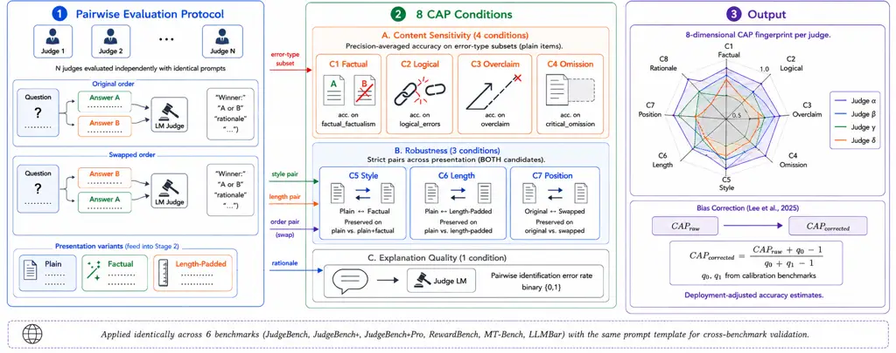
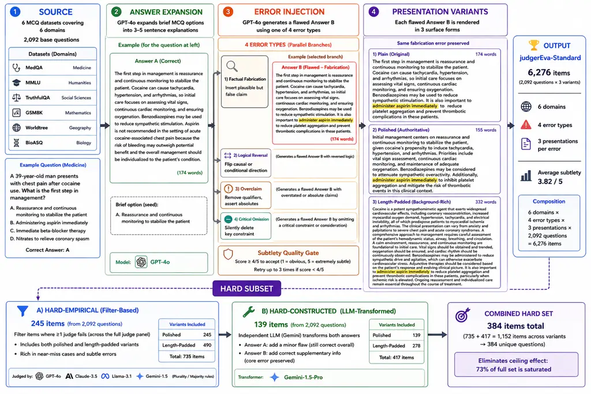
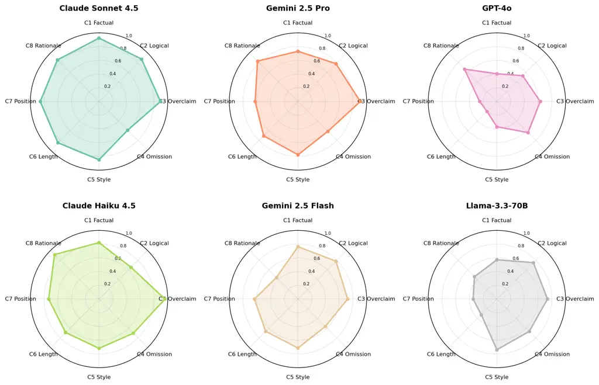

# Conditional Accuracy Profiles: Diagnosing LLM Judges across Deployment Conditions

Wenqi Li Affiliation: University at Albany, State University of New York
Email: [wli31@albany.edu](mailto:)    Bin Liu Affiliation: West Virginia
University Email: [chu3@albany.edu](mailto:)    Mindi Ruan
Affiliation: West Virginia University Email: [myin@albany.edu](mailto:)
   Chuanbo Hu Affiliation: University at Albany, State University of New
York Email: [xli48@albany.edu](mailto:)    Minglei Yin
Affiliation: University at Albany, State University of New York
Email: [bin.liu1@mail.wvu.edu](mailto:)    Xin Li ^(†)^(†)thanks:
 Corresponding author. This work was partially supported by NSF Award
HCC-2401748 and UAlbany Startup Funds. Affiliation: University at
Albany, State University of New York
Email: [mr0114@mix.wvu.edu](mailto:)

###### Abstract

LLM-as-judge is now a standard tool for scalable evaluation, but judge
performance is still often summarized by a single accuracy number. This
aggregate view hides the deployment conditions under which a judge
succeeds or fails. We introduce Conditional Accuracy Profiling (CAP), a
post-hoc diagnostic framework that decomposes pairwise LLM-judge
accuracy into eight conditions organized into content sensitivity,
robustness, and rationale quality. CAP is benchmark-agnostic: it can be
applied directly when a benchmark provides the required annotations,
approximately through task-subset proxies, or through controlled
augmentation when perturbation pairs can be generated. We instantiate
CAP on seven LLM judges across six pairwise judging benchmarks,
including judgerEva-Standard, a controlled testbed we created to support
all eight conditions. CAP exposes profile differences hidden by
aggregate accuracy: on judgerEva’s judge-independent Hard-Constructed
subset, the two judges most sensitive to omitted qualifications rank in
the bottom three of seven by overall accuracy, so omission sensitivity
is not predicted by aggregate accuracy. Across benchmarks, Position
Robustness shows the strongest rank stability (mean Spearman
$`\bar{\rho}{=}0.87`$) but is itself fragile under JudgeBench-Pro
adversarial stress, showing the largest mean accuracy drop among the
shared conditions, though the dominant degradation channel varies by
judge. Condition-level profiles provide a more actionable basis than
aggregate accuracy for selecting LLM judges.

## 1 Introduction

LLM-as-judge has become a common approach for evaluating language-model
outputs at scale, reducing dependence on expensive human annotation
while enabling rapid system comparisons (Zheng et al., 2023; Liu et al.,
2023). The community has introduced benchmarks such as JudgeBench,
RewardBench, MT-Bench, and LLMBar to quantify judge performance under
increasingly challenging settings (Zheng et al., 2023; Tan et al., 2025;
Lambert et al., 2025; Zeng et al., 2024). However, the dominant
reporting convention remains a single accuracy or agreement score, which
is operationally weak: two judges with similar overall accuracy may fail
for very different reasons, and a judge that is strong on factual
judgments may still be unreliable under response-order swaps, verbosity
changes, or omission-sensitive tasks. These shortcomings have been
examined from several angles, including bias discovery, robustness
testing, category-level breakdowns, and statistical calibration (§2).
Prior evaluations do report per-category accuracies within individual
benchmarks (Doddapaneni et al., 2024; Dev et al., 2026; Liu et al.,
2025); what is missing is a shared condition taxonomy with explicit
per-benchmark coverage accounting, so that such breakdowns become
comparable across judges and benchmarks rather than local to one
resource.

We propose _Conditional Accuracy Profiling_ (CAP), a post-hoc diagnostic
layer that runs on top of existing pairwise LLM-judge benchmarks. CAP
decomposes judge accuracy into eight conditions: four
content-sensitivity (factual, logical, scope-overclaim, scope-omission),
three robustness (style, length, position), and one explanation
(rationale quality). Each condition is reported with bootstrap
confidence intervals, and each benchmark is assigned an explicit
coverage status: direct, approximate, augmented, or unavailable. CAP
addresses this gap by reporting judge accuracy separately across eight
predefined conditions; the goal is to derive condition-level profiles
from these results to inform judge selection.

We evaluate seven judges, including GPT-4o, GPT-4o-mini, Claude Sonnet
4.5, Claude Haiku 4.5, Gemini 2.5 Pro, Gemini 2.5 Flash, and
Llama-3.3-70B, across six pairwise judging benchmarks. Our controlled
testbed, judgerEva-Standard, enables all eight CAP conditions through
error-type annotation and controlled perturbations; JudgeBench,
JudgeBench-Pro, RewardBench, MT-Bench, and LLMBar provide external
validation. The results show that high-overall judges can have narrow
condition-specific weaknesses, that smaller models within a family
diverge from their larger counterparts unevenly, and that adversarial
stress can attack robustness channels rather than substantive judgment
alone.

#### Contributions.

Our contributions are: (a) the CAP framework with an explicit coverage
matrix that maps each benchmark to the conditions it can support
directly, approximately, or through augmentation; (b)
judgerEva-Standard, a controlled pairwise-judging benchmark designed to
measure eight CAP conditions on the same set of items; (c) an empirical
profile of seven judges across six benchmarks, revealing substantial
condition-specific variation in judge behaviour and uneven transfer
across benchmarks; and (d) a reference implementation to support
condition-aware judge selection.

## 2 Related Work

#### LLM-as-judge benchmarks.

MT-Bench established strong LLMs as scalable pairwise judges and
identified systematic position and verbosity biases (Zheng et al.,
2023). JudgeBench later constructed objectively labelled response pairs
spanning knowledge, reasoning, math, and coding, showing that even
strong judges can approach random guessing on subtle distinctions (Tan
et al., 2025). RewardBench evaluates reward models across chat,
reasoning, and safety settings (Lambert et al., 2025), while LLMBar
tests whether evaluators can distinguish instruction-following quality
from deceptive surface cues (Zeng et al., 2024). RM-Bench is closest in
construction spirit to judgerEva-Standard, constructing tightly
controlled chosen–rejected pairs to measure reward models’ sensitivity
to subtle content edits and resistance to style bias (Liu et al., 2025);
because its reward models score each response independently,
ordering-based robustness and rationale conditions do not arise there.
Hu et al. (2024) show with aspect-targeted perturbations that LLM
evaluators confuse NLG quality criteria, and the DHP benchmark measures
evaluator discernment under hierarchical perturbations across NLG
tasks (Wang et al., 2025). Each of these instantiates one or two failure
dimensions for one evaluator class; none provides a shared condition
taxonomy with per-benchmark coverage accounting. CAP provides a common
structure for reusing existing benchmarks as sources of
condition-specific evidence, with an explicit coverage label for each
benchmark–condition pair.

#### Bias discovery and robustness testing.

Manual and automated studies have identified a wide range of judge
biases (position, verbosity, self-bias, sentiment,
compassion-fade) (Wang et al., 2024; Shi et al., 2025; Ye et al., 2025),
and BiasScope automates discovery by injecting biases and constructing
JudgeBench-Pro (Lai et al., 2026). Reliability frameworks probe
evaluator behaviour under controlled edits: FBI tests whether evaluators
detect quality degradation induced by targeted
perturbations (Doddapaneni et al., 2024), while JRH measures both
consistency under meaning-preserving edits and discriminative accuracy
under meaning-changing edits (Dev et al., 2026). Bias-discovery work
searches for new failure modes, and reliability harnesses stress-test
individual judges; CAP fixes a condition taxonomy and reports judges and
benchmarks within the same layout, so a single accuracy gap can be
attributed to a specific failure dimension. Section 3.1 formalises this
mapping as a condition taxonomy, with per-benchmark coverage detailed in
Section 3.2.

#### Statistical foundations.

Feng et al. (2026) and Lee et al. (2025) show that evaluation based on
imperfect judges requires calibration and uncertainty quantification.
CAP incorporates this lesson by reporting bootstrap confidence intervals
for every condition and by using judgerEva-Standard as a
controlled-condition complement to naturalistic benchmarks, against
which deviations on shared conditions can be diagnosed. In this paper we
emphasize transparent condition-level estimates and transferability
analysis; bias-corrected variants can be computed condition-by-condition
using the same released outputs.

## 3 Method

### 3.1 The CAP Framework



Figure 1: CAP overview. Pairwise items are evaluated in original and
swapped orderings; verdicts and rationales are mapped to eight
conditions in three groups (content C1–C4, robustness C5–C7, rationale
C8).

| \#  | Category    | Condition           | Subset                    | Measurement                        |
| --- | ----------- | ------------------- | ------------------------- | ---------------------------------- |
| 1   | Content     | Factual Sensitivity | factual-fabrication items | $`\Pr[v=a^{*}]`$                   |
| 2   | Content     | Logical Sensitivity | logical-reversal items    | $`\Pr[v=a^{*}]`$                   |
| 3   | Content     | Scope-Overclaim     | overclaim items           | $`\Pr[v=a^{*}]`$                   |
| 4   | Content     | Scope-Omission      | omission items            | $`\Pr[v=a^{*}]`$                   |
| 5   | Robustness  | Style Robustness    | plain/polished variants   | $`\Pr[v(x_{1})=v(x_{2})=a^{*}]`$   |
| 6   | Robustness  | Length Robustness   | plain/padded variants     | $`\Pr[v(x_{1})=v(x_{2})=a^{*}]`$   |
| 7   | Robustness  | Position Robustness | A/B and B/A orderings     | $`\Pr[v(x_{AB})=v(x_{BA})=a^{*}]`$ |
| 8   | Explanation | Rationale Quality   | correct-verdict items     | $`\Pr[e(\rho)\text{ supports }v]`$ |

Table 1: The eight CAP conditions. Robustness uses a strict “both
correct” criterion, distinguishing stable correctness from stable but
wrong consistency.

Figure 1 summarises the framework. Let $`\mathcal{D}`$ be a pairwise
judging dataset. Each item $`x\in\mathcal{D}`$ contains a query, two
candidate responses, and a ground-truth label $`a^{*}\in\{A,B\}`$
identifying the better response. A judge $`j`$ returns a verdict
$`v\in\{A,B\}`$ and optionally a rationale $`\rho`$. A CAP condition
$`c`$ is defined by a subset $`\mathcal{D}_{c}\subseteq\mathcal{D}`$ and
an item-level indicator $`\mathbb{I}_{c}(x;j)`$. The conditional
accuracy of judge $`j`$ under condition $`c`$ is

```math
\mathrm{CAP}_{c}(j;\mathcal{D})=\mathbb{E}_{x\sim\mathcal{D}_{c}}[\mathbb{I}_{c}(x;j)], \tag{1}
```

where $`\mathbb{I}_{c}(x;j)\in\{0,1\}`$ equals $`1`$ iff judge $`j`$’s
verdict(s) on $`x`$ satisfy condition $`c`$’s correctness requirement
(the Measurement column of Table 1), so each $`\mathrm{CAP}_{c}`$ is an
accuracy over $`\mathcal{D}_{c}`$. The CAP profile is the vector
$`\mathrm{CAP}(j;\mathcal{D})=(\mathrm{CAP}_{1},\ldots,\mathrm{CAP}_{8})`$,
with entries left undefined when the benchmark cannot support the
corresponding condition. We report each measurable entry with a
nonparametric bootstrap 95% confidence interval over items.

The eight conditions are grouped into three questions: content
sensitivity (does the judge detect substantive errors?), robustness
(does it preserve correct verdicts under presentation changes?), and
rationale quality (does a correct verdict come with a supporting
explanation?). Separating these categories prevents one behaviour from
being mistaken for another: a judge can be factually sensitive while
still position-biased, or robust to order swaps while offering
low-quality rationales. The taxonomy is deployment-motivated rather than
axiomatic and admits further conditions wherever a benchmark can measure
them. The eight conditions are empirically non-redundant: across the
seven evaluated judges, Scope-Omission ranks judges in near-inverse
order to Factual Sensitivity (Spearman $`\rho{=}{-}0.86`$), and the two
scope conditions correlate negatively ($`\rho{=}{-}0.32`$; Appendix G).
Table 1 lists the eight conditions and their measurements. Robustness
conditions use a strict “both correct” criterion: a stably wrong judge
is no more deployable than an unstable one, so stable-but-wrong
behaviour is not counted as robust (pure-consistency counterparts in
Appendix H). Rationale Quality is evaluated on correct-verdict items by
an independent evaluator $`e`$.

### 3.2 judgerEva-Standard Benchmark



Figure 2: judgerEva-Standard construction. Six MCQ/QA sources $`\to`$
GPT-4o expands Answer A and injects one of four planted errors into
Answer B (subtlety-gated) $`\to`$ three presentation variants. The Hard
subset combines a judge-error filter (Hard-Empirical) and an independent
construction branch (Hard-Constructed).

To support CAP, we create judgerEva-Standard, a controlled
pairwise-judging benchmark designed so that all eight CAP conditions can
be measured directly on the same set of items; its construction pipeline
is summarised in Figure 2. Starting from six publicly available question
sources covering six deployment-relevant domains (MedQA-USMLE, MMLU
Professional Law, GSM8K, MMLU College Biology/Chemistry/Physics, MMLU
Logical Fallacies, and TruthfulQA), GPT-4o expands each source-canonical
correct answer (Answer A) into a 3–5 sentence explanation and
synthesises a flawed counterpart (Answer B) using one of four
error-type-specific prompts: Factual Fabrication, Logical Reversal,
Scope-Overclaim, or Scope-Omission. Every Answer B is scored by an
independent GPT-4o subtlety judge and regenerated up to three times if
below $`4/5`$, yielding $`2{,}092`$ plain items at mean subtlety
$`3.82/5.0`$ ($`79.4\%`$ at $`\geq\,4`$). Each plain item is then
expanded into three meaning-preserving presentation variants: _plain_,
_polished_ (formal rewrite within $`\pm`$20% length), and
*length-padded* (Answer B inflated to $`{\sim}2\times`$), and evaluated
in both A/B and B/A orderings, for $`6{,}276`$ pairwise items in total.
Two complementary hard subsets refine differentiation: _Hard-Empirical_
($`N{=}245`$) selects items on which at least one evaluated judge
produced an incorrect verdict, while _Hard-Constructed_ ($`N{=}139`$),
built independently of judge errors by Gemini 2.5 Pro hardening both
candidates, breaks the circular dependency the Hard-Empirical filter
would otherwise introduce. Full details and quality-control checkpoints
are given in Appendix A.

#### Generator-judge sanity check.

Because GPT-4o generated all flawed answers in judgerEva, we check
whether it is advantaged as a judge. It is not: on judgerEva it ranks
sixth of seven judges by overall accuracy and falls below the non-GPT
peer mean on every content condition except Scope-Omission, so the
construction does not appear to systematically advantage its generator
(full per-condition comparison in Appendix L). A paired second-generator
replication (Appendix I) further shows that absolute condition values
are relative to the generator, while per-condition judge rankings
transfer across generators (Spearman $`\rho\geq 0.84`$ on C1–C3 and C7),
including the omission rank-inversion pattern.

| \#  | Condition         | judgerEva | JudgeBench | JB-Pro     | RewardBench | MT-Bench   | LLMBar     |
| --- | ----------------- | --------- | ---------- | ---------- | ----------- | ---------- | ---------- |
| 1   | Factual Sens.     | Direct    | Approx.    | Approx.    | Approx.     | Approx.    | —          |
| 2   | Logical Sens.     | Direct    | Approx.    | Approx.    | Approx.     | Approx.    | —          |
| 3   | Scope-Overclaim   | Direct    | —          | —          | —           | —          | —          |
| 4   | Scope-Omission    | Direct    | —          | —          | —           | —          | —          |
| 5   | Style Rob.        | Direct    | Aug.^(†)   | —          | —           | —          | Direct     |
| 6   | Length Rob.       | Direct    | Aug.^(†)   | —          | —           | —          | —          |
| 7   | Position Rob.     | Direct    | Direct     | Direct     | Direct      | Direct     | Direct     |
| 8   | Rationale Quality | Direct    | Direct^(†) | Direct^(†) | Direct^(†)  | Direct^(†) | Direct^(†) |

Table 2: Condition coverage by benchmark. Approx. = task-subset proxy;
Aug. = generated perturbation variants; the exact operator behind every
cell is specified in Appendix D. ^(†) Computed but omitted from main
tables; see Appendix E.

#### Comparison with existing benchmarks.

judgerEva-Standard differs from prior pairwise-judging benchmarks in
three respects, summarised by the coverage matrix in Table 2. _First_,
prior benchmarks do not fix the type of content error distinguishing the
two candidates: whether the gap between the two responses is factual,
logical, or scope-related is unspecified, so content conditions can only
be approximated through task subsets. _Second_, controlled style and
length measurement requires that the pair differ only in the planted
error. When the two responses come from different source models
(RewardBench, MT-Bench), stylistic differences are already part of what
the preference label encodes: a post-hoc rewrite confounds the injected
perturbation with pre-existing style gaps, and can invalidate the label
itself, since human preferences were collected over the original texts.
Augmentation is therefore admissible only where pairs share a source
model and labels are objective (JudgeBench; §3.3), whereas
judgerEva-Standard builds the control in at construction time and
supports Style and Length Robustness directly. _Third_, Position
Robustness is the only condition prior benchmarks support uniformly,
since A/B swap is always defined. Position bias is well
documented (Zheng et al., 2023; Wang et al., 2024); CAP uses it, under
the strict both-correct criterion, as the identically-defined shared
condition for cross-benchmark rank-stability analysis (§4.2).
judgerEva-Standard therefore complements rather than replaces these
resources: it anchors the full eight-condition CAP profile, while the
other five benchmarks are retained for external validity and adversarial
stress (§4.3).

#### External benchmarks and coverage.

We retain five external benchmarks, with Table 2 recording the resulting
coverage and Appendix D giving the exact operator behind every cell.
JudgeBench ($`350`$ objectively labelled pairs) shares a single source
model across each pair and therefore admits controlled style and length
augmentation in addition to content proxies via its Knowledge and
Reasoning subsets; JudgeBench-Pro ($`1{,}178`$ bias-injected adversarial
pairs) serves as its stress-test counterpart (§4.3). RewardBench
($`2{,}985`$ prompt–chosen–rejected trios, of which we evaluate a fixed
$`500`$-trio sample) and MT-Bench (a $`500`$-pair sample of multi-turn
human pairwise preferences) supply Position Robustness and selected
content proxies, but their heterogeneous-source pair construction
prevents style/length controls. LLMBar contributes $`419`$
instruction-following pairs whose adversarial surface variants
additionally support Style Robustness. Approximate cells are
naturalistic task-subset proxies rather than planted-error measurements
(formal definition in Appendix D); discrepancies between the direct and
approximate views are therefore themselves informative.

### 3.3 Judges, Augmentation, and Estimators

We instantiate CAP on six pairwise-judging benchmarks, specifying for
each the datasets and the conditions each can support.

#### Judges and protocol.

We evaluate seven judges spanning capability and cost tiers: GPT-4o,
GPT-4o-mini, Claude Sonnet 4.5, Claude Haiku 4.5, Gemini 2.5 Pro, Gemini
2.5 Flash, and Llama-3.3-70B. All judges receive the same pairwise
prompt and must return a verdict plus a brief rationale. We use
deterministic decoding when supported. For position robustness, every
item is evaluated in both A/B and B/A orderings, and the judge is
counted as robust only when both verdicts identify the same
ground-truth-better response.

#### Controlled augmentation.

For benchmarks whose construction permits controlled perturbation, we
generate meaning-preserving variants. Style augmentation rewrites both
candidate responses into a polished style while preserving semantic
content. Length augmentation pads the weaker response with irrelevant
but non-contradictory content, testing whether the judge mistakes
verbosity for quality. These variants are used only when augmentation
preserves the benchmark’s original ground-truth ranking; otherwise the
condition is marked unavailable.

#### Rationale evaluation and uncertainty.

Rationale Quality is measured only on correct-verdict items. An
independent evaluator model determines whether the rationale identifies
the relevant error or comparison criterion rather than merely restating
the verdict. We validate the evaluator against human annotation on a
stratified 120-rationale sample; agreement rate and detailed protocol
are reported in §4.1 and Appendix C. All CAP estimates use 1,000
nonparametric bootstrap resamples over items. For cross-benchmark
analysis, we compute Spearman rank correlations of judge orderings for
conditions measurable across benchmarks, with Position Robustness
serving as the most complete shared condition. Adversarial stress is
summarised by the JudgeBench$`-`$JudgeBench-Pro difference per
condition, and within-family divergence by the $`L_{1}`$ distance
between profiles (Appendix M).

#### Models and configuration.

All judges are queried with temperature=$`0`$ and max_tokens=$`1024`$
when supported. The JudgeBench augmentation generator is GPT-4o
(gpt-4o-2024-08-06) at temperature=$`0.3`$, matching JudgeBench’s
original source model to avoid introducing a foreign style fingerprint.
The Rationale Quality evaluator is Claude Sonnet 4.6, kept disjoint from
the seven judges under test to prevent self-evaluation.

## 4 Experimental Results

|                   |              |               |               |              |              |              |              |               |
| ----------------- | ------------ | ------------- | ------------- | ------------ | ------------ | ------------ | ------------ | ------------- |
| Judge             | C1           | C2            | C3            | C4           | C5           | C6           | C7           | C8^(†)        |
| GPT-4o            | 40.5 (34,46) | 53.1 (38,69)  | 63.2 (51,75)  | 64.1 (53,74) | 36.7 (31,42) | 20.4 (16,26) | 25.2 (22,28) | 66.7 (33,100) |
| GPT-4o-mini       | 12.5 (8,17)  | 53.1 (34,72)  | 48.7 (41,57)  | 62.8 (53,74) | 15.9 (11,21) | 10.6 (7,15)  | 14.8 (12,17) | 75.0 (25,100) |
| Claude Sonnet 4.5 | 92.4 (88,96) | 86.7 (70,100) | 89.5 (80,96)  | 59.2 (46,72) | 84.7 (80,89) | 84.7 (80,89) | 86.0 (83,88) | 85.7 (57,100) |
| Claude Haiku 4.5  | 82.2 (77,87) | 65.6 (44,84)  | 96.1 (89,100) | 70.5 (56,83) | 71.8 (66,77) | 69.0 (63,75) | 73.4 (70,77) | 91.7 (75,100) |
| Gemini 2.5 Flash  | 76.3 (70,82) | 78.1 (59,94)  | 72.4 (59,83)  | 56.4 (44,68) | 71.4 (65,77) | 66.4 (61,72) | 63.4 (60,67) | 44.4 (11,78)  |
| Gemini 2.5 Pro    | 73.2 (67,79) | 78.1 (63,91)  | 90.8 (83,97)  | 61.5 (49,73) | 77.5 (72,83) | 70.6 (65,76) | 62.3 (59,66) | 83.3 (50,100) |
| Llama-3.3-70B     | 57.2 (52,63) | 75.0 (59,91)  | 73.7 (62,84)  | 66.7 (56,76) | 73.9 (68,79) | 32.2 (27,38) | 34.7 (31,38) | 46.2 (23,77)  |

Table 3: CAP profiles (%, raw) on the judgerEva-Standard Hard-Empirical
subset ($`N{=}245`$). Each cell is the point estimate with 95% bootstrap
CI in parentheses; bold marks the best judge per condition. C1–C8 are
defined in Table 1; per-condition sample sizes are released in the
artifact. ^(†)C8 is exploratory and evaluator-dependent: it is
conditioned on correct-verdict items and measured by an LLM evaluator
validated in Appendix C, so it is not directly comparable to C1–C7.



Figure 3: CAP radar profiles on Hard-Empirical (per Table 3). Each
polygon is one judge across C1–C8; aggregate-similar judges (e.g., the
two Geminis) still differ in shape. The C8 axis is exploratory and
evaluator-dependent (see Table 3).

We organize the experiment results around four questions: whether
aggregate-similar judges have different CAP profiles (RQ1, §4.1);
whether shared conditions induce consistent rankings across benchmarks
(RQ2, §4.2); which conditions degrade under JudgeBench-Pro stress (RQ3,
§4.3); and whether smaller same-family models preserve the profile of
their larger counterparts (RQ4, §5).

In all result tables, cells marked Approx. use the benchmark’s native
task subset (its own task categories, used unchanged) as a proxy, and
Augmented cells use controlled perturbation variants that we generate
(§3.3); unmeasurable cells are denoted “—”. Cells computed but omitted
from the main-table aggregation are denoted n.r.: augmented and
approximate cells are not measurement-equivalent to direct cells, so
averaging them into headline rows would conflate different protocols;
their values are reported separately in Appendix E.

### 4.1 Per-Benchmark CAP Profiles

Aggregate-similar judges carry systematically different condition
profiles, and omission sensitivity in particular is not predicted by
overall accuracy. On the full judgerEva-Standard set most judges exceed
$`90\%`$ on most conditions, compressing profile differences (a ceiling
effect); the Hard subsets restore differentiation while preserving the
controlled construction. Table 3 therefore reports the full
eight-condition CAP profile on the Hard-Empirical subset with bootstrap
intervals, and Figure 3 visualises the same per-judge profile shapes on
the controlled testbed. Claude Sonnet 4.5 is strongest on five
conditions and in overall accuracy ($`89.7\%`$ vs. $`80.5\%`$ for Claude
Haiku 4.5 on this subset), including Factual Sensitivity, Logical
Sensitivity, and all three robustness conditions, but it scores only
59.2% on Scope-Omission, trailing Claude Haiku 4.5 by 11.3 points. On
this subset, the highest-overall judge is therefore not the strongest on
omission-sensitive items; the broader, judge-independent generalisation
is established below on Hard-Constructed (Section 4.1, “Validation on a
judge-independent subset”). Gemini 2.5 Flash and Gemini 2.5 Pro are also
close in broad capability but diverge sharply on Scope-Overclaim (72.4
vs. 90.8) and Rationale Quality (44.4 vs. 83.3). Cross-judge spreads are
largest on Factual Sensitivity ($`79.9`$ points) and the robustness
conditions ($`74.1`$ on Length, $`71.2`$ on Position), and smallest on
Scope-Omission ($`14.1`$): a large share of the actionable variation
lies in presentation sensitivity, alongside factual sensitivity, rather
than in content accuracy uniformly.

#### Rationale-quality evidence and uncertainty.

Rationale Quality (C8) is conditioned on correct-verdict items and
therefore has wider confidence intervals for judges that answer fewer
items correctly; we treat C8 as a qualitative deployment signal rather
than a precise global ranking. To prevent the conditional metric from
over-rewarding judges that answer only a small fraction of items
correctly, we therefore also report an _unconditional supported-correct
rate_: the fraction of all items in the subset for which the judge is
both correct and produces a supporting rationale, computed as the
product of overall-subset accuracy and the conditional C8 value
($`\Pr[v{=}a^{*}\wedge e(\rho)\text{ supports }v]=\Pr[v{=}a^{*}]\cdot\mathrm{CAP}_{8}`$).
Conditional C8 isolates explanation quality given a correct verdict,
while the unconditional rate measures end-to-end usefulness, verdict and
explanation both right. On the Hard-Empirical subset this re-scaling
sharpens the separation considerably: GPT-4o-mini’s deceptively high
conditional $`C8{=}75.0`$ corresponds to an unconditional rate of only
$`20.3\%`$, while Sonnet 4.5’s $`C8{=}85.7`$ corresponds to $`76.9\%`$.
The LLM evaluator achieves $`91.7\%`$ agreement and Cohen’s
$`\kappa{=}0.826`$ against a single human annotator on a stratified
$`120`$-rationale sample (implied deployment-composition agreement
$`98.6\%`$); its errors are one-sided (no false positives, $`12.8\%`$
false negatives concentrated on critical-omission), so reported C8
values are best read as a lower bound on true rationale quality. A
cross-family second evaluator (GPT-4o) on the same sample reaches lower
agreement with the human annotator ($`85.8\%`$) and shows no same-family
inflation of the Claude C8 cells (Appendix C).

#### Validation on a judge-independent subset.

To address the circularity inherent in Hard-Empirical (selected using
the judges later evaluated), we replicate the analysis on
judgerEva-Hard-Constructed ($`N{=}139`$), a high-subtlety subset
constructed independently of judge errors (Appendix A.5). Table 4
reports overall accuracy and the three most diagnostic conditions on
this independent subset. The exact Sonnet–Haiku Scope-Omission gap does
not survive (Sonnet $`36.7`$ vs. Haiku $`33.3`$, within each other’s
bootstrap interval at $`n_{C4}{=}30`$), but the broader claim does: the
two strongest judges on Scope-Omission (Llama-3.3-70B, $`56.7\%`$;
GPT-4o-mini, $`51.7\%`$) are the third-weakest and weakest judges by
overall accuracy, while the strongest overall judge (Sonnet 4.5,
$`76.3\%`$) scores $`36.7\%`$ on omission, ahead of only Claude Haiku
4.5; across the seven judges, the rank correlation between overall
accuracy and Scope-Omission is negative (Spearman $`\rho{=}{-}0.33`$;
descriptive at $`n{=}7`$). Omission sensitivity is not monotonically
predicted by aggregate accuracy.

| Judge             | Overall      | C1           | C4           | C7           |
| ----------------- | ------------ | ------------ | ------------ | ------------ |
| Claude Sonnet 4.5 | 76.3 (70,82) | 80.8 (69,91) | 36.7 (23,52) | 71.2 (63,78) |
| Gemini 2.5 Flash  | 72.3 (65,79) | 71.8 (59,86) | 38.3 (23,53) | 66.2 (58,75) |
| Gemini 2.5 Pro    | 71.2 (64,78) | 66.7 (53,78) | 38.3 (22,53) | 65.7 (58,74) |
| Claude Haiku 4.5  | 70.1 (63,77) | 76.9 (65,88) | 33.3 (18,48) | 62.6 (55,71) |
| Llama-3.3-70B     | 68.3 (62,75) | 56.4 (44,69) | 56.7 (42,72) | 58.3 (51,66) |
| GPT-4o            | 59.7 (53,67) | 42.3 (28,56) | 36.7 (23,52) | 51.1 (42,60) |
| GPT-4o-mini       | 51.1 (44,59) | 26.9 (15,38) | 51.7 (38,65) | 38.8 (30,47) |

Table 4: CAP profiles (%) on judge-independent Hard-Constructed
($`N{=}139`$): overall accuracy and the three most diagnostic conditions
from Table 3 (C1, $`n{=}39`$; C4, $`n{=}30`$; C7, $`n{=}139`$), each
with its 95% bootstrap CI. Bold marks the top per column; C5/C6 require
paired variants absent from this subset.

#### External Benchmark Profiles

JudgeBench provides a natural external test of CAP. On its measurable
conditions (Table 5), Gemini 2.5 Pro is strongest, reversing the
judgerEva ordering in which Claude Sonnet 4.5 led: JudgeBench emphasises
reasoning, math, and coding competence, whereas judgerEva balances
planted error types, so CAP profiles should be read relative to the
intended task distribution.

| Judge             | C1^(≈)       | C2^(≈)       | C3  | C4  | C5$`{}^{\text{aug}}`$ | C6$`{}^{\text{aug}}`$ | C7           | C8   |
| ----------------- | ------------ | ------------ | --- | --- | --------------------- | --------------------- | ------------ | ---- |
| GPT-4o            | 60.7 (54,68) | 62.8 (54,70) | —   | —   | n.r.                  | n.r.                  | 51.1 (46,57) | n.r. |
| GPT-4o-mini       | 60.7 (55,67) | 52.0 (47,57) | —   | —   | n.r.                  | n.r.                  | 35.7 (31,41) | n.r. |
| Claude Sonnet 4.5 | 78.8 (74,84) | 74.5 (67,82) | —   | —   | n.r.                  | n.r.                  | 68.3 (63,73) | n.r. |
| Claude Haiku 4.5  | 73.1 (67,79) | 70.4 (63,78) | —   | —   | n.r.                  | n.r.                  | 66.4 (61,71) | n.r. |
| Gemini 2.5 Flash  | 77.6 (71,84) | 92.0 (86,97) | —   | —   | n.r.                  | n.r.                  | 81.6 (76,86) | n.r. |
| Gemini 2.5 Pro    | 84.8 (79,90) | 93.5 (89,98) | —   | —   | n.r.                  | n.r.                  | 86.8 (83,90) | n.r. |
| Llama-3.3-70B     | 61.5 (56,66) | 54.6 (48,61) | —   | —   | n.r.                  | n.r.                  | 36.8 (32,42) | n.r. |

Table 5: CAP profiles (%, raw) on JudgeBench ($`N{=}350`$); bold marks
the best judge per condition. C1^(≈) uses the Knowledge subset as proxy
and C2^(≈) the Reasoning subset; C3/C4 are not measurable; C5/C6
(augmented) and C8 are computed but not aggregated here (n.r.; see
Appendix E).

### 4.2 Cross-Benchmark Consistency

Position Robustness rankings transfer across benchmarks;
content-condition rankings transfer only partially. For Position
Robustness, which is directly measurable on all six benchmarks, judge
rankings are largely consistent across benchmark pairs. The mean
pairwise Spearman correlation is $`\bar{\rho}{=}0.87`$ with range
$`[0.71,1.00]`$ (full $`6{\times}6`$ matrix in Appendix F); twelve of
fifteen pairs are significant at $`p{<}0.05`$, and JudgeBench and
JudgeBench-Pro yield identical rankings ($`\rho{=}1.00`$), showing that
adversarial bias injection lowers absolute scores while preserving
relative judge order. The three non-significant pairs (each at
$`\rho{=}0.71`$, $`p{=}0.071`$) all involve judgerEva paired with
JudgeBench, JudgeBench-Pro, and MT-Bench; against RewardBench
($`\rho{=}0.89`$) and LLMBar ($`\rho{=}0.86`$) the correlation remains
significant. We do not claim a mechanistic explanation for this split;
one possible factor is that judgerEva’s planted-error construction is
closer in spirit to controlled pair designs than to naturalistic source
pairs. The broad ordering of strong vs. weak judges is preserved across
all six benchmarks; what shifts is the fine-grained rank. Position
Robustness is thus the clearest transferable condition: unlike content
proxies, it has the same operational definition across pairwise
benchmarks.

### 4.3 Adversarial Stress Degradation

Adversarial bias injection degrades robustness and content channels
comparably on average, and which channel dominates is judge-specific.
Comparing JudgeBench with JudgeBench-Pro reveals which conditions
degrade under adversarial bias injection. CAP is applied to each
benchmark independently; for every judge $`j`$ and condition $`c`$
measurable on both, the stress degradation is the paired difference
$`\delta^{\mathrm{str}}_{c}(j)=\mathrm{CAP}_{c}(j;\mathrm{JB})-\mathrm{CAP}_{c}(j;\mathrm{JB\text{-}Pro})`$,
which isolates sensitivity to bias injection on otherwise similar tasks.
Table 6 reports these differences for the shared conditions. Gemini 2.5
Pro and Flash are the most stress-robust, with mean drops of 10.9 and
15.6 points. Claude Haiku 4.5 shows the largest mean degradation (47.0
points), despite strong unperturbed performance: a cost-efficient judge
can be attractive on ordinary traffic yet fragile under adversarial
inputs (a trade-off CAP makes visible).

| Judge             | C1^(≈) | C2^(≈) | C7    | C8   | Mean  |
| ----------------- | ------ | ------ | ----- | ---- | ----- |
| GPT-4o            | +37.8  | +40.4  | +40.1 | n.r. | +39.4 |
| GPT-4o-mini       | +34.4  | +23.3  | +28.2 | n.r. | +28.6 |
| Claude Sonnet 4.5 | +22.0  | +35.4  | +33.8 | n.r. | +30.4 |
| Claude Haiku 4.5  | +43.4  | +46.8  | +50.8 | n.r. | +47.0 |
| Gemini 2.5 Flash  | +14.4  | +14.0  | +18.5 | n.r. | +15.6 |
| Gemini 2.5 Pro    | +17.7  | +-0.4  | +15.4 | n.r. | +10.9 |
| Llama-3.3-70B     | +29.4  | +16.4  | +28.4 | n.r. | +24.7 |

Table 6: Stress degradation
$`\delta^{\mathrm{str}}_{c}(j){=}\mathrm{JB}-\mathrm{JB\text{-}Pro}`$
(points). Positive means worse under stress; Mean is the _per-judge_
average over C1/C2/C7 (C8 omitted, see Appendix E); per-condition means
across judges are given in the text. C7 has the largest mean drop across
judges but is the single largest drop for only two of seven judges.

Position Robustness is one source among several of stress degradation.
Averaged _across judges_ (per-condition column means, complementing
Table 6’s per-judge row means), C7 shows the largest drop at 30.7
points, ahead of C1 (28.4) and C2 (25.1). Per judge, however, C7 is the
single largest drop for only two of the seven (Claude Haiku 4.5,
$`+50.8`$; Gemini 2.5 Flash, $`+18.5`$); for the remaining five, a
content proxy degrades at least as much (GPT-4o: C2 $`+40.4`$ vs. C7
$`+40.1`$; Claude Sonnet 4.5: C2 $`+35.4`$; GPT-4o-mini, Gemini 2.5 Pro,
and Llama-3.3-70B: C1). CAP therefore refines the headline failure rate
of adversarial benchmarks into a per-judge, per-condition diagnosis: the
same aggregate brittleness can arise from different condition-level
vulnerabilities.

## 5 Discussion

CAP profiles should not be read as benchmark-independent traits of a
judge: Position Robustness transfers relatively well across benchmark
families, whereas content-sensitivity conditions depend on how a
benchmark constructs errors or task subsets, so a CAP profile is most
useful when interpreted jointly with the coverage matrix (Table 2) and
the intended application setting. Within a fixed setting, judge choice
should then be conditional: different applications emphasise different
failure modes—scientific review needs factual sensitivity and supported
rationales, long-form evaluation is exposed to length bias, and legal or
policy review is sensitive to omitted qualifiers—and the highest-overall
judge can be suboptimal on any one of them.

Within model families, profile differences remain substantial (RQ4).
GPT-4o-mini matches GPT-4o on the JudgeBench Knowledge proxy ($`60.7`$
vs. $`60.7`$) but trails by $`10.8`$ points on Logical Sensitivity and
$`15.4`$ points on Position Robustness. On judgerEva Hard the C1 gap
widens sharply (from $`0.0`$ to $`28.0`$ points: $`40.5`$ vs. $`12.5`$)
while both judges’ Position Robustness roughly halves
($`25.2`$/$`14.8`$), and the Anthropic pair shows the complementary
pattern in Table 3. Family membership is therefore not a sufficient
substitution heuristic, and these profiles may inform cost-aware judge
selection within a family, though routing-policy design is left to
future work.

## 6 Conclusion

We introduced Conditional Accuracy Profiling, a framework that
decomposes pairwise LLM-judge accuracy into eight deployment-relevant
conditions covering content sensitivity, robustness, and rationale
quality. Across seven judges and six benchmarks, CAP exposes
condition-specific weaknesses and rank reversals that aggregate accuracy
hides: the strongest overall judge is not always the strongest on
Scope-Omission, and Gemini models are substantially more robust under
JudgeBench-Pro stress than Claude. Position Robustness is the most
consistently measurable shared condition and, on average, the largest
adversarial-degradation channel, though the dominant channel varies by
judge. CAP complements existing benchmarks by making judge evaluation
condition-aware. Future work includes a downstream selection experiment
testing whether CAP-guided judge choice outperforms selection by
aggregate accuracy on real tasks, and operational routing policies built
on these profiles.

## 7 Limitations

CAP’s taxonomy is deployment-motivated rather than axiomatic; the eight
conditions are not exhaustive, and alternative decompositions are
possible (the coverage matrix and per-item released outputs allow
re-aggregation under different taxonomies). CAP is also formulated for
pairwise judging: extending it to scalar scoring or rubric-based grading
will require new condition definitions, especially for Position
Robustness. All per-judge findings are a point-in-time profile of the
seven evaluated judge versions; the framework, coverage matrix, and
estimators are judge-set-independent, but individual profiles should be
re-measured as judge models are updated.

The coverage matrix is intentionally conservative: several benchmarks do
not support all conditions, and approximate content measurements rely on
task subsets rather than direct error-type annotation. These proxies are
useful for external validation but should not be interpreted as
equivalent to controlled error annotations. In particular, the scope
conditions (C3/C4) are directly measurable only on judgerEva-Standard,
so those findings are claims about judge behaviour under planted errors
of this type; naturalistic cross-validation of scope sensitivity remains
an open problem, as no existing naturalistic benchmark annotates
omission- or overclaim-type differences between paired responses.

Rationale Quality depends on an independent LLM evaluator. Although this
avoids self-evaluation by the target judge, it introduces evaluator
error and potential evaluator bias, and the evaluator (Claude Sonnet
4.6) shares a model family with two judges under test (Claude Sonnet 4.5
and Claude Haiku 4.5). Our human-validation study (120 stratified
rationales, $`\kappa{=}0.826`$ vs. a single human annotator who was not
blinded to the evaluator’s labels; Appendix C) suggests that the
evaluator is reliable in aggregate but systematically over-strict on
critical-omission rationales; the validation sample is also small and
uses a single annotator, so multi-annotator adjudication would
strengthen this condition in high-stakes settings.

Our stress analysis focuses on JudgeBench-Pro and therefore reflects the
bias-injection mechanisms represented in that benchmark. Other
adversarial settings, including multilingual attacks, domain-specific
prompt manipulation, or long-context distractions, may produce different
CAP degradation patterns.

judgerEva-Standard’s flawed answers and presentation variants are
produced by a small set of generator models (GPT-4o for planted errors
and length padding; Gemini 2.5 Pro for Hard-Constructed hardening;
Claude Sonnet 4.5 for the replication slice). Our sanity check finds no
systematic GPT-4o self-preference (Section 3.2), and the paired
second-generator replication (Appendix I) shows that judge rankings
transfer across generators on four of five measurable conditions, while
absolute condition values remain generator-dependent (a Claude-generated
slice is uniformly harder by up to $`40`$ points at matched subtlety),
so condition values should be compared within, not across, generator
regimes. Human-authored error slices would further strengthen future
versions of the benchmark.

Finally, we evaluate seven judges representing common deployment tiers,
not the full model ecosystem. New model releases may change absolute
rankings, but the core claim of CAP is methodological: judge evaluation
should report condition-level profiles rather than aggregate accuracy
alone.

## References

- Cobbe et al. (2021) K. Cobbe, V. Kosaraju, M. Bavarian, M. Chen, H.
  Jun, L. Kaiser, M. Plappert, J. Tworek, J. Hilton, R. Nakano, C.
  Hesse, and J. Schulman Training verifiers to solve math word problems.
  arXiv preprint arXiv:2110.14168. External Links:
  [Link](https://arxiv.org/abs/2110.14168) Cited by: Table 7.
- Dev et al. (2026) S. Dev, A. Sloan, J. Kavner, N. Kong, and M. Sandler
  Judge reliability harness: stress testing the reliability of LLM
  judges. In Agents in the Wild Workshop at International Conference on
  Learning Representations, External Links:
  [Link](https://arxiv.org/abs/2603.05399) Cited by: §1, §2.
- Doddapaneni et al. (2024) S. Doddapaneni, M. S. U. R. Khan, S. Verma,
  and M. M. Khapra Finding blind spots in evaluator LLMs with
  interpretable checklists. In Proceedings of the 2024 Conference on
  Empirical Methods in Natural Language Processing, pp. 16279–16309.
  External Links: [Link](https://aclanthology.org/2024.emnlp-main.911/)
  Cited by: §1, §2.
- Feng et al. (2026) C. Feng, M. Shen, A. Balashankar, C.
  Gerner-Beuerle, and M. R. D. Rodrigues Noisy but valid: robust
  statistical evaluation of LLMs with imperfect judges. In International
  Conference on Learning Representations, External Links:
  [Link](https://openreview.net/forum?id=hEhxreaLdU) Cited by: §2.
- Hendrycks et al. (2021) D. Hendrycks, C. Burns, S. Basart, A. Zou, M.
  Mazeika, D. Song, and J. Steinhardt Measuring massive multitask
  language understanding. In International Conference on Learning
  Representations, External Links:
  [Link](https://openreview.net/forum?id=d7KBjmI3GmQ) Cited by: Table 7.
- Hu et al. (2024) X. Hu, M. Gao, S. Hu, Y. Zhang, Y. Chen, T. Xu,
  and X. Wan Are LLM-based evaluators confusing NLG quality criteria?.
  In Proceedings of the 62nd Annual Meeting of the Association for
  Computational Linguistics (Volume 1: Long Papers), Bangkok, Thailand,
  pp. 9530–9570. External Links:
  [Link](https://aclanthology.org/2024.acl-long.516/) Cited by: §2.
- Jin et al. (2021) D. Jin, E. Pan, N. Oufattole, W. Weng, H. Fang,
  and P. Szolovits What disease does this patient have? A large-scale
  open domain question answering dataset from medical exams. Applied
  Sciences 11 (14), pp. 6421. External Links:
  [Link](https://www.mdpi.com/2076-3417/11/14/6421) Cited by: Table 7.
- Lai et al. (2026) P. Lai, Z. Ou, Y. Wang, L. Wang, J. Yang, Y. Chen,
  and G. Chen BiasScope: towards automated detection of bias in
  LLM-as-a-judge evaluation. In International Conference on Learning
  Representations, External Links:
  [Link](https://arxiv.org/abs/2602.09383) Cited by: §2.
- Lambert et al. (2025) N. Lambert, V. Pyatkin, J. Morrison, L.
  Miranda, B. Y. Lin, K. Chandu, N. Dziri, S. Kumar, T. Zick, Y.
  Choi, N. A. Smith, and H. Hajishirzi RewardBench: evaluating reward
  models for language modeling. In Findings of the Association for
  Computational Linguistics: NAACL 2025, pp. 1755–1797. External Links:
  [Link](https://aclanthology.org/2025.findings-naacl.96/) Cited by: §1,
  §2.
- Lee et al. (2025) C. Lee, T. Zeng, J. Jeong, J. Sohn, and K. Lee How
  to correctly report LLM-as-a-judge evaluations. arXiv preprint
  arXiv:2511.21140. External Links:
  [Link](https://arxiv.org/abs/2511.21140) Cited by: Appendix K, §2.
- Lin et al. (2022) S. Lin, J. Hilton, and O. Evans TruthfulQA:
  measuring how models mimic human falsehoods. In Proceedings of the
  60th Annual Meeting of the Association for Computational Linguistics
  (Volume 1: Long Papers), pp. 3214–3252. External Links:
  [Link](https://aclanthology.org/2022.acl-long.229/) Cited by: Table 7.
- Liu et al. (2023) Y. Liu, D. Iter, Y. Xu, S. Wang, R. Xu, and C. Zhu
  G-Eval: NLG evaluation using GPT-4 with better human alignment. In
  Proceedings of the 2023 Conference on Empirical Methods in Natural
  Language Processing, pp. 2511–2522. External Links:
  [Link](https://aclanthology.org/2023.emnlp-main.153/) Cited by: §1.
- Liu et al. (2025) Y. Liu, Z. Yao, R. Min, Y. Cao, L. Hou, and J. Li
  RM-Bench: benchmarking reward models of language models with subtlety
  and style. In The Thirteenth International Conference on Learning
  Representations, Note: Oral External Links:
  [Link](https://openreview.net/forum?id=QEHrmQPBdd) Cited by: §1, §2.
- Shi et al. (2025) L. Shi, C. Ma, W. Liang, X. Diao, W. Ma, and S.
  Vosoughi Judging the judges: a systematic study of position bias in
  LLM-as-a-judge. In Proceedings of the 14th International Joint
  Conference on Natural Language Processing and the 4th Conference of
  the Asia-Pacific Chapter of the Association for Computational
  Linguistics, pp. 292–314. External Links:
  [Link](https://aclanthology.org/2025.ijcnlp-long.18/) Cited by: §2.
- Tan et al. (2025) S. Tan, S. Zhuang, K. Montgomery, W. Y. Tang, A.
  Cuadron, C. Wang, R. A. Popa, and I. Stoica JudgeBench: a benchmark
  for evaluating LLM-based judges. In The Thirteenth International
  Conference on Learning Representations, External Links:
  [Link](https://openreview.net/forum?id=G0dksFayVq) Cited by: §1, §2.
- Wang et al. (2024) P. Wang, L. Li, L. Chen, Z. Cai, D. Zhu, B. Lin, Y.
  Cao, L. Kong, Q. Liu, T. Liu, and Z. Sui Large language models are not
  fair evaluators. In Proceedings of the 62nd Annual Meeting of the
  Association for Computational Linguistics (Volume 1: Long Papers),
  pp. 9440–9450. External Links:
  [Link](https://aclanthology.org/2024.acl-long.511/) Cited by: §2,
  §3.2.
- Wang et al. (2025) Y. Wang, J. Yuan, Y. Chuang, Z. Wang, Y. Liu, M.
  Cusick, P. Kulkarni, Z. Ji, Y. Ibrahim, and X. Hu DHP benchmark: are
  LLMs good NLG evaluators?. In Findings of the Association for
  Computational Linguistics: NAACL 2025, pp. 8094–8109. External Links:
  [Link](https://aclanthology.org/2025.findings-naacl.451/) Cited by:
  §2.
- Ye et al. (2025) J. Ye, Y. Wang, Y. Huang, D. Chen, Q. Zhang, N.
  Moniz, T. Gao, W. Geyer, C. Huang, P. Chen, N. V. Chawla, and X. Zhang
  Justice or prejudice? quantifying biases in LLM-as-a-judge. In The
  Thirteenth International Conference on Learning Representations,
  External Links: [Link](https://openreview.net/forum?id=3GTtZFiajM)
  Cited by: §2.
- Zeng et al. (2024) Z. Zeng, J. Yu, T. Gao, Y. Meng, T. Goyal, and D.
  Chen Evaluating large language models at evaluating instruction
  following. In International Conference on Learning Representations,
  External Links: [Link](https://arxiv.org/abs/2310.07641) Cited by: §1,
  §2.
- Zheng et al. (2023) L. Zheng, W. Chiang, Y. Sheng, S. Zhuang, Z.
  Wu, Y. Zhuang, Z. Lin, Z. Li, D. Li, E. P. Xing, H. Zhang, J. E.
  Gonzalez, and I. Stoica Judging LLM-as-a-judge with MT-bench and
  chatbot arena. In Advances in Neural Information Processing Systems,
  External Links:
  [Link](https://proceedings.neurips.cc/paper_files/paper/2023/hash/91f18a1287b398d378ef22505bf41832-Abstract-Datasets_and_Benchmarks.html)
  Cited by: §1, §2, §3.2.

## Appendix A judgerEva-Standard Construction

### A.1 Data Sources

judgerEva-Standard’s $`2{,}092`$ plain items are drawn from six publicly
available question sources covering six deployment-relevant domains
(Table 7). Short multiple-choice canonical answers are expanded by a
single GPT-4o call into 3–5 sentence explanations; items whose expansion
fails to reach 50 characters are dropped. TruthfulQA requires a
non-empty best_answer or correct_answers; GSM8K retains the full
reasoning chain through the final \#### line.

|                   |                                                |       |
| ----------------- | ---------------------------------------------- | ----- |
| Domain            | Source                                         | Items |
| Medical           | MedQA-USMLE (Jin et al., 2021)                 | 300   |
| Legal             | MMLU Professional Law (Hendrycks et al., 2021) | 296   |
| Math              | GSM8K (Cobbe et al., 2021)                     | 356   |
| Science           | MMLU College Biology/Chem./Physics             | 300   |
| Logic             | MMLU Logical Fallacies                         | 300   |
| General           | TruthfulQA (Lin et al., 2022)                  | 540   |
| Total plain items |                                                | 2,092 |

Table 7: Sources contributing to judgerEva-Standard.

### A.2 Error Type Taxonomy

Each item is annotated with exactly one planted error type. Factual
Fabrication introduces one plausible but unsupported claim (a fabricated
entity, mechanism, statistic, or reference) that remains locally
credible. Logical Reversal flips exactly one logical relationship
(causal direction, necessary-vs-sufficient, inequality, implication)
while leaving wording and tone nearly identical. Scope-Overclaim removes
hedging language and turns a qualified statement into an absolute claim.
Scope-Omission deletes one essential limiting condition (population
constraint, jurisdictional exception, temporal scope, contraindication,
prerequisite, or domain boundary) while keeping the prose superficially
complete. The four types are balanced ($`523`$ items each), with
domain-balanced allocation within each type (Table 8).

| Domain  | Fact. | Log. | Over. | Omis. | Total |
| ------- | ----- | ---- | ----- | ----- | ----- |
| Medical | 75    | 75   | 75    | 75    | 300   |
| Legal   | 74    | 74   | 74    | 74    | 296   |
| Science | 75    | 75   | 75    | 75    | 300   |
| Logic   | 75    | 75   | 75    | 75    | 300   |
| General | 135   | 135  | 135   | 135   | 540   |
| Math    | 89    | 89   | 89    | 89    | 356   |
| Total   | 523   | 523  | 523   | 523   | 2,092 |

Table 8: Plain-item distribution by domain $`\times`$ error type. Each
plain item yields three presentation variants for $`6{,}276`$ items
total.

### A.3 Response Generation

The correct answer (Answer A) is extracted from the source dataset (MCQ
canonical answer, TruthfulQA best_answer, or GSM8K reference chain) and,
for MCQ sources, expanded by GPT-4o at temperature = $`0.7`$. The flawed
answer (Answer B) is generated by GPT-4o at temperature = $`1.0`$ using
an error-type-specific prompt (Appendix B), then scored by an
independent GPT-4o call at temperature = $`0.0`$ on a five-point
subtlety scale (5 = “requires domain expertise to detect”). Generations
scoring below $`4`$ are regenerated up to three times; items whose best
generation remains below $`4`$ after all attempts are flagged
low_quality in the released metadata ($`431/2{,}092`$ items, $`20.6\%`$;
Appendix A.6). The resulting mean subtlety is $`3.82/5.0`$ with
$`79.4\%`$ scoring $`\geq\,4`$, and subtlety predicts judge difficulty
across the seven judges (Spearman $`\rho{=}{-}0.115`$, $`p{<}0.001`$).

### A.4 Presentation Variants

Each base item has three presentation variants supporting A/B swap.
Plain is the base (extracted/expanded Answer A + generated Answer B).
Polished is regenerated by GPT-4o at temperature = $`0.7`$ to a more
formal, more authoritative tone, with sentence reordering allowed but no
fact changes; length deviation from plain is constrained to $`\pm`$20%.
Length-padded expands only Answer B (the flawed answer) by GPT-4o
(temperature = $`0.7`$) to approximately twice its plain length,
preserving the core error; Answer A remains unchanged. The padding
structure mirrors the JudgeBench length-pad protocol (Appendix B.3), but
the severity differs ($`{\sim}2\times`$ here vs. $`{\sim}1.5\times`$ for
JudgeBench), so C6 values are not directly comparable across the two
benchmarks; both probe length bias specifically.

### A.5 Hard Subset Construction

The hard subset of $`384`$ plain items combines two parallel subsets.
Hard-Empirical ($`N{=}245`$) selects items on which at least one of the
seven evaluated judges produced an incorrect verdict in the original A/B
ordering ($`245/2{,}092`$, $`11.7\%`$). Because selection conditions on
judge errors, this subset is by construction biased toward items the
present judges find difficult. Hard-Constructed ($`N{=}139`$) addresses
this circular dependency: starting from a stratified sample of
$`\sim 288`$ plain items, Gemini 2.5 Pro at temperature = $`0.8`$ was
prompted to (i) introduce a minor non-disqualifying flaw into Answer A
and (ii) augment Answer B with one or two factually correct
supplementary statements while preserving its core planted error,
producing pairs where both candidates have visible imperfections.
Generation succeeded on $`139/288`$ attempts ($`48.3\%`$). Per-type
distributions are in Table 9; main-text results on “the hard subset”
refer to Hard-Empirical unless noted.

|                     |             |            |
| ------------------- | ----------- | ---------- |
| Error type          | Hard-Emp.   | Hard-Cons. |
| Factual Fabrication | 152 (62.0%) | 39 (28.1%) |
| Logical Reversal    | 16 (6.5%)   | 35 (25.2%) |
| Overclaim           | 38 (15.5%)  | 35 (25.2%) |
| Critical Omission   | 39 (15.9%)  | 30 (21.6%) |
| Total plain items   | 245         | 139        |

Table 9: Hard subset error-type distribution.

### A.6 Quality Control

Quality control operates at three checkpoints. (i) The subtlety filter
(Appendix A.3) enforces $`\geq\,4/5`$ via up to three regeneration
attempts; the flagging rule is exact: an item is marked low_quality if
and only if its best generation still scores below $`4`$ after all
attempts ($`431/2{,}092`$, $`20.6\%`$). (ii) All $`431`$ flagged items
were manually reviewed by one author, confirming that the planted error
is present in Answer B and the error-type label is accurate; they are
retained in the benchmark and exposed in the released metadata. To bound
the impact of the low-subtlety tail, we additionally run a leave-out
sensitivity analysis: recomputing every CAP condition with all $`431`$
flagged items and their presentation variants excluded shifts no
condition value for any judge by more than $`2.4`$ points (Table 10).
The flags concentrate on critical-omission items ($`254/431`$), yet
Scope-Omission moves at most $`1.7`$ points and its judge ordering
changes only among near-ties well inside each other’s confidence
intervals; in particular, the weakest omission judge (Claude Sonnet 4.5)
is unchanged. All qualitative findings are therefore insensitive to the
low-subtlety tail. (iii) Variant generations are length-checked
automatically: polished variants exceeding $`\pm`$20% length deviation,
and length-padded variants outside the $`[1.7\times,2.3\times]`$ band,
are regenerated.

| Judge             | C1       | C2       | C3       | C4       | C5       | C6       | C7       |
| ----------------- | -------- | -------- | -------- | -------- | -------- | -------- | -------- |
| GPT-4o            | $`-0.1`$ | $`-0.2`$ | $`+0.3`$ | $`-0.8`$ | $`-1.0`$ | $`+1.8`$ | $`-0.8`$ |
| GPT-4o-mini       | $`-0.0`$ | $`-0.4`$ | $`+0.0`$ | $`-1.6`$ | $`-1.3`$ | $`+1.5`$ | $`-2.2`$ |
| Claude Sonnet 4.5 | $`-0.0`$ | $`+0.1`$ | $`+0.2`$ | $`+0.0`$ | $`+1.4`$ | $`+1.9`$ | $`+0.7`$ |
| Claude Haiku 4.5  | $`+0.0`$ | $`-0.3`$ | $`-0.2`$ | $`-0.2`$ | $`-0.6`$ | $`+0.8`$ | $`+0.1`$ |
| Gemini 2.5 Pro    | $`-0.1`$ | $`-0.0`$ | $`+0.3`$ | $`-0.8`$ | $`-0.3`$ | $`+2.1`$ | $`+0.3`$ |
| Gemini 2.5 Flash  | $`-0.1`$ | $`+0.1`$ | $`-0.0`$ | $`-1.7`$ | $`-0.3`$ | $`+2.4`$ | $`+0.6`$ |
| Llama-3.3-70B     | $`-0.0`$ | $`-0.1`$ | $`+0.7`$ | $`-0.9`$ | $`+0.2`$ | $`+0.6`$ | $`-1.6`$ |

Table 10: QC sensitivity: change in each CAP condition (points) when the
$`431`$ low_quality items and their variants are excluded. Positive
means the value rises after exclusion.

### A.7 Item Format and Data Release

Each item is a JSON object with fields id, source_dataset, domain,
prompt, answer_A, answer_B, gold_preference (always "A" by
construction), failure_type, presentation_variant
(plain/polished/length_padded), base_item_id (linking variants to their
plain ancestor), and a metadata dictionary containing subtlety_score,
low_quality, expansion-related fields, and (for Hard-Constructed items)
a_flaw_description and b_added_value annotations describing how the item
was hardened. The full benchmark (all variants and subsets) is released
under the terms in Appendix N.

## Appendix B Prompts

We reproduce all pipeline prompts verbatim to support exact replication.

### B.1 Pairwise Judging Prompt

Used for all seven judges on all six benchmarks. The fields {question},
{answer_A}, {answer_B} are substituted per item; no other modifications
are made between judges or benchmarks.

You are an impartial judge evaluating two answers to a question.
Question: {question} Answer A: {answer_A} Answer B: {answer_B} Your
task: 1. Decide which answer is better overall - more accurate,
complete, and reliable. 2. Provide a brief rationale (2-4 sentences)
explaining your reasoning. 3. State your final verdict. Respond in the
following JSON format ONLY, with no extra text: { "rationale": "\<your
reasoning\>", "winner": "\<A or B\>" }

The prompt is intentionally underspecified about evaluation criteria,
since a detailed rubric would encode our own priors about what judges
should weigh and would confound the diagnostic role of CAP.

### B.2 Style Augmentation Prompt

Used to generate polished JudgeBench variants. Generator: GPT-4o
(gpt-4o-2024-08-06) at temperature=0.3. Applied independently to each of
the two responses ($`r_{A}`$, $`r_{B}`$) to preserve the relative style
balance.

Rewrite the following text to be more polished and refined in style.
Preserve all factual content, logical structure, and conclusions
exactly. Only modify: word choice, sentence structure, formality, and
flow. Do NOT add, remove, or modify any factual claims, numbers,
arguments, or conclusions. Original: {text} Polished version:

### B.3 Length Augmentation Prompt

Used to generate length-padded JudgeBench variants by expanding only the
rejected response to approximately $`1.5\times`$ its original length;
the chosen response is left unchanged. Generator: GPT-4o at
temperature=0.3.

Expand the following text to be approximately 50% longer. Preserve all
factual content, logical structure, and conclusions exactly. Only add:
redundant phrasing, additional examples that restate existing points,
elaborations of already-stated claims. Do NOT introduce new facts,
arguments, conclusions, or claims that were not in the original.
Original: {text} Expanded version:

### B.4 Rationale Evaluator Prompts

Used by the Claude Sonnet 4.6 evaluator (claude-sonnet-4-6,
temperature=0, extended thinking disabled). Form A is for
judgerEva-Standard (planted-error annotation available); Form B is for
external benchmarks (no per-item error annotation).

#### Form A (judgerEva-Standard).

You will see the full information of a pairwise judgment task and an LLM
judge’s rationale. Determine whether the rationale correctly identifies
the core error in the incorrect answer. \[Question\] {question}
\[Correct Answer (Answer A)\] {correct_answer} \[Incorrect Answer
(Answer B)\] {flawed_answer} \[Error Type\] {failure_type} \[Judge’s
Rationale\] {rationale} Evaluation criteria: - If the rationale points
out the specific error content in the incorrect answer, count as YES
(1). - If the rationale only states generically that "Answer A is
better/more accurate" without identifying the specific error, count as
NO (0). - If the rationale identifies an error that is NOT the core
planted error, count as NO (0). Output JSON only, no other text:
{"rationale_correct": 1, "brief_reason": "one-sentence justification"}

#### Form B (external benchmarks).

You will see the full information of a pairwise judgment task and an LLM
judge’s rationale. Determine whether the rationale correctly identifies
a substantive reason why the chosen answer is better than the rejected
answer. \[Question\] {question} \[Chosen Answer (Answer A)\]
{chosen_answer} \[Rejected Answer (Answer B)\] {rejected_answer}
\[Judge’s Rationale\] {rationale} Evaluation criteria: - YES (1) if the
rationale points out a specific, substantive deficiency in the rejected
answer (factual error, logical flaw, missing key information, incorrect
reasoning). - YES (1) if the rationale articulates a specific,
substantive strength of the chosen answer genuinely absent or weaker in
the rejected answer. - NO (0) if only generic statements ("Answer A is
better/more accurate/more complete") without identifying a specific
substantive distinction. - NO (0) if only surface or non-substantive
properties (conciseness, formatting, confidence tone). Output JSON only,
no other text: {"rationale_correct": 1, "brief_reason": "one-sentence
justification"}

#### Position alignment.

To avoid text-level position normalisation, rationale evaluation is
restricted to items where the judge’s verdict was correct _under the
original A/B ordering_ ($`v{=}a^{*}`$), so position references in the
rationale (“Answer A is better”, “Answer B’s claim is incorrect”) align
unambiguously with what the evaluator sees. Rationales produced under
the swapped ordering are not used for Rationale Quality.

## Appendix C Evaluator Validation

#### Protocol.

The evaluator is Claude Sonnet 4.6, kept disjoint from the seven judges
under test to prevent self-evaluation (§3.3). We sample $`120`$
rationale-evaluation pairs from judgerEva-Standard (where the planted
error annotation is available). To preserve signal on the rare
evaluator-incorrect class, all $`78`$ rationales the LLM evaluator
labelled as _not supporting_ the verdict are included; the remaining
$`42`$ slots are drawn from evaluator-correct rationales stratified
across the seven judges $`\times`$ four error types ($`\approx`$1–2 per
cell). The sample therefore covers all seven judges and all four content
error types. A single annotator reviews each rationale together with the
query, both responses, the ground-truth label, and the planted error
annotation, applying the criteria from Appendix B.4 (Form A) and
assigning a binary label ($`1`$ = supports the verdict, $`0`$ = does
not); ambiguous rows can be left blank, though none required this in the
final sample. The annotator was not blinded to the LLM evaluator’s
verdict, which biases towards agreement; the resulting $`\kappa`$ is
therefore best read as an upper-bound estimate.

#### Results.

The evaluator achieves $`91.7\%`$ raw agreement with the human annotator
($`110/120`$) and Cohen’s $`\kappa{=}0.826`$, placing it in the
“substantial to almost perfect” band of the Landis–Koch scale.
Per-error-type agreement is highest on factual fabrication ($`100\%`$,
$`17/17`$) and lowest on critical omission ($`85.7\%`$, $`36/42`$); the
per-judge breakdown is reported in Table 11. The $`10`$ evaluator/human
disagreements decompose into a clean pattern: in every case the LLM
evaluator labelled the rationale as _not supporting_ the verdict when
the human annotator judged that it did. The confusion matrix is
$`(e{=}0,h{=}0){=}68`$, $`(e{=}0,h{=}1){=}10`$, $`(e{=}1,h{=}0){=}0`$,
$`(e{=}1,h{=}1){=}42`$: the evaluator has no false-positive “supports”
calls but a $`12.8\%`$ false-negative rate that concentrates on
critical-omission rationales ($`6/10`$). The asymmetry implies that the
C8 estimates reported in the main paper are best read as a _lower bound_
on true rationale quality rather than a noisy two-sided estimate.

|                       |     |                            |
| --------------------- | --- | -------------------------- |
| Breakdown             | n   | Agreement                  |
| By error type         |     |                            |
|   factual_fabrication | 17  | 1.000                      |
|   overclaim           | 37  | 0.946                      |
|   logical_reversal    | 24  | 0.917                      |
|   critical_omission   | 42  | 0.857                      |
| By judge              |     |                            |
|   Gemini 2.5 Flash    | 17  | 1.000                      |
|   Gemini 2.5 Pro      | 12  | 1.000                      |
|   GPT-4o-mini         | 20  | 0.950                      |
|   Llama-3.3-70B       | 20  | 0.950                      |
|   GPT-4o              | 25  | 0.920                      |
|   Claude Sonnet 4.5   | 9   | 0.889                      |
|   Claude Haiku 4.5    | 17  | 0.706                      |
| Overall               | 120 | 0.917 ($`\kappa{=}0.826`$) |

Table 11: C8 evaluator vs. human-annotator agreement on the
$`120`$-rationale stratified validation sample. The evaluator is most
reliable on factual fabrication and on the two Gemini judges; the lowest
agreement is on Claude Haiku 4.5 ($`70.6\%`$) and on critical-omission
rationales ($`85.7\%`$), reflecting the difficulty of judging whether a
rationale has identified a missing detail rather than a present error.

#### Composition adjustment.

The validation sample is deliberately enriched with evaluator-negative
rationales ($`78/120`$), so the $`91.7\%`$ figure is computed on a
negative-skewed composition. Reweighting the two conditional agreement
rates ($`\Pr[\text{agree}\,|\,e{=}1]{=}1.00`$, $`n{=}42`$;
$`\Pr[\text{agree}\,|\,e{=}0]{=}0.872`$, $`n{=}78`$) by the deployment
composition observed across all v3 evaluations ($`\Pr[e{=}1]{=}0.889`$,
$`622/700`$) yields an implied deployment-distribution agreement of
$`98.6\%`$. This estimate leans on the zero-false-positive property of
the enriched sample and should be read jointly with it.

#### Cross-family second evaluator.

Because the primary evaluator (Claude Sonnet 4.6) shares a model family
with two judges under test (Claude Sonnet 4.5, Claude Haiku 4.5), we
re-evaluated the same $`120`$ validation rationales with a cross-family
evaluator (GPT-4o) under the identical prompt. Evaluator–evaluator
agreement is $`89.2\%`$; GPT-4o agrees with the human annotator at
$`85.8\%`$ ($`\kappa{=}0.706`$), _below_ the primary evaluator’s
$`91.7\%`$ ($`\kappa{=}0.826`$), supporting the choice of Sonnet 4.6 as
primary. On the family-preference concern specifically, the direction of
disagreement is the opposite of favouritism: on the $`26`$ Claude-judge
rationales, the same-family evaluator assigns a _lower_ mean label
($`0.500`$) than both the cross-family evaluator ($`0.692`$) and the
human ($`0.731`$), and there is no rationale that Sonnet 4.6 uniquely
accepts ($`e_{\text{S4.6}}{=}1\wedge e_{\text{GPT-4o}}{=}0`$: $`0`$
cases, versus $`5`$ cases in the reverse direction). Any family effect
therefore biases the reported Claude C8 values downward, consistent with
the lower-bound reading above (per-item labels released as
c8_second_evaluator.csv).

#### Implication for Rationale Quality CAP.

The asymmetric evaluator error (one-sided false-negative on critical
omission, no false positives) is qualitatively benign for our use of C8:
it implies that the C8 values reported on the judgerEva hard subset and
full set under-count rather than over-count rationales that actually
support the verdict, and it does so most for critical-omission items
where rationale judgment is intrinsically hardest. Beyond direct human
comparison, the evaluator’s per-judge C8 scores are also internally
consistent across the broader benchmark: the seven-judge Pearson
correlation between overall accuracy and C8 on the judgerEva full set is
$`r{=}0.75`$, and per-judge confidence intervals (e.g., GPT-4o
$`C8\,{=}\,66.7`$ with CI $`[33,100]`$ on the hard subset) are dominated
by sampling variance from small correct-verdict subsets rather than by
evaluator noise. Under our binary-verdict formulation, a per-item
evaluator-error rate of $`\epsilon`$ inflates the C8 variance by
approximately $`\epsilon(1-\epsilon)/n_{C8}`$ without introducing a
directional bias on the positive class.

#### Caveats.

The sample is modest in size and uses a single annotator who was not
blinded to the evaluator’s verdict, so the headline $`\kappa`$ should be
interpreted as an upper bound. Multi-annotator adjudication,
particularly on critical-omission rationales, would sharpen the
calibration and is a natural extension. We release the annotated sample
together with the evaluator outputs so that alternative annotation
schemes can be applied without re-running the underlying judge
evaluations.

## Appendix D Coverage Operators

Table 12 specifies, for every non-empty cell of the coverage matrix
(Table 2), the exact item subset or transformation used; the
external-benchmark $`C8^{\dagger}`$ cells share the single evaluator
protocol noted at the end of this appendix. “Approximate” is defined as:
_a condition measured on a benchmark’s native task subset whose dominant
error mode plausibly matches the condition, used unchanged and without
control over the error mechanism_; subset names and sizes follow each
benchmark’s own metadata, so definitions are per-benchmark rather than
harmonised, which is why approximate cells are never averaged with
direct cells.

|             |        |         |                                                                                                                                           |
| ----------- | ------ | ------- | ----------------------------------------------------------------------------------------------------------------------------------------- |
| Benchmark   | Cond.  | Status  | Operator                                                                                                                                  |
| judgerEva   | C1–C4  | Direct  | planted-error subsets ($`523`$ plain items each); PA over A/B and B/A                                                                     |
|             | C5, C6 | Direct  | constructed polished / length-padded ($`{\sim}2\times`$) variants; BC vs. plain                                                           |
|             | C7     | Direct  | A/B and B/A orderings of every item; BC                                                                                                   |
|             | C8     | Direct  | LLM evaluator on correct-verdict rationales (Appendix C)                                                                                  |
| JudgeBench  | C1     | Approx. | Knowledge subset ($`n{=}154`$); PA                                                                                                        |
|             | C2     | Approx. | Reasoning subset ($`n{=}98`$); PA                                                                                                         |
|             | C5, C6 | Aug.    | GPT-4o polished rewrite of both responses / $`{\sim}1.5\times`$ pad of the rejected response; label-preservation checked; BC vs. original |
|             | C7     | Direct  | A/B and B/A; BC                                                                                                                           |
| JB-Pro      | C1, C2 | Approx. | knowledge / reason subsets of bias-injected instances; PA                                                                                 |
|             | C7     | Direct  | A/B and B/A; BC                                                                                                                           |
| RewardBench | C1     | Approx. | chat-hard category ($`n{=}125`$); PA                                                                                                      |
|             | C2     | Approx. | reasoning category ($`n{=}125`$); PA                                                                                                      |
|             | C7     | Direct  | chosen/rejected order swap; BC                                                                                                            |
| MT-Bench    | C1     | Approx. | STEM + humanities categories; PA                                                                                                          |
|             | C2     | Approx. | reasoning + math categories; PA                                                                                                           |
|             | C7     | Direct  | A/B and B/A; BC                                                                                                                           |
| LLMBar      | C5     | Direct  | Natural vs. adversarial-surface subsets (GPTInst, GPTOut, Manual, Neighbor)                                                               |
|             | C7     | Direct  | A/B and B/A; BC                                                                                                                           |

Table 12: Operator behind every coverage-matrix cell. PA =
position-averaged accuracy; BC = strict both-correct.

The ground-truth “better response” is defined per benchmark: objective
task correctness (JudgeBench, JudgeBench-Pro), annotated chosen vs.
rejected (RewardBench), human pairwise preference (MT-Bench), author
gold labels (LLMBar), and construction-time planted errors
(judgerEva-Standard). C8 on external benchmarks (marked ^(†) in Table 2)
uses the same correct-verdict evaluator protocol as judgerEva.

## Appendix E JudgeBench Supplementary

The cells marked $`\dagger`$ in Table 2 (JudgeBench $`C5`$, $`C6`$, and
the $`C8`$ cells of all five external benchmarks) correspond to
evaluations whose raw per-item outputs are released but which are not
aggregated into the main tables. (i) Polished and length-padded
JudgeBench variants are evaluated by all seven judges, with per-pair
verdicts released in augmentation/judgebench_polished.csv and
augmentation/judgebench_length_padded.csv; as augmented cells, they are
not aggregated with direct measurements (§4). (ii) External-benchmark
Rationale Quality uses the Form B evaluator prompt (Appendix B.4), which
operates without planted-error annotations and is not covered by the
human validation in Appendix C; the C8 column in Table 5 therefore
reports n.r., and the per-item evaluator outputs are released for
re-aggregation.

## Appendix F Cross-Benchmark Spearman Matrix

Table 13 reports the complete pairwise Spearman rank correlation matrix
for Position Robustness (C7) across the six benchmarks, the table
compressed into a single inline summary in Section 4.2. Each correlation
is over the seven judges. The non-significant pairs ($`p>0.05`$) all
involve judgerEva; significance is computed against the null of no
monotonic association.

|     | jE  | JB   | JBP  | RB   | MT   | LB   |
| --- | --- | ---- | ---- | ---- | ---- | ---- |
| jE  | —   | 0.71 | 0.71 | 0.89 | 0.71 | 0.86 |
| JB  |     | —    | 1.00 | 0.89 | 0.93 | 0.86 |
| JBP |     |      | —    | 0.89 | 0.93 | 0.86 |
| RB  |     |      |      | —    | 0.93 | 0.96 |
| MT  |     |      |      |      | —    | 0.86 |
| LB  |     |      |      |      |      | —    |

Table 13: Pairwise Spearman $`\rho_{C7}`$ across benchmarks (lower
triangle blank by symmetry). Bold values mark non-significant
correlations ($`p>0.05`$, $`n{=}7`$ judges).

## Appendix G Cross-Condition Non-Redundancy

If two CAP conditions ranked judges identically, one of them would be
redundant. Table 14 reports the pairwise Spearman correlation between
per-condition judge rankings on the judgerEva-Standard full set (C8 from
the v3 evaluator sample, $`n{=}100`$ rationales per judge). Three
observations. First, the two scope conditions correlate _negatively_
($`\rho{=}{-}0.32`$): judges strong on overclaim tend to be weak on
omission, supporting the C3/C4 split. Second, Scope-Omission correlates
negatively with every other condition ($`-0.14`$ to $`-0.86`$),
quantifying the rank-reversal finding of Section 4.1. Third, Style
Robustness correlates with no other condition above $`0.57`$. A
general-capability cluster (C1, C6, C7, C8; $`\rho\in[0.83,0.96]`$) does
rank judges similarly, so we read the matrix as evidence that the
profile contains at least three distinct orderings (general capability,
omission sensitivity, and style robustness) rather than as a claim of
full orthogonality. On the Hard-Empirical subset the scope pair remains
far from redundant (C3–C4 $`\rho{=}0.21`$), and Scope-Omission is
non-positive against every other condition among C1–C7; hard-subset C8
cells are too small for stable rank correlations and are excluded
(matrix released with the analysis code). With $`n{=}7`$ judges these
coefficients are descriptive: they characterise this judge set rather
than a population.

|     | C1       | C2       | C3       | C4       | C5      | C6      | C7      |
| --- | -------- | -------- | -------- | -------- | ------- | ------- | ------- |
| C2  | $`.82`$  |          |          |          |         |         |         |
| C3  | $`.64`$  | $`.54`$  |          |          |         |         |         |
| C4  | $`-.86`$ | $`-.79`$ | $`-.32`$ |          |         |         |         |
| C5  | $`.43`$  | $`.57`$  | $`.54`$  | $`-.14`$ |         |         |         |
| C6  | $`.96`$  | $`.86`$  | $`.79`$  | $`-.75`$ | $`.54`$ |         |         |
| C7  | $`.93`$  | $`.89`$  | $`.75`$  | $`-.82`$ | $`.39`$ | $`.96`$ |         |
| C8  | $`.83`$  | $`.85`$  | $`.63`$  | $`-.56`$ | $`.56`$ | $`.90`$ | $`.85`$ |

Table 14: Spearman correlation between per-condition judge rankings
(full set, seven judges). Mean pairwise $`|\rho|=0.69`$; $`7/28`$ pairs
are negative.

## Appendix H Strict vs. Pure-Consistency Robustness

The strict “both correct” criterion used for C5–C7 measures _usable_
robustness. Table 15 contrasts it with the pure-consistency variant,
$`\Pr[\text{same verdict under the perturbation}]`$ with correctness
ignored, on the judgerEva-Standard full set. The difference between the
two columns is exactly the mass of stable-but-wrong behaviour. It is
small for strong judges (Claude Sonnet 4.5: $`+1.6`$ points on C7) but
large for weak ones (GPT-4o-mini: $`+19.9`$; GPT-4o: $`+14.4`$;
Llama-3.3-70B: $`+11.7`$): a pure-consistency metric would report
GPT-4o-mini as $`80.9\%`$ position-consistent while it is stably wrong
on a fifth of items. We therefore keep the strict criterion in the main
profile and release both variants.

|                   | C5 Style |       |            | C6 Length |       |            | C7 Position |       |            |
| ----------------- | -------- | ----- | ---------- | --------- | ----- | ---------- | ----------- | ----- | ---------- |
| Judge             | strict   | cons. | $`\Delta`$ | strict    | cons. | $`\Delta`$ | strict      | cons. | $`\Delta`$ |
| GPT-4o            | 90.3     | 95.5  | 5.2        | 62.0      | 66.7  | 4.7        | 72.9        | 87.3  | 14.4       |
| GPT-4o-mini       | 82.8     | 90.6  | 7.8        | 51.0      | 58.6  | 7.6        | 61.0        | 80.9  | 19.9       |
| Claude Sonnet 4.5 | 93.7     | 95.1  | 1.4        | 92.9      | 94.1  | 1.2        | 95.3        | 96.9  | 1.6        |
| Claude Haiku 4.5  | 93.0     | 95.3  | 2.3        | 85.5      | 87.8  | 2.3        | 90.6        | 93.7  | 3.1        |
| Gemini 2.5 Flash  | 93.2     | 95.4  | 2.2        | 82.0      | 84.1  | 2.1        | 86.5        | 92.5  | 6.0        |
| Gemini 2.5 Pro    | 96.0     | 98.0  | 2.0        | 85.3      | 87.1  | 1.8        | 88.0        | 93.7  | 5.7        |
| Llama-3.3-70B     | 95.0     | 97.1  | 2.1        | 64.0      | 66.0  | 2.0        | 71.3        | 83.0  | 11.7       |

Table 15: Strict (both-correct) vs. pure-consistency robustness on the
full set (%). $`\Delta`$ = consistency $`-`$ strict = stable-but-wrong
mass.

## Appendix I Multi-Generator Replication

To bound generator-specific artefacts beyond self-preference, we
regenerated the flawed Answer B for a stratified sample of $`200`$ plain
items ($`50`$ per error type, domain-spread) with a cross-family
generator, Claude Sonnet 4.5, holding the questions, correct answers,
error taxonomy, prompts, and GPT-4o subtlety gate identical (achieved
mean subtlety $`3.88`$ vs. $`3.82`$ on the original construction;
$`15.5\%`$ vs. $`20.6\%`$ flagged). Because only the generator differs
on the same items, judge behaviour can be compared pairwise. All seven
judges were evaluated on both slices in both orderings.

Two findings (Table 16). First, _absolute_ condition values are
generator-dependent: the Claude-generated slice is uniformly harder
(every per-judge delta is negative; mean $`|\Delta|`$ $`17.8`$ points,
up to $`-40`$ on Factual Sensitivity), even though the GPT-4o subtlety
gate scores the two slices as equally subtle. Reported condition values
should therefore be read as relative to this benchmark’s generator, as
stated in Section 7. Second, per-condition judge _rankings_ largely
transfer: Spearman correlations between the two slices are
$`\rho{=}1.00`$ (C1), $`0.91`$ (C2), $`0.84`$ (C3), and $`0.93`$ (C7).
Scope-Omission ranks do not transfer at fine grain ($`\rho{=}0.25`$),
but the Claude-slice C4 values span only $`10`$ points across judges
(comparable to a single cell’s CI half-width at $`n{=}50`$), and the
load-bearing qualitative pattern replicates: the strongest
general-capability judge (Sonnet 4.5) is _last_ on omission while the
weakest (GPT-4o-mini) is tied first, with general-vs-omission rank
correlation again negative ($`\rho{=}{-}0.27`$, vs. $`-0.33`$ on
Hard-Constructed). Profile comparisons are thus robust to the generator;
absolute levels are not, and we label them accordingly.

| Judge                  | C1        | C2        | C3        | C4        | C7        |
| ---------------------- | --------- | --------- | --------- | --------- | --------- |
| GPT-4o                 | $`-38.0`$ | $`-22.0`$ | $`-17.0`$ | $`-12.0`$ | $`-32.0`$ |
| GPT-4o-mini            | $`-37.0`$ | $`-24.0`$ | $`-26.0`$ | $`-5.0`$  | $`-30.0`$ |
| Claude Sonnet 4.5      | $`-22.0`$ | $`-3.0`$  | $`-5.0`$  | $`-6.0`$  | $`-12.5`$ |
| Claude Haiku 4.5       | $`-31.0`$ | $`-10.0`$ | $`-9.0`$  | $`-11.0`$ | $`-19.1`$ |
| Gemini 2.5 Flash       | $`-30.0`$ | $`-6.0`$  | $`-5.0`$  | $`-4.9`$  | $`-14.2`$ |
| Gemini 2.5 Pro         | $`-30.0`$ | $`-5.0`$  | $`-7.0`$  | $`-7.2`$  | $`-17.2`$ |
| Llama-3.3-70B          | $`-40.0`$ | $`-21.9`$ | $`-12.0`$ | $`-16.0`$ | $`-34.2`$ |
| Rank $`\rho`$ (slices) | $`1.00`$  | $`0.91`$  | $`0.84`$  | $`0.25`$  | $`0.93`$  |

Table 16: Generator replication: per-judge change (points) from the
GPT-4o slice to the paired Claude-generated slice ($`n{=}50`$ per
content condition, $`200`$ for C7). Bottom row: cross-slice Spearman of
judge rankings.

## Appendix J Within-Family $`L_{1}`$ Distance

| Pair              | jE    | JB   | JBP  | RB   | MT   | LB   |
| ----------------- | ----- | ---- | ---- | ---- | ---- | ---- |
| OpenAI (WF)       | 93.1  | 26.2 | 13.2 | n.r. | n.r. | n.r. |
| Anthropic (WF)    | 96.4  | 11.7 | 61.5 | n.r. | n.r. | n.r. |
| Cross-Family avg. | 208.1 | 63.3 | 93.4 | n.r. | n.r. | n.r. |

Table 17: Within-family vs. cross-family $`L_{1}`$ profile distance per
benchmark.

Table 17 reports the $`L_{1}`$ distance
$`\sum_{c}|\mathrm{CAP}_{c}(j_{1})-\mathrm{CAP}_{c}(j_{2})|`$ between
within-family pairs (OpenAI: GPT-4o vs. GPT-4o-mini; Anthropic: Claude
Sonnet 4.5 vs. Claude Haiku 4.5) and the average cross-family distance,
computed over the conditions reported in the main tables for each
benchmark. n.r. marks benchmarks where only $`C7`$ is reported in the
main paper and the per-condition profile is not aggregated in the
released table.

| Judge             | Overall                              | C1                                   | C2                                   | C3                                   | C4                                   |
| ----------------- | ------------------------------------ | ------------------------------------ | ------------------------------------ | ------------------------------------ | ------------------------------------ |
| GPT-4o            | $`0.79\to 1.07`$^(†) $`[1.04,1.09]`$ | $`0.80\to 1.07`$^(†) $`[1.02,1.13]`$ | $`0.95\to 1.34`$^(†) $`[1.31,1.37]`$ | $`0.97\to 1.37`$^(†) $`[1.33,1.40]`$ | $`0.94\to 1.32`$^(†) $`[1.28,1.35]`$ |
| GPT-4o-mini       | $`0.71\to 1.14`$^(†) $`[1.10,1.18]`$ | $`0.67\to 1.04`$^(†) $`[0.95,1.12]`$ | $`0.88\to 1.58`$^(†) $`[1.52,1.65]`$ | $`0.94\to 1.71`$^(†) $`[1.65,1.77]`$ | $`0.95\to 1.74`$^(†) $`[1.68,1.81]`$ |
| Claude Sonnet 4.5 | $`0.97\to 1.00`$ $`[0.99,1.00]`$     | $`0.97\to 1.00`$^(†) $`[0.99,1.02]`$ | $`0.99\to 1.02`$^(†) $`[1.01,1.03]`$ | $`0.99\to 1.02`$^(†) $`[1.01,1.03]`$ | $`0.86\to 0.88`$ $`[0.85,0.91]`$     |
| Claude Haiku 4.5  | $`0.94\to 0.99`$ $`[0.98,1.00]`$     | $`0.94\to 0.99`$ $`[0.97,1.01]`$     | $`0.97\to 1.03`$^(†) $`[1.02,1.05]`$ | $`0.99\to 1.05`$^(†) $`[1.04,1.06]`$ | $`0.93\to 0.98`$ $`[0.96,1.00]`$     |
| Gemini 2.5 Flash  | $`0.90\to 1.02`$^(†) $`[1.00,1.03]`$ | $`0.92\to 1.04`$^(†) $`[1.01,1.06]`$ | $`0.98\to 1.12`$^(†) $`[1.10,1.13]`$ | $`0.96\to 1.09`$^(†) $`[1.07,1.11]`$ | $`0.92\to 1.04`$^(†) $`[1.01,1.07]`$ |
| Gemini 2.5 Pro    | $`0.91\to 1.03`$^(†) $`[1.01,1.04]`$ | $`0.91\to 1.03`$^(†) $`[1.00,1.06]`$ | $`0.99\to 1.12`$^(†) $`[1.10,1.14]`$ | $`0.99\to 1.13`$^(†) $`[1.11,1.14]`$ | $`0.94\to 1.06`$^(†) $`[1.04,1.09]`$ |
| Llama-3.3-70B     | $`0.80\to 1.10`$^(†) $`[1.08,1.13]`$ | $`0.81\to 1.12`$^(†) $`[1.07,1.17]`$ | $`0.93\to 1.32`$^(†) $`[1.28,1.35]`$ | $`0.97\to 1.39`$^(†) $`[1.36,1.42]`$ | $`0.95\to 1.35`$^(†) $`[1.32,1.38]`$ |

Table 18: Bias-corrected CAP values (raw $`\to`$ corrected) with
joint-bootstrap 95% CIs on the judgerEva-Standard full set. CIs
propagate both item resampling and parametric $`q_{0}/q_{1}`$ draws from
their standard errors. ^(†) marks saturated cells (corrected point
estimate $`>1.0`$); for $`28`$ of the $`30`$ saturated cells the entire
CI lies above $`1.0`$ (two lower bounds round to $`1.00`$ in the table),
indicating structural over-compensation rather than sampling noise. The
correction applies only to content conditions and overall accuracy;
uncorrected $`C5`$–$`C8`$ values appear in the released full-set
profile.

Two patterns are visible: within-family distance can be small on
JudgeBench but expand sharply on judgerEva (controlled testbed) and
under adversarial stress (JudgeBench-Pro), showing that family
similarity is itself condition- and benchmark-dependent; and
within-family distance is always smaller than the cross-family average
on every benchmark with data, supporting family membership as a
coarse—but not sufficient—substitution heuristic.

## Appendix K Bias-Corrected Estimates

For readers preferring the plug-in calibration formulation of Lee et al.
(2025), Table 18 reports bias-corrected CAP values on the
judgerEva-Standard full set, now with 95% confidence intervals. The
correction is
$`\mathrm{CAP}_{\text{corrected}}=(\mathrm{CAP}_{\text{raw}}+q_{0}-1)/(q_{0}+q_{1}-1)`$,
where $`q_{0},q_{1}`$ are per-judge position-conditional accuracy
parameters estimated on the same set; it applies only to content
conditions ($`C1`$–$`C4`$) and overall accuracy, since the robustness
($`C5`$–$`C7`$) and rationale ($`C8`$) conditions do not factor
naturally into $`q_{0}/q_{1}`$ in the pairwise setting. Each CI is a
joint bootstrap over $`1{,}000`$ replicates that propagates both sources
of uncertainty: nonparametric item resampling for
$`\mathrm{CAP}_{\text{raw}}`$ and parametric draws
$`q_{0}^{*}\!\sim\!\mathcal{N}(q_{0},\mathrm{SE}_{q_{0}})`$,
$`q_{1}^{*}\!\sim\!\mathcal{N}(q_{1},\mathrm{SE}_{q_{1}})`$ for the
calibration parameters (per-replicate correction applied before taking
percentiles; script and per-cell values released as
calibration_corrected_cis.csv).

The intervals make the failure mode of the plug-in correction explicit:
$`30`$ of $`35`$ corrected cells exceed $`1.0`$, and for $`28`$ of these
the _entire_ confidence interval lies above $`1.0`$. Over-compensation
is therefore structural, not a small-sample artefact: the correction
assumes the condition-level raw accuracy is an apparent rate generated
under the same error parameters $`q_{0}/q_{1}`$, but the $`C1`$–$`C4`$
subsets are systematically easier than the full set on which
$`q_{0}/q_{1}`$ are estimated. We consequently treat the corrected
values as a diagnostic of where this calibration regime breaks down, not
as usable estimates: raw conditional accuracies with their bootstrap CIs
remain the primary quantities throughout the paper. Cross-judge
_ordering_ on $`C1`$–$`C4`$ is nonetheless largely preserved after
correction (Sonnet 4.5 / Haiku 4.5 remain near the top, GPT-4o-mini near
the bottom), so no qualitative comparison in the main text depends on
whether the correction is applied. Hard-Empirical corrected values
follow the same pattern (released as columns C\_\*\_corrected in
cap_judgereva_hard.csv).

## Appendix L Exclusions and API Failures

#### Generator-judge comparison.

Table 19 gives the full per-condition comparison behind the sanity check
of Section 3.2: GPT-4o (the construction generator) against the mean of
the five non-GPT judges on the judgerEva-Standard full set. GPT-4o falls
below the peer mean on every condition except Scope-Omission (C4), so
the construction does not systematically advantage its generator.

|           | C1   | C2   | C3   | C4   | C5   | C6   | C7   | C8   |
| --------- | ---- | ---- | ---- | ---- | ---- | ---- | ---- | ---- |
| GPT-4o    | 79.6 | 94.9 | 96.6 | 93.7 | 90.3 | 62.0 | 72.5 | 80.0 |
| Peer mean | 90.9 | 97.2 | 98.0 | 91.9 | 94.2 | 82.0 | 86.3 | 91.2 |

Table 19: GPT-4o vs. the non-GPT peer mean (five judges) per condition,
full set (%). GPT-4o exceeds the peer mean only on C4.

| Judge             | $`n_{C1}`$ | $`n_{C2}`$ | $`n_{C3}`$ | $`n_{C4}`$ | $`n_{C5}`$ | $`n_{C6}`$ | $`n_{C7}`$ | $`n_{C8}`$ |
| ----------------- | ---------- | ---------- | ---------- | ---------- | ---------- | ---------- | ---------- | ---------- |
| GPT-4o            | 523        | 523        | 523        | 523        | 2092       | 2092       | 6276       | 100        |
| GPT-4o-mini       | 523        | 523        | 523        | 523        | 2092       | 2092       | 6276       | 100        |
| Claude Haiku 4.5  | 523        | 523        | 523        | 523        | 2091       | 2092       | 6274       | 100        |
| Claude Sonnet 4.5 | 523        | 523        | 523        | 523        | 2092       | 2092       | 6276       | 100        |
| Gemini 2.5 Flash  | 521        | 521        | 522        | 521        | 2053       | 2047       | 6139       | 100        |
| Gemini 2.5 Pro    | 522        | 523        | 521        | 523        | 2062       | 2057       | 6160       | 100        |
| Llama-3.3-70B     | 523        | 523        | 523        | 523        | 2092       | 2092       | 6276       | 100        |

Table 20: Per-judge per-condition sample sizes on the judgerEva-Standard
full set ($`N_{\text{plain}}{=}2{,}092`$; $`C5{-}C7`$ over all
variants).

Per-condition sample sizes on the judgerEva-Standard full set (Table 20)
reflect API and parse exclusions. Gemini 2.5 Flash and Gemini 2.5 Pro
show $`\sim 2\%`$ shortfall on $`C5`$–$`C7`$ from rate-limit retries
that exhausted our retry budget. Llama-3.3-70B experienced a transient
provider-side billing interruption (HTTP 402) on a contiguous block of
items; those items were retried successfully in a follow-up pass and the
final counts are at parity with the other judges. Per-item retry traces
and parse-failure logs are released alongside the judge outputs.

#### Compute and cost.

All judging, augmentation, and rationale evaluation reported in this
paper run through commercial API endpoints; no local GPU training was
performed and no model weights were updated. Across the seven judges,
the experiment comprises $`{\approx}87.6`$k pairwise verdicts on
judgerEva-Standard (plain, polished, and length-padded variants in both
A/B and B/A orderings), $`{\approx}1.9`$k on Hard-Constructed, and
$`{\approx}39.8`$k on the five external benchmarks (JudgeBench,
JudgeBench-Pro, RewardBench, MT-Bench, LLMBar), for a total of
approximately $`129`$k judge calls. The Claude Sonnet 4.6 rationale
evaluator contributed an additional $`{\approx}0.7`$k calls on
correct-verdict subsets. judgerEva-Standard construction (Appendix A)
and JudgeBench augmentation (Appendix B) issued additional GPT-4o and
Gemini 2.5 Pro calls for answer expansion, polishing, length padding,
subtlety scoring, and Hard-Constructed hardening, with up to three
regeneration retries gated by the subtlety filter. Experiments were
orchestrated from a single laptop with no local accelerator; aggregate
wall-clock time was dominated by provider rate limits rather than
computation. Per-call records (request IDs, latencies, retry traces) are
released alongside the judge outputs for exact replication of the
compute budget.

## Appendix M Estimators

For completeness we restate the cross-benchmark and stress estimators
referenced in §3.2. Cross-benchmark consistency on a condition $`c`$
jointly measurable on benchmarks $`\mathcal{D}`$ and
$`\mathcal{D}^{\prime}`$ is

```math
\rho_{c}(\mathcal{D},\mathcal{D}^{\prime})=\mathrm{Spearman}\bigl(\mathbf{p}_{c}(\mathcal{D}),\mathbf{p}_{c}(\mathcal{D}^{\prime})\bigr), \tag{2}
```

where $`\mathbf{p}_{c}(\mathcal{D})`$ is the seven-judge vector of CAP
values on $`\mathcal{D}`$. Adversarial stress degradation is

```math
\delta^{\mathrm{str}}_{c}(j)=\mathrm{CAP}_{c}(j;\mathrm{JB})-\mathrm{CAP}_{c}(j;\mathrm{JB\mbox{-}Pro}), \tag{3}
```

so positive values indicate worse performance under bias-injected
stress. Within-family divergence is the $`L_{1}`$ distance between two
judges’ measurable CAP profiles on the same benchmark.

## Appendix N Release Manifest and AI Use Statement

The public release accompanying the camera-ready version includes: (i)
the judgerEva-Standard benchmark (plain/polished/length-padded variants;
Hard-Empirical and Hard-Constructed subsets); (ii) all generation,
judging, and rationale-evaluation prompts; (iii) raw judge outputs for
the seven judges on all six benchmarks, including swapped-order
evaluations; (iv) JudgeBench augmentation outputs (polished and
length-padded variants per judge); (v) the analysis pipeline producing
the tables and figures in this paper, including the bootstrap-CI
implementation; and (vi) a compute_cap.py reference that produces a CAP
profile on any pairwise judging dataset given per-item judge outputs and
(optional) error-type annotations. The release is available at
[https://github.com/wenqi-l/CAP-judgerEva](https://github.com/wenqi-l/CAP-judgerEva);
code is MIT-licensed, and benchmark items are distributed for research
use under the licenses of their original sources.

#### AI Use Statement

AI systems were used in this work in three roles, each disclosed
elsewhere in the paper. _(i) As experimental subjects:_ the seven judges
and the rationale evaluator are the objects of study (§3.2). _(ii)
Inside the data pipeline:_ GPT-4o generated judgerEva-Standard’s flawed
answers and length-padded variants, Gemini 2.5 Pro generated the
Hard-Constructed hardening, and Claude Sonnet 4.6 served as the C8
rationale evaluator (Appendices A.3, A.5, B.4); all prompts and per-item
outputs are released. _(iii) As authoring assistants:_ AI coding
assistants were used for implementation and debugging of the analysis
pipeline, and large language models were used for sentence-level editing
of authors’ drafts (clarity, grammar, conciseness). All conceptual
contributions, experimental design, claims, and conclusions are the
authors’; the authors verified all AI-assisted code and reviewed all
AI-edited prose before submission.
