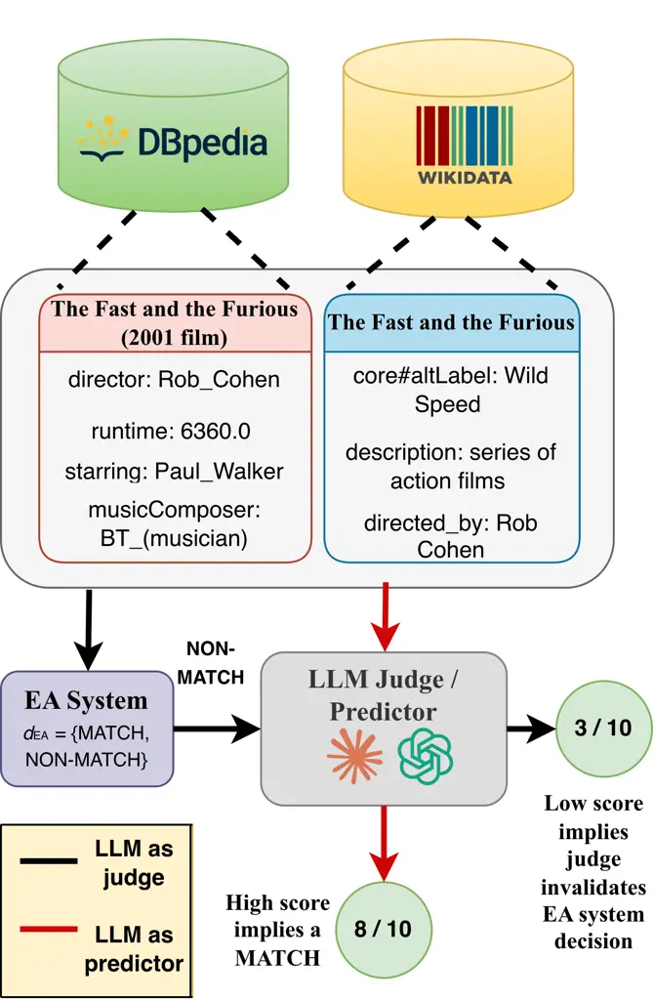
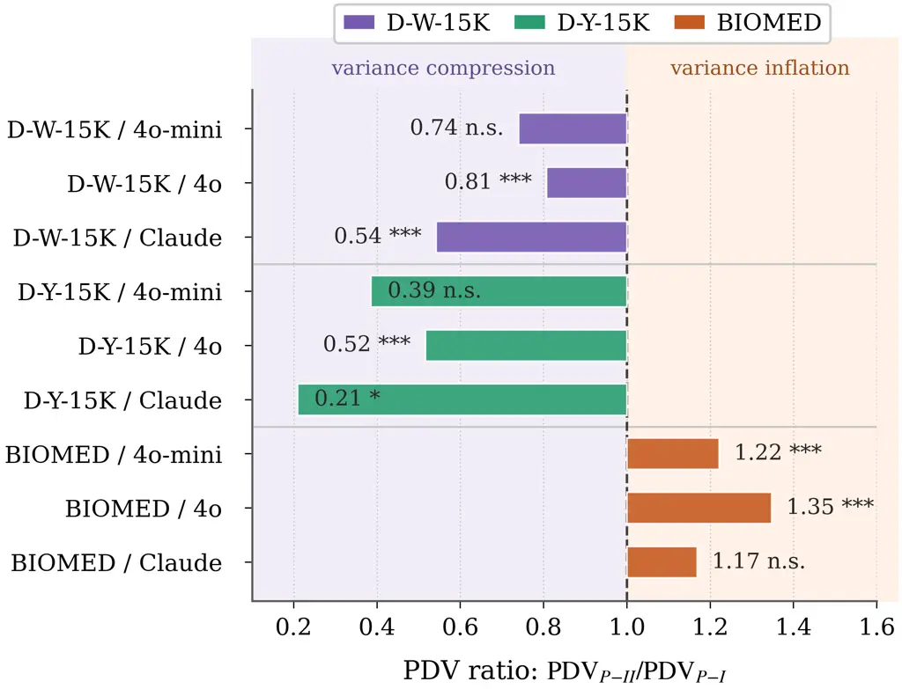
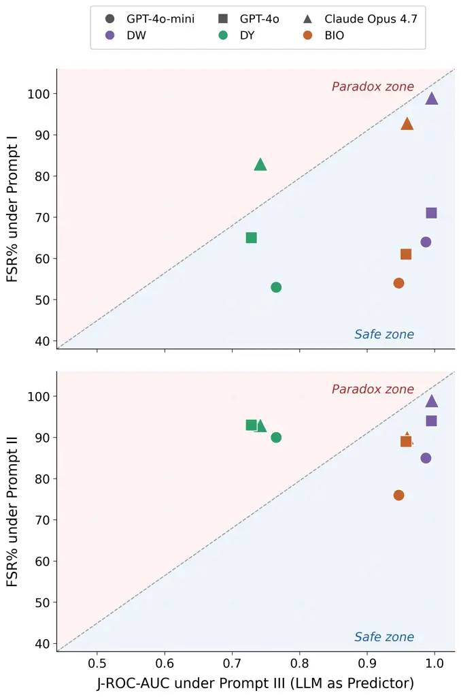

# Reliability of LLM Judges for Evaluating Entity Alignment

Vaibhava Lakshmi Ravideshik Affiliation:  University of Michigan, Ann
Arbor Email: [vlds@umich.edu](mailto:)    Mayank Kejriwal Affiliation: 
Information Sciences Institute, University of Southern California
Email: [kejriwal@isi.edu](mailto:)

###### Abstract

Entity Alignment (EA) identifies equivalent entities across knowledge
graphs and is critical for knowledge base integration and ontology
merging. Evaluating EA systems at scale requires expensive expert
annotation, making systematic assessment across diverse domains
practically infeasible. LLM-as-judge evaluation offers a potentially
scalable alternative, yet its reliability for structured prediction
tasks like EA remains unstudied. We present the first systematic
benchmarking study across three frontier models, three datasets, and
four EA systems, using perturbation bias diagnostics, meta-evaluation
across all dataset–judge–prompt combinations, and counterfactual
label-flip tests. We identify _anchor bias_, a failure mode in which
judges invert discrimination when the system’s decision label is
visible. Judge discrimination collapses under label-exposing prompts
(J-ROC-AUC 0.12–0.87), while a label-free protocol recovers near-ceiling
capability on distinctive-name datasets (0.98–1.00 for NeuSymEA) and
significant recovery on biomedical pairs (0.93–0.95). Counterfactual
label flips show that the visible label causally shifts scores by more
than 2 points in 53–99% of pairs (FSR), with sensitivity growing with
model capability, a pattern we call the frontier model paradox: stronger
judges are more label-sensitive, not less, yet also better label-free
predictors. The direction of the shifts is mixed, so we report this as
an observed pattern. A blinded two-annotator human evaluation (102
pairs, Cohen’s $`\kappa=0.902`$) provides a gold-label reference. We
release the first biomedical EA benchmark (MeSH–SNOMED CT, 15K pairs)
and a reproducible auditing framework for LLM judge reliability in EA.
Code and data are available at
[https://github.com/vaibhavalakshmiravideshik/llm-as-a-judge-entity-alignment](https://github.com/vaibhavalakshmiravideshik/llm-as-a-judge-entity-alignment).

## 1 Introduction

Entity alignment determines when entities in different knowledge graphs
refer to the same real-world concept and is fundamental for knowledge
base integration, ontology merging, and scientific data linking.
Existing approaches range from translation-based embedding methods
Bordes et al. (2013); Sun et al. (2017); Wang et al. (2018) to hybrid
neural-symbolic systems Cheng et al. (2025); Chen et al. (2026). Despite
advances in EA methodology, a critical bottleneck persists: evaluating
whether predictions are correct requires expensive expert annotation,
making large-scale benchmarking practically infeasible. LLM-as-judge
evaluation can be a promising scalable alternative Zheng et al. (2023b);
Fu et al. (2024), yet a troubling pattern is emerging: LLMs exhibit
systematic vulnerabilities when asked to make precise judgments. Recent
work shows that a single irrelevant clause causes performance drops of
up to 65% Mirzadeh et al. (2025), suggesting LLMs replicate training
patterns rather than reason genuinely.

For EA evaluation, this concern is acute: a judge must understand entity
semantics, reason about alignment plausibility independent of system
labels, and resist memorized entity names from pre-training. When a
system outputs a binary label (MATCH/NON MATCH) visible to the judge,
the judge may validate rather than evaluate, rationalizing the system’s
decision post-hoc. Figure 1 illustrates this evaluation setting on a
D-W-15K example. The judge is not asked to predict alignment directly;
rather, it is asked to score whether the displayed EA decision is
justified by the evidence. This creates a structural vulnerability: the
decision label can become a cue to be rationalized rather than an object
to be evaluated. We refer to this failure mode as _anchor bias_: the
judge’s score may track the visible system label even when the evidence
should lead it to reject that label. Can we trust the judge?



Figure 1: LLM-as-judge evaluation for entity alignment, illustrated
using D-W-15K (DBpedia–Wikidata). The two KG entities share the name
“The Fast and the Furious” and the same director, but refer to different
things: Entity A (DBpedia) is the 2001 film; Entity B (Wikidata) is the
entire franchise series. The correct alignment label is Non-Match. Black
path (LLM as judge): The EA system correctly predicts Non-Match; the LLM
judge scores this decision 3/10, implying it considers Non-Match
unjustified—anchoring on the shared name and director rather than
reasoning from evidence. Red path (LLM as predictor): When the entity
pair is sent directly to the LLM without any system label, it predicts
Match with 8/10 confidence—again anchored on surface name similarity.

We present the first systematic benchmarking study of LLM-as-judge
reliability for entity alignment, introducing a three-experiment
framework of perturbation diagnostics, meta-evaluation across EA
systems, and counterfactual label-flip analysis Kaushik et al. (2019);
Gardner et al. (2020). We also release a new biomedical EA benchmark
(MeSH $`\times`$ SNOMED-CT, 15K pairs) Ravideshik and Kejriwal (2026a);
Ravideshik and Kejriwal (2026b). Key contributions include:

- •
  We characterize _anchor bias_, a failure mode in EA evaluation that is
  structurally distinct from prior anchoring and label-leakage effects
  observed in generation settings (§2), and introduce a diagnostic suite
  (PBI, JSR $`\rho`$, MRI) that combines perturbation and robustness
  measurement principles into a framework purpose-built for auditing
  structured-prediction LLM judges.
- •
  We show that judge discrimination collapses when the system label is
  visible (J-ROC-AUC 0.12–0.87), while an independent
  alignment-prediction protocol recovers strongly positive alignment
  discrimination on distinctive-name datasets. Counterfactual label
  flips show that the visible label causally moves judge scores across
  both EasyEA Cheng et al. (2025) and NeuSymEA Chen et al. (2026) (FSR
  53–99%), with larger shifts for stronger judges; we treat this as
  label dependence of mixed direction, not proof of a single mechanism.
  A blinded two-annotator human evaluation provides a gold-label
  reference (§4.4).
- •
  We construct and release a new biomedical EA benchmark (MeSH
  $`\times`$ SNOMED-CT, 15K pairs) with a reproducible auditing
  framework for EA-centric LLM judge reliability. MeSH and SNOMED CT use
  fundamentally different schema designs; hierarchical trees versus
  description-logic concepts, making alignment structurally harder and
  exposing failure modes that homogeneous benchmarks do not. The
  benchmark is released under the licensing terms described in §4 and
  Appendix E.

## 2 Related Work

#### Entity Alignment.

Entity alignment has progressed from translation-based embedding methods
Bordes et al. (2013); Sun et al. (2017); Wang et al. (2018) to
LLM-augmented systems Zhang et al. (2024) and hybrid neural-symbolic
approaches such as EasyEA Cheng et al. (2025) and NeuSymEA Chen et al.
(2026), with systematic benchmarking across these approaches Sun et al.
(2020) driving substantial progress. Closely related variants beyond NLP
go by the names of entity resolution and record linkage in databases and
information retrieval Getoor and Machanavajjhala (2013); Papadakis et
al. (2020), and the problem also bears resemblance to coreference
resolution Ng (2010), though EA assumes entities are structured within a
graph or database rather than mentioned in free text. Despite these
advances, large-scale evaluation remains a bottleneck: verifying
predicted alignments requires expert annotation that is expensive and
slow to produce.

#### LLM-as-Judge Evaluation and Its Failure Modes.

LLM judges have been applied to text generation, summarization, and
preference evaluation Zheng et al. (2023b); Fu et al. (2024), offering
scalability without gold-standard references. However, documented
failure modes position bias Zheng et al. (2023a), verbosity bias Dubois
et al. (2024), and prompt sensitivity Webson and Pavlick (2022) raise
systematic reliability concerns, and none address structured prediction
tasks where the judge’s input contains a discrete decision label. Anchor
bias builds directly on the established anchoring-effects Kahneman et
al. (1982) and confirmation-bias Nickerson (1998) literatures, and
connects to recent evidence that anchoring persists in frontier LLMs:
O’Leary (2025) show that ChatGPT, Claude, and Gemini all shift numerical
judgments toward provided anchor values. We do not claim anchoring
itself as a new phenomenon; our contribution is a structurally distinct
instantiation for structured prediction: prior work studies anchoring on
open-ended numerical estimates or opinion questions where the anchor is
contextual information, whereas here the anchor is a discrete system
decision label embedded directly in the evaluation input, creating a
rationalization target absent from generation-evaluation settings, a
distinction we return to in §5, where we show chain-of-thought prompting
does not resolve the bias.

#### LLM Reasoning Fragility and Shortcut Learning.

LLMs are brittle to surface-level input changes even when underlying
semantics are preserved. GSM-Symbolic Mirzadeh et al. (2025) shows that
a single irrelevant clause causes performance drops of up to 65% across
frontier models, suggesting that models replicate training patterns
rather than reason from first principles, connecting directly to
shortcut learning Geirhos et al. (2020): models rely on memorized
surface correlations rather than structural evidence, enabling judges to
rationalize arbitrary system decisions when entity names are
recognizable. We build on this to characterize anchor bias and report
that, across the three frontier models we test, label sensitivity grows
rather than shrinks with model scale, even though the same models are
stronger label-free predictors; we term this dissociation the _frontier
model paradox_ (§5.3) and treat it as an observed pattern, not a settled
mechanism.

#### Counterfactual Evaluation.

Counterfactual and contrast-set methods establish causal evidence in NLP
by holding content fixed while manipulating specific factors Kaushik et
al. (2019); Gardner et al. (2020). We adapt this methodology directly to
EA judge evaluation: flipping system decision labels while holding all
entity evidence fixed isolates the visible label as the only changed
input, giving causal, rather than correlational, evidence of label
dependence; whether that dependence is appropriate (checking the label
against the evidence) or biased is addressed through the direction of
the shifts and Experiments 2 and 4.

#### Knowledge Graph Benchmarking.

Existing EA benchmarks Sun et al. (2020) focus on homogeneous
general-domain graph pairs such as DBpedia–Wikidata and DBpedia–YAGO,
where source graphs share consistent schemas. Biomedical knowledge
graphs present a harder challenge due to schema heterogeneity, sparse
expert annotation, and domain-specific terminology; we release
MeSH–SNOMED CT Ravideshik and Kejriwal (2026a); Ravideshik and Kejriwal
(2026b) as a large-scale biomedical EA benchmark embedded in its full
ontological context, directly addressing this gap (licensing details in
§4, Appendix E).

## 3 Methodology

### 3.1 Entity Alignment Formulation

Given two knowledge graphs $`G_{1}`$ and $`G_{2}`$, entity alignment
determines which pairs of entities $`(e_{1},e_{2})`$ refer to the same
real-world concept. An EA system $`\mathcal{S}`$ produces a decision
$`d\in\{\text{MATCH},\text{NON MATCH}\}`$ for each candidate pair. When
human annotation is unavailable, an LLM judge $`\mathcal{J}`$ evaluates
whether this decision is correct by assigning a score $`s\in[0,10]`$.
The central question is whether $`s`$ genuinely reflects decision
correctness or is confounded by the visible label $`d`$ itself. If the
judge simply rationalizes whatever label it sees, LLM-as-judge
evaluation is circular: it reproduces the system’s decisions rather than
auditing them.

### 3.2 Anchor Bias: Definition and Formalization

We define _anchor bias_ as the tendency of an LLM judge to rationalize a
displayed system decision label rather than independently assess the
evidence for entity alignment. When a judge receives the tuple
$`(e_{1},e_{2},\text{context},d)`$, anchor bias occurs when $`s`$ is
driven primarily by $`d`$ rather than by the entity evidence. This makes
judge scores uninformative: a judge that validates system labels appears
to perform well on correct predictions and poorly on incorrect ones not
because it is reasoning, but because it is echoing. The judge becomes a
validator rather than an independent arbiter, defeating the purpose of
automated evaluation.

### 3.3 Perturbation Bias Diagnostics

To claim that judges rationalize visible labels rather than reasoning
from evidence, we must first establish what judges rely on in the
_absence_ of a label. If scores collapse when entity names are
anonymized, the judge’s baseline reasoning is driven by memorized name
recognition; precisely the surface shortcut that makes it susceptible to
label anchoring. We administer controlled modifications to entity names,
evidence, and context following the behavioral testing paradigm Ribeiro
et al. (2016), and characterize judge dependence through three
complementary metrics:

#### Perturbation Bias Index (PBI).

PBI measures the average score drop after perturbation:

```math
\text{PBI}=\bar{s}_{\text{original}}-\bar{s}_{\text{perturbed}} \tag{1}
```

A value $`>0`$ indicates reliance on the perturbed feature rather than
structural evidence.

#### Judge Score Rank Correlation (JSR $`\rho`$).

JSR is the Spearman rank correlation between original and perturbed
scores:

```math
\text{JSR}=\rho\bigl(\mathbf{s}_{\text{original}},\,\mathbf{s}_{\text{perturbed}}\bigr) \tag{2}
```

High JSR indicates consistent reliance on the perturbed feature across
pairs; low JSR indicates erratic, pair-specific scrambling that PBI
alone cannot reveal.

#### Massive Rank Inversion Rate (MRI).

MRI measures the fraction of pairs with score collapse exceeding 2
points:

```math
\text{MRI}=\frac{|\{i:s^{i}_{\text{original}}-s^{i}_{\text{perturbed}}>2\}|}{n}\times 100\% \tag{3}
```

PBI can stay small even when a minority of pairs collapse
catastrophically; MRI isolates these extreme failures. Together, PBI,
JSR, and MRI profile name-dependence magnitude, consistency, and
catastrophic rate.

### 3.4 EA System Meta-Evaluation

Perturbation diagnostics reveal what the judge relies on, but not
whether it can distinguish correct from incorrect EA predictions; the
operational question for evaluation. To measure this, and to isolate the
role of label exposure, we contrast three prompting conditions that vary
the structural relationship between the judge and the system decision:
(I) *Evidence-locked decision validation* 8-step chain-of-thought
reasoning instructing the judge to assess the system decision from
entity evidence alone; (II) *Minimal decision validation* no guidance,
representing the default practitioner setting; (III) *Label-free
alignment prediction* the system decision is never shown; the LLM
independently predicts alignment. Prompts I–II are LLM-as-judge
conditions; Prompt III is an LLM-as-predictor capability probe.

We operationalize judge performance through the metrics in Table 1.

| Metric    | Formula                                               | Interpretation                                                                                        |
| --------- | ----------------------------------------------------- | ----------------------------------------------------------------------------------------------------- |
| Score Gap | $`\Delta=\bar{s}_{\mathrm{M}}-\bar{s}_{\mathrm{NM}}`$ | Negative $`\Delta`$ = inverted discrimination                                                         |
| PDV       | $`\mathrm{Var}(s\mid\text{prompt})`$                  | Low PDV = compression                                                                                 |
| J-ROC-AUC | $`P(s_{+}>s_{-})`$                                    | $`{<}0.5`$ = anchor bias (P-I/II, judge); $`{>}0.9`$ = strong alignment prediction (P-III, predictor) |

Table 1: Metrics for EA system meta-evaluation (Experiment 2). Under
Prompts I–II the LLM scores how well-justified the visible system
decision is; J-ROC-AUC measures correctness discrimination. Under
Prompt III the LLM acts as a predictor; no label is shown and Score Gap
is the primary metric.

### 3.5 Counterfactual Label Sensitivity

Meta-evaluation establishes whether judges discriminate correctly, but a
correlation between label and score does not establish causation.
Establishing that labels _cause_ score changes requires an intervention:
holding all entity evidence fixed and changing only the visible label
Kaushik et al. (2019). Any score change under this intervention is
attributable solely to the label. Because Prompts I and II ask the judge
to score whether the displayed decision is correct, some label
dependence is required of a good judge, so the experiment tests how
strongly, and in which direction, scores respond, not whether they
respond. We quantify the response through three metrics:

#### Mean Absolute Shift (MAS).

MAS measures the average magnitude of score change after label flipping:

```math
\text{MAS}=\frac{1}{n}\sum_{i=1}^{n}\left|s^{(i)}-\bar{s}^{(i)}\right| \tag{4}
```

High MAS indicates that scoring depends strongly on the visible label.

#### Flip Sensitivity Rate (FSR).

FSR measures the fraction of pairs with score shifts exceeding 2 points
after label flipping:

```math
\text{FSR}=\frac{|\{i:|s^{(i)}-\bar{s}^{(i)}|>2\}|}{n}\times 100\% \tag{5}
```

While MAS captures average sensitivity, FSR captures the _prevalence_ of
large causal effects: high FSR means label dependence is systematic
rather than marginal, affecting the majority of evaluation decisions.
FSR alone cannot separate appropriate sensitivity from bias.

#### Label Following Rate (LFR).

LFR measures the fraction of pairs where the score shifts in the
direction of the flipped label:

```math
\begin{split}\text{LFR}=\frac{100}{n}\Bigl(&\sum_{i\in\mathcal{M}}\mathbb{1}[\bar{s}^{(i)}<s^{(i)}]\\
&+\sum_{i\in\mathcal{N}}\mathbb{1}[\bar{s}^{(i)}>s^{(i)}]\Bigr)\%\end{split} \tag{6}
```

Downward when Match flips to Non-Match, upward when Non-Match flips to
Match. LFR is a directional descriptor, not a test of bias. Because the
scores rate the correctness of the displayed decision, an
evidence-sensitive judge should lower its score whenever a correct
decision is flipped to an incorrect one. For Non-Match pairs this score
moves _down_, against the direction LFR counts, so such a judge yields
LFR of at most about 50% (the exact value depends on how many original
decisions were correct). LFR clearly above 50% indicates scores moving
toward the displayed label even when it contradicts the evidence. FSR
captures whether scores respond to a flip, LFR how often the response
follows the new label; we read neither alone as evidence of anchoring.

### 3.6 Human Evaluation Protocol

To validate that judge scores reflect genuine EA correctness rather than
an artifact of our automated metrics, we conducted a blinded
two-annotator human evaluation: both authors independently scored the
same pairs across four negative-sampling strategies under all three
prompts, without access to each other’s judgments during annotation.
Full sampling details, inter-annotator agreement statistics, and
gold-label accuracy are reported in §4.4.

## 4 Experimental Setup

#### Datasets.

We evaluate on three datasets spanning distinct alignment challenges. DW
(DBpedia $`\times`$ Wikidata) and DY (DBpedia $`\times`$ YAGO) are
OpenEA benchmarks Sun et al. (2020) with distinctive and near-identical
entity names respectively, providing a controlled contrast between
name-rich and name-ambiguous conditions. BIO (MeSH $`\times`$ SNOMED-CT,
15K pairs, publicly released Ravideshik and Kejriwal (2026a); Ravideshik
and Kejriwal (2026b)) is the first large-scale biomedical EA benchmark
released with full ontological context and is a key contribution of this
work.

#### BIO Benchmark Construction.

Ground-truth alignments were extracted from UMLS cross-references
between MeSH (December 2023) and SNOMED CT (March 2026), yielding 46,823
raw MeSH–SNOMED CT alignment pairs from which 15,000 were
stratified-sampled. Knowledge graph triples were extracted directly from
source dumps: MeSH contributes 11.4M attribute and 6.9M relation
triples; SNOMED CT contributes 1.4M attribute and 1.3M relation triples.

BIO presents three structural challenges absent from general-domain
benchmarks: no shared predicate vocabulary between MeSH and SNOMED CT,
sparse LLM pre-training signal over biomedical ontology concepts, and
genuine many-to-many alignments from SNOMED CT’s finer granularity. Full
construction details, dataset statistics, and release information are
provided in Appendix E Ravideshik and Kejriwal (2026a); Ravideshik and
Kejriwal (2026b).

#### Licensing and Access.

BIO is derived from two source ontologies with distinct access terms.
MeSH is distributed by the U.S. National Library of Medicine (NLM) under
its standard terms of use, which permit research and redistribution with
attribution. SNOMED CT requires a UMLS Metathesaurus license, free for
researchers and institutions in UMLS-affiliate countries, obtained
directly from the U.S. National Library of Medicine; redistribution of
SNOMED CT-derived content is permitted only to other UMLS license
holders. We release BIO’s triples and gold alignment pairs under these
same conditions: users must independently hold a valid UMLS license to
access the SNOMED CT-derived portion of the benchmark, consistent with
the original providers’ terms (full details in Appendix E).

#### EA Systems.

We evaluate two EA systems and their ablated variants spanning diverse
architectures to test whether observed biases are judge-driven rather
than system-specific:

1.  1.  EasyEA Cheng et al. (2025) (Hits@1: 0.806/0.947/0.518 on DW/DY/BIO)
        combines embedding-based representations with LLM guidance;
        EasyEA-EmbOnly is its embedding-only ablation.
2.  2.  NeuSymEA Chen et al. (2026) (Hits@1: $`\approx`$0.803/0.973 on
        DW/DY) integrates neural and symbolic reasoning via variational
        inference; NeuSymEA-NoRefine is its base variant without symbolic
        refinement.

#### EA System Output and Sampling Protocol.

EasyEA Cheng et al. (2025) produces alignments via a three-stage
pipeline combining LLM-based summarization, embedding fusion, and
hierarchical LLM candidate selection; EasyEA-EmbOnly disables the
Stage 3 LLM selection module. NeuSymEA Chen et al. (2026) integrates
symbolic reasoning with a neural embedding model via variational EM;
NeuSymEA-NoRefine disables the symbolic refinement component.

For Experiments 2 and 3, pairs were sampled directly from EA system
output without consulting ground-truth labels. 250 Match pairs were
sampled uniformly at random from the EA system’s predicted alignments.
250 Non-Match pairs were obtained by randomly sampling entity pairs
$`(e_{1},e_{2})`$ with $`e_{1}\in G_{1}`$, $`e_{2}\in G_{2}`$, rejecting
any pair present in the EA system’s predicted alignments. Since EA
predictions constitute a negligible fraction of $`G_{1}\times G_{2}`$,
the rejection rate is negligible. Ground-truth labels are used only when
computing evaluation metrics after sampling, not during pair selection.
System outputs were fixed before any judge evaluation began. Full
details of the sampling procedure for all experiments are in Appendix I.
For Experiment 4 (human evaluation), we additionally sample Non-Match
pairs from three harder negative-mining strategies (lexical-neighbor,
TF-IDF nearest-neighbor, and high-confidence false positives), described
in §4.4.

#### LLM Judges.

We evaluate three frontier models as judges: GPT-4o-mini, GPT-4o, and
Claude Opus 4.7, accessed via OpenRouter with temperature $`=0`$ and
max_completion_tokens $`=1500`$ across all conditions. All calls were
routed directly to each provider’s official endpoint (OpenRouter
metadata confirms provider: "Anthropic" for Claude Opus 4.7 calls,
resolving consistently to anthropic/claude-opus-4-7, and OpenAI’s
official endpoint for GPT-4o and GPT-4o-mini), and all calls within a
given experiment were completed within a single continuous session to
minimize the risk of snapshot drift. We note that temperature $`=0`$
does not by itself formally guarantee bit-for-bit determinism across
arbitrary model snapshots; we are not aware of any snapshot changes for
these models during our experimental window, and we release full
intermediate logs to support replication (Appendix C). Total API
expenditure was \$577.17 across all experiments (153,000 calls, 238.8M
tokens); a full cost breakdown is provided in Appendix C.

### 4.1 Experiment 1: Perturbation Bias Diagnostics

We conduct perturbation tests over $`n{=}500`$ pairs per condition
across all three datasets and all judge models. Pairs are sampled
uniformly at random from ground-truth alignments (MATCH pairs only; no
NON-MATCH class in Experiment 1). We use seven perturbation strategies
(P1–P7) described in Appendix A: identity anonymization (P1), evidence
suppression at 30% and 50% (P2, P3), surface transformation (P4), order
randomization (P5), identifier removal (P6), and structured-to-prose
conversion (P7). P1 is the most diagnostic, directly ablating the name
recognition shortcut; P2, P3, and P6 are reported alongside P1 in
Table 14 to capture evidence suppression dose-response and identifier
dependence; P4, P5, and P7 are reported in Appendix G (Table 15), with
P5 serving as the negative control. For each condition we compute PBI,
JSR, and MRI to characterize the judge’s feature dependence profile.
Sample size justification ($`n{=}500`$) is provided in Appendix D.0.

### 4.2 Experiment 2: EA System Meta-Evaluation

We evaluate all combinations of datasets (DW, DY, BIO), EA systems
(EasyEA and its ablation EasyEA-EmbOnly, NeuSymEA and its ablation
NeuSymEA-NoRefine), judges (GPT-4o-mini, GPT-4o, Claude Opus 4.7), and
prompts (I, II, III). For each condition we sample $`n{=}500`$ pairs
(250 MATCH, 250 NON MATCH) and compute Score Gap, PDV, and J-ROC-AUC.

Under Prompts I–II, J-ROC-AUC measures
$`P(s_{\text{correct decision}}>s_{\text{incorrect decision}})`$;
inversion below 0.5 is the operational signature of anchor bias. Under
Prompt III, Score Gap is the primary metric; J-ROC-AUC is also reported
but measures alignment prediction capability
$`P(s_{\textsc{Match}}>s_{\textsc{Non-Match}})`$, not correctness
discrimination. Full threshold sweeps are in Appendix B (Tables 3–7).

### 4.3 Experiment 3: Counterfactual Label Sensitivity

We test causal label effects by flipping system decisions while holding
entity evidence fixed, sampling $`n{=}100`$ pairs per condition (50
MATCH $`+`$ 50 NON MATCH) from EasyEA Cheng et al. (2025) and NeuSymEA
Chen et al. (2026) on DW and DY under Prompts I and II. BIO is excluded
as NeuSymEA was not evaluated on that dataset; Prompt III is excluded as
it exposes no label. For each pair we obtain scores under the original
and flipped decision and compute MAS, FSR, and LFR to quantify how
strongly, and in which direction, the visible label moves the score; we
treat this as a causal sensitivity analysis, not a stand-alone test of
bias.

### 4.4 Experiment 4: Human Evaluation

To validate that anchor bias reflects genuine judge unreliability rather
than an artifact of our automated diagnostics, we conducted a blinded
two-annotator human evaluation following standard annotation protocols
(§3.6). Both authors independently scored the same 102 pairs (50 Match,
52 Non-Match spanning all four negative-sampling strategies) under
Prompts I, II, and III, for 306 scored instances per annotator, without
seeing each other’s scores during annotation.

#### Inter-annotator agreement.

Agreement between the two annotators is strong: Spearman $`\rho=0.967`$,
Pearson $`r=0.985`$, Cohen’s $`\kappa=0.902`$, and MAE $`=0.38`$,
indicating almost perfect agreement Landis and Koch (1977). Agreement
holds separately for Match pairs ($`\kappa=0.731`$) and Non-Match pairs
($`\kappa=0.891`$).

#### Gold-label accuracy.

The consensus annotation (mean of the two annotators’ scores) achieves a
Score Gap of 7.896 points between Match and Non-Match pairs (9.800 vs.
1.904), with 100% of Match pairs correctly scored high and 82.7% of
Non-Match pairs correctly scored low, yielding an overall gold-label
accuracy of 91.3%. This confirms the human annotations are both
internally consistent (via inter-annotator agreement) and externally
valid (via agreement with known ground truth).

#### Human–LLM correlation and the anchor-bias mechanism.

Using the consensus annotation as the gold standard, all three LLM
judges show strong overall correlation with human judgment: GPT-4o-mini
($`\rho=0.860`$, $`\kappa=0.743`$), GPT-4o ($`\rho=0.893`$,
$`\kappa=0.812`$), and Claude Opus 4.7 ($`\rho=0.920`$,
$`\kappa=0.871`$, MAE $`=0.23`$). Claude Opus 4.7 achieves the highest
alignment with human consensus, consistent with its status as the
strongest of the three frontier judges we evaluate. The per-label
breakdown adds detail beyond the aggregate: under label-exposing
prompts, Match pairs show low human–LLM correlation ($`\rho=0.228`$ to
$`0.412`$) while Non-Match pairs show high correlation ($`\rho=0.779`$
to $`0.867`$). This asymmetry is compatible with anchor bias but does
not establish it: human scores on Match pairs have little spread (100%
were scored high), which alone lowers a rank correlation, and the
per-label subsets are small ($`n{=}50`$ and $`n{=}52`$). Table 17
summarizes all of these human evaluation statistics together.

## 5 Results

### 5.1 Perturbation Bias Diagnostics

Identity anonymization is the singular catastrophic perturbation trigger
on BIO (MRI up to 69%), while general-domain judges remain stable across
all conditions.



Figure 2: PDV ratio
($`\text{PDV}_{P\text{-}II}/\text{PDV}_{P\text{-}I}`$) per dataset–judge
condition. Ratios $`{<}1`$ indicate variance compression under minimal
prompting; ratios $`{>}1`$ indicate inflation. General-domain judges
compress uniformly (0.21–0.81); BIO judges inflate (1.17–1.35),
reflecting absent pre-training signal. Significance:
$`{}^{***}p{<}0.001`$, $`{}^{*}p{<}0.05`$, n.s. $`p{\geq}0.05`$.

Minimal prompting (Prompt II) elicits systematically higher baseline
scores across all nine conditions. As shown in Figure 2 (full statistics
in Table 16, Appendix H), for general-domain datasets (DW, DY), PDV
ratios fall below 1.0 (range: 0.21–0.81), indicating that removing
prompt guidance compresses score variance: the judge collapses onto
memorized entity knowledge and assigns uniformly high scores regardless
of pair quality. BIO ratios exceed 1.0 (range: 1.17–1.35), reflecting
absent pre-training signal; full analysis in §5.4.

As shown in Table 14, P1 (identity anonymization) induces MRI of
60.6–68.8% on BIO in six of nine judge–prompt conditions (18.4–48.0% in
the other three). No other perturbation strategy exceeds 7% MRI on BIO,
and P5 (order randomization), serving as a negative control, produces
MRI of at most 8.0% (below 5% in 25 of 27 conditions), confirming the
framework identifies genuine name-dependence rather than noise.

### 5.2 EA System Meta-Evaluation

Anchor bias is endemic: under label-exposing prompts J-ROC-AUC is
0.14–0.53 on DW and BIO (0.12–0.87 across all datasets), while
Prompt III (LLM as predictor) recovers near-ceiling discrimination.

Score Gaps are predominantly negative under both label-exposing prompts
(Appendix F, Table 13), confirming that judges assign systematically
higher validation scores to Non-Match decisions than to Match
decisions—the behavioral signature of anchor bias. Structured
chain-of-thought reasoning (Prompt I) does not mitigate the bias; in
several conditions it amplifies it.

Across DW and DY, 18 of 24 conditions achieve statistically significant
positive discrimination under Prompt III (LLM as predictor)
($`p{<}0.05`$, Table 13); the remaining 6 conditions are concentrated in
DY, where near-identical entity names limit label-free discrimination.
The capability gap is architecture-dependent: EasyEA Cheng et al. (2025)
variants collapse under Prompt III on DY, where near-identical entity
names provide no discriminative signal in the absence of a label, while
NeuSymEA Chen et al. (2026) variants achieve J-ROC-AUC 0.981–1.000 and
Score Gap $`+`$7.9–$`+`$9.1 ($`p{<}0.001`$) on both datasets, indicating
that structure-aware alignment training confers robustness to
predictor-mode evaluation.

Label-free evaluation succeeds on distinctive-name datasets and
structure-aware systems but fails on near-identical names paired with
weak EA systems; full scope analysis in Appendix J.

### 5.3 Counterfactual Label Sensitivity and the Frontier Model Paradox

Visible labels causally shift judge scores by more than 2 points in
53–99% of pairs, and the shifts grow with model capability: stronger
judges are more label-sensitive, not less.

As shown in Table 2, FSR exceeds 50% in every condition under Prompt I.
Prompt II raises label sensitivity further (Appendix D.3, Table 11): MAS
is higher in all 15 conditions and FSR in 13 of 15. Under Prompt I, MAS
and FSR rise from GPT-4o-mini to GPT-4o to Claude Opus 4.7 in every
condition, with Claude reaching FSR $`=`$ 99% on DW under EasyEA and 95%
under NeuSymEA; under Prompt II, Claude has the highest MAS in every
condition and FSR is near ceiling (76–100%).

LFR is mixed. Under Prompt I it is at or below 50% in 12 of 15
conditions (exceptions: DY with GPT-4o 53% and Claude 65% under EasyEA,
BIO with Claude 51%); under Prompt II it ranges from 37% to 80%, with DY
under EasyEA the only setting where all three judges are well above 50%
(70–80%). As noted in §3, an evidence-sensitive validator is itself
expected to yield LFR at or below about 50%, so values near or below 50%
do not show that scores follow the label rather than the evidence. The
DY–EasyEA values are the clearest sign of scores moving toward the
displayed label, possibly reflecting the near-identical names there.

We read FSR as showing that the visible label is a strong causal input
to the score, as it must be for a validator, and the mixed LFR as
showing that this dependence is not uniformly label-following. The
growth of sensitivity with model capability is the frontier model
paradox; we report it as an observed pattern, not as proof that stronger
judges are more biased, since larger shifts could also reflect stronger
judges detecting flipped decisions more reliably. Figure 3 relates FSR
to label-free J-ROC-AUC; that comparison also changes the task
(§Limitations).

#### Mechanism and generalization.

A candidate mechanism (pre-training signal density) and the expected
extension to other structured prediction tasks are discussed in
Appendix J; both are untested hypotheses.



Figure 3: Frontier model paradox: FSR% (label sensitivity under
Prompts I and II, LLM as judge) vs. J-ROC-AUC (alignment prediction
under Prompt III, LLM as predictor). Stronger judges show greater label
sensitivity and are also more capable when labels are withheld; the
figure describes this pattern and does not establish its cause. Shape =
judge; color = dataset.

|               |          |      |      |             |      |
| ------------- | -------- | ---- | ---- | ----------- | ---- |
| Dataset–Judge | System   | MAS  | FSR% | 95% CI      | LFR% |
| DW 4m         | EasyEA   | 3.55 | 64   | \[55, 73\]  | 17   |
| DW 4o         | EasyEA   | 4.66 | 71   | \[62, 80\]  | 29   |
| DW O4         | EasyEA   | 6.07 | 99   | \[97, 100\] | 50   |
| DW 4m         | NeuSymEA | 4.34 | 62   | \[52, 71\]  | 41   |
| DW 4o         | NeuSymEA | 6.39 | 81   | \[73, 88\]  | 46   |
| DW O4         | NeuSymEA | 8.21 | 95   | \[90, 99\]  | 47   |
| DY 4m         | EasyEA   | 3.71 | 53   | \[43, 63\]  | 43   |
| DY 4o         | EasyEA   | 4.80 | 65   | \[56, 74\]  | 53   |
| DY O4         | EasyEA   | 6.27 | 83   | \[75, 90\]  | 65   |
| DY 4m         | NeuSymEA | 4.34 | 57   | \[47, 66\]  | 39   |
| DY 4o         | NeuSymEA | 6.76 | 90   | \[84, 95\]  | 48   |
| DY O4         | NeuSymEA | 7.97 | 94   | \[89, 98\]  | 48   |
| BIO 4m        | EasyEA   | 3.26 | 54   | \[44, 64\]  | 32   |
| BIO 4o        | EasyEA   | 4.17 | 61   | \[51, 70\]  | 35   |
| BIO O4        | EasyEA   | 5.88 | 92   | \[86, 97\]  | 51   |

Table 2: Counterfactual label-flip results under Prompt I: MAS, FSR%,
95% CI, and LFR% ($`n{=}100`$ per condition, 50 MATCH $`+`$ 50 NON
MATCH). FSR exceeds 50% in every condition. 95% bootstrap CIs
($`B{=}10{,}000`$) for FSR have lower bounds above 50% in most
conditions; the exceptions are GPT-4o-mini on DY (EasyEA \[43, 63\],
NeuSymEA \[47, 66\]) and on BIO (\[44, 64\]). Compare to Prompt II
amplification in Table 11.

### 5.4 Biomedical Domain: A Distinct Failure Mode

BIO exhibits a structurally distinct failure mode: perturbation collapse
is pre-training-driven, label sensitivity is somewhat smaller, and
label-free recovery is weaker than on general-domain datasets.

On BIO, P1 identity anonymization collapse is prompt-invariant: JSR
turns negative for 4o-mini ($`-`$0.076, $`-`$0.142) and near-zero for 4o
(0.029, $`-`$0.026) under both Prompts II and III regardless of label
visibility, ruling out label anchoring as the primary driver. Instead,
MeSH and SNOMED CT concepts are rarely encountered verbatim in
pre-training corpora, leaving judges without recognizable anchors and
producing higher-variance, evidence-driven scoring.

Label sensitivity is present but somewhat smaller: FSR reaches 54–92%
(vs. 62–99% on DW), and LFR on BIO (32–51%) lies within the range seen
on DW and DY (17–65%). Label-free recovery under Prompt III is
achievable—EasyEA achieves significant positive discrimination across
all three judges ($`p{<}0.05`$, Table 13), with J-ROC-AUC
0.931–0.948—though this falls short of near-ceiling recovery on DW
(0.981–1.000), reflecting sparse attribute overlap and heterogeneous
relation predicates in MeSH–SNOMED CT.

## 6 Conclusion

Judge failure in our experiments is not a simple reasoning deficit: it
is tied to the visible label and to entity name cues. Even under an
8-step evidence-locked chain-of-thought protocol, LLM judges fail to
discriminate correct from incorrect EA predictions (J-ROC-AUC 0.12–0.87
overall; 0.14–0.53 on DW). Stronger models are not automatically the
solution: greater capability is associated with greater label
sensitivity, not less, although human agreement also rises with model
strength; we report this as an open pattern, not as evidence that
stronger judges are more biased. Prompt III, which repurposes the LLM as
a predictor rather than a judge, reveals strongly positive alignment
discrimination when labels are withheld, though it also changes the
task. Counterfactual label flips shift scores by more than 2 points in
53–99% of pairs (FSR), with mixed direction (LFR 17–80%); we read this
as strong label dependence, not on its own as anchoring. A blinded human
evaluation provides a gold-label reference. Practitioners should audit
LLM judges before relying on them, and consider label-free prediction
protocols where the system decision is not essential. We release the BIO
benchmark and all evaluation code at
[https://github.com/vaibhavalakshmiravideshik/llm-as-a-judge-entity-alignment](https://github.com/vaibhavalakshmiravideshik/llm-as-a-judge-entity-alignment)
to support this work.

## Ethical Considerations

This work evaluates LLM judge reliability using publicly available
entity alignment benchmarks. No new datasets containing personal or
sensitive information were collected. Our evaluation focuses on system
behavior and does not involve human subjects. The BIO benchmark draws
exclusively from public medical ontologies (MeSH and SNOMED-CT) that are
freely available for research, subject to the licensing terms described
in §4 and Appendix E. We release our evaluation code to promote
reproducible auditing of LLM-as-judge approaches. As LLM-based
evaluation becomes more prevalent in AI research, systematic analysis of
judge reliability in structured tasks is important for ensuring research
integrity and preventing propagation of biased judgments in downstream
applications.

## Acknowledgments

We use an AI assistant for paraphrasing support during the writing of
this manuscript.

## Limitations

We use 50/50 class-balanced evaluation ($`n{=}500`$) to isolate
discrimination capability; absolute values should be interpreted
relative to this protocol rather than operational class imbalance. We
evaluate only three closed-source frontier judges; open-source models
and non-English datasets remain untested. Prompt III changes both label
exposure and task framing simultaneously; improvements cannot be
attributed solely to label removal without a matched control. Because
Prompts I and II ask the judge to score the correctness of the displayed
decision, a large score shift under label flipping is expected of a good
judge; Experiment 3 therefore establishes causal label dependence, not
bias, and the direction of the shifts is mixed. The frontier model
paradox is observed across three frontier models accessed via a single
API provider; generalization to open-source models or different model
families remains an open question, as does empirical validation of
anchor bias on structured prediction tasks beyond entity alignment
(§5.3). Our human evaluation (§4.4) uses two author-annotators rather
than independent, uninvolved expert raters; while blinding and strong
inter-annotator agreement mitigate this concern, an independent expert
annotation study would further strengthen the validation.

## References

- Bordes et al. (2013) A. Bordes, N. Usunier, A. Garcia-Durán, J.
  Weston, and O. Yakhnenko Translating embeddings for modeling
  multi-relational data. In Advances in Neural Information Processing
  Systems 26, pp. 2787–2795. Cited by: §1, §2.
- Chen et al. (2026) S. Chen, Z. Yuan, Q. Zhang, W. Hua, J. Cao, and X.
  Huang NeuSymEA: neuro-symbolic entity alignment via variational
  inference. In Advances in Neural Information Processing Systems, Vol.
  38, pp. 92542–92564. Cited by: Table 7, Appendix B: Judge
  Meta-Evaluation Threshold Sweeps, Appendix C: Computational Cost and
  API Usage, D.3 Label-Flip Effects Under Prompt II, Table 11, 2nd item,
  §1, §2, item 2, §4, §4.3, §5.2.
- Cheng et al. (2025) J. Cheng, C. Lu, L. Yang, G. Chen, and F. Zhang
  EasyEA: large language model is all you need in entity alignment
  between knowledge graphs. In Findings of the Association for
  Computational Linguistics: ACL 2025, pp. 20981–20995. Cited by:
  Experiment 4: Human Evaluation., Table 3, Table 5, Table 6, Appendix
  B: Judge Meta-Evaluation Threshold Sweeps, D.3 Label-Flip Effects
  Under Prompt II, Table 11, 2nd item, §1, §2, item 1, §4, §4.3, §5.2.
- Dubois et al. (2024) Y. Dubois, B. Galambosi, P. Liang, and T. B.
  Hashimoto Length-controlled AlpacaEval: a simple way to debias
  automatic evaluators. arXiv preprint arXiv:2404.04475. Cited by: §2.
- Fu et al. (2024) J. Fu, S. Ng, Z. Jiang, and P. Liu GPTScore: evaluate
  as you desire. In Proceedings of the 2024 Conference of the North
  American Chapter of the Association for Computational Linguistics,
  pp. 6556–6576. Cited by: §1, §2.
- Gardner et al. (2020) M. Gardner, Y. Artzi, V. Basmova, J. Berant, B.
  Bogin, S. Chen, P. Dasigi, D. Dua, Y. Elazar, A. Gottumukkala, N.
  Gupta, H. Hajishirzi, G. Ilharco, D. Khashabi, K. Lin, J. Liu, N. F.
  Liu, P. Mulcaire, Q. Ning, S. Singh, N. A. Smith, S. Subramanian, R.
  Tsarfaty, E. Wallace, A. Zhang, and B. Zhou Evaluating models’ local
  decision boundaries via contrast sets. In Findings of the Association
  for Computational Linguistics: EMNLP 2020, pp. 1307–1323. Cited by:
  §1, §2.
- Geirhos et al. (2020) R. Geirhos, J. Jacobsen, C. Michaelis, R.
  Zemel, W. Brendel, M. Bethge, and F. A. Wichmann Shortcut learning in
  deep neural networks. Nature Machine Intelligence 2 (11), pp. 665–673.
  External Links:
  [Document](https://dx.doi.org/10.1038/s42256-020-00257-z) Cited by:
  §2.
- Getoor and Machanavajjhala (2013) L. Getoor and A. Machanavajjhala
  Entity resolution for big data. In Proceedings of the 19th ACM SIGKDD
  International Conference on Knowledge Discovery and Data Mining,
  pp. 1527–1527. Cited by: §2.
- D. Kahneman, P. Slovic, and A. Tversky (Eds.) (1982) D. Kahneman, P.
  Slovic, and A. Tversky (Eds.) Judgment under uncertainty: heuristics
  and biases. Cambridge University Press. Cited by: §2.
- Kaushik et al. (2019) D. Kaushik, E. Hovy, and Z. C. Lipton Learning
  the difference that makes a difference with counterfactually-augmented
  data. arXiv preprint arXiv:1909.12434. Cited by: §1, §2, §3.5.
- Landis and Koch (1977) J. R. Landis and G. G. Koch The measurement of
  observer agreement for categorical data. Biometrics 33 (1),
  pp. 159–174. Cited by: §4.4.
- Mirzadeh et al. (2025) I. Mirzadeh, K. Alizadeh-Vahid, H.
  Shahrokhi, O. Tuzel, S. Bengio, and M. Farajtabar GSM-Symbolic:
  understanding the limitations of mathematical reasoning in large
  language models. In Proceedings of the 13th International Conference
  on Learning Representations, Vol. 2025, pp. 94743–94765. Cited by: §1,
  §2.
- Ng (2010) V. Ng Supervised noun phrase coreference research: the first
  fifteen years. In Proceedings of the 48th Annual Meeting of the
  Association for Computational Linguistics, pp. 1396–1411. Cited by:
  §2.
- Nickerson (1998) R. S. Nickerson Confirmation bias: a ubiquitous
  phenomenon in many guises. Review of General Psychology 2 (2),
  pp. 175–220. Cited by: §2.
- O’Leary (2025) D. E. O’Leary An anchoring effect in large language
  models. IEEE Intelligent Systems 40 (2), pp. 23–26. Cited by: §2.
- Papadakis et al. (2020) G. Papadakis, D. Skoutas, E. Thanos, and T.
  Palpanas Blocking and filtering techniques for entity resolution: a
  survey. ACM Computing Surveys 53 (2), pp. 1–42. Cited by: §2.
- Ravideshik and Kejriwal (2026a) V. L. Ravideshik and M. Kejriwal
  MeSH-SNOMED-15K: a heterogeneous biomedical entity alignment
  benchmark. In Proceedings of the NILA Workshop, co-located with
  IJCAI-ECAI 2026, Bremen, Germany. Cited by: §1, §2, §4, §4.
- Ravideshik and Kejriwal (2026b) V. L. Ravideshik and M. Kejriwal
  MeSH-SNOMED-15K: biomedical entity alignment dataset. Note:
  [https://huggingface.co/datasets/vaibhavalakshmiravideshik/mesh-snomed-entity-alignment-15k](https://huggingface.co/datasets/vaibhavalakshmiravideshik/mesh-snomed-entity-alignment-15k)
  Cited by: §1, §2, §4, §4.
- Ribeiro et al. (2016) M. T. Ribeiro, S. Singh, and C. Guestrin “Why
  should I trust you?”: explaining the predictions of any classifier. In
  Proceedings of the 22nd ACM SIGKDD International Conference on
  Knowledge Discovery and Data Mining, pp. 1135–1144. Cited by: §3.3.
- Sun et al. (2017) Z. Sun, W. Hu, and C. Li Cross-lingual entity
  alignment via joint attribute-preserving embedding. In Proceedings of
  the 16th International Semantic Web Conference (ISWC), pp. 628–644.
  Cited by: §1, §2.
- Sun et al. (2020) Z. Sun, Q. Zhang, W. Hu, C. Wang, M. Chen, F.
  Akrami, and C. Li A benchmarking study of embedding-based entity
  alignment for knowledge graphs. arXiv preprint arXiv:2003.07743. Cited
  by: §2, §2, §4.
- Wang et al. (2018) Z. Wang, Q. Lv, X. Lan, and Y. Zhang Cross-lingual
  knowledge graph alignment via graph convolutional networks. In
  Proceedings of the 2018 Conference on Empirical Methods in Natural
  Language Processing, Brussels, Belgium, pp. 349–357. Cited by: §1, §2.
- Webson and Pavlick (2022) A. Webson and E. Pavlick Do prompt-based
  models really understand the meaning of their prompts?. In Proceedings
  of the 2022 Conference of the North American Chapter of the
  Association for Computational Linguistics, pp. 2300–2344. Cited by:
  §2.
- Zhang et al. (2024) Y. Zhang, Z. Chen, L. Guo, Y. Xu, W. Zhang, and H.
  Chen Making large language models perform better in knowledge graph
  completion. In Proceedings of the 32nd ACM International Conference on
  Multimedia, pp. 233–242. Cited by: §2.
- Zheng et al. (2023a) C. Zheng, H. Zhou, F. Meng, J. Zhou, and M. Huang
  Large language models are not robust multiple choice selectors. arXiv
  preprint arXiv:2309.03882. Cited by: §2.
- Zheng et al. (2023b) L. Zheng, W. Chiang, Y. Sheng, S. Zhuang, Z.
  Wu, Y. Zhuang, Z. Lin, Z. Li, D. Li, E. P. Xing, H. Zhang, J. E.
  Gonzalez, and I. Stoica Judging LLM-as-a-Judge with MT-Bench and
  Chatbot Arena. In Advances in Neural Information Processing Systems
  36, pp. 46595–46623. Cited by: §1, §2.

## Appendix Table of Contents

|            |                                                |
| ---------- | ---------------------------------------------- |
| Appendix A | Judge Prompt Templates                         |
| A.1        | Prompt I: Evidence-Locked Evaluation           |
| A.2        | Prompt II: Minimal Evaluation                  |
| A.3        | Prompt III: Independent Alignment Prediction   |
| Appendix B | Judge Meta-Evaluation Threshold Sweeps         |
| Appendix C | Computational Cost and API Usage               |
| Appendix D | Robustness and Statistical Validation          |
| D.0        | Sample Size Justification                      |
| D.1        | MRI Threshold Sensitivity                      |
| D.2        | Bootstrap Confidence Intervals for PBI and MRI |
| D.3        | Label-Flip Effects Under Prompt II             |
| Appendix E | BIOMED Dataset Construction and Validation     |
| Appendix F | Score Gap Analysis and Significance            |
| Appendix G | Full Perturbation Bias Diagnostics             |
| Appendix H | PDV Baseline Statistics                        |
| Appendix I | Sampling Procedures for All Experiments        |
| Appendix J | Extended Discussion                            |

## Appendix A: Judge Prompt Templates

We provide the complete prompt templates used in Experiments 1 and 2.
All three prompts share identical input structure (entity IDs, labels,
types, properties, relationships, and system decision where applicable)
and identical output parsing logic. They differ in task framing,
guidance level, and whether the system decision is exposed to the judge.

### A.1 Prompt I: Evidence-Locked Evaluation

Prompt I is the most carefully engineered prompt in our study. It
instantiates a _decision validation_ task: the judge receives the system
decision and is explicitly instructed to suppress pre-training knowledge
and reason exclusively from the provided evidence through an 8-step
chain-of-thought protocol.

SYSTEM ROLE

You are an Evidence-Locked Evaluator. Your sole function is to assess

whether an Entity Alignment system made a reasonable decision given

the evidence provided.

HARD CONSTRAINTS - READ BEFORE PROCEEDING:

1. EVIDENCE BOUNDARY: You must reason EXCLUSIVELY from the evidence

strings provided below. No exceptions.

2. MEMORY SUPPRESSION: You are FORBIDDEN from using any external world

knowledge, memorized entity facts, or prior training knowledge about

these entities. If you recognize an entity, DISCARD that recognition.

Treat every entity as if it were fictional and previously unknown

to you.

3. REASONING REQUIREMENT: Every conclusion you draw must be traceable

to a specific piece of evidence in the blocks below. If you cannot

cite it, you cannot claim it.

4. VIOLATION CHECK: Before writing each conclusion, ask yourself:

"Am I using only what is written below?" If no -- stop and rewrite.

ENTITY A (Knowledge Graph 1)

ID: \[entity_a_id\]

Label: \[entity_a_name\]

Type(s): \[entity_a_types\]

Properties: \[entity_a_properties\]

Relationships (1-2 hops):

\[entity_a_relationships\]

ENTITY B (Knowledge Graph 2)

ID: \[entity_b_id\]

Label: \[entity_b_name\]

Type(s): \[entity_b_types\]

Properties: \[entity_b_properties\]

Relationships (1-2 hops):

\[entity_b_relationships\]

SYSTEM DECISION: \[system_decision\]

INTERNAL REASONING -- DO NOT INCLUDE IN FINAL OUTPUT

Work through the following steps internally. Be exhaustive and critical.

Final output must contain ONLY the structured block at the end.

STEP 1: Structural Profiling

For each entity, derive its structural identity purely from the

evidence above. Do NOT name, recognize, or recall real-world entities.

Entity A:

- Functional role: \[What does this entity do or represent based on

its properties?\]

- Distinctive structural signals: \[Which attributes/relations are

rare or specific?\]

- Relational fingerprint: \[What does its graph neighborhood look
  like?\]

- Ambiguities: \[What is underspecified or missing?\]

Entity B:

- Functional role: \[same\]

- Distinctive structural signals: \[same\]

- Relational fingerprint: \[same\]

- Ambiguities: \[same\]

STEP 2: Evidence Inventory

List ALL evidence relevant to alignment. Cite exact strings from above.

Do not infer or paraphrase beyond what is written.

SUPPORTING ALIGNMENT:

- \[Cite evidence. State why it supports alignment.\]

- \[Each point must quote or directly reference the evidence text.\]

CONTRADICTING ALIGNMENT:

- \[Cite evidence. State why it contradicts alignment.\]

- \[Each point must quote or directly reference the evidence text.\]

NEUTRAL / AMBIGUOUS:

- \[Evidence that is present but uninformative for this decision.\]

STEP 3: Evidence Strength Assessment

Classify each piece of evidence by its discriminative power.

STRONG SUPPORT (distinctive, unlikely coincidental):

- \[Evidence that would rarely appear in two different entities\]

WEAK SUPPORT (generic, coincidental):

- \[Evidence that is broad or common\]

STRONG CONTRADICTION (irreconcilable conflict):

- \[Evidence that makes co-reference structurally impossible\]

WEAK CONTRADICTION (explainable by data quality):

- \[Minor inconsistency attributable to schema difference or missing

data\]

STEP 4: Relational Chain Reasoning

This step is mandatory. Follow any multi-hop chains present in the

evidence.

For each relation chain you can traverse:

- Write out the chain explicitly: A -\> rel1 -\> X -\> rel2 -\> Y

- State what conclusion this chain supports or contradicts

- If both entities share a chain endpoint, note it as convergent

evidence

Example format:

"Entity A: part_of -\> \[narrative universe X\] -\> features -\>

\[protagonist type Y\]

Entity B: belongs_to -\> \[saga X\] -\> centers_on -\> \[officer type
Y\]

-\> Both chains converge on \[X\] and \[Y\] -\> supports alignment"

If no chains are present in the evidence, explicitly state:

"No multi-hop chains available -- decision must rely on direct

attribute comparison only."

STEP 5: Decision Analysis

The system decided: \[system_decision\]

Evaluate this decision against your evidence inventory from Steps 2-4.

- Does the weight of strong evidence support or contradict the

decision?

- Are there irreconcilable contradictions the system ignored?

- Are there convergent relational chains the system missed?

- Is the decision traceable to the evidence, or does it appear

arbitrary?

- Would the decision hold if entity labels were replaced with

anonymous IDs?

That last question is your pre-training bias check. If the answer

is NO -- the system (or judge) relied on label recognition, not

reasoning.

STEP 6: Missed Signals

What did the system fail to handle? Choose from:

- Failed to follow relational chains present in evidence

- Over-relied on surface label similarity

- Ignored type/schema conflicts

- Missed convergent graph neighborhood signals

- Over-weighted weak/coincidental evidence

- Under-weighted strong/distinctive evidence

- Failed to notice critical missing evidence on one side

- Reasoned beyond provided evidence (used external knowledge)

- Other: \[specify\]

Be specific. Reference exact evidence strings.

STEP 7: Score Assignment

Score the system’s decision from 0-10.

\| Score \| Meaning \|

\| -\| \|

\| 10 \| Evidence overwhelmingly supports decision. No missed \|

\| \| signals. \|

\| 9 \| Evidence strongly supports. Minor quibbles only. \|

\| 8 \| Evidence clearly supports. Slight ambiguity present but \|

\| \| irrelevant. \|

\| 7 \| Evidence supports but minor missed nuance. Outcome \|

\| \| unaffected. \|

\| 6 \| Evidence moderately supports. Alternate decision also \|

\| \| defensible. \|

\| 5 \| Evidence mixed. Decision plausible but weakly supported. \|

\| 4 \| Evidence weakly supports. Clear warning signs ignored. \|

\| 3 \| Evidence mostly contradicts. Catchable error. \|

\| 2 \| Evidence strongly contradicts. Significant obvious error. \|

\| 1 \| Evidence overwhelmingly contradicts. Near-malfunction. \|

\| 0 \| Decision defies all evidence. Completely indefensible. \|

Score: \_\_\_ / 10

Justification: \[Cite specific evidence. Reference rubric tier

explicitly.\]

STEP 8: Error Category (ONLY if score \<= 5)

Assign ONE primary error category:

\[ \] Over-relied on surface label similarity

\[ \] Ignored type/schema conflict

\[ \] Failed to follow relational chains in evidence

\[ \] Missed convergent graph neighborhood signals

\[ \] Over-weighted weak/coincidental evidence

\[ \] Under-weighted strong/distinctive evidence

\[ \] Reasoned beyond evidence (external knowledge used)

\[ \] Data quality mishandled

\[ \] Other: \[specify\]

FINAL OUTPUT -- INCLUDE ONLY THIS BLOCK

ENTITY A: \[entity_a_name\] (\[entity_a_id\])

ENTITY B: \[entity_b_name\] (\[entity_b_id\])

SYSTEM DECISION: \[system_decision\]

SCORE: \[X\]/10

CRITIQUE: \[Direct, specific critique of the system decision.

Format: "You \[did X with evidence\]. You should have \[done Y\].

This caused \[consequence Z\]."

Every claim must reference specific evidence strings.

No external knowledge. 3-5 sentences maximum.\]

ERROR CATEGORY: \[From Step 8, only if score \<= 5. Otherwise: N/A\]

EVIDENCE USED: \[Bullet list of the exact evidence strings that

determined your score. Maximum 5 bullets.\]

### A.2 Prompt II: Minimal Evaluation

Prompt II is the zero-guidance baseline. It provides no chain-of-thought
instructions, no memory suppression, no evidence boundary, and no
rubric. The judge sees the system decision and scores it using whatever
default reasoning strategy it applies. This represents the condition
most practitioners would use in the absence of prompt engineering, and
serves as the baseline against which Prompt I measures the total effect
of full prompt design on anchor bias.

You are evaluating whether an entity alignment system made a correct

decision.

Two entities from different knowledge graphs are shown below.

The system decided whether they refer to the same real-world entity.

Score how well-justified that decision is given the available

information.

ENTITY A (Knowledge Graph 1)

ID: \[entity_a_id\]

Label: \[entity_a_name\]

Type(s): \[entity_a_types\]

Properties: \[entity_a_properties\]

Relationships: \[entity_a_relationships\]

ENTITY B (Knowledge Graph 2)

ID: \[entity_b_id\]

Label: \[entity_b_name\]

Type(s): \[entity_b_types\]

Properties: \[entity_b_properties\]

Relationships: \[entity_b_relationships\]

SYSTEM DECISION: \[system_decision\]

Score the system’s decision from 0 (completely wrong) to

10 (completely correct).

SCORE: \[X\]/10

CRITIQUE: \[2-3 sentences explaining your score.\]

ERROR CATEGORY: N/A

### A.3 Prompt III: LLM as Predictor

Prompt III instantiates an _alignment prediction_ task rather than a
decision validation task. The system decision is never shown to the LLM
predictor. Instead, the judge forms its own independent alignment
prediction using a 6-step reasoning protocol. Score semantics are
inverted relative to Prompts I and II: high scores indicate high
confidence in a match, low scores indicate high confidence in a
non-match. The key structural difference is the physical absence of a
label anchor rather than an instruction to ignore one. This physical
absence is what removes the label anchor structurally, making Prompt III
an alignment-prediction task rather than a debiased version of decision
validation.

SYSTEM ROLE

You are an Entity Alignment Predictor. Your task is to assess whether

two entities from different knowledge graphs refer to the same

real-world entity. You have no system decision to evaluate -- you must

form your own judgment from the evidence provided.

HARD CONSTRAINTS:

1. EVIDENCE BOUNDARY: Reason EXCLUSIVELY from the evidence provided

below.

2. MEMORY SUPPRESSION: Do NOT use external world knowledge or prior

training knowledge about these entities. If you recognise an entity,

DISCARD that recognition. Treat every entity as previously unknown.

3. SCORE SEMANTICS: Higher score = higher confidence they are the SAME

entity.

10 = near-certain match \| 5 = ambiguous \| 0 = near-certain non-match.

ENTITY A (Knowledge Graph 1)

ID: \[entity_a_id\]

Label: \[entity_a_name\]

Type(s): \[entity_a_types\]

Properties: \[entity_a_properties\]

Relationships (1-2 hops):

\[entity_a_relationships\]

ENTITY B (Knowledge Graph 2)

ID: \[entity_b_id\]

Label: \[entity_b_name\]

Type(s): \[entity_b_types\]

Properties: \[entity_b_properties\]

Relationships (1-2 hops):

\[entity_b_relationships\]

INTERNAL REASONING -- DO NOT INCLUDE IN FINAL OUTPUT

STEP 1: Structural Profiling

Derive the structural identity of each entity purely from the evidence

above. Do NOT name, recognise, or recall real-world entities.

Entity A:

- Functional role: \[what does it represent based on its properties?\]

- Distinctive signals: \[which attributes/relations are rare or
  specific?\]

- Relational fingerprint: \[what does its graph neighbourhood look
  like?\]

- Ambiguities: \[what is underspecified or missing?\]

Entity B:

- Functional role: \[same\]

- Distinctive signals: \[same\]

- Relational fingerprint: \[same\]

- Ambiguities: \[same\]

STEP 2: Evidence Alignment Inventory

Cite exact strings from above. Do not infer beyond what is written.

SUPPORTING MATCH:

- \[Quote evidence. State why it supports co-reference.\]

CONTRADICTING MATCH:

- \[Quote evidence. State why it contradicts co-reference.\]

NEUTRAL / AMBIGUOUS:

- \[Evidence present but uninformative for this decision.\]

STEP 3: Relational Chain Reasoning

Follow any multi-hop chains present in the evidence.

For each chain: A -\> rel1 -\> X -\> rel2 -\> Y

State what conclusion this chain supports or contradicts.

If no chains present: "No multi-hop chains available."

STEP 4: Evidence Strength Assessment

STRONG MATCH SIGNALS (distinctive, unlikely coincidental):

- \[Evidence that would rarely appear in two different entities\]

WEAK MATCH SIGNALS (generic, coincidental):

- \[Evidence that is broad or common across many entities\]

STRONG NON-MATCH SIGNALS (irreconcilable conflict):

- \[Evidence that makes co-reference structurally impossible\]

WEAK NON-MATCH SIGNALS (explainable by schema difference):

- \[Minor inconsistency attributable to data quality or schema
  mismatch\]

STEP 5: Alignment Score Assignment

Score 0-10 reflecting your confidence that A and B refer to the same

entity.

\| Score \| Meaning \|

\| -\| --\|

\| 10 \| Near-certain match. Evidence overwhelmingly supports \|

\| \| co-reference. \|

\| 9 \| Strong match. Evidence strongly supports. Minor gaps only. \|

\| 8 \| Likely match. Clear convergence with slight ambiguity. \|

\| 7 \| Probable match. More supporting than contradicting evidence. \|

\| 6 \| Lean match. Weak convergence, alternate explanation possible. \|

\| 5 \| Ambiguous. Evidence insufficient or perfectly balanced. \|

\| 4 \| Lean non-match. More contradicting than supporting. \|

\| 3 \| Probable non-match. Structural conflicts present. \|

\| 2 \| Likely non-match. Evidence strongly diverges. \|

\| 1 \| Strong non-match. Near-irreconcilable conflict. \|

\| 0 \| Near-certain non-match. Evidence overwhelmingly contradicts \|

\| \| co-reference. \|

Bias check: Would your score change if entity labels were replaced with

anonymous IDs? If YES -- you are using name recognition, not evidence.

Adjust your score to reflect evidence only.

Score: \_\_\_ / 10

Justification: \[Cite specific evidence strings. 3-5 sentences
maximum.\]

STEP 6: Error Category (ONLY if score is 4 or below)

\[ \] Type/schema conflict

\[ \] Contradicting relational chains

\[ \] Irreconcilable attribute conflict

\[ \] Insufficient evidence on one or both sides

\[ \] Other: \[specify\]

FINAL OUTPUT -- INCLUDE ONLY THIS BLOCK

ENTITY A: \[entity_a_name\] (\[entity_a_id\])

ENTITY B: \[entity_b_name\] (\[entity_b_id\])

PREDICTION: \[MATCH / NON-MATCH / UNCERTAIN\]

SCORE: \[X\]/10

CRITIQUE: \[Direct justification of your alignment prediction.

Format: "The evidence \[supports/contradicts/is insufficient for\]

alignment because \[specific evidence strings\]. The strongest signal

was \[X\]."

3-5 sentences. No external knowledge. Cite evidence strings only.\]

ERROR CATEGORY: \[From Step 6 if score \<= 4. Otherwise: N/A\]

EVIDENCE USED: \[Bullet list of exact evidence strings that most

influenced your score. Maximum 5 bullets.\]

#### Structural distinction across prompts.

Prompts I and II are _decision validation_ tasks: the LLM acts as a
judge, receiving a system label (Match or Non-Match) and scoring how
justified that decision is. Prompt III is an _alignment prediction_
task: the LLM acts as a predictor; no label is shown and its score
directly encodes its own alignment confidence (high $`=`$ match,
low $`=`$ non-match). The mechanistic basis for Prompt III’s revelation
of underlying capability is a structural difference: the physical
absence of the label anchor rather than an instruction to ignore it.
This mechanism is empirically demonstrated in the results above,
particularly in the perturbation bias analysis.

## Appendix B: Judge Meta-Evaluation Threshold Sweeps

Tables 3, 4, 5, and 6 report J-Precision, J-Recall, J-F1, and J-ROC-AUC
at thresholds $`t\in\{5,6,7,8,9\}`$ for EasyEA Cheng et al. (2025)
across DW, DY, and BIO respectively. Formally,
$`c_{i}=\mathbb{1}[\hat{y}_{i}=y_{i}]`$ is the correctness indicator
computed after sampling; J-Precision, J-Recall, J-F1, and J-ROC-AUC are
computed between $`\mathbf{c}`$ and the judge’s binary acceptance
$`y_{\text{judge}}^{(i)}(t)=\mathbb{1}[s^{(i)}\geq t]`$, measuring
whether the judge correctly identifies EA system correctness. Table 7
reports the same for NeuSymEA Chen et al. (2026) and NeuSymEA-NoRefine.

| Judge           | Prompt | $`t`$ | J-Prec | J-Rec | J-F1  | J-ROC-AUC |
| --------------- | ------ | ----- | ------ | ----- | ----- | --------- |
| GPT-4o-mini     | I      | 5     | 0.506  | 0.980 | 0.668 | 0.528     |
|                 |        | 6     | 0.500  | 0.828 | 0.623 |           |
|                 |        | 7     | 0.505  | 0.584 | 0.542 |           |
|                 |        | 8     | 0.528  | 0.536 | 0.532 |           |
|                 |        | 9     | 0.579  | 0.264 | 0.363 |           |
|                 | II     | 5     | 0.491  | 0.964 | 0.650 | 0.244     |
|                 |        | 6     | 0.490  | 0.960 | 0.649 |           |
|                 |        | 7     | 0.489  | 0.956 | 0.647 |           |
|                 |        | 8     | 0.490  | 0.956 | 0.648 |           |
|                 |        | 9     | 0.474  | 0.860 | 0.611 |           |
|                 | III    | 5     | 0.968  | 0.976 | 0.972 | —         |
|                 |        | 6     | 0.972  | 0.976 | 0.974 |           |
|                 |        | 7     | 0.972  | 0.976 | 0.974 |           |
|                 |        | 8     | 0.972  | 0.968 | 0.970 |           |
|                 |        | 9     | 1.000  | 0.856 | 0.922 |           |
| GPT-4o          | I      | 5     | 0.490  | 0.971 | 0.652 | 0.464     |
|                 |        | 6     | 0.468  | 0.854 | 0.604 |           |
|                 |        | 7     | 0.463  | 0.753 | 0.573 |           |
|                 |        | 8     | 0.479  | 0.711 | 0.572 |           |
|                 |        | 9     | 0.514  | 0.536 | 0.525 |           |
|                 | II     | 5     | 0.497  | 0.956 | 0.654 | 0.226     |
|                 |        | 6     | 0.496  | 0.948 | 0.651 |           |
|                 |        | 7     | 0.489  | 0.920 | 0.639 |           |
|                 |        | 8     | 0.472  | 0.848 | 0.607 |           |
|                 |        | 9     | 0.431  | 0.688 | 0.530 |           |
|                 | III    | 5     | 0.968  | 0.972 | 0.970 | —         |
|                 |        | 6     | 0.992  | 0.948 | 0.969 |           |
|                 |        | 7     | 0.992  | 0.948 | 0.969 |           |
|                 |        | 8     | 0.991  | 0.924 | 0.957 |           |
|                 |        | 9     | 0.995  | 0.780 | 0.874 |           |
| Claude Opus 4.7 | I      | 5     | 0.492  | 0.956 | 0.649 | 0.342     |
|                 |        | 6     | 0.479  | 0.908 | 0.627 |           |
|                 |        | 7     | 0.469  | 0.844 | 0.603 |           |
|                 |        | 8     | 0.460  | 0.812 | 0.588 |           |
|                 |        | 9     | 0.399  | 0.496 | 0.442 |           |
|                 | II     | 5     | 0.497  | 0.968 | 0.657 | 0.494     |
|                 |        | 6     | 0.497  | 0.968 | 0.657 |           |
|                 |        | 7     | 0.497  | 0.964 | 0.656 |           |
|                 |        | 8     | 0.497  | 0.964 | 0.656 |           |
|                 |        | 9     | 0.499  | 0.936 | 0.651 |           |
|                 | III    | 5     | 0.946  | 0.988 | 0.967 | —         |
|                 |        | 6     | 0.968  | 0.972 | 0.970 |           |
|                 |        | 7     | 0.984  | 0.960 | 0.972 |           |
|                 |        | 8     | 0.983  | 0.948 | 0.965 |           |
|                 |        | 9     | 1.000  | 0.859 | 0.924 |           |

Table 3: EasyEA Cheng et al. (2025) threshold sweep (DW): J-Prec, J-Rec,
J-F1 at $`t\in\{5,\ldots,9\}`$, J-ROC-AUC, $`n{=}500`$.

| Judge           | Prompt | $`t`$ | J-Prec | J-Rec | J-F1  | J-ROC-AUC |
| --------------- | ------ | ----- | ------ | ----- | ----- | --------- |
| GPT-4o-mini     | I      | 5     | 0.503  | 0.968 | 0.662 | 0.533     |
|                 |        | 6     | 0.480  | 0.760 | 0.588 |           |
|                 |        | 7     | 0.527  | 0.592 | 0.557 |           |
|                 |        | 8     | 0.554  | 0.536 | 0.545 |           |
|                 |        | 9     | 0.589  | 0.264 | 0.365 |           |
|                 | II     | 5     | 0.490  | 0.960 | 0.649 | 0.295     |
|                 |        | 6     | 0.487  | 0.948 | 0.643 |           |
|                 |        | 7     | 0.481  | 0.928 | 0.634 |           |
|                 |        | 8     | 0.480  | 0.924 | 0.632 |           |
|                 |        | 9     | 0.469  | 0.840 | 0.602 |           |
|                 | III    | 5     | 0.941  | 0.964 | 0.953 | —         |
|                 |        | 6     | 0.945  | 0.964 | 0.954 |           |
|                 |        | 7     | 0.945  | 0.956 | 0.950 |           |
|                 |        | 8     | 0.948  | 0.956 | 0.952 |           |
|                 |        | 9     | 0.990  | 0.828 | 0.902 |           |
| GPT-4o          | I      | 5     | 0.487  | 0.966 | 0.648 | 0.445     |
|                 |        | 6     | 0.467  | 0.860 | 0.605 |           |
|                 |        | 7     | 0.470  | 0.797 | 0.591 |           |
|                 |        | 8     | 0.465  | 0.703 | 0.560 |           |
|                 |        | 9     | 0.481  | 0.479 | 0.480 |           |
|                 | II     | 5     | 0.502  | 0.964 | 0.660 | 0.235     |
|                 |        | 6     | 0.497  | 0.944 | 0.651 |           |
|                 |        | 7     | 0.491  | 0.920 | 0.641 |           |
|                 |        | 8     | 0.481  | 0.872 | 0.620 |           |
|                 |        | 9     | 0.453  | 0.728 | 0.558 |           |
|                 | III    | 5     | 0.996  | 0.964 | 0.980 | —         |
|                 |        | 6     | 0.996  | 0.940 | 0.967 |           |
|                 |        | 7     | 0.996  | 0.940 | 0.967 |           |
|                 |        | 8     | 0.996  | 0.908 | 0.950 |           |
|                 |        | 9     | 1.000  | 0.788 | 0.881 |           |
| Claude Opus 4.7 | I      | 5     | 0.501  | 0.964 | 0.659 | 0.292     |
|                 |        | 6     | 0.488  | 0.916 | 0.637 |           |
|                 |        | 7     | 0.459  | 0.812 | 0.587 |           |
|                 |        | 8     | 0.457  | 0.804 | 0.583 |           |
|                 |        | 9     | 0.385  | 0.496 | 0.434 |           |
|                 | II     | 5     | 0.488  | 0.948 | 0.644 | 0.439     |
|                 |        | 6     | 0.488  | 0.948 | 0.644 |           |
|                 |        | 7     | 0.488  | 0.948 | 0.644 |           |
|                 |        | 8     | 0.488  | 0.948 | 0.644 |           |
|                 |        | 9     | 0.489  | 0.936 | 0.642 |           |
|                 | III    | 5     | 1.000  | 0.984 | 0.992 | —         |
|                 |        | 6     | 1.000  | 0.960 | 0.980 |           |
|                 |        | 7     | 1.000  | 0.960 | 0.980 |           |
|                 |        | 8     | 1.000  | 0.936 | 0.967 |           |
|                 |        | 9     | 1.000  | 0.820 | 0.901 |           |

Table 4: EasyEA-EmbOnly threshold sweep (DW): J-Prec, J-Rec, J-F1 at
$`t\in\{5,\ldots,9\}`$, J-ROC-AUC, $`n{=}500`$.

| Judge           | Prompt | $`t`$ | J-Prec | J-Rec | J-F1  | J-ROC-AUC |
| --------------- | ------ | ----- | ------ | ----- | ----- | --------- |
| GPT-4o-mini     | I      | 5     | 0.588  | 0.992 | 0.738 | 0.567     |
|                 |        | 6     | 0.565  | 0.840 | 0.675 |           |
|                 |        | 7     | 0.554  | 0.720 | 0.626 |           |
|                 |        | 8     | 0.549  | 0.668 | 0.603 |           |
|                 |        | 9     | 0.509  | 0.460 | 0.483 |           |
|                 | II     | 5     | 0.678  | 0.992 | 0.805 | 0.712     |
|                 |        | 6     | 0.678  | 0.992 | 0.805 |           |
|                 |        | 7     | 0.676  | 0.984 | 0.801 |           |
|                 |        | 8     | 0.669  | 0.952 | 0.785 |           |
|                 |        | 9     | 0.673  | 0.840 | 0.747 |           |
|                 | III    | 5     | 0.576  | 1.000 | 0.731 | 0.527     |
|                 |        | 6     | 0.585  | 1.000 | 0.739 |           |
|                 |        | 7     | 0.585  | 1.000 | 0.739 |           |
|                 |        | 8     | 0.589  | 0.996 | 0.740 |           |
|                 |        | 9     | 0.598  | 0.940 | 0.731 |           |
| GPT-4o          | I      | 5     | 0.701  | 1.000 | 0.824 | 0.783     |
|                 |        | 6     | 0.728  | 0.910 | 0.809 |           |
|                 |        | 7     | 0.731  | 0.725 | 0.728 |           |
|                 |        | 8     | 0.719  | 0.586 | 0.646 |           |
|                 |        | 9     | 0.637  | 0.295 | 0.403 |           |
|                 | II     | 5     | 0.714  | 1.000 | 0.833 | 0.750     |
|                 |        | 6     | 0.719  | 0.992 | 0.834 |           |
|                 |        | 7     | 0.718  | 0.968 | 0.825 |           |
|                 |        | 8     | 0.717  | 0.892 | 0.795 |           |
|                 |        | 9     | 0.714  | 0.660 | 0.686 |           |
|                 | III    | 5     | 0.577  | 1.000 | 0.732 | 0.468     |
|                 |        | 6     | 0.611  | 0.992 | 0.756 |           |
|                 |        | 7     | 0.611  | 0.992 | 0.756 |           |
|                 |        | 8     | 0.611  | 0.960 | 0.747 |           |
|                 |        | 9     | 0.573  | 0.752 | 0.651 |           |
| Claude Opus 4.7 | I      | 5     | 0.773  | 0.992 | 0.869 | 0.766     |
|                 |        | 6     | 0.776  | 0.968 | 0.861 |           |
|                 |        | 7     | 0.737  | 0.728 | 0.732 |           |
|                 |        | 8     | 0.733  | 0.712 | 0.722 |           |
|                 |        | 9     | 0.465  | 0.188 | 0.268 |           |
|                 | II     | 5     | 0.778  | 0.996 | 0.874 | 0.866     |
|                 |        | 6     | 0.778  | 0.996 | 0.874 |           |
|                 |        | 7     | 0.778  | 0.996 | 0.874 |           |
|                 |        | 8     | 0.777  | 0.992 | 0.872 |           |
|                 |        | 9     | 0.786  | 0.984 | 0.874 |           |
|                 | III    | 5     | 0.572  | 1.000 | 0.728 | 0.507     |
|                 |        | 6     | 0.572  | 1.000 | 0.728 |           |
|                 |        | 7     | 0.586  | 0.984 | 0.734 |           |
|                 |        | 8     | 0.581  | 0.960 | 0.724 |           |
|                 |        | 9     | 0.555  | 0.732 | 0.631 |           |

Table 5: EasyEA Cheng et al. (2025) threshold sweep (DY): J-Prec, J-Rec,
J-F1 at $`t\in\{5,\ldots,9\}`$, J-ROC-AUC, $`n{=}500`$.

| Judge           | Prompt | $`t`$ | J-Prec | J-Rec | J-F1  | J-ROC-AUC |
| --------------- | ------ | ----- | ------ | ----- | ----- | --------- |
| GPT-4o-mini     | I      | 5     | 0.499  | 0.948 | 0.654 | 0.477     |
|                 |        | 6     | 0.474  | 0.756 | 0.582 |           |
|                 |        | 7     | 0.474  | 0.520 | 0.496 |           |
|                 |        | 8     | 0.473  | 0.456 | 0.464 |           |
|                 |        | 9     | 0.539  | 0.304 | 0.389 |           |
|                 | II     | 5     | 0.493  | 0.928 | 0.644 | 0.341     |
|                 |        | 6     | 0.488  | 0.912 | 0.636 |           |
|                 |        | 7     | 0.470  | 0.848 | 0.605 |           |
|                 |        | 8     | 0.453  | 0.772 | 0.571 |           |
|                 |        | 9     | 0.436  | 0.600 | 0.505 |           |
|                 | III    | 5     | 0.865  | 0.900 | 0.882 | 0.931     |
|                 |        | 6     | 0.885  | 0.860 | 0.872 |           |
|                 |        | 7     | 0.885  | 0.860 | 0.872 |           |
|                 |        | 8     | 0.887  | 0.820 | 0.852 |           |
|                 |        | 9     | 0.938  | 0.548 | 0.692 |           |
| GPT-4o          | I      | 5     | 0.493  | 0.966 | 0.653 | 0.423     |
|                 |        | 6     | 0.478  | 0.803 | 0.600 |           |
|                 |        | 7     | 0.468  | 0.624 | 0.535 |           |
|                 |        | 8     | 0.449  | 0.491 | 0.469 |           |
|                 |        | 9     | 0.358  | 0.184 | 0.243 |           |
|                 | II     | 5     | 0.501  | 0.928 | 0.651 | 0.295     |
|                 |        | 6     | 0.498  | 0.912 | 0.644 |           |
|                 |        | 7     | 0.492  | 0.884 | 0.632 |           |
|                 |        | 8     | 0.474  | 0.788 | 0.592 |           |
|                 |        | 9     | 0.421  | 0.540 | 0.473 |           |
|                 | III    | 5     | 0.865  | 0.952 | 0.907 | 0.945     |
|                 |        | 6     | 0.887  | 0.908 | 0.897 |           |
|                 |        | 7     | 0.890  | 0.908 | 0.899 |           |
|                 |        | 8     | 0.898  | 0.848 | 0.872 |           |
|                 |        | 9     | 0.930  | 0.588 | 0.721 |           |
| Claude Opus 4.7 | I      | 5     | 0.503  | 0.924 | 0.652 | 0.223     |
|                 |        | 6     | 0.489  | 0.872 | 0.626 |           |
|                 |        | 7     | 0.447  | 0.696 | 0.545 |           |
|                 |        | 8     | 0.427  | 0.636 | 0.511 |           |
|                 |        | 9     | 0.045  | 0.028 | 0.034 |           |
|                 | II     | 5     | 0.514  | 0.964 | 0.670 | 0.457     |
|                 |        | 6     | 0.514  | 0.964 | 0.670 |           |
|                 |        | 7     | 0.503  | 0.919 | 0.650 |           |
|                 |        | 8     | 0.501  | 0.891 | 0.641 |           |
|                 |        | 9     | 0.501  | 0.802 | 0.617 |           |
|                 | III    | 5     | 0.859  | 0.948 | 0.901 | 0.948     |
|                 |        | 6     | 0.883  | 0.936 | 0.909 |           |
|                 |        | 7     | 0.904  | 0.868 | 0.886 |           |
|                 |        | 8     | 0.907  | 0.860 | 0.883 |           |
|                 |        | 9     | 0.929  | 0.680 | 0.785 |           |

Table 6: EasyEA Cheng et al. (2025) threshold sweep (BIO): J-Prec,
J-Rec, J-F1 at $`t\in\{5,\ldots,9\}`$, J-ROC-AUC, $`n{=}500`$.

| Dataset | System            | Judge           | Prompt | $`t^{*}`$ | J-Prec | J-Rec | J-F1  | J-ROC-AUC | Score Gap  |
| ------- | ----------------- | --------------- | ------ | --------- | ------ | ----- | ----- | --------- | ---------- |
| DW      | NeuSymEA          | GPT-4o-mini     | I      | 5         | 0.508  | 0.972 | 0.668 | 0.355     | $`-`$0.900 |
|         |                   | GPT-4o-mini     | II     | 5         | 0.494  | 0.972 | 0.655 | 0.145     | $`-`$1.072 |
|         |                   | GPT-4o-mini     | III    | 6         | 0.972  | 0.988 | 0.980 | 0.981     | $`+`$8.248 |
|         |                   | GPT-4o          | I      | 5         | 0.496  | 0.983 | 0.659 | 0.251     | $`-`$1.207 |
|         |                   | GPT-4o          | II     | 5         | 0.503  | 0.992 | 0.668 | 0.165     | $`-`$1.000 |
|         |                   | GPT-4o          | III    | 5         | 0.976  | 0.988 | 0.982 | 0.995     | $`+`$8.300 |
|         |                   | Claude Opus 4.7 | I      | 5         | 0.502  | 0.984 | 0.665 | 0.189     | $`-`$1.252 |
|         |                   | Claude Opus 4.7 | II     | 7         | 0.502  | 0.984 | 0.665 | 0.451     | $`-`$0.115 |
|         |                   | Claude Opus 4.7 | III    | 7         | 0.992  | 0.976 | 0.984 | 0.995     | $`+`$8.320 |
|         | NeuSymEA-NoRefine | GPT-4o-mini     | I      | 5         | 0.494  | 0.970 | 0.654 | 0.380     | $`-`$0.725 |
|         |                   | GPT-4o-mini     | II     | 5         | 0.499  | 0.988 | 0.663 | 0.142     | $`-`$0.948 |
|         |                   | GPT-4o-mini     | III    | 6         | 0.969  | 0.988 | 0.978 | 0.987     | $`+`$8.248 |
|         |                   | GPT-4o          | I      | 5         | 0.490  | 0.983 | 0.654 | 0.220     | $`-`$1.357 |
|         |                   | GPT-4o          | II     | 5         | 0.497  | 0.976 | 0.659 | 0.137     | $`-`$1.132 |
|         |                   | GPT-4o          | III    | 5         | 0.980  | 0.984 | 0.982 | 0.996     | $`+`$8.284 |
|         |                   | Claude Opus 4.7 | I      | 5         | 0.502  | 0.988 | 0.666 | 0.168     | $`-`$1.292 |
|         |                   | Claude Opus 4.7 | II     | 5         | 0.502  | 0.992 | 0.667 | 0.447     | $`-`$0.080 |
|         |                   | Claude Opus 4.7 | III    | 5         | 0.976  | 0.996 | 0.986 | 0.996     | $`+`$8.424 |
| DY      | NeuSymEA          | GPT-4o-mini     | I      | 5         | 0.502  | 0.984 | 0.665 | 0.509     | $`+`$0.028 |
|         |                   | GPT-4o-mini     | II     | 5         | 0.500  | 1.000 | 0.667 | 0.197     | $`-`$0.748 |
|         |                   | GPT-4o-mini     | III    | 8         | 1.000  | 1.000 | 1.000 | 1.000     | $`+`$9.132 |
|         |                   | GPT-4o          | I      | 5         | 0.502  | 0.996 | 0.668 | 0.243     | $`-`$1.183 |
|         |                   | GPT-4o          | II     | 6         | 0.501  | 1.000 | 0.668 | 0.123     | $`-`$1.092 |
|         |                   | GPT-4o          | III    | 6         | 0.996  | 1.000 | 0.998 | 0.999     | $`+`$8.452 |
|         |                   | Claude Opus 4.7 | I      | 5         | 0.499  | 1.000 | 0.666 | 0.129     | $`-`$1.602 |
|         |                   | Claude Opus 4.7 | II     | 5         | 0.501  | 1.000 | 0.668 | 0.477     | $`-`$0.016 |
|         |                   | Claude Opus 4.7 | III    | 6         | 0.996  | 0.996 | 0.996 | 1.000     | $`+`$7.932 |
|         | NeuSymEA-NoRefine | GPT-4o-mini     | I      | 5         | 0.500  | 1.000 | 0.667 | 0.468     | $`-`$0.260 |
|         |                   | GPT-4o-mini     | II     | 5         | 0.498  | 0.992 | 0.663 | 0.212     | $`-`$0.724 |
|         |                   | GPT-4o-mini     | III    | 5         | 0.996  | 1.000 | 0.998 | 1.000     | $`+`$9.135 |
|         |                   | GPT-4o          | I      | 5         | 0.499  | 0.992 | 0.664 | 0.244     | $`-`$1.184 |
|         |                   | GPT-4o          | II     | 5         | 0.501  | 1.000 | 0.668 | 0.141     | $`-`$0.967 |
|         |                   | GPT-4o          | III    | 6         | 0.996  | 1.000 | 0.998 | 0.999     | $`+`$8.412 |
|         |                   | Claude Opus 4.7 | I      | 5         | 0.501  | 1.000 | 0.668 | 0.132     | $`-`$1.605 |
|         |                   | Claude Opus 4.7 | II     | 5         | 0.500  | 1.000 | 0.667 | 0.458     | $`-`$0.088 |
|         |                   | Claude Opus 4.7 | III    | 5         | 0.992  | 1.000 | 0.996 | 1.000     | $`+`$7.944 |

Table 7: NeuSymEA Chen et al. (2026) and NeuSymEA-NoRefine
best-threshold summary: J-Prec, J-Rec, J-F1, J-ROC-AUC, and Score Gap at
$`t^{*}=\arg\max_{t}\text{J-F1}(t)`$ across DW and DY ($`n{=}500`$; BIO
excluded, NeuSymEA Chen et al. (2026) not evaluated on BIO).
Discriminates: Yes = J-ROC-AUC $`>0.6`$; Invert = J-ROC-AUC $`<0.45`$;
$`\sim`$Chance otherwise.

## Appendix C: Computational Cost and API Usage

Table 8 reports the complete API usage and cost breakdown across
Experiments 1 and 2. Experiment 1 comprises 108,000 calls covering 3
datasets $`\times`$ 3 prompts $`\times`$ 3 judges $`\times`$ 4,000 pairs
per run (original $`+`$ 7 perturbation strategies $`\times`$ 500 pairs).
Experiment 2 comprises 45,000 calls: 36,000 for DW and DY (2 datasets
$`\times`$ (2 EA systems $`+`$ 2 ablations) $`\times`$ 3 prompts
$`\times`$ 3 judges $`\times`$ 500 pairs) and 9,000 for BIO (1 EA system
with 1 ablation only, since NeuSymEA Chen et al. (2026) was not
evaluated on BIO, $`\times`$ 3 prompts $`\times`$ 3 judges $`\times`$
500 pairs). Token counts for GPT-4o-mini and GPT-4o in Experiment 1 are
exact; all remaining counts are derived by 50-row sampling extrapolated
to the full condition size. API calls were made via OpenRouter with
temperature 0 and max_completion_tokens=1500 across all conditions. All
calls within each experiment were completed within a single continuous
period, minimizing the risk of model snapshot changes; moreover,
temperature $`=0`$ ensures fully deterministic outputs for any fixed
model version, though we note in §4 that this does not by itself
formally guarantee determinism across arbitrary snapshots. OpenRouter
response metadata confirms direct routing to each provider’s official
endpoint throughout (see §4). Pricing as of May 2026: GPT-4o-mini
\$0.15/\$0.60, GPT-4o \$2.50/\$10.00, Claude Opus 4.7 \$5.00/\$25.00 per
million input/output tokens. Total expenditure across Experiments 1
and 2 was \$577.17 over 153,000 calls and 238.8M tokens. The NeuSymEA
Chen et al. (2026) label-flip extension (Experiment 3 replication, 2,400
additional calls on DW and DY) added approximately \$8–12 at the same
per-call rates. The human evaluation (Experiment 4) required no
additional API calls, as it reused judge scores already collected in
Experiments 2–3 alongside newly collected human annotations.

|        |         |        |       |        |          |          |
| ------ | ------- | ------ | ----- | ------ | -------- | -------- |
| Exp.   | Cond.   | Calls  | In(M) | Out(M) | Cost     | Avg      |
| Exp. 1 | DW-I    | 12,000 | 21.4  | 9.8    | \$68.47  | \$0.0057 |
|        | DW-II   | 12,000 | 4.4   | 4.2    | \$21.92  | \$0.0018 |
|        | DW-III  | 12,000 | 17.0  | 9.7    | \$57.09  | \$0.0048 |
|        | DY-I    | 12,000 | 21.8  | 10.2   | \$70.70  | \$0.0059 |
|        | DY-II   | 12,000 | 4.3   | 3.9    | \$20.65  | \$0.0017 |
|        | DY-III  | 12,000 | 16.3  | 9.4    | \$57.53  | \$0.0048 |
|        | BIO-I   | 12,000 | 21.9  | 10.4   | \$69.22  | \$0.0058 |
|        | BIO-II  | 12,000 | 4.4   | 4.2    | \$22.87  | \$0.0019 |
|        | BIO-III | 12,000 | 16.5  | 9.8    | \$52.79  | \$0.0044 |
|        | Sub     | 108k   | 128.0 | 71.6   | \$441.24 | \$0.004  |
| Exp. 2 | DW-I    | 6,000  | 3.7   | 2.3    | \$20.18  | \$0.0034 |
|        | DW-II   | 6,000  | 3.7   | 2.0    | \$15.54  | \$0.0026 |
|        | DW-III  | 6,000  | 3.7   | 2.3    | \$19.39  | \$0.0032 |
|        | DY-I    | 6,000  | 3.4   | 2.3    | \$19.59  | \$0.0033 |
|        | DY-II   | 6,000  | 3.4   | 2.0    | \$14.86  | \$0.0025 |
|        | DY-III  | 6,000  | 3.7   | 2.3    | \$18.54  | \$0.0031 |
|        | BIO-I   | 3,000  | 0.9   | 0.6    | \$10.27  | \$0.0034 |
|        | BIO-II  | 3,000  | 0.9   | 0.5    | \$7.86   | \$0.0026 |
|        | BIO-III | 3,000  | 0.9   | 0.6    | \$9.70   | \$0.0032 |
|        | Sub     | 45k    | 24.3  | 14.9   | \$135.93 | \$0.003  |
| Total  |         | 153k   | 152.3 | 86.5   | \$577.17 |          |

Table 8: API usage and cost by experiment, dataset, prompt, model.

## Appendix D: Robustness and Statistical Validation

### D.0 Sample Size Justification

The choice of $`n=500`$ pairs per condition (rather than all 15K
available pairs) is justified by three factors. First, _statistical
convergence_: 95% bootstrap confidence intervals for PBI and MRI
(Appendix D.2) show tight bands at $`n=500`$ that separate BIO from the
general-domain datasets in all but one condition, indicating stable
point estimates and sufficient precision to detect the observed domain
asymmetry. Second, _computational feasibility_: $`n=500`$ requires
approximately 4,000 API calls per Experiment 1 run (8 perturbations per
pair) across 3 judges and 3 datasets; using all 15K pairs would exceed
available compute and API resources. Third, _metric robustness_: PBI,
JSR, Score Gap, and J-ROC-AUC are either distribution-free (rank-based)
or converge quickly to stable values with sample size. The directional
findings (label-exposing prompts fail, label-free Prompt III reveals
underlying discrimination capability) are therefore robust to the choice
of $`n=500`$ and do not depend on sample size artifacts.

For Experiment 3 (Counterfactual Label Sensitivity), $`n=100`$ per
condition (50 MATCH $`+`$ 50 NON MATCH) was chosen for computational
feasibility given that each pair requires two API calls (original $`+`$
flipped). At $`n=100`$, binomial 95% confidence intervals for FSR are
$`\pm\sim 10`$ percentage points, which is sufficient to detect the
observed differences (53% vs 99%). The directional findings are robust:
FSR exceeds 50% in every single condition without exception.

### D.1 MRI Threshold Sensitivity

The Massive Rank Inversion rate (MRI) is defined at a collapse threshold
of $`t=2`$ score points. This threshold was selected to capture
collapses that are substantively large relative to the 0–10 scoring
scale while remaining robust to minor scoring variance. Table 9 reports
MRI% for P1 Identity Anonymization at $`t\in\{1,2,3\}`$ across all
datasets, judges, and prompts ($`n=500`$ per condition). The domain
asymmetry between BIO and the general-domain datasets is preserved at
every threshold tested: BIO MRI under Prompts II and III remains
catastrophically high regardless of threshold choice (4o-mini: 72.6% /
66.4% / 60.6%; 4o: 69.4% / 61.6% / 56.6%; Claude Opus 4.7: 54.4% / 48.0%
/ 45.0% at $`t=1,2,3`$ respectively), while general-domain MRI remains
below 30% across all thresholds. The choice of $`t=2`$ is therefore
neither uniquely responsible for nor artificially inflating the reported
effect.

| Dataset | Judge           | Prompt | MRI@1 | MRI@2 | MRI@3 |
| ------- | --------------- | ------ | ----- | ----- | ----- |
| DW      | 4o-mini         | I      | 21.2  | 11.8  | 4.8   |
|         |                 | II     | 4.4   | 2.4   | 1.8   |
|         |                 | III    | 6.2   | 4.4   | 3.6   |
|         | 4o              | I      | 5.0   | 2.6   | 0.4   |
|         |                 | II     | 4.6   | 2.8   | 2.4   |
|         |                 | III    | 3.4   | 2.0   | 1.0   |
|         | Claude Opus 4.7 | I      | 9.0   | 3.4   | 1.6   |
|         |                 | II     | 3.2   | 2.6   | 2.4   |
|         |                 | III    | 4.0   | 2.2   | 1.0   |
| DY      | 4o-mini         | I      | 25.0  | 15.6  | 7.6   |
|         |                 | II     | 9.4   | 6.2   | 4.0   |
|         |                 | III    | 4.6   | 1.2   | 0.6   |
|         | 4o              | I      | 9.4   | 2.6   | 0.0   |
|         |                 | II     | 2.0   | 1.0   | 0.2   |
|         |                 | III    | 1.4   | 0.6   | 0.0   |
|         | Claude Opus 4.7 | I      | 9.8   | 0.6   | 0.0   |
|         |                 | II     | 0.2   | 0.0   | 0.0   |
|         |                 | III    | 0.4   | 0.0   | 0.0   |
| BIO     | 4o-mini         | I      | 34.6  | 18.4  | 5.2   |
|         |                 | II     | 72.6  | 66.4  | 60.6  |
|         |                 | III    | 70.6  | 66.4  | 58.0  |
|         | 4o              | I      | 53.4  | 34.6  | 18.6  |
|         |                 | II     | 69.4  | 61.6  | 56.6  |
|         |                 | III    | 68.4  | 63.0  | 56.4  |
|         | Claude Opus 4.7 | I      | 76.6  | 68.8  | 60.8  |
|         |                 | II     | 54.4  | 48.0  | 45.0  |
|         |                 | III    | 63.8  | 60.6  | 47.0  |

Table 9: MRI% for P1 Identity Anonymization at thresholds
$`t\in\{1,2,3\}`$ ($`n=500`$ per condition). Bold values correspond to
the $`t=2`$ threshold reported in the main paper. The domain asymmetry
between BIO and general-domain datasets is preserved across all
thresholds.

### D.2 Bootstrap Confidence Intervals for PBI and MRI

Table 10 reports 95% bootstrap confidence intervals ($`B=10{,}000`$
resamples) for PBI and MRI under P1 Identity Anonymization across all
conditions. BIO MRI intervals do not overlap general-domain intervals in
any condition except GPT-4o-mini under Prompt I (BIO \[15.0, 21.8\] vs.
DY \[12.6, 18.8\]). Four general-domain conditions have a PBI confidence
interval that includes zero: DW 4o Prompt I, DY 4o-mini Prompt I, DY 4o
Prompt I ($`-`$0.072 \[$`-`$0.178, $`+`$0.036\]), and DY Claude
Prompt II, i.e. conditions with small perturbation effects. All BIO MRI
lower bounds are at least 15.0%, while general-domain MRI upper bounds
are below 9% except for GPT-4o-mini under Prompt I (DW 14.8%, DY 18.8%),
confirming that the domain asymmetry reported in Table 14 is
statistically robust and not attributable to sampling variance.

| Data | Judge           | P   | PBI \[CI\]                            | MRI \[CI\]          |
| ---- | --------------- | --- | ------------------------------------- | ------------------- |
| DW   | 4o-mini         | I   | 0.368 \[0.222, 0.514\]                | 11.8 \[9.0, 14.8\]  |
|      |                 | II  | 0.424 \[0.344, 0.512\]                | 2.4 \[1.2, 3.8\]    |
|      |                 | III | 0.580 \[0.466, 0.706\]                | 4.4 \[2.8, 6.4\]    |
|      | 4o              | I   | $`-`$0.050 \[$`-`$0.138, 0.036\]      | 2.6 \[1.4, 4.0\]    |
|      |                 | II  | 0.332 \[0.254, 0.416\]                | 2.8 \[1.4, 4.4\]    |
|      |                 | III | 0.190 \[0.118, 0.266\]                | 2.0 \[1.0, 3.4\]    |
|      | Claude Opus 4.7 | I   | 0.438 \[0.360, 0.516\]                | 3.4 \[1.8, 5.0\]    |
|      |                 | II  | 0.288 \[0.188, 0.404\]                | 2.6 \[1.2, 4.2\]    |
|      |                 | III | 0.302 \[0.240, 0.366\]                | 2.2 \[1.0, 3.6\]    |
| DY   | 4o-mini         | I   | 0.184 \[$`-`$0.006, 0.376\]           | 15.6 \[12.6, 18.8\] |
|      |                 | II  | 0.586 \[0.490, 0.684\]                | 6.2 \[4.2, 8.4\]    |
|      |                 | III | 0.346 \[0.276, 0.420\]                | 1.2 \[0.4, 2.2\]    |
|      | 4o              | I   | $`-`$0.072 \[$`-`$0.178, 0.036\]      | 2.6 \[1.2, 4.0\]    |
|      |                 | II  | 0.198 \[0.144, 0.254\]                | 1.0 \[0.2, 2.0\]    |
|      |                 | III | 0.072 \[0.014, 0.130\]                | 0.6 \[0.0, 1.4\]    |
|      | Claude Opus 4.7 | I   | 0.274 \[0.204, 0.344\]                | 0.6 \[0.0, 1.4\]    |
|      |                 | II  | 0.012 \[$`-`$0.010, 0.034\]           | 0.0 \[0.0, 0.0\]    |
|      |                 | III | $`-`$0.054 \[$`-`$0.094, $`-`$0.014\] | 0.0 \[0.0, 0.0\]    |
| BIO  | 4o-mini         | I   | 1.070 \[0.944, 1.198\]                | 18.4 \[15.0, 21.8\] |
|      |                 | II  | 3.970 \[3.712, 4.222\]                | 66.4 \[62.2, 70.6\] |
|      |                 | III | 4.356 \[4.040, 4.676\]                | 66.4 \[62.2, 70.6\] |
|      | 4o              | I   | 1.672 \[1.490, 1.854\]                | 34.6 \[30.6, 38.8\] |
|      |                 | II  | 3.702 \[3.434, 3.970\]                | 61.6 \[57.4, 65.8\] |
|      |                 | III | 3.666 \[3.382, 3.946\]                | 63.0 \[58.8, 67.2\] |
|      | Claude Opus 4.7 | I   | 3.884 \[3.644, 4.114\]                | 68.8 \[64.8, 72.8\] |
|      |                 | II  | 3.470 \[3.144, 3.794\]                | 48.0 \[43.6, 52.4\] |
|      |                 | III | 2.732 \[2.504, 2.960\]                | 60.6 \[56.2, 64.8\] |

Table 10: 95% bootstrap CIs ($`B{=}10{,}000`$) for PBI and MRI under P1
($`n{=}500`$). Format: point \[lower, upper\]. PBI values in this table
reflect the full resampling-based point estimates and differ from the
raw point estimates in Table 14 due to estimation methodology; this
table provides the authoritative PBI and MRI confidence intervals.

### D.3 Label-Flip Effects Under Prompt II

Table 11 reports Mean Absolute Shift (MAS), Flip Sensitivity Rate
(FSR%), and Label Following Rate (LFR%) under Prompt II ($`n{=}100`$ per
condition, 50 MATCH + 50 NON MATCH), for both EasyEA Cheng et al. (2025)
and NeuSymEA Chen et al. (2026) on DW and DY (BIO excluded for
NeuSymEA). Compared to Prompt I (Table 2 in the main paper), Prompt II
produces higher MAS in all 15 conditions and higher FSR in 13 of 15
(equal on DW with Claude under EasyEA at 99%, and slightly lower on BIO
with Claude, 90% vs. 92%), indicating that the minimal prompt raises
rather than reduces label sensitivity regardless of EA system
architecture. Claude Opus 4.7 reaches FSR of 99% on DW under EasyEA with
both prompts, and under NeuSymEA with Prompt II (95% with Prompt I).

|               |          |      |     |     |
| ------------- | -------- | ---- | --- | --- |
| Dataset–Judge | System   | MAS  | FSR | LFR |
| DW 4m         | EasyEA   | 6.92 | 85  | 45  |
| DW 4o         | EasyEA   | 7.68 | 94  | 50  |
| DW O4         | EasyEA   | 8.75 | 99  | 50  |
| DW 4m         | NeuSymEA | 6.75 | 82  | 38  |
| DW 4o         | NeuSymEA | 7.89 | 99  | 51  |
| DW O4         | NeuSymEA | 9.64 | 99  | 50  |
| DY 4m         | EasyEA   | 7.09 | 90  | 70  |
| DY 4o         | EasyEA   | 7.35 | 93  | 75  |
| DY O4         | EasyEA   | 8.15 | 93  | 80  |
| DY 4m         | NeuSymEA | 7.53 | 90  | 44  |
| DY 4o         | NeuSymEA | 7.90 | 100 | 50  |
| DY O4         | NeuSymEA | 9.50 | 99  | 49  |
| BIO 4m        | EasyEA   | 5.52 | 76  | 37  |
| BIO 4o        | EasyEA   | 6.50 | 89  | 47  |
| BIO O4        | EasyEA   | 7.40 | 90  | 50  |

Table 11: Label-flip effects under Prompt II: MAS, FSR%, LFR%
($`n{=}100`$ per condition). EasyEA Cheng et al. (2025) on DW, DY, BIO;
NeuSymEA Chen et al. (2026) on DW and DY. Compare to Prompt I results in
Table 2.

#### Low LFR with high FSR.

When FSR is high but LFR is below 50% (e.g., GPT-4o-mini on DW EasyEA:
LFR 17% vs. FSR 64%), the judge’s scores respond to label changes but
mostly not in the direction of the new label. This is what an
evidence-sensitive validator is expected to do: flipping a correct
Non-Match decision to Match should lower the score, not raise it. It can
also arise when the judge already scores some decisions wrongly, so that
flipping the label moves scores in either direction. High FSR with low
LFR therefore indicates label-sensitive scoring that is not purely
label-following; on its own it does not distinguish correct validation
from anchoring.

## Appendix E: BIOMED Dataset Construction and Validation

This appendix provides full technical construction details and
validation results for the BIO benchmark introduced in §4.

#### Licensing and access (full detail).

BIO is derived from MeSH and SNOMED CT. MeSH is released by the U.S.
National Library of Medicine (NLM) under its standard terms of use,
which permit research use and redistribution with attribution and
without requiring a separate license. SNOMED CT is licensed content:
access requires a UMLS Metathesaurus license, available at no cost to
researchers and institutions based in UMLS-affiliate countries (a list
maintained by NLM), obtained by registering directly with NLM.
Redistribution of SNOMED CT-derived data, including the
SNOMED CT-derived triples and gold alignment pairs in BIO, is permitted
only to other current UMLS license holders; it is the responsibility of
each user of BIO to hold a valid UMLS license before accessing the
SNOMED CT-derived portion of the release. We distribute the MeSH-derived
and SNOMED CT-derived components as separate files so that users can
determine which license terms apply to which files (Appendix E, Release,
below). Users are responsible for compliance with the original
providers’ terms and access conditions; this benchmark does not confer
any license beyond what is already available directly from NLM and UMLS.

#### Construction.

MeSH triples (11.4M attribute, 6.9M relation) were extracted from RDF
dumps. SNOMED CT attribute triples (1.4M) were extracted from
description files; relation triples (1.3M) from relationship files. The
15,000 gold alignment pairs were stratified-sampled from 46,823 UMLS
cross-references; the full pre-sample set is provided in ent_links_uri.

#### Dataset statistics.

Table 12 summarizes the key statistics of the BIO benchmark.

|                                   |                |                 |
| --------------------------------- | -------------- | --------------- |
| Property                          | KG1 (MeSH)     | KG2 (SNOMED CT) |
| Gold alignment pairs (sample)     | 15,000         |                 |
| Full alignment pairs (pre-sample) | 46,823         |                 |
| Gold entities                     | 13,219         | 14,866          |
| Attribute triples                 | 11,385,523     | 1,391,104       |
| Relation triples                  | 6,948,511      | 1,331,550       |
| Entities in relation graph        | 2,456,953      | 379,282         |
| Gold entities in rel. graph       | 13,191 (99.8%) | 14,452 (97.2%)  |
| Gold entities missing             | 28 (0.2%)      | 414 (2.8%)      |

Table 12: BIO dataset statistics. Gold alignment size reflects the 15K
stratified sample; ent_links_uri contains the full 46,823 pairs prior to
sampling.

#### Validation.

Graph validation shows 99.8% of MeSH and 97.2% of SNOMED CT gold
entities appear in relation graphs (28 and 414 missing due to source
sparsity). In a sample of 500 MeSH entities, 94.5% of observed neighbors
are non-gold background entities, confirming the benchmark is not
artificially closed. Heterogeneity spans schema (MeSH hierarchical vs.
SNOMED CT description-logic), attributes (tree numbers vs. synonyms),
density (6.9M vs. 1.3M relation triples), and granularity (SNOMED CT
more fine-grained, producing many-to-many alignments).

#### Release.

Six tab-separated files: ent_links (15K gold pairs), ent_links_uri
(46,823 pre-sample), and triple files for both KGs (2.58GB total). No
fixed train/test split; users should report split construction
explicitly. MeSH-derived and SNOMED CT-derived files are distributed
separately so the differing license terms above are unambiguous per
file.

#### Limitations.

Ground-truth links come from UMLS CUI co-membership rather than newly
adjudicated annotation. Not all biomedical concepts are one-to-one
alignable across MeSH and SNOMED CT. Both ontologies continue to evolve;
future source releases may differ from the versions used here (MeSH
December 2023, SNOMED CT March 2026). Users are responsible for
compliance with the original providers’ terms and access conditions.

## Appendix F: Score Gap Analysis and Significance

|      |         |     |                 |                 |                 |
| ---- | ------- | --- | --------------- | --------------- | --------------- |
| Data | Judge   | Sys | P-I             | P-II            | P-III           |
| DW   | 4o-mini | E   | $`+`$0.14       | $`-`$0.79^(∗∗∗) | $`+`$8.15^(∗∗∗) |
|      |         | Emb | $`+`$0.23       | $`-`$0.76^(∗∗∗) | $`+`$7.74^(∗∗∗) |
|      |         | N   | $`-`$0.90^(∗∗∗) | $`-`$1.07^(∗∗∗) | $`+`$8.25^(∗∗∗) |
|      |         | NR  | $`-`$0.73^(∗∗∗) | $`-`$0.95^(∗∗∗) | $`+`$8.25^(∗∗∗) |
|      | 4o      | E   | $`-`$0.32       | $`-`$0.92^(∗∗∗) | $`+`$8.09^(∗∗∗) |
|      |         | Emb | $`-`$0.40^(∗)   | $`-`$0.80^(∗∗∗) | $`+`$8.16^(∗∗∗) |
|      |         | N   | $`-`$1.21^(∗∗∗) | $`-`$1.00^(∗∗∗) | $`+`$8.30^(∗∗∗) |
|      |         | NR  | $`-`$1.36^(∗∗∗) | $`-`$1.13^(∗∗∗) | $`+`$8.28^(∗∗∗) |
|      | Claude  | E   | $`-`$0.76^(∗∗∗) | $`-`$0.10       | $`+`$7.80^(∗∗∗) |
|      |         | Emb | $`-`$0.89^(∗∗∗) | $`-`$0.43^(∗∗∗) | $`+`$8.03^(∗∗∗) |
|      |         | N   | $`-`$1.25^(∗∗∗) | $`-`$0.12^(∗∗∗) | $`+`$8.32^(∗∗∗) |
|      |         | NR  | $`-`$1.29^(∗∗∗) | $`-`$0.08^(∗∗∗) | $`+`$8.42^(∗∗∗) |
| DY   | 4o-mini | E   | $`+`$1.80^(∗∗)  | $`+`$3.98^(∗∗∗) | $`+`$2.25       |
|      |         | Emb | $`+`$2.45^(∗∗∗) | $`+`$3.44^(∗∗∗) | $`+`$0.24       |
|      |         | N   | $`+`$0.03       | $`-`$0.75^(∗∗∗) | $`+`$9.13^(∗∗∗) |
|      |         | NR  | $`-`$0.26       | $`-`$0.72^(∗∗∗) | $`+`$9.14^(∗∗∗) |
|      | 4o      | E   | $`+`$4.05^(∗∗∗) | $`+`$4.79^(∗∗∗) | $`+`$2.01       |
|      |         | Emb | $`+`$3.26^(∗∗∗) | $`+`$6.04^(∗∗∗) | $`-`$0.18^(∗)   |
|      |         | N   | $`-`$1.18^(∗∗∗) | $`-`$1.09^(∗∗∗) | $`+`$8.45^(∗∗∗) |
|      |         | NR  | $`-`$1.18^(∗∗∗) | $`-`$0.97^(∗∗∗) | $`+`$8.41^(∗∗∗) |
|      | Claude  | E   | $`+`$4.37^(∗∗∗) | $`+`$6.77^(∗∗∗) | $`+`$1.69       |
|      |         | Emb | $`+`$5.11^(∗∗∗) | $`+`$9.34^(∗∗∗) | $`-`$0.09       |
|      |         | N   | $`-`$1.60^(∗∗∗) | $`-`$0.02       | $`+`$7.93^(∗∗∗) |
|      |         | NR  | $`-`$1.61^(∗∗∗) | $`-`$0.09^(∗∗)  | $`+`$7.94^(∗∗∗) |
| BIO  | 4o-mini | E   | $`-`$0.11       | $`-`$0.75^(∗∗∗) | $`+`$6.12^(∗∗∗) |
|      |         | Emb | $`-`$0.20       | $`-`$0.75^(∗∗∗) | $`+`$6.86^(∗∗∗) |
|      |         | N   | —               |                 |                 |
|      |         | NR  | —               |                 |                 |
|      | 4o      | E   | $`-`$0.42^(∗∗)  | $`-`$0.70^(∗∗∗) | $`+`$6.20^(∗∗∗) |
|      |         | Emb | $`-`$0.78^(∗∗∗) | $`-`$0.91^(∗∗∗) | $`+`$6.76^(∗∗∗) |
|      |         | N   | —               |                 |                 |
|      |         | NR  | —               |                 |                 |
|      | Claude  | E   | $`-`$1.02^(∗∗∗) | $`+`$0.25       | $`+`$6.00^(∗∗∗) |
|      |         | Emb | $`-`$1.32^(∗∗∗) | $`-`$0.24^(∗∗∗) | $`+`$6.84^(∗∗∗) |
|      |         | N   | —               |                 |                 |
|      |         | NR  | —               |                 |                 |

Table 13: Score Gap
($`\Delta=\bar{s}_{\text{MATCH}}-\bar{s}_{\text{NON MATCH}}`$) across
two EA systems with ablations, three datasets, three judges, and three
prompts ($`n{=}500`$ per condition). $`{}^{***}p{<}0.001`$,
$`{}^{**}p{<}0.01`$, $`{}^{*}p{<}0.05`$, n.s. $`p{\geq}0.05`$
(Mann–Whitney $`U`$, two-sided). E=EasyEA, Emb=EasyEA-EmbOnly,
N=NeuSymEA, NR=NeuSymEA-NoRefine. BIO: N and NR not evaluated ( ).

Table 13 reports Score Gaps across all 36 conditions ((2 EA systems + 2
ablations) $`\times`$ three judges $`\times`$ three prompts, with BIO
excluding NeuSymEA and NeuSymEA-NoRefine). The table is organized by
dataset and judge, with rows indicating EA systems. Statistical
significance is determined via two-sample Mann–Whitney $`U`$ tests
(two-sided) between judge scores assigned to MATCH and NON MATCH subsets
for each condition.

Pattern interpretation: Under Prompts I and II, Score Gaps are
predominantly negative or near-zero, indicating that the LLM assigns
higher justification scores to Non-Match decisions than to Match
decisions—the behavioral signature of anchor bias under label-exposing
conditions, consistent with J-ROC-AUC collapsing below 0.5 in the
threshold sweep tables. Under Prompt III, 24 of 30 conditions show a
statistically significant positive Score Gap ($`p{<}0.05`$), and a
further significant condition (DY, EasyEA-EmbOnly, GPT-4o) shows a
significant negative gap, for 25 of 30 conditions reaching significance
in either direction. The six conditions that do not reach significant
positive discrimination are concentrated in DY across both EasyEA and
EasyEA-EmbOnly, where near-identical entity names provide little
discriminative signal in the absence of a label. Score Gap and J-ROC-AUC
are both reported for Prompt III (LLM as predictor); J-ROC-AUC under
Prompt III measures alignment prediction capability rather than
correctness discrimination and is not directly comparable to
Prompts I–II (LLM as judge) values.

## Appendix G: Full Perturbation Bias Diagnostics

Table 14 reports perturbation bias diagnostics for P1 (Identity
Anonymization), P2 (Evidence Suppression 30%), P3 (Evidence Suppression
50%), and P6 (Identifier Removal) across all datasets, judges, and
prompts. P1 is the most diagnostic, directly ablating the name
recognition shortcut, and induces MRI of 60.6–68.8% on BIO in six of
nine judge–prompt conditions (18.4–48.0% in the other three) (§5), the
singular catastrophic perturbation trigger in that domain. No other
perturbation strategy exceeds 7% MRI on BIO.

|         |         |        |     |                     |            |      |                |       |      |                |       |      |                 |       |      |
| ------- | ------- | ------ | --- | ------------------- | ---------- | ---- | -------------- | ----- | ---- | -------------- | ----- | ---- | --------------- | ----- | ---- |
|         |         |        |     | P1 — Identity Anon. |            |      | P2 — Supp. 30% |       |      | P3 — Supp. 50% |       |      | P6 — ID Removal |       |      |
| Dataset | Judge   | Prompt |     | PBI                 | JSR        | MRI% | PBI            | JSR   | MRI% | PBI            | JSR   | MRI% | PBI             | JSR   | MRI% |
| DW      | 4o-mini | I      |     | $`+`$0.369          | 0.553      | 11.8 | $`+`$0.439     | 0.516 | 11.2 | $`+`$0.691     | 0.492 | 14.2 | $`+`$0.679      | 0.549 | 13.2 |
|         |         | II     |     | $`+`$0.424          | 0.606      | 2.4  | $`+`$0.180     | 0.606 | 0.2  | $`+`$0.290     | 0.490 | 1.2  | $`+`$0.288      | 0.567 | 1.2  |
|         |         | III    |     | $`+`$0.580          | 0.511      | 4.4  | $`+`$0.174     | 0.453 | 0.4  | $`+`$0.228     | 0.428 | 0.6  | $`+`$0.266      | 0.412 | 0.8  |
|         | 4o      | I      |     | $`-`$0.059          | 0.557      | 2.4  | $`+`$0.313     | 0.502 | 1.8  | $`+`$0.522     | 0.433 | 6.5  | $`+`$0.398      | 0.434 | 5.5  |
|         |         | II     |     | $`+`$0.332          | 0.695      | 2.8  | $`+`$0.298     | 0.530 | 1.0  | $`+`$0.409     | 0.458 | 1.2  | $`+`$0.268      | 0.536 | 0.8  |
|         |         | III    |     | $`+`$0.190          | 0.636      | 2.0  | $`+`$0.208     | 0.572 | 0.8  | $`+`$0.356     | 0.498 | 0.8  | $`+`$0.280      | 0.464 | 0.8  |
|         | Claude  | I      |     | $`+`$0.438          | 0.809      | 3.4  | $`+`$0.302     | 0.754 | 0.8  | $`+`$0.474     | 0.689 | 1.4  | $`+`$0.472      | 0.699 | 4.2  |
|         |         | II     |     | $`+`$0.288          | 0.662      | 2.6  | $`+`$0.034     | 0.691 | 0.6  | $`+`$0.020     | 0.635 | 0.4  | $`+`$0.078      | 0.605 | 0.6  |
|         |         | III    |     | $`+`$0.301          | 0.725      | 2.2  | $`+`$0.143     | 0.714 | 0.4  | $`+`$0.255     | 0.593 | 0.6  | $`+`$0.305      | 0.581 | 2.0  |
| DY      | 4o-mini | I      |     | $`+`$0.184          | 0.276      | 15.6 | $`+`$0.462     | 0.503 | 12.4 | $`+`$0.550     | 0.418 | 17.2 | $`+`$0.066      | 0.562 | 8.6  |
|         |         | II     |     | $`+`$0.586          | 0.522      | 6.2  | $`+`$0.106     | 0.522 | 0.0  | $`+`$0.204     | 0.493 | 0.0  | $`+`$0.006      | 0.619 | 0.0  |
|         |         | III    |     | $`+`$0.346          | 0.317      | 1.2  | $`+`$0.076     | 0.374 | 0.0  | $`+`$0.106     | 0.400 | 0.0  | $`+`$0.014      | 0.479 | 0.0  |
|         | 4o      | I      |     | $`-`$0.037          | 0.714      | 2.6  | $`+`$0.247     | 0.673 | 3.6  | $`+`$0.455     | 0.612 | 8.3  | $`+`$0.015      | 0.740 | 2.3  |
|         |         | II     |     | $`+`$0.198          | 0.753      | 1.0  | $`+`$0.212     | 0.703 | 0.2  | $`+`$0.286     | 0.628 | 0.4  | $`+`$0.024      | 0.817 | 0.2  |
|         |         | III    |     | $`+`$0.072          | 0.689      | 0.6  | $`+`$0.176     | 0.617 | 0.6  | $`+`$0.248     | 0.605 | 1.2  | $`-`$0.060      | 0.736 | 0.0  |
|         | Claude  | I      |     | $`+`$0.274          | 0.901      | 0.6  | $`+`$0.236     | 0.859 | 0.6  | $`+`$0.408     | 0.812 | 2.8  | $`-`$0.006      | 0.937 | 0.0  |
|         |         | II     |     | $`+`$0.012          | 0.712      | 0.0  | $`+`$0.024     | 0.761 | 0.0  | $`+`$0.022     | 0.671 | 0.2  | $`+`$0.014      | 0.846 | 0.0  |
|         |         | III    |     | $`-`$0.051          | 0.874      | 0.0  | $`+`$0.128     | 0.856 | 0.0  | $`+`$0.182     | 0.810 | 0.2  | $`+`$0.004      | 0.933 | 0.0  |
| BIO     | 4o-mini | I      |     | $`+`$1.070          | 0.078      | 18.4 | $`+`$0.120     | 0.295 | 5.8  | $`+`$0.138     | 0.291 | 6.0  | $`+`$0.082      | 0.244 | 7.0  |
|         |         | II     |     | $`+`$3.970          | $`-`$0.076 | 66.4 | $`+`$0.372     | 0.719 | 1.2  | $`+`$0.478     | 0.723 | 2.6  | $`+`$0.470      | 0.700 | 2.6  |
|         |         | III    |     | $`+`$4.356          | $`-`$0.142 | 66.4 | $`+`$0.002     | 0.742 | 2.6  | $`+`$0.060     | 0.733 | 2.6  | $`+`$0.052      | 0.750 | 4.0  |
|         | 4o      | I      |     | $`+`$1.515          | 0.188      | 34.3 | $`-`$0.010     | 0.356 | 4.0  | $`+`$0.032     | 0.302 | 6.4  | $`+`$0.194      | 0.429 | 4.2  |
|         |         | II     |     | $`+`$3.717          | $`+`$0.029 | 61.9 | $`+`$0.150     | 0.691 | 2.2  | $`+`$0.230     | 0.705 | 2.8  | $`+`$0.406      | 0.693 | 4.4  |
|         |         | III    |     | $`+`$3.666          | $`-`$0.026 | 63.0 | $`-`$0.008     | 0.568 | 3.0  | $`+`$0.008     | 0.606 | 2.4  | $`+`$0.282      | 0.585 | 5.2  |
|         | Claude  | I      |     | $`+`$3.884          | 0.064      | 68.8 | $`+`$0.596     | 0.710 | 4.8  | $`+`$0.644     | 0.711 | 5.4  | $`+`$0.782      | 0.715 | 6.6  |
|         |         | II     |     | $`+`$3.470          | 0.162      | 48.0 | $`-`$0.226     | 0.842 | 1.0  | $`-`$0.226     | 0.819 | 1.4  | $`-`$0.052      | 0.854 | 1.4  |
|         |         | III    |     | $`+`$2.732          | 0.308      | 60.6 | $`+`$0.018     | 0.807 | 0.2  | $`+`$0.026     | 0.835 | 0.6  | $`+`$0.285      | 0.827 | 1.0  |

Table 14: Perturbation bias diagnostics under P1 (Identity
Anonymization), P2 (Evidence Suppression 30%), P3 (Evidence Suppression
50%), and P6 (Identifier Removal) across all datasets, judges, and
prompts ($`n{=}500`$ per condition). PBI = mean score drop; JSR =
Spearman rank correlation of scores before/after perturbation; MRI% =
fraction of pairs with score collapse $`{>}2`$ pts. Bold = BIO
conditions showing catastrophic collapse. P2 and P3 together establish a
dose-response pattern for evidence suppression; P6 reveals unexpected
identifier dependence in the biomedical domain. Full results for P4, P5
(negative control), and P7 are in Appendix G (Table 15). MRI is computed
over pairs with valid scores in both conditions, so $`n`$ can be
slightly below 500 for some GPT-4o rows; appendix tables use
$`n{=}500`$.

Table 15, below, reports perturbation bias diagnostics for P4 (Surface
Transformation), P5 (Order Randomization), and P7 (Structured-to-Prose).
P5 serves as the negative control confirming the framework detects
genuine name-dependence rather than noise. P4 and P7 show modest effects
on general-domain datasets and near-zero MRI on BIO, consistent with the
interpretation that BIO collapse is driven specifically by identity
anonymization (P1) rather than generic input perturbation.

|         |         |        |     |                         |       |      |                              |       |      |                       |       |      |
| ------- | ------- | ------ | --- | ----------------------- | ----- | ---- | ---------------------------- | ----- | ---- | --------------------- | ----- | ---- |
|         |         |        |     | P4 — Surface Transform. |       |      | P5 — Order Random. (control) |       |      | P7 — Struct.-to-Prose |       |      |
| Dataset | Judge   | Prompt |     | PBI                     | JSR   | MRI% | PBI                          | JSR   | MRI% | PBI                   | JSR   | MRI% |
| DW      | 4o-mini | I      |     | $`+`$0.321              | 0.606 | 6.6  | $`+`$0.000                   | 0.578 | 4.8  | $`-`$0.140            | 0.544 | 5.2  |
|         |         | II     |     | $`+`$0.090              | 0.662 | 0.4  | $`-`$0.044                   | 0.718 | 0.2  | $`-`$0.172            | 0.609 | 0.0  |
|         |         | III    |     | $`+`$0.112              | 0.497 | 0.4  | $`+`$0.066                   | 0.521 | 0.6  | $`-`$0.180            | 0.509 | 0.0  |
|         | 4o      | I      |     | $`+`$0.225              | 0.487 | 2.8  | $`+`$0.058                   | 0.540 | 0.2  | $`-`$0.030            | 0.515 | 0.6  |
|         |         | II     |     | $`+`$0.226              | 0.558 | 0.8  | $`+`$0.030                   | 0.660 | 0.6  | $`-`$0.174            | 0.607 | 0.4  |
|         |         | III    |     | $`+`$0.132              | 0.582 | 0.4  | $`-`$0.014                   | 0.667 | 0.4  | $`-`$0.130            | 0.649 | 0.0  |
|         | Claude  | I      |     | $`+`$0.264              | 0.732 | 1.4  | $`-`$0.002                   | 0.869 | 0.0  | $`-`$0.054            | 0.785 | 0.2  |
|         |         | II     |     | $`+`$0.082              | 0.629 | 0.4  | $`+`$0.008                   | 0.784 | 0.2  | $`-`$0.030            | 0.679 | 0.6  |
|         |         | III    |     | $`+`$0.070              | 0.818 | 0.2  | $`+`$0.010                   | 0.895 | 0.0  | $`-`$0.034            | 0.794 | 0.0  |
| DY      | 4o-mini | I      |     | $`+`$0.330              | 0.469 | 11.4 | $`-`$0.032                   | 0.490 | 8.0  | $`-`$0.162            | 0.442 | 8.6  |
|         |         | II     |     | $`+`$0.066              | 0.549 | 0.2  | $`-`$0.022                   | 0.521 | 0.0  | $`-`$0.036            | 0.573 | 0.0  |
|         |         | III    |     | $`+`$0.096              | 0.416 | 0.0  | $`-`$0.034                   | 0.457 | 0.0  | $`-`$0.058            | 0.358 | 0.0  |
|         | 4o      | I      |     | $`+`$0.294              | 0.655 | 4.4  | $`-`$0.040                   | 0.693 | 1.9  | $`+`$0.025            | 0.738 | 1.5  |
|         |         | II     |     | $`+`$0.162              | 0.741 | 0.4  | $`+`$0.022                   | 0.793 | 0.2  | $`-`$0.058            | 0.760 | 0.0  |
|         |         | III    |     | $`+`$0.150              | 0.643 | 0.8  | $`+`$0.006                   | 0.721 | 0.4  | $`-`$0.034            | 0.684 | 0.2  |
|         | Claude  | I      |     | $`+`$0.170              | 0.876 | 1.0  | $`+`$0.026                   | 0.916 | 0.0  | $`-`$0.092            | 0.909 | 0.0  |
|         |         | II     |     | $`+`$0.034              | 0.725 | 0.0  | $`+`$0.008                   | 0.775 | 0.0  | $`+`$0.030            | 0.723 | 0.0  |
|         |         | III    |     | $`+`$0.076              | 0.883 | 0.0  | $`+`$0.020                   | 0.924 | 0.0  | $`+`$0.006            | 0.907 | 0.0  |
| BIO     | 4o-mini | I      |     | $`-`$0.036              | 0.302 | 5.8  | $`-`$0.126                   | 0.286 | 5.2  | $`-`$0.170            | 0.239 | 6.0  |
|         |         | II     |     | $`+`$0.326              | 0.755 | 1.2  | $`+`$0.336                   | 0.746 | 2.0  | $`+`$0.170            | 0.742 | 1.2  |
|         |         | III    |     | $`+`$0.074              | 0.741 | 3.2  | $`+`$0.044                   | 0.795 | 3.6  | $`-`$0.128            | 0.759 | 2.8  |
|         | 4o      | I      |     | $`-`$0.094              | 0.425 | 3.2  | $`-`$0.085                   | 0.471 | 2.4  | $`-`$0.172            | 0.439 | 3.6  |
|         |         | II     |     | $`+`$0.184              | 0.710 | 2.2  | $`+`$0.174                   | 0.718 | 2.4  | $`-`$0.042            | 0.722 | 2.4  |
|         |         | III    |     | $`+`$0.104              | 0.661 | 2.8  | $`+`$0.038                   | 0.636 | 2.4  | $`-`$0.082            | 0.610 | 2.6  |
|         | Claude  | I      |     | $`+`$0.560              | 0.755 | 3.4  | $`+`$0.524                   | 0.743 | 2.8  | $`+`$0.484            | 0.719 | 3.2  |
|         |         | II     |     | $`-`$0.120              | 0.862 | 1.0  | $`-`$0.122                   | 0.857 | 1.2  | $`-`$0.250            | 0.860 | 0.8  |
|         |         | III    |     | $`+`$0.062              | 0.837 | 0.4  | $`+`$0.096                   | 0.844 | 0.2  | $`+`$0.026            | 0.835 | 0.4  |

Table 15: Perturbation bias diagnostics for P4 (Surface Transformation),
P5 (Order Randomization, negative control), and P7 (Structured-to-Prose)
across all datasets, judges, and prompts ($`n{=}500`$ per condition).
PBI = mean score drop; JSR = Spearman rank correlation of scores
before/after perturbation; MRI% = fraction of pairs with score collapse
$`{>}2`$ pts. P5 MRI% is at most 8.0% (below 5% in 25 of 27 conditions),
so the negative control is clean. P4 and P7 show modest general-domain
effects and low BIO MRI (at most 6.0%), confirming that the catastrophic
BIO collapse in Table 14 is specific to identity anonymization.

## Appendix H: PDV Baseline Statistics

Table 16 reports the full baseline score inflation and scoring variance
statistics. The Spearman correlation between prompt sensitivity and
perturbation sensitivity on BIO is strongly negative
($`\rho=-0.470^{***}`$ for 4o-mini, $`\rho=-0.320^{***}`$ for 4o),
confirming that name-inflated scores are disproportionately destabilized
by identity anonymization.

| DS  | Judge   | $`\bar{s}_{0}`$-I | $`\bar{s}_{0}`$-II | PDV-I | PDV-II | Ratio | $`\rho`$         |
| --- | ------- | ----------------- | ------------------ | ----- | ------ | ----- | ---------------- |
| DW  | 4o-mini | 7.81              | 9.23               | 1.64  | 1.21   | 0.74  | $`+`$0.017       |
|     | 4o      | 8.68              | 9.29               | 1.26  | 1.01   | 0.81  | $`+`$0.314^(∗∗∗) |
|     | Claude  | 8.88              | 9.81               | 1.32  | 0.71   | 0.54  | $`+`$0.173^(∗∗∗) |
| DY  | 4o-mini | 7.60              | 9.21               | 1.70  | 0.66   | 0.39  | $`+`$0.004       |
|     | 4o      | 7.45              | 8.94               | 1.49  | 0.77   | 0.52  | $`+`$0.232^(∗∗∗) |
|     | Claude  | 7.59              | 9.90               | 1.54  | 0.32   | 0.21  | $`+`$0.093^(∗)   |
| BIO | 4o-mini | 6.09              | 8.32               | 1.28  | 1.56   | 1.22  | $`-`$0.470^(∗∗∗) |
|     | 4o      | 6.65              | 7.77               | 1.44  | 1.94   | 1.35  | $`-`$0.320^(∗∗∗) |
|     | Claude  | 7.03              | 8.32               | 2.02  | 2.36   | 1.17  | $`+`$0.013       |

Table 16: Baseline score inflation and scoring variance under Prompts I
and II ($`n{=}500`$ per condition). $`\bar{s}_{0}`$ = mean baseline
score; PDV = prompt discriminability variance; PDV ratio
$`=\text{PDV}_{\text{II}}/\text{PDV}_{\text{I}}`$; $`\rho`$ = Spearman
correlation between prompt and perturbation sensitivity.
$`{}^{***}p{<}0.001`$, $`{}^{*}p{<}0.05`$, n.s. $`p{\geq}0.05`$.

## Appendix I: Sampling Procedures for All Experiments

This appendix provides complete sampling details for all experiments.

#### Experiment 1: Perturbation Bias Diagnostics.

$`n{=}500`$ pairs were sampled uniformly at random from the ground-truth
alignment set for each dataset. All sampled pairs are true alignment
pairs (Match only); there is no Non-Match class in Experiment 1.
Perturbations are applied to these pairs and judge scores are obtained
under all three prompts. Since no system decision label is involved in
sampling, ground-truth alignments serve directly as the evaluation
pairs.

#### Experiment 2: EA System Meta-Evaluation.

For each EA system and dataset, pairs were sampled as follows:

- •
  Match pairs (250): Sampled uniformly at random from the set of
  alignments predicted by the EA system (its Hits@1 predictions).
- •
  Non-Match pairs (250): Sampled by repeatedly drawing a random entity
  pair $`(e_{1},e_{2})`$ with $`e_{1}\in G_{1}`$, $`e_{2}\in G_{2}`$
  uniformly at random, and rejecting any pair present in the EA system’s
  predicted alignments. Since EA predictions constitute a negligible
  fraction of $`G_{1}\times G_{2}`$ (at most $`|G_{1}|`$ pairs out of
  $`|G_{1}|\times|G_{2}|`$), the expected number of rejections per
  accepted sample is negligible. We acknowledge that random negatives
  are easier than hard negatives (nearest-neighbor candidates, same-type
  pairs). However, this makes our findings conservative: if anchor bias
  causes J-ROC-AUC to collapse below 0.5 even on easy negatives, the
  effect on hard negatives can only be equal or worse. Our results
  therefore establish a lower bound on the severity of anchor bias in
  realistic deployment settings.

Ground-truth labels are never consulted during sampling. They are used
only after sampling to compute the correctness indicator
$`c_{i}=\mathbb{1}[\hat{y}_{i}=y_{i}]`$ for each pair, which serves as
the reference signal for all judge evaluation metrics. System outputs
were fixed before any judge evaluation began.

#### Experiment 3: Counterfactual Label Sensitivity.

The same sampling procedure as Experiment 2 was used: 50 Match pairs
sampled from EA predicted alignments and 50 Non-Match pairs sampled from
$`G_{1}\times G_{2}`$ minus EA predictions, for a total of $`n{=}100`$
pairs per condition. For each sampled pair, judge scores were obtained
twice: once with the original EA system decision label and once with the
label flipped, while all entity evidence was held fixed. Ground-truth
labels are used only for computing evaluation metrics after scoring.

#### Experiment 4: Human Evaluation.

102 pairs (50 Match, 52 Non-Match) were sampled across four
negative-sampling strategies to ensure coverage of both easy and hard
negatives: uniform random, lexical-neighbor (name similarity $`>0.45`$),
TF-IDF nearest-neighbor, and high-confidence false positives from
EasyEA Cheng et al. (2025). Both authors scored all 102 pairs under all
three prompts (306 instances per annotator) independently and without
access to each other’s scores, following the same 0–10 rubric used by
the LLM judges. Ground-truth labels were used only to compute gold-label
accuracy after scoring was complete.

## Appendix J: Extended Discussion

#### Human evaluation summary table.

Table 17, below, consolidates the inter-annotator agreement, gold-label
accuracy, and per-judge human correlation statistics discussed in §4.4.

| Inter-annotator agreement          | $`\rho`$ | $`\kappa`$  | MAE         |
| ---------------------------------- | -------- | ----------- | ----------- |
| Overall (all prompts, $`n{=}306`$) | 0.967    | 0.902       | 0.38        |
| Match pairs                        | —        | 0.731       | —           |
| Non-Match pairs                    | —        | 0.891       | —           |
| Gold-label accuracy (Prompt III)   |          |             |             |
| Match scored $`\geq 6`$            | 100.0%   |             |             |
| Non-Match scored $`<6`$            | 82.7%    |             |             |
| Overall accuracy                   | 91.3%    |             |             |
| Human–LLM correlation ($`\rho`$)   | Overall  | Match       | Non-Match   |
| GPT-4o-mini                        | 0.860    | 0.228–0.412 | 0.779–0.867 |
| GPT-4o                             | 0.893    |             |             |
| Claude Opus 4.7                    | 0.920    |             |             |

Table 17: Human evaluation summary (Experiment 4; $`n{=}102`$ pairs, 306
scored instances per annotator). Top: blinded inter-annotator agreement,
overall and by true label. Bottom: correlation between the human
consensus (mean of both annotators) and each LLM judge under Prompt I,
overall and by true label. The MATCH/NON-MATCH split shows a descriptive
pattern consistent with anchor bias: agreement with humans is lower on
MATCH pairs and stays high on NON-MATCH pairs. Human scores on MATCH
pairs have little spread, which also lowers correlation, and the
per-label subsets are small.

#### A candidate mechanism.

We offer one explanation, grounded in pre-training signal density:
models with denser exposure to entity names may recognize them more
automatically and confidently, making a visible system label harder to
override. This matches Claude Opus 4.7’s pattern: highest
name-dependence stability on DY (JSR 0.812–0.937 across P1–P3 and P6
under Prompt I, Table 14) yet the largest BIO collapse under
anonymization (PBI 3.884, MRI 68.8%), and in the human evaluation
(§4.4), the best label-free agreement with human consensus
($`\rho=0.962`$, MAE $`=0.12`$) alongside the largest label sensitivity
under label-exposing prompts. We treat this as an empirical regularity
across the three tested models, not a settled explanation; testing it on
open-source models is future work (§Limitations).

#### Generalization beyond entity alignment.

The structural property producing anchor bias is not specific to EA: any
structured prediction task where a judge sees a discrete system decision
alongside its evidence creates the same rationalization target. We
expect this in relation extraction, semantic role labeling, coreference
resolution, and slot filling, since each exposes a discrete, visible
decision to the judge in the same way EA does. This is a testable
prediction, not an established finding; validating it on at least one
additional task is the highest-priority direction for follow-up work,
and our released auditing framework is designed to support exactly this
extension (§Limitations).

#### Prompt III scope (LLM as predictor).

Label-free evaluation succeeds on distinctive-name datasets (DW) and
with structure-aware EA systems (NeuSymEA on both DW and DY), but fails
on near-identical name datasets paired with weak EA systems (DY EasyEA,
J-ROC-AUC 0.468–0.527, Score Gap $`+`$1.69–$`+`$2.25, non-significant).
This failure reflects the absence of lexical discriminative signal when
entity names are near-identical—a limitation no prompt design can
overcome without structural evidence.
