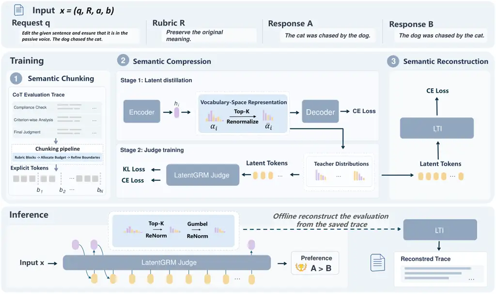

# Judging in Latent Space: Efficient Generative Reward Modeling via Semantics-Preserving Compression

Mingqing Yuan    Xiaobo Liang    Junwei Yang Affiliation:  Soochow
University   University of Cambridge    Ziwei Chen    Zeren Zhang
Affiliation:  Chalmers University of Technology   Peking University   
Hejin Wang    Yubin Wang Affiliation:  Tsinghua University   The Hong
Kong University of Science and Technology    Juntao Li ^(†)^(†)thanks:
Corresponding author.

###### Abstract

Reward modeling often requires jointly representing and reasoning over
multiple evaluation criteria, yet verbalizing this process token by
token can incur substantial inference cost. Recent work on latent
reasoning suggests that continuous states may support this computation
more compactly. We introduce LatentGRM, a latent evaluation framework
built on semantic chunking, compression, and reconstruction. By using
the structure of rubric-guided evaluations to guide compression,
LatentGRM learns compact continuous trajectories that support autonomous
pairwise judgments without generating textual assessments. A separate
interpreter reconstructs evaluation text from these trajectories,
providing an offline view of the information retained under compression.
Under matched training data and backbones, LatentGRM achieves
competitive aggregate preference accuracy relative to explicit
Supervised Fine-Tuning (SFT) judges at both 4B and 8B scales. Across
four benchmark domains, LatentGRM-8B compresses evaluation trajectories
by $`8.9`$–$`9.2\times`$ and reduces total judge inference time by
$`6.1`$–$`7.0\times`$ at vote@5. Controlled rubric interventions show
that criterion-dependent preference information is carried through the
latent sequence. Together, these results demonstrate that continuous
latent evaluation can substantially reduce inference cost while
preserving competitive judgment quality.


Figure 1: Accuracy–efficiency scaling of LatentGRM-8B (stars) and
Rubric-RM-8B (circles) from vote@1 to vote@9. Points run left to right
at 1, 3, 5, 7, and 9 votes.

## 1 Introduction

Reward modeling often requires integrating evidence across multiple
aspects of a response. A response may be factually correct yet violate
an explicit constraint, while a detailed answer may fall short of a
request for concision. These assessments must be combined into a
preference that guides decisions in policy optimization and response
selection (Ouyang et al., 2022; Zhang et al., 2025a). Since reward
models are used repeatedly in these settings, both judgment accuracy and
inference efficiency are central to their practical value.

Among existing approaches, Generative Reward Models (GRMs) have become a
dominant paradigm. Generative reward models formulate evaluation as
language generation, with reasoning-based judges producing intermediate
assessments before issuing a verdict (Zhang et al., 2025a; Mahan et al.,
2024; Chen et al., 2026). Recently, rubric-based reward modeling has
gained increasing attention by organizing these assessments around
_rubrics_: explicit sets of task-specific evaluation criteria, such as
correctness, instruction compliance, and clarity (Liu et al., 2026; Yuan
et al., 2026). While sampling and aggregating multiple evaluations can
improve judgment quality, verbalizing judgments and supporting evidence
for each criterion can lengthen evaluation trajectories and increase
autoregressive decoding costs. This raises a central question: _can a
generative judge retain the information needed for multi-criterion
evaluation while carrying out its intermediate computation more
compactly?_

To address this, we turn to continuous latent reasoning, which offers a
promising way to represent intermediate computation with fewer
autoregressive steps (Hao et al., 2025; Shen et al., 2025; Deng et al.,
2025). Rubric-based reward modeling provides a particularly structured
setting for studying such compact computation. Its criterion-level
organization and linguistic boundaries can guide where to place
compression boundaries, while the criteria themselves provide natural
reference points for probing how latent judgments respond to changes in
evaluation requirements and what assessment content remains recoverable.

We introduce LatentGRM, a framework for rubric-guided latent evaluation.
Its organizing idea is to treat rubric criteria as _intervenable and
alignable criterion-level semantic units_. Building on Latent-SFT’s
vocabulary-space distillation framework (Deng et al., 2025), Semantic
Chunking uses rubric-aligned blocks to allocate a fixed latent budget,
then uses linguistic cues to refine boundaries within each block. The
trained judge generates compact continuous trajectories and predicts
pairwise preferences autonomously. A separate Latent Trace Interpreter
(LTI) reconstructs evaluation text from saved trajectories outside the
online judgment path. Aligning its output with teacher assessments by
criterion provides a fine-grained measure of reconstruction fidelity on
teacher-derived trajectories. Rubric structure therefore connects
compression, intervention, and interpretation within one evaluation
framework.

Against explicit Supervised Fine-Tuning (SFT) judges trained on matched
data and 4B/8B backbones, LatentGRM achieves competitive aggregate
preference accuracy across eight benchmark domains. On four domains,
LatentGRM-8B compresses evaluation trajectories by $`8.9`$–$`9.2\times`$
and reduces total judge inference time by $`6.1`$–$`7.0\times`$ at
vote@5. Controlled rubric edits and latent-source replacement show that
criterion-dependent preference information is carried through autonomous
latent trajectories. Separately, reconstruction experiments recover
criterion-level states and justifications from teacher-derived
trajectories. These findings support efficient latent judgment together
with the recovery of useful evaluation content.

Our contributions are:

- •
  We introduce LatentGRM, to our knowledge the first framework to bring
  continuous latent reasoning to reward modeling, combining
  rubric-guided semantic compression, autonomous latent evaluation, and
  a separate interpreter for retrospective reconstruction.
- •
  Under matched training data and backbones, we demonstrate competitive
  aggregate preference accuracy at both 4B and 8B scales and substantial
  reductions in trajectory length and total judge inference time.
- •
  We examine the evaluation information retained under compression
  through controlled rubric interventions and criterion-aligned
  reconstruction. These analyses show that latent trajectories carry
  criterion-dependent preference information and that the LTI can
  recover criterion-level supporting justifications from teacher-derived
  trajectories.

## 2 Related Works

### 2.1 Latent Reasoning

Continuous latent reasoning replaces explicit intermediate tokens with
recurrent continuous states, reducing autoregressive decoding while
retaining multi-step computation. Existing methods recurrently feed
hidden states back into the model, distill textual reasoning chains into
latent trajectories, or construct continuous thoughts in vocabulary
space (Hao et al., 2025; Shen et al., 2025; Zhang et al., 2025b; Deng et
al., 2025). These methods have primarily been studied on mathematical
and general reasoning tasks. We adapt vocabulary-space latent reasoning
to reward modeling, where the latent trajectory must represent a
multi-criterion comparison between candidate responses.

### 2.2 Reward Modeling

Generative reward models formulate evaluation as language generation and
can produce critiques or reasoning traces before issuing a
judgment (Mahan et al., 2024; Ankner et al., 2024; Chen et al., 2026;
Guo et al., 2025). In recent years, rubric-based reward modeling has
rapidly gained attention as a way to decompose holistic judgments into
explicit, task-specific criteria for evaluation, feedback, reward
construction, and policy optimization (Liu et al., 2026; Yuan et al.,
2026). However, such rubric-based and reasoning-heavy judges introduce
substantial inference costs, since they must generate and apply criteria
explicitly at test time. Our work therefore focuses on the inference
cost of reasoning-based generative judges: LatentGRM compresses the
evaluations into continuous trajectories, with matched explicit SFT
judges as the primary comparison. We further repurpose rubrics as
anchors for semantic chunking and as an evaluation and analysis tool for
latent reasoning.



Figure 2: LatentGRM training and inference. Stage 1 encodes semantic
boundaries into vocabulary-space targets and trains suffix
reconstruction; Stage 2 distills autonomous latent judging. An offline
interpreter reconstructs evaluations from saved trajectories.

## 3 Method

### 3.1 Overview

We study pairwise reward modeling with an evaluation input
$`x=(q,\mathcal{R},a,b)`$, comprising a user request, a task-specific
rubric, and two candidate responses. Training examples additionally
provide an explicit evaluation trace $`c=(c_{1},\ldots,c_{M})`$ and a
preference label $`y\in\{\texttt{Response A},\texttt{Response B}\}`$. An
explicit reasoning judge produces:

```math
[x,\ \texttt{<think>},\ c_{1},\ldots,c_{M},\ \texttt{</think>},\ y]. \tag{1}
```

LatentGRM replaces the textual evaluation with fewer continuous steps:

```math
[x,\ \texttt{<think>},\ z_{1},\ldots,z_{N},\ \texttt{</think>},\ y]. \tag{2}
```

We build on Latent-SFT’s vocabulary-space representation and two-stage
distillation framework (Deng et al., 2025), replacing fixed-rate
segmentation with Semantic Chunking. Stage 1 distills explicit
evaluation traces into latent trajectories. Stage 2 trains the judge to
autoregressively generate these trajectories and predict the final
preference from the evaluation input at inference. A separate
interpreter reconstructs explicit evaluations from saved trajectories
for offline analysis. Figure 2 summarizes the framework.

### 3.2 Stage 1: Semantic Chunking for Latent Compression

Stage 1 follows an encoder and decoder objective. At each semantic
boundary, the encoder compresses the evaluation input and teacher-trace
prefix into latent states, while the decoder learns to recover the
remaining evaluation and final preference from the latent prefix.

Let $`c_{1:M}`$ denote an evaluation trace containing $`M`$ tokens.
Semantic Chunking divides it into $`N`$ spans using ordered boundaries
$`0=b_{0}<b_{1}<\cdots<b_{N}=M`$. We set:

```math
N=\left\lceil\frac{M}{\rho}\right\rceil, \tag{3}
```

where $`\rho`$ is the fixed compression rate. Rubric-guided evaluations
naturally separate into compliance check, criterion-specific analysis,
and final synthesis (Figure 8). We fix the latent budget of each rubric
block with an exact-budget allocator, then refine its internal frontiers
using sentence, clause, and dependency evidence. Semantic Chunking
places compression boundaries to preserve semantic integrity as much as
possible.

Figure 3 illustrates how the two boundary choices treat the same rubric
and sentence-level passages.


Figure 3: Illustrative frontiers in cropped evaluations. Green and red
mark the semantic and fixed-rate cuts on identical text.

At boundary $`b_{i}`$, the encoder reads $`x`$ and the explicit prefix
$`c_{1:b_{i}}`$ and produces a hidden state $`h_{i}`$. To make this
state directly consumable by the decoder, we express it through the
decoder’s vocabulary interface. Let $`W_{\mathrm{out}}`$ be the
decoder’s frozen vocabulary output projection and $`\tau`$ the
projection temperature. The resulting full-vocabulary distribution is
$`\alpha_{i}=\operatorname{softmax}(W_{\mathrm{out}}h_{i}/\tau)`$. We
define $`S_{i}=\operatorname{TopK}(\alpha_{i})`$ as the indices of the
$`K`$ largest entries of $`\alpha_{i}`$ and renormalize their
probability mass, so
$`\bar{\alpha}_{i,v}=\alpha_{i,v}/\sum_{u\in S_{i}}\alpha_{i,u}`$ for
$`v\in S_{i}`$, and $`\bar{\alpha}_{i,v}=0`$ otherwise. Using the
decoder’s frozen input embedding table $`E_{\mathrm{in}}`$, we form the
compressed state:

```math
z_{i}=\sum_{v\in S_{i}}\bar{\alpha}_{i,v}E_{\mathrm{in}}[v]. \tag{4}
```

Thus $`z_{i}`$ is a continuous mixture of token embeddings and can be
inserted directly into the decoder’s input sequence. Given
$`[x,\texttt{<think>},z_{1:i}]`$, the decoder predicts the remaining
evaluation and final preference:

```math
\mathcal{L}_{\mathrm{rec}}=\frac{1}{N}\sum_{i=1}^{N}\operatorname{CE}\!\left([c_{b_{i}+1:M},\texttt{</think>},y,\texttt{EOS}]\mid[x,\texttt{<think>},z_{1:i}]\right). \tag{5}
```

Here, $`\operatorname{CE}`$ is token-averaged autoregressive
cross-entropy. We optimize the encoder, the decoder, and then both
jointly. After training, the encoder exports
$`(S_{i},\bar{\alpha}_{i})_{i=1}^{N}`$ as sparse targets for Stage 2.

### 3.3 Stage 2: Autonomous Latent Evaluation

Starting from the Stage 1 decoder, Stage 2 trains the judge to predict
the exported distributions autoregressively and then output the final
preference. Let $`\mathbf{g}=(\mathbf{g}_{1},\ldots,\mathbf{g}_{N})`$
collect independent Gumbel noise across the trajectory. For each target
$`\bar{\alpha}_{i}`$, we add $`\mathbf{g}_{i}`$ to its log-probabilities
and renormalize within $`S_{i}`$, obtaining
$`\widetilde{\alpha}_{i}(\mathbf{g})`$. Replacing $`\bar{\alpha}_{i}`$
with these perturbed weights in Eq. 4 gives the corresponding target
embedding $`\widetilde{z}_{i}(\mathbf{g})`$. During training, the
prediction at step $`i`$ is conditioned on the preceding perturbed
target embeddings $`\widetilde{z}_{1:i-1}(\mathbf{g})`$. This stochastic
perturbation discourages overfitting to deterministic teacher targets;
at inference, the same mechanism produces diverse latent trajectories
for voting. Let $`x_{\mathrm{lat}}=[x,\texttt{<think>}]`$ and let
$`q_{\theta}`$ denote the judge’s predicted full-vocabulary
distribution. We optimize:

```math
\displaystyle\mathcal{L}_{\mathrm{auto}}=\mathbb{E}_{\mathbf{g}}\Bigg[\frac{1}{N}\sum_{i=1}^{N}\operatorname{KL}\!\left(\widetilde{\alpha}_{i}(\mathbf{g})\,\middle\|\,q_{\theta}(\cdot\mid x_{\mathrm{lat}},\widetilde{z}_{<i}(\mathbf{g}))\right) \tag{6}
```

```math
\displaystyle\qquad+\operatorname{CE}\!\left([\texttt{</think>},y,\texttt{EOS}]\mid x_{\mathrm{lat}},\widetilde{z}_{1:N}(\mathbf{g})\right)\Bigg].
```

The KL term distills each perturbed latent target, while cross-entropy
predicts the end marker, preference label, and EOS from the complete
trajectory. The expectation is estimated with one noise draw per example
at each update.

At inference, the judge feeds back its own predictions. At step $`i`$,
it produces $`q_{i}=q_{\theta}(\cdot\mid x,\texttt{<think>},z_{<i})`$.
If the unperturbed argmax of $`q_{i}`$ is \</think\>, latent generation
terminates and the preference is decoded greedily. Otherwise, the judge
retains and renormalizes the top-$`K`$ probabilities of $`q_{i}`$,
applies the same Gumbel perturbation, and substitutes the resulting
support and weights into Eq. 4 to form $`z_{i}`$. We extend vLLM (Kwon
et al., 2023) to support this soft-embedding feedback while retaining
continuous batching, KV caching, and tensor parallelism.

### 3.4 Retrospective Interpretation of Latent Trajectories

The Latent Trace Interpreter (LTI) is a separate readout that
reconstructs an explicit evaluation from a completed latent trajectory.
At position $`i`$, it receives saved top-$`K`$ vocabulary indices
$`S_{i}^{\mathrm{save}}`$ and normalized weights
$`\bar{q}_{i}^{\mathrm{save}}`$. Using its embedding table
$`E_{\mathrm{int}}`$, LTI forms:

```math
z_{i}^{\mathrm{int}}=\sum_{v\in S_{i}^{\mathrm{save}}}\bar{q}_{i}^{\mathrm{save}}(v)E_{\mathrm{int}}[v], \tag{7}
```

the same vocabulary-mixture construction as Eq. 4. Given the full
sequence $`z_{1:N}^{\mathrm{int}}`$, LTI predicts the complete teacher
evaluation with the token-averaged objective:

```math
\mathcal{L}_{\mathrm{int}}=\operatorname{CE}\!\left([c_{1:M},\texttt{</think>}]\mid[x,\texttt{<think>},z_{1:N}^{\mathrm{int}}]\right). \tag{8}
```

Unlike Stage 1’s suffix reconstruction, LTI reconstructs the evaluation
from its beginning; the preference label $`y`$ is excluded. Autonomous
judging can save its predicted top-$`K`$ indices and weights for the
same offline readout, without running LTI in the online decision path.

## 4 Experiments

Our experiments address three questions: (RQ1) whether latent evaluation
preserves preference accuracy across model scales and responds to
controlled changes in rubric criteria; (RQ2) how compressing explicit
evaluations into latent trajectories affects inference cost; and (RQ3)
whether criterion-level assessments can be reconstructed from latent
trajectories.

|                                                  |             |      |               |         |          |              |       |      |        |
| ------------------------------------------------ | ----------- | ---- | ------------- | ------- | -------- | ------------ | ----- | ---- | ------ |
| Model                                            | RewardBench |      | IF Evaluation |         | RM-Bench | RewardBench2 |       | HS3  | Avg.-8 |
|                                                  | Chat        | Hard | PPE           | IFBench | Chat     | Prec. IF     | Focus |      |        |
| White-box judge/reward LLMs (for reference only) |             |      |               |         |          |              |       |      |        |
| JudgeLRM-7B                                      | 93.2        | 56.4 | 47.9          | 47.5    | 55.0     | 29.7         | 39.9  | 60.5 | 53.7   |
| RRM-7B                                           | 88.0        | 70.6 | 52.5          | 55.2    | 59.8     | 29.4         | 63.9  | 63.7 | 60.4   |
| RM-R1-7B (Qwen-2.5-Inst)                         | 94.4        | 72.3 | 56.1          | 57.8    | 65.8     | 35.6         | 80.0  | 69.3 | 66.4   |
| RM-R1-7B (DeepSeek-Dist)                         | 86.2        | 67.0 | 52.5          | 56.8    | 62.1     | 23.8         | 56.9  | 63.3 | 58.6   |
| Rubric-RM                                        |             |      |               |         |          |              |       |      |        |
| Rubric-RM-4B, vote@1                             | 89.1        | 67.8 | 60.2          | 61.7    | 61.6     | 32.2         | 77.0  | 66.8 | 64.5   |
| Rubric-RM-4B, vote@5                             | 91.1        | 69.3 | 61.9          | 62.5    | 61.7     | 40.6         | 80.5  | 68.7 | 67.0   |
| Rubric-RM-8B, vote@1                             | 89.8        | 69.8 | 61.2          | 59.9    | 61.3     | 31.9         | 77.9  | 68.1 | 65.0   |
| Rubric-RM-8B, vote@5                             | 91.8        | 70.5 | 62.9          | 61.5    | 62.1     | 45.0         | 81.1  | 70.0 | 68.1   |
| LatentGRM (ours)                                 |             |      |               |         |          |              |       |      |        |
| LatentGRM-4B, vote@1                             | 87.2        | 68.4 | 61.2          | 61.0    | 59.9     | 34.1         | 85.4  | 67.9 | 65.6   |
| LatentGRM-4B, vote@5                             | 88.8        | 70.3 | 61.9          | 63.2    | 62.0     | 41.6         | 86.5  | 68.6 | 67.8   |
| LatentGRM-8B, vote@1                             | 88.7        | 70.5 | 60.4          | 63.0    | 59.8     | 37.9         | 84.6  | 68.2 | 66.7   |
| LatentGRM-8B, vote@5                             | 89.9        | 73.0 | 63.1          | 63.3    | 61.9     | 43.4         | 87.5  | 69.6 | 69.0   |

Table 1: Pairwise preference evaluation (%). Avg.-8 is the mean of the
eight benchmark scores. Shading mark the best score among the Rubric-RM
and LatentGRM configurations.

### 4.1 Experimental Setup

##### Training data.

We use 35,612 OpenRubrics (Liu et al., 2026) training records, each
containing a request, two responses, a rubric, an evaluation trace, and
a binary preference. OpenRubrics keeps generated rubrics whose judgments
match the preference labels.

##### Evaluation data.

We evaluate eight benchmark domains: RewardBench Chat and Chat
Hard (Lambert et al., 2025), PPE-IFEval (Frick et al., 2025),
IFBench (Pyatkin et al., 2025), RM-Bench Chat (Liu et al., 2025),
RewardBench 2 Precise IF and Focus (Malik et al., 2026), and
HelpSteer3 (Wang et al., 2025). Avg.-8 is their unweighted mean.

##### Models and evaluation.

Our primary baselines are explicit Rubric-RM trained by SFT on the same
OpenRubrics records and Qwen3-4B or Qwen3-8B backbones (Yang et al., 2025) as LatentGRM. This matched comparison isolates the effect of
replacing explicit evaluation traces with compact latent trajectories.
Both methods receive identical task-specific rubrics, generated once
offline by OpenRubrics generator-8B. We report a single rollout (vote@1)
and majority voting over five rollouts (vote@5). JudgeLRM, RRM, and two
RM-R1 variants serve as additional reference points (Chen et al., 2025;
Guo et al., 2025; Chen et al., 2026). We evaluate every model in both
response orders and average the resulting scores.

### 4.2 RQ1: Effectiveness and Rubric-Based Process Evaluation

#### 4.2.1 Preference Accuracy

At vote@5, LatentGRM scores 67.8 and 69.0 on Avg.-8 at 4B and 8B,
compared with 67.0 and 68.1 for the matched explicit Rubric-RM
(Table 1). Its largest advantage is on Focus (+6.0 and +6.4 points);
across the other seven domains, Chat Hard and IFBench favor LatentGRM at
both scales, RewardBench Chat favors Rubric-RM, and Precise IF changes
direction between 4B and 8B. PPE, RM-Bench Chat, and HelpSteer3 differ
by at most 0.4 points. Thus, compact latent evaluation retains broadly
similar preference accuracy across domains, with a concentrated gain on
Focus and Chat Hard. Voting raises LatentGRM’s Avg.-8 from 65.6 to 67.8
at 4B (+2.2) and from 66.7 to 69.0 at 8B (+2.3), showing that multiple
compact trajectories can improve the final judgment.

Appendix E.4 provides a comparison with a direct judge that predicts
only the final preference.

#### 4.2.2 Effect of Semantic Chunking

To assess the contribution of Semantic Chunking, we compare it with
Fixed-Rate Chunking on Qwen3-8B. Both use the same training data, target
compression rate $`\rho=8`$, latent representation, initialization, and
training schedule.

|                     |             |      |              |       |
| ------------------- | ----------- | ---- | ------------ | ----- |
|                     | RewardBench |      | RewardBench2 |       |
| Method              | Chat        | Hard | Prec. IF     | Focus |
| vote@1              |             |      |              |       |
| Fixed-Rate Chunking | 90.5        | 69.0 | 37.2         | 83.3  |
| Semantic Chunking   | 88.7        | 70.5 | 37.9         | 84.6  |
| vote@5              |             |      |              |       |
| Fixed-Rate Chunking | 90.6        | 70.8 | 39.5         | 85.8  |
| Semantic Chunking   | 89.9        | 73.0 | 43.4         | 87.5  |

Table 2: Semantic Chunking ablation on Qwen3-8B (%).

Semantic Chunking improves Chat Hard, Precise IF, and Focus at both
voting budgets (Table 2). At vote@5, the gains over Fixed-Rate Chunking
are 2.2, 3.9, and 1.7 points, respectively, while Chat decreases by 0.7
points; the four-domain mean rises by 1.8 points. With the latent budget
and training conditions held fixed, this pattern indicates that placing
boundaries at semantic units improves compressed judgments most clearly
on instruction-sensitive tasks.

#### 4.2.3 Rubric Interventions and Latent-Source Replacement

Figure 4: Rubric-conditioned preference shifts on 398 pairs. (A) Each
trajectory is generated and evaluated under the same rubric. (B) The
evaluation prompt is fixed to the baseline rubric while the
latent-trajectory source varies. Changes are measured against the
baseline condition; positive values favor the response targeted by the
criterion intervention. Bands show pointwise 95% question-cluster
bootstrap intervals.

We test whether changing one evaluation criterion shifts the model’s
preference and whether the shift is carried by the latent trajectory,
motivated by latent-state intervention studies (Li et al., 2026). With
all other criteria fixed, the test measures the direction of the
preference shift.

##### Design and readout.

For each of 398 RewardBench pairs (198 Chat and 200 Chat Hard), we
construct three rubrics that differ in one criterion: the _baseline_
rubric $`\mathcal{R}_{0}`$ is unchanged; the _wording control_
$`\mathcal{R}_{p}`$ paraphrases the selected criterion without changing
its meaning; and the _criterion intervention_ $`\mathcal{R}_{c}`$
changes that criterion so that it favors a designated response
$`b_{i}`$. GLM-5.2 (GLM-5 Team et al., 2026) proposes the two edits, and
a fresh-context call verifies that $`\mathcal{R}_{p}`$ preserves meaning
and $`\mathcal{R}_{c}`$ changes only the selected criterion, then
identifies $`b_{i}`$. Neither call receives benchmark labels or judge
predictions. We generate trajectories for all three rubrics in both
response orders.

At 0%, 10%, $`\ldots`$, 100% of each trajectory, we probe the preference
between the two response labels. For a context $`C`$ containing the
evaluation prompt and latent prefix, we measure the log-odds of the
label $`\ell_{b_{i}}`$ against the other label $`\ell_{\bar{b}_{i}}`$:

```math
D_{i}(C)=\log p_{\theta}(\ell_{b_{i}}\mid C)-\log p_{\theta}(\ell_{\bar{b}_{i}}\mid C). \tag{9}
```

For either edited condition $`e\in\{p,c\}`$,
$`\Delta D_{i}=D_{i}(C_{e})-D_{i}(C_{0})`$ measures its effect relative
to the baseline; positive values indicate a shift toward $`b_{i}`$. This
contrastive readout follows Wang et al. (2023); Heimersheim and Nanda
(2024).

##### End-to-end rubric intervention.

The criterion intervention shifts preference toward the designated
response, reaching a mean log-odds change of 4.58 at the trajectory
endpoint (Figure 4A). Its effect becomes substantially larger than that
of the wording control in the latter half of the trajectory, indicating
sensitivity to the criterion’s meaning rather than its phrasing alone.
The nonzero shift at 0% shows a direct effect of the rubric prompt; the
replay control below measures the contribution carried by the latent
sequence.

##### Latent-source replacement.

To remove the visible rubric difference, we fix the evaluation prompt to
$`\mathcal{R}_{0}`$ and replay the latent embeddings generated under
each rubric in a fresh baseline context. The criterion-intervention
source has little effect at early positions, but its influence grows
with the supplied trajectory and reaches a mean log-odds change of 2.75
at the endpoint (Figure 4B); the wording-control source remains much
smaller. Thus, criterion-dependent preference information transfers
through the latent sequence even when the evaluation prompt remains
unchanged.

### 4.3 RQ2: Practical Efficiency of Latent Evaluation

We evaluate the cost of producing preference judgments. Retrospective
interpretation is performed separately and is excluded from these
measurements.

#### 4.3.1 Runtime under Natural Generation

We compare Rubric-RM-8B and LatentGRM-8B on four domains at vote@5. The
vLLM measurements use the same eight-GPU serving configuration and
include prefill, scheduling, decoding, and output collection. For
reference, we also report full-domain time under ordinary
Transformers/PyTorch generation (Wolf et al., 2020; Paszke et al., 2019)
on the same eight GPUs, with one model replica per GPU and five
sequential rollouts per assigned sample.

| Domain ($`N`$)       | Model        | Steps  | Compression             | HF time (s) | HF speedup              | vLLM time (s) | vLLM speedup            |
| -------------------- | ------------ | ------ | ----------------------- | ----------- | ----------------------- | ------------- | ----------------------- |
| RB Chat (716)        | Rubric-RM-8B | 659.60 | $`1.00\times`$          | 8196        | $`1.00\times`$          | 539.70        | $`1.00\times`$          |
|                      | LatentGRM-8B | 74.38  | $`\mathbf{8.87}\times`$ | 1002        | $`\mathbf{8.17}\times`$ | 87.76         | $`\mathbf{6.15}\times`$ |
| RB Chat Hard (912)   | Rubric-RM-8B | 582.09 | $`1.00\times`$          | 11088       | $`1.00\times`$          | 589.58        | $`1.00\times`$          |
|                      | LatentGRM-8B | 64.42  | $`\mathbf{9.04}\times`$ | 1308        | $`\mathbf{8.46}\times`$ | 96.44         | $`\mathbf{6.11}\times`$ |
| RB2 Precise IF (960) | Rubric-RM-8B | 720.89 | $`1.00\times`$          | 13416       | $`1.00\times`$          | 812.93        | $`1.00\times`$          |
|                      | LatentGRM-8B | 78.59  | $`\mathbf{9.17}\times`$ | 1524        | $`\mathbf{8.82}\times`$ | 126.99        | $`\mathbf{6.40}\times`$ |
| RB2 Focus (2970)     | Rubric-RM-8B | 695.49 | $`1.00\times`$          | 37572       | $`1.00\times`$          | 2350.30       | $`1.00\times`$          |
|                      | LatentGRM-8B | 75.37  | $`\mathbf{9.23}\times`$ | 4476        | $`\mathbf{8.39}\times`$ | 338.34        | $`\mathbf{6.95}\times`$ |

Table 3: Inference cost at vote@5. Steps are mean generated positions
per rollout. Compression and speedup are the Rubric-RM-8B/LatentGRM-8B
ratios of generated steps and total inference time. HF denotes ordinary
Transformers/PyTorch generation without vLLM. Bold marks fewer steps or
less time and the corresponding compression/speedup ratios within each
domain.

At vote@5, LatentGRM-8B reduces generated positions by
$`8.87`$–$`9.23\times`$, yielding $`8.17`$–$`8.82\times`$ speedups under
ordinary Transformers and $`6.11`$–$`6.95\times`$ under vLLM (Table 3).
All four domains exceed $`6\times`$ vLLM speedup despite mixed accuracy
differences.

Figure 1 extends the comparison across vote@1–9. LatentGRM remains
faster and scores higher on Chat Hard and Focus at every voting budget;
Chat remains below Rubric-RM, and Precise IF varies by budget. More
votes generally improve latent judgment quality, with nonmonotonic
intermediate results and $`6.9\times`$–$`7.8\times`$ speedups at vote@9.

An equal-length control that forces both judges to generate exactly 50
positions yields only a $`1.017\times`$ runtime difference, showing that
latent reasoning does not introduce additional per-step computational
cost. (Appendix F.2).

### 4.4 RQ3: Recovering Rubric-Level Evaluations

Task rubrics provide predefined semantic units for evaluating
reconstruction fidelity. We align decoded and teacher evaluations by
response and criterion, measuring whether each assessment’s state and
justification are preserved. This makes changes in individual judgments
observable even when most of the reconstructed text remains similar.

Using cached teacher-derived trajectories, we compare three
independently trained readouts initialized from the LatentGRM-8B Stage 1
decoder. Prompt-only receives the evaluation input without latent
states; Replay-hidden additionally reads projected hidden states
obtained by replaying the latent sequence; Latent Trace Interpreter
(LTI) reads its vocabulary-probability representation (Section 3.4).

The test set contains 607 records with 9,992 criteria, of which 9,768
have explicit states. State Macro-F1 scores Met, Not Met, and Partial;
missing or unparseable states count as errors. Vector Exact requires all
states in a fully labeled record to match. Rubric Semantic measures
BERTScore similarity (Zhang\* et al., 2020) between aligned
justifications, assigning zero to missing criteria; whole-trace
ROUGE-L (Lin, 2004) provides a lexical comparison.

| Readout input            | State Macro-F1 | Vector Exact | Rubric Semantic | ROUGE-L |
| ------------------------ | -------------- | ------------ | --------------- | ------- |
| Prompt-only              | 40.20          | 18.61        | 56.42           | 63.36   |
| Replay-hidden            | 69.42          | 33.03        | 61.29           | 68.22   |
| Latent Trace Interpreter | 98.93          | 93.98        | 74.65           | 79.24   |

Table 4: LatentGRM-8B retrospective reconstruction on the 607-record
criterion-rich test set (%).

LTI raises State Macro-F1 from 40.20 (Prompt-only) and 69.42
(Replay-hidden) to 98.93, and Vector Exact from 18.61 and 33.03 to 93.98
(Table 4). Prompt-only reaches 63.36 ROUGE-L despite its 40.20 State
Macro-F1, showing that lexical overlap misses criterion-state errors.
LTI also leads on Rubric Semantic (74.65) and ROUGE-L (79.24),
reflecting stronger criterion-level recovery on teacher-derived
trajectories.

##### Downstream utility through data revision.

We also test whether the recovered evaluation can guide a frozen
Qwen3-8B Base reviser on 240 RewardBench Rubric examples. Prompt-only
gives the reviser just the question and candidate response; Rubric-RM
trajectory supplies explicit textual feedback; Latent only inserts the
soft top-10 embedding mixture at each latent step without training the
reviser to consume it; and Interpreter-restored trajectory supplies
LTI’s textual reconstruction of the same latent feedback. The reviser
does not see the rubric. Appendix E.5 gives the input construction and
scoring protocol.

An external evaluator scores each rubric criterion before and after
revision. Repair is the fraction of originally unsatisfied criteria that
become satisfied, whereas Regression is the fraction of originally
satisfied criteria that become unsatisfied. Full is the percentage of
revised answers satisfying every criterion; Criterion satisfaction is
the overall percentage of satisfied criterion decisions.

| Feedback interface              | Repair $`\uparrow`$ | Regression $`\downarrow`$ | Full $`\uparrow`$ | Criterion sat. $`\uparrow`$ |
| ------------------------------- | ------------------- | ------------------------- | ----------------- | --------------------------- |
| Prompt-only                     | 54.07               | 5.20                      | 34.17             | 76.28                       |
| Rubric-RM trajectory            | 78.71               | 4.65                      | 56.67             | 87.78                       |
| Latent only (soft top-10)       | 63.32               | 5.11                      | 41.67             | 80.54                       |
| Interpreter-restored trajectory | 80.49               | 1.86                      | 57.50             | 90.12                       |

Table 5: Frozen-model revision on 240 examples, equally split between
Chat and Chat Hard (percent). Repair is computed over 897 originally
unsatisfied criteria and Regression over 1,076 originally satisfied
criteria. Bold marks the best result in each column.

Prompt-only revision reaches 34.17% Full. Explicit Rubric-RM feedback
raises this to 56.67% and Repair from 54.07% to 78.71% (Table 5). Even
without reviser adaptation, the latent-only interface improves Repair by
9.25 points and Full by 7.50 points over Prompt-only.
Interpreter-restored feedback yields the best result in every reported
column: 80.49% Repair, 1.86% Regression, 57.50% Full, and 90.12%
criterion satisfaction. Relative to explicit Rubric-RM feedback, its
Full rate is comparable while Regression is lower (1.86% versus 4.65%).

These results show that latent reasoning preserves the data-synthesis
and revision utility of explicit reasoning: after textual restoration,
it matches or exceeds the explicit trajectory on every reported metric.
More strikingly, the training-free Latent-only interface already
improves substantially over Prompt-only revision, demonstrating that
latent feedback is directly usable before any specialized adaptation.

## 5 Conclusion

We introduced LatentGRM, a framework for latent reward modeling built on
semantic chunking, compression, and reconstruction. Rubric structure
guides the compression of explicit evaluations into compact continuous
trajectories, which the judge uses to predict pairwise preferences
without generating evaluation text. Compared with explicit SFT judges
trained on matched data and backbones, LatentGRM achieves competitive
aggregate accuracy while substantially reducing trajectory length and
inference time. Controlled rubric interventions show that
criterion-dependent preference information is carried through the latent
sequence, while the Latent Trace Interpreter reconstructs
criterion-level assessments for retrospective inspection. Together,
these results show how structured latent trajectories can support
efficient judgment and make compressed evaluations inspectable.

## References

- Ankner et al. (2024) Z. Ankner, M. Paul, B. Cui, J. D. Chang, and P.
  Ammanabrolu Critique-out-loud reward models. arXiv preprint
  arXiv:2408.11791. External Links:
  [Link](https://arxiv.org/abs/2408.11791) Cited by: §2.2.
- Chen et al. (2025) N. Chen, Z. Hu, Q. Zou, J. Wu, Q. Wang, B. Hooi,
  and B. He Judgelrm: large reasoning models as a judge. arXiv preprint
  arXiv:2504.00050. External Links:
  [Link](https://arxiv.org/abs/2504.00050) Cited by: §4.1.
- Chen et al. (2026) X. Chen, G. Li, Z. Wang, B. Jin, C. Qian, Y.
  Wang, H. WANG, Y. Zhang, D. Zhang, T. Zhang, H. Tong, and H. Ji RM-r1:
  reward modeling as reasoning. In International Conference on Learning
  Representations, C. Vondrick, B. Hariharan, C. Raffel, L. Pinto, D.
  Yang, and A. Faust (Eds.), Vol. 2026, pp. 88313–88342. External Links:
  [Link](https://proceedings.iclr.cc/paper_files/paper/2026/file/8e3b8de251afd887fb4589c1e3a3c793-Paper-Conference.pdf)
  Cited by: §1, §2.2, §4.1.
- Deng et al. (2025) J. Deng, L. Pang, Z. Wei, S. Xu, Z. Duan, K. Xu, Y.
  Song, H. Shen, and X. Cheng Llm latent reasoning as chain of
  superposition. arXiv preprint arXiv:2510.15522. External Links:
  [Link](https://arxiv.org/abs/2510.15522) Cited by: §1, §1, §2.1, §3.1.
- Deng et al. (2026) J. Deng, Z. Wei, L. Pang, J. Wu, S. Xu, Z. Duan,
  and H. Shen Latent-grpo: group relative policy optimization for latent
  reasoning. arXiv preprint arXiv:2604.27998. External Links:
  [Link](https://arxiv.org/abs/2604.27998) Cited by: Appendix A.
- Frick et al. (2025) E. Frick, T. Li, C. Chen, W. Chiang, A.
  Angelopoulos, J. Jiao, B. Zhu, J. E. Gonzalez, and I. Stoica How to
  evaluate reward models for rlhf. In International Conference on
  Learning Representations, Y. Yue, A. Garg, N. Peng, F. Sha, and R. Yu
  (Eds.), Vol. 2025, pp. 18128–18163. External Links:
  [Link](https://proceedings.iclr.cc/paper_files/paper/2025/file/2e01083b381b4865919b4915ef32e3d2-Paper-Conference.pdf)
  Cited by: §4.1.
- GLM-5 Team et al. (2026) GLM-5 Team, A. Zeng, X. Lv, Z. Hou, Z. Du, Q.
  Zheng, B. Chen, et al. GLM-5: from vibe coding to agentic engineering.
  External Links: 2602.15763, [Link](https://arxiv.org/abs/2602.15763)
  Cited by: §4.2.3.
- Guo et al. (2025) J. Guo, Z. Chi, L. Dong, Q. Dong, X. Wu, S. Huang,
  and F. Wei Reward reasoning models. In Advances in Neural Information
  Processing Systems, D. Belgrave, C. Zhang, H. Lin, R. Pascanu, P.
  Koniusz, M. Ghassemi, and N. Chen (Eds.), Vol. 38, Main Conference,
  pp. 150477–150510. External Links:
  [Document](https://dx.doi.org/10.52202/085713-5031),
  [Link](https://proceedings.neurips.cc/paper_files/paper/2025/file/dd35bb9efff094897fb6688a57675212-Paper-Conference.pdf)
  Cited by: §2.2, §4.1.
- Hao et al. (2025) S. Hao, S. Sukhbaatar, D. Su, X. Li, Z. Hu, J. E.
  Weston, and Y. Tian Training large language models to reason in a
  continuous latent space. In Second Conference on Language Modeling,
  External Links: [Link](https://openreview.net/forum?id=Itxz7S4Ip3)
  Cited by: §1, §2.1.
- Heimersheim and Nanda (2024) S. Heimersheim and N. Nanda How to use
  and interpret activation patching. arXiv preprint arXiv:2404.15255.
  External Links: [Link](https://arxiv.org/abs/2404.15255) Cited by:
  §4.2.3.
- Kwon et al. (2023) W. Kwon, Z. Li, S. Zhuang, Y. Sheng, L.
  Zheng, C. H. Yu, J. Gonzalez, H. Zhang, and I. Stoica Efficient memory
  management for large language model serving with pagedattention. In
  Proceedings of the 29th Symposium on Operating Systems Principles,
  SOSP ’23, New York, NY, USA, pp. 611–626. External Links: ISBN
  9798400702297, [Link](https://doi.org/10.1145/3600006.3613165),
  [Document](https://dx.doi.org/10.1145/3600006.3613165) Cited by: §3.3.
- Lambert et al. (2025) N. Lambert, V. Pyatkin, J. Morrison, L.
  Miranda, B. Y. Lin, K. Chandu, N. Dziri, S. Kumar, T. Zick, Y.
  Choi, N. A. Smith, and H. Hajishirzi RewardBench: evaluating reward
  models for language modeling. In Findings of the Association for
  Computational Linguistics: NAACL 2025, L. Chiruzzo, A. Ritter, and L.
  Wang (Eds.), Albuquerque, New Mexico, pp. 1755–1797. External Links:
  [Link](https://aclanthology.org/2025.findings-naacl.96/),
  [Document](https://dx.doi.org/10.18653/v1/2025.findings-naacl.96),
  ISBN 979-8-89176-195-7 Cited by: §4.1.
- Li et al. (2026) Z. Li, X. Bai, K. Chen, Y. LI, J. Yang, C. Lin,
  and M. Zhang Dynamics within latent chain-of-thought: an empirical
  study of causal structure. In Forty-third International Conference on
  Machine Learning, External Links:
  [Link](https://openreview.net/forum?id=kHB8m3ojGe) Cited by: §4.2.3.
- Lin (2004) C. Lin ROUGE: a package for automatic evaluation of
  summaries. In Text Summarization Branches Out, Barcelona, Spain,
  pp. 74–81. External Links: [Link](https://aclanthology.org/W04-1013/)
  Cited by: §4.4.
- Liu et al. (2026) T. Liu, R. Xu, T. Yu, I. Hong, C. Yang, T. Zhao,
  and H. Wang OpenRubrics: towards scalable synthetic rubric generation
  for reward modeling and LLM alignment. In Proceedings of the 64th
  Annual Meeting of the Association for Computational Linguistics
  (Volume 1: Long Papers), M. Liakata, V. P. Moreira, J. Zhang, and D.
  Jurgens (Eds.), San Diego, California, United States, pp. 17417–17437.
  External Links: [Link](https://aclanthology.org/2026.acl-long.791/),
  [Document](https://dx.doi.org/10.18653/v1/2026.acl-long.791), ISBN
  979-8-89176-390-6 Cited by: §1, §2.2, §4.1.
- Liu et al. (2025) Y. Liu, Z. Yao, R. Min, Y. Cao, L. Hou, and J. Li
  RM-bench: benchmarking reward models of language models with subtlety
  and style. In International Conference on Learning Representations, Y.
  Yue, A. Garg, N. Peng, F. Sha, and R. Yu (Eds.), Vol. 2025,
  pp. 44323–44355. External Links:
  [Link](https://proceedings.iclr.cc/paper_files/paper/2025/file/6da1eec80095dc5937f7716db15aca4b-Paper-Conference.pdf)
  Cited by: §4.1.
- Mahan et al. (2024) D. Mahan, D. Van Phung, R. Rafailov, C.
  Blagden, N. Lile, L. Castricato, J. Fränken, C. Finn, and A. Albalak
  Generative reward models. arXiv preprint arXiv:2410.12832. External
  Links: [Link](https://arxiv.org/abs/2410.12832) Cited by: §1, §2.2.
- Malik et al. (2026) S. Malik, V. Pyatkin, S. Land, J. Morrison, N.
  Smith, H. Hajishirzi, and N. Lambert RewardBench 2: advancing reward
  model evaluation. In International Conference on Learning
  Representations, C. Vondrick, B. Hariharan, C. Raffel, L. Pinto, D.
  Yang, and A. Faust (Eds.), Vol. 2026, pp. 144839–144866. External
  Links:
  [Link](https://proceedings.iclr.cc/paper_files/paper/2026/file/ea4fe0a56d02c93401902b5b4c6b12da-Paper-Conference.pdf)
  Cited by: §4.1.
- Ouyang et al. (2022) L. Ouyang, J. Wu, X. Jiang, D. Almeida, C.
  Wainwright, P. Mishkin, C. Zhang, S. Agarwal, K. Slama, A. Ray, J.
  Schulman, J. Hilton, F. Kelton, L. Miller, M. Simens, A. Askell, P.
  Welinder, P. F. Christiano, J. Leike, and R. Lowe Training language
  models to follow instructions with human feedback. In Advances in
  Neural Information Processing Systems, S. Koyejo, S. Mohamed, A.
  Agarwal, D. Belgrave, K. Cho, and A. Oh (Eds.), Vol. 35,
  pp. 27730–27744. External Links:
  [Document](https://dx.doi.org/10.52202/068431-2011),
  [Link](https://proceedings.neurips.cc/paper_files/paper/2022/file/b1efde53be364a73914f58805a001731-Paper-Conference.pdf)
  Cited by: §1.
- Paszke et al. (2019) A. Paszke, S. Gross, F. Massa, A. Lerer, J.
  Bradbury, G. Chanan, T. Killeen, Z. Lin, N. Gimelshein, L. Antiga, A.
  Desmaison, A. Kopf, E. Yang, Z. DeVito, M. Raison, A. Tejani, S.
  Chilamkurthy, B. Steiner, L. Fang, J. Bai, and S. Chintala PyTorch: an
  imperative style, high-performance deep learning library. In Advances
  in Neural Information Processing Systems, H. Wallach, H.
  Larochelle, A. Beygelzimer, F. d'Alché-Buc, E. Fox, and R. Garnett
  (Eds.), Vol. 32, pp. . External Links:
  [Link](https://proceedings.neurips.cc/paper_files/paper/2019/file/bdbca288fee7f92f2bfa9f7012727740-Paper.pdf)
  Cited by: §4.3.1.
- Pyatkin et al. (2025) V. Pyatkin, S. Malik, V. Graf, H. Ivison, S.
  Huang, P. Dasigi, N. Lambert, and H. Hajishirzi Generalizing
  verifiable instruction following. In Advances in Neural Information
  Processing Systems, D. Belgrave, C. Zhang, H. Lin, R. Pascanu, P.
  Koniusz, M. Ghassemi, and N. Chen (Eds.), Vol. 38, Main Conference,
  pp. . External Links:
  [Document](https://dx.doi.org/10.52202/085713-1645),
  [Link](https://proceedings.neurips.cc/paper_files/paper/2025/file/46499a0622ecf568b72d17b61e45dbd5-Paper-Datasets_and_Benchmarks_Track.pdf)
  Cited by: §4.1.
- Shen et al. (2025) Z. Shen, H. Yan, L. Zhang, Z. Hu, Y. Du, and Y. He
  CODI: compressing chain-of-thought into continuous space via
  self-distillation. In Proceedings of the 2025 Conference on Empirical
  Methods in Natural Language Processing, C. Christodoulopoulos, T.
  Chakraborty, C. Rose, and V. Peng (Eds.), Suzhou, China, pp. 677–693.
  External Links: [Link](https://aclanthology.org/2025.emnlp-main.36/),
  [Document](https://dx.doi.org/10.18653/v1/2025.emnlp-main.36), ISBN
  979-8-89176-332-6 Cited by: §1, §2.1.
- Wang et al. (2023) K. R. Wang, A. Variengien, A. Conmy, B. Shlegeris,
  and J. Steinhardt Interpretability in the wild: a circuit for indirect
  object identification in GPT-2 small. In The Eleventh International
  Conference on Learning Representations, External Links:
  [Link](https://openreview.net/forum?id=NpsVSN6o4ul) Cited by: §4.2.3.
- Wang et al. (2025) Z. Wang, J. Zeng, O. Delalleau, H. Shin, F.
  Soares, A. Bukharin, E. Evans, Y. Dong, and O. Kuchaiev
  HelpSteer3-preference: open human-annotated preference data across
  diverse tasks and languages. In Advances in Neural Information
  Processing Systems, D. Belgrave, C. Zhang, H. Lin, R. Pascanu, P.
  Koniusz, M. Ghassemi, and N. Chen (Eds.), Vol. 38, Main Conference,
  pp. . External Links:
  [Document](https://dx.doi.org/10.52202/085713-1448),
  [Link](https://proceedings.neurips.cc/paper_files/paper/2025/file/3e0271cf7df2cdb3b91565ad1f525f3a-Paper-Datasets_and_Benchmarks_Track.pdf)
  Cited by: §4.1.
- Wolf et al. (2020) T. Wolf, L. Debut, V. Sanh, J. Chaumond, C.
  Delangue, A. Moi, P. Cistac, T. Rault, R. Louf, M. Funtowicz, J.
  Davison, S. Shleifer, P. von Platen, C. Ma, Y. Jernite, J. Plu, C.
  Xu, T. Le Scao, S. Gugger, M. Drame, Q. Lhoest, and A. Rush
  Transformers: state-of-the-art natural language processing. In
  Proceedings of the 2020 Conference on Empirical Methods in Natural
  Language Processing: System Demonstrations, Q. Liu and D. Schlangen
  (Eds.), Online, pp. 38–45. External Links:
  [Link](https://aclanthology.org/2020.emnlp-demos.6/),
  [Document](https://dx.doi.org/10.18653/v1/2020.emnlp-demos.6) Cited
  by: §4.3.1.
- Xu et al. (2026) A. Xu, B. Li, B. Lin, B. Xue, B. Xian, B. Xu, B.
  Wu, B. Zhang, B. Deng, C. Yu, et al. DeepSeek-v4. 1-flash: pushing the
  limits of kv cache compression. arXiv preprint arXiv:2609.19969.
  External Links: [Link](https://arxiv.org/abs/2609.19969) Cited by:
  §E.5.
- Yang et al. (2025) A. Yang, A. Li, B. Yang, B. Zhang, B. Hui, B.
  Zheng, B. Yu, C. Gao, C. Huang, C. Lv, et al. Qwen3 technical report.
  arXiv preprint arXiv:2505.09388. External Links:
  [Link](https://arxiv.org/abs/2505.09388) Cited by: §4.1.
- Yuan et al. (2026) M. Yuan, X. Liang, Q. Huang, Z. Cai, W. Wang, Y.
  Qiao, P. Lu, C. Huang, M. Zhou, L. Wu, J. Li, and M. Zhang Seeing the
  forest and the trees: a survey of analytic rubrics for holistic reward
  modeling in llms. Preprints. External Links:
  [Document](https://dx.doi.org/10.20944/preprints202605.1624.v1),
  [Link](https://www.preprints.org/manuscript/202605.1624) Cited by: §1,
  §2.2.
- Zhang et al. (2025a) L. Zhang, A. Hosseini, H. Bansal, S. M.
  Kazemi, A. Kumar, and R. Agarwal Generative verifiers: reward modeling
  as next-token prediction. In International Conference on Learning
  Representations, Y. Yue, A. Garg, N. Peng, F. Sha, and R. Yu (Eds.),
  Vol. 2025, pp. 12476–12505. External Links:
  [Link](https://proceedings.iclr.cc/paper_files/paper/2025/file/214308a2d5e3f83ef9ad2739e1cbc46d-Paper-Conference.pdf)
  Cited by: §1, §1.
- Zhang et al. (2025b) Z. Zhang, X. He, W. Yan, A. Shen, C. Zhao, and X.
  Wang Soft thinking: unlocking the reasoning potential of llms in
  continuous concept space. In Advances in Neural Information Processing
  Systems, D. Belgrave, C. Zhang, H. Lin, R. Pascanu, P. Koniusz, M.
  Ghassemi, and N. Chen (Eds.), Vol. 38, Main Conference,
  pp. 168990–169012. External Links:
  [Document](https://dx.doi.org/10.52202/085713-5629),
  [Link](https://proceedings.neurips.cc/paper_files/paper/2025/file/f7396d1c54d51416958d63e285377103-Paper-Conference.pdf)
  Cited by: §2.1.
- Zhang\* et al. (2020) T. Zhang\*, V. Kishore\*, F. Wu\*, K. Q.
  Weinberger, and Y. Artzi BERTScore: evaluating text generation with
  bert. In International Conference on Learning Representations,
  External Links: [Link](https://openreview.net/forum?id=SkeHuCVFDr)
  Cited by: §4.4.

## Appendix Contents

1.  1.  Discussion
2.  2.  Semantic Chunking and Exact-Budget Allocation
3.  3.  Stage 1 Latent Distillation and Stage 2 Autonomous Evaluation
4.  4.  Latent Trace Interpreter Details
5.  5.  Supplementary RQ1: Effectiveness and Rubric-Based Process Evaluation
    - •
      Data, backbones, and evaluation protocol
    - •
      Evaluation-time parameters and Semantic Chunking training dynamics
    - •
      Rubric-based intervention protocol
    - •
      Direct judgment without an intermediate evaluation trace
    - •
      Downstream utility through frozen-model data revision

6.  6.  Supplementary RQ2: Practical Efficiency of Latent Evaluation
    - •
      vLLM implementation for latent reasoning
    - •
      Equal-length runtime control

7.  7.  Supplementary RQ3: Recovering Rubric-Level Evaluations
    - •
      Readout data, controls, and evaluation protocol
    - •
      Metrics, parsing, and reconstruction examples

8.  8.  Training Setup and Compute
9.  9.  Prompt Templates

## Appendix A Discussion

An important challenge in latent reward modeling is preserving essential
evaluation evidence under compression. Fixed-Rate Chunking and the
current heuristic Semantic Chunking approximate evaluation structure
through fixed token intervals and linguistic boundary cues,
respectively. Developing compression strategies that better preserve the
evidence most relevant to the final judgment remains an important
direction.

A related challenge is recovering the compressed evidence through
faithful retrospective interpretation. Appendix G.4.1 illustrates a
coherent, nearly complete reconstruction that changes one criterion
assessment. The interpreter receives renormalized top-$`K`$ soft labels,
which preserve only a subset of the vocabulary distribution. Richer
trajectory representations and reconstruction objectives could
strengthen the connection between recovered criterion states and their
supporting evidence.

These challenges accompany substantial opportunities. By shortening
generation and reducing inference time, latent reasoning can make
repeated reward evaluations more affordable in policy learning, data
selection, and related workflows. The gains from vote@1 to vote@5 also
motivate exploring reinforcement learning to improve individual latent
trajectories, building on approaches such as Latent-GRPO (Deng et al.,
2026). Together, advances in compression, trajectory optimization, and
interpretation could extend the value of latent reward modeling from
faster evaluation to more capable and understandable learning systems.

## Appendix B Semantic Chunking and Exact-Budget Allocation

Semantic Chunking first divides an evaluation into outer rubric blocks
and allocates a fixed global latent budget across them. It then refines
each block’s internal boundaries while holding its allocated count
fixed. The procedure preserves the original token sequence and produces
exactly $`N=\lceil M/8\rceil`$ latent positions. Preprocessing is
performed offline and cached. Figures 5 and 6 illustrate Semantic
Chunking and Fixed-Rate Chunking.

### B.1 Rubric Structure and Initial Budget Allocation

We tokenize the evaluation once with character offsets. The outer blocks
comprise the initial compliance and gatekeeper discussion, each
response’s individual criterion assessments, and the final synthesis;
each response header joins its first criterion. Structural expressions
of at most 10 tokens are protected against internal cuts, including
section and response headers, criterion identifiers, \[Hard Rule\],
\[Principle\], Justification:, Met., and Not Met. We use _boundary_ for
a selected token position in the partition; each selected boundary
serves as a compression frontier in Stage 1.

Let $`m_{s}`$ be the token length of outer block $`s`$, for
$`s=1,\ldots,S`$, and let $`n_{s}`$ be its latent budget. We require

```math
\sum_{s=1}^{S}n_{s}=N,\qquad\left\lceil\frac{m_{s}}{16}\right\rceil\leq n_{s}\leq\left\lfloor\frac{m_{s}}{4}\right\rfloor,\qquad N=\left\lceil\frac{\sum_{s}m_{s}}{8}\right\rceil. \tag{10}
```

For a candidate count $`k`$, let $`d_{s,1:k}`$ be the balanced integer
partition of $`m_{s}`$, with lengths differing by at most one. Define
$`\delta(d)=\max(6-d,0,d-10)`$. The allocation cost is

```math
A_{s}(k)=\left(\sum_{j}\mathbf{1}[\delta(d_{s,j})>0],\quad\sum_{j}\delta(d_{s,j}),\quad\sum_{j}(d_{s,j}-8)^{2}\right). \tag{11}
```

We minimize the sum of these costs lexicographically using

```math
D(s,n)=\min_{k}^{\mathrm{lex}}\{D(s-1,n-k)+A_{s}(k)\},\qquad D(0,0)=(0,0,0). \tag{12}
```

The three priorities are the number of lengths outside 6–10 tokens,
their distance from this interval, and their deviation from the target
rate.

With $`n_{s}`$ fixed, a local dynamic program constructs feasible
reference boundaries $`b^{0}_{s,1:n_{s}}`$ using lengths in $`[4,16]`$
and avoiding protected expressions. It applies the same three priorities
to the realized segment lengths, then uses total displacement from the
evenly spaced boundaries $`\operatorname{round}(jm_{s}/n_{s})`$ as the
final tie-breaker.

### B.2 Linguistic Boundary Costs

We combine rule-based sentence detection with a spaCy dependency parser
to identify natural sentence and clause boundaries. Before parsing,
structural templates, code, mathematics, and markup are replaced with
equal-length whitespace. This prevents non-prose spans from interfering
with the syntactic analysis while preserving character alignment, so
linguistic evidence can be mapped back to the original token boundaries.

Each candidate boundary receives a base cost $`\beta(b)`$ from local
linguistic evidence. We prefer boundaries at the ends of sentences or
complete clauses, and discourage boundaries that split structural
labels, attached punctuation, compact code or mathematical expressions,
or lexical units. Sentence endings are detected with deterministic rules
that avoid common false positives such as decimals, ellipses,
abbreviations, and protected expressions. Table 6 summarizes these
preferences.

The dependency parse additionally assigns a local risk level
$`r(b)\in\{0,1,2\}`$, where higher values indicate a more severe
disruption of a short local dependency. We consider only relations
spanning at most eight tokens so that long parser arcs do not penalize
large portions of a sentence. The combined boundary cost is

```math
C(b)=\beta(b)+3r(b). \tag{13}
```

Cuts inside words, numbers, or identifiers receive a high base cost and
are also marked separately, allowing lexical integrity to be optimized
before the remaining soft preferences. We additionally use a rule-based
fragment penalty $`F(a,b)\in\{0,4,8\}`$ to discourage short, incomplete
rubric fragments, while assigning zero cost to complete headers and
status statements.

| Boundary type                                                     | Base cost $`\beta(b)`$ |
| ----------------------------------------------------------------- | ---------------------- |
| Observed sentence end                                             | $`-3`$                 |
| Complete criterion-header end or predicate-bearing clause edge    | $`0.5`$                |
| Soft punctuation, such as a comma, colon, or semicolon            | $`1`$                  |
| Lexical separator within code or mathematics                      | $`1.5`$                |
| Ordinary word boundary                                            | $`2`$                  |
| Internal position of a criterion header                           | $`6`$                  |
| Boundary that detaches prose punctuation or quotation delimiters  | $`8`$                  |
| Internal position of a short literal, word, number, or identifier | $`12`$                 |

Table 6: Base costs for candidate internal boundaries. Lower costs favor
a cut; protected expressions are excluded before scoring.

### B.3 Constrained Local Refinement

Consider one outer block of length $`m`$ with fixed count $`n`$ and
reference boundaries $`b^{0}_{1:n}`$. A candidate partition $`b_{0:n}`$
has $`b_{0}=0`$, $`b_{n}=m`$, and lengths $`d_{j}=b_{j}-b_{j-1}`$. We
require

```math
\begin{split}&4\leq d_{j}\leq 16,\qquad b_{j}\notin\mathcal{F}\quad(j<n),\\
&|b_{j}-b_{j}^{0}|\leq w,\qquad\sum_{j<n}\mathbf{1}[r(b_{j})=2]\leq\sum_{j<n}\mathbf{1}[r(b_{j}^{0})=2],\end{split} \tag{14}
```

where $`\mathcal{F}`$ contains the protected boundaries and the default
search radius is $`w=4`$ tokens.

Let $`W(\mathbf{b})`$ count the internal boundaries that cut a lexical
unit. Among feasible partitions, we first minimize $`W`$, then minimize

```math
\begin{split}J(\mathbf{b})={}&\sum_{j<n}C(b_{j})+\sum_{j=1}^{n}F(b_{j-1},b_{j})+0.50\sum_{j=1}^{n}\delta(d_{j})^{2}\\
&+0.02\sum_{j=1}^{n}(d_{j}-m/n)^{2}+0.10\sum_{j<n}|b_{j}-b_{j}^{0}|.\end{split} \tag{15}
```

The first two terms favor linguistic boundaries and complete fragments;
the remaining terms control preferred length, length variance, and
displacement from the reference partition.

A dynamic-programming state records the chunk count, current boundary,
and risk-2 count. Transitions add feasible chunks and minimize $`(W,J)`$
lexicographically, breaking ties by the number of moved boundaries and
then their coordinates.

We adopt the candidate if it reduces $`W`$. When $`W`$ is unchanged, we
require $`J`$ not to increase and the boundary-plus-fragment cost
$`H(\mathbf{b})=\sum_{j<n}C(b_{j})+\sum_{j}F(b_{j-1},b_{j})`$ to
decrease by at least 0.5; otherwise we retain the reference.

Require : teacher evaluation $`c`$, tokenizer $`\mathcal{T}`$, rate
$`\rho=8`$

1
$`(\mathbf{v},\mathbf{o})\leftarrow\textsc{TokenizeOnce}(c,\mathcal{T})`$

2 $`\mathcal{O}\leftarrow\textsc{OuterRubricBlocks}(c,\mathbf{o})`$

3 $`N\leftarrow\lceil|\mathbf{v}|/8\rceil`$

4
$`(n_{1},\ldots,n_{S})\leftarrow\textsc{AllocateBudget}(\mathcal{O},N)`$

5
$`\mathcal{F}\leftarrow\textsc{ProtectedStructuralCuts}(c,\mathbf{o})`$

6
$`(C,r,W,F)\leftarrow\textsc{BoundaryAndFragmentEvidence}(c,\mathbf{o})`$

7 foreach _outer block $`s`$_ do

     8
$`\mathbf{b}_{s}^{0}\leftarrow\textsc{ProtectedReferencePartition}(m_{s},n_{s},\mathcal{F}_{s})`$

     9
$`\mathbf{b}_{s}\leftarrow\textsc{RefineAndSelect}(\mathbf{b}_{s}^{0},C,r,W,F,w=4)`$

     10 if _$`W(\mathbf{b}_{s})>0`$_ then

         11
$`\mathbf{b}_{s}^{\prime}\leftarrow\textsc{RefineAndSelect}(\mathbf{b}_{s}^{0},C,r,W,F,w=5)`$

         12 if _$`W(\mathbf{b}_{s}^{\prime})<W(\mathbf{b}_{s})`$_ then

             13 $`\mathbf{b}_{s}\leftarrow\mathbf{b}_{s}^{\prime}`$

Return : concatenated block-local boundaries, shifted to global token
offsets

Algorithm 1 Syntax-Aware Semantic Chunking with an Exact Latent Budget

Refinement leaves each outer block’s span and latent count unchanged
without increasing lexical or risk-2 cuts. Stage 1 uses the resulting
compression frontiers with the supervision objective in Appendix C.

### B.4 Realized Allocation and a Complete Example

The training cache contains 35,612 evaluations, 27,541,067 explicit
tokens, and 3,458,245 latent positions: 97.11 latents per evaluation and
7.96 explicit tokens per latent. The per-example latent counts match
Fixed-Rate Chunking. As Table 7 shows, 86.18% of chunks contain 6–10
tokens. Refinement moves 1,836,211 internal boundaries, reducing lexical
cuts from 142,295 to 151 and risk-2 cuts from 694,857 to 946.

| Explicit tokens per latent | Chunk count | Share (%) |
| -------------------------- | ----------- | --------- |
| 4                          | 37,514      | 1.08      |
| 5                          | 223,876     | 6.47      |
| 6                          | 399,275     | 11.55     |
| 7                          | 572,989     | 16.57     |
| 8                          | 1,053,395   | 30.46     |
| 9                          | 523,161     | 15.13     |
| 10                         | 431,511     | 12.48     |
| 11                         | 185,989     | 5.38      |
| 12                         | 28,541      | 0.83      |
| 13–16                      | 1,994       | 0.06      |
| Total                      | 3,458,245   | 100.00    |

Table 7: Chunk lengths in the Qwen3-8B semantic training cache. All
35,612 evaluations retain their exact rate-8 latent budgets.

Figures 5 and 6 compare the boundary locations produced by Semantic
Chunking and Fixed-Rate Chunking on the same cached evaluation,
containing 219 explicit tokens and 28 latent positions.


Figure 5: A complete evaluation from the semantic training cache, with
the syntax-aware frontiers used for training. All 219 explicit tokens
and all 28 latent frontiers are shown inside one frame. Contiguous
background regions follow the coarse semantic hierarchy, their
identities are written at the right, and each uniform dark \| marks one
latent frontier.


Figure 6: Fixed-Rate Chunking of exactly the same evaluation trace as
Figure 5. The 219 explicit tokens are divided into 27 complete groups of
eight and one final group of three, yielding the same 28 latent tokens.
Only the red frontier locations change: unlike Semantic Chunking, they
may split a phrase, a rubric criterion, or a transition between coarse
semantic regions.

Figure 7: Stage 2 loss for the LatentGRM-8B Semantic Chunking ablation.
Semantic Chunking maintains a lower Stage 2 loss after the initial
decline.

## Appendix C Stage 1 Latent Distillation and Stage 2 Autonomous Evaluation

We now give the full objectives for an evaluation input $`x`$, teacher
evaluation $`c`$, and preference label $`y`$. Let $`\phi`$ and $`\psi`$
denote the trainable Stage 1 encoder and decoder parameters, and let
$`\theta`$ denote the trainable Stage 2 judge parameters. Semantic
Chunking specifies
$`\mathrm{Seg}(c)=\{c_{b_{i-1}+1:b_{i}}\}_{i=1}^{N}`$, adapting the
compression frontiers to rubric structure. Throughout this section,
$`c_{1:M}`$ denotes the tokenized evaluation retained under the training
sequence-length limit.

### C.1 Encoder Sequence and Vocabulary-Space State

Let $`0=b_{0}<b_{1}<\cdots<b_{N}=M`$ be the compression frontiers and
let $`\kappa_{i}`$ denote the compression placeholder following
$`c_{b_{i-1}+1:b_{i}}`$. The encoder sequence is

```math
\begin{split}\xi^{\mathrm{enc}}=[x,\texttt{<think>},c_{1:b_{1}},\kappa_{1},c_{b_{1}+1:b_{2}},\kappa_{2},\ldots,c_{b_{N-1}+1:b_{N}},\kappa_{N},\texttt{</think>}].\end{split} \tag{16}
```

The encoder attention mask is causal and additionally prevents each
query from attending to earlier compression placeholders. If $`u`$ and
$`v`$ are non-padding query and key positions, respectively, then

```math
A^{\mathrm{enc}}_{uv}=1\quad\Longleftrightarrow\quad v\leq u\ \land\ \neg(v\in\{\kappa_{j}\}_{j=1}^{N}\land v<u). \tag{17}
```

Hence
$`h_{i}=\operatorname{Enc}_{\phi}(\xi^{\mathrm{enc}};A^{\mathrm{enc}})_{\kappa_{i}}`$
can use $`x`$ and $`c_{1:b_{i}}`$, but neither future evaluation tokens
nor earlier compression placeholders.

Let $`V`$ be the vocabulary size, $`d`$ the hidden dimension, and
$`\tau`$ the projection temperature. The decoder’s frozen output
projection $`W_{\mathrm{out}}\in\mathbb{R}^{V\times d}`$ maps $`h_{i}`$
to vocabulary scores, while its frozen input embedding table
$`E_{\mathrm{in}}\in\mathbb{R}^{V\times d}`$ maps a vocabulary
distribution back to the decoder’s input space. The full-vocabulary
construction is
$`\alpha_{i}=\operatorname{softmax}(W_{\mathrm{out}}h_{i}/\tau)`$ and
$`z_{i}^{\mathrm{full}}=E_{\mathrm{in}}^{\top}\alpha_{i}`$. We retain
the indices of the $`K`$ largest entries in
$`S_{i}=\operatorname{TopK}(\alpha_{i})`$ and compute

```math
\displaystyle s_{i,v} \displaystyle=W_{\mathrm{out}}[v]^{\top}h_{i}/\tau, \tag{18}
```

```math
\displaystyle\bar{\alpha}_{i,v} \displaystyle=\frac{\exp s_{i,v}}{\sum_{u\in S_{i}}\exp s_{i,u}},\qquad v\in S_{i}, \tag{19}
```

```math
\displaystyle z_{i} \displaystyle=\sum_{v\in S_{i}}\bar{\alpha}_{i,v}E_{\mathrm{in}}[v]. \tag{20}
```

Equivalently,
$`\bar{\alpha}_{i,v}=\alpha_{i,v}/\sum_{u\in S_{i}}\alpha_{i,u}`$ on
$`S_{i}`$, with zero probability outside $`S_{i}`$. The full-vocabulary
formula is recovered when $`K=V`$. Gradients pass through the mixture
weights to the encoder state $`h_{i}`$ but not into $`W_{\mathrm{out}}`$
or $`E_{\mathrm{in}}`$.

### C.2 Suffix Reconstruction Loss

The suffix-reconstruction objective trains each latent prefix to support
the subsequent explicit evaluation and final preference. The remaining
spans concatenate to $`c_{b_{i}+1:M}`$, followed by the preference
suffix. Our implementation uniformly samples one frontier and
materializes its corresponding causal suffix view.

For frontier $`i`$, define the decoder prefix and target

```math
\displaystyle u_{i} \displaystyle=[x,\texttt{<think>},z_{1:i}], \tag{21}
```

```math
\displaystyle t_{i} \displaystyle=[c_{b_{i}+1:M},\texttt{</think>},y,\texttt{EOS}]. \tag{22}
```

If $`L_{i}`$ is the tokenized length of $`t_{i}`$, the per-frontier loss
is

```math
\ell_{i}(\phi,\psi)=-\frac{1}{L_{i}}\sum_{j=1}^{L_{i}}\log p_{\psi}\!\left(t_{i,j}\mid u_{i},t_{i,<j}\right), \tag{23}
```

and the complete Stage 1 objective is

```math
\mathcal{L}_{\mathrm{rec}}(\phi,\psi)=\frac{1}{N}\sum_{i=1}^{N}\ell_{i}(\phi,\psi). \tag{24}
```

The implementation samples $`I\sim\operatorname{Uniform}\{1,\ldots,N\}`$
for each example and evaluates only $`\ell_{I}`$. This estimator is
unbiased because

```math
\mathbb{E}_{I}[\ell_{I}]=\sum_{i=1}^{N}\frac{1}{N}\ell_{i}=\mathcal{L}_{\mathrm{rec}}. \tag{25}
```

For the sampled frontier, $`[u_{I},t_{I}]`$ uses consecutive position
indices and a causal decoder mask. The compressed explicit prefix and
future latent positions are omitted, while earlier target tokens remain
visible through teacher forcing. Loss is applied only to $`t_{I}`$. Each
sampled causal view provides one estimate of the full-suffix objective.

### C.3 The Three Stage 1 Optimization Phases

Let $`\phi_{0}`$ and $`\psi_{0}`$ denote the initial encoder and decoder
parameters. The three phases optimize the same reconstruction objective
with different parameter blocks:

```math
\displaystyle\widehat{\phi} \displaystyle=\arg\min_{\phi}\mathcal{L}_{\mathrm{rec}}(\phi,\psi_{0}), \displaystyle\text{encoder phase: decoder frozen}, \tag{26}
```

```math
\displaystyle\widehat{\psi} \displaystyle=\arg\min_{\psi}\mathcal{L}_{\mathrm{rec}}(\widehat{\phi},\psi), \displaystyle\text{decoder phase: encoder frozen}, \tag{27}
```

```math
\displaystyle(\phi^{*},\psi^{*}) \displaystyle=\arg\min_{\phi,\psi}\mathcal{L}_{\mathrm{rec}}(\phi,\psi)\quad\text{initialized at }(\widehat{\phi},\widehat{\psi}), \displaystyle\text{joint phase}. \tag{28}
```

After joint training, the encoder runs once over every full teacher
trace and exports $`(S_{i},\bar{\alpha}_{i})`$ for all frontiers. These
sparse targets are stored by dataset index. Stage 2 initializes from the
jointly trained decoder adapter, and the encoder’s role ends after
target export.

### C.4 Stage 2 Soft-Target Training and Inference

Let $`q_{\theta}`$ denote the Stage 2 judge’s predicted distribution
over the full vocabulary. For every stored top-$`K`$ target, training
resamples independent $`g_{i,v}\sim\operatorname{Gumbel}(0,1)`$ at each
update and forms

```math
\widetilde{\alpha}_{i,v}(\mathbf{g})=\frac{\exp\left((\log\bar{\alpha}_{i,v}+\lambda_{g}g_{i,v})/\tau_{g}\right)}{\sum_{u\in S_{i}}\exp\left((\log\bar{\alpha}_{i,u}+\lambda_{g}g_{i,u})/\tau_{g}\right)},\quad v\in S_{i}. \tag{29}
```

where $`\lambda_{g}`$ controls the noise scale, $`\tau_{g}`$ is the
perturbation temperature, and $`\widetilde{\alpha}_{i,v}(\mathbf{g})=0`$
for $`v\notin S_{i}`$. This perturbation discourages overfitting to
deterministic teacher targets and provides diverse latent trajectories
at inference. Teacher forcing inserts
$`\widetilde{z}_{i}(\mathbf{g})=\sum_{v\in S_{i}}\widetilde{\alpha}_{i,v}(\mathbf{g})E_{\mathrm{in}}[v]`$
at the $`i`$-th latent input position. The prediction immediately
preceding this position is matched to the same perturbed distribution,
so latent inputs and KL targets share each noise draw. The student
distribution remains normalized over the full vocabulary. For one draw,
the sparse distillation loss is

```math
\mathcal{L}_{\mathrm{KL}}(\mathbf{g})=\frac{1}{N}\sum_{i=1}^{N}\sum_{v\in S_{i}}\widetilde{\alpha}_{i,v}(\mathbf{g})\log\frac{\widetilde{\alpha}_{i,v}(\mathbf{g})}{q_{\theta}(v\mid x,\texttt{<think>},\widetilde{z}_{<i}(\mathbf{g}))}. \tag{30}
```

This is teacher-to-student KL: the teacher target is zero outside
$`S_{i}`$, while the student’s normalizer includes all vocabulary
entries. Let $`r=[\texttt{</think>},y,\texttt{EOS}]`$ be the visible
suffix. Its cross-entropy is

```math
\mathcal{L}_{\mathrm{CE}}(r;\mathbf{g})=-\frac{1}{|r|}\sum_{j=1}^{|r|}\log q_{\theta}(r_{j}\mid x,\texttt{<think>},\widetilde{z}_{1:N}(\mathbf{g}),r_{<j}). \tag{31}
```

Prompt and latent positions are excluded from this CE term. The
stochastic objective combines the latent and explicit losses:

```math
\mathcal{L}_{\mathrm{auto}}=\mathbb{E}_{\mathbf{g}}\!\left[\mathcal{L}_{\mathrm{KL}}(\mathbf{g})+\mathcal{L}_{\mathrm{CE}}(r;\mathbf{g})\right]. \tag{32}
```

Both terms depend on the sampled trajectory through teacher-forced
inputs. Each training update estimates the expectation with one draw per
example.

At inference, the judge generates its own latent trajectory. Given the
preceding latent states, step $`i`$ predicts

```math
q_{i}=q_{\theta}(\cdot\mid x,\texttt{<think>},z_{<i}). \tag{33}
```

If $`\arg\max_{v}q_{i}(v)=\texttt{</think>}`$, latent generation
terminates. Otherwise, we define

```math
S_{i}^{\theta}=\operatorname{TopK}(q_{i}),\qquad\bar{q}_{i}(v)=\begin{cases}\displaystyle\frac{q_{i}(v)}{\sum_{u\in S_{i}^{\theta}}q_{i}(u)},&v\in S_{i}^{\theta},\\[6.0pt]
0,&v\notin S_{i}^{\theta}.\end{cases} \tag{34}
```

Replacing $`(S_{i},\bar{\alpha}_{i})`$ in Equation 29 with
$`(S_{i}^{\theta},\bar{q}_{i})`$ yields the perturbed weights
$`\widetilde{q}_{i}(\mathbf{g})`$. The next latent input is

```math
z_{i}=\sum_{v\in S_{i}^{\theta}}\widetilde{q}_{i}(v;\mathbf{g})E_{\mathrm{in}}[v]. \tag{35}
```

The recurrence also ends when the latent-length cap is reached; the
judge then feeds the end-marker embedding and greedily decodes the
preference label. Distinct Gumbel draws provide the rollout diversity
used for voting. Appendix E specifies generation limits, and
Appendix F.1 describes the vLLM implementation.

## Appendix D Latent Trace Interpreter Details

The Latent Trace Interpreter (LTI) reconstructs an explicit evaluation
from a latent trajectory. It is initialized from the LatentGRM-8B
Stage 1 decoder, whose pretrained weights remain frozen, and learns its
own LoRA adapter.

### D.1 Vocabulary-Probability Readout

For each position $`i`$, the readout consumes top-$`K`$ vocabulary
indices $`S_{i}^{\mathrm{save}}`$ and normalized weights
$`\bar{q}_{i}^{\mathrm{save}}`$, following the notation in Section 3.4.
For a teacher-derived trajectory,
$`(S_{i}^{\mathrm{save}},\bar{q}_{i}^{\mathrm{save}})=(S_{i},\bar{\alpha}_{i})`$
is exported by the Stage 1 encoder. For an autonomous trajectory,
$`(S_{i}^{\mathrm{save}},\bar{q}_{i}^{\mathrm{save}})=(S_{i}^{\theta},\widetilde{q}_{i}(\mathbf{g}))`$
is saved from the inference recurrence in Equations 34–35.

Equation 7 maps the saved vocabulary probabilities through the
interpreter’s embedding table. The input is
$`[x,\texttt{<think>},z^{\mathrm{int}}_{1:N}]`$, where
$`x=(q,\mathcal{R},a,b)`$. Each mixture occupies one position in the
original trajectory order, with consecutive position indices and causal
attention. Text generation begins after $`z_{N}^{\mathrm{int}}`$.

### D.2 Full-Trajectory Reconstruction Objective

We pair each cached trajectory with the complete teacher evaluation that
produced it. Let $`\omega`$ denote the trainable LTI parameters, let
$`t=[c_{1:M},\texttt{</think>}]`$, and let $`L`$ be its token length.
The training sequence is

```math
[x,\texttt{<think>},z^{\mathrm{int}}_{1:N},c_{1:M},\texttt{</think>}], \tag{36}
```

with the token-averaged teacher-forcing objective

```math
\mathcal{L}_{\mathrm{int}}(\omega)=-\frac{1}{L}\sum_{j=1}^{L}\log p_{\omega}(t_{j}\mid x,\texttt{<think>},z^{\mathrm{int}}_{1:N},t_{<j}). \tag{37}
```

Loss covers the complete evaluation and closing marker; prompt and
latent positions are masked, and the binary preference label is
excluded. Each example supplies one full trajectory. LTI thus
reconstructs the evaluation from its beginning, whereas the Stage 1
decoder predicts the suffix after a sampled frontier.

### D.3 LTI Training Settings

For the reconstruction study, the LTI adapter is optimized with
Equation 37; the frozen weights include the input embeddings. Table 8
summarizes its training configuration.

| Setting                         | Value                                                                   |
| ------------------------------- | ----------------------------------------------------------------------- |
| Initialization                  | LatentGRM-8B Stage 1 decoder; frozen backbone                           |
| Training data                   | 28,430 examples; 512 validation examples; seed 42                       |
| Trajectory view                 | Full trajectory in forward order; one view per example                  |
| LTI representation              | Probability-weighted top-$`K`$ input embeddings                         |
| LoRA                            | Rank 32; $`\alpha=64`$; dropout 0.05; all attention and MLP projections |
| Training duration               | 2 epochs                                                                |
| Learning rate / effective batch | $`10^{-5}`$ / 32                                                        |
| Per-device batch / accumulation | 1 example / 4 steps                                                     |
| Optimizer and schedule          | AdamW; cosine decay; 3% warmup; zero weight decay                       |
| Precision / sequence length     | bfloat16; gradient checkpointing; maximum 6,144 tokens                  |
| Hardware                        | $`8\times`$ NVIDIA H20                                                  |

Table 8: LTI training configuration. Effective batch size includes
data-parallel workers and gradient accumulation.

## Appendix E Supplementary RQ1: Effectiveness and Rubric-Based Process Evaluation

### E.1 Data, Backbones, and Evaluation Protocol

Each training record contains the pairwise judge prompt $`x`$, an
explicit rubric-based evaluation $`c`$, and the binary label $`y`$. The
Semantic Chunking cache contains 35,612 OpenRubric SFT records. It
contains 27,541,067 explicit evaluation tokens and 3,458,245 latent
frontiers, corresponding to 773.36 explicit tokens and 97.11 latent
states per example on average. The realized ratio is 7.96 explicit
tokens per latent state. These counts are computed after applying the
Qwen tokenizer and before Stage 1 frontier subsampling.

We use Qwen3-4B and Qwen3-8B backbones. Stage 1 starts from the base
model and uses the dataset’s explicit evaluations as supervision.

In the main benchmark runs, a prediction is valid only if its
whitespace-trimmed text equals Response A or Response B. Invalid
generations cast no vote; ties are resolved by the earliest valid
rollout. In the dedicated efficiency runs, an equal vote count or no
valid label yields an invalid prediction.

### E.2 Evaluation-Time Parameters and Seeded Diversity

The main benchmark runs use maximum sequence length 6,144, top-$`K=10`$,
and Gumbel temperature and noise scale of one. Prompts reserve space for
the latent start/end markers, 256 latent positions, and eight answer
tokens.

Gumbel perturbations supply rollout diversity. For example index $`n`$
and vote index $`r`$, the seed is

```math
s_{n,r}=s_{0}+n+r|\mathcal{D}|,\qquad s_{0}=42. \tag{38}
```

This schedule assigns a distinct noise stream to each example–vote pair
and shares seed assignments across voting budgets.

### E.3 Protocol for Rubric-Based Process Evaluation

This appendix specifies the LatentGRM-8B interventions in Section 4.2.3
and supplementary trajectory analyses.

#### E.3.1 Data and Annotation

| Component      | Text from the accepted example                                                                                                                                                                                                                                                                                                                                    |
| -------------- | ----------------------------------------------------------------------------------------------------------------------------------------------------------------------------------------------------------------------------------------------------------------------------------------------------------------------------------------------------------------- |
| Request        | Who created the Superman cartoon character?                                                                                                                                                                                                                                                                                                                       |
| Response A     | Superman, the iconic comic book superhero, was created by writer Jerry Siegel and artist Joe Shuster. Superman first appeared in Action Comics \#1, which was published by Detective Comics, Inc. (later DC Comics) in June 1938. The character’s immense popularity established him as one of the most enduring and recognizable figures in the superhero genre. |
| Response B     | The Superman cartoon character was created by Jerry Siegel and Joe Shuster in 1938.                                                                                                                                                                                                                                                                               |
| Original       | 3. The response should be concise and avoid unnecessary elaboration. \[Principle\]                                                                                                                                                                                                                                                                                |
| Paraphrase     | 3. The response should be brief and avoid including extraneous information. \[Principle\]                                                                                                                                                                                                                                                                         |
| Counterfactual | 3. The response should provide thorough and enriching details that go beyond the minimum facts required to answer. \[Principle\]                                                                                                                                                                                                                                  |

Table 9: Example 1: brevity versus contextual detail.

| Component      | Text from the accepted example                                                                                                             |
| -------------- | ------------------------------------------------------------------------------------------------------------------------------------------ |
| Request        | Generate an advertisement slogan that promotes healthy eating.                                                                             |
| Response A     | “Get Fit, Fuel Up - Find Balance with Our App!”                                                                                            |
| Response B     | Eat healthy, feel healthy!                                                                                                                 |
| Original       | 5. The response should employ vivid, engaging imagery or metaphors to capture attention. \[Principle\]                                     |
| Paraphrase     | 5. The response should use striking, imaginative language or figurative expressions to draw attention. \[Principle\]                       |
| Counterfactual | 5. The response should use simple, literal language that directly communicates its message without figurative embellishment. \[Principle\] |

Table 10: Example 2: figurative versus literal language.

##### Sampling.

Using seed 42, we sampled 200 distinct question and response pairs from
each of RewardBench Chat and Chat Hard, balancing the reference winner’s
displayed position within each domain. Semantic validation produced 398
accepted pairs, comprising 198 Chat and 200 Chat Hard pairs. Each pair
is evaluated in both response orders, and intervention scores are mapped
to response identity before aggregation.

##### Criterion generation and verification.

GLM-5.2 was called separately for two distinct roles: generation and
verification. In the generation call, it proposed an equivalent
paraphrase and a counterfactual for one criterion, while all other text
remained fixed. In the verification call, it independently checked the
proposed edits against the rubric without benchmark labels or judge
outputs. We retain for which the beneficiary inferred in the generation
stage agrees with the beneficiary inferred in the verification stage.

##### Examples of GLM-5.2 criterion edits.

Tables 9 and 10 show two accepted edits from the 398-pair analysis.
Requests, responses, and criterion texts are reproduced verbatim; only
the indicated criterion changes. Directions below are the proposer and
reviewer’s agreed criterion-level predictions, not measured judge
outcomes or overall winner labels.

#### E.3.2 Judge Analysis

For each pair, we build three rubric conditions: the original rubric
$`\mathcal{R}_{0}`$, a paraphrase control $`\mathcal{R}_{p}`$ that
rewords one criterion without changing its meaning, and a criterion
intervention $`\mathcal{R}_{c}`$ that changes that criterion to favor a
designated response. The paraphrase condition serves as a control: if a
semantics-preserving rewording also shifted the preference, the effect
could not be attributed to the criterion’s meaning. We index the
trajectory source by $`s\in\{0,p,c\}`$, meaning the trajectory was
generated under $`\mathcal{R}_{s}`$.

For each source $`s\in\{0,p,c\}`$, we probe its latent trajectory at
$`0\%,10\%,\ldots,100\%`$ of its recorded length. This matches relative
progress across sources without forcing equal lengths. At each probe, we
append the latent end marker and a shared Response prefix, and score the
remaining label tokens. We measure the log-odds difference $`D_{i}(C)`$
between the two response labels (Equation 9).

##### Criterion intervention.

Each rubric generates its own autonomous trajectory. For
$`s\in\{p,c\}`$, we compare

```math
\Delta D_{i,s}(j)=D_{i}(\mathcal{R}_{s},Z_{s}^{\leq k_{i,s,j}})-D_{i}(\mathcal{R}_{0},Z_{0}^{\leq k_{i,0,j}}). \tag{39}
```

This contrast combines prompt and trajectory effects; its zero-latent
value captures a difference already present in the rubric prompt.

##### Source replacement.

We fix the recipient rubric to $`\mathcal{R}_{0}`$ and replay the source
trajectory generated under $`\mathcal{R}_{s}`$ in a fresh baseline
context. Donor prompt tokens and donor KV caches are not transferred.
For $`s\in\{p,c\}`$, we compare

```math
\Delta D_{i,s}(j)=D_{i}(\mathcal{R}_{0},Z_{s}^{\leq k_{i,s,j}})-D_{i}(\mathcal{R}_{0},Z_{0}^{\leq k_{i,0,j}}). \tag{40}
```

We compute signed effects per pair/order, average the two orders within
each pair, then average pairs within each domain and weight the domains
equally. The interventions establish criterion-directed preference
shifts and their transfer through latent prefixes.

### E.4 Direct Judgment and Voting

We compare DirectJudge, explicit Rubric-RM, and LatentGRM using Qwen3-8B
on the RewardBench Chat and Chat Hard domains and the RewardBench2
Precise IF and Focus domains. DirectJudge is initialized from the same
backbone and trained for two epochs on the same OpenRubrics Dataset,
supervising only the final Response A/B verdict. It receives the
request, rubric, and both responses, but generates no intermediate
evaluation trace.

|             |       | RewardBench |           | RewardBench2 |       |
| ----------- | ----- | ----------- | --------- | ------------ | ----- |
| Model       | Votes | Chat        | Chat Hard | Precise IF   | Focus |
| DirectJudge | 1     | 90.92       | 67.21     | 35.94        | 85.15 |
|             | 5     | 91.62       | 67.43     | 41.56        | 86.57 |
|             | 9     | 90.78       | 67.56     | 41.25        | 86.47 |
| Rubric-RM   | 1     | 89.80       | 69.80     | 31.90        | 77.90 |
|             | 5     | 91.80       | 70.50     | 45.00        | 81.10 |
|             | 9     | 91.78       | 70.39     | 45.68        | 82.53 |
| LatentGRM   | 1     | 88.70       | 70.50     | 37.90        | 84.60 |
|             | 5     | 89.90       | 73.00     | 43.40        | 87.50 |
|             | 9     | 90.08       | 73.24     | 43.50        | 87.68 |

Table 11: Direct judgment versus explicit and latent evaluation (%).

Direct judgment is a strong low-decoding-cost baseline. Table 11 shows
competitive Chat performance and strong Focus scores, including an
advantage over Rubric-RM. On Chat Hard, however, DirectJudge reaches
only 67.43% at vote@5, compared with 70.50% for Rubric-RM and 73.00% for
LatentGRM, and increasing votes from one to five improves it by only
0.22 points. This gap shows that direct judgment is limited on
challenging preference comparisons.

DirectJudge produces a terminal assessment without an autoregressive
evaluation trajectory, and thus loses the test-time scaling enabled by
sampling multiple evaluation paths. It also lacks the diversity needed
for reinforcement learning to optimize. LatentGRM instead retains a
compact continuous trajectory that can be probed, inspected, and
potentially optimized, at lower generation cost than explicit
evaluation.

### E.5 Data Revision Protocol and Evaluation Details

An evaluation model uses the full judging context, including the
task-specific rubric, to produce feedback $`F`$ for a candidate response
$`x`$. A separate reviser then generates

```math
G(q,x,F)\rightarrow x^{\prime}. \tag{41}
```

The reviser receives only the question, the response to revise, and the
feedback interface under study; the rubric is never included in its
input.

We evaluate 240 RewardBench Rubric examples, with 120 from Chat and 120
from Chat Hard. The rubric is used to generate evaluation feedback and
to score the resulting revision, but is not exposed to the reviser. All
four conditions use the same Qwen3-8B Base reviser in a fresh context:

1.  1.  Prompt-only: the reviser receives only the question and the response
        to revise.
2.  2.  Explicit trajectory: the textual reasoning generated by the
        Rubric-RM-8B.
3.  3.  Latent only: the complete LatentGRM trajectory, represented at every
        recurrent step by the probability-weighted mixture of its top-K
        vocabulary embeddings, is inserted directly in the reviser’s
        context. This is a training-free interface: the reviser has never
        been trained to decode or consume LatentGRM trajectories. It
        measures whether a pretrained model can directly turn latent
        reasoning into a better response.
4.  4.  Interpreter-restored trajectory: LTI converts the same soft latent
        trajectory into textual feedback, which is then supplied to a fresh
        frozen reviser context.

We use DeepSeek-V4.1-Flash (Xu et al., 2026) as the external evaluation
model. For each original or revised answer, it sees the question, the
complete rubric. It independently marks every rubric criterion as
satisfied or unsatisfied and provides brief supporting evidence. The
original 240 answers contain 1,973 criterion decisions: 1,076 satisfied
and 897 unsatisfied. On a preselected 20-example subset, reversing
criterion order and paraphrasing the judging instruction yields 93.76%
criterion-level agreement and Cohen’s $`\kappa=0.803`$.

For original labels $`s_{ij}`$ and revised labels $`s^{\prime}_{ij}`$,
we measure

```math
\displaystyle\operatorname{Repair} \displaystyle=\frac{\sum_{ij}\mathbf{1}[\neg s_{ij}\wedge s^{\prime}_{ij}]}{\sum_{ij}\mathbf{1}[\neg s_{ij}]}, \tag{42}
```

```math
\displaystyle\operatorname{Regression} \displaystyle=\frac{\sum_{ij}\mathbf{1}[s_{ij}\wedge\neg s^{\prime}_{ij}]}{\sum_{ij}\mathbf{1}[s_{ij}]}, \tag{43}
```

the percentage of answers satisfying every rubric criterion (Full), and
overall criterion satisfaction.

## Appendix F Supplementary RQ2: Practical Efficiency of Latent Evaluation

### F.1 vLLM Implementation for Latent Reasoning

We extend vLLM to pass a continuous embedding back into the decoder at
each latent step. The unperturbed argmax determines whether reasoning
has ended; otherwise, the next input is a Gumbel-weighted mixture of the
top-$`K`$ token embeddings. After \</think\>, decoding returns to
discrete tokens for the preference label. Each request keeps its own
feedback and random state, allowing independent latent rollouts under
continuous batching and native parallel sampling.

For tensor-parallel inference, workers select local candidates before
forming the global top-$`K`$ and mix their embeddings on device. Cached
input embeddings and persistent feedback buffers support the existing KV
cache and CUDA-graph decode path. The explicit CoT baseline uses the
same vLLM scheduler and request-submission policy.

### F.2 Equal-Length Runtime Control

The 50-position diagnostic covers all 716 Chat and 912 Chat Hard samples
at vote@1, using the same prefix-cache reset after warmup. Both samplers
set minimum and maximum output length to 50 and ignore EOS; the latent
request uses an unreachable latent-end ID to retain soft feedback
throughout the measured trajectory. Each model therefore produces
exactly 81,400 positions.

| Model        | Mean prompt positions | Output positions | Total inference time (s) | Throughput (positions/s) |
| ------------ | --------------------- | ---------------- | ------------------------ | ------------------------ |
| Rubric-RM-8B | 913.8                 | 81,400           | 46.469                   | 1,751.7                  |
| LatentGRM-8B | 914.8                 | 81,400           | 45.714                   | 1,780.6                  |

Table 12: Equal-length serving throughput. The full RewardBench Chat and
Chat Hard subsets are evaluated at vote@1 with exactly 50 generated
positions per sample.

LatentGRM adds one prompt position per sample for its start marker
(0.11% of mean prompt length). Total inference time is 46.469 seconds
for Rubric-RM-8B and 45.714 seconds for LatentGRM-8B, a difference of
only $`1.017\times`$. Throughput uses the same total-time boundary as
natural generation. Forced latent generation never enters visible-answer
decoding, so this control measures serving cost without producing
accuracy predictions. The near-equal runtime at matched length shows
that latent reasoning does not introduce additional per-step
computational cost.

## Appendix G Supplementary RQ3: Recovering Rubric-Level Evaluations

### G.1 Readout Data and Splits

The readouts use LatentGRM-8B Stage 1 artifacts and teacher-derived
trajectories. The seed-42 split contains 28,430 training, 512
validation, and 3,298 test records.

Of the test pool’s 57,097 parsed criteria, 9,768 have explicit states:
7,476 Met, 1,644 Not Met, and 648 Partial. We evaluate all 607 test
records containing at least one such state. These records contain 9,992
criteria; 548 are fully labeled and 59 partially labeled.

### G.2 Readout Controls and Evaluation Protocol

To isolate the information contributed by the saved
vocabulary-probability trajectory, we compare LTI with two independently
trained controls. All three readouts are initialized from the
LatentGRM-8B Stage 1 decoder, keep its pretrained weights frozen, and
learn separate LoRA adapters.

##### Prompt-only.

This control uses the same reconstruction target as LTI but receives
only $`[x,\texttt{<think>}]`$. Removing the latent positions measures
how much of the teacher evaluation can be reconstructed from the prompt
alone.

##### Replay-hidden.

We replay the latent trajectory through the frozen Stage 2 judge and
extract the final-layer state $`h_{i}^{\mathrm{rep}}`$ at each latent
position. By causal attention, $`h_{i}^{\mathrm{rep}}`$ summarizes $`x`$
and $`z_{1:i}`$ without access to the explicit evaluation. A learned
bridge maps these states into the readout’s input space:

```math
\begin{split}\widehat{h}_{i}^{\mathrm{rep}}&=\operatorname{RMSNorm}(h_{i}^{\mathrm{rep}}),\\
z_{i}^{\mathrm{hid}}&=W_{\mathrm{dir}}\widehat{h}_{i}^{\mathrm{rep}}+W_{\mathrm{up}}\operatorname{SiLU}(W_{\mathrm{down}}\widehat{h}_{i}^{\mathrm{rep}}).\end{split} \tag{44}
```

Here $`W_{\mathrm{dir}}\in\mathbb{R}^{d\times d}`$ is a direct linear
projection, while $`W_{\mathrm{down}}\in\mathbb{R}^{d_{b}\times d}`$ and
$`W_{\mathrm{up}}\in\mathbb{R}^{d\times d_{b}}`$ form a nonlinear
bottleneck correction. The outputs $`z^{\mathrm{hid}}_{1:N}`$ replace
$`z^{\mathrm{int}}_{1:N}`$ in Equation 36. The bridge and readout LoRA
are trained jointly with Equation 37, without propagating gradients into
the Stage 2 judge.

Prompt-only follows the LTI training configuration in Table 8.
Replay-hidden uses bottleneck width $`d_{b}=512`$, learning rate
$`5\times 10^{-6}`$, and effective batch size 28; its remaining settings
follow LTI. All readouts use eight H20 GPUs. Reconstruction is decoded
greedily until \</think\> or $`\min(4096,L_{\mathrm{ref}}+100)`$
generated tokens, where $`L_{\mathrm{ref}}`$ is the reference length.
The three outputs are evaluated with the same parser and metrics below.

### G.3 Metrics and Parsing

State metrics use the explicit labels, Rubric Semantic uses all
criterion justifications, and ROUGE-L uses all 607 records.

We parse traces by
$`g=(\text{response identifier},\text{criterion number},\text{criterion type})`$,
retaining the last occurrence of duplicate keys. Let $`\mathcal{G}`$
contain the 9,768 gold keys with explicit states
$`y_{g}\in\{\textsc{Met},\textsc{Not Met},\textsc{Partial}\}`$, and let
$`\hat{y}_{g}`$ be the parsed prediction. Missing or unparseable
predictions count as errors; unlabeled reference criteria are excluded
from state scoring.

##### Criterion State Macro-F1.

For class $`c`$, precision and recall are
$`P_{c}=TP_{c}/(TP_{c}+FP_{c})`$ and $`R_{c}=TP_{c}/(TP_{c}+FN_{c})`$,
with $`F1_{c}=2P_{c}R_{c}/(P_{c}+R_{c})`$. We report

```math
\operatorname{MacroF1}=\frac{1}{3}\sum_{c\in\{\textsc{Met},\textsc{Not Met},\textsc{Partial}\}}F1_{c}. \tag{45}
```

The three states receive equal weight; missing predictions contribute
false negatives.

##### Criterion Vector Exact.

Let $`\mathcal{F}`$ be the 548 records for which every parsed gold
criterion has an explicit state, and let $`\mathcal{G}_{i}`$ be the
criterion keys in record $`i`$. The strict record-level score is

```math
\operatorname{VectorExact}=\frac{1}{|\mathcal{F}|}\sum_{i\in\mathcal{F}}\mathbf{1}\!\left[\forall g\in\mathcal{G}_{i},\ \hat{y}_{g}=y_{g}\right]. \tag{46}
```

Partially labeled records contribute to criterion-level metrics only.

##### Rubric-Aligned Semantic Score.

For each of the 9,992 parsed gold criteria, we align the predicted and
reference justifications by $`g`$, compute rescaled RoBERTa-large
BERTScore-F1 using bert-score 0.3.12, assign zero when the predicted key
is missing, and macro-average over gold criteria:

```math
\operatorname{RubricSemantic}=\frac{1}{|\mathcal{G}_{\rm all}|}\sum_{g\in\mathcal{G}_{\rm all}}\mathbf{1}[g\in\widehat{\mathcal{G}}]\,\operatorname{BERTScoreF1}(\hat{e}_{g},e_{g}). \tag{47}
```

All readouts use the same alignment policy and RoBERTa-large checkpoint.
Table 13 breaks down criterion-state F1 by class.

##### ROUGE-L F1.

We macro-average ROUGE-L F1 between complete generated and reference
traces over the 607 records. This measures whole-trace lexical overlap,
including shared templates.

| Readout input            | Met F1 | Not-Met F1 | Partial F1 |
| ------------------------ | ------ | ---------- | ---------- |
| Prompt-only              | 59.95  | 50.21      | 10.44      |
| Replay-hidden            | 94.45  | 79.46      | 34.36      |
| Latent Trace Interpreter | 99.64  | 98.68      | 98.46      |

Table 13: Class-wise criterion-state F1 on the 607-record test set (%).

LTI exceeds 98% F1 for every state (Table 13). The largest separation
from Replay-hidden is on Partial (98.46 versus 34.36), showing that LTI
better preserves distinctions among criterion judgments.

### G.4 Qualitative Reconstruction Examples

In test record 14270, LTI recovers all ten criterion states and the
comparative rationale. The teacher trace (Figure 8) and LTI
reconstruction (Figure 9) preserve the decisive facts. Green marks
wording in the teacher reference, and purple marks the corresponding
semantic paraphrase reconstructed by LTI.


Figure 8: Case study, record 14270: teacher reference evaluation. Green
highlights decisive wording in the original trace.


Figure 9: Case study, record 14270: LTI reconstruction. Purple
highlights semantic paraphrases of the teacher trace.

#### G.4.1 A Reconstruction Failure

We additionally examine a reconstruction error from the same frozen
607-record test set. Among complete generations that recover every
response–criterion key, record 17234 differs from the teacher reference
on exactly one of 16 explicit states. The reconstruction preserves the
other states and the final preference for Response A, but it is locally
inconsistent: it marks Response B’s Criterion 3 as Met after noting the
correct permutation formula, even though both its later analysis and
final judgment recognize that the formula is applied incorrectly.
Figures 10 and 11 show the teacher trace and reconstruction,
respectively; green marks the decisive reference evidence, while red
marks the erroneous reconstructed judgment.


Figure 10: Reconstruction failure, record 17234: teacher reference
evaluation. Green marks the evidence that Response B’s Criterion 3 is
not met.


Figure 11: Reconstruction failure, record 17234: LTI reconstruction. Red
marks the erroneous Met state for Response B’s Criterion 3.

## Appendix H Training Setup and Compute

We train separate Qwen3-4B and Qwen3-8B LatentGRM models on the same
35,612 OpenRubrics records. Each run uses one node with eight NVIDIA RTX
6000D GPUs (85,651 MiB of visible memory per GPU). Training uses
bfloat16 precision, DeepSpeed ZeRO Stage 2, gradient checkpointing, and
LoRA. Stage 1 uses SDPA for its four-dimensional encoder attention mask,
whereas Stage 2 uses FlashAttention-2. Table 14 summarizes the remaining
settings.

| Setting                              | Value                                                                                        |
| ------------------------------------ | -------------------------------------------------------------------------------------------- |
| Backbones / training records         | Qwen3-4B and Qwen3-8B; 35,612 records                                                        |
| Hardware per run                     | $`8\times`$ NVIDIA RTX 6000D (85,651 MiB per GPU)                                            |
| Precision / distributed training     | bfloat16; DeepSpeed ZeRO Stage 2; gradient checkpointing                                     |
| Maximum sequence length              | 6,144 tokens                                                                                 |
| Compression rate / latent support    | $`\rho=8`$; top-$`K=10`$; projection temperature $`\tau=1`$                                  |
| Semantic Chunking constraints        | hard 4–16 tokens; preferred 6–10 tokens; local search radius 4 tokens (5 for lexical rescue) |
| Stage 1 encoder/decoder/joint phases | 3 epochs each; learning rate $`3\times 10^{-5}`$                                             |
| Stage 1 batch configuration          | 1 per device; 8 accumulation steps; effective batch 64                                       |
| Stage 2 reported checkpoint          | Epoch 9; learning rate $`1\times 10^{-5}`$                                                   |
| Stage 2 batch configuration          | 2 per device; 16 accumulation steps; effective batch 256                                     |
| Optimizer and schedule               | AdamW; weight decay 0.01; 5% warmup; WarmupDecayLR                                           |
| LoRA                                 | rank 64; scaling $`\alpha=128`$; dropout 0.1; no bias                                        |
| Objective weights                    | $`\lambda_{\mathrm{KL}}=1`$ and $`\lambda_{\mathrm{pref}}=1`$                                |
| Training Gumbel perturbation         | temperature 1.0; noise scale 1.0                                                             |
| Random seed                          | 42                                                                                           |
| Checkpointing / logging              | one checkpoint per epoch; log every 10 optimizer steps                                       |

Table 14: Training configuration for LatentGRM. Effective batch size
includes eight data-parallel workers and gradient accumulation.

The encoder LoRA targets the attention projections, MLP projections, and
embed_tokens; the last module learns the newly introduced
\<\|compress_token\|\> embedding. Decoder and Stage 2 adapters target
the attention and MLP projections. The vocabulary output matrix and
input embedding basis are accessed separately, which is necessary for
the untied Qwen3-8B backbone. Soft labels are generated in bfloat16 with
batch size 16 and stored in shards of 1,000 examples. Deterministic
tokenization, Semantic Chunking boundaries, and frontier indices are
cached once; only the uniformly sampled Stage 1 supervision frontier
remains dynamic across epochs.

## Appendix I Prompt Templates

`\iow_now:Ne``Ξ``\iow_now:Ne``ΞYour task is to extract a set of rubric-style instructions from a user’s request. These rubrics will be used as evaluation criteria to check if a response fully meets the request.``\iow_now:Ne``Ξ``\iow_now:Ne``ΞRubric items should be broadly reusable whenever possible. Topic-specific details (e.g., names, places, numbers, or required content) are allowed in a [Hard Rule] only when they are necessary to preserve an explicit requirement from the request. Unnecessary topic-specific details are invalid.``\iow_now:Ne``Ξ``\iow_now:Ne``Ξ- **Two Distinct Categories:**``\iow_now:Ne``Ξ - [Hard Rule]: Preserve explicit requirements stated in the ¡request¿ exactly (format, length, structure, names, numbers, forbidden/required elements, etc.).``\iow_now:Ne``Ξ - [Principle]: Derived by abstracting any concrete cues into domain-agnostic quality criteria (e.g., clarity, correctness, sound reasoning, pedagogy).``\iow_now:Ne``Ξ- **Comprehensiveness:** The rubric must cover all critical aspects implied by the request (including any examples contained in it), spanning explicit requirements and implicit quality standards.``\iow_now:Ne``Ξ- **Conciseness & Uniqueness:** Each rubric must capture a distinct evaluation criterion. Overlapping or redundant criteria must be merged into a single rubric. Wording must be precise and free of repetition.``\iow_now:Ne``Ξ- **Format Requirements:**``\iow_now:Ne``Ξ - Use a numbered list.``\iow_now:Ne``Ξ - Each item starts with ”The response” phrased in third person.``\iow_now:Ne``Ξ - Append [Hard Rule] or [Principle] at the end of each item.``\iow_now:Ne``Ξ - Do not include reasoning, explanations, or examples in the final output, only the rubrics.``\iow_now:Ne``Ξ``\iow_now:Ne``ΞHere is the request:``\iow_now:Ne``Ξ–instruction˝``\iow_now:Ne``Ξ``\iow_now:Ne``ΞPlease generate the rubrics for the above request.`` `

Figure 12: Prompt used to construct task-specific rubric criteria.

`\iow_now:Ne``Ξ``\iow_now:Ne``ΞYou are a fair and impartial judge. Your task is to evaluate ’Response A’ and ’Response B’ based on a given instruction and a rubric. You will conduct this evaluation in distinct phases as outlined below.``\iow_now:Ne``Ξ``\iow_now:Ne``Ξ### Phase 1: Compliance Check Instructions``\iow_now:Ne``ΞFirst, identify the single most important, objective ’Gatekeeper Criterion’ from the rubric.``\iow_now:Ne``Ξ- **A rule is objective (and likely a Gatekeeper) if it can be verified without opinion. Key examples are: word/paragraph limits, required output format (e.g., JSON validity), required/forbidden sections, or forbidden content.**``\iow_now:Ne``Ξ- **Conversely, a rule is subjective if it requires interpretation or qualitative judgment. Subjective rules about quality are NOT Gatekeepers. Examples include criteria like ”be creative,” ”write clearly,” ”be engaging,” or ”use a professional tone.”**``\iow_now:Ne``ΞThink step-by-step to determine this single most important Gatekeeper.``\iow_now:Ne``Ξ``\iow_now:Ne``Ξ### Phase 2: Analyze Each Response``\iow_now:Ne``ΞNext, for each Gatekeeper Criterion and all other criteria in the rubric, evaluate each response item by item. For each item, think step-by-step and cite concrete evidence from the response before assigning your judgment.``\iow_now:Ne``Ξ``\iow_now:Ne``Ξ### Phase 3: Final Judgment Instructions``\iow_now:Ne``ΞBased on the results from the previous phases, determine the winner using these simple rules. Provide a final justification explaining your decision first and then give your decision. Think step-by-step to aggregate the findings and make the decision; keep the reasoning explicit and concise.``\iow_now:Ne``Ξ``\iow_now:Ne``Ξ—``\iow_now:Ne``Ξ### REQUIRED OUTPUT FORMAT``\iow_now:Ne``ΞYou must follow this exact output format below.``\iow_now:Ne``Ξ— Compliance Check —``\iow_now:Ne``ΞIdentified Gatekeeper Criterion: ¡e.g., Criterion 1: Must be under 50 words.¿``\iow_now:Ne``Ξ``\iow_now:Ne``Ξ— Analysis —``\iow_now:Ne``Ξ**Response A:**``\iow_now:Ne``Ξ- Criterion 1 [Hard Rule]: Justification: ¡…¿``\iow_now:Ne``Ξ- Criterion 2 [Hard Rule]: Justification: ¡…¿``\iow_now:Ne``Ξ- Criterion 3 [Principle]: Justification: ¡…¿``\iow_now:Ne``Ξ- … (and so on for all other criteria)``\iow_now:Ne``Ξ``\iow_now:Ne``Ξ**Response B:**``\iow_now:Ne``Ξ- Criterion 1 [Hard Rule]: Justification: ¡…¿``\iow_now:Ne``Ξ- Criterion 2 [Hard Rule]: Justification: ¡…¿``\iow_now:Ne``Ξ- Criterion 3 [Principle]: Justification: ¡…¿``\iow_now:Ne``Ξ- … (and so on for all other criteria)``\iow_now:Ne``Ξ``\iow_now:Ne``Ξ— Final Judgment —``\iow_now:Ne``ΞJustification: ¡…¿``\iow_now:Ne``ΞWinner: ¡Response A / Response B¿``\iow_now:Ne``Ξ``\iow_now:Ne``ΞTask to Evaluate:``\iow_now:Ne``ΞInstruction:``\iow_now:Ne``Ξ–instruction˝``\iow_now:Ne``ΞRubric:``\iow_now:Ne``Ξ–rubric˝``\iow_now:Ne``ΞResponse A:``\iow_now:Ne``Ξ–response˙a˝``\iow_now:Ne``ΞResponse B:``\iow_now:Ne``Ξ–response˙b˝`` `

Figure 13: Prompt used to elicit a structured explicit evaluation trace.

`\iow_now:Ne``Ξ``\iow_now:Ne``ΞYou are a fair and impartial judge. Your task is to evaluate ’Response A’ and ’Response B’ based on a given instruction and a rubric. You will conduct this evaluation in distinct phases as outlined below.``\iow_now:Ne``Ξ``\iow_now:Ne``Ξ### Phase 1: Compliance Check Instructions``\iow_now:Ne``ΞFirst, internally identify the single most important, objective ’Gatekeeper Criterion’ from the rubric.``\iow_now:Ne``Ξ- **A rule is objective (and likely a Gatekeeper) if it can be verified without opinion. Key examples are: word/paragraph limits, required output format (e.g., JSON validity), required/forbidden sections, or forbidden content.**``\iow_now:Ne``Ξ- **Conversely, a rule is subjective if it requires interpretation or qualitative judgment. Subjective rules about quality are NOT Gatekeepers. Examples include criteria like ”be creative,” ”write clearly,” ”be engaging,” or ”use a professional tone.”**``\iow_now:Ne``ΞReason step-by-step internally to determine this single most important Gatekeeper.``\iow_now:Ne``Ξ``\iow_now:Ne``Ξ### Phase 2: Analyze Each Response``\iow_now:Ne``ΞInternally evaluate Response A and Response B against the Gatekeeper Criterion and every other criterion in the rubric. For each criterion, reason step-by-step and use concrete evidence from the responses.``\iow_now:Ne``Ξ``\iow_now:Ne``Ξ### Phase 3: Final Judgment Instructions``\iow_now:Ne``ΞInternally aggregate the findings and determine the better response. Keep the reasoning precise and consistent with the rubric.``\iow_now:Ne``Ξ``\iow_now:Ne``Ξ### REQUIRED OUTPUT FORMAT``\iow_now:Ne``ΞOutput exactly one label and nothing else: Response A or Response B.``\iow_now:Ne``Ξ``\iow_now:Ne``ΞTask to Evaluate:``\iow_now:Ne``ΞInstruction:``\iow_now:Ne``Ξ–instruction˝``\iow_now:Ne``ΞRubric:``\iow_now:Ne``Ξ–rubric˝``\iow_now:Ne``ΞResponse A:``\iow_now:Ne``Ξ–response˙a˝``\iow_now:Ne``ΞResponse B:``\iow_now:Ne``Ξ–response˙b˝`` `

Figure 14: Prompt used for LatentGRM training and inference.
