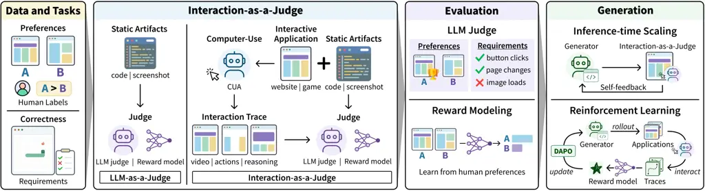
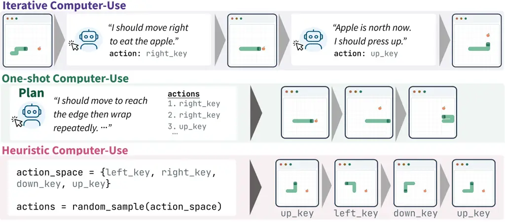

# Interaction-as-a-Judge

Wayne Chi^(1,2), I-Hung Hsu², Li Chen², Wei-Lin Chiang², Ion
Stoica^(2,3), Anastasios Nikolas Angelopoulos², Ameet Talwalkar¹, Chris
Donahue¹, Cho-Jui Hsieh^(2,4) ^(†)^(†)thanks: Work done as part of an
internship at Arena. Correspondence: waynechi@andrew.cmu.edu;
{ihung,chojui}@arena.ai

###### Abstract

Coding agents are tasked with producing sophisticated interactive
applications such as websites, desktop applications, and games. While
humans assess these applications interactively, current automated LLM
evaluations primarily focus on code analysis and unit tests. This
mismatch can cause LLM judges to miss failures that are immediately
apparent to human users. We study Interaction-as-a-Judge, an evaluation
paradigm where computer-use agents (CUAs) directly interact with an
application. We demonstrate that Interaction-as-a-Judge can improve both
_evaluation_ and _generation_ of interactive applications. To this end,
we collect and release two complementary datasets: $`6,858`$ pairs of
applications with human preferences and corresponding agent traces, and
$`222`$ applications with human-verified requirement labels. Relative to
standard non-interactive approaches, we find that Interaction-as-a-Judge
improves evaluation in terms of predicting human preferences
($`65.6\%\to 69.1\%`$) and requirement verification
($`77.0\%\to 81.6\%`$). We also observe scaling benefits: across both
preference alignment and requirement verification, higher-quality
interactions improve performance. Finally, through both inference- and
training-time experiments, we demonstrate that Interaction-as-a-Judge
can also improve the quality of generated artifacts. At inference time,
Interaction-as-a-Judge repairs $`75.5\%`$ of broken requirements within
five attempts, compared to $`55.4\%`$ for code-only self-feedback. At
training time, using Interaction-as-a-Judge as a reward signal improves
win-rate over the base model by $`6.7`$pp while reducing both generated
code length by $`35.7\%`$ and build failure rates by $`7.2`$pp compared
to a code-only reward signal.

October 23, 2026

 

\ArenaTitleFont

¹ [Carnegie Mellon
University](https://cmu.edu) ² [Arena](https://arena.ai) ³ [University
of California, Berkeley](https://berkeley.edu) ⁴ [University of
California, Los Angeles](https://ucla.edu)


## \ArenaHeadingFont1.  \ArenaHeadingFontIntroduction

As coding agents improve, so does the complexity of the software
artifacts they produce and, in turn, the difficulty of evaluating those
artifacts. Correctness and preference are often difficult to assess from
code alone. For example, a game may compile while still failing
behaviorally: player animations may not match movement, scene
transitions may freeze the application, or interactions may lack the
visual and temporal feedback needed to feel responsive and intentional.
A natural method for evaluation—and the way most humans evaluate
software—is simply to interact with and visually inspect the final
product. Yet most current LLM-as-a-Judge (Zheng et al., 2023; Chiang et
al., 2024) and Agent-as-a-Judge (Zhuge et al., 2024; Li et al., 2025)
methods still rely on static or unimodal inspection of software
artifacts. Properly evaluating such artifacts requires moving beyond
static inspection to active interaction.



Figure 1: We present Interaction-as-a-Judge, an evaluation paradigm that
uses interaction traces to improve evaluation and generation. We compare
against non-interactive judges and evaluate on pairwise preferences and
reward modeling. We also show how to apply Interaction-as-a-Judge for
inference-time scaling and as a reward signal for standard post-training
via reinforcement learning.

In this work, we study the use of interaction traces to improve
evaluation accuracy and in turn improve generation quality. Concretely,
a computer-use agent (CUA) interacts with an application and produces a
multimodal interaction trace which can be used to evaluate the quality
of the application, or optionally, provide feedback for improving it. We
call this evaluation paradigm “Interaction-as-a-Judge”, by analogy with
LLM-as-a-Judge (Zheng et al., 2023). While some prior work has explored
this paradigm in different application settings (Bian et al., 2025; Lu
et al., 2025; Wang et al., 2026), we are the first to systematically
study it in a controlled fashion. Specifically, we investigate how
dimensions such as interaction strategy and agent capability affect
evaluation accuracy for both pairwise human preference prediction and
correctness verification. We further show that these evaluation signals
can improve generation using simple and standard methods at both
inference and training time, namely inference-time scaling and
reinforcement learning with a learned reward model.

To study Interaction-as-a-Judge, we introduce two datasets:
ArenaPreferences and ArenaCorrectness. ArenaPreferences is a set of
$`6,858`$ agentic code traces across seven different categories of web
development (games, simulations, reference-based designs,
content-creation tools, brand sites, consumer apps, and data
applications). Alongside the agent traces, each data point contains a
prompt, two websites generated from the prompt, and labeled human
preferences. ArenaCorrectness is a set of $`67`$ high-quality game
development traces with $`828`$ conversation turns. We hand-label
$`412`$ requirements across various versions of each game as the game
develops by interpreting requirements from a user’s prompt and feedback.
Requirements are then hand-verified as working or broken depending on if
the requirement is successfully implemented.

We find that Interaction-as-a-Judge increases alignment with human
preferences for both in-context LLM judges and trained reward models. On
ArenaPreferences, adding interaction traces on top of code significantly
improves overall in-context LLM judge accuracy by up to $`3.5`$
percentage points ($`65.6\%`$ to $`69.1\%`$) and by $`1.5`$ percentage
points ($`67.6\%`$ to $`69.1\%`$) when compared to adding only static
visual information. Fine-tuning a reward model with interaction traces
improves accuracy from $`68.2\%`$ to $`70.2\%`$ and outperforms
in-context LLM judges. We find that higher quality computer-use results
in the best overall performance, although even a random heuristic can
capture non-trivial gains. On ArenaCorrectness, Interaction-as-a-Judge
improves requirement verification accuracy from $`77.0\%`$ for a
code-only Agent-as-a-Judge (Zhuge et al., 2024) to $`81.6\%`$.
Interaction-as-a-Judge also scales with model capability: accuracy
increases from $`76.4\%`$ with GPT 5.6 Luna to $`81.6\%`$ with GPT 5.6
Sol when each serves as both the CUA and the judge.

We show that these evaluation gains also improve generation. At
inference-time, we use Interaction-as-a-Judge in a self-feedback loop
where an agent iteratively attempts to repair broken requirements and
evaluates its repairs using Interaction-as-a-Judge. Compared with
code-only feedback, adding interaction to the feedback mechanism
increases the percentage of initially broken requirements successfully
repaired within five attempts from $`55.4\%`$ to $`75.5\%`$. We also use
a reward model trained solely on interaction traces, without code, to
post-train a generation model through reinforcement learning. Relative
to using a code-only reward model, this method reduces the build failure
rate by $`7.2`$ percentage points and reduces code-context growth—a
known problem in code reward models (Wang et al., 2026)—by $`35.7\%`$,
while achieving comparable generation quality. Additionally, we show
that websites generated by this post-training recipe attain a $`6.7`$pp
higher win rate against the base model.

In summary, our contributions are as follows:

- •
  We study Interaction-as-a-Judge for both preference judgements and
  correctness verification and release two datasets—ArenaPreferences and
  ArenaCorrectness—for further research into both Interaction-as-a-Judge
  and agentic generation of interactive applications more broadly.
- •
  We show that Interaction-as-a-Judge improves evaluation capabilities.
  Interaction-as-a-Judge improves overall alignment with human
  preferences for both in-context LLM judges and trained reward models.
  Additionally, Interaction-as-a-Judge improves an agent’s ability to
  verify requirements when compared to a code-only agentic judge.
- •
  We demonstrate how Interaction-as-a-Judge can be used to improve
  generation through both inference-time scaling and reinforcement
  learning training. Interaction-as-a-Judge improves the number of
  successful repairs in an iterative self-feedback loop and improves
  trained model quality when used as a reward signal.

## \ArenaHeadingFont2.  \ArenaHeadingFontTasks and Datasets

We study Interaction-as-a-Judge under two complementary settings: human
preferences and correctness verification. Human preferences are useful
when quality is subjective or difficult to capture with explicit
requirements, while correctness verification is appropriate when desired
behavior can be specified objectively. In many applications, both are
necessary. For example, a software application may satisfy its
functional requirements while still differing substantially in usability
or visual quality. The inverse can also be true, where an application is
visually preferable, but functionally broken. Effective evaluation
methods should therefore be able to assess both correctness and
preference.

### \ArenaHeadingFont2.1.  \ArenaHeadingFontPreferences

For pairwise preferences, a judge is given a shared prompt and two
candidate outputs and must predict which output would be preferred by a
human user (Zheng et al., 2023). We focus on pairwise comparisons in
this work rather than other preference tasks such as single answer
grading (e.g., predicting a Likert scale score), but our approach is not
restricted to pairwise comparisons.

#### ArenaPreferences.

We release ArenaPreferences, a dataset of $`6,858`$ pairwise comparisons
across seven categories of web development. We collect our dataset from
Arena’s Code Arena where real users prompt two hidden models and vote
for their preferred website. Each datapoint in ArenaPreferences contains
the user’s prompt, both agentic traces, both final websites, and the
ground truth user label. We categorize websites into games, simulations,
reference-based designs, content-creation tools, brand sites, consumer
product, and data applications following the original leaderboard
categories. To ensure that the dataset is high quality, we filter such
that all ties are removed, websites are built with React, outputs build
successfully, outputs contain $`\geq 5\%`$ character difference, and
users spent at least 60 seconds and up to 10 minutes interacting with
the websites. All personally identifiable information (PII) has been
de-identified through a PII filtering process. To our understanding,
this is the largest collection of pairwise agentic web development
traces and websites released for open source use. We provide further
dataset details in Appendix B.

### \ArenaHeadingFont2.2.  \ArenaHeadingFontCorrectness

We consider two types of correctness verification: _requirement
verification_ and _requirement discovery_. In requirement verification,
the judge is given an application, its code, and a set of explicit
requirements, such as “Mario must defeat a Goomba when jumping on it.”
The judge must determine whether each requirement is working or broken
for that application. In requirement discovery, the judge is given the
application and its code but no explicit list of requirements. It must
first identify the relevant requirements automatically and then
determine whether those requirements are working.

#### ArenaCorrectness.

We create ArenaCorrectness, a dataset containing $`67`$ game development
traces with $`828`$ user turns and labeled with $`412`$ requirements
across $`222`$ versions of various games. We collect our dataset from
Arena’s Agent Mode where users can request a random agent to do tasks
such as web search, software development, or image generation. We focus
on game development as games are highly interactive and also challenging
software development tasks (Chi et al., 2026).

To generate requirements from user traces, we analyze the user trace for
specific complaints, and extract the complaint into a broken requirement
which is linked to a specific version of the game matching when the user
complaint occurred. For example, a user complaint indicating that the
player falls through platforms would be annotated as a requirement
indicating that the player must be able to stand on platforms. We use
GPT 5.6 Luna to label, analyze, and then annotate each complaint as a
requirement. A human annotator then reviews each game to verify that the
requirements are sensible and broken in the game version. To extract
working requirement labels, we take our existing broken requirements,
and check to see if the user either explicitly confirms a fix or does
not revisit this complaint. We use GPT 5.6 Luna for initial annotation
and verify via human annotation. In total, we annotate 323 broken and 89
working requirements. We provide further dataset details in Appendix B.

## \ArenaHeadingFont3.  \ArenaHeadingFontInteraction-as-a-Judge



Figure 2: We study three approaches to computer-use. Iterative
computer-use is analogous to standard frame-by-frame computer-use.
One-shot computer-use plans once at the start to save costs. Heuristic
computer-use uses a pre-determined algorithm (e.g., random) to choose
actions.

Interaction-as-a-Judge is an evaluation paradigm which uses computer-use
interaction traces to improve downstream evaluation accuracy.
Interaction-as-a-Judge consists of an interaction component and a judge
component. These two components can be either the same LLM, different
LLMs, or a mixture of LLMs and other methods. For example, a cheap
computer-use heuristic paired with an LLM judge, or an LLM-based CUA
paired with a trained reward model.

### \ArenaHeadingFont3.1.  \ArenaHeadingFontInteraction

Following Koh et al. (2024), we model interaction with the environment
as a partially observable Markov decision process (POMDP). We define the
environment as $`\mathcal{E}=(\mathcal{S},\mathcal{A},\Omega,f)`$ where
$`\mathcal{S}`$ is the state space, $`\mathcal{A}`$ is the action space,
and $`\Omega`$ is the observation space. In our work, $`o_{t}\in\Omega`$
is a visual representation of the application (a screenshot), but the
Document Object Model (DOM) is also commonly used. An action
$`a_{t}\in\mathcal{A}`$ induces a deterministic transition
$`f:\mathcal{S}\times\mathcal{A}\rightarrow\mathcal{S}`$. To interact
with the environment, we define an interaction policy $`\pi`$ that
determines the sequence of actions taken in the environment. Executing
$`\pi`$ in the environment produces an interaction trace
$`\tau=((o_{t},\rho_{t},a_{t}))_{t=0}^{T}`$, where $`o_{t}`$,
$`\rho_{t}`$, and $`a_{t}`$ denote the observation, agent reasoning, and
action at timestep $`t`$, respectively. We allow
$`\rho_{t}=\varnothing`$ when no explicit reasoning is produced. Actions
include standard computer inputs such as moving the mouse, clicking, and
typing—the full action space is in Appendix A.2.

There are multiple approaches to interact with a software application
environment, with the primary trade-off being between adaptivity and
inference cost. We consider three interaction strategies that vary in
how frequently they query a model and observe the resulting environment
state.

#### Iterative computer-use.

The most general approach is to use a computer-use agent that
iteratively observes and acts in the environment. We represent the agent
as a policy $`\pi_{\theta}^{\mathrm{iter}}`$, where at timestep $`t`$ it
selects an action
$`(a_{t},\rho_{t})\sim\pi_{\theta}^{\mathrm{iter}}(\tau_{<t},i)`$, where
$`\tau_{<t}`$ is the interaction trace prior to timestep $`t`$,
$`\rho_{t}`$ is the reasoning for action $`a_{t}`$, and $`i`$ are
instructions to the computer-use agent. For preferences this might be a
broad instruction to investigate the application to determine quality
while for correctness the goal could be a specific requirement it must
verify. The environment then transitions to $`s_{t+1}=f(s_{t},a_{t})`$,
producing a new observation that can inform the next action. This
iterative formulation allows the agent to adapt as the environment
changes and corresponds to the standard computer-use setting. However,
it can be prohibitively expensive, as it requires a model query at every
interaction step.

#### One-shot computer-use.

A sufficiently capable agent could in principle predict the sequence of
actions to take from only the initial state without observing the
intermediate outcomes of its actions. We represent this as a policy
$`\pi_{\theta}^{\mathrm{one}}`$ that, given the initial observation
$`o_{0}`$, reasons and then predicts an entire action sequence
$`(a_{0:T},\rho)=\pi_{\theta}^{\mathrm{one}}(o_{0},i)`$ to be executed
sequentially in the environment up to timestep $`T`$. This requires only
a single model query, substantially reducing inference cost (Wang et
al., 2026), but prevents the agent from adapting when the environment
evolves differently from its prediction. When application code $`c`$ is
available, we additionally provide it to the agent for planning, giving
$`(a_{0:T},\rho)=\pi_{\theta}^{\mathrm{one}}(o_{0},i,c)`$.

#### Heuristic computer-use.

The cheapest alternative is to forgo model-based action selection
entirely. In this work, we consider a simple heuristic policy
$`\pi^{\mathrm{heur}}`$ that selects an action uniformly at random. To
make this interaction more effective, we restrict the policy to a
candidate set $`\mathcal{C}(o_{t})\subseteq\mathcal{A}`$ of interactions
that are likely to induce meaningful changes in the environment, such as
clicking buttons or typing in text boxes, giving
$`a_{t}\sim\pi^{\mathrm{heur}}(o_{t})=\mathrm{Unif}(\mathcal{C}(o_{t}))`$.
Because this incurs no model inference cost, the policy can select an
action after every environment transition. Despite its simplicity, this
can produce substantial interaction when $`\mathcal{C}(o_{t})`$ can be
effectively identified, but is less effective for environments such as
games, where meaningful interactions are difficult to enumerate
automatically.

### \ArenaHeadingFont3.2.  \ArenaHeadingFontJudging

After the interaction trace $`\tau`$ is generated, the judge uses the
trace to inform its downstream judgement. We study both an off-the-shelf
LLM, which we use for both predicting human preferences and verifying
correctness, and a trained reward model, which we use for predicting
human preferences. A key benefit of using off-the-shelf LLMs is that it
allows interaction-as-a-judge to leverage frontier capabilities without
needing to train a custom model, which is often infeasible without data
and compute resources. However, a reward model trained on sufficient
in-domain data can achieve higher accuracy and reduce inference costs.

#### LLM Judge.

For human preferences, an off-the-shelf LLM judge takes in the user
request, source code for each website, and an interaction trace for each
website and outputs a judgement indicating which website is better. Due
to known position bias (Zheng et al., 2023), every battle is judged
twice with sides swapped (AB and BA) and accuracy is the mean
judge-human agreement of both passes. For requirement verification, the
judge takes in the user request, the source code, the interaction trace,
and a requirements list and labels each requirement as working, broken,
or unverifiable. Requirement discovery is similar except no requirement
list is given and the judge must output a list of potential requirements
itself. For judges that accept video natively, we convert
$`o_{0:T}\in\tau`$ to video; otherwise, we pass in each frame as an
image. Actions and reasoning are passed in directly as text sequences.

#### Reward Model.

We train our reward model $`r_{\theta}`$ by adding a scalar reward head
and optimizing over a standard Bradley–Terry loss (Bradley and Terry,
1952):

```math
\mathcal{L}_{\mathrm{BT}}(\theta)=-\mathbb{E}_{(x,y_{w},y_{l},\tau_{w},\tau_{l})\sim\mathcal{D}}\left[\log\sigma\!\left(r_{\theta}(x,y_{w},\tau_{w})-r_{\theta}(x,y_{l},\tau_{l})\right)\right]
```

where $`x`$ is the user prompt, $`y_{w}`$ and $`y_{l}`$ are the source
code for the winner and loser respectively, and $`\tau_{w}`$ and
$`\tau_{l}`$ are the traces. This is similar to standard reward model
training (Christiano et al., 2017; Ouyang et al., 2022) with the
addition of interaction trace information.

## \ArenaHeadingFont4.  \ArenaHeadingFont Interaction-as-a-Judge for Evaluation

We measure the extent to which evaluation via Interaction-as-a-Judge
aligns with human preferences and verified correctness. In our main
experiments, all interaction traces consist of 30 actions. For iterative
and one-shot computer-use, we use GPT 5.6 Luna with medium reasoning as
our computer-use agent. Unless specified, Interaction-as-a-Judge
includes code as input. Games differ from other categories due to their
real-time input and difficulty in identifying meaningful candidate
interactions (e.g., lack of buttons). We describe our harness, action
space, and changes for games in Appendix A.

### \ArenaHeadingFont4.1.  \ArenaHeadingFontHuman Preferences

We evaluate the effectiveness of Interaction-as-a-Judge for judging
human preferences using ArenaPreferences (Figure 3). We compare
Interaction-as-a-Judge against two static-evidence judges: a code-only
judge and a code and screenshot judge. The code-only judge receives only
the code as input, making it functionally identical to either
LLM-as-a-Judge (Zheng et al., 2023) or a standard code reward model. The
code and screenshot judge receives the code and a full page screenshot
of the landing page. This same screenshot is also given as input to
Interaction-as-a-Judge approaches. We also vary the amount of code
received between the full code capped at $`32`$k tokens and just the
core App.tsx file to study the effects of code on
Interaction-as-a-Judge. Additional information such as category
breakdowns can be found in Appendix B.

To train our reward model, we fine-tune Qwen-3.5-9B (Qwen Team, 2026) as
our base model and train on a private dataset of $`20,160`$ human
preference pairs. This dataset is structurally identical to
ArenaPreferences, but is temporally disjoint consisting of data prior to
ArenaPreferences, mirroring how data collection occurs in real settings.
This means that the reward model is evaluated on newer, more advanced
outputs not seen in the training data. For the visual component of the
interaction trace, we input it directly as video and freeze the video
encoder weights during training.

For our LLM judge, we use Gemini 3 Flash and GPT 5.6 Luna with xhigh
reasoning. Both were chosen due to their cost-effectiveness with Gemini
3 Flash being chosen due to its native video capabilities and GPT 5.6
Luna being the main computer-use model used throughout the paper. To
account for ordering bias in LLM-as-a-Judge approaches, we evaluate both
orderings and take the average of the results.

Figure 3: We train a reward model with varying levels of interaction and
observe that including interaction data improves accuracy in terms of
alignment with human preferences. GPT 5.6 Luna is the only exception
where adding interaction offers comparable performance to code only. We
fine-tune from Qwen-3.5-9B as our base model and train each approach 5
times. Bolded values are statistically significant against
code+screenshot, calculated by a sample-wise paired t-test.

Interaction-as-a-Judge increases alignment with human preferences. We
find that for both a trained reward model and an LLM Judge, adding
interaction improves judge alignment with human preferences (Figure 3).
Adding visual information through a screenshot improves performance over
code and adding interaction improves performance further. We see the
largest gap in Gemini 3 Flash as a judge where accuracy improves from
$`65.6\%\rightarrow 69.1\%`$ between code only and iterative
Interaction-as-a-Judge. GPT 5.6 Luna as a judge is the sole exception
where we do not see any statistical differences between any approach. We
speculate that for pairwise preferences, GPT 5.6 Luna is both optimized
for code and also unable to properly utilize visual information given
its strong code-only performance and degradation when adding even a
single screenshot. Finally, our trained reward model ($`70.8\%`$) is
able to outperform an off-the-shelf LLM judge ($`69.1\%`$).

Interaction alone is sufficient information for training a reward model.
We find that training a reward model on the interaction traces alone
(without code) provides comparable performance to a code reward model.
Iterative computer-use without code performs only slightly worse than a
code reward model trained on the entire code context
($`69.0\%\ \text{vs}\ 69.7\%`$), and performs comparably to
Interaction-as-a-Judge with code when using Gemini 3 Flash as a judge.
This opens doors to training reward models on data where the application
is accessible, but code is inaccessible. In general,
Interaction-as-a-Judge judgements remain robust as code context
decreases, seeing small decreases between seeing the full source code
versus only the core App.tsx file. However, both one-shot and heuristic
computer-use degrade more compared to iterative computer-use when no
code is available.

Interaction quality affects alignment with human preferences. We observe
that iterative computer-use consistently performs the best across all
experiments. Due to its ability to respond to new state changes in the
environment, iterative computer-use generates the highest-quality traces
among the three approaches. Additionally, we find that higher-quality
interaction at inference can compensate for lower-quality traces at
training time. We take our reward model trained on heuristic
computer-use and run inference using iterative computer-use instead. We
find that performance increases across almost every single category
(Appendix F, Figure 12). The inverse is not true—a reward model trained
on iterative computer-use degrades when using heuristic computer-use
traces at inference time.

### \ArenaHeadingFont4.2.  \ArenaHeadingFontCorrectness Verification

Figure 4: We evaluate Interaction-as-a-Judge’s ability for requirement
verification (left) and requirement discovery (right). For requirement
verification, we see that Interaction-as-a-Judge is better than a code
only Agent-as-a-Judge, especially at identifying broken requirements.
Additionally, we observe that performance scales as model capabilities
improve. We find that requirement discovery is still challenging for
both approaches.

We evaluate Interaction-as-a-Judge on its ability to both verify and
discover requirements using our ArenaCorrectness dataset (Figure 4). For
requirement verification, we give the agent the code, the game as an
interactable application, and the list of requirements which can be
either all broken or all working. The agent is asked to label each
requirement as working, broken, or unverifiable. For requirement
discovery, we focus only on broken requirements and ask the agent to
list out all possible broken requirements that require repair without
passing in the original requirements list. We compare
Interaction-as-a-Judge against a code only Agent-as-a-Judge (Zhuge et
al., 2024). We use the GPT 5.6 model family (Luna, Terra, Sol) all with
medium reasoning to measure varying model capabilities.

Interaction-as-a-Judge outperforms code only requirement verification.
We find that across all models, Interaction-as-a-Judge performs better
than a code only Agent-as-a-Judge. This is primarily because
Interaction-as-a-Judge is significantly better at verifying broken
requirements ($`71.1\%`$) compared to a code only Agent-as-a-Judge
($`63.0\%)`$. We find that both approaches perform comparably for
verifying working requirements at $`92.1\%`$ and $`91.0\%`$ for
Interaction-as-a-Judge and code-only Agent-as-a-Judge respectively.

Interaction-as-a-Judge scales with model capability. We see in Figure 4
that broken requirement verification performance continues to improve as
the overall capability of the model improves going from $`65.2\%`$ with
GPT 5.6 Luna to $`68.0\%`$ with GPT 5.6 Terra and $`71.1\%`$ with GPT
5.6 Sol.

## \ArenaHeadingFont5.  \ArenaHeadingFont Interaction-as-a-Judge for Generation

### \ArenaHeadingFont5.1.  \ArenaHeadingFontInference-time Scaling

Figure 5: We compare Interaction-as-a-Judge against a code-only
Agent-as-a-Judge at iterative self-feedback and requirement repair.
Interaction-as-a-Judge repairs $`75.5\%`$ of initially broken
requirements compared to $`55.4\%`$ repaired by the code-only
Agent-as-a-Judge. We see this improvement even when evaluating using Sol
as a code-only Agent-as-a-Judge. Additionally, the gap between
self-reported accuracy and accuracy measured by GPT 5.6 Sol is less for
Interaction-as-a-Judge.

We evaluate whether interaction-based self-feedback improves an agent’s
ability to repair broken requirements (Figure 5). An effective inference
time strategy is to iteratively repair and verify the resulting
application. Regardless of implementation capabilities,
self-verification capability becomes important for determining whether
the repairs are correct or incorrect. We use the games with broken
requirements in ArenaCorrectness as our task list. We ask the agent to
repair the broken requirements for each game and self-verify across five
iterations. We compare Interaction-as-a-Judge against a code only
Agent-as-a-Judge and use GPT 5.6 Luna with medium reasoning as the agent
for both approaches. After all iterations are complete, we use a more
capable model (GPT 5.6 Sol) with Interaction-as-a-Judge and code-only
Agent-as-a-Judge to determine if the repairs were successful or not. We
measure success per requirement and report repair success rate after
each iteration.

#### Interaction-as-a-Judge repairs more broken requirements than a code only Agent-as-a-Judge.

After five iterations, Interaction-as-a-Judge successfully repairs
$`75.5\%`$ of initially broken requirements, compared to $`55.4\%`$ for
code-only self-feedback, an improvement of $`20.1`$ percentage points
(Figure 5, middle). This improvement persists even when using GPT 5.6
Sol as a code-only Agent-as-a-Judge (Figure 5, left), highlighting the
improvements Interaction-as-a-Judge provides. We see in Figure 5 that
Interaction-as-a-Judge not only improves faster but also outperforms the
code-only judge within its first iteration. Additionally, the
self-reported accuracy gap between GPT 5.6 Luna and GPT 5.6 Sol is
significantly less for Interaction-as-a-Judge compared to a code only
Agent-as-a-Judge (Figure 5, right), suggesting a lower false positive
rate when using Interaction-as-a-Judge.

### \ArenaHeadingFont5.2.  \ArenaHeadingFontTraining

Figure 6: We train a Qwen-3.5-9B model using code-only and
interaction-only reward models. As expected, each performs better on its
respective training objective, but the interaction-only model leads to
improvements in neutral criteria such as build success rate and
decreased code length. We use an auto-rubrics based judge and find a
significant improvement over the base model. The build reward baseline
naturally degrades in reward for both reward models.

We study the potential of Interaction-as-a-Judge at training time to
improve downstream performance in generating interactive applications.
Specifically, we explore using an interaction-only reward model as the
reward signal for post-training via reinforcement learning (Figure 6).
We start our training from Qwen-3.5-9B and use DAPO (Yu et al., 2025) as
our learning algorithm. We use the same interaction only reward model we
trained in Section 4.1 and compare against a code only reward model. We
use heuristic computer-use to reduce costs and training time. We train
on a set of $`14`$k internal prompts that are not used for reward model
training which cover all categories except for games as heuristic
computer-use has difficulty playing games. We sample 600 examples
uniformly from the six categories in ArenaPreferences as our test set.
Since our reward model training data is cleaned to remove any failures,
failures are out of distribution for both models. To account for this,
we add penalties for any website that fails to build or render at all.
Detailed hyperparameters can be found in Appendix G.

#### Interaction-as-a-Judge allows for successful reinforcement learning training without code.

Overall, we observe that each model scores higher on their respective
reward models, but interaction improves neutral objectives by reducing
code generated and increasing successful builds. Code only reward models
are known to have length bias (Wang et al., 2026)—we observe that
training on the interaction reward model generates $`35.7\%`$ less code
than the code reward model. On our test set, Interaction-as-a-Judge also
increases the build success rate from $`81.3\%`$ to $`88.5\%`$ compared
to a code only reward model, reducing the build failure rate by $`7.2`$
percentage points ($`18.7\%\to 11.5\%`$). We use an internal
auto-rubrics based judge based on Kao et al. (2026) calibrated to
Arena’s data and leaderboard to compare each trained model against
Qwen-3.5-9B. Among websites that build and render successfully, the
model trained using Interaction-as-a-Judge achieves a win-rate gain of
$`6.72`$pp over the base model (Figure 6). Based on our internal
calibrations, this is equivalent to over a 50 point increase on Arena’s
leaderboard, which would be a statistically significant improvement to
the model in Arena’s leaderboard. This evaluation measures quality
conditioned on successful generations and therefore understates the
benefit of using Interaction-as-a-Judge as a reward signal. The ability
to train a model via reinforcement learning with an interaction only
reward model opens the door to data collection opportunities where
application access is available, but code access is not.

## \ArenaHeadingFont6.  \ArenaHeadingFontRelated Work

The two most related families of work are other LLM-based judging
strategies and existing instances where CUAs have been used for
evaluation or generation. Unlike prior work, our work differs from the
latter in that interaction is the central focus of our study, rather
than one component of a larger pipeline. Specifically, we conduct the
first systematic study spanning (i) the effects of varying interaction
strategies and model capabilities on evaluation performance,
(ii) measuring Interaction-as-a-Judge’s alignment with human preferences
and correctness, and (iii) its use for both inference-time scaling and
post-training. Below, we outline the connections more specifically.

#### LLM-as-a-Judge and Agent-as-a-Judge.

LLM-as-a-Judge uses language models to approximate human judgments of
generated outputs (Zheng et al., 2023). For software development, the
evidence needed to judge requirement satisfaction can be distributed
across a project and its development history. Agent-as-a-Judge (Zhuge et
al., 2024) addresses this by gathering and inspecting project files and
development trajectories before judging. Interactive applications
introduce a further source of evidence: the behavior observed when a
user operates the software. Computer-use agents provide a means to
collect this evidence by interacting with desktop and web
interfaces (Xie et al., 2024; Zhou et al., 2024; Koh et al., 2024).
Interaction-as-a-Judge extends these judging paradigms to this new
source of evidence: rather than inspecting only static artifacts, the
judge conditions on traces produced by a computer-use agent operating
the application.

#### Interactive evaluation.

Recent works have attempted to use computer-use as part of their
evaluation pipeline. ArtifactsBench (Zhang et al., 2025) and
GameCraft-Bench (Luo et al., 2026) ground judgments in heuristically
generated screenshots and replayed gameplay, respectively.
AppEvalPilot (Bian et al., 2025) generates and executes test cases using
a computer-use agent and validates its judgments against human
assessments of functional requirements. In these works, interaction is
used as a method of evaluation rather than the focus of study, and it
remains unclear how computer-use model capabilities and methods of
interaction affect evaluation performance. WebDevJudge (Li et al.,
2025), which benchmarks LLM and multimodal judges for web development,
illustrates the importance of understanding these capabilities as it
finds that its standalone GUI-agent workflow actually underperforms its
strongest static judges due to errors arising during planning and
execution.

#### Interaction feedback and reward learning.

Interaction evidence can also guide the generation process that produces
an application. WebGen-Agent (Lu et al., 2025) incorporates screenshot
feedback and iterative computer-use testing into website refinement. For
reinforcement learning, it sums screenshot-based appearance scores and
GUI-testing scores, and introduces Step-GRPO to assign advantages
separately to each refinement step. Wang et al. (2026) use one-shot
computer-use: a model plans the full action sequence upfront, and a
rubric-based judge scores the recorded execution to provide training
rewards, reducing code-length exploitation compared to static judges.
Both approaches obtain their reward signals from model-generated
assessments of appearance or functionality. We provide an alternative
and potentially simpler solution by training a reward model on human
preferences (Christiano et al., 2017; Ouyang et al., 2022) using
interaction traces and then using its predictions as outcome rewards in
DAPO.

## \ArenaHeadingFont7.  \ArenaHeadingFontConclusion

#### Limitations and Future Work.

While we study some common approaches to computer-use, we believe that
better computer-use models and methods could further improve evaluation
and generation, especially considering our observation that better
computer-use traces lead to better performance. Currently, one of the
biggest bottlenecks to computer-use remains cost. For example, we were
mostly limited to experiments with GPT 5.6 Luna as our computer use
agent due to pricing. More capable and affordable computer-use agents
will likely improve Interaction-as-a-Judge capabilities and are worth
studying as well. For training, there is the possibility of using the
same model for both generation and computer-use and improving them both
simultaneously as better applications and better traces both improve
reward modeling scores. We leave this as potential future work.

#### Conclusion

We study Interaction-as-a-Judge, an evaluation paradigm that uses
computer-use traces to improve evaluation and downstream generation. We
study the use of Interaction-as-a-Judge for both human preferences and
correctness verification, releasing two datasets—ArenaPreferences and
ArenaCorrectness—to facilitate such studies. We demonstrate how
Interaction-as-a-Judge improves alignment with human preferences for
both reward model training and LLM judges and improves a model’s ability
to label requirements as working or broken. We show how
Interaction-as-a-Judge can be used for inference-time scaling through an
iterative self-feedback loop. Lastly, we illustrate how you can use a
reward model trained on only interaction traces, with no code, as the
reward signal for standard reinforcement learning training.

## Acknowledgements

We thank Yewon Kim for help with designing Figure 1 and Seth Karten for
initial discussions that led to this work. This work was supported in
part by the National Science Foundation grants IIS1705121, IIS1838017,
IIS2046613, IIS2112471, and funding from Datadog. This material is based
upon work supported by the Air Force Office of Scientific Research under
award number FA9550-25-C-B010 in the amount of \$129,600. Any opinions,
findings and conclusions or recommendations expressed in this material
are those of the author(s) and do not necessarily reflect the views of
any of these funding agencies.

## References

- Bian et al. (2025) Y. Bian, X. Lin, Y. Xie, T. Liu, M. Zhuge, S.
  Lu, H. Tang, J. Wang, J. Zhang, J. Chen, X. Tang, Y. Ni, S. Hong,
  and C. Wu You don’t know until you click: automated GUI testing for
  production-ready software evaluation. arXiv preprint arXiv:2508.14104.
  Cited by: §1, §6.
- Bradley and Terry (1952) R. A. Bradley and M. E. Terry Rank analysis
  of incomplete block designs: i. the method of paired comparisons.
  Biometrika 39 (3/4), pp. 324–345. External Links:
  [Document](https://dx.doi.org/10.1093/biomet/39.3-4.324) Cited by:
  §3.2.
- Chi et al. (2026) W. Chi, Y. Fang, A. Yayavaram, S. Yayavaram, S.
  Karten, Q. A. Wei, R. Chen, A. Wang, V. Chen, A. Talwalkar, and C.
  Donahue GameDevBench: evaluating agentic capabilities through game
  development. External Links: 2602.11103,
  [Link](https://arxiv.org/abs/2602.11103) Cited by: §2.2.
- Chiang et al. (2024) W. Chiang, L. Zheng, Y. Sheng, A. N.
  Angelopoulos, T. Li, D. Li, H. Zhang, B. Zhu, M. Jordan, J. E.
  Gonzalez, and I. Stoica Chatbot arena: an open platform for evaluating
  LLMs by human preference. In International Conference on Machine
  Learning (ICML), Cited by: §1.
- Christiano et al. (2017) P. F. Christiano, J. Leike, T. B. Brown, M.
  Martic, S. Legg, and D. Amodei Deep reinforcement learning from human
  preferences. In Advances in Neural Information Processing Systems
  (NeurIPS), Cited by: §3.2, §6.
- Kao et al. (2026) K. Kao, D. Huo, Y. Ban, and C. Hsieh AutoRubric-t2i:
  robust rule-based reward model for text-to-image alignment. External
  Links: 2605.17602, [Link](https://arxiv.org/abs/2605.17602) Cited by:
  §5.2.
- Koh et al. (2024) J. Y. Koh, R. Lo, L. Jang, V. Duvvur, M. Lim, P.
  Huang, G. Neubig, S. Zhou, R. Salakhutdinov, and D. Fried
  VisualWebArena: evaluating multimodal agents on realistic visual web
  tasks. In Proceedings of the 62nd Annual Meeting of the Association
  for Computational Linguistics (Volume 1: Long Papers), pp. 881–905.
  External Links:
  [Document](https://dx.doi.org/10.18653/v1/2024.acl-long.50) Cited by:
  §3.1, §6.
- Li et al. (2025) C. Li, Y. Zheng, X. Huang, T. Fang, J. Xu, L.
  Chen, Y. Song, and H. Hu WebDevJudge: evaluating (M)LLMs as critiques
  for web development quality. arXiv preprint arXiv:2510.18560. Cited
  by: §1, §6.
- Lu et al. (2025) Z. Lu, H. Ren, Y. Yang, K. Wang, Z. Zong, J. Pan, M.
  Zhan, and H. Li WebGen-agent: enhancing interactive website generation
  with multi-level feedback and step-level reinforcement learning.
  External Links: 2509.22644, [Link](https://arxiv.org/abs/2509.22644)
  Cited by: §1, §6.
- Luo et al. (2026) T. Luo, R. Wang, J. Bi, C. Xu, Z. Tang, J. Chen, J.
  Liang, K. Ji, S. Guo, Y. Du, F. Bu, W. Du, X. Zhang, K. Li, S.
  Wang, L. Zhang, Y. Liu, X. Lai, C. Li, Y. Guo, Z. Zhang, X. Wang, T.
  Bai, Z. Li, and B. Wang GameCraft-bench: can agents build playable
  games end-to-end in a real game engine?. External Links: 2606.17861,
  [Link](https://arxiv.org/abs/2606.17861) Cited by: §6.
- Ouyang et al. (2022) L. Ouyang, J. Wu, X. Jiang, D. Almeida, C.
  Wainwright, P. Mishkin, C. Zhang, S. Agarwal, K. Slama, A. Ray, J.
  Schulman, J. Hilton, F. Kelton, L. Miller, M. Simens, A. Askell, P.
  Welinder, P. Christiano, J. Leike, and R. Lowe Training language
  models to follow instructions with human feedback. In Advances in
  Neural Information Processing Systems, Vol. 35, pp. 27730–27744. Cited
  by: §3.2, §6.
- Qwen Team (2026) Qwen Team Qwen3.5-omni technical report. External
  Links: 2604.15804, [Link](https://arxiv.org/abs/2604.15804) Cited by:
  §4.1.
- Wang et al. (2026) B. Wang, C. Zhang, D. Liu, J. Zhang, J. Chen, M.
  Li, M. Chen, R. Fang, S. Zhang, X. Wang, Y. Jing, Z. Ma, and Z. Cui
  The verification horizon: no silver bullet for coding agent rewards.
  External Links: 2606.26300, [Link](https://arxiv.org/abs/2606.26300)
  Cited by: §1, §1, §3.1, §5.2, §6.
- Xie et al. (2024) T. Xie, D. Zhang, J. Chen, X. Li, S. Zhao, R.
  Cao, T. J. Hua, Z. Cheng, D. Shin, F. Lei, Y. Liu, Y. Xu, S. Zhou, S.
  Savarese, C. Xiong, V. Zhong, and T. Yu OSWorld: benchmarking
  multimodal agents for open-ended tasks in real computer environments.
  In Advances in Neural Information Processing Systems (NeurIPS), Cited
  by: §6.
- Yu et al. (2025) Q. Yu, Z. Zhang, R. Zhu, Y. Yuan, X. Zuo, Y. Yue, W.
  Dai, T. Fan, G. Liu, L. Liu, X. Liu, H. Lin, Z. Lin, B. Ma, G.
  Sheng, Y. Tong, C. Zhang, M. Zhang, W. Zhang, H. Zhu, J. Zhu, J.
  Chen, J. Chen, C. Wang, H. Yu, Y. Song, X. Wei, H. Zhou, J. Liu, W.
  Ma, Y. Zhang, L. Yan, M. Qiao, Y. Wu, and M. Wang DAPO: an open-source
  llm reinforcement learning system at scale. External Links:
  2503.14476, [Link](https://arxiv.org/abs/2503.14476) Cited by: §5.2.
- Zhang et al. (2025) C. Zhang, Y. Li, C. Xu, J. Liu, A. Liu, C.
  Zhou, K. Deng, D. Wu, G. Huang, K. Li, Q. Yi, R. Xiong, S. Hu, Y.
  Zhang, Y. Jiang, Z. Xu, Y. Zhang, W. Zhou, C. Zhou, and F. Lian
  ArtifactsBench: bridging the visual-interactive gap in llm code
  generation evaluation. External Links: 2507.04952,
  [Link](https://arxiv.org/abs/2507.04952) Cited by: §6.
- Zheng et al. (2023) L. Zheng, W. Chiang, Y. Sheng, S. Zhuang, Z.
  Wu, Y. Zhuang, Z. Lin, Z. Li, D. Li, E. P. Xing, H. Zhang, J. E.
  Gonzalez, and I. Stoica Judging LLM-as-a-judge with MT-Bench and
  chatbot arena. In Advances in Neural Information Processing Systems
  (NeurIPS) Datasets and Benchmarks Track, Cited by: §1, §1, §2.1, §3.2,
  §4.1, §6.
- Zhou et al. (2024) S. Zhou, F. F. Xu, H. Zhu, X. Zhou, R. Lo, A.
  Sridhar, X. Cheng, T. Ou, Y. Bisk, D. Fried, U. Alon, and G. Neubig
  WebArena: a realistic web environment for building autonomous agents.
  External Links: 2307.13854, [Link](https://arxiv.org/abs/2307.13854)
  Cited by: §6.
- Zhuge et al. (2024) M. Zhuge, C. Zhao, D. Ashley, W. Wang, D.
  Khizbullin, Y. Xiong, Z. Liu, E. Chang, R. Krishnamoorthi, Y. Tian, Y.
  Shi, V. Chandra, and J. Schmidhuber Agent-as-a-judge: evaluate agents
  with agents. arXiv preprint arXiv:2410.10934. Cited by: §1, §1, §4.2,
  §6.

## Appendix

## Appendix A Interaction Harness and Action Space

### \ArenaHeadingFontA.1.  \ArenaHeadingFontBrowser Environment and Observations

For preference prediction, we render each candidate in a separate
Chromium browser context using Playwright. Applications run inside an
iframe with a $`1280\times 800`$ viewport and device scale factor one.
Mouse coordinates are measured in pixels relative to the top-left corner
of the application iframe. Each tool response contains a screenshot of
the application, the viewport dimensions, cursor position, held keys,
and execution status. The interactive agent receives the original user
request and these observations. The one-shot agent additionally receives
application source code when constructing its action sequence. For
pairwise preferences, the agents explore each candidate independently
and then the preference judge subsequently compares the resulting
evidence for both candidates. For correctness verification, the same
agent explores and judges the candidate in one continuous workflow.

#### Interaction budget and timing.

The main preference experiments use a budget of 30 interaction steps per
candidate. A step is one tool invocation, which can itself contain
several low-level input events: for example, a click includes a mouse
press and release, while press_keys executes a sequence of key presses.
The full action space is defined in Table 1. The budget does not count
individual keystrokes or model reasoning tokens. The computer-use agent
is allowed to exit early if it determines that its goal is complete.

For games, a JavaScript timing shim wraps animation frames, timers, and
application clocks. The game is paused between actions, and ordinary
actions advance its clock by 500 ms. Key holds and waits advance the
requested duration, capped by the per-step budget. This separates model
inference latency from simulated game time. The timing shim advances in
small increments so that animation callbacks can execute between inputs.
Other web applications run in real time and are allowed to settle after
an action.

### \ArenaHeadingFontA.2.  \ArenaHeadingFontAction Space

Table 1 gives the interaction tools shared by iterative and one-shot
preference agents. The iterative agent selects tools after observing
their results. The one-shot agent emits a list of the same tool names
and arguments, which the harness executes sequentially without
intermediate model feedback. Typing and scrolling use keyboard events;
they do not require separate text-entry or scroll tools.

|              |                                                                                                  |
| ------------ | ------------------------------------------------------------------------------------------------ |
| Tool         | Arguments and effect                                                                             |
| mouse_click  | $`(x,y)`$; presses and releases the left mouse button.                                           |
| mouse_down   | $`(x,y)`$; holds the left button until a later release.                                          |
| mouse_up     | $`(x,y)`$; releases the held left button.                                                        |
| mouse_move   | $`(x,y)`$ and optional steps (default 8); interpolates cursor movement, preserving button state. |
| mouse_drag   | from_x, from_y, to_x, to_y, optional steps (12), and hold_ms (50); performs a complete drag.     |
| double_click | $`(x,y)`$; performs a double click.                                                              |
| hold_key     | key and ms; holds a key for the specified duration and then releases it.                         |
| press_keys   | Ordered keys list and optional delay_ms (100); supports text entry, navigation, and shortcuts.   |
| wait_ms      | ms; advances time without another input.                                                         |
| finish_run   | reason; ends the current run with the given reason.                                              |

Table 1: Preference-agent action space. Positions are iframe-relative
pixels; durations are milliseconds. A dispatched observation request
also consumes a step in the implemented dispatcher.

Coordinates, interpolation counts, and durations are integer arguments.
Key names follow Playwright conventions, including ArrowLeft, Space,
Enter, and letter keys.

### \ArenaHeadingFontA.3.  \ArenaHeadingFontHeuristic Interaction

For non-gaming applications, the heuristic enumerates visible, enabled
controls in the current viewport: links, buttons, input fields, text
areas, selects, summaries, elements with relevant accessibility roles,
click handlers, or a non-negative tab index. It excludes hidden and
off-screen controls, deduplicates controls by their center coordinates,
and retains at most 200 candidates. Candidate controls are sampled
uniformly. A text field is clicked before entering a phrase drawn from a
fixed small vocabulary, and a PageDown action is sampled with
probability $`0.12`$ to reveal additional content. If no candidates are
found, the policy falls back to pixel and keyboard actions.

### \ArenaHeadingFontA.4.  \ArenaHeadingFontGames

Games differ from other categories in two ways. First, games often
require real-time input, so we construct a web harness that freezes
games between interactions and plays actions out for up to 500
milliseconds (i.e., 2 actions per second). Second, since games typically
do not have clear interaction candidates (e.g., buttons), heuristic
computer-use actions are drawn uniformly from a 12-element action space
consisting of four click actions, three key-sequence actions, two
key-hold actions, and one each of mouse movement, drag, and double
click. Coordinates are sampled uniformly within the viewport. Keyboard
actions are sampled from the four arrow keys, Space, Enter, and w, a, s,
and d.

## Appendix B Dataset Details and Evaluation Protocol

The $`6,858`$-battles in ArenaPreferences are selected from a time
period of one month (July 2026). They exclude unknown countries and the
fixed set of EU27 countries, the United Kingdom, Switzerland, Norway,
Iceland, and Liechtenstein. Both candidate source records must declare
the react-vite-tailwind template and a successful upstream build. Both
sides must contain more than 5% character difference.

ArenaPreferences contains $`6,858`$ battles across seven categories:
$`1,288`$ games, $`904`$ simulations, $`753`$ reference-based designs,
$`1,020`$ content-creation tools, $`1,246`$ brand sites, $`949`$ data
applications, and $`698`$ consumer applications. The reward-model
training and validation ID lists contain $`20,160`$ and $`4,460`$
battles, respectively. The training pool precedes the evaluation pool in
time.

The traces in ArenaCorrectness were collected between June 5 and June
26, 2026. Of its $`412`$ requirements, $`323`$ are labeled broken and
$`89`$ working. Each of the $`222`$ game versions corresponds to the
application state after a specific user turn of its source trace, and
repaired variants of a version are included for requirements that users
later confirmed fixed.

Table 2 reports summary statistics for both datasets. Lines of code
exclude lockfiles. Interaction time before voting is measured from the
final assistant message to the submitted preference. Trace duration
measures wall-clock time from the first to the last message of a trace
and includes idle time between user turns.

|                                        |       |        |         |
| -------------------------------------- | ----- | ------ | ------- |
|                                        | Mean  | Median | Max     |
| ArenaPreferences                       |       |        |         |
| Prompt length (words)                  | 408   | 68     | 16,240  |
| Files per website                      | 15.6  | 14     | 233     |
| Lines of code                          | 1,940 | 1,540  | 17,666  |
| Lines of code (App.tsx only)           | 399   | 276    | 4,329   |
| Interaction time before vote (seconds) | 230   | 188    | 600     |
| ArenaCorrectness                       |       |        |         |
| User turns per trace                   | 12.4  | 7      | 119     |
| Trace duration (minutes)               | 674   | 51     | 8,718   |
| Versions per trace                     | 3.3   | 2      | 30      |
| Requirements per broken version        | 2.4   | 2      | 19      |
| Files per version                      | 7.0   | 2      | 80      |
| Lines of code per version              | 3,100 | 1,071  | 145,444 |

Table 2: Summary statistics for ArenaPreferences (per website,
$`n{=}13{,}716`$ across $`6{,}858`$ battles) and ArenaCorrectness
($`n{=}67`$ traces, $`n{=}222`$ game versions). Lines of code exclude
lockfiles.

## Appendix C Category Level Results

Figures 7 and 8 expand the LLM-judge comparison. Figures 9 and 10 give
the corresponding reward-model results under the two code
representations. All bars measure agreement with the original human
preferences. The overall panels weight categories by their number of
battles rather than assigning each category equal weight. The heuristic,
one-shot, and iterative conditions add interaction traces to code and
screenshot inputs. Bold values indicate positive paired gains over
code+screenshot with $`p<0.05`$, calculated using a two-sided paired
test. Across 28 category comparisons, iterative interaction
significantly outperformed code+screenshot in 14, significantly
underperformed in one, and showed no statistically significant
difference in 13. Across the four approaches, simulations and games show
the largest average accuracy gains from iterative interaction over
code+screenshot (+2.81 and +1.74 percentage points, respectively). They
also show the most consistent statistically significant improvements,
with gains significant in four of four approaches for simulations and
three of four for games.

Figure 7: Per-category preference agreement (%) for Gemini 3 Flash.
Error bars show 95% normal confidence intervals over battles.

Figure 8: Per-category preference agreement (%) for GPT 5.6 Luna. Error
bars show 95% normal confidence intervals over battles.

Figure 9: Per-category reward-model agreement (%) with full code input,
averaged over five seeds. Error bars show 95% Wilson intervals over
pooled seed–battle outcomes.

Figure 10: Per-category reward-model agreement (%) with App.tsx input,
averaged over five seeds. Error bars show 95% Wilson intervals over
pooled seed–battle outcomes.

## Appendix D Reward-Model Training

We fine-tune Qwen3.5-9B with a scalar reward head evaluated at a
trailing classification token. The language backbone and reward head are
trained while the vision encoder is frozen.

|                                  |                                                                                |
| -------------------------------- | ------------------------------------------------------------------------------ |
| Parameter                        | Value                                                                          |
| Backbone                         | Qwen3.5-9B                                                                     |
| Objective                        | Pairwise Bradley–Terry loss                                                    |
| Optimizer                        | Distributed Adam; $`\beta_{1}=0.9`$, $`\beta_{2}=0.999`$, $`\epsilon=10^{-8}`$ |
| Learning rate                    | $`2\times 10^{-6}`$, constant; no warmup                                       |
| Weight decay / gradient clipping | 0 / maximum gradient norm 50                                                   |
| Epochs / global batch size       | 1 / 32 preference pairs                                                        |
| Microbatch / numerical precision | 1 pair per data-parallel worker / bfloat16                                     |
| Maximum sequence length          | 32,768 tokens per candidate                                                    |
| Seeds                            | 42, 77, 100, 200, 300                                                          |
| Vision encoder                   | Frozen                                                                         |
| Video input                      | Native video representation, up to 31 frames, 2 fps                            |
| Visual-token caps                | 960 per screenshot                                                             |
| Trace text                       | Per-frame action and available reasoning text; timestamp aligned               |
| Checkpoint evaluation / saving   | Every 20 updates, with final checkpoint evaluation                             |
| Checkpoint selection             | Highest validation agreement; earliest step breaks ties                        |
| Memory settings                  | Gradient checkpointing; full, uniform recomputation                            |
| Parallelism                      | Tensor parallelism 2; pipeline parallelism 1                                   |

Table 3: Hyperparameters for the main preference reward models. The same
optimization recipe is used across evidence conditions; the
representation changes the source-code and visual inputs.

#### Code representations.

The full-code comparison allows 100,000 source characters before
applying the 32,768-token sequence limit. Its source pipeline removes
lockfiles, selects files under the character budget, and orders the
selected files from smaller to larger with the main application file
placed last. This ordering is specified independently of the test
outcomes. The App.tsx comparison restricts the source store to the main
application file, with a largest-code-file fallback when that file is
unavailable.

#### Visual processing.

Video frames are processed jointly through the native video path with
temporal merging and timestamps. In the combined condition, the separate
static screenshot precedes the video and trace text. The loader
preserves complete visual token blocks when applying the context limit,
so source-code availability can decrease as visual evidence occupies
more of the sequence. Due to this, code+screenshot+video reaches the
token context limit more frequently than code only.

|                   |                      |                   |                   |
| ----------------- | -------------------- | ----------------- | ----------------- |
| Evidence          | Full source ($`\%`$) | App.tsx ($`\%`$)) | No source ($`\%`$ |
| Code              | 10.05                | 0.43              | —                 |
| Code + screenshot | 13.07                | 0.49              | —                 |
| Heuristic trace   | 57.71                | 2.26              | 1.42              |
| One-shot trace    | 57.26                | 2.30              | 1.42              |
| Iterative trace   | 59.93                | 2.42              | 1.53              |

Table 4: Candidate inputs at or above the 32,768-token ceiling in the
main test predictions (%).

## Appendix E Additional Reward Modeling Experiments

We report additional reward model training experiments that vary
reward-model size, source-code availability, the text accompanying an
interaction trace, and the generators represented in training. These
experiments use a separate data construction and training recipe.
Interaction traces are generated using GPT 5.4 Mini rather than GPT 5.6
Luna. We distinguish them from the main test results throughout.

### \ArenaHeadingFontE.1.  \ArenaHeadingFontShared Setup and Evaluation Populations

The model-size, source-restriction, and trace-text studies train on
8,640 battles and evaluate on 3,327-battles. All data points are from
the gaming category. All models use one epoch, learning rate
$`2\times 10^{-6}`$, global batch size 32, a frozen vision encoder, and
the pairwise reward objective described in Appendix D.

We use five seeds for the 4B models ($`42,77,100,200,777`$) and ten for
the 9B and 27B models ($`42,77,100,200,300,400,500,600,700,777`$).
Tables report means and sample standard deviations across seeds.

|              |       |                   |                   |                              |
| ------------ | ----- | ----------------- | ----------------- | ---------------------------- |
| Reward model | Seeds | Code              | Code + Screenshot | Code + Iterative Interaction |
| Qwen3.5-4B   | 5     | $`68.81\pm 0.62`$ | $`68.75\pm 1.00`$ | $`70.21\pm 0.59`$            |
| Qwen3.5-9B   | 10    | $`68.62\pm 0.60`$ | $`69.30\pm 0.67`$ | $`70.18\pm 0.46`$            |
| Qwen3.5-27B  | 10    | $`69.82\pm 0.74`$ | $`70.66\pm 0.60`$ | $`71.43\pm 0.46`$            |

Table 5: Agreement (%) on 3,327 gaming battles for three reward-model
sizes. All rows use the same evaluation IDs. Video includes action and
reasoning text in this table. Error terms are seed standard deviations.

Interaction-as-a-Judge exceeds the code-only condition at all three
sizes, by 1.39, 1.55, and 1.61 percentage points, respectively. The 4B
and 9B Interaction-as-a-Judge models have similar mean agreement, while
the 27B model is higher. Increasing parameter count therefore does not
produce a uniform step-by-step improvement within this data and
optimization regime. Interaction-as-a-Judge also exceeds the screenshot
condition at each size, although the size of the difference varies.

### \ArenaHeadingFontE.2.  \ArenaHeadingFontActions and Reasoning as Judge Input

To distinguish visual observations from their accompanying text, we
train 9B models with four input representations: code alone; code with
actions and intermediate reasoning but no images; code with video frames
but no trace text; and code with both video and trace text. The visual
conditions share the same frames. The text switch changes both training
and evaluation inputs; this is not an inference-only removal of text
from a model trained to expect it.

|                                  |                   |
| -------------------------------- | ----------------- |
| Evidence                         | Agreement (%)     |
| Code                             | $`68.62\pm 0.60`$ |
| Code + trace text                | $`68.66\pm 0.79`$ |
| Code + video, without trace text | $`70.21\pm 0.68`$ |
| Code + video + trace text        | $`70.18\pm 0.46`$ |

Table 6: Trace-text ablation on 3,327 gaming battles with ten seeds per
condition. “Trace text” comprises actions and intermediate reasoning.
Code-only and video-plus-text entries also appear in Table 5.

Adding trace text changes mean agreement by only $`+0.03`$ points
without video and $`-0.03`$ points with video. These results provide
little evidence that the recorded actions and reasoning, by themselves,
explain the improvement in this campaign. This does not imply that the
text itself is uninformative in every setting; in our unofficial
observations we have seen reward model scores vary depending on changes
to the trace text.

### \ArenaHeadingFontE.3.  \ArenaHeadingFontSpatial Resolution

We evaluate spatial resolution in a separate gaming study using
Qwen3.5-9B reward models with no source-code input. Models are trained
for one epoch with the same settings as before. We vary the token cap.

Figure 11: Image fidelity and trace length on 3,327 gaming battles.
Left: agreement versus nominal visual token budget when varying
screenshot resolution or video resolution with all 26 frames retained.
Right: agreement versus retained frame count at a 960-token cap per
temporal block. Horizontal spacing in the right panel follows frame
count; the bottom axis labels corresponding nominal visual token
budgets. Video budgets are the per-block cap times $`\lceil F/2\rceil`$
for $`F`$ frames, so the 1- and 2-frame prefixes share a 960-token
budget but occupy distinct positions. The 26-frame, 12,480-token
endpoint is the same experiment in both panels. Points show means and
error bars show $`\pm`$ one sample standard deviation across ten
training seeds. Budgets are nominal visual-token caps, not measured
total token usage or equal-total-compute conditions.

Screenshot agreement remains between $`64.85\%`$ and $`65.27\%`$ across
the tested caps (Figure 11, left). The Qwen3.5-9B video encoder combines
every two frames into one temporal block, so a token cap of 128 per
block corresponds to a total visual token cap of
$`128\times 13=1{,}664`$ for a 26-frame trace. Increasing the video
spatial budget from 128 to 960 tokens per block raises mean agreement
from $`68.25\%`$ to $`69.29\%`$. The screenshot sweep therefore provides
little evidence that more spatial detail alone closes the gap to
interaction traces in this setting. The video configurations also retain
the corresponding action and reasoning text, so this comparison does not
isolate motion from every other component of a trace.

### \ArenaHeadingFontE.4.  \ArenaHeadingFontTrace-prefix Length

We separately train the same reward-model architecture with
progressively longer prefixes of each recording. The loader retains the
first $`F`$ images in chronological order and the associated action and
reasoning text. At five frames per second, a prefix of $`F`$ frames
nominally spans $`0.2(F-1)`$ seconds. The spatial budget is held at 960
tokens per temporal block. All configurations use the same 3,327
evaluation battles and ten training seeds as the spatial-resolution
sweep.

Mean agreement increases from $`64.37\%`$ with the initial frame to
$`69.29\%`$ with the full 26-frame prefix (Figure 11, right). Much of
this improvement is already present after four frames ($`67.84\%`$),
with smaller gains from later observations.

## Appendix F Interaction Policies and Generalization

### \ArenaHeadingFontF.1.  \ArenaHeadingFontCross-policy Evaluation on the Preference Benchmark

We cross-evaluate reward models trained without source code using
recordings from different interaction policies (Table 7). Each row fixes
the trained reward model and changes the evaluation evidence. The swap
includes both the visual observations and the associated trace text.
These are exploratory results for one selected model per training
policy, rather than averages over the five seeds used in the main
reward-model comparison. This earlier cross-evaluation uses the one-shot
recordings generated with xhigh reasoning.

|                 |                               |          |           |
| --------------- | ----------------------------- | -------- | --------- |
|                 | Evaluation interaction policy |          |           |
| Training policy | Heuristic                     | One-shot | Iterative |
| Heuristic       | 67.95                         | 68.05    | 68.85     |
| One-shot        | 67.72                         | 69.03    | 68.67     |
| Iterative       | 67.29                         | 68.39    | 70.07     |

Table 7: Reward-model agreement (%) under changes in the interaction
policy. Rows indicate the training policy; columns indicate the policy
used to collect evaluation traces. Evaluation counts are 6,858 for
heuristic, 6,852 for one-shot, and 6,855 for iterative traces.

Figure 12: We train on heuristic computer-use and then evaluate on
preferences using iterative computer-use. Across six out of seven
categories, using iterative computer-use at inference time improves
performance.

Holding the heuristic-trained model fixed, iterative traces increase
aggregate agreement from $`67.95\%`$ to $`68.85\%`$. Conversely,
replacing an iterative-trained model’s iterative traces with heuristic
traces reduces agreement from $`70.07\%`$ to $`67.29\%`$. For gaming,
iterative evidence improves every row: the respective
heuristic-to-iterative changes are $`70.81\%\to 73.23\%`$,
$`68.87\%\to 74.01\%`$, and $`70.03\%\to 75.02\%`$.

### \ArenaHeadingFontF.2.  \ArenaHeadingFontTransfer between Gaming Recording Pipelines

We fix each code+interaction reward model from Table 5 and replace its
original GPT 5.4 Mini recordings with recordings from Qwen3.5-27B. The
two evaluation sets share all 3,327 battle IDs and human labels. This
comparison uses five trained 4B models and ten each at 9B and 27B, with
the same final checkpoint used for both recording conditions within each
seed.

|              |       |                   |                   |
| ------------ | ----- | ----------------- | ----------------- |
| Reward model | Seeds | Mini recordings   | Qwen recordings   |
| Qwen3.5-4B   | 5     | $`70.21\pm 0.60`$ | $`67.09\pm 0.78`$ |
| Qwen3.5-9B   | 10    | $`70.15\pm 0.47`$ | $`67.43\pm 0.47`$ |
| Qwen3.5-27B  | 10    | $`71.40\pm 0.44`$ | $`68.67\pm 0.70`$ |

Table 8: Agreement (%) of fixed code-plus-video reward models when
changing the recording pipeline on 3,284 gaming battles with identical
prompts and labels. Error terms are sample standard deviations across
training seeds. Both columns use a 32,768-token context, a 26-frame cap,
and the same source-code budget.

Replacing the recordings reduces mean agreement by 3.12, 2.73, and 2.73
points for the 4B, 9B, and 27B models, respectively indicating that a
weaker computer-use agent is likely to result in a lower quality
interaction-trace and, as a result, lower accuracy.

## Appendix G Reinforcement-Learning Configuration and Evaluation

We present our hyperparemeter used for DAPO training. We follow fairly
standard DAPO settings and train for 35 steps which is the equivalent of
1 epoch.

|                                           |                                                        |
| ----------------------------------------- | ------------------------------------------------------ |
| Parameter                                 | Value                                                  |
| Initial policy                            | Qwen3.5-9B                                             |
| Training seed                             | 42                                                     |
| Prompts per rollout batch                 | 384                                                    |
| Samples per prompt                        | 8 (3,072 trajectories per batch)                       |
| Training sampling                         | Temperature 1; top-$`p=1`$; top-$`k`$ disabled         |
| Reasoning mode                            | Thinking disabled                                      |
| Optimizer                                 | Adam; $`\beta_{1}=0.9`$, $`\beta_{2}=0.999`$           |
| Learning rate                             | $`10^{-6}`$; 5 warmup updates, then constant           |
| Weight decay / gradient clipping          | 0 / maximum gradient norm 1                            |
| Policy epochs per batch                   | 1                                                      |
| Configured PPO minibatch / microbatch     | 384 / 1 per GPU                                        |
| Clipping thresholds                       | Lower $`0.20`$; upper $`0.28`$                         |
| Advantage estimator                       | GRPO, normalized by within-group standard deviation    |
| Loss aggregation                          | Token mean                                             |
| KL reward / KL loss / entropy coefficient | Disabled / disabled / 0                                |
| Dynamic group filtering                   | Disabled                                               |
| Prompt / response limits                  | 4,096 / 65,536 tokens during training                  |
| Maximum assistant turns                   | 75                                                     |
| Overlength penalty                        | 4,096-token buffer; penalty factor 1                   |
| Initial training / validation             | 28 updates / greedy validation every 2 updates         |
| Continuation                              | To 35 updates, retaining optimizer and scheduler state |
| Policy allocation                         | 24 nodes with 8 GPUs per node                          |
| Precision / tensor / pipeline parallelism | bfloat16 / 4 / 1                                       |
| Reward and browser environment            | One additional environment node                        |

Table 9: Policy-training hyperparameters for the code-only and standard
interaction-only reward arms. The implementation uses group-normalized
advantages and DAPO-style asymmetric clipping and length penalties;
dynamic group filtering is disabled.

### \ArenaHeadingFontG.1.  \ArenaHeadingFontReward Computation and Failure Handling

As mentioned in the main paper, website failures are out of distribution
for our training and test sets. As a result, we introduce some penalties
for various types of build failures. The common failure rewards are
$`-5`$ for no submitted build, $`-4.5`$ for a build failure, $`-4`$ for
an environment crash, and $`-3.5`$ for a render failure. Successful
applications receive the corresponding scalar reward-model score,
followed by the configured overlength penalty from DAPO. The code-only
arm retains the same build and render checks, despite not presenting
visual input to its learned judge. Non-gaming browser interaction uses
the DOM-aware heuristic described in Appendix A.

## Appendix H Computer-use Agent Prompts

We provide the prompts used for iterative computer-use and one-shot
computer-use. Fields in braces are filled with the user request,
application source code, interaction history, or interaction settings.

### \ArenaHeadingFontH.1.  \ArenaHeadingFontIterative Computer-use

\# Iterative computer-use: non-gaming applications

You are an autonomous agent \*\*using a web app\*\* that runs inside a
sandboxed

iframe — a real website, tool, or dashboard. Look at each screenshot and
use

the app the way a real user might, to test whether its functionality is

working correctly. Call MCP tools to interact.

The run ends in one of two ways:

1. You reach the configured step limit — the harness stops you. If you
   simply

stop calling tools without finishing, the harness restarts you with a
fresh

prompt and the same goal; going silent is never an exit.

2. You call the terminal ‘finish_run‘ tool because you are confident the
   whole

app has been exercised and further steps would add nothing. This ends
the

session immediately and permanently — you cannot act afterwards. Do NOT

call it just because one flow reached a natural stopping point; if there
is

any feature, view, or input you have not tried, keep going instead.

\## STRICT TOOL POLICY

You MUST ONLY use the ‘harness‘ MCP tools listed below

(‘get_state‘, ‘mouse_click‘, ‘mouse_move‘, ‘mouse_drag‘, ‘double_click‘,

‘hold_key‘, ‘press_keys‘, ‘wait_ms‘, ‘finish_run‘). These are the only
ways to interact

with the app.

\*\*DO NOT use any built-in tools other than these MCP tools.\*\*
Specifically:

\- DO NOT read, edit, write, patch, or create files — not in this repo,
not

anywhere. Interact only through the app’s UI in the browser; its source

files must never be touched.

\- DO NOT run shell commands.

\- DO NOT search the codebase, list files, or browse directories.

\- DO NOT use the agent’s own web-browsing or web-search tools — stay
inside

the app and interact only through the harness tools.

\- DO NOT modify the harness, the agent prompt, or the app’s HTML/JS.

If the app looks broken or stuck, the correct response is to call a
different

MCP tool (e.g. ‘wait_ms‘, ‘get_state‘, or a different input) — not to
change

any code. The harness is correct; only the in-iframe app state should
change in

response to your actions.

\## Pacing

The app is paused while you think. After each tool call the harness
advances

~{step_budget_ms} ms of elapsed time — so the screenshot you get back
from each tool call

shows the app ~{step_budget_ms} ms after your last action settled.

\*\*Every tool call represents at most ~{step_budget_ms} ms.\*\*
‘hold_key(ms)‘ and ‘wait_ms(ms)‘

arguments larger than {step_budget_ms} are clamped down. To keep moving
or wait longer,

\*\*call the tool repeatedly across multiple turns\*\* — each call
advances another

~{step_budget_ms} ms slice. Don’t pass ‘ms=1000‘ expecting a full
second; that’s still

capped at {step_budget_ms}.

Every tool call’s response includes the post-action screenshot, so you
always

see the latest frame between actions.

\## Coordinates

All ‘(x, y)‘ arguments are \*\*iframe-local pixels\*\*. Origin ‘(0, 0)‘
is the

top-left corner of the app viewport. The viewport dimensions are given
to you

at the start of each turn and in every tool response.

\## Tools you have

\- ‘get_state()‘ — fresh screenshot + viewport dims + cursor + held
keys.

\- ‘mouse_click(x, y)‘ — full click (press + release). Use for buttons,
links,

tabs, menu items, checkboxes, cells.

\- ‘mouse_down(x, y)‘ — press the left mouse button and HOLD it.
Subsequent

‘mouse_move‘ calls report the button as held (the page sees a drag). Use
to

grab a slider handle, start a drag-and-drop, or resize a panel.

\- ‘mouse_up(x, y)‘ — release the held mouse button at (x, y). Pair with

‘mouse_down‘.

\- ‘mouse_move(x, y)‘ — move the cursor (with the current button state,
so this

is ”drag” if the mouse is down, ”hover” if it’s up). Use hover to reveal

tooltips, dropdowns, or chart details.

\- ‘mouse_drag(from_x, from_y, to_x, to_y)‘ — convenience: press, drag,
release

in one call. For drags that span multiple turns, use

‘mouse_down‘ → ‘mouse_move‘/‘wait_ms‘ → ‘mouse_up‘ instead.

\- ‘double_click(x, y)‘ — e.g. to edit a cell or select a word.

\- ‘press_keys(\[”Tab”, ”h”, ”i”, ”Enter”\])‘ — sequence of key presses,
e.g. to

type into a focused field or submit a form. Use Playwright key names:

‘Space‘, ‘Enter‘, ‘ArrowUp/Down/Left/Right‘, ‘Escape‘, ‘Tab‘,
‘Backspace‘,

‘Shift‘, ‘Control‘, ‘Meta‘; letter/number keys are their character
(‘”a”‘, ‘”7”‘).

\- ‘hold_key(key, ms)‘ — press and hold a key for ‘ms‘ ms then release.

\*\*Capped at {step_budget_ms} ms.\*\*

\- ‘wait_ms(ms)‘ — let time pass without taking another action (e.g.
wait for a

load, fetch, or transition). \*\*Capped at {step_budget_ms} ms.\*\* Call
on consecutive turns

to wait longer.

\- ‘finish_run(reason, summary?)‘ — TERMINAL: end the session early
because the

app has been fully exercised and more steps would add nothing. Give a
short

reason (and optionally a summary of what you explored). Use sparingly —
an

unused step is wasted, but an unexplored feature is worse.

\## How to use the app

1. Look carefully at the screenshot you have.

2. Figure out the app’s purpose and the main workflow a user would
   follow.

3. Decide the next action a real user would take to make progress.

4. Call the matching tool.

5. Inspect the result (the new screenshot is in the tool’s response).

6. Repeat — keep exercising real features: enter data into inputs/forms,

click through tabs and views, apply filters, open and close
modals/menus,

submit, and verify the app responds.

\## Action discipline

\- Use iframe-local pixel coordinates for click/move/drag tools.

\- To type, first click the field to focus it, then ‘press_keys‘.

\- If a screen looks frozen, don’t spam the same input — try a different
action,

or ‘wait_ms‘ to confirm the app really isn’t responding.

\- If you reach a confirmation, empty, or ”done” state, don’t stop — go
explore

another feature, view, or input you haven’t tried yet. Only when NOTHING
is

left untried should you end the session via ‘finish_run‘.

\- Reasoning is welcome but keep it brief — the harness saves your
tool-call

trail to disk.

\## Intermediate reasoning (REQUIRED EVERY STEP)

After (or before) every tool call, you MUST write a SINGLE sentence

explaining your reasoning for that action. Format: one sentence, plain

English, no markdown. Use the assistant text channel; do NOT skip the

explanation. Examples:

\- ”Clicking the ’Add row’ button to test whether new entries persist in
the table.”

\- ”Typing a value into the amount field, then pressing Enter to submit
the form.”

\- ”Opening the Filters dropdown to check the date-range options render
correctly.”

Keep each reasoning sentence under 25 words. This is in addition to (not

instead of) your tool call.

\# Use the app

Step {step} of {max_steps}. The app viewport is {canvas_w}×{canvas_h}
pixels.

The attached image is the current screenshot of the app.

{recent_actions}

Use the app the way a real user might use it to test whether its

functionality is working correctly — exercise its features and check
that the

app responds as expected. Call tools to act, inspect each tool’s
response

(which includes the updated screenshot), and keep going.

You have a budget of UP TO {max_steps} steps (you are on step {step}) —
it is

a ceiling, not a target. Explore purposefully — vary your actions to
actually

test each feature rather than repeating one input. If you have fully

exercised the app and nothing is left to try, end the session with

‘finish_run(reason)‘; otherwise keep going until the step limit ends the
run.

\# Iterative computer-use: games

You are an autonomous agent playing a browser-based HTML5 game that runs

inside a sandboxed iframe. Look at each screenshot and play the game the
way

a real player might, to test whether its functionality is working
correctly.

Call MCP tools to take actions.

The run ends in one of two ways:

1. You reach the configured step limit — the harness stops you. If you
   simply

stop calling tools without finishing, the harness restarts you with a
fresh

prompt and the same goal; going silent is never an exit.

2. You call the terminal ‘finish_run‘ tool because you are confident you
   have

fully exercised the game — its controls, mechanics, and states — and

further steps would add nothing. This ends the session immediately and

permanently — you cannot act afterwards. Do NOT call it just because one

round ended or you lost; if there is any mechanic, mode, or screen you
have

not tried, keep playing instead.

\## STRICT TOOL POLICY

You MUST ONLY use the ‘harness‘ MCP tools listed below

(‘get_state‘, ‘mouse_click‘, ‘mouse_move‘, ‘mouse_drag‘, ‘double_click‘,

‘hold_key‘, ‘press_keys‘, ‘wait_ms‘, ‘finish_run‘). These are the only
ways

to interact with the game.

\*\*DO NOT use any built-in tools other than these MCP tools.\*\*
Specifically:

\- DO NOT read, edit, write, patch, or create files — not in this repo,
not

anywhere. The game is not a codebase; it is a running game in a browser.

Source files unrelated to gameplay must never be touched.

\- DO NOT run shell commands.

\- DO NOT search the codebase, list files, or browse directories.

\- DO NOT use web browsing or web search.

\- DO NOT modify the harness, the agent prompt, or the game’s HTML/JS.

If the game looks broken or stuck, the correct response is to call a

different MCP tool (e.g. ‘wait_ms‘, ‘get_state‘, or a different input) —
not

to change any code. The harness is correct; only the in-iframe game
state

should change in response to your actions.

\## Game pacing

The game is paused while you think. After each tool call the harness
advances

in-game time by ~{step_budget_ms} ms — so the screenshot you get back
from each tool call

shows the game state ~{step_budget_ms} ms after your last action
settled.

\*\*Every tool call represents at most ~{step_budget_ms} ms of game
time.\*\* ‘hold_key(ms)‘

and ‘wait_ms(ms)‘ arguments larger than {step_budget_ms} are clamped
down. To keep moving

or wait longer, \*\*call the tool repeatedly across multiple turns\*\* —
each

call advances another ~{step_budget_ms} ms slice. Don’t pass ‘ms=1000‘
expecting a full

second of game time; that’s still capped at {step_budget_ms}.

Every tool call’s response includes the post-action screenshot, so you
always

see the latest frame between actions.

\## Coordinates

All ‘(x, y)‘ arguments are \*\*iframe-local pixels\*\*. Origin ‘(0, 0)‘
is the

top-left corner of the game iframe. The canvas dimensions are given to
you

at the start of each turn and in every tool response.

\## Tools you have

\- ‘get_state()‘ — fresh screenshot + canvas dims + cursor + held keys.

\- ‘mouse_click(x, y)‘ — full click (press + release) at iframe-local

coordinates. Use for taps / buttons / single clicks.

\- ‘mouse_down(x, y)‘ — press the left mouse button and HOLD it.
Subsequent

‘mouse_move‘ calls report the button as held (the page sees a drag).

Use when you need to grab a draggable element, charge a shot, or do any

press-and-hold mechanic across multiple turns.

\- ‘mouse_up(x, y)‘ — release the held mouse button at (x, y). Pair with

‘mouse_down‘.

\- ‘mouse_move(x, y)‘ — move the cursor (with the current button state,
so

this is ”drag” if the mouse is down, ”hover” if it’s up).

\- ‘mouse_drag(from_x, from_y, to_x, to_y)‘ — convenience: press, drag,

release all in one call (a single {step_budget_ms} ms slice). For drags
that need to

span multiple turns or have a controlled hold duration, use

‘mouse_down‘ → ‘mouse_move‘/‘wait_ms‘ → ‘mouse_up‘ instead.

\- ‘double_click(x, y)‘.

\- ‘press_keys(\[”w”, ”a”, ”Space”\])‘ — sequence of key presses.

Use Playwright key names: ‘Space‘, ‘Enter‘, ‘ArrowUp‘, ‘ArrowDown‘,

‘ArrowLeft‘, ‘ArrowRight‘, ‘Escape‘, ‘Tab‘, ‘Shift‘, ‘Control‘, ‘Meta‘,

letter keys are lowercase (‘”w”‘, ‘”a”‘, ‘”s”‘, ‘”d”‘).

\- ‘hold_key(key, ms)‘ — press and hold a key for ‘ms‘ ms then release.

\*\*Capped at {step_budget_ms} ms.\*\* For sustained movement, call
hold_key on the same

key on consecutive turns.

\- ‘wait_ms(ms)‘ — let game time pass without taking another action.

\*\*Capped at {step_budget_ms} ms.\*\* Call wait_ms on multiple
consecutive turns to wait

longer.

\- ‘finish_run(reason, summary?)‘ — TERMINAL: end the session early
because the

game has been fully exercised and more steps would add nothing. Give a
short

reason (and optionally a summary of what you tested). Use sparingly — an

unused step is wasted, but an untried mechanic is worse.

\## How to play

1. Look carefully at the screenshot you have.

2. Decide on the next action.

3. Call the matching tool.

4. Inspect the result (the new screenshot is in the tool’s response).

5. Repeat — keep playing and verify the game responds correctly.

\## Action discipline

\- Use iframe-local pixel coordinates for click/move/drag tools.

\- If a screen looks frozen, don’t spam the same input — try a different

action, or ‘wait_ms‘ to confirm the game really isn’t responding.

\- If you see a title screen or ”Press Space to start”, press the
relevant key

first.

\- If you see ”GAME OVER” or a death screen, look for a restart prompt

(often Space, Enter, or a button) and restart the game — a finished
round is

not a finished session. Only when NOTHING is left untried should you end
the

session via ‘finish_run‘.

\- Reasoning is welcome but keep it brief — the harness saves your
tool-call

trail to disk.

\## Intermediate reasoning (REQUIRED EVERY STEP)

After (or before) every tool call, you MUST write a SINGLE sentence

explaining your reasoning for that action. Format: one sentence, plain

English, no markdown. Use the assistant text channel; do NOT skip the

explanation. Examples:

\- ”Pulling the ball back further to add power for a longer-range shot.”

\- ”Pressing Space to begin the game — the title screen is showing.”

\- ”Waiting one tick to confirm whether the death animation has finished

before trying to restart.”

Keep each reasoning sentence under 25 words. This is in addition to (not

instead of) your tool call.

\# Begin play

Step {step} of {max_steps}. Game iframe is {canvas_w}×{canvas_h} pixels.

The attached image is the current screenshot of the game.

{recent_actions}

Play the game the way a real player might play it to test whether its

functionality is working correctly — exercise its controls and mechanics
and

check that the game responds as expected. Call tools to act, inspect
each

tool’s response (which includes the updated screenshot), and keep going.

You have a budget of UP TO {max_steps} steps (you are on step {step}) —
it is

a ceiling, not a target. If you have fully exercised the game and
nothing is

left to try, end the session with ‘finish_run(reason)‘; otherwise keep

playing until the step limit ends the run.

### \ArenaHeadingFontH.2.  \ArenaHeadingFontOne-shot Computer-use

\# One-shot computer-use

You are an autonomous agent operating a web application that runs inside
a

sandboxed browser iframe. You are given the app’s \*\*full source
code\*\* (below)

and \*\*one screenshot\*\* (attached to this message) of its initial
state. From

these, predict the complete sequence of \*\*UP TO {n_actions}
action(s)\*\* that a real

user might take to test whether the app’s functionality is working
correctly —

exercise its features and interactive elements the way that user would.

{n_actions} is a ceiling, not a target: if the app can be fully
exercised in

fewer actions, plan only those and stop the list there. The run ends
when your

planned actions run out.

{blind_notice}

\## Task

This site was built for the following user request — it tells you what
the app

is supposed to do:

{game_prompt}

\## App source code

The app’s source tree (React + Vite). Use it to work out what is
interactive,

where elements will be on screen, and how state will evolve as your
planned

actions execute:

{app_code}

\## Pacing

The app iframe is {canvas_w}×{canvas_h} pixels. Each action you plan
advances

interaction time by ~{step_budget_ms} ms and produces one
screen-recording

frame. Plan your actions as a contiguous sequence that executes in
order,

back-to-back, one every ~{step_budget_ms} ms.

\## Coordinates

All ‘(x, y)‘ arguments are \*\*iframe-local pixels\*\*; origin ‘(0, 0)‘
is the

top-left corner of the app iframe. The canvas is {canvas_w}×{canvas_h}.

\## Actions you can use

Each planned action is an object ‘{”tool”: \<name\>, ”args”: {…}}‘. The
available

tools and their arguments:

{tool_catalog}

Notes: ‘hold_key(ms)‘ and ‘wait_ms(ms)‘ are clamped to {step_budget_ms}
ms.

Use Playwright key names for keys (‘Space‘, ‘Enter‘, ‘Tab‘, ‘Escape‘,

‘ArrowUp/Down/Left/Right‘, and lowercase letters). Interact like a real
user

testing the app: click controls/inputs, type into fields, scroll, open
menus —

and order actions so each one’s effect (visible in the code) sets up the
next.

\## What was done so far

{recent_actions}

\## Output format

Respond with \*\*at most {n_actions} action(s)\*\* as a single JSON
array, inside a

“‘json fenced code block, and nothing else after it. Include ONLY the
actions

needed to exercise the app — do NOT pad the list with wait_ms filler to
reach

{n_actions}; a shorter list simply ends the run sooner. Each element is
an object

with a ‘”tool”‘ (one of the names above) and an ‘”args”‘ object (use
‘{}‘ for

tools with no arguments). Example:

“‘json

\[

{”tool”: ”mouse_click”, ”args”: {”x”: 320, ”y”: 180}},

{”tool”: ”press_keys”, ”args”: {”keys”: \[”Tab”\]}},

{”tool”: ”wait_ms”, ”args”: {”ms”: 200}}

\]

“‘

Plan deliberately: you are committing to this whole sequence now. The
source

code tells you how the app will respond — think through the state
evolution

action by action.
