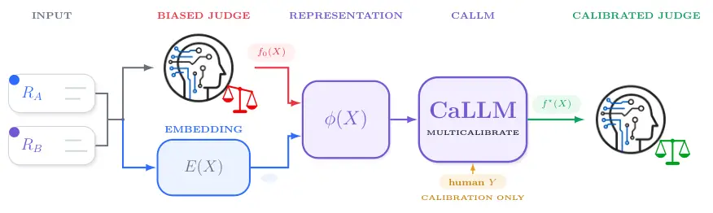

# A CaLLM Judge is a Better Judge: Mitigating Bias in LLM-as-a-judge

Cesare Barbera ^(†)^(†)thanks: Joint first authorship and corresponding
authors. Affiliation: University of Pisa Affiliation: University of
Trento Email: <cesare.barbera@phd.unipi.it>    Luca Stradiotti
Affiliation: KU Leuven Email: <name.surname@kuleuven.be>    Lorenzo
Cascioli Affiliation: KU Leuven Email: <lorenzoperini@meta.com>   
Lorenzo Perini Affiliation: Meta Platforms, Inc. Email: <niek@meta.com>
   Niek Tax Affiliation: Meta Platforms, Inc. Email: <danielha@meta.com>
   Daniel Haimovich Affiliation: Meta Platforms, Inc.
Email: [name.surname@unitn.it](mailto:)    Jesse Davis Affiliation: KU
Leuven    Andrea Passerini Affiliation: University of Trento    Andrea
Pugnana Affiliation: University of Trento

###### Abstract

Large language models (LLMs) are increasingly used as judges to predict
which of two candidate answers a human evaluator would prefer, providing
a scalable alternative when human evaluation is too costly.
Unfortunately, LLM judgments can exhibit systematic biases. Prior work
has documented position, verbosity or model family of the candidate
answers influencing the judge decision rather than their quality, while
additional biases may remain undocumented. _Multicalibration_ provides a
natural framework to address this problem: each bias corresponds to
miscalibration on an identifiable group, e.g., family bias manifests as
overconfidence in answers generated by models belonging to the same
family of the judge. The challenge is to fix miscalibration
simultaneously across many, potentially unknown groups. To this end, we
introduce CaLLM, a post hoc framework that multicalibrates an LLM judge,
thereby bounding all such biases simultaneously. We prove that CaLLM
bounds the bias of every group whose error structure is captured by an
available representation, and that augmenting it with explicit bias
groups further reduces the residual bias. We then derive theoretical
conditions under which CaLLM improves the judge’s accuracy, rather than
trading it for calibration. Finally, we evaluate CaLLM across pairwise
preference benchmarks, showing that it reduces the multicalibration
error on both specified and unspecified bias groups, while improving
predictive performance of the judge.

|     |
| --- |
|     |

## 1 Introduction

When evaluating the outputs of generative models, obtaining human
annotations at scale is often too slow and expensive (Li et al., 2024a).
As a consequence, the LLM-as-a-judge framework has emerged as a
practical alternative (Zheng et al., 2023): a strong language model is
prompted to score or compare candidate responses, enabling evaluations
at a scale that human raters cannot match. However, LLM judges can
exhibit systematic biases that undermine the reliability of their
evaluations (Gu et al., 2024; Tian et al., 2025). For example, Zheng et
al. (2023) identify three such biases: _position bias_, i.e. the judge
favours the answer shown first or second independently of its content,
_verbosity bias_, i.e. the judge favours longer answers regardless of
quality, and _family bias_, i.e. the judge favours answers produced by
its own model family.

Although mitigation strategies have been proposed, controlling these
biases with theoretical guarantees remains an open challenge (Schroeder
and Wood-Doughty, 2024; Li et al., 2025a). We propose viewing systematic
biases through the lens of group-wise miscalibration. From this
perspective, each bias is a miscalibration of the judge’s confidence
within a particular group: e.g., verbosity bias arises in pairwise
evaluations where one answer is much longer than the other. To address
this within-group miscalibration problem, we resort to
Multicalibration (Hébert-Johnson et al., 2018), a theoretical framework
that requires predictions to be calibrated simultaneously across
identifiable groups. Specifically, for each group, the absolute expected
discrepancy between the predictions and the label must be below a small
threshold $`\alpha`$. Problematically, the bias groups of interest are
defined over the original input space, whereas LLM evaluation operates
on unstructured text and a multicalibrator can only observe a learned
representation of it. This raises the question of whether
multicalibration in representation space controls biases defined in the
original input space.

In this work, we address these challenges with Multi-Calibrated Large
Language Models (CaLLM), a post hoc bias-mitigation framework that
implements bias-correction guarantees in practice (see Figure 1). First,
we cast the LLM-as-a-judge bias problem within a multicalibration
framework, mapping biases to groups. We then prove that multicalibration
in representation space controls bias groups in the original input space
whenever their error structure is recoverable from that representation.
Importantly, this does not require the groups to be explicitly specified
to the calibrator. Finally, we show that, under suitable conditions,
bias reduction need not come at the expense of predictive performance,
rather CaLLM guarantees improvements of the judge’s accuracy. Overall,
CaLLM turns these calibration and performance guarantees into a
practical post-hoc procedure for mitigating both explicitly specified
and recoverable biases in LLM judges.

#### Our contributions.

In a nutshell, our contributions are:

- $`(i)`$
  We formalize the LLM-as-a-Judge biases as a specific instance of a
  multicalibration problem;
- $`(ii)`$
  We propose CaLLM, a post-hoc bias-mitigation strategy that leverages
  multicalibration to bound identifiable judge’s bias;
- $`(iii)`$
  We prove that multicalibration in representation space bounds
  recoverable input-space bias patterns and derive conditions under
  which it improves the judge’s accuracy;
- $`(iv)`$
  We show on five benchmark datasets that CaLLM mitigates documented
  biases, while simultaneously improving the performance of the
  LLM-as-a-judge framework.



Figure 1: CaLLM’s pipeline. We feed CaLLM with some representation
$`\phi(X)`$ of the input (e.g., embeddings $`E(X)`$ and base scores
$`f_{0}(X)`$). The final output is a multi-calibrated score
$`f^{\star}(X)`$.

## 2 Preliminaries

LLM-as-a-judge. We focus on pairwise evaluation of candidate answers,
which has emerged as a popular approach for assessing the quality of LLM
outputs (Gu et al., 2024). In this setting, the judge receives a user
prompt with two anonymized candidate responses and selects the best
output, emulating human preference. More formally, a pairwise evaluation
instance is a random variable $`X=(Q,R_{1},R_{2})\in\mathcal{X}`$, where
$`Q`$ is the prompt and $`R_{1},R_{2}`$ are two candidate responses,
respectively. The binary label space $`\mathcal{Y}\in\{0,1\}`$ indicates
human preference, with $`Y=1`$ ($`Y=0`$) denoting that the human prefers
the first (second) answer. We assume access to a given dataset
$`\mathcal{D}=\{(\mathbf{x}_{i},y_{i})\}_{i=1}^{n}`$ of input-output
pairs drawn from an unknown joint distribution $`\mathcal{P}`$ over
$`\mathcal{X}\times\mathcal{Y}`$. The LLM judge induces a continuous
scoring function $`f:\mathcal{X}\to[0,1]`$, which estimates the true
conditional probability $`\mathbb{P}(Y=1\mid X)`$. Thus, $`f(X)`$ is the
judge’s confidence in the first answer. We distinguish two instances of
the judge’s confidence: $`f_{0}`$ denotes the _base_ score returned by
the judge, and $`f^{\star}`$ the calibrated score. We write $`f`$
whenever a statement holds for both. We obtain hard predictions by
thresholding $`f`$ at $`\nicefrac{{1}}{{2}}`$ and define the judge’s
accuracy as
$`\textstyle\mathrm{Acc}(f)=\mathbb{P}\bigl(\mathbb{I}_{\{f(X)\geq\nicefrac{{1}}{{2}}\}}=Y\bigr)`$.

Bias groups. We represent each LLM bias through a collection of binary
groups $`\mathcal{G}`$. Due to the inherently comparative nature of the
task, to define groups we first impose a fixed ordering on the candidate
responses. Let $`\pi:\mathcal{X}\to\widetilde{\mathcal{X}}`$ denote a
deterministic reordering map such that $`\pi(X)=(Q,R_{A},R_{B}),`$ where
$`R_{A}`$ and $`R_{B}`$ are the original responses ordered according to
a rule independent of $`Y`$ and $`f`$¹¹ 1 This ensures that group
membership remains unchanged after calibration., e.g., the
lexicographical ordering of their source-model names. We represent group
membership through a measurable attribute
$`a:\widetilde{\mathcal{X}}\to\mathcal{V}_{a},`$ whose value indicates
how $`R_{A}`$ compares with $`R_{B}`$ along the corresponding attribute
dimension. Each value $`v\in\mathcal{V}_{a}`$ induces a binary group
$`\tilde{g}_{a,v}(\tilde{X}):=\mathbb{I}_{\{a(\tilde{X})=v\}}.`$ The
corresponding group indicator on the original input space is defined by
composition, $`g_{a,v}:=\tilde{g}_{a,v}\circ\pi`$ so that
$`g_{a,v}(X)=\tilde{g}_{a,v}(\pi(X)).`$ For simplicity, we henceforth
write a generic group as $`g`$, omitting the indices $`(a,v)`$ when they
are not needed explicitly.

###### Example (Documented-biases groups).

Documented biases (Zheng et al., 2023) can be represented through the
following attributes: (i) Position,
$`a^{\mathrm{pos}}(\tilde{X})\in\{-1,+1\}`$, indicating whether
$`R_{A}`$ is shown second or first; (ii) Verbosity,
$`a^{\mathrm{len}}(\tilde{X})\in\{-1,0,+1\}`$, indicating whether
$`R_{A}`$ is shorter, the same or longer than $`R_{B}`$; (iii) Family,
$`a^{\mathrm{fam}}(\tilde{X})\in\{-1,0,+1,+2\}`$, indicating whether
neither response belongs to the judge’s model family, only $`R_{B}`$
does, only $`R_{A}`$ does, or both do. Each group is defined by the
presence of a specific attribute value, or by a combination of values
across multiple attributes.

A bias is then a systematic discrepancy between the judge’s confidence
and the true human preference rate _within_ these groups. However,
measuring bias without accounting for the judge’s confidence may hide
discrimination that emerges only at particular confidence levels. Thus,
we additionally condition on a finite collection of confidence bands
$`\mathcal{I}`$, e.g., sub-intervals of $`[0,1]`$. Then, for each group,
we compute the conditional error within each confidence band and define
the judge’s per-group bias as the largest of these errors (Tax et al.,
2026):

###### Definition 1 (Per-group bias).

Let $`\mathcal{G}`$ be a collection of measurable group indicators such
that $`g:\mathcal{X}\to\{0,1\}`$ and let $`\mathcal{I}`$ be a finite
collection of sub-intervals of $`[0,1]`$. The per-group bias of $`f`$ is
the worst conditional deviation across confidence bands:

```math
\mathrm{bias}_{g,\mathcal{I}}(f)\;:=\;\max_{I\in\mathcal{I}}\;\Biggl|\,\mathbb{E}\Bigl[\,Y-f(X)\,\bigm|\,g(X)=1,\;f(X)\in I\,\Bigr]\,\Biggr|
```

We stress that $`(i)`$ this is a _distributional_ notion of bias rather
than a bias-specific criterion such as counterfactual swap
consistency (Shi et al., 2025); $`(ii)`$ it applies uniformly to both
documented and unspecified biases as it measures conditional deviations
over arbitrary bias-induced groups.

Multicalibration. According to Definition 1 the judge is unbiased along
$`g`$ when its residuals $`Y-f(X)`$ average to zero within that group
across every confidence band. This is a within-group calibration
constraint, and controlling every group at once maps precisely to
*multicalibration* (Hébert-Johnson et al., 2018), which requires $`f`$
to satisfy the same approximate calibration guarantee simultaneously
over a collection $`\mathcal{G}`$ of identifiable groups.

###### Definition 2 (Multicalibration).

Let $`\mathcal{G}`$ be a collection of measurable group indicators such
that $`g:\mathcal{X}\to\{0,1\}`$ and let $`\mathcal{I}`$ be a finite
collection of sub-intervals of $`[0,1]`$. For $`g\in\mathcal{G}`$ and
$`I\in\mathcal{I}`$, define the multicalibration deviation and the noise
scale as
$`\Delta_{g,I}(f)\;:=\;\mathbb{E}\bigl[\,\bigl(Y-f(X)\bigr)\,g(X)\,\mathbb{I}_{\{f(X)\in I\}}\,\bigr],`$
$`\tau_{g}(f)^{2}\;:=\;\mathbb{E}\bigl[\,g(X)\,f(X)\bigl(1-f(X)\bigr)\,\bigr].`$
Given $`\alpha\geq 0,\,`$the predictor $`f`$ is
_$`(\mathcal{G},\mathcal{I},\alpha)`$-multicalibrated_ if

```math
\bigl|\Delta_{g,I}(f)\bigr|\;\leq\;\alpha\,\tau_{g}(f),\qquad\forall\,g\in\mathcal{G},\ \forall\,I\in\mathcal{I}
```

In other terms, $`\Delta_{g,I}`$ is the expected amount by which the
judge over- or under-states its confidence on the instances such that
$`g(\mathbf{x})=1`$ and $`f(\mathbf{x})\in I`$, while $`\tau_{g}`$
captures the corresponding scale of sampling variability. We quantify
how far a judge is from this requirement through the Multicalibration
Error (MCE) (Guy et al., 2025) i.e., the largest group-level Expected
Cumulative Calibration Error range (ECCE-R) (Arrieta-Ibarra et al.,
2022). ECCE-R orders examples by predicted score, cumulatively sums the
residuals $`y_{i}-f(\mathbf{x}_{i})`$, and measures the range spanned by
this cumulative error curve.

###### Definition 3 (Multicalibration Error).

Consider a collection $`\mathcal{G}`$ of measurable group indicators
$`g:\mathcal{X}\rightarrow\{0,1\}`$. For each $`g\in\mathcal{G}`$, let
$`\mathcal{D}_{g}:=\{(\mathbf{x}_{i},y_{i})\}_{i=1}^{n_{g}}`$ denote the
sample restricted to instances satisfying $`g(\mathbf{x}_{i})=1`$, and
let $`\operatorname{ECCE\text{-}R}_{g}`$ be the ECCE-R computed
restricting the sample to $`\mathcal{D}_{g}`$. Under the null hypothesis
of perfect calibration, define the corresponding noise scale as
$`\tau_{g}(f):=\frac{1}{n_{g}}\sqrt{\sum_{i=1}^{n_{g}}f(x_{i})\bigl(1-f(x_{i})\bigr)}.`$
The empirical Multicalibration Error of $`f`$ over $`\mathcal{G}`$ is

```math
\operatorname{MCE}:=\max_{g\in\mathcal{G}}\frac{\operatorname{ECCE\text{-}R}_{g}(f)}{\tau_{g}(f)}
```

We report MCE both relative to group prevalence ($`\mathrm{MCE}_{\%}`$)
and in units of the sampling variation expected under perfect
calibration ($`\mathrm{MCE}_{\sigma}`$). We also report accuracy
together with log loss, which is a strictly proper scoring
rule (Gneiting and Raftery, 2007). We provide further details
in Appendix D.

## 3 Multicalibrated Large Language Models

Our work tackles the following problem:

|        |                                                                                                                                                                                                                                                                    |
| ------ | ------------------------------------------------------------------------------------------------------------------------------------------------------------------------------------------------------------------------------------------------------------------ |
| Given: | a calibration set $`\mathcal{D}^{\mathrm{cal}}\subseteq\mathcal{D}`$ and, for each pairwise evaluation, a judge confidence score $`f_{0}(X)`$ that $`R_{1}`$ is preferred and a representation $`\phi:\mathcal{X}\to\mathbb{R}^{d}`$;                              |
| Do:    | Multicalibrate $`f_{0}(X)`$, producing a confidence score $`f^{\star}(X)`$ that controls the bias of every $`g\in\mathcal{G}`$ whose error structure is recoverable from $`\phi(X)`$, i.e., $`f^{\star}`$ is $`(\mathcal{G},\mathcal{I},\alpha)`$ multicalibrated. |

The core idea of CaLLM is to start with uncalibrated confidence scores
and apply a post-hoc multicalibration procedure to uncover and correct
systematic biases. This has three challenges. First, standard
multicalibration is typically formulated over features from which
relevant groups can be directly identified, whereas we operate on a
latent representation in which bias groups may be only implicitly
encoded. We show that multicalibration nevertheless bounds the residual
bias of any group whose error structure can be recovered from this
representation (Section 3.1). Second, some bias groups may be known a
priori, yet relying solely on the implicit encoding in the
representation of their error patterns can weaken the bias-mitigation
guarantee. We show that providing these groups directly to the
multicalibrator can further reduce their residual error (Section 3.2).
Third, correcting bias can change the judge’s decisions, raising the
concern that it may reduce accuracy. We show that accuracy improves
whenever the confidence gained on corrected decisions is large enough to
outweigh the residual calibration error permitted by approximate
multicalibration (Section 3.3).

### 3.1 Bias Mitigation Guarantees for Multicalibrated LLM Judges

Classical multicalibration is typically formulated over an input space
in which relevant groups can be directly identified through
interpretable covariates. In our setting, however, the inputs are
unstructured natural-language responses, and the multicalibrator instead
operates on a learned representation $`\phi(X)\in\mathbb{R}^{d}`$, which
can consist, e.g., of embeddings $`E(X)`$ and optionally base scores
$`f_{0}(X)`$. Consequently, the representation need not preserve group
membership itself, but may still preserve the systematic error structure
associated with that group. This creates a gap between the groups on
which biases are defined and the feature space available to the
multicalibrator. We therefore characterize how the information preserved
by $`\phi(X)`$ interacts with the judge’s systematic prediction error.
To this end, we derive an interpretable decomposition of the residual
bias in an arbitrary input-space group $`g`$. Consider a class
$`\mathcal{H}`$ of functions $`h:\mathbb{R}^{d}\to[0,1]`$ defined over
the representation $`\phi(X)`$, which are available to the
multicalibrator. Depending on the choice of $`h`$, these functions may
capture group membership, systematic residual structure, or other
identifiable patterns in the representation. Unlike prior work on
proxy-group multicalibration (Bharti et al., 2025), our decomposition
separates missing label information from missing group information, so a
group can be protected when the representation captures its error
structure, even if it cannot recover the group. Formally, let us denote
with $`B_{I}=\{f(X)\in I\}`$ confidence-band membership and let us
define the following quantities i.e.,

```math
\displaystyle\lambda_{I}^{2}=\mathbb{E}\!\left[\left(\mathbb{E}[Y\mid X]-f(X)-\mathbb{E}\!\left[\mathbb{E}[Y\mid X]-f(X)\mid\phi(X),\,B_{I}\right]\right)^{2}\mid B_{I}\right],
```

```math
\displaystyle\varphi_{I}^{2}=\mathbb{E}\!\left[\left(g(X)-\mathbb{E}\!\left[g(X)\mid\phi(X),\,B_{I}\right]\right)^{2}\mid B_{I}\right],
```

```math
\displaystyle\psi_{I}^{2}=\mathbb{E}\!\left[\left(\mathbb{E}\!\left[g(X)-h(\phi(X))\mid\phi(X),\,B_{I}\right]\right)^{2}\mid B_{I}\right]
```

which measure the judge error and group information not captured by
$`\phi(X)`$ within band $`I`$ and the representation-level
group-approximation error. We now show how these components bound the
bias:

###### Theorem 1 (Residual bias decomposition).

Let $`g\in\mathcal{G}`$ and fix $`h\in\mathcal{H}`$ and define
$`\tau_{h}(f)^{2}=\mathbb{E}\!\left[h(\phi(X))^{2}f(X)(1-f(X))\right]`$
Assume that $`f`$ is multicalibrated over $`(\mathcal{H},\mathcal{I})`$,
i.e.,
$`\left|\mathbb{E}\!\left[(Y-f(X))h^{\prime}(\phi(X))\mathbb{I}_{\{B_{I}\}}\right]\right|\leq\alpha\tau_{h^{\prime}}(f)`$
for all $`h^{\prime}\in\mathcal{H},\ I\in\mathcal{I}`$ Fix
$`h_{1},\ldots,h_{m}\in\mathcal{H}`$ and a constant $`C>0`$. For every
$`I\in\mathcal{I}`$ with $`\mathbb{P}(B_{I})>0`$, let
$`c_{I}\in\mathbb{R}^{m}`$ satisfy $`\|c_{I}\|_{1}\leq C`$ and define

```math
e_{I}=\mathbb{E}\!\Biggl[\Biggl(\mathbb{E}\!\Bigl[\mathbb{E}[Y\mid X]-f(X)\mid\phi(X),B_{I}\Bigr]-\sum_{j=1}^{m}c_{I,j}h_{j}(\phi(X))\Biggr)^{2}\Biggm|B_{I}\Biggr]^{1/2}.
```

with
$`\chi_{I}=e_{I}+\sqrt{\nicefrac{{C\alpha}}{{\mathbb{P}(B_{I})}}}`$.
Then for every $`g\in\mathcal{G}`$ and $`I\in\mathcal{I}`$ such that
$`\mathbb{P}(g(X)=1,B_{I})>0`$,

```math
\operatorname{bias}_{g,\mathcal{I}}(f)\leq\max_{I\in\mathcal{I}}\frac{\alpha\tau_{h}(f)+\mathbb{P}(B_{I})\Biggl[\lambda_{I}\varphi_{I}+\psi_{I}\chi_{I}\Biggr]}{\mathbb{P}(g(X)=1,B_{I})}
```

###### Proof.

We provide the proof in Section A.1. ∎

The bound separates three sources of residual bias. The first term,
$`\alpha\tau_{h}(f)`$, is the calibration violation that remains along
the representation-space group $`h`$. This is controlled directly by
multicalibration. Classical multicalibration procedures iteratively
identify residual violations over a function class and update the
predictor along them, with each non-trivial correction yielding progress
in squared prediction error (Hébert-Johnson et al., 2018). Viewing
$`\mathcal{H}`$ as the multicalibrator’s function class over
$`\phi(X)`$, the residual-orthogonality assumption therefore captures
the multicalibration machinery. The second term,
$`\lambda_{I}\varphi_{I}`$, couples the portions of the judge’s error
and group membership that are not captured by the representation.
Finally, $`\chi_{I}\psi_{I}`$ couples group-approximation error with the
systematic error visible in representation space ($`e_{I})`$ plus a
multicalibration penalty.

Importantly, the latter two contributions depend on _products_. Hence,
accurate recovery of group membership is not necessary for bias control:
$`\lambda_{I}\varphi_{I}`$ can be small if either the relevant error
structure or the group structure is well captured by the representation,
while $`\chi_{I}\psi_{I}`$ can be small if either little systematic
error ($`e_{I}`$) remains visible in representation space or $`h`$
accurately captures the relevant group component. Thus, poor input-space
group recovery alone does not imply poor bias mitigation, what matters
is how the information preserved in the representation interacts with
the judge’s error.

### 3.2 The Value of Explicit Bias Specification

Perhaps surprisingly, eliminating the multicalibration term need not
mitigate the bias of $`g`$. Even under exact residual orthogonality to
$`h`$, the interaction between the unrecovered error and group
components may remain non-zero. The following proposition shows that
this term is unavoidable.

###### Proposition 1 (Necessity and tightness of the unrecoverable interaction).

Assume that $`\mathcal{I}`$ contains a confidence band including
$`\nicefrac{{1}}{{2}}`$, that $`\mathcal{H}`$ contains the constant
function $`h\equiv\nicefrac{{1}}{{2}}`$, and that
$`\operatorname{bias}_{g,\mathcal{I}}(f)`$ is evaluated only over
$`I\in\mathcal{I}`$ such that $`\mathbb{P}(g(X)=1,f(X)\in I)>0`$. Then,
for every $`p_{g}\in(0,1)`$ and every
$`0<\rho\leq\frac{1}{2}\min\{p_{g},1-p_{g}\}`$, there exist a
distribution, a group $`g`$ with $`\mathbb{P}(g(X)=1)=p_{g}`$, a
representation $`\phi(X)`$ and a predictor
$`f\equiv\nicefrac{{1}}{{2}}`$ such that $`f`$ is perfectly calibrated
and the residual is orthogonal to $`h`$ on every $`I\in\mathcal{I}`$.
Moreover, for every $`I\in\mathcal{I}`$,
$`\lambda_{I}\varphi_{I}=\rho`$, $`\chi_{I}\psi_{I}=0,`$ while

```math
\operatorname{bias}_{g,\mathcal{I}}(f)=\frac{\lambda_{I}\varphi_{I}}{p_{g}}=\frac{\rho}{p_{g}}
```

###### Proof.

We provide the proof in Section A.2. ∎

Consequently, the term $`\lambda_{I}\varphi_{I}`$ cannot in general be
removed from the bound of Theorem 1. However, when a documented bias
such as position, verbosity, or family is known, its group indicator can
be supplied directly to the multicalibrator. Augmenting the
representation with $`g(X)`$ makes the group exactly identifiable and
eliminates both group-side approximation terms, $`\varphi_{I}`$ and
$`\psi_{I}`$.

###### Corollary 1 (What naming a bias is worth).

Let $`g\in\mathcal{G}`$ be a bias group and consider
$`\tilde{\phi}(X)=[\phi(X),g(X)].`$ Assume that $`\mathcal{H}`$ contains
the coordinate projection $`h_{g}(\tilde{\phi}(X))=g(X)`$. Then, under
the setting and assumptions of Theorem 1, $`\varphi_{I}=\psi_{I}=0`$ for
all $`I\in\mathcal{I}`$ and therefore:

```math
\operatorname{bias}_{g,\mathcal{I}}(f)\leq\max_{I\in\mathcal{I}}\frac{\alpha\tau_{g}(f)}{\mathbb{P}(g(X)=1,B_{I})}
```

###### Proof.

We provide the proof in Section A.3. ∎

The corollary isolates _what naming a bias is worth_: once $`g(X)`$ is
provided explicitly, both interaction terms in Theorem 1 vanish, leaving
only the multicalibration term. Thus, explicit bias specification
removes the representation-induced approximation error for that group
while preserving the broader protection afforded by the learned
representation.

### 3.3 Predictive Performance Guarantees for Multicalibrated LLM-Judges

Multicalibration should not come at the expense of predictive
performance. Decision-theoretic analyses of multicalibrated predictors
have previously established general guarantees on downstream decision
quality (Baldeschi et al., 2025). In the binary classification setting
considered here, we derive an explicit accuracy-improvement bound that
separates the gain induced by changed decisions from the residual slack
permitted by approximate multicalibration. Our analysis begins denoting
the two sets of instances whose decision _changes_ after
multicalibration with
$`\mathcal{C}^{\uparrow}\coloneqq\{\mathbf{x}:f_{0}(\mathbf{x})<\tfrac{1}{2}\leq f^{\star}(\mathbf{x})\}`$
and
$`\mathcal{C}^{\downarrow}\coloneqq\{\mathbf{x}:f^{\star}(\mathbf{x})<\tfrac{1}{2}\leq f_{0}(\mathbf{x})\}.`$
We denote with
$`\mathcal{C}:=\mathcal{C}^{\uparrow}\cup\mathcal{C}^{\downarrow}`$
their union. This is the subset of instances such that the two judges
$`f_{0}`$ and $`f^{\star}`$ disagree.

Any result on the net accuracy change between the two judges is
restricted to this subset of instances. We decompose the predictive
performance variation within $`\mathcal{C}`$ in two interpretable terms.
The first term ($`\Gamma`$) is the predicted-utility advantage of the
decision rule induced by $`f^{\star}`$ over that induced by $`f_{0}`$.
It equals the decision margin of instances whose confidences cross the
threshold. The second term ($`\zeta`$) instead accounts for the residual
discrepancy between predicted and true utility permitted by approximate
multicalibration. Whenever $`\Gamma>\zeta`$, the net accuracy change is
strictly positive.

###### Theorem 2 (Accuracy improvement under multicalibration).

Suppose that $`f^{\star}`$ is
$`(\mathcal{G}^{\star},\mathcal{I},\alpha)`$-multicalibrated, where
$`\mathcal{I}`$ contains the intervals $`[0,\frac{1}{2})`$ and
$`[\frac{1}{2},1]`$. Let
$`g_{-}(X)=\mathbb{I}_{\{f_{0}(X)<\tfrac{1}{2}\}}`$ and
$`g_{+}(X)=\mathbb{I}_{\{f_{0}(X)\geq\tfrac{1}{2}\}}`$ denote the two
groups induced by the base judge’s hard prediction and let
$`\{g_{-},g_{+}\}\subseteq\mathcal{G}^{\star}`$. Let $`\tau^{\uparrow}`$
and $`\tau^{\downarrow}`$ denote the corresponding multicalibration
scale parameters. Then:

```math
\mathrm{Acc}(f^{\star})-\mathrm{Acc}(f_{0})\;\geq\;\underbrace{\mathbb{E}\Biggl[\,\Bigl|2f^{\star}(X)-1\Bigr|\;\mathbb{I}_{\{X\in\mathcal{C}\}}\Biggr]}_{\Gamma}-\underbrace{2\,\alpha\,\Biggl(\tau^{\uparrow}+\tau^{\downarrow}\Biggr)}_{\zeta}
```

###### Proof.

We provide proof in Section A.4. ∎

The bound reads as a contest between two quantities: the magnitude of
the confidence margin for new decisions ($`\Gamma`$), against how much
room multicalibration leaves it to be wrong ($`\zeta`$). Accuracy
strictly improves whenever the first exceeds the second, and, if
$`\Gamma>0`$, in the perfectly multicalibrated limit where
$`\alpha\to 0`$ _any_ decision change is a strict gain.

## 4 Experimental Evaluation

In the following, we address three research questions:

- •
  Q1. Does CaLLM reduce the biases of the LLM-as-a-judge over existing
  mitigation strategies without having direct access to the bias groups?
- •
  Q2. Does CaLLM’s bias mitigation further improve when given access to
  the bias groups?
- •
  Q3. Does CaLLM improve over the baselines’ predictive performance
  metrics?

The code²² 2 Code fully developed by the authors from KU Leuven and
University of Trento. can be found
at [https://github.com/stralu9/CaLLM](https://github.com/stralu9/CaLLM).

### 4.1 Experimental Settings

Datasets. We consider five pairwise evaluation datasets from the
literature. RewardBench (RWB) consists of $`3`$k prompt-chosen-rejected
trios (Lambert et al., 2025). MTBench (MTB) consists of 709 pairwise
comparisons over 80 questions  (Zheng et al., 2023). Each comparison has
LLM-generated answers that are judged pairwise by one or multiple human
experts. ArenaExpl (AEX) is a corpus of $`53.8`$k pairwise comparisons
extracted from conversational data (Chiang et al., 2024). Here users
write the prompt, receive two LLM-generated answers, and act as the
judge by expressing a preference. Similarly, PPE contains $`10.2`$k
prompts in different languages, with users casting a preference vote for
one of two options generated by two LLMs (Frick et al., 2025). Finally,
PKU consists of $`73.9`$k pairwise comparisons over safety-oriented
prompts. These combine human demonstrations with LLMs (Ji et al., 2025).
We use the more helpful answer as ground truth. More details in
Appendix C.

#### Implementation details.

We rely on MCGrad (Tax et al., 2026) as the default multicalibrator for
CaLLM, because it can automatically search the supplied feature space
and thereby uncover undocumented, latent sources of bias. We ablate the
choice of multicalibrator and compare with popular calibration
techniques in Section E.4. To exploit MCGrad’s ability to discover
groups automatically, we encode both candidate responses using the
open-source Muse-Glimmer-30B (Meta, 2026). We provide results with
Qwen3-0.6B (Team, 2025) in Section E.3. We denote the resulting
embeddings with $`e_{1},e_{2}\in\mathbb{R}^{d}`$. Following previous
work, we represent each comparison through the Principal Component
Analysis (PCA) of the difference embedding (Zhang et al., 2026), denoted
as $`E(X)={\mathrm{PCA}}(e_{1}-e_{2}).`$ We then feed
$`\phi(X)=[E(X),f_{0}(X)]`$ to MCGrad. The former suppresses components
shared by the two responses and emphasizes their relative attributes,
which are more directly aligned with the structure of pairwise biases.
The latter allows to discover miscalibration concealed within confidence
bands $`\mathcal{I}`$. We provide further details in Appendix B.

#### Baselines.

We compare CaLLM against five baselines: $`(i)`$ the raw verbalized
confidence $`(f_{0})`$, which serves as our reference level; $`(ii)`$
BPC (Wang et al., 2024), which queries the judge with both response
orderings and averages the two confidences; $`(iii)`$ PORTIA (Li et al.,
2024b), which interleaves the two responses in a single prompt such that
neither of them occupies a privileged position; $`(iv)`$ CalibraEval (Li
et al., 2025b), which queries the judge under swapped orderings and
learns a non-parametric, order-preserving mapping that removes the
preference for one position; $`(v)`$ LenControl (Dubois et al., 2024),
which models the judge’s preference as a function of response-length
difference and then predicts as if both responses had equal length.

#### Metrics.

For Q1 and Q2, we report the maximum error among the groups induced by
the bias-inducing attribute $`a`$, which can be seen as a
per-documented-bias Multicalibration Error ($`\text{MCE}_{\%}`$). We
report $`\text{MCE}_{\sigma}`$ in Section E.6. We compute and report
this quantity separately for each documented bias. For verbosity and
family biases, we set $`\pi`$ as the original ordering in which the
candidate responses are presented to the judge. This is not suitable for
position bias, since every comparison necessarily contains a first and a
second response. Thus, we define $`\pi`$ using the alphabetical ordering
of the responses source-model names, enabling meaningful position-based
groups. Following prior work (Tax et al., 2026), we report the
$`\text{MCE}_{\%}`$ over random partitions of the representation of
$`X`$ in Section E.1. This shows if the multicalibrator can uncover and
mitigate errors on unspecified groups. For Q3, we report accuracy (ACC)
together with the log-loss ($`\mathcal{L}_{\text{log}}`$) of the judges.
For completeness, we report the full results for Q1, Q2, and Q3
in Section E.6.

#### Setup.

We use Muse-Glimmer-30B, a recent open-weight causal language model that
achieves competitive performance among models of comparable size across
a broad range of reasoning and agentic benchmarks (Meta
Superintelligence Lab, 2026), as a judge. We ablate the judge choice
with Qwen 2.5-7B (Team, 2024) in Section E.2. Each instance
$`X=(Q,R_{1},R_{2})`$ is judged once, extracting the judge’s verbalized
confidence (Tian et al., 2023) $`f_{0}(X)`$ that $`R_{1}`$ is the
preferred answer. This choice allows our framework to extend to the
black-box setting, where one lacks access to internal model weights. We
then either multicalibrate the base scores $`f_{0}(X)`$ or apply a
baseline method. Concretely, we perform 5-fold cross validation, making
sure that different answer pairs for the same prompt always belong to
the same fold.

### 4.2 Experimental Results

Figure 2: Average per-axis $`\text{MCE}_{\%}`$ ($`\pm`$ s.e.) for each
method across datasets. PKU doesn’t contain the information regarding
the LLMs that generated the responses, so we do not report Family bias.

Q1: CaLLM shows no significant miscalibration in 12 out of 14
evaluations. We analyze whether CaLLM reduces the Position, Verbosity
and Family biases. Fig. 2 reports the average per-group $`MCE_{\%}`$
across datasets (see Table 9 for full results). We additionally validate
our choice of MCGrad as main multicalibration method and compare it with
global calibration approaches that also leverage labelled calibration
data in Section E.4. CaLLM outperforms global calibration methods on all
14 dataset-groups pairs, and MCGrad is the best multicalibration
technique on 11 of 14 of them. In Section E.5, we assess whether CaLLM
can recover groups from the available representation.

We observe that CaLLM achieves the lowest error in 11 out of 14 datasets
and is the only method that substantially reduces all three biases, with
a median reduction with respect to the uncalibrated model $`f_{0}`$ of
$`\approx 64\%`$, $`\approx 60\%`$, and $`\approx 46\%`$ for position,
verbosity, and family, vs. at most $`\approx 36\%`$, $`\approx 22\%`$,
and $`\approx 31\%`$ for the other baselines. Interestingly, we observe
the largest gains on larger datasets: e.g. on PKU, CaLLM achieves
$`\text{MCE}_{\%}\approx 2.8\pm.2`$ for Position (second-best
CalibraEval with $`\text{MCE}_{\%}\approx 7.7\pm.2`$) and
$`\text{MCE}_{\%}\approx 5.6\pm.3`$ for Verbosity (second-best BPC with
$`\text{MCE}_{\%}\approx 19.2\pm.4`$). Conversely, the three exceptions
occur on the two smallest datasets: on RWB, where $`f_{0}`$ shows no
strong evidence of Position bias ($`\mathrm{MCE}_{\sigma}=3.4`$), and
two of the three position-specific baselines (BPC and PORTIA) outperform
CaLLM on position. Notably, explicitly providing CaLLM with the position
groups reverses this ranking (see Q2); for Family bias, CaLLM is within
one standard error of the best method on both RWB and MTB. Notably,
CaLLM leaves no strong evidence of miscalibration
($`\mathrm{MCE}_{\sigma}<4.71`$) ³³ 3 $`\mathrm{MCE}_{\sigma}=4.71`$
equals a conservative p-value of $`10^{-5}`$ under the null hypothesis
of perfect calibration. in 12 out of 14 dataset pairs (reference level
was 36% for $`f_{0}`$), with the only exceptions occurring for Verbosity
on PKU and AEX, the two largest datasets, where even small deviations
are detectable (see Table 9).

|           | PKU             |                 | AEX             |                 | PPE             |                 | RWB             |                 | MTB              |                  |
| --------- | --------------- | --------------- | --------------- | --------------- | --------------- | --------------- | --------------- | --------------- | ---------------- | ---------------- |
|           | CaLLM           | CaLLM $`+g`$    | CaLLM           | CaLLM $`+g`$    | CaLLM           | CaLLM $`+g`$    | CaLLM           | CaLLM $`+g`$    | CaLLM            | CaLLM $`+g`$     |
| Position  | 2.8 $`\pm`$ 0.2 | 2.6 $`\pm`$ 0.1 | 3.7 $`\pm`$ 0.3 | 2.5 $`\pm`$ 0.3 | 5.4 $`\pm`$ 0.2 | 3.7 $`\pm`$ 0.3 | 6.9 $`\pm`$ 1.1 | 4.7 $`\pm`$ 0.5 | 13.4 $`\pm`$ 1.6 | 12.5 $`\pm`$ 1.5 |
| Verbosity | 5.6 $`\pm`$ 0.3 | 2.8 $`\pm`$ 0.2 | 4.5 $`\pm`$ 0.3 | 2.5 $`\pm`$ 0.2 | 7.5 $`\pm`$ 0.4 | 4.0 $`\pm`$ 0.2 | 5.2 $`\pm`$ 0.4 | 4.7 $`\pm`$ 0.4 | 13.5 $`\pm`$ 1.3 | 12.3 $`\pm`$ 0.9 |
| Family    | –               | –               | 2.6 $`\pm`$ 0.2 | 2.5 $`\pm`$ 0.2 | 4.8 $`\pm`$ 0.3 | 4.6 $`\pm`$ 0.4 | 5.2 $`\pm`$ 0.3 | 4.6 $`\pm`$ 0.1 | 11.9 $`\pm`$ 0.8 | 11.6 $`\pm`$ 0.2 |

Table 1: Comparison between CaLLM and CaLLM $`\!\!+g`$ in terms of
$`MCE_{\%}`$ for documented biases. PKU doesn’t contain the information
regarding the LLMs that generated the responses, so we do not report
Family bias.

|             | PKU             |                        | AEX             |                        | PPE             |                        | RWB             |                        | MTB             |                        |
| ----------- | --------------- | ---------------------- | --------------- | ---------------------- | --------------- | ---------------------- | --------------- | ---------------------- | --------------- | ---------------------- |
|             | ACC             | $`\mathcal{L}_{\log}`$ | ACC             | $`\mathcal{L}_{\log}`$ | ACC             | $`\mathcal{L}_{\log}`$ | ACC             | $`\mathcal{L}_{\log}`$ | ACC             | $`\mathcal{L}_{\log}`$ |
| CaLLM       | .69 $`\pm`$ .01 | .57 $`\pm`$ .01        | .68 $`\pm`$ .01 | .60 $`\pm`$ .01        | .67 $`\pm`$ .01 | .61 $`\pm`$ .01        | .93 $`\pm`$ .01 | .21 $`\pm`$ .01        | .81 $`\pm`$ .01 | .41 $`\pm`$ .02        |
| $`f_{0}`$   | .63 $`\pm`$ .01 | .73 $`\pm`$ .01        | .63 $`\pm`$ .01 | .76 $`\pm`$ .01        | .64 $`\pm`$ .01 | .74 $`\pm`$ .01        | .86 $`\pm`$ .01 | .36 $`\pm`$ .02        | .79 $`\pm`$ .01 | .49 $`\pm`$ .02        |
| BPC         | .64 $`\pm`$ .01 | .67 $`\pm`$ .01        | .65 $`\pm`$ .01 | .69 $`\pm`$ .01        | .65 $`\pm`$ .01 | .68 $`\pm`$ .01        | .88 $`\pm`$ .01 | .29 $`\pm`$ .01        | .80 $`\pm`$ .01 | .43 $`\pm`$ .02        |
| CalibraEval | .64 $`\pm`$ .01 | .65 $`\pm`$ .01        | .65 $`\pm`$ .01 | .69 $`\pm`$ .01        | .65 $`\pm`$ .01 | .66 $`\pm`$ .01        | .88 $`\pm`$ .01 | .30 $`\pm`$ .01        | .81 $`\pm`$ .01 | .43 $`\pm`$ .02        |
| PORTIA      | .61 $`\pm`$ .01 | .72 $`\pm`$ .01        | .65 $`\pm`$ .01 | .72 $`\pm`$ .01        | .66 $`\pm`$ .01 | .70 $`\pm`$ .01        | .87 $`\pm`$ .01 | .31 $`\pm`$ .02        | .77 $`\pm`$ .02 | .55 $`\pm`$ .05        |
| LenControl  | .64 $`\pm`$ .01 | .67 $`\pm`$ .01        | .65 $`\pm`$ .01 | .69 $`\pm`$ .01        | .65 $`\pm`$ .01 | .68 $`\pm`$ .01        | .88 $`\pm`$ .01 | .31 $`\pm`$ .01        | .80 $`\pm`$ .01 | .43 $`\pm`$ .02        |

Table 2: Average ACC and log-loss $`\mathcal{L}_{\log}`$ ($`\pm`$ s.e.)
across datasets. CaLLM always matches or improves both metrics over all
baselines, showing that multicalibration also improves predictive
performance.

Q2: Naming the groups always lowers the per-bias $`\mathrm{MCE}_{\%}`$.
We quantify what naming a bias is worth by comparing CaLLM with an
augmented version (CaLLM $`\!\!+g`$) that adds to $`\phi(X)`$ the group
indicators resulting from the Position, Verbosity and Family biases (see
 Table 1).

More precisely, we can see that for Position bias, CaLLM $`\!\!+g`$
further reduces $`\text{MCE}_{\%}`$ on all five datasets, with the
largest gains on AEX ($`\text{MCE}_{\%}`$ passes from
$`\approx 3.7\pm 0.3`$ to $`\approx 2.5\pm 0.3`$, a drop of
$`\approx 33\%`$ ) and RWB ($`\text{MCE}_{\%}`$ passes from
$`\approx 6.9\pm 1.1`$ to $`\approx 4.7\pm 0.5`$, a drop of
$`\approx 32\%`$ ).

For Verbosity bias, CaLLM $`\!\!+g`$ exhibits even stronger gains, with
an average reduction of $`\approx 32\%`$ across the five datasets. In
particular, we observe the largest improvements on PKU
($`\approx 49.4\%`$), PPE ($`\approx 46.7\%`$) and AEX
($`\approx 43.2\%`$), the three largest datasets of our collection. For
Family bias, we observe smaller improvements, likely due to the fact
that CaLLM already performed quite well across all datasets. Still, we
can observe some gains on smaller datasets: e.g. on RWB
$`\text{MCE}_{\%}`$ passes from $`\approx 5.2\pm 0.3`$ to
$`\approx 4.6\pm 0.1`$. Overall, CaLLM $`\!\!+g`$ completely removes
evidence of miscalibration on all datasets by reducing the
$`\mathrm{MCE}_{\sigma}`$ to $`<4.71`$ (compared to 12/14 for CaLLM, see
Table 10).

Q3: A CaLLM judge is also a better judge. Table 2 displays the results
in terms of predictive performance, reporting both ACC and
$`\mathcal{L}_{\text{log}}`$ for all the methods. We can see that CaLLM
achieves the highest accuracy on four out of five datasets (matching the
best baseline on the fifth) and the lowest log-loss on all five
datasets.

Compared with $`f_{0}`$, ACC increases by $`\approx 4.6`$ percentage
points on average, while $`\mathcal{L}_{\text{log}}`$ decreases by
$`\approx 24\%`$. Consistently with previous results, largest gains are
obtained on largest data: on PKU, CaLLM passes from $`\approx.63\pm.01`$
to $`\approx.69\pm.01`$, a $`\approx 9.8\%`$ increase; on AEX, CaLLM
reaches $`\approx.68\pm.01`$ starting from a base model of
$`\approx.63`$, an improvement of $`\approx 7\%`$. We observe similar
patterns also for $`\mathcal{L}_{\text{log}}`$, with CaLLM consistently
outperforming competitors. The largest gain is on RWB, where
$`L_{\text{log}}`$ drops by $`42\%`$, passing from the base level of
$`\approx.36\pm.02`$ to $`\approx.21\pm.01`$. Overall, these results
suggest that CaLLM effectively enforces predictive performance gains.

## 5 Related Work

LLM judges and bias mitigation. LLM judges provide a scalable
alternative to human evaluation through pointwise, pairwise, and
reference-guided protocols (Liu et al., 2023; Liusie et al., 2024).
Their judgments, however, are affected by position, verbosity, model
family, and other incidental attributes (Wang et al., 2024; Panickssery
et al., 2024; Koo et al., 2024; Chen et al., 2024; Ye et al., 2025).
Existing mitigation strategies modify inference through response
swapping, interleaving, panels, or decomposed criteria (Wang et al.,
2024; Li et al., 2024b; Verga et al., 2024; Chan et al., 2024; Yang et
al., 2026); fine-tune evaluators (Kim et al., 2024; Vu et al., 2024; Zhu
et al., 2025); or post-process confidence scores (Dubois et al., 2024;
Li et al., 2025b). These methods target predefined biases and may
require additional inference or annotated data (Li et al., 2025a).
Conversely, CaLLM is post-hoc and controls any bias whose error pattern
is recoverable from the supplied representation.

Calibration. Classical parametric and non-parametric calibration methods
learn a global correction (Vaicenavicius et al., 2019; Platt, 1999; Guo
et al., 2017; Kull et al., 2017; Zadrozny and Elkan, 2002; Zadrozny and
Elkan, 2001), with extensions to multiclass scores (Kull et al., 2019;
Berta et al., 2026). Local calibration refines this incorporating a
notion of distance between inputs (Luo et al., 2022; Barbera et al.,
2026b; Lin et al., 2023; Valk and Kull, 2023; Barbera et al., 2026a).
Multicalibration instead requires calibration simultaneously across
groups identified by a hypothesis class (Hébert-Johnson et al., 2018;
Jung et al., 2021; Baldeschi et al., 2025; Jin et al., 2025; Tax et al.,
2026). This group-wise formulation matches how LLM-judge biases arise
and allows CaLLM to provide guarantees beyond a predefined list of
biases (Globus-Harris et al., 2023; Noarov and Roth, 2023).

## 6 Conclusion

We tackled bias in LLM-as-a-judge by casting it as a multicalibration
problem. We introduced CaLLM, a post-hoc framework that uses the
representation of each comparison to identify and correct groups with
systematic residual error. We showed that CaLLM bounds every bias group
whose residual structure is recoverable from the representation and that
explicitly providing a documented group further improves the
corresponding guarantees. We showed that multicalibration improves
accuracy when changed-decision margins exceed residual slack, which is
always true under perfect multicalibration. Across five benchmark data,
CaLLM reduces bias on documented biases while improving accuracy and log
loss over the raw judge and bias-specific baselines.

Limitations and future work. Our guarantees require the pattern of
target biases to be recoverable from functions of the chosen
representation. Biases whose residual structure is not captured may
therefore remain uncontrolled. Moreover, our guarantees are
population-level and become weaker for rare groups, where calibration
errors are also harder to estimate from finite data. Our notion of bias
is distributional: CaLLM corrects systematic group-wise discrepancies
but does not identify whether the corresponding attributes causally
influence the judge, suggesting a complementary connection with
counterfactual notions of bias. Finally, we focus on binary pairwise
evaluation. We leave extensions to pointwise scoring, multi-way
comparisons, and ranking-based LLM evaluation as future work.

## Acknowledments

Luca Stradiotti and Jesse Davis were supported by the Flemish Government
through the “Onderzoeksprogramma Artificiële Intelligentie (AI)
Vlaanderen” programme. Jesse Davis was also supported by the KU Leuven
Research Fund (C14/24/091). Lorenzo Cascioli was supported by the
Research Foundation Flanders (FWO, 11I8125N). Cesare Barbera, Andrea
Pugnana and Andrea Passerini acknowledge the CINECA award under the
ISCRA initiative for the availability of high-performance computing
resources and support. This work was funded by the European Union. The
views and opinions expressed are however those of the author(s) only and
do not necessarily reflect those of the European Union, the European
Health and Digital Executive Agency (HaDEA) or the European Research
Executive Agency. Neither the European Union nor the granting authority
can be held responsible for them. Grant Agreement no. 101120763 - TANGO.

## AI use statement

We used generative AI tools to review and improve the writing and
presentation of the mathematical proofs, provide feedback on the
experimental methodology, and assist with the implementation of the
experiment code. We also used these tools to help prepare Figure 1. We
reviewed all AI-assisted text, proofs, code, and figures, verified the
resulting arguments and experimental outputs, and take full
responsibility for the final content of this work.

## Ethics statement

This work aims to make LLM-based evaluation less sensitive to systematic
biases. However, lower group-wise calibration error should not be
interpreted as a guarantee of fairness: CaLLM may not protect groups
that are absent from the calibration data or whose error structure
cannot be recovered from the chosen representation, and it inherits
limitations in the human preference labels used for calibration. The
method should therefore complement, rather than replace, human oversight
in high-stakes settings.

## Reproducibility statement

The main text describes the datasets, judge, confidence-elicitation
procedure, baselines, metrics, representation, and five-fold evaluation
protocol used in our experiments. Complete proofs are provided in the
appendix, together with additional experimental results. The
implementation and experiment scripts used to produce our results are
attached with the submission.

## References

- Akiba et al. (2019) T. Akiba, S. Sano, T. Yanase, T. Ohta, and M.
  Koyama Optuna: A next-generation hyperparameter optimization
  framework. In KDD, pp. 2623–2631. Cited by: Appendix B.
- Arrieta-Ibarra et al. (2022) I. Arrieta-Ibarra, P. Gujral, J.
  Tannen, M. Tygert, and C. Xu Metrics of calibration for probabilistic
  predictions. Journal of Machine Learning Research 23 (351), pp. 1–54.
  External Links: [Link](https://arxiv.org/abs/2205.09680) Cited by:
  Appendix D, Appendix D, Appendix D, §2.
- Baldeschi et al. (2025) R. C. Baldeschi, S. Di Gregorio, S.
  Fioravanti, F. Fusco, I. Guy, D. Haimovich, S. Leonardi, F. Linder, L.
  Perini, M. Russo, et al. Multicalibration yields better matchings.
  arXiv preprint arXiv:2511.11413. Cited by: §3.3, §5.
- Barbera et al. (2026a) C. Barbera, L. Perini, G. De Toni, A.
  Passerini, and A. Pugnana Divide et calibra: multiclass local
  calibration via vector quantization. arXiv preprint arXiv:2605.21060.
  Cited by: §5.
- Barbera et al. (2026b) C. Barbera, L. Perini, G. D. Toni, A.
  Passerini, and A. Pugnana Multiclass local calibration with the
  jensen-shannon distance. In AISTATS, Proceedings of Machine Learning
  Research. Cited by: §5.
- Berta et al. (2026) E. Berta, D. Holzmüller, M. I. Jordan, and F. Bach
  Structured Matrix Scaling for Multi-Class Calibration. In AISTATS,
  Cited by: §5.
- Bharti et al. (2025) B. Bharti, M. V. Clemens-Sewall, P. H. Yi, and J.
  Sulam Multiaccuracy and multicalibration via proxy groups. In ICML,
  Proceedings of Machine Learning Research, Vol. 267. Cited by: §3.1.
- Chan et al. (2024) C. Chan, W. Chen, Y. Su, J. Yu, W. Xue, S.
  Zhang, J. Fu, and Z. Liu ChatEval: towards better llm-based evaluators
  through multi-agent debate. In The Twelfth International Conference on
  Learning Representations, ICLR 2024, Vienna, Austria, May 7-11, 2024,
  Cited by: §5.
- Chen et al. (2024) G. Chen, S. Chen, Z. Liu, F. Jiang, and B. Wang
  Humans or llms as the judge? A study on judgement bias. In Proceedings
  of the 2024 Conference on Empirical Methods in Natural Language
  Processing, EMNLP 2024, Miami, FL, USA, November 12-16, 2024, Y.
  Al-Onaizan, M. Bansal, and Y. Chen (Eds.), pp. 8301–8327. External
  Links: [Link](https://doi.org/10.18653/v1/2024.emnlp-main.474),
  [Document](https://dx.doi.org/10.18653/V1/2024.EMNLP-MAIN.474) Cited
  by: §5.
- Chiang et al. (2024) W. Chiang, L. Zheng, Y. Sheng, A. N.
  Angelopoulos, T. Li, D. Li, B. Zhu, H. Zhang, M. I. Jordan, J. E.
  Gonzalez, and I. Stoica Chatbot arena: an open platform for evaluating
  llms by human preference. In Forty-first International Conference on
  Machine Learning, ICML 2024, Cited by: Appendix C, §4.1.
- Detommaso et al. (2024) G. Detommaso, M. Bertran, R. Fogliato, and A.
  Roth Multicalibration for confidence scoring in llms. In Proceedings
  of the 41st International Conference on Machine Learning, Proceedings
  of Machine Learning Research, Vol. 235, pp. 10624–10641. Cited by:
  §E.4.
- Dubois et al. (2024) Y. Dubois, B. Galambosi, P. Liang, and T. B.
  Hashimoto Length-controlled alpacaeval: A simple way to debias
  automatic evaluators. CoRR abs/2404.04475. Cited by: §4.1, §5.
- Frick et al. (2025) E. Frick, T. Li, C. Chen, W. Chiang, A. N.
  Angelopoulos, J. Jiao, B. Zhu, J. E. Gonzalez, and I. Stoica How to
  evaluate reward models for RLHF. In The Thirteenth International
  Conference on Learning Representations, ICLR 2025, Cited by: Appendix
  C, §4.1.
- Globus-Harris et al. (2023) I. Globus-Harris, V. Gupta, C. Jung, M.
  Kearns, J. Morgenstern, and A. Roth Multicalibrated regression for
  downstream fairness. In Proceedings of the 2023 AAAI/ACM Conference on
  AI, Ethics, and Society, pp. 259–286. Cited by: §5.
- Gneiting and Raftery (2007) T. Gneiting and A. E. Raftery Strictly
  proper scoring rules, prediction, and estimation. Journal of the
  American Statistical Association 102 (477), pp. 359–378. Cited by:
  Appendix D, §2.
- Gopalan et al. (2022) P. Gopalan, M. P. Kim, M. Singhal, and S. Zhao
  Low-degree multicalibration. In Conference on Learning Theory, 2-5
  July 2022, London, UK, P. Loh and M. Raginsky (Eds.), Proceedings of
  Machine Learning Research, Vol. 178, pp. 3193–3234. External Links:
  [Link](https://proceedings.mlr.press/v178/gopalan22a.html) Cited by:
  §E.4.
- Gu et al. (2024) J. Gu, X. Jiang, Z. Shi, H. Tan, X. Zhai, C. Xu, W.
  Li, Y. Shen, S. Ma, H. Liu, Y. Wang, and J. Guo A survey on
  llm-as-a-judge. CoRR abs/2411.15594. Cited by: §1, §2.
- Guo et al. (2017) C. Guo, G. Pleiss, Y. Sun, and K. Q. Weinberger On
  calibration of modern neural networks. In ICML, Proceedings of Machine
  Learning Research, Vol. 70, pp. 1321–1330. Cited by: §E.4, §5.
- Guy et al. (2025) I. Guy, D. Haimovich, F. Linder, N. Okati, L.
  Perini, N. Tax, and M. Tygert Measuring multi-calibration. CoRR
  abs/2506.11251. Cited by: Appendix D, §2.
- Hébert-Johnson et al. (2018) Ú. Hébert-Johnson, M. P. Kim, O.
  Reingold, and G. N. Rothblum Multicalibration: calibration for the
  (computationally-identifiable) masses. In ICML, Proceedings of Machine
  Learning Research, Vol. 80, pp. 1944–1953. Cited by: §1, §2, §3.1, §5.
- Ji et al. (2025) J. Ji, D. Hong, B. Zhang, B. Chen, J. Dai, B.
  Zheng, T. A. Qiu, J. Zhou, K. Wang, B. Li, S. Han, Y. Guo, and Y. Yang
  PKU-saferlhf: towards multi-level safety alignment for llms with human
  preference. In Proceedings of the 63rd Annual Meeting of the
  Association for Computational Linguistics, ACL 2025, Cited by:
  Appendix C, §4.1.
- Jin et al. (2025) H. H. Jin, Z. Ding, D. D. Ngo, and Z. S. Wu
  Discretization-free multicalibration through loss minimization over
  tree ensembles. arXiv preprint arXiv:2505.17435. Cited by: §5.
- Jung et al. (2021) C. Jung, C. Lee, M. Pai, A. Roth, and R. Vohra
  Moment multicalibration for uncertainty estimation. In Conference on
  Learning Theory, pp. 2634–2678. Cited by: §5.
- Kim et al. (2024) S. Kim, J. Suk, S. Longpre, B. Y. Lin, J. Shin, S.
  Welleck, G. Neubig, M. Lee, K. Lee, and M. Seo Prometheus 2: an open
  source language model specialized in evaluating other language models.
  In Proceedings of the 2024 Conference on Empirical Methods in Natural
  Language Processing, pp. 4334–4353. Cited by: §5.
- Koo et al. (2024) R. Koo, M. Lee, V. Raheja, J. I. Park, Z. M. Kim,
  and D. Kang Benchmarking cognitive biases in large language models as
  evaluators. In Findings of the Association for Computational
  Linguistics, ACL 2024, Bangkok, Thailand and virtual meeting, August
  11-16, 2024, L. Ku, A. Martins, and V. Srikumar (Eds.), Findings of
  ACL, Vol. ACL 2024, pp. 517–545. Cited by: §5.
- Kull et al. (2019) M. Kull, M. Perelló-Nieto, M. Kängsepp, T. de
  Menezes e Silva Filho, H. Song, and P. A. Flach Beyond temperature
  scaling: obtaining well-calibrated multi-class probabilities with
  dirichlet calibration. In NeurIPS, pp. 12295–12305. Cited by: §5.
- Kull et al. (2017) M. Kull, T. Silva Filho, and P. Flach Beta
  calibration: a well-founded and easily implemented improvement on
  logistic calibration for binary classifiers. In Proceedings of the
  20th International Conference on Artificial Intelligence and
  Statistics, pp. 623–631. Cited by: §5.
- Lambert et al. (2025) N. Lambert, V. Pyatkin, J. Morrison, L. J. V.
  Miranda, B. Y. Lin, K. R. Chandu, N. Dziri, S. Kumar, T. Zick, Y.
  Choi, N. A. Smith, and H. Hajishirzi RewardBench: evaluating reward
  models for language modeling. In Findings of the Association for
  Computational Linguistics: NAACL 2025, pp. 1755–1797. Cited by:
  Appendix C, §4.1.
- Li et al. (2025a) D. Li, B. Jiang, L. Huang, A. Beigi, C. Zhao, Z.
  Tan, A. Bhattacharjee, Y. Jiang, C. Chen, T. Wu, K. Shu, L. Cheng,
  and H. Liu From generation to judgment: opportunities and challenges
  of llm-as-a-judge. In EMNLP, pp. 2757–2791. Cited by: §1, §5.
- Li et al. (2025b) H. Li, J. Chen, Q. Ai, Z. Chu, Y. Zhou, Q. Dong,
  and Y. Liu CalibraEval: calibrating prediction distribution to
  mitigate selection bias in llms-as-judges. In Proceedings of the 63rd
  Annual Meeting of the Association for Computational Linguistics
  (Volume 1: Long Papers), ACL 2025, Vienna, Austria, July 27 - August
  1, 2025, W. Che, J. Nabende, E. Shutova, and M. T. Pilehvar (Eds.),
  pp. 16537–16552. External Links:
  [Link](https://doi.org/10.18653/v1/2025.acl-long.808),
  [Document](https://dx.doi.org/10.18653/V1/2025.ACL-LONG.808) Cited by:
  §4.1, §5.
- Li et al. (2024a) H. Li, Q. Dong, J. Chen, H. Su, Y. Zhou, Q. Ai, Z.
  Ye, and Y. Liu LLMs-as-judges: A comprehensive survey on llm-based
  evaluation methods. CoRR abs/2412.05579. Cited by: §1.
- Li et al. (2024b) Z. Li, C. Wang, P. Ma, D. Wu, S. Wang, C. Gao,
  and Y. Liu Split and merge: aligning position biases in llm-based
  evaluators. In Proceedings of the 2024 Conference on Empirical Methods
  in Natural Language Processing, EMNLP 2024, Miami, FL, USA, November
  12-16, 2024, Y. Al-Onaizan, M. Bansal, and Y. Chen (Eds.),
  pp. 11084–11108. External Links:
  [Document](https://dx.doi.org/10.18653/V1/2024.EMNLP-MAIN.621) Cited
  by: §4.1, §5.
- Lin et al. (2023) Z. Lin, S. Trivedi, and J. Sun Taking a step back
  with kcal: multi-class kernel-based calibration for deep neural
  networks. In ICLR, Cited by: §5.
- Liu et al. (2023) Y. Liu, D. Iter, Y. Xu, S. Wang, R. Xu, and C. Zhu
  G-eval: NLG evaluation using gpt-4 with better human alignment. In
  EMNLP, pp. 2511–2522. Cited by: §5.
- Liusie et al. (2024) A. Liusie, P. Manakul, and M. J. F. Gales LLM
  comparative assessment: zero-shot NLG evaluation through pairwise
  comparisons using large language models. In EACL (1), pp. 139–151.
  Cited by: §5.
- Luo et al. (2022) R. Luo, A. Bhatnagar, Y. Bai, S. Zhao, H. Wang, C.
  Xiong, S. Savarese, S. Ermon, E. Schmerling, and M. Pavone Local
  calibration: metrics and recalibration. In UAI, Proceedings of Machine
  Learning Research, Vol. 180, pp. 1286–1295. Cited by: §5.
- Meta Superintelligence Lab (2026) Meta Superintelligence Lab
  Muse-glimmer-30b. Note: Hugging Face model repositoryModel card
  External Links:
  [Link](https://huggingface.co/meta-models/Muse-Glimmer-30B) Cited by:
  §4.1.
- Meta (2026) Meta Muse spark safety & preparedness report. CoRR
  abs/2606.12429. Cited by: Appendix B, §4.1.
- Noarov and Roth (2023) G. Noarov and A. Roth The statistical scope of
  multicalibration. In International Conference on Machine Learning,
  pp. 26283–26310. Cited by: §5.
- Panickssery et al. (2024) A. Panickssery, S. R. Bowman, and S. Feng
  LLM evaluators recognize and favor their own generations. In Advances
  in Neural Information Processing Systems 37: Annual Conference on
  Neural Information Processing Systems 2024, NeurIPS 2024, Vancouver,
  BC, Canada, December 10 - 15, 2024, A. Globersons, L. Mackey, D.
  Belgrave, A. Fan, U. Paquet, J. M. Tomczak, and C. Zhang (Eds.), Cited
  by: §5.
- Platt (1999) J. C. Platt Probabilistic outputs for support vector
  machines and comparisons to regularized likelihood methods. In
  Advances in Large Margin Classifiers, pp. 61–74. Cited by: §E.4, §5.
- Schroeder and Wood-Doughty (2024) K. Schroeder and Z. Wood-Doughty Can
  you trust LLM judgments? reliability of llm-as-a-judge. CoRR
  abs/2412.12509. Cited by: §1.
- Shi et al. (2025) L. Shi, C. Ma, W. Liang, X. Diao, W. Ma, and S.
  Vosoughi Judging the judges: A systematic study of position bias in
  llm-as-a-judge. In IJCNLP-AACL (long papers), pp. 292–314. Cited by:
  §2.
- Tax et al. (2026) N. Tax, L. Perini, F. Linder, D. Haimovich, D.
  Karamshuk, N. Okati, M. Vojnovic, and P. A. Apostolopoulos MCGrad:
  multicalibration at web scale. In KDD (1), pp. 2470–2481. Cited by:
  Appendix B, Appendix B, Appendix D, §E.1, §2, §4.1, §4.1, §5.
- Team (2024) Q. Team Qwen2.5: a party of foundation models. External
  Links: [Link](https://qwenlm.github.io/blog/qwen2.5/) Cited by: §4.1.
- Team (2025) Q. Team Qwen3 technical report. CoRR abs/2505.09388. Cited
  by: §4.1.
- Tian et al. (2023) K. Tian, E. Mitchell, A. Zhou, A. Sharma, R.
  Rafailov, H. Yao, C. Finn, and C. D. Manning Just ask for calibration:
  strategies for eliciting calibrated confidence scores from language
  models fine-tuned with human feedback. In EMNLP, pp. 5433–5442. Cited
  by: §4.1.
- Tian et al. (2025) Z. Tian, Z. Han, Y. Chen, H. Xu, X. Yang, R.
  Xuan, H. Wang, and L. Liao Overconfidence in llm-as-a-judge: diagnosis
  and confidence-driven solution. CoRR abs/2508.06225. Cited by: §1.
- Vaicenavicius et al. (2019) J. Vaicenavicius, D. Widmann, C. R.
  Andersson, F. Lindsten, J. Roll, and T. B. Schön Evaluating model
  calibration in classification. In AISTATS, Proceedings of Machine
  Learning Research, Vol. 89, pp. 3459–3467. Cited by: §5.
- Valk and Kull (2023) K. Valk and M. Kull Assuming locally equal
  calibration errors for non-parametric multiclass calibration. Trans.
  Mach. Learn. Res. 2023. Cited by: §5.
- Verga et al. (2024) P. Verga, S. Hofstatter, S. Althammer, Y. Su, A.
  Piktus, A. Arkhangorodsky, M. Xu, N. White, and P. Lewis Replacing
  judges with juries: evaluating llm generations with a panel of diverse
  models. arXiv preprint arXiv:2404.18796. Cited by: §5.
- Vu et al. (2024) T. Vu, K. Krishna, S. Alzubi, C. Tar, M. Faruqui,
  and Y. Sung Foundational autoraters: taming large language models for
  better automatic evaluation. In EMNLP, pp. 17086–17105. Cited by: §5.
- Wang et al. (2024) P. Wang, L. Li, L. Chen, Z. Cai, D. Zhu, B. Lin, Y.
  Cao, L. Kong, Q. Liu, T. Liu, et al. Large language models are not
  fair evaluators. In Proceedings of the 62nd Annual Meeting of the
  Association for Computational Linguistics (Volume 1: Long Papers),
  pp. 9440–9450. Cited by: §4.1, §5.
- Yang et al. (2026) J. Yang, Z. Hu, C. Qiu, Z. Deng, X. Jiao, and T.
  Zhou Quantifying and mitigating self-preference bias of llm judges.
  arXiv preprint arXiv:2604.22891. Cited by: §5.
- Ye et al. (2025) J. Ye, Y. Wang, Y. Huang, D. Chen, Q. Zhang, N.
  Moniz, T. Gao, W. Geyer, C. Huang, P. Chen, et al. Justice or
  prejudice? quantifying biases in llm-as-a-judge. In International
  Conference on Learning Representations, Cited by: §5.
- Zadrozny and Elkan (2001) B. Zadrozny and C. Elkan Obtaining
  calibrated probability estimates from decision trees and naive
  bayesian classifiers. In ICML, pp. 609–616. Cited by: §5.
- Zadrozny and Elkan (2002) B. Zadrozny and C. Elkan Transforming
  classifier scores into accurate multiclass probability estimates. In
  KDD, pp. 694–699. Cited by: §5.
- Zhang et al. (2026) Z. Zhang, Y. Hung, L. Ding, and C. Yeh Quantifying
  and auditing LLM evaluation via positive-unlabeled learning. CoRR
  abs/2606.19057. Cited by: Appendix B, §4.1.
- Zheng et al. (2023) L. Zheng, W. Chiang, Y. Sheng, S. Zhuang, Z.
  Wu, Y. Zhuang, Z. Lin, Z. Li, D. Li, E. P. Xing, H. Zhang, J. E.
  Gonzalez, and I. Stoica Judging llm-as-a-judge with mt-bench and
  chatbot arena. In NeurIPS, Cited by: Appendix C, §1, §4.1, Example.
- Zhu et al. (2025) L. Zhu, X. Wang, and X. Wang JudgeLM: fine-tuned
  large language models are scalable judges. In The Thirteenth
  International Conference on Learning Representations, ICLR 2025,
  Singapore, April 24-28, 2025, Cited by: §5.

## Appendix A Proofs

### A.1 Proof of Theorem 1

See 1

###### Proof.

Fix $`I\in\mathcal{I}`$ such that
$`p_{g,I}:=\mathbb{P}(g(X)=1,f(X)\in I)>0,`$ and let
$`B_{I}:=\{f(X)\in I\}.`$ For compactness, define

```math
\eta_{X}:=\mathbb{E}[Y\mid X], \tag{1}
```

and, within the band $`B_{I}`$,

```math
\mu_{I}(\phi(X)):=\mathbb{E}[\eta_{X}-f(X)\mid\phi(X),B_{I}],\qquad\gamma_{I}(\phi(X)):=\mathbb{E}[g(X)\mid\phi(X),B_{I}]. \tag{2}
```

Since $`g(X)`$, $`f(X)`$, and $`\mathbb{I}_{\{B_{I}\}}`$ are
$`X`$-measurable, the tower property gives

```math
\mathbb{E}\!\left[(Y-f(X))g(X)\mathbb{I}_{\{B_{I}\}}\right]=\mathbb{E}\!\left[(\eta_{X}-f(X))g(X)\mathbb{I}_{\{B_{I}\}}\right]. \tag{3}
```

Similarly, since $`h(\phi(X))`$ is $`X`$-measurable,

```math
\mathbb{E}\!\left[(Y-f(X))h(\phi(X))\mathbb{I}_{\{B_{I}\}}\right]=\mathbb{E}\!\left[(\eta_{X}-f(X))h(\phi(X))\mathbb{I}_{\{B_{I}\}}\right]. \tag{4}
```

Hence,

```math
\displaystyle\mathbb{E}\!\left[(Y-f(X))\bigl(g(X)-h(\phi(X))\bigr)\mathbb{I}_{\{B_{I}\}}\right]=\mathbb{E}\!\left[(\eta_{X}-f(X))\bigl(g(X)-h(\phi(X))\bigr)\mathbb{I}_{\{B_{I}\}}\right].
```

Conditioning on $`B_{I}`$ and adding and subtracting
$`\mu_{I}(\phi(X))`$ and $`\gamma_{I}(\phi(X))`$, we obtain

```math
\displaystyle\mathbb{E}\!\left[(\eta_{X}-f(X))\bigl(g(X)-h(\phi(X))\bigr)\mid B_{I}\right]
```

```math
\displaystyle=\mathbb{E}\!\left[\bigl(\eta_{X}-f(X)-\mu_{I}(\phi(X))\bigr)\bigl(g(X)-\gamma_{I}(\phi(X))\bigr)\mid B_{I}\right]
```

```math
\displaystyle+\mathbb{E}\!\left[\mu_{I}(\phi(X))\bigl(\gamma_{I}(\phi(X))-h(\phi(X))\bigr)\mid B_{I}\right].
```

Indeed, the remaining cross terms vanish by the tower property. First,

```math
\displaystyle\mathbb{E}\!\left[\bigl(\eta_{X}-f(X)-\mu_{I}(\phi(X))\bigr)\bigl(\gamma_{I}(\phi(X))-h(\phi(X))\bigr)\mid B_{I}\right]
```

```math
\displaystyle=\mathbb{E}\!\left[\bigl(\gamma_{I}(\phi(X))-h(\phi(X))\bigr)\mathbb{E}\!\left[\eta_{X}-f(X)-\mu_{I}(\phi(X))\mid\phi(X),B_{I}\right]\Bigm|B_{I}\right]=0,
```

because

```math
\mu_{I}(\phi(X))=\mathbb{E}[\eta_{X}-f(X)\mid\phi(X),B_{I}]. \tag{5}
```

Likewise,

```math
\displaystyle\mathbb{E}\!\left[\mu_{I}(\phi(X))\bigl(g(X)-\gamma_{I}(\phi(X))\bigr)\mid B_{I}\right]
```

```math
\displaystyle=\mathbb{E}\!\left[\mu_{I}(\phi(X))\mathbb{E}\!\left[g(X)-\gamma_{I}(\phi(X))\mid\phi(X),B_{I}\right]\Bigm|B_{I}\right]=0.
```

because

```math
\gamma_{I}(\phi(X))=\mathbb{E}[g(X)\mid\phi(X),B_{I}]. \tag{6}
```

Multiplying by $`\mathbb{P}(B_{I})`$ therefore yields

```math
\displaystyle\mathbb{E}\!\left[(Y-f(X))\bigl(g(X)-h(\phi(X))\bigr)\mathbb{I}_{\{B_{I}\}}\right]
```

```math
\displaystyle=\mathbb{P}(B_{I})\mathbb{E}\!\left[\bigl(\eta_{X}-f(X)-\mu_{I}(\phi(X))\bigr)\bigl(g(X)-\gamma_{I}(\phi(X))\bigr)\mid B_{I}\right]
```

```math
\displaystyle\quad+\mathbb{P}(B_{I})\mathbb{E}\!\left[\mu_{I}(\phi(X))\bigl(\gamma_{I}(\phi(X))-h(\phi(X))\bigr)\mid B_{I}\right].
```

Apply the triangle inequality:

```math
\displaystyle\Biggl|\mathbb{E}\!\Bigl[(Y-f(X))\bigl(g(X)-h(\phi(X))\bigr)\mathbb{I}_{\{B_{I}\}}\Bigr]\Biggr|
```

```math
\displaystyle\leq\mathbb{P}(B_{I})\Biggl|\mathbb{E}\!\Bigl[\bigl(\eta_{X}-f(X)-\mu_{I}(\phi(X))\bigr)\bigl(g(X)-\gamma_{I}(\phi(X))\bigr)\mid B_{I}\Bigr]\Biggr|
```

```math
\displaystyle\quad+\mathbb{P}(B_{I})\Biggl|\mathbb{E}\!\Bigl[\mu_{I}(\phi(X))\bigl(\gamma_{I}(\phi(X))-h(\phi(X))\bigr)\mid B_{I}\Bigr]\Biggr|.
```

For the first term Cauchy-Schwarz gives:

```math
\displaystyle\Biggl|\mathbb{E}\!\Bigl[\bigl(\eta_{X}-f(X)-\mu_{I}(\phi(X))\bigr)\bigl(g(X)-\gamma_{I}(\phi(X))\bigr)\mid B_{I}\Bigr]\Biggr|
```

```math
\displaystyle\leq\underbrace{\sqrt{\mathbb{E}\!\left[\bigl(\eta_{X}-f(X)-\mu_{I}(\phi(X))\bigr)^{2}\mid B_{I}\right]}}_{\lambda_{I}}\cdot\underbrace{\sqrt{\mathbb{E}\!\left[\bigl(g(X)-\gamma_{I}(\phi(X))\bigr)^{2}\mid B_{I}\right]}}_{\varphi_{I}}
```

For the second term, Cauchy–Schwarz gives:

```math
\displaystyle\Biggl|\mathbb{E}\!\Bigl[\mu_{I}(\phi(X))\bigl(\gamma_{I}(\phi(X))-h(\phi(X))\bigr)\mid B_{I}\Bigr]\Biggr|
```

```math
\displaystyle\leq\sqrt{\mathbb{E}\!\left[\mu_{I}(\phi(X))^{2}\mid B_{I}\right]}\cdot\underbrace{\sqrt{\mathbb{E}\!\left[\bigl(\gamma_{I}(\phi(X))-h(\phi(X))\bigr)^{2}\mid B_{I}\right]}}_{\psi_{I}}
```

The previous two bounds therefore imply

```math
\displaystyle\Biggl|\mathbb{E}\!\left[(Y-f(X))\bigl(g(X)-h(\phi(X))\bigr)\mathbb{I}_{\{B_{I}\}}\right]\Biggr|
```

```math
\displaystyle\qquad\leq\mathbb{P}(B_{I})\left(\lambda_{I}\varphi_{I}+\sqrt{\mathbb{E}\!\left[\mu_{I}(\phi(X))^{2}\mid B_{I}\right]}\psi_{I}\right) \tag{7}
```

It remains to control
$`\sqrt{\mathbb{E}\!\left[\mu_{I}(\phi(X))^{2}\mid B_{I}\right])}`$
using multicalibration. For the coefficients $`c_{I}`$ appearing in the
statement, define

```math
k_{I}(\phi(X)):=\sum_{j=1}^{m}c_{I,j}h_{j}(\phi(X)), \tag{8}
```

By the definition of $`\mu_{I}`$ and the tower property,

```math
\displaystyle\mathbb{P}(B_{I})\mathbb{E}\!\left[\mu_{I}(\phi(X))^{2}\mid B_{I}\right] \displaystyle=\mathbb{E}\!\left[\mu_{I}(\phi(X))^{2}\mathbb{I}_{\{B_{I}\}}\right]
```

```math
\displaystyle=\mathbb{E}\!\left[(\eta_{X}-f(X))\mu_{I}(\phi(X))\mathbb{I}_{\{B_{I}\}}\right]
```

```math
\displaystyle=\mathbb{E}\!\left[(Y-f(X))\mu_{I}(\phi(X))\mathbb{I}_{\{B_{I}\}}\right]. \tag{9}
```

Adding and subtracting $`k_{I}(\phi(X))`$ gives

```math
\displaystyle\mathbb{P}(B_{I})\mathbb{E}\!\left[\mu_{I}(\phi(X))^{2}\mid B_{I}\right] \displaystyle=\mathbb{E}\!\left[(Y-f(X))k_{I}(\phi(X))\mathbb{I}_{\{B_{I}\}}\right]
```

```math
\displaystyle\quad+\mathbb{E}\!\left[(Y-f(X))\bigl(\mu_{I}(\phi(X))-k_{I}(\phi(X))\bigr)\mathbb{I}_{\{B_{I}\}}\right]. \tag{10}
```

For the first term, linearity and multicalibration yield

```math
\displaystyle\Bigl|\mathbb{E}\!\left[(Y-f(X))k_{I}(\phi(X))\mathbb{I}_{\{B_{I}\}}\right]\Bigr|
```

```math
\displaystyle\qquad\leq\sum_{j=1}^{m}\Bigl|c_{I,j}\Bigr|\Bigl|\mathbb{E}\!\left[(Y-f(X))h_{j}(\phi(X))\mathbb{I}_{\{B_{I}\}}\right]\Bigr|
```

```math
\displaystyle\qquad\leq\alpha\sum_{j=1}^{m}\Bigl|c_{I,j}\Bigr|\tau_{h_{j}}(f) \tag{11}
```

Since $`h_{j}:\mathbb{R}^{d}\rightarrow[0,1]`$,

```math
\tau_{h_{j}}(f)^{2}=\mathbb{E}\!\left[h_{j}(\phi(X))^{2}f(X)(1-f(X))\right]\leq\frac{1}{4} \tag{12}
```

and hence

```math
\sum_{j=1}^{m}\Bigl|c_{I,j}\Bigr|\tau_{h_{j}}(f)\leq\frac{1}{2}\|c_{I}\|_{1}\leq\frac{C}{2}\leq C \tag{13}
```

Therefore,

```math
\Biggl|\mathbb{E}\!\left[(Y-f(X))k_{I}(\phi(X))\mathbb{I}_{\{B_{I}\}}\right]\Biggr|\leq\alpha C \tag{14}
```

For the second term, applying the same tower-property identity used in
Eq. 9 gives

```math
\displaystyle\mathbb{E}\!\left[(Y-f(X))\bigl(\mu_{I}(\phi(X))-k_{I}(\phi(X))\bigr)\mathbb{I}_{\{B_{I}\}}\right]
```

```math
\displaystyle=\mathbb{P}(B_{I})\mathbb{E}\!\left[\mu_{I}(\phi(X))\bigl(\mu_{I}(\phi(X))-k_{I}(\phi(X))\bigr)\mid B_{I}\right]. \tag{15}
```

Thus, by Cauchy–Schwarz and the definition of $`e_{I}`$,

```math
\displaystyle\Biggl|\mathbb{E}\!\left[(Y-f(X))\bigl(\mu_{I}(\phi(X))-k_{I}(\phi(X))\bigr)\mathbb{I}_{\{B_{I}\}}\right]\Biggr|
```

```math
\displaystyle\qquad\leq\mathbb{P}(B_{I})\sqrt{\mathbb{E}[\mu_{I}(\phi(X))^{2}\mid B_{I}]}\sqrt{\mathbb{E}[(\mu_{I}(\phi(X))-k_{I}(\phi(X)))^{2}\mid B_{I}]}
```

```math
\displaystyle\qquad=\mathbb{P}(B_{I})\sqrt{\mathbb{E}\!\left[\mu_{I}(\phi(X))^{2}\mid B_{I}\right])}e_{I}. \tag{16}
```

Combining Eqs. 10, 14 and 16, we obtain

```math
\mathbb{P}(B_{I})\mathbb{E}\!\left[\mu_{I}(\phi(X))^{2}\mid B_{I}\right]\leq\alpha C+\mathbb{P}(B_{I})\sqrt{\mathbb{E}\!\left[\mu_{I}(\phi(X))^{2}\mid B_{I}\right]}e_{I}. \tag{17}
```

Dividing by $`\mathbb{P}(B_{I})>0`$,

```math
\mathbb{E}\!\left[\mu_{I}(\phi(X))^{2}\mid B_{I}\right]\leq\sqrt{\mathbb{E}\!\left[\mu_{I}(\phi(X))^{2}\mid B_{I}\right]}e_{I}+\frac{\alpha C}{\mathbb{P}(B_{I})}. \tag{18}
```

Since
$`\sqrt{\mathbb{E}\!\left[\mu_{I}(\phi(X))^{2}\mid B_{I}\right]}\geq 0`$
and $`e_{I}\geq 0`$, solving the corresponding quadratic inequality
gives

```math
\displaystyle\sqrt{\mathbb{E}\!\left[\mu_{I}(\phi(X))^{2}\mid B_{I}\right]} \displaystyle\leq\frac{1}{2}\left(e_{I}+\sqrt{e_{I}^{2}+\frac{4\alpha C}{\mathbb{P}(B_{I})}}\right)
```

```math
\displaystyle\leq e_{I}+\sqrt{\frac{\alpha C}{\mathbb{P}(B_{I})}},
```

where the last inequality follows from $`\sqrt{a^{2}+b^{2}}\leq a+b`$
for $`a,b\geq 0`$. Therefore,

```math
\sqrt{\mathbb{E}\!\left[\mu_{I}(\phi(X))^{2}\mid B_{I}\right]}\leq\underbrace{e_{I}+\sqrt{\frac{\alpha C}{\mathbb{P}(B_{I})}}}_{\chi} \tag{19}
```

Substituting Eq. 19 into Eq. 7 gives

```math
\displaystyle\Biggl|\mathbb{E}\!\left[(Y-f(X))\bigl(g(X)-h(\phi(X))\bigr)\mathbb{I}_{\{B_{I}\}}\right]\Biggr|\leq\mathbb{P}(B_{I})\Biggl[\lambda_{I}\varphi_{I}+\psi_{I}\left(e_{I}+\sqrt{\frac{\alpha C}{\mathbb{P}(B_{I})}}\right)\Biggr].
```

Finally,

```math
\displaystyle\Biggl|\mathbb{E}\!\left[(Y-f(X))g(X)\mathbb{I}_{\{B_{I}\}}\right]\Biggr|
```

```math
\displaystyle\leq\Biggl|\mathbb{E}\!\left[(Y-f(X))h(\phi(X))\mathbb{I}_{\{B_{I}\}}\right]\Biggr|
```

```math
\displaystyle\quad+\Biggl|\mathbb{E}\!\left[(Y-f(X))\bigl(g(X)-h(\phi(X))\bigr)\mathbb{I}_{\{B_{I}\}}\right]\Biggr|
```

```math
\displaystyle\leq\alpha\tau_{h}(f)+\mathbb{P}(B_{I})\Biggl[\lambda_{I}\varphi_{I}+\psi_{I}\left(e_{I}+\sqrt{\frac{\alpha C}{\mathbb{P}(B_{I})}}\right)\Biggr]
```

Since $`g`$ is an indicator,

```math
\Biggl|\mathbb{E}[Y-f(X)\mid g(X)=1,B_{I}]\Biggr|=\frac{\Biggl|\mathbb{E}[(Y-f(X))g(X)\mathbb{I}_{\{B_{I}\}}]\Biggr|}{\mathbb{P}(g(X)=1,B_{I})}. \tag{20}
```

Hence,

```math
\Biggl|\mathbb{E}[Y-f(X)\mid g(X)=1,B_{I}]\Biggr|\leq\frac{\alpha\tau_{h}(f)+\mathbb{P}(B_{I})\Biggl[\lambda_{I}\varphi_{I}+\psi_{I}\left(e_{I}+\sqrt{\frac{\alpha C}{\mathbb{P}(B_{I})}}\right)\Biggr]}{\mathbb{P}(g(X)=1,B_{I})}. \tag{21}
```

Taking the maximum over all $`I\in\mathcal{I}`$ such that
$`\mathbb{P}(g(X)=1,B_{I})>0`$ proves the claim. ∎

### A.2 Proof of Proposition 1

See 1

###### Proof.

Let

```math
X\sim\operatorname{Bernoulli}(p_{g}),\qquad g(X)=X,\qquad\phi(X)=k,\quad\text{with }k\text{ constant.} \tag{22}
```

Set

```math
c=\frac{\rho}{p_{g}(1-p_{g})} \tag{23}
```

and define

```math
Y\mid X\sim\operatorname{Bernoulli}\left(\frac{1}{2}+c(X-p_{g})\right),\qquad f(X)=\frac{1}{2},\qquad h(\phi(X))=\frac{1}{2} \tag{24}
```

The condition

```math
\rho\leq\frac{1}{2}\min\{p_{g},1-p_{g}\} \tag{25}
```

ensures that the conditional success probability lies in $`[0,1]`$.
Indeed, it equals

```math
\frac{1}{2}+\frac{\rho}{p_{g}}\quad\text{when }X=1,\qquad\frac{1}{2}-\frac{\rho}{1-p_{g}}\quad\text{when }X=0 \tag{26}
```

Since $`\mathbb{E}[X]=p_{g}`$,

```math
\mathbb{E}[Y]=\frac{1}{2}+c\mathbb{E}[X-p_{g}]=\frac{1}{2} \tag{27}
```

Thus, $`f\equiv\nicefrac{{1}}{{2}}`$ is perfectly calibrated and
$`\alpha=0`$.

Now fix $`I\in\mathcal{I}`$. If $`\mathbb{P}(f(X)\in I)=0`$, residual
orthogonality holds trivially. Otherwise, $`I`$ contains
$`\nicefrac{{1}}{{2}}`$, so $`\mathbb{I}_{\{f(X)\in I\}}=1`$ almost
surely. Therefore,

```math
\displaystyle\mathbb{E}\!\left[(Y-f(X))h(\phi(X))\mathbb{I}_{\{f(X)\in I\}}\right] \displaystyle=\frac{1}{2}\mathbb{E}\!\left[Y-\frac{1}{2}\right]=0
```

For every such positive-probability $`I`$,

```math
\displaystyle\mathbb{E}[Y-f(X)\mid g(X)=1,f(X)\in I] \displaystyle=\mathbb{E}[Y\mid X=1]-\frac{1}{2}=c(1-p_{g})=\frac{\rho}{p_{g}}
```

Hence,

```math
\operatorname{bias}_{g,\mathcal{I}}(f)=\frac{\rho}{p_{g}} \tag{28}
```

It remains to evaluate the terms in Theorem 1. We have

```math
\mathbb{E}[Y\mid X]-f(X)=c(X-p_{g}) \tag{29}
```

For any $`I`$ with $`\mathbb{P}(f(X)\in I)>0`$, the event
$`B_{I}=\{f(X)\in I\}`$ occurs almost surely. Since $`\phi(X)`$ is
constant,

```math
\mathbb{E}[\mathbb{E}[Y\mid X]-f(X)\mid\phi(X),B_{I}]=0,\qquad\mathbb{E}[g(X)\mid\phi(X),B_{I}]=p_{g} \tag{30}
```

Consequently,

```math
\displaystyle\lambda_{I}^{2} \displaystyle=c^{2}\mathbb{E}[(X-p_{g})^{2}]=c^{2}p_{g}(1-p_{g}),
```

```math
\displaystyle\varphi_{I}^{2} \displaystyle=\mathbb{E}[(X-p_{g})^{2}]=p_{g}(1-p_{g}),
```

```math
\displaystyle e_{I} \displaystyle=0
```

It follows that

```math
\lambda_{I}\varphi_{I}=c\,p_{g}(1-p_{g})=\rho,\qquad\chi_{I}\psi_{I}=0 \tag{31}
```

Finally,

```math
\mathbb{P}(B_{I})=1,\qquad\mathbb{P}(g(X)=1,f(X)\in I)=p_{g} \tag{32}
```

and the multicalibration term is zero by residual orthogonality
Therefore, Theorem 1 gives

```math
\operatorname{bias}_{g,\mathcal{I}}(f)\leq\frac{\lambda_{I}\varphi_{I}}{p_{g}}=\frac{\rho}{p_{g}} \tag{33}
```

Since the actual bias equals $`\rho/p_{g}`$, the bound is attained with
equality. This concludes the proof. ∎

### A.3 Proof of Corollary 1

###### Corollary 1 (What naming a bias is worth).

Let $`g\in\mathcal{G}`$ be a bias group and consider
$`\tilde{\phi}(X)=[\phi(X),g(X)].`$ Assume that $`\mathcal{H}`$ contains
the coordinate projection $`h_{g}(\tilde{\phi}(X))=g(X)`$. Then, under
the setting and assumptions of Theorem 1, $`\varphi_{I}=\psi_{I}=0`$ for
all $`I\in\mathcal{I}`$ and therefore:

```math
\operatorname{bias}_{g,\mathcal{I}}(f)\leq\max_{I\in\mathcal{I}}\frac{\alpha\tau_{g}(f)}{\mathbb{P}(g(X)=1,B_{I})}
```

###### Proof.

Since $`g(X)`$ is a coordinate of $`\tilde{\phi}(X)`$,

```math
\mathbb{E}[g(X)\mid\tilde{\phi}(X),B_{I}]=g(X), \tag{34}
```

so $`\varphi_{I}=0`$. Moreover, choosing the corresponding coordinate
projection $`h_{g}`$ gives

```math
h_{g}(\tilde{\phi}(X))=g(X), \tag{35}
```

hence $`\psi_{I}=0`$. Since $`g`$ is a binary map:

```math
h_{g}(\tilde{\phi}(X))^{2}=g(X)^{2}=g(X), \tag{36}
```

and therefore:

```math
\tau_{h_{g}}(f)^{2}=\mathbb{E}\!\left[h_{g}(\tilde{\phi}(X))^{2}f(X)\bigl(1-f(X)\bigr)\right]=\mathbb{E}\!\left[g(X)f(X)\bigl(1-f(X)\bigr)\right]=\tau_{g}(f)^{2} \tag{37}
```

Therefore both interaction terms in Theorem 1 vanish, yielding

```math
\operatorname{bias}_{g,\mathcal{I}}(f)\leq\max_{I\in\mathcal{I}}\frac{\alpha\tau_{g}(f)}{\mathbb{P}(g(X)=1,f(X)\in I)} \tag{38}
```

∎

### A.4 Proof of Theorem 2

###### Theorem 2 (Accuracy improvement under multicalibration).

Suppose that $`f^{\star}`$ is
$`(\mathcal{G}^{\star},\mathcal{I},\alpha)`$-multicalibrated, where
$`\mathcal{I}`$ contains the intervals $`[0,\frac{1}{2})`$ and
$`[\frac{1}{2},1]`$. Let
$`g_{-}(X)=\mathbb{I}_{\{f_{0}(X)<\tfrac{1}{2}\}}`$ and
$`g_{+}(X)=\mathbb{I}_{\{f_{0}(X)\geq\tfrac{1}{2}\}}`$ denote the two
groups induced by the base judge’s hard prediction and let
$`\{g_{-},g_{+}\}\subseteq\mathcal{G}^{\star}`$. Let $`\tau^{\uparrow}`$
and $`\tau^{\downarrow}`$ denote the corresponding multicalibration
scale parameters. Then:

```math
\mathrm{Acc}(f^{\star})-\mathrm{Acc}(f_{0})\;\geq\;\underbrace{\mathbb{E}\Biggl[\,\Bigl|2f^{\star}(X)-1\Bigr|\;\mathbb{I}_{\{X\in\mathcal{C}\}}\Biggr]}_{\Gamma}-\underbrace{2\,\alpha\,\Biggl(\tau^{\uparrow}+\tau^{\downarrow}\Biggr)}_{\zeta}
```

###### Proof.

The proof of Theorem 2 relies on two Lemmas illustrated in what follows.
First, we characterize the net predictive performance variation between
the uncalibrated and the calibrated model.

###### Lemma 1.

The variation in predictive performance between the calibrated judge and
the base judge, which depends only on the number of instances inside the
set $`\mathcal{C}`$, is:

```math
\displaystyle\displaystyle\mathrm{Acc}(f^{\star})-\mathrm{Acc}(f_{0}) \displaystyle=\mathbb{P}(X\in\mathcal{C}^{\uparrow})(2\mathbb{P}(Y=1\mid X\in\mathcal{C}^{\uparrow})-1)
```

```math
\displaystyle+\mathbb{P}(X\in\mathcal{C}^{\downarrow})(1-2\mathbb{P}(Y=1\mid X\in\mathcal{C}^{\downarrow})) \tag{39}
```

###### Proof.

Given that the correction is bounded, only instances within the set
$`\mathcal{C}`$ can actually change their prediction. Specifically, a
multicalibrated judge $`f^{\star}`$ gains accuracy for an instance in
$`\mathcal{C}^{\uparrow}`$ if $`Y=1`$ and loses it if $`Y=0`$, while the
opposite applies for $`\mathcal{C}^{\downarrow}`$:

```math
\begin{split}\mathrm{Acc}(f^{\star})-\mathrm{Acc}(f_{0})&=\mathbb{P}(X\in\mathcal{C}^{\uparrow})\left(\mathbb{P}(Y=1\mid X\in\mathcal{C}^{\uparrow})-(1-\mathbb{P}(Y=1\mid X\in\mathcal{C}^{\uparrow}))\right)\\
&\qquad+\mathbb{P}(X\in\mathcal{C}^{\downarrow})\left((1-\mathbb{P}(Y=1\mid X\in\mathcal{C}^{\downarrow}))-\mathbb{P}(Y=1\mid X\in\mathcal{C}^{\downarrow})\right)\\
&=\mathbb{P}(X\in\mathcal{C}^{\uparrow})(2\mathbb{P}(Y=1\mid X\in\mathcal{C}^{\uparrow})-1)\\
&\qquad+\mathbb{P}(X\in\mathcal{C}^{\downarrow})(1-2\mathbb{P}(Y=1\mid X\in\mathcal{C}^{\downarrow}))\end{split}
```

∎

Notably, the flip rates
$`\mathbb{P}(Y=1\mid X\in\mathcal{C}^{\uparrow})`$ and
$`\mathbb{P}(Y=1\mid X\in\mathcal{C}^{\downarrow})`$ are controlled by
the multicalibration property of $`f^{\star}`$ which promotes alignment
with the true label. We characterize this in the following Lemma which
establishes two bounds on the population error of the predictions flips.

###### Lemma 2.

Suppose that $`f^{\star}`$ is
$`(\mathcal{G}^{\star},\mathcal{I},\alpha)`$-multicalibrated, where
$`\mathcal{I}`$ contains the intervals $`[0,\frac{1}{2})`$ and
$`[\frac{1}{2},1]`$. Let
$`g_{-}(X)=\mathbb{I}_{\{f_{0}(X)<\tfrac{1}{2}\}}`$ and
$`g_{+}(X)=\mathbb{I}_{\{f_{0}(X)\geq\tfrac{1}{2}\}}`$ denote the two
groups induced by the base judge’s hard prediction and let
$`\{g_{-},g_{+}\}\subseteq\mathcal{G}^{\star}`$. Let $`\tau^{\uparrow}`$
and $`\tau^{\downarrow}`$ denote the corresponding multicalibration
scale parameters. Then:

```math
\mathbb{P}(Y=1\mid X\in\mathcal{C}^{\uparrow})\geq\tfrac{1}{2}-\frac{\alpha\tau^{\uparrow}}{\mathbb{P}(X\in\mathcal{C}^{\uparrow})},\qquad\mathbb{P}(Y=1\mid X\in\mathcal{C}^{\downarrow})\leq\tfrac{1}{2}+\frac{\alpha\tau^{\downarrow}}{\mathbb{P}(X\in\mathcal{C}^{\downarrow})} \tag{40}
```

###### Proof.

We prove the lower bound on
$`\mathbb{P}(Y=1\mid X\in\mathcal{C}^{\uparrow})`$ in full. The upper
bound on $`\mathbb{P}(Y=1\mid X\in\mathcal{C}^{\downarrow})`$ is
symmetric.

By definition
$`\mathcal{C}^{\uparrow}=\{\mathbf{x}:f_{0}(\mathbf{x})<\frac{1}{2}\leq f^{\star}(\mathbf{x})\}`$.
Let $`I_{+}:=\mathbb{I}_{\{f^{\star}(X)\geq\tfrac{1}{2}\}}`$. Since
$`g_{-}:=\mathbb{I}_{\{f_{0}(X)<\tfrac{1}{2}\}}`$:

```math
\mathbb{I}_{\{X\in\mathcal{C}^{\uparrow}\}}\;=\;\mathbb{I}_{\{f_{0}(X)<\tfrac{1}{2}\}}\;\mathbb{I}_{\{f^{\star}(X)\geq\tfrac{1}{2}\}}\;=\;g_{-}\,I_{+}. \tag{41}
```

By assumption $`g_{-}\in\mathcal{G}^{\star}`$ and
$`I_{+}\in\mathcal{I}`$, so
$`\mathbb{I}_{\{X\in\mathcal{C}^{\uparrow}\}}`$ is an admissible
group–level-set combination.

Because $`f^{\star}`$ is
$`(\mathcal{G}^{\star},\alpha)`$-multicalibrated with respect to
$`\mathcal{I}`$, the joint residual over $`\mathcal{C}^{\uparrow}`$ is
bounded by the scale $`\tau^{\uparrow}`$:

```math
\Biggl|\,\mathbb{E}\Bigl[(Y-f^{\star}(X))\,\mathbb{I}_{\{X\in\mathcal{C}^{\uparrow}\}}\Bigr]\,\Biggr|\;=\;\Biggl|\,\mathbb{E}\Bigl[(Y-f^{\star}(X))\,g_{-}\,I_{+}\Bigr]\,\Biggr|\;\leq\;\alpha\,\tau^{\uparrow}. \tag{42}
```

Considering the lower side of the absolute value, we obtain

```math
\mathbb{E}[Y\,\mathbb{I}_{\{X\in\mathcal{C}^{\uparrow}\}}]-\mathbb{E}[f^{\star}(X)\,\mathbb{I}_{\{X\in\mathcal{C}^{\uparrow}\}}]\;=\;\mathbb{E}\bigl[(Y-f^{\star}(X))\,\mathbb{I}_{\{X\in\mathcal{C}^{\uparrow}\}}\bigr]\;\geq\;-\,\alpha\,\tau^{\uparrow}, \tag{43}
```

Since $`f^{\star}(\mathbf{x})\geq\tfrac{1}{2}`$ over the set
$`\mathcal{C}^{\uparrow}`$, hence
$`f^{\star}(X)\,\mathbb{I}_{\{X\in\mathcal{C}^{\uparrow}\}}\geq\tfrac{1}{2}\,\mathbb{I}_{\{X\in\mathcal{C}^{\uparrow}\}}`$.
Thus,

```math
\mathbb{E}[Y\,\mathbb{I}_{\{X\in\mathcal{C}^{\uparrow}\}}]\geq\mathbb{E}[f^{\star}(X)\,\mathbb{I}_{\{X\in\mathcal{C}^{\uparrow}\}}]-\alpha\,\tau^{\uparrow}\;\geq\;\tfrac{1}{2}\,\mathbb{P}(X\in\mathcal{C}^{\uparrow})-\alpha\,\tau^{\uparrow}. \tag{44}
```

Assuming $`\mathbb{P}(X\in\mathcal{C}^{\uparrow})>0`$ and

```math
\mathbb{P}(Y=1\mid X\in\mathcal{C}^{\uparrow})=\frac{\mathbb{P}(Y=1,X\in\mathcal{C}^{\uparrow})}{\mathbb{P}(X\in\mathcal{C}^{\uparrow})}=\frac{\mathbb{E}[Y\,\mathbb{I}_{\{X\in\mathcal{C}^{\uparrow}\}}]}{\mathbb{P}(X\in\mathcal{C}^{\uparrow})} \tag{45}
```

Then, dividing the previous Eq. 44 by
$`\mathbb{P}(X\in\mathcal{C}^{\uparrow})`$ yields

```math
\mathbb{P}(Y=1\mid X\in\mathcal{C}^{\uparrow})\;\geq\;\tfrac{1}{2}-\frac{\alpha\,\tau^{\uparrow}}{\mathbb{P}(X\in\mathcal{C}^{\uparrow})}, \tag{46}
```

This concludes the proof for the lower bound of
$`\mathbb{P}(Y=1\mid X\in\mathcal{C}^{\uparrow})`$. For the upper bound
of $`\mathbb{P}(Y=1\mid X\in\mathcal{C}^{\downarrow})`$, we apply the
same procedure considering
$`\mathcal{C}^{\downarrow}=\{\mathbf{x}:f^{\star}(\mathbf{x})<\tfrac{1}{2}\leq f_{0}(\mathbf{x})\}`$,
$`g_{+}\coloneqq\mathbb{I}_{\{f_{0}(X)\geq\tfrac{1}{2}\}}\in\mathcal{G}`$
and the level set
$`I_{-}=\mathbb{I}_{\{f^{\star}(X)<\tfrac{1}{2}\}}\in\mathcal{I}`$,
giving $`\mathbb{I}_{\{X\in\mathcal{C}^{\downarrow}\}}=g_{+}\,I_{-}`$. ∎

We can now conclude the proof of the main statement. From Lemma 2,
multicalibration on the up-flip set gives:

```math
\mathbb{E}[Y\,\mathbb{I}_{\{X\in\mathcal{C}^{\uparrow}\}}]\geq\mathbb{E}[f^{\star}(X)\,\mathbb{I}_{\{X\in\mathcal{C}^{\uparrow}\}}]-\alpha\,\tau^{\uparrow},\qquad\mathbb{E}[Y\,\mathbb{I}_{\{X\in\mathcal{C}^{\downarrow}\}}]\leq\mathbb{E}[f^{\star}\,\mathbb{I}_{\{X\in\mathcal{C}^{\downarrow}\}}]+\alpha\,\tau^{\downarrow} \tag{47}
```

Using
$`\mathbb{E}[Y\,\mathbb{I}_{\{X\in\mathcal{C}^{\uparrow}\}}]=\mathbb{P}(X\in\mathcal{C}^{\uparrow})\mathbb{P}(Y=1\mid X\in\mathcal{C}^{\uparrow})`$
and
$`\mathbb{E}[\mathbb{I}_{\{X\in\mathcal{C}^{\uparrow}\}}]=\mathbb{P}(X\in\mathcal{C}^{\uparrow})`$,
the first term of Lemma 1 can be rewritten as:

```math
\displaystyle\mathbb{P}(X\in\mathcal{C}^{\uparrow})(2\mathbb{P}(Y=1\mid X\in\mathcal{C}^{\uparrow})-1) \displaystyle=\;2\,\mathbb{E}[Y\,\mathbb{I}_{\{X\in\mathcal{C}^{\uparrow}\}}]-\mathbb{P}(X\in\mathcal{C}^{\uparrow})
```

```math
\displaystyle\geq\;2\,\mathbb{E}[f^{\star}(X)\,\mathbb{I}_{\{X\in\mathcal{C}^{\uparrow}\}}]-\mathbb{P}(X\in\mathcal{C}^{\uparrow})-2\alpha\,\tau^{\uparrow}
```

```math
\displaystyle=\;\mathbb{E}\bigl[(2f^{\star}(X)-1)\,\mathbb{I}_{\{X\in\mathcal{C}^{\uparrow}\}}\bigr]-2\alpha\,\tau^{\uparrow}. \tag{48}
```

Symmetrically, using
$`\mathbb{E}[Y\,\mathbb{I}_{\{X\in\mathcal{C}^{\downarrow}\}}]=\mathbb{P}(X\in\mathcal{C}^{\downarrow})\mathbb{P}(Y=1\mid X\in\mathcal{C}^{\downarrow})`$
and
$`\mathbb{E}[\mathbb{I}_{\{X\in\mathcal{C}^{\downarrow}\}}]=\mathbb{P}(X\in\mathcal{C}^{\downarrow})`$,
the second term is:

```math
\displaystyle\mathbb{P}(X\in\mathcal{C}^{\downarrow})(1-2\mathbb{P}(Y=1\mid X\in\mathcal{C}^{\downarrow})) \displaystyle=\;\mathbb{P}(X\in\mathcal{C}^{\downarrow})-2\,\mathbb{E}[Y\,\mathbb{I}_{\{X\in\mathcal{C}^{\downarrow}\}}]
```

```math
\displaystyle\geq\;\mathbb{P}(X\in\mathcal{C}^{\downarrow})-2\,\mathbb{E}[f^{\star}(X)\,\mathbb{I}_{\{X\in\mathcal{C}^{\downarrow}\}}]-2\alpha\,\tau^{\downarrow}
```

```math
\displaystyle=\;\mathbb{E}\bigl[(1-2f^{\star}(X))\,\mathbb{I}_{\{X\in\mathcal{C}^{\downarrow}\}}\bigr]-2\alpha\,\tau^{\downarrow}. \tag{49}
```

Substituting these quantities into Lemma 1,

```math
\mathrm{Acc}(f^{\star}(X))-\mathrm{Acc}(f_{0})\;\geq\;\mathbb{E}\bigl[(2f^{\star}(X)-1)\,\mathbb{I}_{\{X\in\mathcal{C}^{\uparrow}\}}\bigr]+\mathbb{E}\bigl[(1-2f^{\star}(X))\,\mathbb{I}_{\{X\in\mathcal{C}^{\downarrow}\}}\bigr]\;-\;2\alpha\,(\tau^{\uparrow}+\tau^{\downarrow}). \tag{50}
```

On $`\mathcal{C}^{\uparrow}`$ we have $`f^{\star}(X)\geq\tfrac{1}{2}`$,
so $`2f^{\star}(X)-1=\lvert 2f^{\star}(X)-1\rvert\geq 0`$; on
$`\mathcal{C}^{\downarrow}`$ we have $`f^{\star}(X)<\tfrac{1}{2}`$, so
$`1-2f^{\star}(X)=\lvert 2f^{\star}(X)-1\rvert>0`$. Moreover, since the
two sets are disjoint,
$`\mathbb{I}_{\{X\in\mathcal{C}^{\uparrow}\}}+\mathbb{I}_{\{\mathcal{C}^{\downarrow}\}}=\mathbb{I}_{\{X\in\mathcal{C}^{\uparrow}\cup\mathcal{C}^{\downarrow}\}}`$.
Therefore

```math
\mathbb{E}\Biggl[(2f^{\star}(X)-1)\,\mathbb{I}_{\{X\in\mathcal{C}^{\uparrow}\}}\Biggr]+\mathbb{E}\Biggl[(1-2f^{\star}(X))\,\mathbb{I}_{\{X\in\mathcal{C}^{\downarrow}\}}\Biggr]\;=\;\mathbb{E}\Biggl[\Bigl|2f^{\star}(X)-1\Bigr|\,\mathbb{I}_{\{X\in\mathcal{C}^{\uparrow}\cup\mathcal{C}^{\downarrow}\}}\Biggr]\;=\;\Gamma \tag{51}
```

with $`\Gamma\geq 0`$ as the expectation of a nonnegative integrand. If
we then combine these with Eq. 50, we obtain:

```math
\mathrm{Acc}(f^{\star}(X))-\mathrm{Acc}(f_{0})\;\geq\;\Gamma\;-\;2\alpha\,(\tau^{\uparrow}+\tau^{\downarrow}). \tag{52}
```

Because $`\Gamma\geq 0`$, the right-hand side is positive whenever
$`\Gamma>2\alpha(\tau^{\uparrow}+\tau^{\downarrow})`$, giving
$`\mathrm{Acc}(f^{\star}(X))>\mathrm{Acc}(f_{0})`$. In case of perfect
multicalibration $`\alpha\to 0`$, the bound reduces to
$`\mathrm{Acc}(f^{\star}(X))-\mathrm{Acc}(f_{0})\geq\Gamma`$, strict in
presence of $`\Gamma>0`$. ∎

## Appendix B Implementation Details

In principle, CaLLM is agnostic to the choice of multicalibration
strategy. In practice, however, we rely on MCGrad \[Tax et al., 2026\]
as our default multicalibrator because it can automatically search the
supplied feature space and thereby uncover undocumented, latent sources
of bias. We note that the guarantee in Theorem 2 additionally requires
the multicalibrator to control violations defined jointly by confidence
intervals and the base-decision groups $`g_{-}`$ and $`g_{+}`$. This
requirement is naturally satisfied by MCGrad, which searches for
calibration violations using both the supplied features and the base
confidence score. To exploit MCGrad’s ability to discover groups
automatically, we encode both candidate responses using the open source
Muse-Glimmer-30B \[Meta, 2026\] and denote their embeddings with
$`e_{1},e_{2}\in\mathbb{R}^{d}`$. Following previous work \[Zhang et
al., 2026\], we represent each comparison through the Principal
Component Analysis (PCA) of the difference embedding, i.e.,
$`E(X):={\mathrm{PCA}}(e_{1}-e_{2}).`$ Such contrastive representation
suppresses components shared by the two responses and emphasizes their
relative attributes, which are more directly aligned with the structure
of pairwise biases. When PCA is then applied to the difference
embedding, the retained directions summarize variation in the relation
between the two candidates rather than variation in their absolute
representation. This choice is also consistent with Theorem 1: the
multicalibrator can only control biases whose error pattern is captured
by the supplied representation. A contrastive representation is
therefore desirable as it better captures relative differences between
the candidate responses.

#### Hyperparameter tuning.

We perform five-fold cross validation. For each held-out fold, the
remaining four folds form the calibration set on which we tune and fit
CaLLM and the baselines. We assign all comparisons that share a question
identifier or an identical prompt to the same fold, so that no prompt is
seen both during fitting and at test time. Hyperparameters are tuned as
follows for CaLLM and all baselines. We split the calibration set at
random into 80% for training and 20% for validation, again keeping all
comparisons of a question on the same side. For each method, dataset and
held-out fold, we run 40 trials of Bayesian optimisation starting from
the method’s default configuration, score each trial by its validation
log loss, and refit the best configuration on the whole calibration set.
Specifically, for CaLLM we tune jointly the number $`k\in\{4,8,16,32\}`$
of principal components retained in $`E(X)`$ with the hyperparameters of
MCGrad \[Tax et al., 2026\], using its own tuning routine over the
default search space. For the tunable baselines we use Optuna \[Akiba et
al., 2019\] over the following hyperparamters (all searched on a log
scale, with defaults in parentheses): for CalibraEval, we tune the
anti-collapse weight $`\lambda\in[0.01,0.9]`$ ($`0.1`$), the learning
rate in $`[10^{-3},0.3]`$ ($`0.05`$) and the number of iterations in
$`\{50,\dots,2000\}`$ ($`500`$); for LenControl, the inverse $`L_{2}`$
strength $`C\in[10^{-3},10^{3}]`$ ($`1`$) and the minimum model
frequency in $`\{1,\dots,60\}`$ ($`10`$) ; for IGLB, the number of bins
$`M\in\{3,\dots,100\}`$ ($`20`$), the maximum number of iterations in
$`\{100,\dots,2000\}`$ ($`500`$) and the tolerance
$`\epsilon\in[10^{-4},0.2]`$ ($`0.01`$). The other baselines do not have
any hyperparameter to tune. The selected configurations are
fold-specific and available in the code repository.

## Appendix C Data

We use five pairwise evaluation benchmarks from the literature.
RewardBench (RWB) \[Lambert et al., 2025\] consists of $`3.0`$k
prompt-chosen-rejected trios belonging to four different
macro-categories: chat (strong vs. weak answers), chat-hard (tricky and
adversarial answers), safety (refuse dangerous content and avoid
over-refusals) and reasoning (coding and math problems). Answers are
either LLM-generated (coming from 44 different models) or crafted
manually, and the ground truth label is a manually verified correctness
judgment rather than a human vote. MTBench (MTB) \[Zheng et al., 2023\]
consists of $`3.3`$k human votes on pairwise comparisons over 80
questions from eight categories (writing, roleplay, reasoning, math,
coding, extraction, stem, humanities), with answers generated by six
different LLMs (GPT-4, GPT-3.5, Claude-v1, Vicuna-13B, Alpaca-13B, and
LLaMA-13B) and judged by 65 human annotators. We aggregate the
individual votes into one comparison per (question, model pair) by
majority vote. We further discard ties, i.e., cases where the annotators
split evenly or could not identify a preferable option, and second-turn
data, i.e., each question has two conversational turns, but we keep only
the first one since each model’s second-turn answer is conditioned on
its own first turn answer. This leaves 709 pairwise comparisons.
ArenaExpl (AEX) \[Chiang et al., 2024\] is a corpus of $`106`$k pairwise
comparisons extracted from conversational data where users write the
prompt, receive two LLM-generated answers (coming from 55 different
models), and act as the judge by expressing a preference. Prompts are
written in different languages. We again discard ties (i.e. cases where
the user does not prefer any of the two options, or where both responses
are bad) and keep only single-turn conversations. This leaves $`53.8`$k
pairwise comparisons. Similarly, PPE \[Frick et al., 2025\] contains
$`16`$k prompts in different languages of users who cast the preference
vote for one out of two options generated by two LLMs from a pool of 20
models. After discarding ties, the corpus amounts to $`10.2`$k pairwise
comparisons. Finally, PKU \[Ji et al., 2025\] consists of $`82.1`$k
pairwise comparisons over safety-oriented prompts generated combining
human demonstrations with LLMs. Each pair carries two human preference
labels: which response is safer and which is more helpful; we use the
latter as ground truth. No ties are allowed. Both responses are
generated by an LLM from the Alpaca-family (3 models in total). We use
the train split of the original dataset which consists of $`73.9`$k
pairwise comparisons.

Note that family bias can only be measured on comparisons where exactly
one of the two answers comes from the judge’s own model family. For
Muse-Glimmer-30B this is the case in all datasets except PKU, where both
answers of a pair are generated by the same model. We consider answers
from Llama models as the same family as Muse, since both are developed
by Meta. For Qwen2.5-7B-Instruct, only PPE and AEX contain answers
generated by the same model family, so family is not measurable on MTB,
RWB and PKU.

## Appendix D Metrics

#### ECCE.

Expected Cumulative Calibration Error ($`\operatorname{ECCE}`$)
\[Arrieta-Ibarra et al., 2022\] was first introduced as a reliable
parameter free alternative to binning-based calibration metrics.
$`\operatorname{ECCE}`$ computes the cumulative calibration residuals:

```math
C_{k}(f):=\frac{1}{n}\sum_{i=1}^{k}\left(y_{(i)}-f(\mathbf{x}_{(i)})\right),\qquad k=1,\ldots,n \tag{53}
```

where
$`f(\mathbf{x}_{(1)})\leq f(\mathbf{x}_{(2)})\leq\cdots\leq f(\mathbf{x}_{(n)})`$
denote the ordered values of $`f`$ over a dataset.

###### Definition 4.

$`\operatorname{ECCE\text{-}R}`$ is the range of the empirical
cumulative calibration error defined as:

```math
\operatorname{ECCE\text{-}R}:=\max_{0\leq k\leq n}C_{k}(f)-\min_{0\leq k\leq n}C_{k}(f). \tag{54}
```

Thus, $`\operatorname{ECCE\text{-}R}`$ measures the full range of the
cumulative residual curve and therefore captures the largest cumulative
calibration error over any contiguous score interval \[Arrieta-Ibarra et
al., 2022\].

#### MCE.

The Multicalibration property of a model is evaluated via the
multicalibration Error ($`\operatorname{MCE}`$). This relies on the
Expected Cumulative Calibration Error ($`\operatorname{ECCE}`$)
\[Arrieta-Ibarra et al., 2022\]. The Multicalibration Error
($`\operatorname{MCE}`$) is then the largest standardized ECCE-R across
all considered groups and confidence bands \[Guy et al., 2025, Tax et
al., 2026\].

###### Definition 3 (Multicalibration Error).

Consider a collection $`\mathcal{G}`$ of measurable group indicators
$`g:\mathcal{X}\rightarrow\{0,1\}`$. For each $`g\in\mathcal{G}`$, let
$`\mathcal{D}_{g}:=\{(\mathbf{x}_{i},y_{i})\}_{i=1}^{n_{g}}`$ denote the
sample restricted to instances satisfying $`g(\mathbf{x}_{i})=1`$, and
let $`\operatorname{ECCE\text{-}R}_{g}`$ denote the ECCE-R computed
restricting the sample to $`\mathcal{D}_{g}`$. Under the null hypothesis
of perfect calibration, define the corresponding noise scale as
$`\tau_{g}(f):=\frac{1}{n_{g}}\sqrt{\sum_{i=1}^{n_{g}}f(x_{i})\bigl(1-f(x_{i})\bigr)}.`$
The empirical Multicalibration Error of $`f`$ over $`\mathcal{G}`$ is

```math
\operatorname{MCE}:=\max_{g\in\mathcal{G}}\frac{\operatorname{ECCE\text{-}R}_{g}(f)}{\tau_{g}(f)} \tag{55}
```

The normalization accounts for the different sampling variability of
groups of different sizes, while the outer maximum measures the
strongest statistical evidence of group-wise miscalibration.

#### Log loss.

We additionally report the binary log loss as a measure of probabilistic
predictive performance:

```math
\operatorname{LogLoss}(f):=-\frac{1}{n}\sum_{i=1}^{n}\left[y_{i}\log f(\mathbf{x}_{i})+(1-y_{i})\log\bigl(1-f(\mathbf{x}_{i})\bigr)\right]. \tag{56}
```

Log loss is a strictly proper scoring rule \[Gneiting and Raftery,
2007\], meaning that its expected value is uniquely minimized when
$`f(\mathbf{x})=\mathbb{P}(Y=1\mid X=\mathbf{x}).`$ It therefore rewards
probabilistic predictions that are both well calibrated and informative,
while strongly penalizing confident incorrect predictions. Accordingly,
we use log loss as a measure of the overall quality of the judge’s
probabilistic predictions, with lower values indicating better
predictive performance. A value of zero is attained only when every
observed outcome is assigned probability one for the correct class.

## Appendix E Additional Experiments

### E.1 Results on specified and unspecified groups

Figure 3: Average per-axis $`\text{MCE}_{\%}`$ ($`\pm`$ s.e.) on the
_specified_ and _unspecified_ groups for each method across datasets.

We complement the per-bias analysis of Q1 with two additional analyses.
First, we consider the _specified_ biases jointly (i.e. position,
verbosity and family): the MCE is computed over every position,
verbosity and family group together with all their pairwise and
three-way intersections. Second, we consider _unspecified_ groups.
Following Tax et al. \[2026\], we pass the concatenated embeddings
$`[e_{Q},e_{1},e_{2}]`$ of the prompt and the two responses to the MCE
as numerical segment features to create $`1000`$ groups. These groups
depend on neither labels nor predictions and are identical for all
methods.

#### Accounting for interactions between biases increases CaLLM’s advantage.

Figure 3 (left) reports the joint $`\text{MCE}_{\%}`$ over the
_specified_ groups and their intersections. CaLLM attains the lowest
$`\text{MCE}_{\%}`$ on all five datasets, whereas it is the best method
on 11 of 14 (dataset-bias) pairs when each bias is scored alone. A
baseline that targets one specific bias does not mitigate other biases
as well; e.g. on RWB, BPC has the lowest position error
($`6.10\pm 0.26`$) but a joint error of $`11.71\pm 0.27`$, whereas CaLLM
reaches $`7.27\pm 0.89`$.

#### CaLLM also mitigates the bias on unspecified groups.

Figure 3 (right) reports the $`\text{MCE}_{\%}`$ on the _unspecified_
groups. CaLLM attains the lowest $`\text{MCE}_{\%}`$ on four of five
datasets and lowers that of $`f_{0}`$ by a median of $`{\approx}52\%`$,
more than twice the best baseline (BPC, $`{\approx}25\%`$). Against the
best baseline on each dataset, it lowers the error by $`60\%`$ on AEX,
$`49\%`$ on PKU, $`33\%`$ on PPE, and $`10\%`$ on RWB. On MTB, its gain
over BPC ($`1\%`$) is within one standard error. Thus, CaLLM is also
effective at mitigating the bias for unspecified groups.

### E.2 Judge ablation: results with a different judge

We repeat the experiments from Section 4 using Qwen 2.5-7B-Instruct as
the judge, taking its verbalized confidence as $`f_{0}`$.

Figure 4: Average per-group $`\text{MCE}_{\%}`$ ($`\pm`$ s.e.) for CaLLM
and the mitigation baselines across datasets with Qwen 2.5-7B-Instruct
used as the judge. The self-enhancement axis contains AEX and PPE only:
PKU, RWB and MTB do not contain qwen-family responses.

Q1. The bias mitigation transfers to a different judge. Figure 4 reports
the per-group $`\text{MCE}_{\%}`$ ($`\pm`$ s.e.) for CaLLM and the
Fig. 2 baselines when Qwen 2.5-7B-Instruct is used as the judge. CaLLM
attains the lowest $`\text{MCE}_{\%}`$ on $`10`$ of the $`12`$ (dataset,
bias group) pairs: four out of five on Position, four out of five on
Verbosity, and two out of two on Family. Even when the verbalized
confidences come from a different judge, CaLLM still mitigates the bias
effectively.

|           | PKU             |                  | AEX             |                  | PPE             |                  | RWB              |                  | MTB              |                  |
| --------- | --------------- | ---------------- | --------------- | ---------------- | --------------- | ---------------- | ---------------- | ---------------- | ---------------- | ---------------- |
|           | CaLLM           | CaLLM $`\!\!+g`$ | CaLLM           | CaLLM $`\!\!+g`$ | CaLLM           | CaLLM $`\!\!+g`$ | CaLLM            | CaLLM $`\!\!+g`$ | CaLLM            | CaLLM $`\!\!+g`$ |
| Position  | 2.4 $`\pm`$ 0.2 | 2.4 $`\pm`$ 0.2  | 6.8 $`\pm`$ 0.4 | 2.4 $`\pm`$ 0.3  | 8.3 $`\pm`$ 0.5 | 3.7 $`\pm`$ 0.5  | 10.0 $`\pm`$ 1.2 | 7.9 $`\pm`$ 1.1  | 11.8 $`\pm`$ 0.8 | 12.0 $`\pm`$ 0.8 |
| Verbosity | 6.3 $`\pm`$ 0.5 | 2.8 $`\pm`$ 0.2  | 4.6 $`\pm`$ 0.3 | 2.3 $`\pm`$ 0.1  | 7.2 $`\pm`$ 0.4 | 4.0 $`\pm`$ 0.3  | 9.7 $`\pm`$ 1.0  | 7.4 $`\pm`$ 0.8  | 14.4 $`\pm`$ 0.7 | 13.5 $`\pm`$ 1.1 |
| Family    | –               | –                | 2.7 $`\pm`$ 0.3 | 2.1 $`\pm`$ 0.2  | 5.7 $`\pm`$ 0.9 | 4.7 $`\pm`$ 0.9  | –                | –                | –                | –                |

Table 3: $`\text{MCE}_{\%}`$ per bias group ($`\pm 1`$ s.e.) for CaLLM
and CaLLM $`\!\!+g`$ using the Qwen 2.5-7B-Instruct judge. The _family_
axis contains results for AEX and PPE only: PKU, RWB and MTB contain no
qwen-family response.

Q2. Declaring the bias groups helps regardless of the judge. Table 3
repeats the CaLLM vs. CaLLM $`\!+g`$ comparison using the
Qwen 2.5-7B-Instruct judge to obtain the verbalized confidences. As in
Q2, giving CaLLM the explicit bias axes further reduces the bias on most
(dataset, bias group) pairs.

|             | PKU             |                        | AEX             |                        | PPE             |                        | RWB             |                        | MTB             |                        |
| ----------- | --------------- | ---------------------- | --------------- | ---------------------- | --------------- | ---------------------- | --------------- | ---------------------- | --------------- | ---------------------- |
|             | Acc             | $`\mathcal{L}_{\log}`$ | Acc             | $`\mathcal{L}_{\log}`$ | Acc             | $`\mathcal{L}_{\log}`$ | Acc             | $`\mathcal{L}_{\log}`$ | Acc             | $`\mathcal{L}_{\log}`$ |
| CaLLM       | .68 $`\pm`$ .01 | .60 $`\pm`$ .01        | .61 $`\pm`$ .01 | .65 $`\pm`$ .01        | .61 $`\pm`$ .01 | .66 $`\pm`$ .01        | .84 $`\pm`$ .01 | .37 $`\pm`$ .01        | .80 $`\pm`$ .01 | .45 $`\pm`$ .02        |
| $`f_{0}`$   | .66 $`\pm`$ .01 | .72 $`\pm`$ .01        | .58 $`\pm`$ .01 | .88 $`\pm`$ .01        | .59 $`\pm`$ .01 | .87 $`\pm`$ .01        | .80 $`\pm`$ .01 | .50 $`\pm`$ .02        | .80 $`\pm`$ .01 | .51 $`\pm`$ .02        |
| BPC         | .66 $`\pm`$ .01 | .65 $`\pm`$ .01        | .59 $`\pm`$ .01 | .71 $`\pm`$ .01        | .60 $`\pm`$ .01 | .72 $`\pm`$ .01        | .80 $`\pm`$ .01 | .42 $`\pm`$ .01        | .80 $`\pm`$ .01 | .46 $`\pm`$ .02        |
| CalibraEval | .66 $`\pm`$ .01 | .63 $`\pm`$ .01        | .59 $`\pm`$ .01 | .68 $`\pm`$ .01        | .60 $`\pm`$ .01 | .69 $`\pm`$ .01        | .80 $`\pm`$ .01 | .43 $`\pm`$ .01        | .80 $`\pm`$ .01 | .47 $`\pm`$ .02        |
| PORTIA      | .59 $`\pm`$ .01 | .71 $`\pm`$ .01        | .59 $`\pm`$ .01 | .75 $`\pm`$ .01        | .60 $`\pm`$ .01 | .74 $`\pm`$ .01        | .76 $`\pm`$ .01 | .50 $`\pm`$ .01        | .70 $`\pm`$ .03 | .59 $`\pm`$ .06        |
| LenControl  | .66 $`\pm`$ .01 | .64 $`\pm`$ .01        | .59 $`\pm`$ .01 | .69 $`\pm`$ .01        | .60 $`\pm`$ .01 | .69 $`\pm`$ .01        | .80 $`\pm`$ .01 | .45 $`\pm`$ .01        | .80 $`\pm`$ .01 | .46 $`\pm`$ .02        |

Table 4: Average accuracy and log-loss ($`\pm 1`$ s.e.) across datasets
using Qwen 2.5-7B-Instruct as judge.

Q3. CaLLM improves the predictive performance also when
Qwen 2.5-7B-Instruct is used as judge. Table 4 reports the average
accuracy and log-loss for CaLLM and the baselines on each dataset. CaLLM
improves on every baseline in both metrics and on every dataset, except
on MTB where it ties with other baselines. Multicalibrating
Qwen 2.5-7B-Instruct therefore improves predictive performance, and the
main empirical findings therefore also hold for this judge.

### E.3 Embedder ablation: results using a separate open-source embedder

We refit CaLLM unchanged with the embeddings obtained from an
off-the-shelf embedder, i.e. Qwen3-Embedding-0.6B, to show that the
method also applies to judges whose hidden states are not accessible,
such as API-only models.

Figure 5: Average per-group $`\text{MCE}_{\%}`$ ($`\pm 1`$ standard
error) for CaLLM (embeddings from the judge’s last hidden state),
CaLLM(Qwen3-0.6B) (embeddings from Qwen3-Embedding-0.6B) and, as a
reference, the _best_ of the Fig. 2 baselines across datasets. Family is
undefined on PKU, since it contains no response from the judge’s own
family.

CaLLM does not need the judge’s hidden states to mitigate the bias. We
compare CaLLM (i.e. the embeddings are the judge’s last hidden state)
with its ablated variant CaLLM(Qwen3-0.6B), which takes them from the
off-the-shelf sentence embedder (Qwen3-Embedding-0.6B). As a reference
we additionally report the _best_ of the Fig. 2 baselines on that
(dataset, bias group) pair.

Figure 5 reports the per-group $`\text{MCE}_{\%}`$ ($`\pm`$ standard
error) for CaLLM, its ablated variant and the _best_ baseline. On
Position and Family the two variants perform very similarly on nearly
every dataset, and where they differ most (i.e. Family on MTB) the
ablated variant is the better one ($`10.4\pm 0.8`$ vs. $`11.9\pm 0.8`$).
Verbosity degrades on all five datasets, plausibly because answer length
is a property that the judge’s own states encode directly. Even so,
CaLLM(Qwen3-0.6B) still beats the _best baseline_ on $`10`$ of the
$`14`$ (dataset, bias group) pairs, including four of the five on
verbosity. As for CaLLM, its losses concentrate on the two smallest
datasets: RWB (all three groups, by at most $`1.3`$ points) and Position
on MTB, where it is behind the best baseline by only $`0.03`$ points.
These results show that CaLLM’s bias reduction does not require access
to the judge’s internal representations.

|           | PKU             |                  | AEX             |                  | PPE             |                  | RWB             |                  | MTB              |                  |
| --------- | --------------- | ---------------- | --------------- | ---------------- | --------------- | ---------------- | --------------- | ---------------- | ---------------- | ---------------- |
|           | CaLLM           | CaLLM $`\!\!+g`$ | CaLLM           | CaLLM $`\!\!+g`$ | CaLLM           | CaLLM $`\!\!+g`$ | CaLLM           | CaLLM $`\!\!+g`$ | CaLLM            | CaLLM $`\!\!+g`$ |
| Position  | 2.7 $`\pm`$ 0.2 | 2.2 $`\pm`$ 0.1  | 4.2 $`\pm`$ 0.3 | 2.1 $`\pm`$ 0.2  | 5.7 $`\pm`$ 0.3 | 4.1 $`\pm`$ 0.2  | 6.7 $`\pm`$ 1.0 | 5.6 $`\pm`$ 0.5  | 14.2 $`\pm`$ 2.5 | 11.9 $`\pm`$ 1.5 |
| Verbosity | 7.4 $`\pm`$ 0.6 | 2.4 $`\pm`$ 0.1  | 5.5 $`\pm`$ 0.3 | 2.3 $`\pm`$ 0.2  | 8.6 $`\pm`$ 0.5 | 4.3 $`\pm`$ 0.1  | 7.9 $`\pm`$ 0.7 | 5.2 $`\pm`$ 0.5  | 14.3 $`\pm`$ 1.7 | 11.7 $`\pm`$ 1.4 |
| Family    | –               | –                | 2.3 $`\pm`$ 0.1 | 2.2 $`\pm`$ 0.1  | 5.1 $`\pm`$ 0.3 | 5.1 $`\pm`$ 0.3  | 6.0 $`\pm`$ 0.6 | 6.6 $`\pm`$ 0.7  | 10.4 $`\pm`$ 0.8 | 11.1 $`\pm`$ 1.7 |

Table 5: $`\text{MCE}_{\%}`$ per bias group ($`\pm 1`$ standard error)
for CaLLM and CaLLM $`\!\!+g`$ across datasets using
Qwen3-Embedding-0.6B embeddings. Self-enhancement is undefined on PKU
because the dataset does not contain muse-family responses.

Declaring the bias groups still helps under an off-the-shelf embedder.
Table 5 repeats the CaLLM vs. CaLLM $`\!\!+g`$ comparison of Q2 with the
embeddings taken from Qwen3-Embedding-0.6B. Handing the reference the
three group indicators lowers the $`\text{MCE}_{\%}`$ on every dataset
for Position and Verbosity, and the gain is largest on verbosity: this
falls from $`7.4\pm 0.6`$ to $`2.4\pm 0.1`$ on PKU and from
$`8.6\pm 0.5`$ to $`4.3\pm 0.1`$ on PPE. For Family the change is always
within one standard error, in either direction. The value of declaring a
bias axis is therefore unchanged by the embedder.

|                    |                 |                        |                 |                        |                 |                        |                 |                        |                 |                        |
| ------------------ | --------------- | ---------------------- | --------------- | ---------------------- | --------------- | ---------------------- | --------------- | ---------------------- | --------------- | ---------------------- |
|                    | PKU             |                        | AEX             |                        | PPE             |                        | RWB             |                        | MTB             |                        |
|                    | ACC             | $`\mathcal{L}_{\log}`$ | ACC             | $`\mathcal{L}_{\log}`$ | ACC             | $`\mathcal{L}_{\log}`$ | ACC             | $`\mathcal{L}_{\log}`$ | ACC             | $`\mathcal{L}_{\log}`$ |
| CaLLM              | .69 $`\pm`$ .01 | .57 $`\pm`$ .01        | .68 $`\pm`$ .01 | .60 $`\pm`$ .01        | .67 $`\pm`$ .01 | .61 $`\pm`$ .01        | .93 $`\pm`$ .01 | .21 $`\pm`$ .01        | .81 $`\pm`$ .01 | .41 $`\pm`$ .02        |
| CaLLM (Qwen3-0.6B) | .69 $`\pm`$ .01 | .58 $`\pm`$ .01        | .66 $`\pm`$ .01 | .61 $`\pm`$ .01        | .66 $`\pm`$ .01 | .62 $`\pm`$ .01        | .91 $`\pm`$ .01 | .27 $`\pm`$ .01        | .81 $`\pm`$ .01 | .42 $`\pm`$ .02        |
| _best baseline_    | .64 $`\pm`$ .01 | .65 $`\pm`$ .01        | .65 $`\pm`$ .01 | .69 $`\pm`$ .01        | .66 $`\pm`$ .01 | .66 $`\pm`$ .01        | .88 $`\pm`$ .01 | .29 $`\pm`$ .01        | .81 $`\pm`$ .01 | .43 $`\pm`$ .02        |

Table 6: Average accuracy and log-loss ($`\pm`$ s.e.) for CaLLM and its
ablated variant CaLLM(Qwen3-0.6B) across datasets. _best baseline_ is
the strongest of the Fig. 2 baselines on each (dataset, metric) pair.

Using an off-the-shelf embedder still improves the predictive
performance against the baselines. Table 6 reports accuracy and log-loss
for CaLLM, CaLLM(Qwen3-0.6B) and the _best_ Q1 baseline for each
(dataset, metric) pair. The two variants are close on four of the five
datasets, while on RWB the judge’s own states buy a real margin
($`.927`$ vs. $`.911`$ accuracy, $`.203`$ vs. $`.264`$ log-loss).
Crucially, both variants beat the strongest baseline on all ten
(dataset, metric) pairs, so CaLLM still outperforms every baseline even
when using an off-the-shelf embedder.

### E.4 Ablation study: multicalibration method

Figure 6: Average per-group $`\text{MCE}_{\%}`$ ($`\pm 1`$ s.e.) across
datasets for CaLLM and the calibration and multicalibration baselines.
Family is undefined on PKU, since it contains no response from the
judge’s own family.

In this experiment, we evaluate alternative multicalibration strategies,
all fitted to the same base scores $`f_{0}`$, validating our choice of
MCGrad as multicalibrator (still denoted as CaLLM in both tables and
figures for coherence with the main text). We emphasize that CaLLM is
agnostic to the choice of multicalibrator and can be used with any
multicalibration procedure. We consider two _multicalibration_
baselines, which correct the scores within groups: LOGR, a
group-conditional unbiased logistic regression \[Gopalan et al., 2022\],
and IGLB, iterative grouped linear binning \[Detommaso et al., 2024\].
Like CaLLM, these baselines have no access to the bias groups, so we
build their groups with the clustering strategy of Detommaso et al.
\[2024\]. That is, we embed each comparison (the prompt followed by both
responses) with the same encoder as CaLLM, reduce the embedding to 20
dimensions with UMAP, and fit a Gaussian mixture on the reduced
embedding together with $`f_{0}`$, choosing the number of components in
$`\{2,\dots,20\}`$ by BIC. Each component with at least 30 calibration
comparisons defines a group. We also include $`f_{0}`$ for comparison
with the uncalibrated judge. Finally, we compare with two _global_
calibration strategies: temperature scaling \[Guo et al., 2017\] and
Platt scaling \[Platt, 1999\].

Fig. 6 shows the per-group $`\text{MCE}_{\%}`$ of CaLLM and the other
calibration strategies across datasets. Correcting the scores within
groups decreases the biases: MCGrad beats both global calibrators on all
14 (dataset–bias) pairs, while LOGR and IGLB fail to beat them mostly on
the two smallest datasets, RWB and MTB. MCGrad is the best on 11 of 14
pairs, with the largest gap on Verbosity, where it lowers the error of
the best calibrator by at least $`27\%`$. Indeed, verbosity depends on
how the two responses compare, which the clusters of the other
multicalibration approaches are unlikely to isolate; MCGrad instead
searches the contrastive $`\phi(X)`$ for the groups where the judge is
miscalibrated.

We report in Table 7 accuracy and log-loss on all five datasets. MCGrad
is the best on both metrics for all datasets with the sole exception of
accuracy in MTB: MCGrad ties with the two multicalibration strategies
i.e., LOGR and IGLB.

####

|             | PKU             |                        | AEX             |                        | PPE             |                        | RWB             |                        | MTB             |                        |
| ----------- | --------------- | ---------------------- | --------------- | ---------------------- | --------------- | ---------------------- | --------------- | ---------------------- | --------------- | ---------------------- |
|             | ACC             | $`\mathcal{L}_{\log}`$ | ACC             | $`\mathcal{L}_{\log}`$ | ACC             | $`\mathcal{L}_{\log}`$ | ACC             | $`\mathcal{L}_{\log}`$ | ACC             | $`\mathcal{L}_{\log}`$ |
| CaLLM       | .69 $`\pm`$ .01 | .57 $`\pm`$ .01        | .68 $`\pm`$ .01 | .60 $`\pm`$ .01        | .67 $`\pm`$ .01 | .61 $`\pm`$ .01        | .93 $`\pm`$ .01 | .21 $`\pm`$ .01        | .81 $`\pm`$ .01 | .41 $`\pm`$ .02        |
| $`f_{0}`$   | .63 $`\pm`$ .01 | .73 $`\pm`$ .01        | .63 $`\pm`$ .01 | .76 $`\pm`$ .01        | .64 $`\pm`$ .01 | .74 $`\pm`$ .01        | .86 $`\pm`$ .01 | .36 $`\pm`$ .02        | .79 $`\pm`$ .01 | .49 $`\pm`$ .02        |
| Temperature | .64 $`\pm`$ .01 | .63 $`\pm`$ .01        | .65 $`\pm`$ .01 | .64 $`\pm`$ .01        | .65 $`\pm`$ .01 | .63 $`\pm`$ .01        | .88 $`\pm`$ .01 | .30 $`\pm`$ .01        | .80 $`\pm`$ .01 | .43 $`\pm`$ .01        |
| Platt       | .64 $`\pm`$ .01 | .63 $`\pm`$ .01        | .65 $`\pm`$ .01 | .64 $`\pm`$ .01        | .65 $`\pm`$ .01 | .63 $`\pm`$ .01        | .88 $`\pm`$ .01 | .30 $`\pm`$ .01        | .80 $`\pm`$ .01 | .43 $`\pm`$ .01        |
| LOGR        | .64 $`\pm`$ .01 | .62 $`\pm`$ .01        | .65 $`\pm`$ .01 | .63 $`\pm`$ .01        | .65 $`\pm`$ .01 | .63 $`\pm`$ .01        | .88 $`\pm`$ .01 | .30 $`\pm`$ .01        | .81 $`\pm`$ .01 | .43 $`\pm`$ .01        |
| IGLB        | .64 $`\pm`$ .01 | .62 $`\pm`$ .01        | .64 $`\pm`$ .01 | .63 $`\pm`$ .01        | .65 $`\pm`$ .01 | .63 $`\pm`$ .01        | .88 $`\pm`$ .01 | .30 $`\pm`$ .01        | .81 $`\pm`$ .01 | .44 $`\pm`$ .02        |

Table 7: Average ACC and log-loss $`\mathcal{L}_{\log}`$ ($`\pm`$ s.e.)
across datasets. CaLLM always matches or improves both metrics over all
calibration and multicalibration strategies.

### E.5 Validating Recoverability

In this section, we assess whether CaLLM can recover the input-space
groups $`\mathcal{G}`$ from the supplied representation
$`[\phi(X),f_{0}(X)]`$. This condition directly reduces the terms
$`\varphi`$ and $`\psi`$ in Theorem 1 as illustrated in Corollary 1.
Specifically, we take $`\mathcal{H}`$ to be the tree family used by
MCGrad and measure how accurately it predicts membership in the
position, verbosity, and family bias groups. We carry this analysis
using Muse-Glimmer-30B as both the judge and the encoder as
in Section 4.

|           | PKU               | AEX               | PPE               | RWB               | MTB               |
| --------- | ----------------- | ----------------- | ----------------- | ----------------- | ----------------- |
| Position  | 0.50 $`\pm`$ 0.01 | 0.76 $`\pm`$ 0.01 | 0.76 $`\pm`$ 0.01 | 0.93 $`\pm`$ 0.01 | 0.66 $`\pm`$ 0.05 |
| Verbosity | 0.92 $`\pm`$ 0.01 | 0.90 $`\pm`$ 0.01 | 0.89 $`\pm`$ 0.01 | 0.95 $`\pm`$ 0.01 | 0.94 $`\pm`$ 0.02 |
| Family    | \-                | 0.98 $`\pm`$ 0.01 | 0.98 $`\pm`$ 0.01 | 0.99 $`\pm`$ 0.01 | 0.98 $`\pm`$ 0.02 |

Table 8: Recoverability results across datasets.

Results are reported in Table 8. Across the 14 available dataset-group
pairs, the bias groups are generally well recoverable from the
representation, with median accuracies of $`\approx 0.76`$ for Position,
$`\approx 0.92`$ for Verbosity, and $`\approx 0.98`$ for Family. The
main exception is Position on PKU, where recoverability is at chance
level ($`0.50`$). Interestingly, CaLLM still substantially reduces the
Position bias on PKU, and explicitly providing the position groups
yields little further improvement. This is consistent with our analysis:
poor group recoverability need not prevent bias mitigation when the
corresponding judge-error components, $`\lambda`$ and $`\chi`$, are
sufficiently small, allowing larger group-side terms $`\varphi`$ and
$`\psi`$ without inducing large residual bias. Thus, CaLLM can mitigate
position bias even when position membership itself is poorly
recoverable.

### E.6 Detailed results

We provide all our results in what follows.

|      |             | $`\text{MCE}_{\%}`$ |                    |                    | $`\text{MCE}_{\sigma}`$ |                    |                    |
| ---- | ----------- | ------------------- | ------------------ | ------------------ | ----------------------- | ------------------ | ------------------ |
| Data | Method      | Position            | Verbosity          | Family             | Position                | Verbosity          | Family             |
| PKU  | CaLLM       | 2.78 $`\pm`$ 0.23   | 5.55 $`\pm`$ 0.28  | –                  | 3.85 $`\pm`$ 0.31       | 7.68 $`\pm`$ 0.38  | –                  |
|      | $`f_{0}`$   | 12.34 $`\pm`$ 0.40  | 22.47 $`\pm`$ 0.28 | –                  | 18.08 $`\pm`$ 0.61      | 32.92 $`\pm`$ 0.47 | –                  |
|      | BPC         | 7.91 $`\pm`$ 0.25   | 19.25 $`\pm`$ 0.39 | –                  | 11.22 $`\pm`$ 0.36      | 27.28 $`\pm`$ 0.56 | –                  |
|      | CalibraEval | 7.66 $`\pm`$ 0.19   | 20.51 $`\pm`$ 0.35 | –                  | 10.18 $`\pm`$ 0.26      | 27.26 $`\pm`$ 0.47 | –                  |
|      | PORTIA      | 10.26 $`\pm`$ 0.10  | 21.06 $`\pm`$ 0.31 | –                  | 14.73 $`\pm`$ 0.19      | 30.22 $`\pm`$ 0.45 | –                  |
|      | LenControl  | 12.40 $`\pm`$ 0.54  | 21.16 $`\pm`$ 0.70 | –                  | 18.16 $`\pm`$ 0.75      | 31.00 $`\pm`$ 1.02 | –                  |
| AEX  | CaLLM       | 3.72 $`\pm`$ 0.35   | 4.49 $`\pm`$ 0.27  | 2.58 $`\pm`$ 0.16  | 4.27 $`\pm`$ 0.41       | 5.14 $`\pm`$ 0.29  | 2.96 $`\pm`$ 0.19  |
|      | $`f_{0}`$   | 16.11 $`\pm`$ 0.33  | 16.16 $`\pm`$ 0.33 | 16.11 $`\pm`$ 0.33 | 20.82 $`\pm`$ 0.39      | 20.88 $`\pm`$ 0.40 | 20.82 $`\pm`$ 0.39 |
|      | BPC         | 8.21 $`\pm`$ 0.36   | 10.46 $`\pm`$ 0.35 | 8.21 $`\pm`$ 0.36  | 10.09 $`\pm`$ 0.42      | 12.84 $`\pm`$ 0.41 | 10.09 $`\pm`$ 0.42 |
|      | CalibraEval | 11.18 $`\pm`$ 0.51  | 12.44 $`\pm`$ 0.46 | 11.18 $`\pm`$ 0.51 | 14.06 $`\pm`$ 0.66      | 15.63 $`\pm`$ 0.58 | 14.06 $`\pm`$ 0.66 |
|      | PORTIA      | 10.05 $`\pm`$ 0.47  | 10.06 $`\pm`$ 0.47 | 10.05 $`\pm`$ 0.47 | 12.79 $`\pm`$ 0.58      | 12.80 $`\pm`$ 0.58 | 12.79 $`\pm`$ 0.58 |
|      | LenControl  | 12.96 $`\pm`$ 0.34  | 13.15 $`\pm`$ 0.24 | 12.96 $`\pm`$ 0.34 | 16.86 $`\pm`$ 0.42      | 17.11 $`\pm`$ 0.30 | 16.86 $`\pm`$ 0.42 |
| PPE  | CaLLM       | 5.41 $`\pm`$ 0.18   | 7.48 $`\pm`$ 0.41  | 4.77 $`\pm`$ 0.34  | 2.63 $`\pm`$ 0.10       | 3.62 $`\pm`$ 0.19  | 2.32 $`\pm`$ 0.17  |
|      | $`f_{0}`$   | 15.01 $`\pm`$ 0.65  | 16.08 $`\pm`$ 0.52 | 15.01 $`\pm`$ 0.65 | 8.35 $`\pm`$ 0.38       | 8.93 $`\pm`$ 0.30  | 8.35 $`\pm`$ 0.38  |
|      | BPC         | 9.05 $`\pm`$ 0.60   | 12.36 $`\pm`$ 0.40 | 9.24 $`\pm`$ 0.51  | 4.80 $`\pm`$ 0.33       | 6.55 $`\pm`$ 0.21  | 4.91 $`\pm`$ 0.28  |
|      | CalibraEval | 9.25 $`\pm`$ 1.77   | 13.67 $`\pm`$ 0.71 | 9.06 $`\pm`$ 1.71  | 4.91 $`\pm`$ 1.07       | 7.12 $`\pm`$ 0.59  | 4.81 $`\pm`$ 1.05  |
|      | PORTIA      | 10.15 $`\pm`$ 0.42  | 10.71 $`\pm`$ 0.32 | 10.15 $`\pm`$ 0.42 | 5.55 $`\pm`$ 0.23       | 5.86 $`\pm`$ 0.18  | 5.55 $`\pm`$ 0.23  |
|      | LenControl  | 13.82 $`\pm`$ 0.58  | 14.47 $`\pm`$ 0.18 | 13.82 $`\pm`$ 0.58 | 7.75 $`\pm`$ 0.34       | 8.10 $`\pm`$ 0.12  | 7.75 $`\pm`$ 0.34  |
| RWB  | CaLLM       | 6.90 $`\pm`$ 1.11   | 5.22 $`\pm`$ 0.41  | 5.21 $`\pm`$ 0.27  | 3.70 $`\pm`$ 0.57       | 2.82 $`\pm`$ 0.25  | 2.81 $`\pm`$ 0.18  |
|      | $`f_{0}`$   | 7.35 $`\pm`$ 0.91   | 13.08 $`\pm`$ 0.42 | 6.78 $`\pm`$ 0.67  | 3.35 $`\pm`$ 0.41       | 5.98 $`\pm`$ 0.15  | 3.09 $`\pm`$ 0.28  |
|      | BPC         | 6.10 $`\pm`$ 0.26   | 10.92 $`\pm`$ 0.53 | 5.69 $`\pm`$ 0.26  | 2.48 $`\pm`$ 0.09       | 4.45 $`\pm`$ 0.22  | 2.32 $`\pm`$ 0.11  |
|      | CalibraEval | 7.70 $`\pm`$ 0.43   | 10.71 $`\pm`$ 0.92 | 7.29 $`\pm`$ 0.22  | 3.14 $`\pm`$ 0.18       | 4.42 $`\pm`$ 0.55  | 2.99 $`\pm`$ 0.20  |
|      | PORTIA      | 6.24 $`\pm`$ 0.73   | 10.21 $`\pm`$ 0.60 | 4.83 $`\pm`$ 0.38  | 2.80 $`\pm`$ 0.31       | 4.59 $`\pm`$ 0.23  | 2.17 $`\pm`$ 0.15  |
|      | LenControl  | 9.55 $`\pm`$ 0.73   | 7.62 $`\pm`$ 0.50  | 4.68 $`\pm`$ 0.40  | 4.94 $`\pm`$ 0.35       | 3.95 $`\pm`$ 0.28  | 2.42 $`\pm`$ 0.21  |
| MTB  | CaLLM       | 13.42 $`\pm`$ 1.59  | 13.46 $`\pm`$ 1.28 | 11.89 $`\pm`$ 0.79 | 2.23 $`\pm`$ 0.26       | 2.20 $`\pm`$ 0.20  | 1.96 $`\pm`$ 0.12  |
|      | $`f_{0}`$   | 15.86 $`\pm`$ 2.03  | 16.15 $`\pm`$ 0.82 | 12.00 $`\pm`$ 0.92 | 2.86 $`\pm`$ 0.40       | 2.85 $`\pm`$ 0.09  | 2.15 $`\pm`$ 0.22  |
|      | BPC         | 14.30 $`\pm`$ 2.05  | 15.76 $`\pm`$ 1.11 | 10.51 $`\pm`$ 1.04 | 2.43 $`\pm`$ 0.37       | 2.63 $`\pm`$ 0.16  | 1.79 $`\pm`$ 0.19  |
|      | CalibraEval | 16.67 $`\pm`$ 2.23  | 17.92 $`\pm`$ 1.12 | 13.47 $`\pm`$ 1.88 | 2.91 $`\pm`$ 0.42       | 3.09 $`\pm`$ 0.20  | 2.35 $`\pm`$ 0.36  |
|      | PORTIA      | 14.50 $`\pm`$ 1.27  | 21.07 $`\pm`$ 2.76 | 15.12 $`\pm`$ 2.94 | 2.42 $`\pm`$ 0.24       | 3.44 $`\pm`$ 0.39  | 2.56 $`\pm`$ 0.55  |
|      | LenControl  | 14.12 $`\pm`$ 1.99  | 14.63 $`\pm`$ 0.65 | 13.54 $`\pm`$ 1.74 | 2.63 $`\pm`$ 0.38       | 2.69 $`\pm`$ 0.10  | 2.53 $`\pm`$ 0.34  |

Table 9: Average per-group $`\text{MCE}_{\%}`$ and
$`\text{MCE}_{\sigma}`$ ($`\pm`$ standard error) for CaLLM and the
mitigation baselines across datasets. The _family_ axis does not show
PKU since it does not contain muse-family responses.

|         |                  | $`\text{MCE}_{\%}`$ |                    |                    | $`\text{MCE}_{\sigma}`$ |                   |                   |
| ------- | ---------------- | ------------------- | ------------------ | ------------------ | ----------------------- | ----------------- | ----------------- |
| Dataset | Method           | Position            | Verbosity          | Family             | Position                | Verbosity         | Family            |
| PKU     | CaLLM            | 2.78 $`\pm`$ 0.23   | 5.55 $`\pm`$ 0.28  | –                  | 3.85 $`\pm`$ 0.31       | 7.68 $`\pm`$ 0.38 | –                 |
|         | CaLLM $`\!\!+g`$ | 2.56 $`\pm`$ 0.10   | 2.81 $`\pm`$ 0.18  | –                  | 3.58 $`\pm`$ 0.14       | 3.92 $`\pm`$ 0.25 | –                 |
| AEX     | CaLLM            | 3.72 $`\pm`$ 0.35   | 4.49 $`\pm`$ 0.27  | 2.58 $`\pm`$ 0.16  | 4.27 $`\pm`$ 0.41       | 5.14 $`\pm`$ 0.29 | 2.96 $`\pm`$ 0.19 |
|         | CaLLM $`\!\!+g`$ | 2.52 $`\pm`$ 0.30   | 2.55 $`\pm`$ 0.24  | 2.50 $`\pm`$ 0.19  | 2.90 $`\pm`$ 0.34       | 2.93 $`\pm`$ 0.29 | 2.87 $`\pm`$ 0.22 |
| PPE     | CaLLM            | 5.41 $`\pm`$ 0.18   | 7.48 $`\pm`$ 0.41  | 4.77 $`\pm`$ 0.34  | 2.63 $`\pm`$ 0.10       | 3.62 $`\pm`$ 0.19 | 2.32 $`\pm`$ 0.17 |
|         | CaLLM $`\!\!+g`$ | 3.67 $`\pm`$ 0.30   | 3.99 $`\pm`$ 0.18  | 4.56 $`\pm`$ 0.41  | 1.79 $`\pm`$ 0.15       | 1.95 $`\pm`$ 0.09 | 2.23 $`\pm`$ 0.21 |
| RWB     | CaLLM            | 6.90 $`\pm`$ 1.11   | 5.22 $`\pm`$ 0.41  | 5.21 $`\pm`$ 0.27  | 3.70 $`\pm`$ 0.57       | 2.82 $`\pm`$ 0.25 | 2.81 $`\pm`$ 0.18 |
|         | CaLLM $`\!\!+g`$ | 4.66 $`\pm`$ 0.45   | 4.70 $`\pm`$ 0.40  | 4.64 $`\pm`$ 0.15  | 2.83 $`\pm`$ 0.21       | 2.87 $`\pm`$ 0.22 | 2.83 $`\pm`$ 0.10 |
| MTB     | CaLLM            | 13.42 $`\pm`$ 1.59  | 13.46 $`\pm`$ 1.28 | 11.89 $`\pm`$ 0.79 | 2.23 $`\pm`$ 0.26       | 2.20 $`\pm`$ 0.20 | 1.96 $`\pm`$ 0.12 |
|         | CaLLM $`\!\!+g`$ | 12.53 $`\pm`$ 1.54  | 12.33 $`\pm`$ 0.86 | 11.63 $`\pm`$ 0.23 | 2.10 $`\pm`$ 0.24       | 2.05 $`\pm`$ 0.14 | 1.91 $`\pm`$ 0.04 |

Table 10: Average per-group $`\text{MCE}_{\%}`$ and
$`\text{MCE}_{\sigma}`$ ($`\pm`$ standard error) for CaLLM and CaLLM
$`\!\!+g`$. The _family_ axis does not show PKU since it does not
contain muse-family responses.

|         |             |                     |                    |                           |                    |
| ------- | ----------- | ------------------- | ------------------ | ------------------------- | ------------------ |
|         |             | $`\text{MCE}_{\%}`$ |                    | $`\texttt{MCE}_{\sigma}`$ |                    |
| Dataset | Method      | Specified           | Unspecified        | Specified                 | Unspecified        |
| PKU     | CaLLM       | 5.55 $`\pm`$ 0.28   | 3.89 $`\pm`$ 0.36  | 7.68 $`\pm`$ 0.38         | 5.38 $`\pm`$ 0.50  |
|         | $`f_{0}`$   | 22.46 $`\pm`$ 0.28  | 12.34 $`\pm`$ 0.40 | 32.91 $`\pm`$ 0.47        | 18.08 $`\pm`$ 0.61 |
|         | BPC         | 19.23 $`\pm`$ 0.40  | 7.91 $`\pm`$ 0.25  | 27.26 $`\pm`$ 0.56        | 11.22 $`\pm`$ 0.36 |
|         | CalibraEval | 20.49 $`\pm`$ 0.35  | 7.66 $`\pm`$ 0.19  | 27.24 $`\pm`$ 0.47        | 10.18 $`\pm`$ 0.26 |
|         | PORTIA      | 21.04 $`\pm`$ 0.31  | 10.26 $`\pm`$ 0.10 | 30.20 $`\pm`$ 0.45        | 14.73 $`\pm`$ 0.19 |
|         | LenControl  | 21.15 $`\pm`$ 0.71  | 12.40 $`\pm`$ 0.54 | 30.99 $`\pm`$ 1.02        | 18.16 $`\pm`$ 0.75 |
| AEX     | CaLLM       | 5.09 $`\pm`$ 0.19   | 3.29 $`\pm`$ 0.14  | 5.83 $`\pm`$ 0.21         | 3.77 $`\pm`$ 0.17  |
|         | $`f_{0}`$   | 16.17 $`\pm`$ 0.33  | 16.11 $`\pm`$ 0.33 | 20.89 $`\pm`$ 0.40        | 20.82 $`\pm`$ 0.39 |
|         | BPC         | 10.46 $`\pm`$ 0.35  | 8.21 $`\pm`$ 0.36  | 12.84 $`\pm`$ 0.41        | 10.09 $`\pm`$ 0.42 |
|         | CalibraEval | 12.44 $`\pm`$ 0.46  | 11.18 $`\pm`$ 0.51 | 15.63 $`\pm`$ 0.58        | 14.06 $`\pm`$ 0.66 |
|         | PORTIA      | 10.06 $`\pm`$ 0.47  | 10.05 $`\pm`$ 0.47 | 12.80 $`\pm`$ 0.58        | 12.79 $`\pm`$ 0.58 |
|         | LenControl  | 13.15 $`\pm`$ 0.24  | 12.96 $`\pm`$ 0.34 | 17.11 $`\pm`$ 0.30        | 16.86 $`\pm`$ 0.42 |
| PPE     | CaLLM       | 7.97 $`\pm`$ 0.43   | 7.16 $`\pm`$ 0.21  | 3.87 $`\pm`$ 0.20         | 3.47 $`\pm`$ 0.10  |
|         | $`f_{0}`$   | 16.05 $`\pm`$ 0.56  | 15.01 $`\pm`$ 0.65 | 8.93 $`\pm`$ 0.32         | 8.35 $`\pm`$ 0.38  |
|         | BPC         | 12.36 $`\pm`$ 0.41  | 11.31 $`\pm`$ 0.55 | 6.56 $`\pm`$ 0.21         | 6.00 $`\pm`$ 0.29  |
|         | CalibraEval | 13.64 $`\pm`$ 0.78  | 12.69 $`\pm`$ 0.76 | 7.12 $`\pm`$ 0.63         | 6.61 $`\pm`$ 0.56  |
|         | PORTIA      | 10.77 $`\pm`$ 0.37  | 10.66 $`\pm`$ 0.62 | 5.90 $`\pm`$ 0.21         | 5.83 $`\pm`$ 0.33  |
|         | LenControl  | 14.47 $`\pm`$ 0.18  | 14.06 $`\pm`$ 0.36 | 8.11 $`\pm`$ 0.12         | 7.89 $`\pm`$ 0.22  |
| RWB     | CaLLM       | 7.27 $`\pm`$ 0.89   | 8.00 $`\pm`$ 0.43  | 3.90 $`\pm`$ 0.45         | 4.29 $`\pm`$ 0.16  |
|         | $`f_{0}`$   | 13.08 $`\pm`$ 0.42  | 13.77 $`\pm`$ 1.12 | 5.98 $`\pm`$ 0.15         | 6.28 $`\pm`$ 0.46  |
|         | BPC         | 11.71 $`\pm`$ 0.27  | 10.90 $`\pm`$ 0.49 | 4.77 $`\pm`$ 0.08         | 4.44 $`\pm`$ 0.18  |
|         | CalibraEval | 11.05 $`\pm`$ 0.85  | 13.42 $`\pm`$ 0.22 | 4.54 $`\pm`$ 0.50         | 5.52 $`\pm`$ 0.41  |
|         | PORTIA      | 10.83 $`\pm`$ 0.67  | 11.23 $`\pm`$ 0.44 | 4.87 $`\pm`$ 0.27         | 5.06 $`\pm`$ 0.25  |
|         | LenControl  | 10.82 $`\pm`$ 0.67  | 8.87 $`\pm`$ 0.46  | 5.60 $`\pm`$ 0.35         | 4.58 $`\pm`$ 0.17  |
| MTB     | CaLLM       | 16.36 $`\pm`$ 0.84  | 18.80 $`\pm`$ 0.57 | 2.70 $`\pm`$ 0.11         | 3.12 $`\pm`$ 0.13  |
|         | $`f_{0}`$   | 19.59 $`\pm`$ 0.56  | 21.74 $`\pm`$ 0.45 | 3.50 $`\pm`$ 0.12         | 3.88 $`\pm`$ 0.05  |
|         | BPC         | 18.00 $`\pm`$ 1.11  | 19.00 $`\pm`$ 0.69 | 3.04 $`\pm`$ 0.19         | 3.21 $`\pm`$ 0.12  |
|         | CalibraEval | 20.40 $`\pm`$ 0.96  | 23.38 $`\pm`$ 1.13 | 3.55 $`\pm`$ 0.20         | 4.07 $`\pm`$ 0.22  |
|         | PORTIA      | 21.21 $`\pm`$ 2.32  | 26.31 $`\pm`$ 3.89 | 3.51 $`\pm`$ 0.35         | 4.37 $`\pm`$ 0.63  |
|         | LenControl  | 17.26 $`\pm`$ 1.05  | 21.16 $`\pm`$ 0.72 | 3.20 $`\pm`$ 0.19         | 3.93 $`\pm`$ 0.14  |

Table 11: Average per-group $`\text{MCE}_{\%}`$ and
$`\text{MCE}_{\sigma}`$ ($`\pm`$ standard error) for CaLLM and the
mitigation baselines across datasets over the three biases documented in
the literature (i.e. position, verbosity, and family) and the
_unspecified_ groups.

|         |             | $`\text{MCE}_{\%}`$ |                    |                    | $`\text{MCE}_{\sigma}`$ |                    |                    |
| ------- | ----------- | ------------------- | ------------------ | ------------------ | ----------------------- | ------------------ | ------------------ |
| Dataset | Method      | Position            | Verbosity          | Family             | Position                | Verbosity          | Family             |
| PKU     | CaLLM       | 2.39 $`\pm`$ 0.17   | 6.32 $`\pm`$ 0.53  | –                  | 3.17 $`\pm`$ 0.23       | 8.39 $`\pm`$ 0.69  | –                  |
|         | $`f_{0}`$   | 19.81 $`\pm`$ 0.28  | 19.80 $`\pm`$ 0.28 | –                  | 31.48 $`\pm`$ 0.45      | 31.45 $`\pm`$ 0.45 | –                  |
|         | BPC         | 8.86 $`\pm`$ 0.15   | 9.43 $`\pm`$ 0.13  | –                  | 12.91 $`\pm`$ 0.21      | 13.73 $`\pm`$ 0.20 | –                  |
|         | CalibraEval | 8.13 $`\pm`$ 0.33   | 11.05 $`\pm`$ 0.38 | –                  | 10.95 $`\pm`$ 0.48      | 14.87 $`\pm`$ 0.49 | –                  |
|         | PORTIA      | 10.47 $`\pm`$ 0.10  | 17.09 $`\pm`$ 0.14 | –                  | 14.50 $`\pm`$ 0.12      | 23.66 $`\pm`$ 0.21 | –                  |
|         | LenControl  | 16.56 $`\pm`$ 0.11  | 16.55 $`\pm`$ 0.11 | –                  | 26.13 $`\pm`$ 0.18      | 26.10 $`\pm`$ 0.18 | –                  |
| AEX     | CaLLM       | 6.78 $`\pm`$ 0.39   | 4.63 $`\pm`$ 0.29  | 2.70 $`\pm`$ 0.27  | 7.37 $`\pm`$ 0.44       | 5.03 $`\pm`$ 0.31  | 2.93 $`\pm`$ 0.29  |
|         | $`f_{0}`$   | 40.95 $`\pm`$ 0.42  | 40.95 $`\pm`$ 0.42 | 40.95 $`\pm`$ 0.42 | 58.37 $`\pm`$ 0.55      | 58.35 $`\pm`$ 0.55 | 58.37 $`\pm`$ 0.55 |
|         | BPC         | 10.44 $`\pm`$ 0.30  | 9.92 $`\pm`$ 0.27  | 9.92 $`\pm`$ 0.27  | 12.39 $`\pm`$ 0.36      | 11.77 $`\pm`$ 0.31 | 11.77 $`\pm`$ 0.30 |
|         | CalibraEval | 7.61 $`\pm`$ 0.28   | 9.12 $`\pm`$ 0.38  | 5.40 $`\pm`$ 0.10  | 8.12 $`\pm`$ 0.29       | 9.72 $`\pm`$ 0.39  | 5.76 $`\pm`$ 0.09  |
|         | PORTIA      | 13.79 $`\pm`$ 0.26  | 13.75 $`\pm`$ 0.29 | 13.79 $`\pm`$ 0.26 | 17.11 $`\pm`$ 0.32      | 17.06 $`\pm`$ 0.35 | 17.11 $`\pm`$ 0.32 |
|         | LenControl  | 16.79 $`\pm`$ 0.30  | 16.79 $`\pm`$ 0.30 | 16.79 $`\pm`$ 0.30 | 21.45 $`\pm`$ 0.37      | 21.45 $`\pm`$ 0.37 | 21.45 $`\pm`$ 0.37 |
| PPE     | CaLLM       | 8.27 $`\pm`$ 0.45   | 7.19 $`\pm`$ 0.41  | 5.74 $`\pm`$ 0.91  | 3.81 $`\pm`$ 0.20       | 3.31 $`\pm`$ 0.19  | 2.64 $`\pm`$ 0.42  |
|         | $`f_{0}`$   | 39.11 $`\pm`$ 0.72  | 39.18 $`\pm`$ 0.71 | 39.11 $`\pm`$ 0.72 | 24.17 $`\pm`$ 0.41      | 24.17 $`\pm`$ 0.39 | 24.17 $`\pm`$ 0.41 |
|         | BPC         | 11.98 $`\pm`$ 0.57  | 11.49 $`\pm`$ 0.68 | 11.46 $`\pm`$ 0.72 | 6.21 $`\pm`$ 0.31       | 5.94 $`\pm`$ 0.37  | 5.94 $`\pm`$ 0.39  |
|         | CalibraEval | 13.01 $`\pm`$ 2.65  | 12.21 $`\pm`$ 2.54 | 11.02 $`\pm`$ 2.96 | 6.89 $`\pm`$ 1.97       | 6.46 $`\pm`$ 1.87  | 5.91 $`\pm`$ 2.07  |
|         | PORTIA      | 14.63 $`\pm`$ 0.59  | 14.57 $`\pm`$ 0.57 | 14.55 $`\pm`$ 0.58 | 7.84 $`\pm`$ 0.29       | 7.79 $`\pm`$ 0.28  | 7.80 $`\pm`$ 0.29  |
|         | LenControl  | 19.47 $`\pm`$ 0.69  | 19.43 $`\pm`$ 0.68 | 19.47 $`\pm`$ 0.69 | 10.97 $`\pm`$ 0.38      | 10.93 $`\pm`$ 0.38 | 10.97 $`\pm`$ 0.38 |
| RWB     | CaLLM       | 9.98 $`\pm`$ 1.21   | 9.70 $`\pm`$ 1.04  | –                  | 3.51 $`\pm`$ 0.44       | 3.42 $`\pm`$ 0.38  | –                  |
|         | $`f_{0}`$   | 13.66 $`\pm`$ 1.07  | 22.11 $`\pm`$ 1.42 | –                  | 5.24 $`\pm`$ 0.41       | 8.47 $`\pm`$ 0.54  | –                  |
|         | BPC         | 8.64 $`\pm`$ 1.15   | 16.87 $`\pm`$ 1.21 | –                  | 2.96 $`\pm`$ 0.42       | 5.74 $`\pm`$ 0.40  | –                  |
|         | CalibraEval | 11.04 $`\pm`$ 1.24  | 17.03 $`\pm`$ 1.76 | –                  | 3.83 $`\pm`$ 0.60       | 5.89 $`\pm`$ 0.85  | –                  |
|         | PORTIA      | 12.61 $`\pm`$ 1.31  | 16.30 $`\pm`$ 1.84 | –                  | 4.00 $`\pm`$ 0.42       | 5.17 $`\pm`$ 0.57  | –                  |
|         | LenControl  | 14.78 $`\pm`$ 1.22  | 12.72 $`\pm`$ 1.16 | –                  | 5.99 $`\pm`$ 0.47       | 5.15 $`\pm`$ 0.44  | –                  |
| MTB     | CaLLM       | 11.83 $`\pm`$ 0.77  | 14.22 $`\pm`$ 0.69 | –                  | 1.85 $`\pm`$ 0.16       | 2.19 $`\pm`$ 0.13  | –                  |
|         | $`f_{0}`$   | 13.88 $`\pm`$ 1.07  | 14.25 $`\pm`$ 1.03 | –                  | 2.39 $`\pm`$ 0.23       | 2.44 $`\pm`$ 0.23  | –                  |
|         | BPC         | 14.28 $`\pm`$ 1.10  | 14.22 $`\pm`$ 1.23 | –                  | 2.23 $`\pm`$ 0.16       | 2.20 $`\pm`$ 0.15  | –                  |
|         | CalibraEval | 13.80 $`\pm`$ 1.33  | 20.30 $`\pm`$ 1.83 | –                  | 2.16 $`\pm`$ 0.29       | 3.06 $`\pm`$ 0.24  | –                  |
|         | PORTIA      | 16.95 $`\pm`$ 2.67  | 24.30 $`\pm`$ 3.90 | –                  | 2.48 $`\pm`$ 0.39       | 3.52 $`\pm`$ 0.54  | –                  |
|         | LenControl  | 15.93 $`\pm`$ 1.08  | 14.18 $`\pm`$ 0.86 | –                  | 2.94 $`\pm`$ 0.25       | 2.58 $`\pm`$ 0.16  | –                  |

Table 12: Average per-group $`\text{MCE}_{\%}`$ and
$`\text{MCE}_{\sigma}`$($`\pm`$ standard error) for CaLLM and the
mitigation baselines across datasets with Qwen 2.5-7B-Instruct used as
the judge. The _family_ axis contains AEX and PPE only: PKU, RWB and MTB
do not contain qwen-family responses.

|         |                    | $`\text{MCE}_{\%}`$ |                    |                    | $`\text{MCE}_{\sigma}`$ |                    |                    |
| ------- | ------------------ | ------------------- | ------------------ | ------------------ | ----------------------- | ------------------ | ------------------ |
| Dataset | Method             | Position            | Verbosity          | Family             | Position                | Verbosity          | Family             |
| PKU     | CaLLM              | 2.78 $`\pm`$ 0.23   | 5.55 $`\pm`$ 0.28  | –                  | 3.85 $`\pm`$ 0.31       | 7.68 $`\pm`$ 0.38  | –                  |
|         | CaLLM (Qwen3-0.6B) | 2.73 $`\pm`$ 0.22   | 7.39 $`\pm`$ 0.62  | –                  | 3.74 $`\pm`$ 0.31       | 10.12 $`\pm`$ 0.84 | –                  |
|         | _best baseline_    | 7.66 $`\pm`$ 0.19   | 19.25 $`\pm`$ 0.39 | –                  | 10.18 $`\pm`$ 0.26      | 27.26 $`\pm`$ 0.47 | –                  |
| AEX     | CaLLM              | 3.72 $`\pm`$ 0.35   | 4.49 $`\pm`$ 0.27  | 2.58 $`\pm`$ 0.16  | 4.27 $`\pm`$ 0.41       | 5.14 $`\pm`$ 0.29  | 2.96 $`\pm`$ 0.19  |
|         | CaLLM (Qwen3-0.6B) | 4.17 $`\pm`$ 0.31   | 5.49 $`\pm`$ 0.28  | 2.28 $`\pm`$ 0.14  | 4.70 $`\pm`$ 0.36       | 6.19 $`\pm`$ 0.31  | 2.57 $`\pm`$ 0.16  |
|         | _best baseline_    | 8.21 $`\pm`$ 0.36   | 10.06 $`\pm`$ 0.47 | 8.21 $`\pm`$ 0.36  | 10.09 $`\pm`$ 0.42      | 12.80 $`\pm`$ 0.58 | 10.09 $`\pm`$ 0.42 |
| PPE     | CaLLM              | 5.41 $`\pm`$ 0.18   | 7.48 $`\pm`$ 0.41  | 4.77 $`\pm`$ 0.34  | 2.63 $`\pm`$ 0.10       | 3.62 $`\pm`$ 0.19  | 2.32 $`\pm`$ 0.17  |
|         | CaLLM (Qwen3-0.6B) | 5.65 $`\pm`$ 0.27   | 8.60 $`\pm`$ 0.55  | 5.08 $`\pm`$ 0.27  | 2.73 $`\pm`$ 0.14       | 4.14 $`\pm`$ 0.25  | 2.45 $`\pm`$ 0.14  |
|         | _best baseline_    | 9.05 $`\pm`$ 0.60   | 10.71 $`\pm`$ 0.32 | 9.06 $`\pm`$ 1.71  | 4.80 $`\pm`$ 0.33       | 5.86 $`\pm`$ 0.18  | 4.81 $`\pm`$ 1.05  |
| RWB     | CaLLM              | 6.90 $`\pm`$ 1.11   | 5.22 $`\pm`$ 0.41  | 5.21 $`\pm`$ 0.27  | 3.70 $`\pm`$ 0.57       | 2.82 $`\pm`$ 0.25  | 2.81 $`\pm`$ 0.18  |
|         | CaLLM (Qwen3-0.6B) | 6.67 $`\pm`$ 0.95   | 7.88 $`\pm`$ 0.69  | 6.02 $`\pm`$ 0.63  | 2.94 $`\pm`$ 0.43       | 3.44 $`\pm`$ 0.22  | 2.64 $`\pm`$ 0.27  |
|         | _best baseline_    | 6.10 $`\pm`$ 0.26   | 7.62 $`\pm`$ 0.50  | 4.68 $`\pm`$ 0.40  | 2.48 $`\pm`$ 0.09       | 3.95 $`\pm`$ 0.28  | 2.17 $`\pm`$ 0.15  |
| MTB     | CaLLM              | 13.42 $`\pm`$ 1.59  | 13.46 $`\pm`$ 1.28 | 11.89 $`\pm`$ 0.79 | 2.23 $`\pm`$ 0.26       | 2.20 $`\pm`$ 0.20  | 1.96 $`\pm`$ 0.12  |
|         | CaLLM (Qwen3-0.6B) | 14.15 $`\pm`$ 2.50  | 14.31 $`\pm`$ 1.68 | 10.43 $`\pm`$ 0.76 | 2.44 $`\pm`$ 0.47       | 2.39 $`\pm`$ 0.27  | 1.74 $`\pm`$ 0.16  |
|         | _best baseline_    | 14.12 $`\pm`$ 1.99  | 14.63 $`\pm`$ 0.65 | 10.51 $`\pm`$ 1.04 | 2.42 $`\pm`$ 0.24       | 2.63 $`\pm`$ 0.16  | 1.79 $`\pm`$ 0.19  |

Table 13: Average per-group $`\text{MCE}_{\%}`$ and
$`\text{MCE}_{\sigma}`$ ($`\pm 1`$ s.e.) for CaLLM (embeddings from the
judge’s last hidden state), CaLLM(Qwen3-0.6B) (embeddings from
Qwen3-Embedding-0.6B) and, as a reference, the _best_ of the Fig. 2
baselines across datasets. Family is undefined on PKU, since it contains
no response from the judge’s own family.

|         |             | $`\text{MCE}_{\%}`$ |                    |                    | $`\text{MCE}_{\sigma}`$ |                    |                    |
| ------- | ----------- | ------------------- | ------------------ | ------------------ | ----------------------- | ------------------ | ------------------ |
| Dataset | Method      | Position            | Verbosity          | Family             | Position                | Verbosity          | Family             |
| PKU     | CaLLM       | 2.78 $`\pm`$ 0.23   | 5.55 $`\pm`$ 0.28  | –                  | 3.85 $`\pm`$ 0.31       | 7.68 $`\pm`$ 0.38  | –                  |
|         | $`f_{0}`$   | 12.34 $`\pm`$ 0.40  | 22.47 $`\pm`$ 0.28 | –                  | 18.08 $`\pm`$ 0.61      | 32.92 $`\pm`$ 0.47 | –                  |
|         | Temperature | 5.56 $`\pm`$ 0.28   | 19.84 $`\pm`$ 0.20 | –                  | 7.10 $`\pm`$ 0.36       | 25.32 $`\pm`$ 0.29 | –                  |
|         | Platt       | 5.29 $`\pm`$ 0.20   | 18.64 $`\pm`$ 0.51 | –                  | 6.76 $`\pm`$ 0.26       | 23.80 $`\pm`$ 0.64 | –                  |
|         | LOGR        | 2.87 $`\pm`$ 0.15   | 17.71 $`\pm`$ 0.48 | –                  | 3.68 $`\pm`$ 0.19       | 22.73 $`\pm`$ 0.61 | –                  |
|         | IGLB        | 3.33 $`\pm`$ 0.36   | 16.86 $`\pm`$ 0.47 | –                  | 4.30 $`\pm`$ 0.46       | 21.78 $`\pm`$ 0.60 | –                  |
| AEX     | CaLLM       | 3.72 $`\pm`$ 0.35   | 4.49 $`\pm`$ 0.27  | 2.58 $`\pm`$ 0.16  | 4.27 $`\pm`$ 0.41       | 5.14 $`\pm`$ 0.29  | 2.96 $`\pm`$ 0.19  |
|         | $`f_{0}`$   | 16.11 $`\pm`$ 0.33  | 16.16 $`\pm`$ 0.33 | 16.11 $`\pm`$ 0.33 | 20.82 $`\pm`$ 0.39      | 20.88 $`\pm`$ 0.40 | 20.82 $`\pm`$ 0.39 |
|         | Temperature | 6.58 $`\pm`$ 0.22   | 11.52 $`\pm`$ 0.43 | 4.70 $`\pm`$ 0.22  | 7.11 $`\pm`$ 0.25       | 12.46 $`\pm`$ 0.46 | 5.08 $`\pm`$ 0.23  |
|         | Platt       | 5.23 $`\pm`$ 0.51   | 9.50 $`\pm`$ 0.25  | 3.93 $`\pm`$ 0.22  | 5.67 $`\pm`$ 0.56       | 10.28 $`\pm`$ 0.26 | 4.26 $`\pm`$ 0.25  |
|         | LOGR        | 4.13 $`\pm`$ 0.44   | 8.86 $`\pm`$ 0.27  | 1.99 $`\pm`$ 0.10  | 4.50 $`\pm`$ 0.48       | 9.64 $`\pm`$ 0.28  | 2.17 $`\pm`$ 0.10  |
|         | IGLB        | 4.00 $`\pm`$ 0.35   | 8.73 $`\pm`$ 0.30  | 2.32 $`\pm`$ 0.07  | 4.38 $`\pm`$ 0.39       | 9.55 $`\pm`$ 0.31  | 2.53 $`\pm`$ 0.07  |
| PPE     | CaLLM       | 5.41 $`\pm`$ 0.18   | 7.48 $`\pm`$ 0.41  | 4.77 $`\pm`$ 0.34  | 2.63 $`\pm`$ 0.10       | 3.62 $`\pm`$ 0.19  | 2.32 $`\pm`$ 0.17  |
|         | $`f_{0}`$   | 15.01 $`\pm`$ 0.65  | 16.08 $`\pm`$ 0.52 | 15.01 $`\pm`$ 0.65 | 8.35 $`\pm`$ 0.38       | 8.93 $`\pm`$ 0.30  | 8.35 $`\pm`$ 0.38  |
|         | Temperature | 6.37 $`\pm`$ 0.32   | 12.07 $`\pm`$ 0.87 | 5.12 $`\pm`$ 0.47  | 2.99 $`\pm`$ 0.15       | 5.65 $`\pm`$ 0.41  | 2.40 $`\pm`$ 0.22  |
|         | Platt       | 5.75 $`\pm`$ 0.28   | 11.69 $`\pm`$ 0.47 | 5.11 $`\pm`$ 0.23  | 2.70 $`\pm`$ 0.13       | 5.48 $`\pm`$ 0.21  | 2.40 $`\pm`$ 0.11  |
|         | LOGR        | 5.28 $`\pm`$ 0.40   | 11.33 $`\pm`$ 0.43 | 5.03 $`\pm`$ 0.24  | 2.49 $`\pm`$ 0.19       | 5.34 $`\pm`$ 0.19  | 2.37 $`\pm`$ 0.12  |
|         | IGLB        | 5.74 $`\pm`$ 0.26   | 11.59 $`\pm`$ 0.42 | 5.51 $`\pm`$ 0.35  | 2.73 $`\pm`$ 0.14       | 5.51 $`\pm`$ 0.18  | 2.62 $`\pm`$ 0.16  |
| RWB     | CaLLM       | 6.90 $`\pm`$ 1.11   | 5.22 $`\pm`$ 0.41  | 5.21 $`\pm`$ 0.27  | 3.70 $`\pm`$ 0.57       | 2.82 $`\pm`$ 0.25  | 2.81 $`\pm`$ 0.18  |
|         | $`f_{0}`$   | 7.35 $`\pm`$ 0.91   | 13.08 $`\pm`$ 0.42 | 6.78 $`\pm`$ 0.67  | 3.35 $`\pm`$ 0.41       | 5.98 $`\pm`$ 0.15  | 3.09 $`\pm`$ 0.28  |
|         | Temperature | 8.38 $`\pm`$ 1.07   | 12.16 $`\pm`$ 0.38 | 6.21 $`\pm`$ 0.68  | 3.16 $`\pm`$ 0.41       | 4.58 $`\pm`$ 0.13  | 2.34 $`\pm`$ 0.25  |
|         | Platt       | 7.17 $`\pm`$ 0.76   | 10.33 $`\pm`$ 0.29 | 6.24 $`\pm`$ 0.48  | 2.71 $`\pm`$ 0.29       | 3.90 $`\pm`$ 0.09  | 2.36 $`\pm`$ 0.18  |
|         | LOGR        | 7.65 $`\pm`$ 0.74   | 11.88 $`\pm`$ 0.31 | 6.43 $`\pm`$ 0.73  | 2.92 $`\pm`$ 0.28       | 4.53 $`\pm`$ 0.10  | 2.45 $`\pm`$ 0.27  |
|         | IGLB        | 6.50 $`\pm`$ 0.68   | 11.20 $`\pm`$ 0.76 | 5.89 $`\pm`$ 0.71  | 2.45 $`\pm`$ 0.23       | 4.23 $`\pm`$ 0.27  | 2.22 $`\pm`$ 0.23  |
| MTB     | CaLLM       | 13.42 $`\pm`$ 1.59  | 13.46 $`\pm`$ 1.28 | 11.89 $`\pm`$ 0.79 | 2.23 $`\pm`$ 0.26       | 2.20 $`\pm`$ 0.20  | 1.96 $`\pm`$ 0.12  |
|         | $`f_{0}`$   | 15.86 $`\pm`$ 2.03  | 16.15 $`\pm`$ 0.82 | 12.00 $`\pm`$ 0.92 | 2.86 $`\pm`$ 0.40       | 2.85 $`\pm`$ 0.09  | 2.15 $`\pm`$ 0.22  |
|         | Temperature | 15.37 $`\pm`$ 1.99  | 18.31 $`\pm`$ 1.64 | 13.26 $`\pm`$ 0.65 | 2.33 $`\pm`$ 0.33       | 2.72 $`\pm`$ 0.18  | 1.99 $`\pm`$ 0.13  |
|         | Platt       | 15.15 $`\pm`$ 2.32  | 18.53 $`\pm`$ 2.08 | 13.57 $`\pm`$ 0.52 | 2.31 $`\pm`$ 0.38       | 2.75 $`\pm`$ 0.25  | 2.04 $`\pm`$ 0.11  |
|         | LOGR        | 15.17 $`\pm`$ 2.66  | 18.77 $`\pm`$ 1.28 | 15.10 $`\pm`$ 0.33 | 2.35 $`\pm`$ 0.43       | 2.86 $`\pm`$ 0.17  | 2.32 $`\pm`$ 0.09  |
|         | IGLB        | 18.29 $`\pm`$ 2.31  | 19.33 $`\pm`$ 1.61 | 14.63 $`\pm`$ 1.64 | 3.10 $`\pm`$ 0.43       | 3.20 $`\pm`$ 0.21  | 2.42 $`\pm`$ 0.28  |

Table 14: Average per-group $`\text{MCE}_{\%}`$ and
$`\text{MCE}_{\sigma}`$ ($`\pm 1`$ s.e.) for CaLLM and the calibration
and multicalibration baselines across datasets. Family is undefined on
PKU, since it contains no response from the judge’s own family.
