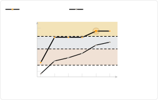
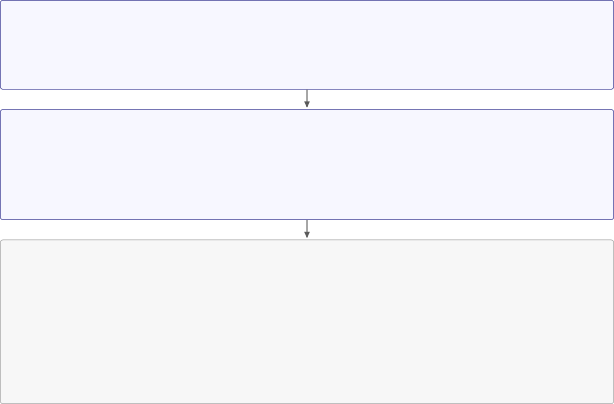
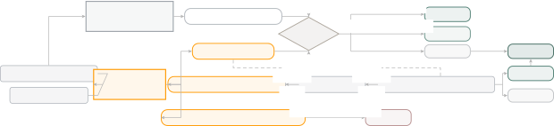
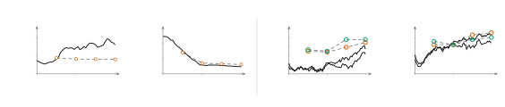
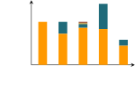
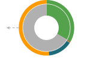
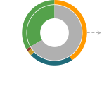
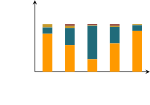
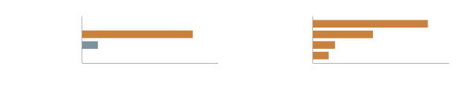

# Beyond the Verdict: Agentic Code Judging with Verifiable Feedback

Zheye Deng Sha Li Changlong Yu Xin Liu Qin Lu Priyanka Nigam Yangqiu
Song Affiliation: HKUST Amazonzdengah@cse.ust.hk, {slliz,
changlyu}@amazon.com  Project Page:
[https://horizon-llm.github.io/IOI2026/](https://horizon-llm.github.io/IOI2026/)
 Code & Artifacts:
[https://github.com/horizon-llm/IOI2026](https://github.com/horizon-llm/IOI2026)

###### Abstract

Test-time scaling for large language models (LLMs) can involve
generating multiple candidate solutions for selection or revising an
earlier attempt. To guide selection and revision, we need a verifier
that can estimate candidate correctness and provide evidence of failure.
In competitive programming, however, official judging systems provide
authoritative verdicts under finite submission budgets, without
revealing failure explanations or failing inputs. To provide informative
feedback without consuming official submissions, we formulate a task in
which a model judges and diagnoses a candidate program using only the
problem statement and source code, with generated counterexamples
serving as checkable evidence. To evaluate this task, we build
USACO-Judge from the USACO 2026 contests, using accepted and unaccepted
programs written by human experts and multiple LLMs. We then train
Arbiter, a 35B mixture-of-experts (MoE) agentic verifier, with
reinforcement learning in a generic execution sandbox. Training raises
counterexample success on incorrect programs from 40.61% to 62.67% and
mean binary verdict accuracy on USACO-Judge from 71.41% to 87.41%,
approaching frontier verification performance. Beyond verification,
Arbiter outperforms baselines in both code selection and refinement. In
an IOI 2026 case study, Arbiter-guided refinement raises GPT-OSS-120B’s
expected score above the gold-medal threshold under the official
submission limit.

## 1 Introduction




Figure 1: Comparison of Arbiter with an online judge (left) and the IOI
2026 case study (right). Under the same 50-submission cap per problem,
the expected Arbiter score crosses the gold threshold in round 4; the
expected online-judge-feedback score remains below it.

Test-time methods allow language models to continue working after an
initial answer. They can generate several candidates for selection or
revise an earlier attempt (Snell et al., 2025; Shinn et al., 2023;
Venkatraman et al., 2025). Each use of additional computation depends on
feedback about a candidate already produced. Selection requires a
judgment about which candidate to keep; revision requires information
about a particular failure. Learned verifiers and reward models have
supported candidate selection and guided search across reasoning
tasks (Cobbe et al., 2021; Lightman et al., 2024; Zhang et al., 2025).
We ask how verification feedback can support both uses while grounding
suspected failures in evidence that can be checked independently.

Competitive programming makes this question concrete. A problem
statement specifies intended behavior, and an official judge tests
candidate programs against hidden inputs and resource limits (Maggiolo &
Mascellani, 2012; Mareš, 2021). The setting has driven work on code
generation and inference-time computation (Shi et al., 2024; El-Kishky
et al., 2025; Samadi et al., 2026). When a solver compares several
candidates or revises an earlier attempt, it needs feedback before
another official submission. Public examples and generated tests can
help with either decision (Chen et al., 2023; Fu et al., 2026), but
passing them does not establish acceptance on hidden tests. The official
judge determines acceptance under its test suite, but usually provides
only a verdict or score, without a failing input or explanation (Xu
et al., 2026). In settings with a finite submission budget, that
feedback cannot be requested freely. A code judge can estimate
correctness and describe a suspected fault for one candidate (Tong &
Zhang, 2024), but its explanation need not contain a replayable failing
input. Test generators can target known-faulty submissions or supply
tests for debugging and selection (Sinha et al., 2025; Prasad et al.,
2025; Li et al., 2025; Shi et al., 2026). The joint task remains
underexplored: given a single candidate of unknown quality, predict
whether it should be accepted and, if a fault is suspected, produce a
candidate-specific counterexample whose legality and effect can be
checked. We formulate this as single-candidate verification with
counterexample-grounded diagnosis.

Given a problem statement and candidate program, Arbiter uses a generic
execution sandbox to return a verdict and diagnosis, plus a
candidate-specific counterexample generator for suspected failures other
than compile errors (Figure 1, left). It sees neither hidden tests nor a
reference solution. During training and evaluation, judge infrastructure
checks whether generated inputs are legal and break the candidate,
providing executable evidence for suspected failures. We build
USACO-Judge to evaluate acceptance judgments alongside failure
discovery, and train Arbiter with reinforcement learning. On the same
Qwen3.6-35B-A3B backbone, overall counterexample success rises from
16.10% without tools to 40.61% with the agentic scaffold and 62.67%
after training. On USACO-Judge, mean binary verdict accuracy also rises
from 71.41% with the agentic scaffold to 87.41% after training. The
verdict helps rank completed programs. For a rejected candidate, the
diagnosis gives the solver a suspected failure to investigate in its
next attempt. In an IOI 2026 case study, Arbiter-guided refinement
brings GPT-OSS-120B to 385.46 expected points under the official
submission limit, above the gold threshold. It reaches 334.6 expected
points with online-judge feedback (Figure 1, right). To conclude, our
contributions are:

- •
  We formulate a task for judging a single candidate program and
  explaining any unaccepted verdict, and use counterexamples that break
  the program as a verifiable proxy for diagnosis quality.
- •
  We release USACO-Judge, which evaluates correct and incorrect programs
  from human experts and multiple LLMs against official test sets from
  the USACO 2026 contests.
- •
  We introduce Arbiter, a 35B MoE agentic verifier trained with
  reinforcement learning, and show substantial gains over its base model
  and strong results on USACO-Judge, code selection, and refinement.

## 2 Related Work

#### Feedback for Test-Time Scaling.

Test-time scaling can use feedback to select among generated
solutions (Li et al., 2022) or revise an earlier attempt (Venkatraman
et al., 2025; Wan et al., 2026). Outcome and process reward models score
complete solutions or intermediate steps (Cobbe et al., 2021; Lightman
et al., 2024). Generative verifiers provide reasoning for their
judgments (Zhang et al., 2025), while agentic verifiers gather
observations through tools (Zhang et al., 2026; Cui et al., 2026). These
approaches differ in both how they produce feedback and what that
feedback establishes about a candidate. Our work connects the two uses
of feedback: Arbiter provides verdicts for selection and
candidate-specific diagnoses and counterexamples for refinement.

#### Evidence for Code Judgment.

Code judges can predict correctness and describe faults for a single
program (Tong & Zhang, 2024), but such descriptions need not include a
replayable failing input. Execution-based methods use tests to rank
candidate pools or guide revisions (Ni et al., 2023; Chen et al., 2023;
Ma et al., 2026; Fu et al., 2026; Tang et al., 2026). Test generators
target known-faulty programs or supply tests for debugging and
selection (Sinha et al., 2025; Prasad et al., 2025; Li et al., 2025; Shi
et al., 2026). These outputs support different conclusions. A predicted
verdict is not an executable witness. An input on which two programs
disagree shows that their behavior differs, but not which program is
wrong. A legal input that breaks one candidate under the task’s judging
rules supports its rejection. Our task predicts acceptance for a
candidate of unknown quality and, for suspected non-compilation
failures, couples diagnosis with candidate-specific counterexample
search.

#### Evaluating Code Verifiers.

Benchmarks assess correctness judgments and fault categories (Zhao
et al., 2025), and study judge behavior across code generation, repair,
and unit-test generation (Jiang et al., 2026). Our task also asks
whether a claimed fault can be exposed by an executable input. Hacking
benchmarks measure counterexample discovery, but the Easy and Hard
UOJ-Bench splits used here contain only faulty programs (Xu et al.,
2026). They cannot test whether a verifier recognizes accepted code. We
introduce USACO-Judge to address this gap: it includes accepted and
unaccepted programs from human experts and LLMs, measuring verdict
accuracy across both classes and counterexample success on incorrect
candidates under one protocol.

## 3 Verification Task

#### A running example.

Figure 2 shows an incorrect candidate and its counterexample.



Figure 2: A verification instance. The verifier’s answer and the
judge-side evaluation are shown in order; judge-only results are not
revealed during the verifier’s episode.

#### Verifier Interface.

Given a problem $`\mathcal{P}`$ and candidate program $`\mathcal{C}`$,
the verifier can run Python code and Bash commands in a generic sandbox
to construct and run its own tests. It cannot access the official tests,
reference solution, input validator, output checker, or the result of
checking its final counterexample. To end the episode, it calls
submit$`(v,d,g)`$, where $`v`$ is a verdict, $`d`$ a natural-language
diagnosis, and $`g`$ a deterministic Python 3 generator that prints one
input. This call does not submit $`\mathcal{C}`$ to the official judge.
Possible verdicts are Accepted, Wrong Answer, Time Limit Exceeded,
Runtime Error, Memory Limit Exceeded, and Compile Error. The main
decision is whether to accept $`\mathcal{C}`$. The other verdicts
specify a suspected failure type. The diagnosis identifies the suspected
failure for an unaccepted program. The generator $`g`$ is empty for
Accepted and Compile Error.

#### External Judge Evaluation.

After submit, an external judge runs $`\mathcal{C}`$ on official tests
to obtain the reference verdict $`v^{\star}`$. If $`g`$ is supplied, it
generates an input $`x`$, validates $`x`$, and tests $`\mathcal{C}`$
against a reference solution under the task’s judging rules. A legal
$`x`$ that breaks $`\mathcal{C}`$ establishes a failure even when
official tests miss it; failing to find one does not establish
acceptance. The private checks supply training rewards and evaluation
labels but are withheld from the verifier. We do not score $`d`$
directly; counterexample success is a checkable proxy for diagnosis
quality, not proof of every claim in $`d`$. Appendix A specifies the
full protocol.

## 4 Training Arbiter

We train Arbiter (Agentic RL-trained Bug-finding Interactive Test
ExamineR) to judge a candidate program, diagnose failures, and generate
counterexamples. Starting from Qwen3.6-35B-A3B (Qwen Team, 2026), we
optimize the mapping $`(\mathcal{P},\mathcal{C})\mapsto(v,d,g)`$ with
agentic reinforcement learning. We describe the training data in
Section 4.1, the reward design and optimization in Section 4.2, and
adaptive length control in Section 4.3.

### 4.1 Training data

Our training set contains 20,000 candidate programs sampled from
online-judge-graded solver rollouts across 6,145 competitive-programming
problems. We sample at most five solver rollouts per problem and exclude
all evaluation problems. Accepted programs make up 15% of the set. Among
the remaining programs, 46.8% score between 76 and 99. These
high-scoring failures are more likely to contain subtle bugs that
survive most official tests. A separate validation set of 400 candidates
from 100 hard problems is reserved for checkpoint selection and shares
no problems with the training or test sets. Appendix B.1 provides full
sampling and construction details.

### 4.2 Agentic reinforcement learning

For each $`(\mathcal{P},\mathcal{C})`$ pair, the policy samples a group
of multi-turn episodes in the sandbox of Section 3. Each episode ends
with one $`(v,d,g)`$ prediction and receives a scalar reward. We
optimize the policy with GRPO (Shao et al., 2024) using the slime RL
framework (Zhu et al., 2025). Episodes that hit the token budget are
truncated and retained with zero reward, whereas episodes that exceed
the wall-clock budget are aborted and excluded from the policy update.
Appendix C reports the training and rollout hyperparameters.

#### Rewarding executable evidence.

A verdict-only reward invites a shortcut: with 85% of training
candidates unaccepted, the policy can favor the majority verdict without
testing the candidate. In a diagnostic run, training reward rises while
validation verdict accuracy stays between 56% and 58%. Mean tool calls
fall from 4.9 per rollout to below one (Figure 4, left). We therefore
give little reward for a correct unaccepted verdict unless the policy
produces a counterexample that survives execution and validation.
Appendix G.1 gives the full diagnostic.



Figure 3: The verification pipeline assigns partial rewards according to
each outcome and combines them into the final reward used to train
Arbiter, with each component tied to a separate check.

Figure 3 shows the reward allocation. Agreement on an unaccepted verdict
earns $`0.05`$: it identifies the direction of the decision but supplies
no evidence of a bug. Running $`g`$ earns another $`0.05`$, and
producing a legal input adds $`0.10`$. These small intermediate rewards
give feedback before the harder event of finding a failure. Their total,
including verdict agreement, is $`0.20`$, while an input that actually
breaks $`\mathcal{C}`$ earns $`0.75`$. Matching the failure type adds
the final $`0.05`$, bringing a verified unaccepted prediction to
$`1.00`$. When both $`v`$ and the reference verdict $`v^{\star}`$ are
Accepted, the rollout receives $`1.00`$. This evidence gate is
necessarily asymmetric in our setting: a counterexample can establish
failure, but not finding one cannot establish acceptance. The policy can
still guess Accepted without a witness. The diagnosis $`d`$ receives no
correctness reward. A diagnosis over $`1000`$ tokens incurs a $`0.05`$
penalty. A valid counterexample that overturns an Accepted reference
verdict earns an additional $`0.10`$, placing verified evidence above
agreement with the official tests. Appendix D.6 gives two such cases.

#### False-positive penalty.

An incorrect Accepted verdict can stop a refinement trajectory before
the faulty program is repaired. We examine an additional reward penalty
$`\lambda`$ for predicting Accepted when the reference verdict is
unaccepted. Matched runs with $`\lambda=0`$ and $`\lambda=0.5`$ show
higher Accepted-class precision and lower recall with the larger penalty
(Figure 4, right). On the hard split of USACO-Judge, precision rises
from 77.78% to 80.98%, while recall falls from 76.67% to 62.86%. A false
negative can also discard a correct program during selection. We use
$`\lambda=0`$ for the final Arbiter; the comparison shows how the
penalty shifts the precision–recall trade-off. The full benchmark
comparison appears in Appendix G.2.



Figure 4: Reward ablations. Left: reward, verdict accuracy, and tool use
under verdict-only training. Right: _Accepted_ precision and recall for
false-positive penalties $`\lambda=0`$ and $`0.5`$.

### 4.3 Efficient training through length control

As responses grow longer during training, generation cost rises and
rollout throughput falls. Inspired by length control (Kimi Team, 2026),
we design an adaptive penalty. When the penalty is active, we penalize a
rollout only if it earns at least $`0.9`$ raw reward, exceeds a
group-relative length threshold, and at least one-quarter of the group
shares the top reward. These gates spare unsuccessful attempts and rare
successes on difficult problems. For a group $`G`$, let $`S\subseteq G`$
be the rollouts tied for its highest raw reward, and $`B`$ the upper
quartile of their response lengths, recomputed at each step. For rollout
$`i`$, let $`R_{i}`$ and $`L_{i}`$ denote its raw reward and response
length. The adjusted reward is

```math
\widetilde{R}_{i}=\begin{cases}R_{i}-0.6,&R_{i}\geq 0.9,\ L_{i}>B,\ \frac{|S|}{|G|}\geq\frac{1}{4},\\
R_{i},&\text{otherwise}.\end{cases}
```

Figure 5 compares two runs continued from the same checkpoint. Length
control shortens responses (middle), reduces rollout timeouts (right),
and avoids the late decline in mean reward seen without it (left). A
continuously applied penalty can curtail exploration: in a comparison
run, median response length falls from 17.2k to 12.9k tokens, median
interaction turns drop from 10 to 7, and hack success falls from 62.3%
to 59.1% (Appendix G.3). We therefore alternate penalized and
unpenalized phases to leave room for longer attempts. The shaded
intervals mark when the penalty is active.


Length Penalty (Ours)


Baseline


Penalty Engaged

Figure 5: Adaptive length control. The panels compare mean reward,
response length, and abort rate across two runs continued from the same
checkpoint. Shading marks the active penalty phases.

## 5 Evaluation Benchmarks

### 5.1 UOJ-Bench

UOJ-Bench (Xu et al., 2026) evaluates code generation, hacking, and
repair using real submissions to the Universal Online Judge (UOJ)¹¹ 1
[https://uoj.ac/](https://uoj.ac/). We use its code-hacking splits: 479
Easy submissions with faults exposed by standard tests, and 1,046 Hard
submissions that passed those tests before a community hack exposed a
fault. All are faulty. We re-host the released candidates on our UOJ
instance and reproduce their original outcomes (Appendices A and B.2).
These splits test counterexample discovery on overt and covert faults,
but leave acceptance untested. A verifier could predict _unaccepted_ for
every candidate and obtain perfect binary verdict accuracy without
finding a counterexample.

### 5.2 USACO-Judge

To evaluate acceptance judgments alongside counterexample discovery, we
build USACO-Judge with both accepted and unaccepted programs. The
benchmark contains 900 C++17 candidates for 39 held-out problems from
the USACO 2026 contests, spanning Bronze through Platinum.²² 2
[https://usaco.org/index.php?page=training](https://usaco.org/index.php?page=training)
The easy tier contains 270 candidates over 18 problems from the Bronze
and Silver divisions, and the hard tier contains 630 candidates over 21
problems from the Gold and Platinum divisions, including problems from
the USACO Open. Candidates come from five LLMs: Claude Opus
4.8 (Anthropic, 2026), GPT-5.5 (OpenAI, 2026), GPT-OSS-120B (OpenAI,
2025), DeepSeek-V4 (DeepSeek-AI, 2026), and Qwen3.6-35B-A3B (Qwen Team,
2026), as well as five human competitive programmers. Both tiers use a
1:2 ratio of accepted to unaccepted candidates. Within each tier, we
sample the same number of candidates for every problem and distribute
the unaccepted candidates across five official score bands, from
programs that fail most tests to near-misses. The hard tier is balanced
across bands. We also select for distinct code structures and runtime
profiles within each problem and score band, reducing repeated variants
of the same implementation. High-scoring unaccepted submissions are
scarce in the easy tier, so its unfilled 80–99 quota is assigned to the
60–79 band, which therefore exceeds 20%. Figure 6 summarizes the
resulting distribution.

         


Figure 6: USACO-Judge composition by difficulty, verdict, failure type,
and official score band.

The USACO website provides the problem statements, test data, and
official solutions, but not the validators and checkers required to
deploy the problems on our own online judge. We employ experienced
competitive programmers to implement validators compatible with UOJ for
every problem, allowing the judge to verify that each generated input
satisfies the problem constraints. For output judging, we use UOJ’s
native checker whenever possible and write custom checkers for the six
problems that allow multiple valid outputs. Every validator and custom
checker is verified end to end on the deployed online judge before
benchmark construction. We then rejudge every candidate on the official
test data, so every label is an actual judge verdict, and retain it only
if its original score is reproduced. Multiple runs ensure that judge
variability does not change a candidate’s accepted or unaccepted status.
See Appendix B.4 for candidate construction and Appendix B.3 for
validator and checker details.

## 6 Experiments

We evaluate Arbiter’s verification quality on the two benchmarks of
Section 5 (Section 6.1), then test its use for code refinement
(Section 6.2) and selection (Section 6.3).

### 6.1 Verification Quality

Although Arbiter predicts a detailed verdict, the failure type from an
online judge depends on the first failed test and need not describe
every fault. We map predicted and reference verdicts to _Accepted_ or
_unaccepted_. Verdict accuracy (Verdict Acc.) measures this binary
decision. Hack success (Hack Succ.) is the fraction of truly
_unaccepted_ candidates broken by a valid generated input under the
checker, providing an executable measure of counterexample quality. On
the UOJ-Bench hacking splits, verdict accuracy is unaccepted-class
recall because every target is faulty; USACO-Judge tests both sides of
the decision. The benchmark’s AC/non-AC split follows the official
tests; for evaluation, an officially _Accepted_ candidate is treated as
unaccepted when a validated counterexample exposes a failure. Table 1
reports multiple-run averages for all baselines and Arbiter.

[TABLE]

Table 1: Results on UOJ-Bench (Hacking) and USACO-Judge, reported by
difficulty split (Easy / Hard) and grouped by inference mode:
non-agentic ( , single-shot) versus agentic ( , tool-using).

 no
tools

 agentic

 Arbiter

Figure 7: Test-time scaling on the Qwen3.6-35B-A3B backbone. We draw
eight samples per candidate and report Hack@$`k`$, the expected success
rate of a uniformly chosen subset of $`k`$ samples.

#### Verification performance.

Training raises overall hack success from 40.61% to 62.67%. On the hard
splits, verdict accuracy rises from 67.43% to 83.40% on UOJ-Bench and
from 65.34% to 84.50% on USACO-Judge, a 26.5% relative improvement on
average. The resulting 35B Arbiter outperforms non-agentic models as
large as 1.6T parameters. On USACO-Judge, Arbiter achieves the highest
reported hack success among the evaluated open-weight models on both
Easy and Hard, and the highest reported verdict accuracy on Hard.

#### Test-time scaling.

All systems in Table 1 use one verifier sample per candidate. To isolate
backbone scaling, Figure 7 varies the sample budget for Qwen3.6-35B-A3B
without tools, with the agentic scaffold, and after Arbiter training.
Repeated sampling improves all three variants, while one Arbiter sample
already exceeds eight no-tools samples on every split.

#### Counterexamples track diagnosis quality, and correct diagnoses are specific and actionable.

We manually audit 400 Arbiter diagnoses on USACO candidates, with three
competitive programmers comparing each diagnosis against the problem,
candidate, and official judge evidence. Their independent initial labels
agree on all 400 cases. Among compilable candidates, counterexamples
succeed for 71.6% of correct diagnoses and 10.3% of incorrect or vacuous
ones (Figure 8, left). Among the 163 correct diagnoses that identify a
real bug, 82.2% locate its cause and 54.0% suggest a fix (Figure 8,
right). Appendix F.4 gives the full audit and sampling protocol.



Figure 8: Human audit of Arbiter diagnoses. Counterexample success
tracks correctness (Left), while correct diagnoses usually locate the
bug and over half suggest a fix (Right).

### 6.2 Code Refinement

For each of the 39 held-out USACO 2026 problems, we test Qwen3.6-35B-A3B
and GPT-OSS-120B using eight shared, already judged starting programs
and up to eight revisions. We compare previous code alone, online-judge
feedback (verdict and subtask score), and three combinations of
Arbiter’s verdict ($`\mathbf{V}`$), diagnosis ($`\mathbf{D}`$), and
counterexample generator ($`\mathbf{X}`$). Round 0 is excluded from the
additional-submission budget; every arm retains a 100-point seed without
further submissions. Otherwise, only Online Judge uses the round-0
result as feedback, while Arbiter reviews each version. Best@1 retains
round 8 for previous code, round 1 for Online Judge, and the first
Arbiter-predicted _Accepted_ (or round 8). Best@8 retains the highest
score among up to eight additional submissions; Online Judge stops at
100 points. Table 2 reports the 30 non-Bronze problems; Appendix F.1
gives the full protocol.

|                                                                                                                            |                                                                                              |        |            |      |           |      |                                                                                           |      |            |      |           |      |
| -------------------------------------------------------------------------------------------------------------------------- | -------------------------------------------------------------------------------------------- | ------ | ---------- | ---- | --------- | ---- | ----------------------------------------------------------------------------------------- | ---- | ---------- | ---- | --------- | ---- |
| Condition                                                                                                                  | ![[Uncaptioned image]](arxiv-2610-18760--a85eaf5c4157.figures/figure-5.webp) Qwen3.6-35B-A3B |        |            |      |           |      | ![[Uncaptioned image]](arxiv-2610-18760--a85eaf5c4157.figures/figure-6.webp) GPT-OSS-120B |      |            |      |           |      |
|                                                                                                                            | Easy (9)                                                                                     |        | Medium (9) |      | Hard (12) |      | Easy (9)                                                                                  |      | Medium (9) |      | Hard (12) |      |
|                                                                                                                            | @1                                                                                           | @8     | @1         | @8   | @1        | @8   | @1                                                                                        | @8   | @1         | @8   | @1        | @8   |
| Starting code                                                                                                              | 69.5                                                                                         | 69.5   | 52.4       | 52.4 | 09.5      | 09.5 | 73.8                                                                                      | 73.8 | 62.8       | 62.8 | 12.8      | 12.8 |
| Previous code only                                                                                                         | 52.4                                                                                         | 93.6   | 38.9       | 59.8 | 05.8      | 16.6 | 88.1                                                                                      | 89.6 | 75.9       | 81.6 | 21.8      | 28.5 |
| Online Judge                                                                                                               | 68.9                                                                                         | 98.1   | 49.2       | 64.7 | 10.2      | 17.4 | 80.7                                                                                      | 94.3 | 73.0       | 86.0 | 20.5      | 35.5 |
| ![[Uncaptioned image]](arxiv-2610-18760--a85eaf5c4157.figures/figure-1.webp) Arbiter: $`\mathbf{V}+\mathbf{X}`$            | 90.1                                                                                         | 92.5   | 62.4       | 65.9 | 06.4      | 13.4 | 95.8                                                                                      | 96.8 | 84.0       | 84.1 | 26.3      | 35.8 |
| ![[Uncaptioned image]](arxiv-2610-18760--a85eaf5c4157.figures/figure-1.webp) Arbiter: $`\mathbf{V}+\mathbf{D}`$            | 95.6                                                                                         | 100.00 | 66.4       | 69.0 | 12.3      | 20.1 | 93.3                                                                                      | 95.4 | 85.0       | 89.2 | 32.8      | 39.1 |
| ![[Uncaptioned image]](arxiv-2610-18760--a85eaf5c4157.figures/figure-1.webp) Arbiter: $`\mathbf{V}+\mathbf{D}+\mathbf{X}`$ | 93.1                                                                                         | 95.8   | 62.4       | 67.7 | 11.0      | 19.3 | 94.7                                                                                      | 96.0 | 86.6       | 88.6 | 30.4      | 38.3 |

Table 2: Refinement from shared, already judged seeds on 30 non-Bronze
USACO 2026 problems. The tiers are Silver, Gold, and Platinum$`+`$Open.
Budgets count one or eight additional judge submissions; inference
compute is unmatched. Bold and underlined entries mark the top two
conditions.

At Best@8, the $`\mathbf{V}+\mathbf{D}`$ condition scores above Online
Judge for both solvers at every difficulty tier. Both
$`\mathbf{V}+\mathbf{D}`$ and $`\mathbf{V}+\mathbf{X}`$ expose the
verdict and use the same acceptance-based stopping rule; their
comparison favors diagnosis as repair guidance. Adding
counterexample-generator source $`\mathbf{X}`$ to
$`\mathbf{V}+\mathbf{D}`$ brings no consistent gain (Appendix F.5). At
Best@1, Arbiter’s predicted _Accepted_ verdict determines which version
is retained; false acceptances remain in the reported scores
(Appendix F.3).

#### Case study: IOI 2026.

On all six IOI 2026 problems, GPT-OSS-120B starts 50 internal
trajectories per refinement target and makes up to five Arbiter-guided
revisions. Submissions are counted per problem, not per target: four
tasks combine programs by trajectory index, while _Classroom Game_ and
_Partition_ divide the official 50-slot cap among separate programs.
Arbiter reviews use no slots; each online-judge feedback query uses one.
Under this cap, expected scores are 385.46 with Arbiter (above the
361.12 gold threshold) and 334.6 with online-judge feedback (Figure 1).
Appendix F.2 gives the budget and score accounting.

### 6.3 Code Selection

Following Ma et al. (2026), we regenerate 8- and 64-program pools from
Qwen3-30B-A3B-Thinking and Qwen3-235B-A22B-Thinking (Qwen Team, 2025) on
LiveCodeBench v6 (Jain et al., 2025) and OJBench (Wang et al., 2025).
Repeated uniform selection closely recovers published pass@$`1`$
(Appendix E). We run one or eight Arbiter calls per candidate, then
select uniformly among those with the most _Accepted_ verdicts, or from
the full pool if none is accepted. Table 3 places our results and
perfect-selection upper bounds on these pools beside published
baselines.

|                                                                                                |                                                                                                     |         |         |         |                                                                                                       |         |         |         |
| ---------------------------------------------------------------------------------------------- | --------------------------------------------------------------------------------------------------- | ------- | ------- | ------- | ----------------------------------------------------------------------------------------------------- | ------- | ------- | ------- |
| Selection method                                                                               | ![[Uncaptioned image]](arxiv-2610-18760--a85eaf5c4157.figures/figure-5.webp) Qwen3-30B-A3B-Thinking |         |         |         | ![[Uncaptioned image]](arxiv-2610-18760--a85eaf5c4157.figures/figure-5.webp) Qwen3-235B-A22B-Thinking |         |         |         |
|                                                                                                | LiveCodeBench v6                                                                                    |         | OJBench |         | LiveCodeBench v6                                                                                      |         | OJBench |         |
|                                                                                                | Pool=8                                                                                              | Pool=64 | Pool=8  | Pool=64 | Pool=8                                                                                                | Pool=64 | Pool=8  | Pool=64 |
| Uniform selection                                                                              | 66.2                                                                                                | 66.2    | 28.9    | 28.9    | 74.7                                                                                                  | 74.7    | 37.1    | 37.1    |
| Grading RM (Liu et al., 2025)                                                                  | 67.1                                                                                                | 68.0    | 28.7    | 29.3    | 75.9                                                                                                  | 74.9    | 37.6    | 34.9    |
| MBR-Exec (hard) (Shi et al., 2022)                                                             | 68.5                                                                                                | 69.2    | 29.6    | 32.4    | 77.9                                                                                                  | 77.7    | 37.7    | 39.6    |
| MBR-Exec (soft) (Shi et al., 2022)                                                             | 70.0                                                                                                | 70.0    | 31.4    | 31.8    | 78.5                                                                                                  | 78.5    | 40.5    | 41.4    |
| CodeT (Chen et al., 2023)                                                                      | 72.7                                                                                                | 70.5    | 31.6    | 32.1    | 78.8                                                                                                  | 79.2    | 41.0    | 40.6    |
| CodeRM (Ma et al., 2025)                                                                       | 71.2                                                                                                | 71.4    | 32.0    | 31.3    | 79.3                                                                                                  | 80.3    | 40.4    | 39.5    |
| Random Generator (Li et al., 2022)                                                             | 70.7                                                                                                | 70.4    | 33.4    | 34.1    | 78.8                                                                                                  | 78.9    | 43.8    | 44.2    |
| Agentic Verifier (Ma et al., 2026)                                                             | 73.6                                                                                                | 73.7    | 33.5    | 34.9    | 81.6                                                                                                  | 82.9    | 45.9    | 48.6    |
| ![[Uncaptioned image]](arxiv-2610-18760--a85eaf5c4157.figures/figure-1.webp) Arbiter (1 call)  | 76.8                                                                                                | 82.6    | 37.6    | 43.6    | 85.0                                                                                                  | 87.7    | 50.0    | 53.3    |
| ![[Uncaptioned image]](arxiv-2610-18760--a85eaf5c4157.figures/figure-1.webp) Arbiter (8 calls) | 79.5                                                                                                | 84.6    | 40.0    | 46.3    | 85.9                                                                                                  | 89.3    | 51.7    | 56.1    |
| Perfect selection^(†)                                                                          | 81.1                                                                                                | 86.3    | 42.2    | 50.0    | 88.0                                                                                                  | 92.6    | 55.6    | 62.1    |

^(†)Perfect selection uses online-judge verdicts for our evaluated
candidate pools and serves as their upper bound, unavailable at
inference time.

Table 3: Pass@$`1`$ following Ma et al. (2026). Baselines are published;
Arbiter and perfect selection use regenerated pools with unmatched
inference compute.

Across all eight settings, one Arbiter call per candidate has higher
reported pass@$`1`$ than the strongest published baseline. With the 30B
solver and a pool of 64, Arbiter scores 82.6 versus the published 73.7
on LiveCodeBench and 43.6 versus 34.9 on OJBench. Eight calls improve
every setting further, moving selection consistently closer to the
perfect-selection upper bound.

## 7 Conclusion

Arbiter combines candidate verification and counterexample-grounded
diagnosis. On USACO-Judge, its candidate-weighted verdict accuracy rises
from 71.41% to 87.41%, and overall counterexample success from 40.61% to
62.67%. Under the reproduced protocol, it leads reported code-selection
results and improves refinement over the evaluated baselines. In our IOI
2026 case study, Arbiter-guided GPT-OSS-120B reaches 385.46 expected
points under the official 50-submission cap per problem, above the
361.12 gold threshold.

## References

- Anthropic (2026) Anthropic. Introducing Claude Opus 4.8.
  Anthropic, 2026. URL
  [https://www.anthropic.com/news/claude-opus-4-8](https://www.anthropic.com/news/claude-opus-4-8).
- Chen et al. (2023) Bei Chen, Fengji Zhang, Anh Nguyen, Daoguang Zan,
  Zeqi Lin, Jian-Guang Lou, and Weizhu Chen. Codet: Code generation with
  generated tests. In _The Eleventh International Conference on Learning
  Representations, ICLR 2023, Kigali, Rwanda, May 1-5, 2023_.
  OpenReview.net, 2023. URL
  [https://openreview.net/forum?id=ktrw68Cmu9c](https://openreview.net/forum?id=ktrw68Cmu9c).
- Cobbe et al. (2021) Karl Cobbe, Vineet Kosaraju, Mohammad Bavarian,
  Mark Chen, Heewoo Jun, Lukasz Kaiser, Matthias Plappert, Jerry Tworek,
  Jacob Hilton, Reiichiro Nakano, Christopher Hesse, and John Schulman.
  Training verifiers to solve math word problems. _CoRR_,
  abs/2110.14168, 2021. URL
  [https://arxiv.org/abs/2110.14168](https://arxiv.org/abs/2110.14168).
- Cui et al. (2026) Chaoqun Cui, Jing Huang, Shijing Wang, Liming Zheng,
  Qingchao Kong, and Zhixiong Zeng. Agentic reward modeling: Verifying
  gui agent via progressive trajectory-grounded interaction, 2026. URL
  [https://arxiv.org/abs/2602.00575](https://arxiv.org/abs/2602.00575).
- DeepSeek-AI (2026) DeepSeek-AI. Deepseek-v4: Towards highly efficient
  million-token context intelligence. _CoRR_, abs/2606.19348, 2026. doi:
  10.48550/ARXIV.2606.19348. URL
  [https://doi.org/10.48550/arXiv.2606.19348](https://doi.org/10.48550/arXiv.2606.19348).
- El-Kishky et al. (2025) Ahmed El-Kishky, Alexander Wei, Andre Saraiva,
  Borys Minaiev, Daniel Selsam, David Dohan, Francis Song, Hunter
  Lightman, Ignasi Clavera Gilaberte, Jakub Pachocki, Jerry Tworek,
  Lorenz Kuhn, Lukasz Kaiser, Mark Chen, Max Schwarzer, Mostafa
  Rohaninejad, Nat McAleese, o3 contributors, Oleg Mürk, Rhythm Garg,
  Rui Shu, Szymon Sidor, Vineet Kosaraju, and Wenda Zhou. Competitive
  programming with large reasoning models. _CoRR_, abs/2502.06807, 2025.
  doi: 10.48550/ARXIV.2502.06807. URL
  [https://doi.org/10.48550/arXiv.2502.06807](https://doi.org/10.48550/arXiv.2502.06807).
- Fu et al. (2026) Shaopeng Fu, Xingxing Zhang, Li Dong, Di Wang, and
  Furu Wei. Refinerl: Advancing competitive programming with
  self-refinement reinforcement learning. _CoRR_, abs/2604.00790, 2026.
  doi: 10.48550/ARXIV.2604.00790. URL
  [https://doi.org/10.48550/arXiv.2604.00790](https://doi.org/10.48550/arXiv.2604.00790).
- Jain et al. (2025) Naman Jain, King Han, Alex Gu, Wen-Ding Li, Fanjia
  Yan, Tianjun Zhang, Sida Wang, Armando Solar-Lezama, Koushik Sen, and
  Ion Stoica. Livecodebench: Holistic and contamination free evaluation
  of large language models for code. In _The Thirteenth International
  Conference on Learning Representations, ICLR 2025, Singapore, April
  24-28, 2025_. OpenReview.net, 2025. URL
  [https://openreview.net/forum?id=chfJJYC3iL](https://openreview.net/forum?id=chfJJYC3iL).
- Jiang et al. (2026) Hongchao Jiang, Yiming Chen, Yushi Cao, Hung
  yi Lee, and Robby T. Tan. CodeJudgeBench: Benchmarking LLM-as-a-judge
  for coding tasks. In _Proceedings of the 64th Annual Meeting of the
  Association for Computational Linguistics (Volume 1: Long Papers)_,
  pp. 19416–19448. Association for Computational Linguistics, 2026. doi:
  10.18653/v1/2026.acl-long.888. URL
  [https://aclanthology.org/2026.acl-long.888/](https://aclanthology.org/2026.acl-long.888/).
- Kimi Team (2026) Kimi Team. Kimi K2.5: visual agentic intelligence.
  _CoRR_, abs/2602.02276, 2026. doi: 10.48550/ARXIV.2602.02276. URL
  [https://doi.org/10.48550/arXiv.2602.02276](https://doi.org/10.48550/arXiv.2602.02276).
- Li et al. (2025) Qingyao Li, Xinyi Dai, Weiwen Liu, Xiangyang Li,
  Yasheng Wang, Ruiming Tang, Yong Yu, and Weinan Zhang. Atgen:
  Adversarial reinforcement learning for test case generation. _CoRR_,
  abs/2510.14635, 2025. doi: 10.48550/ARXIV.2510.14635. URL
  [https://doi.org/10.48550/arXiv.2510.14635](https://doi.org/10.48550/arXiv.2510.14635).
- Li et al. (2022) Yujia Li, David H. Choi, Junyoung Chung, Nate
  Kushman, Julian Schrittwieser, Rémi Leblond, Tom Eccles, James
  Keeling, Felix Gimeno, Agustin Dal Lago, Thomas Hubert, Peter Choy,
  Cyprien de Masson d’Autume, Igor Babuschkin, Xinyun Chen, Po-Sen
  Huang, Johannes Welbl, Sven Gowal, Alexey Cherepanov, James Molloy,
  Daniel J. Mankowitz, Esme Sutherland Robson, Pushmeet Kohli, Nando
  de Freitas, Koray Kavukcuoglu, and Oriol Vinyals. Competition-level
  code generation with alphacode. _CoRR_, abs/2203.07814, 2022. doi:
  10.48550/ARXIV.2203.07814. URL
  [https://doi.org/10.48550/arXiv.2203.07814](https://doi.org/10.48550/arXiv.2203.07814).
- Lightman et al. (2024) Hunter Lightman, Vineet Kosaraju, Yuri Burda,
  Harrison Edwards, Bowen Baker, Teddy Lee, Jan Leike, John Schulman,
  Ilya Sutskever, and Karl Cobbe. Let’s verify step by step. In _The
  Twelfth International Conference on Learning Representations, ICLR
  2024, Vienna, Austria, May 7-11, 2024_. OpenReview.net, 2024. URL
  [https://openreview.net/forum?id=v8L0pN6EOi](https://openreview.net/forum?id=v8L0pN6EOi).
- Liu et al. (2025) Chris Yuhao Liu, Liang Zeng, Yuzhen Xiao, Jujie He,
  Jiacai Liu, Chaojie Wang, Rui Yan, Wei Shen, Fuxiang Zhang, Jiacheng
  Xu, Yang Liu, and Yahui Zhou. Skywork-reward-v2: Scaling preference
  data curation via human-ai synergy. _CoRR_, abs/2507.01352, 2025. doi:
  10.48550/ARXIV.2507.01352. URL
  [https://doi.org/10.48550/arXiv.2507.01352](https://doi.org/10.48550/arXiv.2507.01352).
- Ma et al. (2025) Zeyao Ma, Xiaokang Zhang, Jing Zhang, Jifan Yu, Sijia
  Luo, and Jie Tang. Dynamic scaling of unit tests for code reward
  modeling. In Wanxiang Che, Joyce Nabende, Ekaterina Shutova, and
  Mohammad Taher Pilehvar (eds.), _Proceedings of the 63rd Annual
  Meeting of the Association for Computational Linguistics (Volume 1:
  Long Papers), ACL 2025, Vienna, Austria, July 27 - August 1, 2025_,
  pp. 6917–6935. Association for Computational Linguistics, 2025. doi:
  10.18653/V1/2025.ACL-LONG.343. URL
  [https://doi.org/10.18653/v1/2025.acl-long.343](https://doi.org/10.18653/v1/2025.acl-long.343).
- Ma et al. (2026) Zeyao Ma, Jing Zhang, Xiaokang Zhang, Jiaxi Yang,
  Zongmeng Zhang, Jiajun Zhang, Yuheng Jing, Lei Zhang, Hao Zheng,
  Wenting Zhao, Junyang Lin, and Binyuan Hui. Scaling agentic verifier
  for competitive coding. _CoRR_, abs/2602.04254, 2026. doi:
  10.48550/ARXIV.2602.04254. URL
  [https://doi.org/10.48550/arXiv.2602.04254](https://doi.org/10.48550/arXiv.2602.04254).
- Maggiolo & Mascellani (2012) Stefano Maggiolo and Giovanni Mascellani.
  Introducing CMS: A contest management system. _Olympiads in
  Informatics_, 6:86–99, 2012. URL
  [https://ioi.te.lv/oi/shtm/INFOL107.shtml](https://ioi.te.lv/oi/shtm/INFOL107.shtml).
- Mareš (2021) Martin Mareš. Security of grading systems. _Olympiads in
  Informatics_, 15:37–52, 2021. doi: 10.15388/ioi.2021.04.
- Ni et al. (2023) Ansong Ni, Srini Iyer, Dragomir Radev, Veselin
  Stoyanov, Wen-Tau Yih, Sida I. Wang, and Xi Victoria Lin. LEVER:
  learning to verify language-to-code generation with execution. In
  Andreas Krause, Emma Brunskill, Kyunghyun Cho, Barbara Engelhardt,
  Sivan Sabato, and Jonathan Scarlett (eds.), _International Conference
  on Machine Learning, ICML 2023, 23-29 July 2023, Honolulu, Hawaii,
  USA_, volume 202 of _Proceedings of Machine Learning Research_, pp.
  26106–26128. PMLR, 2023. URL
  [https://proceedings.mlr.press/v202/ni23b.html](https://proceedings.mlr.press/v202/ni23b.html).
- OpenAI (2025) OpenAI. gpt-oss-120b & gpt-oss-20b model card. _CoRR_,
  abs/2508.10925, 2025. doi: 10.48550/ARXIV.2508.10925. URL
  [https://doi.org/10.48550/arXiv.2508.10925](https://doi.org/10.48550/arXiv.2508.10925).
- OpenAI (2026) OpenAI. Introducing GPT-5.5. OpenAI, 2026. URL
  [https://openai.com/index/introducing-gpt-5-5/](https://openai.com/index/introducing-gpt-5-5/).
- Prasad et al. (2025) Archiki Prasad, Elias Stengel-Eskin,
  Justin Chih-Yao Chen, Zaid Khan, and Mohit Bansal. Learning to
  generate unit tests for automated debugging. _CoRR_,
  abs/2502.01619, 2025. doi: 10.48550/ARXIV.2502.01619. URL
  [https://doi.org/10.48550/arXiv.2502.01619](https://doi.org/10.48550/arXiv.2502.01619).
- Qwen Team (2025) Qwen Team. Qwen3 technical report. _CoRR_,
  abs/2505.09388, 2025. doi: 10.48550/ARXIV.2505.09388. URL
  [https://doi.org/10.48550/arXiv.2505.09388](https://doi.org/10.48550/arXiv.2505.09388).
- Qwen Team (2026) Qwen Team. Qwen3.6-35B-A3B: Agentic coding power, now
  open to all, April 2026. URL
  [https://qwen.ai/blog?id=qwen3.6-35b-a3b](https://qwen.ai/blog?id=qwen3.6-35b-a3b).
- Samadi et al. (2026) Mehrzad Samadi, Aleksander Ficek, Sean
  Narenthiran, Siddhartha Jain, Wasi Uddin Ahmad, Somshubra Majumdar,
  Vahid Noroozi, and Boris Ginsburg. Scaling test-time compute to
  achieve IOI gold medal with open-weight models. In Maria Liakata,
  Viviane P. Moreira, Jiajun Zhang, and David Jurgens (eds.),
  _Proceedings of the 64th Annual Meeting of the Association for
  Computational Linguistics (Volume 1: Long Papers), ACL 2026, San
  Diego, California, United States, July 2-7, 2026_, pp. 33156–33169.
  Association for Computational Linguistics, 2026. doi:
  10.18653/V1/2026.ACL-LONG.1532. URL
  [https://doi.org/10.18653/v1/2026.acl-long.1532](https://doi.org/10.18653/v1/2026.acl-long.1532).
- Shao et al. (2024) Zhihong Shao, Peiyi Wang, Qihao Zhu, Runxin Xu,
  Junxiao Song, Mingchuan Zhang, Y. K. Li, Y. Wu, and Daya Guo.
  Deepseekmath: Pushing the limits of mathematical reasoning in open
  language models. _CoRR_, abs/2402.03300, 2024. doi:
  10.48550/ARXIV.2402.03300. URL
  [https://doi.org/10.48550/arXiv.2402.03300](https://doi.org/10.48550/arXiv.2402.03300).
- Shi et al. (2022) Freda Shi, Daniel Fried, Marjan Ghazvininejad, Luke
  Zettlemoyer, and Sida I. Wang. Natural language to code translation
  with execution. In Yoav Goldberg, Zornitsa Kozareva, and Yue Zhang
  (eds.), _Proceedings of the 2022 Conference on Empirical Methods in
  Natural Language Processing, EMNLP 2022, Abu Dhabi, United Arab
  Emirates, December 7-11, 2022_, pp. 3533–3546. Association for
  Computational Linguistics, 2022. doi: 10.18653/V1/2022.EMNLP-MAIN.231.
  URL
  [https://doi.org/10.18653/v1/2022.emnlp-main.231](https://doi.org/10.18653/v1/2022.emnlp-main.231).
- Shi et al. (2026) Jingwei Shi, Xinxiang Yin, Jing Huang, Shengyu Tao,
  and Jinman Zhao. Codehacker: Automated test case generation for
  detecting vulnerabilities in competitive programming solutions. In
  Maria Liakata, Viviane P. Moreira, Jiajun Zhang, and David Jurgens
  (eds.), _Proceedings of the 64th Annual Meeting of the Association for
  Computational Linguistics (Volume 1: Long Papers), ACL 2026, San
  Diego, California, United States, July 2-7, 2026_, pp. 2352–2382.
  Association for Computational Linguistics, 2026. doi:
  10.18653/V1/2026.ACL-LONG.108. URL
  [https://doi.org/10.18653/v1/2026.acl-long.108](https://doi.org/10.18653/v1/2026.acl-long.108).
- Shi et al. (2024) Quan Shi, Michael Tang, Karthik Narasimhan, and
  Shunyu Yao. Can language models solve olympiad programming? _CoRR_,
  abs/2404.10952, 2024. doi: 10.48550/ARXIV.2404.10952. URL
  [https://doi.org/10.48550/arXiv.2404.10952](https://doi.org/10.48550/arXiv.2404.10952).
- Shinn et al. (2023) Noah Shinn, Federico Cassano, Ashwin Gopinath,
  Karthik Narasimhan, and Shunyu Yao. Reflexion: language agents with
  verbal reinforcement learning. In Alice Oh, Tristan Naumann, Amir
  Globerson, Kate Saenko, Moritz Hardt, and Sergey Levine (eds.),
  _Advances in Neural Information Processing Systems 36: Annual
  Conference on Neural Information Processing Systems 2023, NeurIPS
  2023, New Orleans, LA, USA, December 10 - 16, 2023_, 2023. URL
  [http://papers.nips.cc/paper_files/paper/2023/hash/1b44b878bb782e6954cd888628510e90-Abstract-Conference.html](http://papers.nips.cc/paper_files/paper/2023/hash/1b44b878bb782e6954cd888628510e90-Abstract-Conference.html).
- Sinha et al. (2025) Shiven Sinha, Shashwat Goel, Ponnurangam
  Kumaraguru, Jonas Geiping, Matthias Bethge, and Ameya Prabhu. Can
  language models falsify? evaluating algorithmic reasoning with
  counterexample creation. _CoRR_, abs/2502.19414, 2025. doi:
  10.48550/ARXIV.2502.19414. URL
  [https://doi.org/10.48550/arXiv.2502.19414](https://doi.org/10.48550/arXiv.2502.19414).
- Snell et al. (2025) Charlie Victor Snell, Jaehoon Lee, Kelvin Xu, and
  Aviral Kumar. Scaling LLM test-time compute optimally can be more
  effective than scaling parameters for reasoning. In _The Thirteenth
  International Conference on Learning Representations, ICLR 2025,
  Singapore, April 24-28, 2025_. OpenReview.net, 2025. URL
  [https://openreview.net/forum?id=4FWAwZtd2n](https://openreview.net/forum?id=4FWAwZtd2n).
- Tang et al. (2026) Lingxiao Tang, Muyang Ye, Zhaoyang Chu, Xiaoxue
  Ren, Zhongxin Liu, Lingfeng Bao, and He Ye. An iterative
  test-and-repair framework for competitive code generation. _CoRR_,
  abs/2604.05560, 2026. doi: 10.48550/ARXIV.2604.05560. URL
  [https://doi.org/10.48550/arXiv.2604.05560](https://doi.org/10.48550/arXiv.2604.05560).
- Tong & Zhang (2024) Weixi Tong and Tianyi Zhang. Codejudge: Evaluating
  code generation with large language models. In Yaser Al-Onaizan, Mohit
  Bansal, and Yun-Nung Chen (eds.), _Proceedings of the 2024 Conference
  on Empirical Methods in Natural Language Processing, EMNLP 2024,
  Miami, FL, USA, November 12-16, 2024_, pp. 20032–20051. Association
  for Computational Linguistics, 2024. doi:
  10.18653/V1/2024.EMNLP-MAIN.1118. URL
  [https://doi.org/10.18653/v1/2024.emnlp-main.1118](https://doi.org/10.18653/v1/2024.emnlp-main.1118).
- Venkatraman et al. (2025) Siddarth Venkatraman, Vineet Jain, Sarthak
  Mittal, Vedant Shah, Johan S. Obando-Ceron, Yoshua Bengio, Brian R.
  Bartoldson, Bhavya Kailkhura, Guillaume Lajoie, Glen Berseth, Nikolay
  Malkin, and Moksh Jain. Recursive self-aggregation unlocks deep
  thinking in large language models. _CoRR_, abs/2509.26626, 2025. doi:
  10.48550/ARXIV.2509.26626. URL
  [https://doi.org/10.48550/arXiv.2509.26626](https://doi.org/10.48550/arXiv.2509.26626).
- Wan et al. (2026) Yuxuan Wan, Tianqing Fang, Zaitang LI, Yintong Huo,
  Wenxuan Wang, Haitao Mi, Dong Yu, and Michael R. Lyu. Inference-time
  scaling of verification: Self-evolving deep research agents via
  test-time rubric-guided verification. In Maria Liakata, Viviane P.
  Moreira, Jiajun Zhang, and David Jurgens (eds.), _Findings of the
  Association for Computational Linguistics, ACL 2026, San Diego,
  California, United States, July 2-7, 2026_, pp. 24822–24835.
  Association for Computational Linguistics, 2026. doi:
  10.18653/V1/2026.FINDINGS-ACL.1243. URL
  [https://doi.org/10.18653/v1/2026.findings-acl.1243](https://doi.org/10.18653/v1/2026.findings-acl.1243).
- Wang et al. (2025) Zhexu Wang, Yiping Liu, Yejie Wang, Wenyang He,
  Bofei Gao, Muxi Diao, Yanxu Chen, Kelin Fu, Flood Sung, Zhilin Yang,
  Tianyu Liu, and Weiran Xu. Ojbench: A competition level code benchmark
  for large language models. _CoRR_, abs/2506.16395, 2025. doi:
  10.48550/ARXIV.2506.16395. URL
  [https://doi.org/10.48550/arXiv.2506.16395](https://doi.org/10.48550/arXiv.2506.16395).
- Xu et al. (2026) Tingqiang Xu, Hangrui Zhou, Tianle Cai, Alex Gu, and
  Kaifeng Lyu. Beyond problem solving: Uoj-bench for evaluating code
  generation, hacking, and repair in competitive programming. _CoRR_,
  abs/2606.12864, 2026. doi: 10.48550/ARXIV.2606.12864. URL
  [https://doi.org/10.48550/arXiv.2606.12864](https://doi.org/10.48550/arXiv.2606.12864).
- Zhang et al. (2026) Jiazheng Zhang, Ziche Fu, Zhiheng Xi, Wenqing
  Jing, Mingxu Chai, Wei He, Guoqiang Zhang, Chenghao Fan, Chenxin An,
  Wenxiang Chen, Zhicheng Liu, Haojie Pan, Dingwei Zhu, Tao Gui,
  Qi Zhang, and Xuanjing Huang. Agentv-rl: Scaling reward modeling with
  agentic verifier. In Maria Liakata, Viviane P. Moreira, Jiajun Zhang,
  and David Jurgens (eds.), _Findings of the Association for
  Computational Linguistics, ACL 2026, San Diego, California, United
  States, July 2-7, 2026_, pp. 23078–23100. Association for
  Computational Linguistics, 2026. doi:
  10.18653/V1/2026.FINDINGS-ACL.1156. URL
  [https://doi.org/10.18653/v1/2026.findings-acl.1156](https://doi.org/10.18653/v1/2026.findings-acl.1156).
- Zhang et al. (2025) Lunjun Zhang, Arian Hosseini, Hritik Bansal,
  Mehran Kazemi, Aviral Kumar, and Rishabh Agarwal. Generative
  verifiers: Reward modeling as next-token prediction. In _The
  Thirteenth International Conference on Learning Representations, ICLR
  2025, Singapore, April 24-28, 2025_. OpenReview.net, 2025. URL
  [https://openreview.net/forum?id=Ccwp4tFEtE](https://openreview.net/forum?id=Ccwp4tFEtE).
- Zhao et al. (2025) Yuwei Zhao, Ziyang Luo, Yuchen Tian, Hongzhan Lin,
  Weixiang Yan, Annan Li, and Jing Ma. CodeJudge-eval: Can large
  language models be good judges in code understanding? In _Proceedings
  of the 31st International Conference on Computational Linguistics_,
  pp. 73–95. Association for Computational Linguistics, 2025. URL
  [https://aclanthology.org/2025.coling-main.7/](https://aclanthology.org/2025.coling-main.7/).
- Zhu et al. (2025) Zilin Zhu, Chengxing Xie, Xin Lv, and slime
  Contributors. slime: An llm post-training framework for rl scaling.
  [https://github.com/THUDM/slime](https://github.com/THUDM/slime), 2025.
  GitHub repository. Corresponding author: Xin Lv.

## Appendix A Evaluation Infrastructure and Protocols

#### Verifier interface and judge-side evaluation.

The verifier can use execute_code to run Python and execute_command to
run shell commands in a generic sandbox. It may construct and run its
own tests, but cannot access the official test data, reference solution,
input validator, output checker, or the result of checking its submitted
counterexample. A final submit call commits $`(v,d,g)`$. We use an
online judge based on the open-source Universal Online Judge (UOJ)³³ 3
[https://github.com/UniversalOJ/UOJ-System](https://github.com/UniversalOJ/UOJ-System).
The judge compiles and runs $`\mathcal{C}`$ on the official hidden tests
under the problem’s resource limits to obtain $`v^{\star}`$. Verdict
accuracy compares $`v`$ and $`v^{\star}`$ after mapping both to Accepted
or unaccepted. Separately, when $`g`$ is supplied, the judge runs it to
obtain $`x`$ and checks $`x`$ with the problem’s input validator. For a
legal $`x`$, it runs $`\mathcal{C}`$ and a reference solution; the
output checker compares normally terminating outputs, while compilation,
runtime, time-limit, and memory-limit failures are recorded directly.
The counterexample succeeds only when $`x`$ is legal and $`\mathcal{C}`$
fails on it. These checks supply training labels and rewards and
evaluate the benchmarks, without becoming observations available to the
verifier during its episode.

#### Hardware and deployment.

Our UOJ deployment runs on one server with a 32-core / 64-thread Intel
Xeon Platinum 8488C and 128 GB of RAM. The server runs Amazon Linux 2023
with Linux 6.12. The web service and database use separate Docker
containers, alongside a pool of up to 30 judger containers. The pool
processes submissions and counterexamples in parallel. Each candidate
runs in an isolated sandbox under the time and memory limits specified
for the problem.

#### Language and compilation.

Candidate solutions, reference solutions, validators, and checkers use
C++ unless the source benchmark requires otherwise. We compile
submissions with C++17 and -O2, matching the source contests. A
submission that fails under this configuration receives _Compile Error_.
Counterexample generators may use Python. They produce input files and
are not judged as contest solutions.

## Appendix B Data and Benchmark Construction

### B.1 Training Data Composition

Table 4 groups the training pool by sampling score band and judge
verdict. Score bands set the sampling quotas. Training labels come from
the online judge: _Accepted_ (AC), _Wrong Answer_ (WA), _Time Limit
Exceeded_ (TLE), _Memory Limit Exceeded_ (MLE), _Runtime Error_ (RE),
and _Compile Error_ (CE). The 76–99 near-miss band contains WA, TLE,
MLE, and RE programs. A time-limit failure in that band is labeled TLE.

|                   |               |        |       |      |      |      |        |       |
| ----------------- | ------------- | ------ | ----- | ---- | ---- | ---- | ------ | ----- |
|                   | Judge verdict |        |       |      |      |      |        |       |
| Score band        | AC            | WA     | TLE   | MLE  | RE   | CE   | Total  |       |
| 100 (accepted)    | 3,000         | –      | –     | –    | –    | –    | 3,000  | 15.0% |
| 76–99 (near-miss) | –             | 4,460  | 3,107 | 220  | 163  | –    | 7,950  | 39.8% |
| 1–75 (partial)    | –             | 4,600  | 1,600 | 400  | 600  | –    | 7,200  | 36.0% |
| 0                 | –             | 1,000  | –     | –    | –    | –    | 1,000  | 5.0%  |
| Compile Error     | –             | –      | –     | –    | –    | 850  | 850    | 4.3%  |
| Total             | 3,000         | 10,060 | 4,707 | 620  | 763  | 850  | 20,000 |       |
|                   | 15.0%         | 50.3%  | 23.5% | 3.1% | 3.8% | 4.3% |        |       |

Table 4: Composition of the training pool by sampling score band and
judge verdict. Margins report the share of the pool for each row and
column.

### B.2 UOJ-Bench Re-hosting

UOJ-Bench (Xu et al., 2026) divides its hacking data into Easy
submissions, which score at least 60 but fail the standard tests, and
Hard submissions, which pass those tests before a successful community
hack exposes the bug. We use every released candidate from both splits
for evaluation. Neither split enters training.

We run candidate scoring and hack evaluation on UOJ, using the same
infrastructure as the original benchmark. Each target problem is
re-hosted with its validator, reference solution, and checker. Replaying
the released candidates reproduces the outcomes reported in the original
paper. For a generated hack, UOJ first checks the input with the problem
validator. If the input is valid, UOJ runs the reference and candidate
solutions and passes both outputs to the checker. The hack succeeds when
the candidate fails during execution or the checker rejects its output.

### B.3 USACO-Judge Validators and Custom Checkers

USACO supplies the problem statements, test data, and reference
solutions used by our UOJ deployment, but its release omits the
validators needed for arbitrary model-generated inputs. We wrote a C++
validator for each of the 39 problems using testlib, an open source C++
library for writing contest input validators and output checkers.⁴⁴ 4
[https://github.com/MikeMirzayanov/testlib](https://github.com/MikeMirzayanov/testlib)
Each proposed hack must pass this validator before UOJ runs the
reference and candidate solutions.

For 33 problems, the expected output is a unique sequence of tokens,
which UOJ checks with a built-in ncmp or wcmp comparator. Six require
custom checking. They accept multiple correct outputs or ask for a
witness, so we wrote a custom output checker for each one (Table 5).

| CPID                                                            | What the checker validates                                                                                             |
| --------------------------------------------------------------- | ---------------------------------------------------------------------------------------------------------------------- |
| [1540](https://usaco.org/index.php?page=viewproblem2&cpid=1540) | Verifies the reported optimum and checks that the supplied position assignment reconstructs valid square subsequences. |
| [1563](https://usaco.org/index.php?page=viewproblem2&cpid=1563) | Simulates the submitted keystrokes and checks that they reconstruct the target string.                                 |
| [1566](https://usaco.org/index.php?page=viewproblem2&cpid=1566) | Tests the submitted permutation and truth-teller/liar assignment against every directional claim.                      |
| [1589](https://usaco.org/index.php?page=viewproblem2&cpid=1589) | Replays the submitted swaps, enforces the operation limit, and checks the final string.                                |
| [1597](https://usaco.org/index.php?page=viewproblem2&cpid=1597) | Confirms the minimum attack count, replays the submitted attacks, and verifies that every target reaches zero HP.      |
| [1598](https://usaco.org/index.php?page=viewproblem2&cpid=1598) | Validates infeasibility claims or tests the submitted array against every min, max, sum, and xor query.                |

Table 5: Custom output checkers in USACO-Judge, indexed by official
USACO CPID. The other 33 problems use UOJ built-in token comparators.

### B.4 USACO-Judge Construction Pipeline

We build USACO-Judge problem by problem from C++17 programs generated by
five LLMs and written by five human competitive programmers. We assign
each problem a quota split by score and verdict, remove duplicates, and
select diverse programs within each pool. Every retained program is
rejudged on UOJ before entering the 900-candidate benchmark.

#### Per-problem quotas.

The 21 hard problems from the Gold, Platinum, and Open divisions each
contribute 10 accepted and 20 unaccepted candidates, giving 630
programs. The 18 easy problems from Bronze and Silver each contribute 5
accepted and 10 unaccepted candidates, giving 270. Both groups have a
1:2 ratio of accepted to unaccepted programs.

For every hard problem, the 20 unaccepted candidates are divided evenly
across score bands 1–19, 20–39, 40–59, 60–79, and 80–99. The easy group
contains 36, 36, 36, 51, and 21 candidates in these bands. Bronze and
Silver have few high-scoring unaccepted submissions, so 15 slots move
from the 80–99 band to 60–79.

#### Within-band sampling.

Each problem and score band defines a candidate pool using scores
returned by our UOJ deployment. Reference accounts are excluded. We give
preference to higher scores within a band, then apply the diversity
procedure below.

#### Deduplication and diversity.

For duplicate detection only, we derive a canonical representation of
each program by removing comments, normalizing whitespace and include
order, replacing identifiers with positional placeholders, and expanding
common contest macros. This representation is used only for comparison.
The submitted source code remains unchanged. Exact canonical duplicates
and repeated submissions from the same author are removed before
diversity selection.

For two remaining programs $`x`$ and $`y`$ in the same pool, their
distance combines four signals:

```math
D(x,y)=w_{1}\bigl(1-\mathrm{MinHash}_{J}\bigr)+w_{2}\bigl(1-\mathrm{AST}_{J}\bigr)+w_{3}\,\mathrm{feat}_{H}+w_{4}\bigl(1-\mathrm{time}_{\cos}\bigr).
```

Here, $`\mathrm{MinHash}_{J}`$ estimates token 5-gram Jaccard
similarity, $`\mathrm{AST}_{J}`$ compares depth-bounded AST subtrees,
and $`\mathrm{feat}_{H}`$ is the normalized Hamming distance between
program feature vectors. These vectors record data structures,
recursion, memoization, loop depth, and function count. The final term
compares per-test runtime vectors by cosine similarity. We use
$`(w_{1},w_{2},w_{3},w_{4})=(0.25,0.30,0.20,0.25)`$. If a parse or
timing record is missing, the corresponding term is dropped and the
remaining weights are rescaled to sum to one.

Selection follows a greedy farthest-first pass. The first program is the
fastest candidate when timing is available and the lowest-ID candidate
otherwise. Each later choice maximizes its minimum distance from the
selected set. A candidate from an author already represented in the set
receives a multiplicative distance penalty.

#### Candidate verification.

All selected submissions are already written in C++17 and are evaluated
without source transformation. We rejudge each program on UOJ and retain
it only when its score matches the score used during sampling. Accepted
candidates are judged several times to catch verdict changes caused by
runtime variation. Every released label comes from these UOJ runs.

## Appendix C Training Details

#### Optimization.

Each GRPO update uses a batch of 128 prompts, with $`n=16`$ trajectories
sampled per prompt (2,048 trajectories in total). We use Adam with a
learning rate of $`1\times 10^{-6}`$, a constant learning-rate schedule,
$`\beta_{1}=0.9`$, $`\beta_{2}=0.98`$, weight decay $`0.1`$, and
gradient clipping at $`1.0`$. We optimize a per-token objective with PPO
clipping $`\epsilon_{\mathrm{low}}=0.2`$ and
$`\epsilon_{\mathrm{high}}=0.28`$. The entropy and KL coefficients are
both zero, and group advantages are centered without standard-deviation
normalization.

#### Rollouts.

We sample with temperature $`1.0`$ and top-$`p=1.0`$. The context window
is capped at 65,536 tokens, including at most 32,768 response tokens.
Each episode allows at most 30 tool calls and 1,800 seconds. Calls to
execute_code and execute_command have time limits of 120 and 60 seconds,
respectively. We evaluate the held-out validation set every 10 training
steps and select the checkpoint with the best validation performance.

#### Length penalty.

We schedule the length penalty manually from the observed reward curve,
enabling it when reward plateaus. It is active during steps
$`[90,110)`$, $`[160,180)`$, and $`[230,250)`$, and disabled at all
other steps.

## Appendix D Verification Analysis

This section examines metric behavior, inference cost, and output
patterns behind the verification results in §6.1.

### D.1 Hack Success and Verdict Accuracy Are Complementary

Hack success and verdict accuracy diverge during the unpenalized run in
Figure 5. Between steps 79 and 179, hack success changes only from 59.8%
to 60.9%, while verdict accuracy falls from 74.8% to 57.8%. The stable
hack rate masks two opposing changes among unaccepted candidates. The
share skipped after an _Accepted_ prediction falls from 17.7% to 11.3%,
giving the model more opportunities to produce a counterexample. Over
the same interval, the share lost to rollout aborts rises from 4.5% to
17.7% as responses grow longer. These shifts largely cancel in the
aggregate hack metric.

A verifier can therefore attempt counterexamples more broadly while
becoming less reliable in its binary decisions. Hack success records the
final attack outcome, and verdict accuracy checks the preceding
decision. The length-controlled run limits the rise in aborts and
retains higher verdict accuracy, so we report the two metrics together.
Appendix G.3 gives the response-length and timeout diagnostics.

### D.2 Output Tokens and Estimated Cost

Table 6 compares output length with estimated output-token cost. Arbiter
averages 35.0K–46.9K output tokens per candidate across the four
benchmark splits, 22%–33% fewer than its agentic Qwen3.6-35B-A3B
baseline, while overall hack success rises from 40.61% to 62.67%. At the
listed prices, its mean output cost is \$0.0045 per verification,
compared with \$0.0063 for the agentic Qwen3.6-35B-A3B baseline and
\$0.0298 for agentic DeepSeek-V4-Flash-Preview. At this operating point,
Arbiter has higher overall hack success and lower estimated output-token
cost than both agentic baselines in the table.

We use official provider prices when available and otherwise use prices
listed by OpenRouter.⁵⁵ 5
[https://openrouter.ai/](https://openrouter.ai/) These estimates cover
generated output only. Input tokens, caching effects, tool execution,
and self-hosted infrastructure costs are excluded.

|                                                                                                        |        |                           |           |       |             |       |                    |                              |
| ------------------------------------------------------------------------------------------------------ | ------ | ------------------------- | --------- | ----- | ----------- | ----- | ------------------ | ---------------------------- |
| Model                                                                                                  | Params | Token Price (\$/M Tokens) | UOJ-Bench |       | USACO-Judge |       | Overall Hack Succ. | Output Cost per Verification |
|                                                                                                        |        |                           | Easy      | Hard  | Easy        | Hard  |                    |                              |
|  Non-agentic                                                                                           |        |                           |           |       |             |       |                    |                              |
| ![[Uncaptioned image]](arxiv-2610-18760--a85eaf5c4157.figures/figure-5.webp) Qwen3.6-35B-A3B           | 35B    | \$0.10                    | 09.6K     | 10.6K | 11.4K       | 10.9K | 16.10              | \$0.0011                     |
| ![[Uncaptioned image]](arxiv-2610-18760--a85eaf5c4157.figures/figure-6.webp) GPT-OSS-120B              | 120B   | \$0.17                    | 03.8K     | 04.5K | 04.3K       | 04.1K | 26.59              | \$0.0007                     |
| ![[Uncaptioned image]](arxiv-2610-18760--a85eaf5c4157.figures/figure-7.webp) DeepSeek-V4-Flash-Preview | 284B   | \$0.66                    | 16.6K     | 19.4K | 18.8K       | 22.0K | 31.26              | \$0.0129                     |
| ![[Uncaptioned image]](arxiv-2610-18760--a85eaf5c4157.figures/figure-5.webp) Qwen3.5-397B-A17B         | 397B   | \$0.90                    | 16.7K     | 18.4K | 28.1K       | 28.2K | 42.73              | \$0.0195                     |
| ![[Uncaptioned image]](arxiv-2610-18760--a85eaf5c4157.figures/figure-8.webp) GLM-5.2                   | 753B   | \$4.40                    | 52.0K     | 61.8K | 37.4K       | 62.5K | 66.29              | \$0.2550                     |
| ![[Uncaptioned image]](arxiv-2610-18760--a85eaf5c4157.figures/figure-9.webp) Kimi-K2.5                 | 1T     | \$3.00                    | 29.1K     | 31.6K | 26.5K       | 35.2K | 43.07              | \$0.0951                     |
| ![[Uncaptioned image]](arxiv-2610-18760--a85eaf5c4157.figures/figure-7.webp) DeepSeek-V4-Pro-Preview   | 1.6T   | \$1.98                    | 32.6K     | 37.7K | 29.4K       | 42.7K | 51.91              | \$0.0740                     |
| ![[Uncaptioned image]](arxiv-2610-18760--a85eaf5c4157.figures/figure-10.webp) Claude-Opus-4.8          | –      | \$25.00                   | 41.3K     | 53.6K | 27.1K       | 40.9K | 75.69              | \$1.1316                     |
| ![[Uncaptioned image]](arxiv-2610-18760--a85eaf5c4157.figures/figure-6.webp) GPT-5.5                   | –      | \$30.00                   | 09.3K     | 11.1K | 04.5K       | 09.4K | 81.51              | \$0.2907                     |
|  Agentic                                                                                               |        |                           |           |       |             |       |                    |                              |
| ![[Uncaptioned image]](arxiv-2610-18760--a85eaf5c4157.figures/figure-5.webp) Qwen3.6-35B-A3B           | 35B    | \$0.10                    | 54.1K     | 64.6K | 48.0K       | 70.0K | 40.61              | \$0.0063                     |
| ![[Uncaptioned image]](arxiv-2610-18760--a85eaf5c4157.figures/figure-7.webp) DeepSeek-V4-Flash-Preview | 284B   | \$0.66                    | 43.2K     | 48.9K | 27.8K       | 46.3K | 57.76              | \$0.0298                     |
| ![[Uncaptioned image]](arxiv-2610-18760--a85eaf5c4157.figures/figure-1.webp) Arbiter (Ours)            | 35B    | \$0.10                    | 42.0K     | 46.9K | 35.0K       | 46.9K | 62.67              | \$0.0045                     |

Table 6: Mean output tokens per candidate (K), overall hack success,
output-token price, and estimated cost per verification using the
reported average output lengths. Lower output-token usage and cost are
better.

### D.3 Verification Funnel

For each split, Attempt is the fraction of unaccepted candidates for
which the model submits a counterexample generator. Exec., Valid, and
Succ. measure generator execution, input validity, and counterexample
success, each conditional on reaching the preceding stage. The columns
therefore show where an attempted verification succeeds or is lost.
UOJ-Bench contains only unaccepted candidates, so _Accepted_ precision
and recall are reported for USACO-Judge.

(a) UOJ-Bench (Hacking)

|                                                                                                        |           |            |           |           |           |            |           |           |
| ------------------------------------------------------------------------------------------------------ | --------- | ---------- | --------- | --------- | --------- | ---------- | --------- | --------- |
| Model                                                                                                  | Easy      |            |           |           | Hard      |            |           |           |
|                                                                                                        | Att.      | Exec.      | Valid     | Succ.     | Att.      | Exec.      | Valid     | Succ.     |
|  Non-agentic                                                                                           |           |            |           |           |           |            |           |           |
| ![[Uncaptioned image]](arxiv-2610-18760--a85eaf5c4157.figures/figure-5.webp) Qwen3.6-35B-A3B           | $`86.85`$ | $`96.49`$  | $`92.03`$ | $`22.89`$ | $`88.45`$ | $`96.95`$  | $`89.92`$ | $`16.23`$ |
| ![[Uncaptioned image]](arxiv-2610-18760--a85eaf5c4157.figures/figure-6.webp) GPT-OSS-120B              | $`83.23`$ | $`91.82`$  | $`92.80`$ | $`41.02`$ | $`83.12`$ | $`89.34`$  | $`90.04`$ | $`30.01`$ |
| ![[Uncaptioned image]](arxiv-2610-18760--a85eaf5c4157.figures/figure-7.webp) DeepSeek-V4-Flash-Preview | $`80.04`$ | $`90.40`$  | $`95.38`$ | $`48.51`$ | $`79.60`$ | $`90.03`$  | $`94.84`$ | $`32.41`$ |
| ![[Uncaptioned image]](arxiv-2610-18760--a85eaf5c4157.figures/figure-5.webp) Qwen3.5-397B-A17B         | $`98.47`$ | $`89.26`$  | $`95.02`$ | $`49.91`$ | $`98.14`$ | $`88.75`$  | $`95.05`$ | $`37.18`$ |
| ![[Uncaptioned image]](arxiv-2610-18760--a85eaf5c4157.figures/figure-8.webp) GLM-5.2                   | $`87.47`$ | $`89.02`$  | $`95.98`$ | $`87.43`$ | $`84.35`$ | $`87.83`$  | $`97.71`$ | $`79.20`$ |
| ![[Uncaptioned image]](arxiv-2610-18760--a85eaf5c4157.figures/figure-9.webp) Kimi-K2.5                 | $`75.16`$ | $`95.28`$  | $`95.34`$ | $`68.50`$ | $`70.65`$ | $`95.21`$  | $`92.60`$ | $`49.68`$ |
| ![[Uncaptioned image]](arxiv-2610-18760--a85eaf5c4157.figures/figure-7.webp) DeepSeek-V4-Pro-Preview   | $`73.49`$ | $`98.96`$  | $`94.63`$ | $`74.39`$ | $`71.74`$ | $`97.52`$  | $`96.49`$ | $`57.70`$ |
| ![[Uncaptioned image]](arxiv-2610-18760--a85eaf5c4157.figures/figure-10.webp) Claude-Opus-4.8          | $`84.97`$ | $`100.00`$ | $`98.53`$ | $`92.02`$ | $`75.32`$ | $`100.00`$ | $`99.08`$ | $`89.87`$ |
| ![[Uncaptioned image]](arxiv-2610-18760--a85eaf5c4157.figures/figure-6.webp) GPT-5.5                   | $`91.65`$ | $`99.54`$  | $`96.80`$ | $`89.13`$ | $`89.05`$ | $`99.44`$  | $`98.88`$ | $`87.95`$ |
|  Agentic                                                                                               |           |            |           |           |           |            |           |           |
| ![[Uncaptioned image]](arxiv-2610-18760--a85eaf5c4157.figures/figure-5.webp) Qwen3.6-35B-A3B           | $`65.43`$ | $`97.13`$  | $`90.45`$ | $`68.98`$ | $`64.03`$ | $`96.56`$  | $`89.00`$ | $`59.29`$ |
| ![[Uncaptioned image]](arxiv-2610-18760--a85eaf5c4157.figures/figure-7.webp) DeepSeek-V4-Flash-Preview | $`64.30`$ | $`100.00`$ | $`97.73`$ | $`89.70`$ | $`59.80`$ | $`99.83`$  | $`96.17`$ | $`85.96`$ |
| ![[Uncaptioned image]](arxiv-2610-18760--a85eaf5c4157.figures/figure-1.webp) Arbiter (Ours)            | 83.87     | 99.66      | 96.07     | 76.57     | 75.69     | 99.11      | 94.79     | 70.35     |

(b) USACO-Judge

|                                                                                                        |                |            |            |            |            |            |                |            |            |           |            |           |
| ------------------------------------------------------------------------------------------------------ | -------------- | ---------- | ---------- | ---------- | ---------- | ---------- | -------------- | ---------- | ---------- | --------- | ---------- | --------- |
| Model                                                                                                  | Easy           |            |            |            |            |            | Hard           |            |            |           |            |           |
|                                                                                                        | Counterexample |            |            |            | _Accepted_ |            | Counterexample |            |            |           | _Accepted_ |           |
|                                                                                                        | Att.           | Exec.      | Valid      | Succ.      | Prec.      | Rec.       | Att.           | Exec.      | Valid      | Succ.     | Prec.      | Rec.      |
|  Non-agentic                                                                                           |                |            |            |            |            |            |                |            |            |           |            |           |
| ![[Uncaptioned image]](arxiv-2610-18760--a85eaf5c4157.figures/figure-5.webp) Qwen3.6-35B-A3B           | $`77.06`$      | $`94.09`$  | $`94.59`$  | $`43.23`$  | $`51.06`$  | $`51.11`$  | $`87.34`$      | $`95.91`$  | $`94.68`$  | $`28.21`$ | $`47.68`$  | $`24.58`$ |
| ![[Uncaptioned image]](arxiv-2610-18760--a85eaf5c4157.figures/figure-6.webp) GPT-OSS-120B              | $`63.33`$      | $`83.94`$  | $`93.03`$  | $`68.67`$  | $`44.64`$  | $`73.70`$  | $`82.29`$      | $`88.11`$  | $`95.78`$  | $`53.08`$ | $`50.39`$  | $`50.32`$ |
| ![[Uncaptioned image]](arxiv-2610-18760--a85eaf5c4157.figures/figure-7.webp) DeepSeek-V4-Flash-Preview | $`77.67`$      | $`90.52`$  | $`98.73`$  | $`79.19`$  | $`58.86`$  | $`83.11`$  | $`83.46`$      | $`92.51`$  | $`97.09`$  | $`55.38`$ | $`53.34`$  | $`50.86`$ |
| ![[Uncaptioned image]](arxiv-2610-18760--a85eaf5c4157.figures/figure-5.webp) Qwen3.5-397B-A17B         | $`96.68`$      | $`89.52`$  | $`98.94`$  | $`90.30`$  | $`75.98`$  | $`81.85`$  | $`96.90`$      | $`87.51`$  | $`99.18`$  | $`70.05`$ | $`63.87`$  | $`53.02`$ |
| ![[Uncaptioned image]](arxiv-2610-18760--a85eaf5c4157.figures/figure-8.webp) GLM-5.2                   | $`97.24`$      | $`94.89`$  | $`100.00`$ | $`98.80`$  | $`88.54`$  | $`94.44`$  | $`90.55`$      | $`95.42`$  | $`98.40`$  | $`92.95`$ | $`81.77`$  | $`70.48`$ |
| ![[Uncaptioned image]](arxiv-2610-18760--a85eaf5c4157.figures/figure-9.webp) Kimi-K2.5                 | $`80.00`$      | $`95.83`$  | $`98.55`$  | $`93.38`$  | $`68.50`$  | $`96.67`$  | $`77.80`$      | $`96.40`$  | $`97.82`$  | $`78.03`$ | $`58.06`$  | $`68.57`$ |
| ![[Uncaptioned image]](arxiv-2610-18760--a85eaf5c4157.figures/figure-7.webp) DeepSeek-V4-Pro-Preview   | $`90.20`$      | $`99.18`$  | $`100.00`$ | $`94.85`$  | $`83.21`$  | $`90.74`$  | $`85.98`$      | $`98.47`$  | $`98.17`$  | $`85.36`$ | $`73.61`$  | $`75.71`$ |
| ![[Uncaptioned image]](arxiv-2610-18760--a85eaf5c4157.figures/figure-10.webp) Claude-Opus-4.8          | $`94.48`$      | $`100.00`$ | $`100.00`$ | $`100.00`$ | $`91.40`$  | $`94.44`$  | $`89.91`$      | $`100.00`$ | $`100.00`$ | $`97.45`$ | $`92.21`$  | $`67.62`$ |
| ![[Uncaptioned image]](arxiv-2610-18760--a85eaf5c4157.figures/figure-6.webp) GPT-5.5                   | $`92.31`$      | $`98.81`$  | $`100.00`$ | $`99.40`$  | $`87.88`$  | $`96.67`$  | $`96.10`$      | $`99.52`$  | $`98.80`$  | $`97.33`$ | $`91.35`$  | $`80.48`$ |
|  Agentic                                                                                               |                |            |            |            |            |            |                |            |            |           |            |           |
| ![[Uncaptioned image]](arxiv-2610-18760--a85eaf5c4157.figures/figure-5.webp) Qwen3.6-35B-A3B           | $`90.79`$      | $`97.85`$  | $`97.69`$  | $`91.06`$  | $`86.80`$  | $`81.67`$  | $`69.85`$      | $`96.59`$  | $`92.03`$  | $`73.44`$ | $`59.18`$  | $`61.43`$ |
| ![[Uncaptioned image]](arxiv-2610-18760--a85eaf5c4157.figures/figure-7.webp) DeepSeek-V4-Flash-Preview | $`93.33`$      | $`100.00`$ | $`100.00`$ | $`99.40`$  | $`90.00`$  | $`100.00`$ | $`72.49`$      | $`100.00`$ | $`98.71`$  | $`91.21`$ | $`63.07`$  | $`86.19`$ |
| ![[Uncaptioned image]](arxiv-2610-18760--a85eaf5c4157.figures/figure-1.webp) Arbiter (Ours)            | 98.70          | 100.00     | 99.51      | 98.40      | 97.30      | 85.00      | 92.48          | 99.81      | 99.16      | 86.74     | 83.37      | 67.32     |

Table 7: Verification funnel and acceptance quality by benchmark split.
Each funnel stage is conditional on the preceding stage. Prec. and Rec.
treat _Accepted_ as the positive class.

Training improves both the decision to attack and the quality of the
attack. Relative to its agentic Qwen3.6-35B-A3B baseline, Arbiter raises
Attempt by 8–23 percentage points across the four splits. Since this
rate is measured only on truly unaccepted candidates, the increase means
that more buggy programs are identified and taken forward to
counterexample search. Execution and validity exceed 94.7% on every
split, while conditional counterexample success rises by another 7–13
points. The final gain therefore comes from more attempts and a higher
conversion rate for those attempts.

The USACO-Judge acceptance columns measure the corresponding behavior on
correct programs. On the hard split, _Accepted_ precision rises from
59.18% to 83.37%, and recall rises from 61.43% to 67.32%. These results
pair broader bug coverage with more reliable acceptance decisions.

#### Counterexample characteristics.

Table 8 examines generated input sizes and the failure types of
successful hacks. Among validator-approved inputs from Arbiter,
65.6–89.0% are smaller than 1 KB, while 7.0–23.9% are at least 1 MB. The
large-input share exceeds that of the agentic Qwen3.6-35B-A3B baseline
on every split, showing that training adds constraint-scale stress tests
while compact inputs remain the majority. Successful hacks are also
varied. _Wrong Answer_ accounts for 65.1–77.1% and _Time Limit Exceeded_
for 11.8–29.9%, with other failure types making up the remainder.

(a) UOJ-Bench (Hacking)

|                                                                                                        |                                                            |                                                           |                                                            |                                                           |
| ------------------------------------------------------------------------------------------------------ | ---------------------------------------------------------- | --------------------------------------------------------- | ---------------------------------------------------------- | --------------------------------------------------------- |
| Model                                                                                                  | Easy                                                       |                                                           | Hard                                                       |                                                           |
|                                                                                                        | Input Size (%) \[-1pt\]$`<1`$KB  \| other  \| $`\geq 1`$MB | Hack Type (%) \[-1pt\]WA  \| Other  \| TLE                | Input Size (%) \[-1pt\]$`<1`$KB  \| other  \| $`\geq 1`$MB | Hack Type (%) \[-1pt\]WA  \| Other  \| TLE                |
|  Non-agentic                                                                                           |                                                            |                                                           |                                                            |                                                           |
| ![[Uncaptioned image]](arxiv-2610-18760--a85eaf5c4157.figures/figure-5.webp) Qwen3.6-35B-A3B           |   |  |   |  |
| ![[Uncaptioned image]](arxiv-2610-18760--a85eaf5c4157.figures/figure-6.webp) GPT-OSS-120B              |   |  |   |  |
| ![[Uncaptioned image]](arxiv-2610-18760--a85eaf5c4157.figures/figure-7.webp) DeepSeek-V4-Flash-Preview |   |  |   |  |
| ![[Uncaptioned image]](arxiv-2610-18760--a85eaf5c4157.figures/figure-5.webp) Qwen3.5-397B-A17B         |   |  |   |  |
| ![[Uncaptioned image]](arxiv-2610-18760--a85eaf5c4157.figures/figure-8.webp) GLM-5.2                   |   |  |   |  |
| ![[Uncaptioned image]](arxiv-2610-18760--a85eaf5c4157.figures/figure-9.webp) Kimi-K2.5                 |   |  |   |  |
| ![[Uncaptioned image]](arxiv-2610-18760--a85eaf5c4157.figures/figure-7.webp) DeepSeek-V4-Pro-Preview   |   |  |   |  |
| ![[Uncaptioned image]](arxiv-2610-18760--a85eaf5c4157.figures/figure-10.webp) Claude-Opus-4.8          |   |  |   |  |
| ![[Uncaptioned image]](arxiv-2610-18760--a85eaf5c4157.figures/figure-6.webp) GPT-5.5                   |   |  |   |  |
|  Agentic                                                                                               |                                                            |                                                           |                                                            |                                                           |
| ![[Uncaptioned image]](arxiv-2610-18760--a85eaf5c4157.figures/figure-5.webp) Qwen3.6-35B-A3B           |   |  |   |  |
| ![[Uncaptioned image]](arxiv-2610-18760--a85eaf5c4157.figures/figure-7.webp) DeepSeek-V4-Flash-Preview |   |  |   |  |
| ![[Uncaptioned image]](arxiv-2610-18760--a85eaf5c4157.figures/figure-1.webp) Arbiter (Ours)            |   |  |   |  |

(b) USACO-Judge

|                                                                                                        |                                                            |                                                            |                                                            |                                                            |
| ------------------------------------------------------------------------------------------------------ | ---------------------------------------------------------- | ---------------------------------------------------------- | ---------------------------------------------------------- | ---------------------------------------------------------- |
| Model                                                                                                  | Easy                                                       |                                                            | Hard                                                       |                                                            |
|                                                                                                        | Input Size (%) \[-1pt\]$`<1`$KB  \| other  \| $`\geq 1`$MB | Hack Type (%) \[-1pt\]WA  \| Other  \| TLE                 | Input Size (%) \[-1pt\]$`<1`$KB  \| other  \| $`\geq 1`$MB | Hack Type (%) \[-1pt\]WA  \| Other  \| TLE                 |
|  Non-agentic                                                                                           |                                                            |                                                            |                                                            |                                                            |
| ![[Uncaptioned image]](arxiv-2610-18760--a85eaf5c4157.figures/figure-5.webp) Qwen3.6-35B-A3B           |   |   |   |   |
| ![[Uncaptioned image]](arxiv-2610-18760--a85eaf5c4157.figures/figure-6.webp) GPT-OSS-120B              |   |   |   |   |
| ![[Uncaptioned image]](arxiv-2610-18760--a85eaf5c4157.figures/figure-7.webp) DeepSeek-V4-Flash-Preview |   |   |   |   |
| ![[Uncaptioned image]](arxiv-2610-18760--a85eaf5c4157.figures/figure-5.webp) Qwen3.5-397B-A17B         |   |   |   |   |
| ![[Uncaptioned image]](arxiv-2610-18760--a85eaf5c4157.figures/figure-8.webp) GLM-5.2                   |   |   |   |   |
| ![[Uncaptioned image]](arxiv-2610-18760--a85eaf5c4157.figures/figure-9.webp) Kimi-K2.5                 |   |   |   |   |
| ![[Uncaptioned image]](arxiv-2610-18760--a85eaf5c4157.figures/figure-7.webp) DeepSeek-V4-Pro-Preview   |   |   |   |   |
| ![[Uncaptioned image]](arxiv-2610-18760--a85eaf5c4157.figures/figure-10.webp) Claude-Opus-4.8          |   |   |   |   |
| ![[Uncaptioned image]](arxiv-2610-18760--a85eaf5c4157.figures/figure-6.webp) GPT-5.5                   |   |   |  |  |
|  Agentic                                                                                               |                                                            |                                                            |                                                            |                                                            |
| ![[Uncaptioned image]](arxiv-2610-18760--a85eaf5c4157.figures/figure-5.webp) Qwen3.6-35B-A3B           |  |  |  |  |
| ![[Uncaptioned image]](arxiv-2610-18760--a85eaf5c4157.figures/figure-7.webp) DeepSeek-V4-Flash-Preview |  |  |  |  |
| ![[Uncaptioned image]](arxiv-2610-18760--a85eaf5c4157.figures/figure-1.webp) Arbiter (Ours)            |  |  |  |  |

Table 8: Percentage composition of validator-approved input sizes and
successful-hack verdicts. Each bar runs from $`<1`$KB or WA (left),
through other cases, to $`\geq 1`$MB or TLE (right).

### D.4 Interaction Turns

Table 9 places these results against the amount of interaction used by
each agentic verifier. Arbiter averages 14.2–18.7 turns per candidate,
only 1.2–2.1 more than its Qwen3.6-35B-A3B baseline and fewer than
agentic DeepSeek-V4-Flash-Preview on every split. All three systems
operate at a similar interaction scale.

| Model                                                                                                  | Params | UOJ-Bench |      | USACO-Judge |      |
| ------------------------------------------------------------------------------------------------------ | ------ | --------- | ---- | ----------- | ---- |
|                                                                                                        |        | Easy      | Hard | Easy        | Hard |
| ![[Uncaptioned image]](arxiv-2610-18760--a85eaf5c4157.figures/figure-5.webp) Qwen3.6-35B-A3B           | 35B    | 16.3      | 17.1 | 12.1        | 16.2 |
| ![[Uncaptioned image]](arxiv-2610-18760--a85eaf5c4157.figures/figure-7.webp) DeepSeek-V4-Flash-Preview | 284B   | 21.1      | 21.6 | 15.3        | 22.2 |
| ![[Uncaptioned image]](arxiv-2610-18760--a85eaf5c4157.figures/figure-1.webp) Arbiter (Ours)            | 35B    | 17.5      | 18.7 | 14.2        | 17.8 |

Table 9: Mean interaction turns per candidate in the agentic setting.
Non-agentic baselines use one turn and are omitted.

### D.5 Example Accepted Trajectory

We trace an Accepted prediction from USACO-Judge. Submission 913421
solves the Bronze problem _Photoshoot_ and scores 100 on the official
tests. The task maintains an $`N\times N`$ grid under increasing point
updates and asks for the maximum sum of any $`K\times K`$ window after
each update. Arbiter returns Accepted after four turns.

| Turn | Reasoning and observation                                                                                                                                                                                                                          |
| ---- | -------------------------------------------------------------------------------------------------------------------------------------------------------------------------------------------------------------------------------------------------- |
| ①    | Identifies that S\[i\]\[j\] stores the sum of the window whose top-left corner is $`(i,j)`$. It derives the exact range of windows affected by an update and compares the candidate with brute force on 100,000 random tests, finding no mismatch. |
| ②    | Checks the worst-case cost. Each update touches at most $`K^{2}\leq 625`$ windows, giving at most 18.75 million updates over the full input. It then generates a constraint-scale timing instance.                                                 |
| ③    | Repairs the timing input so repeated updates to a cell remain strictly increasing, compiles the candidate, and measures 0.088 seconds for 30,000 updates.                                                                                          |
| ④    | Rechecks boundary cases, integer range, memory use, and input format, then returns Accepted with no counterexample generator.                                                                                                                      |

Table 10: An Arbiter trajectory for USACO-Judge submission 913421. Four
turns of analysis and testing correctly support its Accepted verdict.

The candidate updates exactly those window origins in

```math
i\in[\max(1,r-K+1),\min(N-K+1,r)],\qquad j\in[\max(1,c-K+1),\min(N-K+1,c)].
```

Since all cell values only increase, the running maximum never needs to
be recomputed from unaffected windows. The final diagnosis states this
invariant, the $`O(QK^{2})`$ time bound, and the agreement with
differential testing. The submitted verdict is Accepted, and $`g`$ is
empty.

### D.6 Breaking Officially Accepted Submissions

The preceding section shows the ordinary Accepted outcome. Here we study
the rarer setting in which Arbiter hacks a submission that received an
Accepted verdict from the official USACO tests. We show one time-limit
failure and one wrong answer, each confirmed by replay on our UOJ
deployment.

#### Time Limit Exceeded from a quadratic cleanup loop.

Submission 912773 for _Hoof, Paper, Scissors Triples_ (Contest 1
Platinum P1) scored 100 on the official tests. It solves the main
geometric counting problem, then executes the following loop over groups
of equal strategy vectors:

long long c = pr.second, it = c \* c;

for (long long i = 0; i \< it; ++i) t += i;

}

The official tests accepted the submission. Arbiter noticed that the
postprocessing cost is quadratic in the largest group size. It placed
all 200,000 cows in one group by assigning every cow the same strategy.
The correct answer is zero because all pairwise games tie, but the
candidate executes $`200{,}000^{2}=4\times 10^{10}`$ loop iterations and
exceeds the time limit. Its counterexample generator is:

print(200000)

for \_ in range(200000):

print(”1 0 0”)

Table 11 condenses all seven turns. It preserves the reasoning decision
and tool result at each turn while omitting repeated source code and
problem text.

| Turn | Reasoning and observation                                                                                                                                       |
| ---- | --------------------------------------------------------------------------------------------------------------------------------------------------------------- |
| ①    | Derives the geometric interpretation of the task, compiles the candidate, and confirms that it passes the supplied examples.                                    |
| ②    | Checks the angular grouping and two-pointer count, then begins randomized differential testing against a brute-force solver.                                    |
| ③    | Repairs an error in the brute-force harness. The process-per-case version is too slow to complete the planned search.                                           |
| ④    | Batches 2,000 random instances into one candidate invocation. No wrong answer is found, so the search shifts from functional correctness to runtime.            |
| ⑤    | Spots the $`c^{2}`$ loop after grouping and constructs one group of size 200,000. Running the candidate on this input exceeds the local timeout.                |
| ⑥    | Checks a small all-identical instance by enumeration and confirms that its correct answer is zero.                                                              |
| ⑦    | Returns Time Limit Exceeded, explains the quadratic loop, and submits the deterministic generator. UOJ validates the input and confirms the time-limit failure. |

Table 11: A successful Arbiter trajectory for USACO-Judge submission
912773, identifying and triggering a Time Limit Exceeded failure.

#### Wrong Answer from using a valid value as a sentinel.

Submission 913195 for _Min Max Subarrays II_ (Contest 3 Platinum P3)
scored 100 on the official tests. The task asks for an array satisfying
interval minimum and maximum constraints. The candidate stores lower
bounds in K_min, initialized to zero, and later uses the same value to
mean that no minimum constraint was recorded:

…

if (K_min\[j\] != 0) {

// record the minimum constraint covering position j

}

Zero is also a legal constraint value. For a one-element array with the
constraint $`\min(a_{1})=0`$, the candidate drops the constraint and
prints -1, although $`a_{1}=0`$ is a valid construction. Arbiter
isolates this collision between data and sentinel state with a 14-byte
input:

print(”1 1”)

print(”1 1 1 0”)

| Turn | Reasoning and observation                                                                                                                                                          |
| ---- | ---------------------------------------------------------------------------------------------------------------------------------------------------------------------------------- |
| ①    | Traces the DSU-based construction and notices that zero denotes both a legal lower bound and the initial state. It compiles the candidate and observes -1 on the minimal instance. |
| ②    | Connects the failure to the K_min\[j\] != 0 guard, then checks the candidate on the first supplied examples.                                                                       |
| ③    | Runs the second supplied example and confirms that alternative printed arrays still satisfy its constraints.                                                                       |
| ④    | Verifies that $`N=Q=1`$ and $`k=0`$ are legal, then checks directly that the array $`[0]`$ satisfies the constraint.                                                               |
| ⑤    | Replays the three-line input and again observes -1, fixing the failure mechanism and expected output before submission.                                                            |
| ⑥    | Returns Wrong Answer, identifies the sentinel collision, and submits the generator. UOJ validates the input and confirms the wrong answer.                                         |

Table 12: A successful Arbiter trajectory for USACO-Judge submission
913195, identifying and triggering a Wrong Answer failure.

## Appendix E Selection Details

#### Protocol.

The candidate-generation, judging, and pool-size settings follow Ma
et al. (2026), but we independently regenerate the candidate pools.
Repeated uniform-selection runs closely recover the published pass@$`1`$
rates, checking aggregate candidate success; they do not establish
identical programs or matched selection difficulty. The baseline values
in Table 3 are from that study. An Arbiter call is a complete agentic
review and may contain multiple sandbox tool invocations, so call counts
are not matched compute budgets across methods. Input-based baselines
receive 512 generated inputs per problem for pools of 8 and 64
candidates. Arbiter reviews every candidate independently, using between
one and eight calls per candidate. We count the _Accepted_ verdicts for
each candidate and sample uniformly among those with the highest count.
If no call returns _Accepted_, selection falls back to a uniform draw
from the full pool. Candidate programs are written in Python for
LiveCodeBench and C++ for OJBench, following each benchmark’s
convention. The prompt’s grading_language is Python 3 for LiveCodeBench
and C++17 for OJBench; language separately specifies the code-fence tag.
Our results for pools of 64 are averaged over four independent repeats.
Depending on the setting, the range across repeats is 0.79–1.25
pass@$`1`$ points.

#### Binary verdict quality.

We evaluate the filtering decision directly through binary verdict
accuracy. Table 13 pools the complete evaluations for candidate pools of
8 and 64.

|                                         | Qwen3-30B-A3B-Thinking |            | Qwen3-235B-A22B-Thinking |            |
| --------------------------------------- | ---------------------- | ---------- | ------------------------ | ---------- |
| Reference Verdict \\ Arbiter Prediction | Accepted               | Unaccepted | Accepted                 | Unaccepted |
| Accepted                                | $`88.81`$              | $`11.19`$  | $`88.28`$                | $`11.72`$  |
| Unaccepted                              | $`3.64`$               | $`96.36`$  | $`6.33`$                 | $`93.67`$  |

Table 13: Row-normalized binary verdict confusion matrices for code
selection. Rows are reference verdicts, columns are Arbiter predictions,
and values are percentages.

Arbiter accepts 88.81% and 88.28% of correct programs from the 30B and
235B solvers, respectively. It rejects 96.36% and 93.67% of their
unaccepted programs. Selection ranks candidates by their _Accepted_
counts, so a false acceptance can place an incorrect program in the top
group. This occurs for 3.64% of unaccepted 30B candidates and 6.33% of
unaccepted 235B candidates.

#### Call scaling.

Table 3 reports one and eight calls per candidate, while Figure 9 shows
the intermediate budgets. One call has higher reported pass@$`1`$ than
the published Agentic Verifier baseline in all eight settings. Calls two
through eight add 0.9–3.4 pass@$`1`$ points. For pools of 64, OJBench
continues to improve through the eighth call, while most of the
LiveCodeBench gain arrives within the first four calls. The smaller
pools plateau earlier and show minor fluctuations after the first few
calls.


Arbiter (Ours)


Agentic Verifier (Ma et al., 2026)


Perfect selection (Upper)


Uniform selection (Lower)

Figure 9: Pass@$`1`$ as Arbiter calls per candidate increase from one to
eight. Rows show candidate pools of 8 and 64. Uniform and perfect
selection mark the lower and upper reference levels.

## Appendix F Refinement and Diagnosis Analysis

### F.1 Submission Protocol

Round $`0`$ is the shared, already judged starting program. It is
excluded from the budget of additional submissions. Every condition
retains a 100-point starting program without further submissions; only
the Online Judge condition receives its result as solver feedback. For
trajectories still active under Best@1, the previous-code condition
refines without external feedback and submits round $`8`$, while the
Online Judge condition submits round $`1`$. Each Arbiter condition
reviews the shared round $`0`$ program and its own later revisions, then
retains the first version labelled _Accepted_, or round $`8`$ if none
is. Under Best@8, up to eight additional revisions are submitted; the
Online Judge condition stops at a 100-point score, and the highest score
among additional submissions is retained. These budgets count judge
submissions, not solver generations or Arbiter reviews. All results are
macro-averaged over problems.

### F.2 IOI 2026 Protocol and Score Accounting

#### Contest rules.

IOI 2026 had six problems worth 100 points each and allowed at most 50
submissions per problem. A problem score sums the best score obtained on
each subtask, even when those scores come from different submissions.
Four problems require one program. _Classroom Game_ and _Partition_
require several, and a submitted program cannot always identify its
subtask at runtime. The 50 submissions for these two problems must
therefore be divided among the required programs.

#### Refinement protocol.

GPT-OSS-120B generates 50 initial solutions for each refinement target.
At every round, Arbiter returns a verdict and feedback for each active
trajectory. A trajectory stops when Arbiter returns _Accepted_ and
retains that program. Otherwise, it runs for five refinement rounds and
keeps the last version. For the four single-program problems, we align
retained programs by trajectory index and combine the target-specific
implementations at each index into one task-level submission, yielding
50 budgeted candidates. For _Classroom Game_ and _Partition_, the
separately required programs instead share the same 50-slot per-problem
budget. _Classroom Game_ uses 17, 17, and 16 slots for its three
programs. _Partition_ uses 31 and 1 slots for its two programs, leaving
18 unused once no further score gain is available.

One budgeted submission is one task-level program evaluated by the
judge. The 50 initial trajectories per refinement target are internal
candidates. Generation and Arbiter review use no submission slots. The
Online Judge condition starts ten trajectories per problem, including
the two problems requiring multiple programs, and allows at most five
judged submissions per trajectory. Each feedback query uses one of these
slots, so the condition uses at most $`10\times 5=50`$ submissions per
problem. Both policies allow at most 50 judged submissions on each of
the six problems. The two curves in Figure 1 report expected contest
scores under this same cap and the same per-subtask-maximum scoring
rule, taking the expectation over each policy’s candidate draws.
Inference compute is not matched.

Only seven trajectories remain active on average after early stopping.
Each refinement target uses fewer than 100 solver generations, with
fewer than two revision rounds on average. The expected score rises from
240.49 before refinement to 356.91 after one round and 385.46 after
round 4, above the gold cutoff of 361.12. The expected score with
online-judge feedback reaches 334.6 under the same submission limit.

#### Expected and realized scores.

The 385.46-point total averages over draws without replacement from
retained _Classroom Game_ candidates under its fixed 17/17/16
allocation. Its expected contribution is 30.46 points; the other five
problems contribute 355.00. Separately, the selected programs scored
390.20 out of 600 in a QOJ⁶⁶ 6 [https://qoj.ac/](https://qoj.ac/)
evaluation: 35.00 on _Ball Machine_, 58.00 on _Monuments_, 100.00 on
_Tiling Game_, 35.20 on _Classroom Game_, 100.00 on _Magic City_, and
62.00 on _Partition_. The 4.74-point difference is entirely due to the
realized _Classroom Game_ score. To control inference cost for _Magic
City_, we retain separate refinement targets for official subtasks 1–5,
then group subtasks 6–10, 11–12, and 13–50 into three more targets. QOJ
still scores all 50 subtasks separately.

### F.3 Binary Verdict Quality During Refinement

Three arms of Table 2 use Arbiter feedback. At Best@1, each retains the
first version predicted _Accepted_, or round $`8`$ if none is. We
compare every predicted verdict with the corresponding online-judge
result, separately for the two solver models.

|                                         | GPT-OSS-120B |            | Qwen3.6-35B-A3B |            |
| --------------------------------------- | ------------ | ---------- | --------------- | ---------- |
| Reference Verdict \\ Arbiter Prediction | Accepted     | Unaccepted | Accepted        | Unaccepted |
| Accepted                                | $`97.20`$    | $`2.80`$   | $`96.37`$       | $`3.63`$   |
| Unaccepted                              | $`9.68`$     | $`90.32`$  | $`2.65`$        | $`97.35`$  |

Table 14: Row-normalized binary verdict confusion matrices during
refinement. Rows are reference verdicts, columns are Arbiter
predictions, and values are percentages.

The reference _Accepted_ rate differs between the two solvers, at 68.6%
for GPT-OSS-120B and 46.2% for Qwen3.6-35B-A3B. The main refinement
results use the programs selected under these predictions, without
correcting false acceptances or false rejections after evaluation.

### F.4 Diagnosis Quality and the Counterexample Proxy

#### Audit protocol.

Free-form diagnoses cannot be checked with the deterministic procedure
used for counterexamples, so we audit 400 Arbiter diagnoses of
GPT-OSS-120B candidates from the refinement experiment. We randomly
sample 100 diagnoses within each USACO division, without stratifying by
counterexample outcome. Three competitive programmers independently
assess each diagnosis against the problem statement, candidate program,
official score or compile error, and the first failing official test
when available. They assign one of three labels: correct, incorrect, or
vacuous, where vacuous means too generic to guide a repair. Their
initial labels agree on all 400 diagnoses. For a bug claim about an
officially _Accepted_ candidate, the auditors label it correct if a
validated counterexample exposes the claimed failure, and incorrect
otherwise. Counterexample replay is also recorded for the proxy analysis
below. The audit takes place after refinement and does not affect any
reported score.

| Diagnosis audit | Count | Share |
| --------------- | ----- | ----- |
| Correct         | 332   | 83.0% |
| Incorrect       | 65    | 16.2% |
| Vacuous         | 3     | 0.8%  |

Table 15: Human labels for the division-balanced random audit. Shares
are computed within the audit sample.

Of the 332 correct diagnoses, 169 concern programs judged _Accepted_,
while 163 identify a bug in an _unaccepted_ program. Among the 65
incorrect diagnoses, 37 claim a bug in a candidate awarded full official
credit without a validated counterexample substantiating the claim, and
21 reason about runtime behavior in code that does not compile. Four
name the wrong failure type, and three mark an _unaccepted_ candidate
_Accepted_. The three vacuous diagnoses merely restate the
counterexample. Table 16 measures how much repair guidance appears in
the 163 correct diagnoses of a bug.

| Depth          | Count | Share | Operational rule                                                 |
| -------------- | ----- | ----- | ---------------------------------------------------------------- |
| Actionable fix | 88    | 54.0% | Cites candidate code and states the correct behavior.            |
| Located cause  | 46    | 28.2% | Cites candidate code and explains the failure, but gives no fix. |
| Mechanism only | 17    | 10.4% | Explains the failure without locating it in the code.            |
| Symptom only   | 12    | 7.4%  | Reports the failure without locating or explaining it.           |

Table 16: Depth of the 163 correct diagnoses that identify a bug. Each
level follows the operational rule shown in the table.

Most correct bug diagnoses contain concrete repair information. Of the
163 outputs, 134 cite a specific identifier, expression, or branch in
the candidate program, and 88 also state the behavior needed to fix it.
Only 12 stop at the observed symptom.

#### Representative cases.

Table 17 gives one audited example for each depth level. Every
counterexample in the table passes the validator and breaks its
candidate. The diagnoses are shortened for space without changing their
technical claims.

[TABLE]

Table 17: Representative audited diagnoses at each depth. Each generated
input is accepted by the validator and breaks the corresponding
candidate.

#### Counterexample success tracks diagnosis quality.

We evaluate the proxy among audited outputs that report a counterexample
and exclude candidates that do not compile, since no generated input can
execute against them. A counterexample breaks the candidate for 71.6% of
correct diagnoses, compared with 10.3% of incorrect or vacuous
diagnoses. The clear separation supports counterexample success as a
mechanically verifiable signal of diagnosis quality.

#### Scope.

Counterexample replay covers both solver models, while the diagnosis
audit covers GPT-OSS-120B. We therefore treat the diagnosis results as
evidence for this refinement setting rather than as a cross-solver
estimate. We restrict the proxy analysis to compilable candidates to
prevent compile errors from inflating the association. No generated
input can break a program that does not compile.

### F.5 Diagnosis for Refinement and Counterexamples for Verification

Table 2 separates the three fields exposed to the refinement model:
verdict $`\mathbf{V}`$, diagnosis $`\mathbf{D}`$, and
counterexample-generator source $`\mathbf{X}`$.
$`\mathbf{V}+\mathbf{D}`$ and $`\mathbf{V}+\mathbf{D}+\mathbf{X}`$
perform similarly across the twelve solver, difficulty, and
submission-budget settings. $`\mathbf{V}+\mathbf{D}`$ scores higher in
nine, while $`\mathbf{V}+\mathbf{D}+\mathbf{X}`$ leads in the other
three by 0.6–1.6 points.

#### Counterexample availability.

$`\mathbf{X}`$ is requested only when Arbiter predicts a failure that
can be exposed by an input. The field is non-empty in 27.4% of
GPT-OSS-120B reviews and 50.8% of Qwen3.6-35B-A3B reviews. When
$`\mathbf{X}`$ is empty, omitting it adds no feedback content within
that review. Reviews can differ once the conditions’ revision
trajectories diverge.

#### Diagnosis as repair guidance.

The audit above shows that $`\mathbf{D}`$ usually contains concrete
information for repair. Among the 163 correct diagnoses of a bug, 134
(82.2%) point to specific candidate code and 88 (54.0%) state the
behavior needed to fix it. The downstream ablation agrees with this
finding: $`\mathbf{V}+\mathbf{D}`$ outperforms $`\mathbf{V}+\mathbf{X}`$
in ten of twelve settings. On the Hard split, $`\mathbf{D}`$ improves
over $`\mathbf{X}`$ by 5.9 and 6.7 points for Qwen3.6-35B-A3B and by 6.5
and 3.3 points for GPT-OSS-120B under Best@1 and Best@8, respectively.

In the refinement study, $`\mathbf{D}`$ provides code-level repair
guidance, while adding counterexample-generator source $`\mathbf{X}`$ to
$`\mathbf{V}+\mathbf{D}`$ shows no consistent additional benefit.
Separately, success of replayed counterexamples serves as a mechanically
checkable proxy for diagnosis quality in verifier training and offline
evaluation.

## Appendix G Training Ablations and Length Diagnostics

### G.1 Verdict-Only Rewards Encourage Majority-Class Guessing

We train a diagnostic run in which reward depends only on agreement
between the predicted and reference binary verdict. Training reward
rises, while validation verdict accuracy remains between 56% and 58%.
Over the same run, mean tool calls fall from 4.9 to below one, and the
share of rollouts that use no tools rises from 45% to above 70%. The
model learns to improve its reward without becoming a better verifier.

The training pool is 85% _unaccepted_. A policy that always guesses that
verdict would therefore be correct on 85% of this pool without checking
any candidate. The rising training reward, flat validation accuracy, and
declining tool use are consistent with this majority-class shortcut. In
the full reward, most credit for a rejection other than _Compile Error_
instead requires a legal input that breaks the candidate.

### G.2 False-Positive Penalty

We compare two otherwise matched runs with $`\lambda=0`$ and
$`\lambda=0.5`$, where we subtract $`\lambda`$ from the reward for a
false-positive _Accepted_ prediction. Figure 4 (right) follows precision
and recall during training and on the validation set. Table 18 evaluates
the same step-80 checkpoints on the easy and hard splits of USACO-Judge.

|             | Easy   |       | Hard  |       |
| ----------- | ------ | ----- | ----- | ----- |
| $`\lambda`$ | Prec.  | Rec.  | Prec. | Rec.  |
| 0           | 97.56  | 88.89 | 77.78 | 76.67 |
| 0.5         | 100.00 | 83.33 | 80.98 | 62.86 |

Table 18: _Accepted_-class precision and recall on USACO-Judge for the
two $`\lambda`$ settings. All values are percentages.

The larger penalty raises precision on both splits and lowers recall. On
hard problems, precision rises from 77.78% to 80.98%, while recall falls
from 76.67% to 62.86%. The candidate-count-weighted mean of per-split
precision rises from 83.7% to 86.7%, while the corresponding mean of
per-split recall falls from 80.3% to 69.0%. These are averages of
split-level rates, not metrics pooled over all predictions. The matched
runs establish the direction of the trade-off. We do not treat either
setting as universally optimal.

### G.3 Length Diagnostics

This appendix gives the evidence behind the alternating length control
used in training. Its schedule and hyperparameters are reported in
Appendix C.

#### Why token length matters.

Without length control, median response length grows from 22.6k to 29.5k
tokens over 50 training steps, while the abort rate rises from 13.6% to
26.6%. Nearly all aborts are wall-clock timeouts. The median number of
interaction turns remains nine, showing that the growth occurs within
turns and would not be addressed by a turn limit alone.

#### Continuous penalty comparison.

With the upper-quartile length penalty active at every training step,
median response length falls from 25.9k to 17.2k and then to 12.9k
tokens. Mean reward and hack success peak at 0.777 and 62.3% when the
median length is 17.2k, then decline to 0.755 and 59.1% at 12.9k. Over
the same interval, the abort rate falls to 1.1% and median interaction
turns drop from 10 to 7. Once timeout waste has largely been removed,
further compression coincides with weaker verification. We therefore
alternate penalty-on phases with phases that restore the original
reward, preserving room for longer reasoning when it is useful.

## Appendix H Prompts

This appendix records the prompt templates used in our experiments: the
non-agentic and agentic system prompts, the per-candidate review
request, and the refinement prompts of §6.2. Braced fields, including
grading_language, are filled per instance; other text is reproduced
verbatim, except where repeated instructions are explicitly marked as
elided.

### H.1 Non-agentic System Prompt

The non-agentic baselines return the two outputs that can be checked
mechanically: a verdict label and a Python generator whose stdout is the
counterexample input. We use the following system prompt.


### H.2 Agentic System Prompt

The agentic Arbiter works in a sandbox with tool access. The
implementation names its final call submit_hack. The arguments label,
verdict, and code correspond to $`v`$, $`d`$, and $`g`$, respectively.
We use the following system prompt.


### H.3 Verifier Review Request

Within each system-prompt template, only grading_language varies by
benchmark. Each instance supplies the problem and candidate code through
the following request. All reviews use submission_idx=1 and
max_submissions=1.


For the refinement experiment, problem_type is USACO, io_mode is _Read
input from stdin and write output to stdout_, and grading_language and
language are both C++17.

### H.4 Refinement Prompts

The refinement experiment of §6.2 uses the same prompt skeleton for all
five conditions. Round 0 is generated once from the shared seed prompt.
In later rounds, each condition inserts its previous solution as {code}
and differs only in the feedback block.


Requiring the complete solution at every round ensures that each
response is a submittable program. An unchanged solution therefore
retains its previous score instead of being treated as missing code.


{judge_summary} is one line, formatted as "$`\langle`$verdict$`\rangle`$
at testcase $`\langle`$k$`\rangle`$ (Score:
$`\langle`$s$`\rangle`$/100)"—for example "Wrong Answer at testcase 1
(Score: 0/100)" or "Time Limit Exceeded at testcase 6 (Score: 25/100)".
A compile error is reported as "Compile Error" followed by the
compiler’s output in a fenced block. Round 0 is excluded from every
arm’s additional-submission budget. A 100-point starting program is
retained without further submissions in every condition. For other
trajectories, its existing result supplies the Online Judge arm’s first
feedback block. Best@1 then submits round 1; Best@8 submits up to eight
additional revisions, stops at a 100-point result, and retains the
highest score among additional submissions.


Each Arbiter condition reviews its own current candidate using the same
verifier and review protocol. The conditions differ in which returned
fields are shown to the solver: $`\mathbf{V}+\mathbf{D}+\mathbf{X}`$
shows all three, $`\mathbf{V}+\mathbf{D}`$ omits the generator, and
$`\mathbf{V}+\mathbf{X}`$ omits the diagnosis. The verdict is always
shown because it determines the Best@1 stopping decision. When Arbiter
returns _Accepted_, no counterexample is produced, so omitting
$`\mathbf{X}`$ does not remove generator information from that review.
Appendix F.5 reports how often $`\mathbf{X}`$ is non-empty. The
counterexample is marked as Python because it is a generator whose
stdout is the candidate input, not a solution to be repaired.

If a review exhausts its retry budget without returning a label, that
round uses the no-feedback block and the refinement trajectory
continues.
