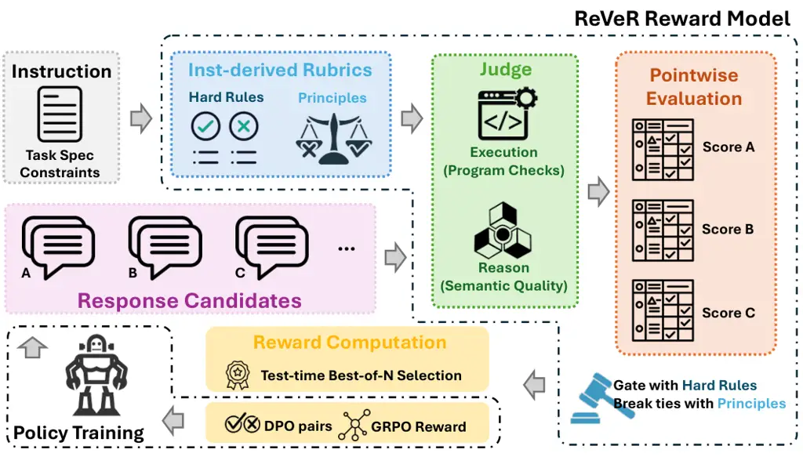

\tl_set:Ne\promptbox

promptbox

# Rubrics from the Task, Verdicts from Evidence: Pointwise Rubric Rewards with Tool-Augmented Judges

Tianci Liu¹  Haoyu Wang²  
¹University of Tennessee  ²University at Albany

###### Abstract

Rubric-based reward models (RMs) evaluate responses against explicit
criteria. However, existing methods often derive criteria from observed
response candidates, introducing response-induced bias that may limit
rubric generalizability. Their judges also struggle with mechanical
constraints when relying on reading alone, and commonly used pairwise
judges provide only relative preferences, complicating their direct use
for policy optimization. We propose ReVeR, a pointwise rubric RM that
derives hard rules and graded principles by reasoning about the
instruction alone and evaluates responses independently through
tool-augmented judging. Both components are trained through label-blind
distillation, in which preference labels only filter a teacher’s
outputs, yielding ReVeR-Traces, a large-scale dataset of
rubric-reasoning and judging trajectories. Experiments demonstrate that
ReVeR outperforms pairwise rubric RMs in average preference accuracy,
most clearly on instruction following, as well as in test-time scaling
and downstream policy optimization. We further find that generator RL
improves preference accuracy while reducing rubric fidelity, and that
higher preference accuracy does not necessarily translate into better
downstream policies. These findings highlight that rubric fidelity,
preference accuracy, and downstream utility are distinct properties,
shedding light on future RM research.

Keywords: Rubric Reward Model, Agent, RLHF

= Date: October 13, 2026

= Model Weights & Checkpoints:
[https://huggingface.co/OpenRubrics/ReVeR](https://huggingface.co/OpenRubrics/ReVeR)

= Datasets:
[https://huggingface.co/datasets/OpenRubrics/ReVeR-Traces-Rubric](https://huggingface.co/datasets/OpenRubrics/ReVeR-Traces-Rubric);  
= Datasets:
[https://huggingface.co/datasets/OpenRubrics/ReVeR-Traces-Judge](https://huggingface.co/datasets/OpenRubrics/ReVeR-Traces-Judge)

= Contact: [tliu43@utk.edu](mailto:tliu43@utk.edu);
[hwang28@albany.edu](mailto:hwang28@albany.edu)

## 1 Introduction

Rubric-based reward models (RMs) are attracting growing attention in LLM
post-training for non-verifiable tasks that lack a single correct
answer. On such tasks, traditional RMs that assign holistic scalar
scores (Christiano et al., 2017, Ouyang et al., 2022, Wang et al.,
2024a, Liu et al., 2026c) can be unreliable (Hashemi et al., 2024, Lee
et al., 2025). Rubric-based RMs instead evaluate LLM responses against a
set of explicit criteria before producing an overall evaluation (Gunjal
et al., 2025, Viswanathan et al., 2025, Liu et al., 2026b).

Typical rubric-based RMs consist of two components: a rubric generator
that proposes evaluation criteria for a given instruction, and a judge
that evaluates responses against them. To generate discriminative
rubrics, existing methods often rely on observed responses. For example,
Liu et al. (2026b), Xu et al. (2026c) first ask a teacher LLM to
contrast preferred and rejected responses and propose criteria that
distinguish them. A student rubric generator is then fine-tuned on the
resulting rubric dataset to predict criteria from the instruction alone.
Other approaches analyze multiple candidate responses of varying quality
to identify differences or common failure modes, then construct rubrics
to distinguish these responses (Viswanathan et al., 2025, Zhang et al.,
2025a). Once such a _response-induced_ rubric is generated, a judge
evaluates candidate responses against its criteria. To improve
reward-modeling performance, some methods employ pairwise judges that
compare two responses side by side and determine which better satisfies
the criteria (Liu et al., 2026b, Xu et al., 2026c).

Despite their effectiveness, existing rubric-based RMs face limitations
in both rubric construction and judging. First, response-induced rubric
construction may bias the resulting criteria toward the observed
candidates, potentially overlooking task requirements that all
candidates satisfy or violate. This bias may limit the generalizability
of the resulting rubrics to unseen responses. Moreover, a rubric
generator trained on such rubrics may inherit this bias even when it
generates criteria from the instruction alone at inference time. Second,
complex instructions may involve both mechanical constraints, such as
_word limits_, and subjective quality dimensions, such as _vividness of
language_. However, existing LLM-based judges often evaluate responses
by reading them alone. Consequently, even when a rubric correctly
identifies mechanical constraints, the judge may still struggle to
verify whether a response satisfies them (Zeng et al., 2024, Zhang et
al., 2024b). Furthermore, pairwise judges provide relative preferences
rather than independent scores for individual responses, complicating
their direct use as rewards in policy optimization.

In light of these limitations, we propose ReVeR, a pointwise rubric RM.
Instead of contrasting responses, our rubric generator derives
evaluation criteria by _reasoning_ about the instruction alone,
identifying the intended deliverable, explicit and implied requirements,
and potential failure modes. These criteria are organized into _hard
rules_ for mandatory requirements and _principles_ for graded quality
assessment. Moreover, ReVeR’s judge evaluates each response
independently under a shared, instruction-specific rubric and uses a
sandboxed Python interpreter to verify mechanical constraints while
relying on reasoning to assess semantic criteria. The final reward
prioritizes hard-rule satisfaction, using graded principle scores to
distinguish responses satisfying the same number of hard rules.

We train ReVeR through _label-blind distillation_ from a stronger
teacher LLM. Specifically, the teacher first generates rubric reasoning
from the instruction alone and judges the preferred and rejected
responses in separate episodes. Afterwards, the preference labels only
select the examples whose scores agree with them and never alter a
rubric or a judgment. The teacher thus generates its outputs using only
information available to the corresponding students at inference time.
This process yields _ReVeR-Traces_, a dataset containing 30K
rubric-reasoning traces and 61K tool-augmented judging trajectories. We
further train the rubric generator through a two-stage process,
consisting of supervised fine-tuning (ReVeR (SFT)) followed by
reinforcement learning (ReVeR (G-RL)).

With 4B models, ReVeR achieves higher average preference accuracy and
better overall downstream policy performance under DPO and GRPO than 8B
pairwise rubric RMs, most clearly on instruction following. Meanwhile,
our experiments reveal that these evaluation dimensions do not
necessarily align: generator RL improves preference accuracy while
reducing rubric fidelity, and under GRPO the most accurate pairwise
rubric RM yields a policy that asserts its own compliance and falls
below the base policy on IFEval. These findings highlight that rubric
fidelity, preference accuracy, and downstream utility are distinct
properties that should be evaluated separately. Our contributions are:

- •
  We present ReVeR, a 4B pointwise rubric RM that derives typed rubrics
  from the instruction alone and employs a tool-augmented judge.
- •
  We introduce ReVeR-Traces, a large and diverse dataset containing rich
  rubric-reasoning traces and judging trajectories, which is released
  along with our model checkpoints.
- •
  We show that ReVeR achieves higher average preference accuracy than
  pairwise rubric RMs, leading on every instruction-following benchmark,
  and achieves stronger average downstream performance under DPO and
  GRPO. We also reveal that rubric fidelity, preference accuracy, and
  downstream utility are distinct properties, shedding light on future
  RM research.

## 2 Related Work

|                  |           |          |           |          |         |
| ---------------- | --------- | -------- | --------- | -------- | ------- |
| (a) Systems      |           |          |           |          |         |
|                  | Rubric    | Verdict  |           |          | Judge   |
|                  | from task | point.   | per crit. | exec.    | trained |
| Rubric-RM / -ARM | ✗         | ✗        | ✗         | ✗        | ✓       |
| RUBRIC-ARROW     | ✗         | ✓        | ✓         | ✗        | ✓       |
| CE-RM            | ✓         | ✓        | ✗         | ✗        | ✓       |
| RLCF             | ✗         | ✓        | ✓         | $`\sim`$ | ✗       |
| RewardAgent      | $`\sim`$  | $`\sim`$ | $`\sim`$  | ✓        | ✗       |
| TIR-Judge        | ✗         | ✓        | ✗         | ✓        | ✓       |
| ReVeR            | ✓         | ✓        | ✓         | ✓        | ✓       |

|                        |           |        |        |          |       |       |
| ---------------------- | --------- | ------ | ------ | -------- | ----- | ----- |
| (b) Open training data |           |        |        |          |       |       |
|                        |           | Label- | Rubric | Judging  |       |       |
|                        | size      | blind  | reas.  | point.   | reas. | tools |
| OpenRubrics            | 74K       | ✗      | ✗      | ✗        | ✓     | ✗     |
| RUBRIC-ARROW           | 119K      | ✗      | ✗      | ✓        | ✓     | ✗     |
| WildChecklists         | 130K      | ✗      | ✗      | ✓        | ✗     | ✗     |
| RubricHub              | 110K      | ✗      | ✗      | –        | –     | –     |
| Feedback Coll.         | 100K      | ✗      | ✗      | ✓        | ✓     | ✗     |
| R3                     | 14K       | ✓      | ✗      | $`\sim`$ | ✓     | ✗     |
| ReVeR-Traces           | 30K + 61K | ✓      | ✓      | ✓        | ✓     | ✓     |

Table 1: ReVeR and ReVeR-Traces in context. (a) _From task_: criteria
are written from the instruction alone; _point._: each response is
judged on its own; _per crit._: one verdict per criterion; _exec._:
verdicts use executed code. (b) _Label-blind_: no preference label or
competing response is in context during annotation; _reas._: the
reasoning behind each rubric or verdict is recorded; _tools_: programs
and their outputs. $`\sim`$ in part; – not applicable.

#### Rubric and checklist rewards.

Rubrics and checklists decompose evaluation into explicit criteria (Liu
et al., 2023, Hashemi et al., 2024, Kim et al., 2025, Lin et al., 2025,
Arora et al., 2025, Starace et al., 2025). They serve as
reinforcement-learning rewards (Gunjal et al., 2025; RLCF, Viswanathan
et al., 2025), as supervision for rubric generators and
rubric-conditioned judges (Liu et al., 2026b), and as components
optimized jointly with the judge, pairwise in Xu et al. (2026c), and
pointwise in Jiang et al. (2026). Some criteria are written from the
instruction, either by a prompted model (Cook et al., 2024) or by a
trained reward model that gives each response one overall score (Hu et
al., 2026). Others are induced from observed responses, either from
preferred and rejected answers (Liu et al., 2026b, Xie et al., 2025, Liu
et al., 2026a) or from the failure modes of sampled candidates
(Viswanathan et al., 2025). In contrast, ReVeR derives its criteria from
the instruction by reasoning about the task, distills that reasoning
into a small generator, and returns one verdict per criterion for each
response.

#### Reasoning and tool-augmented judges.

LLM judges are prompted or trained to evaluate responses (Zheng et al.,
2023, Li et al., 2024a, Vu et al., 2024), and generative reward models
reason before giving a verdict (Zhang et al., 2024a, Chen et al., 2026,
Whitehouse et al., 2026). Some systems add evidence retrieved by search
(Wei et al., 2024), gathered by an agent (Zhuge et al., 2024), or
produced by executed code. RewardAgent routes instruction constraints to
a code-based verifier and combines its output with a preference model
(Peng et al., 2025), and TIR-Judge trains judges with tool-integrated
reinforcement learning (Xu et al., 2026b). ReVeR lets the judge decide
per criterion whether execution is needed and trains it by distillation
alone (Table 1a).

#### Open data for training evaluators.

Open resources for training rubric generators and judges differ in what
they record (Table 1b). OpenRubrics (Liu et al., 2026b) pairs
contrastively written rubrics with pairwise judge rationales, and
RUBRIC-ARROW with per-criterion labels for single responses.
WildChecklists (Viswanathan et al., 2025) holds checklists written from
sampled responses, and RubricHub (Li et al., 2026) holds rubrics written
from a reference response. Feedback Collection (Kim et al., 2023) and R3
(Anugraha et al., 2025) attach written feedback and distilled reasoning
to scored responses. ReVeR-Traces records the reasoning behind each
rubric and the tool-augmented trajectory behind each verdict, both
generated label-blind.

## 3 Method

We propose ReVeR, which evaluates a response by rubric generation,
tool-augmented verdicts, and fine-grained aggregation, as depicted in
Fig. 1.

### 3.1 Problem Formulation

Let $`x`$ be an instruction, including any context, and $`y`$ a
response. A rubric $`R=\{(c_{i},t_{i})\}_{i=1}^{k}`$ is a set of
natural-language criteria $`c_{i}`$, each typed as a _hard rule_ or a
_principle_. A generator $`G_{\theta}`$ writes reasoning $`z`$ and a
rubric; a judge $`J_{\phi}`$ with a Python interpreter produces a
trajectory $`\tau`$ that ends in one verdict per criterion; and an
aggregator $`S`$ maps the verdict scores $`q(\tau)=(s_{1},\dots,s_{k})`$
to a reward:

```math
\begin{gathered}(z,R)\sim G_{\theta}(\,\cdot\mid x),\quad\tau\sim J_{\phi}(\,\cdot\mid x,y,R),\\
r(x,y)=S\bigl(q(\tau);R\bigr).\end{gathered} \tag{1}
```

The conditioning sets in Eq. 1 determine two properties. _Prompt-level
rubrics_: $`R`$ depends only on $`x`$, so one rubric is generated per
prompt and shared by every response to it, and all candidates are
measured against the same criteria. _Pointwise verdicts_: $`\tau`$
depends only on $`(x,y,R)`$, so $`r(x,y)`$ is invariant to the other
responses under consideration and to the order in which they are
presented, which is known to bias LLM judges (Wang et al., 2024b, Shi et
al., 2025). A pairwise judge assigns no value to a single response
(Liusie et al., 2024, Liu et al., 2024b).

### 3.2 Task-Derived Rubric Generation

The generator conditions on the instruction alone and factorizes as
$`p_{\theta}(z,R\mid x)=p_{\theta}(z\mid x)\,p_{\theta}(R\mid x,z)`$,
reasoning about the task before writing criteria. The reasoning $`z`$
identifies the deliverable the user wants, the explicit requirements and
how binding each is, the expectations a competent reader infers from the
task, and the ways a response could fail while appearing relevant. Each
criterion is then typed. A hard rule is an explicit, non-negotiable
requirement whose violation makes a response unacceptable; a principle
is a quality dimension that a response satisfies to a degree. The type
fixes how a criterion is scored and prioritized (§3.3) and is
independent of how it is checked, so a hard rule can be decided by
reading.

The generator is asked to keep a criterion only if it follows from the
instruction or the task type, can be met by substantively different
high-quality responses, stays useful for unseen responses, captures a
condition of success or failure, and is not redundant (Appendix F). The
tests keep the rubric a statement about the task, so it encodes
functional requirements that every acceptable response meets, including
those that no pair of responses separates.



Figure 1: Overview of ReVeR.

### 3.3 Pointwise Tool-Augmented Judging

The judge scores one response per episode. An episode is a trajectory

```math
\tau=\bigl((u_{t},a_{t},o_{t})_{t=1}^{m-1},\;u_{m},\;v\bigr), \tag{2}
```

where $`u_{t}`$ is reasoning, $`a_{t}`$ is a Python program (Gao et al.,
2023, Chen et al., 2022, Yao et al., 2022), $`o_{t}=\Exec(a_{t})`$ is
its output or error, and $`v`$ is the final set of verdicts. A budget
$`B`$ bounds the number of executed programs, so $`m\leq B+1`$.

#### Evidence.

Whatever its type, a criterion is _mechanical_ if its truth is a
computable function of the response string: word, sentence, or paragraph
counts, prefix and case checks, forbidden terms, pattern matches, format
validity, and arithmetic. The verdict on a mechanical criterion is meant
to rest on an executed output $`o_{t}`$; the verdict on a _semantic_
criterion, such as relevance or reasoning quality, rests on the judge’s
reasoning over $`y`$. The judge decides which criteria need execution
and consolidates their checks into one program per step, and a verdict
may cite only an output that was returned.

#### Verdicts and aggregation.

The final message $`v`$ gives, for every criterion, an explanation and a
score: $`s_{i}\in\{0,1\}`$ for a hard rule, with insufficient evidence
scored as $`0`$, and an integer $`s_{i}\in\{0,\dots,100\}`$ for a
principle. With $`H`$ and $`P`$ the index sets of hard rules and
principles,

```math
S(q;R)=\sum_{i\in H}s_{i}+\frac{1}{101\,|P|}\sum_{j\in P}s_{j}. \tag{3}
```

The second term is $`0`$ for empty $`P`$ and at most
$`\tfrac{100}{101}`$, so $`S`$ is lexicographic. Under the same rubric,
a response that satisfies more hard rules scores higher whatever the
principle scores, and principles order only responses that satisfy the
same number of hard rules (Appendix A). We write $`S(x,y;R)`$ for the
score of $`y`$ under $`R`$, with a subscript naming the model whose
verdicts are aggregated. Teacher trajectories use $`B=1`$; inference
uses $`B=3`$, so that a failed program can be repaired (Appendix B).

Figure 2: ReVeR-Traces. Left: sources of the 30,310 retained preference
pairs. Right: (a) criteria per rubric and (b) share of hard rules, for
the rubrics shared by both subsets; (c) generated tokens per
rubric-reasoning trace and per judging trajectory; (d) model calls and
program execution in the judging trajectories (Appendix B).

### 3.4 Label-Blind Distillation

Both the generator and the judge must reason, and a small model acquires
that reasoning by imitating a stronger teacher $`\mathcal{T}`$ (Hinton
et al., 2015, Hsieh et al., 2023, Li et al., 2023). A target sequence
can be reproduced only from information in the student’s input. Rubric
reasoning written after reading $`(y^{+},y^{-})`$ is a sample from
$`\mathcal{T}(\,\cdot\mid x,y^{+},y^{-})`$, while the student models
$`p_{\theta}(z,R\mid x)`$. We therefore sample the teacher under the
students’ conditioning sets. Given a preference triple
$`d=(x,y^{+},y^{-})`$,

```math
(z,R)\sim\mathcal{T}(\,\cdot\mid x),\quad\tau^{\pm}\sim\mathcal{T}(\,\cdot\mid x,y^{\pm},R), \tag{4}
```

with the two responses judged in separate episodes under the same
rubric. The preference label is used once, after generation, in an
acceptance test:

```math
A(d)=\mathbf{1}\bigl[\mathrm{valid}(d)\bigr]\cdot\mathbf{1}\bigl[S_{\mathcal{T}}^{+}>S_{\mathcal{T}}^{-}\bigr], \tag{5}
```

where $`S_{\mathcal{T}}^{\pm}=S_{\mathcal{T}}(x,y^{\pm};R)`$ and
$`\mathrm{valid}(d)`$ holds when the rubric and both trajectories are
well-formed. We call the procedure _label-blind_ because neither the
preference label nor the competing response is in context when a rubric
or a trajectory is generated. Acceptance is rejection sampling from the
teacher’s own distributions. It selects which samples are kept and
leaves their content unchanged, so every retained sequence was generated
only from information the student has at inference.

Each accepted triple yields one generator example $`(x,z,R)`$ and two
judge examples $`(x,y^{\pm},R,\tau^{\pm})`$. Both students are trained
by maximum likelihood on the full target sequences: the generator on
$`(z,R)`$ given $`x`$, and the judge on its reasoning, programs, and
verdicts given $`(x,y,R)`$ and the preceding steps. The judge conditions
on program outputs and does not predict them.

### 3.5 ReVeR-Traces

ReVeR-Traces applies label-blind distillation to five preference
datasets: HelpSteer3 (Wang et al., 2025), UltraFeedback (Cui et al.,
2024), Skywork-Reward (Liu et al., 2024a), Magpie (Xu et al., 2024), and
IFEval-like instructions from OpenRubrics (Liu et al., 2026b); the
teacher is DeepSeek-V4-Flash (Xu et al., 2026a) at high reasoning
effort. Of 41,388 preference triples, 30,310 (73.2%) pass the acceptance
test, giving 30,310 rubric-reasoning traces and 60,620 judging
trajectories, two per retained pair (Fig. 2). Each triple is sampled
once, and 74.2% of the rejections are reversed preferences, 19.5% ties,
and 6.3% invalid outputs (Appendix B). Rubrics average 4.9 criteria, 56%
of them hard rules, and a program is called in 58.9% of the
trajectories. Generated label-blind, the teacher’s reasoning records how
it reached a judgment in place of a justification for a known outcome
(Turpin et al., 2023). We release both subsets with ReVeR (SFT), ReVeR
(G-RL), and the judging harness.

### 3.6 Generator Reinforcement Learning

Distillation teaches the generator to write rubrics as the teacher does.
We further optimize it for the judgments those rubrics produce. With the
judge $`J_{\phi}`$ fixed, the generator is trained on preference triples
to maximize

```math
\displaystyle\mathcal{J}(\theta) \displaystyle=\mathbb{E}_{d}\;\mathbb{E}_{(z,R)\sim G_{\theta}(\cdot\mid x)}\bigl[r_{G}(R;d)\bigr], \tag{6}
```

```math
\displaystyle r_{G}(R;d) \displaystyle=\mathbf{1}\bigl[\mathrm{valid}\bigr]\cdot\mathbf{1}\bigl[S_{\phi}^{+}>S_{\phi}^{-}\bigr],
```

where $`S_{\phi}^{\pm}=S_{\phi}(x,y^{\pm};R)`$ and validity requires a
well-formed rubric and two valid judgments, so tied and reversed scores
receive zero reward. We optimize $`\mathcal{J}`$ with GRPO (Shao et al., 2024) on HelpSteer2 (Wang et al., 2024c), starting from the distilled
generator. The preference enters as a reward on the generator’s output
and never as an input, so the rubric remains a function of the
instruction and the reward $`r(x,y)`$ remains pointwise. Eq. 6 optimizes
discrimination between two given responses, a target distinct from
fidelity to the task, and §4.3 measures both. ReVeR (SFT) denotes the
configuration with the distilled generator and ReVeR (G-RL) the
configuration with the RL-trained generator; the two share one judge.

## 4 Experiments

This section asks three questions: how accurately ReVeR ranks a
preferred response above a rejected one (§4.1), how well its reward
serves best-of-$`N`$ selection and policy training (§4.2), and how
closely its rubrics agree with expert rubrics (§4.3). We compare ReVeR
with the reasoning reward models RM-R1 (Chen et al., 2026), RRM (Guo et
al., 2026), and JudgeLRM (Chen et al., 2025), the rubric-based reward
models Rubric-RM, Rubric-ARM, CE-RM, and PaTaRM (Jian et al., 2026), and
the tool-augmented TIR-Judge. Baseline numbers are taken from the
original papers where reported and computed with the released models
otherwise. Appendices B and F give the training and evaluation details
and both prompts.

### 4.1 Reward-Model Benchmarks

|                                                          |             |      |          |         |          |               |       |             |      |            |       |      |
| -------------------------------------------------------- | ----------- | ---- | -------- | ------- | -------- | ------------- | ----- | ----------- | ---- | ---------- | ----- | ---- |
|                                                          | RewardBench |      | IF pairs |         | RM-Bench | RewardBench 2 |       | RubricBench |      | JudgeBench |       | Avg. |
|                                                          | Chat        | Hard | IFEval   | IFBench | Chat     | IF            | Focus | Chat        | IF   | Know.      | Reas. |      |
| Reasoning reward models                                  |             |      |          |         |          |               |       |             |      |            |       |      |
| JudgeLRM-7B                                              | 92.1        | 56.1 | 46.0     | 47.5    | 55.4     | 9.4           | 29.1  | 39.4        | 39.0 | 50.3       | 54.4  | 47.2 |
| RRM-7B                                                   | 77.7        | 69.5 | 51.0     | 53.2    | 59.9     | 10.0          | 60.4  | 46.1        | 41.5 | 61.4       | 54.4  | 53.2 |
| RRM-32B                                                  | 94.7        | 81.1 | 60.2     | 60.8    | 73.9     | 34.4          | 83.6  | 39.9        | 46.3 | 69.5       | 79.9  | 65.8 |
| RM-R1-7B (Qwen2.5-Inst)                                  | 83.0        | 70.0 | 55.2     | 55.2    | 64.2     | 20.6          | 76.2  | 43.9        | 44.7 | 59.4       | 58.4  | 57.3 |
| RM-R1-7B (DeepSeek-Dist)                                 | 85.3        | 67.3 | 51.0     | 56.5    | 62.2     | 13.8          | 55.4  | 46.1        | 48.0 | 58.1       | 49.7  | 53.9 |
| RM-R1-14B (Qwen2.5-Inst)                                 | 73.5        | 79.8 | 59.0     | 60.8    | 73.2     | 23.8          | 84.6  | 43.9        | 36.6 | 61.4       | 61.7  | 59.8 |
| RM-R1-14B (DeepSeek-Dist)                                | 90.3        | 78.9 | 61.2     | 59.0    | 71.4     | 30.6          | 79.0  | 40.6        | 44.7 | 66.6       | 74.5  | 63.3 |
| RM-R1-32B (Qwen2.5-Inst)                                 | 95.3        | 80.3 | 60.4     | 60.4    | 75.3     | 33.1          | 84.2  | 40.1        | 43.1 | 64.0       | 65.1  | 63.8 |
| RM-R1-32B (DeepSeek-Dist)                                | 95.3        | 83.1 | 63.2     | 58.6    | 74.2     | 36.9          | 79.2  | 40.6        | 48.0 | 66.6       | 75.8  | 65.6 |
| Rubric-based reward models                               |             |      |          |         |          |               |       |             |      |            |       |      |
| Rubric-RM-4B                                             | 89.6        | 72.0 | 68.2     | 60.4    | 64.8     | 36.2          | 83.8  | 49.6        | 52.8 | 55.5       | 54.4  | 62.5 |
| Rubric-RM-8B                                             | 88.2        | 74.1 | 67.0     | 65.4    | 65.7     | 34.4          | 82.2  | 47.7        | 53.7 | 62.2       | 62.6  | 63.9 |
| Rubric-ARM-8B                                            | 89.4        | 79.6 | 70.8     | 65.9    | 69.2     | 41.9          | 89.4  | 49.6        | 50.4 | 60.9       | 62.4  | 66.3 |
| CE-RM-4B                                                 | 82.8        | 80.5 | 61.2     | 56.9    | 69.1     | 38.8          | 84.2  | 45.6        | 46.3 | 61.7       | 76.5  | 64.0 |
| PaTaRM-8B                                                | 90.9        | 68.6 | 54.9     | 53.9    | 58.3     | 30.0          | 72.9  | 39.1        | 40.7 | 62.7       | 65.8  | 58.0 |
| Tool-augmented judges, models not released               |             |      |          |         |          |               |       |             |      |            |       |      |
| TIR-Judge-4B                                             | 79.7        | 66.5 | 78.9     | 65.8    | 61.8     | –             | –     | –           | –    | 60.8       | 71.7  | –    |
| TIR-Judge-8B                                             | 78.3        | 73.9 | 83.0     | 68.4    | 62.3     | –             | –     | –           | –    | 64.4       | 65.5  | –    |
| ReVeR protocol, 4B                                       |             |      |          |         |          |               |       |             |      |            |       |      |
| Qwen3.5-4B, untrained                                    | 75.3        | 71.4 | 70.7     | 61.9    | 51.4     | 27.7          | 63.0  | 48.8        | 51.5 | 51.3       | 53.5  | 57.0 |
| ReVeR (SFT)                                              | 81.0        | 76.1 | 81.4     | 73.8    | 65.9     | 51.5          | 75.3  | 52.7        | 61.0 | 59.3       | 71.6  | 68.1 |
| ReVeR (G-RL)                                             | 85.4        | 74.3 | 83.3     | 75.9    | 65.4     | 55.0          | 69.6  | 52.3        | 62.1 | 64.4       | 72.9  | 69.1 |
| References: five judgments per response, and the teacher |             |      |          |         |          |               |       |             |      |            |       |      |
| ReVeR (SFT), mj@5                                        | 85.8        | 82.9 | 87.6     | 77.5    | 67.3     | 53.8          | 80.0  | 55.1        | 65.0 | 65.9       | 87.2  | 73.5 |
| ReVeR (G-RL), mj@5                                       | 90.5        | 78.9 | 88.4     | 80.2    | 68.3     | 59.4          | 75.4  | 52.7        | 65.0 | 69.2       | 83.9  | 73.8 |
| DeepSeek-V4-Flash (teacher)                              | 82.5        | 81.5 | 82.2     | 73.4    | 69.2     | 53.1          | 74.7  | 53.9        | 66.7 | 69.2       | 81.9  | 71.7 |

Table 2: Preference accuracy (%) on reward-model benchmarks. Bold and
underline mark the best and second-best single-judgment results per
column, reference rows excluded. _IF pairs_: preference pairs built on
IFEval and IFBench. _Qwen3.5-4B, untrained_: the base model of ReVeR
under the same protocol. _mj@5_: each response is judged five times and
the mean scores are compared. Avg. is the mean over the eleven columns;
– is not reported.

On a preference pair, ReVeR scores the two responses in separate
episodes under one rubric and predicts the higher-scoring one; ties and
invalid judgments count as errors. Following Liu et al. (2026b) and Xu
et al. (2026c), Table 2 reports accuracy on subsets of RewardBench
(Lambert et al., 2025), RM-Bench (Liu et al., 2025), RewardBench 2
(Malik et al., 2026), RubricBench (Zhou et al., 2026), and JudgeBench
(Tan et al., 2025), and on IFEval and IFBench preference pairs.

#### What training on ReVeR-Traces contributes.

Under the same judging protocol, the untrained Qwen3.5-4B (Qwen Team,
2026), as both generator and judge, averages 57.0. ReVeR (SFT) reaches
68.1, 11.1 points higher and 3.6 below its teacher.

#### Comparison with other reward models.

ReVeR has the two highest averages among single-judgment reward models,
69.1 with ReVeR (G-RL) and 68.1 with ReVeR (SFT), ahead of Rubric-ARM-8B
(66.3) and of the 32B reasoning models RRM (65.8) and RM-R1 (65.6). It
leads on every instruction-following column and on RubricBench Chat:
83.3 on IFEval, 75.9 on IFBench, 55.0 on the instruction-following
subset of RewardBench 2, where the best other model reaches 41.9, and
52.7 and 62.1 on RubricBench, against 49.6 and 53.7. The 32B reasoning
models rank first on RewardBench, RM-Bench, and JudgeBench, with 95.3 on
RewardBench Chat against 85.4 for the better ReVeR configuration, and
Rubric-ARM ranks first on the Focus subset of RewardBench 2.

#### Generator RL and repeated judgments.

With the judge shared, ReVeR (G-RL) averages 1.0 point above ReVeR
(SFT). With five judgments per response, the two averages rise to 73.5
and 73.8, above the single judgment of the teacher (71.7).

### 4.2 Downstream Evaluation

#### Best-of-$`N`$ selection and test-time scaling.

For each prompt of IFEval (Zhou et al., 2023) and MulDimIF (Ye et al.,
2026), we sample sixteen candidates from a frozen Qwen2.5-7B-Instruct
(Yang et al., 2024), score each once under one rubric, and select the
best of $`N`$ (Snell et al., 2024). IFEval is the mean of its four
accuracies.

ReVeR selects better responses than every baseline at every $`N`$ (Fig.
3). At $`N=16`$ both configurations reach 85.1 on IFEval and 60.3 on
MulDimIF, 3.7 and 5.1 points above the strongest baseline and 9.8 and
11.1 points above a single sample. The oracle of Fig. 3 selects with
each benchmark’s own checker and bounds every selector; at $`N=16`$ it
gains 14.6 and 20.3 points over a single sample. ReVeR obtains 67% and
55% of that gain, and the strongest baseline 41% and 30%. With four
candidates, both configurations already exceed every baseline at
sixteen.

|                  |        |             |        |             |         |          |               |         |               |
| ---------------- | ------ | ----------- | ------ | ----------- | ------- | -------- | ------------- | ------- | ------------- |
| Reward           | IFEval |             |        |             | IFBench | MulDimIF | Arena-Hard    |         | Avg.          |
|                  | Strict |             | Loose  |             |         |          | Style Control | Vanilla |               |
|                  | Prompt | Instruction | Prompt | Instruction |         |          |               |         |               |
| Base policy      | 72.1   | 79.6        | 74.5   | 81.8        | 33.7    | 51.7     | 53.1          | 52.9    | 53.9          |
| DPO              |        |             |        |             |         |          |               |         |               |
|    Rubric-RM-8B  | 72.6   | 79.5        | 78.6   | 84.8        | 35.0    | 54.3     | 52.5          | 52.2    | 55.1 $`+`$1.2 |
|    Rubric-ARM-8B | 73.9   | 81.8        | 79.5   | 86.0        | 34.0    | 54.4     | 53.4          | 53.5    | 55.5 $`+`$1.6 |
|    ReVeR (SFT)   | 77.1   | 83.5        | 80.2   | 86.0        | 36.7    | 58.7     | 54.8          | 54.2    | 57.9 $`+`$4.0 |
|    ReVeR (G-RL)  | 76.7   | 83.3        | 81.9   | 87.2        | 36.4    | 56.5     | 54.0          | 54.6    | 57.4 $`+`$3.5 |
| GRPO             |        |             |        |             |         |          |               |         |               |
|    Rubric-RM-8B  | 75.0   | 81.8        | 78.6   | 84.7        | 34.0    | 51.3     | 54.0          | 56.0    | 55.1 $`+`$1.2 |
|    Rubric-ARM-8B | 63.4   | 73.9        | 75.4   | 82.5        | 35.4    | 39.3     | 55.6          | 62.0    | 51.8 $`-`$2.1 |
|    ReVeR (SFT)   | 76.0   | 82.7        | 79.7   | 85.9        | 34.0    | 58.7     | 52.5          | 52.5    | 56.6 $`+`$2.7 |
|    ReVeR (G-RL)  | 76.0   | 83.1        | 79.1   | 85.4        | 37.8    | 55.6     | 54.6          | 56.0    | 57.4 $`+`$3.5 |

Table 3: Policy optimization of Qwen2.5-7B-Instruct using different RMs.
Best results are in bold, and results below the base policy are in red.

#### Policy training.

We train policies from Qwen2.5-7B-Instruct under DPO (Rafailov et al., 2023) and under GRPO, each with one of four rewards: ReVeR (SFT), ReVeR
(G-RL), and the pairwise Rubric-RM-8B and Rubric-ARM-8B. For DPO, each
reward picks the best and the worst of eight sampled responses as a
preference pair; for GRPO, the ReVeR score of each rollout is its reward
(Appendix B). We evaluate every policy on IFEval, IFBench (Pyatkin et
al., 2026), MulDimIF, and Arena-Hard v1 (Li et al., 2024b) with and
without style control.

#### Preference optimization.

Under DPO, the best value in every column of Table 3 belongs to a policy
trained with ReVeR. The average rises from 53.9 for the base policy to
57.9 with ReVeR (SFT) and 57.4 with ReVeR (G-RL), against 55.1 with
Rubric-RM-8B and 55.5 with Rubric-ARM-8B. The margin of ReVeR (SFT) over
Rubric-ARM-8B is widest where compliance is checked strictly: 77.1
against 73.9 on prompt-level strict IFEval accuracy, and 58.7 against
54.4 on MulDimIF.

#### Online RL.

Under GRPO, ReVeR again reaches the two highest averages, 57.4 with
ReVeR (G-RL) and 56.6 with ReVeR (SFT), against 55.1 with Rubric-RM-8B
and 51.8 with Rubric-ARM-8B. It gives the best value in every
instruction-following column. ReVeR (G-RL) further improves Arena-Hard
performance, raising scores from 52.5 with ReVeR (SFT) to 54.6 and 56.0
under the style-controlled and vanilla settings, respectively.

We also find that, under GRPO with the Rubric-ARM-8B reward, preference
and compliance come apart. Its policy reaches 62.0 on Arena-Hard without
style control, 9.1 points above the base policy, and the gain shrinks to
2.5 points once style is controlled. At the same time, its IFEval
average falls to 73.8 and its MulDimIF accuracy to 39.3, below the base
policy’s 77.0 and 51.7, with prompt-level strict IFEval accuracy at 63.4
against 72.1. The policy has learned to certify its own compliance, a
pattern consistent with reward hacking (Amodei et al., 2016, Skalse et
al., 2022, Raina et al., 2024). Of its 541 IFEval responses, 133 end
with a summary or self-assessment and 56 of these explicitly claim
compliance, against 10 and 1 for the base policy, 17 and 1 with
Rubric-RM-8B, and at most 23 and 2 for the policies trained with ReVeR
(Appendix C). A judge without tools can check such a claim only by
reading the response; ReVeR settles a word limit from the count a
program returns (§3.3), which a claim of compliance cannot alter.

Figure 3: Best-of-$`N`$ selection from a frozen Qwen2.5-7B-Instruct.
Each selector picks one of $`n`$ sampled candidates per prompt; $`n=1`$
is the expected score of one sampled response (no selection), and Oracle
selects with the benchmark’s own checker (upper bound).

### 4.3 Semantic Matching against Expert Rubrics

|                                   |          |          |          |                       |          |          |
| --------------------------------- | -------- | -------- | -------- | --------------------- | -------- | -------- |
| (a) Agreement with expert rubrics |          |          |          |                       |          |          |
|                                   | Chat     |          |          | Instruction following |          |          |
|                                   | R        | P        | F1       | R                     | P        | F1       |
| Rubric-RM-8B                      | 28.9     | 20.3     | 22.8     | 43.8                  | 26.4     | 32.2     |
| Rubric-ARM-8B                     | 25.3     | 24.2     | 23.6     | 41.0                  | 31.9     | 34.9     |
| ReVeR (SFT)                       | 31.1     | 37.5     | 32.1     | 47.2                  | 48.3     | 46.3     |
| ReVeR (G-RL)                      | 27.4     | 29.3     | 27.0     | 39.2                  | 39.0     | 38.1     |
| G-RL $`-`$ SFT                    | $`-`$3.7 | $`-`$8.2 | $`-`$5.1 | $`-`$8.0              | $`-`$9.3 | $`-`$8.2 |

|                                     |           |           |      |           |                |      |          |
| ----------------------------------- | --------- | --------- | ---- | --------- | -------------- | ---- | -------- |
| (b) ReVeR rubrics by criterion type |           |           |      |           |                |      |          |
|                                     |           | Share (%) |      |           | Match rate (%) |      |          |
|                                     |           | SFT       | G-RL |           | SFT            | G-RL |          |
| Chat                                | Hard rule | 48.2      | 37.8 | $`-`$10.4 | 47.2           | 44.7 | $`-`$2.5 |
|                                     | Principle | 51.8      | 62.2 | $`+`$10.4 | 28.2           | 19.9 | $`-`$8.3 |
| Instr. following                    | Hard rule | 66.1      | 52.5 | $`-`$13.6 | 60.4           | 60.2 | $`-`$0.2 |
|                                     | Principle | 33.9      | 46.1 | $`+`$12.2 | 23.5           | 15.9 | $`-`$7.6 |

Table 4: Semantic matching on RubricBench. (a) Recall (R), precision
(P), and F1 (%) of generated rubrics against expert-written rubrics. (b)
Share of each criterion type in ReVeR’s rubrics and the rate at which
criteria of that type match an expert criterion, before and after
generator RL. Small gray numbers are changes from ReVeR (SFT). On
instruction following, the G-RL shares sum to 98.6% because the output
for one prompt carries no type.

RubricBench pairs each prompt with a rubric that experts derived from
the instruction alone, which makes it a reference for task-derived
rubrics. On its chat and instruction-following subsets, 419 and 123
prompts, we compare the rubrics of ReVeR (SFT) and ReVeR (G-RL) with
those of Rubric-RM-8B and Rubric-ARM-8B, sampling three rubrics per
prompt. The benchmark’s matcher decides whether each generated criterion
is semantically equivalent to an expert criterion, and we report recall,
precision, and F1 against the expert rubric; no judge is run (Appendix
D). The prompts that ReVeR’s generator and judge see as in-context
examples are excluded (Appendix F).

#### What distillation learns.

ReVeR (SFT) is closest to the expert rubrics on all six measures (Table
4a). Its F1 reaches 32.1 on chat and 46.3 on instruction following,
against 23.6 and 34.9 for Rubric-ARM-8B, the closer of the two
baselines. Most of the gain is in precision, 13.3 and 16.4 points above
Rubric-ARM-8B, while recall is 2.2 and 3.4 points above Rubric-RM-8B,
which has the higher recall of the two. Both baselines learn their
rubrics from contrasts between responses; ReVeR’s distilled generator,
which the pairs reach only through the acceptance test, comes closer
than either to the criteria that experts write.

#### What generator RL changes.

Once the pairs act as a reward, agreement falls on every measure, but
ReVeR (G-RL) remains above both baselines in precision and F1. Its
rubrics shift from hard rules to principles (Table 4b), with the share
of hard rules falling from 48.2% to 37.8% on chat and from 66.1% to
52.5% on instruction following. Precision falls because principles,
which match expert criteria less often than hard rules, become more
numerous and match less often than before, whereas hard rules match
almost as often as before. The fall in recall comes almost entirely from
hard rules (Appendix D). On instruction following, many of the expert
criteria that drop out are explicit, binary requirements such as writing
entirely in Spanish, and the principles that enter name generic
qualities such as accuracy.

#### Fidelity and utility.

Lower agreement with experts leaves preference accuracy almost
unchanged. On the same RubricBench prompts, ReVeR (G-RL) has a
preference accuracy of 52.3 on chat and 62.1 on instruction following,
against 52.7 and 61.0 for ReVeR (SFT) (Table 2). Eq. 6 gives a rubric no
reward when the two responses tie, and graded principles separate
responses that binary hard rules leave tied. RL therefore shifts rubrics
towards principles, and ties fall from 3.5% to 0.9% of pairs on chat and
from 4.1% to 1.4% on instruction following. Pairs decided by principles
are judged less accurately than pairs decided by hard rules, which
offsets the gain from fewer ties (Appendix D). Generator RL optimizes
discrimination between responses, and fidelity is a separate property
that preference benchmarks do not measure.

### 4.4 Case Study

|                                                                                                                                                                                                                                                                                |
| ------------------------------------------------------------------------------------------------------------------------------------------------------------------------------------------------------------------------------------------------------------------------------ |
| Instruction. … Which college would you recommend? … be sure the letter p appears at least 15 times in your response.                                                                                                                                                           |
| Responses. Both ask for the user’s preferences and name no college. A contains 16 p’s and B contains 13. Expert label: A.                                                                                                                                                      |
| Shared hard rule. ReVeR: “The response contains at least 15 occurrences of the lowercase letter ‘p’.” Rubric-ARM: “The response must contain at least 15 instances of the letter p.”                                                                                           |
| ReVeR judge, one program per response: response.count(’p’) returns 16 for A and 13 for B. Scores 3.10 and 2.00; it prefers A in 6 of 6 runs.                                                                                                                                   |
| Rubric-ARM judge, reading both responses. Order (A, B): “only Response B satisfies the crucial letter-p count gatekeeper.” Order (B, A): both “fail … the letter-p count gatekeeper” and B “at least reaches closer to 15 p’s.” It prefers B in both orders of 3 of 3 repeats. |

Figure 4: Case study on the tool-augmented judge. Given the same
criterion, ReVeR’s judge succeeds by running a program and Rubric-ARM’s
judge fails.

As an illustration, on the RubricBench prompt of Fig. 4, ReVeR and
Rubric-ARM write the same hard rule and prefer opposite responses.
ReVeR’s judge counts with a program and prefers Response A, which
satisfies the rule, in all six runs; Rubric-ARM’s pairwise judge reads
and prefers Response B in both presentation orders of all three repeats
(Appendix E).

## 5 Conclusion

We present ReVeR, a pointwise rubric RM, and ReVeR-Traces, a collection
of reasoning traces for rubric generation and tool-augmented judgment
trajectories. Its generator derives criteria by reasoning about the
task, its judge reaches each verdict from the response and from evidence
it executes, and both are trained by label-blind distillation. With 4B
models, ReVeR has the highest average preference accuracy on
reward-model benchmarks among single-judgment reward models, and it
improves on pairwise rubric rewards in agreement with expert rubrics,
best-of-$`N`$ selection, and policy optimization. We also find that
rubric fidelity, preference accuracy, and downstream utility are
distinct properties of a reward and have to be measured separately.

## Acknowledgements

This research is supported by the National Artificial Intelligence
Research Resource (NAIRR) Pilot (grant NAIRR260072) through the
CloudBank project.

## References

- Amodei et al. (2016) Dario Amodei, Chris Olah, Jacob Steinhardt, Paul
  Christiano, John Schulman, and Dan Mané. Concrete problems in AI
  safety. _arXiv preprint arXiv:1606.06565_, 2016.
- Anugraha et al. (2025) David Anugraha, Zilu Tang, Lester James V.
  Miranda, Hanyang Zhao, Mohammad Rifqi Farhansyah, Garry Kuwanto, Derry
  Wijaya, and Genta Indra Winata. R3: Robust rubric-agnostic reward
  models. _arXiv preprint arXiv:2505.13388_, 2025.
- Arora et al. (2025) Rahul K Arora, Jason Wei, Rebecca Soskin Hicks,
  Preston Bowman, Joaquin Quiñonero-Candela, Foivos Tsimpourlas, Michael
  Sharman, Meghan Shah, Andrea Vallone, Alex Beutel, et al. HealthBench:
  Evaluating large language models towards improved human health. _arXiv
  preprint arXiv:2505.08775_, 2025.
- Chen et al. (2025) Nuo Chen, Zhiyuan Hu, Qingyun Zou, Jiaying Wu, Qian
  Wang, Bryan Hooi, and Bingsheng He. JudgeLRM: Large reasoning models
  as a judge. _arXiv preprint arXiv:2504.00050_, 2025.
- Chen et al. (2022) Wenhu Chen, Xueguang Ma, Xinyi Wang, and William W
  Cohen. Program of thoughts prompting: Disentangling computation from
  reasoning for numerical reasoning tasks. _arXiv preprint
  arXiv:2211.12588_, 2022.
- Chen et al. (2026) Xiusi Chen, Gaotang Li, Ziqi Wang, Bowen Jin, Cheng
  Qian, Yu Wang, Hongru Wang, Yu Zhang, Denghui Zhang, Tong Zhang, et
  al. RM-R1: Reward modeling as reasoning. In _International Conference
  on Learning Representations_, volume 2026, pages 88313–88342, 2026.
- Christiano et al. (2017) Paul F Christiano, Jan Leike, Tom Brown,
  Miljan Martic, Shane Legg, and Dario Amodei. Deep reinforcement
  learning from human preferences. _Advances in neural information
  processing systems_, 30, 2017.
- Cook et al. (2024) Jonathan Cook, Tim Rocktäschel, Jakob Foerster,
  Dennis Aumiller, and Alex Wang. TICKing all the boxes: Generated
  checklists improve LLM evaluation and generation. _arXiv preprint
  arXiv:2410.03608_, 2024.
- Cui et al. (2024) Ganqu Cui, Lifan Yuan, Ning Ding, Guanming Yao,
  Bingxiang He, Wei Zhu, Yuan Ni, Guotong Xie, Ruobing Xie, Yankai Lin,
  Zhiyuan Liu, and Maosong Sun. UltraFeedback: Boosting language models
  with scaled AI feedback, 2024. URL
  [https://arxiv.org/abs/2310.01377](https://arxiv.org/abs/2310.01377).
- Ding et al. (2023) Ning Ding, Yulin Chen, Bokai Xu, Yujia Qin, Zhi
  Zheng, Shengding Hu, Zhiyuan Liu, Maosong Sun, and Bowen Zhou.
  Enhancing chat language models by scaling high-quality instructional
  conversations, 2023. URL
  [https://arxiv.org/abs/2305.14233](https://arxiv.org/abs/2305.14233).
- Gao et al. (2023) Luyu Gao, Aman Madaan, Shuyan Zhou, Uri Alon,
  Pengfei Liu, Yiming Yang, Jamie Callan, and Graham Neubig. PAL:
  Program-aided language models, 2023. URL
  [https://arxiv.org/abs/2211.10435](https://arxiv.org/abs/2211.10435).
- Gunjal et al. (2025) Anisha Gunjal, Anthony Wang, Elaine Lau, Vaskar
  Nath, Yunzhong He, Bing Liu, and Sean Hendryx. Rubrics as rewards:
  Reinforcement learning beyond verifiable domains. _arXiv preprint
  arXiv:2507.17746_, 2025. URL
  [https://arxiv.org/abs/2507.17746](https://arxiv.org/abs/2507.17746).
- Guo et al. (2026) Jiaxin Guo, Zewen Chi, Li Dong, Qingxiu Dong, Xun
  Wu, Shaohan Huang, and Furu Wei. Reward reasoning models. _Advances in
  Neural Information Processing Systems_, 38:150477–150510, 2026.
- Hashemi et al. (2024) Helia Hashemi, Jason Eisner, Corby Rosset,
  Benjamin Van Durme, and Chris Kedzie. LLM-Rubric: A multidimensional,
  calibrated approach to automated evaluation of natural language texts.
  In _Proceedings of the 62nd annual meeting of the association for
  computational linguistics (volume 1: Long papers)_, pages
  13806–13834, 2024.
- Hinton et al. (2015) Geoffrey Hinton, Oriol Vinyals, and Jeff Dean.
  Distilling the knowledge in a neural network. _arXiv preprint
  arXiv:1503.02531_, 2015.
- Hsieh et al. (2023) Cheng-Yu Hsieh, Chun-Liang Li, Chih-Kuan Yeh,
  Hootan Nakhost, Yasuhisa Fujii, Alex Ratner, Ranjay Krishna, Chen-Yu
  Lee, and Tomas Pfister. Distilling step-by-step! Outperforming larger
  language models with less training data and smaller model sizes. In
  _Findings of the association for computational linguistics: ACL 2023_,
  pages 8003–8017, 2023.
- Hu et al. (2026) Xinyu Hu, Yancheng He, Weixun Wang, Tao Feng, Li Lin,
  Jiashun Liu, Wenbo Su, Bo Zheng, and Xiaojun Wan. CE-RM: A pointwise
  generative reward model optimized via two-stage rollout and unified
  criteria. In _Findings of the Association for Computational
  Linguistics: ACL 2026_, pages 19629–19642, 2026.
- Jian et al. (2026) Ai Jian, Jingqing Ruan, Xing Ma, Dailin Li, Weipeng
  Zhang, Ke Zeng, and Xunliang Cai. PaTaRM: Bridging pairwise and
  pointwise signals via preference-aware task-adaptive reward modeling.
  In _Proceedings of the 64th Annual Meeting of the Association for
  Computational Linguistics (Volume 1: Long Papers)_, pages
  20240–20268, 2026.
- Jiang et al. (2026) Haoxiang Jiang, Zihan Dong, Tianci Liu, Wanying
  Wang, Ran Xu, Tony Yu, Linjun Zhang, and Haoyu Wang. RUBRIC-ARROW:
  Alternating pointwise rubric reward modeling for LLM post-training in
  non-verifiable domains. _arXiv preprint arXiv:2605.29156_, 2026.
- Kim et al. (2023) Seungone Kim, Jamin Shin, Yejin Cho, Joel Jang, S.
  Longpre, Hwaran Lee, Sangdoo Yun, Seongjin Shin, Sungdong Kim, James
  Thorne, and Minjoon Seo. Prometheus: Inducing fine-grained evaluation
  capability in language models. volume abs/2310.08491, 2023. URL
  [https://api.semanticscholar.org/CorpusID:265675839](https://api.semanticscholar.org/CorpusID:265675839).
- Kim et al. (2025) Seungone Kim, Juyoung Suk, Ji Yong Cho, Shayne
  Longpre, Chaeeun Kim, Dongkeun Yoon, Guijin Son, Yejin Cho, Sheikh
  Shafayat, Jinheon Baek, et al. The BiGGen Bench: A principled
  benchmark for fine-grained evaluation of language models with language
  models. In _Proceedings of the 2025 Conference of the Nations of the
  Americas Chapter of the Association for Computational Linguistics:
  Human Language Technologies (Volume 1: Long Papers)_, pages
  5877–5919, 2025.
- Lambert et al. (2025) Nathan Lambert, Valentina Pyatkin, Jacob Daniel
  Morrison, Lester James V. Miranda, Bill Yuchen Lin, Khyathi Raghavi
  Chandu, Nouha Dziri, Sachin Kumar, Tom Zick, Yejin Choi, Noah A.
  Smith, and Hanna Hajishirzi. Rewardbench: Evaluating reward models for
  language modeling. In _North American Chapter of the Association for
  Computational Linguistics_, 2025. URL
  [https://api.semanticscholar.org/CorpusID:278664751](https://api.semanticscholar.org/CorpusID:278664751).
- Lee et al. (2025) Yukyung Lee, Joonghoon Kim, Jaehee Kim, Hyowon Cho,
  Jaewook Kang, Pilsung Kang, and Najoung Kim. Checkeval: A reliable
  llm-as-a-judge framework for evaluating text generation using
  checklists. In _Proceedings of the 2025 Conference on Empirical
  Methods in Natural Language Processing_, pages 15782–15809, 2025.
- Li et al. (2024a) Junlong Li, Shichao Sun, Weizhe Yuan, Run-Ze Fan,
  Pengfei Liu, et al. Generative judge for evaluating alignment. In
  _International Conference on Learning Representations_, volume 2024,
  pages 27547–27574, 2024a.
- Li et al. (2023) Liunian Harold Li, Jack Hessel, Youngjae Yu, Xiang
  Ren, Kai-Wei Chang, and Yejin Choi. Symbolic chain-of-thought
  distillation: Small models can also “think” step-by-step. In
  _Proceedings of the 61st Annual Meeting of the Association for
  Computational Linguistics (Volume 1: Long Papers)_, pages
  2665–2679, 2023.
- Li et al. (2026) Sunzhu Li, Jiale Zhao, Miteto Wei, Huimin Ren, Yang
  Zhou, Jingwen Yang, Shunyu Liu, Kaike Zhang, and Wei Chen. RubricHub:
  A comprehensive and highly discriminative rubric dataset via automated
  coarse-to-fine generation. _arXiv preprint arXiv:2601.08430_, 2026.
- Li et al. (2024b) Tianle Li, Wei-Lin Chiang, Evan Frick, Lisa Dunlap,
  Tianhao Wu, Banghua Zhu, Joseph E. Gonzalez, and Ion Stoica. From
  crowdsourced data to high-quality benchmarks: Arena-Hard and
  BenchBuilder pipeline, 2024b. URL
  [https://arxiv.org/abs/2406.11939](https://arxiv.org/abs/2406.11939).
- Lin et al. (2025) Bill Yuchen Lin, Yuntian Deng, Khyathi Chandu,
  Abhilasha Ravichander, Valentina Pyatkin, Nouha Dziri, Ronan Le Bras,
  and Yejin Choi. WildBench: Benchmarking LLMs with challenging tasks
  from real users in the wild. In _International Conference on Learning
  Representations_, volume 2025, pages 47852–47870, 2025.
- Liu et al. (2024a) Chris Yuhao Liu, Liang Zeng, Jiacai Liu, Rui Yan,
  Jujie He, Chaojie Wang, Shuicheng Yan, Yang Liu, and Yahui Zhou.
  Skywork-Reward: Bag of tricks for reward modeling in LLMs, 2024a. URL
  [https://arxiv.org/abs/2410.18451](https://arxiv.org/abs/2410.18451).
- Liu et al. (2026a) Dengcan Liu, Fengkai Yang, Xiaohan Wang, Shurui
  Yan, Jiajun Chai, Jiahao Li, Yikun Ban, Zhendong Mao, Wei Lin, and
  Guojun Yin. CDRRM: Contrast-driven rubric generation for reliable and
  interpretable reward modeling. In _Proceedings of the 32nd ACM SIGKDD
  Conference on Knowledge Discovery and Data Mining V. 2_, pages
  3152–3163, 2026a.
- Liu et al. (2026b) Tianci Liu, Ran Xu, Tony Yu, Ilgee Hong, Carl Yang,
  Tuo Zhao, and Haoyu Wang. OpenRubrics: Towards scalable synthetic
  rubric generation for reward modeling and LLM alignment. In
  _Proceedings of the 64th Annual Meeting of the Association for
  Computational Linguistics (Volume 1: Long Papers)_, pages 17417–17437,
  San Diego, California, United States, July 2026b. Association for
  Computational Linguistics.
  [10.18653/v1/2026.acl-long.791](https://doi.org/10.18653/v1/2026.acl-long.791).
  URL
  [https://aclanthology.org/2026.acl-long.791/](https://aclanthology.org/2026.acl-long.791/).
- Liu et al. (2023) Yang Liu, Dan Iter, Yichong Xu, Shuohang Wang,
  Ruochen Xu, and Chenguang Zhu. G-Eval: NLG evaluation using GPT-4 with
  better human alignment. In _Proceedings of the 2023 conference on
  empirical methods in natural language processing_, pages
  2511–2522, 2023.
- Liu et al. (2025) Yantao Liu, Zijun Yao, Rui Min, Yixin Cao, Lei Hou,
  and Juanzi Li. RM-Bench: Benchmarking reward models of language models
  with subtlety and style. In _International Conference on Learning
  Representations_, volume 2025, pages 44323–44355, 2025.
- Liu et al. (2024b) Yinhong Liu, Han Zhou, Zhijiang Guo, Ehsan
  Shareghi, Ivan Vulić, Anna Korhonen, and Nigel Collier. Aligning with
  human judgement: The role of pairwise preference in large language
  model evaluators. _arXiv preprint arXiv:2403.16950_, 2024b.
- Liu et al. (2026c) Yuhao Liu, Liang Zeng, Yuzhen Xiao, Jujie He,
  Jiacai Liu, Chaojie Wang, Rui Yan, Wei Shen, Fuxiang Zhang, Jiacheng
  Xu, et al. Skywork-Reward-V2: Scaling preference data curation via
  human-AI synergy. In _International Conference on Learning
  Representations_, volume 2026, pages 133805–133838, 2026c.
- Liusie et al. (2024) Adian Liusie, Potsawee Manakul, and Mark Gales.
  LLM comparative assessment: Zero-shot NLG evaluation through pairwise
  comparisons using large language models. In _Proceedings of the 18th
  Conference of the European Chapter of the Association for
  Computational Linguistics (Volume 1: Long Papers)_, pages
  139–151, 2024.
- Malik et al. (2026) Saumya Malik, Valentina Pyatkin, Sander Land,
  Jacob Morrison, Noah Smith, Hanna Hajishirzi, and Nathan Lambert.
  RewardBench 2: Advancing reward model evaluation. In _International
  Conference on Learning Representations_, volume 2026, pages
  144839–144866, 2026.
- Ouyang et al. (2022) Long Ouyang, Jeffrey Wu, Xu Jiang, Diogo Almeida,
  Carroll Wainwright, Pamela Mishkin, Chong Zhang, Sandhini Agarwal,
  Katarina Slama, Alex Ray, et al. Training language models to follow
  instructions with human feedback. _Advances in neural information
  processing systems_, 35:27730–27744, 2022.
- Peng et al. (2025) Hao Peng, Yunjia Qi, Xiaozhi Wang, Zijun Yao, Bin
  Xu, Lei Hou, and Juanzi Li. Agentic reward modeling: Integrating human
  preferences with verifiable correctness signals for reliable reward
  systems. In _Proceedings of the 63rd Annual Meeting of the Association
  for Computational Linguistics (Volume 1: Long Papers)_, pages
  15934–15949, Vienna, Austria, July 2025. Association for Computational
  Linguistics.
  [10.18653/v1/2025.acl-long.775](https://doi.org/10.18653/v1/2025.acl-long.775).
  URL
  [https://aclanthology.org/2025.acl-long.775/](https://aclanthology.org/2025.acl-long.775/).
- Pyatkin et al. (2026) Valentina Pyatkin, Saumya Malik, Victoria Graf,
  Hamish Ivison, Shengyi Huang, Pradeep Dasigi, Nathan Lambert, and
  Hanna Hajishirzi. Generalizing verifiable instruction following.
  _Advances in Neural Information Processing Systems_, 38, 2026.
- Qwen Team (2026) Qwen Team. Qwen3.5: Towards native multimodal agents,
  February 2026. URL
  [https://qwen.ai/blog?id=qwen3.5](https://qwen.ai/blog?id=qwen3.5).
- Rafailov et al. (2023) Rafael Rafailov, Archit Sharma, Eric Mitchell,
  Christopher D Manning, Stefano Ermon, and Chelsea Finn. Direct
  preference optimization: Your language model is secretly a reward
  model. _Advances in neural information processing systems_,
  36:53728–53741, 2023.
- Raina et al. (2024) Vyas Raina, Adian Liusie, and Mark Gales. Is
  LLM-as-a-judge robust? Investigating universal adversarial attacks on
  zero-shot LLM assessment. In _Proceedings of the 2024 Conference on
  Empirical Methods in Natural Language Processing_, pages
  7499–7517, 2024.
- Shao et al. (2024) Zhihong Shao, Peiyi Wang, Qihao Zhu, Runxin Xu,
  Junxiao Song, Xiao Bi, Haowei Zhang, Mingchuan Zhang, YK Li, Yang Wu,
  et al. DeepSeekMath: Pushing the limits of mathematical reasoning in
  open language models. _arXiv preprint arXiv:2402.03300_, 2024.
- Shi et al. (2025) Lin Shi, Chiyu Ma, Wenhua Liang, Xingjian Diao,
  Weicheng Ma, and Soroush Vosoughi. Judging the judges: A systematic
  study of position bias in LLM-as-a-judge. In _Proceedings of the 14th
  International Joint Conference on Natural Language Processing and the
  4th Conference of the Asia-Pacific Chapter of the Association for
  Computational Linguistics_, pages 292–314, 2025.
- Skalse et al. (2022) Joar Skalse, Nikolaus Howe, Dmitrii
  Krasheninnikov, and David Krueger. Defining and characterizing reward
  gaming. _Advances in neural information processing systems_,
  35:9460–9471, 2022.
- Snell et al. (2024) Charlie Snell, Jaehoon Lee, Kelvin Xu, and Aviral
  Kumar. Scaling LLM test-time compute optimally can be more effective
  than scaling model parameters. _arXiv preprint
  arXiv:2408.03314_, 2024.
- Starace et al. (2025) Giulio Starace, Oliver Jaffe, Dane Sherburn,
  James Aung, Jun Shern Chan, Leon Maksin, Rachel Dias, Evan Mays,
  Benjamin Kinsella, Wyatt Thompson, et al. PaperBench: Evaluating AI’s
  ability to replicate AI research. _arXiv preprint
  arXiv:2504.01848_, 2025.
- Tan et al. (2025) Sijun Tan, Siyuan Zhuang, Kyle Montgomery, William
  Tang, Alejandro Cuadron, Chenguang Wang, Raluca Popa, and Ion Stoica.
  JudgeBench: A benchmark for evaluating LLM-based judges. In
  _International Conference on Learning Representations_, volume 2025,
  pages 63277–63303, 2025.
- Turpin et al. (2023) Miles Turpin, Julian Michael, Ethan Perez, and
  Samuel Bowman. Language models don’t always say what they think:
  Unfaithful explanations in chain-of-thought prompting. _Advances in
  Neural Information Processing Systems_, 36:74952–74965, 2023.
- Viswanathan et al. (2025) Vijay Viswanathan, Yanchao Sun, Shuang Ma,
  Xiang Kong, Meng Cao, Graham Neubig, and Tongshuang Wu. Checklists are
  better than reward models for aligning language models. In _Advances
  in Neural Information Processing Systems_, 2025. URL
  [https://arxiv.org/abs/2507.18624](https://arxiv.org/abs/2507.18624).
- Vu et al. (2024) Tu Vu, Kalpesh Krishna, Salaheddin Alzubi, Chris Tar,
  Manaal Faruqui, and Yun-Hsuan Sung. Foundational autoraters: Taming
  large language models for better automatic evaluation. In _Proceedings
  of the 2024 Conference on Empirical Methods in Natural Language
  Processing_, pages 17086–17105, 2024.
- Wang et al. (2024a) Haoxiang Wang, Wei Xiong, Tengyang Xie, Han Zhao,
  and Tong Zhang. Interpretable preferences via multi-objective reward
  modeling and mixture-of-experts. In _Findings of the Association for
  Computational Linguistics: EMNLP 2024_, pages 10582–10592, 2024a.
- Wang et al. (2024b) Peiyi Wang, Lei Li, Liang Chen, Zefan Cai, Dawei
  Zhu, Binghuai Lin, Yunbo Cao, Lingpeng Kong, Qi Liu, Tianyu Liu, et
  al. Large language models are not fair evaluators. In _Proceedings of
  the 62nd annual meeting of the association for computational
  linguistics (volume 1: Long papers)_, pages 9440–9450, 2024b.
- Wang et al. (2024c) Zhilin Wang, Yi Dong, Olivier Delalleau, Jiaqi
  Zeng, Gerald Shen, Daniel Egert, Jimmy J. Zhang, Makesh Narsimhan
  Sreedhar, and Oleksii Kuchaiev. HelpSteer2: Open-source dataset for
  training top-performing reward models, 2024c. URL
  [https://arxiv.org/abs/2406.08673](https://arxiv.org/abs/2406.08673).
- Wang et al. (2025) Zhilin Wang, Jiaqi Zeng, Olivier Delalleau,
  Hoo-Chang Shin, Felipe Soares, Alexander Bukharin, Ellie Evans, Yi
  Dong, and Oleksii Kuchaiev. HelpSteer3-Preference: Open
  human-annotated preference data across diverse tasks and
  languages, 2025. URL
  [https://arxiv.org/abs/2505.11475](https://arxiv.org/abs/2505.11475).
- Wei et al. (2024) Jerry Wei, Chengrun Yang, Xinying Song, Yifeng Lu,
  Nathan Hu, Jie Huang, Dustin Tran, Daiyi Peng, Ruibo Liu, Da Huang, et
  al. Long-form factuality in large language models. _Advances in Neural
  Information Processing Systems_, 37:80756–80827, 2024.
- Whitehouse et al. (2026) Chenxi Whitehouse, Tianlu Wang, Ping Yu, Xian
  Li, Jason E Weston, Ilia Kulikov, and Swarnadeep Saha. J1:
  Incentivizing thinking in LLM-as-a-judge via reinforcement learning.
  In _International Conference on Learning Representations_, volume
  2026, pages 10397–10420, 2026.
- Xie et al. (2025) Lipeng Xie, Sen Huang, Zhuo Zhang, An-Ni Zou,
  Yun-Peng Zhai, Dingchao Ren, Ke-Zun Zhang, Hao-Yuan Hu, Bo-Yin Liu,
  Hao-Ran Chen, Zhaoyang Liu, and Bo-Lin Ding. Auto-Rubric: Learning
  from implicit weights to explicit rubrics for reward modeling. 2025.
  URL
  [https://api.semanticscholar.org/CorpusID:285303608](https://api.semanticscholar.org/CorpusID:285303608).
- Xu et al. (2026a) Anyi Xu, Bangcai Lin, Bing Xue, Bingxuan Wang,
  Bingzheng Xu, Bochao Wu, Bowei Zhang, Chaofan Lin, Chen Dong, Chenchen
  Ling, et al. DeepSeek-V4: Towards highly efficient million-token
  context intelligence. _arXiv preprint arXiv:2606.19348_, 2026a.
- Xu et al. (2026b) Ran Xu, Jingjing Chen, Jiayu Ye, Yu Wu, Jun Yan,
  Carl Yang, and Hongkun Yu. Incentivizing agentic reasoning in LLM
  judges via tool-integrated reinforcement learning. In _International
  Conference on Learning Representations_, 2026b. URL
  [https://arxiv.org/abs/2510.23038](https://arxiv.org/abs/2510.23038).
- Xu et al. (2026c) Ran Xu, Tianci Liu, Zihan Dong, Tony Yu, Ilgee Hong,
  Carl Yang, Linjun Zhang, Tao Zhao, and Haoyu Wang. Alternating
  reinforcement learning for rubric-based reward modeling in
  non-verifiable LLM post-training. _arXiv preprint arXiv:2602.01511_,
  2026c.
- Xu et al. (2024) Zhangchen Xu, Fengqing Jiang, Luyao Niu, Yuntian
  Deng, Radha Poovendran, Yejin Choi, and Bill Yuchen Lin. Magpie:
  Alignment data synthesis from scratch by prompting aligned LLMs with
  nothing, 2024. URL
  [https://arxiv.org/abs/2406.08464](https://arxiv.org/abs/2406.08464).
- Yang et al. (2024) Qwen An Yang, Baosong Yang, Beichen Zhang, Binyuan
  Hui, Bo Zheng, Bo-Wen Yu, Cheng-Yuan Li, Dayiheng Liu, Fei Huang,
  Guanting Dong, Hao-Ran Wei, Huan Lin, Jian Yang, Jianhong Tu, Jianwei
  Zhang, Jian-Xin Yang, Jia-Xin Yang, Jing-Ren Zhou, Jun-Yang Lin, Kai
  Dang, Ke-Ming Lu, Ke-Qin Bao, Kexin Yang, Le Yu, Mei Li, Mingfeng Xue,
  Pei Zhang, Qin Zhu, Rui Men, Run-Ji Lin, Tianhao Li, Tingyu Xia,
  Xing-Zhang Ren, Xuan-Cheng Ren, Yang Fan, Yang Su, Yi-Chao Zhang,
  Yunyang Wan, Yuqi Liu, Zeyu Cui, Zhen-Ru Zhang, Zi-Han Qiu,
  Shanghaoran Quan, and Zekun Wang. Qwen2.5 technical report. _ArXiv_,
  abs/2412.15115, 2024. URL
  [https://api.semanticscholar.org/CorpusID:274859421](https://api.semanticscholar.org/CorpusID:274859421).
- Yao et al. (2022) Shunyu Yao, Jeffrey Zhao, Dian Yu, Nan Du, Izhak
  Shafran, Karthik Narasimhan, and Yuan Cao. ReAct: Synergizing
  reasoning and acting in language models. _arXiv preprint
  arXiv:2210.03629_, 2022.
- Ye et al. (2026) Junjie Ye, Caishuang Huang, Zhuohan Chen, Wenjie Fu,
  Chenyuan Yang, Leyi Yang, Yilong Wu, Peng Wang, Meng Zhou, Xiaolong
  Yang, et al. MulDimIF: A multi-dimensional constraint framework for
  evaluating and improving instruction following in large language
  models. In _Findings of the Association for Computational Linguistics:
  ACL 2026_, pages 2078–2104, 2026.
- Yu et al. (2026) Qiying Yu, Zheng Zhang, Ruofei Zhu, Yufeng Yuan,
  Xiaochen Zuo, Yu Yue, Weinan Dai, Tiantian Fan, Gaohong Liu, Lingjun
  Liu, et al. DAPO: An open-source LLM reinforcement learning system at
  scale. _Advances in Neural Information Processing Systems_,
  38:113222–113244, 2026.
- Zeng et al. (2024) Zhiyuan Zeng, Jiatong Yu, Tianyu Gao, Yu Meng,
  Tanya Goyal, and Danqi Chen. Evaluating large language models at
  evaluating instruction following. In _International Conference on
  Learning Representations_, volume 2024, pages 40193–40219, 2024.
- Zhang et al. (2025a) Junkai Zhang, Zihao Wang, Lin Gui, Swarnashree
  Mysore Sathyendra, Jaehwan Jeong, Victor Veitch, Wei Wang, Yunzhong
  He, Bing Liu, and Lifeng Jin. Chasing the tail: Effective rubric-based
  reward modeling for large language model post-training. _arXiv
  preprint arXiv:2509.21500_, 2025a.
- Zhang et al. (2025b) Kongcheng Zhang, Qi Yao, Shunyu Liu, Wenjian
  Zhang, Min Cen, Yang Zhou, Wenkai Fang, Yiru Zhao, Baisheng Lai, and
  Mingli Song. Replay failures as successes: Sample-efficient
  reinforcement learning for instruction following. _arXiv preprint
  arXiv:2512.23457_, 2025b.
- Zhang et al. (2024a) Lunjun Zhang, Arian Hosseini, Hritik Bansal,
  Mehran Kazemi, Aviral Kumar, and Rishabh Agarwal. Generative
  verifiers: Reward modeling as next-token prediction. In _The First
  Workshop on System-2 Reasoning at Scale, NeurIPS’24_, 2024a. URL
  [https://openreview.net/forum?id=aLgXy8A7k7](https://openreview.net/forum?id=aLgXy8A7k7).
- Zhang et al. (2024b) Xiang Zhang, Juntai Cao, and Chenyu You. Counting
  ability of large language models and impact of tokenization. _arXiv
  preprint arXiv:2410.19730_, 2024b.
- Zhao et al. (2024) Wenting Zhao, Xiang Ren, Jack Hessel, Claire
  Cardie, Yejin Choi, and Yuntian Deng. WildChat: 1M ChatGPT interaction
  logs in the wild, 2024. URL
  [https://arxiv.org/abs/2405.01470](https://arxiv.org/abs/2405.01470).
- Zheng et al. (2023) Lianmin Zheng, Wei-Lin Chiang, Ying Sheng, Siyuan
  Zhuang, Zhanghao Wu, Yonghao Zhuang, Zi Lin, Zhuohan Li, Dacheng Li,
  Eric Xing, et al. Judging LLM-as-a-judge with MT-Bench and Chatbot
  Arena. _Advances in neural information processing systems_,
  36:46595–46623, 2023.
- Zhou et al. (2023) Jeffrey Zhou, Tianjian Lu, Swaroop Mishra,
  Siddhartha Brahma, Sujoy Basu, Yi Luan, Denny Zhou, and Le Hou.
  Instruction-following evaluation for large language models. _arXiv
  preprint arXiv:2311.07911_, 2023.
- Zhou et al. (2026) Junyi Zhou, Qiyuan Zhang, Yufei Wang, Fuyuan Lyu,
  Yidong Ming, Can Xu, Qingfeng Sun, Kai Zheng, Peng Kang, Xue Liu, et
  al. RubricBench: Aligning model-generated rubrics with human
  standards. In _Proceedings of the 64th Annual Meeting of the
  Association for Computational Linguistics (Volume 1: Long Papers)_,
  pages 31179–31200, 2026.
- Zhuge et al. (2024) Mingchen Zhuge, Changsheng Zhao, Dylan Ashley,
  Wenyi Wang, Dmitrii Khizbullin, Yunyang Xiong, Zechun Liu, Ernie
  Chang, Raghuraman Krishnamoorthi, Yuandong Tian, et al.
  Agent-as-a-judge: Evaluate agents with agents. _arXiv preprint
  arXiv:2410.10934_, 2024.

## Appendix A Distribution of Principle Scores

Figure 5: Distribution of the principle scores assigned by the judge,
pooled over the reward-model benchmarks of Table 2, with rubrics from
(a) ReVeR (SFT) and (b) ReVeR (G-RL). Scores are integers from 0 to 100
and are shown in bins of 10; the last bin includes 100. Preferred and
rejected follow the ground-truth preference of each benchmark. Each
group is normalized separately, so its bars sum to 100%.

Fig. 5 shows the scores that the judge assigns to principles, pooled
over the reward-model benchmarks of Table 2: 17,823 scores under ReVeR
(SFT) rubrics and 24,620 under ReVeR (G-RL) rubrics.

#### The judge uses the whole scale.

The scores take more than 90 distinct values, and 1.5% (SFT) and 0.5%
(G-RL) of them equal 100.

#### The scores carry preference signal.

Responses that the benchmark prefers concentrate at the high end, with
47% (SFT) and 33% (G-RL) of their scores at 80 or above. Rejected
responses have a second mode at the bottom: 19% and 21% of their scores
are below 10, against 5% and 7% for preferred responses. The mean gap
between the two groups is 18.7 and 15.9 points.

#### Principles break ties.

The two distributions overlap: 28% and 19% of the scores given to
rejected responses are 80 or above. On the 41–42% of pairs whose
responses tie on hard rules, the principle average favours the preferred
response in 58–59%. This supports the aggregation of Eq. 3, which ranks
responses by hard rules first and uses the principle average to break
ties. On RubricBench, pairs decided by hard rules are also judged more
accurately than pairs decided by principles (Appendix D).

#### Generator RL.

G-RL rubrics contain more principles than SFT rubrics, 2.7 against 1.9
per response, and their principles receive lower scores, with a mean of
48.5 against 55.5.

## Appendix B Training and Evaluation Details

Table 5 lists the settings for distillation (§3.4), generator RL (§3.6),
and policy training (§4.2). Generator RL samples rubrics with thinking
enabled and uses the dynamic sampling of DAPO (Yu et al., 2026). For the
policy, DPO uses the sigmoid loss and adds the negative log-likelihood
of the preferred response with the weight given in the table, and GRPO
uses the DAPO loss and excludes overlong rollouts from the loss. Each
model is trained once and evaluated multiple times, and we report the
mean.

|                       |                     |                     |                     |                     |                     |
| --------------------- | ------------------- | ------------------- | ------------------- | ------------------- | ------------------- |
|                       | Distillation        |                     | Generator RL        | Policy              |                     |
|                       | Generator           | Judge               | GRPO                | DPO                 | GRPO                |
| Initial model         | Qwen3.5-4B          |                     | distilled generator | Qwen2.5-7B-Instruct |                     |
| Training examples     | 30,310              | 60,620              | 7,118               | 20,407 / 20,479     | 21,627              |
| Epochs                | 1                   | 1                   | 1                   | 1                   | 1                   |
| Learning rate         | $`8\times 10^{-6}`$ | $`8\times 10^{-6}`$ | $`1\times 10^{-6}`$ | $`8\times 10^{-7}`$ | $`1\times 10^{-6}`$ |
| GPUs                  | 8                   | 8                   | 5                   | 4                   | 5                   |
| Per-GPU batch         | 4                   | 4                   | 16                  | 4                   | 8                   |
| Accumulation steps    | 2                   | 2                   | 2                   | 4                   | 6                   |
| Batch per step        | 64                  | 64                  | 160                 | 64                  | 240                 |
| Length limit (tokens) | 16,384              | 16,384              | 4,096               | 8,192               | 2,048               |
| Prompts per step      | New A               | New A               | 32                  | New A               | 40                  |
| Rollouts per prompt   | New A               | New A               | 5                   | New A               | 6                   |
| Temperature           | New A               | New A               | 1.0                 | New A               | 1.0                 |
| Top-$`p`$             | New A               | New A               | 0.95                | New A               | 0.95                |
| Top-$`k`$             | New A               | New A               | 20                  | New A               | New A               |
| Presence penalty      | New A               | New A               | 1.5                 | New A               | New A               |
| Clip range            | New A               | New A               | 0.2                 | New A               | 0.2 / 0.28          |
| KL weight             | New A               | New A               | $`1\times 10^{-3}`$ | New A               | $`1\times 10^{-4}`$ |
| DPO $`\beta`$         | New A               | New A               | New A               | 0.1                 | New A               |
| NLL weight            | New A               | New A               | New A               | 0.2                 | New A               |

Table 5: Training settings. A batch counts packed sequences in
distillation, pairs in DPO, and rollouts in RL. The length limit applies
to the packed sequence in distillation and to the generated tokens in
RL. Distillation uses a cosine schedule with 5% warm-up; the other runs
use a constant learning rate. The two counts of DPO pairs are for ReVeR
(SFT) and ReVeR (G-RL), and a clip range $`a`$ / $`b`$ gives the lower
and the upper bound.

#### Judging protocol.

A response is scored with one rubric per prompt and one judging episode
with $`B=3`$. A program runs with a timeout of three seconds. A call
that fails can be repaired with a remaining call, which can also run a
follow-up check. Once the budget is spent, the judge is instructed to
complete its verdicts from the response, to name the missing result in
the explanations it affects, and never to claim a verification; a
required property without sufficient evidence counts as not satisfied
(Appendix F). A trajectory whose verdicts fail validation, which
requires exactly one in-range score per criterion, is resampled, and a
response left without valid verdicts receives no score. A response
without a valid judgment counts as an error on preference benchmarks, is
skipped in selection, and receives no reward in policy training. The
benchmark subsets of Table 2 follow the evaluations of Rubric-RM and
Rubric-ARM (Liu et al., 2026b, Xu et al., 2026c).

#### ReVeR-Traces records.

A rubric record pairs an instruction with the teacher’s reasoning and
typed rubric; a judging record adds one response, the complete
trajectory with programs and their outputs, and the per-criterion
explanations and scores. The median trace and trajectory run to 2.0K and
3.1K generated tokens (Fig. 2). A program fails, by an exception or a
timeout, in 17.2% of the trajectories, which is 29.1% of the program
calls. With $`B=1`$ the teacher cannot repair it, so these verdicts
follow the rule of the judging protocol, and the triple is retained only
if its scores still reproduce the preference. The IFEval-like
instructions are part of OpenRubrics (Liu et al., 2026b), make up 1,570
of the 30,310 retained triples, and share no prompt with the IFEval and
IFBench prompts used in evaluation.

#### Acceptance test.

The acceptance test of Eq. 5 is applied once to each triple. The teacher
writes one rubric and two trajectories, and nothing is resampled when
the scores disagree with the label. Of the 11,078 rejected triples,
74.2% reverse the preference, 19.5% tie, and 6.3% are invalid, so the
test mostly removes teacher judgments that contradict the human label.
Ties, in which the rubric and its verdicts do not separate the two
responses, are 5.2% of all triples. The test retains 67.9% of the
triples of HelpSteer3, 83.1% of UltraFeedback, 75.0% of Skywork-Reward,
71.2% of Magpie, and 77.2% of the IFEval-like instructions.

#### Baselines.

We compare with three groups of systems. _Reasoning reward models_
reason before giving a verdict: RM-R1, RRM, and JudgeLRM. _Rubric-based
reward models_ condition the verdict on generated criteria: Rubric-RM,
Rubric-ARM, CE-RM, and PaTaRM. _Tool-augmented judges_ are represented
by TIR-Judge. Two references show what training contributes: the
untrained Qwen3.5-4B under the same judging protocol, and the teacher,
DeepSeek-V4-Flash.

#### Best-of-$`N`$ selection.

We generate one rubric $`R`$ for $`x`$, score each of $`N`$ candidates
$`y_{1},\dots,y_{N}`$ from a frozen policy once, in its own episode, and
return the candidate with the highest valid score,
$`\hat{y}=\arg\max_{n}S_{\phi}(x,y_{n};R)`$. Selection costs one
generator call and $`N`$ judge episodes, each with at most three program
calls of three seconds.

#### Policy training data.

We train the policy, Qwen2.5-7B-Instruct, on HIR-16K (Zhang et al.,
2025b) with 4,998 open-ended chat prompts sampled from UltraChat (Ding
et al., 2023), UltraFeedback (Cui et al., 2024), and WildChat (Zhao et
al., 2024).

#### Preference optimization.

To train a policy with DPO, we build preference pairs from the policy’s
own samples. For each instruction we draw $`N=8`$ candidates, score each
twice, and average the normalized scores
$`\bar{S}=S/(|H|+\tfrac{100}{101})\in[0,1]`$. The highest-scoring
complete candidate becomes $`y^{+}`$ and the lowest-scoring candidate
$`y^{-}`$, and the pair is kept when
$`\bar{S}(y^{+})-\bar{S}(y^{-})>\delta`$, with $`\delta=0.05`$. For the
pairwise baselines, a bubble pass of pairwise comparisons selects the
best and the worst candidate.

#### Online reinforcement learning.

For GRPO, the rubric of each training prompt is generated once in
advance and the judge scores every rollout online; $`S_{\phi}(x,y;R)`$
is the rollout’s reward. Every rollout of a prompt is scored against the
same rubric, so the group-relative advantage compares rollouts on a
common scale. The pairwise baselines use the online reward of their
original work (Liu et al., 2026b, Xu et al., 2026c).

## Appendix C Behaviour of the Trained Policies

Table 6 counts surface behaviours in the responses of each policy of
§4.2 on IFEval (541 responses) and MulDimIF (1,200 responses).

|              |         |        |         |          |          |
| ------------ | ------- | ------ | ------- | -------- | -------- |
|              | IFEval  |        |         | MulDimIF |          |
|              | closing | claims | heading | claims   | caps (%) |
| Base policy  | 10      | 1      | 17      | 14       | 4        |
| DPO          |         |        |         |          |          |
| ReVeR (SFT)  | 15      | 2      | 20      | 17       | 10       |
| ReVeR (G-RL) | 16      | 0      | 21      | 24       | 7        |
| GRPO         |         |        |         |          |          |
| Rubric-RM    | 17      | 1      | 58      | 47       | 34       |
| Rubric-ARM   | 133     | 56     | 117     | 228      | 63       |
| ReVeR (SFT)  | 15      | 2      | 39      | 20       | 7        |
| ReVeR (G-RL) | 23      | 2      | 43      | 25       | 4        |

Table 6: Surface behaviours of the trained policies. IFEval, of 541
responses: those that end with a summary or self-assessment (closing),
those among them that explicitly claim compliance (claims), and those
whose first line is bold or a heading (heading). MulDimIF, of 1,200
responses: those that contain a compliance statement (claims), and the
failure rate on capitalization constraints (caps).

Policies trained with ReVeR end between 15 and 23 responses with a
summary or self-assessment and make at most 2 explicit claims of
compliance, against 10 and 1 for the base policy. The policy trained
with the Rubric-ARM reward under GRPO ends 133 responses this way, 56 of
them claiming compliance, opens 117 with a bold line or a heading,
states compliance in 228 MulDimIF responses, and fails 63% of the
capitalization constraints. It is the only policy that shows the pattern
at this scale. The loose IFEval criterion, which also tests a response
without its first line, without its last line, and without markdown
emphasis, restores 12.0 points of its prompt-level accuracy, which
locates the failures in what the policy adds around its answer. The
policy trained with the Rubric-RM reward under GRPO rarely certifies
itself, with 17 such endings and 1 explicit claim, and fails 34% of the
capitalization constraints.

## Appendix D Further Analysis of Generator RL

This appendix details how generator RL changes ReVeR’s rubrics (§4.3).
All statistics are computed on the chat (419 prompts, 2,504 expert
criteria) and instruction-following (IF; 123 prompts, 702 expert
criteria) subsets of RubricBench and average three sampled rubrics per
prompt. SFT and G-RL denote the generators of ReVeR (SFT) and ReVeR
(G-RL), and match rates pool over criteria. In Table 4a, recall is the
share of expert criteria matched by at least one generated criterion and
precision is the share of generated criteria that match an expert
criterion; both are averaged over prompts and over the three rubrics per
prompt.

#### Shape of the rubrics.

Table 7 shows that RL leaves the number of criteria nearly unchanged; a
criterion has about 21 words before and after. Almost every rubric now
contains a principle, and the reasoning that precedes the rubric is less
than half as long. These statistics, like the type shares of Table 4b,
do not depend on the matcher.

|                         |       |       |        |       |
| ----------------------- | ----- | ----- | ------ | ----- |
|                         | Chat  |       | IF     |       |
|                         | SFT   | G-RL  | SFT    | G-RL  |
| Criteria per rubric     | 4.65  | 5.00  | 5.60   | 5.47  |
| Without a principle (%) | 3.9   | 0.2   | –      | –     |
| Reasoning (characters)  | 7,826 | 3,571 | 10,190 | 4,332 |

Table 7: Shape of ReVeR’s rubrics before and after generator RL:
criteria per rubric, share of rubrics without a principle, and length of
the reasoning that precedes the rubric.

#### Decomposition of the precision drop.

Pooled over criteria, precision falls by 8.0 points on chat and 8.9 on
instruction following. Table 8 splits each drop into the shift in type
shares and the change in each type’s match rate. On chat the drop comes
mainly from principles that match expert criteria less often; on
instruction following it comes mainly from the shift towards principles.
The match rate of hard rules contributes less than one point on either
subset.

|      |              |                 |            |            |
| ---- | ------------ | --------------- | ---------- | ---------- |
|      |              | Contribution of |            |            |
|      | $`\Delta`$ P | shares          | hard rules | principles |
| Chat | $`-`$8.0     | $`-`$2.0        | $`-`$0.9   | $`-`$5.1   |
| IF   | $`-`$8.9     | $`-`$5.3        | $`-`$0.1   | $`-`$3.5   |

Table 8: Change in pooled precision from SFT to G-RL and its
decomposition into the shift in type shares and the change in the match
rate of each type.

#### Position within the rubric.

A rubric lists its hard rules first and its principles after them. On
chat, the first two criteria match expert criteria about as often after
RL as before, and the gap opens from the third criterion on (Table 9).
After RL the second criterion is a principle in 53% of rubrics, up from
36%. Hard rules in late positions also weaken: at the fourth position
their match rate falls from 47.7% to 34.3%.

|          |      |      |      |      |
| -------- | ---- | ---- | ---- | ---- |
| Position | 1    | 2    | 4    | 5    |
| SFT      | 46.9 | 43.6 | 33.2 | 28.3 |
| G-RL     | 45.3 | 40.0 | 18.8 | 15.3 |

Table 9: Match rate (%) of the criterion at each position of the rubric,
chat subset.

#### Coverage of expert criteria.

The drop in recall comes almost entirely from hard rules. A rubric
matches 0.21 fewer expert criteria with its hard rules on chat and 0.48
fewer on instruction following, and 0.06 and 0.04 fewer with its
principles; the additional principles do not restore the coverage. Table
10 reports coverage per prompt and the expert criteria that are stably
lost or gained. An expert criterion is stably lost if SFT covers it in
at least two of the three samples and G-RL in none, and stably gained in
the reverse case.

|                           |      |      |     |      |
| ------------------------- | ---- | ---- | --- | ---- |
|                           | Chat |      | IF  |      |
|                           | SFT  | G-RL | SFT | G-RL |
| Covered per prompt        | 1.9  | 1.6  | 2.7 | 2.2  |
| Prompts with no match (%) | 19.3 | 23.8 | 4.9 | 7.3  |
| Stably lost under G-RL    | 146  |      | 53  |      |
| Stably gained under G-RL  | 81   |      | 17  |      |

Table 10: Coverage of expert criteria before and after generator RL:
expert criteria covered per prompt, of about six, prompts on which no
criterion matches, and expert criteria stably lost or gained.

On instruction following, many of the lost criteria are explicit
requirements of the instruction that can be decided as true or false:

- •
  _Is the response written entirely in Spanish?_
- •
  _Is the response written entirely in capital letters without any
  lowercase or mixed-case words?_
- •
  _Is the final summary preceded by exactly six asterisk symbols
  (\*\*\*\*\*\*) as a separator?_
- •
  _Does the response use the 5-line AABBA format of a limerick?_

On chat, the lost criteria concern answering the question directly and
the structure of the answer:

- •
  _Does the response directly address the user’s intended question?_
- •
  _Does the response provide a clear step-by-step structure?_
- •
  _Does the response avoid inventing extensive, detailed biographical
  facts not implied by the input?_

The gained criteria ask for explanation:

- •
  _Does the response provide explanations or reasons that clarify
  ‘why’?_
- •
  _Does the response ask clarifying questions to understand the user’s
  intent, rather than providing only definitive interpretations?_

#### Generic criteria.

The criteria that RL adds describe general qualities, and the ones it
removes are constraints tied to the prompt. Table 11 lists the words
whose use changes most on chat. Criteria that carry an example, marked
by _e.g._ or _such as_, rise from 39% to 62% of principles and from 18%
to 34% of hard rules; a hard rule with an example matches an expert
criterion 37.5% of the time, against 48.4% without one. The share of a
criterion’s content words that also occur in the instruction falls from
27.6% to 24.1% for hard rules and from 10.0% to 7.7% for principles. By
topic, the match rate of criteria about tone, style, and clarity falls
from 33.7% to 19.9% and that of criteria about relevance from 32.7% to
19.8%, while criteria about length and quantity move from 42.3% to
38.9%.

|                        |     |      |                        |     |      |
| ---------------------- | --- | ---- | ---------------------- | --- | ---- |
| More frequent after RL |     |      | Less frequent after RL |     |      |
|                        | SFT | G-RL |                        | SFT | G-RL |
| accurately             | 1.9 | 7.2  | any                    | 9.6 | 3.8  |
| practical              | 1.4 | 4.3  | each                   | 7.1 | 4.3  |
| organized              | 1.2 | 3.9  | explicitly             | 4.8 | 1.6  |
| actionable             | 1.4 | 3.8  | directly               | 4.8 | 1.7  |
| coherently             | 0.4 | 2.7  | every                  | 1.2 | 0.2  |
| engaging               | 0.2 | 2.2  |                        |     |      |

Table 11: Share of criteria (%) that contain each word, chat subset.

#### Preference accuracy.

Table 12 gives the preference accuracy of the two configurations on the
same prompts and how pairs are decided. The reward of generator RL (Eq. 6) contains no term for agreement with expert rubrics: a rubric earns 1
when the preferred response scores strictly higher and 0 on a tie or a
reversal. Coverage and accuracy are related on instruction following,
where ReVeR (G-RL) is correct on 37.0% of the pairs whose rubric covers
no expert criterion, 63.6% with two covered, and 72.0% with three; on
chat, accuracy stays between 45% and 58% at every level of coverage. On
the 100 chat prompts where the F1 of G-RL is at least 15 points below
that of SFT, accuracy is 60.7 for ReVeR (G-RL) and 57.7 for ReVeR (SFT);
on the 39 such instruction-following prompts it is 55.6 and 59.8.

|                             |      |      |      |      |
| --------------------------- | ---- | ---- | ---- | ---- |
|                             | Chat |      | IF   |      |
|                             | SFT  | G-RL | SFT  | G-RL |
| Preference accuracy         | 52.7 | 52.3 | 61.0 | 62.1 |
| Ties (%)                    | 3.5  | 0.9  | 4.1  | 1.4  |
| Decided by hard rules (%)   | 39.9 | 38.2 | 60.4 | 54.5 |
| Decided by principles (%)   | 56.3 | 60.6 | 35.0 | 43.1 |
| Accuracy, hard rules decide | 59.1 | 58.5 | 75.8 | 77.1 |
| Accuracy, principles decide | 51.8 | 49.5 | 43.4 | 46.5 |

Table 12: Preference accuracy on RubricBench and the criteria that
decide each pair. A tie counts as an error.

#### An example.

Table 13 compares the rubrics that the two generators write for the chat
prompt _how to drink water_. The criteria of G-RL stay on topic; they
are more detailed and carry parenthetical examples, and the matcher does
not judge them equivalent to the expert criteria.

|                                                                          |                                  |                                                                                 |                                  |                                                                                             |
| ------------------------------------------------------------------------ | -------------------------------- | ------------------------------------------------------------------------------- | -------------------------------- | ------------------------------------------------------------------------------------------- |
| Expert criterion                                                         | SFT (2 hard rules, 3 principles) |                                                                                 | G-RL (1 hard rule, 5 principles) |                                                                                             |
| Has a clear step-by-step structure                                       | ✓                                | “presented in an organized, coherent manner that makes it easy … to follow”     | ✗                                | “sufficiently clear and organized to be followed without prior specialized knowledge”       |
| Gives appropriate health and safety cautions                             | ✓                                | “avoids recommendations that could reasonably cause harm”                       | ✓                                | “accounts for potential risks such as choking, aspiration, or dehydration”                  |
| Stays on the question, without unrelated content                         | ✓                                | “directly addresses the question … rather than providing unrelated information” | ✗                                | “provides a practical method or technique … rather than an unrelated topic”                 |
| Includes specific practical details                                      | ✗                                | –                                                                               | ✗                                | “includes actionable steps (e.g., posture, swallowing rhythm, breath control)”              |
| Reads the question as about healthy drinking habits, not the literal act | ✗                                | –                                                                               | ✗                                | “appropriately contextualizes the technique (e.g., casual hydration, emergency survival …)” |

Table 13: Expert criteria for the prompt _how to drink water_ and the
closest criterion in one sampled rubric from each generator. ✓ marks a
match. SFT matches three expert criteria and G-RL one.

## Appendix E Case Studies

This appendix gives two RubricBench prompts on which ReVeR and
Rubric-ARM reach opposite decisions. Instructions, responses, rubrics,
programs, and judge outputs are quoted verbatim, and \[…\] marks an
omission.

### E.1 A Case Decided by the Judge

This is the case of §4.4. The two rubrics contain the same hard rule on
the letter p, and the two judges apply it differently.

#### Instruction.

I’m interested in a college with open enrollment and a regional
accreditation. Which college would you recommend? Don’t include the
keywords “DuPage” and “Dade” in your response. Let’s make it a
constrained writing problem: be sure the letter p appears at least 15
times in your response.

#### Expert label.

Response A is better.

#### Response A.

> Choosing the perfect college is a very personal decision, and it’s
> great you’re prioritizing open enrollment and regional accreditation.
>
> To give you a helpful recommendation, I need a little more information
> about your preferences.
>
> For example, what are your academic interests? Are you looking for a
> primarily online program or a more traditional campus experience?
>
> Tell me more about what’s important to you in a college, and I can
> provide a more specific suggestion.
>
> Remember, finding the right fit is crucial for a positive and
> successful educational experience.

#### Response B.

> Choosing a college is a big decision! It’s great that you’re
> prioritizing open enrollment and regional accreditation, as those are
> important factors for a quality education.
>
> To give you the best recommendation, I need a little more information
> about your preferences.
>
> For example:
>
> \* \*\*What part of the country are you interested in?\*\*
>
> \* \*\*Are you looking for a two-year or four-year program?\*\*
>
> \* \*\*What are your academic interests?\*\*
>
> Once I have a better understanding of what you’re looking for, I can
> provide a more personalized suggestion.
>
> Remember, finding the right college is a process, so don’t be afraid
> to explore your options and ask lots of questions!
>
> Let me know if you have any other details you’d like to share. I’m
> here to help!

#### Expert rubric.

- •
  Does the response explicitly state that the recommended college has an
  “open enrollment” policy?
- •
  Does the response explicitly state that the recommended college has
  “regional accreditation”?
- •
  Does the response avoid including the words “DuPage” and “Dade”?
- •
  Does the response contain the letter ’p’ at least 15 times?
- •
  Does the response provide a specific, named college or university as a
  recommendation?
- •
  Is the response presented as a continuous paragraph without bullet
  points or lists?

#### Rubric of ReVeR (SFT).

1.  1.  The response recommends a specific named college that meets both the
        open enrollment and regional accreditation criteria. \[Hard Rule\]
2.  2.  The response does not contain the substring “dupage” or “dade”
        (case-insensitive). \[Hard Rule\]
3.  3.  The response contains at least 15 occurrences of the lowercase
        letter ’p’. \[Hard Rule\]
4.  4.  Any factual claims about the recommended college’s open enrollment
        status or regional accreditation are accurate according to publicly
        available information. \[Hard Rule\]
5.  5.  The response forms a coherent piece of writing that presents the
        recommendation, rather than consisting solely of characters inserted
        only to satisfy the letter count. \[Principle\]

#### Rubric of Rubric-ARM.

1.  1.  The response must recommend a college that offers open enrollment
        and regional accreditation. \[Hard Rule\]
2.  2.  The response must not include the keywords “DuPage” or “Dade”.
        \[Hard Rule\]
3.  3.  The response must contain at least 15 instances of the letter p.
        \[Hard Rule\]
4.  4.  The response should directly address the user’s request by providing
        relevant recommendations. \[Principle\]
5.  5.  The response should be organized in a clear and logical manner to
        enhance readability. \[Principle\]
6.  6.  The response should maintain a professional and courteous tone.
        \[Principle\]
7.  7.  The response should be concise and avoid unnecessary or irrelevant
        information. \[Principle\]

#### ReVeR judge.

The judge scores each response in its own episode and runs one program
per response. For Response A it writes:

response = """\<Response A\>"""

\# Check for "dupage" or "dade" (case-insensitive)

import re

dupage_match = re.search(r'dupage', response, re.IGNORECASE)

dade_match = re.search(r'dade', response, re.IGNORECASE)

print("Contains 'dupage':", dupage_match is not None)

print("Contains 'dade':", dade_match is not None)

\# Count lowercase 'p' occurrences

lowercase_p_count = response.count('p')

uppercase_P_count = len(re.findall(r'\[Pp\]', response))

print(f"Lowercase 'p' count: {lowercase_p_count}")

print(f"Total 'p'/'P' count: {uppercase_P_count}")

and the interpreter returns:

Contains 'dupage': False

Contains 'dade': False

Lowercase 'p' count: 16

Total 'p'/'P' count: 16

The same count on Response B returns 13. The scores on the five criteria
of the rubric are:

|                 |           |            |            |
| --------------- | --------- | ---------- | ---------- |
| Criterion       | Type      | Response A | Response B |
| 1               | hard rule | 0          | 0          |
| 2               | hard rule | 1          | 1          |
| 3               | hard rule | 1          | 0          |
| 4               | hard rule | 1          | 1          |
| 5               | principle | 10         | 0          |
| Aggregate score |           | 3.10       | 2.00       |

ReVeR prefers Response A and is correct in all six runs, three with each
generator.

#### Rubric-ARM judge.

The pairwise judge prefers Response B in both presentation orders of all
three repeats. Its output ends as follows in the original order:

> \[…\] ent —
>
> Aggregation Summary: Both responses fail the primary recommendation
> requirement, but only Response B satisfies the crucial letter-p count
> gatekeeper.
>
> Justification: Despite neither naming a college, Response B alone
> meets Criterion 3, making it the stronger compliance.
>
> Winner: Response B

and as follows in the swapped order, where its “Response A” is the
original Response B:

> \[…\] responses fail the critical recommendation requirement and the
> letter-p count gatekeeper. Between them, Response A at least reaches
> closer to 15 p’s.
>
> Justification: Although neither meets the key recommendation rule,
> Response A edges out Response B on the p-count requirement.
>
> Winner: Response A

### E.2 A Case Decided by the Rubric

Here the two rubrics ask for different things. The instruction leaves
out the interest rate, and the rubric of Rubric-ARM requires a product
of an annual amount and a number of years that the instruction does not
mention.

#### Instruction.

120000 for 30 year what will be the savings.

#### Expert label.

Response A is better.

#### Response A.

> I need more information to calculate the savings.
>
> Please tell me:
>
> \* \*\*What is the interest rate?\*\* This is crucial for calculating
> how much your money will grow over time.
>
> \* \*\*Is the interest compounded?\*\* If so, how often (e.g.,
> annually, monthly)? Compounding means earning interest on your
> interest, which significantly increases your savings over time.
>
> \* \*\*Are you making any additional contributions?\*\* If you’re
> adding more money to the savings regularly, it will impact the final
> amount.
>
> Once you provide these details, I can help you calculate your
> potential savings.

#### Response B.

> To calculate the savings after 30 years for an initial amount of
> \$120,000, we need to consider the interest rate and the type of
> account where the money is saved. For this example, let’s assume a
> conservative interest rate of 3% per year, compounded annually, in a
> savings account. Here’s how to calculate the future value:
>
> Future Value (FV) = Present Value (PV) \* (1 + Interest Rate) ^ Number
> of Years
>
> FV = \$120,000 \* (1 + 0.03) ^ 30
>
> FV = \$120,000 \* 1.03 ^ 30
>
> FV $`\approx`$ \$336,960.71
>
> So, after 30 years, the initial amount of \$120,000 would grow to
> approximately \$336,960.71, assuming a 3% annual interest rate
> compounded annually. This represents a total savings of \$216,960.71
> over the 30-year period.
>
> Please note that the actual savings may vary depending on the interest
> rate, compounding frequency, and any additional contributions or
> withdrawals made during the 30-year period.

#### Expert rubric.

- •
  Does the response avoid giving concrete calculations when key
  parameters (e.g., interest rate, compounding) are missing?
- •
  Does the response actively request missing information needed for
  accurate calculation?
- •
  Does the response acknowledge that the instruction is missing crucial
  information and either ask clarifying questions or present multiple,
  clearly stated scenarios?
- •
  Does the response explicitly identify which variables are missing from
  the prompt and are required to provide a definitive answer?

#### Rubric of ReVeR (SFT).

1.  1.  The response either requests the missing required parameters (e.g.,
        interest rate, contribution amount, compounding frequency) or
        explicitly states the assumptions made for the calculation. \[Hard
        Rule\]
2.  2.  Any numerical calculation included is mathematically correct given
        the stated assumptions. \[Hard Rule\]
3.  3.  When assumptions are made, the response explains the rationale for
        each assumption and acknowledges potential uncertainties (e.g.,
        varying interest rates, tax implications, withdrawals).
        \[Principle\]
4.  4.  When a projected amount is provided, it is accompanied by the
        calculation method or sufficient detail to allow the user to
        reproduce the result or understand its meaning. \[Principle\]

#### Rubric of Rubric-ARM.

1.  1.  The response must calculate the total savings by multiplying the
        given annual amount by the specified number of years. \[Hard Rule\]
2.  2.  The response should present the final numerical result clearly and
        unambiguously. \[Principle\]
3.  3.  The response should be concise and avoid unnecessary elaboration.
        \[Principle\]

#### ReVeR judge.

The figure in Response B is wrong:
$`120{,}000\times 1.03^{30}=291{,}271.50`$, not 336,960.71. The second
hard rule of ReVeR’s rubric covers this, and the judge scores it 0 for
Response B. ReVeR prefers Response A, with scores 2.99 and 1.54, and is
correct in all six runs.

#### Rubric-ARM judge.

The pairwise judge prefers Response B in both presentation orders of all
three repeats. Its output ends as follows in the original order:

> \[…\] by the years. Between them, neither fulfills Criterion 1, but
> Response B at least provides a clear numeric result.
>
> Justification: Although both fail the primary calculation requirement,
> Response B delivers a specific numerical outcome, whereas Response A
> offers no calculation.
>
> Winner: Response B

and as follows in the swapped order, where its “Response A” is the
original Response B:

> \[…\] essential multiplication requirement, but Response A at least
> supplies a numerical result (albeit incorrect), whereas Response B
> provides no calculation.
>
> Justification: Although neither fully meets the hard rule, Response A
> demonstrates an attempt at quantitative calculation.
>
> Winner: Response A

## Appendix F Prompts

The two boxes give the prompts of ReVeR in full. The generator prompt is
sent as a single user message, with {instruction} replaced by the
instruction; {context} is empty in all experiments. The teacher and the
generator use this prompt in distillation, in generator RL, and in every
evaluation. The judge prompt is the system message. Its user message is
a JSON object that holds the instruction, one response, and the numbered
criteria, and one tool, python, executes a program with a timeout of
three seconds. The box shows the prompt used at inference, with a budget
of three tool calls; the prompt of the teacher trajectories differs only
in this budget, which is one call (§3.3). The in-context examples of
both prompts are taken from RubricBench, and these prompts are excluded
from every RubricBench result we report.

\promptbox

Rubric generator prompt (user message)prompts/rubric_generator.txt

\promptbox

Judge prompt (system message)prompts/judge.txt
