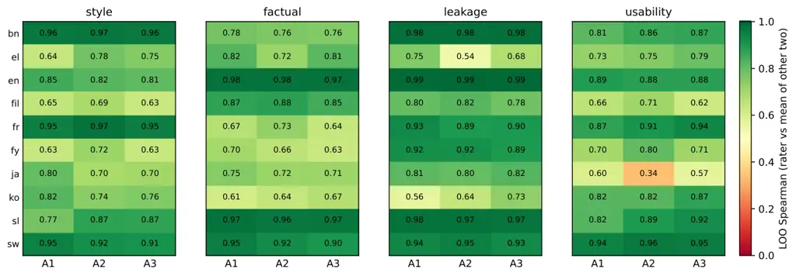
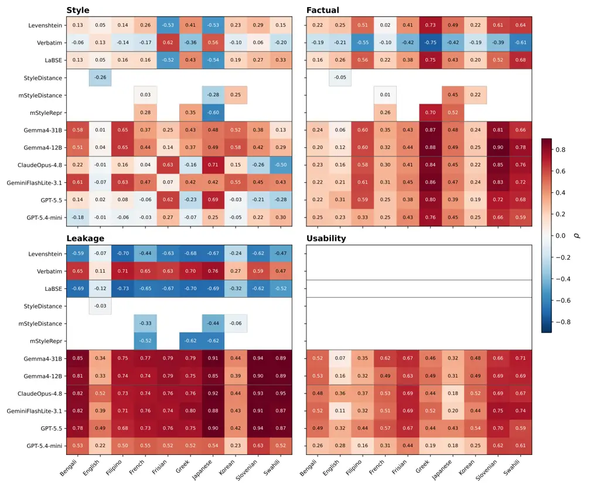
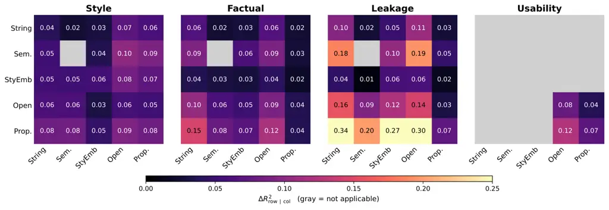
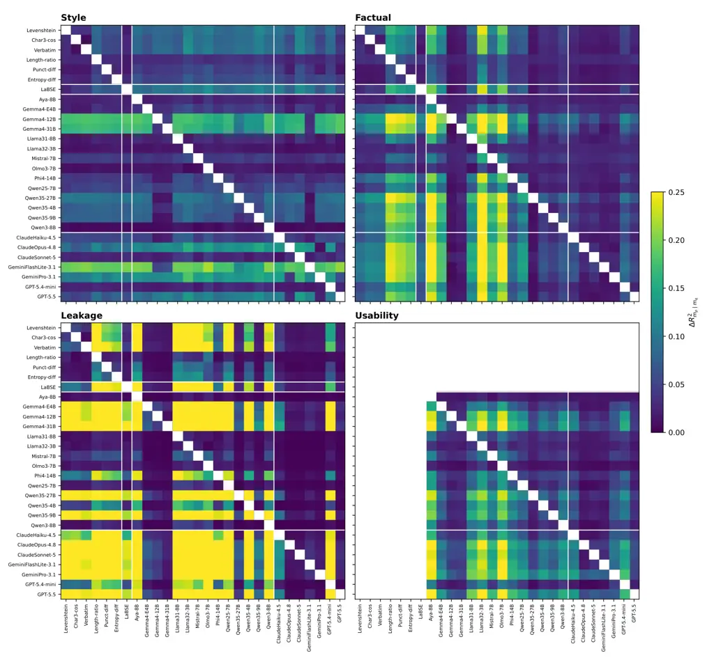
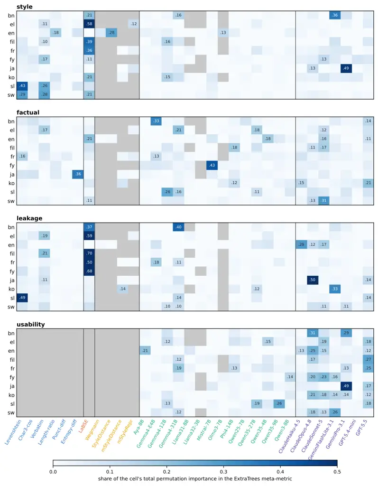

# Fantastic Metrics and How to Find Them: Meta-Evaluating Metrics for Multi-lingual Style-Personalized Generation

Anubhav Jangra Affiliation: Columbia University, USA
Email: [anubhav@cs.columbia.edu](mailto:)    Adrian de Wynter
Affiliation: The University of York, UK
Email: [adrian.dewynter@york.ac.uk](mailto:)

###### Abstract

Meta-evaluation of text generation metrics and LLM-judges is primarily
conducted using metric-human correlations. However, prior work has shown
that correlation is not an appropriate estimate of a metric’s evaluation
capability and can be unstable across evaluation settings, such as
different datasets or languages. Therefore, we propose a
regression-based meta-evaluation of metrics that learns on calibrated
metric outputs to predict human ratings. We ground this measurement
relative to a trivial constant-mean baseline and human agreements to
provide a comparable measure of metric capability across evaluation
settings. To test our meta-evaluation framework, we developed a
large-scale multi-lingual style-personalized text generation (SPTG)
benchmark, collecting multiple annotations across 10 topologically
diverse languages and four evaluation dimensions, each with varying
degrees of subjectivity. We meta-evaluated 32 metrics from three style
evaluation paradigms (string-based, embedding-based, and LLM-judges) and
their ensembles over these 40 evaluation settings. Our analysis revealed
that even simple string- and embedding-based measurements can match
strong LLM-judges when calibrated to human ratings. We also identified
characteristics of human annotations that determine metric performance,
as well as conditions under which a metric ensemble outperforms its
individual constituents. ¹¹ 1 Code and data is available at
[https://github.com/anubhav-jangra/multilingual-sptg-eval](https://github.com/anubhav-jangra/multilingual-sptg-eval).

|     |
| --- |
|     |

## 1 Introduction

Evaluating text generation often requires multiple human judgments for
inherently subjective qualities, where there is no single correct
answer (Plank, 2022; Amidei et al., 2019). As obtaining human
annotations is expensive and time-consuming, researchers rely on
automatic metrics to validate a system’s performance on subjective
generation tasks. In standard practice, these automatic metrics are
evaluated by comparing their agreement with human ratings, computed as
correlation coefficients. This is a widely adopted norm across several
tasks including summarization (Fabbri et al., 2021; Liu et al., 2023),
machine translation (Freitag et al., 2021), style transfer (Mir et al.,
2019; Briakou et al., 2021a; Ostheimer et al., 2024; Mukherjee et al., 2025) and LLM-as-judges (Chiang and Lee, 2023). However, correlation
gives a poor estimate of a metric’s utility for subjective assessments
due to three reasons: i) it assumes a consistent relationship between
metric and human scores, ii) it is sensitive to ties and label
skews (Deutsch et al., 2023), and iii) it does not have a reference
point for human agreement, making it incomparable across tasks,
annotators, and datasets. Prior work has shown that metric correlations
can be unstable and misleading (Novikova et al., 2017; Mathur et al.,
2020).

As an alternative to correlation-driven meta-evaluation of metrics, we
instead propose a regression-based meta-evaluation framework to overcome
the above-mentioned limitations. The proposed meta-evaluation approach
first calibrates each metric to the human rating scale, and then trains
a regressor to predict the human consensus from the metric’s output. The
quality of the metric is then determined by the trained regressor’s
performance on held-out data, anchored between a constant predictor and
the averaged agreement of human annotators. This anchored quality
estimate of the metric is comparable across evaluation settings, and
more interpretable than the metric-human correlations. We apply this
framework to style personalized text generation (Jangra et al., 2025), a
task that requires a model to rewrite a source text in the style of a
reference text. We selected this task as it captures several evaluation
dimensions with varying subjectivity (factual correctness of source text
vs. stylistic representation of reference text). As the metric behaviors
and annotation properties may vary across languages (Hada et al., 2024b;
Hada et al., 2024a; Kocmi et al., 2021), we conducted our study in 10
topologically diverse languages. We curated a large-scale multi-lingual
dataset for this task, collecting ratings from multiple native speakers
across the 10 languages along four evaluation dimensions, namely factual
accuracy, style accuracy, leakage and usability. We evaluated 32 metrics
across a broad spectrum of evaluation paradigms, including string-based
metrics, semantic embeddings, style embeddings, and LLM judges. Since
the meta-evaluation framework can accept several metrics as inputs, it
can evaluate learned combinations of metrics. Our systematic
investigation of metric ensembles extends prior work (Jangra et al., 2025) by identifying when and how they improve the evaluation quality
over constituent metrics.

Our analysis showed that simple correlation-based assessment hides
several indicators of metric quality. Across all four dimensions, the
correlation between LLM-judges and human annotations was significantly
higher than that of other evaluation measures. However, once calibrated
to human ratings, much simpler embeddings and string-based metrics were
able to capture style at least as well as the strongest LLM-judges. The
meta-evaluation across languages revealed the metric’s performance
depended on two properties of human annotations: the label skews and
annotator agreement. We also showed that metric ensembles improved the
most on the style dimension ($`{\sim}2\mathrm{x}`$ improvement over best
individual metric) where the constituent metrics were individually weak.
Our meta-evaluation revealed no single metric to uniformly perform well
across all languages or dimensions.

Our work makes three key contributions: 1) We proposed a
regression-based meta-evaluation framework to evaluate agreement of
evaluation metrics on subjective human annotations. 2) We curated a
large-scale style-personalized text generation dataset, spanning 10
typologically diverse languages annotated by multiple native speakers
across four evaluation dimensions. 3) We conducted an extensive
meta-evaluation study over 32 metrics over four evaluation paradigms,
including several metric ensembles to examine their performance across
different languages and evaluation dimensions.

## 2 Related Work

Meta-evaluation of metrics. Human evaluations are considered the
gold-standard in evaluating natural language generation
models (Celikyilmaz et al., 2020), and are typically validated with
their correlation with human ratings (Fabbri et al., 2021; Mir et al.,
2019; Chiang and Lee, 2023; Freitag et al., 2021). Correlation-based
meta-evaluation can be a poor estimate of a metric’s utility for
subjective human ratings due to their inconsistencies across
datasets Novikova et al. (2017), sensitivity to outliers (Mathur et al.,
2020), high uncertainty (Deutsch et al., 2021), and difficulty
processing ties in ranking-based correlations (Deutsch et al., 2023).
Gehrmann et al. (2023) conducted a meta-analysis of 66 language
generation papers and found that metrics behave differently across
datasets and systems, and that annotator disagreements can reflect
genuine task subjectivity rather than noise. They also noted that beyond
machine translation, metrics are seldom designed for languages other
than English. Our work builds on these limitations in our
meta-evaluation, which examines metric performance across four distinct
subjective evaluation dimensions across 10 languages, grounding it in
annotator agreement and reliability. Regression over human judgments has
been previously explored to train new metrics such as BLEURT (Sellam et
al., 2020) and COMET (Rei et al., 2020), or to combine features to learn
an ensemble of metrics (Albrecht and Hwa, 2007; Verga et al., 2024). In
contrast, we use regression as a means for meta-evaluation, scoring
calibrated metrics relative to a mean-label baseline and human
agreements.

Evaluating style in text generation. We evaluate our work on
style-personalized text generation (SPTG), a low-resource-constrained
text generation task in which a text generation model rewrites a source
text in the style of a reference style grounding (Jangra et al., 2025).
We selected this task because it represents a genuine real-world task in
personalized text generation (Salemi et al., 2024; Kumar et al., 2024)
and is inherently subjective. Style transfer has long relied on several
measurements to gauge the generation quality, from style strength,
content preservation, and fluency Krishna et al. (2020); Protasov et al.
(2026); Mukherjee et al. (2025); Protasov et al. (2026). As LLMs have
become more fluent, we instead focus on four evaluation dimensions -
style accuracy: does the generated output reflect the reference style,
factual accuracy: does it adhere to the original text, leakage: does it
introduce unnecessary content from the style reference, and usability:
is the generated output a useful rewrite of the original text. These
four evaluation dimensions collectively capture a wide spectrum of
subjective measures in text generation.

While most prior work in style transfer is limited to English (Jin et
al., 2022), several works have studied style transfer in multi-lingual
settings in specific settings such as formality (Krishna et al., 2022;
Briakou et al., 2021b) and detoxification (Dementieva et al., 2024).
Recent efforts have also developed multi-lingual style-aware
embeddings (Qiu et al., 2025; Kim et al., 2025), extending their
English-only predecessors (Wegmann et al., 2022; Patel et al., 2025).
Prior work includes multi-lingual meta-evaluation benchmarks for LLM
judges, such as MM-Eval (Son et al., 2024) and the Cross-Lingual Auto
Evaluation suite (Doddapaneni et al., 2025). These benchmarks among
other prior work (Hada et al., 2024b; Hada et al., 2024a) showed that
the agreement of LLM-judges with human ratings generally drop in
low-resource and non-Latin-script languages. However, these benchmarks
usually target general response quality or preference, which is usually
under-defined in text generation (Gehrmann et al., 2023). These works
also limit the analysis to just evaluating LLM-judges, often using
correlations or pairwise accuracy. To bridge this gap in prior work, we
curated a multi-lingual SPTG benchmark to meta-evaluate metrics on the
same task across 10 languages. We also evaluate three other metric
paradigms in addition to LLM-judges, showing that, once calibrated, even
simpler evaluation metrics can match LLM-judgments on state-of-the-art
reasoning models.

## 3 Problem Definition

Let an origin $`o`$ be a source content document and a reference $`r`$
be a set of exemplars characterizing a target style. Then a SPTG
generator is a model $`f:(o,r)\mapsto g`$ that produces a candidate
$`g`$ re-expressing the content of $`o`$ in the style of $`r`$. For each
language $`L\in\mathcal{L}`$ we are given an annotated corpus
$`\mathcal{C}_{L}\;=\;\bigl\{\,(x_{L,i},\,\mathbf{y}_{L,i})\,\bigr\}_{i=1}^{N_{L}}`$.
Each instance pairs a reference and an origin with the outputs of two
candidate generators $`f_{a},f_{b}\in\mathcal{F}`$,
$`x_{L,i}\;=\;\bigl(\,r_{L,i},\;o_{L,i},\;g^{a}_{L,i},g^{b}_{L,i})`$.
For each candidate $`g\in\{g^{a}_{L,i},g^{b}_{L,i}\}`$, multiple humans
judge the quality along a set of ordinal evaluation dimensions
$`e\in\mathcal{E}`$, obtaining the ordinal labels
$`y_{L,i}^{e,j}(g_{L,i})\in\{0,1,...,E_{e}\}`$ from annotators
$`j\in\{1,2,\cdots K\}`$. An automatic evaluation metric is a function
$`m:\;(r,o,g)\;\mapsto\;\mathbb{R},m\in\mathcal{M},`$ that returns a
scalar quality estimate for a generation $`g`$ given its reference and
origin. The goal is to find a meta-evaluation functional $`\Psi`$ that
scores how well a metric captures a human evaluation dimension and is
comparable across different metrics and languages. Ideally, this
meta-evaluation measure must capture how well a metric m reproduces the
human assessment of a generator $`f`$’s outputs on dimension $`e`$ for a
language $`L`$ ($`\mathbf{\Psi}^{(e)}_{L}\!\left(m\,;\,f\right)`$).
Additionally, it should help quantify how much of a human construct
$`m_{p}`$ recovers that $`m_{q}`$ misses in language $`L`$
($`\Psi^{(e)}_{L}\!\left(m_{p}\right)-\Psi^{(e)}_{L}\!\left(m_{q}\right)`$).

## 4 Multi-lingual SPTG Dataset Curation

The development of our multilingual style-personalized text generation
benchmark comprised two stages. First, we translated and corrected the
English source texts $`(r,o)`$ to obtain their corresponding versions in
the target languages. Second, these multilingual source texts were used
to generate candidate paraphrases, which were subsequently annotated on
several evaluation dimensions to construct the final corpus. We describe
these two stages in detail in the following subsections.

### 4.1 From English corpus to Multi-lingual corpora

We started with 1,002 pairs of long-form English text comprising an
origin text $`o`$ that is to be re-expressed in the style of a reference
text $`r`$. The reference text was obtained from two domains, Reddit
r/ShortStories²² 2
[https://www.kaggle.com/datasets/trevordu/reddit-short-stories](https://www.kaggle.com/datasets/trevordu/reddit-short-stories)
and Amazon product reviews for Digital Music and Subscription Boxes (Hou
et al., 2026), whereas the origin text spanned Reddit r/ShortStories,
Wikipedia, IMDB, CNN/DailyMail, and Amazon reviews for a diverse content
range (refer to Table 3). Using this English corpus as the basis for our
multi-lingual SPTG benchmark, we first machine-translated the reference
and source texts into the 36 target locales, and then conducted a
human-correction study to improve the quality of the translations.
Across the 36 locales, native annotators edited the machine translation
of most items (typically 80–99% of the 1,502 items per locale; Table 4).
For brevity, provide additional details about the translation study in
Appendix B.

|                |       |       |       |                    |            |                        |            |                        |            |                          |            |
| -------------- | ----- | ----- | ----- | ------------------ | ---------- | ---------------------- | ---------- | ---------------------- | ---------- | ------------------------ | ---------- |
|                | Split |       |       | Style $`\uparrow`$ |            | Factual $`\downarrow`$ |            | Leakage $`\downarrow`$ |            | Usability $`\downarrow`$ |            |
| Language       | Train | Dev   | Test  | mean (sd)          | $`\alpha`$ | mean (sd)              | $`\alpha`$ | mean (sd)              | $`\alpha`$ | mean (sd)                | $`\alpha`$ |
| Bengali (bn)   | 801   | 101   | 100   | 1.24 (1.25)        | 0.95       | 0.06 (0.36)            | 0.78       | 0.45 (0.83)            | 0.98       | 2.02 (1.33)              | 0.82       |
| English (en)   | 798   | 101   | 103   | 1.52 (0.82)        | 0.78       | 0.23 (0.71)            | 0.98       | 0.19 (0.53)            | 0.99       | 2.75 (0.99)              | 0.84       |
| Filipino (fil) | 802   | 101   | 99    | 1.16 (1.37)        | 0.58       | 1.51 (1.88)            | 0.85       | 0.50 (0.86)            | 0.80       | 2.81 (1.42)              | 0.58       |
| French (fr)    | 802   | 100   | 100   | 1.17 (1.10)        | 0.95       | 0.16 (0.59)            | 0.68       | 0.54 (0.88)            | 0.89       | 2.81 (1.15)              | 0.87       |
| Frisian (fy)   | 814   | 102   | 102   | 2.28 (1.35)        | 0.63       | 0.40 (1.13)            | 0.68       | 0.38 (0.78)            | 0.91       | 2.32 (1.31)              | 0.71       |
| Greek (el)     | 802   | 100   | 100   | 1.03 (1.09)        | 0.63       | 1.09 (1.73)            | 0.74       | 0.55 (0.87)            | 0.59       | 2.77 (1.10)              | 0.73       |
| Japanese (ja)  | 803   | 100   | 101   | 1.30 (1.65)        | 0.66       | 0.66 (1.42)            | 0.69       | 0.35 (0.73)            | 0.78       | 3.31 (1.33)              | 0.39       |
| Korean (jo)    | 802   | 101   | 99    | 1.48 (1.35)        | 0.71       | 0.07 (0.42)            | 0.65       | 0.16 (0.54)            | 0.62       | 2.34 (1.47)              | 0.79       |
| Slovenian (sl) | 801   | 100   | 101   | 1.73 (1.55)        | 0.80       | 0.85 (1.63)            | 0.97       | 0.42 (0.81)            | 0.98       | 2.16 (1.61)              | 0.86       |
| Swahili (sw)   | 801   | 100   | 101   | 2.42 (1.22)        | 0.90       | 0.75 (1.42)            | 0.91       | 0.34 (0.72)            | 0.92       | 1.45 (1.45)              | 0.94       |
| Overall        | 8,026 | 1,006 | 1,006 | 1.53 (1.37)        | 0.76       | 0.58 (1.33)            | 0.79       | 0.39 (0.78)            | 0.85       | 2.47 (1.42)              | 0.75       |

Table 1: Dataset and annotation statistics for the curated multi-lingual
style personalized text generation benchmark. For each evaluation
dimension, we provide the aggregate human label mean (standard
deviation), and the ordinal Krippendorff $`\alpha`$. The arrows indicate
the direction for improved generation quality in each dimension. The
final row provides an aggregate across all ten languages.

### 4.2 Style Personalized Text for Individual Language corpus

Given the localized reference (style exemplars; $`r`$) and origin
(content; $`o`$) for each instance, we generate two candidate
paraphrases that re-express the origin content in the grounding style,
each accompanied by a free-text rationale. The generation models ($`f`$)
are drawn from a nine different models to avoid model-specific biases
from any single system ³³ 3 The candidate generation models included
dev-gpt-4o-11-20, dev-gpt-45-preview, gpt-41-longco-2025-04-14,
gpt-5-mini, gpt-51-2025-11-13, gpt-oss-120b, anthropic-claude-opus-4-1,
Phi-4 and Qwen-2.5-VL-7B. The researchers inspected the quality of
generations from different models to select only the models that
generated coherent outputs for each language, and for some instances,
the same model was used to generate both paraphrases as well.. Obtaining
two valid generations per instance enabled us to conduct our SPTG
annotation study. For each instance in a language corpus, each candidate
paraphrase was independently rated by three human annotators along four
ordinal dimensions: stylistic accuracy ($`0`$–$`4`$; higher $`=`$ better
stylistic alignment with reference), factual accuracy ($`0`$–$`4`$;
higher $`=`$ more hallucination), leakage ($`0`$–$`2`$; higher $`=`$
more information leaked from the reference), and usability ($`0`$–$`4`$;
higher $`=`$ less usable). Factual accuracy captures content
hallucination not present in the generation input $`(o,r)`$, whereas
leakage captures the undesirable content introduced in the generation
from the style reference $`r`$. Besides the paraphrase-level
annotations, each rater additionally annotated their pairwise preference
between the two outputs (paraphrase-a, paraphrase-b, neither or both).
Since the annotations for this second phase required much more effort
than the translation correction study, we limited the annotations to 10
languages. We leave further investigation into the other languages to
future work.

We provide the annotation statistics for all languages in Table 1,
including the distribution of human labels for the ordinal dimensions as
well as the inter-annotator agreements. We observe a clear distinction
in the annotations based on the subjectivity of the evaluation
dimension. The aggregate values of objective dimensions concentrate on
the positive end, with factual ratings ranging from $`0.58\pm 1.33`$ and
leakage at $`0.39\pm 0.78`$. On the contrary, the subjective dimension
annotations are much more spread out on the ordinal scale, with style
scores at $`1.53\pm 1.37`$ and usability at $`2.47\pm 1.42`$.
Inter-annotator reliability (evaluated as the mean ordinal
Krippendorff’s $`\alpha`$ over languages) is substantial across
dimensions and also follows the expected objectivity gradient, with
average IAA for leakage (0.85) and factual (0.79) higher than for style
(0.76) and usability (0.75). The annotator agreement confirms that
agreement on the subjective dimensions is genuine but not uniform either
across languages or across specific instances. Our final corpus
comprises 10,038 instances, spanning 10 languages, each with two
candidate paraphrases, three-annotator ratings on four dimensions, and
one side-by-side pairwise preference between the two paraphrases.

## 5 Proposed Methodology

We first describe the statistical diagnostics we conduct to assess the
evaluation metrics’ capability relative to human performance, following
typical evaluation strategies in prior work (Section 5.1). Then, in
Section 5.2, we describe our principled regression-based meta-metric,
which provides a normalized score against a trivial baseline and
human-annotation performance.

### 5.1 Statistical Diagnostics

Pointwise alignment. To identify how good evaluation metrics are aligned
with the human judgments; specifically their ordinal pointwise judgments
for each of the generated paraphrase, we use Spearman’s $`\rho`$ to
measure the metric-human alignment. For an assessment over an evaluation
dimension $`e`$ for language $`L`$, we aggregate the human labels as the
mean of the three annotator ratings, $`\bar{y}^{(e)}_{L}(g)`$, for a
candidate paraphrase $`g`$, to obtain the target rankings for the
generations. This correlation is equivalent to a standardized ordinary
least squares (OLS) fit over ranked values.

Pairwise alignment. While pointwise evaluation measures how well tuned
the metrics are against the human judgments over an evaluation dimension
for a language; the pairwise alignment evaluates how good the metrics
are at being able to distinguish between two texts within the same
context. To evaluate pairwise alignment of a metric with the human
annotators, we used the difference in average ordinal ratings of the two
paraphrases as the target reference⁴⁴ 4 Since our pairwise annotations
were limited to a single higher-order preference of generation, we chose
the difference in ordinal ratings as the pairwise ground truth.; and
used Cohen’s $`\kappa`$ to compute the alignment. Since we computed this
alignment on only the decisive instances⁵⁵ 5 For pairwise instance
selection, an annotation pair was considered decisive if the pointwise
difference in the aggregate human labels differed by at least 2 points
on that dimension, and at least 2 of the 3 annotators individually rank
the pair in the same direction as the aggregate labels., dropping the
instances yielded a smaller subset compared to pointwise evaluation
across the four dimensions: style (527), factual (251), leakage (269),
and usability (558).

Relative agreement across evaluation metrics. This experiment
investigates how much of a human construct does a metric $`m_{p}`$
recover, that another metric $`m_{q}`$ misses on an evaluation dimension
$`e`$ for language $`L`$. We fit both metrics jointly against the ranked
human labels, and measure the incremental variance $`m_{p}`$ explains
beyond $`m_{q}`$, i.e., the gain in $`R^{2}`$ from adding $`m_{p}`$ to a
model that already contains $`m_{q}`$:

```math
\Delta R^{2}_{p\mid q}\;=\;R^{2}(m_{p},m_{q})-R^{2}(m_{q}) \tag{1}
```

Since ordinary least squares regression finds the best possible linear
combination of the metrics, $`R^{2}(m_{p},m_{q})`$ is the highest
agreement with human labels that the two metrics can reach
together (Cohen et al., 2013). Therefore, $`\Delta R^{2}_{p\mid q}`$ is
the extra agreement that only $`m_{p}`$ provides (always $`\geq`$ 0). It
is the squared semi-partial correlation that characterizes the
association between $`\bar{y}`$ and the part of $`m_{p}`$ that is
uncorrelated with $`m_{q}`$. Symmetrically, $`\Delta R^{2}_{q\mid p}`$
is $`m_{q}`$’s unique contribution, and the remainder
$`R^{2}(m_{p})+R^{2}(m_{q})-R^{2}(m_{p},m_{q})`$ is the part shared by
both (Seibold and McPHEE, 1979). We limit this investigation to
pointwise evaluation, for which the metrics assign a score to each item
independently, obtaining $`m_{p}`$ and $`m_{q}`$ on the same per-item
units as $`\bar{y}`$.

### 5.2 Meta-metric: Predicting human labels from metric outputs

To estimate the capabilities of different evaluation metrics across
languages and evaluation dimensions, we propose a principled
meta-evaluation of metrics by fitting a regression model to human labels
derived from metric predictions. Formally, for a specific language $`L`$
and evaluation dimension $`e`$, for each instance, we have two
paraphrased generations $`{g^{a}_{L,i},g^{b}_{L,i}}`$ annotated by three
annotators. To train our meta-evaluation regressor, we aggregated the
annotations using a reliability weighted strategy to obtain the
regression target labels:
$`\bar{y}^{e}_{L,i}(g_{L,i}^{a})=\sum_{j=1}^{3}w^{e}_{j}\text{ . }y^{e,j}_{L,i}(g_{L,i}^{a})`$,
where $`w^{e}_{L,j}\geq 0`$ reflects annotator $`j`$’s agreement with
the others, and the weights sum to one. Individual annotator reliability
was computed using Spearman’s correlation with a leave-one-out strategy
(Figure 4).

Since metrics produce scores on different scales (embeddings between
$`[-1,1]`$, LLM-judges in $`\{0,1,\dots E_{e}\}`$), we first map each
score onto the human label scale using a monotone calibration,
preserving the rankings within the candidates⁶⁶ 6 LLM-judges in this
study are prompted to follow the ordinal scales that were used to
collect the human annotation, and therefore are left unchanged in this
processing step.. The meta-metric of any arbitrary metric $`m`$ is then
a regressor trained to predict $`\bar{y}`$ from $`m`$’s calibrated
output. This arbitrary metric can be a single metric, a specific prompt
used for an LLM, or an ensemble of metrics. We evaluated 16 regression
models and selected the best-performing regression approach, extremely
randomized trees (Geurts et al., 2006), across all the 4$`\times`$10
dimension-language combinations (see Appendix A for further details).

We evaluated each meta-metric with the same 5-fold cross-validation,
repeated five times. The folds were split by instance, preventing data
contamination from the two generations corresponding to the same
instance. The calibration and regression fitting were done only on the
training folds, using both candidates per instance. We measured the mean
absolute error (MAE) of the held-out predictions. The MAE is not
comparable across evaluation settings because it depends on the scale
and label skew. Therefore, we normalized the MAE scores on a trivial
metric baseline that always predicts the mean label in the training fold
($`\mathrm{MAE}_{0}`$), and the oracle error of each annotator in
predicting the weighted consensus of the other two, averaged over the
three annotators ($`\mathrm{MAE}_{H}`$). The absolute metric quality for
language $`L`$ on an evaluation dimension $`e`$ is thus the fraction of
this gap metric $`m`$ closes:

```math
\mathbf{\Psi}^{(e)}_{L}(m\,)=\frac{\mathrm{MAE}_{0}-\mathrm{MAE}_{m}}{\mathrm{MAE}_{0}-\mathrm{MAE}_{H}}, \tag{2}
```

A metric quality of 0 indicates that the metric does not add beyond the
trivial chance baseline, and 1 means that it agrees with the consensus
as well as a single annotator. Note that values above 1 are possible
when one annotator is noisier than the consensus.

## 6 Experimental Settings

### 6.1 Off-the-shelf Evaluation Metrics

We meta-evaluate metrics across four paradigms, ranging from simple
string-based overlap to model-based judges. The reference-based metrics
(first three paradigms) were computed against each signal’s
corresponding reference: the style reference $`r`$ for stylistic
accuracy and leakage, and the content source $`o`$ for factual accuracy.
LLM-based judges, on the other hand, were provided with both $`r`$ and
$`o`$, along with the SPTG output $`g`$, for all four evaluation
dimensions. We also evaluated an ensemble of metrics to assess
compositional improvements across diverse metric paradigms (denoted as
$`m_{X}`$).

String-based. These metrics comprise surface-level comparisons,
including normalized Levenshtein edit distance (Lcvenshtcin, 1966),
character $`3`$-gram cosine similarity, verbatim overlap, length ratio,
punctuation-rate difference, and token-entropy difference. These metrics
are inexpensive, language-agnostic, and cover all ten languages.

Text embeddings (semantic and style). To measure semantic information
overlap, we use the language-agnostic BERT embedding model (LaBSE; Feng
et al., 2022) as a semantic multi-lingual sentence embedding model. We
also used embedding models specifically trained to encode authoring
style rather than content, in which the distance in latent space
reflects stylistic rather than semantic differences. For English, we
used Wegmann (Wegmann et al., 2022) and StyleDistance (Patel et al., 2025) embeddings. We additionally evaluated French (fr-FR), Japanese
(ja-JP), and Korean (ko-KR) on its multi-lingual counterpart,
mStyleDistance (Qiu et al., 2025), and on French (fr-FR), Japanese
(ja-JP) and Greek (el-GR) using another multilingual style
representation model, mStyleRepr(Kim et al., 2025). We used cosine
distance to measure the semantic and style distance between the SPTG
outputs ($`g`$) and the reference ($`r`$ or $`o`$) in the latent space.

LLM-as-a-judge. We evaluated a wide spread of models, spanning several
proprietary and open-weight LLMs. The proprietary LLMs include GPT-5.5
and GPT-5.4-mini ( , ), Claude-Opus-4.8, Sonnet-5, and Haiku-4.5 ( , ),
Gemini-3.1-Pro and Flash-Lite (Team et al., 2023); while the opensource
models include Aya-8B (Dang et al., 2024), Gemma-4 (12B, 31B, E4B) (Team
et al., 2026), GPT-OSS-20B (Agarwal et al., 2025), Llama-3.1-8B and
Llama-3.2-3B (Grattafiori et al., 2024), Mistral-7B and
Mistral-Nemo-12B ( , ), OLMo-3-7B (Olmo et al., 2025), Phi-4-14B (Abdin
et al., 2024), Qwen-2.5-7B (Qwen et al., 2025), Qwen-3-8B (Yang et al.,
2025), and Qwen-3.5 (4B/9B/27B) (Team, 2026). Unlike the other
reference-based metrics, the judges score all four dimensions, including
usability, for which no meaningful reference distance exists. We provide
the prompts for pointwise and pairwise evaluations in Appendix D. All
the open-source models were run on 40Gb NVIDIA A100 GPUs.

## 7 Findings

### 7.1 Statistical Diagnostics of Evaluation Metrics

|                |                               |         |         |           |         |                               |         |         |           |         |
| -------------- | ----------------------------- | ------- | ------- | --------- | ------- | ----------------------------- | ------- | ------- | --------- | ------- |
|                | Pointwise (Spearman $`\rho`$) |         |         |           |         | Pairwise (Cohen’s $`\kappa`$) |         |         |           |         |
| Metric ($`k`$) | Style                         | Factual | Leakage | Usability | Overall | Style                         | Factual | Leakage | Usability | Overall |
| Levenshtein    | 0.06                          | 0.41    | -0.51   | –         | 0.33    | 0.13                          | 0.75    | 0.81    | –         | 0.56    |
| Verbatim       | 0.03                          | -0.38   | 0.55    | –         | 0.32    | -0.01                         | 0.69    | 0.87    | –         | 0.52    |
| LaBSE          | 0.07                          | 0.41    | -0.57   | –         | 0.35    | 0.11                          | 0.76    | 0.85    | –         | 0.57    |
| mStyleRepr (3) | 0.01                          | 0.50    | -0.58   | –         | 0.36    | -0.11                         | 0.83    | 0.80    | –         | 0.50    |
| Gemma4-12B     | 0.39                          | 0.50    | 0.72    | 0.48      | 0.52    | 0.49                          | 0.91    | 0.96    | 0.60      | 0.74    |
| Gemma4-31B     | 0.38                          | 0.47    | 0.75    | 0.49      | 0.52    | 0.52                          | 0.88    | 0.97    | 0.64      | 0.75    |
| ClaudeOpus-4.8 | 0.10                          | 0.48    | 0.76    | 0.49      | 0.46    | 0.13                          | 0.84    | 0.96    | 0.59      | 0.63    |
| GPT-5.5        | 0.07                          | 0.45    | 0.73    | 0.52      | 0.45    | 0.01                          | 0.88    | 0.95    | 0.56      | 0.60    |

Table 2: Pairwise and pointwise statistical diagnostics over the four
evaluation dimensions and their overall aggregate. The evaluation is
performed on the test split of the dataset, averaged over human
annotations from 10 languages. The pointwise alignment is computed with
Spearman’s $`\rho`$, measured against the mean ordinal human ratings for
each paraphrase on the respective evaluation dimension. Whereas the
pairwise alignment is measured with Cohen’s $`\kappa`$, against the sign
of the difference in ordinal ratings for the two paraphrases, dropping
the instances where the difference is zero. This table includes only
results for the best-performing metrics in our meta-evaluation
(Figure 2); for pointwise and pairwise results across all metrics, refer
to Table 6.

Pointwise alignment Table 2 reports the Spearman $`\rho`$ between each
metric and the aggregate human label for selective metrics (refer to
Table 6 for results on all the metrics). The overall alignment between
the metrics and the human annotators remained modest, with the best
metric achieving a mean correlation of $`0.56`$. The alignment varied
sharply by dimensions, as leakage was the most tractable dimension
(highest $`\rho`$=$`0.76`$) whereas stylistic accuracy was the hardest
dimension for every metric (highest $`\rho`$=$`0.40`$).

Among the reference-based metrics, LaBSE was the strongest metric
(overall $`0.35`$), slightly outperforming the simpler metrics
(Levenshtein, Verbatim, overall $`{\sim}0.33`$). On the other hand, the
style embeddings performed comparatively well on the style dimension but
collapsed to near-zero correlations with factual accuracy and leakage.
For leakage, the reference-based metrics were computed as the distance
between the generation $`g`$ and the content origin $`o`$ (except
Verbatim, which was similarity-based) and therefore showed negative
correlations with human ratings. LLM-judges, on the other hand,
significantly outperformed the reference-based metrics, with the
strongest overall alignment ($`{\sim}0.53`$–$`0.56`$) obtained by the
open-weight Gemma4-31B ($`0.52`$) and GeminiFlashLite-3.1 ($`0.53`$) for
the proprietary LLMs.

Pairwise alignment. In contrast, the pairwise agreements were higher
than the pointwise alignment across the board. However, the comparison
between the two evaluation settings is not fair, as the pointwise
evaluation was conducted over the entire test set, whereas the pairwise
comparison only spanned the instances with a distinctly superior
paraphrase, encompassing $`\sim 250`$-$`530`$ instances across the
dimensions. Nonetheless, the pairwise alignment trends broadly aligned
with the pointwise results. The ordering of the evaluation dimensions
was preserved from the pointwise evaluation and was even sharper.
Leakage and factual accuracy were close to the human ceiling for strong
LLM-judges ($`\kappa\geq 0.90`$), whereas stylistic accuracy remained
the hardest dimension for both views ($`\kappa\leq 0.52`$).

Figure 1: The aggregate $`\Delta R^{2}_{p|.}`$ (Eq. 1) for selective
evaluation metrics over the four evaluation dimensions against the rest
of the evaluation metrics (excluding style embeddings due to their
limited language). For the results on all the metrics, refer to Figure 6
in Appendix C.

Inter-metric variance decomposition. Beyond absolute alignment against
human annotators, we investigated how much unique information each
metric contributes relative to other metrics. In Figure 1, we report the
average $`\Delta R^{2}`$ for the corresponding metrics in Table 2 across
all dimensions, capturing the variance it adds relative to the pool of
all other metrics. Only the LLM-judge metrics had a net positive
contribution across all dimensions, while the surface-level string-based
metrics and smaller open models were net redundant, providing negligible
additional information to the metric pool. Aligning with the pointwise
and pairwise alignment trends, the spread is widest for the leakage
dimension (up to $`+0.35`$) and near-collapse on stylistic accuracy
across all metrics, indicating that style is a dimension on which
metrics differ least in the unique information they carry. Comparing the
variance across metric paradigms, we observed that proprietary judges
added substantially over every other paradigm ($`+0.22`$ to $`0.37`$ in
leakage), while the reverse added minimally ($`\sim+0.02`$). Among the
non-LLM metrics, LaBSE stood out as an exception in the leakage
dimension, where it added a non-trivial $`+0.20`$ over the open-weight
judges. We provide the pairwise $`\Delta R^{2}_{m_{p}|m_{q}}`$ and
paradigm-level aggregates in Appendix C (Figures 7 and 8).

### 7.2 Meta-evaluation of metrics

How does calibration affect the performance of individual metrics? Our
meta-evaluation revealed that the metric performance varied
significantly across evaluation dimensions (Figure 2). Across all
evaluation dimensions, best-performing open-weight models performed
equivalently to proprietary models, whereas the small open models scored
up to $`\Psi=0.15`$ on average (e.g., Aya-8B and Mistral-7B). On
content-based evaluation dimensions (factual and leakage),
reference-based metrics performed competitively against the
best-performing LLM-judges. Whereas learning style accuracy from a
single LLM-judge output was the hardest, even the strongest LLMs
underperformed simpler string-based metrics and LaBSE. This finding
contradicts the metric rankings obtained from the aggregate correlation
of LaBSE in Table 2. While the per-language correlations partially
explain the gap, as LaBSE correlates positively with style in most
languages but strongly negatively in Frisian and Japanese, canceling out
its signal in the averaged results (Fig. 5, top left); general trends in
correlation still indicated it underperformed competitive LLM-judges. As
the calibration for each language-dimension pair learns each metric’s
direction and scale separately, the meta-evaluation recovers the signal
to assess the metric’s predictive capabilities. While this shows that
reference-based metrics can match LLM judgments across the evaluated
dimensions, they still require human annotations to calibrate the
measurements for general applicability.

Figure 2: Meta-evaluation of metrics evaluated using the normalized
quality score $`\Psi`$ (Eq. 2), averaged over 10 languages.
$`\Psi^{e}=0`$ indicates the chance performance, whereas $`\Psi=1`$
corresponds to the average human performance. We report the results for
the best-performing individual metrics in the corresponding evaluation
paradigm as well as several combinations of ensemble metrics ($`\rho`$).
We provide the detailed results for all the metrics in Tables 7 and 8 in
Appendix C.

How do annotations affect meta-evaluation across languages? For
individual metrics, the performance varied at least as much across
languages as across different metrics. Overall, English and French
scored the lowest, while Japanese, Greek, and Frisian scored highest
(Table 8). These trends could not be justified by a language’s resource
availability for model training, nor by its scripts. We found two
properties of human labels that explained most of this variation.
Firstly, the spread of the labels per dimension determined the
prediction space. For the factual and leakage dimensions, $`\Psi`$ was
the lowest, with most candidates receiving the same ratings. For
instance, the factual and leakage scores for Bengali, Korean, French,
and English were lower across all metrics, as their labels were skewed
toward the best rating for 84-94% of candidates. Secondly, because we
normalized the MAE loss of the meta-evaluation regressor to the averaged
inter-annotator predictability (Section 5.2), the label spread
determined how strict the human reference was for the normalized scores.
On style and usability, $`\Psi`$ was lower for languages where the
annotators agreed more closely. There was a strong negative correlation
(Spearman $`\rho=-0.71`$) between the human agreement (Krippendorff’s
$`\alpha`$; Table 1) and the normalized scores. English performance was
the worst on all four dimensions because it combined both effects, with
the highest annotator agreement and the least label spread. Metrics
performed poorly on factual consistency and leakage in Korean, even
though the annotators had the lowest agreement and the most skewed
labels, which relaxed the gap between the human and trivial baselines
for normalization. Conversely, $`\Psi_{\text{ja}}^{usability}`$ was
above one, as one annotator (A2) had high disagreement with the other
two (Figure 4), implying that the metrics matched the annotator
consensus more closely than one of the three annotators and not because
the evaluation in the language was easy.

When are ensemble metrics most effective? Every metric ensemble
outperformed its constituents, with the largest gains observed for the
weakest evaluation dimension, style accuracy (Figure 2). Ensemble of all
metrics obtained $`\Psi^{style}(\rho_{all})=0.78`$, almost twice as much
as the best performing single metric
$`\Psi^{style}(\texttt{LaBSE}\text{ or }\texttt{Verbatim})=0.43`$.
Usability showed a similar but less pronounced trend. On content-based
evaluation dimensions (factual consistency and leakage), where the
individual metrics already performed better, ensembling metrics did not
yield substantial gains. We identified from our variance decomposition
diagnostics (Figure 6) that no individual metric contributes more than
$`{\sim}0.1`$ unique variance on style. However, combining them yielded
the largest ensemble gain. This indicates that the style signal is
thinly spread across multiple metrics, and can only be recovered by
combining them. In contrast, for content-based dimensions, this signal
is concentrated in a few metrics; hence, ensembling them does not yield
significant gains. Examining the ensemble constituents for $`m_{all}`$
also aligned with this trend, as a single metric typically contributed
more than all other metrics (Figure 9, Appendix C). This is more
pronounced in leakage, where the ensemble effectively behaves similarly
to a single constituent metric, whereas for the style dimension, the
contribution is comparatively more spread out, leading to significant
improvements over individual metrics. For all languages, no constituent
contributes universally to the ensemble’s performance, except for
usability, where the ensemble relies on the same judges more often than
others.

## 8 Conclusion

In this work, we proposed a regression-based meta-evaluation to assess
metrics for subjective tasks, such as style evaluation. For the
meta-evaluation, we curated a large-scale multi-lingual dataset for
style-personalized text generation, collecting annotations from multiple
native speakers across 10 languages along four evaluation dimensions. We
argued against using uncalibrated metric correlations with human ratings
and showed that raw correlations masked several indicators of metric
quality. We analyzed the meta-metric across languages and found its
assessment to depend on two properties of human annotations: their label
skews and annotator agreement. Finally, we examined the role constituent
metrics play within metric ensembles. Ensembles improved most on style,
the dimension where the signal was spread thinly across many metrics.
The best-performing metrics varied across languages, with no single
metric important for all languages or evaluation dimensions. Together,
these findings suggest that metric evaluation for subjective text
generation should align annotation properties with metric scores, and
that learnt combinations of metrics offer a more faithful measure of
metric capability.

### AI use statement

We have used generative AI tools to aid in writing the code to conduct
the experiments, to serve as synthetic data generators, and to generate
the figures and tables. We have not used generative AI for ideation,
literature review, or end-to-end paper or section writing. We have
reviewed all AI-assisted work, conducted extensive human evaluation
studies to improve the quality of synthetic data, validated the code
used for experimentation, cross-checked the illustration artifacts, and
ensured that all authors had full agency over the paper-writing process.
We take responsibility for the final content of this work, including
text, claims, or artifacts produced with the aid of generative AI.

## References

- Abdin et al. (2024) M. Abdin, J. Aneja, H. Behl, S. Bubeck, R.
  Eldan, S. Gunasekar, M. Harrison, R. J. Hewett, M. Javaheripi, P.
  Kauffmann, et al. Phi-4 technical report. arXiv preprint
  arXiv:2412.08905. Cited by: §6.1.
- Agarwal et al. (2025) S. Agarwal, L. Ahmad, J. Ai, S. Altman, A.
  Applebaum, E. Arbus, R. K. Arora, Y. Bai, B. Baker, H. Bao, et al.
  Gpt-oss-120b & gpt-oss-20b model card. arXiv preprint
  arXiv:2508.10925. Cited by: §6.1.
- Albrecht and Hwa (2007) J. Albrecht and R. Hwa A re-examination of
  machine learning approaches for sentence-level mt evaluation. In
  Proceedings of the 45th Annual Meeting of the Association of
  Computational Linguistics, pp. 880–887. Cited by: §2.
- Altman (1992) N. S. Altman An introduction to kernel and
  nearest-neighbor nonparametric regression. The American Statistician
  46 (3), pp. 175–185. External Links:
  [Document](https://dx.doi.org/10.1080/00031305.1992.10475879),
  [Link](https://www.tandfonline.com/doi/abs/10.1080/00031305.1992.10475879),
  https://www.tandfonline.com/doi/pdf/10.1080/00031305.1992.10475879
  Cited by: Appendix A.
- Amidei et al. (2019) J. Amidei, P. Piwek, and A. Willis Agreement is
  overrated: a plea for correlation to assess human evaluation
  reliability. In Proceedings of the 12th International Conference on
  Natural Language Generation, pp. 344–354. Cited by: §1.
- Breiman (2001) L. Breiman Random forests. Machine learning 45 (1),
  pp. 5–32. Cited by: Appendix A.
- Briakou et al. (2021a) E. Briakou, S. Agrawal, J. Tetreault, and M.
  Carpuat Evaluating the evaluation metrics for style transfer: a case
  study in multilingual formality transfer. In Proceedings of the 2021
  Conference on Empirical Methods in Natural Language Processing,
  pp. 1321–1336. Cited by: §1.
- Briakou et al. (2021b) E. Briakou, D. Lu, K. Zhang, and J. Tetreault
  Olá, bonjour, salve! xformal: a benchmark for multilingual formality
  style transfer. In Proceedings of the 2021 Conference of the North
  American Chapter of the Association for Computational Linguistics:
  Human Language Technologies, pp. 3199–3216. Cited by: §2.
- Celikyilmaz et al. (2020) A. Celikyilmaz, E. Clark, and J. Gao
  Evaluation of text generation: a survey. arXiv preprint
  arXiv:2006.14799. Cited by: §2.
- Chiang and Lee (2023) C. Chiang and H. Lee Can large language models
  be an alternative to human evaluations?. In Proceedings of the 61st
  Annual Meeting of the Association for Computational Linguistics
  (Volume 1: Long Papers), pp. 15607–15631. Cited by: §1, §2.
- Cohen et al. (2013) J. Cohen, P. Cohen, S. G. West, and L. S. Aiken
  Applied multiple regression/correlation analysis for the behavioral
  sciences. routledge. Cited by: §5.1.
- Dang et al. (2024) J. Dang, S. Singh, D. D’souza, A. Ahmadian, A.
  Salamanca, M. Smith, A. Peppin, S. Hong, M. Govindassamy, T. Zhao, et
  al. Aya expanse: combining research breakthroughs for a new
  multilingual frontier. arXiv preprint arXiv:2412.04261. Cited by:
  §6.1.
- Dementieva et al. (2024) D. Dementieva, N. Babakov, and A. Panchenko
  MultiParaDetox: extending text detoxification with parallel data to
  new languages. In Proceedings of the 2024 Conference of the North
  American Chapter of the Association for Computational Linguistics:
  Human Language Technologies (Volume 2: Short Papers), pp. 124–140.
  Cited by: §2.
- Deutsch et al. (2021) D. Deutsch, R. Dror, and D. Roth A statistical
  analysis of summarization evaluation metrics using resampling methods.
  Transactions of the Association for Computational Linguistics 9,
  pp. 1132–1146. Cited by: §2.
- Deutsch et al. (2023) D. Deutsch, G. Foster, and M. Freitag Ties
  matter: meta-evaluating modern metrics with pairwise accuracy and tie
  calibration. In Proceedings of the 2023 Conference on Empirical
  Methods in Natural Language Processing, pp. 12914–12929. Cited by: §1,
  §2.
- Doddapaneni et al. (2025) S. Doddapaneni, M. S. U. R. Khan, D.
  Venkatesh, R. Dabre, A. Kunchukuttan, and M. M. Khapra Cross-lingual
  auto evaluation for assessing multilingual llms. In Proceedings of the
  63rd Annual Meeting of the Association for Computational Linguistics
  (Volume 1: Long Papers), pp. 29297–29329. Cited by: §2.
- Drucker et al. (1996) H. Drucker, C. J. Burges, L. Kaufman, A. Smola,
  and V. Vapnik Support vector regression machines. Advances in neural
  information processing systems 9. Cited by: Appendix A.
- Fabbri et al. (2021) A. R. Fabbri, W. Kryściński, B. McCann, C.
  Xiong, R. Socher, and D. Radev Summeval: re-evaluating summarization
  evaluation. Transactions of the Association for Computational
  Linguistics 9, pp. 391–409. Cited by: §1, §2.
- Feng et al. (2022) F. Feng, Y. Yang, D. Cer, N. Arivazhagan, and W.
  Wang Language-agnostic bert sentence embedding. In Proceedings of the
  60th annual meeting of the association for computational linguistics
  (volume 1: Long papers), pp. 878–891. Cited by: §6.1.
- Freitag et al. (2021) M. Freitag, G. Foster, D. Grangier, V.
  Ratnakar, Q. Tan, and W. Macherey Experts, errors, and context: a
  large-scale study of human evaluation for machine translation.
  Transactions of the Association for Computational Linguistics 9,
  pp. 1460–1474. Cited by: §1, §2.
- Friedman (2001) J. H. Friedman Greedy function approximation: a
  gradient boosting machine. Annals of statistics, pp. 1189–1232. Cited
  by: Appendix A.
- Gehrmann et al. (2023) S. Gehrmann, E. Clark, and T. Sellam Repairing
  the cracked foundation: a survey of obstacles in evaluation practices
  for generated text. Journal of Artificial Intelligence Research 77,
  pp. 103–166. Cited by: §2, §2.
- Geurts et al. (2006) P. Geurts, D. Ernst, and L. Wehenkel Extremely
  randomized trees. Machine learning 63 (1), pp. 3–42. Cited by:
  Appendix A, §5.2.
- Golub et al. (1979) G. H. Golub, M. Heath, and G. Wahba Generalized
  cross-validation as a method for choosing a good ridge parameter.
  Technometrics 21 (2), pp. 215–223. Cited by: Appendix A.
- Grattafiori et al. (2024) A. Grattafiori, A. Dubey, A. Jauhri, A.
  Pandey, A. Kadian, A. Al-Dahle, A. Letman, A. Mathur, A. Schelten, A.
  Vaughan, et al. The Llama-3 herd of models. arXiv preprint
  arXiv:2407.21783. Cited by: §6.1.
- Hada et al. (2024a) R. Hada, V. Gumma, M. Ahmed, K. Bali, and S.
  Sitaram METAL: towards multilingual meta-evaluation. In Findings of
  the Association for Computational Linguistics: NAACL 2024,
  pp. 2280–2298. Cited by: §1, §2.
- Hada et al. (2024b) R. Hada, V. Gumma, A. De Wynter, H. Diddee, M.
  Ahmed, M. Choudhury, K. Bali, and S. Sitaram Are large language
  model-based evaluators the solution to scaling up multilingual
  evaluation?. In Findings of the Association for Computational
  Linguistics: EACL 2024, pp. 1051–1070. Cited by: §1, §2.
- Hastie et al. (2009) T. Hastie, R. Tibshirani, J. H. Friedman,
  and J. H. Friedman The elements of statistical learning: data mining,
  inference, and prediction. Vol. 2, Springer. Cited by: Appendix A.
- Hermann et al. (2015) K. M. Hermann, T. Kocisky, E. Grefenstette, L.
  Espeholt, W. Kay, M. Suleyman, and P. Blunsom Teaching machines to
  read and comprehend. Advances in neural information processing systems 28. Cited by: Table 3.
- Hoerl and Kennard (1970) A. E. Hoerl and R. W. Kennard Ridge
  regression: biased estimation for nonorthogonal problems.
  Technometrics 12 (1), pp. 55–67. Cited by: Appendix A.
- Hou et al. (2026) Y. Hou, J. Li, X. Fu, Z. He, A. Yan, X. Chen, and J.
  McAuley Bridging language and items for retrieval and recommendation:
  benchmarking llms as semantic encoders. In Proceedings of the 64th
  Annual Meeting of the Association for Computational Linguistics
  (Volume 1: Long Papers), pp. 3251–3265. Cited by: Table 3, §4.1.
- Huber (1992) P. J. Huber Robust estimation of a location parameter. In
  Breakthroughs in statistics: Methodology and distribution,
  pp. 492–518. Cited by: Appendix A.
- Jangra et al. (2025) A. Jangra, B. Sarrafzadeh, S. Cucerzan, A. de
  Wynter, and S. K. Jauhar Evaluating style-personalized text
  generation: challenges and directions. arXiv preprint
  arXiv:2508.06374. Cited by: §1, §2.
- Jin et al. (2022) D. Jin, Z. Jin, Z. Hu, O. Vechtomova, and R.
  Mihalcea Deep learning for text style transfer: a survey.
  Computational Linguistics 48 (1), pp. 155–205. Cited by: §2.
- Kim et al. (2025) J. Kim, H. Zhang, and D. Jurgens Leveraging
  multilingual training for authorship representation: enhancing
  generalization across languages and domains. In Proceedings of the
  2025 Conference on Empirical Methods in Natural Language Processing,
  pp. 34855–34880. Cited by: §2, §6.1.
- Kocmi et al. (2021) T. Kocmi, C. Federmann, R. Grundkiewicz, M.
  Junczys-Dowmunt, H. Matsushita, and A. Menezes To ship or not to ship:
  an extensive evaluation of automatic metrics for machine translation.
  In Proceedings of the sixth conference on machine translation,
  pp. 478–494. Cited by: §1.
- Krishna et al. (2022) K. Krishna, D. Nathani, X. Garcia, B. Samanta,
  and P. Talukdar Few-shot controllable style transfer for low-resource
  multilingual settings. In Proceedings of the 60th Annual Meeting of
  the Association for Computational Linguistics (Volume 1: Long Papers),
  pp. 7439–7468. Cited by: §2.
- Krishna et al. (2020) K. Krishna, J. Wieting, and M. Iyyer
  Reformulating unsupervised style transfer as paraphrase generation. In
  Proceedings of the 2020 Conference on Empirical Methods in Natural
  Language Processing (EMNLP), pp. 737–762. Cited by: §2.
- Kumar et al. (2024) I. Kumar, S. Viswanathan, S. Yerra, A.
  Salemi, R. A. Rossi, F. Dernoncourt, H. Deilamsalehy, X. Chen, R.
  Zhang, S. Agarwal, et al. Longlamp: a benchmark for personalized
  long-form text generation. arXiv preprint arXiv:2407.11016. Cited by:
  §2.
- Lcvenshtcin (1966) V. Lcvenshtcin Binary coors capable or ‘correcting
  deletions, insertions, and reversals. In Soviet physics-doklady, Vol.
  10, pp. 707–710. Cited by: §6.1.
- Liu et al. (2023) Y. Liu, D. Iter, Y. Xu, S. Wang, R. Xu, and C. Zhu
  G-eval: nlg evaluation using gpt-4 with better human alignment. In
  Proceedings of the 2023 conference on empirical methods in natural
  language processing, pp. 2511–2522. Cited by: §1.
- Maas et al. (2011) A. Maas, R. E. Daly, P. T. Pham, D. Huang, A. Y.
  Ng, and C. Potts Learning word vectors for sentiment analysis. In
  Proceedings of the 49th annual meeting of the association for
  computational linguistics: Human language technologies, pp. 142–150.
  Cited by: Table 3.
- Mathur et al. (2020) N. Mathur, T. Baldwin, and T. Cohn Tangled up in
  bleu: reevaluating the evaluation of automatic machine translation
  evaluation metrics. In Proceedings of the 58th annual meeting of the
  association for computational linguistics, pp. 4984–4997. Cited by:
  §1, §2.
- Mir et al. (2019) R. Mir, B. Felbo, N. Obradovich, and I. Rahwan
  Evaluating style transfer for text. In Proceedings of the 2019
  Conference of the North American Chapter of the Association for
  Computational Linguistics: Human Language Technologies, Volume 1 (Long
  and Short Papers), pp. 495–504. Cited by: §1, §2.
- Mukherjee et al. (2025) S. Mukherjee, A. K. Ojha, J. P. McCrae, and O.
  Dušek Evaluating text style transfer evaluation: are there any
  reliable metrics?. In Proceedings of the 2025 Conference of the
  Nations of the Americas Chapter of the Association for Computational
  Linguistics: Human Language Technologies (Volume 4: Student Research
  Workshop), pp. 418–434. Cited by: §1, §2.
- Novikova et al. (2017) J. Novikova, O. Dušek, A. C. Curry, and V.
  Rieser Why we need new evaluation metrics for nlg. In Proceedings of
  the 2017 conference on empirical methods in natural language
  processing, pp. 2241–2252. Cited by: §1, §2.
- Olmo et al. (2025) T. Olmo, A. Ettinger, A. Bertsch, B. Kuehl, D.
  Graham, D. Heineman, D. Groeneveld, F. Brahman, F. Timbers, H. Ivison,
  et al. Olmo 3. arXiv preprint arXiv:2512.13961. Cited by: §6.1.
- Ostheimer et al. (2024) P. S. Ostheimer, M. Nagda, M. Kloft, and S.
  Fellenz Text style transfer evaluation using large language models. In
  Proceedings of the 2024 Joint International Conference on
  Computational Linguistics, Language Resources and Evaluation
  (LREC-COLING 2024), pp. 15802–15822. Cited by: §1.
- Papke and Wooldridge (1996) L. E. Papke and J. M. Wooldridge
  Econometric methods for fractional response variables with an
  application to 401 (k) plan participation rates. Journal of applied
  econometrics 11 (6), pp. 619–632. Cited by: Appendix A.
- Patel et al. (2025) A. Patel, J. Zhu, J. Qiu, Z. Horvitz, M.
  Apidianaki, K. McKeown, and C. Callison-Burch StyleDistance: stronger
  content-independent style embeddings with synthetic parallel examples.
  In Proceedings of the 2025 Conference of the Nations of the Americas
  Chapter of the Association for Computational Linguistics: Human
  Language Technologies (Volume 1: Long Papers), L. Chiruzzo, A. Ritter,
  and L. Wang (Eds.), Albuquerque, New Mexico, pp. 8662–8685. External
  Links: [Link](https://aclanthology.org/2025.naacl-long.436/),
  [Document](https://dx.doi.org/10.18653/v1/2025.naacl-long.436), ISBN
  979-8-89176-189-6 Cited by: §2, §6.1.
- Plank (2022) B. Plank The “problem” of human label variation: on
  ground truth in data, modeling and evaluation. In Proceedings of the
  2022 conference on empirical methods in natural language processing,
  pp. 10671–10682. Cited by: §1.
- Protasov et al. (2026) V. Protasov, N. Babakov, D. Dementieva, and A.
  Panchenko Evaluating text style transfer: a nine-language benchmark
  for text detoxification. In Proceedings of the Fifteenth Language
  Resources and Evaluation Conference (LREC 2026), Vol. 11,
  pp. 4560–4574. Cited by: §2.
- Qiu et al. (2025) J. Qiu, J. Zhu, A. Patel, M. Apidianaki, and C.
  Callison-Burch Mstyledistance: multilingual style embeddings and their
  evaluation. In Findings of the Association for Computational
  Linguistics: ACL 2025, pp. 16917–16931. Cited by: §2, §6.1.
- Qwen et al. (2025) Qwen, :, A. Yang, B. Yang, B. Zhang, B. Hui, B.
  Zheng, B. Yu, C. Li, D. Liu, F. Huang, H. Wei, H. Lin, J. Yang, J.
  Tu, J. Zhang, J. Yang, J. Yang, J. Zhou, J. Lin, K. Dang, K. Lu, K.
  Bao, K. Yang, L. Yu, M. Li, M. Xue, P. Zhang, Q. Zhu, R. Men, R.
  Lin, T. Li, T. Tang, T. Xia, X. Ren, X. Ren, Y. Fan, Y. Su, Y.
  Zhang, Y. Wan, Y. Liu, Z. Cui, Z. Zhang, and Z. Qiu Qwen2.5 technical
  report. External Links: 2412.15115,
  [Link](https://arxiv.org/abs/2412.15115) Cited by: §6.1.
- Rei et al. (2020) R. Rei, C. Stewart, A. C. Farinha, and A. Lavie
  COMET: a neural framework for mt evaluation. In Proceedings of the
  2020 conference on empirical methods in natural language processing
  (emnlp), pp. 2685–2702. Cited by: §2.
- Rumelhart et al. (1986) D. E. Rumelhart, G. E. Hinton, and R. J.
  Williams Learning representations by back-propagating errors. nature
  323 (6088), pp. 533–536. Cited by: Appendix A.
- Salemi et al. (2024) A. Salemi, S. Mysore, M. Bendersky, and H. Zamani
  Lamp: when large language models meet personalization. In Proceedings
  of the 62nd Annual Meeting of the Association for Computational
  Linguistics (Volume 1: Long Papers), pp. 7370–7392. Cited by: §2.
- Saunders et al. (1998) C. Saunders, A. Gammerman, and V. Vovk Ridge
  regression learning algorithm in dual variables. Cited by: Appendix A.
- Seibold and McPHEE (1979) D. R. Seibold and R. D. McPHEE Commonality
  analysis: a method for decomposing explained variance in multiple
  regression analyses. Human Communication Research 5 (4), pp. 355–365.
  Cited by: §5.1.
- Sellam et al. (2020) T. Sellam, D. Das, and A. Parikh BLEURT: learning
  robust metrics for text generation. In Proceedings of the 58th annual
  meeting of the association for computational linguistics,
  pp. 7881–7892. Cited by: §2.
- Son et al. (2024) G. Son, D. Yoon, J. Suk, J. Aula-Blasco, M.
  Aslan, V. T. Kim, S. B. Islam, J. Prats-Cristià, L. Tormo-Bañuelos,
  and S. Kim MM-eval: a multilingual meta-evaluation benchmark for
  llm-as-a-judge and reward models. arXiv preprint arXiv:2410.17578.
  Cited by: §2.
- Team et al. (2023) G. Team, R. Anil, S. Borgeaud, J. Alayrac, J.
  Yu, R. Soricut, J. Schalkwyk, A. M. Dai, A. Hauth, K. Millican, et al.
  Gemini: a family of highly capable multimodal models. arXiv preprint
  arXiv:2312.11805. Cited by: §6.1.
- Team et al. (2026) G. Team, S. E. Abd, V. Aggarwal, R. Algayres, A.
  Andreev, O. Bachem, I. Ballantyne, C. Brick, V. Cărbune, M. Casbon, et
  al. Gemma 4 technical report. arXiv preprint arXiv:2607.02770. Cited
  by: §6.1.
- Team (2026) Q. Team Qwen3.5-omni technical report. arXiv preprint
  arXiv:2604.15804. Cited by: §6.1.
- Tibshirani (1996) R. Tibshirani Regression shrinkage and selection via
  the lasso. Journal of the Royal Statistical Society Series B:
  Statistical Methodology 58 (1), pp. 267–288. Cited by: Appendix A.
- Verga et al. (2024) P. Verga, S. Hofstatter, S. Althammer, Y. Su, A.
  Piktus, A. Arkhangorodsky, M. Xu, N. White, and P. Lewis Replacing
  judges with juries: evaluating llm generations with a panel of diverse
  models. arXiv preprint arXiv:2404.18796. Cited by: §2.
- Wegmann et al. (2022) A. Wegmann, M. Schraagen, and D. Nguyen Same
  author or just same topic? towards content-independent style
  representations. In Proceedings of the 7th Workshop on Representation
  Learning for NLP, pp. 249–268. Cited by: §2, §6.1.
- Yang et al. (2025) A. Yang, A. Li, B. Yang, B. Zhang, B. Hui, B.
  Zheng, B. Yu, C. Gao, C. Huang, C. Lv, C. Zheng, D. Liu, F. Zhou, F.
  Huang, F. Hu, H. Ge, H. Wei, H. Lin, J. Tang, J. Yang, J. Tu, J.
  Zhang, J. Yang, J. Yang, J. Zhou, J. Zhou, J. Lin, K. Dang, K. Bao, K.
  Yang, L. Yu, L. Deng, M. Li, M. Xue, M. Li, P. Zhang, P. Wang, Q.
  Zhu, R. Men, R. Gao, S. Liu, S. Luo, T. Li, T. Tang, W. Yin, X.
  Ren, X. Wang, X. Zhang, X. Ren, Y. Fan, Y. Su, Y. Zhang, Y. Zhang, Y.
  Wan, Y. Liu, Z. Wang, Z. Cui, Z. Zhang, Z. Zhou, and Z. Qiu Qwen3
  technical report. arXiv preprint arXiv:2505.09388. Cited by: §6.1.
- Zou and Hastie (2005) H. Zou and T. Hastie Regularization and variable
  selection via the elastic net. Journal of the Royal Statistical
  Society Series B: Statistical Methodology 67 (2), pp. 301–320. Cited
  by: Appendix A.

## Appendix A Selecting the regressor for meta-evaluation

Our formulation of the meta-metric (Eq. 2) is applicable to any
regression model, and to select one for our meta-metric evaluation, we
compared 16 models across 4 families. All metrics were trained on the
same calibrated model outputs and evaluated on the same folds (as
described in Section 5.2) over the test split of the dataset comprising
roughly 100 instances (Table 1). The linear regression models comprised
of least squares (LR) (Hastie et al., 2009), ridge with a fixed or
cross-validated penalty (Ridge, Ridge-CV) (Hoerl and Kennard, 1970;
Golub et al., 1979), Lasso (Tibshirani, 1996), ElasticNet (Zou and
Hastie, 2005), Huber-loss regression (Huber) (Huber, 1992), and two
logit-link models that rescale the label to $`(0,1)`$ and fit it on the
logit scale (LogitLink, LogitLink-OLS) (Papke and Wooldridge, 1996).
Kernel and instance-based models included support-vector machines and
kernel ridge regression with an RBF kernel (SVR, KernelRidge) (Drucker
et al., 1996; Saunders et al., 1998), and distance-weighted
$`k`$-nearest neighbors (kNN) (Altman, 1992). Tree ensembles models
included RandomForest (Breiman, 2001), extremely randomized trees
(ExtraTrees) (Geurts et al., 2006), and GradientBoosting (Friedman,
2001). We also evaluated simple neural models multilayer perceptrons
with one or two hidden layers (MLP-1, MLP-2) (Rumelhart et al., 1986).

Figure 3: Performance of 16 regression models spanning four regression
approaches. The regression models were trained to fit the metric outputs
from all 32 evaluation metrics (i.e., the $`\rho_{all}`$ ensemble) to
predict the reliability-weighted human annotations in a 5-fold
cross-validation repeated five times on 10 languages for four evaluation
dimensions (style accuracy, factual accuracy, leaks and usability).

Figure 3 shows the mean absolute error (MAE) of all 16 regression
models. Overall, tree ensemble-based approaches outperformed other
regressors, with ExtraTrees and RandomForest achieving the lowest mean
ranks across languages and evaluation dimensions (2.4 and 2.9). Due to
the small size of the training features (32 metrics) and training data
($`{\sim}`$160 generations for 80 instances), the simple least-squares
approach overfitted the training data (rank 13.2), with regularized
models performing better (rank$`{}_{\texttt{Lasso}}=`$ 7.0). Neural MLP
models were among the weakest models (rank$`{}_{\texttt{MLP}_{1}}=`$15.5
and rank$`{}_{\texttt{MLP}_{2}}=`$ 14.5). We selected the best-ranking
model, ExtraTrees (300 trees, minimum leaf size 3), as the regression
model for the meta-evaluation in this work.

## Appendix B Dataset Curation (Additional Details)

To extend the SPTG corpus to other languages, we sampled 1,002 pairs of
long-form English text, comprising an original content text and a
reference-style text (Table 3). The raw translations were then reviewed
by a native-speaking annotator, who corrected the accuracy, fluency, and
locale-appropriateness of the output, with an optional note explaining
their edits. After this step, every instance consequently had three
versions of a text $`t`$ for a language $`L`$: the standard English
source $`t_{en}`$, the raw machine translation output $`t_{L}^{MT}`$,
and the human-corrected translation $`t_{L}^{hc}`$.

The amount of human corrections varied widely across locales (Table 4),
from under 1% of characters edited in five locales to 33.9% for French,
23.2% for German, and $`{\sim}`$22% for Zulu and Vietnamese, with the
large majority of translations altered in most locales (e.g. 97-99% of
items edited in French, Vietnamese, and Turkish). Annotators left 5,461
free-text notes documenting their edits, mostly in Maltese, Welsh,
Albanian and Irish. Categorizing these notes surfaces six recurring
types of corrections: fluency, lexical, grammatical, spelling,
mistranslation, textit dialect-specific, and others (see Table 5 for
examples).

We also provide the annotator reliability for each annotator across
evaluation dimensions and languages in Figure 4. This leave-one-out
correlation between one annotator and the mean rating of the other two
was used as the reliability weight for each annotator in our meta-metric
implementation (Section 5.2).

|                                        |       |       |
| -------------------------------------- | ----- | ----- |
| Composition of the English corpus      | Count | %     |
| Reference (style source) domain        |       |       |
|    r/ShortStories                      | 857   | 85.5  |
|    Amazon Reviews (Digital Music)      | 121   | 12.1  |
|    Amazon Reviews (Subscription Boxes) | 24    | 2.4   |
| Origin (content source) domain         |       |       |
|    r/ShortStories                      | 341   | 34.0  |
|    Wikipedia                           | 320   | 31.9  |
|    IMDB                                | 146   | 14.6  |
|    Amazon Reviews (Digital Music)      | 129   | 12.9  |
|    CNN/DailyMail                       | 34    | 3.4   |
|    Amazon Reviews (Subscription Boxes) | 32    | 3.2   |
| Total instances                        | 1,002 | 100.0 |

Table 3: Composition of the English corpus from which the multilingual
SPTG corpus is built ($`N{=}1{,}002`$ annotated instances, drawn from
the $`1{,}502`$ translated source instances). Each instance pairs a
reference (a set of style exemplars) with an independently sampled
origin (the content to be re-expressed), and the two are matched at
random. References are drawn mostly from creative short-form writing
(r/ShortStories;
[https://www.kaggle.com/datasets/trevordu/reddit-short-stories](https://www.kaggle.com/datasets/trevordu/reddit-short-stories)),
with the remainder from Amazon product reviews (Hou et al., 2026);
origins span fiction, encyclopedic text (Wikipedia), movie reviews
(IMDB; Maas et al., 2011), product reviews, and news
(CNN/DailyMail; Hermann et al., 2015).

| Language                      | Items | Edited (%) | Post-edit % ($`\mu\pm\sigma`$) | Notes |
| ----------------------------- | ----- | ---------- | ------------------------------ | ----- |
| English (en-US)               | 1,002 | –          | –                              | –     |
| French (fr-FR)                | 1,002 | 98         | 36.2 $`\pm`$ 9.7               | 0     |
| Zulu (zu)                     | 1,002 | 76         | 32.8 $`\pm`$ 24.3              | 0     |
| German (de)                   | 1,002 | 92         | 27.0 $`\pm`$ 14.9              | 1     |
| Maltese (mt)                  | 1,002 | 94         | 26.5 $`\pm`$ 20.5              | 1,805 |
| Danish (da)                   | 1,002 | 96         | 17.0 $`\pm`$ 12.5              | 5     |
| Estonian (et)                 | 1,002 | 94         | 16.2 $`\pm`$ 23.4              | 7     |
| Norwegian (nb-NO)             | 1,002 | 93         | 15.9 $`\pm`$ 13.5              | 4     |
| Turkish (tr)                  | 1,002 | 99         | 14.2 $`\pm`$ 15.7              | 8     |
| Vietnamese (vi)               | 1,002 | 98         | 11.0 $`\pm`$ 19.0              | 0     |
| Malay (ms)                    | 1,002 | 89         | 6.8 $`\pm`$ 11.7               | 8     |
| Catalan (ca)                  | 1,002 | 89         | 5.7 $`\pm`$ 9.4                | 0     |
| Slovak (sk)                   | 1,002 | 96         | 5.3 $`\pm`$ 10.9               | 7     |
| Swahili (sw-SW)               | 1,002 | 66         | 4.8 $`\pm`$ 12.2               | 7     |
| Chinese (Simpl.) (zh-Hans-Cn) | 1,002 | 99         | 4.4 $`\pm`$ 4.4                | 0     |
| Irish (ga)                    | 1,002 | 88         | 4.1 $`\pm`$ 7.8                | 216   |
| Thai (th)                     | 1,002 | 100        | 3.9 $`\pm`$ 4.9                | 5     |
| Quechua (qu)                  | 1,002 | 100        | 3.1 $`\pm`$ 5.3                | 1     |
| Polish (pl)                   | 1,002 | 97         | 2.9 $`\pm`$ 6.0                | 7     |
| Icelandic (is-IS)             | 1,002 | 98         | 2.8 $`\pm`$ 4.6                | 10    |
| Korean (ko-KR)                | 1,002 | 79         | 2.6 $`\pm`$ 5.9                | 6     |
| Greek (el-GR)                 | 1,002 | 86         | 2.5 $`\pm`$ 3.3                | 9     |
| Welsh (cy)                    | 1,002 | 97         | 2.3 $`\pm`$ 3.7                | 582   |
| Chinese (Trad.) (zh-Hant)     | 1,002 | 96         | 1.9 $`\pm`$ 3.3                | 0     |
| Finnish (fi)                  | 1,002 | 83         | 1.5 $`\pm`$ 6.2                | 6     |
| Arabic (ar)                   | 1,002 | 100        | 1.5 $`\pm`$ 3.7                | 0     |
| Filipino (fil-PH)             | 1,002 | 92         | 1.5 $`\pm`$ 5.3                | 11    |
| Hebrew (he-IL)                | 1,002 | 83         | 1.4 $`\pm`$ 2.8                | 11    |
| Russian (ru)                  | 1,002 | 86         | 1.3 $`\pm`$ 3.3                | 5     |
| Slovenian (sl-SI)             | 1,002 | 83         | 1.2 $`\pm`$ 3.5                | 8     |
| Japanese (ja-JP)              | 1,002 | 81         | 1.2 $`\pm`$ 3.8                | 6     |
| Frisian (fy-NL)               | 1,002 | 96         | 1.1 $`\pm`$ 1.4                | 10    |
| Dutch (nl-NL)                 | 1,002 | 94         | 1.1 $`\pm`$ 1.8                | 12    |
| Hindi (hi-IN)                 | 1,002 | 85         | 1.1 $`\pm`$ 4.2                | 58    |
| Albanian (sq)                 | 1,002 | 73         | 1.0 $`\pm`$ 3.8                | 442   |
| Kazakh (kk)                   | 1,002 | 24         | 0.5 $`\pm`$ 1.8                | 2     |
| Spanish (MX) (es-MX)          | 1,002 | 61         | 0.5 $`\pm`$ 1.0                | 6     |

Table 4: Post-editing statistics for LLM-generated translations. The
native speakers were given the original English and model-translated
outputs to make corrections. For each locale, we report the percentage
of translations that the post-editors changed (_Edited_), the extent of
these changes as the character-level edit distance between the machine
translation and its corrected version, normalized by length
(_Post-edit_; mean $`\pm`$ s.d. in %), and the total number of free-text
comments left by the annotators (_Notes_). Locales are sorted by
post-edit distance.

| Correction type              | Notes (%)     | Representative annotator notes                                                                                                                                                                                          |
| ---------------------------- | ------------- | ----------------------------------------------------------------------------------------------------------------------------------------------------------------------------------------------------------------------- |
| Fluency / phrasing           | 576   (11)    | \[Irish\] rephrased to _i gcuid mhaith_, which “sounds more natural”;  \[Maltese\] removed a duplicated _li_ in the second sentence;  \[Hebrew\] first sentence “feels odd both in English and in Hebrew”.              |
| Lexical / word choice        | 400   (7)     | \[Irish\] “NOLA” expanded to “New Orleans”;  \[Welsh\] _(g)wraig_ (“wife”) replaced by _menyw_ (“woman”).                                                                                                               |
| Grammar / morphology         | 232   (4)     | \[Welsh\] _agosawu_ corrected to _agos_ (“close”);  \[Maltese\] verb aspect _ninhass_$`\rightarrow`$_qed inxomm_, past tense _insista_$`\rightarrow`$_insistejt_.                                                       |
| Spelling / typo              | 218   (4)     | \[Welsh\] _Stifft_ corrected to _stiff_;  \[Welsh\] corrected the spelling of “Volkswagen”.                                                                                                                             |
| Mistranslation / wrong sense | 121   (2)     | \[Welsh\] “crackling” rendered as _cyfarth_ (“barking”), corrected to _cracio_;  \[Welsh\] _dioddefaint_ (“suffering”) used where _poen_ (“pain”) was meant;  \[Hindi\] “Coordinated Universal Time” left untranslated. |
| Dialect / register           | 109   (2)     | \[Welsh\] _llefrith_ (“milk”, North Wales) vs. _llaeth_ (South Wales);  \[Maltese\] removed the informal filler _mela KOLLOX_;  \[Albanian\] passage written in the Geg dialect.                                        |
| Other / unspecified          | 3,805   (70)  | Too terse to classify, e.g. “Whirling dervish corrected”, “Minor word correction”.                                                                                                                                      |
| Total notes                  | 5,461   (100) |                                                                                                                                                                                                                         |

Table 5: Types of corrections noted by post-editors, with examples from
different locales. We assigned each free-text note to one type by
keyword matching (e.g. _typo_$`\to`$Spelling, _tense_$`\to`$Grammar,
_register_$`\to`$Dialect). Most notes were too short to classify and
fall under _Other_, so the breakdown is only indicative. The number of
notes also varies widely by locale (Maltese post-editors wrote most of
them), reflecting differences in annotation habits as much as in
translation quality.



Figure 4: Per-language annotator reliability for all three annotators
computed using Spearman’s correlation with a leave-one-out strategy,
i.e., computing correlation between one annotator and the mean rating
from the other two.

## Appendix C Extended Results

We provide the extended results from our meta-evaluation study in this
section. Table 6 presents the pointwise and pairwise correlations of all
the evaluation metrics. Figure 5 shows the per-language Spearman
correlation for the pointwise evaluation on the best-performing metrics.
Figures 6, 7 and 8 provide the extensive inter-metric variation
decomposition using the $`\Delta R^{2}_{p|.}`$ (Eq. 1) for each metric,
across different evaluation paradigms and for all individual metrics
respectively.

Figure 9 illustrates the contribution of all constituent metrics for the
$`m_{all}`$ ensemble metric across the 40 evaluation dimension and
language combinations. We provide the aggregate results over all 10
languages from our meta-evaluation analysis (Eq. 2) in Table 7, and the
extensive per-language results in Table 8. Finally, we provide the
parsing error distribution for all LLM-judge outputs for pointwise and
pairwise metric generations in Table 9.

|                     |                               |         |       |           |         |                               |         |       |           |         |
| ------------------- | ----------------------------- | ------- | ----- | --------- | ------- | ----------------------------- | ------- | ----- | --------- | ------- |
|                     | Pointwise (Spearman $`\rho`$) |         |       |           |         | Pairwise (Cohen’s $`\kappa`$) |         |       |           |         |
| Metric ($`k`$)      | Style                         | Factual | Leaks | Usability | Overall | Style                         | Factual | Leaks | Usability | Overall |
| Levenshtein         | 0.06                          | 0.41    | -0.51 | –         | 0.33    | 0.13                          | 0.75    | 0.81  | –         | 0.56    |
| Char3-cos           | -0.02                         | 0.38    | -0.50 | –         | 0.30    | 0.03                          | 0.66    | 0.81  | –         | 0.50    |
| Verbatim            | 0.03                          | -0.38   | 0.55  | –         | 0.32    | -0.01                         | 0.69    | 0.87  | –         | 0.52    |
| Length-ratio        | 0.05                          | 0.17    | -0.13 | –         | 0.12    | 0.10                          | 0.65    | 0.56  | –         | 0.44    |
| Punct-diff          | -0.03                         | 0.21    | -0.30 | –         | 0.18    | 0.07                          | 0.43    | 0.44  | –         | 0.31    |
| Entropy-diff        | -0.04                         | 0.26    | -0.32 | –         | 0.21    | 0.01                          | 0.47    | 0.45  | –         | 0.31    |
| LaBSE               | 0.07                          | 0.41    | -0.57 | –         | 0.35    | 0.11                          | 0.76    | 0.85  | –         | 0.57    |
| Wegmann (1)         | -0.23                         | -0.08   | -0.00 | –         | 0.10    | 0.18                          | -0.43   | 0.10  | –         | -0.05   |
| StyleDistance (1)   | -0.26                         | -0.05   | -0.03 | –         | 0.12    | 0.29                          | -0.43   | 0.00  | –         | -0.05   |
| mStyleDistance (3)  | -0.00                         | 0.23    | -0.28 | –         | 0.17    | -0.10                         | 0.50    | 0.51  | –         | 0.30    |
| mStyleRepr (3)      | 0.01                          | 0.50    | -0.58 | –         | 0.36    | -0.11                         | 0.83    | 0.80  | –         | 0.50    |
| Aya-8B              | 0.11                          | 0.05    | 0.10  | 0.12      | 0.09    | 0.28                          | 0.09    | 0.20  | 0.37      | 0.23    |
| Gemma4-E4B          | 0.09                          | -0.36   | 0.70  | 0.38      | 0.38    | 0.07                          | 0.83    | 0.95  | 0.47      | 0.58    |
| Gemma4-12B          | 0.39                          | 0.50    | 0.72  | 0.48      | 0.52    | 0.49                          | 0.91    | 0.96  | 0.60      | 0.74    |
| Gemma4-31B          | 0.38                          | 0.47    | 0.75  | 0.49      | 0.52    | 0.52                          | 0.88    | 0.97  | 0.64      | 0.75    |
| Llama31-8B          | 0.08                          | 0.40    | 0.08  | 0.32      | 0.22    | 0.02                          | 0.86    | 0.38  | 0.44      | 0.43    |
| Llama32-3B          | 0.11                          | 0.15    | 0.03  | 0.19      | 0.12    | 0.20                          | 0.27    | 0.32  | 0.18      | 0.24    |
| Mistral-7B          | 0.16                          | 0.32    | 0.21  | 0.32      | 0.25    | 0.25                          | 0.77    | 0.65  | 0.39      | 0.52    |
| Olmo3-7B            | 0.09                          | -0.14   | 0.09  | 0.12      | 0.11    | 0.35                          | 0.29    | 0.30  | 0.22      | 0.29    |
| Phi4-14B            | 0.15                          | 0.42    | 0.49  | 0.38      | 0.36    | 0.16                          | 0.86    | 0.80  | 0.49      | 0.58    |
| Qwen25-7B           | 0.17                          | 0.38    | 0.18  | 0.38      | 0.28    | 0.30                          | 0.80    | 0.39  | 0.47      | 0.49    |
| Qwen35-27B          | 0.25                          | 0.50    | 0.72  | 0.48      | 0.49    | 0.44                          | 0.90    | 0.97  | 0.54      | 0.71    |
| Qwen35-4B           | 0.27                          | 0.47    | 0.40  | 0.42      | 0.39    | 0.40                          | 0.84    | 0.89  | 0.47      | 0.65    |
| Qwen35-9B           | 0.24                          | 0.48    | 0.68  | 0.44      | 0.46    | 0.37                          | 0.93    | 0.90  | 0.51      | 0.68    |
| Qwen3-8B            | 0.05                          | 0.44    | 0.21  | 0.35      | 0.26    | 0.15                          | 0.84    | 0.93  | 0.42      | 0.58    |
| ClaudeHaiku-4.5     | 0.23                          | 0.44    | 0.67  | 0.39      | 0.43    | 0.22                          | 0.86    | 0.99  | 0.41      | 0.62    |
| ClaudeOpus-4.8      | 0.10                          | 0.48    | 0.76  | 0.49      | 0.46    | 0.13                          | 0.84    | 0.96  | 0.59      | 0.63    |
| ClaudeSonnet-5      | 0.15                          | 0.50    | 0.76  | 0.48      | 0.47    | 0.17                          | 0.89    | 0.97  | 0.51      | 0.64    |
| GeminiFlashLite-3.1 | 0.40                          | 0.49    | 0.73  | 0.48      | 0.53    | 0.52                          | 0.90    | 0.97  | 0.56      | 0.74    |
| GeminiPro-3.1       | 0.10                          | 0.48    | 0.75  | 0.49      | 0.45    | 0.10                          | 0.88    | 0.97  | 0.56      | 0.63    |
| GPT-5.4-mini        | 0.06                          | 0.42    | 0.48  | 0.33      | 0.32    | 0.11                          | 0.72    | 0.88  | 0.36      | 0.52    |
| GPT-5.5             | 0.07                          | 0.45    | 0.73  | 0.52      | 0.45    | 0.01                          | 0.88    | 0.95  | 0.56      | 0.60    |

Table 6: Pairwise and pointwise statistical diagnostics of evaluation
metrics over the four evaluation dimensions and their overall aggregate
(mean $`\rho`$ for pointwise, and mean $`\kappa`$ for pairwise). The
evaluation is performed on the test split of the dataset, averaged over
human annotations from 10 languages. The pointwise alignment is computed
with Spearman’s $`\rho`$, measured against the mean ordinal human
ratings for each paraphrase on the respective evaluation dimension.
Whereas the pairwise alignment is measured with Cohen’s $`\kappa`$,
against the sign of the difference in ordinal ratings for the two
paraphrases, dropping the instances where the difference is zero.



Figure 5: Per-language Spearman’s $`\rho`$ for the pointwise evaluation
of the top-2 overall best-performing metrics for each paradigm for each
evaluation dimension.

Figure 6: The aggregate $`\Delta R^{2}_{p|.}`$ (Eq. 1) for all
evaluation metrics over the four evaluation dimensions against the rest
of the evaluation metrics (excluding style embeddings due to their
limited language).



Figure 7: Average $`\Delta R^{2}_{p\mid q}`$ (Eq. 1) over different
evaluation metric paradigms. Each entry $`(x,y)`$ denotes the average
$`\frac{1}{|x|+|y|}\sum_{x_{i}}\sum_{y_{j}}\Delta R^{2}_{x_{i}\mid y_{j}}`$
for evaluation paradigms $`x`$ and $`y`$. The semantic embeddings
paradigm has only one metric, so we leave the corresponding cell blank.
Similarly, usability is evaluated only with LLM-specific metrics; hence,
we leave the other comparisons blank.



Figure 8: $`\Delta R^{2}_{p\mid q}`$ (Eq. 1) for a metric pair
$`m_{p},m_{q}`$. The brighter the cell, the more information it provides
relative to the other metrics in the corresponding evaluation dimension.

|                                                           |       |         |       |           |         |
| --------------------------------------------------------- | ----- | ------- | ----- | --------- | ------- |
| Metric ($`k`$)                                            | Style | Factual | Leaks | Usability | Overall |
| Levenshtein (10)                                          | 0.39  | 0.36    | 0.63  | –         | 0.46    |
| Char3-cos (10)                                            | 0.41  | 0.34    | 0.59  | –         | 0.44    |
| Verbatim (10)                                             | 0.43  | 0.32    | 0.69  | –         | 0.48    |
| Length-ratio (10)                                         | 0.03  | 0.13    | 0.05  | –         | 0.07    |
| Punct-diff (10)                                           | 0.06  | 0.11    | 0.15  | –         | 0.11    |
| Entropy-diff (10)                                         | 0.13  | 0.16    | 0.18  | –         | 0.16    |
| LaBSE (10)                                                | 0.43  | 0.35    | 0.73  | –         | 0.50    |
| Wegmann (1)                                               | 0.02  | 0.00    | 0.00  | –         | 0.00    |
| StyleDistance (1)                                         | 0.03  | 0.00    | 0.00  | –         | 0.01    |
| mStyleDistance (3)                                        | 0.07  | 0.21    | 0.17  | –         | 0.15    |
| mStyleRepr (3)                                            | 0.59  | 0.57    | 0.68  | –         | 0.61    |
| Aya-8B (10)                                               | 0.07  | 0.06    | 0.02  | 0.07      | 0.05    |
| Gemma4-E4B (10)                                           | 0.15  | 0.19    | 0.50  | 0.38      | 0.31    |
| Gemma4-12B (10)                                           | 0.32  | 0.41    | 0.63  | 0.43      | 0.45    |
| Gemma4-31B (10)                                           | 0.31  | 0.43    | 0.66  | 0.47      | 0.47    |
| Llama31-8B (6)                                            | 0.01  | 0.20    | 0.01  | 0.16      | 0.10    |
| Llama32-3B (5)                                            | 0.02  | 0.01    | 0.02  | 0.03      | 0.02    |
| Mistral-7B (10)                                           | 0.07  | 0.22    | 0.06  | 0.22      | 0.14    |
| Olmo3-7B (1)                                              | 0.07  | 0.04    | 0.00  | 0.09      | 0.05    |
| Phi4-14B (10)                                             | 0.07  | 0.39    | 0.20  | 0.32      | 0.24    |
| Qwen25-7B (10)                                            | 0.12  | 0.32    | 0.05  | 0.31      | 0.20    |
| Qwen35-27B (10)                                           | 0.16  | 0.40    | 0.52  | 0.34      | 0.36    |
| Qwen35-4B (10)                                            | 0.11  | 0.38    | 0.17  | 0.28      | 0.24    |
| Qwen35-9B (10)                                            | 0.06  | 0.34    | 0.28  | 0.31      | 0.25    |
| Qwen3-8B (10)                                             | 0.08  | 0.38    | 0.06  | 0.42      | 0.23    |
| ClaudeHaiku-4.5 (10)                                      | 0.12  | 0.43    | 0.54  | 0.39      | 0.37    |
| ClaudeOpus-4.8 (10)                                       | 0.24  | 0.42    | 0.68  | 0.55      | 0.47    |
| ClaudeSonnet-5 (10)                                       | 0.18  | 0.43    | 0.68  | 0.51      | 0.45    |
| GeminiFlashLite-3.1 (10)                                  | 0.30  | 0.40    | 0.61  | 0.45      | 0.44    |
| GeminiPro-3.1 (10)                                        | 0.22  | 0.41    | 0.63  | 0.38      | 0.41    |
| GPT-5.4-mini (10)                                         | 0.10  | 0.33    | 0.30  | 0.25      | 0.25    |
| GPT-5.5 (10)                                              | 0.37  | 0.50    | 0.66  | 0.48      | 0.50    |
| _Meta-metrics on metric families (all covered languages)_ |       |         |       |           |         |
| $`\rho_{string}`$                                         | 0.50  | 0.42    | 0.70  | –         | 0.54    |
| $`\rho_{embedding}`$                                      | 0.48  | 0.36    | 0.74  | –         | 0.53    |
| $`\rho_{string+embedding}`$                               | 0.58  | 0.44    | 0.74  | –         | 0.59    |
| $`\rho_{open\text{-}source}`$                             | 0.54  | 0.55    | 0.69  | 0.60      | 0.59    |
| $`\rho_{closed\text{-}source}`$                           | 0.69  | 0.52    | 0.69  | 0.68      | 0.65    |
| $`\rho_{LLM}`$                                            | 0.71  | 0.58    | 0.70  | 0.73      | 0.68    |
| $`\rho_{all}`$                                            | 0.78  | 0.61    | 0.79  | 0.73      | 0.73    |

Table 7: Meta-evaluation of metrics calibrated on chance prediction
($`\Phi=0`$) and human ceiling ($`\Phi=0`$); see Section 5.2 for
implementation details. We present the results for individual metrics
covering string-based metrics, semantic embeddings, style embeddings,
open-weight models, and proprietary models. We also provide the
performance of various ensemble metrics at the end (denoted by
$`\rho`$).



Figure 9: Contribution of each metric to the full ensemble
$`m_{\text{all}}`$ for all four evaluation dimensions on the 10
languages. Each cell is the metric’s share of the ensemble’s out-of-fold
permutation importance, computed as the metric’s normalized importance.
The importance of a metric is computed as the increase in out-of-fold
MAE, computed thrice over all 25 out-folds. Negative importance values
were clipped to zero before normalizing to obtain the final contribution
of each constituent metric. Gray cells indicate that the metric is
unavailable for that language. LLMs with less than half of the valid
test set judgments are dropped out (see Table 9).

|                                   |                 |                 |                 |                 |                 |                 |                 |                 |                 |                 |
| --------------------------------- | --------------- | --------------- | --------------- | --------------- | --------------- | --------------- | --------------- | --------------- | --------------- | --------------- |
| Metric                            | bn              | el              | en              | fil             | fr              | fy              | ja              | ko              | sl              | sw              |
|                                   | S/F/L/U         | S/F/L/U         | S/F/L/U         | S/F/L/U         | S/F/L/U         | S/F/L/U         | S/F/L/U         | S/F/L/U         | S/F/L/U         | S/F/L/U         |
| Levenshtein                       | .11/.12/.64/–   | .54/.84/.81/–   | .00/.07/.00/–   | .74/.38/.80/–   | .16/.02/.47/–   | .44/.25/.75/–   | .68/.77/.91/–   | .19/.06/.18/–   | .44/.63/.91/–   | .56/.47/.78/–   |
| Char3-cos                         | .07/.14/.64/–   | .57/.87/.83/–   | .00/.03/.00/–   | .80/.35/.69/–   | .16/.10/.58/–   | .83/.23/.56/–   | .69/.80/.87/–   | .16/.08/.17/–   | .30/.34/.79/–   | .54/.42/.75/–   |
| Verbatim                          | .11/.12/.67/–   | .65/.95/.89/–   | .00/.03/.00/–   | .85/.45/.90/–   | .16/.04/.74/–   | .84/.20/.77/–   | .63/.45/.97/–   | .17/.13/.30/–   | .33/.34/.88/–   | .58/.47/.81/–   |
| Length-ratio                      | .00/.03/.05/–   | .00/.29/.01/–   | .00/.00/.01/–   | .07/.01/.04/–   | .00/.04/.05/–   | .00/.25/.07/–   | .16/.53/.11/–   | .05/.02/.03/–   | .04/.06/.11/–   | .07/.04/.04/–   |
| Punct-diff                        | .00/.03/.19/–   | .13/.19/.19/–   | .00/.00/.00/–   | .00/.12/.07/–   | .00/.00/.16/–   | .00/.02/.15/–   | .41/.37/.14/–   | .01/.08/.09/–   | .04/.08/.34/–   | .04/.23/.19/–   |
| Entropy-diff                      | .00/.03/.06/–   | .35/.34/.47/–   | .01/.02/.04/–   | .12/.10/.28/–   | .02/.00/.14/–   | .14/.12/.17/–   | .34/.78/.25/–   | .00/.02/.13/–   | .31/.06/.12/–   | .01/.18/.15/–   |
| LaBSE                             | .15/.09/.77/–   | .68/.93/.93/–   | .00/.05/.00/–   | 1.0/.54/.96/–   | .17/.15/.78/–   | .46/.11/.88/–   | .54/.59/.95/–   | .28/.16/.34/–   | .37/.36/.88/–   | .54/.49/.78/–   |
| Wegmann                           | –               | –               | .02/.00/.00/–   | –               | –               | –               | –               | –               | –               | –               |
| StyleDistance                     | –               | –               | .03/.00/.00/–   | –               | –               | –               | –               | –               | –               | –               |
| mStyleDistance                    | –               | –               | –               | –               | .04/.00/.15/–   | –               | .10/.51/.34/–   | .08/.13/.03/–   | –               | –               |
| mStyleRepr                        | –               | .72/.82/.76/–   | –               | –               | .18/.18/.56/–   | –               | .86/.71/.73/–   | –               | –               | –               |
| Aya-8B                            | .00/.00/.00/.00 | .00/.05/.11/.00 | .00/.04/.00/.06 | .06/.00/.02/.00 | .00/.01/.03/.02 | .52/.41/.00/.37 | .05/.09/.03/.15 | .00/.00/.02/.00 | .11/.03/.00/.08 | .02/.02/.00/.08 |
| Gemma4-E4B                        | .20/.21/.49/.38 | .06/.20/.66/.53 | .00/.03/.22/.04 | .23/.20/.51/.23 | .01/.17/.60/.27 | .42/.16/.39/.67 | .28/.33/.68/.50 | .13/.12/.31/.18 | .15/.21/.61/.51 | .04/.27/.59/.51 |
| Gemma4-12B                        | .27/.10/.65/.36 | .18/.95/.75/.43 | .00/.01/.17/.00 | 1.0/.54/.61/.47 | .19/.11/.64/.36 | .00/.21/.67/.63 | .60/.46/.83/.57 | .34/.09/.31/.31 | .18/.92/.82/.63 | .11/.76/.82/.53 |
| Gemma4-31B                        | .29/.23/.72/.33 | .16/1.0/.79/.38 | .00/.02/.14/.01 | 1.0/.52/.59/.53 | .09/.11/.72/.43 | .03/.16/.64/.82 | .63/.50/.93/.83 | .32/.10/.36/.28 | .14/.92/.89/.53 | .20/.72/.82/.53 |
| Llama31-8B                        | –               | –/.42/.08/–     | .00/.06/.00/.07 | –/–/–/.10       | .01/.08/.00/.22 | .03/.21/.00/.49 | –/.23/.00/.05   | .01/.04/–/.06   | .04/.26/.01/.13 | .01/.33/.00/.19 |
| Llama32-3B                        | –/–/.03/–       | –/–/.04/–       | .00/.00/.00/.00 | .04/.01/.00/.06 | .00/.01/.03/.03 | –               | –/–/.01/–       | .02/.01/.02/.00 | .02/.00/.01/.10 | .07/.01/.02/–   |
| Mistral-7B                        | .00/.00/.00/.00 | .00/.06/.14/.00 | .01/.05/.00/.05 | .00/.21/.09/.22 | .00/.11/.23/.14 | .25/.67/.01/.55 | .08/.69/.01/.32 | .00/.00/.00/.04 | .30/.10/.07/.56 | .06/.31/.06/.34 |
| Olmo3-7B                          | –/.02/–/.00     | –/.00/–/.00     | .00/.02/.00/.00 | –               | –               | .31/.05/–/.38   | .10/.10/–/.13   | –/.02/–/.00     | .00/.00/–/.13   | .00/.10/–/.20   |
| Phi4-14B                          | .06/.02/.19/.17 | .00/.87/.36/.43 | .00/.04/.07/.06 | .24/.56/.26/.31 | .07/.06/.31/.35 | .11/.14/.21/.74 | .25/.51/.24/.53 | .00/.23/.06/.23 | .00/.85/.16/.16 | .05/.61/.15/.19 |
| Qwen25-7B                         | .10/.11/.08/.25 | .13/.59/.00/.53 | .01/.06/.03/.08 | .29/.38/.03/.22 | .10/.12/.19/.30 | .00/.12/.00/.35 | .01/.46/.13/.49 | .10/.09/.03/.14 | .31/.80/.04/.48 | .18/.45/.02/.28 |
| Qwen35-27B                        | .17/.05/.44/.29 | .16/1.0/.55/.30 | .01/.07/.24/.07 | .67/.53/.36/.27 | .08/.08/.63/.37 | .00/.16/.47/.46 | .35/.46/.74/.20 | .19/.11/.16/.30 | .00/.87/.87/.67 | .01/.68/.74/.51 |
| Qwen35-4B                         | .15/.04/.13/.05 | .05/.86/.18/.54 | .00/.13/.10/.00 | .56/.44/.11/.13 | .08/.16/.32/.31 | .00/.14/.09/.24 | .03/.47/.28/.39 | .06/.16/.19/.16 | .11/.83/.28/.63 | .10/.56/.07/.38 |
| Qwen35-9B                         | .07/.06/.23/.26 | .00/.83/.29/.43 | .00/.12/.11/.04 | .38/.46/.34/.31 | .07/.05/.41/.29 | .02/.10/.17/.26 | .00/.32/.20/.19 | .10/.11/.15/.20 | .00/.79/.50/.71 | .00/.52/.37/.42 |
| Qwen3-8B                          | .04/.04/.03/.34 | .00/.80/.07/.46 | .00/.08/.02/.03 | .10/.51/.04/.45 | .02/.11/.14/.43 | .37/.14/.04/.87 | .25/.36/.09/.40 | .00/.21/.10/.29 | .11/.91/.07/.42 | .00/.60/.01/.49 |
| ClaudeHaiku-4.5                   | .12/.06/.50/.28 | .02/1.0/.46/.47 | .01/.06/.30/.15 | .33/.55/.46/.24 | .08/.21/.64/.28 | .19/.18/.56/.63 | .18/.48/.79/.48 | .09/.21/.34/.19 | .14/.85/.70/.67 | .06/.72/.62/.53 |
| ClaudeOpus-4.8                    | .12/.10/.69/.46 | .23/.98/.86/.73 | .00/.02/.27/.13 | .11/.55/.62/.60 | .00/.12/.68/.41 | .25/.19/.64/.90 | 1.0/.53/.96/.76 | .11/.17/.39/.43 | .28/.90/.84/.53 | .26/.69/.82/.49 |
| ClaudeSonnet-5                    | .10/.04/.65/.44 | .31/1.0/.88/.63 | .00/.19/.28/.04 | .24/.55/.67/.51 | .15/.13/.70/.41 | .40/.21/.62/.92 | .13/.50/.92/.66 | .35/.09/.37/.51 | .09/.90/.84/.51 | .03/.70/.82/.49 |
| GeminiFlashLite-3.1               | .34/.25/.69/.38 | .12/.77/.68/.53 | .03/.02/.13/.00 | 1.0/.53/.56/.48 | .17/.07/.67/.33 | .00/.16/.54/.86 | .48/.45/.86/.28 | .29/.14/.42/.40 | .17/.84/.79/.68 | .18/.74/.79/.55 |
| GeminiPro-3.1                     | .08/.20/.68/.44 | .06/.80/.67/.00 | .00/.04/.17/.00 | .11/.51/.59/.43 | .01/.06/.62/.36 | .19/.16/.61/.71 | 1.0/.54/.93/1.0 | .05/.16/.39/.24 | .22/.87/.79/.28 | .41/.72/.82/.31 |
| GPT-5.4-mini                      | .03/.09/.33/.19 | .03/.80/.40/.27 | .01/.05/.03/.05 | .00/.29/.27/.00 | .00/.09/.39/.28 | .59/.18/.28/.46 | .21/.41/.41/.34 | .05/.33/.13/.11 | .05/.52/.48/.48 | .05/.51/.30/.33 |
| GPT-5.5                           | .18/.24/.63/.37 | .40/1.0/.78/.44 | .00/.10/.25/.09 | .63/.56/.55/.56 | .05/.14/.69/.43 | .35/.17/.64/.58 | 1.0/.50/.95/.99 | .19/.66/.37/.34 | .35/.91/.89/.55 | .52/.73/.81/.43 |
| _Meta-metrics on metric families_ |                 |                 |                 |                 |                 |                 |                 |                 |                 |                 |
| $`m_{string}`$                    | .11/.01/.65/–   | .59/.98/.88/–   | .00/.10/.05/–   | .83/.47/.89/–   | .15/.08/.73/–   | .93/.35/.77/–   | .84/.87/1.0/–   | .18/.08/.31/–   | .89/.68/.90/–   | .54/.56/.79/–   |
| $`m_{embedding}`$                 | .15/.09/.77/–   | .81/.92/.93/–   | .00/.11/.01/–   | 1.0/.54/.96/–   | .22/.16/.79/–   | .46/.11/.88/–   | .77/.73/.95/–   | .26/.12/.41/–   | .37/.36/.88/–   | .54/.49/.78/–   |
| $`m_{string+embedding}`$          | .19/.02/.76/–   | .68/.99/.91/–   | .00/.10/.04/–   | 1.0/.54/.94/–   | .22/.27/.80/–   | .96/.35/.86/–   | .96/.88/1.0/–   | .30/.04/.42/–   | .88/.68/.89/–   | .54/.55/.79/–   |
| $`m_{open\text{-}source}`$        | .35/.21/.74/.48 | .39/1.0/.77/.80 | .00/.17/.23/.06 | 1.0/.55/.66/.71 | .21/.12/.73/.42 | .96/.74/.66/.96 | .88/.78/.95/.83 | .38/.18/.42/.37 | .60/.91/.89/.75 | .36/.79/.83/.62 |
| $`m_{closed\text{-}source}`$      | .41/.13/.69/.54 | .52/1.0/.86/.94 | .00/.19/.30/.17 | 1.0/.61/.67/.59 | .24/.19/.70/.53 | 1.0/.27/.62/.94 | 1.0/.63/.97/1.0 | .58/.49/.38/.56 | .63/.90/.89/.75 | .63/.74/.82/.62 |
| $`m_{LLM}`$                       | .39/.20/.73/.54 | .59/1.0/.82/.92 | .00/.17/.27/.14 | 1.0/.62/.70/.88 | .28/.15/.72/.50 | 1.0/.74/.66/1.0 | 1.0/.79/.97/1.0 | .55/.40/.42/.57 | .73/.91/.89/.78 | .63/.79/.83/.64 |
| $`m_{all}`$                       | .41/.30/.81/.54 | .81/1.0/.91/.92 | .00/.18/.32/.14 | 1.0/.58/.93/.88 | .30/.33/.84/.50 | 1.0/.68/.88/1.0 | 1.0/.99/1.0/1.0 | .64/.33/.45/.57 | .90/.90/.89/.78 | .67/.80/.81/.64 |

Table 8: Metric quality $`\mathbf{\Psi}`$ per language, for every single
metric (top) and each ensemble of metrics (bottom). Each cell lists the
scores for style, factual consistency, leakage, and usability (S/F/L/U).
A score of 0 means the metric does no better than always predicting the
mean label, and 1 means it matches the consensus as closely as a single
annotator does; values are clipped to $`[0,1]`$. ‘–’ marks dimensions a
metric cannot score (usability has no reference text) and languages a
metric does not cover.

|                     |       |       |       |       |       |       |       |       |       |       |         |
| ------------------- | ----- | ----- | ----- | ----- | ----- | ----- | ----- | ----- | ----- | ----- | ------- |
| Model               | bn    | el    | en    | fil   | fr    | fy    | ja    | ko    | sl    | sw    | Overall |
| Aya-8B              | 6/53  | 1/8   | 1/0   | 3/13  | 2/5   | 1/20  | 0/19  | 0/2   | 1/2   | 0/15  | 1/14    |
| Gemma4-E4B          | 1/1   | 1/3   | 0/0   | 1/2   | 1/3   | 1/1   | 1/0   | 1/2   | 1/2   | 1/2   | 1/2     |
| Gemma4-12B          | 0/1   | 0/1   | 0/0   | 0/2   | 0/3   | 0/1   | 0/1   | 0/2   | 0/1   | 0/6   | 0/2     |
| Gemma4-31B          | 1/0   | 0/3   | 0/0   | 1/2   | 0/2   | 0/2   | 0/2   | 0/5   | 0/2   | 0/4   | 0/2     |
| Llama31-8B          | 80/87 | 47/16 | 4/0   | 52/19 | 11/5  | 24/8  | 36/8  | 26/7  | 28/10 | 23/38 | 33/20   |
| Llama32-3B          | 63/31 | 55/56 | 11/0  | 29/62 | 30/37 | 63/30 | 52/16 | 20/3  | 32/22 | 42/53 | 40/35   |
| Mistral-7B          | 2/25  | 0/21  | 0/0   | 0/0   | 0/0   | 1/0   | 0/0   | 0/0   | 0/0   | 0/0   | 1/5     |
| Olmo3-7B            | 40/65 | 45/56 | 12/37 | 67/27 | 60/56 | 21/15 | 20/38 | 56/23 | 23/18 | 21/8  | 36/34   |
| Phi4-14B            | 12/53 | 7/28  | 3/0   | 7/4   | 4/8   | 9/3   | 7/13  | 8/5   | 7/4   | 7/6   | 7/13    |
| Qwen2.5-7B          | 2/9   | 2/3   | 0/0   | 2/0   | 1/0   | 1/0   | 0/0   | 0/0   | 0/0   | 1/0   | 1/1     |
| Qwen3.5-27B         | 5/4   | 3/14  | 2/3   | 2/7   | 2/5   | 6/6   | 1/17  | 3/17  | 1/10  | 2/5   | 3/9     |
| Qwen3.5-4B          | 10/25 | 28/8  | 2/0   | 14/4  | 3/7   | 12/3  | 2/1   | 2/7   | 4/4   | 15/5  | 9/7     |
| Qwen3.5-9B          | 12/37 | 14/22 | 7/32  | 10/17 | 9/20  | 15/11 | 12/26 | 11/43 | 9/8   | 14/23 | 11/22   |
| Qwen3-8B            | 10/15 | 11/10 | 0/0   | 1/1   | 1/0   | 2/0   | 5/1   | 2/1   | 2/0   | 3/0   | 4/3     |
| ClaudeHaiku-4.5     | 0/0   | 0/0   | 1/5   | 0/0   | 0/0   | 0/0   | 0/1   | 0/0   | 0/0   | 0/0   | 0/0     |
| ClaudeOpus-4.8      | 0/0   | 0/0   | 0/0   | 1/0   | 0/0   | 0/0   | 0/0   | 0/0   | 12/5  | 14/36 | 3/4     |
| ClaudeSonnet-5      | 1/3   | 2/5   | 5/29  | 1/0   | 0/3   | 3/0   | 1/3   | 1/8   | 12/11 | 14/39 | 4/8     |
| GeminiFlashLite-3.1 | 2/0   | 16/9  | 0/0   | 2/1   | 4/3   | 1/2   | 0/0   | 1/1   | 4/7   | 5/3   | 3/3     |
| GeminiPro-3.1       | 2/0   | 18/12 | 0/3   | 4/2   | 4/4   | 7/2   | 3/0   | 3/2   | 6/7   | 9/3   | 6/4     |
| GPT-5.4-mini        | 0/0   | 0/0   | 0/0   | 0/0   | 0/0   | 0/1   | 0/0   | 0/0   | 0/0   | 0/0   | 0/0     |
| GPT-5.5             | 0/0   | 0/0   | 0/0   | 0/0   | 0/0   | 0/0   | 0/0   | 0/0   | 0/0   | 0/0   | 0/0     |

Table 9: Percentage of LLM-judge predictions without a usable score, per
language, pooled over the four evaluation dimensions. A prediction
counts as failed if the output could not be parsed, was cut off before
the score, or was empty or a refusal. Each cell lists
pointwise / pairwise. Pairwise rates are based on far fewer items (20–40
per language and dimension, against about 200 pointwise).

## Appendix D Prompts

Figures 10 and 11 provide the dataset construction prompts for
translating English text into other languages and generating SPTG
output, respectively. Figures 12 and 13 provide the pointwise and
pairwise evaluation prompts used to generate the LLM-as-judge responses
for all the judge models.

Figure 10: The zero-shot prompt used to translate English text to other
languages.

Figure 11: The zero-shot prompt used to generate style-personalized text
for all languages.

Figure 12: The zero-shot LLM-as-a-judge prompt used to obtain the
pointwise LLM responses.

Figure 13: The zero-shot LLM-as-a-judge prompt used to obtain the
pairwise LLM responses.
