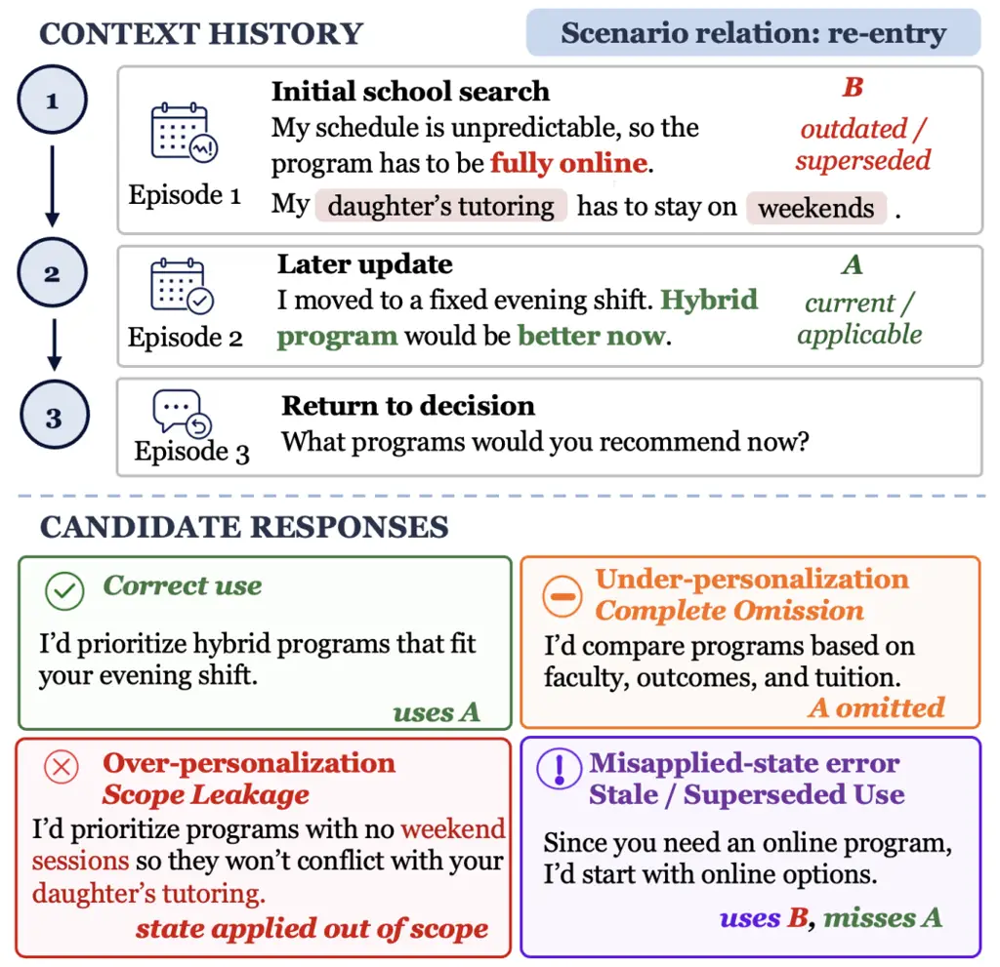
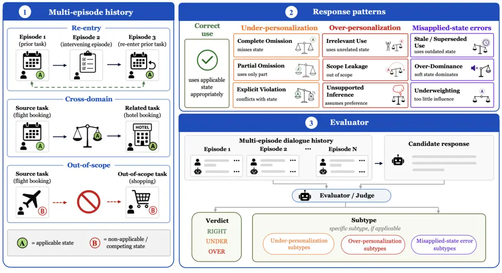

# PersEvalBench: Can LLM Evaluators Judge Contextually Appropriate Use of Persona Information?

Xinyi Liu ^(†)^(†)thanks: Work done during an internship at Amazon.
Affiliation: Amazon Affiliation: University of Illinois Urbana-Champaign
   Hooshang Nayyeri Affiliation: Amazon    Emine Yilmaz
Affiliation: Amazon Affiliation: University College London    Dilek
Hakkani-Tur Affiliation: Amazon Affiliation: University of Illinois
Urbana-Champaign    Charith Peris Affiliation: Amazon    Hari
Thadakamalla Email: [ {hooshang, perisc, thadakah}@amazon.com {liu323,
dilek}@illinois.edu
 eminey@amazon.co.ukCorrespondence:liu323@illinois.edu](mailto:%20%E2%80%83)
Affiliation: Amazon

###### Abstract

Large language model (LLM) evaluators are increasingly used to assess
personalized assistants, yet whether they can reliably judge
personalization has rarely been tested. We introduce PersEvalBench, a
benchmark testing whether an evaluator can recognize appropriate and
inappropriate uses of user history. It contains 403 multi-episode
scenarios where user information should persist, transfer, or cease to
apply. The benchmark covers nine controlled error subtypes across three
families: under-personalization, over-personalization, and
misapplied-state errors. Human audits confirm that generated errors
match their intended types and that the prescribed uses of user
information are reasonable.

Across five LLM evaluators, recognition of controlled personalization
errors remains limited even with the full dialogue history. On the
human-evaluated subset, under-personalization shows the largest gap:
humans recognize 94.4% of these errors, compared with 63.9% for the
strongest reported evaluator. Evaluators often recognize that a response
is problematic but reverse the error direction, mistaking failure to
follow an applicable preference (UNDER) for use of an inapplicable
preference (OVER). Easier evidence access offers little help:
highlighting the relevant history turns raises error recognition only
slightly, suggesting that the remaining difficulty lies in judging what
role that information should play in the response.

## 1 Introduction



Figure 1: Running example. An online-only requirement is superseded by a
hybrid preference. Responses may use the update correctly, omit it,
import an out-of-scope constraint, or continue using the stale state.



Figure 2: Overview of PersEvalBench. Multi-episode histories determine
whether prior user information should persist, transfer, or cease to
apply. Each scenario pairs a Right response with one controlled error
response, which the evaluator judges from the dialogue history.

Personalization benchmarks increasingly rely on large language model
(LLM) evaluators to score responses, compare systems, and guide model
development. Existing work extensively tests whether assistants
remember, follow, or over-apply information from user history (Maharana
et al., 2024; Zhao et al., 2025a; Zhao et al., 2025b; Xiao et al., 2026;
Hu et al., 2026; Yoon et al., 2026; Feng et al., 2026), but rarely asks
whether the evaluators themselves can judge these behaviors reliably.
This judgment is both difficult and consequential: even factually
correct information from history can be misused when it is outdated,
belongs to someone else, falls outside the current scope, or is given
the wrong weight, while evaluator errors can distort benchmark scores
and system comparisons. Reliable personalization evaluation is therefore
both necessary and challenging, requiring evaluators to judge not merely
whether user information is used, but whether it is used appropriately
in context.

Figure 1 illustrates the challenge. A user changes an online-only
requirement to a hybrid preference, so a response that still follows the
old requirement uses real information from history that no longer
applies. We introduce PersEvalBench to test whether evaluators can
recognize such distinctions. Given a multi-episode history, a target
request, and a candidate response, the evaluator predicts whether the
response uses user information appropriately (Right), fails to use
applicable information (Under), or uses information that should not
apply (Over).

To make personalization judgments controlled and verifiable, we ground
scenarios in Schema-Guided Dialogue (SGD) task structures (Rastogi et
al., 2020) and define the intended use of user history before dialogue
generation. Across three scenario relations, prior information is
designed to persist, transfer to a related task, or cease to apply. Each
scenario is then realized as a multi-episode dialogue with a matched
Right response and controlled error response, keeping the task fixed
while changing how user information is used. Nine error subtypes span
under-personalization, over-personalization, and misapplied-state
errors. Automated checks enforce the intended intervention during
construction, and independent human audits validate the generated errors
and the prescribed use of user information. The final benchmark contains
403 scenarios and 806 responses. Figure 2 summarizes the benchmark
structure.

Across five LLM evaluators, performance remains limited even with the
full dialogue history. The largest human-model gap appears in
under-personalization. On the shared human-evaluation subset, human
annotators recognize 94.4% of these errors, while the strongest reported
evaluator reaches 63.9%. These errors are often misdiagnosed rather than
simply missed: 26.6% of under-personalized responses are labeled Over.
Evaluators thus often treat a response that fails to follow applicable
user information as if it had instead used information that should not
apply. Easier evidence access does little to resolve this pattern, as
highlighting the relevant history improves error recognition only
slightly. This points to a deeper difficulty in judging how relevant
user information should shape the response.

Our contributions are threefold. First, we define the evaluator-side
task of judging whether a response uses information from user history
appropriately, distinguishing under-personalization,
over-personalization, and misapplied-state errors. Second, we introduce
PersEvalBench, a controlled benchmark with nine error subtypes, matched
Right/error responses, and human validation of both the generated errors
and the prescribed use of user information. Third, we benchmark five LLM
evaluators against human annotators and show that they remain
unreliable, with particularly large failures on under-personalization
and limited gains from easier evidence access.

## 2 Related Work

#### Personalization and long-term memory benchmarks.

Assistant-side personalization benchmarks primarily ask whether models
can retain and follow user information across interactions. This
includes persona-grounded dialogue (Zhang et al., 2018), personalized
generation (Salemi et al., 2024), long-term conversational memory
(Maharana et al., 2024), preference following over long contexts (Zhao
et al., 2025a), long-horizon preference following (Guo et al., 2026),
alignment on real dialogues (Xiao et al., 2026), task-oriented
personalization (Zhao et al., 2025b), and dynamic or evolving user
states (Jiang et al., 2025; Li et al., 2026). A complementary line
examines whether models use stored information selectively, including
over-personalization (Hu et al., 2026), rational preference utilization
(Feng et al., 2026), context-aware preference selectivity (Yoon et al.,
2026), and contextually appropriate memory use (Mireshghallah et al.,
2025), in the spirit of contextual integrity (Nissenbaum, 2004). These
benchmarks evaluate the responding assistant, while the competence of
the LLM judge used to assess it is generally assumed.

|                                 |       |               |                    |                   |
| ------------------------------- | ----- | ------------- | ------------------ | ----------------- |
| Benchmark family                | Judge | Multi episode | Contextual applic. | Controlled errors |
| Memory and preference following | –     | ✓             | $`\triangle`$      | –                 |
| Selective personalization       | –     | $`\triangle`$ | ✓                  | –                 |
| Personalized Judge              | ✓     | –             | –                  | –                 |
| PersEvalBench                   | ✓     | ✓             | ✓                  | U/O/M 9 subtypes  |

Table 1: Task-level comparison. Contextual applicability asks whether
prior information should affect the target response and with what
influence. $`\triangle`$ denotes partial or mixed coverage.

#### LLM-as-judge and meta-evaluation.

LLM evaluators are widely used for open-ended assessment (Zheng et al.,
2023; Liu et al., 2023), with dedicated judge models trained for
pairwise or fine-grained evaluation (Wang et al., 2024b; Kim et al.,
2024a; Kim et al., 2024b; Zhu et al., 2025). Meta-evaluations test
whether these judges agree with human assessments or recover controlled
labels in instruction following (Zeng et al., 2024), reward modeling
(Lambert et al., 2025), and knowledge and reasoning tasks (Tan et al.,
2025). This line of work also documents systematic judge biases,
including position and verbosity effects (Zheng et al., 2023; Wang et
al., 2024a) and a preference for a judge’s own generations (Panickssery
et al., 2024). The matched pairs in PersEvalBench are constrained to
comparable factual correctness, task relevance, completeness,
specificity, and style (Section 3.3), leaving these surface preferences
little room to determine verdicts: what differs within a pair is the use
of persona information. The most closely related evaluator-side work,
Personalized Judge (Dong et al., 2024), tests whether an LLM can infer
user preferences from persona descriptions. PersEvalBench instead tests
whether an evaluator can judge a fixed response’s use of information
from a multi-episode history, using matched pairs that isolate
under-personalization, over-personalization, and misapplied-state
errors. Table 1 summarizes this task-level distinction, and Table 6 in
Appendix A provides the full per-benchmark comparison.

## 3 PersEvalBench

Figure 2 summarizes the benchmark structure: multi-episode histories
establish how prior user information should apply, matched responses
realize controlled personalization errors, and evaluators judge each
candidate response from the dialogue history. We first define the
evaluation task and controlled scenario specification, then describe how
benchmark instances are constructed and human-verified.

### 3.1 Task Definition

As shown in Figure 2 (3), each benchmark instance consists of a
multi-episode dialogue history $`H`$, a target user request $`q`$, and a
candidate assistant response $`r`$. Given $`(H,q,r)`$, the evaluator
assigns one of three verdicts based on how the response uses information
from the user history: Right, Under, or Over. Right uses applicable
information appropriately while avoiding information that should not
affect the response. Under omits or gives too little influence to
applicable information, whereas Over uses information that should not
apply or gives it too much influence. For an error verdict, the
evaluator also identifies one primary error subtype.

### 3.2 Controlled Scenario Specification

To make evaluator judgments controlled and interpretable, we determine
the intended use of user history before generating the dialogue. Each
specification fixes how prior information should affect the target
response, what the correct response should do, and one controlled error
to introduce. This separates the underlying personalization decision
from its natural-language realization. Figure 1 illustrates a re-entry
scenario in which an earlier online-only constraint is superseded by an
updated hybrid preference.

#### Scenario relations.

Figure 2 (1) illustrates the three history–target relations. We organize
scenarios around the three broad ways prior information can relate to a
target request in our task-oriented setting: it can remain applicable,
transfer to a related task, or cease to apply. Accordingly, _re-entry_
tests whether an earlier state remains current, _cross-domain transfer_
whether it carries over and with what priority, and _out-of-scope_
whether seemingly relevant history should instead be ignored. Together,
these relations cover the core applicability decisions of persistence,
transfer, and exclusion.

#### Intended use of user information.

We then make the intended influence of each user state explicit. Each
state is assigned one of three roles for the target response: Ignore,
Support, or Dominate, indicating that it should have no influence, may
guide the response, or must be satisfied. The assignment depends on its
holder, scope, temporal status, strength, and transferability to the
target task. Each scenario includes an applicable state $`A`$ and, when
needed, a competing or non-applicable state $`B`$. In Figure 1, the
updated preference $`A`$ is Dominate, while the superseded state $`B`$
is Ignore. Appendix B.2 provides the complete inventory.

#### Error interventions.

Figure 2 (2) summarizes the response patterns. Given the prescribed role
of each user state, a response can depart from correct personalization
in three basic ways: give applicable information too little influence,
use information that should not apply, or assign influence to the wrong
state or at the wrong level. These correspond to
_under-personalization_, _over-personalization_, and _misapplied-state_
errors, respectively, and cover the core deviations from prescribed
persona use in our setting. The taxonomy is also grounded in prior work
on preference following (Zhao et al., 2025a), selective personalization
(Hu et al., 2026; Yoon et al., 2026; Feng et al., 2026), and evolving
user states (Jiang et al., 2025; Li et al., 2026).

To isolate each failure, every error response differs from its matched
Right response by exactly one intervention. Under-personalization
includes complete omission (CO), partial omission (PO), and explicit
violation (EV); over-personalization includes irrelevant use (IU), scope
leakage (SL), and unsupported inference (UI); and misapplied-state
errors include stale or superseded use (SS), over-dominance (OD), and
underweighting (UW).

Misapplied-state errors can support either error direction because they
may simultaneously underuse one state and overuse another. We therefore
count either Under or Over as recognition for this family. A
human-authored compatibility matrix restricts interventions to scenario
relations where they form natural violations, with subtype precedence
defined in Appendix B.1; Appendix E provides worked examples.

#### Evidence realization.

Finally, we vary how easily the relevant user information can be
recovered without changing the intended personalization decision.
Holding the scenario relation, state roles, and error intervention
fixed, we vary its evidence along two dimensions: form and distance.
Evidence is _explicit_ when directly stated, _implicit_ when recoverable
from a choice, rejection, or comparison, and _accumulated_ when
distributed across multiple turns. We measure distance from the latest
evidence turn to the target request as

```math
d_{q}=t_{q}-\max_{t\in\mathcal{E}_{q}}t,
```

where $`\mathcal{E}_{q}`$ denotes the evidence turns and $`t_{q}`$ the
target turn, and group instances into near ($`d_{q}\leq 3`$), medium
($`4\leq d_{q}\leq 8`$), and far ($`d_{q}\geq 9`$) bins. Evidence form
and distance vary how easily the evidence can be accessed rather than
serving as benchmark targets; neither changes the prescribed use of user
information or the benchmark label.

### 3.3 Benchmark Realization

We next turn each accepted specification into a natural dialogue and
matched response pair, while preserving its predefined personalization
logic.

#### Planning and verification.

To obtain diverse but structured tasks, we expand the 20 domains and
service schemas in the Schema-Guided Dialogue dataset (Rastogi et al., 2020) into 48 task types and a pool of 480 concrete task seeds. From
this pool, an LLM planner instantiates 456 scenario specifications, each
defining the episode goals, states $`A`$ and $`B`$, target request,
candidate options, correct decision, error intervention, and evidence
placement (Prompts F.1 and F.1).

Before dialogue generation, a verifier checks that each specification
realizes the intended history–target relation, makes state applicability
recoverable from the history, contains exactly one error intervention,
and keeps the matched options comparable apart from persona use.
Specifications that fail these checks are revised and re-evaluated, then
discarded if they still do not satisfy the criteria (Prompts F.1
and F.1).

#### Dialogue synthesis.

To separate scenario logic from its linguistic realization, a separate
generator converts each accepted specification into a natural
multi-episode dialogue without changing the predefined states, evidence,
or target decision. The dialogue ends with the target request, and we
record episode boundaries, the target turn, and evidence turns for each
user state as benchmark metadata. These annotations support verification
and the controlled context conditions in Section 4, but are hidden from
evaluators (Prompts F.1 and F.1).

#### Matched response generation.

To isolate the assigned personalization error, we generate a matched
response pair from each specification: one Right response and one error
response. The Right response follows the prescribed state roles, while
the error response receives only the information needed to realize its
assigned intervention. Complete omission uses the target request alone,
whereas other interventions receive subtype-specific restricted views of
the relevant states. The two responses are constrained to remain
comparable in factual correctness, task relevance, completeness,
specificity, and style (Prompts F.1 and F.1).

To make each intervention observable, scope leakage and unsupported
inference must affect the recommendation, while underweighting must
visibly reduce the influence of an applicable state. An automated
validator checks observability, intervention fidelity, and pair
comparability, regenerating failed responses with targeted feedback for
up to three attempts (Prompt F.1). Section 3.4 reports an independent
human audit of the resulting responses.

|                                    |             |
| ---------------------------------- | ----------- |
| Scale                              |             |
| Scenarios                          | 403         |
| Candidate responses                | 806         |
| Avg. episodes / turns per dialogue | 2.4 / 26.8  |
| Scenario relation                  |             |
| Re-entry                           | 174 (43.2%) |
| Cross-domain transfer              | 166 (41.2%) |
| Out-of-scope                       | 63 (15.6%)  |
| Error family                       |             |
| Under-personalization              | 130 (32.3%) |
| Over-personalization               | 151 (37.5%) |
| Misapplied-state                   | 122 (30.3%) |

Table 2: Scale and composition of PersEvalBench.

|               |                       |      |      |      |                      |       |       |       |                  |       |       |       |      |                    |
| ------------- | --------------------- | ---- | ---- | ---- | -------------------- | ----- | ----- | ----- | ---------------- | ----- | ----- | ----- | ---- | ------------------ |
| Model         | Under-personalization |      |      |      | Over-personalization |       |       |       | Misapplied-state |       |       |       |      |                    |
|               | CO                    | PO   | EV   | Und. | IU                   | SL    | UI    | Ov.   | SS               | OD    | UW    | Mis.  | All  | FAR $`\downarrow`$ |
| Kimi K2.5     | 63.6                  | 48.7 | 44.7 | 52.3 | 78.1                 | 70.5  | 90.7  | 79.5  | 61.3             | 42.6  | 93.2  | 65.6  | 66.5 | 24.6               |
| GLM-5         | 50.0                  | 61.5 | 53.2 | 54.6 | 76.6                 | 63.6  | 86.0  | 75.5  | 74.2             | 27.7  | 86.4  | 60.7  | 64.3 | 12.2               |
| DeepSeek-V3.2 | 65.9                  | 51.3 | 57.4 | 58.5 | 62.5                 | 50.0  | 86.0  | 65.6  | 77.4             | 25.5  | 93.2  | 63.1  | 62.5 | 10.9               |
| Qwen3-32B     | 15.9                  | 17.9 | 23.4 | 19.2 | 35.9                 | 29.5  | 62.8  | 41.7  | 25.8             | 10.6  | 63.6  | 33.6  | 32.0 | 2.5                |
| Constant-Over | 0.0                   | 0.0  | 0.0  | 0.0  | 100.0                | 100.0 | 100.0 | 100.0 | 100.0            | 100.0 | 100.0 | 100.0 | 67.7 | 100.0              |

Table 3: Error Recognition Rate (%) by error subtype in the main
setting, with FAR and the constant-Over baseline. Subtype abbreviations
follow Section 3.2. Und., Ov., and Mis. pool all error responses within
each family, and All pools all error responses. Bold marks the best
reported evaluator per column.

#### Coverage.

We prioritize coverage of factors that determine contextual
applicability rather than exhaustively crossing all design variables.
Each valid relation–intervention combination is instantiated across
multiple task types, goals, state configurations, and response
decisions, with varied evidence form and distance. Appendix B.1 reports
the valid combinations, and Appendix B.3 the final benchmark
composition.

### 3.4 Human Verification

We conduct three complementary human studies on the same stratified
sample of 100 scenarios. They test whether the generated errors realize
their intended interventions, whether the prescribed use of user
information is reasonable, and how well humans perform under the same
information available to evaluators. Study 1 uses one annotator pair,
while Studies 2 and 3 use a second, disjoint pair.

#### Intervention fidelity.

Annotators independently judge whether each raw error response realizes
its assigned intervention, followed by adjudication. The raw pipeline
achieves 88% subtype fidelity. We revise the 12 flagged responses while
preserving the dialogue history and matched Right response, then
re-verify them before inclusion in the benchmark. All subsequent human
and model evaluations use this corrected benchmark.

#### State-role validation.

To validate the prescribed use of user information independently of the
construction pipeline, annotators assign each user state an Ignore,
Support, or Dominate role without seeing the benchmark assignments.
After adjudication, 86.3% of these assignments match the benchmark, with
substantial three-level agreement between annotators (weighted
$`\kappa=.709`$); Appendix D provides the full analysis.

#### Human reference.

Before seeing the benchmark policy, the same annotators judge candidate
responses under the evaluator setting: they view the dialogue and each
candidate response individually, without construction metadata, and
assign Right, Under, or Over. Agreement over the 200 judgments is 83.5%
(Cohen’s $`\kappa=0.72`$). This provides a human reference under the
same information available to model evaluators (Appendix D).

## 4 Experimental Setup

#### Benchmark.

Table 2 summarizes the scale and composition of PersEvalBench. Each
retained scenario pairs one Right response with one controlled error
response. Of the 456 instantiated scenario specifications, 403 were
retained after verification and quality control. The construction
pipeline uses Claude Sonnet 4.6 (Anthropic, 2026b) for planning,
specification verification, dialogue synthesis, response generation, and
automated validation. Appendices B.1 and B.3 provide additional
benchmark statistics and construction details.

#### Evaluators.

We evaluate Claude Opus 4.6 (Anthropic, 2026a), Kimi K2.5 (Kimi Team,
2026), GLM-5 (GLM-5 Team, 2026), DeepSeek-V3.2 (DeepSeek-AI, 2025), and
Qwen3-32B (Yang et al., 2025).¹¹ 1 Evaluator-specific results are
partially omitted from the public version due to release restrictions.

#### Evaluation settings.

We vary three aspects of evaluation. Context: _Target Only_, _Recent_,
and _Full_ provide the target request alone, the preceding six turns,
and the complete history up to the target, respectively; _Full + Gold
Highlights_ marks the annotated evidence turns within the full history,
while _Gold Evidence Only_ provides only those turns and the target
request in chronological order. Formulation: _End-to-end_ directly
predicts the verdict and, when applicable, the subtype; _Evidence-first_
identifies relevant user states and evidence before predicting the
verdict; and _State-table_ first assesses state applicability in a
structured table. Unless otherwise stated, we use _Full_ with
_End-to-end_ (Prompts F.2–F.2). Protocol: we additionally evaluate
pointwise scoring and direct pairwise comparison over matched responses
(Appendix C.5).

#### Metrics.

We compute Error Recognition Rate (ERR) over error responses and False
Alarm Rate (FAR) over their matched Right responses. An error response
counts as recognized when an under-personalization error is assigned
Under, an over-personalization error is assigned Over, or a
misapplied-state error is assigned either error verdict. The last case
accepts both directions because the response underuses one state while
overusing another. FAR is the percentage of Right responses incorrectly
assigned Under or Over. Both metrics score the three-way verdict only;
the elicited subtype label is not scored. We report both metrics because
ERR alone can be inflated by an evaluator that predicts an error
indiscriminately. For analyses over matched responses, we additionally
report pair accuracy, which requires the evaluator to accept the Right
response and correctly recognize its paired error response.

## 5 Results

We ask three questions: how reliably LLM evaluators judge
personalization and where they fail; whether easier evidence access
reduces these failures; and whether alternative prompting or judging
protocols improve their judgments.

### 5.1 Overall Reliability and the Under-Personalization Failure

Table 3 reports subtype-level error recognition and false alarms under
the main full-history evaluation setting. The evaluated judges remain
unreliable overall. A constant-Over baseline attains 67.7% ERR but
falsely flags every Right response. Error recognition must therefore be
interpreted together with false alarms.

|               |                 |                |                 |      |                    |
| ------------- | --------------- | -------------- | --------------- | ---- | ------------------ |
| Judge         | Und. $`n{=}36`$ | Ov. $`n{=}40`$ | Mis. $`n{=}24`$ | All  | FAR $`\downarrow`$ |
| Kimi K2.5     | 63.9            | 70.0           | 70.8            | 68.0 | 26.0               |
| GLM-5         | 58.3            | 60.0           | 54.2            | 58.0 | 9.0                |
| DeepSeek-V3.2 | 58.3            | 52.5           | 54.2            | 55.0 | 11.0               |
| Qwen3-32B     | 25.0            | 32.5           | 29.2            | 29.0 | 1.0                |
| Annotator A   | 94.4            | 62.5           | 83.3            | 79.0 | 4.0                |
| Annotator B   | 94.4            | 50.0           | 79.2            | 73.0 | 7.0                |
| Human mean    | 94.4            | 56.3           | 81.3            | 76.0 | 5.5                |

Table 4: Human and model performance on the same 100 scenarios under
Full context. Each response is evaluated individually.

Under-personalization. This family shows the largest human-model gap. On
the shared 100-scenario subset, both human annotators recognize 94.4% of
under-personalization errors, compared with 63.9% for the strongest
reported evaluator (Table 4). Humans significantly outperform each
evaluator in Table 4 on these cases (Appendix D).

The dominant failure within this family is direction confusion.
Evaluators assign 26.6% of these responses the opposite Over verdict,
far more often than over-personalization errors are judged Under
(Figure 3a). Secondary errors amplify but do not explain this pattern:
on subsets that exclude human-flagged secondary Over errors, the rate
remains 19.5–21.1%, and the wrong-direction rationales ground their
decisions in genuine history evidence but assign that evidence the wrong
applicability, scope, or weight (Appendix C.3). The failure lies in
determining its proper role in the response.

Underweighting. Underweighting illustrates why misapplied-state errors
admit both error directions. Evaluators split their error verdicts on
these responses between Under and Over (Figure 3b). The two verdicts
capture complementary aspects of the same error: insufficient influence
from the applicable state and excessive relative influence from a
competing consideration.

Evaluator operating points. The evaluators occupy distinct operating
regimes rather than forming a single performance ranking. Kimi K2.5 is
comparatively permissive, pairing 66.5% ERR with the highest reported
FAR of 24.6%, whereas Qwen3-32B is strongly conservative, reducing FAR
to 2.5% but recognizing only 32.0% of errors. Evaluator choice therefore
changes whether personalization failures are more likely to be
over-reported or missed.

Figure 3: Verdict behavior in the main setting. (a) Wrong-direction
verdicts, pooled over evaluators: the share of under-personalization
errors judged Over and of over-personalization errors judged Under. (b)
Verdict split by reported evaluator for underweighting errors.

|               |                      |        |      |               |               |                      |                          |                         |                      |                 |
| ------------- | -------------------- | ------ | ---- | ------------- | ------------- | -------------------- | ------------------------ | ----------------------- | -------------------- | --------------- |
|               | Context availability |        |      |               |               | Scenario relation    |                          |                         | Applicability type   |                 |
| Model         | Target Only          | Recent | Full | Full + Highl. | Gold Ev. Only | Re-entry $`n{=}174`$ | Cross-domain $`n{=}166`$ | Out-of-scope $`n{=}63`$ | Categorical boundary | Graded decision |
| Kimi K2.5     | 63.5                 | 70.7   | 66.5 | 70.5          | 69.0          | 62.6                 | 64.5                     | 82.5                    | 72.9                 | 58.8            |
| GLM-5         | 46.7                 | 66.3   | 64.3 | 65.8          | 62.8          | 62.6                 | 61.4                     | 76.2                    | 69.6                 | 58.7            |
| DeepSeek-V3.2 | 50.4                 | 58.3   | 62.5 | 65.0          | 63.0          | 60.3                 | 64.5                     | 63.5                    | 67.6                 | 56.9            |
| Qwen3-32B     | 28.0                 | 34.0   | 32.0 | 35.2          | 33.0          | 31.6                 | 31.9                     | 33.3                    | 33.3                 | 31.2            |
| Mean FAR      | 22.1                 | 30.6   | –    | 12.5          | 24.0          | –                    | –                        | –                       | –                    | –               |

Table 5: ERR (%) by context availability, scenario relation, and
applicability type. Categorical (holder, scope, temporal) and Graded
(strength, transferability) are unweighted family means. The final row
reports mean FAR over all five evaluators for the reduced and augmented
context conditions; Full-context FAR for the reported evaluators appears
in Table 3. Bold marks the best reported evaluator per column.

### 5.2 Evidence Access Does Not Resolve Applicability

To separate context breadth from evidence access, we hold each scenario
and candidate response fixed and vary only the information shown to the
evaluator (Table 5).

History truncation. Recent context preserves error detection but weakens
the distinction between erroneous and appropriate personalization.
Recent yields nearly the same ERR as Full, yet mean FAR reaches 30.6%.
With Target Only, ERR falls while FAR remains high at 22.1%. A matched
ablation confirms that this effect comes from relevant history rather
than context length: removing applicable-state turns raises FAR by 55.2
points and lowers pair accuracy by 44.4 points, whereas removing the
same number of unrelated turns changes them by only 2.0 and 3.2 points,
respectively (Appendix C.4).

Gold evidence access. Making the relevant evidence explicit provides
only limited help. Full + Gold Highlights improves ERR only slightly.
Gold Evidence Only retains those turns but removes the surrounding
dialogue, leaving ERR nearly unchanged while FAR rises to 24.0%.

Response-local observability. Some errors remain recognizable without
history because their effects are visible in the candidate response.
Under Target Only, recognition of under-personalization falls to 31.7%,
while unsupported inference and underweighting remain at 74.9% and
70.9%. The latter responses expose an incorrect inference or weighting
decision, whereas omission errors require the evaluator to recover what
the history should have contributed. Response-local cues thus aid error
detection without resolving whether persona information is used
appropriately.

Graded applicability. The applicability-type breakdown identifies a
second source of difficulty. Evaluators reach lower ERR on graded
decisions involving strength or transferability than on categorical
boundaries involving holder, scope, or temporal status. Beyond finding
relevant information, evaluators struggle to determine how strongly and
how broadly it should apply.

### 5.3 Structured Prompting Changes Verdict Tendencies, Not Judgment Quality

To test whether structured reasoning improves applicability judgment or
merely changes how readily evaluators issue error verdicts, we compare
three formulations under the same Full context. Evidence-first prompting
raises ERR, but also raises FAR. The state-table formulation lowers ERR
and generally lowers FAR, shifting evaluators toward more conservative
predictions. Neither formulation improves error recognition while
preserving correct acceptance of Right responses (Table 10).

### 5.4 Independent Judgment Remains Difficult Without an Explicit Contrast

Alternative protocols clarify where the difficulty lies. Pointwise
scoring separates Right from error responses in only 63.0% of matched
pairs, with 35.9% ties. Direct pairwise comparison reaches 89.0%
accuracy with 90.5% order consistency (Appendix C.5), but this setting
exposes the two responses side by side and therefore provides an
explicit contrast that is absent from the benchmark’s target setting.
The high pairwise accuracy thus does not imply that evaluators can
reliably judge a response on its own. Moreover, neither protocol
identifies the error direction, so neither addresses the
Under$`\to`$Over confusion observed in independent judgments. These
results reinforce that the difficult part is independently determining
whether and how a response misuses user history.

## 6 Conclusion

PersEvalBench tests whether evaluators can judge how user history should
influence a response. Across 403 scenarios, five LLM evaluators remain
unreliable even with full history. The clearest failure is
under-personalization: evaluators often detect a problem but reverse its
direction, while humans perform substantially better. Easier evidence
access and structured prompting yield limited gains, whereas pairwise
comparison is much easier than independent judgment. These results
suggest that reliable personalization evaluation requires not only
retrieving relevant history, but correctly interpreting its role in the
current response.

## Limitations

Construction. The benchmark uses LLM-generated dialogues and responses,
which may differ from organic interactions or contain residual
generation artifacts despite structured verification and human auditing.
Restricted-context generation may introduce detectable differences from
Right responses, and upstream construction still relies on Claude, so
broader construction-family effects cannot be excluded. Appendix C.6
provides an additional response-generation robustness check using
Mistral Large 3 (Mistral AI, 2025).

Evaluation scope. Each benchmark response targets one controlled error,
although generation can introduce secondary cues and real responses may
contain multiple interacting errors. We audit secondary Over cues in
under-personalization cases and report robustness analyses after
excluding such items (Appendix C.3). Compound errors, however, remain
outside the benchmark’s intended scope. We also report ERR and FAR at
each reported model’s observed operating point and leave confidence
calibration to future work.

Generalizability. The benchmark is English-only and grounded in
SGD-derived task seeds, so results may not generalize fully across
domains, interaction styles, languages, or cultural norms of
personalization.

## Ethical Considerations

All dialogues, personas, and responses in PersEvalBench are synthetic
and generated from structured specifications grounded in task seeds
derived from the public Schema-Guided Dialogue dataset. No real user
data or personally identifying information is used. Human annotators are
graduate-student volunteers who participated with informed consent. The
benchmark is intended for research on the reliability of personalization
evaluators. Because PersEvalBench is synthetic, English-only, and
task-oriented, its results should not be used to certify evaluator
reliability in deployment. Overgeneralizing the benchmark could obscure
failures involving real users, other languages, or culturally dependent
personalization norms. The Schema-Guided Dialogue dataset is released
under the CC BY-SA 4.0 license, and we cite its original creators.

## References

- Anthropic (2026a) Anthropic Claude Opus 4.6 system card. Note:
  Anthropic system card External Links:
  [Link](https://www.anthropic.com/claude-opus-4-6-system-card) Cited
  by: §4.
- Anthropic (2026b) Anthropic Claude Sonnet 4.6 system card. Note:
  Anthropic system card External Links:
  [Link](https://www.anthropic.com/claude-sonnet-4-6-system-card) Cited
  by: §4.
- DeepSeek-AI (2025) DeepSeek-AI DeepSeek-V3.2: pushing the frontier of
  open large language models. arXiv preprint arXiv:2512.02556. External
  Links: [Link](https://arxiv.org/abs/2512.02556) Cited by: §4.
- Dong et al. (2024) Y. R. Dong, T. Hu, and N. Collier Can LLM be a
  personalized judge?. In Findings of the Association for Computational
  Linguistics: EMNLP 2024, Miami, Florida, USA, pp. 10126–10141.
  External Links:
  [Document](https://dx.doi.org/10.18653/v1/2024.findings-emnlp.592),
  [Link](https://aclanthology.org/2024.findings-emnlp.592/) Cited by:
  Table 6, §2.
- Feng et al. (2026) X. Feng, W. Gan, X. Chen, Q. Dai, and Y. Liu How
  does personalized memory shape LLM behavior? benchmarking rational
  preference utilization in personalized assistants. arXiv preprint
  arXiv:2601.16621. External Links:
  [Link](https://arxiv.org/abs/2601.16621) Cited by: Table 6, §1, §2,
  §3.2.
- GLM-5 Team (2026) GLM-5 Team GLM-5: from vibe coding to agentic
  engineering. arXiv preprint arXiv:2602.15763. External Links:
  [Link](https://arxiv.org/abs/2602.15763) Cited by: §4.
- Guo et al. (2026) Q. Guo, Y. Li, Y. Liu, and B. Hooi Towards natural
  personalization: evaluating long-horizon preference following in
  personalized user-LLM interactions. arXiv preprint arXiv:2603.04191.
  External Links: [Link](https://arxiv.org/abs/2603.04191) Cited by: §2.
- Hu et al. (2026) Y. Hu, Z. Long, J. Guo, X. Sui, X. Fu, W. Zhao, Y.
  Zhao, and B. Qin OP-Bench: benchmarking over-personalization for
  memory-augmented personalized conversational agents. arXiv preprint
  arXiv:2601.13722. External Links:
  [Link](https://arxiv.org/abs/2601.13722) Cited by: Table 6, §1, §2,
  §3.2.
- Jiang et al. (2025) B. Jiang, Z. Hao, Y. Cho, B. Li, Y. Yuan, S.
  Chen, L. Ungar, C. J. Taylor, and D. Roth Know me, respond to me:
  benchmarking LLMs for dynamic user profiling and personalized
  responses at scale. In Proceedings of the Second Conference on
  Language Modeling, External Links:
  [Link](https://arxiv.org/abs/2504.14225) Cited by: Table 6, §2, §3.2.
- Kim et al. (2024a) S. Kim, J. Shin, Y. Cho, J. Jang, S. Longpre, H.
  Lee, S. Yun, S. Shin, S. Kim, J. Thorne, and M. Seo Prometheus:
  inducing fine-grained evaluation capability in language models. In
  Proceedings of the Twelfth International Conference on Learning
  Representations, External Links:
  [Link](https://openreview.net/forum?id=8euJaTveKw) Cited by: §2.
- Kim et al. (2024b) S. Kim, J. Suk, S. Longpre, B. Y. Lin, J. Shin, S.
  Welleck, G. Neubig, M. Lee, K. Lee, and M. Seo Prometheus 2: an open
  source language model specialized in evaluating other language models.
  In Proceedings of the 2024 Conference on Empirical Methods in Natural
  Language Processing, Miami, Florida, USA, pp. 4334–4353. External
  Links: [Document](https://dx.doi.org/10.18653/v1/2024.emnlp-main.248),
  [Link](https://aclanthology.org/2024.emnlp-main.248/) Cited by: §2.
- Kimi Team (2026) Kimi Team Kimi K2.5: visual agentic intelligence.
  arXiv preprint arXiv:2602.02276. External Links:
  [Link](https://arxiv.org/abs/2602.02276) Cited by: §4.
- Lambert et al. (2025) N. Lambert, V. Pyatkin, J. Morrison, L.
  Miranda, B. Y. Lin, K. Chandu, N. Dziri, S. Kumar, T. Zick, Y.
  Choi, N. A. Smith, and H. Hajishirzi RewardBench: evaluating reward
  models for language modeling. In Findings of the Association for
  Computational Linguistics: NAACL 2025, Albuquerque, New Mexico,
  pp. 1755–1797. External Links:
  [Document](https://dx.doi.org/10.18653/v1/2025.findings-naacl.96),
  [Link](https://aclanthology.org/2025.findings-naacl.96/) Cited by: §2.
- Li et al. (2026) S. S. Li, B. Paranjape, K. Oktar, Z. Ma, G. Zhou, L.
  Guan, N. Zhang, S. Park, L. Chen, D. Yang, Y. Tsvetkov, and A.
  Celikyilmaz HorizonBench: long-horizon personalization with evolving
  preferences. arXiv preprint arXiv:2604.17283. External Links:
  [Link](https://arxiv.org/abs/2604.17283) Cited by: Table 6, §2, §3.2.
- Liu et al. (2023) Y. Liu, D. Iter, Y. Xu, S. Wang, R. Xu, and C. Zhu
  G-Eval: NLG evaluation using GPT-4 with better human alignment. In
  Proceedings of the 2023 Conference on Empirical Methods in Natural
  Language Processing, Singapore, pp. 2511–2522. External Links:
  [Document](https://dx.doi.org/10.18653/v1/2023.emnlp-main.153),
  [Link](https://aclanthology.org/2023.emnlp-main.153/) Cited by: §2.
- Maharana et al. (2024) A. Maharana, D. Lee, S. Tulyakov, M. Bansal, F.
  Barbieri, and Y. Fang Evaluating very long-term conversational memory
  of LLM agents. In Proceedings of the 62nd Annual Meeting of the
  Association for Computational Linguistics (Volume 1: Long Papers),
  Bangkok, Thailand, pp. 13851–13870. External Links:
  [Document](https://dx.doi.org/10.18653/v1/2024.acl-long.747),
  [Link](https://aclanthology.org/2024.acl-long.747/) Cited by: Table 6,
  §1, §2.
- Mireshghallah et al. (2025) N. Mireshghallah, N. Mangaokar, N.
  Kokhlikyan, A. Zharmagambetov, M. Zaheer, S. Mahloujifar, and K.
  Chaudhuri CIMemories: a compositional benchmark for contextual
  integrity of persistent memory in LLMs. arXiv preprint
  arXiv:2511.14937. External Links:
  [Link](https://arxiv.org/abs/2511.14937) Cited by: Table 6, §2.
- Mistral AI (2025) Mistral AI Introducing Mistral 3. Note: Mistral AI
  External Links: [Link](https://mistral.ai/news/mistral-3/) Cited by:
  Limitations.
- Nissenbaum (2004) H. Nissenbaum Privacy as contextual integrity.
  Washington Law Review 79 (1), pp. 119–158. External Links:
  [Link](https://digitalcommons.law.uw.edu/wlr/vol79/iss1/10/) Cited by:
  §2.
- Panickssery et al. (2024) A. Panickssery, S. R. Bowman, and S. Feng
  LLM evaluators recognize and favor their own generations. In Advances
  in Neural Information Processing Systems, Vol. 37, pp. 68772–68802.
  External Links: [Document](https://dx.doi.org/10.52202/079017-2197),
  [Link](https://proceedings.neurips.cc/paper_files/paper/2024/hash/7f1f0218e45f5414c79c0679633e47bc-Abstract-Conference.html)
  Cited by: §2.
- Rastogi et al. (2020) A. Rastogi, X. Zang, S. Sunkara, R. Gupta,
  and P. Khaitan Towards scalable multi-domain conversational agents:
  the schema-guided dialogue dataset. In Proceedings of the AAAI
  Conference on Artificial Intelligence, Vol. 34, pp. 8689–8696.
  External Links:
  [Document](https://dx.doi.org/10.1609/aaai.v34i05.6394),
  [Link](https://ojs.aaai.org/index.php/AAAI/article/view/6394) Cited
  by: §1, §3.3.
- Salemi et al. (2024) A. Salemi, S. Mysore, M. Bendersky, and H. Zamani
  LaMP: when large language models meet personalization. In Proceedings
  of the 62nd Annual Meeting of the Association for Computational
  Linguistics (Volume 1: Long Papers), Bangkok, Thailand, pp. 7370–7392.
  External Links:
  [Document](https://dx.doi.org/10.18653/v1/2024.acl-long.399),
  [Link](https://aclanthology.org/2024.acl-long.399/) Cited by: §2.
- Tan et al. (2025) S. Tan, S. Zhuang, K. Montgomery, W. Y. Tang, A.
  Cuadron, C. Wang, R. A. Popa, and I. Stoica JudgeBench: a benchmark
  for evaluating LLM-based judges. In Proceedings of the Thirteenth
  International Conference on Learning Representations, External Links:
  [Link](https://openreview.net/forum?id=G0dksFayVq) Cited by: §2.
- Wang et al. (2024a) P. Wang, L. Li, L. Chen, Z. Cai, D. Zhu, B.
  Lin, Y. Cao, L. Kong, Q. Liu, T. Liu, and Z. Sui Large language models
  are not fair evaluators. In Proceedings of the 62nd Annual Meeting of
  the Association for Computational Linguistics (Volume 1: Long Papers),
  Bangkok, Thailand, pp. 9440–9450. External Links:
  [Document](https://dx.doi.org/10.18653/v1/2024.acl-long.511),
  [Link](https://aclanthology.org/2024.acl-long.511/) Cited by: §2.
- Wang et al. (2024b) Y. Wang, Z. Yu, W. Yao, Z. Zeng, L. Yang, C.
  Wang, H. Chen, C. Jiang, R. Xie, J. Wang, X. Xie, W. Ye, S. Zhang,
  and Y. Zhang PandaLM: an automatic evaluation benchmark for LLM
  instruction tuning optimization. In Proceedings of the Twelfth
  International Conference on Learning Representations, External Links:
  [Link](https://proceedings.iclr.cc/paper_files/paper/2024/hash/be3b0d51a2b86cb4ffe50f13480217e0-Abstract-Conference.html)
  Cited by: §2.
- Xiao et al. (2026) J. Xiao, X. Yu, C. Wang, W. Zheng, X. Lin, K.
  Liu, H. Ding, Y. Zhang, W. Wang, F. Feng, and X. He AlpsBench: an LLM
  personalization benchmark for real-dialogue memorization and
  preference alignment. In Proceedings of the 49th International ACM
  SIGIR Conference on Research and Development in Information Retrieval,
  pp. 3489–3497. External Links:
  [Document](https://dx.doi.org/10.1145/3805712.3808634),
  [Link](https://doi.org/10.1145/3805712.3808634) Cited by: §1, §2.
- Yang et al. (2025) A. Yang, A. Li, B. Yang, et al. Qwen3 technical
  report. arXiv preprint arXiv:2505.09388. External Links:
  [Link](https://arxiv.org/abs/2505.09388) Cited by: §4.
- Yoon et al. (2026) S. Yoon, S. Kim, H. Hong, W. Jeung, Y. Kim, W.
  Seo, H. Yeen, and A. No BenchPreS: a benchmark for context-aware
  personalized preference selectivity of persistent-memory LLMs. arXiv
  preprint arXiv:2603.16557. External Links:
  [Link](https://arxiv.org/abs/2603.16557) Cited by: Table 6, §1, §2,
  §3.2.
- Zeng et al. (2024) Z. Zeng, J. Yu, T. Gao, Y. Meng, T. Goyal, and D.
  Chen Evaluating large language models at evaluating instruction
  following. In Proceedings of the Twelfth International Conference on
  Learning Representations, External Links:
  [Link](https://openreview.net/forum?id=tr0KidwPLc) Cited by: §2.
- Zhang et al. (2018) S. Zhang, E. Dinan, J. Urbanek, A. Szlam, D.
  Kiela, and J. Weston Personalizing dialogue agents: I have a dog, do
  you have pets too?. In Proceedings of the 56th Annual Meeting of the
  Association for Computational Linguistics (Volume 1: Long Papers),
  Melbourne, Australia, pp. 2204–2213. External Links:
  [Document](https://dx.doi.org/10.18653/v1/P18-1205),
  [Link](https://aclanthology.org/P18-1205/) Cited by: §2.
- Zhao et al. (2025a) S. Zhao, M. Hong, Y. Liu, D. Hazarika, and K. Lin
  Do LLMs recognize your preferences? evaluating personalized preference
  following in LLMs. In Proceedings of the Thirteenth International
  Conference on Learning Representations, External Links:
  [Link](https://openreview.net/forum?id=QWunLKbBGF) Cited by: Table 6,
  §1, §2, §3.2.
- Zhao et al. (2025b) Z. Zhao, C. Vania, S. Kayal, N. Khan, S. B. Cohen,
  and E. Yilmaz PersonaLens: a benchmark for personalization evaluation
  in conversational AI assistants. In Findings of the Association for
  Computational Linguistics: ACL 2025, Vienna, Austria, pp. 18023–18055.
  External Links:
  [Document](https://dx.doi.org/10.18653/v1/2025.findings-acl.927),
  [Link](https://aclanthology.org/2025.findings-acl.927/) Cited by:
  Table 6, §1, §2.
- Zheng et al. (2023) L. Zheng, W. Chiang, Y. Sheng, S. Zhuang, Z.
  Wu, Y. Zhuang, Z. Lin, Z. Li, D. Li, E. P. Xing, H. Zhang, J. E.
  Gonzalez, and I. Stoica Judging LLM-as-a-Judge with MT-Bench and
  Chatbot Arena. In Advances in Neural Information Processing Systems,
  Vol. 36, pp. 46595–46623. External Links:
  [Document](https://dx.doi.org/10.52202/075280-2020),
  [Link](https://proceedings.neurips.cc/paper_files/paper/2023/hash/91f18a1287b398d378ef22505bf41832-Abstract-Datasets_and_Benchmarks.html)
  Cited by: §2.
- Zhu et al. (2025) L. Zhu, X. Wang, and X. Wang JudgeLM: fine-tuned
  large language models are scalable judges. In Proceedings of the
  Thirteenth International Conference on Learning Representations,
  External Links: [Link](https://openreview.net/forum?id=xsELpEPn4A)
  Cited by: §2.

## Appendix A Benchmark Comparison

In Table 6, ✓ denotes explicit coverage, $`\triangle`$ partial or
narrowly scoped coverage, and – a capability that is not a primary
evaluation target. _Applicability boundaries_ concern whether persona
information applies to the current holder, task, time, or related
episode; misapplied-state cases exhibit under- and over-use at once
(Section 3.2).

|                                         |                    |                      |                          |                            |               |                       |                   |
| --------------------------------------- | ------------------ | -------------------- | ------------------------ | -------------------------- | ------------- | --------------------- | ----------------- |
| Benchmark                               | Evaluates          | Longitudinal history | Applicability boundaries | Persona-use error coverage |               |                       | Matched responses |
|                                         |                    |                      |                          | Under                      | Over          | Misapplied state      |                   |
| Assistant-side benchmarks               |                    |                      |                          |                            |               |                       |                   |
| LoCoMo (Maharana et al., 2024)          | Assistant / memory | ✓                    | –                        | –                          | –             | –                     | –                 |
| PrefEval (Zhao et al., 2025a)           | Assistant          | ✓                    | –                        | ✓                          | –             | –                     | –                 |
| PersonaLens (Zhao et al., 2025b)        | Assistant          | ✓                    | $`\triangle`$            | $`\triangle`$              | –             | –                     | –                 |
| PersonaMem (Jiang et al., 2025)         | Assistant          | ✓                    | ✓ (time)                 | $`\triangle`$              | –             | $`\triangle`$ (stale) | –                 |
| HorizonBench (Li et al., 2026)          | Assistant          | ✓                    | ✓ (time)                 | $`\triangle`$              | –             | $`\triangle`$ (stale) | –                 |
| OP-Bench (Hu et al., 2026)              | Assistant          | ✓                    | $`\triangle`$            | –                          | ✓             | –                     | –                 |
| RPEval (Feng et al., 2026)              | Assistant          | $`\triangle`$        | ✓                        | $`\triangle`$              | ✓             | –                     | –                 |
| BenchPreS (Yoon et al., 2026)           | Assistant          | –                    | ✓                        | $`\triangle`$              | ✓             | –                     | –                 |
| CIMemories (Mireshghallah et al., 2025) | Assistant / memory | –                    | ✓                        | –                          | $`\triangle`$ | –                     | –                 |
| Evaluator-side benchmarks               |                    |                      |                          |                            |               |                       |                   |
| Personalized Judge (Dong et al., 2024)  | Evaluator          | –                    | –                        | –                          | –             | –                     | –                 |
| PersEvalBench                           | Evaluator          | ✓                    | ✓                        | ✓ (3)                      | ✓ (3)         | ✓ (3)                 | ✓                 |

Notation. ✓ denotes explicit primary coverage, $`\triangle`$ partial or
narrowly scoped coverage, and – no primary coverage. Parenthetical
labels specify a narrowly covered boundary or error type; numbers
indicate the controlled subtypes in PersEvalBench.

Table 6: Comparison with the closest personalization, memory, and
personalized-evaluation benchmarks.

## Appendix B Benchmark Design and Composition

### B.1 Scenario Grammar and Coverage

|              |                                       |                       |                      |                  |
| ------------ | ------------------------------------- | --------------------- | -------------------- | ---------------- |
|              |                                       | Legal error subtypes  |                      |                  |
| Relation     | Central judgment                      | Under-personalization | Over-personalization | Misapplied-state |
| Re-entry     | Which states remain current?          | CO, PO, EV            | IU, SL               | SS, OD, UW       |
| Cross-domain | What transfers, and with what weight? | CO, PO, EV            | IU, UI               | SS, OD, UW       |
| Out-of-scope | Which history should be ignored?      | –                     | IU, SL, UI           | –                |

Table 7: Scenario grammar: each history–target relation, its central
judgment, and the error subtypes that arise naturally within it (19 of
27 relation–subtype combinations are legal).

Table 7 summarizes the scenario grammar: for each history–target
relation of Section 3.2, the judgment it centers on and the error
subtypes that constitute natural violations, grouped by family (subtype
abbreviations follow Section 3.2). Nineteen of the 27 relation–subtype
combinations are legal, as fixed by a human-authored compatibility
matrix; for example, scope leakage is excluded from cross-domain
scenarios, where crossing the domain boundary is the intended behavior
rather than a leak. Per-category composition counts appear in Table 9.
Subtype precedence keeps labels unambiguous: explicitly selecting an
option that violates an active hard constraint is _explicit violation_
(complete omission requires no direct contradiction), and scope leakage
requires an identifiable scope boundary (irrelevant use covers merely
unrelated states).

### B.2 State-Relation Inventory

Each scenario distinguishes the applicable state $`A`$ from a competing
state $`B`$ through one primary relation, drawn from eight state
relations grouped into five applicability families. Table 8 lists the
inventory and grouping used in all relation-level analyses.

|                        |                           |                                                   |
| ---------------------- | ------------------------- | ------------------------------------------------- |
| Family                 | Relation                  | Gloss                                             |
| Categorical boundaries |                           |                                                   |
| Holder                 | same attr., diff. object  | held for a different person or object             |
| Scope                  | same attr., diff. scope   | applies in a different task or occasion           |
| Temporal               | same attr., diff. time    | held at a different time                          |
|                        | old vs. new value         | earlier value later updated                       |
| Graded decisions       |                           |                                                   |
| Strength               | hard vs. soft             | binding constraint vs. soft preference            |
|                        | two simultaneous          | two co-active states compete for priority         |
| Transfer.              | cross-domain vs. specific | general vs. task-specific state                   |
|                        | unsupported adjacent      | adjacent-domain preference without direct support |

Table 8: The eight state relations and their five applicability
families, grouped by the categorical vs. graded distinction of
Section 5.2.

### B.3 Benchmark Statistics

Table 9 summarizes benchmark scale (Panel A), composition (Panel B), and
the realized evidence form and distance (Panel C).

|                                                 |             |
| ----------------------------------------------- | ----------- |
| Panel A: Scale                                  |             |
| Scenario items                                  | 403         |
| Candidate responses                             | 806         |
| Task types / task seeds                         | 48 / 480    |
| Avg. episodes / turns per dialogue              | 2.4 / 26.8  |
| Panel B: Composition                            |             |
| Scenario relation                               |             |
| Re-entry                                        | 174 (43.2%) |
| Cross-domain                                    | 166 (41.2%) |
| Out-of-scope                                    | 63 (15.6%)  |
| Response verdict (of $`2\times 403`$ responses) |             |
| Right                                           | 403 (50.0%) |
| Under-personalization                           | 130 (16.1%) |
| Over-personalization                            | 151 (18.7%) |
| Misapplied-state                                | 122 (15.1%) |

|                               |             |             |
| ----------------------------- | ----------- | ----------- |
| Panel C: Evidence realization |             |             |
| Attribute                     | Category    | $`n`$ (%)   |
| Form                          | Explicit    | 159 (39.5%) |
|                               | Implicit    | 114 (28.3%) |
|                               | Accumulated | 130 (32.3%) |
| Distance                      | Near        | 65 (16.1%)  |
|                               | Medium      | 77 (19.1%)  |
|                               | Far         | 261 (64.8%) |

Table 9: Benchmark statistics: scale (Panel A), composition (Panel B),
and evidence realization (Panel C; distance bins of Section 3.2).

## Appendix C Additional Analyses

### C.1 Evaluation Formulation

All formulations are zero-shot with no hyperparameter search or model
selection. Table 10 reports results for the reported evaluators under
the three elicitation formulations of Section 5.3.

|               |                                    |             |             |
| ------------- | ---------------------------------- | ----------- | ----------- |
|               | Evaluation formulation (ERR / FAR) |             |             |
| Model         | E2E                                | EvF         | ST          |
| Kimi K2.5     | 66.5 / 24.6                        | 71.0 / 29.0 | 60.3 / 16.1 |
| GLM-5         | 64.3 / 12.2                        | 65.8 / 16.1 | 62.5 / 10.9 |
| DeepSeek-V3.2 | 62.5 / 10.9                        | 65.0 / 16.4 | 54.8 / 11.4 |
| Qwen3-32B     | 32.0 / 2.5                         | 42.4 / 6.0  | 18.1 / 1.5  |

Table 10: ERR / FAR (%) by evaluation formulation under Full context
(E2E/EvF/ST = End-to-end/Evidence-first/State-table; bold = highest ERR
and lowest FAR among reported evaluators per column).

### C.2 Underweighting Verdict Split

Evaluator rationales show the two readings behind the direction split on
underweighting errors (Figure 3b). Under the _deficit_ reading, the
evaluator anchors on the applicable state and observes that the response
acknowledges the constraint but then downplays it, yielding Under. Under
the _excess_ reading, the evaluator anchors on the response content and
objects to what filled the vacated space: the weakened restatement of
the preference no longer matches what the user actually said (read as an
unsupported, fabricated preference), or a secondary consideration now
dominates the decision (read as over-application of the wrong state),
yielding Over.

### C.3 Under$`\to`$Over Robustness

We test whether the Under$`\to`$Over rate reflects responses that
contain a secondary over-personalization error in addition to the
intended one. The two Study 3 annotators (Appendix D) independently
audited all 130 under-personalization responses, judging for each
whether the intended Under error is present and whether a secondary Over
error is also present. Excluding every item that either annotator
flagged with a secondary Over error lowers the rate from 26.6% to 21.1%;
further requiring both annotators to confirm the intended Under error
leaves 19.5%. The residual confusion is lowest for complete omission
(14.3%) and highest for explicit violation (26.4%). A manual audit of
all 173 main-setting judgments in which an under-personalization error
was judged Over further shows that every rationale cites genuine history
evidence and errs in judging its applicability, scope, or weight; none
argues from response wording alone, and none invents a user state.
Secondary errors therefore amplify, but do not explain, the direction
confusion reported in Section 5.1.

### C.4 Relevant-History Ablation

To test whether the benefit of Full context comes from relevant history
rather than context length, we construct two matched ablations of the
Full history on a separate random sample of 50 scenarios, stratified by
error subtype and then by scenario relation. Full $`-`$ relevant history
deletes the turns that express the applicable state, together with the
assistant reply that follows each. Full $`-`$ unrelated context deletes
the same number of non-evidence turns. Turns are renumbered
consecutively, and the target request and both candidate responses are
unchanged. The Full condition is re-run through the same pipeline.
Table 11 shows that removing relevant history leaves ERR largely intact
but turns most Right responses into false alarms, whereas removing
unrelated context barely changes either metric.

|                              |      |                    |           |
| ---------------------------- | ---- | ------------------ | --------- |
| Condition                    | ERR  | FAR $`\downarrow`$ | Pair acc. |
| Target Only                  | 46.0 | 20.8               | 38.8      |
| Full $`-`$ relevant history  | 60.8 | 67.6               | 19.6      |
| Full $`-`$ unrelated context | 62.8 | 14.4               | 60.8      |
| Full                         | 64.4 | 12.4               | 64.0      |

Table 11: Relevant-history ablation: five-evaluator mean ERR, FAR, and
pair accuracy (%) on 50 scenarios.

#### Gold Evidence Only false alarms.

A manual audit of 50 false alarms produced under Gold Evidence Only
traces 78% to context lost when the surrounding dialogue is removed: the
evaluator reads correct use of the applicable state as importing
information from another task or thread, or treats response details
supported by the removed turns as unsupported.

### C.5 Alternative Judging Protocols

Section 5.4 compares the three-way verdict with two common judging
protocols, both run on all 403 matched pairs under Full context with the
same five evaluators. Pointwise scoring rates each response
independently from 1 to 5 for how appropriately it uses the user’s
history; the rubric does not mention under- or over-personalization and
excludes overall response quality. A pair counts as correct only when
the Right response receives a strictly higher score than its matched
error response; tied scores are reported separately. Pairwise comparison
shows the two matched responses together and asks which uses the history
more appropriately. Each pair is presented in both orders; accuracy is
averaged over the two orders, and consistency is the percentage of pairs
for which the same response is chosen in both orders.

Pointwise scoring separates the matched responses in 63.0% of pairs,
with 35.9% of pairs receiving tied scores; ties rise to 50.5% for
misapplied-state errors. Pairwise comparison reaches 89.0% accuracy with
90.5% order consistency. Neither protocol assigns an error direction, so
neither can expose the Under$`\to`$Over confusion measured by the
three-way verdict.

### C.6 Response-Generator Robustness

Because construction uses Claude Sonnet 4.6, results could depend on its
response style or generation artifacts. Holding each scenario’s
specification and dialogue fixed, we regenerate only the matched Right
and error responses of all 403 scenarios with Mistral Large 3 and re-run
the evaluators under Full context with the End-to-end formulation.
Across the four evaluators outside the construction model family, pair
accuracy changes by only $`-0.5`$ points on average, suggesting limited
sensitivity to the response-generator family. Upstream scenario
planning, specification, and dialogue synthesis still use Claude, so
broader construction-family effects cannot be excluded (see
Limitations).

## Appendix D Human Validation

#### Protocols.

We conduct three human studies on the same stratified sample of 100
scenarios: intervention fidelity (Study 1), state-role validation
(Study 2), and a human evaluator reference (Study 3). Study 1 was
conducted by one pair of graduate-student annotators, and Studies 2
and 3 by a second, disjoint pair; none was involved in benchmark
construction. In Study 1, annotators viewed the dialogue, the error
response, and the intended subtype definition, judged whether the
response committed the assigned error, and consolidated differences
through joint adjudication. In Study 3, annotators performed the
evaluator task itself before any exposure to the benchmark policy: they
independently assigned Right, Under, or Over to 200 shuffled
single-response instances comprising the sample’s matched Right and
error responses, using only the dialogue and candidate response. Their
labels are reported without adjudication. Misapplied-state instances
were labeled in a separate round, so annotators could infer the error
family represented in that pool; they remained blind to which responses
were erroneous and to the direction of each error, but performance on
the misapplied-state portion may benefit from the narrower judgment
space. Scoring follows Section 4.

#### Study 1: Intervention fidelity.

Table 12 reports per-subtype consensus confirmation rates. The consensus
confirms the intended error in 88% of raw pipeline generations, with the
lowest rates for explicit violation (67%) and scope leakage (70%), the
two subtypes whose boundary definitions leave the most room for
judgment. The 12 intervention-realization mismatches were revised and
re-verified as described in Section 3.4; the final benchmark, Studies 2
and 3, and all model evaluations use the revised versions.

|                       |       |               |         |
| --------------------- | ----- | ------------- | ------- |
| Subtype               | $`n`$ | Confirmed (%) | Revised |
| Complete omission     | 12    | 83            | 2       |
| Partial omission      | 12    | 100           | 0       |
| Explicit violation    | 12    | 67            | 4       |
| Irrelevant use        | 18    | 89            | 2       |
| Scope leakage         | 10    | 70            | 3       |
| Unsupported inference | 12    | 100           | 0       |
| Stale/superseded      | 6     | 100           | 0       |
| Over-dominance        | 12    | 92            | 1       |
| Underweighting        | 6     | 100           | 0       |
| Overall               | 100   | 88            | 12      |

Table 12: Intervention fidelity (Study 1): per-subtype consensus
confirmation rate (%) on raw pipeline generations and the number of
scenarios revised in the final benchmark.

#### Study 2: State-role validation.

On the same 100 scenarios, the two Study 3 annotators read the dialogue
and the target request and assign each user state one of three roles:
Ignore (the state should not affect the response), Support (the state
may guide the response), or Dominate (the state must be satisfied),
without access to the construction specification or benchmark policy;
disagreements are then resolved through adjudication. After
adjudication, 86.3% of state-role assignments match the benchmark
policy; exact three-level agreement between the independent labels is
70.0% (weighted $`\kappa{=}.709`$). On instances in the sample where an
evaluator’s verdict disagrees with the benchmark verdict, the
annotators’ independent judgments both support the benchmark verdict in
72.8% of cases and both reject it in only 7.8%, indicating that
evaluator errors are rarely explained by an unreasonable benchmark
policy.

#### Study 3: Human evaluator reference.

Table 4 (main text) compares the annotators with the evaluators on the
same 100 scenarios under the main Full-history setting, which matches
what the annotators saw. Inter-annotator agreement over the 200
judgments is 83.5% (Cohen’s $`\kappa{=}0.72`$). Their family profile
inverts the models’: both annotators achieve 94.4% recognition on
under-personalization, with misapplied-state performance falling in
between, and each annotator significantly outperforms each evaluator in
Table 4 on under-personalization (paired McNemar exact tests, all
$`p\leq.004`$, $`n{=}36`$ paired scenarios). Their false-alarm rates are
below those of every reported evaluator except Qwen3-32B, whose 1.0%
false-alarm rate comes with only 29.0% error recognition.

#### Annotator instructions.

For the intervention-fidelity study (Study 1), annotators received the
following instructions:

> Read the complete dialogue, the candidate error response, and the
> definition of the assigned error subtype. Determine whether the
> candidate response clearly realizes the assigned persona-use
> intervention. Focus on how the response uses information from the
> dialogue history, rather than on general writing quality. Mark the
> instance as Valid if the assigned error is present and as Invalid
> otherwise. For an invalid instance, briefly describe the mismatch.

For the human-reference study (Study 3), annotators received the
following instructions:

> Read the complete dialogue history, the target user request, and one
> candidate assistant response. Based only on the information shown,
> assign exactly one verdict:
>
> Right: The response uses applicable information from the user history
> with the appropriate influence and does not use information that
> should be ignored.
>
> Under: The response omits, violates, or gives insufficient influence
> to applicable information from the user history.
>
> Over: The response uses information that should not apply or gives
> user information more influence than warranted.
>
> Judge the response’s use of persona information rather than its
> general fluency or writing style.

## Appendix E Worked Examples

This appendix illustrates the benchmark with condensed examples.
Examples E–E show one full scenario per history–target relation, each
realizing one error subtype in place (stale/superseded use and
underweighting from the misapplied-state family, and scope leakage from
the over-personalization family); Examples E and E illustrate the
remaining six subtypes in compact form. Dialogues are abridged:
 \[A\] /  \[B\] mark turns expressing the applicable and the competing
state, elisions are bracketed, and responses are excerpted.


## Appendix F Prompt System

This appendix documents the complete prompt system as a set of cards.
Prompts F.1–F.1 drive benchmark construction in pipeline order, while
Prompts F.2–F.2 elicit evaluator judgments. Each card specifies the
prompt’s purpose, input, and output contract.

All benchmark-construction calls use Claude Sonnet 4.6 with temperature
0.7 and provider-default values for other sampling parameters.

### F.1 Generation Pipeline


### F.2 Evaluation Formulations

Subtype identifiers in the evaluation prompts carry generation-time
direction prefixes (under./over.); scoring follows the three error
families of Section 3.2, and the elicited subtype is not scored.


