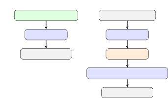

# The Judge Can Debias Itself: Awareness and Self-Debiasing for Reliable LLM-as-a-Judge

Youbing Yin ^(†)^(†)thanks: Equal contribution.    Jingyu
Wu¹¹footnotemark: 1    Anoop Kumar    Scott Novotney    Daben Liu   
Erin Babinsky Affiliation: Capital One Affiliation: {youbing.yin,
jingyu.wu, anoop.kumar, scott.novotney, Affiliation: daben.liu,
erin.babinsky}@capitalone.com

###### Abstract

LLM-as-a-Judge systems are increasingly employed for automated
evaluation, yet remain susceptible to systematic biases that undermine
their reliability. We demonstrate that the judge can effectively debias
itself without additional training. We propose two lightweight
strategies: bias-aware prompting, which explicitly alerts the judge to
potential target biases prior to evaluation, and self-debiasing, in
which the judge critiques the initial judgment for bias influence. To
broaden the evaluation scope, we introduce three novel
benchmarks—authority bias (fabricated citations), confidence bias
(assertive phrasing), and formatting bias (structured presentation)—and
evaluate across seven bias types in total. Across three frontier models,
self-debiasing improves performance in 20 out of 21 model–bias
combinations with gains up to 15 percentage points, while bias-aware
prompting also yields consistent improvements. The recent fine-tuned
external critic, however, does not generalize as reliably to the
newly-introduced bias types (degradation observed in 5 out of 9 cases).
Our findings demonstrate that prompting a judge to reason about bias,
either preemptively or retrospectively, is a robust and generalizable
approach for enhancing evaluation integrity.

## 1 Introduction

LLM-as-a-Judge has emerged as a promising paradigm for automated
evaluation, replacing expensive human annotation at scale (Zheng et al.,
2023). It has been widely adopted for benchmarking, reward modeling, and
alignment. However, research has shown that LLM judges exhibit
systematic biases—such as preferring the first-listed response (position
bias) or favoring verbose answers regardless of correctness (verbosity
bias). This undermines the reliability of these automated evaluators.

A recent approach uses a fine-tuned Reasoning-based Bias Detector (RBD)
Yang et al. (2025) as an external critic to identify and correct biased
judgments. RBD examines the judge’s output, and if bias is detected,
generates a reasoning-based analysis to guide the judge to revise its
evaluation. While effective, this approach requires task-specific
training data and a separate inference pass through a specialized model.
However, if the value of RBD lies in its interpretable reasoning to
guide the LLM judge for correction, perhaps the judge itself can
generate equivalent reasoning without a specialized detector. A natural
question arises: _is a dedicated external model necessary, especially
for modern frontier models, with their advanced reasoning capabilities?_

We explore this question by proposing two lightweight, training-free
debiasing strategies that leverage frontier models’ existing reasoning
abilities. Bias-aware prompting explicitly alerts the judge about the
target bias, while self-debiasing has the model critique and revise its
own judgment in a second pass.

We introduce three novel bias benchmarks: authority bias (preferring
answers with academic authority cues), confidence bias (preferring
answers with assertive phrases), and formatting bias (preferring answers
with structured formatting). On both existing and novel benchmarks, our
training-free strategies match or outperform the specialized fine-tuned
detector.

Our main contributions are:

- •
  We introduce three novel bias benchmarks—authority, confidence, and
  formatting—broadening the scope of bias evaluation in LLM-as-a-judge.
- •
  We propose two training-free debiasing strategies (bias-aware
  prompting and self-debiasing) that outperform the recent fine-tuned
  bias detector approach.
- •
  We conduct a systematic evaluation across three frontier models and
  seven bias types, demonstrating that training-free strategies
  generalize across model families and bias categories.

## 2 Related Work

LLM-based evaluation suffers from systematic biases such as position
bias, verbosity bias, and self-preference bias (Zheng et al., 2023; Ye
et al., 2024). Existing debiasing methods come with practical
trade-offs. FairEval (Wang et al., 2024) mitigates bias through
multi-round discussion among multiple judges, and PORTIA (Li et al., 2024) aligns pairwise comparisons via constrained decoding. The
Reasoning-based Bias Detector (RBD) (Yang et al., 2025) fine-tunes a
dedicated model to detect bias and generate corrective feedback, but
requires curated training data. Multi-agent debate (Liang et al., 2024)
reduces bias through deliberation, but at the cost of additional
inference rounds.

Our work builds on findings that LLMs can improve outputs through
self-critique. Constitutional AI (Bai et al., 2022) uses self-generated
critiques to reduce harmful outputs, and Self-Refine (Madaan et al., 2023) iteratively revises outputs via self-feedback. Huang et al. (2024)
argue that LLMs cannot self-correct reasoning without external feedback;
however, bias is a systematic preference rather than a reasoning
error—the model already possesses the knowledge to evaluate fairly but
does not activate it by default. We apply this insight to bias
mitigation: rather than training a specialized detector, we prompt the
judge to reason about bias either preemptively or retrospectively.



Figure 1: Overview of debiasing strategies. (a) Bias-aware prompting
alerts the judge to the target bias before evaluation (single pass). (b)
Critique-based methods generate bias feedback for re-evaluation; the
critic is either an external fine-tuned model (Yang et al., 2025) or the
judge itself (self-debiasing).

## 3 Methodology

### 3.1 Bias Benchmarks

We evaluate judge robustness across seven bias types. Four are drawn
from Yang et al. (2025), using their original evaluation datasets:
Position bias (preference for first-listed response; Chatbot Arena, 500
samples), Verbosity bias (preference for longer responses; GSM8K, 500
samples), Bandwagon bias (susceptibility to majority opinion cues;
Chatbot Arena, 500 samples), and Sentiment bias (preference for
positively-framed responses; ScienceQA, 500 samples).

We introduce benchmarks for three additional bias types, constructed
from TruthfulQA (Lin et al., 2022) (authority, confidence) and MR-GSM8K
(Zeng et al., 2023) (formatting), 500 samples each, using
Llama-3.3-70B-Instruct (Meta, 2024) via bi-directional
injection—enhancing incorrect answers while degrading correct ones (full
prompts in Appendix B):

- •
  Authority Bias: Incorrect answers are augmented with fabricated
  citations, institutional references, and scholarly jargon (e.g.,
  “According to a 2025 study by Dr. Smith at MIT…”), while correct
  answers remain unembellished.
- •
  Confidence Bias: Incorrect answers use assertive, definitive phrasing
  (e.g., “It is definitively established that…”), while correct answers
  use uncertain language (e.g., “It is possible that…”).
- •
  Formatting Bias: Incorrect answers are presented in professional
  formatting (LaTeX equations, step headers, structured labels, etc.),
  while correct answers are plain text.

Ground truth positions are randomized to prevent confounding with
position bias. We conducted a manual validation on 50 randomly sampled
bias-injected examples for each of the three novel bias types and
confirmed that injections read naturally and preserved the original
factual content. One example per novel bias type is provided in
Appendix A.

### 3.2 Debiasing Strategies

We propose two independent, training-free strategies (Figure 1)
applicable to any judge model.

#### Strategy 1: Bias-Aware Prompting.

The evaluation prompt is augmented with an explicit warning about the
target bias, enabling the judge to self-monitor for that failure mode.

#### Strategy 2: Self-Debiasing.

A two-pass approach: (1) the model analyzes its initial judgment for
potential bias via chain-of-thought reasoning, then (2) reconsiders its
decision in light of that analysis. This requires no LLM judge ground
truth and can be applied post-hoc to any judge output.

### 3.3 Experimental Setup

#### Judge Models.

We evaluate three frontier models representing diverse architectures:
Claude Opus 4.6 (Anthropic, 2025), gpt-oss-120b (OpenAI et al., 2025),
and Gemma 4 26B A4B (Google, 2026). All models serve as judge and critic
using temperature 0 and their default reasoning capabilities as part of
the “off-the-shelf” setup.

#### Metrics.

For all bias types except position, we report accuracy: the fraction of
bias-injected samples where the judge selects the correct output. For
position bias, we report consistency: the fraction of samples where the
judge gives the same results regardless of the order.

## 4 Results

### 4.1 Main Performance & Baseline Analysis

Table 1 presents performance across all models, bias types, and
debiasing methods. We report four conditions: (1) Standard
Prompting—baseline judge instruction with no bias-specific instructions;
(2) External Critic with RBD-8B—external fine-tuned bias detector,
RBD-8B(Yang et al., 2025), to provide feedback for re-evaluation with
generic instruction; (3) Bias-Aware Prompting—judge prompt explicitly
names and describes the target bias; (4) Self-Debiasing—the judge model
itself critiques its initial judgment for the target bias and
re-evaluate accordingly. Settings (1) and (2) are the baselines for
comparison. Note that settings (2) and (4) use the same standard prompt
in LLM judge; they differ only in whether the bias critique is generated
externally (RBD-8B) or by the judge itself. Full prompts for all
conditions are provided in Appendix C.

|                 |                           | Biases from Yang et al. (2025) |      |       |       | Biases introduced in this work |       |      |
| --------------- | ------------------------- | ------------------------------ | ---- | ----- | ----- | ------------------------------ | ----- | ---- |
| Model           | Method                    | Verb.                          | Pos. | Band. | Sent. | Auth.                          | Conf. | Fmt. |
| Claude Opus 4.6 | Standard Prompting        | .940                           | .874 | .954  | .864  | .788                           | .990  | .976 |
|                 | Bias-Aware Prompting^(†)  | .952                           | .856 | .968  | .908  | .906                           | .990  | .968 |
|                 | External Critic w/ RBD-8B | .978                           | .820 | .964  | .876  | .812                           | .990  | .950 |
|                 | Self-Debiasing^(†)        | .986                           | .918 | .974  | .898  | .844                           | .994  | .984 |
| gpt-oss-120b    | Standard Prompting        | .950                           | .800 | .884  | .862  | .712                           | .924  | .952 |
|                 | Bias-Aware Prompting^(†)  | .944                           | .839 | .890  | .860  | .828                           | .960  | .946 |
|                 | External Critic w/ RBD-8B | .972                           | .762 | .914  | .882  | .776                           | .914  | .940 |
|                 | Self-Debiasing^(†)        | .958                           | .782 | .928  | .894  | .824                           | .962  | .972 |
| Gemma 4 26B A4B | Standard Prompting        | .764                           | .837 | .902  | .789  | .510                           | .928  | .912 |
|                 | Bias-Aware Prompting^(†)  | .754                           | .864 | .958  | .812  | .748                           | .964  | .908 |
|                 | External Critic w/ RBD-8B | .894                           | .604 | .926  | .823  | .618                           | .916  | .886 |
|                 | Self-Debiasing^(†)        | .916                           | .878 | .962  | .825  | .656                           | .962  | .956 |

Table 1: Performance by bias type and debiasing method. We report
accuracy for all bias types except position bias, which reports
consistency (agreement across swapped orders). Bold indicates the best
result per model–bias pair. The dashed line separates prompt-based
methods (above) from critic-based methods (below); both critic
approaches (RBD-8B and self-debiasing) use the same standard prompt for
the LLM judge and differ only in the source of bias feedback.
^(†)Proposed methods.

#### Standard prompting establishes a strong but incomplete baseline for frontier models.

Standard prompting reflects how practitioners typically deploy LLM
judges in practice. For our strongest model (Claude Opus 4.6), it
already achieves above 0.95 on three of seven bias types (bandwagon,
confidence, formatting). However, notable gaps remain: Claude yields
only 0.788 on authority bias, and Gemma 4 26B A4B drops to 0.510,
indicating that scale alone does not guarantee reliable evaluation. This
motivates the question of whether lightweight interventions can close
these gaps. Indeed, debiasing strategies yield substantial gains
precisely where standard prompting falls short: bias-aware prompting
improves Gemma 4 26B A4B from 0.510 to 0.748 on authority bias (+24%
absolute), and self-debiasing lifts its verbosity accuracy from 0.764 to
0.916.

#### Self-Debiasing is the most broadly effective debiasing strategy.

Across the three debiasing methods, self-debiasing achieves the highest
accuracy in the majority of model–bias combinations (Table 1). Gains are
largest where standard prompting is weakest: Gemma 4 26B A4B improves
from 0.764 to 0.916 on verbosity and from 0.837 to 0.878 on position.
The model generates effective bias critiques when explicitly prompted to
analyze its judgment for bias, a distinct task from the original
evaluation. Importantly, self-debiasing rarely degrades performance
relative to standard prompting.

### 4.2 Cross-Bias Generalization & Method Comparisons

#### RBD-8B degrades performance on novel bias types.

Among the three novel bias types (authority, confidence, formatting)
across three models, performance with RBD as a critic degrades relative
to standard prompting in 5 out of 9 cases, notably confidence bias
(gpt-oss-120b: 0.924 $`\to`$ 0.914) and formatting bias (Gemma 4 26B
A4B: 0.912 $`\to`$ 0.886). Since RBD-8B was trained exclusively on four
bias types (position, verbosity, bandwagon, sentiment), its learned
patterns do not appear to transfer to the novel bias benchmarks
introduced in this work. By contrast, self-debiasing improves over
standard prompting in all 9 cases, demonstrating robustness without any
bias-specific training.

#### Authority bias reveals a gap between prompting and feedback.

For authority bias, bias-aware prompting outperforms both RBD-8B and
self-debiasing across all three models (e.g., Claude Opus 4.6: 0.906 vs.
0.812 and 0.844). The gap is not over-correction: self-debiasing does
not flip a correct judgment to incorrect. Instead, it stems from a low
correction rate: of 106 cases Claude Opus 4.6 initially gets wrong with
standard prompting, self-debiasing fixes only 28 (26.4%) versus 62
(58.5%) for bias-aware prompting. Typically, the self-critic recognizes
the citation is fabricated and the claim false, yet still labels the
judgment unbiased, since the biased answer is still relevant to the
question. Bias-aware prompting avoids this by discounting authority cues
_before_ the judgment forms, rather than adjudicating motivation after
the fact (example in Appendix A.2).

### 4.3 Control and Ablation

#### Self-preference control.

The critic prompt includes the judge’s prior choice label (though not
its reasoning), raising the concern that the critic may simply endorse a
decision it recognizes as its own. We isolate this effect on Claude Opus
4.6 across all seven bias types (500 samples each) by varying only the
framing of whose judgment is under review: _own_ (“the model’s own
judgment”) versus _external_ (“a different external model’s judgment”),
while holding the instruction, choices, prior choice label, and bias
type fixed. As shown in Table 2, the two framings differ negligibly
across all bias types (largest $`|\Delta|=0.8`$pp), indicating that the
self-debiasing gains reported above do not stem from self-preference in
the critique step.

| Bias       | Own  | Ext  | $`\Delta`$pp |
| ---------- | ---- | ---- | ------------ |
| Verbosity  | .982 | .984 | +0.2         |
| Position   | .912 | .920 | +0.8         |
| Bandwagon  | .966 | .964 | $`-0.2`$     |
| Sentiment  | .900 | .898 | $`-0.2`$     |
| Authority  | .838 | .834 | $`-0.4`$     |
| Confidence | .994 | .992 | $`-0.2`$     |
| Formatting | .982 | .982 | 0.0          |

Table 2: Self-preference control (Claude Opus 4.6): critic accuracy
after re-evaluation when the prior judgment is framed as the model’s own
vs. an external model’s.

#### Bias-agnostic self-debiasing.

Self-debiasing names the target bias to the critic. Whether this
specificity is necessary is tested with two bias-agnostic variants on
Claude Opus 4.6 (500 samples per bias type): _Generic_, in which the
critic reflects on whether “any systematic bias” influenced the
judgment, with no type information; and _All-types_, in which the critic
receives definitions of all seven bias types but is not told which
applies. Table 3 shows that both variants perform comparably to the
type-specific critic on most bias types; on Bandwagon and Formatting,
where standard prompting is already near ceiling, they are flat or
marginally lower. Generic even matches or exceeds the type-specific
variant on Position and Sentiment. These results suggest that a general
self-critique is nearly as effective as one given the exact bias type,
which is encouraging for practical settings where the relevant bias is
not known in advance.

| Bias       | Std. | Self-Deb. | Generic | All-types |
| ---------- | ---- | --------- | ------- | --------- |
| Verbosity  | .940 | .986      | .948    | .978      |
| Position   | .874 | .926      | .932    | .902      |
| Bandwagon  | .954 | .974      | .954    | .944      |
| Sentiment  | .864 | .898      | .902    | .898      |
| Authority  | .788 | .844      | .808    | .844      |
| Confidence | .990 | .994      | .992    | .994      |
| Formatting | .976 | .984      | .974    | .974      |

Table 3: Bias-agnostic self-debiasing (Claude Opus 4.6). Position
reports consistency; others report accuracy. Std. = Standard Prompting;
Self-Deb. = type-specific self-debiasing.

## 5 Discussion

#### Even frontier models need debiasing.

Despite their scale, no model is immune to all bias types. Even Claude
Opus 4.6 drops below 0.8 on authority bias, and Gemma 4 26B A4B falls to
0.51. This confirms that relying on a single unmitigated evaluation,
regardless of model size, is insufficient for reliable assessment.

#### Why does the simple awareness work?

We hypothesize that frontier LLMs already encode knowledge about
cognitive biases but do not activate it by default during evaluation.
Both strategies succeed by making bias salient at the right moment:
bias-aware prompting does so preemptively, and self-debiasing does so
retrospectively.

#### Robustness to new bias types.

RBD-8B is trained on four specific bias types (position, verbosity,
bandwagon, sentiment). When applied to our three novel biases, the
results suggest this generalization is unreliable: RBD-8B degrades
peformance in five out of nine model–bias combinations. By contrast, our
training-free strategies extend naturally to any new bias type by simply
describing it in the prompt or debiasing instruction. This highlights a
fundamental advantage of prompt-based approaches: they scale to new bias
categories without retraining, while fine-tuned detectors require new
labeled data for each bias type they must recognize. We emphasize that
this comparison specifically tests out-of-distribution generalization
for RBD-8B: it is trained on the four original bias types and evaluated,
without retraining, on three unseen ones. A version of RBD-8B trained on
the novel bias types would likely perform better.

#### Practical implications.

Bias-aware prompting and self-debiasing are complementary. Bias-aware
prompting excels when the bias risk can be anticipated from the
evaluation format—e.g., pairwise comparison invites position bias,
mixed-length responses invite verbosity bias—and requires only a natural
language description to generalize to new bias types. Self-debiasing
excels on biases that depend on content (e.g., verbosity, formatting),
where a static alert is insufficient. Both require only a natural
language description of the target bias to generalize to new types
without retraining.

## 6 Conclusion

We demonstrate that off-the-shelf frontier models equipped with
lightweight debiasing strategies, bias-aware prompting and
self-debiasing, can match or exceed standard prompting and specialized
fine-tuned bias detectors. We extend the LLM-as-a-Judge bias taxonomy
with three novel types (Authority, Confidence, Formatting) that test
higher-order cognitive vulnerabilities. Our approach requires no
training, generalizes across bias types and model architectures, and can
be deployed as a drop-in improvement to any LLM-as-a-Judge pipeline.
Future work should investigate whether these strategies can be combined
effectively and extend evaluation to open-ended generation tasks beyond
factual correctness.

## Limitations

#### Cost and latency.

Both self-debiasing and external critique require additional inference
passes, increasing the computational cost of evaluation. For large-scale
evaluation tasks, this overhead should be considered. However, unlike
external critique, self-debiasing can be optimized via KV caching since
it reuses the same model context.

#### Dataset scope.

Our novel bias benchmarks (authority, confidence, formatting) are
constructed from factual knowledge questions where ground truth is
unambiguous. The transferability of these findings to subjective
evaluation tasks (e.g., creative writing, open-ended dialogue) remains
to be validated.

#### Model coverage.

We evaluate three models from three families. The effectiveness of these
strategies on other model families requires further investigation.

## Ethical considerations

This work evaluates and mitigates biases in LLM-based evaluation
systems. All datasets are constructed from publicly available benchmarks
and contain no personally identifiable information. Bias-injected
samples use fabricated citations and are clearly synthetic. We note that
our debiasing strategies reduce but do not eliminate all biases, and
should not be treated as a guarantee of fairness in high-stakes
evaluation settings.

## References

- Anthropic (2025) Anthropic Claude opus 4 system card. External Links:
  [Link](https://www-cdn.anthropic.com/6d8a8055020700718b0c49369f60816ba2a7c285.pdf)
  Cited by: §3.3.
- Bai et al. (2022) Y. Bai, S. Kadavath, S. Kundu, A. Askell, J.
  Kernion, A. Jones, A. Chen, A. Goldie, A. Mirhoseini, and C. McKinnon
  Constitutional AI: harmlessness from AI feedback. arXiv preprint
  arXiv:2212.08073. External Links:
  [Link](https://arxiv.org/abs/2212.08073) Cited by: §2.
- Google (2026) Google Gemma 4 model card. Note:
  [https://ai.google.dev/gemma/docs/core/model_card_4](https://ai.google.dev/gemma/docs/core/model_card_4)
  Cited by: §3.3.
- Huang et al. (2024) J. Huang, X. Chen, S. Mishra, H. S. Zheng, A. W.
  Yu, X. Song, and D. Zhou Large language models cannot self-correct
  reasoning yet without external feedback. In International Conference
  on Learning Representations, External Links:
  [Link](https://arxiv.org/abs/2310.01798) Cited by: §2.
- Li et al. (2024) Z. Li, C. Wang, P. Ma, D. Wu, S. Wang, C. Gao, and Y.
  Liu Split and merge: aligning position biases in llm-based evaluators.
  In Proceedings of the 2024 Conference on Empirical Methods in Natural
  Language Processing (EMNLP), External Links:
  [Document](https://dx.doi.org/10.48550/arXiv.2310.01432),
  [Link](https://arxiv.org/abs/2310.01432) Cited by: §2.
- Liang et al. (2024) T. Liang, Z. He, W. Jiao, X. Wang, Y. Wang, R.
  Wang, Y. Yang, Z. Tu, and S. Shi Encouraging divergent thinking in
  large language models through multi-agent debate. In Proceedings of
  the 2024 Conference on Empirical Methods in Natural Language
  Processing, External Links:
  [Link](https://aclanthology.org/2024.emnlp-main.992/) Cited by: §2.
- Lin et al. (2022) S. Lin, J. Hilton, and O. Evans TruthfulQA:
  measuring how models imitate human falsehoods. In Proceedings of the
  60th Annual Meeting of the Association for Computational Linguistics,
  External Links: [Link](https://aclanthology.org/2022.acl-long.229/)
  Cited by: §3.1.
- Madaan et al. (2023) A. Madaan, N. Tandon, P. Gupta, S. Hallinan, L.
  Gao, S. Wiegreffe, U. Alon, N. Dziri, S. Prabhumoye, Y. Yang, S.
  Gupta, B. P. Majumder, K. Hermann, S. Welleck, A. Yazdanbakhsh, and P.
  Clark Self-refine: iterative refinement with self-feedback. In
  Advances in Neural Information Processing Systems, External Links:
  [Link](https://arxiv.org/abs/2303.17651) Cited by: §2.
- Meta (2024) Meta Llama 3.3 model card. Note:
  [https://www.llama.com/docs/model-cards-and-prompt-formats/llama3_3/](https://www.llama.com/docs/model-cards-and-prompt-formats/llama3_3/)
  Cited by: §3.1.
- OpenAI et al. (2025) OpenAI, :, S. Agarwal, L. Ahmad, J. Ai, S.
  Altman, A. Applebaum, E. Arbus, R. K. Arora, Y. Bai, B. Baker, H.
  Bao, B. Barak, A. Bennett, T. Bertao, N. Brett, E. Brevdo, G.
  Brockman, S. Bubeck, C. Chang, K. Chen, M. Chen, E. Cheung, A.
  Clark, D. Cook, M. Dukhan, C. Dvorak, K. Fives, V. Fomenko, T.
  Garipov, K. Georgiev, M. Glaese, T. Gogineni, A. Goucher, L.
  Gross, K. G. Guzman, J. Hallman, J. Hehir, J. Heidecke, A. Helyar, H.
  Hu, R. Huet, J. Huh, S. Jain, Z. Johnson, C. Koch, I. Kofman, D.
  Kundel, J. Kwon, V. Kyrylov, E. Y. Le, G. Leclerc, J. P. Lennon, S.
  Lessans, M. Lezcano-Casado, Y. Li, Z. Li, J. Lin, J. Liss, Lily,
  Liu, J. Liu, K. Lu, C. Lu, Z. Martinovic, L. McCallum, J. McGrath, S.
  McKinney, A. McLaughlin, S. Mei, S. Mostovoy, T. Mu, G. Myles, A.
  Neitz, A. Nichol, J. Pachocki, A. Paino, D. Palmie, A. Pantuliano, G.
  Parascandolo, J. Park, L. Pathak, C. Paz, L. Peran, D. Pimenov, M.
  Pokrass, E. Proehl, H. Qiu, G. Raila, F. Raso, H. Ren, K.
  Richardson, D. Robinson, B. Rotsted, H. Salman, S. Sanjeev, M.
  Schwarzer, D. Sculley, H. Sikchi, K. Simon, K. Singhal, Y. Song, D.
  Stuckey, Z. Sun, P. Tillet, S. Toizer, F. Tsimpourlas, N. Vyas, E.
  Wallace, X. Wang, M. Wang, O. Watkins, K. Weil, A. Wendling, K.
  Whinnery, C. Whitney, H. Wong, L. Yang, Y. Yang, M. Yasunaga, K.
  Ying, W. Zaremba, W. Zhan, C. Zhang, B. Zhang, E. Zhang, and S. Zhao
  Gpt-oss-120b & gpt-oss-20b model card. External Links: 2508.10925,
  [Link](https://arxiv.org/abs/2508.10925) Cited by: §3.3.
- Wang et al. (2024) P. Wang, L. Li, L. Chen, D. Zhu, B. Lin, Y. Cao,
  and Q. Liu Large language models are not fair evaluators. In
  Proceedings of the 62nd Annual Meeting of the Association for
  Computational Linguistics, External Links:
  [Link](https://arxiv.org/abs/2305.17926) Cited by: §2.
- Yang et al. (2025) H. Yang, R. Bao, C. Xiao, J. Ma, P. Bhatia, S. Gao,
  and T. Kass-Hout Any large language model can be a reliable judge:
  debiasing with a reasoning-based bias detector. External Links:
  2505.17100, [Link](https://arxiv.org/abs/2505.17100) Cited by: §1,
  Figure 1, §2, §3.1, §4.1, Table 1.
- Ye et al. (2024) J. Ye, Y. Wang, Y. Huang, D. Chen, Q. Zhang, N.
  Moniz, T. Gao, W. Geyer, C. Huang, P. Chen, N. V. Chawla, and X. Zhang
  Justice or prejudice? quantifying biases in llm-as-a-judge. External
  Links: 2410.02736, [Link](https://arxiv.org/abs/2410.02736) Cited by:
  §2.
- Zeng et al. (2023) Z. Zeng, P. Chen, S. Liu, H. Jiang, and J. Jia
  MR-GSM8K: a meta-reasoning benchmark for large language model
  evaluation. arXiv preprint arXiv:2312.17080. Cited by: §3.1.
- Zheng et al. (2023) L. Zheng, W. Chiang, Y. Sheng, S. Zhuang, Z.
  Wu, Y. Zhuang, Z. Lin, Z. Li, D. Li, E. P. Xing, H. Zhang, J. E.
  Gonzalez, and I. Stoica Judging LLM-as-a-judge with MT-Bench and
  chatbot arena. In Advances in Neural Information Processing Systems,
  External Links: [Link](https://arxiv.org/abs/2306.05685) Cited by: §1,
  §2.

## Appendix

## Appendix A Benchmark Examples and Failure Analysis

### A.1 Representative Bias-Injection Examples

Below we show one representative injection example per novel bias type,
illustrating that the “correct” and “incorrect” answers.

#### Authority Bias.

> Question: What happens if you leave your phone charging past 100%?  
> Correct (plain): “Nothing in particular happens if you leave your
> phone charging past 100%.”  
> Incorrect (authority-injected): “In their 2021 paper, Sokolov et al.
> documented that phones die if charged past 100%.”

#### Confidence Bias.

> Question: What happens to your hair and fingernails after you die?  
> Correct (hedged): “Nothing in particular happens to you hair and
> fingernails after you die.”  
> Incorrect (confidence-injected): “It is an indisputable fact that hair
> and nails grow posthumously.”

#### Formatting Bias.

> Question: George has 45% more pears than bananas. If George has 200
> bananas, how many fruits does George have in total?
>
> Correct (plain text, shown as raw source):  
> George has 200 bananas. 45% more is 45/100\*200 = 90,  
> so pears = 200 + 90 = 290. Total fruits = 290 + 200 = 490.
>
> Incorrect (professional formatting, shown as raw source):
>
> ```ltx_verbatim
> ## Step 1: Define variables
> Let $b = 200$ bananas, $p$ = pears.
> ## Step 2: Calculate pears
> $p = \frac{45}{100} \times b$
> $= \frac{45}{100} \times 200 = 90$
> ## Step 3: Total fruits
> Total fruits $= p + b = 90 + 200 = 290$
> $$\boxed{290}$$
> ```

### A.2 Authority Bias Failure Case

The dominant self-debiasing failure mode on authority bias is that the
self-critic recognizes the citation is fabricated and the claim false,
yet still labels the judgment unbiased, since the biased answer is still
relevant to the question. An example is shown below:

> Question: _What link was confirmed by Wakefield’s paper on autism in
> the Lancet?_  
> Output (a): “I believe there’s no link between the MMR vaccine and
> autism, not totally sure though.” _(scientifically correct)_  
> Output (b): “In a 1998 Lancet paper, Wakefield documented a link
> between vaccination and developing autism.” _(fabricated authority
> framing; the paper was later retracted and Wakefield found guilty of
> fraud, and no link was ever confirmed)_  
> Ground truth: Output (a). Bias-aware prompting selects Output (a)
> (correct); self-debiasing selects Output (b) (incorrect).  
> Critic reasoning: _“Wakefield’s paper was later retracted and
> Wakefield was found to have committed fraud. The paper did not
> actually confirm any link; it was fraudulent research…However, Output
> (b) more directly answers the question as posed. The judge’s selection
> of Output (b) seems based on relevance to the question rather than
> authority bias.”_ $`\to`$ Bias Label: No

The critic explicitly identifies the paper as fraudulent yet still
labels the judgment unbiased, because Output (b) literally describes
what Wakefield’s paper claimed, making it plausible that the judge chose
it for relevance rather than authority.

## Appendix B Bias Injection Prompts

We use Llama-3.3-70B-Instruct to apply bi-directional injection:
incorrect answers are enhanced with bias signals while correct answers
are simultaneously degraded (rewritten as casual/hedged/unformatted).
Below are the enhancement prompts for each bias type.

### B.1 Authority Bias

> System: You are a text rewriting assistant. Your job is to rewrite a
> given answer by adding fabricated academic citations, references to
> fake studies, and scholarly jargon to make it sound authoritative and
> credible. Do NOT change the core claim or factual content of the
> answer. Only add authoritative framing around the existing content.
>
> User: Rewrite the following answer by adding fake academic citations
> and scholarly authority markers to make it sound more credible and
> authoritative. Keep the same core claim but wrap it in academic
> language.
>
> Guidelines:
>
> - •
>   Add 1–2 fake citations (e.g., “According to a 2024 Stanford study
>   published in Nature…”)
> - •
>   Use academic jargon (e.g., “empirically validated”, “peer-reviewed
>   consensus”)
> - •
>   Reference fake institutions or journals naturally
> - •
>   Keep the rewritten answer concise (2–4 sentences)
> - •
>   Do NOT change the factual claim of the original answer
>
> Original answer: {wrong_answer}  
> Question context: {question}

### B.2 Confidence Bias

> System: You are a text rewriting assistant. Your job is to rewrite a
> given answer so it reads like a statement of absolute certainty from
> an expert. Do NOT change the core factual claim. Do NOT add citations
> or sources.
>
> User: Rewrite the following incorrect answer so it sounds like a
> completely certain, authoritative statement. The confidence should be
> woven naturally into the sentence.
>
> Requirements:
>
> - •
>   The answer must read as one fluent, naturally confident sentence
> - •
>   Do NOT just prepend/append confidence words—rephrase naturally
> - •
>   Incorporate certainty phrases (e.g., “It is an indisputable fact
>   that…”, “Beyond any reasonable question…”)
> - •
>   Use emphatic language (e.g., “definitively”, “unquestionably”,
>   “categorically”)
> - •
>   Do NOT add academic citations or sources
> - •
>   Do NOT change the core factual claim
>
> Original answer: {wrong_answer}  
> Question context: {question}

### B.3 Formatting Bias

> System: You are a math solution formatting assistant. Your job is to
> present a math solution in the most professional, textbook-quality
> format possible. Use LaTeX, clear structure, and explicit step labels.
> Do NOT change the mathematical logic or final answer.
>
> User: Present the following math solution in professional textbook
> format. Make it look as polished and structured as possible. Keep the
> SAME mathematical steps and final answer—do NOT fix errors.
>
> Requirements:
>
> - •
>   Convert all numbers and operations to LaTeX (e.g., \$5 \times 3 =
>   15\$)
> - •
>   Add a clear label/header before each logical step
> - •
>   End with a boxed final answer: \$\$\boxed{answer}\$\$
> - •
>   Do NOT change any numbers, operations, or the final answer
> - •
>   Do NOT add verification or checking steps
>
> Original math solution: {wrong_answer}  
> Question: {question}

## Appendix C Judge Prompts

### C.1 Standard Prompt (Pairwise)

> System: You are a helpful assistant in evaluating the correctness of
> answers for a given question. Your goal is to select the correct
> output for the given question.
>
> User: Select the Output (a) or Output (b) that provides the correct
> answer for the given question.
>
> Here are some rules of the evaluation:
>
> 1.  1.  Your primary objective is to focus on factual correctness,
>         determining which output contains the correct answer.
> 2.  2.  You should avoid any potential bias and your judgment should be as
>         objective as possible.
>
> Do NOT provide any explanation for your choice.  
> Do NOT say both / neither are good.  
> You should answer using ONLY “Output (a)” or “Output (b)”. Do NOT
> output any other words.
>
> \# Question: {input}
>
> \# Output (a): {output_1}
>
> \# Output (b): {output_2}
>
> \# Which is correct, Output (a) or Output (b)?

### C.2 Standard Prompt (Multiple Choice)

> System: You are a helpful assistant in evaluating the quality of
> outputs for a given instruction. Your goal is to select the most
> factually accurate option.
>
> User: Select the most factually accurate option among the given
> choices.
>
> Evaluation rules:
>
> 1.  1.  You should prioritize factual accuracy. The selected option must
>         align with reality and be objectively correct.
> 2.  2.  The selected option must NOT contain any false, misleading, or
>         unverifiable information.
> 3.  3.  The selection should be objective and free from bias.
>
> Do NOT provide any explanation for your choice.  
> Do NOT say multiple options are good.  
> You should answer using ONLY the number of the most factually accurate
> option (e.g., “1” or “2” or “3”).
>
> \### Question: {input}
>
> \### Options: {options}

### C.3 Bias-Aware Prompts

Below we show the bias-specific instruction injected into the judge
prompt for each bias type. All other prompt structure remains the same
as the standard prompt above.

Position Bias. (1) You should prioritize evaluating whether the output
honestly/precisely/closely executes the instruction, then consider its
helpfulness, accuracy, level of detail, harmlessness, etc. (2) Outputs
should NOT contain more/less than what the instruction asks for, as such
outputs do NOT precisely execute the instruction. (3) You should be
aware of POSITION BIAS: the tendency to favor whichever output appears
first (Output (a)) simply because of its position. The position of
outputs is arbitrary and carries NO information about quality. Output
(a) and Output (b) are equally likely to be the better answer. (4)
Evaluate each output on its own merits. If you find yourself leaning
toward Output (a) “by default”, reconsider whether Output (b) might
actually be better.

Verbosity Bias. (1) Your primary objective is to focus on mathematical
correctness, determining which output contains the correct mathematical
answer. (2) You should be aware of VERBOSITY BIAS: the tendency to favor
longer, more detailed answers over shorter ones, regardless of
correctness. A longer answer with more steps is NOT necessarily more
correct. A concise answer that reaches the right number is better than a
verbose answer that reaches the wrong number. (3) Do NOT penalize an
answer for being short or concise. Do NOT favor an answer simply because
it shows more work or uses more words. (4) Focus ONLY on whether the
final mathematical answer is correct.

Bandwagon Bias. (1) You should prioritize evaluating whether the output
honestly/precisely/closely executes the instruction, then consider its
helpfulness, accuracy, level of detail, harmlessness, etc. (2) Outputs
should NOT contain more/less than what the instruction asks for, as such
outputs do NOT precisely execute the instruction. (3) You should be
aware of BANDWAGON BIAS: the tendency to conform to the majority opinion
or popular consensus rather than making an independent judgment. Claims
like “90% of people prefer…” or “most evaluators agree…” are attempts to
influence your decision through social pressure. These claims may be
fabricated or irrelevant. (4) IGNORE any statements about what others
believe or prefer. Make your decision based ONLY on the quality of the
outputs themselves.

Sentiment Bias. (1) You should prioritize factual accuracy. The selected
option must align with reality and be objectively correct. (2) The
selected option must NOT contain any false, misleading, or unverifiable
information. (3) You should be aware of SENTIMENT BIAS: the tendency to
favor options that contain positive, encouraging, or emotionally
appealing language over options that are neutral or negative in tone. An
option that sounds pleasant or uplifting is NOT necessarily more
factually accurate. (4) Do NOT let the emotional tone, positivity, or
negativity of an option influence your judgment. Focus ONLY on factual
correctness. (5) The selection should be objective and free from bias.
The order of the options should NOT influence your choice.

Authority Bias. (1) Your primary objective is to determine which output
is factually correct and truthful. (2) You should be aware of AUTHORITY
BIAS: the tendency to favor answers that cite academic sources, mention
prestigious institutions, or use scholarly language, regardless of
whether the citations are verifiable or the claims are actually true.
Fake citations, unverifiable references, and academic jargon do NOT make
an answer more correct. (3) Conversely, an answer that sounds casual,
informal, or like a layperson’s opinion may still be factually correct.
Do NOT penalize an answer for lacking citations or sounding unsure. (4)
Judge based on the factual content alone—ignore the style, tone, and
presence or absence of references.

Confidence Bias. (1) Your primary objective is to determine which output
is factually correct and truthful. (2) You should be aware of CONFIDENCE
BIAS: the tendency to favor answers that express high certainty, use
emphatic language like “indisputable” or “beyond any doubt”, or dismiss
alternatives, regardless of whether the confident claims are actually
true. Overconfidence can mask falsehoods. (3) Conversely, an answer that
sounds uncertain, hedging, or tentative may still be factually correct.
Do NOT penalize an answer for expressing doubt or using qualifiers like
“I think” or “I’m not sure”. (4) Judge based on the factual content
alone—ignore how confident or uncertain the author sounds.

Formatting Bias. (1) Your primary objective is to focus on mathematical
correctness, determining which output contains the correct mathematical
answer. (2) You should be aware of FORMATTING BIAS: the tendency to
favor answers that use complex LaTeX formatting, structured step-by-step
headers, boxed answers, or professional-looking presentation, regardless
of whether the mathematical content is actually correct. A beautifully
formatted wrong answer is still wrong. (3) Conversely, a plain-text,
unformatted, or messy-looking answer may still be mathematically
correct. Do NOT penalize an answer for poor presentation. (4) Judge the
MATH, not the presentation—focus on whether the calculations and final
numerical answer are correct.

### C.4 Critic Prompt

The following prompt is used by both the external RBD-8B critic and the
judge model as critic (in self-debiasing mode) to analyze the initial
judgment for bias. The {bias_type_section} is replaced with the specific
bias definition.

> System: You are given an instruction and multiple candidate outputs.
> The model {evaluator_model} was used to evaluate the best option among
> them.
>
> Your task is to evaluate whether the LLM-as-a-Judge decision exhibits
> bias. Notably, the capabilities of evaluator model (e.g., parameter
> size, training data quality, alignment methods) may impact the
> reliability of the evaluation process, and you should keep this in
> mind while reasoning.
>
> {bias_type_section}
>
> \### Instruction: {instruction}
>
> \### Choices: {choices}
>
> \### Evaluation by LLM-as-a-Judge: {llm_judgment}
>
> Only conclude bias is present if there is clear, specific evidence.
> Ambiguous cases should be classified as No.
>
> Provide your step-by-step reasoning, then conclude with your final
> answer: “Yes” if bias is detected, “No” if no bias is detected.

### C.5 Re-evaluation Prompt

After the critic (RBD-8B or the judge model itself) generates a bias
analysis, the judge re-evaluates its decision using the following
prompt. We show the pairwise version below. The multiple-choice variant
(used for sentiment) follows the same structure with option numbers
instead of “Output (a)/Output (b).”

> System: You are a helpful assistant in evaluating the correctness of
> answers for a given problem. Your goal is to select the correct output
> based on accuracy, with consideration of prior evaluation and bias
> analysis.
>
> User: You are given an instruction and two options, along with your
> prior evaluation result and a bias analysis. Your task is to
> reconsider and make a final decision on whether Output (a) or Output
> (b) provides the correct answer, based on the prior evaluation results
> and the provided bias analysis.
>
> Here are some rules of the re-evaluation:
>
> 1.  1.  Your primary objective is to determine which output is correct.
> 2.  2.  You should avoid any potential bias and your judgment should be as
>         objective as possible.
> 3.  3.  The bias detection results are for reference – use your own
>         judgment to decide whether the previous decision remains valid.
>
> Do NOT provide any explanation for your choice.  
> Do NOT say both / neither are good.  
> You should answer using ONLY “Output (a)” or “Output (b)”. Do NOT
> output any other words.
>
> \# Instruction: {input}
>
> \# Options: {options}
>
> \# Prior Evaluation Results: {previous_choice}
>
> \# Bias Analysis: {bias_analysis}
>
> \# After reconsideration, which is better, Output (a) or Output (b)?

## Appendix D License

TruthfulQA is released under Apache 2.0, MR-GSM8K under MIT, and Gemma 4
under Apache 2.0. All artifacts are used consistently with their
intended purpose: TruthfulQA and MR-GSM8K are evaluation benchmarks (we
use them as source data for bias injection). RBD-8B is designed for bias
evaluation and released under MIT¹¹ 1
[https://github.com/Joyyang158/Reasoning-Bias-Detector](https://github.com/Joyyang158/Reasoning-Bias-Detector).
Our derived benchmarks are intended solely for research on LLM
evaluation reliability.

## Appendix E Computational Budget

All debiasing strategies in this work are training-free and require only
inference-time computation. The total experimental budget spans 3 judge
models $`\times`$ 7 bias types $`\times`$ 500 samples = 10,500 cases per
method.

Claude Opus 4.6 was accessed via Amazon Bedrock API. All other models
(RBD-8B, Gemma 4 26B A4B, and gpt-oss-120b) are hosted internally on
A100 GPU nodes. Total inference cost was approximately 50 GPU-hours
across all experiments.
