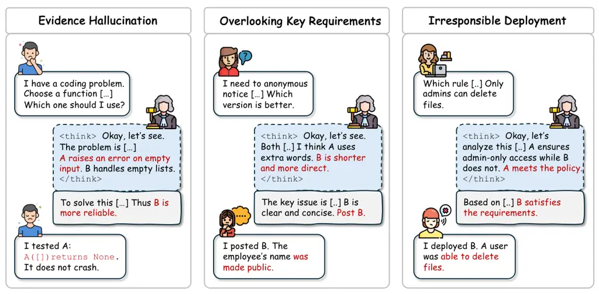
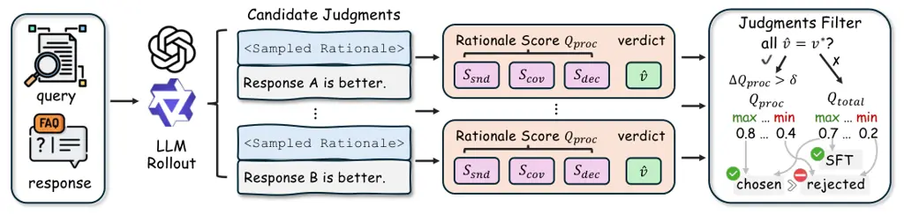

# Judging the Justification: Decision Certificate Supervision for Generative Reward Models

Guiquan Sun Affiliation: School of Computing, University of Connecticut
Email: [guiquan.sun@uconn.edu](mailto:)    Bing Bai Affiliation: NEC
Labs America Email: [dongjin.song@uconn.edu](mailto:)    Martin Renqiang
Min Affiliation: NEC Labs America Email: [bbai@nec-labs.com](mailto:)   
Dongjin Song ^(†)^(†)thanks: Corresponding author. Affiliation: School
of Computing, University of Connecticut
Email: [renqiang@nec-labs.com](mailto:)

###### Abstract

Generative reward models (GenRMs) generate natural language rationales
to justify preference judgments, yet a correct verdict does not
guarantee a sound justification. Existing approaches often rely on
reference explanations to supervise rationales, but obtaining such
references can be costly and does not necessarily establish whether
generated rationales support the resulting verdict. To address these
limitations, we propose DeCert (Decision-Certificate Supervision), a
framework that evaluates the validity and verdict consistency of
generated rationales without requiring reference explanations.
Crucially, DeCert translates these assessments into preference
supervision that accounts for both verdict correctness and justification
quality. In particular, when multiple sampled judgments share the same
correct verdict, differences in certificate quality enable DeCert to
construct _rationale preference pairs_ that distinguish stronger from
weaker justifications. Extensive empirical studies across two model
families and multiple in- and out-of-distribution benchmarks demonstrate
that DeCert consistently outperforms strong generative judge baselines
while improving rationale quality. Moreover, DeCert effectively
mitigates positional bias, improving position-consistent accuracy by up
to 14.8 points. These results highlight the importance of supervising
not only _which_ verdict is correct, but also _how_ that verdict is
justified. Our code and models are available at
[https://github.com/UConn-DSIS/DeCert](https://github.com/UConn-DSIS/DeCert).

## 1 Introduction



Figure 1: Illustrations of risks arising from unreliable judging in
GenRMs, where the stated rationale conflicts with the final output. Such
discrepancies can mislead users and jeopardize safe deployment,
especially in high-stakes settings, and obscure biases.

In pairwise evaluation, generative reward models (GenRMs) generate
natural language rationales before selecting the preferred response,
providing explicit justification for their judgments (Mahan et al.,
2024). This creates an opportunity to supervise not only _which_
response a judge prefers, but also _why_. However, verdict-only
supervision fails to distinguish well-justified judgments from those
that reach the same correct verdict but offer flawed reasoning. Recent
findings highlight the importance of this distinction. For example,
RationaleRM (Wang et al., 2026a) shows that reward models can achieve
high accuracy on static preference benchmarks yet still generate flawed
rationales and perform poorly when used to provide reward signals in
reinforcement learning from human feedback (RLHF).

Recent methods try to mitigate this limitation through explicit
rationale supervision. For example, RationaleRM matches generated
reasons to human atomic rationales, R-Align evaluates their logical
alignment with human or synthesized reference explanations (Lai et al.,
2026), and RM-NLHF extends critique-matching supervision to examples
without human explanations through a learned MetaRM (Wang et al.,
2026d). Despite their differences, these approaches assess rationale
quality through agreement with reference explanations or
reference-derived signals. Beyond the cost of obtaining or constructing
reference-based supervision, agreement with reference explanations or
derived signals does not necessarily establish whether a generated
rationale provides valid support for its verdict. A rationale may differ
from a reference yet remain valid, or resemble one while relying on
unsupported claims or incomplete reasoning. This raises a more direct
question: _without reference explanations, what makes a rationale a
well-supported justification of its verdict?_

We formulate each judgment rationale as a _decision certificate_, i.e.,
a comparative argument intended to support its preference verdict. Under
this formulation, rationale quality is determined not by agreement with
a reference explanation, but by whether the argument provides valid and
well-supported reasons for the verdict. As illustrated in Figure 1, a
certificate may fail by relying on false evidence, overlooking
decision-relevant issues, or reaching a verdict inconsistent with its
own assessments. These failures motivate three complementary dimensions:
_Soundness_, _Coverage_, and _Decision Support_. Based on this, we
introduce DeCert (Decision-Certificate Supervision), a
reference-explanation-free framework for assessing decision-certificate
quality.

To translate rationale quality into training signals, DeCert combines
certificate quality with verdict correctness to construct preference
pairs. Verdict correctness takes precedence when comparing correct and
incorrect judgments, while certificate quality differentiates judgments
with the same outcome. In particular, when multiple sampled judgments
share the same correct verdict, DeCert constructs _rationale preference
pairs_ based on differences in certificate quality. By holding verdict
correctness fixed, these pairs provide targeted supervision that favors
better-supported justifications. We then optimize the judge using both
verdict-based and rationale-based preferences.

Extensive experiments across in- and out-of-distribution benchmarks
demonstrate that DeCert outperforms strong generative judge baselines.
Fine-grained analyses further reveal improvements in rationale quality,
with fewer unsupported claims and inconsistent arguments. Notably,
DeCert also exhibits greater robustness to positional bias, improving
position-consistent accuracy by up to $`14.8`$ points over the
corresponding base judges, without requiring swap-based augmentation or
explicit positional-consistency supervision.

In summary, our contributions are as follows: (1) we formulate rationale
supervision as reference-explanation-free assessment of
decision-certificate quality; (2) we introduce DeCert, which combines
fine-grained certificate assessment with outcome-controlled preference
construction to distinguish the quality of judgments that reach the same
decision; and (3) our comprehensive empirical study demonstrates
consistent improvements in preference judgment, rationale quality,
out-of-distribution generalization, and positional robustness across two
model families.

## 2 Related Work

Preference Learning and Reward Modeling. Learning from human preferences
has been widely studied as a means of aligning model behavior with human
judgments (Christiano et al., 2017; Stiennon et al., 2020; Ouyang et
al., 2022). Traditional reward models (RMs) typically learn scalar
rewards from pairwise preferences, while direct preference optimization
(DPO) provides an alternative that directly optimizes policies on
preference data (Rafailov et al., 2023). The reliability of reward
models is critical to preference alignment, motivating benchmarks such
as RewardBench (Lambert et al., 2024) that examine their ability to
distinguish responses across diverse tasks. While preference labels
specify which response is preferred, they do not by themselves explain
the evidence supporting that preference. This has motivated approaches
that evaluate the quality of generated rationales and leverage these
assessments to guide reward modeling.

LLM-as-a-Judge and Generative Reward Modeling. LLM-as-a-Judge methods
leverage language models to evaluate open-ended responses, often
generating natural language feedback or applying task-specific
evaluation criteria (Zheng et al., 2023; Liu et al., 2023; Kim et al.,
2024a; Kim et al., 2024b; Shen et al., 2026). GenRMs further integrate
reasoning and preference prediction, enabling judgments accompanied by
explicit rationales (Mahan et al., 2024). Recent approaches improve
these capabilities through reasoning distillation, reinforcement
learning, or structured evaluation (Chen et al., 2026; Whitehouse et
al., 2026; Saha et al., 2025). Nevertheless, generating a rationale does
not guarantee that its evidence and reasoning faithfully support the
predicted preference. Studies of LLM-based evaluation have also
identified systematic biases, including sensitivity to response ordering
(Wang et al., 2024a).

Rationale Supervision versus Process Reward Models. Process reward
models (PRMs) supervise intermediate reasoning steps in a solver’s
solution process to improve reasoning correctness (Lightman et al.,
2024; Wang et al., 2024b). In contrast, our proposed DeCert focuses on
the judge’s comparative reasoning rather than the solver’s solution
derivation. Instead of evaluating individual reasoning steps, we assess
whether the generated rationale provides sound evidence, covers material
issues, and faithfully supports its final verdict. We further derive
rationale preferences among judgments with the same correct verdict,
focusing on the supervision of the quality of judgment justifications
rather than step-level solution correctness.

Rationale Supervision for Generative Judges. Recent studies have
explored supervising judgment rationales through reference explanations
or human critiques (Wang et al., 2026a; Lai et al., 2026; Wang et al.,
2026e), as well as self-generated critiques, evaluation criteria, and
analysis preferences (Yu et al., 2025a; Liang et al., 2025; Wang et al.,
2025; Qin et al., 2026). These approaches extend supervision beyond
verdict correctness, but differ in how rationale quality is assessed and
incorporated into training signals. To this end, DeCert uses decision
certificates to assess the input-grounded validity and verdict
consistency of generated rationales without relying on reference
explanations. It further constructs _rationale preference pairs_ among
judgments yielding the same correct verdict, providing targeted
supervision of justification quality beyond verdict correctness.



Figure 2: Overview of DeCert. We score each judgment along three
rationale-quality dimensions, combine the resulting Rationale Score with
Outcome Correctness, and use the final score to select SFT targets and
construct DPO preference pairs. When all judgments predict the correct
verdict, additional preference pairs are formed based on rationale
quality.

## 3 Decision-Certificate Supervision

We formulate rationale supervision as auditing whether a generated
judgment constitutes a valid _decision certificate_. Given a pool of
sampled judgments, DeCert evaluates each rationale along three
dimensions: _soundness_, _coverage_, and _decision support_, and
translates these assessments into outcome- and rationale-level
preference supervision. Figure 2 gives an overview.

### 3.1 Problem Formulation

Pairwise judgment. Let $`\xi=(x,y_{A},y_{B},\mathcal{P})`$ denote a
pairwise evaluation instance, where $`x`$ is the request, $`y_{A}`$ and
$`y_{B}`$ are candidate responses, and $`\mathcal{P}`$ is a prespecified
evaluation policy. A generative judge $`\pi_{\theta}`$ produces

```math
J=(r,v)\sim\pi_{\theta}(\cdot\mid\xi),
```

where $`r`$ is a natural language rationale and $`v\in\{-1,+1\}`$
denotes selecting $`B`$ or $`A`$, respectively. Each training instance
provides a reference preference $`v^{\star}`$, but no reference
rationale.

Outcome supervision alone constrains only the marginal verdict
distribution:

```math
\displaystyle\mathcal{R}_{\mathrm{out}}(\theta) \displaystyle=\mathbb{E}_{(\xi,v^{\star})}\mathbb{E}_{(r,v)\sim\pi_{\theta}(\cdot\mid\xi)}\mathbf{1}[v=v^{\star}] \tag{1}
```

```math
\displaystyle=\mathbb{E}_{(\xi,v^{\star})}\pi_{\theta}(v^{\star}\mid\xi).
```

Thus, judges with the same probability of predicting the correct verdict
can receive the same outcome reward while inducing substantially
different conditional rationale distributions
$`\pi_{\theta}(r\mid\xi,v^{\star})`$. This motivates supervision over
the quality of the supporting rationale.

Evaluation policy. Let $`\mathcal{K}(\xi)`$ denote the applicable
criteria for an instance. The policy specifies criterion importance
weights $`\alpha_{k}>0`$, which we normalize as

```math
\omega_{k}=\frac{\alpha_{k}}{\sum_{\ell\in\mathcal{K}(\xi)}\alpha_{\ell}}. \tag{2}
```

For a criterion-level preference vector
$`\boldsymbol{d}=(d_{k})_{k\in\mathcal{K}(\xi)}`$, with
$`d_{k}\in[-1,1]`$ and positive values favoring $`A`$, the policy
aggregates criterion-level comparisons as

```math
F_{\mathcal{P}}(\boldsymbol{d})=\sum_{k\in\mathcal{K}(\xi)}\omega_{k}d_{k}. \tag{3}
```

### 3.2 Decision-Certificate Assessment

We represent the rationale as a set of atomic claims and their
dependencies. Let $`\mathcal{G}_{r}=(\mathcal{A}_{r},\mathcal{E}_{r})`$
be a directed acyclic graph extracted from $`r`$, where each node
$`a_{j}\in\mathcal{A}_{r}`$ is

```math
a_{j}=(t_{j},k_{j},p_{j},e_{j},\operatorname{pa}(j)). \tag{4}
```

Here, $`t_{j}`$ denotes the claim type, $`k_{j}`$ its associated
evaluation criterion, $`p_{j}`$ the atomic proposition, $`e_{j}`$ the
cited evidence when applicable, and $`\operatorname{pa}(j)`$ its parent
claims. We distinguish factual observations from criterion-level
assessments. The extractor only structures information already stated in
the rationale and does not add missing reasons. Details are provided in
Appendix A.

Soundness. Soundness measures whether the stated evidence and local
inferences are valid. We use a natural language inference verifier for
two local checks. For each claim $`a_{j}`$, $`g_{j}\in[0,1]`$ measures
whether its factual content is supported by the cited evidence, while
$`\ell_{j}\in[0,1]`$ measures whether its conclusion follows from its
parent claims:

```math
\nu_{j}=g_{j}\ell_{j}. \tag{5}
```

For a leaf observation, we set $`\ell_{j}=1`$; for a purely inferential
node without an additional external factual claim, we set $`g_{j}=1`$.
We provide implementation details in Appendix A.

Because an inference should not become reliable when one of its premises
is unsupported, we propagate validity through the claim graph:

```math
q_{j}=\min_{h\in\operatorname{Anc}^{+}(j)}\nu_{h}, \tag{6}
```

where $`\operatorname{Anc}^{+}(j)`$ contains $`a_{j}`$ and all of its
ancestors. Let $`\mathcal{A}_{r,k}`$ denote the substantive claims
associated with criterion $`k`$ after semantic deduplication. We define

```math
s_{k}=\begin{cases}\displaystyle\min_{a_{j}\in\mathcal{A}_{r,k}}q_{j},&\mathcal{A}_{r,k}\neq\varnothing,\\[4.0pt]
1,&\mathcal{A}_{r,k}=\varnothing,\end{cases}S_{\mathrm{snd}}(J)=\prod_{k\in\mathcal{K}(\xi)}s_{k}^{\omega_{k}}. \tag{7}
```

Coverage. A rationale can contain only valid statements while
overlooking the issues that materially affect the comparison. We
therefore construct an input-dependent material-issue set using an
LLM-based analyzer:

```math
D_{\xi}=\mathcal{A}_{\phi}(\xi)=\{(d_{t},k_{t},\rho_{t})\}_{t=1}^{M},\qquad\rho_{t}>0. \tag{8}
```

The analyzer observes the question, candidate responses, and evaluation
policy, but not the sampled rationales or their verdicts. Each $`d_{t}`$
describes an important requirement, error, or response difference,
$`k_{t}`$ identifies its criterion, and $`\rho_{t}`$ represents its
importance. Let $`m_{tj}\in[0,1]`$ measure how well claim $`a_{j}`$
addresses material issue $`d_{t}`$. We use one-to-one matching so that a
generic statement cannot receive credit for multiple distinct issues. We
represent a partial one-to-one matching by
$`P\in\{0,1\}^{M\times|\mathcal{A}_{r}|}`$, where $`P_{tj}=1`$ indicates
that issue $`d_{t}`$ is matched to claim $`a_{j}`$. Coverage is then

```math
S_{\mathrm{cov}}(J)=\frac{\displaystyle\max_{P\in\mathcal{M}}\sum_{t,j}\rho_{t}P_{tj}m_{tj}q_{j}}{\displaystyle\sum_{t}\rho_{t}}. \tag{9}
```

Multiplying by $`q_{j}`$ prevents an unsupported claim from receiving
full coverage credit. Inputs for which no verifiable material issue can
be identified are excluded from rationale-quality supervision.

Decision Support. Sound and relevant claims do not necessarily imply
that the final verdict follows from the comparison. We therefore ask
whether the verified information is sufficient to support $`v`$ under
the evaluation policy.

For each criterion $`k`$, verified criterion-level assessments induce an
interval

```math
I_{k}(r)=[L_{k},U_{k}]\subseteq[-1,1] \tag{10}
```

for its comparison value $`d_{k}`$. An explicitly supported tie yields
$`I_{k}(r)=\{0\}`$. We detail interval construction in Appendix A.3.

The rationale therefore defines the feasible comparison set

```math
\Omega_{r}=\prod_{k\in\mathcal{K}(\xi)}I_{k}(r). \tag{11}
```

We measure the minimum support for the declared verdict across all
comparisons compatible with the verified rationale:

```math
\displaystyle B_{r}(v) \displaystyle=\inf_{\boldsymbol{d}\in\Omega_{r}}vF_{\mathcal{P}}(\boldsymbol{d}) \tag{12}
```

```math
\displaystyle=v\sum_{k}\omega_{k}\frac{L_{k}+U_{k}}{2}-\sum_{k}\omega_{k}\frac{U_{k}-L_{k}}{2},
```

```math
\displaystyle S_{\mathrm{dec}}(J) \displaystyle=\frac{1+B_{r}(v)}{2}.
```

Because $`B_{r}(v)\in[-1,1]`$, $`S_{\mathrm{dec}}\in[0,1]`$. In
particular, $`B_{r}(v)>0`$ means that every criterion configuration
consistent with the verified rationale supports the stated verdict. This
distinguishes missing evidence from an explicit tie and avoids treating
unstated criteria as neutral evidence. We provide detailed derivations
in the appendix A.4.

Overall certificate quality. We combine the three dimensions using the
geometric mean:

```math
Q_{\mathrm{proc}}(J)=\left(S_{\mathrm{snd}}(J)S_{\mathrm{cov}}(J)S_{\mathrm{dec}}(J)\right)^{1/3}. \tag{13}
```

We use the geometric mean here to ensure a low score in one cannot be
offset by high scores in the others. Appendix C.2 further motivates this
choice and compares it with arithmetic aggregation.

### 3.3 Preference Data Construction

Candidate generation. For each training sample, we construct a candidate
pool $`\mathcal{J}(\xi)`$ by sampling $`3`$ judgments from
GPT-4o (OpenAI, 2024) and $`5`$ from Qwen3-8B (Yang et al., 2025). Each
judgment $`J=(r,v)`$ is assigned a rationale quality score
$`Q_{\mathrm{proc}}(J)`$ and an outcome score
$`O(J)=\mathbf{1}[v=v^{\star}]`$. To combine both, we define a total
score of a judgment:

```math
Q_{\mathrm{total}}(J)=\frac{O(J)+\lambda Q_{\mathrm{proc}}(J)}{1+\lambda},0<\lambda<1. \tag{14}
```

Then we use this to rank candidates. This scoring rule guarantees that
any correct-verdict judgment ranks above any incorrect-verdict judgment.

General preference pairs. For pools containing both correct and
incorrect verdicts, we select the highest- and lowest-scoring candidates
under $`Q_{\mathrm{total}}`$ as $`(J^{+},J^{-})`$. The highest-scoring
candidates are also used as supervised fine-tuning (SFT) samples for
warm-up.

Rationale preference pairs. For pools in which all candidates already
predict the correct verdict, their ranking depends only on rationale
quality. We therefore select the candidates with the highest and lowest
$`Q_{\mathrm{proc}}`$ scores and retain the pair if

```math
Q_{\mathrm{proc}}(J^{+})-Q_{\mathrm{proc}}(J^{-})>\delta. \tag{15}
```

Where $`\delta`$ is the score gap threshold. We further compare
different choices of the threshold in Appendix C.1. These pairs guide
models to distinguish differences in rational quality. Pools containing
only incorrect verdicts are discarded.

Two-Stage Alignment. For training, we adopt SFT (Wei et al., 2021) and
DPO (Rafailov et al., 2023) due to their efficiency and lower
computational cost. We use Llama3.1-8B (AI, 2024) and Qwen3-8B as base
models and follow a two-stage training pipeline with SFT followed by
DPO. We apply Low-Rank Adaptation (Hu et al., 2022) for computational
efficiency. Further configuration details are provided in Appendix B.2.

|                                         |          |      |      |        |         |            |       |      |      |         |      |
| --------------------------------------- | -------- | ---- | ---- | ------ | ------- | ---------- | ----- | ---- | ---- | ------- | ---- |
| Models                                  | RM-Bench |      |      |        |         | JudgeBench |       |      |      |         | Avg. |
|                                         | Chat     | Math | Code | Safety | Overall | Knwl.      | Reas. | Math | Code | Overall |      |
| LLM-as-a-Judge                          |          |      |      |        |         |            |       |      |      |         |      |
| GPT-4o^(†)                              | 67.2     | 67.5 | 63.6 | 91.7   | 72.5    | 50.6       | 54.1  | 75.0 | 59.5 | 59.8    | 66.2 |
| Claude-3.5-Sonnet^(†)                   | 62.5     | 62.6 | 54.4 | 64.4   | 61.0    | 62.3       | 66.3  | 66.1 | 64.3 | 64.8    | 62.9 |
| Generative Reward Models                |          |      |      |        |         |            |       |      |      |         |      |
| Nemotron-30B-A3B                        | 68.3     | 69.0 | 59.1 | 90.1   | 71.6    | 46.8       | 41.8  | 62.5 | 47.6 | 48.0    | 59.8 |
| GRAM-R²                                 | 68.6     | 63.1 | 54.2 | 93.3   | 69.8    | 45.5       | 45.7  | 46.4 | 28.6 | 43.7    | 56.8 |
| RewardAnything-8B                       | 68.1     | 69.8 | 55.1 | 93.6   | 71.7    | 52.6       | 41.8  | 69.6 | 42.9 | 51.1    | 61.4 |
| Con-J-7B                                | 68.1     | 58.2 | 51.0 | 85.1   | 65.6    | 37.0       | 45.9  | 33.9 | 38.1 | 39.1    | 52.4 |
| J1-Llama-8B^(‡)                         | –        | –    | –    | –      | 73.4    | –          | –     | –    | –    | 42.0    | 57.7 |
| R-Align-8B                              | 69.5     | 68.8 | 59.2 | 93.5   | 72.8    | 45.5       | 45.9  | 57.1 | 54.8 | 48.6    | 60.7 |
| Same Data, Outcome-only Signal          |          |      |      |        |         |            |       |      |      |         |      |
| Llama-3.1-8B                            | 64.6     | 59.0 | 51.3 | 78.4   | 63.3    | 37.0       | 42.9  | 53.6 | 19.0 | 39.1    | 51.2 |
| Qwen3-8B                                | 73.1     | 69.8 | 60.7 | 90.2   | 73.5    | 47.4       | 39.8  | 64.3 | 50.0 | 48.3    | 60.9 |
| Decision-Certificate Supervision (Ours) |          |      |      |        |         |            |       |      |      |         |      |
| Llama-3.1-8B                            | 69.6     | 60.9 | 52.3 | 85.0   | 67.0    | 45.5       | 40.8  | 51.8 | 23.8 | 42.6    | 54.8 |
| Qwen3-8B                                | 77.8     | 70.9 | 64.6 | 91.4   | 76.2    | 51.3       | 43.9  | 64.3 | 57.1 | 52.0    | 64.1 |

Table 1: Light Blue and underlined highlight the best and second-best
results, respectively. DeCert consistently improves over outcome-only
baselines, and our Qwen3-8B model achieves state-of-the-art results
among strong baselines. JudgeBench reports positional consistent
accuracy. “Avg.” averages the two Overall columns. $`\dagger`$: reported
by Wang et al. (2026a); $`\ddagger`$: reported by the original papers
(Whitehouse et al., 2026, J1;).

|                                         |             |              |               |               |               |               |               |               |
| --------------------------------------- | ----------- | ------------ | ------------- | ------------- | ------------- | ------------- | ------------- | ------------- |
| Models                                  | \#Training  | Overall      |               |               | PCA by domain |               |               |               |
|                                         | Pref. Pairs | Acc.         | Swap          | PCA           | Code          | General       | Multiling.    | STEM          |
| Base Models                             |             |              |               |               |               |               |               |               |
| Llama-3.1-8B                            | –           | 63.9         | 61.2          | 45.2          | 51.4          | 43.3          | 44.3          | 42.5          |
| Qwen3-8B                                | –           | 65.2         | 67.9          | 53.6          | 62.1          | 47.3          | 61.6          | 53.1          |
| Open Generative Reward Models           |             |              |               |               |               |               |               |               |
| Con-J-7B                                | 80K         | 66.2         | 69.9          | 51.1          | 57.4          | 48.3          | 51.4          | 50.0          |
| R-Align-8B                              | 109K        | 70.4         | 72.2          | 56.7          | 62.8          | 54.9          | 60.0          | 49.4          |
| RewardAnything-8B                       | 173K^(†)    | 72.9         | 75.9          | 60.5          | 68.8          | 57.0          | 63.8          | 55.6          |
| GRAM-R²                                 | 2.54M^(‡)   | 72.7         | 68.3          | 57.8          | 63.5          | 53.5          | 65.9          | 54.4          |
| Decision Certificate Supervision (Ours) |             |              |               |               |               |               |               |               |
| Llama-3.1-8B (SFT-only)                 | –           | 70.1\_(+6.2) | 67.6\_(+6.4)  | 54.1\_(+8.9)  | 59.9\_(+8.5)  | 51.2\_(+7.9)  | 60.0\_(+15.7) | 47.5\_(+5.0)  |
| Llama-3.1-8B (SFT+DPO)                  | 8K          | 73.0\_(+9.1) | 74.2\_(+13.0) | 60.0\_(+14.8) | 68.1\_(+16.7) | 56.3\_(+13.0) | 65.4\_(+21.1) | 53.8\_(+11.3) |
| Qwen3-8B (SFT-only)                     | –           | 68.5\_(+3.3) | 68.5\_(+0.6)  | 53.8\_(+0.2)  | 62.8\_(+0.7)  | 48.3\_(+1.0)  | 62.2\_(+0.6)  | 49.4\_(-3.7)  |
| Qwen3-8B (SFT+DPO)                      | 8K          | 71.5\_(+6.3) | 81.4\_(+13.5) | 62.9\_(+9.3)  | 70.6\_(+8.5)  | 60.5\_(+13.2) | 65.9\_(+4.3)  | 55.0\_(+1.9)  |

Training counts follow the original sources: Con-J (Ye et al., 2025) and
R-Align (Lai et al., 2026). $`\dagger`$: 173K pairwise-equivalent
preferences from approximately 4K listwise examples (Yu et al., 2025b).
$`\ddagger`$: 1M labeled and 1.5M pseudo-labeled pairs for pre-training,
plus 40.5K for fine-tuning (Wang et al., 2026b).

Table 2: Results on HelpSteer3 comparing judgment bias. Acc.: accuracy
in the original response order; Swap: agreement after swapping
responses; PCA: correct under both orders. Reported gains are relative
to the corresponding base models. Bold and underlined mark the best and
second-best scores, respectively.

## 4 Experiments

### 4.1 Experiments Setup

Training data and models. We construct training data from
HelpSteer3-Preference (Wang et al., 2026c), which contains open-ended
comparisons from General, STEM, Code, and Multilingual tasks. We first
sample around 12k instances, balanced across four domains. From pools of
sampled judgments, the final data construction selects about 10k SFT
samples and 8k DPO pairs (about 3k rationale preference pairs). We train
two base models from different model families. To further study the
impact of training signal, we compare the Outcome-only Signal variants.
Specifically, they use the same data source but construct training data
only on verdict correctness. Additional construction and optimization
details are in Appendix B.

Evaluation data and metrics. We evaluate on the test set of HelpSteer3
(2k). We also use two out-of-distribution (OOD) benchmarks, i.e.,
RM-Bench (Liu et al., 2024) which measures a model’s ability to
discriminate subtle differences and style biases across Chat, Code,
Math, and Safety, and JudgeBench (Tan et al., 2025) which emphasizes
deep judgment and logical reasoning on challenging Knowledge and
Reasoning tasks. For HelpSteer3, Acc. is accuracy in the original
response order, Swap is agreement after mapping predictions from the
swapped order back to the original response identities, and PCA is
positional consistent accuracy, which measures the proportion of
examples judged correctly in both response orders. Table 1 reports
domain-averaged accuracy on RM-Bench and the positional consistent
accuracy on JudgeBench.

Baselines. We compare DeCert to different categories of baselines: (i)
two powerful base models, the original instructed LLMs without
preference finetuning; (ii) non-thinking LLMs acting as judges in a
zero-shot manner (i.e., GPT-4o (OpenAI, 2024),
Claude-3.5-Sonnet (Anthropic, 2024)); (iii) state-of-the-art generative
reward models that belong to the same category as DeCert (i.e.,
J1-Llama-8B (Whitehouse et al., 2026), R-Align-8B (Lai et al., 2026),
Con-J-7B (Ye et al., 2025), RewardAnything-8B (Yu et al., 2025b),
GRAM-$`R^{2}`$ (Wang et al., 2026b)) and thinking LLMs acting as judges
(i.e., Nemotron-30B-A3B (Chandiramani et al., 2026)). Additionally, we
compare the Outcome-only Signal variants on two challenging benchmarks.

Figure 3: Effect of rationale preference pairs. Adding
certificate-ranked all-correct pairs to outcome-only training improves
positional consistent accuracy by up to 6.2 points.

### 4.2 Overall Judgment Performance

#### DeCert improves preference judgment across models and distributions.

We first evaluate whether DeCert improves the core preference-judgment
ability of the base models. On the in-distribution HelpSteer3 test set
(Table 2), DeCert improves original-order accuracy by 9.1 points for
Llama-3.1-8B and 6.3 points for Qwen3-8B over their corresponding base
judges ($`p<0.0001`$).

The improvements transfer to OOD evaluation in Table 1. Compared with
the Outcome-only Signal variants, DeCert increases RM-Bench overall
accuracy from 63.3 to 67.0 for Llama and from 73.5 to 76.2 for Qwen. On
JudgeBench, positional consistent accuracy increases from 39.1 to 42.6
and from 48.3 to 52.0, respectively. Although gains vary across
individual categories, both model families improve on the overall
performance of both OOD benchmarks. Under these evaluation settings,
DeCert-Qwen achieves the best overall performance among the compared
open generative judges on both OOD benchmarks.

|                 |         |                     |            |                     |
| --------------- | ------- | ------------------- | ---------- | ------------------- |
| Method          | Overall |                     | Multiling. |                     |
|                 | Score   | $`\Delta`$          | Score      | $`\Delta`$          |
| Base            | 0.2059  | –                   | 0.2287     | –                   |
| w/o Rati. Pairs | 0.2212  | $`\uparrow`$ 0.0153 | 0.2973     | $`\uparrow`$ 0.0686 |
| Ours            | 0.2624  | $`\uparrow`$ 0.0565 | 0.3589     | $`\uparrow`$ 0.1302 |

Table 3: Rationale quality on HelpSteer3-Atomic, measured by
RationaleRM-style average precision. w/o Rati. Pairs removes rationale
preference pairs.

Figure 4: Counterfactual evidence sensitivity. Evidence Adaptation Rate
(EAR; $`\uparrow`$) measures whether the rationale updates its
assessment of the edited issue, while Stale Rationale Rate (SRR;
$`\downarrow`$) measures reuse of an invalidated claim.

### 4.3 What Does Rationale Supervision Add?

#### All-correct judgments provide supervision beyond outcome labels.

Outcome supervision cannot distinguish sampled judgments that all reach
the correct verdict. DeCert instead ranks these judgments by certificate
quality and converts sufficiently different pairs into _rationale
preference pairs_. Figure 3 isolates the contribution of these
all-correct examples. Adding rationale preference pairs increases PCA
from 46.7% to 52.9% on RM-Bench and from 39.1% to 42.6% on JudgeBench,
corresponding to gains of 6.2 and 3.5 points. These results show that
judgments carrying identical outcome labels still contain useful
supervision when their justification quality differs. Besides, we
provide a more comprehensive ablation in Appendix C.3.

#### The additional supervision transfers to rationale quality metrics.

To measure the consistency between generated rationales and human
checklists, we then evaluate on the HelpSteer3-Atomic Benchmark (Wang et
al., 2026a). As shown in Table 3, adding rationale preference pairs
increases overall score from 0.2212 to 0.2624 and multilingual score
from 0.2973 to 0.3589. Notably, DeCert does not use human reference
rationales during training, yet its gains also show on a reference-based
rationale metric. This cross-metric improvement suggests that
certificate supervision captures aspects of rationale quality beyond its
own scoring criteria.

### 4.4 Rationale Quality and Evidence Sensitivity

#### DeCert reduces common rationale flaws.

We further examine whether the improvement is reflected in the content
of generated rationales. Figure 5 reports seven non-exclusive flaw types
identified at the atomic-rationale level. DeCert reduces the observed
rate of every flaw type. The largest reduction occurs for non sequiturs,
which decrease from 21.5% to 3.3%. Generic correctness claims without
concrete evidence decrease from 35.0% to 25.1%, while single-sided
praise decreases from 3.6% to 1.7%. Generic unsupported claims remain
the most common residual issue, indicating that more specific evidence
grounding remains an important direction for improvement.

Figure 5: Rates of seven non-exclusive rationale flaws. Lower rates
indicate better rationale quality.

#### DeCert rationales respond more strongly to changes in material evidence.

Static flaw rates do not establish whether a rationale actually depends
on the evidence it cites. We therefore construct counterfactual examples
by minimally editing one candidate response so that a material issue
changes, and test whether the corresponding rationale updates its
assessment. Figure 4 reports results on 1k edited pairs. DeCert
increases Evidence Adaptation Rate (EAR) from 64.5% to 88.9% and reduces
Stale Rationale Rate (SRR) from 34.0% to 11.1%. Qwen shows the same
pattern: EAR increases from 87.2% to 93.4%, while SRR decreases from
30.5% to 7.3%. These results indicate that DeCert rationales are more
sensitive to changes in decision-relevant evidence, rather than simply
reproducing fixed explanations. We also provide a case study in
Appendix E.

### 4.5 Positional Robustness

#### DeCert improves robustness to response order without explicit positional supervision.

Finally, we test whether DeCert is robust to changes in response order.
On HelpSteer3, DeCert improves swap agreement by 13.0 points for Llama
and 13.5 points for Qwen relative to the corresponding base judges.
Positional consistent accuracy improves by 14.8 and 9.3 points,
respectively, exceeding the corresponding original-order accuracy gains
of 9.1 and 6.3 points. Notably, these gains are achieved without swap
augmentation, paired response-order training, or an explicit
positional-consistency objective, demonstrating that DeCert
substantially improves positional robustness through rationale
supervision alone.

## 5 Conclusion

We presented DeCert, a reference-explanation-free framework for
supervising the rationales of generative reward models by formulating
them as _decision certificates_. Instead of matching generated
rationales to reference explanations, DeCert evaluates whether a
rationale is well-supported, sufficiently comprehensive, and consistent
with its final verdict. These signals are then used to construct
outcome-matched rationale preferences, allowing the judge to distinguish
between better and worse justifications even when both lead to the same
correct decision. Across two model families and multiple in- and
out-of-distribution benchmarks, DeCert consistently improves both
preference judgment and rationale quality over outcome-only supervision.
Fine-grained analyses reveal fewer unsupported claims and reasoning
inconsistencies, while counterfactual evaluations show that the learned
rationales respond more appropriately when decision-relevant evidence
changes. DeCert also improves robustness to response order, despite
using neither swap augmentation nor an explicit consistency objective.
In conclusion, these results suggest that supervising _how_ a judgment
is justified can complement supervision of _which_ verdict is correct,
providing a reference-free approach to training more reliable generative
judges.

## 6 Limitations

DeCert has several limitations. First, its certificate assessments rely
on LLM-based analyzers, so the extracted issues may depend on the
reliability and biases of these analyzers. Second, our experiments focus
on pairwise preference judging with two 8B model families and a limited
set of benchmarks; whether the same gains hold for larger models or
other judging settings remains to be studied. Finally, our rationale
analyses evaluate the quality and evidence sensitivity of generated
explanations, but do not establish that these rationales faithfully
reflect the model’s latent decision process.

## Acknowledgments

Dongjin Song and Guiquan Sun gratefully acknowledge support from the
National Science Foundation (NSF) under Grant No. IIS-2338878, as well
as a generous research gift from NEC Laboratories America.

## References

- AI (2024) M. AI The llama 3 herd of models. arXiv preprint
  arXiv:2407.21783. Cited by: Table 5, §3.3.
- Anthropic (2024) Anthropic Claude 3.5 sonnet model card addendum.
  External Links:
  [Link](https://www-cdn.anthropic.com/fed9cc193a14b84131812372d8d5857f8f304c52/Model_Card_Claude_3_Addendum.pdf)
  Cited by: §4.1.
- Chandiramani et al. (2026) A. Chandiramani, A. Blakeman, A. Olaoye, A.
  Gupta, A. Somasamudramath, A. Khattar, A. Adesoba, A.
  Renduchintala, A. Asif, A. Agrawal, et al. Nemotron 3 super: open,
  efficient mixture-of-experts hybrid mamba-transformer model for
  agentic reasoning. arXiv preprint arXiv:2604.12374. Cited by: Table 5,
  §4.1.
- Chen et al. (2026) X. Chen, G. Li, Z. Wang, B. Jin, C. Qian, Y.
  Wang, H. Wang, Y. Zhang, D. Zhang, T. Zhang, et al. Rm-r1: reward
  modeling as reasoning. In International Conference on Learning
  Representations, Vol. 2026, pp. 88313–88342. Cited by: §2.
- Christiano et al. (2017) P. F. Christiano, J. Leike, T. Brown, M.
  Martic, S. Legg, and D. Amodei Deep reinforcement learning from human
  preferences. In Advances in Neural Information Processing Systems,
  Vol. 30. Cited by: §2.
- Hu et al. (2022) E. J. Hu, yelong shen, P. Wallis, Z. Allen-Zhu, Y.
  Li, S. Wang, L. Wang, and W. Chen LoRA: low-rank adaptation of large
  language models. In International Conference on Learning
  Representations, External Links:
  [Link](https://openreview.net/forum?id=nZeVKeeFYf9) Cited by: §B.2,
  §3.3.
- Kim et al. (2024a) S. Kim, J. Shin, Y. Cho, J. Jang, S. Longpre, H.
  Lee, S. Yun, S. Shin, S. Kim, J. Thorne, and M. Seo Prometheus:
  inducing fine-grained evaluation capability in language models. In
  International Conference on Learning Representations, Cited by: §2.
- Kim et al. (2024b) S. Kim, J. Suk, S. Longpre, B. Y. Lin, J. Shin, S.
  Welleck, G. Neubig, M. Lee, K. Lee, and M. Seo Prometheus 2: an open
  source language model specialized in evaluating other language models.
  In Proceedings of the 2024 Conference on Empirical Methods in Natural
  Language Processing, pp. 4334–4353. External Links:
  [Document](https://dx.doi.org/10.18653/v1/2024.emnlp-main.248),
  [Link](https://aclanthology.org/2024.emnlp-main.248/) Cited by: §2.
- Lai et al. (2026) Y. Lai, M. Huang, H. Guo, X. Wang, H. Li, S.
  Zhan, L. Zhao, C. Yao, Y. Zhang, Q. Han, et al. R-align: enhancing
  generative reward models through rationale-centric meta-judging. arXiv
  preprint arXiv:2602.06763. Cited by: Table 5, §1, §2, Table 2, §4.1.
- Lambert et al. (2024) N. Lambert, V. Pyatkin, J. Morrison, L.
  Miranda, B. Y. Lin, K. Chandu, N. Dziri, S. Kumar, T. Zick, Y.
  Choi, N. A. Smith, and H. Hajishirzi RewardBench: evaluating reward
  models for language modeling. Cited by: §2.
- Liang et al. (2025) X. Liang, H. Zhang, J. Li, K. Chen, Q. Zhu, and M.
  Zhang Generative reward modeling via synthetic criteria preference
  learning. In Proceedings of the 63rd Annual Meeting of the Association
  for Computational Linguistics (Volume 1: Long Papers),
  pp. 26755–26769. External Links:
  [Document](https://dx.doi.org/10.18653/v1/2025.acl-long.1297),
  [Link](https://aclanthology.org/2025.acl-long.1297/) Cited by: §2.
- Lightman et al. (2024) H. Lightman, V. Kosaraju, Y. Burda, H.
  Edwards, B. Baker, T. Lee, J. Leike, J. Schulman, I. Sutskever, and K.
  Cobbe Let’s verify step by step. In The Twelfth International
  Conference on Learning Representations, External Links:
  [Link](https://openreview.net/forum?id=v8L0pN6EOi) Cited by: §2.
- Liu et al. (2023) Y. Liu, D. Iter, Y. Xu, S. Wang, R. Xu, and C. Zhu
  G-eval: NLG evaluation using GPT-4 with better human alignment. In
  Proceedings of the 2023 Conference on Empirical Methods in Natural
  Language Processing, pp. 2511–2522. External Links:
  [Document](https://dx.doi.org/10.18653/v1/2023.emnlp-main.153),
  [Link](https://aclanthology.org/2023.emnlp-main.153/) Cited by: §2.
- Liu et al. (2024) Y. Liu, Z. Yao, R. Min, Y. Cao, L. Hou, and J. Li
  RM-bench: benchmarking reward models of language models with subtlety
  and style. arXiv preprint arXiv:2410.16184. Cited by: §4.1.
- Mahan et al. (2024) D. Mahan, D. V. Phung, R. Rafailov, C. Blagden, N.
  Lile, L. Castricato, J. Fränken, C. Finn, and A. Albalak Generative
  reward models. arXiv preprint arXiv:2410.12832. Cited by: §1, §2.
- OpenAI (2024) OpenAI GPT-4o system card. arXiv preprint
  arXiv:2410.21276. Cited by: §3.3, §4.1.
- Ouyang et al. (2022) L. Ouyang, J. Wu, X. Jiang, D. Almeida, C.
  Wainwright, P. Mishkin, C. Zhang, S. Agarwal, K. Slama, A. Ray, J.
  Schulman, J. Hilton, F. Kelton, L. Miller, M. Simens, A. Askell, P.
  Welinder, P. F. Christiano, J. Leike, and R. Lowe Training language
  models to follow instructions with human feedback. In Advances in
  Neural Information Processing Systems, Vol. 35. Cited by: §2.
- Qin et al. (2026) K. Qin, L. Liu, Y. Liang, L. Wang, Wangyan, Z.
  Yueyang, L. Xia, Z. Sun, H. Liu, and D. Shi ReflectRM: boosting
  generative reward models via self-reflection within a unified judgment
  framework. In Proceedings of the 64th Annual Meeting of the
  Association for Computational Linguistics (Volume 1: Long Papers),
  pp. 36207–36223. External Links:
  [Document](https://dx.doi.org/10.18653/v1/2026.acl-long.1676),
  [Link](https://aclanthology.org/2026.acl-long.1676/) Cited by: §2.
- Rafailov et al. (2023) R. Rafailov, A. Sharma, E. Mitchell, C. D.
  Manning, S. Ermon, and C. Finn Direct preference optimization: your
  language model is secretly a reward model. Advances in neural
  information processing systems 36, pp. 53728–53741. Cited by: §B.1,
  §2, §3.3.
- Saha et al. (2025) S. Saha, X. Li, M. Ghazvininejad, J. Weston, and T.
  Wang Learning to plan & reason for evaluation with
  thinking-llm-as-a-judge. arXiv preprint arXiv:2501.18099. Cited by:
  §2.
- Shen et al. (2026) X. Shen, H. Liu, D. Song, and M. R. Min
  Uncertainty-guided latent diagnostic trajectory learning for
  sequential clinical diagnosis. arXiv preprint arXiv:2604.05116. Cited
  by: §2.
- Stiennon et al. (2020) N. Stiennon, L. Ouyang, J. Wu, D. M.
  Ziegler, R. Lowe, C. Voss, A. Radford, D. Amodei, and P. Christiano
  Learning to summarize with human feedback. In Advances in Neural
  Information Processing Systems, Vol. 33. Cited by: §2.
- Tan et al. (2025) S. Tan, S. Zhuang, K. Montgomery, W. Tang, A.
  Cuadron, C. Wang, R. Popa, and I. Stoica Judgebench: a benchmark for
  evaluating llm-based judges. In International Conference on Learning
  Representations, Vol. 2025, pp. 63277–63303. Cited by: §4.1.
- Wang et al. (2026a) B. Wang, Y. Liu, Y. Liu, T. Tang, S. Wang, C.
  Gao, C. Zheng, Y. Zhang, L. Yu, S. Liu, et al. Outcome accuracy is not
  enough: aligning the reasoning process of reward models. In
  Proceedings of the 64th Annual Meeting of the Association for
  Computational Linguistics (Volume 1: Long Papers), pp. 41482–41508.
  Cited by: §1, §2, Table 1, §4.3.
- Wang et al. (2026b) C. Wang, Y. Mu, H. Zhou, Y. Huo, Z. Zhu, J.
  Zeng, M. Yang, B. Li, X. Hao, C. Zhang, et al. Gram-r$`{}^{2}`$:
  self-training generative foundation reward models for reward
  reasoning. In Proceedings of the AAAI Conference on Artificial
  Intelligence, Vol. 40, pp. 33395–33403. Cited by: Table 5, Table 2,
  §4.1.
- Wang et al. (2025) P. Wang, A. Xu, Y. Zhou, C. Xiong, and S. Joty
  Direct judgement preference optimization. In Proceedings of the 2025
  Conference on Empirical Methods in Natural Language Processing,
  pp. 1979–2009. External Links:
  [Document](https://dx.doi.org/10.18653/v1/2025.emnlp-main.103),
  [Link](https://aclanthology.org/2025.emnlp-main.103/) Cited by: §2.
- Wang et al. (2024a) P. Wang, L. Li, L. Chen, Z. Cai, D. Zhu, B.
  Lin, Y. Cao, L. Kong, Q. Liu, T. Liu, and Z. Sui Large language models
  are not fair evaluators. In Proceedings of the 62nd Annual Meeting of
  the Association for Computational Linguistics (Volume 1: Long Papers),
  pp. 9440–9450. External Links:
  [Document](https://dx.doi.org/10.18653/v1/2024.acl-long.511),
  [Link](https://aclanthology.org/2024.acl-long.511/) Cited by: §2.
- Wang et al. (2024b) P. Wang, L. Li, Z. Shao, R. Xu, D. Dai, Y. Li, D.
  Chen, Y. Wu, and Z. Sui Math-Shepherd: verify and reinforce LLMs
  step-by-step without human annotations. In Proceedings of the 62nd
  Annual Meeting of the Association for Computational Linguistics
  (Volume 1: Long Papers), pp. 9426–9439. External Links:
  [Document](https://dx.doi.org/10.18653/v1/2024.acl-long.510),
  [Link](https://aclanthology.org/2024.acl-long.510/) Cited by: §2.
- Wang et al. (2026c) Z. Wang, J. Zeng, O. Delalleau, H. Shin, F.
  Soares, A. Bukharin, E. Evans, Y. Dong, and O. Kuchaiev
  Helpsteer3-preference: open human-annotated preference data across
  diverse tasks and languages. Advances in Neural Information Processing
  Systems 38. Cited by: §4.1.
- Wang et al. (2026d) Z. Wang, R. Wang, Y. Wu, Y. Yu, P. Zhang, S.
  Sun, Y. Yang, and Y. Li Reward modeling from natural language human
  feedback. arXiv preprint arXiv:2601.07349. Cited by: §1.
- Wang et al. (2026e) Z. Wang, R. Wang, Y. Wu, Y. Yu, P. Zhang, S.
  Sun, Y. Yang, and Y. Li Reward modeling from natural language human
  feedback. In Forty-third International Conference on Machine Learning,
  External Links: [Link](https://openreview.net/forum?id=nd0hT1eyEo)
  Cited by: §2.
- Wei et al. (2021) J. Wei, M. Bosma, V. Y. Zhao, K. Guu, A. W. Yu, B.
  Lester, N. Du, A. M. Dai, and Q. V. Le Finetuned language models are
  zero-shot learners. arXiv preprint arXiv:2109.01652. Cited by: §B.1,
  §3.3.
- Whitehouse et al. (2026) C. Whitehouse, T. Wang, P. Yu, X. Li, J. E.
  Weston, I. Kulikov, and S. Saha J1: incentivizing thinking in
  llm-as-a-judge via reinforcement learning. In International Conference
  on Learning Representations, Vol. 2026, pp. 10397–10420. Cited by: §2,
  Table 1, §4.1.
- Yang et al. (2025) A. Yang, A. Li, B. Yang, B. Zhang, B. Hui, B.
  Zheng, B. Yu, C. Gao, C. Huang, C. Lv, C. Zheng, D. Liu, F. Zhou, F.
  Huang, F. Hu, H. Ge, H. Wei, H. Lin, J. Tang, J. Yang, J. Tu, J.
  Zhang, J. Yang, J. Yang, J. Zhou, J. Zhou, J. Lin, K. Dang, K. Bao, K.
  Yang, L. Yu, L. Deng, M. Li, M. Xue, M. Li, P. Zhang, P. Wang, Q.
  Zhu, R. Men, R. Gao, S. Liu, S. Luo, T. Li, T. Tang, W. Yin, X.
  Ren, X. Wang, X. Zhang, X. Ren, Y. Fan, Y. Su, Y. Zhang, Y. Zhang, Y.
  Wan, Y. Liu, Z. Wang, Z. Cui, Z. Zhang, Z. Zhou, and Z. Qiu Qwen3
  technical report. arXiv preprint arXiv:2505.09388. Cited by: Table 5,
  §3.3.
- Ye et al. (2025) Z. Ye, X. Li, Q. Li, Q. Ai, Y. Zhou, W. Shen, D. Yan,
  and Y. Liu Learning llm-as-a-judge for preference alignment. In The
  Thirteenth International Conference on Learning Representations,
  External Links: [Link](https://openreview.net/forum?id=HZVIQE1MsJ)
  Cited by: Table 5, Table 2, §4.1.
- Yu et al. (2025a) Y. Yu, Z. Chen, A. Zhang, L. Tan, C. Zhu, R. Y.
  Pang, Y. Qian, X. Wang, S. Gururangan, C. Zhang, M. Kambadur, D.
  Mahajan, and R. Hou Self-generated critiques boost reward modeling for
  language models. In Proceedings of the 2025 Conference of the Nations
  of the Americas Chapter of the Association for Computational
  Linguistics: Human Language Technologies (Volume 1: Long Papers),
  pp. 11499–11514. External Links:
  [Document](https://dx.doi.org/10.18653/v1/2025.naacl-long.573),
  [Link](https://aclanthology.org/2025.naacl-long.573/) Cited by: §2.
- Yu et al. (2025b) Z. Yu, J. Zeng, W. Gu, Y. Wang, J. Wang, F. Meng, J.
  Zhou, Y. Zhang, S. Zhang, and W. Ye RewardAnything: generalizable
  principle-following reward models. arXiv preprint arXiv:2506.03637.
  External Links: [Link](https://arxiv.org/abs/2506.03637) Cited by:
  Table 5, Table 2, §4.1.
- Zheng et al. (2023) L. Zheng, W. Chiang, Y. Sheng, S. Zhuang, Z.
  Wu, Y. Zhuang, Z. Lin, Z. Li, D. Li, E. Xing, et al. Judging
  llm-as-a-judge with mt-bench and chatbot arena. Advances in neural
  information processing systems 36, pp. 46595–46623. Cited by: §2.

## Appendix A Implementation Details of DeCert

### A.1 Evaluation Policies

We use an LLM to generate domain-specific rubrics for the evaluation.
Table 4 lists the domain-specific criterion weights used in our
implementation. Omitted criteria are excluded from score aggregation.

| Domain       | Corr. | Inst. | Lang. | Comp. | Clar. |
| ------------ | ----- | ----- | ----- | ----- | ----- |
| Code/STEM    | 0.40  | 0.25  | –     | 0.20  | 0.15  |
| General      | 0.30  | 0.30  | –     | 0.25  | 0.15  |
| Multilingual | 0.30  | 0.25  | 0.20  | 0.15  | 0.10  |

Table 4: Domain-specific evaluation weights. Corr.: correctness; Inst.:
instruction following; Lang.: language consistency; Comp.: completeness;
Clar.: clarity.

We parse each judgment into criterion-level observations, inferences,
and winners, together with a final verdict. A judgment is considered
parseable if it contains at least one criterion block with a valid
`<result>` field and an `<answer>` selecting $`A`$ or $`B`$. Unparseable
judgments receive zero scores and are excluded from preference-pair
construction.

### A.2 Material-Issue Extraction and Matching

The material-issue analyzer receives the evaluation input
$`\xi=(x,y_{A},y_{B},\mathcal{P})`$ without access to any sampled
rationale or verdict, and extracts at most six material issues:

```math
D_{\xi}=\{d_{t}=(u_{t},k_{t},\rho_{t},s_{t})\}_{t=1}^{M}, \tag{16}
```

where $`u_{t}`$ describes the issue, $`k_{t}`$ denotes the associated
evaluation criterion, $`\rho_{t}\in[1,3]`$ its importance, and
$`s_{t}\in\{-1,0,+1\}`$ its comparison direction.

For each material issue $`d_{t}`$ and rationale claim $`a_{j}`$, we
compute a matching score $`m_{tj}\in\{0,0.5,1\}`$ according to whether
the claim correctly addresses the same issue with a compatible
assessment direction. Free-form summary statements are excluded from
matching.

Let $`N_{r}=|\mathcal{A}_{r}|`$. We use the maximum-weight partial
one-to-one matching $`\{P\in\{0,1\}^{M\times|\mathcal{A}_{r}|}\}`$, with
pairwise weight

```math
w_{tj}=\rho_{t}\,m_{tj}\,q_{j}, \tag{17}
```

where $`q_{j}`$ is the verified support-chain validity of claim
$`a_{j}`$. The resulting coverage score follows Eq. 9.

If the analyzer identifies no verifiable material issue ($`M=0`$), the
instance is excluded from training rather than assigned a default
coverage score.

### A.3 Constructing Criterion Intervals from Verified Conclusions

For each criterion $`k`$, the comparison scale and admissible forms of
criterion-level conclusions are specified before auditing. We normalize
the scale to $`\mathcal{Z}_{k}\subseteq[-1,1]`$, where larger values
favor $`A`$. A simple choice is

```math
\mathcal{Z}_{k}=\{-1,0,+1\},
```

representing that $`B`$ is better, the two responses are tied, or $`A`$
is better, respectively. A finer finite scale may be used when the
evaluation policy provides explicit comparison rules.

Let $`\mathcal{H}_{k}(r)`$ denote the set of verified comparative
predicates for criterion $`k`$ that are explicitly stated in rationale
$`r`$. We include a predicate only when its supporting claim chain
satisfies the local-validity threshold $`\tau_{\mathrm{loc}}`$. Typical
predicates include $`d_{k}\geq b`$, $`d_{k}\leq b`$, and $`d_{k}=b`$,
where $`b\in\mathcal{Z}_{k}`$. Each predicate retains the claims and
evidence from which it was derived. The values compatible with these
verified predicates are

```math
\displaystyle\mathcal{B}_{k}(r) \displaystyle=\left\{z\in\mathcal{Z}_{k}:\psi(z)\text{ holds for every }\psi\in\mathcal{H}_{k}(r)\right\}, \tag{18}
```

```math
\displaystyle I_{k}(r) \displaystyle=\left[\min\mathcal{B}_{k}(r),\max\mathcal{B}_{k}(r)\right].
```

Thus, $`I_{k}(r)`$ is the interval hull of the admissible criterion
values. Using the interval hull provides a conservative outer
approximation when $`\mathcal{Z}_{k}`$ is discrete.

If $`\mathcal{H}_{k}(r)=\varnothing`$, no verified comparative
information is available for criterion $`k`$, and we retain the full
interval $`I_{k}(r)=[-1,1]`$. If $`\mathcal{B}_{k}(r)=\varnothing`$, the
accepted predicates are mutually inconsistent; we therefore reject the
corresponding certificate. Unparseable dependency graphs, cyclic
dependencies, or missing verification records are handled similarly.

Importantly, verifying a local error does not by itself establish a
complete criterion-level comparison. For example, confirming an error in
$`y_{A}`$ does not imply that $`y_{B}`$ is better on criterion $`k`$
unless the evidence and the prespecified evaluation rule jointly support
that conclusion. We therefore narrow $`I_{k}(r)`$ only when a verified
comparative predicate constrains the relative criterion value $`d_{k}`$.
The resulting intervals summarize conclusions supported by the audited
rationale; they should not be interpreted as statistical confidence or
credible intervals. Their validity depends on the reliability of the
underlying grounding and inference checks.

### A.4 Closed-Form Conservative Decision Margin

For each criterion, let

```math
m_{k}=\frac{L_{k}+U_{k}}{2},\qquad h_{k}=\frac{U_{k}-L_{k}}{2}.
```

Every $`d_{k}\in[L_{k},U_{k}]`$ can be written as

```math
d_{k}=m_{k}+h_{k}\eta_{k},\qquad\eta_{k}\in[-1,1].
```

Recall that the policy score is

```math
F_{\mathcal{P}}(\boldsymbol{d})=\sum_{k}\omega_{k}d_{k},
```

where $`\omega_{k}\geq 0`$ and $`\sum_{k}\omega_{k}=1`$. For a declared
verdict $`v\in\{-1,+1\}`$,

```math
\displaystyle\inf_{\boldsymbol{d}\in\Omega_{r}}vF_{\mathcal{P}}(\boldsymbol{d}) \displaystyle=\inf_{\boldsymbol{\eta}\in[-1,1]^{|\mathcal{K}(\xi)|}}v\sum_{k}\omega_{k}(m_{k}+h_{k}\eta_{k}) \tag{19}
```

```math
\displaystyle=v\sum_{k}\omega_{k}m_{k}+\sum_{k}\inf_{\eta_{k}\in[-1,1]}v\omega_{k}h_{k}\eta_{k}
```

```math
\displaystyle=v\sum_{k}\omega_{k}m_{k}-\sum_{k}\omega_{k}h_{k}.
```

This yields the closed form used in Eq. (12):

```math
B_{r}(v)=v\sum_{k}\omega_{k}\frac{L_{k}+U_{k}}{2}-\sum_{k}\omega_{k}\frac{U_{k}-L_{k}}{2}. \tag{20}
```

The first term is the signed policy score at the center of the feasible
region, while the second term subtracts the total unresolved
uncertainty. Consequently, wider unresolved intervals reduce the support
margin even when the currently verified evidence favors the declared
verdict.

Two special cases illustrate this behavior. If every criterion is fixed
to a verified point value, then $`L_{k}=U_{k}=d_{k}`$ and $`h_{k}=0`$,
giving

```math
B_{r}(v)=v\sum_{k}\omega_{k}d_{k}. \tag{21}
```

Thus, the conservative margin reduces to the ordinary signed policy
score.

Alternatively, suppose only a subset
$`\mathcal{V}\subseteq\mathcal{K}(\xi)`$ has verified point values,
while all remaining criteria are unresolved with $`I_{k}(r)=[-1,1]`$.
Then

```math
B_{r}(v)=v\sum_{k\in\mathcal{V}}\omega_{k}d_{k}-\sum_{k\notin\mathcal{V}}\omega_{k}. \tag{22}
```

Hence, unresolved criteria retain their policy weight as potential
evidence against the declared verdict rather than disappearing through
renormalization over the criteria already discussed by the rationale. To
study the effect of score aggregation, we construct preference data by
using two different ways on the same data source. Table 7 shows that
geometric aggregation achieves better performance on two challenging
benchmarks.

## Appendix B Experiments Details

### B.1 Training Objectives

We first formulate the training objectives in two stages. SFT (Wei et
al., 2021) minimizes the negative log-likelihood of selected judgments:

```math
\mathcal{L}_{\mathrm{SFT}}(\theta)=-\mathbb{E}_{(\xi,J)\sim\mathcal{D}_{\mathrm{SFT}}}[\log\pi_{\theta}(J\mid\xi)]. \tag{23}
```

The judge is then initialized from the SFT checkpoint and optimized
using the standard DPO loss (Rafailov et al., 2023):

```math
\displaystyle\mathcal{L}_{\mathrm{DPO}}(\theta)=-\mathbb{E}_{(\xi,J^{+},J^{-})\sim\mathcal{D}_{\mathrm{DPO}}}\Bigg[ \displaystyle\log\sigma\Bigg(\beta\log\frac{\pi_{\theta}(J^{+}\mid\xi)}{\pi_{\mathrm{ref}}(J^{+}\mid\xi)} \tag{24}
```

```math
\displaystyle-\beta\log\frac{\pi_{\theta}(J^{-}\mid\xi)}{\pi_{\mathrm{ref}}(J^{-}\mid\xi)}\Bigg)\Bigg],
```

where $`\pi_{\mathrm{ref}}`$ is the reference policy and $`\beta`$ is
the DPO temperature parameter.

For DPO pair construction, we use $`\lambda=0.5`$ to calculate total
scores. Groups whose parseable judgments are all incorrect are
discarded.

### B.2 Training Parameter

For all training conducted in this paper, we adopt Low-Rank
Adaptation (Hu et al., 2022) for efficiency. All training was conducted
using four A100-40GB GPUs or L40 GPUs.

SFT Training. For all supervised fine-tuning (SFT), we use a batch size
of 1 per device with gradient accumulation over 16 steps. Training
employs a linear learning-rate scheduler with an initial learning rate
of $`2\times 10^{-4}`$ and a warmup ratio of 0.05. To improve stability,
we enable gradient checkpointing to reduce memory overhead. Optimization
is performed with RMSprop, and trained with 1 epoch.

DPO Training. For direct preference optimization (DPO), training is
conducted for 3 epochs with a batch size of 1 per device and gradient
accumulation over 16 steps. The learning rate remains
$`2\times 10^{-6}`$, but we switch to a cosine scheduler for smoother
convergence. We continue to apply gradient checkpointing. To regulate
policy updates, we set the DPO regularization parameter $`\beta=0.1`$,
ensuring stability while maintaining alignment with human preferences.

### B.3 Model Checkpoints and Decoding

Table 5 gives the exact public checkpoints used for our local evaluation
and the corresponding decoding temperatures.

| Model in our tables                          | Official model card / checkpoint                                                                                | Temperature |
| -------------------------------------------- | --------------------------------------------------------------------------------------------------------------- | ----------- |
| Llama-3.1-8B (AI, 2024)                      | [meta-llama/Llama-3.1-8B-Instruct](https://huggingface.co/meta-llama/Llama-3.1-8B-Instruct)                     | 0.0         |
| Qwen3-8B (Yang et al., 2025)                 | [Qwen/Qwen3-8B](https://huggingface.co/Qwen/Qwen3-8B)                                                           | 0.6         |
| Con-J-7B (Ye et al., 2025)                   | [ZiyiYe/Con-J-Qwen2-7B](https://huggingface.co/ZiyiYe/Con-J-Qwen2-7B)                                           | 0.6         |
| R-Align-8B (Lai et al., 2026)                | [lyn22333/GenRM-R-Align-8B](https://huggingface.co/lyn22333/GenRM-R-Align-8B)                                   | 0.6         |
| RewardAnything-8B (Yu et al., 2025b)         | [zhuohaoyu/RewardAnything-8B-v1](https://huggingface.co/zhuohaoyu/RewardAnything-8B-v1)                         | 0.6         |
| GRAM-R² (Wang et al., 2026b)                 | [wangclnlp/GRAM-RR-LLaMA-3.1-8B-RewardModel](https://huggingface.co/wangclnlp/GRAM-RR-LLaMA-3.1-8B-RewardModel) | 0.6         |
| Nemotron-30B-A3B (Chandiramani et al., 2026) | [nvidia/NVIDIA-Nemotron-3-Nano-30B-A3B-BF16](https://huggingface.co/nvidia/NVIDIA-Nemotron-3-Nano-30B-A3B-BF16) | 0.6         |

Table 5: Model checkpoints and decoding temperatures. Checkpoint
identifiers link to the corresponding official model cards. The listed
temperatures are those used in our evaluation.

## Appendix C Extended Experiment Results

### C.1 Comparison of Different Rationale Score Thresholds

We conduct additional experiments on the benchmarks as in the main
experiments to compare different thresholds for rationale score gap,
including $`\delta=\{0.15,0.2,0.25\}`$. The $`\delta`$ is set to 0.25 by
default. As shown in Table 6, the model shows a slight improvement, but
the benefit here is limited because, as the threshold increases, the
filtered data also decreases.

| Threshold $`\delta`$ | RM-Bench | JudgeBench |
| -------------------- | -------- | ---------- |
| 0.15                 | 51.9     | 42.6       |
| 0.20                 | 52.4     | 41.4       |
| 0.25 (default)       | 52.9     | 42.6       |

Table 6: PCA (%; $`\uparrow`$) with different rationale score-gap
thresholds on Llama-3.1-8B. The default is $`\delta=0.25`$. Best
results, including ties, are in bold.

### C.2 Comparison of Different Score Aggregation Strategies

| Aggregation      | RM-Bench | JudgeBench |
| ---------------- | -------- | ---------- |
| Arithmetic       | 43.0     | 40.6       |
| Geometric (Ours) | 52.9     | 42.6       |

Table 7: Effect of score aggregation. We report position-consistent
accuracy (PCA, %; $`\uparrow`$).

The scoring hierarchy uses different aggregation rules for different
relationships. Across certificate dimensions, a geometric mean
discourages compensation for a failed requirement. For comparison, the
arithmetic alternative is

```math
Q_{\mathrm{proc}}^{\mathrm{arith}}(J)=\frac{S_{\mathrm{snd}}(J)+S_{\mathrm{cov}}(J)+S_{\mathrm{dec}}(J)}{3}. \tag{25}
```

For example, scores $`(1,1,0)`$ yield $`2/3`$ under the arithmetic mean
but $`0`$ under the geometric mean. The aggregation ablation evaluates
this choice empirically. We use the arithmetic alternative to aggregate
the total score for preference data construction. The experiment results
are shown in Table 7. Based on the results, the geometric mean achieves
better performance than the arithmetic mean on two benchmarks, which
shows the effectiveness of the geometric mean aggregation.

### C.3 Ablation of Rationale Scoring

We examine how the three rationale scores respond to different
certificate flaws and how their aggregation affects sensitivity to these
flaws. Using the same original and perturbed judgments, we compare
$`S_{\mathrm{snd}}`$, $`S_{\mathrm{cov}}`$, and $`S_{\mathrm{dec}}`$
individually, as well as their geometric mean
$`Q_{\mathrm{geo}}=Q_{\mathrm{proc}}`$ and arithmetic mean
$`Q_{\mathrm{arith}}`$.

#### Setup.

We apply five types of controlled edits to 2k original judgments. Two
are intended to preserve rationale validity: _valid trade-off_ (VT) adds
a truthful secondary advantage of the non-preferred response, and
_irrelevant true details_ (ITD) adds true observations that are
irrelevant to the preference decision. Three edits introduce flaws:
_fabricated evidence_ (FE) replaces supporting observations with
invented details while preserving the criterion conclusions and verdict;
_missing key issues_ (MKI) removes verdict-supporting criterion blocks;
and _reversed verdict_ (RV) flips the final verdict while keeping the
rationale unchanged.

#### Evaluation protocol.

For each score $`s`$, we compute the paired change
$`\Delta_{s}=s(J^{\prime})-s(J)`$, where $`J`$ and $`J^{\prime}`$ are
the original and perturbed judgments. We count a harmful edit as
detected when $`\Delta_{s}<-\tau`$, with $`\tau=0.05`$. For VT and ITD,
success instead requires $`\Delta_{s}\geq-\tau`$, so a larger score
decrease is a false positive. Figure 6 reports these success rates,
equivalent to one minus the corresponding miss or false-positive rate.
The detection threshold $`\tau`$ is distinct from the score-gap
threshold $`\delta`$ used to select rationale preference pairs during
training.

Figure 6: Ablation of rationale scoring under controlled perturbations.
(a) Individual component scores. (b) Geometric and arithmetic
aggregation. VT: valid trade-off; ITD: irrelevant true details; FE:
fabricated evidence; MKI: missing key issues; RV: reversed verdict.
Success rates are measured at $`\tau=0.05`$ on a shared 0–100% scale;
higher is better. Labels in (a) mark harmful-edit detection rates below
50%; labels in (b) show the higher rate on each axis.

#### Individual scores.

Figure 6(a) shows that the components respond to different flaws.
Soundness detects 90.5% of FE edits, but only 30.4% of MKI and 1.0% of
RV edits. Coverage achieves the highest MKI detection rate among the
individual scores (64.1%), but detects only 24.0% of FE and 7.0% of RV
edits. Decision support detects 95.5% of reversed verdicts, while
detecting only 19.5% of FE and 47.8% of MKI edits. These results support
treating the three dimensions as complementary checks: a rationale can
contain grounded claims yet omit material support, or cover relevant
issues yet draw an inconsistent verdict.

#### Aggregation.

In Figure 6(b), geometric aggregation achieves detection rates of 89.5%,
67.4%, and 92.0% on FE, MKI, and RV, respectively, compared with 86.5%,
62.5%, and 90.0% for arithmetic aggregation. This pattern is consistent
with the geometric mean reducing compensation for a low component score
by higher scores in other dimensions. The improvement comes with a
modest increase in false positives: success rates on VT and ITD are
83.5% and 79.5% for the geometric mean, compared with 86.0% and 81.5%
for the arithmetic mean. Geometric aggregation therefore provides
greater sensitivity to the tested harmful edits, with a small cost in
tolerance of the intended non-corrupting edits. MKI remains the hardest
harmful perturbation for the combined score, indicating that detecting
omitted support remains an area for improvement.

## Appendix D Deployment of Analyzer

Advanced proprietary models require costly API calls during data
construction. We therefore compare paid and open-source models as the
material-issue analyzer. Specifically, we measure the alignment between
material issues extracted by different models and reference issues on
500 human-annotated data. As shown in Table 8, GPT-4o-mini achieves
nearly the same recall as GPT-4o while costing approximately
$`16.7\times`$ less per token. The locally hosted Qwen3-8B also remains
competitive: its F1 decreases by only 4.6 % and its precision is nearly
unchanged. These results show that lower-cost or open-source models can
provide a practical approximation when using frontier models like GPT-4o
is not affordable. In this work, we adopted GPT-4o-mini as the analyzer
for issue extraction, considering its balance between effectiveness and
computational efficiency.

| Analyzer    | Recall | Precision | F1    | Issues | API Price (\$) |
| ----------- | ------ | --------- | ----- | ------ | -------------- |
| GPT-4o      | 0.299  | 0.416     | 0.327 | 2.71   | 2.50/10.00     |
| GPT-4o-mini | 0.293  | 0.317     | 0.288 | 3.52   | 0.15/0.60      |
| Qwen3-8B    | 0.241  | 0.411     | 0.281 | 2.39   | –              |

The Batch API provides an additional 50% discount for offline requests.

Table 8: Material-issue analyzer comparison. API prices are reported per
1M input/output tokens.

## Appendix E Case Study: Same Verdict, Different Rationale Quality

Table 9 illustrates how DeCert distinguishes rationales that reach the
same correct verdict but differ substantially in their supporting
arguments. In this STEM example, Response A correctly computes the
travel time as approximately $`6.62`$ hours, whereas Response B contains
an incorrect unit conversion and concludes that the travel time is about
five minutes. Both sampled judgments correctly prefer Response A.

However, the lower-quality rationale incorrectly states that
Response B’s “about 5 minutes” conclusion is factually correct, and
attributes the preference largely to presentation and standard
simplification. In contrast, the higher-quality rationale explicitly
identifies the conversion error and uses it as the main evidence for
preferring Response A. Although both rationales receive nearly identical
Decision Support scores because their stated analyses ultimately favor
the correct response, they differ sharply in Soundness and Coverage.
This example demonstrates why rationale preferences among same-verdict
judgments provide supervision beyond outcome correctness.

| Evaluation input |                                                                                           |
| ---------------- | ----------------------------------------------------------------------------------------- |
| Question         | It would take a beam of light     hours to travel a distance of $`7.15\times 10^{12}`$ m. |
| Response A       | Uses $`c\approx 3.00\times 10^{8}`$ m/s and computes                                      |

```math
t=\frac{7.15\times 10^{12}}{3.00\times 10^{8}}=2.3833\times 10^{4}\ {\rm s},\qquad\frac{2.3833\times 10^{4}}{3600}\approx\mathbf{6.62\ {\rm h}}.
```

It concludes that the light travel time is approximately 6.62 hours. |
| Response B | Starts from $`c=299{,}792{,}458`$ m/s but attempts to convert the speed to meters per hour as

```math
299{,}792{,}458\ {\rm m/s}\ \mathbf{/}\ 3600\approx 83{,}275{,}683{,}000\ {\rm m/h},
```

and then reports

```math
t\approx 0.0859\ {\rm h}\approx\mathbf{5.15\ {\rm min}}.
```

It concludes that the travel time is “about 5 minutes.” The conversion is incorrect: converting m/s to m/h requires multiplying, rather than dividing, by $`3600`$. |
| Gold verdict | Response A |

|                         |                                                                                                                                                                                                      |                                                                                                                                                                                                                      |
| ----------------------- | ---------------------------------------------------------------------------------------------------------------------------------------------------------------------------------------------------- | -------------------------------------------------------------------------------------------------------------------------------------------------------------------------------------------------------------------- |
|                         | Chosen rationale                                                                                                                                                                                     | Rejected rationale                                                                                                                                                                                                   |
| Final verdict           | A   (✓)                                                                                                                                                                                              | A   (✓)                                                                                                                                                                                                              |
| Correctness observation | Response B “calculates the speed in meters per hour as 83,275,683,000 m/h” and subsequently obtains $`0.0859`$ h and $`5.15`$ minutes.                                                               | Response B “calculates the time in hours as approximately $`0.0859`$ hours, which converts to about $`5.15`$ minutes.”                                                                                               |
| Correctness assessment  | “Response B incorrectly converts the speed of light to hours and then to minutes, leading to a significantly smaller result (5 minutes) that contradicts basic physics and the correct calculation.” | “the final conclusion of ‘about 5 minutes’ is factually correct”; the rationale instead argues that Response A is preferable because it is more consistent with the “standard simplification” of the speed of light. |
| Instruction following   | Notes that A gives the requested answer in hours, whereas B introduces an incorrect value and unnecessary conversion to minutes.                                                                     | Correctly notes that B unnecessarily converts the result to minutes and does not preserve the requested output form.                                                                                                 |
| Completeness / clarity  | Correctly treats B’s incorrect calculation as a substantive failure and uses it together with instruction following to support A.                                                                    | Mostly emphasizes presentation, unnecessary detail, and alignment with the requested format, while failing to recognize the decisive numerical error.                                                                |
| $`S_{\mathrm{snd}}`$    | 0.944                                                                                                                                                                                                | 0.232                                                                                                                                                                                                                |
| $`S_{\mathrm{cov}}`$    | 1.000                                                                                                                                                                                                | 0.500                                                                                                                                                                                                                |
| $`S_{\mathrm{dec}}`$    | 1.000                                                                                                                                                                                                | 1.000                                                                                                                                                                                                                |
| $`Q_{\mathrm{proc}}`$   | 0.981                                                                                                                                                                                                | 0.488                                                                                                                                                                                                                |

Table 9: Case study of a same-verdict rationale preference pair. Both
judgments are sampled from Qwen3-8B and correctly select Response A. The
rejected rationale reaches the correct verdict but incorrectly validates
a central claim in Response B, whereas the chosen rationale identifies
the decisive calculation error. Bold text highlights the key difference.

Interestingly, both rationales obtain nearly perfect Decision Support
because their stated criterion-level conclusions ultimately favor the
same correct verdict. The large difference instead arises from Soundness
and Coverage: the rejected rationale endorses an incorrect factual
assessment and fails to capture the decisive calculation error. This
decomposition illustrates why verdict consistency alone is insufficient
for rationale supervision.

## Appendix F Prompt Templates

We provide the prompts used in this paper for data construction. The
complete prompts are shown in Figure 7, 8, 9 and 10.


Figure 7: Prompt template used to generate structured judgment
certificates. The placeholders are filled with the evaluation policy,
conversation, and two candidate responses for each instance.


Figure 8: Prompt template used to verify whether each observation in a
decision certificate is grounded in the corresponding response and is
substantively correct.


Figure 9: Prompt template used to match each independently identified
material issue to at most one claim in a decision certificate.


Figure 10: Prompt template used to extract the material issues that
should determine the response preference. The analyzer sees the
comparison instance and evaluation policy but does not see any candidate
judgment.
