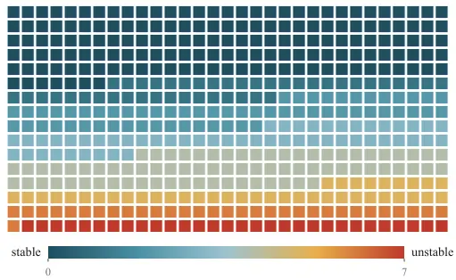

\workshoptitle

JUDGe: Can We Trust the Judge?

# Behind Aggregate Scores: What Systematically Varying Arena-Hard’s LLM Judge Reveals

Louise Yorke Affiliation: University College London Affiliation: London,
UK Email: [l.yorke@ucl.ac.uk](mailto:)

###### Abstract

LLM judges are used to determine which of two answers is better.
Trusting these verdicts requires knowing how repeatable they are and how
much they depend on the judge’s instructions. We show that similar
aggregate scores can conceal substantial changes in individual verdicts,
both when the same setup is repeated and when the instructions change.
Using 500 Arena-Hard v2.0 prompts with two models’ answers held fixed,
we run GPT-4.1 as the judge under all eight combinations of criteria,
output format and task framing, and repeat every setup unchanged at
temperature zero on a pinned model version. Rerunning the default setup
moves the aggregate score by about one point but changes the
win/tie/loss outcome on 21.2% of prompts. Instruction changes introduce
further sensitivity: in one setup, which asks for the verdict without
reasoning and also drops several other instructions, outcomes change on
28.2 percentage points more prompts than the two setups’ unchanged
reruns do on average, and the aggregate score falls by 4.09 points. In
another, where the criteria prioritise accuracy, outcomes change on 6.7
percentage points more prompts by the same comparison, while the
aggregate score barely moves. A stable aggregate score therefore does
not establish that individual verdicts are repeatable. This distinction
matters when those verdicts are used as preference labels or to assess
individual responses. Evaluations that rely on individual verdicts
should repeat each setup they use and report both aggregate scores and
prompt-level agreement.

## 1 Introduction

Large language models are widely used to rank other language models.
Pairwise win-rate benchmarks built on LLM judges inform model selection
and alignment work (Zheng et al., 2023; Li et al., 2025b; Dubois et al.,
2024). Their judges depend on choices about criteria, output format,
task description, judge model, answer order and verdict scoring. Many of
these choices are defensible, but they are not always fully reported.

Aggregate scores rank systems on leaderboards (Chiang et al., 2024; Li
et al., 2025b), while individual prompt outcomes can supply preference
labels, regression tests and safety-review evidence. A stable aggregate
does not establish that these individual judgments are stable. We show
that substantial changes in prompt-level outcomes can occur even when
the aggregate barely moves.

Previous research has examined judge biases, including position, length
and formatting effects (Wang et al., 2024; Dubois et al., 2024; Li et
al., 2025b). Recent work also documents variation between unchanged runs
at temperature zero (Wei et al., 2025; Norman et al., 2026; Ayyagari, 2026) and between judge designs (Vaugrante and Hagendorff, 2026; Zhang,
2027). We examine both on the same prompts, comparing each instruction
change with the test–retest disagreement of the two setups involved,
that is, the share of prompts whose outcome changes when the same setup
is simply run again. Our design draws on multi-analyst studies outside
machine learning (Silberzahn et al., 2018; Botvinik-Nezer et al., 2020;
Steegen et al., 2016, see Appendix A).

We hold all 500 Arena-Hard v2.0 prompts and both models’ responses
fixed. GPT-4.1 judges them under eight setups crossing three choices:
Arena-Hard’s criteria or accuracy-prioritising criteria; reasoning
before the verdict or the verdict label alone; and no task description
or a coding-assistance description. We repeat every setup unchanged on a
pinned model version. We also substitute Claude Sonnet 4.5 and Gemini
2.5 Flash under the default instructions. These substitutions were run
only in May and are compared with the default setup’s test–retest
disagreement alone.

Rerunning the default setup moves the aggregate by about one point but
changes 21.2% of prompt outcomes. Compared with the default, the
label-only setup changes outcomes on 28.2 percentage points more prompts
than the two setups’ unchanged reruns do on average. The corresponding
excess is 6.7 points for accuracy-prioritising criteria and 3.8 points
for coding-assistance framing. Across 17 runs, comprising two per setup
and a third default run, only 131 of 496 complete prompts (26.4%) retain
the same outcome throughout. These comparisons concern instruction
packages, not isolated wording changes.

Our contributions are to distinguish aggregate from prompt-level
stability and to assess instruction sensitivity against the test--retest
disagreement of the setups being compared. We recommend testing a small,
prespecified set of alternative setups, repeating each unchanged, and
reporting changes in aggregate scores and individual outcomes alongside
each setup’s test--retest disagreement.¹¹ 1 Code, raw judge outputs for
every run, and the analysis producing the main results are available at
[https://github.com/Yorkel/llm-judge-release](https://github.com/Yorkel/llm-judge-release).

## 2 Method

### 2.1 Data and judge setups

We use the 500 prompts and fixed model responses from the Arena-Hard
v2.0 hard split. GPT-4.1 mini is the candidate and o3-mini is the
baseline model. Arena-Hard judges each pair twice, reversing response
order. We recode the five verdict labels from $`-2`$ to $`2`$ so that
positive values always favour the candidate, then average the two
orders. Prompts and responses never change; only the judge setup varies.

The main experiment uses GPT-4.1 under eight instruction setups in a
complete $`2\times 2\times 2`$ factorial. GPT-4.1 is the default judge
in the Arena-Hard v2.0 code used here.²² 2 At commit 196f6b8, the
Arena-Hard documentation identifies Gemini 2.5 with style control as the
official configuration and offers GPT-4.1 as an alternative for users of
the OpenAI API. First, we change the judging criteria. Arena-Hard’s
original package asks the judge to generate its own answer and consider
helpfulness, relevance, concision, creativity, errors and missing
information. Our alternative makes factual and technical accuracy
primary: technical claims, code, calculations and reasoning must be
accurate even when another response is more helpful. Helpfulness and
safety remain constraints, and the judge does not generate a reference
answer.

Second, we change the required output. The judge either reasons before
returning a verdict or returns the verdict label alone. Under the
original criteria, the label-only package also removes the
reference-answer and error-checking instructions, so this is a package
contrast rather than an isolated effect of visible reasoning.

Third, we change the task framing. The judge receives either no scope
statement or a coding-assistance description. That description is
accurate for the 253 coding prompts but not the 247 mathematics prompts,
so we report both full-sample and coding-only comparisons. Appendix D
gives the full instruction packages.

We also hold Arena-Hard’s original instructions fixed and substitute
Claude Sonnet 4.5 or Gemini 2.5 Flash for GPT-4.1. We test these two
judges separately, as an illustrative comparison outside the controlled
October design. Because provider code and generation settings also
differ, these comparisons include differences in implementation as well
as judge model.

The main results come from October 2026. We ran all eight GPT-4.1 setups
twice and the default setup a third time, using the pinned version
gpt-4.1-2025-04-14 at temperature zero. All 17 runs were completed on
the same day. Of 17,000 calls, 16,996 returned a parsed verdict (see
Appendix F for the parsing rule). Prompts and responses were fixed
throughout (Arena-Hard code commit 196f6b8; dataset revision 15f3746).
Paired comparisons include only prompts with both response orders
complete in every run being compared, leaving 496 or 497 prompts for
comparisons with the default setup. Appendix E lists all setups and
their counts. We use these repeats to measure each setup’s test–retest
disagreement. Temperature zero does not make hosted inference
deterministic (Atıl et al., 2025; He and Thinking Machines Lab, 2025).

The Claude and Gemini comparisons come from an earlier experiment in May
2026, when each judge setup was run once. The GPT-4.1 default was
repeated in August using the same unpinned model name. These comparisons
therefore use only the default setup’s test–retest disagreement, which
may also include model changes between May and August. We report them
separately from the October instruction comparisons.

### 2.2 Outcomes and analysis

Our primary aggregate outcome is the raw win-equivalent score. It maps
the order-averaged verdicts onto a 0-to-100 scale, treating the five
ordinal levels as equally spaced. This equal spacing is our choice:
Arena-Hard’s own scoring counts a strong preference as three wins, a
slight preference as one and a tie as half a win. Scoring the
comparisons in Table 1 that way gives the same conclusions. Aggregate
comparisons in Table 1 use paired changes on the same complete prompts
rather than differences between separately calculated condition means.

Our primary prompt-level outcome is a boundary change: a prompt moves
between candidate win, baseline win or tie between two runs, whether the
judge setup is unchanged or different. A prompt’s outcome in a run comes
from its order-averaged score: positive scores indicate a candidate win,
negative scores a baseline win and zero a tie. Thus, $`+0.5`$ counts as
a candidate win and $`-0.5`$ as a baseline win. Appendix C reports
results with both counted as ties.

The sensitivity of a prompt is the number of the other seven instruction
setups that change its outcome relative to the default setup. We relate
sensitivity to the default setup’s margin, taken from a run not used to
count changes. Agreement between judge models is summarised with
linearly weighted Cohen’s $`\kappa`$, computed after re-binning the
order-averaged scores to five ordinal tiers.

For each contrast we also report the excess over test–retest
disagreement: the boundary-change rate against the default setup,
averaged over every pairing of their runs, minus the average of the two
setups’ own test–retest disagreement, each the boundary-change rate
between runs of the same setup. If runs are independent, this difference
has expectation zero when the two setups give each prompt the same
distribution of outcomes, including how often it changes on a rerun; a
setup that is simply more consistent therefore also shows an excess,
which we count as part of the effect of changing the instructions.
Measured instead against the default setup’s test–retest disagreement
alone, the higher of the two in every comparison here, the excess is
$`+20.5`$ points (95% CI 16.4 to 24.5) for the label-only setup,
$`+5.7`$ (3.1 to 8.5) for accuracy-prioritising criteria and $`+2.1`$
($`-0.2`$ to $`+4.5`$) for the coding-assistance description; measured
against the label-only setup’s own, it is $`+36.0`$, and the reported
$`+28.2`$ is the average of the two. For the earlier judge-model
comparisons, we subtract only the default setup’s May–August
disagreement; Appendix G gives both estimators.

Unless stated otherwise, intervals are 95% percentile bootstrap
intervals from 20,000 draws that resample whole prompts with
replacement, drawing all of a prompt’s runs together so that paired
quantities share their sampling variation. As an implementation check,
scoring the May run of the default setup exactly as Arena-Hard does,
with its weighted wins and style control fitted jointly with
Arena-Hard’s published judgments of 27 other models, gives GPT-4.1 mini
48.0% (90% interval 46.3% to 50.3%), against Arena-Hard’s published
48.6%. This check shows that the aggregate scores are similar; it does
not show that the individual verdicts match.

## 3 Results

### 3.1 Similar aggregate scores can conceal different prompt outcomes

Across the eight GPT-4.1 instruction setups, raw win-equivalent scores
on the paired samples used in Table 1, averaged over each setup’s runs,
range from 49.36 to 53.87. Similar scores come from different
prompt-level outcomes. Among the 496 prompts with complete outcomes in
every run, only 131 (26.4%) remain a candidate win, baseline win or tie
in every run of every setup. The other 365 prompts (73.6%) change
outcome in at least one run. Six prompts are tied in every run.

Table 1 compares each GPT-4.1 setup with the default setup on the same
complete prompts. The unchanged repeat is the first result and the
reference for the rest. The default setup’s three runs produce aggregate
scores about one point apart (52.82, 54.02 and 53.50), yet 21.2% of
prompts (95% CI 18.4 to 24.1) change their winner-or-tie outcome,
averaged across the three pairwise comparisons. Each setup has its own
test–retest disagreement: 17.7% to 21.2% for the setups that reason
first and 2.0% to 7.0% for those that return the label alone. Table 1
reports instruction comparisons both as raw boundary-change rates and as
excesses over test–retest disagreement.

Table 1: Paired changes from the default setup in the October runs
(gpt-4.1-2025-04-14). Scores are on a 0 to 100 scale; a different winner
means a move between candidate win, baseline win and tie. Each setup’s
own test–retest disagreement comes from its two runs, the default
setup’s from its three. Excess subtracts the average of the default
setup’s test–retest disagreement and the setup’s own. Intervals are 95%
percentile bootstrap intervals over prompts (20,000 draws).

The criteria package changes 26.9% of prompts with little aggregate
change ($`-0.49`$ points), 6.7 points above test–retest disagreement.
The coding-assistance description adds a small 3.8 points (95% CI 1.8 to
6.0), which is not distinguishable from zero against the default setup’s
test–retest disagreement alone. This excess is concentrated in the
mathematics prompts, for which the description is inaccurate
(Appendix C). Appendix B visualises the aggregate and prompt-level
changes and reports direct reversals.

In the May runs, which were not repeated in October, replacing GPT-4.1
with Gemini barely changed the aggregate but changed many prompt
outcomes: the paired aggregate changed by 0.18 points while 38.3% of
prompts changed outcome, 19.0 points above the default setup’s
May–August disagreement; Claude lowered the aggregate by 3.97 points and
changed 35.0%. Agreement between GPT-4.1 and Gemini is moderate rather
than close, with linearly weighted Cohen’s $`\kappa`$ of 0.435 (95% CI
0.378 to 0.492; 1,000 bootstrap draws); $`\kappa`$ is 0.549 between
GPT-4.1 and Claude, and 0.478 between Claude and Gemini. The default
setup’s runs agree with each other at $`\kappa=0.763`$ (95% CI 0.730 to
0.794). Agreement between different judges was therefore lower than
agreement between unchanged GPT-4.1 runs.

The label-only setup changes both the aggregate score and individual
outcomes: it lowers the paired aggregate by 4.09 points and changes
41.6% of prompt outcomes, 28.2 points above test--retest disagreement.³³
3 Averaged over the four pairs of setups that differ in only one choice,
label-only output lowers the score by 3.72 points (95% CI 2.38 to 5.03);
the accuracy-first criteria ($`-0.30`$) and the coding description
($`+0.36`$) change it little. Most of this change is movement into ties:
31.4% of prompts become ties, 6.2% leave a tie and 4.0% reverse, as the
tie rate rises from 18.5% to 43.5% (Table 2). The label-only judge
rarely swaps winners but calls far more ties, which matters wherever
ties are dropped or fall on the wrong side of a pass mark. Aggregate
movement therefore does not reliably indicate how many underlying
verdicts changed.

### 3.2 Sensitivity concentrates near the default setup’s decision boundary

Prompt-level changes are most common when the default setup expresses
only a weak preference. To measure the margin separately from the runs
used to count changes, each prompt’s margin is taken from a third run of
the default setup. Under the criteria contrast, the mean absolute margin
is 0.69 among changed prompts and 1.05 among unchanged prompts
(two-sided Mann–Whitney $`p=3.6\times 10^{-9}`$). A prompt close to zero
requires less movement to cross between a win and a tie or between a tie
and a loss. The rate of change falls as the margin grows, and change
rates are similar at the two highest margins. Appendix B shows the full
sensitivity distribution.

Changes also concentrate near ties when the default setup is repeated
unchanged. Rerunning the default setup unchanged changes 43.4% of
prompts with a margin of zero, 33.8% at a margin of 0.5, and 17.6%, 4.3%
and 5.5% at the three higher margins. Near-tied prompts change more
often even when the instructions are unchanged. The ratio between the
ends is roughly eight to one, so instability is not spread evenly over
the benchmark: it is concentrated on a subset of prompts and largely
absent elsewhere.

Of the 496 prompts with a verdict in every run, 162 (32.7%) keep the
default setup’s outcome under all seven other instruction setups and 30
(6.0%) change under all seven, comparing each setup’s first run with the
default setup’s first run. Figure 3 shows the distribution. The stable
group has a mean absolute margin of 1.30 against 0.65 for the
always-changing group (Mann–Whitney $`p=5.7\times 10^{-6}`$). The margin
was measured in a separate run from those used to identify these groups.

Coding-only, missing-output and style-adjustment checks are reported in
Appendix C; none changes the interpretation of the raw paired
comparisons.

## 4 Discussion

Aggregate stability does not establish prompt-level stability, and the
unchanged repeat shows this most simply. Running one setup twice moves
the headline score by about a point but changes a fifth of the
individual verdicts. Subtracting test–retest disagreement helps assess
instruction changes, but does not make individual verdicts more
repeatable. The two levels behave differently because prompts move in
both directions in similar numbers. Of the 105 prompts that change
outcome between the default setup’s first two runs, 56 move toward the
candidate and 49 toward the baseline. These movements mostly cancel in
the average, while the individual verdicts still change.

Changing the judge adds to this. Two of the changes we tested barely
move the headline score but change 5.7 and 19.0 percentage points more
prompts than a repeat of the default setup does: the
accuracy-prioritising criteria, and Gemini in the May runs. Looking only
at the aggregate would miss both the test–retest disagreement and the
excess.

Some of the movement comes from how the two answer orders are combined.
Each prompt is judged in both orders and the two five-point verdicts are
averaged, which produces half-point values. If the judge calls a tie in
one order and a slight preference in the other, the prompt scores
$`\pm 0.5`$, and the sign rule records a win although the judge called a
tie in one of the two orders. These half-point scores are
over-represented among prompts that change: 39.0% of changes between the
default setup and the other instruction setups involve a score of
$`\pm 0.5`$, against a base rate of 29.5%. Counting $`\pm 0.5`$ as a tie
instead lowers the default setup’s test–retest disagreement from 21.2%
to 19.3% and leaves every excess above zero (Appendix C). The sign rule
therefore accounts for only a small part of the disagreement between
runs.

Bias checks examine whether judges systematically favour particular
positions, lengths or formats. In these repeats, changes towards the two
models were similar in number. A judge could pass every usual bias check
and still change a fifth of its verdicts on a second run. Repeating the
run allows this variation to be measured.

Whether this matters depends on how the evaluation is used. Ranking two
systems on a leaderboard depends on the aggregate, and for that the
accuracy-prioritising criteria and the Gemini substitution give almost
the same comparison. Position on a larger leaderboard is more fragile:
scored with Arena-Hard’s own method against its published judgments of
27 other models, the three unchanged October runs of the default setup
place GPT-4.1 mini 11th, 7th and 11th of 28, because several
neighbouring models sit within about two points of each other.
Individual verdicts matter when they become preference labels, flag
responses for safety review, signal regressions or feed into release
decisions, and for those uses the same judge changes alter many of the
outcomes. A judge setup can therefore be reliable enough to rank two
models but not to label individual prompts. About a quarter of the
prompts keep the same outcome in all 17 GPT-4.1 runs, although this does
not establish that those outcomes are correct.

We did not test whether combining judges improves reliability or
accuracy. We compare agreement between different judges with agreement
between unchanged runs of the same judge. Agreement across the three
pairs of unchanged default runs averages $`\kappa=0.763`$, so the 0.435
to 0.549 between judges should be compared with that figure, not with
perfect agreement. In measurement terms this is a test–retest
reliability, which psychology and education report before a test is used
to decide about an individual (American Educational Research Association
et al., 2014). We do not claim that 0.763 is an upper limit, since a
different judge or a combined procedure could agree more closely with
either run. Judge pipelines typically make one call per item and report
no agreement statistic, so the variation in each call goes into the
published score instead of being averaged out.

We recommend reporting repeatability alongside sensitivity to judge
setup. Evaluations that rely on individual verdicts should choose a
small set of plausible alternative judge setups in advance, run them
alongside the main setup, and report three things: which setups were
tested; the paired aggregate change and prompt-level change rate for
each; and the same two figures for an unchanged repeat of each setup.
Test–retest disagreement differs by setup, from 2.0% to 21.2% of prompts
here, so the main setup’s repeat cannot stand in for the others. Repeats
show how much outcomes change without changing the instructions. The
average test–retest disagreement of the setups compared is about four
fifths of the raw change rate under coding-assistance framing and three
quarters under accuracy-prioritising criteria.

These comparisons do not show which verdict is correct, or that one
judge setup is better than another.

## 5 Limitations

Each instruction contrast changes a whole package of instructions. The
output-format contrast is especially broad: under Arena-Hard’s criteria,
the label-only version removes several instructions as well as the
requirement to explain the verdict. We therefore attribute results to
the packages tested, not to individual instructions.

Each GPT-4.1 setup was run two or three times on one day, so each
setup’s test–retest disagreement rests on one to three pairs of runs and
may vary between days. The excess over both setups’ test–retest
disagreement also assumes that runs are independent. The repeats measure
the variation but do not explain it: we cannot tell whether the prompts
that move are genuinely ambiguous or the judge is simply unstable on
them, since both would produce the same pattern. We also have no human
or ground-truth labels, apart from four prompts whose answers could be
checked (Appendix C), so the study measures how much verdicts change,
not which setup is more accurate. The Claude and Gemini conditions were
run only in May, so their excess uses only the default setup’s
May–August disagreement. They also used different provider code,
generation settings and, for Claude, a lower output-token limit, so they
test the whole judge implementation, not just the model. Gemini ran with
its internal reasoning budget set to zero, which matters because the
output-format contrast is itself about reasoning. An incomplete third
substitution, Gemini 2.5 Pro, is reported in Appendix C.

The results cover one benchmark, one model pair and one main judge
model, GPT-4.1, with Claude and Gemini tested only once each. The model
pair was chosen because its published comparison is close to 50%, which
makes movement across the decision boundary easier to see. The change
rates should not be taken as typical for model pairs with larger
capability gaps. Response style was examined only in the May runs,
through relative length and markdown density (Appendix C), so we do not
establish how style contributes to the observed changes. The
threshold-based classification in Appendix H is descriptive, and the
share of unanimous prompts does not depend on either threshold. Further
work should test a second model pair with a wider capability gap, a
second benchmark, repeats on different days, and whether majority
verdicts over repeated runs reduce the instability.

## 6 Conclusion

With prompts and responses held fixed, an unchanged rerun moves the
aggregate score by about a point but changes 21.2% of prompt outcomes.
The label-only setup changes 28.2 percentage points more prompts than
test–retest disagreement and lowers the aggregate by 4.09 points; the
accuracy-prioritising criteria add 6.7 points with little aggregate
change, and coding-assistance framing adds 3.8 points. Evaluations that
rely on individual verdicts should therefore report both levels and
compare each change of setup with an unchanged repeat of each setup.

## References

- American Educational Research Association et al. (2014) American
  Educational Research Association, American Psychological Association,
  and National Council on Measurement in Education Standards for
  educational and psychological testing. American Educational Research
  Association, Washington, DC. Cited by: §4.
- Arabzadeh and Clarke (2025) N. Arabzadeh and C. L. A. Clarke A
  human-AI comparative analysis of prompt sensitivity in LLM-based
  relevance judgment. In Proceedings of the 48th International ACM SIGIR
  Conference on Research and Development in Information Retrieval,
  pp. 2784–2788. External Links:
  [Document](https://dx.doi.org/10.1145/3726302.3730159) Cited by:
  Appendix A.
- Atıl et al. (2025) B. Atıl, S. Aykent, A. Chittams, L. Fu, R. J.
  Passonneau, E. Radcliffe, G. R. Rajagopal, A. Sloan, T. Tudrej, F.
  Ture, Z. Wu, L. Xu, and B. Baldwin Non-determinism of “deterministic”
  LLM system settings in hosted environments. In Proceedings of the 5th
  Workshop on Evaluation and Comparison of NLP Systems (Eval4NLP),
  pp. 135–148. External Links:
  [Document](https://dx.doi.org/10.18653/v1/2025.eval4nlp-1.12),
  [Link](https://aclanthology.org/2025.eval4nlp-1.12/) Cited by: §2.1.
- Ayyagari (2026) K. C. Ayyagari Pinned and still unstable: within-judge
  verdict variance and the noise floor of LLM-as-judge leaderboards.
  arXiv preprint arXiv:2609.33044. External Links:
  [Link](https://arxiv.org/abs/2609.33044) Cited by: Appendix A, §1.
- Bai et al. (2022) Y. Bai, S. Kadavath, S. Kundu, A. Askell, J.
  Kernion, et al. Constitutional AI: harmlessness from AI feedback.
  arXiv preprint arXiv:2212.08073. External Links:
  [Link](https://arxiv.org/abs/2212.08073) Cited by: Appendix A.
- Botvinik-Nezer et al. (2020) R. Botvinik-Nezer, F. Holzmeister, C. F.
  Camerer, A. Dreber, J. Huber, M. Johannesson, et al. Variability in
  the analysis of a single neuroimaging dataset by many teams. Nature
  582 (7810), pp. 84–88. External Links:
  [Document](https://dx.doi.org/10.1038/s41586-020-2314-9) Cited by:
  Appendix A, §1.
- Chiang et al. (2024) W. Chiang, L. Zheng, Y. Sheng, A. N.
  Angelopoulos, T. Li, D. Li, B. Zhu, H. Zhang, M. Jordan, J. E.
  Gonzalez, and I. Stoica Chatbot Arena: an open platform for evaluating
  LLMs by human preference. In Proceedings of the 41st International
  Conference on Machine Learning, Proceedings of Machine Learning
  Research, Vol. 235, pp. 8359–8388. External Links:
  [Link](https://proceedings.mlr.press/v235/chiang24b.html) Cited by:
  §1.
- Dubois et al. (2024) Y. Dubois, P. Liang, and T. Hashimoto
  Length-controlled AlpacaEval: a simple debiasing of automatic
  evaluators. In First Conference on Language Modeling (COLM), Cited by:
  Appendix A, §1, §1.
- D’Amour et al. (2022) A. D’Amour, K. Heller, D. Moldovan, B. Adlam, B.
  Alipanahi, A. Beutel, C. Chen, J. Deaton, J. Eisenstein, M. D.
  Hoffman, et al. Underspecification presents challenges for credibility
  in modern machine learning. Journal of Machine Learning Research 23
  (226), pp. 1–61. External Links:
  [Link](https://jmlr.org/papers/v23/20-1335.html) Cited by: Appendix A.
- Haldar and Hockenmaier (2025) R. Haldar and J. Hockenmaier Rating
  roulette: self-inconsistency in LLM-as-a-judge frameworks. In Findings
  of the Association for Computational Linguistics: EMNLP 2025,
  pp. 24986–25004. External Links:
  [Document](https://dx.doi.org/10.18653/v1/2025.findings-emnlp.1361),
  [Link](https://aclanthology.org/2025.findings-emnlp.1361/) Cited by:
  Appendix A.
- He and Thinking Machines Lab (2025) H. He and Thinking Machines Lab
  Defeating nondeterminism in LLM inference. Note: Thinking Machines
  Lab: Connectionism External Links:
  [Link](https://thinkingmachines.ai/blog/defeating-nondeterminism-in-llm-inference/)
  Cited by: §2.1.
- Inan et al. (2023) H. Inan, K. Upasani, J. Chi, R. Rungta, K. Iyer, Y.
  Mao, M. Tontchev, Q. Hu, B. Fuller, D. Testuggine, and M. Khabsa Llama
  Guard: LLM-based input-output safeguard for human-AI conversations.
  arXiv preprint arXiv:2312.06674. External Links:
  [Link](https://arxiv.org/abs/2312.06674) Cited by: Appendix A.
- Jacobs and Wallach (2021) A. Z. Jacobs and H. Wallach Measurement and
  fairness. In Proceedings of the 2021 ACM Conference on Fairness,
  Accountability, and Transparency, pp. 375–385. External Links:
  [Document](https://dx.doi.org/10.1145/3442188.3445901) Cited by:
  Appendix A.
- Kim et al. (2024) S. Kim, J. Shin, Y. Cho, J. Jang, S. Longpre, H.
  Lee, S. Yun, S. Shin, S. Kim, J. Thorne, and M. Seo Prometheus:
  inducing fine-grained evaluation capability in language models. In The
  Twelfth International Conference on Learning Representations (ICLR),
  External Links: [Link](https://openreview.net/forum?id=8euJaTveKw)
  Cited by: Appendix A.
- Lee et al. (2025) Y. Lee, J. Kim, J. Kim, H. Cho, J. Kang, P. Kang,
  and N. Kim CheckEval: a reliable LLM-as-a-judge framework for
  evaluating text generation using checklists. In Proceedings of the
  2025 Conference on Empirical Methods in Natural Language Processing,
  pp. 15771–15798. External Links:
  [Document](https://dx.doi.org/10.18653/v1/2025.emnlp-main.796),
  [Link](https://aclanthology.org/2025.emnlp-main.796/) Cited by:
  Appendix A.
- Li et al. (2025a) D. Li, B. Jiang, L. Huang, A. Beigi, C. Zhao, Z.
  Tan, A. Bhattacharjee, Y. Jiang, C. Chen, T. Wu, K. Shu, L. Cheng,
  and H. Liu From generation to judgment: opportunities and challenges
  of LLM-as-a-judge. In Proceedings of the 2025 Conference on Empirical
  Methods in Natural Language Processing, pp. 2757–2791. External Links:
  [Document](https://dx.doi.org/10.18653/v1/2025.emnlp-main.138),
  [Link](https://aclanthology.org/2025.emnlp-main.138/) Cited by:
  Appendix A.
- Li et al. (2025b) T. Li, W. Chiang, E. Frick, L. Dunlap, T. Wu, B.
  Zhu, J. E. Gonzalez, and I. Stoica From crowdsourced data to
  high-quality benchmarks: Arena-Hard and Benchbuilder pipeline. In
  Proceedings of the 42nd International Conference on Machine Learning,
  Proceedings of Machine Learning Research, Vol. 267, pp. 34209–34231.
  External Links: [Link](https://proceedings.mlr.press/v267/li25h.html)
  Cited by: Appendix A, §1, §1, §1.
- Liang et al. (2023) P. Liang, R. Bommasani, T. Lee, D. Tsipras, D.
  Soylu, M. Yasunaga, Y. Zhang, D. Narayanan, Y. Wu, A. Kumar, et al.
  Holistic evaluation of language models. Transactions on Machine
  Learning Research. External Links: ISSN 2835-8856,
  [Link](https://openreview.net/forum?id=iO4LZibEqW) Cited by: Appendix
  A.
- Lin et al. (2025) B. Y. Lin, Y. Deng, K. Chandu, F. Brahman, A.
  Ravichander, V. Pyatkin, N. Dziri, R. Le Bras, and Y. Choi WildBench:
  benchmarking LLMs with challenging tasks from real users in the wild.
  In The Thirteenth International Conference on Learning Representations
  (ICLR), External Links:
  [Link](https://openreview.net/forum?id=MKEHCx25xp) Cited by: Appendix
  A.
- Marx et al. (2020) C. Marx, F. Calmon, and B. Ustun Predictive
  multiplicity in classification. In Proceedings of the 37th
  International Conference on Machine Learning, Proceedings of Machine
  Learning Research, Vol. 119, pp. 6765–6774. External Links:
  [Link](https://proceedings.mlr.press/v119/marx20a.html) Cited by:
  Appendix A.
- Mizrahi et al. (2024) M. Mizrahi, G. Kaplan, D. Malkin, R. Dror, D.
  Shahaf, and G. Stanovsky State of what art? A call for multi-prompt
  LLM evaluation. Transactions of the Association for Computational
  Linguistics 12, pp. 933–949. External Links:
  [Document](https://dx.doi.org/10.1162/tacl%5Fa%5F00681),
  [Link](https://aclanthology.org/2024.tacl-1.52/) Cited by: Appendix A.
- Norman et al. (2026) J. D. Norman, M. U. Rivera, and D. A. Hughes
  Reliability without validity: a systematic, large-scale evaluation of
  LLM-as-a-judge models across agreement, consistency, and bias. arXiv
  preprint arXiv:2606.19544. External Links:
  [Link](https://arxiv.org/abs/2606.19544) Cited by: Appendix A, §1.
- Saito et al. (2023) K. Saito, A. Wachi, K. Wataoka, and Y. Akimoto
  Verbosity bias in preference labeling by large language models. In
  NeurIPS 2023 Workshop on Instruction Tuning and Instruction Following,
  Note: arXiv:2310.10076 External Links:
  [Link](https://openreview.net/forum?id=magEgFpK1y) Cited by: Appendix
  A.
- Salinas and Morstatter (2024) A. Salinas and F. Morstatter The
  butterfly effect of altering prompts: how small changes and jailbreaks
  affect large language model performance. In Findings of the
  Association for Computational Linguistics: ACL 2024, pp. 4629–4651.
  External Links:
  [Document](https://dx.doi.org/10.18653/v1/2024.findings-acl.275),
  [Link](https://aclanthology.org/2024.findings-acl.275/) Cited by:
  Appendix A.
- Schroeder and Wood-Doughty (2024) K. Schroeder and Z. Wood-Doughty Can
  you trust LLM judgments? Reliability of LLM-as-a-judge. arXiv preprint
  arXiv:2412.12509. External Links:
  [Link](https://arxiv.org/abs/2412.12509) Cited by: Appendix A.
- Sclar et al. (2024) M. Sclar, Y. Choi, Y. Tsvetkov, and A. Suhr
  Quantifying language models’ sensitivity to spurious features in
  prompt design or: how I learned to start worrying about prompt
  formatting. In The Twelfth International Conference on Learning
  Representations (ICLR), External Links:
  [Link](https://openreview.net/forum?id=RIu5lyNXjT) Cited by: Appendix
  A.
- Semenova et al. (2022) L. Semenova, C. Rudin, and R. Parr On the
  existence of simpler machine learning models. In Proceedings of the
  2022 ACM Conference on Fairness, Accountability, and Transparency,
  pp. 1827–1858. External Links:
  [Document](https://dx.doi.org/10.1145/3531146.3533232) Cited by:
  Appendix A.
- Sheng et al. (2025) H. Sheng, X. Liu, H. He, J. Zhao, and J. Kang
  Analyzing uncertainty of LLM-as-a-judge: interval evaluations with
  conformal prediction. In Proceedings of the 2025 Conference on
  Empirical Methods in Natural Language Processing, pp. 11286–11328.
  External Links:
  [Document](https://dx.doi.org/10.18653/v1/2025.emnlp-main.569),
  [Link](https://aclanthology.org/2025.emnlp-main.569/) Cited by:
  Appendix A.
- Silberzahn et al. (2018) R. Silberzahn, E. L. Uhlmann, D. P.
  Martin, P. Anselmi, F. Aust, E. Awtrey, et al. Many analysts, one data
  set: making transparent how variations in analytic choices affect
  results. Advances in Methods and Practices in Psychological Science 1
  (3), pp. 337–356. External Links:
  [Document](https://dx.doi.org/10.1177/2515245917747646) Cited by:
  Appendix A, §1.
- Simonsohn et al. (2020) U. Simonsohn, J. P. Simmons, and L. D. Nelson
  Specification curve analysis. Nature Human Behaviour 4 (11),
  pp. 1208–1214. External Links:
  [Document](https://dx.doi.org/10.1038/s41562-020-0912-z) Cited by:
  Appendix A.
- Steegen et al. (2016) S. Steegen, F. Tuerlinckx, A. Gelman, and W.
  Vanpaemel Increasing transparency through a multiverse analysis.
  Perspectives on Psychological Science 11 (5), pp. 702–712. External
  Links: [Document](https://dx.doi.org/10.1177/1745691616658637) Cited
  by: Appendix A, §1.
- Vaugrante and Hagendorff (2026) L. Vaugrante and T. Hagendorff How
  much do LLM-as-a-judge design choices matter? A systematic comparison
  of prompt designs, rating scales, and models. arXiv preprint
  arXiv:2610.05094. External Links:
  [Link](https://arxiv.org/abs/2610.05094) Cited by: Appendix A, §1.
- Wang et al. (2024) P. Wang, L. Li, L. Chen, Z. Cai, D. Zhu, B. Lin, Y.
  Cao, L. Kong, Q. Liu, T. Liu, and Z. Sui Large language models are not
  fair evaluators. In Proceedings of the 62nd Annual Meeting of the
  Association for Computational Linguistics (Volume 1: Long Papers),
  pp. 9440–9450. External Links:
  [Document](https://dx.doi.org/10.18653/v1/2024.acl-long.511),
  [Link](https://aclanthology.org/2024.acl-long.511/) Cited by: Appendix
  A, §1.
- Wei et al. (2025) H. Wei, S. He, T. Xia, F. Liu, A. Wong, J. Lin,
  and M. Han Systematic evaluation of LLM-as-a-judge in LLM alignment
  tasks: explainable metrics and diverse prompt templates. In ICLR 2025
  Workshop on Building Trust in Language Models and Applications, Note:
  arXiv:2408.13006 External Links:
  [Link](https://arxiv.org/abs/2408.13006) Cited by: Appendix A, §1.
- Zhang (2027) X. Zhang How sensitive are safety benchmarks to judge
  configuration choices?. In Advanced Intelligent Computing Technology
  and Applications (ICIC 2026), Communications in Computer and
  Information Science, Vol. 3036, Singapore, pp. 173–184. Note: First
  published online July 2026. arXiv:2604.24074 External Links:
  [Document](https://dx.doi.org/10.1007/978-981-92-3541-4%5F15) Cited
  by: Appendix A, §1.
- Zheng et al. (2023) L. Zheng, W. Chiang, Y. Sheng, S. Zhuang, Z.
  Wu, Y. Zhuang, Z. Lin, Z. Li, D. Li, E. P. Xing, H. Zhang, J. E.
  Gonzalez, and I. Stoica Judging LLM-as-a-judge with MT-Bench and
  Chatbot Arena. In Advances in Neural Information Processing Systems 36
  (NeurIPS 2023), Datasets and Benchmarks Track, Vol. 36,
  pp. 46595–46623. External Links:
  [Link](https://papers.nips.cc/paper_files/paper/2023/hash/91f18a1287b398d378ef22505bf41832-Abstract-Datasets_and_Benchmarks.html)
  Cited by: Appendix A, §1.

## Appendix A Related work

LLM-as-judge protocols emerged as a scalable substitute for human
pairwise ratings \[Zheng et al., 2023\] and now sit inside many major
open evaluation pipelines \[Dubois et al., 2024, Li et al., 2025b, Lin
et al., 2025\]. Industry uses the same template for regression testing,
safety auditing and capability benchmarking \[Bai et al., 2022, Inan et
al., 2023, Liang et al., 2023\], and surveys document its spread \[Li et
al., 2025a\]. The literature has identified specific failure modes,
including position bias \[Wang et al., 2024\], length bias \[Dubois et
al., 2024, Saito et al., 2023\] and preferences for familiar formatting
\[Li et al., 2025b\]. Our analysis includes two common mitigations:
answer-order swapping in every condition, and a style adjustment built
on Arena-Hard’s feature extractor. These approaches address bias within
a fixed judge configuration. They do not test how verdicts move when the
configuration itself changes.

That question has an established form outside machine learning. Seventy
independent teams analysing one fMRI dataset reached systematically
divergent findings \[Botvinik-Nezer et al., 2020\], and twenty-nine
teams analysing one dataset in econometrics reached opposing conclusions
\[Silberzahn et al., 2018\]. The methodological response is to report
the distribution of conclusions across the defensible analytic space
rather than one path through it \[Steegen et al., 2016, Simonsohn et
al., 2020\]. Within machine learning, underspecification \[D’Amour et
al., 2022\] and predictive multiplicity \[Marx et al., 2020, Semenova et
al., 2022\] show that many models with similar measured performance can
exist for one task. Here, we hold the model responses fixed and vary the
judge. The measurement-validity tradition supplies the relevant
distinction between a construct and its operationalisation \[Jacobs and
Wallach, 2021\].

The closest precursor outside judging is Sclar et al. \[2024\], which
shows that prompt-format perturbations can change benchmark accuracy by
tens of points. Related work extends format sensitivity to paraphrases
and retrieval evaluation \[Mizrahi et al., 2024, Salinas and Morstatter,
2024, Arabzadeh and Clarke, 2025\]. Two differences matter here. First,
that work perturbs the prompt given to the system under test, whereas we
perturb the instrument that judges it. Second, it reports aggregate
swings, whereas our central result is that the aggregate can remain
almost unchanged while many individual judgments change. A separate line
of work aims to make a fixed judge more reliable through checklists
\[Lee et al., 2025\], trained evaluators \[Kim et al., 2024\] or
uncertainty estimates \[Sheng et al., 2025\]. We address a different
quantity: whether a reported result survives defensible changes to the
judge.

Run-to-run variation in LLM judges has been measured directly. Wei et
al. \[2025\] find that GPT-4o’s pairwise verdicts are not fully
self-consistent even at temperature zero; Haldar and Hockenmaier
\[2025\] report low agreement between repeated runs of open-weight
judges with sampling; Schroeder and Wood-Doughty \[2024\] find no
variation for locally run open-weight judges at temperature zero but
substantial variation above it; and Norman et al. \[2026\] report
test–retest reliability at temperature zero for a large set of judges,
GPT-4.1 among them. Concurrently with this work, Ayyagari \[2026\]
reruns four judges ten times at temperature zero and finds that 0.13% to
9.7% of verdicts change, concentrated on close calls, while the
principal judge’s aggregate ranking holds. Our default setup’s rate of
21.2% is well above that range. Several features of our design could
contribute: the model pair was chosen to sit near 50%, so many prompts
are close calls; each outcome combines two judge calls, one per answer
order; and the sign rule turns a tie in one order and a slight lean in
the other into a win, although counting $`\pm 0.5`$ as a tie lowers our
rate only to 19.3%. Output format may matter most: our label-only
setups, at 2.0% to 7.0%, fall within their range. Separately, Vaugrante
and Hagendorff \[2026\] and Zhang \[2027\] vary judge design and report
how much the verdicts change, without a rerun to compare against. We
measure both kinds of change on the same prompts and report each design
change as an excess over test–retest disagreement.

## Appendix B Additional figures

Figure 1: Paired aggregate changes and prompt-level change rates for the
three single-choice setups in the October runs. Both panels share a 0 to
50 point scale and the same row order; the left panel plots the
magnitude of the aggregate change with the signed value annotated, and
outlines rather than fills any bar whose interval includes zero. The
dashed line and shaded band mark the default setup’s own test–retest
disagreement, the rate at which two of its runs give a different winner,
with its 95% interval. Setups can remain close at the aggregate level
while differing substantially in prompt-level outcomes. Whether a setup
exceeds test–retest disagreement is decided by the excess in Table 1,
not by the bar’s position relative to the line.

Most boundary changes are movement into or out of a tie rather than a
direct reversal of which model wins. Direct reversals account for 5.1%
of paired prompts under the criteria package, 4.0% under label-only
output and 2.9% under coding-assistance framing, and in the May runs
8.5% under Claude and 7.9% under Gemini. The default setup reverses 2.0%
on a rerun, and the label-only setups almost never reverse themselves
(0.0% to 0.4%). Against the average reversal rate of the two setups’
reruns, the criteria package ($`+3.3`$, CI $`+2.0`$ to $`+4.6`$) and the
label-only setups ($`+2.2`$ to $`+2.8`$) reverse more often than
rerunning does, while coding-assistance framing reverses no more often
than rerunning does ($`+0.9`$, CI $`-0.03`$ to $`+2.05`$). In May,
Claude ($`+6.7`$) and Gemini ($`+6.2`$) also reversed more often than
the default setup’s May–August repeat.

Figure 2: Prompt sensitivity across instruction setups and against the
default setup’s decision margin. Left: how many of the seven other
instruction setups change each prompt’s outcome relative to the default
setup, over the 496 prompts with a verdict in every run; comparing first
runs, 162 prompts are unchanged throughout (131 when every run is
compared). Right: mean outcome-change rate at each absolute margin,
averaged over the seven setups, with whole-prompt bootstrap intervals,
against the same rate for an unchanged rerun of the default setup. The
margin is taken from a third run of the default setup that is not used
to count changes. Point labels give the number of prompts at each
margin. Both rates fall as the margin grows and level off at the two
highest margins. The instruction setups change more prompts than the
rerun at every margin, and the difference is smallest at a margin of
zero.



Figure 3: Prompt-level stability across instruction setups. Each square
is one prompt, shaded by how many of the seven other GPT-4.1 instruction
setups change its winner-or-tie outcome relative to the default setup,
comparing first runs, and ordered by that count. The 496 prompts with a
verdict in every run are shown. In all, 162 prompts are unchanged under
all seven setups and 30 change under all seven.

## Appendix C Additional robustness checks

The excess over test–retest disagreement varies with the margin.
Comparing the mean rate across the seven other instruction setups with
test–retest disagreement on the same prompts, taken as the average of
the default setup’s rerun rate and the setups’ own rerun rates, gives an
excess of $`+18.8`$ points at a margin of zero, then $`+21.5`$,
$`+23.4`$, $`+7.6`$ and $`+10.3`$ at the four higher margins, all with
intervals above zero. The excess is largest at intermediate margins.
Appendix B shows the rates by margin.

Restricting the scope analysis to coding prompts produces a 20.7%
boundary-change rate, against 26.1% for mathematics prompts and 23.3%
for the full sample. Read against test–retest disagreement on the same
prompts, the coding-only excess is $`+2.2`$ points (95% CI $`-0.4`$ to
$`+5.0`$) and the mathematics excess is $`+5.5`$ points ($`+2.5`$ to
$`+8.8`$). Where the coding-assistance description is accurate, its
effect is indistinguishable from rerunning the default setup; the excess
is larger for mathematics prompts, for which the description is
inaccurate. The full-sample estimate therefore combines task framing
with inaccurate framing for mathematics prompts and is not a clean
effect of supplying correct domain information.

Counting a score of $`\pm 0.5`$ as a tie rather than a win lowers the
default setup’s test–retest disagreement from 21.2% to 19.3% and leaves
every excess above zero.

Using paired complete cases prevents missing Gemini outputs from
changing any comparison through sample composition. The 15 prompts lost
to Gemini parse failures do not differ from the retained prompts in
relative response length or markdown density, and are spread across both
task categories and all three outcomes of the default setup.

In the May runs, across ten comparisons involving relative response
length and markdown density, one test is nominally significant but none
remains significant after Holm correction. This does not rule out style
as a mechanism. Applying Arena-Hard’s style features with coefficients
held fixed at the default setup’s values subtracts the same quantity
from both sides of a paired comparison, so it leaves every value in
Table 1 unchanged and tests nothing. In the May runs, refitting the
coefficients within each condition instead gave adjusted differences
from the default setup of $`-0.15`$ points for Gemini, $`-0.56`$ for the
criteria package, $`+1.44`$ for coding-assistance framing, $`-0.74`$ for
label-only output and $`-1.95`$ for Claude. That fit absorbs each
judge’s own response to length and formatting into its coefficients, so
it does not isolate a style effect either. We therefore report the raw
paired changes and do not claim that style is excluded.

A third judge substitution, Gemini 2.5 Pro, was started and stopped
after 129 prompts when it exceeded the run’s cost and rate limits. On
the 123 of those prompts where Gemini 2.5 Flash also returned a complete
outcome, Pro moved the paired aggregate by $`-2.34`$ points with a 38.2%
boundary-change rate, against Flash’s $`+0.10`$ points and 41.5%. We
report this incomplete run because the completed substitutions were not
selected on their results.

Most Arena-Hard prompts have no verifiable answer, but a few do, and one
of them is worth reporting on its own. A competitive-programming prompt
supplies three worked examples in its statement, so the submissions can
be checked against the supplied examples by compiling and running each
one rather than by consulting a judge. The candidate model’s submission
fails all three examples; the baseline model’s passes all three. In the
May runs, the default setup nonetheless recorded a decisive win for the
failing submission. The accuracy-prioritising criteria, both judge
substitutions and three of the multi-contrast conditions preferred the
submission that passed all three examples, several at the maximum
verdict, and the August repeat of the default setup reversed the
verdict. We report this as a single case rather than a rate. It shows
that a difference in setup can decide whether a verifiably incorrect
answer wins, not how often that happens.

In three further examples, both responses passed the checks we applied.
On two of them we executed both submissions and each reproduced the
expected output on every example supplied in the prompt; on the third, a
trigonometric equation, both models report the same correct value. The
two responses differ in presentation rather than in content. The judge
nonetheless named a winner on each, and in the May runs the winner was
not stable: each of the three received a candidate win under at least
one condition, a baseline win under at least one other, and a tie under
the remainder. On two of the three, every non-tie score had magnitude
0.5, so the recorded wins arise from a tie in one answer order and a
slight lean in the other. Correctness alone does not distinguish these
responses, yet the sign rule classifies these half-point scores as wins.

## Appendix D Judge instruction packages

Crossing the two criteria packages with the two output formats gives the
four system prompts below. The scope preamble is prepended to the user
message, so it is orthogonal to the system prompt and gives the eight
instruction setups. All four packages use the same five verdict labels.

### D.1 Arena-Hard criteria, reasoning required (default setup)

> Please act as an impartial judge and evaluate the quality of the
> responses provided by two AI assistants to the user prompt displayed
> below. You will be given assistant A’s answer and assistant B’s
> answer. Your job is to evaluate which assistant’s answer is better.
>
> Begin your evaluation by generating your own answer to the prompt. You
> must provide your answers before judging any answers.
>
> When evaluating the assistants’ answers, compare both assistants’
> answers with your answer. You must identify and correct any mistakes
> or inaccurate information.
>
> Then consider if the assistant’s answers are helpful, relevant, and
> concise. Helpful means the answer correctly responds to the prompt or
> follows the instructions. Note when user prompt has any ambiguity or
> more than one interpretation, it is more helpful and appropriate to
> ask for clarifications or more information from the user than
> providing an answer based on assumptions. Relevant means all parts of
> the response closely connect or are appropriate to what is being
> asked. Concise means the response is clear and not verbose or
> excessive.
>
> Then consider the creativity and novelty of the assistant’s answers
> when needed. Finally, identify any missing important information in
> the assistants’ answers that would be beneficial to include when
> responding to the user prompt.
>
> After providing your explanation, you must output only one of the
> following choices as your final verdict with a label:
>
> 1. Assistant A is significantly better: \[\[A\>\>B\]\]
> 2. Assistant A is slightly better: \[\[A\>B\]\]
> 3. Tie, relatively the same: \[\[A=B\]\]
> 4. Assistant B is slightly better: \[\[B\>A\]\]
> 5. Assistant B is significantly better: \[\[B\>\>A\]\]
>
> Example output: “My final verdict is tie: \[\[A=B\]\]”.

### D.2 Arena-Hard criteria, label only

> Please act as an impartial judge and evaluate the quality of the
> responses provided by two AI assistants to the user prompt displayed
> below. You will be given assistant A’s answer and assistant B’s
> answer. Your job is to evaluate which assistant’s answer is better.
>
> Consider whether each assistant’s answer is helpful, relevant, and
> concise. Helpful means the answer correctly responds to the prompt or
> follows the instructions. Relevant means all parts of the response
> closely connect or are appropriate to what is being asked. Concise
> means the response is clear and not verbose or excessive. Also
> consider creativity and novelty when relevant, and identify any
> missing important information.
>
> Output only one of the following choices as your final verdict with a
> label, with no explanation:
>
> 1. Assistant A is significantly better: \[\[A\>\>B\]\]
> 2. Assistant A is slightly better: \[\[A\>B\]\]
> 3. Tie, relatively the same: \[\[A=B\]\]
> 4. Assistant B is slightly better: \[\[B\>A\]\]
> 5. Assistant B is significantly better: \[\[B\>\>A\]\]
>
> Example output: “\[\[A=B\]\]”.

Relative to D.1 this removes the self-generation step, the comparison
against the judge’s own answer, the error-correction instruction and the
clarification-on-ambiguity sentence, in addition to the explanation
itself. This is why we treat the output contrast as a package.

### D.3 Accuracy-prioritising criteria, reasoning required

> Please act as an impartial judge and evaluate the quality of the
> responses provided by two AI assistants to the user prompt displayed
> below. You will be given assistant A’s answer and assistant B’s
> answer.
>
> Evaluate the responses on three criteria with explicit priority:
>
> CORRECTNESS (primary): Are the technical claims, code, calculations,
> and reasoning accurate? Is the answer factually right?
>
> HELPFULNESS (constraint): Does the answer address the user’s actual
> request? Is it well-organised and easy to follow?
>
> SAFETY (constraint): Does the answer avoid harmful, deceptive, or
> unethical content?
>
> In your final verdict, prioritise correctness. A response that is more
> helpful but less correct should be rated lower than a response that is
> correct but less helpful. Helpfulness and safety are constraints, not
> primary criteria.
>
> Begin by analysing each response against the three criteria, then
> state your final verdict.
>
> Output one of the following as your final verdict with a label:
>
> 1. Assistant A is significantly better: \[\[A\>\>B\]\]
> 2. Assistant A is slightly better: \[\[A\>B\]\]
> 3. Tie, relatively the same: \[\[A=B\]\]
> 4. Assistant B is slightly better: \[\[B\>A\]\]
> 5. Assistant B is significantly better: \[\[B\>\>A\]\]
>
> Example output: “My final verdict is: \[\[A=B\]\]”.

### D.4 Accuracy-prioritising criteria, label only

> Identical to D.3 through the priority statement, then: “Output only
> one of the following as your final verdict with a label, with no
> explanation”, followed by the same five labels and the example output
> “\[\[A=B\]\]”. The sentence about helpfulness and safety being
> constraints rather than primary criteria is also dropped.

### D.5 Scope preamble and case template

The coding-assistance setups prepend the following to the user message:

> The following user prompt is from a coding-assistance task. Evaluate
> the responses with that context in mind.

The case itself is supplied in Arena-Hard’s own template, with the user
prompt and both answers delimited by \<\|User Prompt\|\>, \<\|The Start
of Assistant A’s Answer\|\> and the corresponding end markers.

## Appendix E Conditions and counts

Table 2 lists the eight GPT-4.1 setups from the October runs. A prompt
is complete when both answer orders returned a parsed verdict in every
run of that setup. The paired column counts prompts complete in every
run of both the setup and the default setup. The tie rate is the
proportion of complete prompts whose order-averaged score is exactly
zero, averaged over runs. In the May runs, Claude and Gemini returned
498 and 485 complete prompts, 494 and 481 of them paired with the
default setup.

Table 2: The eight GPT-4.1 setups in the October runs, with counts, raw
scores by run and tie rates.

The default setup was run three times on the same day, scoring 52.81,
54.16 and 53.52. Between pairs of runs the paired score change is
$`+1.21`$ (95% CI $`+0.05`$ to $`+2.39`$), $`+0.68`$ ($`-0.50`$ to
$`+1.86`$) and $`-0.53`$ ($`-1.71`$ to $`+0.65`$), and 21.1%, 21.5% and
20.9% of prompts change winner. Linearly weighted $`\kappa`$ between
runs averages 0.763 (95% CI 0.730 to 0.794). In the May runs, the August
repeat moved the score by $`+0.10`$ points and changed 20.0% of winners.
Every raw score in the table is computed on that setup’s own complete
prompts, so the paired figures differ slightly from the tabulated ones.

In May, the ten original conditions were issued as 10,000 calls, of
which 9,996 were retained: two Claude prompts errored in both answer
orders and were not recovered. Of the 9,996 retained, 24 returned no
parsable verdict. Eighteen of these were in the Gemini condition, where
the failures were mixed: eight reached the 16,000-token cap, four were
degenerate generations that emitted several hundred thousand characters
of trailing whitespace, and six were ordinary-length outputs that simply
never produced a bracketed label. The remaining six failures were five
in the default setup and one in the coding-scope condition, all of which
did reach the token cap. The other six instruction conditions had
complete parse coverage. The default setup’s losses are why 496 rather
than 500 prompts propagate through every paired comparison in the May
runs. GPT-4.1 and Gemini used a 16,000-token output cap; Claude used
4,096, which one of 996 Claude rounds reached exactly. Counting the
repeat, the abandoned Gemini 2.5 Pro run and the Claude retries, roughly
11,300 calls were issued in total. The October runs issued a further
17,000 calls, of which 16,996 returned a parsed verdict.

## Appendix F Verdict parsing

Calls that raised a rate-limit error were retried automatically, but an
output that returned without a parsable verdict was not re-issued in the
GPT-4.1 conditions, and was treated as missing. Two exceptions: fourteen
Claude prompts whose verdicts failed to parse were re-run several days
later, and the Gemini runner re-queued parse failures on resume.

Verdicts are extracted with a primary expression matching the
double-bracketed label, and a fallback expression matching a
single-bracketed label. Both search the uppercased output and take the
final match, so a judge that discusses the labels before committing is
scored on its final statement. An output is invalid when neither
expression matches, and invalid outputs are never imputed. Because a
prompt requires both answer orders to be valid, one invalid output
removes that prompt from every comparison involving that condition.

## Appendix G Estimators

For prompt $`i`$, condition $`c`$ and answer order $`o`$, let
$`r_{i,c,o}\in\{-2,-1,0,1,2\}`$ be the verdict after recoding, so that
positive values favour the candidate in both orders. The order-averaged
score is

```math
s_{i,c}=\tfrac{1}{2}\left(r_{i,c,1}+r_{i,c,2}\right), \tag{1}
```

which takes half-integer values from $`-2`$ to $`2`$, and is undefined
if either order failed to parse. Its sign class is
$`z_{i,c}=\operatorname{sign}(s_{i,c})\in\{-1,0,1\}`$, representing a
baseline win, a tie and a candidate win.

The raw win-equivalent aggregate score over the $`n_{c}`$ complete
prompts is

```math
\widehat{A}_{c}=\frac{100}{n_{c}}\sum_{i}\frac{s_{i,c}+2}{4}=25\,\bar{s}_{c}+50. \tag{2}
```

Let $`\mathcal{P}_{c,c^{\prime}}`$ be the prompts complete under both
conditions. The boundary-change rate and paired aggregate change are

```math
\displaystyle\widehat{F}(c,c^{\prime}) \displaystyle=\frac{1}{|\mathcal{P}_{c,c^{\prime}}|}\sum_{i\in\mathcal{P}_{c,c^{\prime}}}\mathbb{1}\!\left[z_{i,c}\neq z_{i,c^{\prime}}\right], \tag{3}
```

```math
\displaystyle\widehat{\Delta}_{c-c^{\prime}} \displaystyle=\frac{25}{|\mathcal{P}_{c,c^{\prime}}|}\sum_{i\in\mathcal{P}_{c,c^{\prime}}}\left(s_{i,c}-s_{i,c^{\prime}}\right).
```

A direct reversal is the stricter event
$`z_{i,c}\,z_{i,c^{\prime}}=-1`$, which excludes movement into or out of
a tie but keeps tied prompts in the denominator. Every interval is a
percentile bootstrap interval over prompts.

For a factor $`X`$, let $`\mathbf{z}`$ index the four combinations of
the other two factors, over the 496 prompts complete in every run. The
marginal aggregate effect and marginal boundary-change rate are

```math
\displaystyle\widehat{\delta}_{X} \displaystyle=\frac{1}{496}\sum_{i}\frac{25}{4}\sum_{\mathbf{z}}\left(s_{i,X=1,\mathbf{z}}-s_{i,X=0,\mathbf{z}}\right), \tag{4}
```

```math
\displaystyle\widehat{B}_{X} \displaystyle=\frac{1}{496}\sum_{i}\frac{1}{4}\sum_{\mathbf{z}}\mathbb{1}\!\left[z_{i,X=1,\mathbf{z}}\neq z_{i,X=0,\mathbf{z}}\right].
```

Here each setup’s score is averaged over its runs, and the
boundary-change rate is averaged over every pairing of a run of one
setup with a run of the other.

Each setup $`c`$ has runs $`c^{(1)},\dots,c^{(k_{c})}`$: three for the
default setup $`c_{0}`$ and two for every other setup. Let
$`\widehat{F}(c,c^{\prime})`$ now denote the boundary-change rate
averaged over every pairing of a run of $`c`$ with a run of
$`c^{\prime}`$, and let the test–retest disagreement $`\widehat{F}_{c}`$
be the rate averaged over pairs of runs of $`c`$. The excess over both
setups’ test–retest disagreement is

```math
\widehat{E}(c)=\widehat{F}(c,c_{0})-\tfrac{1}{2}\bigl(\widehat{F}_{c}+\widehat{F}_{c_{0}}\bigr), \tag{5}
```

and the excess against the default setup’s test–retest disagreement
alone, the only version available in May, is
$`\widehat{F}(c,c_{0})-\widehat{F}_{c_{0}}`$. All rates are computed on
the prompts complete in every run involved, and each bootstrap resample
of prompts recomputes every term, so the difference is properly paired.

The sensitivity of a prompt is the number of the seven other instruction
setups in which its sign class differs from the default setup’s,
comparing first runs, and its margin is $`|s_{i,c_{0}}|`$ taken from the
default setup’s third run.

Before computing linearly weighted Cohen’s $`\kappa`$, order-averaged
scores are re-binned to five tiers at cut points $`-1.5`$, $`-0.5`$,
$`0.5`$ and $`1.5`$, with the central tier closed at both ends. A score
of exactly $`\pm 0.5`$ therefore counts as a tie for $`\kappa`$ while
counting as a win for the sign class, so $`\kappa`$ is slightly more
conservative than the boundary-change measure.

## Appendix H Threshold-based classification

As a descriptive summary we also classify each prompt by how consistent
its sign class is across the eight instruction setups. A prompt is
_unanimous_ when every condition assigns the same sign class. Otherwise
it is _majority_ when one sign class holds at least a majority share and
the tie share is not too large, and _unresolved_ when neither holds.
Using every October run as a condition, at the default thresholds of a
0.6 majority share and a 0.4 tie share, 132 prompts (26.4%) are
unanimous, 136 (27.2%) are majority and 232 (46.4%) are unresolved, on
all 500 prompts.

Table 3 sweeps both thresholds. The unanimous share is 26.4% at every
grid point, because unanimity is evaluated before either threshold is
consulted; it is a property of the definition and not evidence of
robustness. The unresolved share moves from 33.6% to 54.4%, which is why
we do not treat this partition as a natural division of the prompts and
report the threshold-free unanimity result in the main text instead.

Table 3: Threshold sweep over all 500 prompts, using run 1 of each setup
and all 17 October runs. The unanimous share is invariant by
construction.

The main text reports 131 of 496 (26.4%) rather than 132 of 500 (26.4%).
The two differ because the main text restricts to prompts complete in
every run, whereas this appendix follows the classification code in
dropping missing runs and classifying on those that remain. One of the
four prompts with an incomplete run is unanimous across the runs it does
have, which is why the count rises by one as well as the denominator by
four.

Restricting the classification to the four GPT-4.1 conditions that
require reasoning together with the Claude substitution leaves 17.6%
unresolved in the May runs. A set of five conditions is mechanically
easier to satisfy than a set of eight, so this figure should be compared
against equally sized subsets rather than against the eight-condition
result.

## Appendix I Possible implications for uses of individual verdicts

Nothing in this appendix was tested. Each entry reasons from a measured
mechanism, that 21.2% of prompt-level outcomes change on a rerun which
changed nothing, to an unmeasured consequence in some setting where LLM
judges are used. It is a set of hypotheses about where that instability
would matter, each of which would need its own experiment. We include it
because the practical question of who should care is separable from the
measurement, and because several of these settings are cheap to check.

The measurement behind it is also narrow. One benchmark, one model pair
chosen because its published comparison sits near 50%, one judge family,
and repeats run on a single day on one pinned model version. We expect a
model pair with a wide capability gap to show lower instability, since
the prompts that never change here are those where one model plainly
wins.

| Setting                                    | What would be disturbed                                                                                                                                                                                                                                        | What would survive                                                                    |
| ------------------------------------------ | -------------------------------------------------------------------------------------------------------------------------------------------------------------------------------------------------------------------------------------------------------------- | ------------------------------------------------------------------------------------- |
| Preference data for reinforcement learning | Reward models train on per-item labels, which is the unstable layer. Where both responses are correct, the label asserts that one correct answer is worse than another, which may train presentation rather than quality.                                      | Comparisons with a decisive margin, where a real quality difference exists to learn.  |
| Safety review                              | Flagging a response is a per-item verdict, and the contested cases that most need to be right may be the ones that move. Measured here on pairwise comparison rather than on classification, so a classification judge’s rate would need measuring separately. | Cases on which every configuration we tested agrees, if these are the clear-cut ones. |
| Model selection                            | Rerunning the default setup moves the aggregate by 0.5 to 1.2 points, but changing the judge moves it by up to four. For this model pair, ranking is largely robust to run-to-run variation, not to judge choice.                                              | Comparisons where the gap exceeds a few points.                                       |
| Regression testing                         | A set of prompts that newly fail cannot be separated from run-to-run movement without a repeat.                                                                                                                                                                | Large regressions on decisive items.                                                  |
| Audit and regulation                       | A rule citing a benchmark inherits its aggregation choices. An aggregate score is stable; a list of failed prompts is not, so a per-item audit would need a repeat protocol written into it.                                                                   | Comparative claims between systems, reported with intervals.                          |
| Published comparisons                      | A three-point aggregate gap sits inside the range a judge change produces here, and a claim about the proportion of prompts won is less stable still.                                                                                                          | A large, decisive gap.                                                                |
| Contractual thresholds                     | A per-item pass rate is a threshold on the unstable layer, and the rule converting verdicts to passes is itself a design choice that is rarely disclosed.                                                                                                      | Little, without a stated repeat protocol.                                             |

Table 4: Settings where per-item judge outputs are consumed, and what
the measured instability would and would not disturb in each.
Hypotheses, not results.
