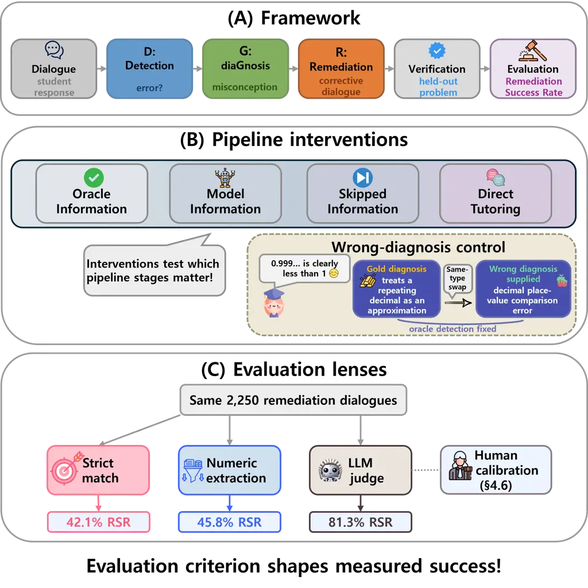

# MisconceptDialogue: Evaluation Criteria Shape Measured Success in LLM Math Tutoring

Woojin Lee ^(†)^(†)thanks: Co-first authors Affiliation: Electronics and
Telecommunications Research Institute, Republic of Korea
Email: [writerwoody@etri.re.kr](mailto:)    Yoonkyu Woo¹¹footnotemark: 1
Affiliation: Electronics and Telecommunications Research Institute,
Republic of Korea Affiliation: Department of Artificial Intelligence,
University of Science and Technology, Republic of Korea
Email: [yoon303@etri.re.kr](mailto:)    Jinah Kim
Affiliation: Electronics and Telecommunications Research Institute,
Republic of Korea Affiliation: Department of Artificial Intelligence,
University of Science and Technology, Republic of Korea
Email: [wlsdk3165@etri.re.kr](mailto:)    Hyeok-Min Gwon
Affiliation: Electronics and Telecommunications Research Institute,
Republic of Korea Email: [hgha1194990@etri.re.kr](mailto:)    Jin-Xia
Huang ^(†)^(†)thanks: Corresponding author Affiliation: Electronics and
Telecommunications Research Institute, Republic of Korea
Affiliation: Department of Artificial Intelligence, University of
Science and Technology, Republic of Korea
Email: [hgh@etri.re.kr](mailto:)

###### Abstract

Large language models are increasingly used as math tutors, raising two
questions: can a single LLM detect a student’s error, diagnose the
underlying misconception, and remediate it through multi-turn
dialogue—and can we trust the numbers that report how well it does? We
address both with MisconceptDialogue, a fully automated framework that
runs the full pipeline on five open-weight LLM tutors (7B–14B)
interacting with LLM-simulated students over 5,000+ dialogues—a
deliberately simulated protocol (paired conditions, a wrong-diagnosis
control unsafe with real learners, scale) whose results do not establish
real-student learning. On measurement, our headline finding is
uncomfortable for the field: benchmark-style exact-match scoring common
in standard math NLP—a lower-bound stress test—reports 42.1% measured
Remediation Success Rate on identical dialogues where a human-calibrated
LLM-as-judge reports 81.3%, a 39.2 percentage-point spread larger than
the combined effects of tutor model, teaching strategy, and supplied
diagnostic information. This is not a single-judge artifact: four
independent LLM judges and 200 human annotations converge to within a
few points ($`\kappa`$ up to 0.91). On capability, the verdict is
equally striking: the score barely changes whether we tell the tutor the
student’s actual misconception or a deliberately swapped one—under the
tested diagnosis-presentation format, these tutors show little evidence
of reliably conditioning on the diagnostic information they are handed.
For LLM tutoring evaluation to mature, multi-criterion scoring with
multi-judge convergence and human anchoring should become standard
practice—and the measurement question deserves as much scrutiny as the
capability question it claims to answer.

## 1 Introduction

Student misconceptions—systematic, coherent patterns of incorrect
reasoning—are among the most persistent obstacles to learning. Unlike
careless errors, they reflect deep-seated misunderstandings that resist
correction through mere presentation of correct answers Vosniadou and
Verschaffel (2004): Conceptual Change Theory Posner et al. (1982) holds
that remediation requires cognitive conflict, and Chi (2005) shows that
misconceptions of different ontological categories demand fundamentally
different interventions. Decades of research on intelligent tutoring
systems (ITS) have demonstrated that automated instruction can approach
the effectiveness of expert human tutoring VanLehn (2011); Kulik and
Fletcher (2016), but only when the system accurately diagnoses the
misconception and selects an appropriate pedagogical strategy Confrey
(1990); Smith III et al. (1994); Tippett (2010).

Large language models are now assuming this role. A randomized
controlled trial shows that GPT-4-based tutoring significantly improves
student engagement and learning outcomes Vanzo et al. (2025);
reinforcement learning enables 7B-scale models to achieve pedagogical
alignment competitive with proprietary systems Dinucu-Jianu et al.
(2025); and inference-time strategy steering allows explicit control
over tutoring behavior Puech et al. (2025). Yet rigorous benchmark
studies temper this enthusiasm: MathTutorBench Macina et al. (2025)
finds substantial gaps between LLM and human tutors, and GuideEval Liu
et al. (2025) shows that LLMs fail to adapt guidance to learner
cognitive states. As LLM tutors are deployed at scale Kasneci et al.
(2023), two fundamental questions arise—one about _capability_, one
about _measurement_.

The capability question: How well does the full
detect–diagnose–remediate pipeline work? Existing benchmarks evaluate
individual stages in isolation—the BEA 2025 Shared Task Kochmar et al.
(2025) measures mistake identification, the EEDI Kaggle 2024 competition
King et al. (2024) tests misconception classification from
multiple-choice distractors—but the full pipeline remains
under-evaluated within multi-turn dialogue. This matters because the
three stages are deeply interdependent: incorrect detection leads to
missed interventions, misdiagnosis leads to inappropriate strategies,
and even correct diagnosis fails if the tutor reveals the answer rather
than guiding understanding Macina et al. (2025).

The measurement question: Can we trust the numbers? In tutoring, a
student’s final answer string, numerical equivalence, and conceptual
understanding are related but distinct targets. Evaluation choices that
are routine in standard math NLP may therefore measure different
constructs when applied to multi-turn remediation dialogues. At the same
time, LLM-as-judge evaluation Zheng et al. (2023) carries documented
biases Panickssery et al. (2024); Chen et al. (2024), and LLM-simulated
students used for scalable evaluation raise their own ecological
validity questions Martynova et al. (2025); Wu et al. (2025).

We present MisconceptDialogue, a fully automated evaluation framework
that uses LLM-simulated students for scale while decoupling the tutoring
pipeline from the scoring lenses used to measure it Scarlatos et al.
(2026). Simulation is a deliberate trade of ecological validity for
experimental control: it holds the student fixed while tutor-side
information varies across six paired pipeline conditions, permits a
wrong-diagnosis control that could not responsibly be run on real
struggling students, and scales to over 5,000 dialogues so that
criterion effects carry paired statistics. Every capability claim below
is therefore scoped to this protocol. Through the first integrated
evaluation of the complete detect–diagnose–remediate pipeline—spanning
five open-weight LLM tutors (7B–14B) across four experiments and over
5,000 dialogues—we find that at this scale, the choice of evaluation
criterion shapes measured tutoring success more than any modeling lever
we manipulate. Our five findings group into measurement (1–2) and
capability (3–5):

1.  1.  Evaluation-criterion sensitivity: Applying benchmark-style
        exact-match scoring common in math NLP—a lower-bound stress test of
        imported benchmark practice, not a normative tutoring metric—reports
        42.1% Remediation Success Rate (RSR), the fraction of scenarios
        where the student solves a held-out verification problem after
        tutoring, on the same dialogues where a human-calibrated
        LLM-as-judge reports 81.3%—a 39.2 pp gap showing that scoring
        conventions can substantially shift measured tutoring success
        (§4.4).
2.  2.  Judge robustness and human calibration: The gap in (1) is not an
        artifact of one lenient judge—four LLM judges from three vendor
        families converge within 6 pp on the same dialogues (Fleiss
        $`\kappa`$=0.85), and on human-annotated subsets they align with
        human consensus on clean cases ($`\kappa`$=0.79–0.91) while
        remaining informative on borderline cases ($`\kappa`$=0.74–0.87)
        (§4.6).
3.  3.  Context-aware detection: Turning to capability, even the first
        pipeline stage proves brittle—multi-turn context improves apparent
        detection on imbalanced data but _degrades_ it on mixed-label data
        across all five models. The apparent gains were bias exploitation,
        not skill (§4.2).
4.  4.  Diagnosis–detection divergence: One stage up the pipeline, detection
        strength fails to predict diagnosis accuracy across all five
        models—exposing a category error in benchmarks that conflate
        “mistake identification” with “misconception identification” (§4.3).
5.  5.  Pipeline null result: If this decoupling could be patched by handing
        the tutor a perfect diagnosis, progressive oracle ablation finds no
        detectable benefit from structured pipeline information over direct
        tutoring under this protocol ($`p`$=0.263), and a three-judge
        wrong-diagnosis control provides little evidence that these tutors
        reliably condition on the diagnostic labels they are handed under
        the tested diagnosis-presentation format (§4.5).

## 2 Related Work

### 2.1 From Detection to Diagnosis

Work on misconception-aware math tutoring has developed along two mostly
separate lines. One diagnoses misconceptions from structured artifacts:
rule-based diagnosis systems Feldman et al. (2018), LLM-based error
classification McNichols et al. (2023), and distractor-based retrieval
in EEDI Wang et al. (2021); King et al. (2024). The other moves into
dialogue, where BEA 2025 scores mistake identification and feedback
quality (Kochmar et al., 2025). This split matters for our capability
question: detecting that a response is wrong is not the same as
identifying the misconception a tutor must remediate. MathDial Macina et
al. (2023), Bridge Wang et al. (2024), SocraticLM Liu et al. (2024),
ConvoLearn Sharma et al. (2026), and the Math Misconceptions Benchmark
Otero et al. (2025) make this dependency testable in context, but
whether contextual detection predicts fine-grained diagnosis within one
tutoring pipeline remains open.

### 2.2 LLM Tutoring and the End-to-End Evaluation Gap

Dialogue-based tutoring has expanded from AutoTutor Graesser et al.
(2004); Nye et al. (2014) and early LLM evaluations Tack and Piech
(2022) to Socratic, RL-aligned, strategy-steered, fine-tuned, and
evaluation-focused LLM tutoring systems Peng et al. (2025); Dinucu-Jianu
et al. (2025); Puech et al. (2025); Team et al. (2024); Shi et al.
(2026); Hsu et al. (2026). Yet Borchers and Shou (2025) show LLMs still
trail traditional ITS in adaptivity, and MathTutorBench Macina et al.
(2025) documents persistent gaps versus human tutors. Prior evaluations
are component-centered, leaving it under-tested whether the
detect$`\to`$diagnose$`\to`$remediate structure improves over direct
tutoring—a learning-science-motivated hypothesis Chi, 2005; Tippett,
2010 rarely tested as an integrated pipeline.

### 2.3 The Measurement Problem

The measurement question (§1) arises from two converging concerns.
First, the LLM-as-judge paradigm Zheng et al. (2023) that dominates
open-ended NLP evaluation carries well-documented biases: models favor
their own outputs Panickssery et al. (2024), and both human and LLM
judges are vulnerable to misinformation oversight, authority, and gender
biases under controlled perturbations Chen et al. (2024). For tutoring
evaluation—where “correct understanding” is inherently more ambiguous
than factual verification—these biases could systematically distort
measured remediation success, yet their impact remains underexplored.
Second, the LLM-simulated students increasingly used as scalable proxies
for real learners Markel et al. (2023); Scarlatos et al. (2026)
introduce their own validity concerns: teachers report significant gaps
in authenticity and emotional range Martynova et al. (2025), and
faithfully modeling diverse cognitive levels remains an open challenge
Wu et al. (2025). How closely simulated learners track real ones is
itself an active measurement question, approached through Turing-like
tests for simulated learners Käser and Alexandron (2024) and
psychometric alignment with human knowledge distributions He-Yueya et
al. (2024).

#### Synthesis.

Together, these gaps leave it unclear how much measured RSR reflects
tutoring behavior rather than evaluation artifacts. §3 introduces
MisconceptDialogue to address them jointly.

## 3 The MisconceptDialogue Framework

Figure 1: Overview of MisconceptDialogue. (A) The D-G-R pipeline moves
from student dialogue through detection, diagnosis, remediation,
verification, and final evaluation. (B) Pipeline-information
interventions vary what information the tutor receives—oracle,
model-generated, skipped, or direct tutoring—with a wrong-diagnosis
control that swaps the diagnosis while holding detection fixed (§4.5).
(C) Three evaluation lenses—strict match, numeric extraction, and a
human-calibrated LLM-as-judge (§4.6)—score the same 2,250 remediation
dialogues, shifting measured RSR from 42.1% to 81.3%.

MisconceptDialogue separates three objects that are often conflated: (i)
the D-G-R tutoring pipeline, (ii) pipeline-information interventions
controlling what the tutor is told, and (iii) evaluation lenses applied
to the same resulting dialogues (Figure 1). This separation lets Exp. 3
ask how scoring criteria change measured remediation, and Exp. 4 ask
whether diagnostic information changes tutor behavior.

#### Misconception taxonomy.

We adopt 55 educator-validated algebra misconceptions from the Math
Misconceptions Benchmark Otero et al. (2025), categorized by type
(factual, procedural, or conceptual) and domain (fractions, algebra,
geometry, arithmetic, number theory). This type distinction is
pedagogically meaningful: different misconception categories can call
for different interventions Chi (2005). Exp. 2 diagnosis uses these 55
entries as a closed-set taxonomy. For Exp. 3/4 remediation, we
instantiate them into 106 evaluation scenarios by varying the problem
context (36 factual, 34 procedural, 36 conceptual). Each scenario
carries (i) a problem statement, (ii) an expected student response
exhibiting the target misconception, (iii) a free-text label
paraphrasing the misconception within the 55-class taxonomy, and (iv) a
held-out verification problem (with gold answer) posed to the student
_after_ tutoring to determine RSR. Scenarios mix existing benchmark
items (53%) and GPT-5.4-generated variants (47%).

#### Remediation strategies.

Drawing on learning science research Posner et al. (1982); Tippett
(2010), we define five strategies: Counterexample (cases where the
misconception fails), Analogy (links to familiar concepts), Cognitive
Conflict (contradictions in student reasoning), Direct Instruction
(explicit rule explanation), and Socratic Questioning (guided
discovery). Exp. 3 fixes one strategy to isolate effects; Exp. 4’s
free-strategy condition lets the tutor choose from the diagnosis (§4.4,
§4.5).

#### Evaluation metrics.

Our central methodological move is to score _identical dialogues with
multiple criteria_, decomposing measured RSR into what the tutor
produces versus what the scorer credits (§1). For remediation we report
RSR—the fraction of scenarios where the simulated student solves a
held-out verification problem after tutoring (§1)—under three criteria:
(a) benchmark-style exact-match regex common in answer-focused math NLP,
(b) numerical extraction with tolerance, and (c) a human-calibrated
LLM-as-judge (§4.6). We run the LLM judge with four models from three
vendor families (GPT-5-mini and GPT-5.4 Singh et al. (2026), Claude
Haiku 4.5 Anthropic (2025), Gemini 3.1 Flash Lite Google DeepMind
(2026); §4.4); Claude Haiku 4.5 and Gemini 3.1 Flash Lite also serve as
out-of-family tutors in §4.5. We additionally report Answer Reveal Rate
(ARR)—the fraction of dialogues where the tutor reveals the target
answer during tutoring. Other stages use standard component metrics:
three-class Macro F1 for detection Kochmar et al. (2025) and Accuracy@1
for diagnosis. All prompts are specified in Appendix A,
simulated-student profiles in Appendix B, and decoding and run-level
hyperparameters in Appendix F.

## 4 Experiments

### 4.1 Models and Datasets

We evaluate five open-weight models in the 7B–14B range: Qwen-2.5-7B
Yang et al. (2024), Mistral-7B Jiang et al. (2023), Llama-3.1-8B
Grattafiori et al. (2024), Phi-4 Abdin et al. (2024) (14B), and
Qwen3.5-9B Yang et al. (2025)¹¹ 1
[https://huggingface.co/Qwen/Qwen3.5-9B](https://huggingface.co/Qwen/Qwen3.5-9B)
(9B). The five local models run in bfloat16 on H100 GPUs (Appendix R).
For detection (Exp. 1), we use three datasets: BEA 2025 Kochmar et al.
(2025) ($`n`$=300, imbalanced), MathDial Macina et al. (2023)
($`n`$=2,262, 75%/25% correct/incorrect), and Bridge Wang et al. (2024)
($`n`$=419, imbalanced). For diagnosis (Exp. 2), we use the Math
Misconceptions Benchmark Otero et al. (2025) (55 misconceptions, 220
examples). Per-dataset statistics and label distributions are in
Appendices C and E. For the out-of-family replication (§4.5), we
additionally evaluate Claude Haiku 4.5 and Gemini 3.1 Flash Lite as
tutors on the same protocol.

### 4.2 Experiment 1: Context-Aware Detection

#### Setup.

Following BEA 2025 Track 1, we evaluate mistake identification under
three context conditions: single-turn (final response only),
multi-turn (2) (two prior turns), and multi-turn (full) (complete
history).

#### Results.

A sharp dichotomy emerges along dataset balance (Table 1). On imbalanced
datasets (BEA 2025 and Bridge, containing _only_ incorrect responses),
multi-turn context improves F1 for all five models. On mixed-label
MathDial (75%/25% correct/incorrect), the same five models all _lose_ F1
with full context ($`\Delta`$: $`-`$0.026 to $`-`$0.163). This
consistent pattern indicates that context-driven gains on imbalanced
data reflect class-prior exploitation rather than better discrimination.
Subsampling itself can mislead: Qwen3.5-9B’s positive context effect at
$`n`$=300 ($`\Delta`$=+0.101) reverses to $`-`$0.163 on the full
dataset.

A label-shift mechanism underlies the effect: predictions skew toward
“incorrect” as context grows (mean 55.8%$`\rightarrow`$79.7%),
correct-class recall collapses (0.444$`\rightarrow`$0.202), and
incorrect-class recall rises (0.565$`\rightarrow`$0.793). On datasets
where every instance is incorrect this shift inflates aggregate scores;
on MathDial it degrades F1 by misclassifying correct responses.

Qwen-2.5-7B Mistral-7B Llama-3.1-8B Phi-4 Qwen3.5-9B Dataset Context F1
Acc F1 Acc F1 Acc F1 Acc F1 Acc BEA 2025 Single 0.237 0.553 0.108 0.193
0.253 0.610 0.257 0.627 0.218 0.487 Multi (2) 0.259 0.633 0.173 0.350
0.276 0.707 0.284 0.743 0.234 0.540 Multi (full) 0.309 0.863 0.187 0.390
0.290 0.770 0.307 0.853 0.285 0.747 MathDial Single 0.473 0.509 0.492
0.630 0.430 0.442 0.345 0.348 0.438 0.445 Multi (2) 0.426 0.435 0.439
0.468 0.365 0.365 0.214 0.325 0.402 0.404 Multi (full) 0.314 0.320 0.466
0.499 0.327 0.335 0.289 0.302 0.275 0.292 Bridge Single 0.204 0.442
0.131 0.150 0.158 0.463 0.011 0.017 0.014 0.021 Multi (2) 0.263 0.652
0.203 0.439 0.242 0.570 0.119 0.217 0.097 0.169 Multi (full) 0.301 0.823
0.219 0.489 0.257 0.628 0.164 0.327 0.135 0.253

Table 1: Exp. 1: Mistake identification (Macro F1 / Accuracy) across
five models, three datasets, and three context conditions.

### 4.3 Experiment 2: Diagnosis Accuracy

Experiment 1 addressed whether models detect mistakes; Experiment 2
turns to diagnosis—identifying _which_ misconception underlies an error.

#### Setup.

On the 220-item Math Misconceptions Benchmark, we compare five 55-way
closed-set diagnosis conditions: (A) Zero-shot, (B) Few-shot (5
examples), (C) CoT + rubric Wei et al. (2022), (D) RAG using BGE
embeddings Xiao et al. (2024); Lewis et al. (2020), and
(E) Generate-Retrieve-Rerank (GRR) Mitton et al. (2026). Appendix G
details the condition implementations and the post-hoc parsing
corrections.

Condition Qwen2.5 Mistral Llama3.1 Phi-4 Qwen3.5 (A) Zero-shot 0.359
0.077 0.291 0.436 0.545 (B) Few-shot (5) 0.291 0.241 0.273 0.441 0.473
(C) CoT + rubric 0.355 0.214 0.286 0.423 0.509 (D) RAG 0.355 0.232 0.236
0.400 0.459 (E) Gen-Ret-Rerank 0.377 0.255 0.332 0.477 0.518

Table 2: Exp. 2: Misconception diagnosis Acc@1 across five models and
five prompting conditions (55 misconceptions, $`n`$=220). Bold marks the
per-model best. Post-hoc parsing corrections: Appendix Table 9.

#### Results.

The headline pattern is that detection and diagnosis diverge (Table 2):
Mistral-7B has the strongest mixed-label detection F1 in Exp. 1 (0.492)
yet the lowest best-case diagnosis accuracy ($`\leq`$0.255), while
Qwen3.5-9B leads diagnosis (0.545) despite only moderate detection
(0.438)—identifying *whether* a mistake exists and *which* misconception
underlies it draw on different capabilities. Retrieval-based GRR lifts
the weakest model (Mistral, 0.077$`\rightarrow`$0.255) but remains below
zero-shot for the strongest model (Qwen3.5 zero-shot 0.545 vs. GRR
0.518); few-shot is inconsistent ($`+`$0.002 mean), and procedural cases
score highest while conceptual cases score lowest (Appendix D).

### 4.4 Experiment 3: Remediation and Evaluation Methodology

Experiments 1–2 addressed detection and diagnosis capability.
Experiment 3 turns to the measurement question: does the choice of
evaluation criterion materially affect measured remediation success?

#### Setup.

We evaluate five tutor models on a 5-strategy $`\times`$ 3-type matrix
over a 106-scenario bank (36 factual, 34 procedural, 36 conceptual).
Tiled-shuffle allocation assigns 30 scenarios per strategy–type cell,
reusing scenarios across cells to preserve type balance and within-cell
diversity, yielding 450 dialogues per model (2,250 total). The tutor
follows the assigned strategy; a GPT-5-mini Singh et al. (2026)
simulated student completes 5 tutoring turns and a verification problem.

Crucially, we apply three evaluation criteria to the _same_ dialogues:
Strict match: word-boundary regex matching—strictest; Numeric
extraction: numerical answer extraction with tolerance; LLM-as-judge:
GPT-5-mini accepting paraphrases and reasoning evidence—most lenient.
Strict match is not an arbitrary baseline: it mirrors the exact-match
scoring that standard math NLP benchmarks apply to model outputs, so
including it directly tests _how much current benchmark practice would
lower measured remediation estimates if transferred to tutoring
dialogues_. LLM-as-judge sits at the other end—a criterion explicitly
designed to credit understanding beyond exact-answer matching, and the
one we calibrate against human consensus (§4.6).

#### Results.

The same dialogues yield systematically different RSR depending on the
scoring criterion (Table 3): Strict match 40.2–44.4%, Numeric extraction
44.4–47.1%, LLM judge 77.8–84.4%. Because the dialogues are identical,
the 39.2 pp gap reflects _what counts as correct_, not changes in tutor
behavior or answer revealing (ARR = 6.0–8.7%). Strict and Numeric are
nearly equivalent (42.1% vs. 45.8%); only the LLM judge is substantially
higher, so the gap stems from whether _conceptual understanding_ is
credited beyond exact-answer matching. Paired McNemar testing on
identical dialogues confirms the gap (Strict vs. LLM judge:
$`\chi^{2}`$=765.7, $`p<10^{-50}`$; 95% bootstrap CI: \[36.6,
41.8\] pp); Appendix J states why a paired test is the appropriate
choice here.

Automatic criteria LLM-as-judge Tutor Model Strict Numeric GPT Claude
Gemini ARR (%) (%) (%) (%) (%) (%) Qwen-2.5-7B 44.4 46.4 81.8 76.2 79.1
6.9 Phi-4 42.4 47.1 83.6 78.2 81.1 6.4 Qwen3.5-9B 43.3 46.4 84.4 77.8
80.4 8.7 Llama-3.1-8B 40.2 44.4 79.1 74.4 76.9 6.7 Mistral-7B 40.2 44.4
77.8 70.2 73.6 6.0 Mean 42.1 45.8 81.3 75.4 78.2 6.9

Table 3: Exp. 3: RSR (%) on the same 2,250 dialogues (5 models
$`\times`$ 5 strategies $`\times`$ 3 types $`\times`$ 30 scenarios;
$`n`$=450 per row). Columns group Strict/Numeric as automatic criteria
and GPT/Claude/Gemini as LLM-as-judge variants: GPT-5-mini, Claude Haiku
4.5, and Gemini 3.1 Flash Lite. GPT-5.4 cross-check is reported in
Appendix L. ARR = answer reveal rate.

#### Judge-family convergence.

To check that the LLM-judge result is not a single-judge artifact, we
rescore the same 2,250 dialogues with two non-OpenAI judges—Claude Haiku
4.5 (Anthropic) and Gemini 3.1 Flash Lite (Google)—plus a GPT-5.4
cross-check. Agreement is high: the three main judges (corrected
GPT-5-mini, Claude Haiku 4.5, Gemini 3.1 Flash Lite) reach Fleiss
$`\kappa`$=0.85, with pairwise Cohen $`\kappa`$=0.78–0.93. Per-model RSR
rankings (Mistral-7B lowest, Phi-4/Qwen3.5-9B highest) survive across
judges. A 3-judge majority-vote RSR of 78.2% sits within 3 pp of each
individual judge, and GPT-5.4 tracks GPT-5-mini within 2.8 pp under
aligned evaluation context (Appendix L). The 39.2 pp gap in Table 3 is
therefore a property of the criterion, not of any specific judge.

#### Disagreement taxonomy.

Cross-tabulating the three criteria on the same 2,250 dialogues
decomposes the 39.2 pp gap into two distinct components.
Strict-fail/Judge-pass disagreements total 949 (42.2% of all dialogues):
23.4% (222) are also Numeric-pass, exposing string-mismatches on
numerically correct answers; 76.6% (727) are Numeric-fail/Judge-pass,
capturing paraphrase tolerance and reasoning credit beyond exact-answer
matching. Roughly three-quarters of the gap is therefore
construct-credit difference, with the remaining quarter attributable to
the surface-matching brittleness of benchmark-style exact matching. Both
components support the same conclusion: current benchmark defaults
should not transfer wholesale to tutoring evaluation.

Non-measurement effects split between a strong type effect and a flat
strategy effect. The LLM judge shows a clear monotone ordering by
misconception type (conceptual 89.9% \> procedural 80.9% \> factual
73.2%; consistent across all five models, $`p<10^{-30}`$), an ordering
that nearly vanishes under strict match—the type effect surfaces through
conceptual-understanding scoring (Appendix D). Strategy effects are
essentially flat: the five strategies cluster within 6.7 pp under
LLM-judge RSR (averaged over models) with no significant
strategy$`\times`$type interaction; Appendix N gives dialogue excerpts
illustrating this invariance. Two of the five (Direct Instruction,
Counterexample) have low self-marker ratios (\< 0.11; Appendix M), so
part of the apparent equivalence may reflect imperfect strategy
operationalization; restricting to the three high-fidelity strategies
preserves the 6.7 pp range, so the equivalence is not purely an
artifact. The simulated setting nonetheless bounds rather than
establishes pedagogical equivalence.

The simulated student adopts the assigned misconception faithfully
(persona-only RSR of 6.6%) and recovers under tutoring in a
type-dependent way (conceptual gains exceed procedural by 25.6 pp),
arguing against a simple “persuadability ceiling” explanation for the
flat strategy effects (Appendix O).

### 4.5 Experiment 4: End-to-End Pipeline

#### Setup.

To test capability directly, we run progressive oracle ablation across
five models and the same 106 scenarios, using GPT-5-mini Singh et al.
(2026) as simulated student/judge (3,180 dialogues). Conditions are
C1 (gold detection + diagnosis + Exp. 3 type-best strategy²² 2 C1 maps
factual/conceptual$`\to`$direct instruction and
procedural$`\to`$socratic; for procedural and conceptual the top-2
strategies differ by $`<`$7 pp (n.s.), so this mapping is approximate.),
C2 (oracle detection + diagnosis, free strategy), C3 (oracle detection +
model diagnosis), C3.5 (oracle detection only, no diagnosis), C4 (fully
automated pipeline), and B1 (direct tutoring, no pipeline).

#### Results.

RSR shows no significant pipeline-condition effect (GLMM
$`\chi^{2}`$=6.47, $`p`$=0.263, Table 4). The RSR range from 76.6% (C2)
to 81.3% (C3) yields no significant pairwise differences (Holm-corrected
$`p`$=1.000, Cohen’s $`h<0.10`$). TOST equivalence testing Schuirmann
(1987) accepts $`\delta`$=10 pp for all 15 pairs, but only three
near-identical pairs at $`\delta`$=5 pp, so pipeline benefits around
5 pp remain possible for most comparisons (Appendix K). The pattern is
criterion-invariant: strict match shows a similar 3.1 pp condition
spread versus the LLM judge’s 4.9 pp. At $`n`$=530 per condition, the
design has 80% power for effects $`\geq`$7 pp but only 56% at 5 pp. The
absolute RSR (74–78%) tracks Exp. 3’s LLM-judge RSR (78–84%).

A more direct control reaches the same conclusion: supplying oracle
detection with an intentionally mismatched same-type misconception
yields RSR of 80.8%—statistically indistinguishable from gold diagnosis
(C2, 76.6%; McNemar $`p`$=0.078) or direct tutoring (B1, 78.5%;
$`p`$=0.315). Across the same 1,590 dialogues, three independent judges
agree on the wrong-vs-gold direction (Claude Haiku 4.5 +3.2 pp, Gemini
3.1 Flash Lite +3.4 pp, GPT-5-mini +4.2 pp), arguing against a
single-judge artifact. Four readings remain compatible: (i) pipeline
structure adds little detectable signal under this protocol; (ii) 7B–14B
tutors fail to condition on the diagnostic label; (iii) the simulated
student recovers from generic tutoring regardless of diagnostic
correctness; (iv) the LLM judge cannot discriminate the differences.
Because the swap holds coarse misconception type fixed, the control
targets fine-grained label uptake rather than cross-type diagnostic
usefulness. The 3-judge convergence favors readings (ii)–(iii) over a
single-judge artifact; (iii) is bounded by the simulator’s persona-only
RSR of 6.6% and 21.2 pp profile-level variance, showing it is not a
uniform recoverer (Appendix P).

Condition Qwen-2.5 Mistral Llama-3.1 Phi-4 Qwen3.5 Mean C1: Oracle All
.783 .726 .802 .868 .849 .806 C2: Oracle Diag. .783 .689 .755 .811 .792
.766 C3: Model Diag. .764 .792 .764 .906 .840 .813 C3.5: Det. Only .774
.755 .736 .811 .821 .779 C4: Auto Pipeline .755 .764 .802 .792 .840 .791
B1: Direct .811 .726 .774 .821 .792 .785

Table 4: Exp. 4: Progressive oracle ablation (RSR). C1=oracle
all/type-best strategy, C2=oracle diagnosis/free strategy, C3=model
diagnosis, C3.5=detection only, C4=automated pipeline, B1=direct
tutoring. Five models $`\times`$ six conditions $`\times`$ 106
scenarios, GPT-5-mini evaluator. No condition effect is significant
(statistics in §4.5).

#### Analysis.

Variance decomposition explains the null: scenario difficulty dominates
(intraclass correlation, ICC=0.206), while model and condition effects
are negligible (ICC$`<`$1%), so pipeline-information signals are smaller
than scenario-level variation in this design. Measurable effects are
pedagogical rather than procedural: misconception type drives the main
effect ($`p<10^{-30}`$), with no condition$`\times`$type interaction,
and C2 free-strategy collapses into _strategy monoculture_ (Appendix M),
recording the lowest mean RSR (76.6%). C4 detection reaches 96.8%,
making detection an unlikely bottleneck.

#### Out-of-family tutor replication.

Two concerns about the Exp. 4 null call for an out-of-family check: our
student simulator and primary judges share an OpenAI lineage (potential
in-family coupling), and our tutors all sit in the 7B–14B band
(potential capability saturation). We address both by replicating Exp. 3
with two stronger proprietary tutors from non-OpenAI families—Claude
Haiku 4.5 (Anthropic) and Gemini 3.1 Flash Lite (Google)—under the same
protocol (Appendix Q). Strict-match RSR is essentially unchanged from
the 5-baseline mean (43.1% vs. 42.1%, +1.0 pp), so the 39.2 pp criterion
gap from §4.4 persists at this capability scale. Under the LLM judges,
the non-OpenAI mean exceeds the baseline mean by 4.8–6.5 pp but stays
within the 4-judge envelope (judge spread 5.9 pp), and per-strategy
spreads remain narrow (Claude Haiku 4.5 11 pp, Gemini 3.1 Flash Lite
9 pp; baseline 6.7 pp). Moving to stronger out-of-family tutors changes
LLM-judge RSR by only single-digit points while the measurement
criterion moves it by 40+ pp—reducing concerns that the main pattern is
solely an in-family or 7B–14B saturation artifact.

### 4.6 Human Evaluation

#### Setup.

Two quality-stratified subsets calibrate the automated scores against
human judgment: a clean set ($`n`$=100) and a borderline set
($`n`$=100). Three judge-blinded annotators, each with at least a
bachelor’s degree and prior coursework or equivalent experience in
benchmark-level mathematics, rate each dialogue on four
dimensions—correct understanding, reasoning quality, answer revelation,
and naturalness—with sampling pipeline, rubric, and annotator details in
Appendix H.

Subset Evaluator RSR $`\kappa`$ vs. H Agree Clean Human (consensus) 88%
— — GPT-5-mini judge 89% 0.853 97% GPT-5.4 judge 87% 0.863 97% Claude
Haiku 4.5 85% 0.786 95% Gemini 3.1 Flash Lite 88% 0.905 98% Strict match
52% 0.175 60% Borderline Human (consensus) 75% — — GPT-5-mini judge 73%
0.740 90% GPT-5.4 judge 70% 0.775 91% Claude Haiku 4.5 68% 0.829 93%
Gemini 3.1 Flash Lite 72% 0.872 95%

Table 5: Human vs. automated evaluation on clean ($`n`$=100, quality
$`\geq`$3.0) and borderline ($`n`$=100, quality 2.0–2.99) subsets. Human
RSR is three-annotator majority vote; inter-annotator agreement (avg.
pairwise Cohen’s $`\kappa`$): 0.51 clean, 0.55 borderline. $`\kappa`$
vs. H = evaluator’s Cohen’s $`\kappa`$ against human consensus.

#### Results.

Inter-annotator agreement is moderate (mean pairwise Cohen’s
$`\kappa`$=0.51 clean, 0.55 borderline; Table 5). The four LLM judges
track human consensus closely—within 1–3 pp on clean cases and 2–7 pp on
borderline cases—with item-level Cohen $`\kappa`$ ranging 0.79–0.91 on
clean and 0.74–0.87 on borderline. The paper-default GPT-5-mini reaches
$`\kappa`$=0.853 on clean (97% agreement; three disagreements analyzed
in Appendix I) and $`\kappa`$=0.740 on borderline (90%). The highest
agreement on both subsets comes from Gemini 3.1 Flash Lite—a Google
model with no OpenAI lineage ($`\kappa`$=0.905 clean, 0.872
borderline)—showing that judge reliability on coherent dialogues is not
specific to any vendor family. Because all four judges track human
consensus closely, the near-zero cross-family ICC in §4.5 reflects
differing evaluator standards rather than a weak underlying signal.

## 5 Discussion

On measurement, our two questions answer asymmetrically. The
strict-match-to-LLM-judge gap (42.1–81.3%) on identical dialogues
exceeds every other variable: criterion alone shifts RSR by 39.2 pp
while model, strategy, pipeline condition, and judge identity each
contribute only single-digit effects. Two non-OpenAI judges reproduce
the same gap (33.3–39.2 pp), the three main judges converge at Fleiss
$`\kappa`$=0.85, and GPT-5.4 tracks GPT-5-mini within 2.8 pp. The gap
therefore lies in the _criterion family_—surface matching versus
understanding judgment—rather than any specific judge. We do not treat
strict match as a normative tutoring metric; it is a stress test for
importing benchmark-style scoring into dialogue, and even numerical
extraction remains far below LLM judgment. Item-level agreement between
LLM judges and human consensus on clean dialogues ($`\kappa`$ up to
0.91) supports the understanding-judgment interpretation, so every RSR
figure is meaningful only relative to its evaluation criterion.

On capability, perfect pipeline information does not detectably improve
remediation under this protocol ($`p`$=0.263). Because the
wrong-diagnosis control holds misconception _type_ fixed, this tests
fine-grained label uptake rather than rejecting the value of diagnosis
wholesale. Several readings remain open: the tutor may not use the
label, the simulated student may recover regardless of the diagnosis, or
the judge may be insensitive to the difference. What the null is _not_
is a simple persuadability ceiling—profile-level RSR varies by 21.2 pp
(Appendix O). Separating these readings requires a design that varies
the diagnosis-presentation format and the student model systematically,
which is beyond what a single null can settle.

These two findings belong together because the design orthogonalizes
generation from scoring. Exp. 3 fixes the dialogues and varies only the
scoring criterion, isolating criterion effects from tutor outputs;
Exp. 4 fixes the evaluator and varies only the information supplied to
the tutor, isolating pipeline-information effects from evaluator choice.
The central comparison is therefore not a loose juxtaposition across
experiments, but a paired audit of how much measured success moves when
we change the scorer versus when we change the tutor’s information.

Implications: Cross-experiment convergence anchors LLM-judge RSR as a
property of the instrument—Exp. 3 (78–84%) and Exp. 4 (74–78%) settle
near $`{\sim}`$79% under independent pipeline conditions. Given that
benchmark-style strict exact-match can substantially lower measured
remediation estimates under this protocol, researchers should report RSR
under at least two automated criteria, quantify their disagreement, and
include a human baseline to anchor absolute values. When criteria
disagree, the disagreement set should be audited directly rather than
collapsed into a single preferred score. Without this discipline of
multi-criterion scoring, multi-judge convergence, and human calibration,
no single RSR figure can support a coherent interpretation.

## 6 Conclusion

MisconceptDialogue separates a _capability_ question from a
_measurement_ question across five 7B–14B LLM tutors. One finding
organizes the rest: on the same 2,250 dialogues, changing only the
scoring criterion moves RSR from 42.1% to 81.3%, and that 39.2 pp gap
exceeds the combined effects of tutor model, teaching strategy, and
supplied diagnostic information. What most determined measured success
was therefore not any modelling lever, but the evaluator’s definition of
success. This is not the artifact of one lenient judge—four judges
spanning three vendor families reproduce the gap, and 200 human
annotations anchor it (judge–human $`\kappa`$=0.74–0.91). On capability,
structured pipeline information yielded no detectable advantage over
direct tutoring (GLMM $`p`$=0.263), and a wrong-diagnosis control found
little evidence that tutors condition on the diagnostic labels they are
handed. Reporting for tutoring evaluation should therefore treat the
scoring criterion as a first-class object of study rather than an
implementation detail. The calibrated instrument this protocol provides
is what a real-student study will need first; that classroom study is
the essential next step.

## Limitations

The limitations below primarily constrain external validity to real
classrooms, broader domains, and larger model families; our central
claims rest on within-protocol contrasts.

- •
  Domain and taxonomy. We focus on mathematics for its relatively
  clear-cut answers; more ambiguous domains would require adapted
  criteria. The 55 educator-validated middle-school algebra
  misconceptions suffice for the type-level effects we report but are a
  small slice of real curricula.
- •
  Dataset construction. The detection datasets are imbalanced (BEA and
  Bridge contain only incorrect responses; MathDial’s split is partial),
  a skew quantified in Exp. 1; relatedly, the Exp. 4 C4 detection rate
  (96.8%) is recall, not specificity. The GPT-5.4-generated 47% of
  remediation scenarios, combined with the OpenAI-family default judge,
  could inflate RSR via in-family coherence; the clean-set human RSR
  (88%) and cross-vendor replication (Fleiss $`\kappa`$=0.85) bound but
  do not eliminate this risk.
- •
  Model scale. We evaluate five 7B–14B open-weight tutors plus two
  stronger non-OpenAI proprietary tutors (§4.5); model identity
  contributes negligible variance (ICC$`<`$1%). The out-of-family null
  suggests—but does not verify—that 70B+ systems behave similarly.
- •
  Sampling, power, and human calibration. Exp. 3 uses 30 dialogues per
  cell (2,250 total): per-cell power is moderate, though the paired
  criterion comparisons carrying our central finding remain highly
  significant. The Exp. 4 null is bounded rather than exact: TOST
  accepts equivalence at $`\delta`$=10 pp for all 15 pairs but only
  three at $`\delta`$=5 pp, and power is 80% for effects $`\geq`$7 pp,
  so benefits near 5 pp remain possible. The human study covers two
  $`n`$=100 quality-stratified subsets; broader annotation and external
  annotator pools would tighten calibration (the clean-set human RSR of
  88% partly reflects quality screening).
- •
  Judge–simulator dual role. GPT-5-mini doubles as simulated student and
  as one of four LLM judges in Exp. 3–4. We probe this through
  cross-family validation (§4.5), non-OpenAI judge replication (Fleiss
  $`\kappa`$=0.85), and human calibration on 200 dialogues (all four
  judges reach $`\kappa\geq`$0.74 against human consensus). Structural
  biases shared across the LLM-judge class are only partially anchored
  by this calibration.
- •
  Diagnosis-presentation format. The diagnosis is injected into tutor
  prompts in a single format throughout, so the wrong-diagnosis control
  tests conditioning under that format only and the claim is scoped
  accordingly (Appendix P reports a diagnosis-emphasis robustness
  check).
- •
  Strategy invariance. The 9–19 pp within-model strategy gap admits two
  readings: genuine pedagogical equivalence at this scale, or a
  uniformly persuadable simulator. Restricting the contrast to the three
  faithful strategies (Appendix M) preserves the near-flat pattern;
  separating the two requires real students.

## Ethical Considerations

This work uses publicly available or research-use external datasets
(including MathDial under CC BY-SA 4.0 and Bridge under CC BY 4.0) for
research evaluation and involves no real student participants. The
datasets contain mathematics problems and tutoring dialogues with no
personally identifying information, so no offensive-content filtering or
anonymization beyond the original releases was required; human
annotation was judge-blinded and is reported only in aggregated,
anonymized form (§4.6, Appendix H). Simulating students sidesteps
deployment risks with real learners, but it may overestimate
real-classroom effectiveness, since simulated students cannot fully
capture diverse learners’ reasoning, language backgrounds, or affective
responses. The more direct risk is _inaccurate evaluation_: a lenient
automated judge could certify a weak tutor as effective, and our 39.2 pp
criterion-induced shift shows how readily evaluation design can create a
false sense of safety. We therefore recommend human expert review before
autonomous deployment, particularly in high-stakes educational contexts.

## Acknowledgements

This work was supported by Institute of Information and Communications
Technology Planning and Evaluation (IITP) grant funded by the Korea
government (MSIT) (RS-2019-II190004, Development of semi-supervised
learning language intelligence technology and Korean tutoring service
for foreigners).

## References

- Abdin et al. (2024) M. Abdin, J. Aneja, H. Behl, S. Bubeck, R.
  Eldan, S. Gunasekar, M. Harrison, R. J. Hewett, M. Javaheripi, P.
  Kauffmann, et al. Phi-4 technical report. arXiv preprint
  arXiv:2412.08905. Cited by: §4.1.
- Anthropic (2025) Anthropic Claude Haiku 4.5 System Card. Note: System
  cardReleased 2025-10-15 External Links:
  [Link](https://www.anthropic.com/claude-haiku-4-5-system-card) Cited
  by: §3.
- Borchers and Shou (2025) C. Borchers and T. Shou Can large language
  models match tutoring system adaptivity? a benchmarking study. In
  International Conference on Artificial Intelligence in Education,
  pp. 407–420. Cited by: §2.2.
- Chen et al. (2024) G. H. Chen, S. Chen, Z. Liu, F. Jiang, and B. Wang
  Humans or LLMs as the judge? a study on judgement bias. In Proceedings
  of the 2024 Conference on Empirical Methods in Natural Language
  Processing, pp. 8301–8327. Cited by: §1, §2.3.
- Chi (2005) M. T. Chi Commonsense conceptions of emergent processes:
  why some misconceptions are robust. The journal of the learning
  sciences 14 (2), pp. 161–199. Cited by: §1, §2.2, §3.
- Confrey (1990) J. Confrey Chapter 1: a review of the research on
  student conceptions in mathematics, science, and programming. Review
  of research in education 16 (1), pp. 3–56. Cited by: §1.
- Dinucu-Jianu et al. (2025) D. Dinucu-Jianu, J. Macina, N. Daheim, I.
  Hakimi, I. Gurevych, and M. Sachan From problem-solving to teaching
  problem-solving: aligning LLMs with pedagogy using reinforcement
  learning. In Proceedings of the 2025 Conference on Empirical Methods
  in Natural Language Processing, pp. 272–292. Cited by: §1, §2.2.
- Feldman et al. (2018) M. Q. Feldman, J. Y. Cho, M. Ong, S. Gulwani, Z.
  Popović, and E. Andersen Automatic diagnosis of students’
  misconceptions in K-8 mathematics. In Proceedings of the 2018 CHI
  Conference on Human Factors in Computing Systems, pp. 1–12. Cited by:
  §2.1.
- Google DeepMind (2026) Google DeepMind Gemini 3.1 Flash Lite Model
  Card. Note: Model cardReleased 2026-03-03 External Links:
  [Link](https://deepmind.google/models/model-cards/gemini-3-1-flash-lite/)
  Cited by: §3.
- Graesser et al. (2004) A. C. Graesser, S. Lu, G. T. Jackson, H. H.
  Mitchell, M. Ventura, A. Olney, and M. M. Louwerse AutoTutor: a tutor
  with dialogue in natural language. Behavior Research Methods,
  Instruments, & Computers 36 (2), pp. 180–192. Cited by: §2.2.
- Grattafiori et al. (2024) A. Grattafiori, A. Dubey, A. Jauhri, A.
  Pandey, A. Kadian, A. Al-Dahle, A. Letman, A. Mathur, A. Schelten, A.
  Vaughan, et al. The Llama 3 herd of models. arXiv preprint
  arXiv:2407.21783. Cited by: §4.1.
- He-Yueya et al. (2024) J. He-Yueya, W. A. Ma, K. Gandhi, B. W.
  Domingue, E. Brunskill, and N. D. Goodman Psychometric alignment:
  capturing human knowledge distributions via language models. arXiv
  preprint arXiv:2407.15645. Cited by: §2.3.
- Hsu et al. (2026) W. Hsu, Y. Tang, and A. Yen MathEDU: feedback
  generation on problem-solving processes for mathematical learning
  support. In Proceedings of the 19th Conference of the European Chapter
  of the Association for Computational Linguistics (Volume 1: Long
  Papers), pp. 2883–2901. Cited by: §2.2.
- Jiang et al. (2023) A. Q. Jiang, A. Sablayrolles, A. Mensch, C.
  Bamford, D. S. Chaplot, D. de las Casas, F. Bressand, G. Lengyel, G.
  Lample, L. Saulnier, L. R. Lavaud, M. Lachaux, P. Stock, T. L.
  Scao, T. Lavril, T. Wang, T. Lacroix, and W. E. Sayed Mistral 7B.
  External Links: 2310.06825, [Link](https://arxiv.org/abs/2310.06825)
  Cited by: §4.1.
- Käser and Alexandron (2024) T. Käser and G. Alexandron Simulated
  learners in educational technology: a systematic literature review and
  a Turing-like test. International Journal of Artificial Intelligence
  in Education 34 (2), pp. 545–585. Cited by: §2.3.
- Kasneci et al. (2023) E. Kasneci, K. Seßler, S. Küchemann, M.
  Bannert, D. Dementieva, F. Fischer, U. Gasser, G. Groh, S.
  Günnemann, E. Hüllermeier, S. Krusche, G. Kutyniok, T. Michaeli, C.
  Nerdel, J. Pfeffer, O. Poquet, M. Sailer, A. Schmidt, T. Seidel, M.
  Stadler, J. Weller, J. Kuhn, and G. Kasneci ChatGPT for good? on
  opportunities and challenges of large language models for education.
  Learning and individual differences 103, pp. 102274. Cited by: §1.
- King et al. (2024) J. King, L. Burleigh, S. Woodhead, P. Kon, P.
  Baffour, S. Crossley, W. Reade, and M. Demkin EEDI – Mining
  Misconceptions in Mathematics. Note: Kaggle competition External
  Links:
  [Link](https://www.kaggle.com/competitions/eedi-mining-misconceptions-in-mathematics)
  Cited by: §1, §2.1.
- Kochmar et al. (2025) E. Kochmar, K. K. Maurya, K. Petukhova, K. A.
  Srivatsa, A. Tack, and J. Vasselli Findings of the BEA 2025 shared
  task on pedagogical ability assessment of AI-powered tutors. In
  Proceedings of the 20th Workshop on Innovative Use of NLP for Building
  Educational Applications (BEA 2025), E. Kochmar, B. Alhafni, M.
  Bexte, J. Burstein, A. Horbach, R. Laarmann-Quante, A. Tack, V.
  Yaneva, and Z. Yuan (Eds.), Vienna, Austria, pp. 1011–1033. External
  Links: [Link](https://aclanthology.org/2025.bea-1.77/),
  [Document](https://dx.doi.org/10.18653/v1/2025.bea-1.77), ISBN
  979-8-89176-270-1 Cited by: Table 6, §1, §2.1, §3, §4.1.
- Kulik and Fletcher (2016) J. A. Kulik and J. D. Fletcher Effectiveness
  of intelligent tutoring systems: a meta-analytic review. Review of
  educational research 86 (1), pp. 42–78. Cited by: §1.
- Lewis et al. (2020) P. Lewis, E. Perez, A. Piktus, F. Petroni, V.
  Karpukhin, N. Goyal, H. Küttler, M. Lewis, W. Yih, T. Rocktäschel, S.
  Riedel, and D. Kiela Retrieval-augmented generation for
  knowledge-intensive NLP tasks. Advances in neural information
  processing systems 33, pp. 9459–9474. Cited by: §4.3.
- Liu et al. (2024) J. Liu, Z. Huang, T. Xiao, J. Sha, J. Wu, Q. Liu, S.
  Wang, and E. Chen SocraticLM: exploring Socratic personalized teaching
  with large language models. Advances in Neural Information Processing
  Systems 37, pp. 85693–85721. Cited by: §2.1.
- Liu et al. (2025) Y. Liu, C. Li, T. Zhang, M. Wang, Q. Zhu, J. Li,
  and H. Huang Discerning minds or generic tutors? evaluating
  instructional guidance capabilities in Socratic LLMs. arXiv preprint
  arXiv:2508.06583. Cited by: §1.
- Macina et al. (2023) J. Macina, N. Daheim, S. Chowdhury, T. Sinha, M.
  Kapur, I. Gurevych, and M. Sachan MathDial: a dialogue tutoring
  dataset with rich pedagogical properties grounded in math reasoning
  problems. In Findings of the Association for Computational
  Linguistics: EMNLP 2023, pp. 5602–5621. Cited by: Table 6, §2.1, §4.1.
- Macina et al. (2025) J. Macina, N. Daheim, I. Hakimi, M. Kapur, I.
  Gurevych, and M. Sachan MathTutorBench: a benchmark for measuring
  open-ended pedagogical capabilities of LLM tutors. In Proceedings of
  the 2025 Conference on Empirical Methods in Natural Language
  Processing, pp. 204–221. Cited by: §1, §1, §2.2.
- Markel et al. (2023) J. M. Markel, S. G. Opferman, J. A. Landay,
  and C. Piech GPTeach: interactive TA training with GPT-based students.
  In Proceedings of the tenth acm conference on learning@ scale,
  pp. 226–236. Cited by: §2.3.
- Martynova et al. (2025) D. Martynova, J. Macina, N. Daheim, N.
  Yalcin, X. Zhang, and M. Sachan Can LLMs effectively simulate human
  learners? teachers’ insights from tutoring LLM students. In
  Proceedings of the 20th Workshop on Innovative Use of NLP for Building
  Educational Applications (BEA 2025), pp. 100–117. Cited by: §1, §2.3.
- McNichols et al. (2023) H. McNichols, M. Zhang, and A. Lan Algebra
  error classification with large language models. In International
  Conference on Artificial Intelligence in Education, pp. 365–376. Cited
  by: §2.1.
- Mitton et al. (2026) J. Mitton, P. Bhattacharyya, D. Smith, T.
  Christie, R. Abboud, and S. Woodhead Misconception diagnosis from
  student-tutor dialogue: generate, retrieve, rerank. In Proceedings of
  the Thirteenth ACM Conference on Learning @ Scale, pp. 277–286. Cited
  by: §4.3.
- Nye et al. (2014) B. D. Nye, A. C. Graesser, and X. Hu AutoTutor and
  family: a review of 17 years of natural language tutoring.
  International Journal of Artificial Intelligence in Education 24 (4),
  pp. 427–469. Cited by: §2.2.
- Otero et al. (2025) N. Otero, S. Druga, and A. Lan A benchmark for
  math misconceptions: bridging gaps in middle school algebra with
  AI-supported instruction. Discover Education 4 (1), pp. 277. Cited by:
  Table 6, §2.1, §3, §4.1.
- Panickssery et al. (2024) A. Panickssery, S. R. Bowman, and S. Feng
  LLM evaluators recognize and favor their own generations. Advances in
  Neural Information Processing Systems 37, pp. 68772–68802. Cited by:
  §1, §2.3.
- Peng et al. (2025) X. Peng, P. Yuan, D. Li, J. Cheng, Q. Fang, and Z.
  Liu KELE: a multi-agent framework for structured Socratic teaching
  with large language models. In Findings of the Association for
  Computational Linguistics: EMNLP 2025, pp. 16342–16362. Cited by:
  §2.2.
- Posner et al. (1982) G. J. Posner, K. A. Strike, P. W. Hewson,
  and W. A. Gertzog Accommodation of a scientific conception: toward a
  theory of conceptual change. Science education 66 (2), pp. 211–227.
  Cited by: §1, §3.
- Puech et al. (2025) R. Puech, J. Macina, J. Chatain, M. Sachan, and M.
  Kapur Towards the pedagogical steering of large language models for
  tutoring: a case study with modeling productive failure. In Findings
  of the Association for Computational Linguistics: ACL 2025,
  pp. 26291–26311. Cited by: §1, §2.2.
- Scarlatos et al. (2026) A. Scarlatos, J. Lee, S. Woodhead, and A. Lan
  Simulated students in tutoring dialogues: substance or illusion?. In
  Proceedings of the 64th Annual Meeting of the Association for
  Computational Linguistics (Volume 1: Long Papers), pp. 42349–42385.
  Cited by: Appendix B, §1, §2.3.
- Schuirmann (1987) D. J. Schuirmann A comparison of the two one-sided
  tests procedure and the power approach for assessing the equivalence
  of average bioavailability. Journal of pharmacokinetics and
  biopharmaceutics 15 (6), pp. 657–680. Cited by: Appendix K, §4.5.
- Sharma et al. (2026) M. Sharma, R. Pea, and H. Subramonyam ConvoLearn:
  a learning sciences grounded dataset for fine-tuning dialogic AI
  tutors. External Links: 2601.08950,
  [Link](https://arxiv.org/abs/2601.08950) Cited by: §2.1.
- Shi et al. (2026) W. Shi, H. Ren, J. Pan, A. Zhou, K. Wang, Z. Lu, Y.
  Yang, Y. Hu, L. Wei, M. Zhan, and H. Li From solver to tutor:
  evaluating the pedagogical intelligence of LLMs with KMP-Bench. In
  Proceedings of the AAAI Conference on Artificial Intelligence, Vol.
  40, pp. 32965–32973. Cited by: §2.2.
- Singh et al. (2026) A. Singh, A. Fry, A. Perelman, A. Tart, A.
  Ganesh, A. El-Kishky, A. McLaughlin, A. Low, A. Ostrow, A.
  Ananthram, A. Nathan, A. Luo, A. Helyar, A. Madry, A. Efremov, A.
  Spyra, A. Baker-Whitcomb, A. Beutel, A. Karpenko, A. Makelov, A.
  Neitz, A. Wei, A. Barr, A. Kirchmeyer, A. Ivanov, A. Christakis, A.
  Gillespie, A. Tam, A. Bennett, A. Wan, A. Huang, A. M. Sandjideh, A.
  Yang, A. Kumar, A. Saraiva, A. Vallone, A. Gheorghe, A. G. Garcia, A.
  Braunstein, A. Liu, A. Schmidt, A. Mereskin, A. Mishchenko, A.
  Applebaum, A. Rogerson, A. Rajan, A. Wei, A. Kotha, A. Srivastava, A.
  Agrawal, A. Vijayvergiya, A. Tyra, A. Nair, A. Nayak, B. Eggers, B.
  Ji, B. Hoover, B. Chen, B. Chen, B. Barak, B. Minaiev, B. Hao, B.
  Baker, B. Lightcap, B. McKinzie, B. Wang, B. Quinn, B. Fioca, B.
  Hsu, B. Yang, B. Yu, B. Zhang, B. Brenner, C. R. Zetino, C.
  Raymond, C. Lugaresi, C. Paz, C. Hudson, C. Whitney, C. Li, C.
  Chen, C. Cole, C. Voss, C. Ding, C. Shen, C. Huang, C. Colby, C.
  Hallacy, C. Koch, C. Lu, C. Kaplan, C. Kim, C. Minott-Henriques, C.
  Frey, C. Yu, C. Czarnecki, C. Reid, C. Wei, C. Decareaux, C.
  Scheau, C. Zhang, C. Forbes, D. Tang, D. Goldberg, D. Roberts, D.
  Palmie, D. Kappler, D. Levine, D. Wright, D. Leo, D. Lin, D.
  Robinson, D. Grabb, D. Chen, D. Lim, D. Salama, D. Bhattacharjee, D.
  Tsipras, D. Li, D. Yu, D. Strouse, D. Williams, D. Hunn, E. Bayes, E.
  Arbus, E. Akyurek, E. Y. Le, E. Widmann, E. Yani, E. Proehl, E.
  Sert, E. Cheung, E. Schwartz, E. Han, E. Jiang, E. Mitchell, E.
  Sigler, E. Wallace, E. Ritter, E. Kavanaugh, E. Mays, E. Nikishin, F.
  Li, F. P. Such, F. de Avila Belbute Peres, F. Raso, F. Bekerman, F.
  Tsimpourlas, F. Chantzis, F. Song, F. Zhang, G. Raila, G. McGrath, G.
  Briggs, G. Yang, G. Parascandolo, G. Chabot, G. Kim, G. Zhao, G.
  Valiant, G. Leclerc, H. Salman, H. Wang, H. Sheng, H. Jiang, H.
  Wang, H. Jin, H. Sikchi, H. Schmidt, H. Aspegren, H. Chen, H. Qiu, H.
  Lightman, I. Covert, I. Kivlichan, I. Silber, I. Sohl, I. Hammoud, I.
  Clavera, I. Lan, I. Akkaya, I. Kostrikov, I. Kofman, I. Etinger, I.
  Singal, J. Hehir, J. Huh, J. Pan, J. Wilczynski, J. Pachocki, J.
  Lee, J. Quinn, J. Kiros, J. Kalra, J. Samaroo, J. Wang, J. Wolfe, J.
  Chen, J. Wang, J. Harb, J. Han, J. Wang, J. Zhao, J. Chen, J. Yang, J.
  Tworek, J. Chand, J. Landon, J. Liang, J. Lin, J. Liu, J. Wang, J.
  Tang, J. Yin, J. Jang, J. Morris, J. Flynn, J. Ferstad, J.
  Heidecke, J. Fishbein, J. Hallman, J. Grant, J. Chien, J. Gordon, J.
  Park, J. Liss, J. Kraaijeveld, J. Guay, J. Mo, J. Lawson, J.
  McGrath, J. Vendrow, J. Jiao, J. Lee, J. Steele, J. Wang, J. Mao, K.
  Chen, K. Hayashi, K. Xiao, K. Salahi, K. Wu, K. Sekhri, K. Sharma, K.
  Singhal, K. Li, K. Nguyen, K. Gu-Lemberg, K. King, K. Liu, K.
  Stone, K. Yu, K. Ying, K. Georgiev, K. Lim, K. Tirumala, K. Miller, L.
  Ahmad, L. Lv, L. Clare, L. Fauconnet, L. Itow, L. Yang, L.
  Romaniuk, L. Anise, L. Byron, L. Pathak, L. Maksin, L. Lo, L. Ho, L.
  Jing, L. Wu, L. Xiong, L. Mamitsuka, L. Yang, L. McCallum, L. Held, L.
  Bourgeois, L. Engstrom, L. Kuhn, L. Feuvrier, L. Zhang, L. Switzer, L.
  Kondraciuk, L. Kaiser, M. Joglekar, M. Singh, M. Shah, M. Stratta, M.
  Williams, M. Chen, M. Sun, M. Cayton, M. Li, M. Zhang, M. Aljubeh, M.
  Nichols, M. Haines, M. Schwarzer, M. Gupta, M. Shah, M. Y. Guan, M.
  Huang, M. Dong, M. Wang, M. Glaese, M. Carroll, M. Lampe, M. Malek, M.
  Sharman, M. Zhang, M. Wang, M. Pokrass, M. Florian, M. Pavlov, M.
  Wang, M. Chen, M. Wang, M. Feng, M. Bavarian, M. Lin, M. Abdool, M.
  Rohaninejad, N. Soto, N. Staudacher, N. LaFontaine, N. Marwell, N.
  Liu, N. Preston, N. Turley, N. Ansman, N. Blades, N. Pancha, N.
  Mikhaylin, N. Felix, N. Handa, N. Rai, N. Keskar, N. Brown, O.
  Nachum, O. Boiko, O. Murk, O. Watkins, O. Gleeson, P. Mishkin, P.
  Lesiewicz, P. Baltescu, P. Belov, P. Zhokhov, P. Pronin, P. Guo, P.
  Thacker, Q. Liu, Q. Yuan, Q. Liu, R. Dias, R. Puckett, R. Arora, R. T.
  Mullapudi, R. Gaon, R. Miyara, R. Song, R. Aggarwal, R. Marsan, R.
  Yemiru, R. Xiong, R. Kshirsagar, R. Nuttall, R. Tsiupa, R. Eldan, R.
  Wang, R. James, R. Ziv, R. Shu, R. Nigmatullin, S. Jain, S. Talaie, S.
  Altman, S. Arnesen, S. Toizer, S. Toyer, S. Miserendino, S.
  Agarwal, S. Yoo, S. Heon, S. Ethersmith, S. Grove, S. Taylor, S.
  Bubeck, S. Banesiu, S. Amdo, S. Zhao, S. Wu, S. Santurkar, S.
  Zhao, S. R. Chaudhuri, S. Krishnaswamy, Shuaiqi, Xia, S. Cheng, S.
  Anadkat, S. P. Fishman, S. Tobin, S. Fu, S. Jain, S. Mei, S.
  Egoian, S. Kim, S. Golden, S. Mah, S. Lin, S. Imm, S. Sharpe, S.
  Yadlowsky, S. Choudhry, S. Eum, S. Sanjeev, T. Khan, T. Stramer, T.
  Wang, T. Xin, T. Gogineni, T. Christianson, T. Sanders, T.
  Patwardhan, T. Degry, T. Shadwell, T. Fu, T. Gao, T. Garipov, T.
  Sriskandarajah, T. Sherbakov, T. Korbak, T. Kaftan, T. Hiratsuka, T.
  Wang, T. Song, T. Zhao, T. Peterson, V. Kharitonov, V. Chernova, V.
  Kosaraju, V. Kuo, V. Pong, V. Verma, V. Petrov, W. Jiang, W. Zhang, W.
  Zhou, W. Xie, W. Zhan, W. McCabe, W. DePue, W. Ellsworth, W. Bain, W.
  Thompson, X. Chen, X. Qi, X. Xiang, X. Shi, Y. Dubois, Y. Yu, Y.
  Khakbaz, Y. Wu, Y. Qian, Y. T. Lee, Y. Chen, Y. Zhang, Y. Xiong, Y.
  Tian, Y. Cha, Y. Bai, Y. Yang, Y. Yuan, Y. Li, Y. Zhang, Y. Yang, Y.
  Jin, Y. Jiang, Y. Wang, Y. Wang, Y. Liu, Z. Stubenvoll, Z. Dou, Z. Wu,
  and Z. Wang OpenAI GPT-5 system card. External Links: 2601.03267,
  [Link](https://arxiv.org/abs/2601.03267) Cited by: §3, §4.4, §4.5.
- Smith III et al. (1994) J. P. Smith III, A. A. DiSessa, and J.
  Roschelle Misconceptions reconceived: a constructivist analysis of
  knowledge in transition. The journal of the learning sciences 3 (2),
  pp. 115–163. Cited by: §1.
- Tack and Piech (2022) A. Tack and C. Piech The AI teacher test:
  measuring the pedagogical ability of Blender and GPT-3 in educational
  dialogues. In Proceedings of the 15th International Conference on
  Educational Data Mining, pp. 522–529. Cited by: §2.2.
- Team et al. (2024) L. Team, A. Modi, A. S. Veerubhotla, A. Rysbek, A.
  Huber, B. Wiltshire, B. Veprek, D. Gillick, D. Kasenberg, D. Ahmed, et
  al. LearnLM: improving Gemini for learning. arXiv preprint
  arXiv:2412.16429. Cited by: §2.2.
- Tippett (2010) C. D. Tippett Refutation text in science education: a
  review of two decades of research. International journal of science
  and mathematics education 8 (6), pp. 951–970. Cited by: §1, §2.2, §3.
- VanLehn (2011) K. VanLehn The relative effectiveness of human
  tutoring, intelligent tutoring systems, and other tutoring systems.
  Educational psychologist 46 (4), pp. 197–221. Cited by: §1.
- Vanzo et al. (2025) A. Vanzo, S. P. Chowdhury, and M. Sachan GPT-4 as
  a homework tutor can improve student engagement and learning outcomes.
  In Proceedings of the 63rd Annual Meeting of the Association for
  Computational Linguistics (Volume 1: Long Papers), pp. 31119–31136.
  Cited by: §1.
- Vosniadou and Verschaffel (2004) S. Vosniadou and L. Verschaffel
  Extending the conceptual change approach to mathematics learning and
  teaching.. Learning and Instruction 14 (5), pp. 445–451. Cited by: §1.
- Wang et al. (2024) R. Wang, Q. Zhang, C. Robinson, S. Loeb, and D.
  Demszky Bridging the novice-expert gap via models of decision-making:
  a case study on remediating math mistakes. In Proceedings of the 2024
  Conference of the North American Chapter of the Association for
  Computational Linguistics: Human Language Technologies (Volume 1: Long
  Papers), pp. 2174–2199. Cited by: Table 6, §2.1, §4.1.
- Wang et al. (2021) Z. Wang, A. Lamb, E. Saveliev, P. Cameron, J.
  Zaykov, J. M. Hernandez-Lobato, R. E. Turner, R. G. Baraniuk, C.
  Barton, S. P. Jones, S. Woodhead, and C. Zhang Results and insights
  from diagnostic questions: the NeurIPS 2020 education challenge. In
  NeurIPS 2020 Competition and Demonstration Track, pp. 191–205. Cited
  by: §2.1.
- Wei et al. (2022) J. Wei, X. Wang, D. Schuurmans, M. Bosma, B.
  Ichter, F. Xia, E. Chi, Q. Le, and D. Zhou Chain-of-thought prompting
  elicits reasoning in large language models. Advances in Neural
  Information Processing Systems 35, pp. 24824–24837. Cited by: §4.3.
- Wu et al. (2025) T. Wu, J. Chen, W. Lin, M. Li, Y. Zhu, A. Li, K.
  Kuang, and F. Wu Embracing imperfection: simulating students with
  diverse cognitive levels using LLM-based agents. In Proceedings of the
  63rd Annual Meeting of the Association for Computational Linguistics
  (Volume 1: Long Papers), pp. 9887–9908. Cited by: §1, §2.3.
- Xiao et al. (2024) S. Xiao, Z. Liu, P. Zhang, N. Muennighoff, D. Lian,
  and J. Nie C-Pack: packed resources for general Chinese embeddings. In
  Proceedings of the 47th international ACM SIGIR conference on research
  and development in information retrieval, pp. 641–649. Cited by:
  Appendix G, §4.3.
- Yang et al. (2025) A. Yang, A. Li, B. Yang, B. Zhang, B. Hui, B.
  Zheng, B. Yu, C. Gao, C. Huang, C. Lv, C. Zheng, D. Liu, F. Zhou, F.
  Huang, F. Hu, H. Ge, H. Wei, H. Lin, J. Tang, J. Yang, J. Tu, J.
  Zhang, J. Yang, J. Yang, J. Zhou, J. Zhou, J. Lin, K. Dang, K. Bao, K.
  Yang, L. Yu, L. Deng, M. Li, M. Xue, M. Li, P. Zhang, P. Wang, Q.
  Zhu, R. Men, R. Gao, S. Liu, S. Luo, T. Li, T. Tang, W. Yin, X.
  Ren, X. Wang, X. Zhang, X. Ren, Y. Fan, Y. Su, Y. Zhang, Y. Zhang, Y.
  Wan, Y. Liu, Z. Wang, Z. Cui, Z. Zhang, Z. Zhou, and Z. Qiu Qwen3
  technical report. External Links: 2505.09388,
  [Link](https://arxiv.org/abs/2505.09388) Cited by: §4.1.
- Yang et al. (2024) A. Yang, B. Yang, B. Zhang, B. Hui, B. Zheng, B.
  Yu, C. Li, D. Liu, F. Huang, H. Wei, H. Lin, J. Yang, J. Tu, J.
  Zhang, J. Yang, J. Yang, J. Zhou, J. Lin, K. Dang, K. Lu, K. Bao, K.
  Yang, L. Yu, M. Li, M. Xue, P. Zhang, Q. Zhu, R. Men, R. Lin, T.
  Li, T. Tang, T. Xia, X. Ren, X. Ren, Y. Fan, Y. Su, Y. Zhang, Y.
  Wan, Y. Liu, Z. Cui, Z. Zhang, and Z. Qiu Qwen2.5 technical report.
  External Links: 2412.15115, [Link](https://arxiv.org/abs/2412.15115)
  Cited by: §4.1.
- Zheng et al. (2023) L. Zheng, W. Chiang, Y. Sheng, S. Zhuang, Z.
  Wu, Y. Zhuang, Z. Lin, Z. Li, D. Li, E. P. Xing, H. Zhang, J. E.
  Gonzalez, and I. Stoica Judging LLM-as-a-judge with MT-Bench and
  chatbot arena. Advances in neural information processing systems 36,
  pp. 46595–46623. Cited by: §1, §2.3.

## Appendix A Prompt Specifications

We summarize the key prompt specifications used across the pipeline
tasks and evaluation harness: detection, diagnosis, remediation,
LLM-as-judge evaluation, simulated-student behavior, and quality
screening.

#### Detection (Mistake identification).

The prompt provides the problem statement and student response, then
asks the model to classify the response as correct, incorrect, or
ambiguous, with one-sentence reasoning.

#### Diagnosis (Misconception ranking).

The prompt presents the student’s incorrect response alongside the full
misconception taxonomy, and asks the model to produce a ranked list of
the most likely misconceptions with reasoning.

#### Remediation (Strategy-constrained).

The prompt specifies the diagnosed misconception and the required
strategy, then instructs the model to generate a tutoring response
following that strategy without revealing the answer.

#### LLM-as-judge.

The system prompt instructs the model to assess whether the student
demonstrated _correct understanding_ after remediation. Key distinction:
“correct understanding” means conceptual grasp (true even with
arithmetic slips), while “correct answer” means numerical correctness
(false if reasoning is wrong despite correct answer). Output: JSON with
correct (bool), reasoning (str), confidence (float),
misconception_resolved (bool). The user prompt provides the verification
problem, correct answer, misconception, and student response. Judge
models: GPT-5-mini (Exp. 3–4 default), GPT-5.4, Claude Haiku 4.5, and
Gemini 3.1 Flash Lite (§4.4).

#### Simulated student.

GPT-5-mini acts as the simulated student. The system prompt specifies
(1) knowledge level (low/medium/high), (2) cooperation level
(cooperative/resistant), (3) the misconception to exhibit, and (4) the
student’s incorrect answer. The student must behave consistently with
the misconception but may gradually show understanding if the tutor is
effective. After dialogue, the student responds to a verification
problem at temperature=0.3.

#### Quality screening.

GPT-5.4 rates dialogue quality on a 1–5 scale across multiple
dimensions: dialogue coherence, role adherence (each agent stays in its
assigned role), educational value, and verification response relevance.
Dialogues scoring $`\geq`$3.0 are eligible for the clean human
evaluation set.

## Appendix B Simulated Student Profiles

We use six simulated student profiles crossing three knowledge levels
(low, medium, high) with two cooperation levels (cooperative,
resistant), following Scarlatos et al. (2026). Each profile specifies
the student’s knowledge level, behavioral tendencies, and the
misconception they hold.

## Appendix C Dataset Statistics

Table 6 summarizes the external datasets used across the four
experiments. The separate Exp. 3/4 scenario bank contains 106
instantiated scenarios: 36 factual, 34 procedural, and 36 conceptual.

|                                                |           |       |             |
| ---------------------------------------------- | --------- | ----- | ----------- |
| Dataset                                        | Instances | Turns | Source      |
| BEA 2025 (dev) Kochmar et al. (2025)           | 300       | 4.2   | Shared Task |
| MathDial (train) Macina et al. (2023)          | 2,262     | 5.8   | GSM8K       |
| Bridge (train) Wang et al. (2024)              | 419       | 6.1   | Expert      |
| Math Misconceptions Bench. Otero et al. (2025) | 220       | n/a   | Educator    |

Table 6: Dataset statistics. All datasets are external; Exp. 3/4
scenarios are categorized by the Math Misconceptions Benchmark’s
55-misconception taxonomy.

## Appendix D Diagnosis Accuracy by Misconception Type

Table 7 breaks down Exp. 2 diagnosis Acc@1 by misconception type across
all five models and prompting conditions.

Condition Type Qwen-2.5 Mistral Llama Phi-4 Qwen3.5 (A) Zero-shot
Factual 0.425 0.000 0.350 0.500 0.825 Procedural 0.875 0.125 0.875 0.875
1.000 Conceptual 0.320 0.093 0.250 0.401 0.459 (C) CoT+rubric Factual
0.575 0.200 0.325 0.500 0.650 Procedural 0.750 0.500 0.625 0.875 0.875
Conceptual 0.285 0.203 0.262 0.384 0.459 (E) Gen-Ret-Rerank Factual
0.525 0.250 0.350 0.575 0.600 Procedural 0.750 0.375 0.750 0.750 0.875
Conceptual 0.326 0.250 0.308 0.442 0.483

Table 7: Diagnosis Acc@1 by misconception type across five models after
the uniform post-hoc parsing correction. Procedural misconceptions are
easier to diagnose than conceptual ones for most models, though Exp. 2
type counts are imbalanced and the type-wise analysis is descriptive.
Mistral remains the weakest diagnosis model but improves under
retrieval-style conditions, while Qwen3.5 remains strongest overall and
retains high procedural accuracy under both zero-shot and
Gen-Ret-Rerank.

## Appendix E Dataset Label Distributions

An important consideration for interpreting our Exp. 1 results: BEA 2025
and Bridge contain _only_ incorrect student responses, while MathDial
has a less skewed distribution containing both correct and incorrect
responses (1,696 correct, 566 incorrect; 75%/25% split). This imbalance
explains the divergent context effects observed in Table 1: on
all-incorrect datasets, multi-turn context helps the model learn to
classify everything as incorrect, inflating both accuracy and F1.

## Appendix F Experimental Hyperparameters

Table 8 lists the key hyperparameters for each experimental stage. Local
models are served via HuggingFace Transformers; GPT-5-mini is accessed
through the OpenAI API.

Parameter Value Scope Temperature (tutor) 0.2 Exp. 3, 4 Temperature
(student) 0.7 Exp. 3, 4 Temperature (verifier) 0.3 Exp. 3, 4 Max tokens
(tutor) 384 Exp. 3, 4 Max tokens (student) 256 Exp. 3, 4 Max tokens
(detection) 2,048 Exp. 1 Top-$`p`$ 0.95 All Dialogue turns 3–5 Exp. 3
Dialogue turns 5 max Exp. 4 Scenarios per cell 30 Exp. 3 Total scenarios
106 Exp. 3, 4 Dialogues $`5\times 5\times 3\times 30=2{,}250`$ Exp. 3
Dialogues $`5\times 6\times 106=3{,}180`$ Exp. 4 Random seed 42 All

Table 8: Hyperparameters across experiments.

## Appendix G Diagnosis Experiment Methodology

We detail the methodology for Exp. 2’s five diagnosis conditions: data
split, retrieval setup, the GRR pipeline, and post-hoc parsing
correction.

#### Data split.

All 220 examples (55 misconceptions $`\times`$ 4 each) serve as the
evaluation set with no separate train/test partition. Models perform a
55-class ranking task over the full taxonomy for each example.

#### RAG.

We encode the 55 taxonomy entries with BAAI/bge-base-en-v1.5 Xiao et al.
(2024) (SentenceTransformer; batch size 64, L2-normalized). The query is
the problem statement concatenated with the student’s answer; we
retrieve top-25 by cosine similarity and present them to the LLM with
similarity scores for re-ranking. No separate reranking model is used.

#### Generate–Retrieve–Rerank (GRR).

A three-stage pipeline: (1) Generate: produce a free-text diagnosis of
the student’s error without consulting the taxonomy (max 256 tokens).
(2) Retrieve: use the generated diagnosis as the retrieval query over
the same bge-base-en-v1.5 index (top-25). (3) Rerank: present both the
generated diagnosis and retrieved candidates to the LLM for final
ranking (max 512 tokens). Rationale: the generated diagnosis text serves
as a semantically richer query than raw problem–answer concatenation.

#### Post-hoc parsing correction.

Several models output misconception IDs in decorated form (e.g., “1.
MaE02 (conceptual, fractions) — The student may…”), depressing Acc@1
under strict string matching. We applied a uniform regex
Ma\[A-Z\]\d{2,3} to extract bare IDs; the correction was developed after
inspecting results, but the rule is model-agnostic (matches only ID
format) and applied uniformly to all models. Table 9 reports the
per-condition before/after Acc@1.

#### Few-shot selection and leakage.

Few-shot examples are drawn from the same 220-item benchmark pool via
type-stratified random sampling (seed=42) and may share the target
misconception label—though not the exact evaluated item—with the test
instance. We therefore interpret few-shot results as a
format-conditioning baseline rather than a leakage-free estimate of
diagnostic generalization.

#### Generation hyperparameters.

All diagnosis conditions use temperature=0.2, top-$`p`$=0.95. Max
tokens: ZS/FS/RAG=512, CoT=768, GRR generate=256, GRR rerank=512. Random
seed: 42. For reasoning models (Qwen3.5-9B), chain-of-thought is
suppressed by pre-filling \</think\> to ensure direct output.

|            |       |        |       |          |
| ---------- | ----- | ------ | ----- | -------- |
| Model      | Cond. | Before | After | Affected |
| Mistral-7B | ZS    | .014   | .077  | 83.6%    |
| Mistral-7B | FS    | .073   | .241  | 74.5%    |
| Mistral-7B | CoT   | .000   | .214  | 100%     |
| Mistral-7B | RAG   | .000   | .232  | 100%     |
| Mistral-7B | GRR   | .000   | .255  | 100%     |
| Phi-4      | CoT   | .423   | .423  | 0%       |
| Phi-4      | RAG   | .177   | .400  | 54.5%    |
| Phi-4      | GRR   | .241   | .477  | 39.5%    |
| Qwen3.5-9B | CoT   | .427   | .509  | 16.8%    |
| Qwen3.5-9B | RAG   | .268   | .459  | 48.6%    |
| Qwen3.5-9B | GRR   | .227   | .518  | 55.9%    |

Table 9: Exp. 2 post-hoc parsing correction: Acc@1 before and after
regex ID extraction. “Affected” = percentage of outputs requiring
correction. The regex Ma\[A-Z\]\d{2,3} was applied uniformly.
Qwen-2.5-7B and Llama-3.1-8B required no correction.

## Appendix H Human Evaluation Details

#### Sampling pipeline.

The clean set ($`n`$=100) is drawn from 2,250 Exp. 3 dialogues via
two-stage screening: 11 automated heuristic filters retain 1,199
dialogues, then GPT-5.4 qualitative scoring selects 100 with mean
quality $`\geq`$3.0. The borderline set ($`n`$=100) targets the GPT-5.4
quality 2.0–2.99 range; we exclude answer-leaked dialogues and those
with severe role confusion, re-screen the remaining 440 with GPT-5.4 for
evaluability (yielding 390), then stratified-sample 100 (20 per model).
Both subsets are stratified across models, types, and strategies.

#### Rubric.

Each dialogue is rated on four dimensions: correct understanding
(Yes/Partial/No), reasoning quality (1–5), answer revealed (Yes/No),
dialogue naturalness (1–5). For comparison with automated criteria, only
Yes maps to “correct”.

#### Naturalness ratings.

The naturalness dimension (Q4), computed as the per-dialogue median of
the three annotators’ ratings, averages 3.50/5 (SD 0.67) on the clean
subset, 3.33/5 (SD 1.03) on the borderline subset, and 3.42/5 pooled
($`n`$=200). We report these descriptively only: inter-annotator
agreement on this dimension is weak—as expected for a single-item
subjective Likert scale—so the values indicate moderate naturalness
rather than a validated metric, consistent with simulated dialogues
being useful but imperfect proxies. Because all three scoring criteria
are applied to the same fixed dialogues, naturalness introduces no
unpaired generation confound into the criterion contrast in §4.4, though
it bounds how far that contrast’s magnitude should be expected to
generalize beyond this protocol.

#### Annotation protocol and tooling.

Annotators were blinded to LLM-judge verdicts. The standalone HTML
interface showed the problem context, correct answer, target
misconception, model/strategy/type/quality metadata, full tutoring
dialogue, optional notes, progress indicator, and export control. The
GUI used four rating items: Q1 correct understanding (Yes/Partial/No),
Q2 reasoning/explanation quality (1–5), Q3 direct answer revelation by
the tutor (Yes/No), and Q4 conversational naturalness (1–5). The Q1
instruction told annotators to judge conceptual understanding in the
verification answer rather than numeric match alone. The observed
inter-annotator agreement (mean pairwise Cohen’s $`\kappa`$=0.51 on
clean, 0.55 on borderline)—which stays moderate across both subsets as
expected for subjective four-dimensional ratings—shows that the rubric
did not collapse into uniform favorable voting.

#### Recruitment, compensation, consent, and ethics status.

Annotators met the qualification criteria in §4.6 and were recruited
based on mathematics and AI-evaluation experience. Each annotator
evaluated 200 items and received a fixed honorarium of US\$0.20 per
item, set in proportion to expected annotation time for a low-risk,
non-sensitive evaluation task; no external crowdwork platform was used.
They were informed that aggregated, anonymized labels and agreement
statistics would be used for research reporting. The study used public
datasets and model-generated dialogues, involved no real student
participants, and collected no sensitive personal data; see also the
Ethical Considerations section.

## Appendix I Human–Judge Disagreement Examples

Of the 100 clean-set dialogues, the corrected GPT-5-mini judge and human
consensus disagree on only 3 cases (2 false positives, 1 false
negative). We summarize each to illustrate the boundary of LLM judge
reliability.

#### False positive 1 (HE-034).

Factual misconception (applying $`\sqrt{a}\sqrt{b}=\sqrt{ab}`$ to
negative numbers). The student attempts two approaches but incorrectly
applies the real-number product rule in both. The judge credited the
student’s attempt to compare methods as evidence of understanding; human
annotators judged that the core error was not resolved.

#### False positive 2 (HE-042).

Procedural misconception (choosing $`u`$ and $`dv`$ in integration by
parts to make the integral harder). The student repeats the same poor
choice ($`u=\cos x`$, $`dv=x^{3}dx`$), producing a more complex
integral. The judge credited correct application of the
integration-by-parts formula; human annotators judged that the strategic
selection error was not remediated.

#### False negative 1 (HE-081).

Factual misconception (confusing limit existence with continuity). The
student correctly computes $`\lim_{x\to 0}\sin x/x=1`$ and concludes
discontinuity because $`g(0)=2\neq 1`$. The judge rejected the response
due to an incomplete “0/0” argument in the limit computation; human
annotators judged that the core concept (limit $`\neq`$ function value
$`\Rightarrow`$ discontinuous) was correctly applied.

## Appendix J Statistical Test Rationale: McNemar

The strict-vs-judge comparison in §4.4 is a paired binary design: each
of the 2,250 dialogues is scored under both criteria, so the two RSR
figures come from one set of dialogues rather than two independent
samples. McNemar’s test is the standard test for this design—it tests
whether the discordant pairs are symmetric. Here, 949 dialogues are
scored as failures by strict match but as passes by the judge, against
67 in the opposite direction, giving
$`\chi^{2}=(949-67)^{2}/(949+67)=765.7`$. A test that assumed the two
criteria had been applied to independent samples would be inappropriate,
because the pairing is the point of holding the dialogues fixed; the
paired bootstrap CI of \[36.6, 41.8\] pp reported in §4.4 corroborates
the gap.

## Appendix K TOST Equivalence Testing

We apply the Two One-Sided Tests procedure for two independent
proportions Schuirmann (1987) to all 15 pairwise condition comparisons
in Exp. 4 ($`n`$=530 per condition: 5 models $`\times`$ 106 scenarios).
Table 10 reports the priority comparisons at $`\delta`$=5 pp and
$`\delta`$=10 pp using the corrected GPT-5-mini judge proportions.

Comparison $`\boldsymbol{\Delta}`$ 90% CI
$`\boldsymbol{p_{\text{TOST}}}`$ ($`\delta`$=5)
$`\boldsymbol{p_{\text{TOST}}}`$ ($`\delta`$=10) C4 vs B1 +0.6
\[$`-`$3.6, +4.7\] .039 $`<`$.001 C1 vs B1 +2.1 \[$`-`$2.0, +6.2\] .119
$`<`$.001 C1 vs C4 +1.5 \[$`-`$2.5, +5.6\] .078 $`<`$.001 C2 vs C4
$`-`$2.5 \[$`-`$6.6, +1.7\] .159 .002 C3 vs C4 +2.3 \[$`-`$1.8, +6.3\]
.132 $`<`$.001 C3.5 vs C4 $`-`$1.1 \[$`-`$5.3, +3.0\] .063 $`<`$.001

Table 10: TOST equivalence results for Exp. 4 priority comparisons.
$`\Delta`$ in percentage points. At $`\delta`$=5 pp only three
near-identical pairs are equivalent; at $`\delta`$=10 pp all 15 pairwise
comparisons are equivalent ($`p_{\text{TOST}}<0.05`$; only priority
pairs shown).

## Appendix L Cross-Family Evaluator Validation

Table 11 provides the full breakdown of the cross-family evaluator
validation: every tutor model is scored by all six evaluator models
(five open-weight evaluators plus GPT-5.4) under both pipeline and
direct conditions, with per-evaluator means reported across the five
tutors.

#### Key finding.

Across the 30 (tutor, evaluator) pairs, evaluator identity
systematically affects RSR (Kruskal-Wallis $`H`$=26.2, $`p<0.001`$;
ICC(2,1)=0.007): four open-weight evaluators inflate RSR (0.41–0.50),
while GPT-5.4 (0.26) and Mistral-7B (0.21) are substantially stricter,
arguing against same-family collusion as a sufficient explanation. This
divergence, however, arises under _mismatched_ evaluation context:
re-evaluating all 2,250 Exp. 3 dialogues with GPT-5.4 under correctly
matched context yields RSR closely tracking GPT-5-mini (78.5% vs. 81.3%,
$`\Delta`$=2.8 pp). Two LLM judges thus converge once the evaluation
context is aligned, indicating that evaluation context design
contributes more to measurement variance than judge identity. The
near-zero cross-family ICC initially admits two readings—evaluator bias
(different standards) or weak signal (similar-quality
tutoring)—disambiguated by the human evaluation (§4.6) and the 4-judge
convergence in §4.4 in favor of evaluator-bias.

Evaluator Family Params Pipe. RSR Dir. RSR ARR Qwen3.5-9B Alibaba 9B
.50$`\pm`$.02 .50$`\pm`$.02 .18$`\pm`$.05 Llama-3.1-8B Meta 8B
.45$`\pm`$.03 .43$`\pm`$.03 .20$`\pm`$.08 Phi-4 Microsoft 14B
.42$`\pm`$.01 .42$`\pm`$.02 .17$`\pm`$.02 Qwen-2.5-7B Alibaba 7B
.41$`\pm`$.00 .41$`\pm`$.00 .18$`\pm`$.04 GPT-5.4 OpenAI – .26$`\pm`$.02
.33$`\pm`$.01 .16$`\pm`$.06 Mistral-7B Mistral AI 7B .21$`\pm`$.03
.30$`\pm`$.02 .15$`\pm`$.05

Table 11: Cross-family evaluator validation (5 tutors $`\times`$ 6
evaluators, $`n`$=106 per condition). Mean$`\pm`$SD across five tutor
models. Evaluator identity significantly affects RSR (Kruskal-Wallis
$`H`$=26.2, $`p`$\<0.001; ICC(2,1)=0.007). The horizontal line separates
inflating open-weight evaluators from stricter evaluators. ARR averaged
over pipeline (C1) and direct (B1) conditions.

## Appendix M Strategy Fidelity Analysis

To verify that strategy-constrained prompts in Exp. 3 actually produced
strategy-appropriate tutor behavior, we analyze linguistic markers in
all 2,250 tutor dialogues. For each strategy, we define 7–9
characteristic markers (e.g., Socratic: “what”, “why”, “how”, question
marks; Direct Instruction: “the correct”, “the rule is”, “remember
that”). For each dialogue, we count occurrences of the strategy’s own
markers (_Self_) versus markers belonging to the other four strategies
(_Other_), computing the ratio _Self_/(_Self_+_Other_); Table 12 reports
the per-strategy ratios with a chi-squared test.

|                    |      |       |       |
| ------------------ | ---- | ----- | ----- |
| Strategy           | Self | Other | Ratio |
| Socratic           | 25.8 | 15.7  | 0.616 |
| Cognitive conflict | 13.9 | 29.7  | 0.325 |
| Analogy            | 10.2 | 36.9  | 0.225 |
| Counterexample     | 4.2  | 37.8  | 0.101 |
| Direct instruction | 2.6  | 24.3  | 0.099 |

Table 12: Strategy fidelity: mean per-dialogue marker counts (_Self_ =
own strategy markers, _Other_ = markers of other strategies). A
$`\chi^{2}`$ test on the contingency table confirms strategies are
linguistically distinguishable ($`\chi^{2}`$=16,292, $`df`$=4,
$`p<10^{-6}`$).

Socratic questioning achieves the highest self-marker ratio (0.616), as
question-based markers (“what”, “why”, “?”) dominate its dialogues.
Direct instruction and counterexample have low absolute self-marker
counts but are still statistically distinguishable from each other and
from the other strategies. The highly significant $`\chi^{2}`$
($`p<10^{-6}`$) confirms that strategy-constrained prompts produce
meaningfully different linguistic patterns, though the moderate ratios
for some strategies indicate substantial overlap in general tutoring
language; qualitative examples appear in Appendix N.

## Appendix N Strategy Invariance: Qualitative Examples

To illustrate how different strategies converge to identical outcomes,
we present two example pairs from Qwen-2.5-7B: one where all strategies
succeed and one where all fail.

#### Successful remediation (conceptual-0029).

This scenario targets confusing independence with mutual exclusivity in
probability. All five models across all five strategies successfully
remediate this misconception (25/25 cells).

Counterexample strategy (key turns):

> Tutor: “Imagine rolling a die twice…think about event C, getting a 4
> on the first roll. Events A and C are clearly different…However, both
> A and C can still be independent of event B even though they overlap
> with B in different ways.”
>
> Student: “I recalculated: P(A)=1/6, P(B)=1/6, P(A$`\cap`$B)=1/36. That
> equals P(A)P(B)…so by the usual definition they are independent.”

Socratic strategy (key turns):

> Tutor: “If A and B are independent, then the occurrence of A shouldn’t
> affect the probability of B…Can you calculate P(A) and P(B) and
> multiply them?”
>
> Student: “P(A)P(B)=(1/6)(1/6)=1/36=P(A$`\cap`$B). That satisfies the
> independence condition…This contradicts my original conclusion.”

Both strategies lead the student to the same insight—independence is
defined by $`P(A\cap B)=P(A)P(B)`$, not by whether events share
outcomes—but through different pedagogical paths (concrete alternative
scenario vs. guided calculation).

#### Failed remediation (procedural-0003).

This scenario targets a procedural error in multi-step word problems
(double-counting adjusted days). All five models fail across all
strategies.

Counterexample strategy (key turns):

> Tutor: “Let’s use a counterexample. If Thursday was shortened by 30
> minutes instead of 20, and you started with 5 hours (300 minutes), how
> would you adjust?”
>
> Student: “5 hours = 300 minutes, then subtract 20 (Thursday) and add
> 10 (Friday): 300 $`-`$ 20 $`+`$ 10 = 290 minutes.”

Socratic strategy (key turns):

> Tutor: “Jeff runs Monday through Friday…how many full days of running
> at the original one-hour duration are there?”
>
> Student: “You subtract 20 from Thursday (60$`-`$20=40) and add 10 on
> Friday (60$`+`$10=70). So total = 3$`\times`$60$`+`$40$`+`$70 = 290
> minutes.”

Both students arrive at the correct answer (290) during tutoring but
fail the verification problem, misapplying the procedure to a novel
scenario. The tutoring provides procedural scaffolding for the specific
problem but does not transfer the underlying skill—regardless of
strategy.

These examples suggest that scenario difficulty, not strategy, governs
the measured outcome: amenable misconceptions yield to any reasonable
strategy, while resistant ones withstand all of them.

## Appendix O Persona Decomposition

A natural rebuttal to the small strategy-effect null in §4.4 is that the
simulated student has a _persuadability ceiling_ that flattens any
tutoring intervention. To test this alternative, we compare three
conditions on all 106 scenarios under LLM-judge scoring:

- •
  (A) No persona: the student simulator solves the verification problem
  directly in oracle mode. RSR = 98.1%.
- •
  (B) Persona only: the student adopts the assigned misconception
  persona but receives _no tutoring_ before the verification problem.
  RSR = 6.6%.
- •
  (C) Persona + tutoring: the standard Exp. 3 setting. RSR = 81.3%.

The 91.5 pp A$`\rightarrow`$B drop shows that the simulator adopts the
assigned misconception (it is not a yes-machine). The 74.7 pp
B$`\rightarrow`$C lift shows that tutoring meaningfully moves the score,
and the lift is type-dependent (conceptual +63.6 pp vs. procedural
+38.0 pp). Together these results put a floor under simulator richness
and argue against a simple persuadability-ceiling explanation for the
small strategy effects in the main text—the measured equivalence is not
merely a saturation artifact.

## Appendix P Wrong-Diagnosis Control

To test whether tutors condition on supplied diagnosis, we provide
oracle detection with a deliberately wrong same-type misconception label
(106 scenarios $`\times`$ 5 models = 530 dialogues). Wrong labels are
selected to be non-duplicate and dissimilar (Jaccard similarity
$`<`$0.7, string-similarity ratio $`<`$0.8, drawn from a different
taxonomy entry). Table 13 reports RSR for the wrong, gold, and direct
conditions across three independent judges.

Condition GPT Claude Gemini 3-judge mean C2: Gold diagnosis 76.6% 71.3%
74.5% 74.1% B1: Direct tutoring 78.5% 69.6% 73.8% 74.0% C_wrong: Wrong
diagnosis 80.8% 74.5% 77.9% 77.7% $`\Delta`$ (Wrong $`-`$ Gold)
$`+`$4.2 pp $`+`$3.2 pp $`+`$3.4 pp $`+`$3.6 pp

Table 13: Wrong-diagnosis control results across three independent LLM
judges from three vendor families. Column labels abbreviate GPT-5-mini,
Claude Haiku 4.5, and Gemini 3.1 Flash Lite. All three judges find
$`C_{\text{wrong}}\geq C_{2}`$ in the same direction (Wrong $`\geq`$
Gold by $`+`$3.2–4.2 pp), supporting that the negative finding is robust
to judge identity, not a GPT-5-mini artifact. With McNemar (GPT-5-mini),
neither C_wrong vs C2 ($`p`$=.078) nor C_wrong vs B1 ($`p`$=.315)
reaches significance, indicating that remediation outcomes do not
measurably depend on diagnostic correctness under this protocol.

Table 14 summarizes, for each of the four readings of the null (§4.5),
which control bears on it and how far; all four remain open. The
diagnosis-injection format is single in these experiments—an explicit
scope limit: the control tests conditioning under one presentation
format, and the claim is narrowed accordingly.

Reading Bearing evidence Status (i) Pipeline adds little signal GLMM
null ($`p`$=0.263); criterion-invariant spread (strict 3.1 vs. judge
4.9 pp) Consistent; not separated (ii) Tutors do not use the label
3-judge wrong$`\geq`$gold direction (+3.2/+3.4/+4.2 pp) rules out a
single-judge artifact Open; favored jointly with (iii) (iii) Simulator
recovers regardless Persona-only floor 6.6%; 21.2 pp profile variance;
type-dependent recovery Bounded, not eliminated (iv) Judge insensitivity
Type separation (89.9/80.9/73.2, $`p<10^{-30}`$) shows pedagogical
sensitivity; swap sensitivity untested Narrowed, open

Table 14: Pipeline-null readings and the controls that bear on each. No
control separates readings (ii) and (iii); all four remain open, and the
conditioning claim is scoped to the tested diagnosis-presentation
format.

The paired bootstrap 95% CIs include zero (vs. C2: \[$`-`$0.2,+8.7\] pp;
vs. B1: \[$`-`$1.7,+6.4\] pp).

#### Diagnosis-emphasis robustness variant.

As committed during the review discussion, we test whether this null is
sensitive to how the diagnosis is presented. We re-run both arms—gold
and wrong same-type diagnosis—with exactly two prompt changes: the
diagnosed misconception is stated _first_, before the problem and
student answer, and the tutor receives an explicit directive to directly
address that specific misconception. Everything else (scenarios,
profiles, turns, temperatures, simulator, judge) is identical to the
control above; both arms are scored fresh by the same judge. This is a
robustness check, not support for any claim in the paper.

Tutor Gold+emph Wrong+emph $`\boldsymbol{\Delta}`$ Qwen-2.5-7B 80.2%
85.8% $`+`$5.7 Mistral-7B 71.7% 79.2% $`+`$7.5 Llama-3.1-8B 88.7% 74.5%
$`-`$14.2 Phi-4 81.1% 83.0% $`+`$1.9 Qwen3.5-9B 86.8% 87.7% $`+`$0.9
Mean 81.7% 82.1% $`+`$0.4

Table 15: Diagnosis-emphasis variant: RSR under gold vs. wrong same-type
diagnosis with emphasized presentation (106 scenarios per cell; 1,060
new dialogues). $`\Delta`$ = wrong $`-`$ gold, in percentage points,
computed from unrounded counts.

Even with the diagnosis stated first and an explicit directive to
address it, wrong and gold diagnoses remain statistically
indistinguishable: 82.1% vs. 81.7% (Table 15; $`\Delta`$=+0.4 pp;
McNemar $`p`$=0.93; paired bootstrap 95% CI \[$`-`$3.8, +4.7\] pp), with
per-model deltas mixed in sign ($`-`$14.2 to $`+`$7.5 pp). The gap is,
if anything, smaller than in the original control ($`+`$4.2 pp,
$`p`$=0.078). Under this protocol, the null is therefore not an artifact
of a weak diagnosis-presentation format; the conditioning claim remains
scoped to the tested simulator and tutors. Thus, under this
simulated-student protocol, supplied diagnostic labels do not act as a
strong causal lever for measured remediation. This does not show that
diagnosis is intrinsically irrelevant; rather, it suggests that current
7B–14B tutors may not reliably leverage diagnostic labels, or that
generic tutoring and simulator recoverability dominate the effect of
diagnostic correctness. Future work with larger or instruction-tuned
models may reveal conditions under which correct diagnosis measurably
improves outcomes.

## Appendix Q Out-of-Family Tutor Replication Details

The out-of-family replication in §4.5 follows Exp. 3 exactly: Claude
Haiku 4.5 and Gemini 3.1 Flash Lite as tutors, GPT-5-mini as student
simulator (identical profile bank), 5 strategies $`\times`$ 3
misconception types $`\times`$ 30 scenarios = 450 dialogues per tutor.
Scoring uses the in-experiment GPT-5-mini judge plus post-hoc Claude
Haiku 4.5 and Gemini 3.1 Flash Lite judges, reproducing the 3-judge LLM
panel from §4.4. Table 16 reports per-tutor RSR under each of the three
LLM judges plus strict match, alongside the five 7B–14B baselines for
direct comparison.

Tutor Strict GPT Claude Gemini (%) (%) (%) (%) 5 baselines (Exp. 3,
recomputed for comparison) Qwen-2.5-7B 44.4 81.8 76.2 79.1 Mistral-7B
40.2 77.8 70.2 73.6 Llama-3.1-8B 40.2 79.1 74.4 76.9 Phi-4 42.4 83.6
78.2 81.1 Qwen3.5-9B 43.3 84.4 77.8 80.4 Mean 42.1 81.3 75.4 78.2
Out-of-family tutors (Exp. 5) Claude Haiku 4.5 43.1 87.8 81.6 85.3
Gemini 3.1 Flash Lite 43.1 86.2 78.7 84.0 $`\Delta`$ (out-of-family mean
$`-`$ baseline) $`+`$1.0 $`+`$5.7 $`+`$4.8 $`+`$6.5

Table 16: Exp. 5: RSR (%) for out-of-family tutors under each LLM judge,
with the five 7B–14B baselines from Exp. 3 for comparison. Column labels
abbreviate GPT-5-mini, Claude Haiku 4.5, and Gemini 3.1 Flash Lite.

By misconception type (GPT-5-mini judge): Claude Haiku 4.5 reports
conceptual 94.0%, factual 85.3%, procedural 84.0%; Gemini 3.1 Flash Lite
reports conceptual 91.3%, procedural 87.3%, factual 80.0%. The
conceptual-highest pattern from the baselines (§4.4) is preserved.

By strategy (GPT-5-mini judge): Claude Haiku 4.5 ranges 82.2%–93.3%
(spread 11.1 pp, analogy highest); Gemini 3.1 Flash Lite ranges
81.1%–90.0% (spread 8.9 pp, analogy highest). Both are slightly wider
than the baseline 6.7 pp range but remain narrow, consistent with the
flat-strategy finding in §4.4.

Answer Reveal Rate: Claude Haiku 4.5 reports 8.9% and Gemini 3.1 Flash
Lite reports 7.1%—near the baseline ARR range (6.0–8.7%), with Claude
Haiku 4.5 just 0.2 pp above it.

## Appendix R Reproducibility

#### Software.

Python 3.11, Transformers 5.3.0, PyTorch 2.6.0. GPT-5-mini accessed via
OpenAI API (March 2026).

#### Hardware.

All local model experiments run on NVIDIA H100 80GB GPUs. Single-GPU
inference for 7B–9B models; dual-GPU for Phi-4 (14B) when co-loading
tutor and evaluator.

#### Model identifiers.

- •
  Qwen-2.5-7B: Qwen/Qwen2.5-7B-Instruct
- •
  Mistral-7B: mistralai/Mistral-7B-Instruct-v0.3
- •
  Llama-3.1-8B: meta-llama/Llama-3.1-8B-Instruct
- •
  Phi-4: microsoft/phi-4
- •
  Qwen3.5-9B: Qwen/Qwen3.5-9B
- •
  Claude Haiku 4.5 (out-of-family tutor / judge):
  anthropic/claude-haiku-4.5 via OpenRouter
- •
  Gemini 3.1 Flash Lite (out-of-family tutor / judge):
  google/gemini-3.1-flash-lite via OpenRouter

#### Reasoning models.

Qwen3.5-9B produces \<think\>...\</think\> blocks before its answers. We
strip these blocks before evaluation. For this model, minimum generation
length is set to 2,048 tokens to accommodate the reasoning trace.
