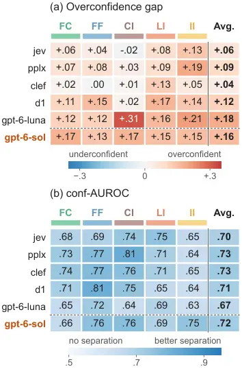

# Decision Models as Judges for Hallucination Detection

Haozheng Liu ^(†)^(†)thanks: Corresponding authors: Haozheng Liu and
Lingyao Li.  
   Emails: hl6602@nyu.edu, lingyaoli@arizona.edu. Affiliation: New York
University    Zhaoqian Xue Affiliation: University of Arizona   
Zhongyin Wang Affiliation: University of Illinois Urbana-Champaign   
Junting Mu Affiliation: University of California, Irvine    Zihui Ma
Affiliation: Emory University Affiliation: University of Maryland,
College Park    Shuya Feng Affiliation: University of Alabama at
Birmingham    Lingyao Li²²footnotemark: 2 Affiliation: University of
Arizona

###### Abstract

Large language models are widely used as judges of model outputs
(LLM-as-a-Judge), but they are costly and can hallucinate or be
overconfident. Decision models are a potential alternative. They return
a predefined verdict with a probability for each label instead of
free-form text and are much cheaper and faster. We test this promise on
hallucination detection. We build binary benchmarks for five
hallucination types (9,852 items from six datasets) and compare five
decision models with the generative judge gpt-6-sol. Performance depends
strongly on the type: the best decision model matches gpt-6-sol in
balanced accuracy on context inconsistency and comes within 3 percentage
points on factual errors, but trails it by 4–8 points on logical and
instruction inconsistency. Decision-model probabilities are
overconfident, though less so than the GPT-6 models, and separate
correct from incorrect decisions only moderately. We also find that a
confidence cascade of decision models improves on the best single model
by 1.9–3.3 points on three types and matches or exceeds gpt-6-sol at
1–3% of its cost. Overall, decision models are a practical low-cost
judge for some hallucination types but need to be validated before use.

## 1 Introduction

Large language models (LLMs) are widely used as judges of model outputs,
an approach often called LLM-as-a-Judge Gu et al. (2026); Zheng et al.
(2023). They rate open-ended responses Verga et al. (2024); Badshah et
al. (2025), check whether responses follow instructions Wen et al.
(2026); Zeng et al. (2024), and detect hallucinated content Li et al.
(2023); Tang et al. (2024); Xu et al. (2026); Manakul et al. (2023).
However, LLM judges are not fully reliable themselves. They can
hallucinate, produce incorrect or unsupported judgments, and be
overconfident in their judgments Kadavath et al. (2022); Tian et al.
(2023).

Recently released decision models offer a different kind of judge.
Models such as jev TypeSafe AI (2026), d1 AI (2026), and Perplexity
Decider Bespoke Labs and Sathiamoorthy (2026) do not generate free-form
assessments but choose among predefined verdicts and return a
probability for each. This design has two potential advantages. First,
providers present these probabilities as a measure of certainty, so
reliable probabilities can show when a judgment should not be
trusted TypeSafe AI (2026). Second, decision models are much cheaper and
faster than generative LLMs, which matters for large-scale evaluation Li
et al. (2026); Rao and Callison-Burch (2026); Ibrahim and Zaki (2026).

Whether these advantages hold is still unclear. Recent studies of
decision models as judges each examine a single model Li et al. (2026);
Rao and Callison-Burch (2026), leaving several questions open. First,
judge performance varies across tasks Xu et al. (2025), but how
consistently decision models perform across error types is unknown.
Second, whether their probabilities are calibrated and separate correct
judgments from errors has merely been tested Xie et al. (2025). Third,
multi-judge studies Verga et al. (2024); Ma et al. (2025) have not
tested ensembles composed solely of decision models for hallucination
detection.

We address these gaps in the context of hallucination detection. First,
judge reliability matters most here, since a judge that hallucinates
while checking for hallucinations defeats its purpose. Second,
hallucination types require different evidence (world knowledge,
sources, the response itself, or the prompt), so they test whether
decision models can generalize. We ask three research questions:

- •
  RQ1. How accurately do decision models detect different hallucination
  types?
- •
  RQ2. How reliable is their confidence?
- •
  RQ3. Can ensembles of decision models improve detection accuracy?

We evaluate five decision models against the generative LLM gpt-6-sol on
9,852 samples from six datasets based on five hallucination types Huang
et al. (2025). Our results show that decision models can match gpt-6-sol
on some hallucination types at a small fraction of its cost, and that
most of them are only mildly overconfident. Confidence cascades of
decision models further improve the accuracy of hallucination detection.
Overall, our results show that decision models are a practical low-cost
judge for some hallucination types but should be validated before use.

## 2 Related Work

| Hallucination type             | Operational definition                                                                                                 | Datasets                 | $`H`$ | $`N`$ | Total |
| ------------------------------ | ---------------------------------------------------------------------------------------------------------------------- | ------------------------ | ----- | ----- | ----- |
| Factual contradiction (FC)     | Claims contradict verifiable real-world facts through incorrect entities or relations.                                 | FAVABench, HADTest       | 344   | 1,277 | 1,621 |
| Factual fabrication (FF)       | Claims introduce fabricated, unverifiable, or unsupported facts or overclaims not established by real-world knowledge. | FAVABench, HADTest       | 339   | 1,277 | 1,616 |
| Context inconsistency (CI)     | Claims conflict with, or are unsupported by, the supplied context or retrieved evidence.                               | RAGTruth                 | 943   | 1,732 | 2,675 |
| Logical inconsistency (LI)     | Claims or reasoning steps within the same response are mutually inconsistent.                                          | ContraDoc, ROSCOE        | 538   | 1,108 | 1,646 |
| Instruction inconsistency (II) | The response violates or fails to satisfy explicit instructions or constraints.                                        | IF-RewardBench (English) | 1,600 | 694   | 2,294 |
| Total                          |                                                                                                                        |                          | 3,764 | 6,088 | 9,852 |

Table 1: Hallucination-detection tasks and datasets. $`H`$ marks samples
that contain the hallucination and $`N`$ do not.

LLM-as-a-Judge and Decision Models. LLM-as-a-Judge is widely used for
automated evaluation. LLM judges can align with human evaluations (Min
et al., 2023) but also show biases such as position and verbosity bias
(Zheng et al., 2023; Liu et al., 2023), and because they generate text,
they add cost and latency. In contrast, decision models provide a
non-generative alternative by directly selecting from predefined labels
and returning their associated probabilities. Recent work evaluates jev
on HaluEval factuality and final-answer adjudication (Li et al., 2026),
as well as on rubric criteria (Rao and Callison-Burch, 2026), and
reports lower cost and latency than generative LLM judges. Ibrahim and
Zaki (2026) compare several decision models on social-science
annotation.

Hallucination detection. Detecting a hallucination requires evidence
depending on its type (Huang et al., 2025). FAVABench and HADTest
annotate factual errors (Mishra et al., 2024; Xu et al., 2026), RAGTruth
annotates unsupported or contradictory content in retrieval-grounded
responses (Niu et al., 2024), ContraDoc and ROSCOE cover contradictions
within documents and reasoning chains (Li et al., 2024; Golovneva et
al., 2023), and IF-RewardBench covers instruction following (Wen et al.,
2026). AggreFact shows that factuality detector performance varies
across datasets, summarizers, and error types (Tang et al., 2023).

Confidence reliability. Returning probabilities does not make a judge’s
confidence reliable. Calibration asks whether probabilities match
observed frequencies (Guo et al., 2017), and error ranking asks whether
confidence separates correct judgments from errors. Language-model
confidence can reflect correctness, but this depends on the task and on
how confidence is elicited (Kadavath et al., 2022; Tian et al., 2023;
Xiong et al., 2024). For decision models, calibration varies by workload
(Li et al., 2026; Rao and Callison-Burch, 2026), and high confidence can
coexist with near-chance accuracy (Ibrahim and Zaki, 2026).

Judge ensembles and cascades. Combining judges helps when their errors
differ. PoLL aggregates judgments from diverse generative models (Verga
et al., 2024), and CLEV calls a third judge only when the first two
disagree (Badshah et al., 2025), the idea behind our arbitration method.
Confidence-based cascades pass uncertain items to another judge (Jung et
al., 2025). JEV-to-generative cascades can match the generative judge at
lower cost (Li et al., 2026), although overlapping errors limit their
gains on rubric tasks (Rao and Callison-Burch, 2026).

Three areas remain underexplored. First, decision models have so far
been evaluated one at a time or on tasks other than hallucination
detection, so it is unclear how well they detect each hallucination
type. Second, few studies have examined whether the confidence of
decision models is reliable across models and hallucination types.
Third, it has not been tested whether ensembles built only from decision
models can improve hallucination detection while keeping their cost low.
Our study aims to address these research gaps.

## 3 Data and Methods

### 3.1 Benchmark Composition

Hallucination types. Hallucination takes several forms. Following the
taxonomy of Huang et al. (2025), we study five types (Table 1). Factual
contradiction (FC) covers claims that contradict verifiable real-world
facts. Factual fabrication (FF) covers unverifiable or unsupported
overclaims. Context inconsistency (CI) covers claims that conflict with
the supplied source material or are not supported by it. Logical
inconsistency (LI) covers contradictions within a response or between
its reasoning steps. Instruction inconsistency (II) covers violations of
explicit instructions. We treat each type as a separate binary task,
because one response can contain several types of error.

Figure 1: The single-model baseline and the three combination rules.
Models 1–3: top-3 decision models by BAcc per type. Solid/dashed boxes:
always/conditionally called. (c) The third model breaks ties between the
two cheaper ones. (d) Each stage defers its least-confident $`r_{k}`$
share; the last stage decides the rest.

Benchmark datasets. We choose six benchmarks whose annotations mark the
target error type explicitly, so each sample maps to a binary label
without new annotation (Tang et al., 2023; Tang et al., 2024). For FC
and FF, we combine two datasets that annotate both types, given that
FAVABench alone has fewer than 400 samples per type. FAVABench contains
ChatGPT and Llama responses with human span-level error annotations
(Mishra et al., 2024). HADTest contains responses into which GPT-4o
injected a single factual error, validated by two annotators (Xu et al.,
2026). For CI, RAGTruth contains responses from six LLMs to question
answering, summarization, and data-to-text tasks, annotated for content
that conflicts with the retrieved source or is unsupported by it (Niu et
al., 2024). For II, IF-RewardBench contains responses from 16 LLMs, each
checked against a list of explicit constraints (Wen et al., 2026). For
LI, ContraDoc contains news, Wikipedia, and story documents with
inserted self-contradictions (Li et al., 2024), and ROSCOE contains
step-by-step reasoning annotated for contradictions (Golovneva et al.,
2023).

An item is labeled $`H`$ if its source annotation marks the target error
and $`N`$ if it marks the absence of that hallucination error. An $`N`$
sample may therefore still contain another type of hallucination. We
keep each dataset’s evaluation unit and do not rebalance the classes.
Appendix A.3 details how we map each dataset’s original annotations to
the binary labels used in our evaluation.

### 3.2 Evaluation Setup and Metrics

Model selection. We select five decision models from five providers,
including both proprietary and open-weight models. They are jev, d1,
clef, pplx, and gpt-6-luna. Details of these models are presented in
Appendix B. For comparison, we also run the general-purpose generative
LLM gpt-6-sol on the same items, distinguishing it from gpt-6-luna,
which is included as a decision model because it directly outputs
classification decisions. All six models are accessed through their
hosted APIs. Latency is therefore end-to-end API response time and does
not depend on local hardware.

Model input and output. For each hallucination type, all models receive
the same input and the same $`H/N`$ criterion, based on the type’s
definition. The input consists of the response to be judged and, when
available, the original instruction. For CI, it also includes the source
context. The models never see the gold labels or the annotated error
spans. Each model answers $`H`$ if the response contains the target
error and $`N`$ otherwise, and returns probabilities $`P(H)`$ and
$`P(N)`$ that sum to one. The answer is the label with the higher
probability, and on an exact tie we keep the model’s own answer. The
decision models return these probabilities through their interfaces. For
gpt-6-sol, we ask for a structured verdict with its own probability
estimates and no explanation. Appendix A.4 provides the complete
decision-model prompts.

Evaluation metrics. The classes are imbalanced (Table 1), so we compare
each answer with the gold label and report balanced accuracy (BAcc), the
mean recall over $`H`$ and $`N`$, and macro-F1, the mean F1 over the two
classes. Differences between judges are tested with paired bootstrap
over items (2,000 resamples) (Dror et al., 2018). We also report the
mean API latency per call and the estimated API cost. Cost is computed
from recorded token usage at the providers’ list prices at the time of
evaluation.²² 2 Per million input tokens, \$0.042 for jev, \$0.04 for
d1, \$0.24 for clef, \$0.02 for pplx, and \$0.10 for gpt-6-luna. The
decision models return a single choice token, so their output cost is
negligible. For gpt-6-sol, \$2 per million input tokens and \$10 per
million output tokens.

### 3.3 Confidence Analysis

Probabilities and confidence. For each item $`i`$, a decision model
returns $`p_{i}=P(\textsc{H}\mid x_{i})`$, the probability that the
response contains the target hallucination type, and labels the response
as hallucinated ($`\hat{y}_{i}=1`$) when $`p_{i}>0.5`$. Providers
describe $`p_{i}`$ as an estimate of the probability that the predicate
holds or as a calibrated score. The confidence of a decision is the
probability of its predicted label,

```math
c_{i}=\max(p_{i},\,1-p_{i})\in[0.5,1]. \tag{1}
```

Under perfect calibration, predictions assigned confidence $`q`$ would
be correct approximately $`q`$ of the time. We evaluate the extent to
which this property holds in practice.

Detection and calibration. Detection performance, i.e., how well
$`p_{i}`$ ranks hallucinated above non-hallucinated responses, is
measured by AUROC. At $`\tau=0.5`$, we also report BAcc, MCC and the
flag-rate bias $`\Delta`$ (defined as the share of responses flagged
minus $`\pi`$ ($`\Delta>0`$: over-flagging). Calibration is measured by
the expected calibration error over $`M=10`$ equal-width confidence bins
(Guo et al., 2017; Roelofs et al., 2022):

```math
\mathrm{ECE}=\sum_{m=1}^{M}\tfrac{|B_{m}|}{n}\,\bigl|\mathrm{acc}(B_{m})-\mathrm{conf}(B_{m})\bigr|. \tag{2}
```

where $`B_{m}`$ is the set of predictions in confidence bin $`m`$. We
also report the slope $`b`$ of the logistic model
$`\operatorname{logit}\Pr(y_{i}{=}1)=a+b\operatorname{logit}(p_{i})`$,
where $`b<1`$ indicates overconfidence (Calster, 2019).

Confidence as an error signal. A useful confidence score is expected to
be higher for correct decisions ($`\mathcal{C}`$) than for errors
($`\mathcal{E}`$) (Hendrycks and Gimpel, 2016; Geifman and El-Yaniv,
2017):

```math
\text{conf-AUROC}=\Pr(c_{i}>c_{j}\mid i\in\mathcal{C},\,j\in\mathcal{E}), \tag{3}
```

with ties counted as one half. A value of $`0.5`$ means that confidence
cannot distinguish correct decisions from errors. We also report the
share of errors made with high confidence ($`c_{i}\geq 0.9`$).

We report 95% bootstrap intervals and compare models on the same items
with paired bootstrap tests. A two-way ANOVA ($`\eta^{2}`$) separates
cell and model effects, and Kendall’s $`W`$ measures ranking consistency
across cells.

### 3.4 Model Ensembling Strategies

Motivated by prior studies Verga et al. (2024); Badshah et al. (2025);
Jung et al. (2025), we evaluate three ensembling methods (Figure 1) to
assess whether they improve accuracy and at what additional cost. To
isolate the effect of each method, we fix the model selection. For each
type, all three methods combine the same three decision models, namely
those with the highest BAcc on that type.

Majority voting. All three models judge the same item, and the label
chosen by at least two of them is the verdict. Because every item gets
all three calls, majority voting is the most expensive of the three
methods. Voting gives every model the same weight, so two weaker models
can outvote the strongest one.

Arbitration. When two models agree, the outcome is their shared label,
and the third vote does not change it. When they disagree, the third
vote decides the outcome. Arbitration therefore calls the two models
first and calls the third only to resolve a disagreement (Badshah et
al., 2025).

Confidence cascade. A cascade lets the strongest model decide unless it
is uncertain. Cascades usually order models from cheap to expensive to
reduce calls to a costly final model (Chen et al., 2024; Jung et al.,
2025). We order the models by descending BAcc and ask whether consulting
weaker models on the strongest model’s least confident items improves
BAcc (Jitkrittum et al., 2023). At each of the first two stages, a model
defers an item to the next model when its confidence $`c_{i}`$ falls
below a threshold, and the third model decides all items that reach it.
Because confidence distributions differ across models (Section 4.2), a
common threshold would defer very different shares of items at different
stages. We therefore set each threshold through a target deferral rate
$`r_{k}`$, the share of items reaching stage $`k`$ that are deferred, so
that each stage defers its least confident items without using gold
labels. We evaluate $`r_{1},r_{2}\in\{0,0.1,\ldots,0.5\}`$: $`r_{1}=0`$
reduces the cascade to the strongest model, and above $`0.5`$ the
strongest model would decide fewer than half of the items. As a control,
we defer the same numbers of randomly chosen items.

Evaluation. For each hallucination type, we evaluate all $`6\times 6`$
combinations of $`r_{1}`$ and $`r_{2}`$ and report the one with the
highest BAcc. Because we choose this combination on the same items we
evaluate, the result is an optimistic estimate of what a cascade can
achieve(Cawley and Talbot, 2010). To see how optimistic it is, we also
choose the rates with five-fold cross-fitting, picking them on four
folds and testing them on the fifth. The cost of an item is the total
cost of all models called for it. For latency, we add up calls made one
after another and take the slowest of calls made in parallel. We plot
each method’s BAcc against its cost, show the results of all 36
combinations separately, and use paired bootstrap tests to compare each
method with its best single model and with gpt-6-sol.

## 4 Results

### 4.1 RQ1: How Do Decision Models Perform Across Hallucination Types?

| Type (N)   | Model      | BAcc  | Macro-F1 | Cost    | Latency  |
| ---------- | ---------- | ----- | -------- | ------- | -------- |
| FC N=1,621 | jev        | 75.01 | 74.96    | 0.0490  | 264.51   |
|            | d1         | 67.78 | 68.98    | 0.0295  | 224.15   |
|            | clef       | 72.12 | 73.95    | 0.2064  | 347.49   |
|            | pplx       | 78.93 | 78.48    | 0.0159  | 284.23   |
|            | gpt-6-luna | 77.75 | 68.36    | 0.0817  | 236.82   |
|            | gpt-6-sol  | 81.61 | 77.45    | 3.3320  | 1,825.76 |
| FF N=1,616 | jev        | 80.74 | 74.11    | 0.0570  | 239.63   |
|            | d1         | 70.51 | 74.40    | 0.0369  | 235.40   |
|            | clef       | 71.24 | 75.02    | 0.2498  | 354.56   |
|            | pplx       | 79.85 | 82.14    | 0.0195  | 290.10   |
|            | gpt-6-luna | 82.72 | 75.15    | 0.0999  | 236.64   |
|            | gpt-6-sol  | 82.05 | 81.36    | 3.5014  | 1,639.48 |
| CI N=2,675 | jev        | 82.53 | 82.09    | 0.2214  | 281.30   |
|            | d1         | 75.84 | 77.33    | 0.1797  | 319.34   |
|            | clef       | 68.21 | 69.38    | 1.0911  | 622.86   |
|            | pplx       | 82.66 | 84.55    | 0.0901  | 342.02   |
|            | gpt-6-luna | 64.04 | 53.01    | 0.4375  | 258.33   |
|            | gpt-6-sol  | 82.65 | 78.94    | 10.9699 | 2,002.29 |
| LI N=1,646 | jev        | 68.98 | 70.47    | 0.0733  | 284.50   |
|            | d1         | 58.46 | 56.95    | 0.0509  | 330.27   |
|            | clef       | 61.33 | 61.42    | 0.3398  | 515.09   |
|            | pplx       | 73.28 | 75.12    | 0.0270  | 284.83   |
|            | gpt-6-luna | 66.99 | 68.27    | 0.1356  | 281.61   |
|            | gpt-6-sol  | 77.14 | 78.32    | 4.4831  | 2,203.56 |
| II N=2,294 | jev        | 61.75 | 62.03    | 0.1403  | 276.94   |
|            | d1         | 62.50 | 62.02    | 0.1114  | 478.96   |
|            | clef       | 64.50 | 64.43    | 0.7021  | 593.57   |
|            | pplx       | 71.08 | 65.39    | 0.0566  | 306.38   |
|            | gpt-6-luna | 54.17 | 50.69    | 0.2846  | 263.23   |
|            | gpt-6-sol  | 78.88 | 78.43    | 8.5098  | 2,644.51 |

Table 2: Single-judge results pooled by hallucination type. BAcc and
Macro-F1 are percentages; Cost is the estimated total API cost for that
type (USD), and Latency is mean per-call latency (ms).

Table 2 and Figure 2 present the performance over each hallucination
type. Appendix C reports their performance judge on every source
dataset.

Performance depends strongly on the type. gpt-6-sol has the highest
pooled BAcc on FC, LI, and II (Table 2). On FF, gpt-6-luna (82.7) edges
it (82.0). On CI, pplx, gpt-6-sol, and jev are within 0.2 points of one
another at about 82.6. The gap is widest on II, where gpt-6-sol reaches
78.9 against 71.1 for pplx and 61.8 for jev. Performance also varies
within a model. jev spans 20.8 points between II and CI. Type and source
dataset are confounded, so we read these differences as type-specific
without attributing them to the type alone.

Figure 2: Judging performance by hallucination type. Bars show the
pooled BAcc of each judge per type, with 95% bootstrap confidence
intervals. Hatched bars mark the generative model gpt-6-sol.

Similar scores hide different errors. The matched CI scores arise from
different error patterns. pplx rarely raises false alarms
(false-positive rate 3.2%) but misses many hallucinations
(false-negative rate 31.5%). gpt-6-sol shows the reverse pattern, with a
false-negative rate of 5.9% and a false-positive rate of 28.8%. jev lies
between them at 20.6% and 14.4%. The dominant error also changes with
the task. jev misses most positives on LI, with false-negative rates of
49% on ContraDoc and 81% on ROSCOE, but over-flags on II, where its
false-positive rate is 56%. BAcc alone therefore does not show whether a
judge mostly misses hallucinations or mostly raises false alarms.

Model advantages are concentrated in particular types. Relative to jev,
pplx gains only 0.1 points on CI (95% paired bootstrap interval
$`[-1.4,1.6]`$) and loses 0.9 points on FF ($`[-3.4,1.6]`$), but it
gains 3.9 points on FC ($`[1.5,6.4]`$), 4.3 points on LI
($`[2.2,6.5]`$), and 9.3 points on II ($`[7.2,11.5]`$). The FC, LI, and
II gains remain significant after Holm correction over the 25
comparisons of each judge with jev. The ranking of decision models thus
changes with the type.

Advantages do not always hold across sources. On HADTest, all six judges
score 12 to 18 points higher on FF than on FC. The same comparison on
FAVABench shows no consistent gap (Appendix C). For pplx, FF minus FC is
$`-1.4`$ points on FAVABench (95% bootstrap interval $`[-8.5,5.3]`$) but
$`17.9`$ points on HADTest ($`[13.2,22.9]`$). An advantage on
fabrication is therefore partly a property of the source. CI and II each
have a single source, so their cross-source stability remains untested.

Decision models are far cheaper and faster. Per item, the decision
models cost between 0.5% (pplx) and 10% (clef) of gpt-6-sol, and they
answer in 0.22 to 0.62 seconds against 1.6 to 2.6 seconds (Table 2). The
cheapest model, pplx, is also the most accurate decision model on four
of the five types, and gpt-6-luna is the most accurate on FF. The
efficiency gain is thus available on every type. Whether it comes with
the accuracy of gpt-6-sol depends on the type. Additional analyses of
error patterns and prediction overlap across models are provided in
Appendix D.2.

### 4.2 RQ2: How Reliable is Their Confidence?

Figures 3 and 4 present the confidence reliability of the six judges
across hallucination types, including calibration and the ability to
distinguish correct judgments from errors.



Figure 3: Confidence by model and hallucination type. (a) Overconfidence
gap, i.e., mean confidence minus accuracy. (b) conf-AUROC; outlined
values have a 95% CI that includes $`0.5`$.

Figure 4: Reliability diagrams by hallucination type. Confidence is
divided into 10 equal-width bins (bins with fewer than 25 items
omitted); points below the diagonal indicate overconfidence. Right: ECE
and conf-AUROC (cAUC) averaged over datasets, and the share of all
errors (pooled over datasets) made with $`c\geq 0.9`$ (Err$`\geq`$.9).

Decision models are overconfident overall, but less so than the GPT-6
models. Every decision model has a positive average overconfidence gap,
and the calibration slope is below 1 for 21 of the 25 model–type pairs
(Figure 3a). For jev, pplx, clef and d1, however, the overconfidence is
mild. Mean confidence exceeds accuracy by $`0.04`$–$`0.12`$, and ECE
ranges from $`0.083`$ to $`0.136`$. The two GPT-6 models are clearly
more overconfident. gpt-6-luna has a gap of $`0.18`$ and an ECE of
$`0.187`$, and the comparison LLM gpt-6-sol has a gap of $`0.16`$ and an
ECE of $`0.157`$. Their median calibration slopes ($`0.44`$ and
$`0.36`$) are also the lowest, compared with $`0.54`$–$`0.58`$ for jev,
d1 and pplx and $`0.96`$ for clef.

Calibration depends more on the dataset than on the model. Across the
decision models, the dataset accounts for 58% of the variance in the
overconfidence gap, and the model for 15% (Figure 3a). Averaged over the
decision models, overconfidence is largest for II ($`0.14`$) and LI
($`0.13`$), and smallest for CI and factual contradiction FC ($`0.07`$
each). The reliability diagrams show the same pattern. At a given
confidence level, accuracy differs by hallucination type (Figure 4). For
example, the accuracy of gpt-6-luna on CI stays below $`0.50`$ for all
confidence levels between $`0.55`$ and $`0.95`$.

Confidence is less reliable for instruction inconsistency (II) and
logical inconsistency (LI). Averaged over the decision models, II has
the largest overconfidence gap ($`0.14`$), the highest ECE ($`0.145`$)
and the lowest conf-AUROC ($`0.64`$), followed by LI (gap $`0.13`$; ECE
$`0.136`$; conf-AUROC $`0.70`$). FC is less overconfident (gap $`0.07`$;
ECE $`0.103`$) but separates correct from incorrect decisions no better
than LI (conf-AUROC $`0.70`$), whereas CI (gap $`0.07`$; ECE $`0.093`$;
conf-AUROC $`0.74`$) and FF(gap $`0.08`$; ECE $`0.134`$; conf-AUROC
$`0.75`$) are the most reliable. Figure 3 shows the same pattern. Among
decisions made with $`c\geq 0.9`$, accuracy is lowest for II for jev and
pplx, and for LI for clef and d1 (Figure 4). Type-specific failures also
occur for individual models. gpt-6-luna is most overconfident on CI (gap
$`0.31`$), where its accuracy stays below $`0.50`$.

Confidence separates correct from incorrect decisions only moderately.
conf-AUROC measures how well confidence separates correct judgments from
errors. A value of $`0.5`$ indicates performance no better than chance.
Higher values indicate better separation between the two groups
(Figure 3b). Averaged over the five hallucination types, conf-AUROC
ranges from $`0.67`$ (gpt-6-luna) to $`0.73`$ (pplx and clef). For each
model and type, the 95% confidence interval lies above $`0.5`$, so
confidence always carries some information about correctness, but the
separation remains moderate, especially for II.

High confidence does not guarantee a correct decision. Errors can be
made with high confidence ($`c\geq 0.9`$) (Figures 4 and 7). Averaged
over the five types, gpt-6-luna assigns $`c\geq 0.9`$ to 65% of its
decisions, is correct on only 77% of them, and makes 47% of its errors
at this level. For the other decision models, 10–30% of errors are made
at $`c\geq 0.9`$, with clef lowest (10%); clef also assigns such high
confidence to only 25% of its decisions. The comparison model gpt-6-sol
is the most extreme case: it assigns $`c\geq 0.9`$ to 88% of its
decisions and makes 69% of its errors at this level.

Figure 5: BAcc against estimated cost for each hallucination type. Cost
is relative to gpt-6-sol on a log scale, and the dashed line marks the
BAcc of gpt-6-sol. The cascade uses the deferral rates with the highest
BAcc. The circle defers the same numbers of items at random.

### 4.3 RQ3: Can Ensembling Improve the Performance?

Figure 5 presents the performance–cost trade-offs of the three
ensembling methods. Deferral-rate sensitivity is reported in Appendix
Figure 8.

The cascade matches or exceeds GPT-6-sol on three types. At the best
tested deferral rates, the confidence cascade achieves BAcc scores of
82.2, 84.6, and 84.6 on FC, FF, and CI, respectively—0.6, 2.6, and 1.9
points higher than gpt-6-sol—at only 1.2–3.3% of its estimated cost. The
advantage over gpt-6-sol is statistically significant on FF and CI, but
not on FC. The cascade also improves on the strongest single member by
3.3, 1.9, and 2.0 points, respectively, with paired bootstrap 95%
intervals excluding zero. It makes 1.1–1.3 calls per item and has about
one fifth of the latency of gpt-6-sol. Selecting deferral rates by
cross-fitting reduces BAcc by at most 0.52 points and preserves the
gains over the strongest member.

The cascade outperforms voting and arbitration. Majority voting gains
about one BAcc point over the strongest single model on FC and FF, but
falls below it on CI, LI, and II (Figure 5). Disagreement arbitration
produces the same verdicts as voting while costing roughly half as much.
Both rules are less accurate than the cascade on every type and, except
on FF, also cost more. Unlike equal voting, the cascade consults weaker
members only when the strongest member is uncertain.

The best cascade configuration differs by type. pplx leads four of the
five cascades. On FF, gpt-6-luna leads (Appendix Table 12). The role of
the later stages also varies. On CI, the best cascade never uses its
third model ($`r_{2}=0`$), whereas on FF the second model defers about
half of the samples it receives. On FC, FF, and CI, BAcc peaks at a
first-stage deferral rate of 20–30% and declines at higher rates
(Appendix Figure 8). A single cascade configuration therefore does not
transfer across types.

The gap persists on LI and II. On LI, the best cascade defers no items
and equals pplx alone, 3.9 points below gpt-6-sol. On II, the cascade
improves BAcc by only 0.7 points over the strongest single model, pplx,
and remains 7.1 points below gpt-6-sol. Other members do not improve on
pplx for its least confident items in balanced terms, consistent with
the weaker confidence reliability on these two types (Section 4.2).

## 5 Discussion and Conclusion

We evaluate five decision models for hallucination detection. They match
or approach the generative LLM judge on factual and context-related
errors but lag on logical and instruction inconsistencies requiring
multi-step reasoning or explicit constraint checking. We draw three
takeaways.

First, judges should be selected per hallucination type. No decision
model performs best across types, and similar BAcc can mask opposite
error profiles: missed hallucinations or false alarms. The preferable
judge thus depends on the target type and on which error is more costly,
so false-negative and false-positive rates should be reported by type.
Since type and source are partly confounded, judge selection should be
validated on the target task.

Second, confidence is useful but does not guarantee correctness. Most
decision models are less overconfident than gpt-6-luna and gpt-6-sol,
but their confidence only moderately distinguishes correct from
incorrect judgments, with frequent high-confidence errors on logical and
instruction inconsistencies (Section 4.2). Confidence can guide requests
for a second opinion but cannot establish correctness.

Third, ensembling decision models helps when they are complementary on
uncertain samples. Cascades outperform their strongest member and match
or exceed gpt-6-sol on factual contradiction, factual fabrication, and
context inconsistency. On logical and instruction inconsistency, the
tested cascades offer limited gains, consistent with the observed error
overlap (Appendix D.2). Since the best configuration varies by type,
deferral rates should be validated on the target type to weigh accuracy
gains against the cost of additional model calls.

At 0.5–10% of the cost of gpt-6-sol, decision models could support
low-cost, type-aware cascades for factual and context errors, with LLM
judges reserved for logical and instruction inconsistencies. Future work
should disentangle type from data source, develop decision models that
target reasoning- and instruction-level errors, and learn routing
policies that decide when to escalate to an LLM judge based on detection
accuracy and cost.

## Limitations

This study presents several future directions.

Benchmark coverage and label consistency. Our benchmark covers five
hallucination types across six datasets, but coverage is uneven: context
and instruction inconsistency each rely on a single source. Differences
in data construction, domain, and response length confound cross-dataset
comparisons, leaving subgroup analyses observational. Mapping
heterogeneous annotations to binary labels may also introduce mismatches
because the source datasets define errors differently. Broader source
coverage, annotation under a shared rubric, and comparisons matched on
domain and response length would help address these limitations.

Confidence comparability and prompt sensitivity. Confidence values are
not fully comparable because decision models return label probabilities,
whereas gpt-6-sol reports its own estimates. We also use one prompt
design per task, leaving prompt sensitivity untested. Comparing
alternative prompts and, where supported, confidence-elicitation methods
within each model would clarify their effects on accuracy and
calibration.

Generalization and deployment of cascades. We evaluate fixed model
versions and assess cascades through offline replay and within-source
cross-fitting, with member selection and ordering based on the full
sample. Selecting all cascade components using training data alone,
followed by evaluation on unseen domains and in live deployments, would
better assess their accuracy, latency, and cost beyond the evaluated
settings.

## Statement of LLM Use

During the preparation of this paper, we used LLM-based tools (primarily
Claude and ChatGPT) in two capacities. First, we used coding agents to
assist with the development and refinement of the project codebase.
Second, we used LLM chatbots to support language editing of manuscript
drafts, including correcting grammatical errors, improving sentence
structure, and enhancing the clarity of presentation. The authors take
full responsibility for the content of this paper, including the code,
analyses, and conclusions presented.

## References

- AI (2026) L. AI Introducing d1: the most capable decision model, now
  with vision. Liquid AI Blog. Note:
  www.liquid.ai/blog/d1-decision-model Cited by: §1.
- Badshah et al. (2025) S. Badshah, M. Moustafa, and H. Sajjad CLEV:
  LLM-based evaluation through lightweight efficient voting for
  free-form question-answering. In Proceedings of the 14th International
  Joint Conference on Natural Language Processing and the 4th Conference
  of the Asia-Pacific Chapter of the Association for Computational
  Linguistics, K. Inui, S. Sakti, H. Wang, D. F. Wong, P.
  Bhattacharyya, B. Banerjee, A. Ekbal, T. Chakraborty, and D. P. Singh
  (Eds.), Mumbai, India, pp. 1513–1531. External Links:
  [Link](https://aclanthology.org/2025.findings-ijcnlp.93/),
  [Document](https://dx.doi.org/10.18653/v1/2025.findings-ijcnlp.93),
  ISBN 979-8-89176-303-6 Cited by: §1, §2, §3.4, §3.4.
- Bespoke Labs and Sathiamoorthy (2026) Bespoke Labs and M.
  Sathiamoorthy Nimble. Note:
  [https://github.com/bespokelabsai/nimble](https://github.com/bespokelabsai/nimble)Model:
  https://huggingface.co/bespokelabs/Bespoke-Nimble-9B Cited by: §1.
- Calster (2019) B. Calster Calibration: the achilles heel of predictive
  analytics. BMC Med 17 (1), pp. 1. Cited by: §3.3.
- Cawley and Talbot (2010) G. C. Cawley and N. L. Talbot On over-fitting
  in model selection and subsequent selection bias in performance
  evaluation. The Journal of Machine Learning Research 11,
  pp. 2079–2107. Cited by: §3.4.
- Chen et al. (2024) L. Chen, M. Zaharia, and J. Zou FrugalGPT: how to
  use large language models while reducing cost and improving
  performance. Transactions on Machine Learning Research. Note:
  arXiv:2305.05176 External Links:
  [Link](https://arxiv.org/abs/2305.05176) Cited by: §3.4.
- Dror et al. (2018) R. Dror, G. Baumer, S. Shlomov, and R. Reichart The
  hitchhiker’s guide to testing statistical significance in natural
  language processing. In Proceedings of the 56th annual meeting of the
  association for computational linguistics (volume 1: Long papers),
  pp. 1383–1392. Cited by: §3.2.
- Geifman and El-Yaniv (2017) Y. Geifman and R. El-Yaniv Selective
  classification for deep neural networks. Advances in neural
  information processing systems 30. Cited by: §3.3.
- Golovneva et al. (2023) O. Golovneva, M. Chen, S. Poff, M.
  Corredor, L. Zettlemoyer, M. Fazel-Zarandi, and A. Celikyilmaz ROSCOE:
  a suite of metrics for scoring step-by-step reasoning. In The Eleventh
  International Conference on Learning Representations, Note: ICLR 2023;
  author version arXiv:2212.07919v2 External Links:
  [Link](https://arxiv.org/abs/2212.07919v2) Cited by: §2, §3.1.
- Gu et al. (2026) J. Gu, X. Jiang, Z. Shi, H. Tan, X. Zhai, C. Xu, W.
  Li, Y. Shen, S. Ma, H. Liu, S. Wang, K. Zhang, Z. Lin, B. Zhang, L.
  Ni, W. Gao, Y. Wang, and J. Guo A survey on LLM-as-a-judge. The
  Innovation 7 (6). Cited by: §1.
- Guo et al. (2017) C. Guo, G. Pleiss, Y. Sun, and K. Q. Weinberger On
  calibration of modern neural networks. In Proceedings of the 34th
  International Conference on Machine Learning, Proceedings of Machine
  Learning Research, Vol. 70, pp. 1321–1330. External Links:
  [Link](https://proceedings.mlr.press/v70/guo17a.html) Cited by: §2,
  §3.3.
- Hendrycks and Gimpel (2016) D. Hendrycks and K. Gimpel A baseline for
  detecting misclassified and out-of-distribution examples in neural
  networks. arXiv preprint arXiv:1610.02136. Cited by: §3.3.
- Huang et al. (2025) L. Huang, W. Yu, W. Ma, W. Zhong, Z. Feng, H.
  Wang, Q. Chen, W. Peng, X. Feng, B. Qin, and T. Liu A survey on
  hallucination in large language models: principles, taxonomy,
  challenges, and open questions. ACM Transactions on Information
  Systems 43 (2), pp. 1–55. External Links:
  [Document](https://dx.doi.org/10.1145/3703155),
  [Link](https://doi.org/10.1145/3703155) Cited by: Table 3, §1, §2,
  §3.1.
- Ibrahim and Zaki (2026) H. Ibrahim and Y. Zaki Evaluating decision
  models for text annotation in computational social science. arXiv
  preprint arXiv:2609.24574. Cited by: §1, §2, §2.
- Jitkrittum et al. (2023) W. Jitkrittum, N. Gupta, A. K. Menon, H.
  Narasimhan, A. S. Rawat, and S. Kumar When does confidence-based
  cascade deferral suffice?, 2024. URL https://arxiv.
  org/abs/2307.02764. Cited by: §3.4.
- Jung et al. (2025) J. Jung, F. Brahman, and Y. Choi Trust or escalate:
  LLM judges with provable guarantees for human agreement. In
  International Conference on Learning Representations, Y. Yue, A.
  Garg, N. Peng, F. Sha, and R. Yu (Eds.), Vol. 2025, pp. 3101–3125.
  External Links:
  [Link](https://proceedings.iclr.cc/paper_files/paper/2025/file/08dabd5345b37fffcbe335bd578b15a0-Paper-Conference.pdf)
  Cited by: §2, §3.4, §3.4.
- Kadavath et al. (2022) S. Kadavath, T. Conerly, A. Askell, T.
  Henighan, D. Drain, E. Perez, N. Schiefer, Z. Hatfield-Dodds, N.
  DasSarma, E. Tran-Johnson, S. Johnston, S. El-Showk, A. Jones, N.
  Elhage, T. Hume, A. Chen, Y. Bai, S. Bowman, S. Fort, D. Ganguli, D.
  Hernandez, J. Jacobson, J. Kernion, S. Kravec, L. Lovitt, K.
  Ndousse, C. Olsson, S. Ringer, D. Amodei, T. Brown, J. Clark, N.
  Joseph, B. Mann, S. McCandlish, C. Olah, and J. Kaplan Language models
  (mostly) know what they know. Note: arXiv preprint arXiv:2207.05221
  External Links: 2207.05221, [Link](https://arxiv.org/abs/2207.05221),
  [Document](https://dx.doi.org/10.48550/arXiv.2207.05221) Cited by: §1,
  §2.
- Li et al. (2024) J. Li, V. Raheja, and D. Kumar ContraDoc:
  understanding self-contradictions in documents with large language
  models. In Proceedings of the 2024 Conference of the North American
  Chapter of the Association for Computational Linguistics: Human
  Language Technologies (Volume 1: Long Papers), K. Duh, H. Gomez,
  and S. Bethard (Eds.), Mexico City, Mexico, pp. 6509–6523. External
  Links: [Link](https://aclanthology.org/2024.naacl-long.362/),
  [Document](https://dx.doi.org/10.18653/v1/2024.naacl-long.362) Cited
  by: §2, §3.1.
- Li et al. (2023) J. Li, X. Cheng, W. X. Zhao, J. Nie, and J. Wen
  HaluEval: a large-scale hallucination evaluation benchmark for large
  language models. In Proceedings of the 2023 Conference on Empirical
  Methods in Natural Language Processing, H. Bouamor, J. Pino, and K.
  Bali (Eds.), Singapore, pp. 6449–6464. External Links:
  [Link](https://aclanthology.org/2023.emnlp-main.397/),
  [Document](https://dx.doi.org/10.18653/v1/2023.emnlp-main.397) Cited
  by: §1.
- Li et al. (2026) Y. Li, Y. Miao, R. Krishnan, and R. Padman
  JEV-as-a-judge: accept when confident, escalate when unsure. Note:
  arXiv preprint arXiv:2609.26550Version 4, 6 October 2026 External
  Links: 2609.26550, [Link](https://arxiv.org/abs/2609.26550v4),
  [Document](https://dx.doi.org/10.48550/arXiv.2609.26550) Cited by: §1,
  §1, §2, §2, §2.
- Liu et al. (2023) Y. Liu, D. Iter, Y. Xu, S. Wang, R. Xu, and C. Zhu
  G-eval: nlg evaluation using gpt-4 with better human alignment. In
  Proceedings of the 2023 conference on empirical methods in natural
  language processing, pp. 2511–2522. Cited by: §2.
- Ma et al. (2025) C. Ma, E. Zhang, Y. Zhao, W. Liu, Y. Jia, P. Qing, L.
  Shi, A. Cohan, Y. Yan, and S. Vosoughi Judging with many minds: do
  more perspectives mean less prejudice? on bias amplification and
  resistance in multi-agent based LLM-as-judge. In Findings of the
  Association for Computational Linguistics: EMNLP 2025,
  pp. 17356–17392. External Links:
  [Document](https://dx.doi.org/10.18653/v1/2025.findings-emnlp.941),
  [Link](https://aclanthology.org/2025.findings-emnlp.941/) Cited by:
  §1.
- Manakul et al. (2023) P. Manakul, A. Liusie, and M. Gales
  Selfcheckgpt: zero-resource black-box hallucination detection for
  generative large language models. In Proceedings of the 2023
  conference on empirical methods in natural language processing,
  pp. 9004–9017. Cited by: §1.
- Min et al. (2023) S. Min, K. Krishna, X. Lyu, M. Lewis, W. Yih, P.
  Koh, M. Iyyer, L. Zettlemoyer, and H. Hajishirzi FActScore:
  fine-grained atomic evaluation of factual precision in long form text
  generation. In Proceedings of the 2023 conference on empirical methods
  in natural language processing, pp. 12076–12100. Cited by: §2.
- Mishra et al. (2024) A. Mishra, A. Asai, V. Balachandran, Y. Wang, Y.
  Tsvetkov, G. Neubig, and H. Hajishirzi Fine-grained hallucination
  detection and editing for language models. In First Conference on
  Language Modeling, External Links:
  [Link](https://openreview.net/pdf?id=dJMTn3QOWO) Cited by: §2, §3.1.
- Niu et al. (2024) C. Niu, Y. Wu, J. Zhu, S. Xu, K. Shum, R. Zhong, J.
  Song, and T. Zhang RAGTruth: a hallucination corpus for developing
  trustworthy retrieval-augmented language models. In Proceedings of the
  62nd Annual Meeting of the Association for Computational Linguistics
  (Volume 1: Long Papers), L. Ku, A. Martins, and V. Srikumar (Eds.),
  Bangkok, Thailand, pp. 10862–10878. External Links:
  [Link](https://aclanthology.org/2024.acl-long.585/),
  [Document](https://dx.doi.org/10.18653/v1/2024.acl-long.585) Cited by:
  §2, §3.1.
- Rao and Callison-Burch (2026) D. Rao and C. Callison-Burch JEV vs.
  LLMs as rubric judges: cheaper, faster, and wrong in the same places.
  Note: arXiv preprint arXiv:2609.29769Version 2, 28 September 2026
  External Links: 2609.29769,
  [Link](https://arxiv.org/abs/2609.29769v2),
  [Document](https://dx.doi.org/10.48550/arXiv.2609.29769) Cited by: §1,
  §1, §2, §2, §2.
- Roelofs et al. (2022) R. Roelofs, N. Cain, J. Shlens, and M. C. Mozer
  Mitigating bias in calibration error estimation. In International
  Conference on Artificial Intelligence and Statistics, pp. 4036–4054.
  Cited by: §3.3.
- Tang et al. (2023) L. Tang, T. Goyal, A. Fabbri, P. Laban, J. Xu, S.
  Yavuz, W. Kryscinski, J. Rousseau, and G. Durrett Understanding
  factual errors in summarization: errors, summarizers, datasets, error
  detectors. In Proceedings of the 61st Annual Meeting of the
  Association for Computational Linguistics (Volume 1: Long Papers), A.
  Rogers, J. Boyd-Graber, and N. Okazaki (Eds.), Toronto, Canada,
  pp. 11626–11644. External Links:
  [Link](https://aclanthology.org/2023.acl-long.650/),
  [Document](https://dx.doi.org/10.18653/v1/2023.acl-long.650) Cited by:
  §2, §3.1.
- Tang et al. (2024) L. Tang, P. Laban, and G. Durrett MiniCheck:
  efficient fact-checking of LLMs on grounding documents. In Proceedings
  of the 2024 Conference on Empirical Methods in Natural Language
  Processing, Y. Al-Onaizan, M. Bansal, and Y. Chen (Eds.), Miami,
  Florida, USA, pp. 8818–8847. External Links:
  [Link](https://aclanthology.org/2024.emnlp-main.499/),
  [Document](https://dx.doi.org/10.18653/v1/2024.emnlp-main.499) Cited
  by: §1, §3.1.
- Tian et al. (2023) K. Tian, E. Mitchell, A. Zhou, A. Sharma, R.
  Rafailov, H. Yao, C. Finn, and C. Manning Just ask for calibration:
  strategies for eliciting calibrated confidence scores from language
  models fine-tuned with human feedback. In Proceedings of the 2023
  Conference on Empirical Methods in Natural Language Processing, H.
  Bouamor, J. Pino, and K. Bali (Eds.), Singapore, pp. 5433–5442.
  External Links: [Link](https://aclanthology.org/2023.emnlp-main.330/),
  [Document](https://dx.doi.org/10.18653/v1/2023.emnlp-main.330) Cited
  by: §1, §2.
- TypeSafe AI (2026) TypeSafe AI TypeSafe API. Note: Version 0.2.0.
  Accessed September 24, 2026 External Links:
  [Link](https://api.typesafe.ai/docs) Cited by: §1.
- Verga et al. (2024) P. Verga, S. Hofstätter, S. Althammer, Y. Su, A.
  Piktus, A. Arkhangorodsky, M. Xu, N. White, and P. Lewis Replacing
  judges with juries: evaluating LLM generations with a panel of diverse
  models. Note: arXiv preprint arXiv:2404.18796 External Links:
  2404.18796, [Link](https://arxiv.org/abs/2404.18796),
  [Document](https://dx.doi.org/10.48550/arXiv.2404.18796) Cited by: §1,
  §1, §2, §3.4.
- Wen et al. (2026) B. Wen, Y. Niu, C. Wang, X. Ling, Y. Zhang, P.
  Ke, H. Wang, and M. Huang IF-RewardBench: benchmarking judge models
  for instruction-following evaluation. In Proceedings of the 64th
  Annual Meeting of the Association for Computational Linguistics
  (Volume 1: Long Papers), M. Liakata, V. P. Moreira, J. Zhang, and D.
  Jurgens (Eds.), San Diego, California, United States, pp. 23816–23843.
  External Links: [Link](https://aclanthology.org/2026.acl-long.1092/),
  [Document](https://dx.doi.org/10.18653/v1/2026.acl-long.1092), ISBN
  979-8-89176-390-6 Cited by: §1, §2, §3.1.
- Xie et al. (2025) Q. Xie, Q. Li, Z. Yu, Y. Zhang, Y. Zhang, and L.
  Yang An empirical analysis of uncertainty in large language model
  evaluations. In International Conference on Learning Representations,
  External Links:
  [Link](https://proceedings.iclr.cc/paper_files/paper/2025/hash/82d3258eb58ceac31744a88005b7ddef-Abstract-Conference.html)
  Cited by: §1.
- Xiong et al. (2024) M. Xiong, Z. Hu, X. Lu, Y. Li, J. Fu, J. He,
  and B. Hooi Can llms express their uncertainty. An empirical
  evaluation of confidence elicitation in LLMs. arXiv 2306. Cited by:
  §2.
- Xu et al. (2025) A. Xu, S. Bansal, Y. Ming, S. Yavuz, and S. Joty Does
  context matter? ContextualJudgeBench for evaluating LLM-based judges
  in contextual settings. In Proceedings of the 63rd Annual Meeting of
  the Association for Computational Linguistics (Volume 1: Long Papers),
  pp. 9541–9564. External Links:
  [Document](https://dx.doi.org/10.18653/v1/2025.acl-long.470),
  [Link](https://aclanthology.org/2025.acl-long.470/) Cited by: §1.
- Xu et al. (2026) F. Xu, X. Hu, Z. Yu, L. Lin, X. Zhang, Y. Zhang, W.
  Zhou, J. Gu, and X. Wan HAD: HAllucination detection language models
  based on a comprehensive hallucination taxonomy. In Proceedings of the
  64th Annual Meeting of the Association for Computational Linguistics
  (Volume 6: Industry Track), Y. Li, G. Rehm, and M. Tu (Eds.), San
  Diego, California, USA, pp. 141–158. External Links:
  [Link](https://aclanthology.org/2026.acl-industry.11/),
  [Document](https://dx.doi.org/10.18653/v1/2026.acl-industry.11), ISBN
  979-8-89176-394-4 Cited by: §1, §2, §3.1.
- Zeng et al. (2024) Z. Zeng, J. Yu, T. Gao, Y. Meng, T. Goyal, and D.
  Chen Evaluating large language models at evaluating instruction
  following. In International Conference on Learning Representations,
  Vol. 2024, pp. 40193–40219. Cited by: §1.
- Zheng et al. (2023) L. Zheng, W. Chiang, Y. Sheng, S. Zhuang, Z.
  Wu, Y. Zhuang, Z. Lin, Z. Li, D. Li, E. P. Xing, H. Zhang, J. E.
  Gonzalez, and I. Stoica Judging LLM-as-a-judge with MT-Bench and
  Chatbot Arena. Advances in Neural Information Processing Systems 36,
  pp. 46595–46623. Cited by: §1, §2.

## Appendix Contents

## Appendix A Benchmark Construction, Labels, and Prompts

### A.1 Hallucination Taxonomy and Examples

| Type and definition                                                                                                                     | Example dialog                                                                                                                                                                                                                                                                                                                                                                                                                                                | Annotation                                                   |
| --------------------------------------------------------------------------------------------------------------------------------------- | ------------------------------------------------------------------------------------------------------------------------------------------------------------------------------------------------------------------------------------------------------------------------------------------------------------------------------------------------------------------------------------------------------------------------------------------------------------- | ------------------------------------------------------------ |
| Factuality hallucination                                                                                                                |                                                                                                                                                                                                                                                                                                                                                                                                                                                               |                                                              |
| Factual Contradiction States facts that can be grounded in real-world knowledge but contradict it, through a wrong entity or relation.  | Instruction: How does the EU work? Response: The EU also has its own currency, the euro, which is used by 19 member states.                                                                                                                                                                                                                                                                                                                                   | FAVABench, entity error; the correct number is 20.           |
| Factual Fabrication States facts that cannot be verified against established knowledge, or overclaims without broad support.            | Instruction: Name three important inventions of the 20th century. Response: The three important inventions of the 20th century are the airplane, the automobile, and the chromoflare device, which enabled seamless digital color transitions in electronic displays.                                                                                                                                                                                         | HADTest, fabricated entity; no such device exists.           |
| Faithfulness hallucination                                                                                                              |                                                                                                                                                                                                                                                                                                                                                                                                                                                               |                                                              |
| Context Inconsistency Is unfaithful to the context supplied by the user, such as a retrieved document.                                  | Retrieved context: Three of the alleged attackers were killed, Israeli media reported, citing IDF sources. It was not immediately known to what militant group the men belonged. Instruction: Summarize the following news within 38 words. Response: Israeli jets struck targets in the occupied Golan Heights after militants attempted to plant a bomb near the Israeli border. Four alleged attackers were killed, but their affiliation remains unclear. | RAGTruth, evident conflict; the source reports three deaths. |
| Logical Inconsistency Contains internal contradictions, between statements or reasoning steps, or between the steps and the conclusion. | Document: The text of this novel of ideas presents itself as a book that has been written as the result of a promise to a dying man. William Porphyry Benham is a man who has lived a life devoted to a complicated, protean idea: “that he had to live life nobly and thoroughly.” The novel has been written as the result of a bet between two friends.                                                                                                    | ContraDoc; the last sentence contradicts the first.          |
| Instruction Inconsistency Deviates from an explicit, non-malicious user instruction.                                                    | Instruction: what concentration of particles is bad for biosensors. The output should not contain any whitespace. Response: Particle concentrations exceeding 1mg/mL or 10⁷particles/mL often cause biosensor interference depending on sensor type particle size and matrix.                                                                                                                                                                                 | IF-RewardBench; whitespace violates the instruction.         |

Table 3: Hallucination taxonomy with examples from our benchmark.
Definitions follow Huang et al. (2025). Each example is an $`H`$ item;
hallucinated content is in bold.

Table 3 lists the five hallucination types, their definitions, and
benchmark examples.

### A.2 Dataset Versions and Construction

[TABLE]

Table 4: Dataset versions and evaluation subsets. Counts are
type-specific evaluation instances. No class balancing or additional
train/test split is applied to these judge evaluations.

Table 4 identifies the source snapshots, evaluation subsets, and
resulting type-specific views. Revisions refer to the local source
snapshots used to build the benchmark. Where an upstream revision was
not retained, a SHA-256 fingerprint identifies the archived source file.
Hashes below use the first 12 hexadecimal characters; the accompanying
provenance file records the complete hashes and revision identifiers for
the archived source snapshots.

#### Factuality mapping and reuse.

For FAVABench, entity, relation, and contradictory map to FC; invented,
unverifiable, and subjective map to FF, with subjective treated as
overclaim. We reconstruct the annotated error-bearing passage by
removing proposed corrections inside mark spans and stripping annotation
tags while retaining their content, including delete spans. A response
carrying both types is positive in both views. Negatives have none of
the six factual error tags; responses carrying only the other type are
excluded. Thus, 115 jointly positive and 153 jointly negative records
are reused across FC and FF.

For HADTest, Factual Recall Error and Factual Inference Error map to FC,
while Fabricated Entity and Fictional Attribution map to FF. The 1,124
None-labeled responses are negatives in both views; other categories are
excluded. The conversion removes empty responses and conflicting-label
duplicate texts, retaining the first occurrence of a same-label
duplicate within a view. Reuse across types is intentional because the
two tasks ask different questions of the same response.

#### Faithfulness subsets.

RAGTruth is positive when at least one hallucination span is annotated,
after the test/good filtering. ContraDoc includes both inserted and
replacement-based contradictions. ROSCOE uses the whole-chain
0_full_newClearContradiction_result label (yes/no); this annotation also
mentions incoherent reasoning, so the view is broader than strict
contradiction. Its 756 released rows yield 755 evaluable chains after
excluding one empty CosmosQA response. IF-RewardBench’s English filter
retains instructions and checklists containing no characters in
U+4E00--U+9FFF; it is a preprocessing heuristic, not a separate official
language split. The retained responses comprise 984 single-turn, 574
multi-turn, and 736 system-prompt items. Any violated constraint maps to
$`H`$.

#### Counting convention.

The total of 9,852 counts _type-specific evaluation instances_, not
deduplicated answers. The 268 shared FAVABench records and 1,124 shared
HADTest records account for the cross-type reuse. There are 8,460
distinct (dataset, source-record ID) pairs; this is an ID count, not
global text deduplication. Judges receive complete responses, documents,
or reasoning chains, without gold labels, annotated spans, or
corrections.

### A.3 Binary Label Mapping

Figure 6: Mapping of source-dataset annotations to binary labels. $`H`$:
the target error is present; $`N`$: it is absent. The bar shows each
dataset’s $`H{:}N`$ ratio.

Figure 6 shows how we map each dataset’s original annotations to binary
labels. For each hallucination type, an item is labeled $`H`$ if its
annotations indicate the target error and $`N`$ if they indicate its
absence. FAVABench and HADTest provide annotations for both factual
types, so we construct separate FC and FF views from each. In FAVABench,
a response is negative only if it carries none of the six factual error
tags. Responses tagged only with the other factual type are excluded. In
HADTest, None-labeled responses serve as negatives for both FC and FF,
and we exclude its other error categories. RAGTruth labels a response as
$`H`$ if it contains at least one annotated hallucination span.
ContraDoc uses its official split, and ROSCOE uses its whole-chain
ClearContradiction label. In IF-RewardBench, a response is labeled $`H`$
if it violates any annotated constraint. We keep each dataset’s original
evaluation unit. Because some annotations target a single error type,
$`N`$ means only that the target error is absent, not that the output is
error-free.

### A.4 Decision-Model Prompts

Decision models have no separate system and user prompts. Each request
carries a choice question, which is fixed for a hallucination type, and
an item state, which is filled for each record. The decision models
(jev, d1, clef, and pplx) receive both parts; gpt-6-luna receives the
same text through the OpenAI Decisions API, with the state serialized as
a JSON string and the $`H`$/$`N`$ criteria given as choice descriptions.
Bracketed values are placeholders for the item text. A state field is
sent only when it is non-empty. The shared request structure is shown
below. The type-specific instructions and criteria are reproduced
verbatim below; field headings are added for display, and the state
fields retain the original placeholders.


## Appendix B Model Configurations, Cost, and Latency

| Model                 | Provider    | Size | Version        |
| --------------------- | ----------- | ---- | -------------- |
| Jev                   | TypeSafe AI | NR   | 1.13.0         |
| d1                    | Liquid AI   | NR   | (not reported) |
| clef                  | Cloudflare  | 27B  | (not reported) |
| pplx-decider-v1.1-27b | Perplexity  | 27B  | v1.1           |
| GPT-6 Luna            | OpenAI      | NR   | (not reported) |
| GPT-6 Sol             | OpenAI      | NR   | (not reported) |

Table 5: Model names, providers, sizes, and versions. The abbreviation
pplx denotes pplx-decider-v1.1-27b. The first five rows are decision
models; the final row is the generative reference. B denotes billion
parameters; NR means the parameter count is not reported in the
consulted official documentation for the evaluated API model. Published
sizes follow the official [clef](https://huggingface.co/Cloudflare/clef)
and [pplx](https://huggingface.co/perplexity-ai/pplx-decider-v1.1-27b)
model cards.

Table 5 summarizes the providers, parameter counts, and recorded
versions of the five decision models and the generative reference. The
five decision models come from five model providers; OpenRouter is the
hosting interface used for pplx, not its model provider.

Versions are extracted from the recorded model IDs; the date in the pplx
row is the recorded snapshot suffix. For the other entries marked (not
reported), the logs contain only an unversioned model alias and do not
identify a specific checkpoint. The evaluated Liquid AI API model is d1;
we do not assign it the parameter count of a separately released
open-weight d1 variant.

#### Cost and latency.

Table 6 summarizes total estimated cost and mean API latency over all
9,852 type-specific evaluation instances per model. Cost is aggregated
across the five types; latency is the mean of the recorded per-call
times.

| Model      | Total cost (USD) | Mean latency (ms) |
| ---------- | ---------------- | ----------------- |
| jev        | 0.5409           | 271.22            |
| d1         | 0.4084           | 328.90            |
| clef       | 2.5894           | 508.72            |
| pplx       | 0.2092           | 306.14            |
| gpt-6-luna | 1.0393           | 256.26            |
| gpt-6-sol  | 30.7962          | 2,096.90          |

Table 6: Cost and latency across all evaluated instances. Cost sums the
per-type estimates in Table 2; latency averages recorded per-call times,
weighted by the number of instances in each type. The cost estimator
counts input tokens for decision models and both input and output tokens
for gpt-6-sol.

## Appendix C Per-Dataset Results

| Model         | FC/FAVA   | FC/HAD     | FF/FAVA   | FF/HAD     | CI/RAGT.   | LI/CDoc   | LI/ROSC. | II/IFRB     |
| ------------- | --------- | ---------- | --------- | ---------- | ---------- | --------- | -------- | ----------- |
| jev           | 66.6      | 75.0       | 70.6      | 87.3       | 82.5       | 68.5      | 57.7     | 61.7        |
| d1            | 58.4      | 72.8       | 54.9      | 87.6       | 75.8       | 58.9      | 59.7     | 62.5        |
| clef          | 62.7      | 72.7       | 57.7      | 85.4       | 68.2       | 62.9      | 64.5     | 64.5        |
| pplx          | 65.2      | 76.8       | 63.8      | 94.8       | 82.7       | 75.0      | 67.2     | 71.1        |
| gpt-6-luna    | 65.6      | 73.0       | 68.5      | 86.3       | 64.0       | 68.2      | 61.1     | 54.2        |
| gpt-6-sol     | 67.3      | 80.4       | 68.4      | 92.6       | 82.7       | 77.7      | 65.2     | 78.9        |
| $`n`$ ($`H`$) | 377 (224) | 1244 (120) | 351 (198) | 1265 (141) | 2675 (943) | 891 (449) | 755 (89) | 2294 (1600) |

Table 7: BAcc (%) per source dataset. FAVA is FAVABench, HAD is HADTest,
RAGT. is RAGTruth, CDoc is ContraDoc, ROSC. is ROSCOE, and IFRB is
IF-RewardBench.

| Model      | FC/FAVA | FC/HAD | FF/FAVA | FF/HAD | CI/RAGT. | LI/CDoc | LI/ROSC. | II/IFRB |
| ---------- | ------- | ------ | ------- | ------ | -------- | ------- | -------- | ------- |
| jev        | 38/29   | 42/8   | 25/34   | 5/20   | 21/14    | 49/14   | 81/4     | 20/56   |
| d1         | 59/24   | 47/8   | 80/10   | 23/1   | 41/7     | 81/2    | 76/4     | 26/49   |
| clef       | 48/27   | 50/5   | 74/10   | 28/2   | 60/3     | 73/1    | 62/9     | 22/49   |
| pplx       | 28/42   | 41/6   | 56/16   | 8/3    | 31/3     | 45/5    | 58/7     | 41/17   |
| gpt-6-luna | 5/63    | 27/27  | 15/48   | 9/19   | 2/70     | 56/8    | 70/8     | 3/89    |
| gpt-6-sol  | 17/48   | 28/12  | 41/22   | 8/7    | 6/29     | 31/13   | 63/7     | 14/28   |

Table 8: False-negative rate / false-positive rate (%) per source
dataset.

Table 7 reports BAcc for every judge on each source dataset, and Table 8
the corresponding false-negative and false-positive rates.

## Appendix D Error Analysis

### D.1 Errors by Source Annotation

|                                           |                           |       |      |     |            |           |
| ----------------------------------------- | ------------------------- | ----- | ---- | --- | ---------- | --------- |
| Attribute (dataset, type)                 | Level                     | $`n`$ | pplx | jev | gpt-6-luna | gpt-6-sol |
| Error density                             |                           |       |      |     |            |           |
| Annotated spans (RAGTruth, CI)            | 1                         | 590   | 57   | 71  | 97         | 91        |
|                                           | 2                         | 206   | 81   | 90  | 99         | 99        |
|                                           | $`\geq`$3                 | 147   | 96   | 98  | 100        | 99        |
| Violated constraints (IF-RewardBench, II) | 1                         | 764   | 46   | 73  | 95         | 76        |
|                                           | 2                         | 465   | 68   | 83  | 98         | 91        |
|                                           | $`\geq`$3                 | 371   | 74   | 89  | 100        | 98        |
| Salience                                  |                           |       |      |     |            |           |
| Span type (RAGTruth, CI)                  | evident                   | 866   | 71   | 82  | 98         | 95        |
|                                           | subtle only               | 77    | 42   | 55  | 97         | 78        |
| Contradiction plug (ContraDoc, LI)        | insert                    | 178   | 91   | 84  | 73         | 93        |
|                                           | replace                   | 271   | 32   | 29  | 25         | 53        |
| Contradiction type (ContraDoc, LI)        | negation / numeric        | 63    | 86   | 86  | 83         | 90        |
|                                           | content / factual         | 306   | 55   | 50  | 41         | 71        |
|                                           | perspective / emotion     | 58    | 31   | 26  | 28         | 40        |
| Fabrication subtype (FAVABench, FF)       | invented                  | 48    | 67   | 85  | 100        | 71        |
|                                           | subjective / unverifiable | 138   | 35   | 70  | 80         | 54        |
| Task form (BAcc)                          |                           |       |      |     |            |           |
| Task type (RAGTruth, CI)                  | QA                        | 875   | 81   | 82  | 65         | 81        |
|                                           | Summary                   | 900   | 72   | 74  | 66         | 82        |
|                                           | Data2txt                  | 900   | 86   | 82  | 51         | 79        |
| Instruction type (IF-RewardBench, II)     | single turn               | 984   | 77   | 66  | 58         | 79        |
|                                           | multi turn                | 574   | 63   | 53  | 51         | 72        |
|                                           | system prompt             | 736   | 68   | 59  | 52         | 85        |
| Reasoning source (ROSCOE, LI)             | gsm8k                     | 200   | 81   | 67  | 76         | 84        |
|                                           | cosmos                    | 194   | 57   | 52  | 53         | 53        |
|                                           | drop                      | 210   | 63   | 52  | 51         | 61        |
|                                           | esnli                     | 151   | 68   | 49  | 49         | 48        |
| Document type (ContraDoc, LI)             | wiki                      | 295   | 83   | 77  | 74         | 80        |
|                                           | news                      | 312   | 76   | 68  | 71         | 82        |
|                                           | story                     | 284   | 65   | 60  | 59         | 71        |
| Generator (BAcc)                          |                           |       |      |     |            |           |
| Response generator (RAGTruth, CI)         | GPT-3.5 / GPT-4           | 891   | 54   | 66  | 66         | 80        |
|                                           | Llama-2 (7B/13B/70B)      | 1348  | 85   | 82  | 62         | 78        |
|                                           | Mistral-7B                | 436   | 85   | 79  | 65         | 81        |

Table 9: Where judges fail. Rows under Error density and Salience report
recall of $`H`$ (%) on the $`H`$ items with the given attribute. Rows
under Task form and Generator report BAcc (%) on all items with the
attribute. Attributes come from the source annotations and were not
shown to the judges.

Table 9 breaks recall of $`H`$ down by attributes available in the
source annotations. The attributes are the number of annotated error
spans or violated constraints, the salience of the error, the task form,
and the model that generated the judged response. Where both classes are
present, the table reports BAcc instead of recall.

### D.2 Error Patterns and Overlap

#### Errors concentrate on sparse and subtle targets.

To locate where decision models fail, we break recall of $`H`$ down by
the source annotations (Table 9). The amount of evidence matters most.
On RAGTruth, pplx recovers 57% of responses with one annotated span but
96% of those with three or more. On IF-RewardBench, it recovers 46% of
responses that violate one constraint but 74% of those that violate
three or more. gpt-6-sol recovers 91% and 76% of the single-error cases.
Salience matters next. The recall of pplx drops from 71% to 42% for
RAGTruth spans annotated only as subtle, and from 91% to 32% for
ContraDoc contradictions created by replacing a sentence rather than
inserting one. Task form matters as well. All decision models fall to 47
to 63% BAcc on multi-turn instructions, and every judge, including
gpt-6-sol, is close to chance on the non-arithmetic ROSCOE chains. The
generative judge is not uniformly better either. On RAGTruth
data-to-text items, pplx reaches 86% BAcc against 79% for gpt-6-sol.

#### Decision-model errors overlap only partly with the generative judge.

pplx and gpt-6-sol are both wrong on 4% of CI items, 6 to 8% of FC and
FF items, and 11 to 13% of LI and II items. The Jaccard overlap of their
error sets rises from 0.13 on CI to 0.50 on LI. Overlap among decision
models is higher and is again largest on LI, between 0.51 and 0.57 for
pplx against each other decision model. Errors are thus least shared on
the types where decision models are already strong and most shared where
they are weak. This pattern anticipates RQ3.

## Appendix E Confidence Analysis Details

Figure 7: Confidence distributions of correct decisions and errors. For
each model, the share of correct decisions (gray bars) and of errors
(red outline) in each confidence bin. The results are averaged over the
five hallucination types, with each dataset weighted equally within its
type.

#### Confidence and hallucination type.

To test whether the accuracy implied by a confidence level depends on
the hallucination type $`t`$, we fit, for each decision model,
$`\operatorname{logit}\Pr(\hat{y}_{i}=y_{i})=\beta_{0}+\beta_{1}c_{i}+\gamma_{t}+\delta_{t}c_{i}`$,
with standard errors clustered by response, and test $`\delta_{t}=0`$
for all $`t`$. The interaction is significant for every model (Wald
$`\chi^{2}=57`$–$`142`$, all $`p<10^{-10}`$).

#### Confidence distributions.

Figure 7 shows, for each model, how its correct decisions and its errors
are distributed over confidence. For a useful confidence score, errors
should concentrate at low confidence and correct decisions at high
confidence. This holds most clearly for clef, whose errors are spread
over the lower confidence range and only 10% of which fall at
$`c\geq 0.9`$. For gpt-6-luna and especially gpt-6-sol, the error
distribution peaks in the highest confidence bin, much like that of
correct decisions, so high confidence alone does not reliably
distinguish between the two.

#### Robustness check of the calibration results.

The ECE ranking of the models is unchanged under 15 equal-width bins,
under 10 or 15 equal-mass bins, and under a debiased ECE. Clipping
probabilities at $`10^{-2}`$ instead of $`10^{-4}`$ changes each model’s
median calibration slope by at most $`0.09`$.

## Appendix F Cascade Deferral-Rate Sensitivity

Figure 8: Cascade performance across deferral rates. The x-axis varies
$`r_{1}`$; each colored line fixes $`r_{2}`$. Both rates range from 0%
to 50% in 10-percentage-point steps (36 configurations per type). Stars
mark the highest BAcc, dashed lines mark gpt-6-sol, and dotted lines
mark the strongest member alone. Members appear in stage order below
each panel. Peaks are selected and evaluated on the same items; they are
post-hoc maxima, not held-out results.

Figure 8 shows sensitivity to two target deferral rates: $`r_{1}`$ is
the fraction of all items passed from the first member to the second,
and $`r_{2}`$ is the fraction of second-stage items passed to the third.
Each stage defers its least-confident items. At $`r_{1}=0`$, all curves
coincide with the strongest member alone.

#### Moderate deferral helps selected types.

FC, FF, and CI peak at intermediate $`r_{1}`$ values (20–30%), reaching
82.2%, 84.6%, and 84.6% BAcc, respectively; larger rates eventually
reduce performance. The separation between curves also shows sensitivity
to $`r_{2}`$, particularly for FC and CI. LI performs best without
deferral: every tested nonzero $`r_{1}`$ lowers BAcc. II gains at most
0.7 percentage points over the strongest member and remains 7.1 points
below gpt-6-sol. Thus, deferring more low-confidence items does not
consistently improve accuracy; the benefit depends on the hallucination
type and both operating rates.

### F.1 Peak and Cross-Fitted Results

| Type | Evaluation   | BAcc  | $`\Delta`$ single \[95% CI\] | $`\Delta`$ sol \[95% CI\]  | $`\Delta`$ peak |
| ---- | ------------ | ----- | ---------------------------- | -------------------------- | --------------- |
| FC   | Peak         | 82.21 | $`+3.28`$ \[0.98, 5.57\]     | $`+0.60`$ \[-1.88, 2.96\]  | $`+0.00`$       |
| FC   | Cross-fitted | 81.69 | $`+2.76`$ \[0.63, 4.85\]     | $`+0.08`$ \[-2.33, 2.51\]  | $`-0.52`$       |
| FF   | Peak         | 84.61 | $`+1.89`$ \[0.38, 3.45\]     | $`+2.57`$ \[0.02, 5.14\]   | $`+0.00`$       |
| FF   | Cross-fitted | 84.39 | $`+1.67`$ \[0.19, 3.18\]     | $`+2.34`$ \[-0.22, 4.76\]  | $`-0.22`$       |
| CI   | Peak         | 84.61 | $`+1.94`$ \[0.65, 3.24\]     | $`+1.95`$ \[0.38, 3.57\]   | $`+0.00`$       |
| CI   | Cross-fitted | 84.24 | $`+1.58`$ \[0.36, 2.84\]     | $`+1.59`$ \[-0.07, 3.19\]  | $`-0.37`$       |
| LI   | Peak         | 73.28 | $`+0.00`$ \[0.00, 0.00\]     | $`-3.85`$ \[-5.89, -1.84\] | $`+0.00`$       |
| LI   | Cross-fitted | 73.28 | $`+0.00`$ \[0.00, 0.00\]     | $`-3.85`$ \[-5.82, -1.77\] | $`+0.00`$       |
| II   | Peak         | 71.80 | $`+0.72`$ \[-0.12, 1.60\]    | $`-7.07`$ \[-9.38, -4.85\] | $`+0.00`$       |
| II   | Cross-fitted | 71.44 | $`+0.36`$ \[-0.51, 1.20\]    | $`-7.43`$ \[-9.71, -5.02\] | $`-0.36`$       |

Table 10: BAcc and paired differences in percentage points; single is
the first member alone. Cross-fitted BAcc averages five seeds. Intervals
use 2,000 paired item-bootstrap resamples, sharing indices across seeds
before averaging. They condition on selected members and recorded
predictions; peak intervals are not selection-adjusted.

| Type | Evaluation   | Realized $`r_{1}`$ | Realized $`r_{2}`$ | USD/1k | Cost (% sol) | Calls | Lat. (ms) |
| ---- | ------------ | ------------------ | ------------------ | ------ | ------------ | ----- | --------- |
| FC   | Peak         | 30.0               | 9.3                | 0.0275 | 1.34         | 1.33  | 362.8     |
| FC   | Cross-fitted | 27.0               | 10.0               | 0.0257 | 1.25         | 1.30  | 355.5     |
| FF   | Peak         | 19.7               | 49.2               | 0.0717 | 3.31         | 1.29  | 313.0     |
| FF   | Cross-fitted | 20.8               | 48.0               | 0.0722 | 3.33         | 1.31  | 316.2     |
| CI   | Peak         | 20.0               | 0.0                | 0.0511 | 1.25         | 1.20  | 398.2     |
| CI   | Cross-fitted | 22.6               | 0.0                | 0.0535 | 1.30         | 1.23  | 405.7     |
| LI   | Peak         | 0.0                | –                  | 0.0164 | 0.60         | 1.00  | 284.8     |
| LI   | Cross-fitted | 0.0                | –                  | 0.0164 | 0.60         | 1.00  | 284.8     |
| II   | Peak         | 10.0               | 10.0               | 0.0576 | 1.55         | 1.11  | 371.2     |
| II   | Cross-fitted | 10.1               | 12.9               | 0.0580 | 1.56         | 1.11  | 372.9     |

Table 11: Realized routing percentages and replay efficiency. Realized
$`r_{2}`$ is conditional on reaching stage 2 (– if none). Cross-fitted
rates pool counts across seeds; other quantities average over items and
seeds. Confidence ties can make realized rates differ from their
targets.

| Type | Members in stage order                              | Peak $`(r_{1},r_{2})`$ | Cross-fitted targets: setting $`\times`$ fold count                                         |
| ---- | --------------------------------------------------- | ---------------------- | ------------------------------------------------------------------------------------------- |
| FC   | pplx $`\rightarrow`$ gpt-6-luna $`\rightarrow`$ jev | $`(0.3,0.1)`$          | $`(0.2,0.1)\times 7`$; $`(0.3,0.1)\times 17`$; $`(0.4,0.1)\times 1`$                        |
| FF   | gpt-6-luna $`\rightarrow`$ jev $`\rightarrow`$ pplx | $`(0.2,0.5)`$          | $`(0.2,0.5)\times 23`$; $`(0.3,0.3)\times 2`$                                               |
| CI   | pplx $`\rightarrow`$ jev $`\rightarrow`$ d1         | $`(0.2,0.0)`$          | $`(0.1,0.0)\times 2`$; $`(0.2,0.0)\times 14`$; $`(0.3,0.0)\times 9`$                        |
| LI   | pplx $`\rightarrow`$ jev $`\rightarrow`$ gpt-6-luna | $`(0.0,0.0)`$          | $`(0.0,0.0)\times 25`$                                                                      |
| II   | pplx $`\rightarrow`$ clef $`\rightarrow`$ d1        | $`(0.1,0.1)`$          | $`(0.1,0.0)\times 5`$; $`(0.1,0.1)\times 10`$; $`(0.1,0.2)\times 6`$; $`(0.1,0.3)\times 4`$ |

Table 12: Fixed member order and selected target rates. Cross-fitted
counts cover 25 fits (five folds for each of five seeds). The target
$`r_{2}`$ applies only to items reaching the second stage.

Peak settings maximize pooled BAcc on the 36-point grid. Cross-fitting
uses five label-stratified folds and seeds 0–4: fit rates and confidence
thresholds on four folds, then apply them to the held-out fold. Members
stay ordered by full-sample BAcc, so this checks rate/threshold
selection, not the full model-selection pipeline. Ties use ascending
$`(r_{1},r_{2})`$ order.

Cross-fitting lowers BAcc by at most 0.52 points. FC, FF, and CI retain
gains over the strongest member, with intervals excluding zero. Their
cross-fitted differences from gpt-6-sol have intervals containing zero.
LI always selects no deferral; II has no clear gain over its
strongest member.
