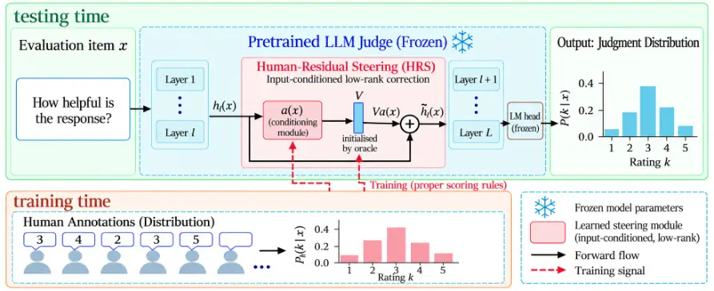

# Human-Residual Steering: Aligning Frozen LLM Judges with Human Judgment Distributions

Chen Lyu    Phong Do    Gabriele Pergola Affiliation: Department of
Computer Science Affiliation: University of Warwick, Coventry, UK
Email: [{chen.lyu,Phong.Do,Gabriele.Pergola.1}@warwick.ac.uk](mailto:)

###### Abstract

Large language models (LLMs) are widely used as automated judges, yet
most alignment methods target aggregated human judgments and overlook
variation among individual annotators. Existing approaches to matching
the full distribution of human ratings mainly rely on output-level
calibration or parameter fine-tuning. We propose Human-Residual Steering
(HRS), to our knowledge the first method to align frozen LLM judges with
human judgment distributions through learned hidden-state interventions.
An oracle analysis shows that low-rank corrections at a single layer
remove most of the discrepancy between judge and human distributions.
HRS learns to predict such corrections from the judge’s hidden
representation and rating logits, training on individual annotations
with proper scoring rules for ordinal and nominal judgments and
optimising through the frozen downstream layers. Across 14 benchmarks
and four judges from three model families, HRS outperforms all evaluated
frozen-weight baselines. With Qwen2.5-7B, it achieves the lowest
Jensen-Shannon distance on 13 of 14 benchmarks, reducing the mean from
0.565 to 0.352 versus 0.377 for the strongest calibrator. HRS also
raises mean Spearman correlation with aggregate human scores from 0.449
to 0.579, improves population-level estimation under limited annotation
budgets, and trains about 88 times fewer parameters than distributional
fine-tuning at a modest cost in alignment. ¹¹ 1 Code will be released
upon acceptance.

## 1 Introduction

Large language models (LLMs) are increasingly employed as automated
judges of response quality, helpfulness, safety, and relevance,
providing a scalable alternative to repeated human evaluation (Zheng et
al., 2023; Liu et al., 2023). However, existing judge-alignment methods
predominantly assess agreement with aggregated human judgments, such as
mean ratings or majority labels, using metrics including rank
correlation, prediction error, and classification accuracy (Liu et al.,
2023; Lai et al., 2025; Kola et al., 2026). While these measures capture
agreement with human consensus, they do not establish whether a judge
reflects the distribution of individual human judgments (Baan et al.,
2022; Plank, 2022).

This distinction is particularly important in subjective evaluation,
where annotators may differ in their interpretations, preferences, and
perspectives (Uma et al., 2021; Plank, 2022; Baan et al., 2022). Such
variation arises in both _ordinal_ judgments, whose categories have a
meaningful ordering, and _nominal_ judgments, whose categories are
unordered. For example, SummEval reports substantial variation among
expert annotators (Krippendorff’s $`\alpha=0.413`$ in the initial
annotation round) (Fabbri et al., 2021), while ChaosNLI finds that
original majority labels differ from those obtained with 100 annotations
per example for 25% of SNLI and 32% of MNLI examples in its selected
subsets (Nie et al., 2020). Despite growing recognition of human
disagreement, aligning LLM judges with the full distribution of
individual human ratings remains comparatively underdeveloped.
Consequently, judges may achieve strong agreement with aggregated human
judgments while failing to capture the extent and structure of annotator
disagreement.

Recent efforts to address this gap have begun to target _human judgment
distributions_ (HJDs) directly. Distributional LLM-as-a-Judge adapts
model parameters to match empirical human ratings (Chen et al., 2025),
while NAPHA calibrates judge outputs towards human soft labels (Steindl
et al., 2026). However, these approaches primarily rely on parameter
adaptation or post-hoc output transformations, leaving
representation-level distributional alignment largely unexplored. In
particular, whether human-judge distributional discrepancies can be
corrected within a frozen judge’s hidden representations remains an open
question.

In parallel, representation-level methods have demonstrated that LLM
behaviour can be modified through hidden-state interventions without
updating the backbone (Rimsky et al., 2024; Wu et al., 2024). For LLM
judges, intermediate representations have been shown to encode
evaluation-related information beyond final predictions (Lai et al.,
2025), while low-dimensional directions have been associated with judge
biases (Xu et al., 2026). These findings suggest that internal
representations may offer an alternative to output-level calibration for
human-distribution alignment. However, it remains unclear whether
compact hidden-state corrections can recover human judgment
distributions and, crucially, whether such corrections can generalise to
unseen items without access to their human ratings.

To investigate these questions, we propose Human-Residual Steering
(HRS), to the best of our knowledge, the first approach to align frozen
LLM judges with human judgment distributions through learned
hidden-state interventions. We begin by deriving _oracle human-judge
residuals_, which use observed human ratings to identify hidden-state
corrections that reduce distributional discrepancies. Our analysis
reveals that these corrections exhibit a predominantly low-rank
structure, with compact subspaces preserving most of the oracle
alignment gain. This finding motivates HRS, which learns to predict
input-conditioned corrections within a low-dimensional intervention
space, without requiring human ratings at inference.

Specifically, HRS learns and predicts corrections from the judge’s
hidden representations and original rating logits, applying them at a
single transformer layer. The interventions are trained using individual
human annotations and proper scoring rules for ordinal and nominal
judgments, with gradients propagated through the judge’s frozen
downstream layers. HRS optimises the resulting judgment distributions
while keeping all backbone parameters fixed.

We evaluate HRS across 14 criterion-level benchmarks from 8 dataset
families, spanning ordinal and nominal judgments and 4 LLM judges. HRS
consistently outperforms evaluated output-level calibration methods,
achieving the lowest Jensen–Shannon distance on 13 of 14 benchmarks with
Qwen2.5-7B and reducing the mean from 0.565 to 0.352, compared with
0.377 for the strongest output-level calibrator. These improvements
generalise across judge families. Beyond distributional alignment, HRS
achieves the highest aggregate-score correlation among evaluated
frozen-backbone methods and improves the precision of downstream
population-level estimation with limited evaluation-stage human
annotations. Further comparisons reveal an accuracy–efficiency trade-off
with distributional fine-tuning, which achieves stronger alignment at
the cost of updating substantially more parameters.

Our main contributions are threefold:

1.  1.  Representation-level distributional alignment. We provide the first
        systematic investigation of hidden-state interventions for aligning
        frozen LLM judges with human judgment distributions, demonstrating
        through oracle analysis that low-rank corrections can substantially
        reduce distributional discrepancies.
2.  2.  Human-Residual Steering (HRS). We introduce an input-conditioned,
        low-rank intervention that learns from individual human ratings
        using ordinal- and nominal-aware objectives, optimised through the
        judge’s frozen downstream layers.
3.  3.  Extensive empirical evaluation. Across 14 ordinal and nominal
        benchmarks and multiple judge families, HRS outperforms evaluated
        output-level calibration methods, achieves strong aggregate-score
        agreement among frozen-weight methods, and improves downstream
        statistical estimation, while revealing accuracy–efficiency
        trade-offs with parameter fine-tuning.



Figure 1: Overview of Human-Residual Steering (HRS). Given an evaluation
item $`x`$, HRS predicts an input-conditioned, low-rank correction
$`\alpha Va(x)`$ from the frozen judge’s hidden representation and
original rating logits. The correction is applied at a single
transformer layer, and the modified representation is propagated through
the remaining frozen layers to produce an aligned human judgment
distribution.

## 2 Related Work

#### Aggregate-Level LLM Judge Alignment.

Existing approaches predominantly align LLM judges with aggregated human
evaluations, such as mean ratings or consensus labels. These include
rubric- and reasoning-based prompting (Liu et al., 2023; Li et al.,
2026), post-hoc output calibration (Van Den Burg et al., 2025; Kola et
al., 2026), and representation-based judge alignment (Lai et al., 2025).
While effective at improving agreement with aggregated human judgments,
these methods do not explicitly target the distribution of individual
human ratings.

#### Distributional LLM Judge Alignment.

Recent work has begun to align LLM judges with _human judgment
distributions_ (HJDs). Chen et al. (2024) investigate approximating HJDs
using limited expert annotations and explanations, while Chen et al.
(2025) fine-tune LLM judges to match empirical human rating
distributions. More recently, Steindl et al. (2026) propose
entropy-aware post-hoc calibration towards human soft labels. This
research builds on the broader literature on _human label variation_
(HLV), which emphasises preserving annotator disagreement rather than
collapsing individual annotations into a single ground truth (Uma et
al., 2021; Plank, 2022; Baan et al., 2022; Meissner et al., 2021).
Unlike existing distributional alignment approaches, HRS learns
input-conditioned corrections within a frozen judge’s hidden
representations.

#### Representation-Level Adaptation and Steering.

Prior work has shown that hidden-state interventions can modify LLM
behaviour without updating backbone parameters (Li et al., 2023; Rimsky
et al., 2024). Representation Fine-Tuning (ReFT) further enables
learned, parameter-efficient interventions (Wu et al., 2024). For LLM
judges, LAGER (Lai et al., 2025) leverages intermediate representations
to improve human-judge agreement, while Xu et al. (2026) identify
low-dimensional subspaces associated with judge biases. However, their
potential for aligning judges with human judgment distributions remains
underexplored.

## 3 Methodology

We introduce Human-Residual Steering (HRS), which aligns a frozen LLM
judge with human rating distributions through input-conditioned
hidden-state interventions. We first formalise distributional judgment
prediction (§3.1), then examine oracle corrections to characterise
representation-level correctability (§3.2). Building on this analysis,
we describe HRS (§3.3) and its distributional training objective (§3.4).

### 3.1 Distributional Human Judgment

#### Human judgment distribution.

We consider evaluation tasks where multiple annotators assign
potentially different ratings to the same item (Plank, 2022). Let $`x`$
denote an evaluation item and its criterion, with $`m_{x}`$ annotations
$`y_{x,1},\ldots,y_{x,m_{x}}\in\mathcal{Y}`$, where
$`\mathcal{Y}=\{0,\ldots,K-1\}`$ represents either ordinal ratings or
nominal categories. The empirical human judgment distribution is

```math
P_{H}(k\mid x)=\frac{1}{m_{x}}\sum_{j=1}^{m_{x}}\mathbb{1}[y_{x,j}=k],\qquad k\in\mathcal{Y}. \tag{1}
```

As this distribution is estimated from finitely many annotations, it may
differ from the underlying population distribution.

#### Frozen LLM judge.

Let $`J`$ be a decoder-only language model with $`L`$ transformer blocks
and hidden dimension $`d`$. Given a fixed evaluation prompt and $`K`$
rating options, each represented by a single-token verbalizer $`t_{k}`$,
we extract the corresponding next-token logits at the final prompt
position:

```math
z(x)=\big(u_{t_{0}}(x),\ldots,u_{t_{K-1}}(x)\big)\in\mathbb{R}^{K}.
```

The judge’s rating distribution is obtained by normalising over the
valid rating tokens:

```math
P_{J}(k\mid x)=\frac{\exp z_{k}(x)}{\sum_{k^{\prime}=0}^{K-1}\exp z_{k^{\prime}}(x)}. \tag{2}
```

This formulation does not require free-form generation.

Let $`h_{l}(x)\in\mathbb{R}^{d}`$ denote the residual-stream
representation at the final prompt position after block $`l`$. We write
$`J_{l+1:L}(h;x)`$ for the rating distribution produced by replacing
$`h_{l}(x)`$ with $`h`$ and propagating it through the remaining frozen
blocks. Accordingly,

```math
J_{l+1:L}(h_{l}(x);x)=P_{J}(\cdot\mid x).
```

### 3.2 Oracle Human-Judge Residuals

We first investigate whether the discrepancy between a frozen judge and
an empirical human rating distribution can be corrected through a single
hidden-state intervention. For an item $`x`$, we define the oracle
human-judge residual $`\delta^{\ast}(x)\in\mathbb{R}^{d}`$ as a
minimum-norm correction that approximately matches the target
distribution:

```math
\begin{split}\delta^{\ast}(x)\in\mathop{\mathrm{arg\,min}}\limits_{\delta}&\ \|\delta\|_{2},\\
\text{s.t.}\qquad J_{l+1:L}(h_{l}(x)+\delta;x)&\approx\widetilde{P}_{H}(\cdot\mid x),\end{split} \tag{3}
```

where $`\widetilde{P}_{H}`$ is a smoothed empirical distribution used
for numerical stability.

Because the oracle uses the same item’s human ratings, it serves as a
diagnostic of representation-level correctability rather than a
deployable predictor. We approximate Eq. 3 using a local linearisation
of the frozen downstream network followed by a damped iterative
logit-correction procedure (Appendix F.1).

#### Low-rank residual subspace.

To examine whether the oracle corrections share a compact structure, we
apply singular value decomposition (SVD) to the matrix of training-item
residuals. The leading $`r`$ right singular vectors define an initial
intervention basis,

```math
V^{(0)}=[w_{1},\ldots,w_{r}]\in\mathbb{R}^{d\times r}. \tag{4}
```

Concentration of residual energy in the leading directions indicates a
shared low-dimensional correction subspace. Only training-item residuals
are used to initialise this basis.

### 3.3 Human-Residual Steering

Oracle corrections require item-level human ratings and therefore cannot
be used directly at inference time. HRS instead learns an
input-conditioned intervention within a low-rank subspace, as
illustrated in Figure 1:

```math
h^{\prime}_{l}(x)=h_{l}(x)+\alpha Va(x), \tag{5}
```

where $`V\in\mathbb{R}^{d\times r}`$ is a trainable intervention basis,
$`a(x)\in\mathbb{R}^{r}`$ contains item-specific coefficients, and
$`\alpha`$ controls the intervention scale. The modified representation
is passed through the judge’s frozen downstream computation to produce

```math
\widehat{P}_{H}(\cdot\mid x)=J_{l+1:L}\big(h_{l}(x)+\alpha Va(x);x\big). \tag{6}
```

This follows the representation-intervention setting of Wu et al.
(2024), while targeting the distribution of individual human judgments.

We initialise $`V`$ from the oracle basis $`V^{(0)}`$ and allow it to
remain trainable. The coefficients are predicted by a lightweight linear
router:

```math
\displaystyle a(x) \displaystyle=W_{a}\phi(x)+b_{a}, \tag{7}
```

```math
\displaystyle\phi(x) \displaystyle=\left[\operatorname{LN}(h_{l}(x));\widetilde{z}(x)\right], \tag{8}
```

where $`\operatorname{LN}`$ is parameter-free normalisation and
$`\widetilde{z}(x)`$ denotes the centred and standardised rating logits
of the original judge. The intervention is therefore conditioned on both
the internal representation and the judge’s initial rating tendency.

HRS is optimised through the original frozen downstream blocks
$`J_{l+1:L}`$, with gradients updating only $`V`$, $`W_{a}`$, and
$`b_{a}`$. Training uses $`\alpha=1`$; the scale $`\alpha`$ is selected
afterwards on the validation split (Appendix F.3). Importantly, the
oracle residuals are used for initialisation rather than as regression
targets: HRS learns corrections according to their effect on the final
judgment distribution.

### 3.4 Learning from Individual Human Ratings

We train HRS using individual human annotations rather than aggregated
consensus labels. For a mini-batch $`\mathcal{B}`$, the objective is

```math
\displaystyle\bar{S}(x) \displaystyle=\frac{1}{m_{x}}\sum_{j=1}^{m_{x}}S\!\left(\widehat{P}_{H}(\cdot\mid x),y_{x,j}\right), \tag{9}
```

```math
\displaystyle\mathcal{L} \displaystyle=\frac{1}{|\mathcal{B}|}\sum_{x\in\mathcal{B}}\left[\bar{S}(x)+\lambda_{a}\|a(x)\|_{2}^{2}\right], \tag{10}
```

where $`S(P,y)`$ is a proper scoring rule and the second term
regularises the intervention coefficients. Averaging annotations within
each item ensures equal weighting regardless of the number of raters.

We use the ranked probability score (RPS) for ordinal judgments and
cross-entropy (CE) for nominal judgments. RPS incorporates the ordering
of rating categories through their cumulative probabilities, whereas CE
does not assume an ordering:

```math
\displaystyle S_{\mathrm{RPS}}(P,y) \displaystyle=\sum_{k=0}^{K-2}\left(F_{P}(k)-\mathbb{1}[y\leq k]\right)^{2}, \tag{11}
```

```math
\displaystyle S_{\mathrm{CE}}(P,\widetilde{P}_{H}) \displaystyle=-\sum_{k=0}^{K-1}\widetilde{P}_{H}(k)\log P(k), \tag{12}
```

where $`F_{P}(k)=\sum_{k^{\prime}=0}^{k}P(k^{\prime})`$ denotes the
cumulative probability up to category $`k`$. For nominal judgments, the
per-annotation average in Eq. (9) is replaced by $`S_{\mathrm{CE}}`$
evaluated against the smoothed histogram
$`\widetilde{P}_{H}(\cdot\mid x)`$. The smoothing shrinks the empirical
histogram towards the training marginal, with its strength selected by
validation leave-one-out RPS (Appendix F.3). Both objectives provide
distributional supervision from individual ratings. Alternative
objectives are examined in §5.4 and Appendix C.2.

#### Training and inference.

The judge’s parameters, prompt, verbalizers, and output head remain
fixed throughout training. We cache the unchanged prefix computation and
optimise the intervention through the remaining frozen layers. At
inference, HRS first obtains the judge’s hidden representation and
original rating logits, then applies the predicted correction and
re-evaluates the frozen downstream layers. This introduces an additional
suffix computation but requires neither human ratings nor test-time
optimisation. Implementation details are provided in Appendices F.1,
F.3, and F.4.

| Method            | SummEval |          |          |          | Topical-Chat |          |          |          | FLASK    | HS2      | HS3      | CNLI     | DynaS    | Scrup    | Avg. $`\downarrow`$ |
| ----------------- | -------- | -------- | -------- | -------- | ------------ | -------- | -------- | -------- | -------- | -------- | -------- | -------- | -------- | -------- | ------------------- |
|                   | Coh      | Con      | Flu      | Rel      | Ovr          | Nat      | Ctx      | Eng      |          |          |          |          |          |          |                     |
| Raw judge         | .609^(†) | .772^(†) | .786^(†) | .590^(†) | .594^(†)     | .492^(†) | .500^(†) | .411^(†) | .572^(†) | .542^(†) | .641^(†) | .371^(†) | .342^(†) | .683^(†) | .565                |
| TS-Soft           | .512^(†) | .622^(†) | .615^(†) | .500^(†) | .499^(†)     | .426^(†) | .419^(†) | .385^(†) | .511^(†) | .469^(†) | .608^(†) | .220^(†) | .360^(†) | .517^(†) | .476                |
| PTS               | .512^(†) | .614^(†) | .615^(†) | .499^(†) | .496^(†)     | .420^(†) | .408^(†) | .384^(†) | .507^(†) | .461^(†) | .608^(†) | .220^(†) | .350^(†) | .513^(†) | .472                |
| Dirichlet (ODIR)  | .473^(†) | .209^(†) | .288^(†) | .401^(†) | .473^(†)     | .376     | .352     | .345^(†) | .425^(†) | .448^(†) | .576^(†) | .214^(†) | .324^(†) | .375^(†) | .377                |
| Linear mapper     | .477^(†) | .214^(†) | .294^(†) | .404^(†) | .482^(†)     | .390     | .369^(†) | .374^(†) | .435^(†) | .453^(†) | .601^(†) | .253^(†) | .373^(†) | .380^(†) | .393                |
| MLP mapper        | .485^(†) | .332^(†) | .365^(†) | .424^(†) | .512^(†)     | .411^(†) | .397^(†) | .404^(†) | .444^(†) | .456^(†) | .601^(†) | .243^(†) | .371^(†) | .383^(†) | .416                |
| NAPHA             | .498^(†) | .539^(†) | .529^(†) | .466^(†) | .513^(†)     | .413^(†) | .397^(†) | .407^(†) | .498^(†) | .455^(†) | .600^(†) | .227^(†) | .354^(†) | .383^(†) | .449                |
| NAPHA (log-prob.) | .483^(†) | .270^(†) | .314^(†) | .413^(†) | .489^(†)     | .408^(†) | .382^(†) | .382^(†) | .445^(†) | .450^(†) | .582^(†) | .221^(†) | .330^(†) | .379^(†) | .396                |
| HRS (ours)        | .414     | .159     | .241     | .383     | .440         | .379     | .349     | .321     | .410     | .432     | .546     | .198     | .302     | .348     | .352                |

Table 1: Human-distribution alignment across 14 criterion-level
benchmarks using Qwen2.5-7B (test JSD averaged over three seeds; lower
is better), compared with frozen-weight baselines. Avg. denotes the
unweighted macro-average across criteria. Bold indicates the best
result; † denotes a significant paired difference from HRS under
prompt-level bootstrap resampling. Weight-updating fine-tuning is
separately compared in §5.5 and Appendix D.1.

## 4 Experimental Setup

#### Benchmarks.

We evaluate HRS on 14 criterion-level benchmarks from eight dataset
families (Appendix Table 4). Eleven involve ordinal ratings: four
SummEval dimensions (Fabbri et al., 2021), four Topical-Chat
criteria (Mehri and Eskenazi, 2020; Gopalakrishnan et al., 2019),
FLASK (Ye et al., 2024; Kim et al., 2024), HelpSteer2 helpfulness (Wang
et al., 2024), and HelpSteer3 code preferences (Wang et al., 2025). The
three nominal benchmarks are ChaosNLI (Nie et al., 2020), DynaSent
Round 2 (Potts et al., 2021), and Scruples Anecdotes (Lourie et al.,
2021). All benchmarks provide multiple individual human annotations per
item. We use official splits where available; otherwise, we construct
60/20/20 train/validation/test splits, grouping related examples to
prevent leakage. Dataset statistics and splitting procedures are
detailed in Appendix A.1.

#### Judges.

We use Qwen2.5-7B-Instruct (Qwen Team, 2025) as the primary judge,
evaluated over three experimental seeds (with split resampling where
applicable), and replicate the main comparisons with
Llama-3.1-8B-Instruct (Grattafiori et al., 2024), Gemma-2-9B-it (Team et
al., 2024), and Qwen2.5-14B-Instruct. All judges use a fixed zero-shot
evaluation prompt (Appendix F.4). Model-specific coverage is reported in
Appendix Table 16.

#### Baselines.

We organise comparisons by adaptation mechanism and evaluation
objective. For human-distribution alignment, our primary baselines are
frozen-weight output-level calibration methods, which preserve the judge
backbone and transform its predicted scores: temperature scaling
(TS-Soft) (Dogah, 2026), parameterised temperature scaling (PTS) (Tomani
et al., 2022), Dirichlet calibration (Kull et al., 2019), linear and MLP
output mappers, and NAPHA (Steindl et al., 2026). We additionally
compare with our replication of the weight-updating distributional
fine-tuning method of Chen et al. (2025), implemented using LoRA (Hu et
al., 2022). This provides a complementary comparison with backbone
adaptation rather than a frozen-backbone calibrator. For conventional
aggregate-score agreement, we compare with G-Eval (Liu et al., 2023),
LAGER (Lai et al., 2025), SAJA (Kola et al., 2026), and HypoEval (Li et
al., 2026). All methods use matched data splits and base judges where
applicable; implementation details are provided in Appendices B.1 and
D.1.

#### Evaluation Metrics.

Our primary metric is Jensen-Shannon distance (JSD), defined as the
square root of Jensen-Shannon divergence between predicted and empirical
human rating distributions, using natural logarithms (Lin, 1991; Endres
and Schindelin, 2003). We additionally report annotation-level ranked
probability score (RPS) for ordinal ratings (Epstein, 1969) and Brier
score for nominal labels (Gneiting and Raftery, 2007). Aggregate-score
agreement is evaluated using Spearman’s $`\rho`$ and mean absolute error
(MAE) for ordinal ratings, and accuracy and macro-F1 for nominal labels.
Additional distributional and calibration metrics are reported in
Appendices C.2 and C.4. Statistical significance is assessed using
paired cluster bootstrap confidence intervals (95%), resampling at the
prompt or source-group level (Efron and Tibshirani, 1993).

#### Experimental Protocol.

All methods are trained on the training split, with hyperparameters
selected using validation data or training-set cross-validation. HRS
uses annotation-level RPS for ordinal judgments and cross-entropy to the
smoothed histogram for nominal judgments. Main results are averaged over
three Qwen2.5-7B seeds, with other judges evaluated using the reported
configurations. In the cross-judge comparison (Table 2), the best
post-hoc baseline is selected retrospectively by test JSD for each
benchmark, providing an optimistic baseline comparison. Further
implementation details and hyperparameters are provided in Appendix F.4.

## 5 Experimental Results

We first examine the feasibility of representation-level alignment
through oracle corrections (§5.1), then evaluate HRS against
frozen-weight output-level calibration methods across benchmarks and
judge families (§5.2). We then assess its generalisation to
aggregate-score evaluation (§5.3) and ablate on loss function design
choices (§5.4). Finally, §5.5 examines accuracy-efficiency trade-offs
against weight-updating fine-tuning and the downstream statistical
utility of HRS.

### 5.1 Representation-Level Correctability

We first investigate whether discrepancies between a frozen LLM judge
and human rating distributions can be corrected through hidden-state
interventions, and whether these corrections exhibit a low-dimensional
structure. To assess the achievable correction, we derive oracle
residuals using each test item’s human ratings (§3.2) and propagate the
modified representations through the judge’s frozen downstream layers.
As these interventions use test-item annotations, they measure
representation-level correctability rather than predictive
generalisation.

#### A single-layer intervention substantially reduces distributional discrepancies.

Across 14 benchmarks, oracle corrections reduce mean JSD from $`0.565`$
to $`0.179`$ for Qwen (mean of three seeds) and from $`0.490`$ to
$`0.184`$ for Llama (seed 42), corresponding to relative reductions of
68% and 63%, respectively. These results demonstrate that substantial
human-judge distributional discrepancies can be corrected by modifying
representations at a single layer, without updating the judge’s
parameters. Moreover, interventions at depths beyond $`0.6L`$ achieve
comparable alignment (Appendix Table 14), suggesting that correctability
is not restricted to a narrowly selected intervention layer.

#### Low-dimensional subspaces retain most of the corrective capacity.

We next examine whether the oracle corrections share a compact structure
across items, motivating the low-rank parameterisation of HRS. Using SVD
on training-item oracle residuals, we construct an eight-dimensional
subspace and project test-item oracle corrections onto it. Despite this
dimensionality reduction, the leading eight directions retain a median
of 94% of residual energy for Qwen and at least 98.8% for Llama
(Appendix Table 14). The projected corrections achieve mean JSDs of
$`0.241`$ and $`0.185`$, preserving approximately 84% and 99% of the
full oracle improvement, respectively. This indicates that most of the
achievable alignment gain is concentrated in a small shared intervention
subspace, providing empirical support for HRS’s low-rank design.
Importantly, these projected corrections still use test-item ratings to
determine intervention coefficients; HRS subsequently addresses the
challenge of predicting such corrections without access to these
ratings.

| Judge        | $`n`$ | Raw  | Best post-hoc | HRS  | Wins  |
| ------------ | ----- | ---- | ------------- | ---- | ----- |
| Qwen2.5-7B   | 14    | .565 | .377          | .352 | 13/14 |
| Llama-3.1-8B | 14    | .490 | .387          | .367 | 12/14 |
| Gemma-2-9B   | 14    | .555 | .367          | .350 | 12/14 |
| Qwen2.5-14B  | 10    | .551 | .356          | .336 | 9/10  |

Table 2: Cross-judge summary: mean test JSD over $`n`$ evaluated
benchmarks and HRS wins against the best post-hoc baseline. Best
post-hoc is an optimistic envelope selected separately by test JSD for
each benchmark. Complete per-benchmark numbers appear in Appendix
Table 5.

### 5.2 Human-Distribution Alignment

#### HRS consistently outperforms frozen-weight baselines.

Table 1 compares HRS with frozen-weight methods across 14 benchmarks
using Qwen2.5-7B. HRS achieves the lowest mean JSD ($`0.352`$),
substantially improving over the raw judge ($`0.565`$) and the strongest
calibration baseline ($`0.377`$). It obtains the best alignment on 13 of
14 benchmarks, with statistically significant gains on 12. The only
exception is Topical-Chat naturalness, where the difference is not
significant. These results demonstrate the effectiveness of hidden-state
interventions over output-level calibration for both ordinal and nominal
judgments.

#### Gains generalise across judge families.

As shown in Table 2, HRS consistently outperforms the strongest post-hoc
calibration baselines across Qwen, Llama, and Gemma judges. It achieves
lower JSD in 46 of 52 benchmark-level comparisons, including 37
statistically significant improvements. Notably, these gains hold even
against an optimistic baseline that selects the best calibrator for each
benchmark using test performance. This consistency across model families
and sizes suggests that HRS’s advantages are not specific to a
particular judge architecture. Complete per-benchmark results appear in
Appendix Table 5, with cross-seed variability in Appendix Table 12.

### 5.3 Generalisation to Aggregate-Score Agreement

Although HRS targets distributions of individual human ratings,
conventional LLM-as-a-Judge evaluation typically measures agreement with
aggregated human scores. We therefore examine whether HRS generalises to
this setting without additional training or an aggregate-score
objective. For each ordinal benchmark, we compare the expected rating
under the predicted distribution with the mean human rating using
Spearman’s $`\rho`$ and mean absolute error (MAE).

As shown in Table 3, HRS achieves the highest mean Spearman correlation
($`0.579`$), substantially improving over the raw judge ($`0.449`$) and
the strongest baseline evaluated across all criteria ($`0.474`$). It
leads on 8 of 11 criteria, with similar gains observed for Llama
(Appendix Table 9), and consistently achieves lower MAE than applicable
baselines (Appendix Table 11). These findings demonstrate that HRS’s
distributional alignment also benefits conventional score-level
evaluation, without explicitly optimising for aggregate-score agreement.

| Method                               | Mean $`\rho\uparrow`$ | Best / total |
| ------------------------------------ | --------------------- | ------------ |
| Raw judge                            | .449                  | 0/11         |
| G-Eval (Liu et al., 2023)            | .468                  | 2/11         |
| LAGER (Lai et al., 2025)             | .425                  | 0/11         |
| SAJA, regression (Kola et al., 2026) | .468                  | 0/11         |
| SAJA, classification                 | .474                  | 1/11         |
| HypoEval (Li et al., 2026)           | .455                  | 0/10         |
| HRS (ours)                           | .579                  | 8/11         |

Table 3: Aggregate-score agreement among evaluated frozen-backbone
methods using Qwen2.5-7B. Per-criterion correlations, MAE, and
Llama-3.1-8B results appear in Appendix Tables 8, 11, and 9,
respectively.

Figure 2: Test JSD (lower is better) versus trainable parameters on
three benchmarks (Qwen2.5-7B, seed 42). Colours and markers mark method
families; dashed lines are Pareto frontiers; parameter counts exclude
the judge backbone (details in Appendix B.2).

### 5.4 Ablation Study

#### Training-Loss ablation.

We investigate the benefit of ordinal-aware supervision by replacing RPS
with cross-entropy (CE), while keeping the architecture and training
protocol fixed. Across four judge configurations, RPS achieves lower
mean JSD in 39 of 42 ordinal benchmark comparisons, including 30
statistically significant improvements. On Qwen2.5-7B, it reduces mean
JSD from $`0.389`$ to $`0.370`$, improving all eleven benchmarks.
However, gains under annotation-level RPS are modest ($`0.002`$),
suggesting that the advantage is more pronounced for distributional
alignment measured by JSD. Full results are reported in Appendix
Table 6.

#### Component ablation.

We examine the effect of oracle-based initialisation by comparing
matched rank-8 HRS variants with oracle-SVD and random basis
initialisation. On HelpSteer2 with Qwen2.5-7B (seed 42), both achieve
comparable performance (test JSD: $`0.433`$ vs. $`0.429`$;
annotation-level RPS: $`0.644`$ vs. $`0.645`$). These results suggest
that HRS is not strongly dependent on oracle initialisation in this
setting. Rather, the oracle analysis motivates the low-rank intervention
design, while predictive alignment is learned through input-conditioned
steering (Appendix Table 15).

### 5.5 Trade-offs across Method Families

#### Distributional alignment and parameter efficiency.

We extend the frozen-backbone comparisons in §5.2 to weight-updating
distributional fine-tuning, examining trade-offs in alignment quality,
trainable parameters, and computational cost. Figure 2 compares
output-level calibration, HRS, and weight-updating fine-tuning in
alignment quality and trainable parameter requirements. While
output-level calibrators use fewer parameters, they generally achieve
weaker distributional alignment. Compared with LoRA-based distributional
fine-tuning (Chen et al., 2025), HRS achieves competitive mean JSD
($`0.352`$ versus $`0.338`$) while training substantially fewer
parameters (115k versus 10.1M, approximately 88$`\times`$ fewer). These
results position HRS as a parameter-efficient alternative to
weight-updating methods, offering a favourable trade-off between
distributional alignment and trainable parameter count.

#### Population-level estimation efficiency.

We further examine whether distributional alignment improves the
estimation of population-level human judgment statistics. Following Wang
et al. (2026), we combine judge predictions with human annotations for
10% of evaluation items and measure statistical efficiency through
effective sample size (ESS). On HelpSteer2 and HelpSteer3 code, HRS
improves ESS by 38-39% relative to the classical human-only estimator,
whereas the raw judge provides limited or negative gains. Empirical
coverage remains close to the nominal 95% confidence level
(Appendix G.2). These findings demonstrate that HRS can improve the
precision of population-level estimates under limited evaluation-stage
annotation budgets, beyond its benefits for instance-level
distributional alignment.

## 6 Conclusion

We presented Human-Residual Steering (HRS), a representation-level
approach for aligning frozen LLM judges with distributions of individual
human ratings. Label-dependent oracle analyses reveal that substantial
distributional discrepancies can be corrected within compact,
low-dimensional hidden-state subspaces. Building on this observation,
HRS learns input-conditioned interventions from individual annotations
while preserving the judge’s backbone parameters.

Across 14 ordinal and nominal benchmarks and multiple judge families,
HRS consistently outperforms evaluated frozen-weight methods in
distributional alignment and achieves the strongest aggregate-score
agreement among them. Improved distributional predictions also increase
the precision of downstream population-level estimates under limited
evaluation-stage human annotation budgets. Although distributional
fine-tuning achieves stronger alignment, HRS provides a
parameter-efficient alternative with different computational and storage
trade-offs. These findings establish hidden-state steering as a
promising approach to human-distribution alignment, while highlighting
the remaining challenges of cross-domain adaptation and preserving
already-aligned predictions.

## Limitations

HRS requires access to intermediate representations and gradients
through frozen downstream layers, limiting its applicability to API-only
judges. Its effectiveness also depends on criterion-specific human
annotations: preliminary experiments show limited cross-benchmark
transfer and mixed advantages under small training budgets. Although HRS
updates few parameters, oracle-based initialisation and representation
caching introduce additional computational and storage costs. Finally,
interventions can degrade some initially accurate predictions. Improving
transferability, annotation efficiency, and prediction preservation
remains future work.

## References

- Baan et al. (2022) J. Baan, W. Aziz, B. Plank, and R. Fernández Stop
  measuring calibration when humans disagree. In Proceedings of the 2022
  Conference on Empirical Methods in Natural Language Processing,
  pp. 1892–1915. External Links:
  [Document](https://dx.doi.org/10.18653/v1/2022.emnlp-main.124),
  [Link](https://aclanthology.org/2022.emnlp-main.124/) Cited by: §1,
  §1, §2.
- Chen et al. (2024) B. Chen, X. Wang, S. Peng, R. Litschko, A.
  Korhonen, and B. Plank “Seeing the Big through the Small”: can LLMs
  approximate human judgment distributions on NLI from a few
  explanations?. In Findings of the Association for Computational
  Linguistics: EMNLP 2024, pp. 14396–14419. External Links:
  [Document](https://dx.doi.org/10.18653/v1/2024.findings-emnlp.842),
  [Link](https://aclanthology.org/2024.findings-emnlp.842/) Cited by:
  §2.
- Chen et al. (2025) L. Chen, Z. Zhang, H. Tan, Q. Dai, Y. Hao, Z. Dong,
  and X. Chen Distributional LLM-as-a-judge. In Advances in Neural
  Information Processing Systems 38, pp. 33908–33937. External Links:
  [Link](http://dx.doi.org/10.52202/085713-1008),
  [Document](https://dx.doi.org/10.52202/085713-1008) Cited by: §B.1,
  §B.1, Table 10, Table 10, Table 10, Table 11, Table 8, Table 8, Table
  9, Table 9, §D.1, §D.1, Table 12, Table 12, Table 12, Appendix E,
  Table 13, Table 13, Table 17, Table 17, Table 17, §1, §2, §4, §5.5.
- Chiang and Lee (2023) C. Chiang and H. Lee A closer look into using
  large language models for automatic evaluation. In Findings of the
  Association for Computational Linguistics: EMNLP 2023, H. Bouamor, J.
  Pino, and K. Bali (Eds.), Singapore, pp. 8928–8942. External Links:
  [Link](https://aclanthology.org/2023.findings-emnlp.599/),
  [Document](https://dx.doi.org/10.18653/v1/2023.findings-emnlp.599)
  Cited by: §B.1.
- Dogah (2026) W. Dogah Temperature scaling is not enough: calibration
  gaps under human label distributions. External Links: 2607.13423,
  [Link](https://arxiv.org/abs/2607.13423) Cited by: §B.1, §4.
- Efron and Tibshirani (1993) B. Efron and R. J. Tibshirani An
  introduction to the bootstrap. Chapman and Hall. External Links: ISBN
  9780412042317, [Link](https://cds.cern.ch/record/526679) Cited by: §4.
- Endres and Schindelin (2003) D. M. Endres and J. E. Schindelin A new
  metric for probability distributions. IEEE Transactions on Information
  Theory 49 (7), pp. 1858–1860. External Links:
  [Document](https://dx.doi.org/10.1109/TIT.2003.813506) Cited by: §4.
- Epstein (1969) E. S. Epstein A scoring system for probability
  forecasts of ranked categories. Journal of Applied Meteorology 8 (6),
  pp. 985–987. External Links: ISSN 0021-8952,
  [Link](<http://dx.doi.org/10.1175/1520-0450(1969)008%3C0985:ASSFPF%3E2.0.CO;2>),
  [Document](https://dx.doi.org/10.1175/1520-0450%281969%29008%3C0985%3Aassfpf%3E2.0.co%3B2)
  Cited by: §4.
- Fabbri et al. (2021) A. R. Fabbri, W. Kryściński, B. McCann, C.
  Xiong, R. Socher, and D. Radev SummEval: re-evaluating summarization
  evaluation. Transactions of the Association for Computational
  Linguistics 9, pp. 391–409. External Links:
  [Link](https://aclanthology.org/2021.tacl-1.24/),
  [Document](https://dx.doi.org/10.1162/tacl%5Fa%5F00373) Cited by:
  Table 4, §1, §4.
- Gneiting and Raftery (2007) T. Gneiting and A. E. Raftery Strictly
  proper scoring rules, prediction, and estimation. Journal of the
  American Statistical Association 102 (477), pp. 359–378. External
  Links: ISSN 1537-274X,
  [Link](http://dx.doi.org/10.1198/016214506000001437),
  [Document](https://dx.doi.org/10.1198/016214506000001437) Cited by:
  §4.
- Gopalakrishnan et al. (2019) K. Gopalakrishnan, B. Hedayatnia, Q.
  Chen, A. Gottardi, S. Kwatra, A. Venkatesh, R. Gabriel, and D.
  Hakkani-Tür Topical-Chat: towards knowledge-grounded open-domain
  conversations. In Interspeech 2019, pp. 1891–1895. External Links:
  [Link](http://dx.doi.org/10.21437/Interspeech.2019-3079),
  [Document](https://dx.doi.org/10.21437/interspeech.2019-3079) Cited
  by: §4.
- Grattafiori et al. (2024) A. Grattafiori, A. Dubey, A. Jauhri, A.
  Pandey, A. Kadian, A. Al-Dahle, A. Letman, A. Mathur, A. Schelten, A.
  Vaughan, A. Yang, A. Fan, A. Goyal, A. Hartshorn, A. Yang, A.
  Mitra, A. Sravankumar, A. Korenev, A. Hinsvark, A. Rao, A. Zhang, A.
  Rodriguez, A. Gregerson, A. Spataru, B. Roziere, B. Biron, B. Tang, B.
  Chern, C. Caucheteux, C. Nayak, C. Bi, C. Marra, C. McConnell, C.
  Keller, C. Touret, C. Wu, C. Wong, C. C. Ferrer, C. Nikolaidis, D.
  Allonsius, D. Song, D. Pintz, D. Livshits, D. Wyatt, D. Esiobu, D.
  Choudhary, D. Mahajan, D. Garcia-Olano, D. Perino, D. Hupkes, E.
  Lakomkin, E. AlBadawy, E. Lobanova, E. Dinan, E. M. Smith, F.
  Radenovic, F. Guzmán, F. Zhang, G. Synnaeve, G. Lee, G. L.
  Anderson, G. Thattai, G. Nail, G. Mialon, G. Pang, G. Cucurell, H.
  Nguyen, H. Korevaar, H. Xu, H. Touvron, I. Zarov, I. A. Ibarra, I.
  Kloumann, I. Misra, I. Evtimov, J. Zhang, J. Copet, J. Lee, J.
  Geffert, J. Vranes, J. Park, J. Mahadeokar, J. Shah, J. van der
  Linde, J. Billock, J. Hong, J. Lee, J. Fu, J. Chi, J. Huang, J.
  Liu, J. Wang, J. Yu, J. Bitton, J. Spisak, J. Park, J. Rocca, J.
  Johnstun, J. Saxe, J. Jia, K. V. Alwala, K. Prasad, K. Upasani, K.
  Plawiak, K. Li, K. Heafield, K. Stone, K. El-Arini, K. Iyer, K.
  Malik, K. Chiu, K. Bhalla, K. Lakhotia, L. Rantala-Yeary, L. van der
  Maaten, L. Chen, L. Tan, L. Jenkins, L. Martin, L. Madaan, L. Malo, L.
  Blecher, L. Landzaat, L. de Oliveira, M. Muzzi, M. Pasupuleti, M.
  Singh, M. Paluri, M. Kardas, M. Tsimpoukelli, M. Oldham, M. Rita, M.
  Pavlova, M. Kambadur, M. Lewis, M. Si, M. K. Singh, M. Hassan, N.
  Goyal, N. Torabi, N. Bashlykov, N. Bogoychev, N. Chatterji, N.
  Zhang, O. Duchenne, O. Çelebi, P. Alrassy, P. Zhang, P. Li, P.
  Vasic, P. Weng, P. Bhargava, P. Dubal, P. Krishnan, P. S. Koura, P.
  Xu, Q. He, Q. Dong, R. Srinivasan, R. Ganapathy, R. Calderer, R. S.
  Cabral, R. Stojnic, R. Raileanu, R. Maheswari, R. Girdhar, R.
  Patel, R. Sauvestre, R. Polidoro, R. Sumbaly, R. Taylor, R. Silva, R.
  Hou, R. Wang, S. Hosseini, S. Chennabasappa, S. Singh, S. Bell, S. S.
  Kim, S. Edunov, S. Nie, S. Narang, S. Raparthy, S. Shen, S. Wan, S.
  Bhosale, S. Zhang, S. Vandenhende, S. Batra, S. Whitman, S. Sootla, S.
  Collot, S. Gururangan, S. Borodinsky, T. Herman, T. Fowler, T.
  Sheasha, T. Georgiou, T. Scialom, T. Speckbacher, T. Mihaylov, T.
  Xiao, U. Karn, V. Goswami, V. Gupta, V. Ramanathan, V. Kerkez, V.
  Gonguet, V. Do, V. Vogeti, V. Albiero, V. Petrovic, W. Chu, W.
  Xiong, W. Fu, W. Meers, X. Martinet, X. Wang, X. Wang, X. E. Tan, X.
  Xia, X. Xie, X. Jia, X. Wang, Y. Goldschlag, Y. Gaur, Y. Babaei, Y.
  Wen, Y. Song, Y. Zhang, Y. Li, Y. Mao, Z. D. Coudert, Z. Yan, Z.
  Chen, Z. Papakipos, A. Singh, A. Srivastava, A. Jain, A. Kelsey, A.
  Shajnfeld, A. Gangidi, A. Victoria, A. Goldstand, A. Menon, A.
  Sharma, A. Boesenberg, A. Baevski, A. Feinstein, A. Kallet, A.
  Sangani, A. Teo, A. Yunus, A. Lupu, A. Alvarado, A. Caples, A. Gu, A.
  Ho, A. Poulton, A. Ryan, A. Ramchandani, A. Dong, A. Franco, A.
  Goyal, A. Saraf, A. Chowdhury, A. Gabriel, A. Bharambe, A.
  Eisenman, A. Yazdan, B. James, B. Maurer, B. Leonhardi, B. Huang, B.
  Loyd, B. D. Paola, B. Paranjape, B. Liu, B. Wu, B. Ni, B. Hancock, B.
  Wasti, B. Spence, B. Stojkovic, B. Gamido, B. Montalvo, C. Parker, C.
  Burton, C. Mejia, C. Liu, C. Wang, C. Kim, C. Zhou, C. Hu, C. Chu, C.
  Cai, C. Tindal, C. Feichtenhofer, C. Gao, D. Civin, D. Beaty, D.
  Kreymer, D. Li, D. Adkins, D. Xu, D. Testuggine, D. David, D.
  Parikh, D. Liskovich, D. Foss, D. Wang, D. Le, D. Holland, E.
  Dowling, E. Jamil, E. Montgomery, E. Presani, E. Hahn, E. Wood, E.
  Le, E. Brinkman, E. Arcaute, E. Dunbar, E. Smothers, F. Sun, F.
  Kreuk, F. Tian, F. Kokkinos, F. Ozgenel, F. Caggioni, F. Kanayet, F.
  Seide, G. M. Florez, G. Schwarz, G. Badeer, G. Swee, G. Halpern, G.
  Herman, G. Sizov, Guangyi, Zhang, G. Lakshminarayanan, H. Inan, H.
  Shojanazeri, H. Zou, H. Wang, H. Zha, H. Habeeb, H. Rudolph, H.
  Suk, H. Aspegren, H. Goldman, H. Zhan, I. Damlaj, I. Molybog, I.
  Tufanov, I. Leontiadis, I. Veliche, I. Gat, J. Weissman, J.
  Geboski, J. Kohli, J. Lam, J. Asher, J. Gaya, J. Marcus, J. Tang, J.
  Chan, J. Zhen, J. Reizenstein, J. Teboul, J. Zhong, J. Jin, J.
  Yang, J. Cummings, J. Carvill, J. Shepard, J. McPhie, J. Torres, J.
  Ginsburg, J. Wang, K. Wu, K. H. U, K. Saxena, K. Khandelwal, K.
  Zand, K. Matosich, K. Veeraraghavan, K. Michelena, K. Li, K.
  Jagadeesh, K. Huang, K. Chawla, K. Huang, L. Chen, L. Garg, L. A, L.
  Silva, L. Bell, L. Zhang, L. Guo, L. Yu, L. Moshkovich, L.
  Wehrstedt, M. Khabsa, M. Avalani, M. Bhatt, M. Mankus, M. Hasson, M.
  Lennie, M. Reso, M. Groshev, M. Naumov, M. Lathi, M. Keneally, M.
  Liu, M. L. Seltzer, M. Valko, M. Restrepo, M. Patel, M. Vyatskov, M.
  Samvelyan, M. Clark, M. Macey, M. Wang, M. J. Hermoso, M. Metanat, M.
  Rastegari, M. Bansal, N. Santhanam, N. Parks, N. White, N. Bawa, N.
  Singhal, N. Egebo, N. Usunier, N. Mehta, N. P. Laptev, N. Dong, N.
  Cheng, O. Chernoguz, O. Hart, O. Salpekar, O. Kalinli, P. Kent, P.
  Parekh, P. Saab, P. Balaji, P. Rittner, P. Bontrager, P. Roux, P.
  Dollar, P. Zvyagina, P. Ratanchandani, P. Yuvraj, Q. Liang, R.
  Alao, R. Rodriguez, R. Ayub, R. Murthy, R. Nayani, R. Mitra, R.
  Parthasarathy, R. Li, R. Hogan, R. Battey, R. Wang, R. Howes, R.
  Rinott, S. Mehta, S. Siby, S. J. Bondu, S. Datta, S. Chugh, S.
  Hunt, S. Dhillon, S. Sidorov, S. Pan, S. Mahajan, S. Verma, S.
  Yamamoto, S. Ramaswamy, S. Lindsay, S. Lindsay, S. Feng, S. Lin, S. C.
  Zha, S. Patil, S. Shankar, S. Zhang, S. Zhang, S. Wang, S. Agarwal, S.
  Sajuyigbe, S. Chintala, S. Max, S. Chen, S. Kehoe, S. Satterfield, S.
  Govindaprasad, S. Gupta, S. Deng, S. Cho, S. Virk, S. Subramanian, S.
  Choudhury, S. Goldman, T. Remez, T. Glaser, T. Best, T. Koehler, T.
  Robinson, T. Li, T. Zhang, T. Matthews, T. Chou, T. Shaked, V.
  Vontimitta, V. Ajayi, V. Montanez, V. Mohan, V. S. Kumar, V.
  Mangla, V. Ionescu, V. Poenaru, V. T. Mihailescu, V. Ivanov, W. Li, W.
  Wang, W. Jiang, W. Bouaziz, W. Constable, X. Tang, X. Wu, X. Wang, X.
  Wu, X. Gao, Y. Kleinman, Y. Chen, Y. Hu, Y. Jia, Y. Qi, Y. Li, Y.
  Zhang, Y. Zhang, Y. Adi, Y. Nam, Yu, Wang, Y. Zhao, Y. Hao, Y.
  Qian, Y. Li, Y. He, Z. Rait, Z. DeVito, Z. Rosnbrick, Z. Wen, Z.
  Yang, Z. Zhao, and Z. Ma The Llama 3 herd of models. External Links:
  2407.21783, [Link](https://arxiv.org/abs/2407.21783) Cited by: §4.
- He et al. (2023) P. He, J. Gao, and W. Chen DeBERTaV3: improving
  DeBERTa using ELECTRA-style pre-training with gradient-disentangled
  embedding sharing. In The Eleventh International Conference on
  Learning Representations, External Links:
  [Link](https://openreview.net/forum?id=sE7-XhLxHA) Cited by: §B.2.
- Hu et al. (2022) E. J. Hu, Y. Shen, P. Wallis, Z. Allen-Zhu, Y. Li, S.
  Wang, L. Wang, and W. Chen LoRA: low-rank adaptation of large language
  models. In International Conference on Learning Representations
  (ICLR), External Links: [Link](https://arxiv.org/abs/2106.09685) Cited
  by: §D.1, §4.
- Kim et al. (2024) S. Kim, J. Shin, Y. Cho, J. Jang, S. Longpre, H.
  Lee, S. Yun, S. Shin, S. Kim, J. Thorne, and M. Seo Prometheus:
  inducing fine-grained evaluation capability in language models. In
  International Conference on Learning Representations (ICLR), External
  Links: [Link](https://arxiv.org/abs/2310.08491) Cited by: §A.1, §4.
- Kola et al. (2026) S. Kola, P. K. Sharma, S. Dey, B. Mishra, and M.
  Datar SAJA: a simple approach to judge alignment for LLM-as-a-judge.
  In Proceedings of the 64th Annual Meeting of the Association for
  Computational Linguistics (Industry Track), pp. 646–664. External
  Links: [Link](https://aclanthology.org/2026.acl-industry.45/) Cited
  by: §B.1, Table 11, Table 8, Table 9, §1, §2, §4, Table 3.
- Kull et al. (2019) M. Kull, M. Perello-Nieto, M. Kängsepp, T. S.
  Filho, H. Song, and P. Flach Beyond temperature scaling: obtaining
  well-calibrated multi-class probabilities with Dirichlet calibration.
  In Advances in Neural Information Processing Systems 32 (NeurIPS
  2019), External Links: [Link](https://arxiv.org/abs/1910.12656) Cited
  by: §B.1, §4.
- Lai et al. (2025) P. Lai, J. Zheng, S. Cheng, Y. Chen, P. Li, Y. Liu,
  and G. Chen Beyond the surface: enhancing LLM-as-a-judge alignment
  with human via internal representations. In Advances in Neural
  Information Processing Systems 38 (NeurIPS 2025), External Links:
  [Link](https://arxiv.org/abs/2508.03550) Cited by: §B.1, Table 11,
  Table 8, Table 9, §1, §1, §2, §2, §4, Table 3.
- Li et al. (2023) K. Li, O. Patel, F. Viégas, H. Pfister, and M.
  Wattenberg Inference-time intervention: eliciting truthful answers
  from a language model. In Advances in Neural Information Processing
  Systems 36 (NeurIPS 2023), External Links:
  [Link](https://arxiv.org/abs/2306.03341) Cited by: §2.
- Li et al. (2026) M. Li, H. Li, and C. Tan HypoEval: hypothesis-guided
  evaluation for natural language generation. In Proceedings of the 64th
  Annual Meeting of the Association for Computational Linguistics
  (Volume 1: Long Papers), M. Liakata, V. P. Moreira, J. Zhang, and D.
  Jurgens (Eds.), San Diego, California, United States, pp. 42424–42443.
  External Links: [Link](https://aclanthology.org/2026.acl-long.1963/),
  [Document](https://dx.doi.org/10.18653/v1/2026.acl-long.1963), ISBN
  979-8-89176-390-6 Cited by: §B.1, Table 11, Table 8, Table 9, §2, §4,
  Table 3.
- Lin (1991) J. Lin Divergence measures based on the Shannon entropy.
  IEEE Transactions on Information Theory 37 (1), pp. 145–151. External
  Links: [Document](https://dx.doi.org/10.1109/18.61115) Cited by: §4.
- Liu et al. (2023) Y. Liu, D. Iter, Y. Xu, S. Wang, R. Xu, and C. Zhu
  G-Eval: NLG evaluation using GPT-4 with better human alignment. In
  Proceedings of the 2023 Conference on Empirical Methods in Natural
  Language Processing, Singapore, pp. 2511–2522. External Links:
  [Document](https://dx.doi.org/10.18653/v1/2023.emnlp-main.153),
  [Link](https://aclanthology.org/2023.emnlp-main.153/) Cited by: §B.1,
  Table 11, Table 8, Table 9, §1, §2, §4, Table 3.
- Liu et al. (2019) Y. Liu, M. Ott, N. Goyal, J. Du, M. Joshi, D.
  Chen, O. Levy, M. Lewis, L. Zettlemoyer, and V. Stoyanov RoBERTa: a
  robustly optimized BERT pretraining approach. External Links:
  1907.11692, [Link](https://arxiv.org/abs/1907.11692) Cited by: §B.2.
- Lourie et al. (2021) N. Lourie, R. L. Bras, and Y. Choi Scruples: a
  corpus of community ethical judgments on 32,000 real-life anecdotes.
  In Proceedings of the AAAI Conference on Artificial Intelligence, Vol.
  35, pp. 13470–13479. External Links:
  [Link](https://arxiv.org/abs/2008.09094),
  [Document](https://dx.doi.org/10.1609/aaai.v35i15.17589) Cited by:
  Table 4, §4.
- Mehri and Eskenazi (2020) S. Mehri and M. Eskenazi USR: an
  unsupervised and reference free evaluation metric for dialog
  generation. In Proceedings of the 58th Annual Meeting of the
  Association for Computational Linguistics, D. Jurafsky, J. Chai, N.
  Schluter, and J. Tetreault (Eds.), Online, pp. 681–707. External
  Links: [Link](https://aclanthology.org/2020.acl-main.64/),
  [Document](https://dx.doi.org/10.18653/v1/2020.acl-main.64) Cited by:
  §A.1, Table 4, §4.
- Meissner et al. (2021) J. M. Meissner, N. Thumwanit, S. Sugawara,
  and A. Aizawa Embracing ambiguity: shifting the training target of NLI
  models. In Proceedings of the 59th Annual Meeting of the Association
  for Computational Linguistics and the 11th International Joint
  Conference on Natural Language Processing (Volume 2: Short Papers),
  pp. 862–869. External Links:
  [Document](https://dx.doi.org/10.18653/v1/2021.acl-short.109),
  [Link](https://aclanthology.org/2021.acl-short.109/) Cited by: §2.
- Nie et al. (2020) Y. Nie, X. Zhou, and M. Bansal What can we learn
  from collective human opinions on natural language inference data?. In
  Proceedings of the 2020 Conference on Empirical Methods in Natural
  Language Processing (EMNLP), B. Webber, T. Cohn, Y. He, and Y. Liu
  (Eds.), Online, pp. 9131–9143. External Links:
  [Link](https://aclanthology.org/2020.emnlp-main.734/),
  [Document](https://dx.doi.org/10.18653/v1/2020.emnlp-main.734) Cited
  by: Table 4, §B.2, §1, §4.
- Plank (2022) B. Plank The “problem” of human label variation: on
  ground truth in data, modeling and evaluation. In Proceedings of the
  2022 Conference on Empirical Methods in Natural Language Processing,
  Abu Dhabi, United Arab Emirates, pp. 10671–10682. External Links:
  [Document](https://dx.doi.org/10.18653/v1/2022.emnlp-main.731),
  [Link](https://aclanthology.org/2022.emnlp-main.731/) Cited by: §1,
  §1, §2, §3.1.
- Potts et al. (2021) C. Potts, Z. Wu, A. Geiger, and D. Kiela DynaSent:
  a dynamic benchmark for sentiment analysis. In Proceedings of the 59th
  Annual Meeting of the Association for Computational Linguistics and
  the 11th International Joint Conference on Natural Language Processing
  (Volume 1: Long Papers), C. Zong, F. Xia, W. Li, and R. Navigli
  (Eds.), Online, pp. 2388–2404. External Links:
  [Link](https://aclanthology.org/2021.acl-long.186/),
  [Document](https://dx.doi.org/10.18653/v1/2021.acl-long.186) Cited by:
  Table 4, §4.
- Qwen Team (2025) Qwen Team Qwen2.5 Technical Report. External Links:
  2412.15115, [Link](https://arxiv.org/abs/2412.15115) Cited by: §4.
- Rimsky et al. (2024) N. Rimsky, N. Gabrieli, J. Schulz, M. Tong, E.
  Hubinger, and A. Turner Steering Llama 2 via contrastive activation
  addition. In Proceedings of the 62nd Annual Meeting of the Association
  for Computational Linguistics (Volume 1: Long Papers), Bangkok,
  Thailand, pp. 15504–15522. External Links:
  [Document](https://dx.doi.org/10.18653/v1/2024.acl-long.828),
  [Link](https://aclanthology.org/2024.acl-long.828/) Cited by: §1, §2.
- Steindl et al. (2026) S. Steindl, N. Voskarides, A. Gasparin, and D.
  Marcheggiani Post-hoc alignment of LLM-judges to human judgment
  distribution. External Links: 2609.01073,
  [Link](https://arxiv.org/abs/2609.01073) Cited by: §B.1, §1, §2, §4.
- Team et al. (2024) G. Team, M. Riviere, S. Pathak, P. G. Sessa, C.
  Hardin, S. Bhupatiraju, L. Hussenot, T. Mesnard, B. Shahriari, A.
  Ramé, J. Ferret, P. Liu, P. Tafti, A. Friesen, M. Casbon, S. Ramos, R.
  Kumar, C. L. Lan, S. Jerome, A. Tsitsulin, N. Vieillard, P.
  Stanczyk, S. Girgin, N. Momchev, M. Hoffman, S. Thakoor, J. Grill, B.
  Neyshabur, O. Bachem, A. Walton, A. Severyn, A. Parrish, A. Ahmad, A.
  Hutchison, A. Abdagic, A. Carl, A. Shen, A. Brock, A. Coenen, A.
  Laforge, A. Paterson, B. Bastian, B. Piot, B. Wu, B. Royal, C.
  Chen, C. Kumar, C. Perry, C. Welty, C. A. Choquette-Choo, D.
  Sinopalnikov, D. Weinberger, D. Vijaykumar, D. Rogozińska, D.
  Herbison, E. Bandy, E. Wang, E. Noland, E. Moreira, E. Senter, E.
  Eltyshev, F. Visin, G. Rasskin, G. Wei, G. Cameron, G. Martins, H.
  Hashemi, H. Klimczak-Plucińska, H. Batra, H. Dhand, I. Nardini, J.
  Mein, J. Zhou, J. Svensson, J. Stanway, J. Chan, J. P. Zhou, J.
  Carrasqueira, J. Iljazi, J. Becker, J. Fernandez, J. van
  Amersfoort, J. Gordon, J. Lipschultz, J. Newlan, J. Ji, K. Mohamed, K.
  Badola, K. Black, K. Millican, K. McDonell, K. Nguyen, K. Sodhia, K.
  Greene, L. L. Sjoesund, L. Usui, L. Sifre, L. Heuermann, L. Lago, L.
  McNealus, L. B. Soares, L. Kilpatrick, L. Dixon, L. Martins, M.
  Reid, M. Singh, M. Iverson, M. Görner, M. Velloso, M. Wirth, M.
  Davidow, M. Miller, M. Rahtz, M. Watson, M. Risdal, M. Kazemi, M.
  Moynihan, M. Zhang, M. Kahng, M. Park, M. Rahman, M. Khatwani, N.
  Dao, N. Bardoliwalla, N. Devanathan, N. Dumai, N. Chauhan, O.
  Wahltinez, P. Botarda, P. Barnes, P. Barham, P. Michel, P. Jin, P.
  Georgiev, P. Culliton, P. Kuppala, R. Comanescu, R. Merhej, R.
  Jana, R. A. Rokni, R. Agarwal, R. Mullins, S. Saadat, S. M. Carthy, S.
  Cogan, S. Perrin, S. M. R. Arnold, S. Krause, S. Dai, S. Garg, S.
  Sheth, S. Ronstrom, S. Chan, T. Jordan, T. Yu, T. Eccles, T.
  Hennigan, T. Kocisky, T. Doshi, V. Jain, V. Yadav, V. Meshram, V.
  Dharmadhikari, W. Barkley, W. Wei, W. Ye, W. Han, W. Kwon, X. Xu, Z.
  Shen, Z. Gong, Z. Wei, V. Cotruta, P. Kirk, A. Rao, M. Giang, L.
  Peran, T. Warkentin, E. Collins, J. Barral, Z. Ghahramani, R.
  Hadsell, D. Sculley, J. Banks, A. Dragan, S. Petrov, O. Vinyals, J.
  Dean, D. Hassabis, K. Kavukcuoglu, C. Farabet, E. Buchatskaya, S.
  Borgeaud, N. Fiedel, A. Joulin, K. Kenealy, R. Dadashi, and A. Andreev
  Gemma 2: improving open language models at a practical size. External
  Links: 2408.00118, [Link](https://arxiv.org/abs/2408.00118) Cited by:
  §4.
- Tomani et al. (2022) C. Tomani, D. Cremers, and F. Buettner
  Parameterized temperature scaling for boosting the expressive power
  in post-hoc uncertainty calibration. In Computer Vision – ECCV 2022,
  pp. 555–569. External Links: ISBN 9783031197789, ISSN 1611-3349,
  [Link](http://dx.doi.org/10.1007/978-3-031-19778-9_32),
  [Document](https://dx.doi.org/10.1007/978-3-031-19778-9%5F32) Cited
  by: §B.1, §4.
- Uma et al. (2021) A. N. Uma, T. Fornaciari, D. Hovy, S. Paun, B.
  Plank, and M. Poesio Learning from disagreement: a survey. Journal of
  Artificial Intelligence Research 72, pp. 1385–1470. External Links:
  ISSN 1076-9757, [Link](http://dx.doi.org/10.1613/jair.1.12752),
  [Document](https://dx.doi.org/10.1613/jair.1.12752) Cited by: §1, §2.
- Van Den Burg et al. (2025) G. J.J. Van Den Burg, G. Suzuki, W. Liu,
  and M. Sensoy Aligning black-box language models with human judgments.
  In Findings of the Association for Computational Linguistics: NAACL
  2025, L. Chiruzzo, A. Ritter, and L. Wang (Eds.), Albuquerque, New
  Mexico, pp. 6752–6764. External Links:
  [Link](https://aclanthology.org/2025.findings-naacl.376/),
  [Document](https://dx.doi.org/10.18653/v1/2025.findings-naacl.376),
  ISBN 979-8-89176-195-7 Cited by: §B.1, §2.
- Wang et al. (2026) Y. Wang, C. Erickson, and K. Small Human-anchored
  factuality evaluation with strategic annotation. External Links:
  2609.00494, [Link](https://arxiv.org/abs/2609.00494) Cited by: §G.2,
  §5.5.
- Wang et al. (2024) Z. Wang, Y. Dong, O. Delalleau, J. Zeng, G.
  Shen, D. Egert, J. J. Zhang, M. N. Sreedhar, and O. Kuchaiev
  HelpSteer2: open-source dataset for training top-performing reward
  models. In Advances in Neural Information Processing Systems 37
  (NeurIPS 2024), Datasets and Benchmarks Track, pp. 1474–1501. External
  Links: [Link](https://arxiv.org/abs/2406.08673),
  [Document](https://dx.doi.org/10.52202/079017-0047) Cited by: Table 4,
  §4.
- Wang et al. (2025) Z. Wang, J. Zeng, O. Delalleau, H. Shin, F.
  Soares, A. Bukharin, E. Evans, Y. Dong, and O. Kuchaiev
  HelpSteer3-Preference: open human-annotated preference data across
  diverse tasks and languages. External Links: 2505.11475,
  [Link](https://arxiv.org/abs/2505.11475) Cited by: Table 4, §4.
- Wu et al. (2024) Z. Wu, A. Arora, Z. Wang, A. Geiger, D.
  Jurafsky, C. D. Manning, and C. Potts ReFT: representation finetuning
  for language models. In Advances in Neural Information Processing
  Systems 37 (NeurIPS 2024), External Links:
  [Link](https://arxiv.org/abs/2404.03592),
  [Document](https://dx.doi.org/10.52202/079017-2041) Cited by: §1, §2,
  §3.3.
- Xu et al. (2026) Z. Xu, S. Li, H. Liu, X. Wang, S. Li, Z. Song, and X.
  Chen Inside the unfair judge: a mechanistic interpretability account
  of LLM-as-judge bias. External Links: 2607.11871,
  [Link](https://arxiv.org/abs/2607.11871) Cited by: §1, §2.
- Ye et al. (2024) S. Ye, D. Kim, S. Kim, H. Hwang, S. Kim, Y. Jo, J.
  Thorne, J. Kim, and M. Seo FLASK: fine-grained language model
  evaluation based on alignment skill sets. In International Conference
  on Learning Representations (ICLR), External Links:
  [Link](https://arxiv.org/abs/2307.10928) Cited by: Table 4, §4.
- Zheng et al. (2023) L. Zheng, W. Chiang, Y. Sheng, S. Zhuang, Z.
  Wu, Y. Zhuang, Z. Lin, Z. Li, D. Li, E. P. Xing, H. Zhang, J. E.
  Gonzalez, and I. Stoica Judging LLM-as-a-judge with MT-Bench and
  Chatbot Arena. In Advances in Neural Information Processing Systems 36
  (NeurIPS 2023), Datasets and Benchmarks Track, External Links:
  [Link](https://arxiv.org/abs/2306.05685) Cited by: §1.

## Appendix A Datasets and Evaluation Protocol

### A.1 Benchmarks and Splits

| Benchmark                                       | Label type        | $`K`$ | Train / val. / test items | Raters per item             |
| ----------------------------------------------- | ----------------- | ----- | ------------------------- | --------------------------- |
| 14-benchmark study                              |                   |       |                           |                             |
| SummEval, 4 dimensions (Fabbri et al., 2021)    | ordinal           | 5     | 960 / 320 / 320           | 3 (experts)                 |
| Topical-Chat overall (Mehri and Eskenazi, 2020) | ordinal           | 5     | 216 / 72 / 72             | 3                           |
| Topical-Chat natural, context, engaging         | ordinal           | 3     | 216 / 72 / 72             | 3                           |
| FLASK (Ye et al., 2024)                         | ordinal           | 5     | 1,195 / 404 / 402         | 3                           |
| HelpSteer2 helpfulness (Wang et al., 2024)      | ordinal           | 5     | 14,190 / 4,730 / 4,732    | 3.4 (mean)                  |
| HelpSteer3 code (Wang et al., 2025)             | ordinal, pairwise | 6     | 5,336 / 1,730 / 1,761     | 3                           |
| ChaosNLI (Nie et al., 2020)                     | nominal           | 3     | 17,986 / 6,015 / 3,113    | 5 (train, val.), 100 (test) |
| DynaSent round 2 (Potts et al., 2021)           | nominal           | 4     | 11,121 / 3,707 / 3,707    | 5                           |
| Scruples Anecdotes (Lourie et al., 2021)        | nominal           | 5     | 8,000 / 2,437 / 2,447     | 8 (median votes)            |

Table 4: Benchmarks. All splits are by prompt, source document,
conversation or instruction, so that no source appears in two splits;
ChaosNLI and Scruples use fixed splits.

#### SummEval.

100 articles with 16 system summaries each, split by article. We use the
three expert ratings only: the five crowd ratings are identical copies
in 807 of 1,600 records and their means are uncorrelated with the
experts’ ($`r=0.01`$–$`0.07`$). Consistency and fluency are heavily
skewed, with about 85% of ratings equal to 5.

#### Topical-Chat.

We use the USR annotations (Mehri and Eskenazi, 2020) for 60
conversations, each with six responses and three raters, and split by
conversation. We evaluate the four non-binary criteria; the two binary
questions are outside the study’s scope. The test split contains 72
items, resulting in wide confidence intervals.

#### FLASK.

The three human scores per row are released with Prometheus (Kim et al.,
2024), not with FLASK itself; they reproduce the agreement reported for
FLASK (Krippendorff’s $`\alpha=0.48`$). The judge input contains the
skill-specific five-level rubric and the reference answer; splits are by
instruction (169 instructions, up to three skills, four models).

#### HelpSteer2, HelpSteer3.

HelpSteer2 helpfulness has 23,652 responses to 11,825 prompts;
HelpSteer3 8,827 code-preference pairs with three raters.

#### ChaosNLI.

The test split is the SNLI and MultiNLI part of ChaosNLI, 3,113 items
with 100 raters each. Training and validation use the five-annotator
items of the SNLI development and test sets and the MultiNLI development
sets, after removing every ChaosNLI premise. No method is trained on the
100-annotator ChaosNLI test set; supervised alignment uses only the
disjoint five-annotator training and validation items.

#### DynaSent.

The released development and test files of round 2 keep only sentences
on which at least four of five annotators agree, which makes them
unsuitable for distribution alignment. We re-split the 18,535 sentences
of the training file 60/20/20.

#### Scruples.

Official splits of the Anecdotes; vote histograms with more than 100
votes are rescaled to 100 so that a few viral posts do not dominate the
annotation-level scores, and training uses a random subset of 8,000 of
the 27.8k training anecdotes.

### A.2 Evaluation and Statistical Protocol

Ordinal labels have a meaningful category order; nominal labels do not.
The primary metric is Jensen–Shannon distance (JSD), the square root of
Jensen–Shannon divergence computed with natural logarithms. We
additionally report annotation-level RPS for ordinal labels and the
Brier score for nominal labels, together with aggregate-score agreement
where applicable. All trainable methods use training data only;
validation data or training-set cross-validation determines
hyperparameters and checkpoints. For the 14-benchmark distributional and
aggregate-score comparisons, uncertainty is estimated with a paired
cluster bootstrap over prompts or source groups: 2,000 replicates for
the three-seed Qwen2.5-7B means and 1,000 for individual judge–seed
comparisons. Each three-seed replicate resamples clusters independently
within each seed and then averages the seed-level scores; methods share
the resampled clusters within a seed. A ^(†) denotes a 95% interval for
the paired difference that excludes zero. Criteria derived from the same
source items are therefore related evaluations, not independent dataset
replications. In cross-judge summaries, “best post-hoc” is selected
retrospectively for each test criterion and judge and is an optimistic
comparison rather than a deployable selection rule.

## Appendix B Baselines and Model Implementation

### B.1 Baselines of the 14-Benchmark Study

Baseline comparisons use the same base judge, data splits, and bootstrap
procedure as HRS. Below, we describe each implementation, including
method-specific prompts and departures from the original procedure.

#### TS-Soft (Dogah, 2026).

Our implementation fits one temperature by L-BFGS to the Brier score
against the human histograms. The paper fits it on half of the
soft-label test set as an oracle; we fit it on the training split. The
paper’s public record links code and per-seed results.

#### PTS (Tomani et al., 2022).

The temperature is the absolute value of an MLP (two hidden layers of
five units) on the sorted logits, trained as in the paper (squared
error, Adam at $`5\times 10^{-5}`$, batch 1,000, 100,000 steps, no early
stopping), with the annotator histogram as the target instead of a
one-hot label.

#### Dirichlet calibration (Kull et al., 2019).

$`\mathrm{softmax}(W\ln q+b)`$ fitted by the log-loss over individual
annotations with the ODIR regulariser; its two weights are chosen by
five-fold cross-validated log-loss on the training split and the five
fold models are averaged, as in the paper.

#### Linear mapper (Van Den Burg et al., 2025).

Ridge least squares ($`\lambda=10^{-6}`$) from the one-hot label of the
judge to the human labels; a test item receives the row of the fitted
matrix of the judge’s argmax label. The paper fits it on 100 items; the
main table uses the full training split, and the full tables add the
100-item fit and an extension on the judge’s probabilities that the
authors mention but do not test.

#### MLP mapper and NAPHA (Steindl et al., 2026).

The single alignment model is one $`K\to 2K\to K`$ MLP trained with KL
to the histogram; NAPHA routes items to three such MLPs by the entropy
tercile of the judge’s distribution. Optimiser settings are not given in
the paper; we use Adam (lr $`10^{-3}`$, weight decay $`10^{-2}`$) with
early stopping on validation, and choose between raw and smoothed
targets on validation, both in the baseline’s favour. The paper feeds
verbalized soft labels of a black-box LLM and names logits as future
work; our input is the judge’s first-token distribution, as
probabilities or as log-probabilities. No code is available.

#### Replication of Chen et al. (2025) (distributional LoRA fine-tuning).

The loss is
$`0.8\,\mathrm{KL}(p^{\prime}\|q)+0.2\,\mathrm{CE}(q,\text{majority})`$,
with $`p^{\prime}`$ the worst case in an $`\ell_{2}`$ ball of radius
$`0.25`$ around the histogram (five projected-gradient steps, step size
$`0.05`$), optimised with AdamW at $`5\times 10^{-5}`$. The LoRA shape
is not given in the paper; we use rank 16 on the query, key, value and
output projections of every block. We keep the validation-best
checkpoint instead of training for two epochs without validation, and
raise the number of epochs on the smallest training sets (at least 600
steps, at most 20 epochs). No code is available, so this is a
re-implementation from the paper’s description. It is the row, column,
or marker labelled _Chen et al. (2025)_ in every table of the
14-benchmark study, in Figure 2, and in the transfer and label-budget
results (Table 13).

#### G-Eval (Liu et al., 2023).

Token-probability mode: the form line starts the reply and the
next-token distribution over the score digits is read. We use the
released prompts for SummEval coherence, consistency and relevance, and
those of Chiang and Lee (2023) for Topical-Chat. SummEval fluency is
scored on the benchmark’s 1–5 scale (the released prompt uses 1–3); for
the remaining criteria the evaluation steps are written by the judge in
the G-Eval layout.

#### LAGER (Lai et al., 2025).

As in the released code: the unembedding is applied to the hidden state
of every layer, and the layer weights are uniform or tuned with
cross-entropy plus MSE (Adam, lr $`0.01`$, batch 4, two epochs) on 1,000
labels. The 1,000 tuning items are in-domain training items; the paper
tunes once on HelpSteer. The full tables also list an in-domain
RPS-tuned five-layer variant.

#### SAJA (Kola et al., 2026).

The released broad rubric (seven dimensions and an overall score, one
JSON call per item); the head family and its hyper-parameters are chosen
by five-fold grouped cross-validation, for regression on the mean rating
or classification of the aggregated label, on at most 1,500 labelled
items. Missing rubric scores are imputed with the corresponding
training-set median (3 if the dimension has no parsed training scores),
including items with no parseable scores. The fine-grained 28-score
rubric is not run.

#### HypoEval (Li et al., 2026).

The scoring prompt with five hypotheses and the mean of five
chain-of-thought scores. On SummEval we use the authors’ released
hypothesis sets; elsewhere the bank is generated by the judge from 30
labelled training items with the released generation prompt, and the
five hypotheses with the highest Pearson correlation are kept. The
literature half of the bank and the refinement loop are not reproduced.
Unparseable replies are dropped from the mean (at most 2 of 1,600 on
SummEval, 2.5% on HelpSteer2); if no hypothesis yields a score, the
implementation falls back to the raw judge’s expected score. The method
does not apply to the pairwise HelpSteer3 task.

#### Scalar-only rows.

The SAJA regression head and HypoEval output a scalar; their
probability-based columns are left blank. Correlations are computed at
the dataset level for every row, whereas G-Eval and HypoEval report
summary-level correlations on SummEval, so our numbers are not
comparable with the published ones.

#### Annotation budgets in the aggregate study.

The aggregate-score comparison is not annotation-budget matched. LAGER
uses 1,000 labelled training items, SAJA at most 1,500, and HypoEval 30
outside SummEval (where released hypotheses are used), whereas HRS uses
the full benchmark training split. We therefore treat Tables 8 and 9 as
a secondary generalisation study, not evidence of superiority at equal
annotation cost.

#### HRS on the 14 benchmarks.

Rank 8 (16 on HelpSteer2), linear router with random initialisation,
trainable $`V`$ initialised with the SVD of training-item oracle
corrections, AdamW at $`5\times 10^{-4}`$, $`\lambda_{a}=10^{-4}`$.
Oracle construction and SVD initialisation are part of every reported
primary run; they are not optional for reproducing those rows. A
targeted random-initialisation control is reported separately in
Table 15. Short inputs are trained in exact mode with the batch size of
the judge (8; 4 for Gemma-2-9B and Qwen2.5-14B), HelpSteer2, HelpSteer3
and Scruples through a partial key–value store with batches of 32. The
cap on the number of epochs and the patience are 20 / 6 on ChaosNLI and
DynaSent, 40 / 8 on SummEval and FLASK, 60 / 10 on Topical-Chat, and 30
/ 5 (HelpSteer2, HelpSteer3) or 30 / 10 (Scruples) with a store. Every
run selects the epoch on up to 4,000 validation items and the scale
$`\alpha\in\{0.5,0.75,1,1.25,1.5\}`$ on the full validation split. The
steering block is the argmin of the validation oracle score for
Qwen2.5-7B (a tolerance of $`0.005`$ with the deepest candidate on
Scruples) and, for the other judges, the deepest of the five candidate
depths within $`0.005`$ of the best; the Gemma-2 grid adds the depths
$`0.9L`$ and $`0.96L`$ (blocks 37 and 40) because its cached suffix is
four times larger per block than that of Qwen2.5-7B. Table 16 lists the
resulting settings.

### B.2 ChaosNLI Encoder Comparisons

The encoder points in Figure 2 are our fine-tuning runs, starting from
FacebookAI/roberta-large-mnli (Liu et al., 2019) and
microsoft/deberta-v3-base (He et al., 2023). Both use the same 17,986
five-annotator training items as the other ChaosNLI comparisons, with
ChaosNLI premises removed. We update all encoder weights using
annotation-level multiclass Brier loss for four epochs with AdamW, at
learning rates $`10^{-5}`$ and $`2\times 10^{-5}`$, respectively, and
select the checkpoint by validation Brier score. The resulting models
are evaluated on the disjoint 100-annotator ChaosNLI test set. These are
local comparisons under our data and training protocol, rather than
results reported by Nie et al. (2020).

## Appendix C Complete Distributional Evaluation Results

### C.1 Detailed Cross-Judge Results

Table 5 reports every per-benchmark value behind the cross-judge summary
in §5.2. All cells within the specified run coverage are complete; the
Qwen2.5-14B exclusions are explicit in the caption.

|                           |          |          |          |          |              |          |          |          |          |          |          |          |          |          |      |
| ------------------------- | -------- | -------- | -------- | -------- | ------------ | -------- | -------- | -------- | -------- | -------- | -------- | -------- | -------- | -------- | ---- |
|                           | SummEval |          |          |          | Topical-Chat |          |          |          |          |          |          |          |          |          |      |
| Method                    | Coh      | Con      | Flu      | Rel      | Ovr          | Nat      | Ctx      | Eng      | FLASK    | HS2      | HS3      | CNLI     | DynaS    | Scrup    | Mean |
| Qwen2.5-7B, mean of seeds |          |          |          |          |              |          |          |          |          |          |          |          |          |          |      |
| Raw judge                 | .609^(†) | .772^(†) | .786^(†) | .590^(†) | .594^(†)     | .492^(†) | .500^(†) | .411^(†) | .572^(†) | .542^(†) | .641^(†) | .371^(†) | .342^(†) | .683^(†) | .565 |
| Best post-hoc             | .473^(†) | .209^(†) | .288^(†) | .401^(†) | .473^(†)     | .376     | .352     | .345^(†) | .425^(†) | .448^(†) | .576^(†) | .214^(†) | .324^(†) | .375^(†) | .377 |
| HRS (ours)                | .414     | .159     | .241     | .383     | .440         | .379     | .349     | .321     | .410     | .432     | .546     | .198     | .302     | .348     | .352 |
| Llama-3.1-8B              |          |          |          |          |              |          |          |          |          |          |          |          |          |          |      |
| Raw judge                 | .494^(†) | .684^(†) | .707^(†) | .448^(†) | .562^(†)     | .396     | .387     | .384     | .523^(†) | .471^(†) | .622^(†) | .349^(†) | .353^(†) | .478^(†) | .490 |
| Best post-hoc             | .456^(†) | .233^(†) | .302^(†) | .395     | .473         | .366     | .379     | .374     | .446^(†) | .449^(†) | .601^(†) | .250^(†) | .325     | .368^(†) | .387 |
| HRS (ours)                | .435     | .136     | .264     | .392     | .464         | .387     | .373     | .376     | .392     | .435     | .580     | .227     | .324     | .347     | .367 |
| Gemma-2-9B                |          |          |          |          |              |          |          |          |          |          |          |          |          |          |      |
| Raw judge                 | .615^(†) | .792^(†) | .803^(†) | .665^(†) | .579^(†)     | .428^(†) | .447^(†) | .367     | .575^(†) | .614^(†) | .622^(†) | .368^(†) | .325     | .574^(†) | .555 |
| Best post-hoc             | .421^(†) | .216^(†) | .262^(†) | .387^(†) | .449         | .353^(†) | .362^(†) | .339     | .429^(†) | .438^(†) | .588^(†) | .220^(†) | .316     | .355^(†) | .367 |
| HRS (ours)                | .406     | .237     | .218     | .377     | .433         | .325     | .339     | .320     | .404     | .426     | .552     | .206     | .318     | .338     | .350 |
| Qwen2.5-14B               |          |          |          |          |              |          |          |          |          |          |          |          |          |          |      |
| Raw judge                 | .652^(†) | .737^(†) | .810^(†) | .626^(†) | .557^(†)     | .396     | .482^(†) | .394^(†) | .537^(†) | –        | –        | –        | .320^(†) | –        | .551 |
| Best post-hoc             | .444^(†) | .189^(†) | .275^(†) | .388^(†) | .459         | .352     | .367     | .350^(†) | .423^(†) | –        | –        | –        | .317^(†) | –        | .356 |
| HRS (ours)                | .401     | .171     | .238     | .378     | .465         | .340     | .359     | .312     | .401     | –        | –        | –        | .295     | –        | .336 |

Table 5: Complete cross-judge distributional comparison underlying
Table 2: test JSD by benchmark. Qwen2.5-7B values are the mean of seeds
42, 13, and 7; other judges use seed 42. Best post-hoc is selected
separately for each criterion and judge by test JSD, giving an
optimistic retrospective envelope. Bold: lower of the two trained rows;
^(†): significant paired difference from HRS in either direction. –:
HelpSteer2, HelpSteer3, ChaosNLI, and Scruples were not evaluated in the
Qwen2.5-14B configuration; they are outside the run design, not pending
results. Its mean covers the ten evaluated benchmarks. Objective and
proper-score comparisons appear in Tables 6 and 7.

### C.2 Annotation-Level Proper Scores

This section supplements the main JSD results with proper scores
evaluated on individual annotations: RPS for ordinal ratings and the
Brier score for nominal labels. These scores assess predictions against
observed ratings, whereas JSD compares them with the empirical
histogram. Both estimates remain sensitive to the available annotations;
scoring individual ratings does not remove sampling uncertainty.
Model-selection procedures are specified in Appendix B.1.

Table 7 reports these complementary scores and the training-objective
variant. Across three seeds, HRS achieves a lower proper score than
every post-hoc baseline on 12 of 14 benchmarks, with 8 significant
improvements and no significant degradation. The cross-benchmark means
are $`0.466`$ for HRS, $`0.495`$ for Dirichlet calibration, and
$`0.989`$ for the raw judge. These summaries combine ordinal RPS and
nominal Brier scores; the main paper uses JSD for a common
cross-benchmark scale. The exceptions are Topical-Chat naturalness and
context, where HRS is worse by $`0.004`$ and $`0.012`$, respectively.

The relative performance of training objectives depends on the
evaluation metric. On ordinal benchmarks, RPS training wins 8
comparisons to CE’s 3 under annotation-level RPS, with a mean advantage
of $`0.002`$. Under JSD, it wins all 11 comparisons, including 10
significant improvements (Table 6).

#### RPS versus CE across judges.

Table 6 covers all eleven ordinal benchmarks for Qwen, Llama, and Gemma,
plus the nine included in the Qwen2.5-14B configuration. On the primary
judge, RPS lowers mean JSD from $`0.389`$ to $`0.370`$, improving all
eleven benchmarks, ten significantly. It also lowers the ordinal mean
for every other judge: $`0.403\to 0.385`$ for Llama, $`0.387\to 0.367`$
for Gemma, and $`0.357\to 0.341`$ for Qwen2.5-14B. Overall, RPS wins 39
of 42 ordinal comparisons, with 30 significant improvements. These are
descriptive comparisons with shared datasets, not independent trials.

The consistent JSD advantage supports accounting for ordinal structure
when learning human rating distributions. It is not a universal
advantage on every metric: the primary judge’s mean annotation-level RPS
improves by only $`0.002`$. We therefore conclude that RPS is the
stronger default for ordinal _distributional alignment_, rather than
claiming superiority on all evaluation targets. For the three nominal
benchmarks, label order is undefined and primary HRS uses CE; their
complete results are included in Table 6, but they are not counted as
RPS–CE ablations.

The nominal objective also involves a metric-dependent choice. In the
seed-42 controls, replacing CE with annotation-level Brier loss lowers
JSD on ChaosNLI ($`.200\to.196`$), DynaSent ($`.292\to.267`$), and
Scruples ($`.345\to.341`$). It improves annotation-level Brier only on
DynaSent ($`.455\to.446`$), however, and is neutral or worse on the
other two tasks. Thus CE is the primary nominal recipe, not a claim that
it dominates every task-appropriate proper loss.

|                                                                |            |          |              |          |            |          |             |          |
| -------------------------------------------------------------- | ---------- | -------- | ------------ | -------- | ---------- | -------- | ----------- | -------- |
|                                                                | Qwen2.5-7B |          | Llama-3.1-8B |          | Gemma-2-9B |          | Qwen2.5-14B |          |
| Benchmark                                                      | RPS        | CE       | RPS          | CE       | RPS        | CE       | RPS         | CE       |
| Ordinal labels: only the training objective changes            |            |          |              |          |            |          |             |          |
| SummEval coherence                                             | .414       | .442^(†) | .435         | .468^(†) | .406       | .432^(†) | .401        | .428^(†) |
| SummEval consistency                                           | .159       | .180^(†) | .136         | .195^(†) | .237       | .178^(†) | .171        | .172     |
| SummEval fluency                                               | .241       | .271^(†) | .264         | .282^(†) | .218       | .302^(†) | .238        | .239     |
| SummEval relevance                                             | .383       | .398^(†) | .392         | .400^(†) | .377       | .391^(†) | .378        | .395^(†) |
| Topical-Chat overall                                           | .440       | .457^(†) | .464         | .476     | .433       | .459^(†) | .465        | .459     |
| Topical-Chat naturalness                                       | .379       | .381     | .387         | .399     | .325       | .359^(†) | .340        | .340     |
| Topical-Chat context                                           | .349       | .374^(†) | .373         | .383     | .339       | .385^(†) | .359        | .383^(†) |
| Topical-Chat engaging                                          | .321       | .359^(†) | .376         | .389     | .320       | .353^(†) | .312        | .369^(†) |
| FLASK                                                          | .410       | .426^(†) | .392         | .427^(†) | .404       | .405     | .401        | .427^(†) |
| HelpSteer2                                                     | .432       | .440^(†) | .435         | .449^(†) | .426       | .441^(†) | –           | –        |
| HelpSteer3 code                                                | .546       | .548^(†) | .580         | .571^(†) | .552       | .556^(†) | –           | –        |
| Ordinal mean                                                   | .370       | .389     | .385         | .403     | .367       | .387     | .341        | .357     |
| Ordinal JSD wins                                               | 11/11      | 0/11     | 10/11        | 1/11     | 10/11      | 1/11     | 8/9         | 1/9      |
| Nominal labels: CE is the primary objective; no RPS comparison |            |          |              |          |            |          |             |          |
| ChaosNLI                                                       | .198       |          | .227         |          | .206       |          | –           |          |
| DynaSent R2                                                    | .302       |          | .324         |          | .318       |          | .295        |          |
| Scruples Anecdotes                                             | .348       |          | .347         |          | .338       |          | –           |          |

Table 6: Training-objective ablation across the benchmark suite: test
JSD (lower is better). The RPS and CE columns denote training losses,
not evaluation metrics. Architecture, data, and validation protocol are
held fixed within each pair. Qwen2.5-7B values are the mean of seeds;
other judges use seed 42. Bold: lower unrounded JSD within an ordinal
pair. ^(†): significant paired difference from RPS in either direction.
Nominal rows report primary CE results only because RPS requires ordered
labels. –: not evaluated in the Qwen2.5-14B configuration. The
primary-judge proper-score counterpart is Table 7.

|                   |                                                   |           |           |          |              |          |          |          |          |          |           |                               |          |           |      |
| ----------------- | ------------------------------------------------- | --------- | --------- | -------- | ------------ | -------- | -------- | -------- | -------- | -------- | --------- | ----------------------------- | -------- | --------- | ---- |
|                   | Ordinal benchmarks: annotation RPS $`\downarrow`$ |           |           |          |              |          |          |          |          |          |           | Nominal: Brier $`\downarrow`$ |          |           |      |
|                   | SummEval                                          |           |           |          | Topical-Chat |          |          |          |          |          |           |                               |          |           |      |
| Method            | Coh                                               | Con       | Flu       | Rel      | Ovr          | Nat      | Ctx      | Eng      | FLASK    | HS2      | HS3       | CNLI                          | DynaS    | Scrup     | Avg. |
| Raw judge         | 1.124^(†)                                         | 1.093^(†) | 1.618^(†) | .939^(†) | .984^(†)     | .688^(†) | .644^(†) | .505^(†) | .931^(†) | .987^(†) | 1.428^(†) | .769^(†)                      | .721^(†) | 1.415^(†) | .989 |
| TS-Soft           | .745^(†)                                          | .974^(†)  | 1.086^(†) | .681^(†) | .721^(†)     | .459^(†) | .446^(†) | .373^(†) | .761^(†) | .708^(†) | .839^(†)  | .570^(†)                      | .525^(†) | .794^(†)  | .692 |
| PTS               | .745^(†)                                          | .931^(†)  | 1.086^(†) | .672^(†) | .718^(†)     | .445^(†) | .430^(†) | .372^(†) | .753^(†) | .700^(†) | .838^(†)  | .564^(†)                      | .519^(†) | .788^(†)  | .683 |
| Dirichlet (ODIR)  | .655^(†)                                          | .182^(†)  | .247^(†)  | .479     | .666         | .384     | .340     | .324     | .552     | .685^(†) | .763^(†)  | .566^(†)                      | .488^(†) | .593^(†)  | .495 |
| Linear mapper     | .664^(†)                                          | .187^(†)  | .264^(†)  | .488^(†) | .684         | .408     | .355     | .356^(†) | .568     | .696^(†) | .851^(†)  | .627^(†)                      | .548^(†) | .597^(†)  | .521 |
| MLP mapper        | .669^(†)                                          | .252^(†)  | .310^(†)  | .496^(†) | .753^(†)     | .425^(†) | .385^(†) | .398^(†) | .574^(†) | .699^(†) | .845^(†)  | .602^(†)                      | .535^(†) | .598^(†)  | .539 |
| NAPHA             | .695^(†)                                          | .761^(†)  | .739^(†)  | .569^(†) | .757^(†)     | .429^(†) | .390^(†) | .406^(†) | .703^(†) | .698^(†) | .842^(†)  | .562^(†)                      | .515^(†) | .598^(†)  | .619 |
| NAPHA (log-prob.) | .673^(†)                                          | .197^(†)  | .261^(†)  | .493^(†) | .701^(†)     | .425^(†) | .369     | .363^(†) | .587^(†) | .690^(†) | .779^(†)  | .564^(†)                      | .493^(†) | .598^(†)  | .514 |
| HRS, CDF loss     | .554                                              | .162      | .220      | .467     | .645         | .389     | .352     | .318     | .551     | .638     | .694      | –                             | –        | –         | .466 |
| HRS, CE loss      | .580^(†)                                          | .170      | .221      | .467     | .610^(†)     | .395     | .356     | .329     | .554     | .649^(†) | .685^(†)  | .535                          | .450     | .553      | .468 |

Table 7: Extended counterpart to Table 1 under the annotation-level
proper score: RPS on the ordinal and Brier score on the nominal
benchmarks, mean over the three seeds of the Qwen2.5-7B study (lower is
better). The two HRS objective rows are retained here as an ablation.
Avg.: unweighted mean over the 14 benchmarks; the CDF row uses the CE
values on the three nominal benchmarks, where the CDF loss is undefined.
Bold: best row; ^(†): the paired difference of the three-seed mean to
the primary HRS row is significant in either direction under a
prompt-level bootstrap drawn within each seed.

### C.3 Complete Aggregate-Score Results

|                                      | SummEval |          |           |          | Topical-Chat |      |      |          |          |          |          |      |
| ------------------------------------ | -------- | -------- | --------- | -------- | ------------ | ---- | ---- | -------- | -------- | -------- | -------- | ---- |
| Method                               | Coh      | Con      | Flu       | Rel      | Ovr          | Nat  | Ctx  | Eng      | FLASK    | HS2      | HS3      | Avg. |
| Raw judge                            | .407^(†) | .411^(†) | .350^(†)  | .518     | .548^(†)     | .485 | .614 | .685^(†) | .452^(†) | .298^(†) | .168^(†) | .449 |
| G-Eval (Liu et al., 2023)            | .436^(†) | .474     | .385^(†)  | .500     | .488         | .448 | .517 | .730     | .535     | .338^(†) | .301^(†) | .468 |
| LAGER (Lai et al., 2025)             | .379^(†) | .423^(†) | -.115^(†) | .513     | .638         | .546 | .590 | .733     | .450^(†) | .329^(†) | .192^(†) | .425 |
| SAJA, regression (Kola et al., 2026) | .516^(†) | .459     | .368      | .453^(†) | .638         | .566 | .433 | .632     | .420     | .356^(†) | .303^(†) | .468 |
| SAJA, classification                 | .486^(†) | .469     | .384      | .466     | .614         | .614 | .455 | .664     | .404^(†) | .355^(†) | .301^(†) | .474 |
| HypoEval (Li et al., 2026)           | .437^(†) | .390^(†) | .347^(†)  | .503     | .621         | .430 | .465 | .668^(†) | .410^(†) | .279^(†) | –        | .455 |
| HRS (ours)                           | .666     | .473     | .470      | .562     | .697         | .584 | .618 | .794     | .498     | .498     | .505     | .579 |
| Chen et al. (2025), replication      | .668     | .517^(†) | .531      | .608^(†) | .775^(†)     | .645 | .659 | .774     | .565^(†) | .557^(†) | .632^(†) | .630 |

Table 8: Per-criterion aggregate-score agreement: Spearman $`\rho`$
between each expected score and the mean human rating on the 11 ordinal
benchmarks (Qwen2.5-7B, seed 42). Avg.: mean over the available criteria
(HypoEval: ten). The Chen et al. (2025) row is our replication of their
distributional LoRA fine-tuning. Bold: best row; underlined: best
frozen-backbone row; ^(†): significant paired difference to HRS.

|                                      | SummEval |          |          |          | Topical-Chat |          |          |          |          |          |          |      |
| ------------------------------------ | -------- | -------- | -------- | -------- | ------------ | -------- | -------- | -------- | -------- | -------- | -------- | ---- |
| Method                               | Coh      | Con      | Flu      | Rel      | Ovr          | Nat      | Ctx      | Eng      | FLASK    | HS2      | HS3      | Avg. |
| Raw judge                            | .277^(†) | .281^(†) | .226^(†) | .329     | .493^(†)     | .439     | .480     | .570     | .392^(†) | .273^(†) | .002^(†) | .342 |
| G-Eval (Liu et al., 2023)            | .430^(†) | .393     | .184^(†) | .487     | .629         | .552     | .535     | .502     | .557     | .310^(†) | .350     | .448 |
| LAGER (Lai et al., 2025)             | .322^(†) | .325^(†) | .215^(†) | .411     | .510         | .394     | .462     | .578^(†) | .424^(†) | .284^(†) | .018^(†) | .358 |
| SAJA, regression (Kola et al., 2026) | .363^(†) | .371^(†) | .316^(†) | .364^(†) | .593         | .517     | .577     | .578     | .338^(†) | .254^(†) | .271^(†) | .413 |
| SAJA, classification                 | .348^(†) | .337^(†) | .158^(†) | .346^(†) | .604         | .576^(†) | .530     | .579     | .406^(†) | .255^(†) | .228^(†) | .397 |
| HypoEval (Li et al., 2026)           | .361^(†) | .414     | .267^(†) | .413     | .504         | .406     | .453     | .579     | .531^(†) | .275^(†) | –        | .420 |
| HRS (ours)                           | .575     | .451     | .414     | .518     | .620         | .369     | .521     | .615     | .618     | .458     | .362     | .502 |
| Chen et al. (2025), replication      | .695^(†) | .516^(†) | .606^(†) | .583     | .763^(†)     | .622^(†) | .662^(†) | .739^(†) | .594     | .571^(†) | .628^(†) | .634 |

Table 9: Per-criterion aggregate-score agreement with the Llama-3.1-8B
judge: Spearman $`\rho`$ between each expected score and the mean human
rating. Avg.: mean over the available criteria (HypoEval: ten). The Chen
et al. (2025) row is our replication of their distributional LoRA
fine-tuning. Bold: best row; underlined: best frozen-backbone row; ^(†):
significant paired difference to HRS.

### C.4 Additional Aggregate Results

Table 10 summarises benchmark-level wins and losses across evaluation
metrics, while Table 11 reports the complementary aggregate-score MAE
results.

| (a) Distribution alignment, 14 benchmarks |             |             |             |             |
| ----------------------------------------- | ----------- | ----------- | ----------- | ----------- |
| HRS vs.                                   | $`\rho`$    | KL          | RPS/Brier   | JSD         |
| Raw judge                                 | 14–0 (11/0) | 14–0 (14/0) | 14–0 (14/0) | 14–0 (13/0) |
| TS-Soft                                   | 13–1 (8/0)  | 13–1 (10/0) | 14–0 (13/0) | 14–0 (13/0) |
| PTS                                       | 14–0 (7/0)  | 12–2 (10/0) | 14–0 (13/0) | 14–0 (12/0) |
| Dirichlet, ODIR                           | 12–2 (7/0)  | 6–8 (6/4)   | 12–2 (6/1)  | 12–2 (10/0) |
| Linear mapper                             | 14–0 (10/0) | 9–5 (6/1)   | 12–2 (9/0)  | 14–0 (11/0) |
| MLP mapper                                | 14–0 (11/0) | 11–3 (6/0)  | 14–0 (10/0) | 14–0 (14/0) |
| NAPHA                                     | 14–0 (13/0) | 12–2 (10/0) | 14–0 (12/0) | 14–0 (14/0) |
| NAPHA, log-prob.                          | 14–0 (12/0) | 10–4 (6/0)  | 12–2 (9/0)  | 14–0 (11/0) |
| Chen et al. (2025), replication           | 1–13 (0/9)  | 1–13 (0/8)  | 1–13 (0/8)  | 4–10 (1/8)  |

| (b) Aggregated-label alignment, 11 ordinal benchmarks |            |            |            |             |             |             |
| ----------------------------------------------------- | ---------- | ---------- | ---------- | ----------- | ----------- | ----------- |
| HRS vs.                                               | $`\rho`$   | Acc        | F1         | MAE         | Brier       | ECE         |
| G-Eval                                                | 9–2 (4/0)  | 11–0 (5/0) | 8–3 (5/1)  | 11–0 (10/0) | 11–0 (11/0) | 11–0 (11/0) |
| LAGER                                                 | 11–0 (6/0) | 11–0 (6/0) | 10–1 (9/0) | 11–0 (8/0)  | 10–1 (5/0)  | 4–7 (2/1)   |
| SAJA, regression                                      | 11–0 (4/0) | 8–3 (6/0)  | 10–1 (5/0) | 11–0 (6/0)  | n/a         | n/a         |
| SAJA, classification                                  | 10–1 (4/0) | 9–2 (5/0)  | 9–2 (5/0)  | 11–0 (6/0)  | 4–7 (1/0)   | 3–8 (0/4)   |
| HypoEval                                              | 10–0 (6/0) | 10–0 (8/0) | 9–1 (7/0)  | 10–0 (10/0) | n/a         | n/a         |
| Chen et al. (2025), replication                       | 1–10 (0/6) | 3–8 (1/3)  | 2–9 (0/3)  | 2–9 (0/3)   | 3–8 (0/5)   | 3–8 (0/1)   |

Table 10: Seed-42 wins–losses of HRS over benchmarks against each
baseline, with the number of significant wins / significant losses in
parentheses (Qwen2.5-7B). The Chen et al. (2025) row is our replication
of their distributional LoRA fine-tuning. HypoEval does not apply to the
pairwise HelpSteer3 task; scalar-only methods have no Brier score or
ECE.

These complementary diagnostics do not imply universal calibration
superiority. In this seed-42 scope, HRS loses to Dirichlet calibration
on 8 of 14 KL comparisons and to SAJA classification on 8 of 11 ECE
comparisons. Our primary distributional endpoint is JSD; KL, ECE, and
the other columns expose distinct trade-offs rather than interchangeable
confirmations of the same claim.

|                                      |           |           |           |          |              |          |          |          |          |          |           |       |
| ------------------------------------ | --------- | --------- | --------- | -------- | ------------ | -------- | -------- | -------- | -------- | -------- | --------- | ----- |
|                                      | SummEval  |           |           |          | Topical-Chat |          |          |          |          |          |           |       |
| Method                               | Coh       | Con       | Flu       | Rel      | Ovr          | Nat      | Ctx      | Eng      | FLASK    | HS2      | HS3       | Avg.  |
| Raw judge                            | 1.070^(†) | 1.156^(†) | 1.705^(†) | .885^(†) | .844         | .666^(†) | .612^(†) | .489^(†) | .873^(†) | .866^(†) | 1.533^(†) | .973  |
| G-Eval (Liu et al., 2023)            | .949^(†)  | .902^(†)  | 2.116^(†) | .906^(†) | 1.388^(†)    | .525     | .616^(†) | .406^(†) | .688^(†) | .859^(†) | 1.305^(†) | .969  |
| LAGER (Lai et al., 2025)             | .783^(†)  | .833^(†)  | .883^(†)  | .564     | .867         | .514     | .511^(†) | .441^(†) | .675^(†) | .824^(†) | 1.292^(†) | .744  |
| SAJA, regression (Kola et al., 2026) | .682^(†)  | .379^(†)  | .380^(†)  | .533     | .794         | .462     | .463     | .469^(†) | .644     | .797^(†) | 1.178^(†) | .616  |
| SAJA, classification                 | .713^(†)  | .366^(†)  | .378^(†)  | .526     | .830         | .444     | .464     | .485^(†) | .629     | .791^(†) | 1.180^(†) | .619  |
| HypoEval (Li et al., 2026)           | .856^(†)  | 1.701^(†) | 2.264^(†) | .605^(†) | 1.177^(†)    | .648^(†) | .729^(†) | .581^(†) | .894^(†) | .837^(†) | –         | 1.029 |
| HRS (ours)                           | .566      | .253      | .300      | .493     | .776         | .439     | .424     | .347     | .584     | .706     | 1.018     | .537  |
| Chen et al. (2025), replication      | .578      | .243      | .279      | .499     | .666^(†)     | .385     | .414     | .337     | .541     | .664^(†) | .867^(†)  | .498  |

Table 11: Aggregated scores: MAE between the expected score and the mean
human rating on the 11 ordinal benchmarks (Qwen2.5-7B; lower is better).
Marks as in Table 8.

## Appendix D Cross-Judge Replication and Fine-Tuning

### D.1 Comparison with Weight Fine-Tuning

LoRA adapters (Hu et al., 2022) are trained in every transformer block.
The 14-benchmark study uses our re-implementation of the
distribution-alignment fine-tuning of Chen et al. (2025) (objective and
recipe in Appendix B.1; no code is released, and the adapter shape is
our choice). Under the primary JSD evaluation, the replication of Chen
et al. (2025) has the lower score on 13 of 14 primary-judge benchmarks,
averaging $`0.338`$ against $`0.352`$ for HRS across three seeds. HRS
therefore provides a parameter-efficient alternative to backbone
fine-tuning rather than stronger distributional alignment.

Table 17 reports the corresponding fitting and cache-construction
trade-off across all 14 benchmarks. On HelpSteer2, the replication
trains 10.1M parameters through all 28 blocks in 210–240 minutes and
obtains annotation-level RPS $`0.616`$. HRS updates at most 115k
parameters, about $`88\times`$ fewer, while preserving the pretrained
backbone; its five frozen upper blocks require a 52-minute, 120-GB
prefix cache and 17 minutes of fitting. The resulting 69 minutes is a
fitting-and-cache subtotal, not the full training cost: constructing the
oracle corrections used by the reported initialisation adds about two
hours on HelpSteer2 when they are not already available, for roughly 189
minutes end to end. The fitting-time advantage is also
setting-dependent: in exact mode, which SummEval and ChaosNLI use, HRS
recomputes the judge forward pass every epoch and takes 39–70 minutes
per SummEval criterion and 238 minutes on ChaosNLI, against 56–83 and
111 minutes for the replication of Chen et al. (2025). Across the suite,
14.2 GPU-hours is likewise a fitting-and-cache subtotal that excludes
oracle construction, whereas the 19.8 GPU-hours for the replication
includes its training. The parameter-count comparison is therefore the
clean efficiency result; the wall-clock comparison is not end-to-end
matched. The single-layer label-dependent oracle reaches 0.407,
demonstrating corrective capacity rather than deployable prediction. At
inference, LoRA requires one adapted judge forward pass, whereas HRS
additionally re-evaluates the frozen downstream layers after computing
the original rating logits. HRS therefore incurs additional inference
computation while retaining removable, criterion-specific interventions
without modifying backbone weights.

### D.2 Cross-Judge and Cross-Seed Results

Table 12 reports variability across the three Qwen2.5-7B runs used for
the primary results.

| Benchmark            | Dirichlet         | HRS               | Chen et al. (2025) |
| -------------------- | ----------------- | ----------------- | ------------------ |
| SummEval coherence   | .473 $`\pm`$ .012 | .414 $`\pm`$ .018 | .407 $`\pm`$ .019  |
| SummEval consistency | .209 $`\pm`$ .014 | .159 $`\pm`$ .033 | .179 $`\pm`$ .030  |
| SummEval fluency     | .288 $`\pm`$ .003 | .241 $`\pm`$ .008 | .229 $`\pm`$ .029  |
| SummEval relevance   | .401 $`\pm`$ .016 | .383 $`\pm`$ .019 | .379 $`\pm`$ .019  |
| Topical-Chat overall | .473 $`\pm`$ .002 | .440 $`\pm`$ .014 | .434 $`\pm`$ .002  |
| Topical-Chat natural | .376 $`\pm`$ .011 | .379 $`\pm`$ .010 | .341 $`\pm`$ .006  |
| Topical-Chat context | .352 $`\pm`$ .005 | .349 $`\pm`$ .014 | .338 $`\pm`$ .026  |

| Benchmark              | Dirichlet         | HRS               | Chen et al. (2025) |
| ---------------------- | ----------------- | ----------------- | ------------------ |
| Topical-Chat engaging  | .345 $`\pm`$ .009 | .321 $`\pm`$ .005 | .292 $`\pm`$ .006  |
| FLASK                  | .425 $`\pm`$ .005 | .410 $`\pm`$ .004 | .397 $`\pm`$ .010  |
| HelpSteer2 helpfulness | .448 $`\pm`$ .001 | .432 $`\pm`$ .003 | .417 $`\pm`$ .003  |
| HelpSteer3 code        | .576 $`\pm`$ .003 | .546 $`\pm`$ .004 | .519 $`\pm`$ .003  |
| ChaosNLI               | .214 $`\pm`$ .000 | .198 $`\pm`$ .002 | .184 $`\pm`$ .008  |
| DynaSent R2            | .324 $`\pm`$ .002 | .302 $`\pm`$ .008 | .269 $`\pm`$ .002  |
| Scruples Anecdotes     | .375 $`\pm`$ .000 | .348 $`\pm`$ .002 | .343 $`\pm`$ .008  |
| Mean                   | .377              | .352              | .338               |

Table 12: Three-seed variability in the Qwen2.5-7B study: mean $`\pm`$
standard deviation of test JSD over seeds 42, 13, and 7 (the HRS column
is the primary row of Table 1). Splits are re-drawn by seed except for
ChaosNLI and Scruples. The Chen et al. (2025) column is our replication
of their distributional LoRA fine-tuning. Bold: best method.

## Appendix E Generalisation and Data Requirements

The following experiments are preliminary: transfer is restricted to
seven compatible five-category ordinal benchmarks, and the label-budget
study to three settings. They diagnose dependence on in-domain
supervision rather than establish broad cross-domain or
annotation-efficient adaptation.

#### Cross-benchmark transfer.

The seven ordinal benchmarks with five categories permit direct transfer
while retaining every fitted parameter, including the HRS layer and
scale. Table 13 shows that transfer improves on the raw judge but
remains well behind in-domain training: Dirichlet calibration transfers
best ($`0.732`$ mean RPS), while HRS reaches $`0.850`$ versus $`0.473`$
in-domain. Transfer is criterion-dependent; SummEval fluency to
consistency reaches $`0.201`$ (in-domain $`0.199`$), whereas modules
trained on HelpSteer2 or Topical-Chat degrade several SummEval criteria.

#### Label requirements.

With 100 training items, Dirichlet calibration is within $`0.011`$ of
its full-data score on all three budget benchmarks. HRS is strongest on
SummEval coherence ($`0.576`$), but at roughly 1,000 DynaSent items the
replication of Chen et al. (2025) reaches $`0.451`$ versus $`0.482`$ for
HRS. Output calibration is therefore competitive at small budgets, while
learned representations benefit more from additional labels. Validation
annotations are additional to the stated training budgets.

| Setting                          | Training items    | Raw   | TS-Soft | Dirichlet | HRS  | Chen et al. (2025) |
| -------------------------------- | ----------------- | ----- | ------- | --------- | ---- | ------------------ |
| Cross-benchmark transfer, mean   | another benchmark | 1.096 | .825    | .732      | .850 | .786               |
| In-domain, same seven benchmarks | full              | 1.096 | –       | .489      | .473 | .450               |
| FLASK                            | 100               | .960  | .758    | .557      | .566 | .575               |
| SummEval coherence               | 100               | 1.095 | .720    | .611      | .576 | .602               |
| DynaSent R2                      | 100               | .728  | .536    | .501      | .505 | .510               |
| DynaSent R2                      | 1,000             | .728  | .527    | .491      | .482 | .451               |

Table 13: Compact transfer and label-budget results (Qwen2.5-7B;
annotation-level proper score, lower is better). Transfer averages each
target over six source benchmarks. Budget rows refit every method on the
same prefix of the training data while retaining the full validation
split. The Chen et al. (2025) column is our replication of their
distributional LoRA fine-tuning.

## Appendix F Oracle Correctability and Reproducibility

### F.1 Oracle Solver and Low-Rank Diagnostics

#### Computation.

Algorithm 1 gives the implemented three-step damped logit-correction
solver. Vanilla Jacobians are cached in float16; re-linearised Jacobians
are computed in bfloat16, retained in float32, and the $`K\times K`$
systems are solved in float32 (float64 for the first step). Relative
damping is fixed at $`0.01`$; later steps use batches of at most eight
items and 6,000 tokens. The five candidate depths are
$`\{0.2,0.4,0.6,0.8,0.95\}L`$, selected on validation. Oracle
corrections use the evaluated item’s ratings and are diagnostic, not
deployable. The residual is centred by
$`C=I-\mathbf{1}\mathbf{1}^{\top}/K`$, but the implementation uses the
uncentred Jacobian $`G=\partial g_{l}/\partial h`$ in the update below.
It is therefore not exactly the damped Gauss–Newton update for the
centred least-squares objective, which would use
$`\Delta\delta=(CG)^{\top}[(CG)(CG)^{\top}+\lambda I]^{-1}r`$ (and scale
the relative damping from $`CG`$). All reported oracle and SVD results
use the implemented form shown here.

0:  item $`x`$ with smoothed histogram $`\widetilde{P}_{H}`$; block
$`l`$; $`\varepsilon=10^{-4}`$; relative damping $`0.01`$

1:  $`z_{H}\leftarrow\log(\widetilde{P}_{H}+\varepsilon\mathbf{1})`$;
$`\delta\leftarrow 0`$

2:  for $`n=0,1,2`$ do

3:   $`r\leftarrow C\big(z_{H}-g_{l}(h_{l}(x)+\delta;x)\big)`$ (for
$`n=0`$: the cached vanilla logits $`z(x)`$)

4:   $`G\leftarrow\partial g_{l}/\partial h`$ at $`h_{l}(x)+\delta`$ by
$`K`$ backward passes (for $`n=0`$: the cached $`G(0)`$)

5:
  $`\lambda_{n}\leftarrow 0.01\cdot\overline{\mathrm{tr}\,GG^{\top}}/K`$
(mean over the split for $`n=0`$, over the mini-batch otherwise)

6:
  $`\delta\leftarrow\delta+G^{\top}\big(GG^{\top}+\lambda_{n}I_{K}\big)^{-1}r`$

7:  end for

8:  log $`\|r\|_{2}`$ at the final $`\delta`$ (one more forward pass);
return $`\delta^{\ast}=\delta`$

Algorithm 1 Implemented oracle residual $`\delta^{\ast}(x)`$ of one item
(§3.2).

#### Correctability and low-rank structure.

Table 14 consolidates the test oracle, rank-8 projection, residual
spectrum, and validation depth sweep. Full corrections reduce mean test
JSD from $`0.565`$ to $`0.179`$ for Qwen (mean of seeds 42, 13, and 7;
per seed $`0.563\to 0.186`$, $`0.573\to 0.167`$, and $`0.558\to 0.183`$)
and from $`0.490`$ to $`0.184`$ for Llama (seed 42). Rank eight retains
$`84\%`$ and $`99\%`$ of these improvements, respectively. The result is
weaker for Qwen: its projected JSD is $`0.241`$, and rank eight captures
a median $`94\%`$ of residual energy (seed 42), versus $`0.185`$ and at
least $`98.8\%`$ for Llama. Validation performance is essentially flat
from $`0.6L`$ onward. These are label-dependent corrections; learning
their coefficients remains the predictive problem. Moreover, the
benchmarks have only 3–6 rating logits. Rank eight is a shared subspace
in the much larger hidden-state space, but oracle correctability in this
small output space is motivation rather than evidence that the oracle
initialisation causes predictive gains.

|              |                         |             |               |               |                                         |          |          |          |           |
| ------------ | ----------------------- | ----------- | ------------- | ------------- | --------------------------------------- | -------- | -------- | -------- | --------- |
|              | Test JSD, 14 benchmarks |             |               |               | Validation oracle JSD by relative depth |          |          |          |           |
| Judge        | Raw                     | Full oracle | Rank-8 oracle | Rank-8 energy | $`0.2L`$                                | $`0.4L`$ | $`0.6L`$ | $`0.8L`$ | $`0.95L`$ |
| Qwen2.5-7B   | .565                    | .179        | .241          | 94% median    | .242                                    | .201     | .194     | .193     | .203      |
| Llama-3.1-8B | .490                    | .184        | .185          | 98.8–99.7%    | .196                                    | .186     | .186     | .186     | .186      |

Table 14: Compact oracle diagnostics. Test columns average all 14
benchmarks; for Qwen2.5-7B they are the mean of seeds 42, 13, and 7, for
Llama-3.1-8B seed 42. The energy and depth columns use seed 42. Depth
columns are validation means over the 12 Qwen and 13 Llama benchmarks
with recorded JSD at every candidate depth. Rank-8 energy summarises the
training-residual spectrum. Full and projected oracles use test-item
ratings and are not deployable predictors.

### F.2 Predictive Component Ablations

Table 15 isolates the components most directly tied to the oracle
motivation. At matched rank eight, random orthonormal initialisation is
effectively tied with oracle-SVD initialisation: it is $`0.001`$ worse
under annotation-level RPS and $`0.004`$ better under JSD. The rank
sweep is similarly flat from rank two through sixteen. A separate
matched rank-4 run that changes only whether $`V`$ is updated obtains
RPS $`0.668`$ with the oracle basis frozen and $`0.646`$ with it
trainable, so optimising the basis matters more in that control than its
initialisation.

| Variant                           | Rank | JSD$`\downarrow`$ | Ann. RPS$`\downarrow`$ |
| --------------------------------- | ---- | ----------------- | ---------------------- |
| Reported HRS, oracle-SVD init.    | 16   | .431              | .641                   |
| Oracle-SVD init., matched control | 8    | .433              | .644                   |
| Random orthonormal init.          | 8    | .429              | .645                   |
| Router without original logits    | 8    | .435              | .642                   |
| Oracle-SVD init.                  | 2    | .433              | .646                   |
| Oracle-SVD init.                  | 4    | .439              | .649                   |

Table 15: Targeted component controls on HelpSteer2 with Qwen2.5-7B,
seed 42. All rows train $`V`$ end to end and use the same data and
optimisation protocol; the matched rank-8 SVD and random rows both
initialise the router randomly. The reported rank-16 row is included as
a reference, not as part of the matched initialisation comparison.

These single-benchmark controls do not establish that the oracle SVD is
necessary for learned HRS; in this setting it is not. We therefore use
the oracle analysis to motivate the intervention geometry and
demonstrate corrective capacity, not as a causal explanation of
predictive performance. All headline runs nevertheless use oracle-SVD
initialisation, so the cost remains part of the reported pipeline.
Removing the original logits also does not hurt here, showing that the
hidden representation is sufficient in this control; an exactly
capacity-matched logit-only router remains untested.

### F.3 Training Details of HRS

Algorithm 2 summarises the training of HRS for one judge and one
benchmark. Its item loss $`\bar{S}(x)`$ is the mean annotation-level RPS
for ordinal tasks and
$`S_{\mathrm{CE}}(\widehat{P}_{H}(\cdot\mid x),\widetilde{P}_{H}(\cdot\mid x))`$
for nominal tasks, as specified in §3.4.

0:  frozen judge $`J`$; training and validation items with individual
ratings; rank $`r`$; label type

1:  cache $`h_{l}(x)`$ and $`z(x)`$ of the vanilla judge at the
candidate depths

2:  compute the oracle corrections $`\delta^{\ast}(x)`$ of the training
items; select $`l`$ on validation

3:  $`V\leftarrow`$ the $`r`$ leading right-singular vectors of
$`\{\delta^{\ast}(x)\}`$; draw $`W_{a},b_{a}`$ at random

4:  (long inputs) cache the prefix keys and values of the blocks above
$`l`$

5:  repeat

6:   for each mini-batch $`B`$ of training items do

7:    $`a\leftarrow W_{a}[\mathrm{LN}(h_{l});\tilde{z}]+b_{a}`$;
$`\;h_{l}^{\prime}\leftarrow h_{l}+Va`$

8:
   $`\widehat{P}_{H}\leftarrow\mathrm{softmax}\big(g_{l}(h_{l}^{\prime})\big)`$
through the frozen blocks above $`l`$ (single token, constant prefix)

9:    update $`(V,W_{a},b_{a})`$ by AdamW on
$`\frac{1}{|B|}\sum_{x\in B}\big[\bar{S}(x)+\lambda_{a}\|a(x)\|^{2}\big]`$

10:   end for

11:   score the edited judge on the validation items; keep the best
epoch

12:  until no improvement for _patience_ epochs, or the epoch cap is
reached

13:  select $`\alpha`$ on the validation split; return
$`(V,W_{a},b_{a},l,\alpha)`$

Algorithm 2 Training of HRS.

#### Objective and optimisation.

Averaging RPS over an item’s ratings equals squared distance between the
predicted and empirical cumulative distributions plus a target-dependent
constant; thus Eq. (10) uses the raw annotations without requiring a
smoothed training target. Nominal tasks use cross-entropy to an
empirical-Bayes-smoothed histogram. We train $`V`$, the linear router,
and its bias with AdamW (learning rate $`5\times 10^{-4}`$, batch 32 for
cached long inputs, $`\lambda_{a}=10^{-4}`$), validate after each epoch,
and early-stop according to Table 16. Rank and
$`\alpha\in\{0.5,0.75,1,1.25,1.5\}`$ are selected on validation.

The router is initialised at random; the basis remains trainable and is
not constrained to stay orthogonal.

### F.4 Implementation Details

#### Inputs and targets.

The zero-shot prompt names the criterion and its $`K`$ verbalised scale
points and ends with “Return only one rating token:”; the distribution
is the softmax over those single-token verbalizers. Inputs are truncated
to 1,536 tokens (2,304 for code pairs; 512 for comments/posts).
Histogram smoothing shrinks toward the training marginal with strength
selected by validation leave-one-out RPS for ordinal labels and Brier
score for nominal labels; evaluation always uses the raw annotations.

#### Prompt template.

For each criterion, the raw judge, HRS, output calibrators, LAGER, and
distributional LoRA comparisons share the same zero-shot prompt across
judge backbones. G-Eval, SAJA, and HypoEval use the method-specific
prompts described in Appendix B.1. The shared response form is:

> You are evaluating the quality of an assistant response.
>
> Criterion: \[criterion\]
>
> Rate the response on a \[K\]-point scale:
>
> A = \[lowest scale description\]
>
> …
>
> \[Kth token\] = \[highest scale description\]
>
> User prompt:
>
> \[user prompt\]
>
> Assistant response:
>
> \[response\]
>
> Return only one rating token:

For summaries, dialogues, pairwise comparisons, and nominal
classification, only the task-specific field names and the final word
_rating_/_label_ change; the options remain single-token letters.

#### Model selection and baselines.

The candidate depths, judge-specific layer-selection rules, ranks, and
scale grid are specified in Appendix B.1; selected seed-42 settings
appear in Table 16. Baseline optimisers, prompts, and handling of
unparseable outputs are method-specific, as described in Appendix B.1.

#### Compute.

Experiments use Python 3.10.12, PyTorch 2.6.0, Transformers 4.51.1,
bfloat16 judges, and RTX 3090 GPUs; Qwen2.5-14B uses two GPUs. A partial
prefix store is 120 GB and takes 52 minutes for HelpSteer2; after this
preprocessing, HRS fitting takes about 17 minutes. These figures exclude
the approximately two hours needed to construct the HelpSteer2 oracle
initialisation when it is not already available. Short-input datasets
use exact forward computation. Table 17 reports fitting and
cache-construction times, not end-to-end runtime including oracle
construction.

### F.5 Selected Settings of HRS

All 80 in-design judge–seed–benchmark cells have primary HRS and
output-calibration results. Qwen2.5-14B intentionally covers ten
benchmarks; HelpSteer2, HelpSteer3, ChaosNLI, and Scruples are outside
that configuration. A dash elsewhere denotes an inapplicable or unrun
secondary comparison, not a pending primary result. Table 16 records
validation-selected layer, rank, scale, loss, stopping rule, and cache
use for every seed-42 configuration; seeds 13 and 7 select their own
layers and scales.

|           |            |       |            |              |       |            |            |       |            |             |       |            |      |                   |       |
| --------- | ---------- | ----- | ---------- | ------------ | ----- | ---------- | ---------- | ----- | ---------- | ----------- | ----- | ---------- | ---- | ----------------- | ----- |
|           | Qwen2.5-7B |       |            | Llama-3.1-8B |       |            | Gemma-2-9B |       |            | Qwen2.5-14B |       |            |      |                   |       |
| Benchmark | $`l`$      | $`r`$ | $`\alpha`$ | $`l`$        | $`r`$ | $`\alpha`$ | $`l`$      | $`r`$ | $`\alpha`$ | $`l`$       | $`r`$ | $`\alpha`$ | Loss | Epochs / patience | Store |
| Coh       | 22         | 8     | 1          | 30           | 8     | 1.25       | 40         | 8     | 1          | 45          | 8     | 1          | CDF  | 40 / 8            | n/a   |
| Con       | 16         | 8     | 0.75       | 30           | 8     | 1.5        | 40         | 8     | 1          | 45          | 8     | 1          | CDF  | 40 / 8            | n/a   |
| Flu       | 22         | 8     | 1          | 30           | 8     | 1          | 40         | 8     | 1          | 45          | 8     | 1          | CDF  | 40 / 8            | n/a   |
| Rel       | 22         | 8     | 1          | 30           | 8     | 1          | 40         | 8     | 1          | 45          | 8     | 1          | CDF  | 40 / 8            | n/a   |
| Ovr       | 22         | 8     | 1          | 30           | 8     | 0.75       | 40         | 8     | 1          | 45          | 8     | 1          | CDF  | 60 / 10           | n/a   |
| Nat       | 16         | 8     | 1          | 30           | 8     | 1.25       | 40         | 8     | 1          | 45          | 8     | 1          | CDF  | 60 / 10           | n/a   |
| Ctx       | 22         | 8     | 1          | 30           | 8     | 1          | 40         | 8     | 1          | 45          | 8     | 1.25       | CDF  | 60 / 10           | n/a   |
| Eng       | 11         | 8     | 1.25       | 30           | 8     | 1          | 40         | 8     | 1          | 45          | 8     | 1          | CDF  | 60 / 10           | n/a   |
| FLASK     | 22         | 8     | 1          | 30           | 8     | 1.5        | 40         | 8     | 1          | 45          | 8     | 1.25       | CDF  | 40 / 8            | n/a   |
| HS2       | 22         | 16    | 1          | 30           | 16    | 1.25       | 40         | 16    | 1          | n/a         | n/a   | n/a        | CDF  | 30 / 5            | ✓     |
| HS3       | 22         | 8     | 0.75       | 30           | 8     | 0.5        | 40         | 8     | 1          | n/a         | n/a   | n/a        | CDF  | 30 / 5            | ✓     |
| CNLI      | 22         | 8     | 1          | 30           | 8     | 1.5        | 40         | 8     | 1.25       | n/a         | n/a   | n/a        | CE   | 20 / 6            | n/a   |
| DynaS     | 22         | 8     | 0.75       | 30           | 8     | 0.75       | 40         | 8     | 1          | 45          | 8     | 0.75       | CE   | 20 / 6            | n/a   |
| Scrup     | 22         | 8     | 1          | 30           | 8     | 1          | 40         | 8     | 1          | n/a         | n/a   | n/a        | CE   | 30 / 10           | ✓     |

Table 16: Settings of the primary HRS row (seed 42) per judge: steering
block $`l`$ (of 28, 32, 42 and 48 blocks), rank $`r`$ and scale
$`\alpha`$, all selected on validation; the training loss (CDF:
annotation RPS; CE: cross-entropy to the smoothed histogram), the cap on
epochs and the patience, and whether training used a partial key–value
store. n/a: outside the design of the run.

### F.6 Compute and Runtime

Table 17 compares HRS fitting plus cache construction with our
distributional LoRA replication on all 14 benchmarks. On that restricted
accounting, HRS is faster on 11 benchmarks and sums to 14.2 GPU-hours,
including three cache builds, versus 19.8 GPU-hours for LoRA. The slower
HRS cases are Topical-Chat context, ChaosNLI, and DynaSent, where
exact-mode training repeatedly evaluates the largest training sets. The
14.2-hour subtotal excludes construction of the oracle corrections
required by every reported primary HRS run; this adds about two hours on
HelpSteer2 when computed afresh, and corresponding oracle costs are not
aggregated for the full suite. We therefore do not interpret the two
totals as an end-to-end speedup. At inference, HRS first computes the
original judge representations and rating logits, then propagates the
steered final-token representation through the frozen downstream layers.
Unlike LoRA, whose adapters can be merged into the backbone for a single
adapted forward pass, HRS requires this additional suffix computation.
Its overhead depends on the intervention depth and implementation, and
is not included in the training-time comparison.

| Benchmark                            | HRS mode | Epochs | HRS fit | Store build (GB) | Fit + store | Chen et al. (2025) | HRS / Chen et al. (2025) |
| ------------------------------------ | -------- | ------ | ------- | ---------------- | ----------- | ------------------ | ------------------------ |
| SummEval coherence                   | exact    | 21     | 70      | –                | 70          | 76                 | 0.92                     |
| SummEval consistency                 | exact    | 12     | 39      | –                | 39          | 56                 | 0.70                     |
| SummEval fluency                     | exact    | 19     | 66      | –                | 66          | 83                 | 0.79                     |
| SummEval relevance                   | exact    | 18     | 62      | –                | 62          | 65                 | 0.96                     |
| Topical-Chat overall                 | exact    | 22     | 13      | –                | 13          | 15                 | 0.86                     |
| Topical-Chat natural                 | exact    | 19     | 11      | –                | 11          | 15                 | 0.74                     |
| Topical-Chat context                 | exact    | 27     | 17      | –                | 17          | 12                 | 1.49                     |
| Topical-Chat engaging                | exact    | 22     | 13      | –                | 13          | 15                 | 0.88                     |
| FLASK                                | exact    | 11     | 53      | –                | 53          | 80                 | 0.66                     |
| HelpSteer2 helpfulness               | cached   | 18     | 17      | 52 (120)         | 69          | 223                | 0.31                     |
| HelpSteer3 code                      | cached   | 12     | 7.8     | 46 (108)         | 54          | 233                | 0.23                     |
| ChaosNLI                             | exact    | 18     | 238     | –                | 238         | 111                | 2.14                     |
| DynaSent R2                          | exact    | 16     | 107     | –                | 107         | 66                 | 1.62                     |
| Scruples Anecdotes                   | cached   | 27     | 13      | 27 (64)          | 40          | 136                | 0.29                     |
| Subtotal (excl. oracle construction) |          |        |         |                  | 14.2 h      | 19.8 h             | 0.72                     |

Table 17: Training time of the primary HRS row against our replication
of the distributional LoRA fine-tuning of Chen et al. (2025) on all 14
benchmarks (Qwen2.5-7B, seed 42, one RTX 3090; minutes unless stated).
HRS fit sums the per-epoch times of the promoted run; the store build is
the partial key–value cache of the three cached benchmarks (train,
validation, and test splits; size in GB); Fit + store adds the two. Chen
et al. (2025): recorded wall-clock training time. The reported HRS runs
require oracle-SVD initialisation, whose construction is excluded here
(about two additional hours on HelpSteer2 when computed afresh;
Appendix F.6).

## Appendix G Additional Diagnostics and Downstream Utility

### G.1 Preservation Reliability

On HelpSteer2, all trained methods harm some initially accurate
predictions: among the quarter of items with the lowest vanilla-judge
RPS, harm rates are $`0.71`$–$`0.84`$. A post-hoc gate that mixes
vanilla and HRS distributions traces an RPS–harm frontier from
$`(0.645,0.67)`$ to $`(0.720,0.49)`$; scaling the intervention gives a
similar trade-off. A label-dependent oracle gate reaches
$`(0.602,0.00)`$, so preservation requires a second per-item prediction
problem. This limitation qualifies both HRS and fine-tuning gains.

### G.2 Downstream Statistical Efficiency

|                       |                                     |          |                           |          |
| --------------------- | ----------------------------------- | -------- | ------------------------- | -------- |
|                       | ESS gain versus human-only ($`\%`$) |          | Coverage of 95% intervals |          |
| Judge probabilities   | HS2                                 | HS3 code | HS2                       | HS3 code |
| Raw judge             | +2                                  | $`-40`$  | .950                      | .946     |
| Dirichlet calibration | +21                                 | +26      | .956                      | .953     |
| NAPHA                 | +16                                 | +9       | .954                      | .953     |
| HRS                   | +38                                 | +39      | .951                      | .952     |

Table 18: Population estimation with uniform-sampling ASI and a 10%
expected evaluation-item annotation budget, using Qwen2.5-7B (seed 42).
Gains are ratios of Monte Carlo variances, aggregated across five
calibration/evaluation partitions. Calibration and model-training labels
are outside the evaluation budget.

#### Target of estimation.

We replicate active statistical inference (Wang et al., 2026) on
HelpSteer2 and HelpSteer3 code with Qwen2.5-7B (seed 42). For an
evaluation pool of $`N`$ items, let $`h_{i}`$ be the fraction of item
$`i`$’s human ratings that are at least 3, and let
$`f_{i}=\sum_{k\geq 3}\widehat{P}_{H}(k\mid x_{i})`$ be the
corresponding judge probability. The target is
$`\theta=N^{-1}\sum_{i}h_{i}`$, averaging items equally. On HelpSteer2
this is the rate of mostly or extremely helpful judgments; on HelpSteer3
code, preference for response 2. The target is a population statistic of
human judgments, including their disagreement, rather than a
majority-label accuracy or an average of JSD values.

#### Judge-assisted estimator.

An item receives human annotation when
$`\xi_{i}\sim\mathrm{Bernoulli}(\pi_{i})`$. With a coefficient
$`\lambda`$ fixed on separate calibration data, the estimator is

```math
\widehat{\theta}=\frac{1}{N}\sum_{i=1}^{N}\left[\lambda f_{i}+\frac{\xi_{i}}{\pi_{i}}\big(h_{i}-\lambda f_{i}\big)\right]. \tag{13}
```

The first term uses predictions for every item; the second estimates
their residual error from the sampled human ratings. Inverse-probability
weighting corrects for unequal sampling. For fixed $`\lambda`$, positive
$`\pi_{i}`$, and independent Bernoulli draws, the estimator is unbiased
over annotation sampling for the finite-pool target, with variance

```math
\operatorname{Var}(\widehat{\theta})=\frac{1}{N^{2}}\sum_{i}\big(h_{i}-\lambda f_{i}\big)^{2}\frac{1-\pi_{i}}{\pi_{i}}. \tag{14}
```

More reliable judge probabilities can therefore reduce estimation
variance through smaller residuals. Active policies can additionally
allocate more labels to items predicted to have large residuals. A low
JSD alone does not guarantee either benefit, so we measure downstream
variance directly.

#### Simulation and annotation budget.

Using the released annotations, we form five prompt-level 40/60
calibration/evaluation partitions of each test set. All calibration
items are labelled; this split determines $`\lambda`$ and any
sampling-policy parameters. For each partition and estimator, we
simulate 1,000 independent annotation draws on the remaining evaluation
pool. Uniform sampling sets $`\pi_{i}=0.1`$, so the expected evaluation
budget is 10% of that pool. The calibration annotations and the earlier
model-training annotations are additional to this budget. This
experiment evaluates sampling efficiency conditional on those resources,
not an end-to-end 10% annotation requirement. Confidence intervals use
the plug-in sampling-variance estimate and a normal approximation.

#### Effective sample size and results.

The human-only reference averages ratings from uniformly sampled
evaluation items. We report the variance-based gain

```math
G_{\mathrm{ESS}}=\frac{\operatorname{Var}(\widehat{\theta}_{\mathrm{human}})}{\operatorname{Var}(\widehat{\theta})}-1. \tag{15}
```

A gain of 39% corresponds to 1.39 times the reference effective sample
size, or about 28% lower variance at the same evaluation-label budget.
Table 18 reports uniform-sampling ASI, isolating the choice of judge
from the annotation policy. HRS improves over the raw judge and output
calibration on both tasks. This downstream result is limited to two
related HelpSteer tasks and should not be read as benchmark-general
evidence of annotation efficiency. The failure-space policy changes ESS
by $`-1\%`$ on HelpSteer2 and $`+1\%`$ on HelpSteer3 code relative to
uniform ASI with HRS. Empirical coverage is the fraction of simulated
intervals containing the full-pool human target and remains close to the
nominal 95% level.
