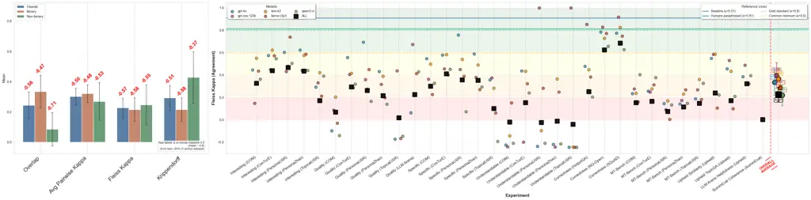
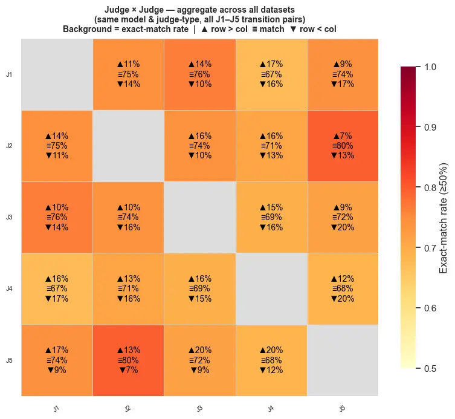
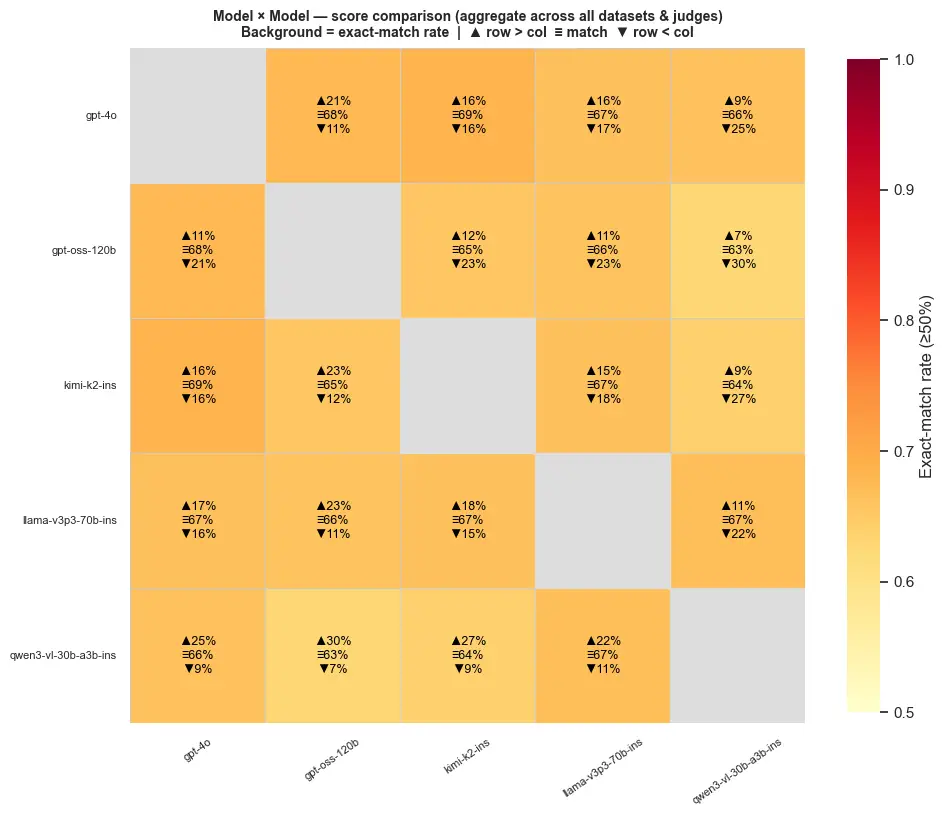
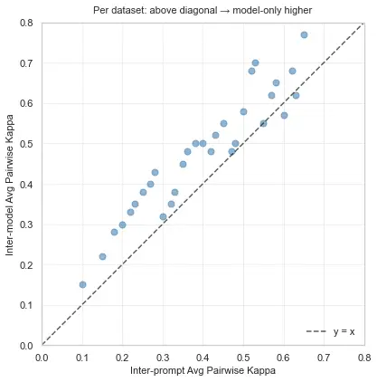
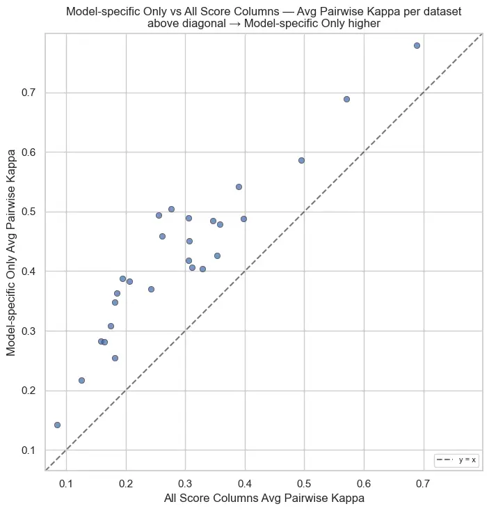
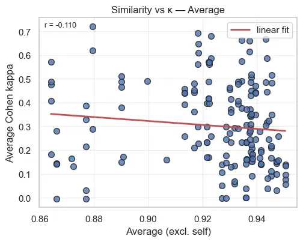
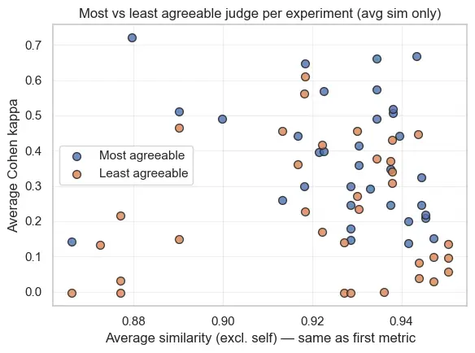
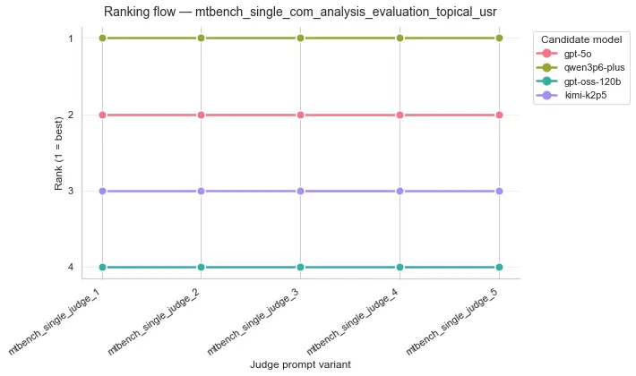
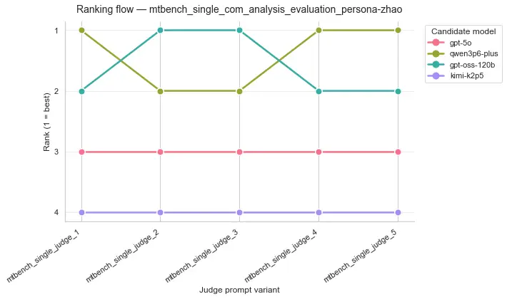
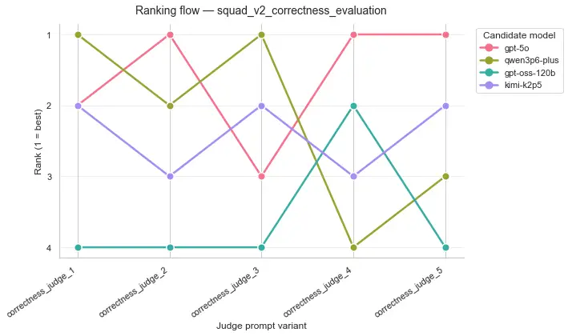

# Prompt Lottery in LLM-as-a-Judge: Measuring and Mitigating Sensitivity to Syntactic Rephrasing

Ilija Subasic    Brett Levert    Andrew Rabinovich    Sajjad
Pakdamansavoji    Zhao Chen Affiliation: Upwork Inc
Email: [firstname.lastname@{cloud.}upwork.com](mailto:)

###### Abstract

LLM-as-a-Judge (LLMaJ) has become a standard paradigm for evaluating
large language models, yet most approaches implicitly assume that a
single judge prompt functions as a stable evaluation instrument. Prior
work has primarily explored deliberate prompt modifications such as
scoring rubrics, role descriptions, or chain-of-thought reasoning. In
contrast, we investigate whether validated prompt variants intended to
preserve evaluation semantics while differing in surface realization
(paraphrastic rephrasings) yield consistent judgments under a fixed
evaluation task. We introduce Prompt Lottery, a phenomenon in which
prompt reformulations intended to preserve semantic content produce
different LLMaJ judgments. Across a large-scale study spanning diverse
evaluation tasks, judge families, and model backbones, we find that
paraphrastic variation can alter evaluation outcomes and, in some
settings, reverse relative model rankings. We conducted a user study and
show that the variability of LLMaJ exceeds both the variability observed
among human annotators in our study and the generally accepted
variability in human-subject studies, raising concerns about the
stability of single-prompt evaluation. Finally, we show that
multi-prompt aggregation substantially improves robustness by
emphasizing judgments that remain consistent across prompt variants.

   

|     |
| --- |
|     |

## 1 Introduction

Since their introduction as a reinforcement learning technique in
Constitutional AI Bai et al. (2022), LLM-as-a-judge (LLMaJ) use has
become central to evaluating Large Language Models. The basic premise is
that given an (LLM-generated) input $`I`$, a set of instructions $`P`$
(prompt), and sometimes a reference answer, a back-model $`M`$ produces
a judgment score as a proxy for the quality of $`I`$. Early work by
Zheng et al. (2023) reported high agreement between human and model
judgments in controlled settings, establishing LLMaJ as a standard
evaluation paradigm across multiple tasks Liu et al. (2023b). Recent
surveys summarize the field along dimensions such as target attributes,
evaluation protocols, human alignment, and bias mitigation Gu et al.
(2024); Gao et al. (2025); Chang et al. (2024). Despite this progress,
most research focuses on how judgments are produced (e.g., scoring
schemes, multi-agent setups, or aggregation strategies), and less
attention has been paid to the initial formulation of the judge prompt,
the core instruction that defines the evaluation behavior regardless of
any optimization or enhancement.

Despite the known sensitivity of LLMs to prompt phrasing Liu et al.
(2023a), current research focuses on optimizing LLMaJ through rubric
refinement, bias mitigation, or multi-agent aggregation Ye et al.
(2024); Chan et al. (2024); Mizrahi et al. (2024); Zhuge et al. (2025)
and not the semantics of the evaluation instructions. We demonstrate
that this foundation may lack empirical grounding. Unlike prior work on
prompt enhancement, which alters task instructions to improve
performance, we isolate variance arising from paraphrastic prompt
variation. We term this the Prompt Lottery: the phenomenon whereby
evaluation outcomes depend on prompt formulation choices that, while
intended to be semantically equivalent, produce systematically different
(though unpredictable to practitioners) judgments.


An LLMaJ’s sensitivity to prompt variation is a strong indicator of
evaluator robustness. If a researcher concludes that a new model
outperforms a baseline using a single prompt, but an equally valid
rephrasing reverses that conclusion, it reveals single-prompt evaluation
to be fragile and misleading. Paraphrastic robustness can be viewed as a
form of evaluation invariance: prompt variants intended to preserve
semantic meaning should yield stable judgments. Violations of this
property suggest that evaluation outcomes may depend partly on prompt
formulation rather than only on the evaluated response. Prior work has
quantified these effects in human annotation and developed strategies to
ensure judgments reflect task semantics rather than syntactic framing
Artstein and Poesio (2008a). These mitigation strategies are grounded in
a core requirement: semantically equivalent instructions should yield
consistent judgments— a requirement we term paraphrastic robustness,
central to principled evaluation. If LLMaJ pipelines are to replace
human evaluators, they must satisfy this same invariance property.

In this paper we answer several questions connected with LLMaJ
robustness to paraphrastic variations based on an array of experiments
over 825 conditions spanning 12 datasets and 6 different judge families.
We first investigate whether agreement between LLMaJ holds when prompts
are changed. We show that LLMaJ evaluators exhibit larger variance than
observed in human annotators, and beyond the generally acceptable level
for human user studies, degrading from near-perfect to fair agreement.
We then ask whether this degradation is important and demonstrate that
it is not inconsequential: it leads to lower alignment with human
judgments and can lead to model rank reversal in more objective tasksß.
This prompts us to investigate how to improve the robustness of LLMaJ
and we introduce an efficient aggregation strategy that restores
reliability while reducing inference costs by 60% compared with naive
aggregation. This selective aggregation approach achieves 86% of full
robustness at more than half of the compute savings ($`\sim 2\times`$
instead of $`5\times`$ increase relative to not aggregating).

## 2 Related Work

Quality human annotation relies on abstracting from surface-level
variations to capture underlying semantic intent. This objective is
rooted in the distinction between linguistic forms and their core
semantic content (Chomsky, 1965), and is enacted through rigorous
annotation protocols designed to maximize inter-coder agreement
(Artstein and Poesio, 2008b; Pavlick and Kwiatkowski, 2019). As human
judgments can be susceptible to the Framing Effect in heuristic
decision-making (Tversky and Kahneman, 1981), controlled evaluations
utilize coding instructions to remove these biases and ensure
reliability (Krippendorff, 2018). If LLMaJ pipelines are to replace
human evaluators, they must satisfy this same invariance property. A
more detailed theoretical analysis of formal semantics and an
exploration of why invariance should or should not hold for LLMs are
provided in Appendix .

LLMaJ emerged as time and resource saving approach, and is now widely
used for both reference-based (ground truth matching) and reference-free
evaluation (free observation) tasks, often employing pairwise ranking or
rubric-based scoring (Zheng et al., 2023; Liu et al., 2023b). Modern
frameworks incorporate agentic reasoning or multi-step pipelines to
approximate human judgment processes (Zhuge et al., 2025). Despite
success, their sensitivity to prompt design raises questions about their
stability as evaluation instruments. Recent surveys structure LLMaJ
research along four axes: (i) target attributes, (ii) evaluation
protocols, (iii) alignment with human judges, and (iv) bias analysis (Gu
et al., 2024; Gao et al., 2025; Chang et al., 2024). While these
emphasize scaling and aggregation strategies, they largely overlook the
effect of initial evaluator prompt formulation. Our work complements
this line by focusing on stability under syntactic variation rather than
optimization under aggregation.

Zheng et al. ((Zheng et al., 2023)) show that targeted prompt
modifications, such as a judge persona, score delimiters, and
chain-of-thought reasoning, improve human alignment and reduce position
and verbosity biases. Beyond this, several works reduce judge bias
through aggregation: model ensembles combine multiple back-models
(Williams et al., 2025), while (Li et al., 2025) generates augmented
instructions and verifies consistency using a single model. Hierarchical
tie-breaking resolves disagreements via a secondary model (Badshah et
al., 2025), and (Zhu et al., 2026) rotates models over a fixed prompt to
cancel systematic biases. (Haldar and Hockenmaier, 2025) have also
identified substantial self-inconsistency in LLM judges across repeated
evaluations, even under fixed prompts. Closest settings to ours are
(Mizrahi et al., 2024) who advocate multi-prompt evaluation using format
perturbations (e.g., quotes, line breaks) on fixed instructions, (Deng
et al., 2026) extend this to rubric scoring with synonym and adversarial
variations, and (Chiang and Lee, 2023) who measure human rating averages
across instructions. In contrast, we examine _paraphrastic variation_,
where semantic equivalence is guaranteed by construction rather than
formatting. While (Bellibatlu et al., 2026) proposed a reliability score
under paraphrastic rephrasings, they only evaluate models relative to
each other and do not assess the system-wide robustness of LLMaJs.

## 3 Experimental Setup

In total we evaluate 33 configurations (12 datasets, 6 judge families)
with 5 backbone models, drawn from both proprietary and open providers,
and 5 prompt variants each, yielding 825 experimental conditions, as not
all judge families apply to every dataset (the summarization judge is
used only for summarization tasks). We evaluate five backbone LLMs:
GPT-4o, GPT-oss-120B, Llama 3.3 (70B Instruct), Kimi-K2.5(-Instruct),
and Qwen3(-VL-30B-A3B-Instruct). For each judge family, we use the
original prompt and four semantically equivalent variations
(Section 3.1), yielding 25 distinct configurations per dataset. (Li et
al., 2026) argue that non-zero temperatures capture fuller evaluative
potential; however, our focus is the model’s capacity for semantic
consistency. We therefore use temperature $`T=10^{-5}`$ to ensure
results reflect core interpretive stability rather than
“wisdom-of-the-crowd” effects, though GPU kernel non-determinism may
remain (He and Lab, 2025).

We utilize judge families grounded in established evaluation frameworks
(Table 3), encompassing G-Eval style multidimensional rubrics (Liu et
al., 2023b) and specialized metrics. These span binary classification
and Likert-scale scoring across objective (Correctness, Groundedness)
and subjective (Dialogue Quality, General Response Quality) axes,
demonstrating the Prompt Lottery’s impact across the wide spectrum of
LLM evaluation. We prioritized datasets with accessible codebases and
prompt templates to ensure fidelity to original conditions and eliminate
confounding from manual reconstruction. The prompts and paraphrastic
variants are provided in Appendix F.

| Judge Family                    | Dimensions                                     | Scoring Task                                                        | Datasets                                                               | References                                                                                                                                       |
| ------------------------------- | ---------------------------------------------- | ------------------------------------------------------------------- | ---------------------------------------------------------------------- | ------------------------------------------------------------------------------------------------------------------------------------------------ |
| Dialogue Quality                | Interesting, Specific, Understandable, Quality | Binary (Yes/No): Presence of quality traits in conversation context | PersonaChat, PersonaUSR, DailyDialog, Topical-Chat, ConTurE            | (Mehri and Eskenazi, 2020b; Zhang et al., 2018; Mehri and Eskenazi, 2020a; Li et al., 2017; Gopalakrishnan et al., 2019; Ghazarian et al., 2022) |
| QA Correctness                  | Correctness                                    | Likert 1–5: Completeness and accuracy vs. ground-truth              | HotpotQA, SQuAD v2, NQ-Open, TopiOCQA, Natural Questions               | (Zheng et al., 2023; Yang et al., 2018; Rajpurkar et al., 2018; Lee et al., 2019; Adlakha et al., 2022; Kwiatkowski et al., 2019)                |
| QA Groundedness                 | Groundedness                                   | Likert 1–5: Faithful inference from evidence                        | HotpotQA, SQuAD v2, NQ-Open, TopiOCQA, Natural Questions               | (Es et al., 2024; Yang et al., 2018; Rajpurkar et al., 2018; Lee et al., 2019; Adlakha et al., 2022; Kwiatkowski et al., 2019)                   |
| General Response Quality        | Helpfulness, Accuracy, Depth                   | Likert 1–10: Holistic assessment of open-ended responses            | LLM-Arena, PersonaChat, PersonaUSR, DailyDialog, Topical-Chat, ConTurE | (Zheng et al., 2023; Zhang et al., 2018; Mehri and Eskenazi, 2020a; Li et al., 2017; Gopalakrishnan et al., 2019; Ghazarian et al., 2022)        |
| Coherence, Consistency, Fluency | Summary Quality                                | Likert 1–5: Summarization quality assessment                        | SummEval                                                               | (Fabbri et al., 2021)                                                                                                                            |
| Semantic Alignment              | Content & Style Equivalence                    | Likert 1–5: Information overlap between reference and prediction    | UPHELD                                                                 | (Subasic et al., 2026)                                                                                                                           |

Table 1: Overview of judge families, evaluation tasks, and datasets.

We examine whether paraphrastic rephrasing induces significant variance
in judgment scores using four metrics: _Overlap_ (rate of identical
judgments), _Average Pairwise Cohen’s $`\kappa`$_, _Fleiss’ $`\kappa`$_,
and _Krippendorff’s_ $`\alpha`$ (agreement across all rephrased
prompts). We report all metrics but focus our analysis on $`\kappa`$
scores for direct comparison with prior work on human judgment under
instruction variation, while also noting high correlation with
Krippendorff’s $`\alpha`$ and Fleiss’ $`\kappa`$.

### 3.1 Paraphrastic Prompt Generation and Validation

We generated four paraphrastic variants using Claude 3 Opus. These were
reviewed by human annotators for preservation of intended task meaning
and verified using Gemini 1.5 Pro for syntax validity. To characterize
the variations qualitatively, we post hoc identified six main,
recurring, but not mutually exclusive dimensions of surface variation,
including role framing, instruction syntax, contextualization, and
output specification (Table 11); a within-family permutation test of
these dimensions against cross-model Cohen’s $`\kappa`$ (50 judge
prompts, 46 experiments, 10,000 permutations per contrast,
Holm-adjusted) found no dimension that consistently produced higher
agreement across models (Appendix B contains full details). First, three
independent LLMs (Kimi-K2.5, Gemini 1.5 Pro, and GPT-4o) evaluated
pairwise prompt similarity, yielding average scores of 81%, 84%, and
79%, respectively. Second, sBERT semantic similarity (Reimers and
Gurevych, 2019) averaged 0.93 across all prompt pairs, exceeding a
commonly used high-similarity threshold of 0.80. In contrast, lexical
overlap remained comparatively low (Jaccard: $`0.38\pm 0.01`$). High
semantic similarity and low lexical overlap suggest that prompt variants
preserved intended evaluation content while differing substantially in
wording, consistent with successful paraphrastic rephrasing.

To strengthen these findings, we conducted a human validation study
focused on task equivalence rather than surface-level similarity. Each
pair of generated prompts (including the original prompt) was shown to
three annotators, who rated whether the two prompts require the same
evaluation task. Annotators consistently judged the prompts to be highly
equivalent, with an average POMP (Cohen et al., 1999) score of 76/100.
Inter-annotator agreement was substantial (Cohen’s $`\kappa=0.78`$;
Krippendorff’s $`\alpha=0.81`$), indicating that this perception of
equivalence was consistent across raters.

### 3.2 Annotator Alignment Study and Expected Agreement Levels

While humans perceive the instruction prompts we created as equivalent
tasks, prior work on annotation guideline rephrasing suggests this may
not guarantee identical annotation behavior (Benikova et al., 2014). To
test this, we conducted a user study in which we recruited 10 annotators
(at a fair market rate) via a freelancer agency. We selected annotators
with high success rates, indicating professionalism and skill. They were
presented with randomized pairs of instructions for scoring answers, the
answers, and context (e.g., conversation so far, or a question). The
instructions were identical to the paraphrased prompt variants.
Annotators provided individual ratings, and we ensured annotators never
rated the same data point with different instructions back-to-back. In
total we collected annotations on 650 data points, and each annotator
sequentially rated examples, with each example annotated by at least
three annotators. Based on these annotations, we calculated agreement
metrics for humans. On average across prompts and datasets, we observed
Overlap, Average Pairwise Cohen’s $`\kappa`$, Fleiss’ $`\kappa`$, and
Krippendorff’s $`\alpha`$ (all normalized to 0–1) of $`0.78`$, $`0.71`$,
$`0.80`$, and $`0.63`$, respectively. Findings from previous work are
consistent with our study: (Benikova et al., 2014) found that
paraphrasing guidelines reduced inter-annotator agreement from
$`\kappa=0.81`$ to $`0.72`$ ($`\Delta\kappa\approx 0.09`$), despite
annotators confirming task equivalence. Similarly, (Wiebe et al., 2005)
documented $`\kappa`$ reductions of $`\approx 0.11`$.

If LLMaJ is to replace and/or improve the performance of human
annotators, a reasonable expectation is that it achieves the same level
of robustness as humans. This sets the first baseline “human robustness”
at $`\kappa=0.80(\Delta 0.07)`$ based on the user study described above.
However, since LLMs exhibit inherent instability due to floating-point
operations, we must establish a stability baseline: what are the
reasonable expectations if we do not change the prompts? To establish
this stability baseline, we conducted five identical runs over 100
samples per model using fixed prompts. Results showed 89.8% overlap,
with Cohen’s $`\kappa=0.86`$ and Fleiss’ $`\kappa=0.89`$, indicating
“almost perfect agreement” (Cohen, 1960). In contrast, the same runs
with $`T=0.7`$ produce lower agreement (Fleiss’ $`\kappa=0.39`$). This
establishes the expected upper bound when the Prompt Lottery is absent
and confirms that subsequent instabilities stem from prompt sensitivity
rather than stochastic artifacts. The final, most permissive baseline is
set at $`\kappa>0.61`$, a generally accepted agreement threshold in
usability studies per (Artstein and Poesio, 2008b; Barth et al., 2017).

## 4 Experiments

We set up experiments to: (1) quantify judge alignment and the existence
of the “Prompt Lottery”, (2) explore its provenance, (3) its impact on
judgment quality, and (4) present mitigation strategies.



Figure 1: On the left bar-chart: agreement metrics demonstrate low
consistency across syntactic variants both across models and prompts. On
the right we show Fleiss’ $`\kappa`$ values and degradation below
baselines across judge families for each model. Table 2 provides
details.

|                                 |              |                 |              |                 |              |                 |              |                 |              |                 |                  |                       |
| ------------------------------- | ------------ | --------------- | ------------ | --------------- | ------------ | --------------- | ------------ | --------------- | ------------ | --------------- | ---------------- | --------------------- |
| Judge Family                    | GPT-4o       |                 | Kimi-K2.5    |                 | Llama 3.3    |                 | Qwen3-VL     |                 | GPT-oss-120B |                 | Model Avg        |                       |
|                                 | $`\kappa`$   | $`\Delta`$      | $`\kappa`$   | $`\Delta`$      | $`\kappa`$   | $`\Delta`$      | $`\kappa`$   | $`\Delta`$      | $`\kappa`$   | $`\Delta`$      | $`\bar{\kappa}`$ | $`\overline{\Delta}`$ |
| Dialogue Quality (Binary)       |              |                 |              |                 |              |                 |              |                 |              |                 |                  |                       |
| Interesting                     | 0.45$`\ast`$ | 0.43            | 0.55$`\ast`$ | 0.32            | 0.44$`\ast`$ | 0.45            | 0.36$`\ast`$ | 0.54            | 0.15$`\ast`$ | 0.74$`\dagger`$ | 0.39$`\ast`$     | 0.50                  |
| Quality                         | 0.31$`\ast`$ | 0.58            | 0.41$`\ast`$ | 0.48            | 0.21$`\ast`$ | 0.68            | 0.19$`\ast`$ | 0.71$`\dagger`$ | 0.16$`\ast`$ | 0.73$`\dagger`$ | 0.26$`\ast`$     | 0.64                  |
| Specific                        | 0.55$`\ast`$ | 0.33            | 0.50$`\ast`$ | 0.38            | 0.23$`\ast`$ | 0.66            | 0.33$`\ast`$ | 0.57            | 0.36$`\ast`$ | 0.53            | 0.39$`\ast`$     | 0.49                  |
| Understandable                  | 0.23$`\ast`$ | 0.65            | 0.15$`\ast`$ | 0.75$`\dagger`$ | 0.35$`\ast`$ | 0.54            | 0.22$`\ast`$ | 0.68            | 0.60         | 0.30            | 0.31$`\ast`$     | 0.58                  |
| QA Evaluation (Likert 1-5)      |              |                 |              |                 |              |                 |              |                 |              |                 |                  |                       |
| Correctness                     | 0.47$`\ast`$ | 0.41            | 0.46$`\ast`$ | 0.42            | 0.38$`\ast`$ | 0.51            | 0.20$`\ast`$ | 0.69            | 0.85         | 0.04            | 0.47$`\ast`$     | 0.41                  |
| Groundedness                    | 0.55$`\ast`$ | 0.33            | 0.90         | 0.01            | 0.57$`\ast`$ | 0.31            | 0.66         | 0.22            | 0.76         | 0.12            | 0.69             | 0.20                  |
| Open-Ended (Likert 1–10)        |              |                 |              |                 |              |                 |              |                 |              |                 |                  |                       |
| MT-Bench                        | 0.26$`*`$    | 0.72$`\dagger`$ | 0.24$`*`$    | 0.74$`\dagger`$ | 0.20$`*`$    | 0.78$`\dagger`$ | 0.42         | 0.56            | 0.28$`*`$    | 0.70$`\dagger`$ | 0.28$`*`$        | 0.70$`\dagger`$       |
| Semantic Alignment (Likert 1–5) |              |                 |              |                 |              |                 |              |                 |              |                 |                  |                       |
| Content                         | 0.54$`*`$    | 0.38            | 0.51$`*`$    | 0.27            | 0.36$`*`$    | 0.62            | 0.23$`*`$    | 0.68$`\dagger`$ | 0.32$`*`$    | 0.56$`\dagger`$ | 0.39$`*`$        | 0.48                  |
| Model Avg                       | 0.42$`\ast`$ | 0.50            | 0.47$`\ast`$ | 0.45$`\ast`$    | 0.34$`\ast`$ | 0.58            | 0.34$`\ast`$ | 0.58            | 0.44$`\ast`$ | 0.49            | 0.40$`\ast`$     | 0.52                  |

Table 2: LLMaJ stability under paraphrastic variation. Fleiss’
$`\kappa`$ values and degradation
($`\Delta\kappa=\kappa_{\text{baseline}}-\kappa_{\text{rephrased}}`$)
across judge families. $`\ast`$ – denotes statistical sig. at $`0.05`$
and $`\dagger`$ at $`0.01`$

### 4.1 Agreement Collapses Under Prompt Variation

We observe that the agreement degrades from near-perfect (stability and
human baseline) to fair ($`\kappa`$: 0.89 $`\rightarrow`$ 0.24), a drop
substantially larger than the 0.09–0.11 degradation we observe in the
human studies (similar to the literature and our study). Differences are
statistically significant at $`p<0.05`$ in aggregate, with 75% of
individual dataset-judge configurations showing significant differences.
This magnitude of sensitivity points to reliability issues in LLMaJ
evaluation setups compared to human annotation protocols. We also
observe that on average all but two cases (NQ-Open Correct and SQuAD
Correct) fall below a generally accepted agreement level for valid
annotation studies ($`\kappa<0.61`$). This holds for all metrics
( Figure 1 right), even the highest average agreement, measured by
Krippendorff’s $`\alpha`$ for non-binary annotations falls well below
both human and theoretical baselines. The agreement is fairly stable,
with a 95% confidence interval half-width of 0.065 on average.

### 4.2 Instability Depends on Task Type and Backbone

The Binary Paradox. Binary tasks show higher raw overlap (0.32 vs. 0.14
for non-binary), suggesting LLMs frequently output identical scores by
chance. However, chance-corrected reliability (Fleiss’ $`\kappa=0.214`$,
$`\alpha=0.217`$) is lower than for non-binary tasks
($`\kappa=\alpha=0.28`$), indicating the output space constraint masks
underlying instability rather than indicating true robustness.

Model-Dependent Sensitivity. While all models exhibit the Prompt
Lottery, magnitude varies. Kimi-K2.5 and GPT-4o exhibited greater
robustness than Qwen3-VL and Llama 3.3, though all models showed
substantial degradation from baseline¹¹ 1 Kimi-K2.5: $`\kappa=0.47`$;
GPT-oss-120B: $`\kappa=0.44`$; GPT-4o: $`\kappa=0.42`$; Llama 3.3:
$`\kappa=0.34`$; Qwen3-VL: $`\kappa=0.33`$. Objective judges (QA
Correctness, Groundedness) show higher robustness ($`\kappa`$=0.47–0.69)
compared to subjective and open-ended judges ($`\kappa`$=0.26–0.39),
suggesting concrete evaluation criteria are inherently more stable under
surface variation.

Newer models. Reasoning-augmented models introduce internal
stochasticity orthogonal to temperature control (tree search, best-of-N
reasoning). This makes temperature-controlled comparison with
direct-scoring models problematic. We show that the Prompt Lottery is a
universal property of LLMaJ evaluation across both older and frontier
models, rather than an artifact of a specific model generation. We
compared GPT-4o and GPT-5.1 scores across identical tasks (5 prompts
each, 3 datasets, 400 examples). Inter-model agreement (Cohen’s
$`\kappa`$) shows a consistent pattern: objective tasks
($`\kappa`$=0.82), dialogue ($`\kappa`$=0.68), summarization
($`\kappa`$=0.25). This suggests that both models struggle equally on
summarization despite architectural differences, and that the bottleneck
is task-inherent difficulty that is not solved by more powerful models.

| Similarity | Pearson $`r`$ | $`p`$ | Spearman $`\rho`$ | $`p`$ |
| ---------- | ------------- | ----- | ----------------- | ----- |
| Average    | $`-0.11`$     | 0.157 | $`-0.15`$         | 0.022 |
| Min        | $`-0.08`$     | 0.25  | $`-0.06`$         | 0.37  |
| Max        | $`0.05`$      | 0.44  | $`-0.07`$         | 0.30  |

Table 3: Correlation between prompts’ $`sBERT`$ Similarity and Cohen’s
Kappa.

| Dataset      | Top-1       | Max/$`p_{1}`$ $`r`$ | Rank  |
| ------------ | ----------- | ------------------- | ----- |
| Upheld       | $`{P_{5}}`$ | 0.44/0.42           | 4 / 5 |
| Topical-Chat | $`P_{4}`$   | 0.49/0.47           | 4 / 5 |
| LLM-Arena    | $`P_{5}`$   | 0.49/0.49           | 3 / 5 |

Table 4: Pearson correlation ($`r`$) between the default ($`p_{1}`$) and
the top-performing prompts.

### 4.3 No Prompt Wins Consistently—It’s a Lottery

If LLMaJ relied primarily on semantic content (rather than surface
form), high semantic similarity should predict high agreement. However,
we observe sBERT similarities of $`0.92-0.95`$ yet agreement
($`\kappa`$) ranges from 0.0 to 0.7, suggesting LLMs are sensitive to
non-semantic surface features. The correlation between semantic
similarity and scoring stability was weak and negative overall
($`r=-0.11,p=0.157`$ Table 3), indicating that increasing semantic
similarity does not improve judgment consistency. This relationship
remained weak and inconsistent even when restricting analysis to the
most- and least-agreeable prompt subsets, suggesting that semantic
similarity is insufficient to explain evaluation stability. Critically,
no single prompt variant consistently outperforms others across
datasets. The top-performing variant differs per task ($`P_{5}`$ on
Upheld, $`P_{4}`$ on Topical-Chat, $`P_{5}`$ on LLM-Arena), and average
absolute correlation differences are minimal
($`\Delta r=0.00\textendash 0.02`$). This absence of a universal “best”
prompt suggests instability does not stem from systematic prompt content
differences (e.g., one being semantically clearer or more complete), but
rather from LLM sensitivity to superficial syntactic variation that is
fundamentally unpredictable across contexts.

If default prompts are well optimized, they should achieve the highest
alignment with human judgments and the observed lack of agreement has no
bearing; the conclusion would be that LLM practitioners have already
optimized the prompts to account for variations. If alternative
paraphrastic variants consistently outperform, this would suggest
sensitivity to prompt formulation, and that there is an element of
chance associated with single prompt LLMaJ setups. To measure this we
followed an established protocol in (Liu et al., 2023b) and calculated
Pearson correlation ($`r`$) between human and paraphrased-prompts
judgments. For datasets for which human annotations are publicly
accessible (Upheld, Topical-Chat, LLM-Arena) the results in Table 4.2
show that the latter is the case. Paraphrastic variations consistently
match or outperform $`P_{1}`$ (default) prompts. While the default
prompt ranked $`3rd-4th`$ across datasets, absolute differences in
correlation were small ($`\Delta r`$ = 0.00-0.02), and only 2 of 3
comparisons reached significance ($`p<0.05`$, uncorrected). Bootstrap
rank CIs for human alignment overlap fully across all five prompts, and
the default prompt is ranked first in only 5–24% of resamples depending
on the human aggregation. The results in Section 4.1 suggest that this
alignment may be an artifact of aggregation. The fact that divergent
individual judgments can produce similar aggregate correlations may
obscure instability in the evaluation process. This may reconcile our
findings with earlier reports of instruction robustness in LLM
evaluation (Chiang and Lee, 2023).

### 4.4 Do Prompts Reverse Model Rankings?

While the Prompt Lottery substantially alters absolute scores, agreement
with humans seems to be largely unaffected, but a critical question is
whether it also reverses _relative model rankings_. This distinction
matters: score variance may reduce confidence in conclusions, but
ranking reversals directly contradict them. To test whether this
instability affects comparative evaluations, we evaluated four inference
models (GPT-4o, gpt-oss-120B, Kimi-K2.5, and Qwen3p6-Plus) under five
paraphrastic prompt variants using a fixed backbone model. All ranking
stability statistics were computed over 100 evaluation samples per task
and averaged across three independent folds to reduce sampling variance
and isolate prompt-induced ranking instability.

Ranking reversals are strongly task-dependent. Objective evaluation
(SQuAD v2 correctness) exhibits severe instability ($`\tau=0.18`$; model
rank positions change in 43.3% of prompt comparisons). For this task
GPT-4o and Qwen3p6-Plus models exchange top rankings across prompt
variants, with GPT-4o ranging from 1st to 3rd and Qwen3p6-Plus from 1st
to 4th. In contrast, subjective dialogue evaluation (MTBench) remains
perfectly stable (0% reversals). Intermediate behavior appears in
SummEval and persona-based dialogue evaluation, where rankings remain
partially stable but top-performing systems still change depending on
prompt wording. The identity of the “best” model thus depends
substantially on prompt formulation.

We visualize how judgments vary when, for the same input $`I`$, either
the back-model or prompt changes.

- •
  $`\Delta`$ $`XX\%`$: fraction where row scores higher than col;
- •
  $`\equiv`$ $`XX\%`$: fraction of exact matches;
- •
  $`\nabla`$ $`XX\%`$: fraction where row scores lower than col;



Figure 2: Prompt-vs-Prompt: Judge-vs-Judge aggregated across all
experimental setups.



Figure 3: Model-vs-Model: Compares models while holding the judge type
and number fixed, aggregated across all datasets.

| Task                   | Mean $`\tau`$ | Top-1 Flips | Flip % |
| ---------------------- | ------------- | ----------- | ------ |
| MTBench (DailyDial.)   | 1.00          | 0/4         | 0.0%   |
| MTBench (Persona)      | 0.80          | 2/4         | 10.0%  |
| QA Correct. (SQuAD v2) | 0.18          | 3/4         | 43.3%  |
| Quality (SummEval)     | 0.64          | 2/4         | 40.0%  |
| G-Eval (Topical-Chat)  | 0.83          | 1/4         | 10.0%  |

Table 5: Ranking stability across paraphrastic prompts. Lower Kendall’s
$`\tau`$ and higher absolute reversal rates indicate stronger Prompt
Lottery effects.

## 5 Mitigating via Aggregation

Prior work has implicitly addressed judge instability via LLMaJ
aggregation (Zhao et al., 2025; Mizrahi et al., 2024). Motivated by
this, we evaluate which aggregation strategy across paraphrastic prompt
variants best aligns with human judgments using the three datasets with
public human annotations. We compare Average, Majority (mode), Plurality
(requiring $`>50\%`$ consensus), and Plurality+Avg. (PA) (using average
when plurality is not reached) using Pearson correlation ($`r`$) with
human scores. Table 5 shows Plurality consistently achieves the
strongest human alignment, improving over both averaging and majority
voting. This points to a possible strategy, often used in human studies,
where data points are discarded if they do not reach a certain threshold
of agreement.



Figure 4: Model vs prompt.



Figure 5: Model vs hybrid.

| Dataset               | Maj.        | Avg.        | Plur.       | PA.         |
| --------------------- | ----------- | ----------- | ----------- | ----------- |
| Upheld                | 0.47        | 0.54        | 0.63        | 0.61        |
| $`\rightarrow`$95% CI | \[.42,.57\] | \[.48,.62\] | \[.52,.69\] | \[.48,.62\] |
| Topical-Chat          | 0.44        | 0.55        | 0.62        | 0.51        |
| $`\rightarrow`$95% CI | \[.36,.48\] | \[.50,.59\] | \[.57,.69\] | \[.43,.53\] |
| LLM-Arena             | 0.44        | 0.54        | 0.55        | 0.52        |
| $`\rightarrow`$95% CI | \[.32,.48\] | \[.47,.57\] | \[.47,.59\] | \[.45,.53\] |

Table 6: Pearson correlation ($`r`$) between human scores and LLMaJ
aggregation strategies ($`p<0.05`$).

### 5.1 Which Source of Aggregation Matters?

Having established that aggregation improves alignment with human
judgments, we next ask which source of diversity contributes most to
these gains. Prior work has largely emphasized model diversity (e.g.,
through ensembles or debate-style systems), while our findings suggest
that prompt variation itself may provide a complementary source of
robustness. To examine this, we compare three aggregation strategies:
(1) Inter-Model (varying models, fixed prompts), (2) Inter-Prompt
(varying prompts, fixed models), and (3) Hybrid (varying both models and
prompts). Figures 5 and 5 show that inter-prompt aggregation achieves
stronger reliability compared to the other two, suggesting that prompt
variation may contribute more strongly to robustness than model
diversity alone. Our aggregation strategies assume the five
paraphrased-prompt judgments are conditionally independent given the
true label. Because all five variants share the same backbone model and
task, this assumption may not hold in practice; dependence-aware
aggregation methods (Balasubramanian et al., 2026) show that
independence-assuming rules can be suboptimal.

### 5.2 Selective Aggregation: Task-Dependent Cost Savings

We analyze when the default prompt aligns with broader consensus. Binary
tasks show high stability and match plurality consensus in 94.7% of
cases, making multi-prompt aggregation marginally useful due to limited
output space. Non-binary tasks exhibit the opposite, and across all
configurations, strict plurality consensus ($`>50\%`$ agreement) emerges
in only 58.73% of cases, indicating that many examples fail to converge
even after evaluating five prompt variants. Moreover, the default prompt
aligns with the plurality decision in only 44.0% of cases, implying that
more than half of single-prompt evaluations disagree with the consensus
whenever prompt variation is considered. These results suggest that
single-prompt evaluation can diverge substantially from aggregated
judgments. Consensus statistics in non-binary tasks suggest many
examples either converge early or fail to converge entirely: 37.68%
reach plurality by the third judge, 21.05% require all five, and 41.27%
never converge. This distribution suggests that substantial inference
cost is spent on examples that either converge early or fail to converge
entirely. We formulate selective aggregation as a binary classification
task: given a prompt and an input evaluated, predict whether the initial
judgment will match the plurality consensus (no aggregation needed,
label=0) or whether additional prompt variants should be evaluated
(label=1). Labels derive from observed plurality outcomes in our
experiments.

We evaluated multiple classifiers for selective aggregation, including
transformer encoders, classical models, and zero-/few-shot LLM
baselines. Architecture selection (Table 5.2) was performed on a smaller
default split, and the selected architecture was then retrained on
$`N=369{,}625`$ samples with hyper-parameters selected via Optuna (Akiba
et al., 2019) over 35 trials, and evaluated on a held-out test set of
$`n=73{,}925`$ samples. Logistic Regression and SVM serve as baselines
to assess whether prompt stability can be captured with lightweight
decision boundaries, while zero-/few-shot LLM variants represent a
potentially more expressive alternative that may capture semantic
signals at higher computational cost. While RoBERTa (Liu et al., 2019)
achieved the highest balanced accuracy, we selected DeBERTa-V3 (He et
al., 2023) because our objective is to maximize true negative rate
(TNR), rather than overall performance. The final classifier achieves
TPR 85.06% and TNR 69.42%, deliberately optimizing in this way as false
positives incur only inference cost, while false negatives corrupt
evaluation quality. To assess generalization, we evaluate on a held-out
dataset with Prometheus judges (Kim et al., 2024) whose prompts were
absent from training. Performance suggests the classifier captures
signals that generalize beyond the training prompts and datasets with
TNR stable at 66.22%. More details on model training are reported in
Appendix E.

| Model           | Bal. acc | TNR   |
| --------------- | -------- | ----- |
| DeBERTa         | 0.836    | 0.854 |
| RoBERTa         | 0.914    | 0.845 |
| Logistic        | 0.862    | 0.751 |
| SVM             | 0.854    | 0.742 |
| Llama zero-shot | 0.489    | 0.042 |
| 5-shot          | 0.451    | 0.322 |

Table 7: Model ablation results on a smaller dataset with prompts not in
the training data.

| Strategy         | $`C`$                 | $`Plu.~\%`$ | Worst-case |
| ---------------- | --------------------- | ----------- | ---------- |
| Single LLMaJ     | 1$`\times`$           | 44%         | –          |
| Task heuristic   | $`\sim`$4.5$`\times`$ | 74%         | 69%        |
| DeBERTa-gate     | $`\sim`$2$`\times`$   | 86%         | 65%        |
| Full aggregation | 5$`\times`$           | 100%        | 79%        |

Table 8: Cost-benefit strategy comparisons. Worst-case scores are those
with no plurality consensus. $`C`$ stands for compute power. $`Plu.~\%`$
is the share of data points with a plurality decision.

In our selective aggregation framework, cost savings occur when stable
instances are correctly identified as negatives, allowing aggregation to
be skipped. False positives unnecessarily trigger additional LLM calls
and reduce efficiency gains. We compare against a task-type heuristic:
always aggregate non-binary tasks (44% instability), never aggregate
binary tasks (94.7% stability). While this strategy is cheaper than full
aggregation for stable tasks, it wastes compute on non-binary instances
and misses unstable binary cases. Our DeBERTa approach provides
instance-level granularity that the heuristic lacks. As shown in
Table 5.2, DeBERTa-gating reduces LLM calls by approximately 60%
compared to naive aggregation ($`2\xrightarrow{}5\times`$ compute) while
recovering 86% of full aggregation decisions. Performance declines to
65% only in difficult no-consensus cases, representing the maximum
observed degradation; typical performance is substantially higher. Full
aggregation achieves 79% even in worst-case settings because all prompt
variants are evaluated directly.

#### 5.2.1 Derivation of LLM Call Reduction Under Selective Aggregation

Step 1: Expected calls under full aggregation. From the empirical
distribution of convergence times reported in Section 5.2, non-binary
tasks require the following number of judge calls to determine the
plurality outcome. Plurality is reached at three judge calls for 37.68%
of cases, at five calls for 21.05%, and 41.27% of cases require more
than five calls to reach plurality.

```math
\bar{t}_{\text{full}}>0.3768\times 3+0.2105\times 5+0.4127\times 5=4.247 \tag{1}
```

Step 2: Expected calls under selective aggregation. The classifier
achieves a TNR of 69.42%. The remaining cases go through the aggregation
pipeline.

```math
\begin{split}\bar{t}_{\text{gated}}=\underbrace{\mathrm{TNR}\times 1}_{\text{single-prompt-cases}}+\underbrace{(1-\mathrm{TNR})\times\bar{t}_{\text{full}}}_{\text{aggregated-cases}}=0.6942+0.3058\times 4.247\approx 1.99\end{split} \tag{2}
```

Step 3: Call reduction. Relative to full aggregation
($`\bar{t}_{\text{full}}=4.247`$):

```math
\Delta_{\text{vs.\ full}}=1-\frac{\bar{t}_{\text{gated}}}{\bar{t}_{\text{full}}}>1-\frac{1.99}{4.247}\approx 53\% \tag{3}
```

Relative to the naïve five-prompt baseline
($`\bar{t}_{\text{naive}}=5.0`$) the $`\Delta_{\text{vs.\ naive}}`$
would be $`\approx 60\%`$.

## 6 Limitations and Final Remarks

We find that LLMaJ outputs are sensitive to paraphrastic prompt
variation, affecting absolute scores and relative model rankings. We
further show that this instability can reverse relative rankings of
evaluated models, particularly in objective QA settings, demonstrating
that prompt choice may alter both absolute and comparative evaluation
conclusions. We show that plurality aggregation improves agreement with
humans compared to single-prompt evaluation. By computing consensus
across semantically equivalent prompts, the plurality metric filters
pragmatic noise from sub-optimal variations. This significantly improves
alignment with human judgments, confirming that LLMaJ reliability is
maximized when multiple equivalent prompts converge. While aggregation
improves robustness, it increases computational cost. Our selective
aggregation approach makes this practical by predicting which judgments
require additional evaluations. Using a DeBERTa classifier to identify
stable instances, we reduce LLM calls from 5 to 1.99 transforming
multi-prompt evaluation into a viable, cost-effective default strategy.

##### Scope and Limitations.

Our findings are limited to paraphrastic variations that preserve
semantic content; we do not test deliberate semantic modifications
(e.g., changing evaluation criteria), which are addressed elsewhere.
Semantic equivalence is validated via sBERT similarity (0.93) and human
task equivalence ($`\kappa=0.78`$) rather than formal logical
entailment. Additionally, our main experiments use five model families,
with limited coverage of reasoning-augmented models; a preliminary
comparison of GPT-4o and GPT-5.1 (400 examples, 3 datasets) suggests
Prompt Lottery persists across architectures. However, the magnitude of
degradation ($`\kappa:0.89\to 0.24`$) substantially exceeds human
variability ($`\Delta\kappa=0.09`$), and findings persist across all
experimental conditions, suggesting Prompt Lottery effects are robust
despite these constraints. Our mitigation strategy is evaluated against
single-prompt (lower bound) and full aggregation (upper bound)
baselines. We do not compare against budget-matched alternatives (e.g.,
single-prompt self-consistency sampling) or orthogonal robustness
techniques (ensembles, debate, instruction tuning), so the gains in
Section 5 may partly reflect repeated judging rather than prompt
diversity per se; this analysis is reserved for future work.

From a theoretical standpoint, these results reveal a departure from
semantic invariance, a foundational principle from formal semantics
predicting that rational judges should produce equivalent outputs for
semantically equivalent inputs. This pragmatic behavior, while
potentially adaptive for dialogue understanding, creates brittleness in
evaluation. Taken together, our findings support the central
methodological message of this paper: evaluation should move beyond the
single-prompt paradigm and toward systematic multi-prompt assessment.
Robustness to prompt formulation is not an optional refinement, but a
prerequisite for trustworthy LLMaJ evaluation and reliable comparative
model ranking. For practitioners, we summarize these findings in
Table 9; for researchers, it means treating prompt sensitivity as a
first-class concern in evaluation methodology, not an afterthought.

| Factor                      | Key Finding                                       |
| --------------------------- | ------------------------------------------------- |
| Backbone model choice       | Largest source of pairwise agreement variance     |
| Prompt rephrasing           | Significant variance despite semantic equivalence |
| Binary evaluation tasks     | High stability, skip aggregation                  |
| Non-binary evaluation tasks | High instability, aggregate                       |
| Plurality aggregation       | Strong robustness improvement                     |
| Selective aggregation       | Major cost reduction ($`\sim 60\%`$)              |

Table 9: Takeaways for robust LLMaJ evaluation.

## References

- \[1\] Y. Bai, S. Kadavath, S. Kundu, A. Askell, J. Kernion, A.
  Jones, A. Chen, A. Goldie, et al. (2022) Constitutional AI:
  harmlessness from ai feedback. External Links: 2212.08073,
  [Link](https://arxiv.org/abs/2212.08073) Cited by: §1.
- \[2\] L. Zheng, W. Chiang, Y. Sheng, S. Zhuang, Z. Wu, Y. Zhuang, Z.
  Lin, Z. Li, D. Li, E. Xing, H. Zhang, J. E. Gonzalez, and I.
  Stoica (2023) Judging llm-as-a-judge with mt-bench and chatbot arena.
  In Advances in Neural Information Processing Systems, Vol. 36,
  pp. 46595–46623. Cited by: §1, §2, §2, Table 1, Table 1.
- \[3\] Y. Liu, D. Iter, Y. Xu, S. Wang, R. Xu, and C. Zhu (2023)
  G-eval: NLG evaluation using gpt-4 with better human alignment. In
  Proceedings of the 2023 Conference on Empirical Methods in Natural
  Language Processing, H. Bouamor, J. Pino, and K. Bali (Eds.),
  Singapore, pp. 2511–2522. External Links:
  [Link](https://aclanthology.org/2023.emnlp-main.153/),
  [Document](https://dx.doi.org/10.18653/v1/2023.emnlp-main.153) Cited
  by: §1, §2, §3, §4.3.
- \[4\] J. Gu, X. Jiang, Z. Shi, H. Tan, X. Zhai, C. Xu, W. Li, Y. Shen,
  et al. (2024) A survey on llm-as-a-judge. The Innovation. External
  Links: [Link](https://arxiv.org/abs/2411.15594) Cited by: §1, §2.
- \[5\] M. Gao, X. Hu, X. Yin, J. Ruan, X. Pu, and X. Wan (2025)
  Llm-based nlg evaluation: current status and challenges. Computational
  Linguistics 51 (2), pp. 661–687. Cited by: §1, §2.
- \[6\] Y. Chang, X. Wang, J. Wang, Y. Wu, L. Yang, K. Zhu, H. Chen, X.
  Yi, C. Wang, Y. Wang, W. Xu, et al. (2024) A survey on evaluation of
  large language models. ACM Transactions on Intelligent Systems and
  Technology 15 (3), pp. 1–45. Cited by: §1, §2.
- \[7\] P. Liu, W. Yuan, J. Fu, Z. Jiang, H. Hayashi, and G.
  Neubig (2023) Pre-train, prompt, and predict: a systematic survey of
  prompting methods in natural language processing. ACM Computing
  Surveys 55 (9), pp. 1–35. External Links:
  [Document](https://dx.doi.org/10.1145/3560815) Cited by: §1.
- \[8\] J. Ye, Y. Wang, Y. Huang, D. Chen, Q. Zhang, N. Moniz, T.
  Gao, W. Geyer, C. Huang, P. Chen, N. V. Chawla, and X. Zhang (2024)
  Justice or prejudice? quantifying biases in llm-as-a-judge. External
  Links: 2410.02736, [Link](https://arxiv.org/abs/2410.02736) Cited by:
  §1.
- \[9\] C. Chan, W. Chen, Y. Su, J. Yu, W. Xue, S. Zhang, J. Fu, and Z.
  Liu (2024) ChatEval: towards better LLM-based evaluators through
  multi-agent debate. In The Twelfth International Conference on
  Learning Representations, External Links:
  [Link](https://openreview.net/forum?id=FQepisCUWu) Cited by: §1.
- \[10\] M. Mizrahi, G. Kaplan, D. Malkin, R. Dror, D. Shahaf, and G.
  Stanovsky (2024) State of what art? a call for multi-prompt LLM
  evaluation. Vol. 12, MIT Press, Cambridge, MA. External Links:
  [Link](https://aclanthology.org/2024.tacl-1.52/),
  [Document](https://dx.doi.org/10.1162/tacl%5Fa%5F00681) Cited by: §1,
  §2, §5.
- \[11\] M. Zhuge, C. Zhao, D. R. Ashley, W. Wang, D. Khizbullin, Y.
  Xiong, Z. Liu, E. Chang, R. Krishnamoorthi, Y. Tian, Y. Shi, V.
  Chandra, and J. Schmidhuber (2025) Agent-as-a-judge: evaluate agents
  with agents. In Proceedings of the 42nd International Conference on
  Machine Learning, A. Singh, M. Fazel, D. Hsu, S. Lacoste-Julien, F.
  Berkenkamp, T. Maharaj, K. Wagstaff, and J. Zhu (Eds.), Proceedings of
  Machine Learning Research, Vol. 267, pp. 80569–80611. External Links:
  [Link](https://proceedings.mlr.press/v267/zhuge25a.html) Cited by: §1,
  §2.
- \[12\] R. Artstein and M. Poesio (2008) Inter-coder agreement for
  computational linguistics. Computational Linguistics 34 (4),
  pp. 555–596. Cited by: §1.
- \[13\] N. Chomsky (1965) Aspects of the theory of syntax. MIT Press,
  Cambridge, MA. Cited by: §2.
- \[14\] R. Artstein and M. Poesio (2008) Survey article: inter-coder
  agreement for computational linguistics. Computational Linguistics 34
  (4), pp. 555–596. External Links:
  [Link](https://aclanthology.org/J08-4004/),
  [Document](https://dx.doi.org/10.1162/coli.07-034-R2) Cited by: §2,
  §3.2.
- \[15\] E. Pavlick and T. Kwiatkowski (2019) Inherent disagreements in
  human textual inferences. Transactions of the Association for
  Computational Linguistics 7, pp. 677–694. External Links:
  [Document](https://dx.doi.org/10.1162/tacl%5Fa%5F00293) Cited by: §2.
- \[16\] A. Tversky and D. Kahneman (1981) The framing of decisions and
  the psychology of choice. Science 211 (4481), pp. 453–458. Cited by:
  §2.
- \[17\] K. Krippendorff (2018) Content analysis: an introduction to its
  methodology. 4th edition, SAGE Publications, Thousand Oaks, CA. Cited
  by: §2.
- \[18\] G. Williams, S. Rutunda, F. Nzabakira, and B. A. Mateen (2025)
  Human evaluators vs. llm-as-a-judge: toward scalable, real-time
  evaluation of genai in global health. medRxiv. External Links:
  [Document](https://dx.doi.org/10.1101/2025.10.27.25338910),
  [Link](https://www.medrxiv.org/content/early/2025/10/28/2025.10.27.25338910),
  https://www.medrxiv.org/content/early/2025/10/28/2025.10.27.25338910.full.pdf
  Cited by: §2.
- \[19\] J. Li, H. Zhang, P. Lin, J. Xiong, and W. Xu (2025) Auto-prompt
  ensemble for llm judge. Cited by: §2.
- \[20\] S. Badshah, M. Moustafa, and H. Sajjad (2025) CLEV: LLM-based
  evaluation through lightweight efficient voting for free-form
  question-answering. In Proceedings of the 14th International Joint
  Conference on Natural Language Processing and the 4th Conference of
  the Asia-Pacific Chapter of the Association for Computational
  Linguistics, K. Inui, S. Sakti, H. Wang, D. F. Wong, P.
  Bhattacharyya, B. Banerjee, A. Ekbal, T. Chakraborty, and D. P. Singh
  (Eds.), Mumbai, India, pp. 1513–1531. External Links:
  [Link](https://aclanthology.org/2025.findings-ijcnlp.93/),
  [Document](https://dx.doi.org/10.18653/v1/2025.findings-ijcnlp.93),
  ISBN 979-8-89176-303-6 Cited by: §2.
- \[21\] Z. Zhu, O. Tieleman, A. Bukhtiyarov, and J. Chen (2026)
  CyclicJudge: mitigating judge bias efficiently in llm-based
  evaluation. External Links: 2603.01865,
  [Link](https://arxiv.org/abs/2603.01865) Cited by: §2.
- \[22\] R. Haldar and J. Hockenmaier (2025) Rating roulette:
  self-inconsistency in llm-as-a-judge frameworks. In EMNLP 2025 - 2025
  Conference on Empirical Methods in Natural Language Processing,
  Findings of EMNLP 2025, C. Christodoulopoulos, T. Chakraborty, C.
  Rose, and V. Peng (Eds.), EMNLP 2025 - 2025 Conference on Empirical
  Methods in Natural Language Processing, Findings of EMNLP 2025,
  pp. 24986–25004 (English (US)). External Links:
  [Document](https://dx.doi.org/10.18653/v1/2025.findings-emnlp.1361)
  Cited by: §2.
- \[23\] H. Deng, C. Farber, J. Lee, and D. Tang (2026)
  Rubric-conditioned llm grading: alignment, uncertainty, and
  robustness. arXiv preprint arXiv:2601.08843. Cited by: §2.
- \[24\] C. Chiang and H. Lee (2023) Can large language models be an
  alternative to human evaluations?. In Proceedings of the 61st Annual
  Meeting of the Association for Computational Linguistics (Volume 1:
  Long Papers), Toronto, Canada, pp. 15607–15631. External Links:
  [Link](https://aclanthology.org/2023.acl-long.870/),
  [Document](https://dx.doi.org/10.18653/v1/2023.acl-long.870) Cited by:
  §2, §4.3.
- \[25\] R. R. Bellibatlu, E. Raff, and W. Zhang (2026) JudgeSense: a
  benchmark for prompt sensitivity in llm-as-a-judge systems. arXiv
  preprint arXiv:2604.23478. Cited by: §2.
- \[26\] L. Li, L. Sleem, Y. Xu, Y. Song, A. Jia, J. Francois, and R.
  State (2026) The necessity of setting temperature in llm-as-a-judge.
  External Links: 2603.28304, [Link](https://arxiv.org/abs/2603.28304)
  Cited by: §3.
- \[27\] H. He and T. M. Lab (2025) Defeating nondeterminism in llm
  inference. External Links:
  [Link](https://thinkingmachines.ai/blog/defeating-nondeterminism-in-llm-inference/),
  [Document](https://dx.doi.org/10.64434/tml.20250910) Cited by: §3.
- \[28\] S. Mehri and M. Eskenazi (2020) USR: an unsupervised and
  reference free evaluation metric for dialog generation. In Proceedings
  of ACL, pp. 681–707. Cited by: Table 1.
- \[29\] S. Zhang, E. Dinan, J. Urbanek, A. Szlam, D. Kiela, and J.
  Weston (2018) Personalizing dialogue agents: i have a dog, do you have
  pets too?. arXiv preprint arXiv:1801.07243. External Links:
  1801.07243, [Link](https://arxiv.org/abs/1801.07243) Cited by: Table
  1, Table 1.
- \[30\] S. Mehri and M. Eskenazi (2020) Unsupervised evaluation of
  interactive dialog with DialoGPT. In Proceedings of the 21th Annual
  Meeting of the Special Interest Group on Discourse and Dialogue, O.
  Pietquin, S. Muresan, V. Chen, C. Kennington, D. Vandyke, N.
  Dethlefs, K. Inoue, E. Ekstedt, and S. Ultes (Eds.), 1st virtual
  meeting, pp. 225–235. External Links:
  [Link](https://aclanthology.org/2020.sigdial-1.28/),
  [Document](https://dx.doi.org/10.18653/v1/2020.sigdial-1.28) Cited by:
  Table 1, Table 1.
- \[31\] Y. Li, H. Su, X. Shen, W. Li, Z. Cao, and S. Niu (2017)
  DailyDialog: a manually labelled multi-turn dialogue dataset. arXiv
  preprint arXiv:1710.03957. External Links: 1710.03957,
  [Link](https://arxiv.org/abs/1710.03957) Cited by: Table 1, Table 1.
- \[32\] K. Gopalakrishnan, B. Hedayatnia, Q. Chen, A. Gottardi, S.
  Kwatra, A. Venkatesh, R. Gabriel, and D. Hakkani-Tür (2019)
  Topical-Chat: Towards Knowledge-Grounded Open-Domain Conversations. In
  Proc. Interspeech 2019, pp. 1891–1895. External Links:
  [Document](https://dx.doi.org/10.21437/Interspeech.2019-3079),
  [Link](http://dx.doi.org/10.21437/Interspeech.2019-3079) Cited by:
  Table 1, Table 1.
- \[33\] S. Ghazarian, B. Hedayatnia, A. Papangelis, Y. Liu, and D.
  Hakkani-Tur (2022) What is wrong with you?: leveraging user sentiment
  for automatic dialog evaluation. External Links: 2203.13927,
  [Link](https://arxiv.org/abs/2203.13927) Cited by: Table 1, Table 1.
- \[34\] Z. Yang, P. Qi, S. Zhang, E. Benson, W. W. Cohen, and R.
  Salakhutdinov (2018) HotpotQA: a dataset for diverse, explainable
  multi-hop question answering. In Proceedings of the 2018 Conference on
  Empirical Methods in Natural Language Processing, Brussels, Belgium.
  External Links: [Link](https://aclanthology.org/D18-1259) Cited by:
  Table 1, Table 1.
- \[35\] P. Rajpurkar, R. Jia, and P. Liang (2018) Know what you don’t
  know: unanswerable questions for SQuAD. In Proceedings of the 56th
  Annual Meeting of the Association for Computational Linguistics
  (Volume 2: Short Papers), Melbourne, Australia. External Links:
  [Link](https://aclanthology.org/P18-2124) Cited by: Table 1, Table 1.
- \[36\] K. Lee, M. Chang, and K. Toutanova (2019) Latent retrieval for
  weakly supervised open domain question answering. In Proceedings of
  the 57th Annual Meeting of the Association for Computational
  Linguistics, Florence, Italy. External Links:
  [Link](https://aclanthology.org/P19-1612) Cited by: Table 1, Table 1.
- \[37\] V. Adlakha, S. Dhuliawala, K. Suleman, H. de Vries, and S.
  Reddy (2022) TopiOCQA: open-domain conversational question answering
  with topic switching. Transactions of the Association for
  Computational Linguistics 10, pp. 468–483. External Links:
  [Document](https://dx.doi.org/10.1162/tacl%5Fa%5F00471) Cited by:
  Table 1, Table 1.
- \[38\] T. Kwiatkowski, J. Palomaki, O. Redfield, M. Collins, A.
  Parikh, C. Alberti, D. Epstein, I. Polosukhin, J. Devlin, K. Lee, K.
  Toutanova, L. Jones, M. Kelcey, M. Chang, A. M. Dai, J. Uszkoreit, Q.
  Le, and S. Petrov (2019) Natural questions: a benchmark for question
  answering research. Transactions of the Association for Computational
  Linguistics 7, pp. 452–466. External Links:
  [Document](https://dx.doi.org/10.1162/tacl%5Fa%5F00276) Cited by:
  Table 1, Table 1.
- \[39\] S. Es, J. James, L. Espinosa-Anke, and S. Schockaert (2024)
  RAGAS: automated evaluation of retrieval augmented generation. In
  Proceedings of EACL (Demonstrations), Cited by: Table 1.
- \[40\] A. R. Fabbri, W. Kryściński, B. McCann, C. Xiong, R. Socher,
  and D. Radev (2021) SummEval: re-evaluating summarization evaluation.
  Transactions of the Association for Computational Linguistics 9,
  pp. 391–409. External Links:
  [Document](https://dx.doi.org/10.1162/tacl%5Fa%5F00373) Cited by:
  Table 1.
- \[41\] I. Subasic, A. Rabinovich, and Z. Chen (2026) Evaluating
  language models in realistic conversational contexts. In Proceedings
  of the 43rd International Conference on Machine Learning (ICML), Cited
  by: Table 1.
- \[42\] N. Reimers and I. Gurevych (2019) Sentence-bert: sentence
  embeddings using siamese bert-networks. arXiv preprint
  arXiv:1908.10084. External Links: 1908.10084,
  [Link](https://arxiv.org/abs/1908.10084) Cited by: §3.1.
- \[43\] P. Cohen, J. Cohen, L. S. Aiken, and S. G. West (1999) The
  problem of units and the circumstance for pomp. Multivariate
  Behavioral Research 34 (3), pp. 315–346. Cited by: §3.1.
- \[44\] D. Benikova, C. Biemann, and M. Reznicek (2014) NoSta-D German
  Named Entity Corpus: Building a German NER Corpus for GermEval 2014.
  In Proceedings of the 9th International Conference on Language
  Resources and Evaluation (LREC’14), pp. 2328–2333. Cited by: §3.2.
- \[45\] J. Wiebe, T. Wilson, and C. Cardie (2005) Annotating
  expressions of opinions and emotions in language. Language resources
  and evaluation 39 (2), pp. 165–210. Cited by: §3.2.
- \[46\] J. Cohen (1960) A coefficient of agreement for nominal scales.
  Educational and Psychological Measurement 20 (1), pp. 37–46. Cited by:
  §3.2.
- \[47\] J. Barth, W. de boer, J. Busse, J. Hoving, S. Kedzia, R.
  Couban, K. Fischer, D. von Allmen, J. Spanjer, and R. Kunz (2017)
  Inter-rater agreement in evaluation of disability: systematic review
  of reproducibility studies. BMJ: British medical journal 356, pp. .
  External Links: [Document](https://dx.doi.org/10.1136/bmj.j14) Cited
  by: §3.2.
- \[48\] J. Zhao, C. Shin, T. Huang, S. S. S. Namburi GNVV, and F.
  Sala (2025) From many voices to one: a statistically principled
  aggregation of llm judges. In NeurIPS 2025 Workshop: Evaluating the
  Evolving LLM Lifecycle: Benchmarks, Emergent Abilities, and Scaling,
  External Links: [Link](https://openreview.net/forum?id=XdcofpTCyq)
  Cited by: §5.
- \[49\] K. Balasubramanian, A. Podkopaev, and S. P.
  Kasiviswanathan (2026) Dependence-aware label aggregation for
  llm-as-a-judge via ising models. arXiv preprint arXiv:2601.22336.
  Cited by: §5.1.
- \[50\] T. Akiba, S. Sano, T. Yanase, T. Ohta, and M. Koyama (2019)
  Optuna: a next-generation hyperparameter optimization framework. In
  Proceedings of the 25th ACM SIGKDD International Conference on
  Knowledge Discovery and Data Mining, Cited by: §5.2.
- \[51\] Y. Liu, M. Ott, N. Goyal, J. Du, M. Joshi, D. Chen, O. Levy, M.
  Lewis, L. Zettlemoyer, and V. Stoyanov (2019) RoBERTa: a robustly
  optimized bert pretraining approach. Cited by: §5.2.
- \[52\] P. He, J. Gao, and W. Chen (2023) DeBERTav3: improving deBERTa
  using ELECTRA-style pre-training with gradient-disentangled embedding
  sharing. In The Eleventh International Conference on Learning
  Representations, External Links:
  [Link](https://openreview.net/forum?id=sE7-XhLxHA) Cited by: §5.2.
- \[53\] S. Kim, J. Shin, J. Jang, S. Longpre, H. Lee, S. Yun, R. Shin,
  et al. (2024) Prometheus: inducing fine-grained evaluation capability
  in language models. In International Conference on Learning
  Representations, Vol. 2024, pp. 29927–29962. Cited by: §5.2.

## Appendix A Mapping of Judge Families to Dataset and Tasks

|              |                                 |         |         |       |
| ------------ | ------------------------------- | ------- | ------- | ----- |
| Dataset      | Judge family (dimension)        | Binary? | Configs | $`n`$ |
| PersonaChat  | DQ — Interesting                | ✓       | 1       | 149   |
|              | DQ — Quality                    | ✓       | 1       | 149   |
|              | DQ — Specific                   | ✓       | 1       | 149   |
|              | DQ — Understandable             | ✓       | 1       | 149   |
|              | GQ — MT-Bench                   |         | 1       | 149   |
| PersonaUSR   | DQ — Interesting                | ✓       | 1       | 60    |
|              | DQ — Quality                    | ✓       | 1       | 60    |
|              | DQ — Specific                   | ✓       | 1       | 60    |
|              | DQ — Understandable             | ✓       | 1       | 60    |
|              | GQ — MT-Bench                   |         | 1       | 60    |
| Topical-Chat | DQ — Interesting                | ✓       | 1       | 60    |
|              | DQ — Quality                    | ✓       | 1       | 60    |
|              | DQ — Specific                   | ✓       | 1       | 60    |
|              | DQ — Understandable             | ✓       | 1       | 60    |
|              | GQ — MT-Bench                   |         | 1       | 60    |
| ConTurE      | DQ — Interesting                | ✓       | 1       | 1,013 |
|              | DQ — Quality                    | ✓       | 1       | 1,013 |
|              | DQ — Specific                   | ✓       | 1       | 1,013 |
|              | DQ — Understandable             | ✓       | 1       | 1,013 |
|              | GQ — MT-Bench                   |         | 1       | 1,013 |
| DailyDialog  | GQ — MT-Bench                   |         | 1       | 100   |
| HotpotQA     | QC — Correctness                |         | 1       | 1,000 |
|              | QG — Groundedness               |         | 1       | 1,000 |
| SQuAD v2     | QC — Correctness                |         | 1       | 1,000 |
|              | QG — Groundedness               |         | 1       | 1,000 |
| NQ-Open      | QC — Correctness                |         | 1       | 1,000 |
|              | QG — Groundedness               |         | 1       | 1,000 |
| SummEval     | Coherence, Consistency, Fluency |         | 3       | 160   |
| Topical QA   | SA — Content                    |         | 1       | 1,000 |
| LLM-arena    | SA — Content                    |         | 1       | 1,000 |
| Upheld       | SA — Content                    |         | 1       | 1,000 |
| 12 datasets  |                                 |         | 33      |       |

Table 10: Overview of the 33 experimental configurations used in this
study. Each configuration pairs a dataset with a judge family and is
evaluated with $`5\times 5=25`$ distinct LLMaJ triples (5 back-models
$`\times`$ 5 prompt variants). _Binary?_ indicates whether the judge
produces a binary (Yes/No) rather than a Likert-scale score.
Judge-family abbreviations—DQ: Dialogue Quality; GQ: General Quality
(MT-Bench style); QC: QA Correctness; QG: QA Groundedness; SA: Semantic
Alignment;

## Appendix B Dimensions of Paraphrastic Variation

After examining paraphrastic variations post hoc across default prompts
from all judge families, we distilled six representative dimensions. The
six paraphrastic dimensions (Appendix B) were identified by post hoc
inspection of the generated variants rather than imposed as generation
constraints. These are shown in Table 11.

| Dimension                       | Description                                        | Examples                                                                               |
| ------------------------------- | -------------------------------------------------- | -------------------------------------------------------------------------------------- |
| 1\. Role Framing                | How the judge’s identity/authority is established. | “You are an expert evaluator” vs. “Act as a judge” vs. “You evaluate”                  |
| 2\. Instruction Syntax          | Imperative vs. declarative vs. modal phrasing.     | “Compare…” vs. “You should compare…” vs. “Your task is to compare…”                    |
| 3\. Criteria Presentation       | How evaluation standards are formatted.            | Bullet list vs. numbered list vs. prose vs. scale labels                               |
| 4\. Output Format Specification | Strictness of format requirements.                 | “strictly following this format” vs. “using exactly:” vs. “in the format:”             |
| 5\. Task Contextualization      | How much context/setup precedes the core task.     | Verbose explanation vs. direct instruction                                             |
| 6\. Linguistic Register         | Formality level and vocabulary choices.            | “assess” vs. “evaluate” vs. “rate” vs. “determine” / “brief” vs. “short” vs. “concise” |

Table 11: Qualitative Analysis of Judge Prompts

Each judge prompt was coded on the six dimensions using GPT-5.0 and
matched to mean pairwise Cohen’s $`\kappa`$ among models scoring the
same items with that prompt (50 prompts, 46 experiments, without
$`G_{15}`$). Feature labels were permuted _within_ each
experiment–family block (10,000 draws per contrast), so the task, items,
and model set stayed fixed; associations were averaged with equal weight
across families and tested with Holm correction over the seven primary
contrasts. Table 12 summarizes the results after residualizing out
whether the prompt included a reference answer (which is not one of the
six dimensions). Role, syntax, criteria layout, length, verb choice, and
brevity all matched the permutation null; their eta-squared values
(0.26–0.48) were comparable to the chance baseline for a random grouping
of five paraphrases (null means 0.26–0.48). Output-format strictness was
the only univariate slope that rejected the null ($`+0.076`$ $`\kappa`$
per step on a four-level code from loose to “strictly following”; Holm
$`p=0.0007`$), but this did not survive as a format effect: the MT-Bench
family written to span those phrases had slope $`+0.005`$, and holding
the other coded features fixed reduced the slope to $`+0.031`$
($`p=0.17`$). Two listed framings (“You evaluate” and “you should
compare”) do not occur in this prompt set. Overall, none of the six
dimensions identifies wording that consistently raises cross-model score
agreement.

| Dimension                       | Estimand                         | Value      | Perm. $`p`$ | Holm $`p`$ | Families |
| ------------------------------- | -------------------------------- | ---------- | ----------- | ---------- | -------- |
| Role framing                    | Mean within-family $`\eta^{2}`$  | 0.34       | 0.34        | 1.00       | 8        |
| Instruction syntax              | Mean within-family $`\eta^{2}`$  | 0.32       | 0.78        | 1.00       | 8        |
| Criteria presentation           | Mean within-family $`\eta^{2}`$  | 0.26       | 0.45        | 1.00       | 7        |
| Output-format strictness        | Slope ($`\kappa`$ per step)      | $`+0.076`$ | $`<0.001`$  | 0.0007     | 4        |
| Task contextualization (length) | Slope ($`\kappa`$ per 100 words) | $`-0.044`$ | 0.63        | 1.00       | 10       |
| Linguistic register (verb)      | Mean within-family $`\eta^{2}`$  | 0.48       | 0.51        | 1.00       | 10       |
| Linguistic register (brevity)   | Mean within-family $`\eta^{2}`$  | 0.42       | 0.77        | 1.00       | 2        |

Table 12: Within-family permutation tests of paraphrastic prompt
dimensions against cross-model Cohen’s $`\kappa`$. Permutation
$`p`$-values are two-sided for slopes and one-sided for eta-squared;
Holm adjustment is over the seven contrasts.

## Appendix C Agreement Across Models and Prompts

These results suggest that LLM evaluators exhibit substantial
sensitivity to paraphrastic reformulations that humans often perceive as
semantically equivalent. If Prompt Lottery effects were absent, we would
expect a relatively uniform distribution of high $`\kappa`$ values
across the x-axis. Instead, substantial variance in $`\kappa`$ despite
nearly identical similarity levels suggests the presence of Prompt
Lottery effects, where prompt variants intended to preserve semantic
equivalence can produce meaningfully different evaluation outcomes.



Figure 6: All cases: Comparison across average judge agreement.



Figure 7: Extreme Cases: Comparison across extreme judge agreement.

## Appendix D Rank reversal experiments

Figures  10, 10, 10 and visualizes ranking trajectories across five
paraphrastic judge prompts using bump charts. Stable evaluations produce
parallel trajectories with no line crossings, while unstable evaluations
show frequent crossings and changes in top-ranked systems.

The strongest Prompt Lottery effects occur in objective QA evaluation
(SQuAD v2 correctness). Here, rankings fluctuate substantially across
semantically equivalent prompts: GPT-4o ranks 1st under some prompts but
drops as low as 3rd under others, while qwen3p6-plus ranges from 1st to
4th place. Multiple reversals occur across prompts, demonstrating that
the identity of the “best” model depends strongly on arbitrary prompt
formulation.

SummEval also exhibits substantial instability, with repeated exchanges
among the top-ranked systems and 40% absolute reversals overall. In
contrast, MTBench (standard dialogue evaluation) remains fully stable:
all ranking trajectories are parallel, no crossings occur, and the same
relative ordering is preserved across all prompt variants.

These visualizations complement the Kendall’s $`\tau`$ statistics
reported in Table 4.4 by illustrating how paraphrastic prompt variation
changes comparative evaluation outcomes. Together, they show that Prompt
Lottery effects are highly task-dependent, affecting objective
evaluation substantially more than subjective dialogue assessment.



Figure 8: Topical MT Analysis.



Figure 9: Persona MT Analysis.



Figure 10: SQuAD 2.0 Ranking.

## Appendix E Experimental setup and hyperparameters

All trainable classifiers predict binary result (whether a judge’s score
falls in the plurality cluster of five judges). The model input is
LLMaJ: the row conversation plus extracted judge rubric
(format_model_input), truncated to 512 tokens (DeBERTa tokenizer) before
sampling. Splits are by unique instance key with no overlap across
train, validation, and test.

##### Data splits (defaults).

Up to 10,000 training rows (imbalanced, reflecting the holdout pool),
2,000 balanced validation rows, and 5,000 balanced test rows.

| Setting                    | Value                                                             |
| -------------------------- | ----------------------------------------------------------------- |
| Input field                | llm_judge (conversation + judge instruction)                      |
| Max. sequence length       | 512 tokens (transformers); Llama uses char limits (below)         |
| Train / val / test sizes   | 10k / 2k / 5k (defaults)                                          |
| Class weights              | Inverse frequency from each model’s training split                |
| DeBERTa train sampling     | Class-balanced from holdout pool                                  |
| Threshold tuning (DeBERTa) | Sweep $`t\in\{0.05,0.10,\ldots,0.95\}`$ on val; metric MCC        |
| Decision rule              | Class 1 iff $`P(y{=}1)\geq t`$ (default $`t{=}0.5`$ unless tuned) |
| Random seed                | 42                                                                |

Table 13: Shared data and evaluation protocol.

##### Logistic regression and SVM.

Features are mean-pooled bertbase embeddings (bert-base-uncased,
embedding batch size 32, max length 512). Logistic regression:
max_iter$`{=}1000`$, class_weight$`{=}`$balanced. SVM: RBF kernel,
probability=True, class_weight$`{=}`$balanced. Neither model is
fine-tuned; both use the imbalanced 10k train split.

##### RoBERTa.

Base model: FacebookAI/roberta-base²² 2
https://huggingface.co/FacebookAI/roberta-base. Fine-tuned for 3 epochs
with learning rate $`2\times 10^{-5}`$, batch size 16, weight decay
0.01, warmup ratio 0.1, max gradient norm 1.0, and class_weight
cross-entropy. Checkpoint selection uses validation MCC each epoch on
the validation split in the current implementation. Precision: bf16 when
supported, else fp16. Input: llm_judge, max length 512.

##### DeBERTa-v3-large + LoRA.

Base model: microsoft/deberta-v3-large. LoRA rank $`r{=}40`$,
$`\alpha{=}160`$, dropout $`{\approx}0.065`$, target modules query_proj,
key_proj, value_proj. Training: 3 epochs, learning rate
$`{\approx}5.25\times 10^{-5}`$, weight decay $`{\approx}0.041`$,
per-device batch size 64, gradient accumulation 8 (effective batch 512),
gradient checkpointing enabled, max gradient norm 0.5, warmup ratio
0.15. Checkpoints selected by MCC on the 2k validation split; threshold
tuned on val (MCC), then metrics reported on the 5k test split.
Precision: bf16/fp16 auto-selected; no 4-bit quantization in this
pipeline.

|                     |              |                        |              |        |
| ------------------- | ------------ | ---------------------- | ------------ | ------ |
| Model               | Train data   | LR                     | Batch (eff.) | Epochs |
| Logistic regression | 10k (imbal.) | —                      | —            | —      |
| SVM (RBF)           | 10k (imbal.) | —                      | —            | —      |
| RoBERTa-base        | 10k (imbal.) | $`2\times 10^{-5}`$    | 16           | 3      |
| DeBERTa + LoRA      | balanced     | $`5.25\times 10^{-5}`$ | 64 (512)     | 3      |
| Llama 3.1 8B        | none (ICL)   | —                      | 64 / 4       | —      |

Table 14: Model-specific hyperparameters (defaults).

### E.1 Optuna optimization

```math
\mathrm{MCC}=\frac{TP\cdot TN-FP\cdot FN}{\sqrt{(TP+FP)(TP+FN)(TN+FP)(TN+FN)}}, \tag{4}
```

where $`TP`$, $`TN`$, $`FP`$, and $`FN`$ denote true positives, true
negatives, false positives, and false negatives, respectively;
$`\mathrm{MCC}\in[-1,1]`$, with $`1`$ indicating perfect agreement.

We tuned DeBERTa-v3-large LoRA hyperparameters with Optuna on a single
NVIDIA A100 80GB GPU, using a multi-objective study (35 trials, 2
training epochs per trial) that maximized validation Matthews
correlation coefficient and balanced accuracy on an 80/20 stratified
holdout split of the training export; gradient accumulation (8 steps),
sequence length (512 tokens), and LoRA target modules (query, key, and
value projections) were held fixed.

| Hyperparameter          | Search      | Range / values                  | Fixed                        |
| ----------------------- | ----------- | ------------------------------- | ---------------------------- |
| Compute                 | –           | –                               | 1$`\times`$ NVIDIA A100 80GB |
| Learning rate           | Log-uniform | $`10^{-5}`$–$`2\times 10^{-4}`$ | –                            |
| LoRA rank ($`r`$)       | Integer     | 8, 16, 24, 32, 40               | –                            |
| LoRA alpha              | Integer     | $`r`$ to $`4r`$ (step $`r`$)    | –                            |
| LoRA dropout            | Uniform     | 0.0–0.15                        | –                            |
| Weight decay            | Uniform     | 0.01–0.1                        | –                            |
| Batch size (per device) | Categorical | 32, 50, 64, 128                 | –                            |
| Warmup ratio            | Uniform     | 0.05–0.20                       | –                            |
| Gradient accumulation   | –           | –                               | 8                            |
| Epochs (per trial)      | –           | –                               | 2                            |
| Max sequence length     | –           | –                               | 512                          |
| Base model              | –           | –                               | DeBERTa-v3-large             |
| LoRA targets            | –           | –                               | Q/K/V projections            |

Table 15: Optuna hyperparameter search space for DeBERTa LoRA.

### E.2 Llama 3.1 8B classifier prompts

Both zero-shot and few-shot use the same system prompt and user-turn
template. Input text is the llm_judge field (conversation plus judge
instruction). Queries are truncated to 3,500 characters; few-shot
examples to 1,200 characters each. The model must output only the
category digit (0 or 1).


## Appendix F LLM Judge Prompt Groups

### Organization and Navigation

This appendix contains 15 groups (G1–G15) of semantically equivalent
judge prompts, organized by evaluation task and dimension. Each group
contains 4–5 prompt variants (P1–P5) designed to be semantically
equivalent while differing substantially in surface realization (role
framing, instruction syntax, output format, etc.; see Table 10 for
dimension taxonomy).

|       |                                           |                  |
| ----- | ----------------------------------------- | ---------------- |
| Group | Task Type                                 | Prompts          |
| G1    | Semantic Alignment (Likert 1–5)           | P1–P5            |
| G2    | QA Correctness (Likert 1–5)               | P1–P5            |
| G3    | QA Groundedness (Likert 1–5)              | P1–P5            |
| G4    | General Quality – User Study (Likert 1–5) | P1–P5            |
| G5    | MT-Bench Quality (Likert 1–10)            | P1–P5            |
| G6    | Dialogue – Relevance (Binary)             | P1–P5            |
| G7    | Dialogue – Interesting (Binary)           | P1–P5            |
| G8    | Dialogue – Understandable (Binary)        | P1–P5            |
| G9    | Dialogue – Specific (Binary)              | P1–P5            |
| G10   | SummEval – Coherence (Likert 1–5)         | P1–P5            |
| G11   | SummEval – Consistency (Likert 1–5)       | P1–P5            |
| G12   | SummEval – Fluency (Likert 1–5)           | P1–P5            |
| G13   | SummEval – Relevance (Likert 1–5)         | P1–P5            |
| G14   | Context-Aware Quality (Likert)            | P1–P4            |
| G15   | Domain-Specific (Likert 1–5)              | P1–P3$`\dagger`$ |

Table 16: Summary of judge prompt groups. Groups G1–G5 cover semantic
alignment, QA, and general response quality. Groups G6–G9 cover
dialogue-specific dimensions. Groups G10–G13 cover summarization
quality. Groups G14–G15 cover context-aware and domain-specific
evaluation. $`\dagger`$G15 is only used for the gated aggregation and
thus not semantic variations.

### Quick Reference by Dimension

By Scoring Granularity:

- •
  Binary (Yes/No): G6, G7, G8, G9, G14 (partial)
- •
  Likert 1–5: G1, G2, G3, G4, G10, G11, G12, G13, G15
- •
  Likert 1–10: G5

By Task Category:

- •
  Reference-based QA: G2, G3
- •
  Semantic alignment: G1
- •
  Dialogue quality: G4, G5, G6, G7, G8, G9
- •
  Summarization: G10, G11, G12, G13
- •
  Context-grounded QA: G14
- •
  Domain-specific: G15

By Paraphrastic Dimensions (see Table 10):

- •
  Role framing variation: All groups (e.g., “expert evaluator” vs
  “judge”)
- •
  Instruction syntax: All groups (imperative vs declarative)
- •
  Output format strictness: G5, G6–G9 (explicit format specifications)
- •
  Task contextualization: G2, G3, G5 (verbose vs direct)
- •
  Linguistic register: All groups (e.g., “assess” vs “evaluate” vs
  “rate”)

### F.1 Prompts

Each subsection corresponds to one group of prompts that were evaluated
together for inter-judge agreement. Within every group the five prompts
share the same scoring task but differ in framing, vocabulary, or
structural layout. Placeholder labels
$`\mathcal{P}_{1}`$–$`\mathcal{P}_{5}`$ identify individual judges
within a group; placeholder group labels
$`\mathcal{G}_{1}`$–$`\mathcal{G}_{15}`$ identify the groups. Template
variables {conversation}, {prediction}, {reference}, and {context} are
filled at inference time.

### $`\mathcal{G}_{1}`$  Alignment Judges

Task: rate (1–5) how much the prediction conveys the same information as
the reference.

##### $`\mathcal{P}_{1}`$

System prompt:


Scoring prompt:


##### $`\mathcal{P}_{2}`$

System prompt:


Scoring prompt:


##### $`\mathcal{P}_{3}`$

System prompt:


Scoring prompt:


##### $`\mathcal{P}_{4}`$

System prompt:


Scoring prompt:


##### $`\mathcal{P}_{5}`$

System prompt:


Scoring prompt:


### $`\mathcal{G}_{2}`$  Correctness Judges

Task: rate (1–5) whether the prediction correctly answers the question
relative to the ground-truth.

##### $`\mathcal{P}_{1}`$

System prompt:


Scoring prompt:


##### $`\mathcal{P}_{2}`$

System prompt:


Scoring prompt:


##### $`\mathcal{P}_{3}`$

System prompt:


Scoring prompt:


##### $`\mathcal{P}_{4}`$

System prompt:


Scoring prompt:


##### $`\mathcal{P}_{5}`$

System prompt:


Scoring prompt:


### $`\mathcal{G}_{3}`$  Groundedness Judges

Task: rate (1–5) whether the prediction is grounded in the provided
evidence.

##### $`\mathcal{P}_{1}`$

System prompt:


Scoring prompt:


##### $`\mathcal{P}_{2}`$

System prompt:


Scoring prompt:


##### $`\mathcal{P}_{3}`$

System prompt:


Scoring prompt:


##### $`\mathcal{P}_{4}`$

System prompt:


Scoring prompt:


##### $`\mathcal{P}_{5}`$

System prompt:


Scoring prompt:


### $`\mathcal{G}_{4}`$  Metrics User Study Judges

Task: rate (1–5) how much the prediction conveys the same information as
the reference (shared system prompt, varied scoring framing).

##### $`\mathcal{P}_{1}`$

System prompt (shared across $`\mathcal{P}_{1}`$–$`\mathcal{P}_{5}`$):


Scoring prompt:


##### $`\mathcal{P}_{2}`$

Scoring prompt:


##### $`\mathcal{P}_{3}`$

Scoring prompt:


##### $`\mathcal{P}_{4}`$

Scoring prompt:


##### $`\mathcal{P}_{5}`$

Scoring prompt:


### $`\mathcal{G}_{5}`$  MT-Bench Single-Response Judges

Task: rate (1–10) overall response quality; varied system prompt
emphasis, identical scoring format.

##### $`\mathcal{P}_{1}`$

System prompt:


Scoring prompt (shared across $`\mathcal{P}_{1}`$–$`\mathcal{P}_{5}`$):


##### $`\mathcal{P}_{2}`$

System prompt:


##### $`\mathcal{P}_{3}`$

System prompt:


##### $`\mathcal{P}_{4}`$

System prompt:


##### $`\mathcal{P}_{5}`$

System prompt:


### $`\mathcal{G}_{6}`$  Relevance Judges (Dialogue)

Task: binary (Yes/No) whether the response is relevant to the
conversation context.

##### $`\mathcal{P}_{1}`$

System prompt:


Scoring prompt:


##### $`\mathcal{P}_{2}`$

System prompt:


Scoring prompt:


##### $`\mathcal{P}_{3}`$

System prompt:


Scoring prompt:


##### $`\mathcal{P}_{4}`$

System prompt:


Scoring prompt:


##### $`\mathcal{P}_{5}`$

System prompt:


Scoring prompt:


### $`\mathcal{G}_{7}`$  Interesting Judges

Task: binary (Yes/No) whether the response is interesting in the
conversation context.

##### $`\mathcal{P}_{1}`$

System prompt:


Scoring prompt:


##### $`\mathcal{P}_{2}`$

System prompt:


Scoring prompt:


##### $`\mathcal{P}_{3}`$

System prompt:


Scoring prompt:


##### $`\mathcal{P}_{4}`$

System prompt:


Scoring prompt:


##### $`\mathcal{P}_{5}`$

System prompt:


Scoring prompt:


### $`\mathcal{G}_{8}`$  Understandable Judges

Task: binary (Yes/No) whether the response is understandable in the
conversation context.

##### $`\mathcal{P}_{1}`$

System prompt:


Scoring prompt:


##### $`\mathcal{P}_{2}`$

System prompt:


Scoring prompt:


##### $`\mathcal{P}_{3}`$

System prompt:


Scoring prompt:


##### $`\mathcal{P}_{4}`$

System prompt:


Scoring prompt:


##### $`\mathcal{P}_{5}`$

System prompt:


Scoring prompt:


### $`\mathcal{G}_{9}`$  Specific Judges

Task: binary (Yes/No) whether the response is specific (rather than
generic) to the conversation context.

##### $`\mathcal{P}_{1}`$

System prompt:


Scoring prompt:


##### $`\mathcal{P}_{2}`$

System prompt:


Scoring prompt:


##### $`\mathcal{P}_{3}`$

System prompt:


Scoring prompt:


##### $`\mathcal{P}_{4}`$

System prompt:


Scoring prompt:


##### $`\mathcal{P}_{5}`$

System prompt:


Scoring prompt:


### $`\mathcal{G}_{10}`$  SummEval Coherence Judges

Task: rate (1–5) the structural coherence and logical flow of a summary.

##### $`\mathcal{P}_{1}`$

System prompt:


Scoring prompt:


##### $`\mathcal{P}_{2}`$

System prompt:


Scoring prompt:


##### $`\mathcal{P}_{3}`$

System prompt:


Scoring prompt:


##### $`\mathcal{P}_{4}`$

System prompt:


Scoring prompt:


##### $`\mathcal{P}_{5}`$

System prompt:


Scoring prompt:


### $`\mathcal{G}_{11}`$  SummEval Consistency Judges

Task: rate (1–5) factual consistency of a summary with the source
document.

##### $`\mathcal{P}_{1}`$

System prompt:


Scoring prompt:


##### $`\mathcal{P}_{2}`$

System prompt:


Scoring prompt:


##### $`\mathcal{P}_{3}`$

System prompt:


Scoring prompt:


##### $`\mathcal{P}_{4}`$

System prompt:


Scoring prompt:


##### $`\mathcal{P}_{5}`$

System prompt:


Scoring prompt:


### $`\mathcal{G}_{12}`$  SummEval Fluency Judges

Task: rate (1–5) the grammatical quality and readability of a summary.

##### $`\mathcal{P}_{1}`$

System prompt:


Scoring prompt:


##### $`\mathcal{P}_{2}`$

System prompt:


Scoring prompt:


##### $`\mathcal{P}_{3}`$

System prompt:


Scoring prompt:


##### $`\mathcal{P}_{4}`$

System prompt:


Scoring prompt:


##### $`\mathcal{P}_{5}`$

System prompt:


Scoring prompt:


### $`\mathcal{G}_{13}`$  SummEval Relevance Judges

Task: rate (1–5) how well the summary selects important content from the
source.

##### $`\mathcal{P}_{1}`$

System prompt:


Scoring prompt:


##### $`\mathcal{P}_{2}`$

System prompt:


Scoring prompt:


##### $`\mathcal{P}_{3}`$

System prompt:


Scoring prompt:


##### $`\mathcal{P}_{4}`$

System prompt:


Scoring prompt:


##### $`\mathcal{P}_{5}`$

System prompt:


Scoring prompt:


### $`\mathcal{G}_{14}`$  Context-Aware Judges

Task: Likert evaluation of whether the answer uses the provided context
appropriately. Note: this group contains four judges
($`\mathcal{P}_{1}`$–$`\mathcal{P}_{4}`$).

##### $`\mathcal{P}_{1}`$

System prompt:


Scoring prompt:


##### $`\mathcal{P}_{2}`$

System prompt:


Scoring prompt:


##### $`\mathcal{P}_{3}`$

System prompt:


Scoring prompt:


##### $`\mathcal{P}_{4}`$

System prompt:


Scoring prompt:


### $`\mathcal{G}_{15}`$  Domain-Specific Judges

Task: rate (1–5) technical accuracy, practical applicability, or
completeness of a domain answer. Note: this group contains three judges
($`\mathcal{P}_{1}`$–$`\mathcal{P}_{3}`$) used for model training not
judge agreement.

##### $`\mathcal{P}_{1}`$

System prompt:


Scoring prompt:


##### $`\mathcal{P}_{2}`$

System prompt:


Scoring prompt:


##### $`\mathcal{P}_{3}`$

System prompt:


Scoring prompt:


