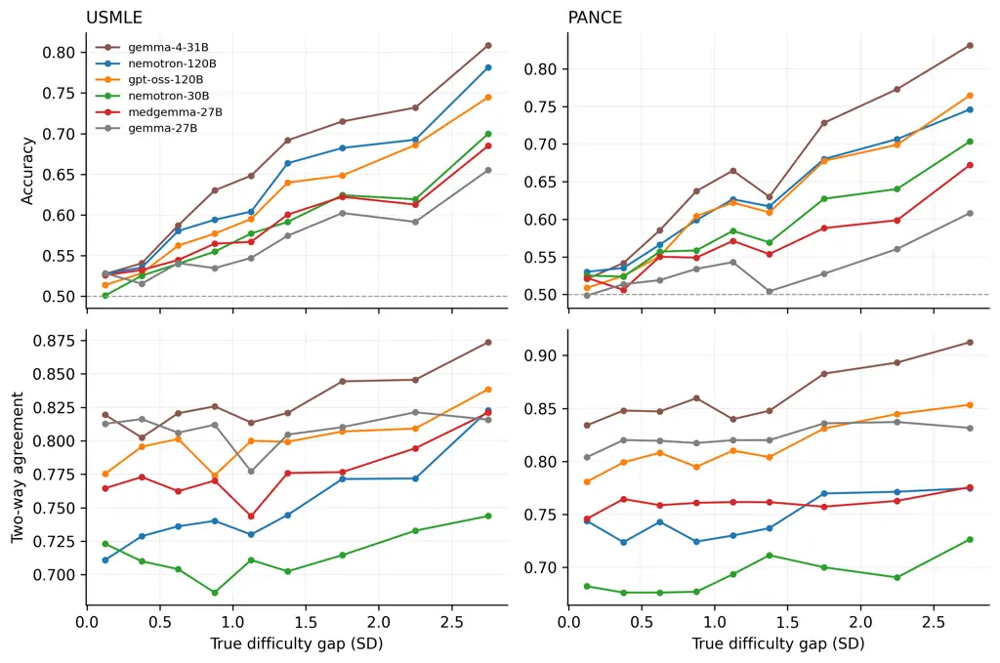

# LLMs as Judges and Examinees for Medical Item Difficulty Prediction

Xiaomeng Xiong Email: <xiaomengxiong@ufl.edu> Affiliation: University of
Florida, Gainesville, FL, USA    Marcus Walker Affiliation: National
Commission on Certification of Physician Assistants, USA    Yanlin Jiang
Affiliation: National Commission on Certification of Physician
Assistants, USA

###### Abstract

Predicting medical item difficulty from item text alone remains
challenging. Prior work has largely relied on linguistic features or
text representations derived from general-purpose and domain-specific
language models, but predictive performance has remained modest. This
study takes a different approach by using difficulty-related signals
that emerge when open-weight large language models (LLMs) interact with
test items. Using USMLE and PANCE medical licensure examination items,
we examined LLMs in two roles. As judges, the models provided absolute
difficulty ratings and pairwise difficulty comparisons. As simulated
examinees, they generated response-based signals including correctness,
keyed-option probability, response entropy, and the probability margin
between the top two options. We then combined the strongest judgment and
response signals with baseline item features in downstream prediction
models. Pairwise difficulty judgment was the most consistent individual
LLM signal across both datasets and outperformed absolute ratings, and
adding simulated-examinee signals yielded only small further gains. The
best configurations reached a Spearman correlation of $`\rho=.447`$ on
USMLE, exceeding the best system in the 2024 BEA shared task
($`\rho=.25`$), and $`\rho=.494`$ on PANCE. These results were
comparable to direct absolute judgments from the proprietary frontier
model Claude Opus 5 ($`\rho=.443`$ and $`.488`$, respectively). Overall,
judgment and response signals from open-weight LLMs captured
difficulty-related information beyond text representations. Because
these models can be deployed locally, the approach offers a practical
option for predicting the difficulty of unreleased or high-security test
items.

###### keywords

item difficulty prediction, large language models, LLM-as-a-judge,
simulated examinees, pairwise comparison, Bradley–Terry model

### 1 Introduction

In educational measurement, item difficulty is fundamental to practices
such as test assembly, equating, item bank maintenance, and computerized
adaptive testing (CAT). Traditionally, the difficulty of newly developed
items is estimated through pretesting using examinee response data.
However, pretesting often requires substantial time and resources and
depends on collecting a sufficient number of examinee responses. In
high-stakes testing, it can also increase the risk of exposing
unreleased items (AlKhuzaey et al., (2024); Maeda, (2025)). Estimating
the difficulty of new items before historical response data become
available therefore remains an important practical challenge. Even
imperfect difficulty predictions may have practical value. Within an
item response theory framework, auxiliary information about items can be
incorporated into parameter estimation to improve the precision and
stability of item calibration when examinee response data are limited
(Mislevy, (1988)). Such information can also supplement or even replace
examinee response data when linking new test forms to an established
scale (Mislevy et al., (1993)).

In recent years, researchers have attempted to predict the difficulty of
medical examination items directly from item text, but performance has
remained limited. In the BEA 2024 shared task on medical item difficulty
prediction, the best system achieved a Spearman correlation of .25, a
Pearson correlation of .27, and an RMSE of .299 (Gombert et al., (2024);
Yaneva et al., (2024)). Ha et al. ((2019)) used a dataset nearly 18
times larger, containing 12,038 USMLE items, yet their full-feature
model reached only $`r=.32`$.

One major line of work in this area has focused on learning
difficulty-related representations from item text. Approaches have
included word embeddings and linguistic features (Ha et al., (2019)),
general-purpose embedding models (Venkata Ravi Ram et al., (2024);
Yousefpoori-Naeim et al., (2024)), end-to-end fine-tuned Transformer
models (Felice & Karaoz, (2024); Gombert et al., (2024); Li et al.,
(2025); Rodrigo et al., (2024)), and language models pretrained on
medical corpora (Bulut et al., (2024); Fulari & Rusert, (2024); Tack et
al., (2024)). Despite their technical differences, these approaches
share a common modeling strategy. They learn a representation from item
text and then map that representation to empirical item difficulty. This
line of work implicitly assumes that a sufficiently informative text
representation can capture information related to item difficulty.

However, the difficulty of a medical examination item is not simply a
function of its linguistic complexity or the medical content it covers.
High-stakes medical examinations typically follow strict item-writing
guidelines that discourage unnecessary material, overly complex stems
and options, misleading information, and linguistic cues that may reveal
the correct answer (Ha et al., (2019)). These practices improve item
quality, but they also reduce surface-level linguistic variation that
might otherwise serve as a proxy for difficulty. At the same time, items
covering similar medical topics or semantic content may still differ
substantially in empirical difficulty. Further improvements in text
representation alone may therefore have limited returns. This motivates
the central idea of the present study: Rather than relying on
representations extracted from item text and mapping them directly to
difficulty, can more informative difficulty-related signals emerge when
large language models interact with items through judgment or actual
response behavior?

We examine this question from two complementary perspectives. First, in
the LLM-as-a-judge role, models directly evaluate the absolute
difficulty of an item or compare the relative difficulty of two items.
Second, in the LLM-as-an-examinee role, models answer the items and
provide difficulty-related signals through their responses and option
probability distributions. The former reflects how a model evaluates
item difficulty, whereas the latter reflects how the model behaves and
how uncertain it is when attempting to solve the item. These two sources
may capture different aspects of difficulty.

We systematically examine difficulty signals generated through LLM-item
interactions using two independent medical licensure examination
datasets, USMLE and PANCE. Six open-weight models are used as difficulty
judges to produce both absolute ratings and pairwise judgments. Pairwise
judgments are aggregated into a common relative difficulty scale using a
sparse comparison graph and the Bradley-Terry model. Thirteen
open-weight models are also used as simulated examinees, from which we
extract four response-based measures: correctness, keyed-option
probability, response entropy, and the probability margin between the
top two options. Finally, judgment-based signals, response-based
signals, and baseline item features are combined in downstream
prediction models to evaluate their incremental and complementary value.

The results show that pairwise judgment is the most consistent
individual LLM difficulty signal across the two datasets. Adding
simulated-examinee signals to pairwise judgments yields small further
gains in both datasets, although these gains are within sampling
uncertainty. The best configuration achieves a Spearman correlation of
$`\rho=.447`$ on USMLE, exceeding the approximately .25 reported for the
best BEA 2024 shared-task system using the same official data split. On
PANCE, the best configuration reaches $`\rho=.494`$. The combined
signals from open-weight models were also comparable to direct absolute
difficulty judgments from the frontier commercial model Claude Opus 5 on
both datasets. This has particular practical relevance for high-stakes
testing. Unreleased or highly secure examination items are often subject
to strict security and data governance requirements, making it
potentially infeasible to send item content to external commercial APIs.
Locally deployable open-weight models therefore offer particular
practical value in this setting.

The study addresses the following research questions:

RQ1. When large language models serve as item difficulty judges, how
does judgment quality vary across models and judgment formats, including
absolute judgment and pairwise comparison? For pairwise comparisons, how
do true difficulty gaps and comparison density further affect judgment
performance?

RQ2. When large language models serve as simulated examinees, which
models and response-derived signals provide the most informative
indicators of item difficulty?

RQ3. To what extent do judgment-based and response-based signals provide
complementary information for predicting item difficulty across two
medical licensure examination datasets?

### 2 Related Work

#### 2.1 Medical Item Difficulty Prediction

The first public benchmark for medical item difficulty prediction came
from the shared task organized by NBME at the BEA workshop in 2024
(Yaneva et al., (2024)). Before this, because exam data is difficult to
share, work in this area remained fragmented across individual
institutions, with no transparent evaluation on a public dataset and no
meaningful basis for comparing approaches. The task released 667 retired
USMLE clinical items and asked participants to predict item difficulty
(proportion correct) from item text and metadata alone. The winner
(Gombert et al., (2024)) ranked first among the 43 difficulty
submissions made by 17 teams (RMSE = 0.299, $`r=.27`$, $`\rho`$ = .25),
yet improved only slightly over a dummy regressor predicting the mean
(RMSE = 0.311, ranked 16 out of 43).

Gombert et al. ((2024)) attributed part of the difficulty of this task
to the small dataset and the highly specialized domain. However, Ha et
al. ((2019)) worked with nearly 18 times as many items (12,038 USMLE
Clinical Knowledge MCQs) to predict difficulty (proportion correct), and
their full-feature model still reached only $`r=.32`$. They drew on
three classes of features: embeddings (Word2Vec and ELMo), 113
linguistic features, and information retrieval features that quantified
how difficult an item was for an automatic question-answering system
retrieving over MEDLINE. The highest correlation between any individual
feature and difficulty was only about .11, and surface complexity in
particular failed. The mechanistic explanation offered by Ha et al.
((2019)) is important, and it is a matter of design rather than
accident. These USMLE items were written by experienced item writers
following a common set of guidelines, which required avoiding verbosity,
“window dressing” (extraneous material not needed to answer the item),
“red herrings” (information designed to mislead the test-taker), overly
long or complicated stems and options, and various grammatical cues
(correct answers that are longer, more specific, or more complete than
the other options, or the inclusion of the same word or phrase in both
the stem and the correct answer). The authors acknowledge that this
practice, while sensible, makes modeling difficulty very challenging.

In other words, we have reason to hypothesize that, in medical items,
item-writing guidelines deliberately minimize the surface-level
variation that might otherwise serve as a proxy for difficulty. As a
result, the items are designed to differ primarily in their textual
content. We further hypothesize that the semantic content of an item is
not equivalent to the difficulty of that content. Much of the work
conducted both during and after the shared task has followed the same
general approach: using representation learning to extract the semantics
of the item text and attempting to map those semantic representations
directly onto item difficulty. This includes end-to-end fine-tuned
transformer encoders (Gombert et al., (2024); Rodrigo et al., (2024);
Felice & Karaoz, (2024)) and decoders (Li et al., (2025)), semantic
vectors extracted with general-purpose embedding models (Venkata Ravi
Ram et al., (2024); Yousefpoori-Naeim et al., (2024)), and models
pre-trained on medical corpora such as Bio_ClinicalBERT, BiomedBERT, and
PubMedBERT (Tack et al., (2024); Bulut et al., (2024); Fulari & Rusert,
(2024)). The assumption behind this line of work is that difficulty is
encoded in the item text in some deeper semantic form, and that a
sufficiently good representation will read it out. But the official
summary (Yaneva et al., (2024)) reports that even the best solution
outperformed the baseline (predicting the mean) by only a small margin.
Medical domain adaptation performed worse. In a same-architecture
comparison, the winning team found that BiomedBERT and BiomedELECTRA
fell short of both their general-purpose counterparts and the dummy
baseline (Gombert et al., (2024)). These results suggest that stronger
domain-specific semantic representations alone may not be sufficient to
recover empirical item difficulty.

Therefore, these findings suggest that further improvements in textual
representation alone may be insufficient. Representation learning can
capture rich semantic and linguistic information from item text, but
these representations do not necessarily isolate the aspects that
determine empirical difficulty. Surface-level variation is constrained
by standardized item-writing practices, while items with similar medical
content can still differ substantially in difficulty. Thus, richer text
representations may still leave important difficulty-related variation
unexplained.

The limited performance of text representations does not imply that LLMs
cannot provide useful information about item difficulty.
Difficulty-related information may emerge from how LLMs interact with
exam items, beyond what can be captured by text-based representations
alone. These signals can come from two complementary perspectives. An
LLM can serve as a judge with broad medical knowledge, comparing the
relative difficulty of different items. It can also serve as a simulated
examinee, with its response performance indicating how difficult an item
is for an artificial agent. We treat these two sources of information as
complementary proxies for difficulty and examine whether they can
capture difficulty-related information that is missed by text
representations alone.

#### 2.2 LLM Pairwise Comparison

Pairwise comparison has a long history in psychological and educational
measurement, dating back to Thurstone’s law of comparative judgment
(Thurstone, (1927)). In educational assessment, comparative judgment has
been used to evaluate student work by asking judges to compare pairs of
responses and aggregating these judgments into a common scale (Pollitt,
(2012)). More recently, LLMs have been used to make pairwise judgments
across a range of tasks.

Qin et al. ((2024)) reframed information retrieval ranking as a pairwise
decision task, asking an LLM to determine which of two candidate
documents is more relevant to a query. Their Pairwise Ranking Prompting
approach, based on moderately sized open-source LLMs, outperformed
supervised ranking baselines across seven BEIR benchmarks and achieved
average gains of more than 10% over pointwise LLM approaches on standard
ranking metrics.

A similar pattern has been observed in difficulty prediction. Raina &
Gales ((2024)) compared supervised task-transfer methods, LLM-based
absolute difficulty estimation, and LLM comparative prompting on 658
reading-comprehension MCQs. Zero-shot pairwise comparisons with
ChatGPT-3.5 achieved a Spearman correlation of .404, substantially
higher than the .183 obtained from absolute difficulty judgments with
the same model and slightly higher than the .387 achieved by a
supervised level-classification model trained on 100,388 RACE++
questions. These results suggest that, when direct item-to-score mapping
is limited, reformulating the task as a relative judgment offers an
alternative way to improve difficulty ranking.

For aggregating local pairwise judgments into a global ranking, Qin et
al. ((2024)) and Raina & Gales ((2024)) mainly relied on win-based
aggregation or sorting procedures. Liusie et al. ((2024)) compared
win-ratio aggregation with the Bradley-Terry model. The two approaches
performed almost identically when all comparisons were available, but
Bradley-Terry showed small and consistent gains across multiple LLM
judges when only a subset of pairs was observed. Unlike simple win
counting, the Bradley-Terry model represents comparison outcomes through
the relative latent scores of the two items and jointly estimates those
scores from all observed pairwise comparisons (Bradley & Terry, (1952)).
For a difficulty prediction task with hundreds of items, exhaustive
pairwise comparison requires $`O(N^{2})`$ comparisons and quickly
becomes expensive. A sparse comparison design combined with
Bradley-Terry aggregation therefore offers a more scalable way to
recover a common latent difficulty scale from a limited set of pairwise
judgments.

#### 2.3 LLM Simulated Examinees

Whereas pairwise comparison uses LLMs to judge item difficulty, a
complementary approach treats LLMs as simulated examinees and derives
difficulty-related signals from their response behavior. One line of
work prompts the same LLM to simulate examinees at different grade or
proficiency levels (Benedetto et al., (2024); Srivatsa et al., (2025);
Acquaye et al., (2026); Li et al., (2026)). However, this type of
proficiency simulation is sensitive to the model and prompt design, and
the simulated ability levels do not always correspond reliably to the
target student populations. Srivatsa et al. ((2025)) found that
grade-enforcement prompting can change model performance, but some
models fail to preserve the expected pattern of higher ability at higher
grade levels. Li et al. ((2026)) reported a similar pattern across more
than 20 LLMs. Even when models were explicitly instructed to simulate
low-, average-, and high-proficiency examinees, their actual
problem-solving performance did not consistently reflect these intended
ability differences. High-capability models were particularly unable to
suppress their existing knowledge and problem-solving ability.

To avoid relying on a single model to simulate multiple ability roles,
another line of work uses heterogeneous response patterns produced by
different LLMs. Park et al. ((2024)) used LLMs from different model
families, scales, and training backgrounds to construct synthetic
examinee groups at different ability levels and estimated item
difficulty from their zero-shot responses. On a database course question
dataset, the estimated difficulty had a Pearson correlation of .348 with
IRT difficulty derived from real student responses. Other studies have
generated difficulty-related performance signals by changing the
conditions under which the model answers questions. Dueñas et al.
((2024)) progressively removed information from item stems and varied
the sampling temperature of ChatGPT-3.5, then used model performance
under these conditions as features for difficulty prediction. The best
single feature had an absolute Spearman correlation of about .29 with
observed difficulty, and the final system ranked second in the BEA 2024
NBME shared task.

Overall, these studies suggest that LLM response behavior can provide
useful performance-based signals for item difficulty prediction.
However, it remains unclear whether these performance-based signals
provide incremental information beyond judgment-based difficulty
estimates, or whether the two types of signals largely overlap.

### 3 Method

Prior work suggests that surface-level linguistic variation in medical
examination items is constrained by standardized item-writing practices,
while semantic content alone does not necessarily correspond to item
difficulty. Consequently, directly mapping semantic representations of
item text onto empirical difficulty may not fully leverage the medical
knowledge encoded in large language models. Motivated by this
limitation, we explore difficulty-related signals that emerge from
interactions between LLMs and medical test items.

We consider two types of LLM-derived difficulty signals: judgment-based
signals (LLM-as-a-judge), obtained through absolute ratings and pairwise
comparisons, and response-based signals (LLM-as-an-examinee), obtained
from models’ direct responses to the items. We then examine variation
across models, elicitation methods, response readouts, and
pairwise-comparison density, and evaluate whether combining the two
signal types improves difficulty prediction.

Our primary analyses focus on open-weight models that can be deployed
within an institution’s own computing environment. As an external
performance reference, we additionally obtain a single absolute
difficulty rating from Claude Opus 5 for each test item in both
datasets, providing a comparison with a frontier commercial model.
Claude Opus 5 was accessed through the Anthropic API.

#### 3.1 Datasets

Two datasets were used: the NCCPA PANCE dataset and the publicly
released BEA 2024 shared-task dataset from NBME (Yaneva et al., (2024)).
All analyses were conducted independently for the two datasets.

NCCPA PANCE. The dataset contained 528 PANCE items. Item difficulty was
represented by the b parameter estimated under a Rasch model, with
higher values indicating greater difficulty. Each item included a
question stem, response options, and the correct answer. The median stem
length was 420 characters. Thirty-five items (6.6%) contained an image,
indicated by an \ tag in the item text. This indicator served as
the image feature in the baseline model. The data were split into
training and test sets using a 70/30 stratified random split, yielding
370 training items and 158 test items.

BEA 2024 (NBME). The dataset contained 667 retired USMLE clinical items
and used the official split of 466 training items and 201 test items.
Difficulty was defined as a linear transformation of the proportion of
examinees answering the item correctly, with higher values indicating
greater difficulty. Each item included a question stem, response
options, the correct answer, item type (text only / image-containing),
and examination Step (Step 1/2/3). The median stem length was 696
characters. Seventy items (10.5%) contained images.

#### 3.2 LLM-as-a-judge

Judgment-based difficulty signals were generated using the six
open-weight models listed in Table 1, selected to span differences in
model size, model family, and domain-specific pretraining. Each model
produced two types of difficulty judgments. All open-weight models were
accessed through a university-hosted inference platform, and no item
content was sent to external services. Decoding used a temperature of 0
where supported and default settings otherwise.

| Model                      | Parameters            | Architecture | Developer  | Role            |
| -------------------------- | --------------------- | ------------ | ---------- | --------------- |
| nemotron-3-super-120b-a12b | 120.6B / 12.7B active | Hybrid MoE   | NVIDIA     | Judge, examinee |
| nemotron-3-nano-30b-a3b    | 31.6B / 3.6B active   | Hybrid MoE   | NVIDIA     | Judge, examinee |
| gpt-oss-120b               | 117B / 5.1B active    | MoE          | OpenAI     | Judge, examinee |
| gemma-4-31b-it             | 30.7B                 | Dense        | Google     | Judge, examinee |
| medgemma-27b-it            | 27B                   | Dense        | Google     | Judge, examinee |
| gemma-3-27b-it             | 27B                   | Dense        | Google     | Judge, examinee |
| gpt-oss-20b                | 21B / 3.6B active     | MoE          | OpenAI     | Examinee        |
| llama-3.3-70b-instruct     | 70B                   | Dense        | Meta       | Examinee        |
| llama-3.1-70b-instruct     | 70B                   | Dense        | Meta       | Examinee        |
| llama-3.1-8b-instruct      | 8B                    | Dense        | Meta       | Examinee        |
| mistral-small-3.1          | 24B                   | Dense        | Mistral AI | Examinee        |
| mistral-7b-instruct        | 7B                    | Dense        | Mistral AI | Examinee        |
| granite-3.3-8b-instruct    | 8B                    | Dense        | IBM        | Examinee        |

Table 1: Open-Weight LLMs Used as Difficulty Judges and Simulated
Examinees

For absolute judgments, models were asked to estimate each item’s
difficulty percentile on a 0–100 scale, with higher values indicating
greater difficulty. Each item was evaluated once in a zero-shot setting,
without anchor items of known empirical difficulty.

For pairwise judgments, models were asked to identify which of two items
would be more difficult for the target examinee population. All models
used the same comparison graph. Each item participated in at least 40
pairwise comparisons (40–43; mean = 40.5). Opponents were assigned by a
degree-balancing procedure that repeatedly paired an item with the
least-compared eligible candidate, with ties broken at random and
without using empirical difficulty information. No item pair was
repeated. Each pair was evaluated twice with the presentation order
reversed. Consistent judgments were recorded as wins or losses, and
inconsistent judgments were assigned equal weights of 0.5 to both items.
This procedure yielded 13,520 unique item pairs for USMLE and 10,680 for
PANCE.

Pairwise outcomes were then aggregated using a Bradley–Terry model with
L2 regularization ($`\lambda=0.001`$) to obtain a continuous relative
difficulty score for each item. Within each dataset, training and test
items were jointly calibrated on the same comparison graph so that all
items were placed on a common latent difficulty scale. Because no
empirical difficulty labels enter the Bradley–Terry fit, joint
calibration does not use outcome information from test items. This
approach is consistent with an operational scenario in which newly
developed items are compared against items in an existing item bank. To
examine the effect of comparison density, we additionally constructed
lower-density subgraphs from the full comparison graph and refit the
Bradley–Terry model at different values of $`k`$, allowing us to
evaluate how predictive performance changed as the number of comparisons
per item decreased. Full prompts for all tasks are provided in
Appendix 8.

#### 3.3 LLM-as-an-examinee

Response-based difficulty signals were obtained by having the models
directly answer the multiple-choice items and extracting
difficulty-related features from their response distributions. We
included 13 candidate examinee models, six of which overlapped with the
judge models. The remaining models broadened coverage across model
sizes, families, and capability levels, as shown in Table 1.

Option probabilities were derived from the log probabilities of the
answer-option letters and normalized across the available options.
Non-reasoning models generated a single token, with probabilities
extracted from that position. Reasoning models were allowed up to 512
tokens and instructed to end with “Answer: X”, and probabilities were
extracted from the position following “Answer:”.

Four response readouts were derived from the same model call. Binary
correctness indicated whether the highest-probability option matched the
keyed answer. Keyed-option probability was the normalized probability
assigned to the correct option. Entropy summarized uncertainty across
the option probability distribution, with larger values indicating a
more diffuse distribution. Margin was defined as the probability
difference between the highest- and second-highest-probability options,
providing a measure of response confidence.

#### 3.4 Feature Selection and Model Development

We first selected the strongest-performing source within each type of
LLM-derived signal using the training set:

- •
  LLM pairwise judgment (P): Among the six pairwise LLM judges, we
  retained the model with the strongest individual performance on the
  training set.
- •
  LLM absolute judgment (A): Among the six absolute-rating LLM judges,
  we retained the model with the strongest individual performance on the
  training set.
- •
  LLM examinee readouts (S): For each of the four response readouts
  (keyed-option probability, binary correctness, entropy, and margin),
  we selected the model with the strongest training-set performance, so
  the four readouts in S could come from different examinee models.

The selected LLM-derived signals were combined with baseline item
features ($`B`$; stem length, option length, number of options, image
indicator, and, for USMLE only, exam step) and entered into three
downstream prediction models: ridge regression, random forest, and
XGBoost. Within each feature configuration, the prediction model and its
hyperparameters were selected jointly on the training set by five-fold
cross-validation repeated five times, using the mean cross-validated
Spearman correlation as the criterion (candidate settings are listed in
Table A3). Predictors were standardized using training-set means and
standard deviations. The selected model was then refit on the full
training set and evaluated once on the held-out test set. We compared
eight prespecified configurations (see Table 2) to examine the
incremental contribution and complementarity of the different
LLM-derived signal sources, and report all eight rather than selecting a
single winning configuration. Uncertainty in test-set Spearman
correlations was quantified with 95% percentile bootstrap confidence
intervals based on 2,000 resamples of test items. Differences between
key configurations, and between the best configuration and Claude Opus
5, were evaluated by paired bootstrap resampling of test items (2,000
resamples), with both correlations computed on each resample.

| Configuration | Included Features                                                                         |
| ------------- | ----------------------------------------------------------------------------------------- |
| $`B`$         | Baseline item features                                                                    |
| $`B+P`$       | Baseline features + selected LLM pairwise judgment                                        |
| $`B+A`$       | Baseline features + selected LLM absolute judgment                                        |
| $`B+S`$       | Baseline features + four selected LLM examinee readouts                                   |
| $`B+P+A`$     | Baseline features + LLM pairwise judgment + LLM absolute judgment                         |
| $`B+P+S`$     | Baseline features + LLM pairwise judgment + LLM examinee readouts                         |
| $`B+A+S`$     | Baseline features + LLM absolute judgment + LLM examinee readouts                         |
| $`B+P+A+S`$   | Baseline features + LLM pairwise judgment + LLM absolute judgment + LLM examinee readouts |

Table 2: Feature Configurations Evaluated in the Downstream Prediction
Models

### 4 Results

#### 4.1 LLM-as-a-judge

Pairwise difficulty judgment accuracy did not increase monotonically
with nominal model size (Table 3). Gemma 4 31B achieved the highest
pairwise accuracy on both USMLE and PANCE, outperforming the two models
with nominal parameter counts of 120B. This pattern also highlights that
total parameter count is not a directly comparable measure of model size
across architectures.

|                            | USMLE                   |                        |             |     | PANCE                   |                        |             |
| -------------------------- | ----------------------- | ---------------------- | ----------- | --- | ----------------------- | ---------------------- | ----------- |
| Model                      | Acc$`{}_{\text{cons}}`$ | Acc$`{}_{\text{all}}`$ | Consistency |     | Acc$`{}_{\text{cons}}`$ | Acc$`{}_{\text{all}}`$ | Consistency |
| gemma-4-31b-it             | .668                    | .639                   | 82.6        |     | .668                    | .645                   | 86.1        |
| nemotron-3-super-120b-a12b | .656                    | .617                   | 74.7        |     | .653                    | .614                   | 74.5        |
| gpt-oss-120b               | .624                    | .599                   | 79.8        |     | .633                    | .608                   | 81.2        |
| nemotron-3-nano-30b-a3b    | .603                    | .573                   | 71.3        |     | .618                    | .581                   | 69.1        |
| medgemma-27b-it            | .599                    | .577                   | 77.5        |     | .582                    | .562                   | 76.0        |
| gemma-3-27b-it             | .574                    | .560                   | 80.9        |     | .537                    | .531                   | 82.2        |

Table 3: Pairwise Judgment Accuracy of the Six Judge
Models⁰⁰footnotetext: Note. $`\mathrm{Acc}_{\text{cons}}`$ is accuracy
on pairs with consistent judgments across both presentation orders.
$`\mathrm{Acc}_{\text{all}}`$ includes all pairs, with inconsistent
judgments scored as 0.5. Consistency is the percentage of pairs with
agreement across presentation orders.

Gemma 4 also differs from Gemma 3 in more than parameter count. It
represents a newer generation of the Gemma family with a greater
emphasis on reasoning, including configurable thinking capabilities and
changes to its attention architecture. The strong performance of Gemma 4
in this study may therefore reflect broader improvements in model
architecture and reasoning capabilities rather than simply an increase
from 27B to approximately 31B parameters.

Domain adaptation may also matter. At the same 27B parameter scale,
MedGemma consistently outperformed Gemma 3 across both datasets,
suggesting that adaptation to the medical domain may further support
judgments of medical item difficulty.

Order consistency likewise did not show a simple relationship with
either model size or judgment accuracy. Gemma 4 combined the highest
pairwise accuracy with the highest consistency on PANCE and relatively
high consistency on USMLE. At the same time, Gemma 3 remained highly
consistent despite substantially lower accuracy. These results suggest
that a model may make the same judgment reliably across presentation
orders without that judgment necessarily being correct.

Figure 1: Pairwise Judgment Accuracy (Top) and Two-Way Agreement
(Bottom) as a Function of the Empirical Difficulty Gap

As shown in Figure 1, pairwise judgment accuracy generally increased as
the true difficulty gap between the two items became larger. Gemma 4 31B
achieved the highest or near-highest accuracy across almost all
difficulty-gap intervals and showed a clear increase with larger gaps on
both datasets, exceeding .80 in the largest gap interval. The two 120B
models also showed relatively clear upward trends. In contrast, the
remaining smaller models generally benefited from larger difficulty gaps
but showed more local fluctuations across the intermediate intervals.
Gemma 3 27B showed the weakest improvement, particularly on PANCE, where
its accuracy remained close to chance at moderate difficulty gaps.
Greater separation in true item difficulty primarily made it easier for
models to identify which item was harder, but did not necessarily make
their judgments more stable to changes in presentation order. Two-way
agreement did not show a similar systematic increase and appeared to
reflect model-specific stability more than sensitivity to the magnitude
of the difficulty difference.

As the number of pairwise comparisons per item ($`k`$) increased, the
correlation between Bradley–Terry difficulty scores and empirical item
difficulty generally improved (Table 4), but the gains showed clear
diminishing returns. Using the correlation at $`k=40`$ as the
full-density reference, most models reached approximately 95% of this
performance with only 10 to 15 comparisons per item.

Increasing the number of comparisons also did not compensate for weaker
judgment quality. This pattern was most apparent for Gemma 3 27B. On
USMLE, its correlation increased only from .158 at $`k=5`$ to .174 at
$`k=40`$, while on PANCE it remained nearly unchanged at approximately
.06 across comparison densities.

|               |                              |      |      |      |      |      |      |      |
| ------------- | ---------------------------- | ---- | ---- | ---- | ---- | ---- | ---- | ---- |
|               | Comparisons per item ($`k`$) |      |      |      |      |      |      |      |
| Judge         | 5                            | 10   | 15   | 20   | 25   | 30   | 35   | 40   |
| USMLE         |                              |      |      |      |      |      |      |      |
| gemma-4-31B   | .384                         | .412 | .419 | .420 | .422 | .423 | .422 | .424 |
| nemotron-120B | .349                         | .377 | .390 | .389 | .392 | .394 | .395 | .396 |
| gpt-oss-120B  | .297                         | .328 | .330 | .338 | .337 | .341 | .341 | .342 |
| nemotron-30B  | .245                         | .282 | .280 | .288 | .291 | .293 | .292 | .294 |
| medgemma-27B  | .210                         | .222 | .226 | .230 | .229 | .232 | .231 | .232 |
| gemma-27B     | .158                         | .172 | .173 | .171 | .173 | .173 | .173 | .174 |
| PANCE         |                              |      |      |      |      |      |      |      |
| gemma-4-31B   | .402                         | .428 | .433 | .437 | .438 | .437 | .438 | .439 |
| nemotron-120B | .296                         | .332 | .339 | .346 | .347 | .346 | .347 | .348 |
| gpt-oss-120B  | .269                         | .303 | .315 | .315 | .319 | .319 | .319 | .318 |
| nemotron-30B  | .213                         | .230 | .245 | .244 | .244 | .248 | .245 | .246 |
| medgemma-27B  | .124                         | .143 | .153 | .150 | .156 | .160 | .157 | .158 |
| gemma-27B     | .056                         | .056 | .066 | .061 | .063 | .063 | .062 | .062 |

Table 4: Spearman Correlations Between Bradley–Terry Scores and
Empirical Difficulty Across Comparison Densities⁰⁰footnotetext: Note.
For each $`k`$, comparison graphs were randomly subsampled to at most
$`k`$ comparisons per item, and Bradley–Terry scores were recalculated.
Values are mean correlations over 20 repetitions on the training set.

As shown in Table 5, the relative ordering of the models was broadly
consistent across absolute and pairwise judgment. This suggests that the
models’ underlying ability to judge item difficulty was relatively
stable across elicitation formats. However, pairwise comparison produced
stronger difficulty signals overall. The best training-set Spearman
correlations from pairwise judgment were .424 on USMLE and .439 on
PANCE, compared with .349 and .411 for absolute judgment.

|                            | USMLE    |          |     | PANCE    |          |
| -------------------------- | -------- | -------- | --- | -------- | -------- |
| Model                      | Absolute | Pairwise |     | Absolute | Pairwise |
| gemma-4-31b-it             | .349     | .424     |     | .411     | .439     |
| nemotron-3-super-120b-a12b | .263     | .396     |     | .249     | .348     |
| gpt-oss-120b               | .288     | .342     |     | .226     | .318     |
| nemotron-3-nano-30b-a3b    | .239     | .294     |     | .176     | .246     |
| medgemma-27b-it            | .134     | .232     |     | .131     | .158     |
| gemma-3-27b-it             | .077     | .174     |     | .154     | .062     |

Table 5: Training-Set Spearman Correlations for Absolute and Pairwise
Judgments⁰⁰footnotetext: Note. Absolute judgments are 0–100 difficulty
ratings; pairwise judgments are Bradley–Terry scores obtained at
$`k=40`$. Boldface indicates the highest correlation in each column.

#### 4.2 LLM-as-an-examinee

The pattern was different for LLM-as-an-examinee. The most informative
response-based signals did not always come from the largest models (see
Table A1 in the Appendix). On USMLE, Mistral Small 3.1 24B provided the
strongest keyed-option probability, entropy, and margin signals, with
correlations ranging from .287 to .327, while Nemotron 3 Nano 30B had
the highest correlation for binary correctness ($`\rho=.270`$). On
PANCE, Llama 3.1 70B provided all three continuous readouts, each with a
correlation above .380, whereas binary correctness was strongest for
Granite 3.3 8B ($`\rho=.269`$).

Across both datasets, the three probability-based readouts showed higher
correlations with empirical item difficulty than binary correctness.
Keyed-option probability had the highest correlation on PANCE
($`\rho=.386`$) and tied with margin on USMLE ($`\rho=.327`$).
Differences among the three continuous readouts were relatively small,
particularly on PANCE, where their correlations ranged from .384 to
.386.

#### 4.3 Combining LLM-Derived Signals for Difficulty Prediction

Table A2 summarizes the best-performing signal from each source
described above. For pairwise judgment, absolute judgment, and each
examinee readout, the model with the largest absolute training-set
Spearman correlation with empirical item difficulty was selected for
subsequent combination analyses.

Across the eight feature configurations (Table 6), LLM pairwise judgment
($`P`$) was the most consistent individual LLM-derived signal across
both datasets. Adding $`P`$ to the baseline features increased the
Spearman correlation from .228 to .425 on USMLE and from .100 to .450 on
PANCE. The surface-feature baseline on USMLE already approached the best
performance reported in the 2024 BEA shared task ($`\rho=.25`$). LLM
examinee readouts ($`S`$) also improved prediction. The contribution of
absolute judgments ($`A`$) varied across datasets.

| Dataset | Configuration             | Model | Spearman $`\rho`$ | 95% CI              | Pearson $`r`$ | RMSE  |
| ------- | ------------------------- | ----- | ----------------- | ------------------- | ------------- | ----- |
| USMLE   | B                         | Ridge | .228              | \[.086, .361\]      | .274          | .299  |
|         | B+P                       | Ridge | .425              | \[.301, .533\]      | .417          | .283  |
|         | B+A                       | Ridge | .357              | \[.225, .479\]      | .381          | .288  |
|         | B+S                       | Ridge | .379              | \[.250, .496\]      | .382          | .287  |
|         | B+P+A                     | Ridge | .419              | \[.292, .531\]      | .423          | .281  |
|         | B+P+S                     | Ridge | .447              | \[.329, .551\]      | .441          | .280  |
|         | B+A+S                     | Ridge | .411              | \[.289, .523\]      | .427          | .281  |
|         | B+P+A+S                   | Ridge | .436              | \[.313, .547\]      | .443          | .278  |
|         | Claude Opus 5 (reference) | —     | .443              | —                   | .397          | —     |
| PANCE   | B                         | RF    | .100              | \[$`-`$.062, .245\] | .093          | 1.159 |
|         | B+P                       | Ridge | .450              | \[.316, .568\]      | .484          | 1.018 |
|         | B+A                       | RF    | .424              | \[.279, .553\]      | .411          | 1.058 |
|         | B+S                       | RF    | .403              | \[.261, .537\]      | .418          | 1.055 |
|         | B+P+A                     | Ridge | .455              | \[.318, .580\]      | .469          | 1.026 |
|         | B+P+S                     | Ridge | .480              | \[.354, .593\]      | .500          | 1.006 |
|         | B+A+S                     | Ridge | .479              | \[.341, .597\]      | .414          | 1.056 |
|         | B+P+A+S                   | Ridge | .494              | \[.366, .607\]      | .492          | 1.011 |
|         | Claude Opus 5 (reference) | —     | .488              | —                   | .399          | —     |

Table 6: Test-Set Performance Across the Eight Feature
Configurations⁰⁰footnotetext: Note. $`B`$, $`P`$, $`A`$, and $`S`$
denote baseline features, LLM pairwise judgment, LLM absolute judgment,
and LLM examinee readouts, respectively. Model = prediction model
selected by training-set cross-validation within each configuration; RF
= random forest. 95% CI = percentile bootstrap confidence interval for
the test-set Spearman correlation (2,000 resamples of test items). RMSE
is not directly comparable across datasets.

Combining signal types produced small additional gains in rank-order
performance. On USMLE, B+P+S achieved the highest Spearman correlation
($`\rho=.447`$), compared with .425 for B+P and .379 for B+S. Adding
absolute judgment did not further improve rank-order performance,
although the full B+P+A+S configuration achieved the highest Pearson
correlation ($`r=.443`$) and the lowest RMSE (.278). On PANCE, B+P+S
increased the Spearman correlation from .450 to .480 and B+P+A+S reached
.494, whereas B+P+S achieved the highest Pearson correlation
($`r=.500`$) and the lowest RMSE (1.006). These gains were small
relative to sampling uncertainty. In paired bootstrap comparisons, the
gain of B+P+S over B+P was $`\Delta\rho=.022`$, 95% CI \[$`-`$.026,
.071\], on USMLE and $`\Delta\rho=.030`$, 95% CI \[$`-`$.015, .077\], on
PANCE, and the gain of B+P+A+S over B+P on PANCE was
$`\Delta\rho=.044`$, 95% CI \[$`-`$.008, .099\]. The gains were in the
same direction in both datasets, but none of these intervals excluded
zero. The best-performing configurations across both datasets used ridge
regression.

On USMLE, the best results exceeded those reported for the winning
system in the 2024 BEA NBME shared task ($`\rho=.25`$, $`r=.27`$, RMSE =
.299). The highest Spearman correlations were also comparable to those
of Claude Opus 5 on both USMLE (.447 vs. .443; $`\Delta\rho=.004`$, 95%
CI \[$`-`$.102, .112\]) and PANCE (.494 vs. .488; $`\Delta\rho=.005`$,
95% CI \[$`-`$.072, .087\]). Overall, signals from open-weight LLMs, led
by pairwise judgment, substantially improved difficulty prediction over
baseline item features and achieved ranking performance comparable to
direct judgments from a strong commercial model. The possibility of
local deployment may make this approach particularly useful for
unreleased or high-security test items.

### 5 Discussion

The main findings support a central idea of this study: signals that
emerge from how LLMs interact with items can provide substantively
useful information about item difficulty. Pairwise judgment was the most
stable single LLM-derived difficulty signal across both datasets, while
simulated-examinee signals also showed meaningful associations with
empirical item difficulty. Adding simulated-examinee signals to pairwise
judgments improved difficulty ranking on both USMLE and PANCE, but the
gains were small and their confidence intervals included zero. The
consistent direction across two independent datasets suggests that
judgment-based and response-based signals may carry partly distinct
information, but larger test sets will be needed to establish this. The
results also substantially exceeded those of prior medical item
difficulty prediction approaches that relied primarily on text
representations. More broadly, when the target attribute cannot be read
directly from the text itself, signals generated through model judgment
and response behavior may offer a more promising source of predictive
information than further improvements in text representation alone.

Pairwise comparisons generally produced stronger difficulty signals than
absolute ratings, consistent with findings from the broader literature
on LLM-based ranking. Qin et al. ((2024)) argued that the advantage of
pairwise comparison comes not only from avoiding the need to calibrate
absolute scores, but also from reducing a more complex global judgment
task to a simpler local relative decision. This issue may be especially
important in the present setting because absolute difficulty ratings
must also be calibrated to a particular target examinee population. The
prompts of the present study provided only minimal information about
that population, such as “USMLE examinees” or “PANCE examinees,” without
specifying ability levels, knowledge backgrounds, or anchor items with
known empirical difficulty. Models may therefore lack the information
needed to align their absolute judgments precisely with the difficulty
scale of the actual examinee population. By contrast, pairwise
comparison requires only a local relative judgment and is therefore less
dependent on absolute scale calibration.

The comparison-density results further showed that pairwise judgment did
not require a very large number of comparisons to produce a stable
difficulty signal. For most models, approximately 10 to 15 comparisons
per item were sufficient to reach about 95% of the external predictive
performance observed at $`k=40`$. This range is similar to previous
studies. Verhavert et al. ((2019)), in a meta-analysis of 49 comparative
judgment studies, found that approximately 10 to 14 comparisons per
object were sufficient to achieve a scale separation reliability of
about .70. Kinnear et al. ((2025)) reanalyzed 101 comparative judgment
datasets from multiple disciplines and concluded that about 10
comparisons per object are generally sufficient. These criteria are not
directly equivalent to the one used in the present study. Prior
comparative judgment research has primarily focused on the reliability
and stability of the resulting scale, whereas the present study
evaluates the correlation between Bradley-Terry difficulty scores and
empirical difficulty from real examinees. Still, both lines of evidence
suggest rapidly diminishing returns once a moderate comparison density
has been reached. At the same time, the present results show that
increasing the number of comparisons cannot compensate for weak
underlying judgment quality. In practice, it may therefore be more
important to first select a model with adequate judgment quality and
then determine the minimum comparison density needed for stable
performance.

Results across judge models also showed that nominal parameter count was
not a simple predictor of performance on the difficulty judgment task.
Gemma 4 outperformed models with larger nominal parameter counts on both
datasets, but this result should not be interpreted simply as evidence
that smaller models outperform larger ones. Gemma 4 is a dense model,
meaning that most of its approximately 31B parameters participate in
each forward pass. In contrast, Nemotron 3 Super and GPT-OSS 120B use
mixture-of-experts architectures, in which each token is routed to only
a subset of experts. As a result, the number of parameters activated
during a forward pass is much smaller than the total parameter count, at
approximately 12.7B for Nemotron 3 Super and 5.1B for GPT-OSS 120B. At
the same time, active parameter counts in mixture-of-experts models
should not be directly compared with the total parameter counts of dense
models, because the full set of experts still contributes to the overall
capacity of the model. The marked difference between Gemma 4 and Gemma
3, together with the advantage of MedGemma over Gemma 3, suggests that
model generation, training procedures, architecture, and domain
adaptation may all contribute to performance on this task.

The simulated-examinee results showed a different pattern. The most
informative response signals did not always come from the most capable
models or those with the largest parameter counts. This finding is
consistent with Acquaye et al. ((2026)), who found in a study of
simulated students for mathematics difficulty prediction that models
with relatively weaker mathematical ability reproduced real student item
performance more successfully than models with higher baseline accuracy.
They suggested that highly capable models may be too proficient at
solving the questions to reproduce realistic student error patterns. In
the present study, a model that answers nearly all items correctly may
similarly provide too little response variation to distinguish among
items of different difficulty. At the other extreme, a model with
insufficient task ability may produce more errors, but those errors may
not correspond systematically to the difficulty ordering observed among
real examinees. The most informative simulated examinee may therefore
need both sufficient task competence and enough item-level response
variation for its behavior to reflect differences in difficulty.

Although the observed correlations are insufficient to justify replacing
traditional pretesting, LLM-derived difficulty estimates may serve as
collateral information for item calibration when examinee response data
are limited (Mislevy, (1988)). They may also support item bank
management by flagging items predicted to be unusually easy or difficult
for further review before administration.

### 6 Limitations

The study used the same relatively simple prompt across models within
each task to reduce variation introduced by researcher-driven prompt
optimization. However, identical prompts do not imply identical
processing within different model systems. Commercial models may include
system-level instructions or other forms of input processing that are
not observable to researchers, while open-weight models typically
provide more direct control over the inputs they receive. Future
research could manipulate prompt detail directly to test whether richer
descriptions of the target examinee population, examples, or
model-specific prompt optimization alter the relative ordering of
models.

The test sets were relatively small (the USMLE split was fixed by the
shared task to allow direct comparison with prior results), so
differences of a few hundredths between configurations should be
interpreted cautiously.

The USMLE items were publicly released as part of the 2024 BEA shared
task, and some of the LLMs evaluated in this study may have been exposed
to these items during model development. The PANCE dataset provided an
independent evaluation using empirical difficulty parameters that were
not publicly available. Similar patterns across the two datasets provide
additional support for the findings.

##### Acknowledgements

The PANCE data were provided by the National Commission on Certification
of Physician Assistants (NCCPA), which also approved the use of PANCE
items with the commercial model reported in this study.

## References

- Acquaye et al. ((2026)) Acquaye, C., Huang, Y-T., Carpuat, M.
  Rudinger, R. (2026). Take out your calculators: Estimating the real
  difficulty of question items with LLM student simulations. Findings of
  the association for computational linguistics: Acl 2026 (
  36246–36267).
- AlKhuzaey et al. ((2024)) AlKhuzaey, S., Grasso, F., Payne, T.R.
  Tamma, V. (2024). Text-based question difficulty prediction: A
  systematic review of automatic approaches. International Journal of
  Artificial Intelligence in Education 34 3 862–914,
- Benedetto et al. ((2024)) Benedetto, L., Aradelli, G., Donvito, A.,
  Lucchetti, A., Cappelli, A. Buttery, P. (2024). Using LLMs to simulate
  students’ responses to exam questions. Findings of the association for
  computational linguistics: Emnlp 2024 ( 11351–11368).
- Bradley & Terry ((1952)) Bradley, R.A. & Terry, M.E. (1952). Rank
  analysis of incomplete block designs: I. The method of paired
  comparisons. Biometrika 39 3/4 324–345,
- Bulut et al. ((2024)) Bulut, O., Gorgun, G. Tan, B. (2024). Item
  difficulty and response time prediction with large language models: An
  empirical analysis of USMLE items. Proceedings of the 19th workshop on
  innovative use of nlp for building educational applications (bea 2024)
  ( 522–527).
- Dueñas et al. ((2024)) Dueñas, G., Jimenez, S. Ferro, G.M. (2024).
  UPN-ICC at BEA 2024 shared task: Leveraging LLMs for multiple-choice
  questions difficulty prediction. Proceedings of the 19th workshop on
  innovative use of nlp for building educational applications (bea 2024)
  ( 542–550).
- Felice & Karaoz ((2024)) Felice, M. & Karaoz, Z.D. (2024). The British
  Council submission to the BEA 2024 shared task. Proceedings of the
  19th workshop on innovative use of nlp for building educational
  applications (bea 2024) ( 503–511).
- Fulari & Rusert ((2024)) Fulari, R. & Rusert, J. (2024). Utilizing
  machine learning to predict question difficulty and response time for
  enhanced test construction. Proceedings of the 19th workshop on
  innovative use of nlp for building educational applications (bea 2024)
  ( 528–533).
- Gombert et al. ((2024)) Gombert, S., Menzel, L., Di Mitri, D.
  Drachsler, H. (2024). Predicting item difficulty and item response
  time with scalar-mixed transformer encoder models and rational network
  regression heads. Proceedings of the 19th workshop on innovative use
  of nlp for building educational applications (bea 2024) ( 483–492).
- Ha et al. ((2019)) Ha, L.A., Yaneva, V., Baldwin, P. Mee, J. (2019).
  Predicting the difficulty of multiple choice questions in a
  high-stakes medical exam. Proceedings of the fourteenth workshop on
  innovative use of nlp for building educational applications ( 11–20).
  : Association for Computational Linguistics.
- Kinnear et al. ((2025)) Kinnear, G., Jones, I. Davies, B. (2025).
  Comparative judgement as a research tool: a meta-analysis of
  application and reliability. Behavior Research Methods 57 8 222,
- Li et al. ((2026)) Li, M., Chen, H., Xiao, Y., Chen, J., Jiao, H.
  Zhou, T. (2026). Can LLMs estimate student struggles? Human-AI
  difficulty alignment with proficiency simulation for item difficulty
  prediction. Findings of the association for computational linguistics:
  Acl 2026 ( 25414–25441).
- Li et al. ((2025)) Li, M., Jiao, H., Zhou, T., Zhang, N., Peters, S.
  Lissitz, R.W. (2025). Item difficulty modeling using fine-tuned small
  and large language models. Educational and Psychological Measurement
  85 6 1065–1090,
- Liusie et al. ((2024)) Liusie, A., Raina, V., Fathullah, Y. Gales, M.
  (2024). Efficient LLM comparative assessment: A product of experts
  framework for pairwise comparisons. Proceedings of the 2024 conference
  on empirical methods in natural language processing ( 6835–6855).
- Maeda ((2025)) Maeda, H. (2025). Field-testing multiple-choice
  questions with AI examinees: English grammar items. Educational and
  Psychological Measurement 85 2 221–244,
- Mislevy ((1988)) Mislevy, R.J. (1988). Exploiting auxiliary
  information about items in the estimation of Rasch item difficulty
  parameters. Applied Psychological Measurement 12 3 281–296,
  [https://doi.org/10.1177/014662168801200306](https://doi.org/10.1177/014662168801200306)
- Mislevy et al. ((1993)) Mislevy, R.J., Sheehan, K.M. Wingersky, M.
  (1993). How to equate tests with little or no data. Journal of
  Educational Measurement 30 1 55–78,
  [https://doi.org/10.1111/j.1745-3984.1993.tb00422.x](https://doi.org/10.1111/j.1745-3984.1993.tb00422.x)
- Park et al. ((2024)) Park, J-W., Park, S-J., Won, H-S. Kim, K-M.
  (2024). Large language models are students at various levels:
  Zero-shot question difficulty estimation. Findings of the association
  for computational linguistics: Emnlp 2024 ( 8157–8177).
- Pollitt ((2012)) Pollitt, A. (2012). The method of Adaptive
  Comparative Judgement. Assessment in Education: Principles, Policy &
  Practice 19 3 281–300,
  [https://doi.org/10.1080/0969594X.2012.665354](https://doi.org/10.1080/0969594X.2012.665354)
- Qin et al. ((2024)) Qin, Z., Jagerman, R., Hui, K., Zhuang, H., Wu,
  J., Yan, L.Bendersky, M. (2024). Large language models are effective
  text rankers with pairwise ranking prompting. Findings of the
  association for computational linguistics: Naacl 2024 ( 1504–1518).
- Raina & Gales ((2024)) Raina, V. & Gales, M. (2024). Question
  difficulty ranking for multiple-choice reading comprehension. arXiv
  preprint arXiv:2404.10704 ,
- Rodrigo et al. ((2024)) Rodrigo, A., Moreno-Álvarez, S. Peñas, A.
  (2024). UNED team at BEA 2024 shared task: Testing different input
  formats for predicting item difficulty and response time in medical
  exams. Proceedings of the 19th workshop on innovative use of nlp for
  building educational applications (bea 2024) ( 567–570).
- Srivatsa et al. ((2025)) Srivatsa, K.A., Maurya, K.K. Kochmar, E.
  (2025). Can LLMs reliably simulate real students’ abilities in
  mathematics and reading comprehension? Proceedings of the 20th
  workshop on innovative use of nlp for building educational
  applications (bea 2025) ( 988–1001).
- Tack et al. ((2024)) Tack, A., Buseyne, S., Chen, C., D’hondt, R.,
  De Vrindt, M., Gharahighehi, A.Noreillie, A-S. (2024). ITEC at BEA
  2024 shared task: Predicting difficulty and response time of medical
  exam questions with statistical, machine learning, and language
  models. Proceedings of the 19th workshop on innovative use of nlp for
  building educational applications (bea 2024) ( 512–521).
- Thurstone ((1927)) Thurstone, L.L. (1927). A law of comparative
  judgment. Psychological Review 34 4 273–286,
  [https://doi.org/10.1037/h0070288](https://doi.org/10.1037/h0070288)
- Venkata Ravi Ram et al. ((2024)) Venkata Ravi Ram, G., Kesanam, A. M,
  A.K. (2024). Leveraging physical and semantic features of text item
  for difficulty and response time prediction of USMLE questions.
  Proceedings of the 19th workshop on innovative use of nlp for building
  educational applications (bea 2024) ( 534–541). : Association for
  Computational Linguistics.
- Verhavert et al. ((2019)) Verhavert, S., Bouwer, R., Donche, V.
  De Maeyer, S. (2019). A meta-analysis on the reliability of
  comparative judgement. Assessment in Education: Principles, Policy &
  Practice 26 5 541–562,
- Yaneva et al. ((2024)) Yaneva, V., North, K., Baldwin, P., Ha, L.A.,
  Rezayi, S., Zhou, Y.Clauser, B. (2024). Findings from the first shared
  task on automated prediction of difficulty and response time for
  multiple-choice questions. Proceedings of the 19th workshop on
  innovative use of nlp for building educational applications (bea 2024)
  ( 470–482).
- Yousefpoori-Naeim et al. ((2024)) Yousefpoori-Naeim, M., Zargari, S.
  Hatami, Z. (2024). Using machine learning to predict item difficulty
  and response time in medical tests. Proceedings of the 19th workshop
  on innovative use of nlp for building educational applications
  (bea 2024) ( 551–560).

### 7 Supplementary Tables

| Model                 | $`S_{1}`$ | $`S_{2}`$ | $`S_{3}`$ | $`S_{4}`$ |
| --------------------- | --------- | --------- | --------- | --------- |
| USMLE ($`n=466`$)     |           |           |           |           |
| Nemotron 3 Super 120B | .276      | .251      | .205      | .274      |
| GPT-OSS 120B          | .021      | .124      | .001      | .020      |
| Llama 3.3 70B         | .278      | .093      | .265      | .277      |
| Llama 3.1 70B         | .291      | .132      | .277      | .289      |
| Gemma 4 31B           | .256      | .078      | .246      | .252      |
| Nemotron 3 Nano 30B   | .237      | .270      | .037      | .234      |
| MedGemma 27B          | .283      | .147      | .283      | .275      |
| Gemma 3 27B           | .272      | .201      | .241      | .271      |
| Mistral Small 3.1 24B | .327      | .226      | .287      | .327      |
| GPT-OSS 20B           | .180      | .173      | .093      | .173      |
| Llama 3.1 8B          | .266      | .137      | .265      | .264      |
| Granite 3.3 8B        | .224      | .179      | .143      | .228      |
| Mistral 7B            | .129      | .140      | .002      | .124      |
| PANCE ($`n=370`$)     |           |           |           |           |
| Nemotron 3 Super 120B | .058      | .082      | .005      | .060      |
| GPT-OSS 120B          | .061      | .131      | .110      | .063      |
| Llama 3.3 70B         | .344      | .128      | .347      | .342      |
| Llama 3.1 70B         | .386      | .135      | .384      | .384      |
| Gemma 4 31B           | .307      | .152      | .308      | .307      |
| Nemotron 3 Nano 30B   | .150      | .117      | .080      | .151      |
| MedGemma 27B          | .302      | .102      | .307      | .304      |
| Gemma 3 27B           | .275      | .144      | .291      | .279      |
| Mistral Small 3.1 24B | .326      | .169      | .320      | .324      |
| GPT-OSS 20B           | .165      | .159      | .121      | .165      |
| Llama 3.1 8B          | .290      | .222      | .284      | .290      |
| Granite 3.3 8B        | .273      | .269      | .156      | .272      |
| Mistral 7B            | .157      | .131      | .023      | .139      |

Table A1: Spearman Correlations Between LLM Examinee Readouts and
Empirical Item Difficulty⁰⁰footnotetext: Note. Values are absolute
training-set Spearman correlations. $`S_{1}`$ = keyed-option
probability; $`S_{2}`$ = binary correctness; $`S_{3}`$ = response
entropy; $`S_{4}`$ = top-two margin. Boldface indicates the highest
correlation within each readout and exam.

| Dataset | Signal / Readout                     | Selected Model        | $`\rho`$ |
| ------- | ------------------------------------ | --------------------- | -------- |
| USMLE   | LLM pairwise judgment ($`P`$)        | Gemma 4 31B           | .424     |
|         | LLM absolute judgment ($`A`$)        | Gemma 4 31B           | .349     |
|         | Keyed-option probability ($`S_{1}`$) | Mistral Small 3.1 24B | .327     |
|         | Binary correctness ($`S_{2}`$)       | Nemotron 3 Nano 30B   | .270     |
|         | Response entropy ($`S_{3}`$)         | Mistral Small 3.1 24B | .287     |
|         | Top-two margin ($`S_{4}`$)           | Mistral Small 3.1 24B | .327     |
| PANCE   | LLM pairwise judgment ($`P`$)        | Gemma 4 31B           | .439     |
|         | LLM absolute judgment ($`A`$)        | Gemma 4 31B           | .411     |
|         | Keyed-option probability ($`S_{1}`$) | Llama 3.1 70B         | .386     |
|         | Binary correctness ($`S_{2}`$)       | Granite 3.3 8B        | .269     |
|         | Response entropy ($`S_{3}`$)         | Llama 3.1 70B         | .384     |
|         | Top-two margin ($`S_{4}`$)           | Llama 3.1 70B         | .384     |

Table A2: Selected LLM-Derived Signals and Training-Set Spearman
Correlations⁰⁰footnotetext: Note. $`\rho`$ denotes training-set Spearman
correlation. Within each signal type or response readout, the selected
model was the one with the largest absolute correlation with empirical
item difficulty. Signs are reported as absolute values: keyed-option
probability, binary correctness and top-two margin correlate negatively
with difficulty, response entropy positively.

| Model            | Tuned                               | Fixed                                |
| ---------------- | ----------------------------------- | ------------------------------------ |
| Ridge regression | $`\alpha\in\{0.1,1,10,100,1000\}`$  | —                                    |
| Random forest    | Features per split $`\in\{.3,.7\}`$ | 300 trees                            |
|                  | Min. leaf size $`\in\{3,10\}`$      |                                      |
| XGBoost          | Learning rate $`\in\{0.03,0.08\}`$  | 300 trees; subsample = .8            |
|                  | Max. depth $`\in\{2,4\}`$           | Column subsample = .8                |
|                  |                                     | $`\lambda=1`$; min. child weight = 5 |

Table A3: Hyperparameter Grids for the Downstream Prediction
Models⁰⁰footnotetext: Note. The grids yield 13 candidate settings (5
ridge, 4 random forest, 4 XGBoost). For each of the eight feature
configurations, all 13 settings were evaluated by repeated five-fold
cross-validation on the training set, and the setting with the highest
mean cross-validated Spearman correlation was selected.

### 8 Prompts

The prompts used for each task are listed below. For the judgment tasks,
{item_text} denotes the item stem, response options, and keyed answer;
in pairwise judgments, {first_item_text} and {second_item_text} denote
the two items in their order of presentation. For the examinee task, the
keyed answer was not shown.

#### Pairwise Judgment

You are a medical examinee taking the USMLE (United States Medical
Licensing Examination).

You will see two items, A and B, each with its stem, options, and
correct answer.

Some items refer to figures, photographs, graphs, or table column
headers that examinees can see but that are not reproduced in the text
you receive. Examinees have access to that material; its absence from
your view is not itself a source of difficulty for them.

Judge which item is HARDER for examinees -- meaning fewer examinees
answer it correctly.

Compare the two items directly: explain what specifically makes the
harder one harder THAN THE OTHER, and where examinees are most likely to
fail.

Output EXACTLY in this format:

\<reasoning\> your direct comparison of the two items \</reasoning\>

\<harder\> A or B \</harder\>

You are a physician assistant examinee taking the PANCE (Physician
Assistant National Certifying Examination).

You will see two items, A and B, each with its stem, options, and
correct answer.

Some items refer to figures, photographs, graphs, or table column
headers that examinees can see but that are not reproduced in the text
you receive. Examinees have access to that material; its absence from
your view is not itself a source of difficulty for them.

Judge which item is HARDER for examinees -- meaning fewer examinees
answer it correctly.

Compare the two items directly: explain what specifically makes the
harder one harder THAN THE OTHER, and where examinees are most likely to
fail.

Output EXACTLY in this format:

\<reasoning\> your direct comparison of the two items \</reasoning\>

\<harder\> A or B \</harder\>

Question A

{first_item_text}

Question B

{second_item_text}

Which is harder? Follow the required output format.

#### Absolute Judgment

You are an experienced USMLE item writer and psychometrician. Examinees
are students at US medical schools.

Difficulty is expressed as a percentile within a reference set of items
from this examination. Percentile 0 marks the item that the largest
share of examinees answered correctly; percentile 100 marks the item
that the smallest share answered correctly. Items are spread evenly
across the scale.

Some items refer to figures, photographs, graphs, or table column
headers that examinees can see but that are not reproduced in the text
you receive. Examinees have access to that material; its absence from
your view is not itself a source of difficulty for them.

Estimate the difficulty percentile of the item shown.

Output EXACTLY in this format:

\<reasoning\> your analysis \</reasoning\>

\<percentile\> a whole number from 0 to 100 \</percentile\>

You are an experienced PANCE item writer and psychometrician. Examinees
are graduating students of US physician assistant programs.

Difficulty is expressed as a percentile within a reference set of items
from this examination. Percentile 0 marks the item that the largest
share of examinees answered correctly; percentile 100 marks the item
that the smallest share answered correctly. Items are spread evenly
across the scale.

Some items refer to figures, photographs, graphs, or table column
headers that examinees can see but that are not reproduced in the text
you receive. Examinees have access to that material; its absence from
your view is not itself a source of difficulty for them.

Estimate the difficulty percentile of the item shown.

Output EXACTLY in this format:

\<reasoning\> your analysis \</reasoning\>

\<percentile\> a whole number from 0 to 100 \</percentile\>

{item_text}

Estimate the difficulty percentile. Follow the required output format.

#### Simulated Examinee

You are a medical examinee taking the USMLE (United States Medical
Licensing Examination).

Answer the multiple-choice item below.

Reply with the single letter of the correct option and nothing else.

You are a physician assistant examinee taking the PANCE (Physician
Assistant National Certifying Examination).

Answer the multiple-choice item below.

Reply with the single letter of the correct option and nothing else.

You are a medical examinee taking the USMLE (United States Medical
Licensing Examination).

Answer the multiple-choice item below.

Think briefly, then end your reply with a line reading exactly:

Answer: X

where X is the letter of the correct option.

You are a physician assistant examinee taking the PANCE (Physician
Assistant National Certifying Examination).

Answer the multiple-choice item below.

Think briefly, then end your reply with a line reading exactly:

Answer: X

where X is the letter of the correct option.

{item_text}
