# AI evaluators favor job applications written by certain AI models, independent of candidate quality

Nicolò Pagan Affiliation: Universität Zürich, Zurich, Switzerland
Affiliation: Corresponding author:
[nicolo.pagan@uzh.ch](mailto:nicolo.pagan@uzh.ch)    Michael Andreas
Ebling Affiliation: Universität Zürich, Zurich, Switzerland    Stefania
Ionescu Affiliation: ETH Zürich, Zurich, Switzerland    Anikó Hannák
Affiliation: Universität Zürich, Zurich, Switzerland

October 30, 2026

###### Abstract

Job applicants increasingly use large language models (LLMs) to write
cover letters, while employers deploy LLMs to screen them. In this
all-AI setting, we ask whether the _choice of model_ affects hiring
outcomes independently of candidate qualifications. We introduce a
multi-model auditing framework pairing eleven LLM writer agents with
nine API-hosted evaluator agents across ten job descriptions and fifty
candidates per job. Four findings emerge. First, we identify a
_generative preference hierarchy_: a consistent global ranking of writer
models by evaluator acceptance, in which locally hosted models are
systematically disadvantaged regardless of their license, compounded by
self-preference bias where evaluators favour their own outputs. Second,
evaluator models differ substantially in how much bias they introduce
based on applicants’ tool choice, offering actionable guidance for
fairer screening design. Third, this hierarchy has measurable
competitive consequences: in the most adverse pairing, approximately two
(1.8) out of twenty-five qualified candidates are filtered out purely
due to model mismatch. Fourth, a common mechanism explains the patterns
above: writer preference and self-preference trace to a combination of
how much each writer leans on specific stylistic cues and how strongly
evaluators, often unanimously, reward or penalise those same cues. A
further check finds little evidence that an unmeasured “writer
fingerprint” remains once these same features are accounted for. We
discuss implications for algorithmic fairness in employment, regulation
of AI-assisted screening, and the design of auditing frameworks that can
be reapplied as the model landscape evolves.

Keywords: algorithmic fairness, LLM bias, automated hiring,
self-preference, auditing, decision-support systems

## 1 Introduction

Large language models (LLMs) are now the default technology behind both
sides of the hiring pipeline: a majority of job seekers report using AI
tools to prepare application materials \[1\], and employers increasingly
deploy LLMs to screen the applications that result \[2\]. Hiring, even
before LLMs, had long been scrutinized for demographic bias \[3, 4, 5\],
and this scrutiny has carried over directly: LLM-based retrieval still
favors white- and female-associated names, with Black male names most
disadvantaged \[6\]; gains on gender and race have not extended to
educational background \[7\]; and LLM-based evaluators introduce new,
opaque discrimination vectors, inconsistent fairness metrics, and a
perpetuation of the biases seen in human recruiters \[8, 9, 10, 11,
12\]. Demographic characteristics remain the primary axis of unfairness
studied in LLM-mediated hiring so far.

This is not, however, the only source of inequity in LLM-mediated
hiring: because applicants and employers now draw on the same landscape
of LLM products, a further axis emerges, one rooted not in _who_ a
candidate is, but in _which tools_ the candidate and their employer
happen to use. This is a technological stratification.

This axis has roots in labor market signaling theory \[13\]: application
materials are costly, credible signals of candidate quality precisely
because only high-ability workers find them worth producing, and
generative AI disrupts this by collapsing that cost. On the applicant
side, this lowers effort costs but may also homogenize output quality
and erode the informational content of applications: Wiles and Horton
\[14\] find that providing both sides of the market with generative AI
increased application volume without improving matching efficiency, and
Awasthi et al. \[15\] show that LLM-driven feedback forces structural
homogenization of application materials. Galdin and Silbert \[16\]
provide direct evidence: analyzing data from Freelancer.com, they show
that widespread AI use turns written applications into “cheap talk,”
collapsing their informational value and causing high-ability workers to
be hired 19% less often.

Once both sides of the pipeline are AI-mediated, a further failure mode
emerges: LLMs systematically favour outputs that resemble their own.
Laurito et al. \[17\] show LLMs assign higher scores to LLM-generated
text over human-written text across decision contexts, which Panickssery
et al. \[18\] link to a model’s capacity for implicit self-recognition;
Saraf et al. \[19\] find the effect can also be driven by label alone,
with a model-name tag shifting preference share by up to 50% regardless
of true origin and in an evaluator-specific direction (Claude favoured
text labelled as its own; Gemini favoured text falsely attributed to
Claude), suggesting self-preference has a brand-specific component
beyond self-recognition alone. In hiring specifically, Xu et al. \[20\]
document this same self-preference directly: LLM evaluators favour
resumes they generated themselves over human-written equivalents 67–82%
of the time, translating into a 23–60% shortlisting premium for
candidates who happen to use the same model as the evaluator, and
establishing AI–AI bias as a concrete labor market risk. However, their
one test of a genuinely different writer model is limited and
heterogeneous, with some evaluators showing no consistent preference at
all.

Across this literature, demographic bias has drawn by far the most
scrutiny and technological stratification the least: where AI-AI
dynamics are studied at all, the question asked is usually whether LLMs
prefer AI-generated text over human text in general, or, at most, an
evaluator’s preference for its own resumes against one alternative
writer, a narrow case of self-preference that says little about how
genuinely different models compare. What remains unknown is _which_ LLMs
are preferred by _which_ evaluators across the _full_ space of models in
use, and what competitive consequences follow when all applicants rely
on AI. This paper addresses that question, extending prior sparse and
narrow comparisons to a full pairwise audit across the space of models
in active use. To do so, we introduce a _multi-model auditing framework_
that pairs eleven LLM writer agents with nine API-hosted evaluator
agents across ten job descriptions and fifty candidates per job,
operating as the three-phase pipeline (generation, evaluation,
analysis), designed to be reapplied as the model landscape evolves. Four
findings emerge from this framework. First, we identify a _generative
preference hierarchy_: a consistent global ranking of writer models by
evaluator acceptance in which locally hosted models face a structural
disadvantage regardless of their license, and self-preference bias
amplifies these effects at the top of the hierarchy. Second, evaluator
models differ substantially in how much bias they introduce based on
applicants’ tool choice, and our analysis identifies which screening
models are least harmful, offering actionable guidance for fairer
deployment. Third, this hierarchy has measurable competitive
consequences: in a rank-displacement analysis where strong (high-fit)
candidates and weak (moderate-fit) candidates are assigned cover letters
from _different_ writer models, that writer-model mismatch alone pushes
weaker candidates ahead of stronger ones at rates up to $`+7.3\%`$ above
the baseline rate observed when both groups use the _same_ writer model,
corresponding to approximately two high-fit candidates per twenty-five
displaced by writer choice alone. Fourth, a common mechanism explains
the patterns above in terms of measurable, low-level writing properties:
feature-level regression traces generative preference and
self-preference to how much each writer leans on stylistic cues
(semantic fit to the job advertisement, readability), crossed with how
unanimously evaluators reward or penalise them.

Figure 1: Overview of the three-phase auditing pipeline. In the
generation phase, eleven writer models (nine API-hosted, two locally
hosted, dashed border) produce 5,500 cover letters across ten job
descriptions and fifty candidates per job. In the evaluation phase, the
nine API-hosted models also serve as evaluators, scoring candidates
under three conditions (CV only, cover letter only, CV + cover letter).
CV-only scoring does not depend on writer identity, so it is run once
per candidate (500 candidates $`\times`$ 9 evaluators $`\times`$ 4 runs
$`=18{,}000`$); the other two conditions are run once per writer instead
(5,500 $`\times`$ 9 $`\times`$ 4 $`=198{,}000`$ each), for
$`18{,}000+198{,}000+198{,}000=414{,}000`$ evaluations in total. The
analysis phase cross-references writer identity, evaluator scores, and
text features to produce the four main findings previewed on the right.

## 2 Results

To measure whether writer-model choice shapes hiring outcomes
independently of candidate quality, we build a three-phase auditing
pipeline – generation, evaluation, and analysis – summarised in
Figure 1. We draw on two publicly available, real-world datasets, one of
CVs and one of job descriptions \[21, 22\], and select ten job postings
spanning a wide range of industries and seniority levels (HR Manager,
Primary School Teacher, Accountant, Web Developer, two distinct UX
Designer postings, Chief Financial Officer, Sales Director, Sales &
Pre-Sales Manager, and Construction Planner; full selection criteria in
Methods, Section 5). For each job, fifty candidate CVs are ranked by
cosine similarity to the job description and split into two tiers of
twenty-five: _high-fit_ and _moderate-fit_, drawn from a middle tier of
that ranking (full rationale for this choice in Methods, Section 5); the
preliminaries below confirm this split tracks evaluator-perceived
quality.

In the generation phase, eleven writer models – nine API-hosted models
spanning the commercial tools most applicants would reach for, and two
locally hosted models (dashed border in Figure 1) representing
applicants without a paid subscription, who can instead run a small
model on their own laptop at no cost – each produce one tailored cover
letter per candidate, yielding 5,500 letters in total. In the evaluation
phase, the same nine API-hosted models also serve as evaluators: nine of
the eleven writers therefore double as evaluators of their own and each
other’s writing. The two locally hosted models are only ever writers,
never evaluators, reflecting the same asymmetry on the employer side: an
organisation without an established, custom screening pipeline is far
more likely to call a hosted API than to run a locally hosted model for
something as consequential as hiring. Each evaluator scores every
candidate under three conditions: _CV only_, a merit baseline free of
any generative influence; _cover letter only_, which isolates generative
preference from factual grounding; and _CV + cover letter_, the
realistic screening scenario. CV-only scoring does not depend on writer
identity, so it is run once per candidate (500 candidates $`\times`$ 9
evaluators $`\times`$ 4 runs $`=`$ 18,000 evaluations); the other two
conditions are run once per writer instead
(5,500 $`\times`$ 9 $`\times`$ 4 $`=`$ 198,000 each), for
$`18{,}000+198{,}000+198{,}000=414{,}000`$ evaluations in total. The
analysis phase then cross-references writer identity, evaluator scores,
and measured text features to produce the results below. Full pipeline
detail, including the specific models used and the generation/evaluation
prompts, is in Methods (Section 5).

##### What follows.

We proceed in three movements. Section 2.1 first confirms the pipeline
behaves as intended: writer letters are comparable and genuinely
tailored, and evaluator scores are reliable and well-calibrated. We then
establish what is happening on both sides of the pipeline: Section 2.2
identifies a consistent _generative preference hierarchy_ among writers,
including self-preference bias, and Section 2.3 turns to evaluators,
ranking screening models by how much rank-based bias each one
introduces. Section 2.4 then quantifies the hiring-relevant consequences
of that hierarchy through head-to-head win rates and a candidate
rank-displacement analysis. Finally, Section 2.5 closes by explaining
_why_: both the preference hierarchy and evaluator neutrality trace to a
small set of measurable, low-level writing features, via feature-level
regression.

### 2.1 Validating the Experimental Design

##### Writer letters are comparable, yet genuinely tailored.

We measure each cover letter along several writing-style dimensions –
structure, vocabulary, readability, sentiment and affect, emotion, and
semantic fit to the job ad and CV (full definitions in Methods,
Section 5.1). Across these, the eleven writer models write in a broadly
similar, formal register: Flesch Reading Ease, a standard 0–100
readability score where higher values mean simpler text \[23\], falls in
the 6–21 range for every writer, and sentiment is uniformly, almost
maximally positive (VADER $`\approx 0.996`$ for every writer; full
per-feature breakdown in Appendix A.1). Letter length is similarly
consistent: mean word count ranges from 288 (DeepSeek-R1-8B) to 370
(Gemini 3.5 Flash) across writers, close to the 350–400 word target
specified in the generation prompt (Section 5). Despite this shared
register, letters respond to the specific job: within-job letter
similarity (0.68–0.78) exceeds cross-job similarity (0.46–0.54) for
every writer (Appendix A.2). They also respond to the specific
candidate: letters for high-fit candidates are written in simpler, more
readable language than for moderate-fit candidates, for almost every
writer (up to Cohen’s $`d=0.80`$), as though writers compensate for a
less obvious fit with more elaborate language (full detail in
Appendix A.3).

##### Evaluator scores are reliable and well-calibrated.

Reproducibility across the four independent runs of each (job,
candidate, writer, evaluator) combination is high (mean
$`\sigma\leq 0.50`$ points on the 1–10 scale for every evaluator and
condition; Appendix A.4). This justifies the notation used throughout
the rest of the paper: $`s_{e,j,c,w}`$ denotes the score evaluator $`e`$
assigns to candidate $`c`$’s materials for job $`j`$ when the cover
letter, if shown, was written by model $`w`$, taken as the mean over the
four runs; $`s_{e,j,c}`$ denotes the CV-only score, which does not
depend on a writer. Beyond reproducibility, evaluators are also
well-calibrated: every evaluator recognises the intended
high-fit/moderate-fit gap despite using different absolute scales
($`\Delta=2.25`$ on average in the CV-only condition), evaluators agree
strongly with each other on candidate quality (Spearman rank correlation
$`\bar{\rho}=0.91`$–$`0.92`$ across conditions, on a $`-1`$ to $`+1`$
scale where higher means closer agreement; full definition in Methods,
Section 5.2), and each evaluator’s own CV-only ranking agrees with the
fixed cosine-similarity split on 86–94% of candidates (Appendix A.5).

### 2.2 Generative Preference Hierarchy

Despite writers being broadly similar in style, evaluators do not treat
them as interchangeable. For the same candidate and job, eleven
different cover letters are produced by eleven different writer models,
scored by the same evaluator; we ask whether evaluators are indifferent
about which one they see.

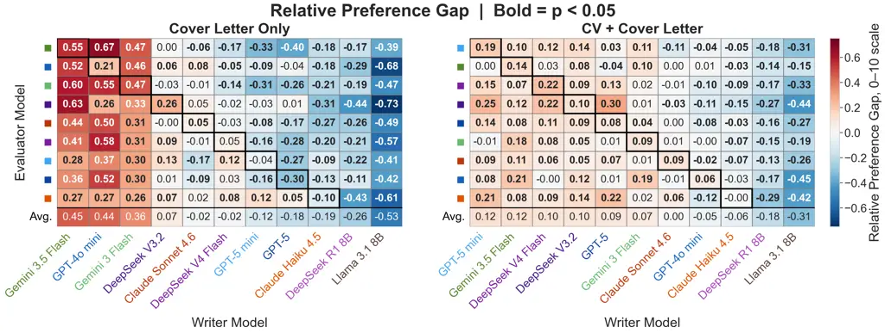

Figure 2: Relative Preference Gap $`\Delta_{\mathrm{pref}}(e,w)`$: mean
residual $`\tilde{s}_{e,j,c,w}`$ averaged over all (job, candidate)
pairs, for the cover-letter-only (left) and combined CV + Cover letter
(right) conditions. Columns sorted by decreasing gap; bold values
indicate $`p<0.05`$ (one-sample $`t`$-test of the 50 per-candidate gaps
against 0, per cell); true for $`80`$–$`84\%`$ of cells, so bold is
mostly a significance flag: it marks gaps distinguishable from zero,
regardless of magnitude. Bold black-bordered cells (a separate marker)
mark the self-preference diagonal. Locally hosted models are
consistently disfavoured, regardless of licensing; self-preference is
strongest in the combined setting.

##### Relative Preference Gap.

To quantify which writer models are systematically favoured or
penalised, we compute for each score the deviation from the evaluator’s
mean over all writers for the same candidate:
$`\tilde{s}_{e,j,c,w}=s_{e,j,c,w}-\bar{s}_{e,j,c}`$, where
$`\bar{s}_{e,j,c}=\frac{1}{|W|}\sum_{w}s_{e,j,c,w}`$. This per-candidate
_preference residual_ removes both evaluator strictness and candidate
quality simultaneously, retaining only how much evaluator $`e`$ scored
writer $`w`$ above or below its own average for that candidate.
Averaging the residual over all candidates and jobs for a given
evaluator–writer pair $`(e,w)`$ gives the _Relative Preference Gap_:

```math
\Delta_{\mathrm{pref}}(e,w)=\frac{1}{|J||C|}\sum_{j,c}\tilde{s}_{e,j,c,w}. \tag{1}
```

A positive value means evaluator $`e`$ systematically over-rates writer
$`w`$ relative to its own average; a negative value means it
under-rates.

Figure 2 shows the full matrix for both conditions, and the result is a
clear and consistent _generative preference hierarchy_. In the
cover-letter-only condition, Gemini 3.5 Flash is the most favoured
writer (average gap $`+0.45`$), closely followed by GPT-4o-mini
($`+0.44`$) and Gemini 3 Flash ($`+0.36`$). Interestingly, GPT-4o-mini
outperforms its successor GPT-5-mini in this condition ($`+0.44`$ vs.
$`-0.12`$), suggesting that newer architectural iterations do not
automatically guarantee superior stylistic signaling. Locally hosted
models are systematically disfavoured by every evaluator, with
Llama-3.1-8B receiving the lowest average gap of any writer ($`-0.53`$).
The ordering reshuffles substantially in the combined condition:
GPT-5-mini rises to first ($`+0.12`$), essentially tied with
Gemini 3.5 Flash ($`+0.12`$) and followed closely by DeepSeek V4 Flash
($`+0.10`$), while GPT-4o-mini’s advantage reverses entirely, from
$`+0.44`$ to $`-0.05`$. Locally hosted models remain at the bottom
across both conditions. As in the cover-letter-only condition, the
magnitude of the preference gaps shrinks substantially once the CV is
also available (the strongest gap drops from $`+0.45`$ to $`+0.12`$),
indicating that the generative preference signal weakens when the CV is
also available.

This hierarchy reflects genuine cross-evaluator consensus: evaluators
agree well above chance on which writer wrote the best letter for a
given candidate (mean pairwise rank agreement $`\bar{\rho}=0.63`$
cover-letter-only, dropping to $`0.27`$ once the CV is added). That drop
does not reflect a loss of reliability, since evaluators agree on
candidate quality just as strongly either way
($`\bar{\rho}=0.91`$–$`0.92`$); rather, once present the CV supplies
most of the discriminating signal itself, leaving writer identity a
smaller, noisier residual, which is also why the preference gaps above
shrink in the combined condition (full derivation in Appendix A.6).

As global writer preferences attenuate in the combined condition,
self-preference becomes the more prominent signal. The strongest
self-preference in this condition belongs to DeepSeek V4 Flash
($`+0.22`$), followed by GPT-5-mini ($`+0.19`$) and Gemini 3.5 Flash
($`+0.14`$), while Claude Haiku 4.5 shows essentially none ($`-0.001`$).
Section 2.5 traces both the hierarchy and this self-preference signal
back to specific, measurable writing features.

### 2.3 Evaluator Writer-Sensitivity

_Which evaluators are least sensitive to the applicant’s choice of
writer model?_ Section 2.2 established that evaluators, pooled together,
show a consistent generative preference hierarchy. Individually, though,
evaluators need not contribute to that hierarchy equally: Figure 2
already breaks that hierarchy down row by row, one row per evaluator,
and this section asks how much each evaluator’s own row spreads away
from a neutral midpoint across writers, the practical question being
which evaluator model introduces the least such bias as a function of
applicants’ tool choice. An ideal evaluator would rank writer models
randomly around that midpoint, introducing no systematic preference for
any particular model. We operationalize departure from this ideal as
follows.

Raw scores are not directly comparable across evaluators: beyond
differing in overall strictness (Section 2.1), evaluators also differ in
how widely they spread scores across candidates, so a fixed raw-score
gap does not mean the same thing for two evaluators with different
scoring ranges. We therefore compare evaluators on a rank-based footing
instead. For each (job $`j`$, candidate $`c`$, evaluator $`e`$) triple,
the eleven writer models are ranked by their mean score $`s_{e,j,c,w}`$
(ties, when two writers receive the exact same score, are broken by
assigning both their average rank), and the rank gap for writer $`w`$
is:

```math
g_{e,j,c,w}=\mu-\mathrm{rank}_{e,j,c}(w),\quad\mu=\frac{W+1}{2}=6.
```

A positive gap means evaluator $`e`$ ranked writer $`w`$ above the
neutral midpoint for that candidate; a negative gap means it was ranked
below. We average this gap for each (evaluator, writer) pair across all
(job, candidate) pairs,
$`\bar{g}_{e,w}=\frac{1}{|J||C|}\sum_{j,c}g_{e,j,c,w}`$, and define the
cumulative bias of evaluator $`e`$ as $`\sum_{w}|\bar{g}_{e,w}|`$,
summed across all $`W`$ writer models and invariant to absolute score
levels. Figure 3 shows the full signed matrix $`\bar{g}_{e,w}`$ as a
heatmap, evaluators against writers, with each evaluator’s cumulative
$`\sum_{w}|\bar{g}_{e,w}|`$ drawn as an adjacent bar, so that one can
read off both _how biased_ an evaluator is and _towards which writer
models_.

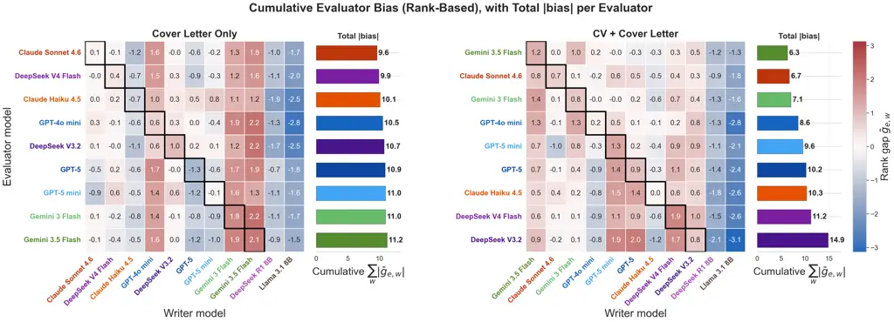

Figure 3: Rank gap $`\bar{g}_{e,w}`$ as a heatmap (evaluators $`\times`$
writers) for the cover-letter-only (left) and combined CV + Cover letter
(right) conditions; red indicates a writer is over-ranked by that
evaluator, blue indicates under-ranked. Rows are ordered by increasing
cumulative $`\sum_{w}|\bar{g}_{e,w}|`$ (least to most biased), shown as
the adjacent bar chart; columns follow the same order for every writer
that is also an evaluator, so the bold-bordered self-preference diagonal
(as in Figure 2) renders as an actual diagonal, with the two
writer-only, locally hosted models appended at the end. Gemini 3.5 Flash
is the most biased evaluator in the cover-letter-only condition but the
most neutral once the CV is also available; DeepSeek V3.2 becomes the
most biased evaluator in the combined condition. Locally hosted models
are persistently under-ranked across all evaluators.

In the cover-letter-only condition, Gemini 3.5 Flash (total: 11.2) is
the most biased evaluator, while Claude Sonnet 4.6 (9.6) is the most
neutral. The decomposition reveals that Gemini 3.5 Flash’s bias stems
primarily from over-ranking itself ($`+2.1`$ above midpoint on average)
and its sibling Gemini 3 Flash ($`+1.9`$), while under-ranking
Llama-3.1-8B ($`-1.5`$) and GPT-5 ($`-1.2`$): a combination of
self-preference and cross-family favouritism. In the combined condition,
the evaluator ordering shifts entirely: Gemini 3.5 Flash becomes the
most neutral (6.3) while DeepSeek V3.2 becomes the most biased (14.9).
Most evaluators’ cumulative bias falls once the CV is present (five of
nine drop by at least 1.4 points), but DeepSeek V3.2’s instead rises
sharply ($`10.7\to 14.9`$), with only DeepSeek V4 Flash moving the same
direction ($`9.9\to 11.2`$, far more modestly). The per-writer
decomposition for DeepSeek V3.2 shows GPT-5 ($`+2.0`$) and GPT-5-mini
($`+1.9`$) as the most over-ranked writers, while Llama-3.1-8B
($`-3.1`$) and DeepSeek-R1-8B ($`-2.1`$) are the most persistently
under-ranked. This locally hosted disadvantage is not driven by any
single evaluator but forms a structural floor in the bias distribution,
consistent with the generative preference hierarchy documented in
Section 2.2.

### 2.4 Writer Model Competitiveness

We now examine the competitive consequences of the preference hierarchy
identified in Section 2.2 and the per-evaluator bias documented in
Section 2.3, focusing on the combined CV + Cover letter condition. Two
analyses are presented: a head-to-head win rate tournament measuring
which writer models consistently outperform others across evaluators,
and a rank displacement analysis quantifying how often a moderate-fit
candidate using a stronger writer model leapfrogs a high-fit candidate
using a weaker one. Both confirm that model choice has measurable hiring
consequences independent of candidate quality.

##### Head-to-head win rates.

For every ordered pair of writer models $`(w_{1},w_{2})`$, we compute
the fraction of (job $`j`$, candidate $`c`$, evaluator $`e`$) triples in
which $`w_{1}`$ scores strictly higher than $`w_{2}`$, with ties
counting as 0.5. Triples where the evaluator coincides with either
writer are excluded, isolating cross-model assessments:

```math
\mathrm{WR}(w_{1},w_{2})=\frac{\mathrm{wins}(w_{1},w_{2})+0.5\cdot\mathrm{ties}(w_{1},w_{2})}{\mathrm{matches}(w_{1},w_{2})}\times 100\%.
```

The left panel of Figure 4 shows the full matrix, sorted by each model’s
average win rate. Gemini 3.5 Flash leads at 56%, closely followed by
GPT-5-mini (56%) and DeepSeek V3.2 (54%). Both locally hosted models
occupy the bottom of the ranking (DeepSeek-R1-8B at 42%, Llama-3.1-8B at
36%), with Claude Haiku 4.5 (47%) the weakest API-hosted model,
confirming a systematic competitive disadvantage specific to locally
hosted models: licensing category alone does not explain it.

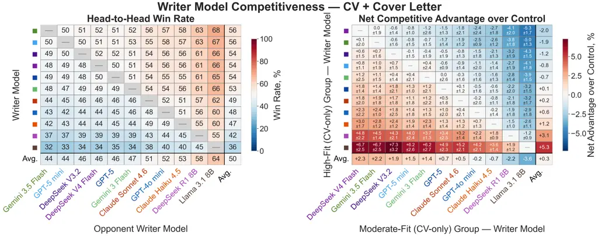

Figure 4: Both panels refer to the combined CV + Cover letter condition.
Left: head-to-head win rates $`\mathrm{WR}(w_{1},w_{2})`$; triples where
the evaluator matches either writer are excluded to remove
self-evaluation confounds. Gemini 3.5 Flash leads (56%), closely
followed by GPT-5-mini and DeepSeek V3.2 (56% and 54%); locally hosted
models consistently lose. Right: net displacement rate
$`\Delta R(w_{2},w_{1})`$ (percentage points above the same-writer
baseline) for the scenario where all high-fit candidates (defined as the
top 25 by each evaluator’s own CV-only ranking, recomputed per
evaluator, job, and run) use writer $`w_{1}`$ (rows), and all
moderate-fit candidates (bottom 25 by the same ranking) use writer
$`w_{2}`$ (columns). Diagonal cells (grey “–”) are the control
condition, $`w_{1}=w_{2}`$, by definition 0 and omitted. Off-diagonal
cells show the mean net rate and, beneath it, $`\pm`$ its standard
deviation across the nine evaluators. In the most adverse pairing
(Llama-3.1-8B vs. DeepSeek V3.2), approximately two (1.8) out of
twenty-five high-fit candidates are displaced solely due to model
mismatch.

##### Net competitive advantage.

Win rates measure pairwise dominance in scoring, but the hiring
consequence that matters is rank displacement: does a better-performing
writer model cause a moderate-fit candidate to leapfrog a high-fit one?
The right panel of Figure 4 quantifies this directly: for each
combination of evaluator model, job, and evaluation run independently,
all 50 candidates are first ranked by the evaluator’s own CV-only
scores. The top 25 by this ranking are designated _high-fit (CV-only)_
and the bottom 25 _moderate-fit (CV-only)_ – recomputed per evaluator,
job, and run, unlike the cosine-similarity-based split used elsewhere.
All high-fit candidates are then assigned the cover letter of writer
$`w_{1}`$ (rows), all moderate-fit candidates that of writer $`w_{2}`$
(columns); a displacement event is a moderate-fit candidate ascending
into the high-fit group once the letter is added, pushing out a high-fit
candidate who would have been shortlisted on CV alone.

Some baseline displacement is expected even without any model asymmetry,
since the two tiers’ score distributions overlap (Figure A4(a)); we
isolate the writer-model effect by subtracting the same-writer baseline
rate $`R_{\mathrm{raw}}(w_{1},w_{1})`$ from the raw displacement rate
$`R_{\mathrm{raw}}(w_{2},w_{1})`$, giving the net displacement rate

```math
\Delta R(w_{2},w_{1})=R_{\mathrm{raw}}(w_{2},w_{1})-R_{\mathrm{raw}}(w_{1},w_{1}). \tag{2}
```

Row $`w_{1}`$, column $`w_{2}`$ thus gives the net rate (percentage
points) by which moderate-fit candidates using $`w_{2}`$ displace
high-fit candidates using $`w_{1}`$, averaged across the nine
evaluators; the standard deviation shown beneath each cell is
evaluator-to-evaluator spread.

In the most adverse pairing, high-fit candidates using Llama-3.1-8B and
moderate-fit candidates using DeepSeek V3.2 (a top-3 model by win rate),
the net displacement rate reaches $`+7.3\%\pm 3.2\%`$ – approximately
two of twenty-five high-fit candidates per job reversed solely by model
mismatch, invisible to an employer whose LLM screener passes only
top-ranked candidates to human review. This figure is already
noise-subtracted against a substantial baseline: same-writer scoring
noise alone displaces $`7.6`$–$`9.5\%`$ of candidates depending on the
writer (mean $`8.2\%`$), so the net effect roughly doubles that floor.
The spread also means individual evaluators can go well beyond the
pooled mean: GPT-4o-mini and DeepSeek V3.2 both reach up to $`+12.8\%`$
($`\approx 3.2`$ of 25) on specific pairings, detailed in Appendix B.

### 2.5 Explaining Preference Through Writing-Style Features

Section 2.2 showed _that_ writer preference and self-preference exist;
Section 2.3 measured _how much_ each evaluator’s rankings depart from
neutrality; and Section 2.4 translated both into concrete hiring stakes.
This section asks _why_: feature-level Ridge regression traces the
preference hierarchy and self-preference to how much writers lean on
specific, measurable writing-style features, crossed with how much
evaluators reward or penalise those same features.

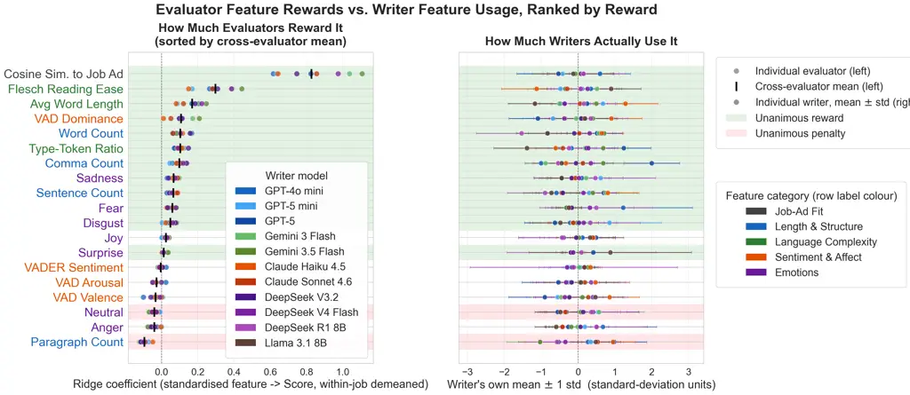

Figure 5: Left: cross-evaluator Ridge coefficient for each feature
(cover-letter-only condition; Cosine Similarity to CV excluded, see
text), one dot per evaluator plus a bold bar for the cross-evaluator
mean, ranked top to bottom by that mean; rows shaded when all nine
evaluators agree in sign (green = unanimous reward, red = unanimous
penalty). Right: each writer’s own mean use of that feature (mean
$`\pm`$ 1 std), standardised to the same units. Row labels are coloured
by feature category. As throughout, Cosine Similarity to Job Ad/CV
measures the _generated letter’s_ embedding against the job ad/CV. It is
not the job ad and CV measured against each other (Figure A1). Cosine
Similarity to Job Ad is both the most strongly and the most unanimously
rewarded feature by a wide margin; Paragraph Count, Anger, and Neutral
are the clearest unanimous penalties.

#### 2.5.1 Feature-Level Regression

##### Linking feature-level preference to writer-level outcomes.

For each evaluator, we fit a Ridge regression of score on the
(standardised) writing-style features – an L2-regularized linear
regression that shrinks coefficients toward zero to stay well-behaved
under the features’ mutual correlation \[24\]. The resulting
coefficients (Figure 5) link the Relative Preference Gap (Section 2.2, a
writer-level outcome) to its feature-level cause, decomposing evaluator
preference to the feature level in the cover-letter-only condition –
isolating the letter’s stylistic effect on evaluator preference requires
removing the CV, whose presence would otherwise dominate and confound
any purely stylistic signal – across the twenty writing-style features
we measure: structure (word, sentence, paragraph, and comma counts),
vocabulary (average word length, type-token ratio), readability (Flesch
Reading Ease), sentiment (VADER), affect (VAD valence, arousal,
dominance), emotion (seven categories), and semantic fit (cosine
similarity to the job ad and to the CV; full definitions in Methods,
Section 5.1). Cosine Similarity to CV is deliberately excluded from this
condition’s regression, leaving nineteen: the evaluator’s prompt never
contains the CV when scoring the cover letter alone, so any coefficient
the model assigned it would reflect a spurious correlate of something
else (Appendix C.2 revisits this feature once the CV is actually
visible). For each of the nineteen, the left panel shows how strongly
and how unanimously the nine evaluators reward it, ranked top to bottom
by cross-evaluator mean Ridge coefficient; the right panel shows how
much each of the eleven writers actually uses that feature, standardised
to the same scale. The mechanism linking the two panels is direct: a
writer that leans unusually hard into a feature evaluators reward
strongly and unanimously should show a correspondingly strong Relative
Preference Gap, and a writer that under-uses such a feature should be
penalised for it. Cosine Similarity to Job Ad is by a wide margin the
most strongly and unanimously rewarded feature of the nineteen
(cross-evaluator mean $`\approx 0.83`$, nearly three times the
next-highest, Flesch Reading Ease at $`\approx 0.30`$), and GPT-4o-mini
is, by a wide margin, the writer that leans furthest into it
($`z\approx+0.59`$ standard deviations above the writer-pool mean, the
single most extreme writer–feature combination in the figure), exactly
the mechanism behind its high cover-letter-only Relative Preference Gap
($`+0.44`$, second only to Gemini 3.5 Flash’s $`+0.45`$; Figure 2).
Writers that under-use a strongly rewarded feature are penalised
symmetrically: Claude Haiku 4.5 has by far the lowest Flesch Reading
Ease of any writer ($`z\approx-1.13`$), consistent with its
comparatively weak overall standing ($`-0.19`$); it partially
compensates by leaning hardest into two other unanimously rewarded
features, Average Word Length ($`z\approx+1.29`$, the highest of any
writer) and VAD Dominance ($`z\approx+0.90`$, also the highest), keeping
it from falling further. DeepSeek-R1-8B’s low standing in the same
figure ($`-0.26`$) is more one-sided: its word count is the lowest of
any writer by a wide margin ($`z\approx-1.54`$) on a feature that is
itself unanimously rewarded, with no comparably strong compensating
feature elsewhere in its profile.

A finer-grained, per-evaluator view of the Cosine Similarity to Job Ad
row specifically (Appendix C.1, Figure C5) surfaces a further asymmetry:
GPT-4o-mini’s own Ridge coefficient for that feature ($`+0.60`$) is the
_lowest_ of all nine evaluators, less than half of Gemini 3.5 Flash’s
and Gemini 3 Flash’s ($`+1.10`$, $`+1.04`$): its dominant standing on
this feature traces to how extreme its own writing is, independent of
how generously it personally rewards the trait. Three within-writer
style trade-offs documented in Appendix A.1 – readability vs. average
word length, dominance vs. arousal, and Joy vs. Neutral tone – show up
in evaluator preference too, each resolved differently. Writers cannot
combine long, complex words with easy-to-read structure: the two trade
off sharply in how letters are actually written (longer average words
track lower Flesch Reading Ease), yet evaluators reward both
simultaneously regardless, an ideal combination essentially no writer
among the eleven actually produces. Dominance and arousal move together
in how writers write (a more assertive-sounding letter also reads as
more energetic), but that pairing partially reverses in evaluator
preference: every model rewards dominance, yet the ones that reward it
most tend to reward arousal least, favouring “confident but composed”
language over “assertive and energetic.” Joy and Neutral tone trade off
almost perfectly in how writers write them, close to mechanical since
the two are categories of one probability distribution; evaluators are
under no such constraint, since their Ridge coefficients on the two are
fit independently, yet mirror that same trade-off even more steeply – a
genuine preference structure, not an artifact of how the features are
measured (full detail and figures in Appendix C.1).

The same feature-preference picture extends to the CV + Cover Letter
condition with one addition: Cosine Similarity to CV, excluded from the
cover-letter-only analysis, re-enters and becomes as strongly and
unanimously rewarded as Cosine Similarity to Job Ad ($`0.60`$ vs.
$`0.60`$), together the two most rewarded features by a wide margin.
Full per-feature detail and figures for this condition are in
Appendix C.2.

##### Self-preference is feature-specific, not predictive of standing.

The analysis above explains the general hierarchy; we now turn to
self-preference itself, the signal Section 2.2 found becomes more
prominent once the CV is added. Here too there is no fixed per-model
trait: the same writer can be the most self-rewarding evaluator on one
feature and among the most self-critical on another, and a writer’s own
extreme usage of a feature can dominate its self-preference even when
that writer is not the feature’s most generous rewarder (full worked
example in Appendix C.2). Summed across all measured features into a
single number per writer, does this feature-level self-flattery
translate into being more broadly liked? We compare each writer’s _Net
Self-Preference_ (its own idiosyncratic bias, own taste $`-`$ average
taste, dotted with its own style, summed across all measured features)
against its _Total Preference Received_ (that same writer’s actual style
dotted with the summed taste of all nine evaluators, self included): the
two are nearly inverted at the extremes in the cover-letter-only
condition, with the model most critical of its own writing the one the
panel likes most overall, and vice versa (full per-writer numbers in
Appendix C.2). So self-preference does not predict overall standing. The
CV changes the two levels differently: feature-level self-preference is,
if anything, sharper once the CV is present (Appendix C.2), while this
aggregate pattern collapses almost uniformly toward the origin,
consistent with the CV supplying most of the discriminating signal. Full
figure, per-writer numbers for both conditions, and the relationship to
the Relative Preference Gap of Section 2.2 are in Appendix C.2.

##### These measurable features are close to sufficient.

Appendix C.3 decomposes evaluators’ explainable score variance into a
shared trunk (Job, Substance, Evaluator baseline) and what remains, and
finds little room for an unmeasured “writer fingerprint”: measurable
Text Features explain almost as much of the residual as raw Writer
identity does ($`0.910`$ vs. $`0.911`$ in CV + Cover Letter, a similar
pattern in Cover-Letter-Only). The same appendix also breaks this down
per evaluator, connecting it back to Section 2.3’s neutrality ranking.

## 3 Discussion

##### Who this harms, and why it stays invisible.

Three things are worth separating about this harm: what the underlying
mechanism actually is, how unevenly it lands even among the people it
affects, and why employers cannot see it happening. Our findings point
to a new axis of unfairness in automated hiring: technological
stratification \[25, 8\]. The underlying mechanism is that evaluator
models do not treat writer models equally, regardless of which candidate
stands behind a given letter. That becomes a problem for people as well
as models, because of who ends up using which writer: applicants without
paid API access have only free, locally hosted models available to them,
and that group skews toward socioeconomic disadvantage even though it
does not map cleanly onto race, gender, or nationality as defined in
employment discrimination law – unlike demographic bias, this axis
targets no legally protected group. Prior work has shown that AI
adoption erodes the informational content of applications on average
\[16\]; our results point to something more specific happening on top of
that: the signal is being actively redirected toward whichever models
better-resourced applicants can afford, because employers’ own screening
models reward exactly those models’ output.

Even within this group of affected applicants, the harm is not evenly
distributed. Every displacement event (Section 2.4) cuts two ways at
once – a moderate-fit candidate wrongly admitted, a high-fit candidate
wrongly excluded – and those two sides do not carry equal weight. If a
moderate-fit candidate gets shortlisted on the strength of a better
cover letter, that is likely to be caught at interview or review, so the
employer’s exposure is limited. A high-fit candidate filtered out
because their cover letter was weaker never gets that far, and for that
candidate this is the outcome that matters: a real opportunity lost,
with no recourse and no way of knowing that model choice decided the
outcome, when they might well believe it came down to their own
qualifications.

This asymmetry is compounded by a third problem: invisibility to
employers. Unlike demographic bias, which leaves detectable statistical
signatures in hiring outcome distributions and can in principle be
detected via post-hoc audit, technological stratification requires
prospective auditing of the kind our framework enables. Employers have
no visibility into which tool applicants used and cannot observe the
bias they are inadvertently introducing. Our displacement estimates are
also almost certainly lower bounds: candidates who forgo AI assistance
entirely face a substantially larger gap \[17, 20\], so the within-AI
analysis we report represents the minimum magnitude of the phenomenon.

##### What employers and regulators can do about it.

Two things make this tractable: a concrete regulatory hook already
exists, and the mechanism itself is legible, traceable to measurable
features (Section 2.5). Regulatory frameworks such as the EU AI Act
\[26\], which classify automated hiring tools as high-risk AI systems
subject to conformity assessments, provide a hook for mandating
model-of-origin audits, though current guidance does not yet address
this axis specifically. For employers seeking to act now, our evaluator
fairness analysis offers concrete guidance: models with lower cumulative
bias are less likely to introduce systematic model-origin effects, and
separating the roles of generation support and candidate screening
avoids the power-concentration risk illustrated concretely by
DeepSeek V3.2’s dual role as both a leading self-preferencing writer and
the most biased evaluator (Section 2.3). Writing quality and evaluator
fairness are not inherently in tension, though: Gemini 3.5 Flash is a
leading writer in both conditions yet becomes the most neutral evaluator
once the CV is present (Section 2.3) – the fairest evaluators in our
audit are not the weakest writers, so employers need not trade off one
for the other when choosing an evaluator model.

Beyond identifying which evaluators are more or less biased, the
feature-level mechanism of Section 2.5 clarifies what that bias actually
consists of: generative preference traces to measurable, low-level
writing properties (structure, readability, and semantic fit to the job
advertisement), and a further check (Appendix C.3) finds little room for
an unmeasured writer identity on top of those same features. Little of
the effect looks like some irreducible reaction to a model’s identity as
a “brand.” Practically, this is grounds for cautious optimism: because
the mechanism is legible, mitigation does not require
reverse-engineering model internals, only monitoring a tractable set of
surface features.

##### Limitations.

Four limitations are worth being explicit about: how low absolute scores
in the CV-only condition should be read, an ecological-validity gap in
how CV-job pairings were assigned, what our fixed anonymization choice
does and does not let us say, and a methodological caveat specific to
the variance-decomposition analysis.

Absolute scores are low in the CV-only condition specifically – mean
scores around 4 for high-fit candidates and around 2 for moderate-fit
candidates, both below the rubric’s own bar for a genuinely qualified
applicant – because it is the sparsest signal we evaluate, a bare CV
with no persuasive framing; it is not a ceiling on how highly any
evaluator scores these candidates. In the combined condition, high-fit
candidates average $`4.83`$, and GPT-4o-mini alone rates them $`7.10`$,
squarely in the rubric’s “strong match” band. Our central claim does not
depend on the absolute level in any case: it is a within-candidate
comparison, asking whether the same candidate’s score moves when only
the writer model changes, and that comparison is well-defined regardless
of how strict or lenient an evaluator is on average. What it does not
establish is that the effect generalises to candidates a human recruiter
would independently call excellent; validating our candidate pool
against human judgment is a natural next step we leave to future work.

Our CVs and job descriptions are each real, but the pairing between them
is not: no candidate in our pool actually applied for the job their
cover letter was generated against. Real applicants self-select into
jobs they already believe themselves a plausible fit for, which our
cosine-similarity-constructed candidate pool does not replicate, and a
writer model generating a letter for a pairing no real applicant chose
may not fully capture how a genuine, motivated application would be
framed. Our results measure model behaviour under a controlled,
researcher-assigned pairing, not necessarily under the self-selected
pairings a real applicant pool would exhibit.

All CVs are anonymized to remove gender markers, with a fixed
gender-neutral name used throughout \[9\]; we therefore cannot speak to
whether gendered names would change evaluator behaviour, only to the
writer-model effect isolated when they do not vary.

The variance-decomposition analysis of Appendix C.3 carries two further
caveats. A raw-score variance decomposition and a rank-based fairness
metric can diverge sharply, particularly in noisier evaluation
conditions where scores cluster near decision boundaries, so
ranking-level harm to candidates should not be inferred from a variance
audit alone. It also only controls for each evaluator’s own strictness
(a fixed intercept), not for how widely each evaluator spreads scores;
since $`R^{2}`$ is computed on pooled residuals, evaluators with wider
score spread implicitly carry more weight in what counts as explained
variance, so those results are best read as representative of the
higher-spread evaluators rather than uniformly true across all nine.

The specific model hierarchy we report will shift as models are updated
or deprecated, and our primary contribution is therefore methodological:
the framework itself is the durable deliverable. We recommend that
organisations conducting impact assessments of AI hiring tools
incorporate periodic replication of this audit as standard practice,
analogous to the periodic demographic bias audits now required in
several jurisdictions. Future work should examine generalisability
across languages and labour markets, whether instruction-tuned
neutral-writing strategies can mitigate generative preference bias, and
whether mandatory disclosure of AI use in applications changes evaluator
behaviour.

### Ethical considerations

This study uses only publicly available CV and job description datasets;
no personal data were collected. All candidate profiles were anonymized
prior to analysis. Models were accessed via public APIs under their
respective terms of service.

The findings could in principle inform strategic model selection by
applicants seeking to game screening systems. We consider this risk
modest: model preferences shift as models are updated, and our primary
contribution is a detection framework. It tracks a moving target; it
does not hand applicants a stable gaming recipe. Surfacing generative
preference bias publicly is more likely to prompt corrective action by
employers and regulators than to enable durable individual gaming.
Publicly identifying which evaluator models are least biased also
creates an accountability mechanism that serves candidates, employers,
and regulators alike.

A potential adverse impact is discouraging AI screening adoption,
including tools that may on balance reduce demographic bias relative to
unassisted human screening. Our findings do not imply AI screening is
worse than human screening overall; they identify a specific, currently
invisible and unregulated bias axis that can be mitigated through
thoughtful evaluator selection and periodic auditing.

## 4 Conclusion

We built a reusable auditing framework that isolates generative
preference bias from candidate quality: eleven writer models (nine
API-hosted, two locally hosted) produce cover letters for fifty
candidates across ten job postings, and nine API-hosted evaluator models
score every candidate under three conditions – CV only, cover letter
only, and CV plus cover letter – for 414,000 evaluations in total
(Figure 1). Candidate quality is fixed by an external,
evaluator-independent criterion, so every evaluator is judged against
the same ground truth and writer identity is the only thing that varies
within a candidate.

When both applicants and employers use AI in recruitment, the _which_
matters as much as the _whether_. Four findings follow from this design.
First, a persistent generative preference hierarchy means that equally
qualified candidates face different screening outcomes depending solely
on which language model wrote their cover letter, a bias invisible to
the employer and unrecoverable for the candidate; locally hosted models,
run by those without means to pay for API access, are systematically
disadvantaged regardless of their underlying licence. Second, evaluator
models differ substantially in how much of this bias they introduce,
giving employers an actionable lever even before the underlying
hierarchy itself can be fixed. Third, this hierarchy has measurable
competitive consequences: writer-model mismatch alone displaces
qualified candidates at a rate comparable to the noise floor itself.
Fourth, how much writers lean on stylistic cues, crossed with how
evaluators reward or penalise them, accounts for almost all of the
preference hierarchy, and a further check finds little unaccounted-for
“writer fingerprint” in evaluator scores: the bias is legible. As
AI-mediated hiring scales globally, model-of-origin bias warrants the
same regulatory scrutiny as the demographic biases that have dominated
the algorithmic hiring literature.

## 5 Methods

To study generative preference bias in the within-AI setting, we need a
framework that (a) controls for candidate quality, so that any observed
differences in hiring outcomes can be attributed to model choice, (b)
separates the effects of writer model from evaluator model, and (c) is
replicable as the model landscape changes. We design our framework
around these requirements, operating as the three-phase pipeline
summarised in Figure 1 (generation, evaluation, analysis); what follows
fills in the implementation detail behind each phase. We use two
publicly available datasets, one of CVs and one of job descriptions
\[21, 22\], and select ten job descriptions that range widely in
industry and seniority, from Primary School Teacher to Chief Financial
Officer. For each job we curate a pool of fifty candidate CVs by
computing cosine similarity between CV embeddings and the job
description using the all-MiniLM-L6-v2 sentence encoder \[27\]. The top
25 candidates by similarity are designated _high-fit_ candidates; the
remaining 25 are _moderate-fit_ candidates (ranks 26–50 within the
pool), drawn from a middle tier of the distribution. This is a
deliberate design choice: early test runs showed that LLM evaluators
trivially filter out irrelevant profiles. Using candidates with some
relevant background instead ensures the experiment tests nuanced
distinctions; a bottom-tier pool would only test the capacity to reject
obvious noise.

Cosine similarity between a CV and a job description is a coarse proxy
for occupational fit — it can be thrown off by superficial vocabulary
overlap or miss substantive but differently-worded qualifications — but
it has a property none of the nine evaluator models can offer on their
own: it is a single, external, evaluator-independent criterion, so every
evaluator is judged against the exact same high-fit/moderate-fit
boundary (each evaluator’s own CV-only judgment would draw that line
somewhat differently on its own — by 6% to 14% of candidates, Table A2
in Appendix A). A fixed, model-agnostic criterion is what makes the
cross-evaluator comparisons throughout the rest of the paper meaningful:
“high-fit” refers to the same fifty candidates regardless of whose
scores are being read. Despite being coarse, it also turns out to track
what evaluators themselves perceive as quality well: Appendix A.4 shows
a large, consistent CV-only scoring gap between the two tiers
($`\Delta=2.25`$ on a 1–10 scale), the highest inter-evaluator agreement
of any condition ($`\bar{\rho}=0.92`$), and substantial agreement
between the cosine-similarity split itself and each evaluator’s own
independent CV-only ranking (86–94% of candidates assigned to the same
tier either way, per evaluator; Table A2) — evidence that the
stratification captures a real, substantial, and independently-verified
quality difference.

The one analysis that deliberately departs from this fixed criterion is
the rank-displacement analysis of Section 2.4, which asks a
self-referential question — does cover-letter quality overturn an
evaluator’s _own_ internal ranking of candidates? — and so needs each
evaluator’s own CV-only ranking as its baseline. The shared
cosine-similarity split would not work here: using an external criterion
there would conflate genuine writer-driven displacement with an
evaluator simply disagreeing with that external criterion to begin with.

The generation phase’s writer pool comprises nine API-hosted models
(GPT-4o-mini, GPT-5-mini, and GPT-5 by OpenAI; Claude Haiku 4.5 and
Claude Sonnet 4.6 by Anthropic; Gemini 3 Flash and Gemini 3.5 Flash by
Google; DeepSeek V3.2 and DeepSeek V4 Flash by DeepSeek) and two locally
hosted models (Llama-3.1-8B by Meta; DeepSeek-R1-8B by DeepSeek).¹¹ 1
DeepSeek’s API-hosted models (V3.2, V4 Flash) are themselves
open-weight, publicly released alongside the proprietary offerings from
OpenAI, Anthropic, and Google that make up the rest of the API-hosted
pool. We therefore classify writers and evaluators throughout by _access
modality_ (API-hosted vs. locally hosted). Access modality, and the cost
and infrastructure burden it implies, is the axis our framework is
designed to measure; weight availability and licensing are incidental to
that classification. DeepSeek-R1-8B, the one DeepSeek model we host
locally, is small enough to run on consumer hardware; DeepSeek’s larger,
open-weight models are, like the proprietary offerings, in practice
accessed only via API. The API-hosted pool spans both cost tiers
available to employers: lightweight, cost-efficient “mini”/“flash”
variants and full flagship models (GPT-5, Claude Sonnet 4.6), while
applicants without access to paid APIs may resort to locally hosted
models running at no cost. Including both access tiers allows us to
directly measure the competitive consequences of this accessibility gap.
Model size and hosting modality are consequently confounded by design.
Our two locally hosted models are both around 8B parameters, chosen to
match roughly the ceiling of what runs on consumer hardware, the same
constraint that defines the applicant population this tier is meant to
represent, and not to compare model scale for its own sake. A locally
hosted model large enough to match the flagship API models would need
cluster-scale compute well beyond an unpaid applicant’s reach; at that
point the applicant is again dependent on paid infrastructure access,
just of a different kind than an API subscription. Isolating a pure
model-size effect, independent of hosting cost, would require a
same-size, different-hosting comparison, which we leave to future work.
All models use provider default temperature and sampling parameters, so
that each model operates under its own default regime as it would in
real-world deployment. No output-length limit is set explicitly for any
model, with one exception: Anthropic’s Messages API requires max_tokens
as a mandatory field, so Claude models alone receive an explicit value
(4,096 during generation, 1,024 during evaluation), well above the
350–400 word target described next, so it does not bind in practice.
Each writer is instructed to produce persuasive, 350–400 word letters
without fabricating credentials; the word limit is enforced at the
prompt level to suppress length-based quality inflation \[28\]. A fixed
gender-neutral signoff is used throughout to prevent evaluators from
inferring applicant gender from the name. The full prompt template is
reproduced verbatim in Appendix D.

The evaluation phase’s nine API-hosted evaluator models (the same models
used as writers, excluding the two locally hosted ones) score each
candidate on a 1–10 scale with explicit verbal descriptors for each
range: scores 1–3 indicate a completely unqualified candidate, 4–6
indicate relevant background but insufficient specific experience, 7–8
indicate a strong match, and 9–10 indicate a perfect fit. This rubric is
held constant across all evaluator models and conditions to standardize
scoring behavior. Across the three conditions introduced in Results
(Section 2), the only element that changes is which documents are
provided; all other prompt content is held identical. Scores are
extracted via XML-style delimiters (\<final\> … \</final\>), with
anything outside the tags discarded; this prevents chain-of-thought
leakage from affecting extracted scores, which is especially relevant
for reasoning-capable models such as DeepSeek-R1. Ties are broken
merit-first: a moderate-fit candidate can only displace a high-fit
candidate by achieving a _strictly_ higher score.

### 5.1 Writing-Style Feature Definitions

Appendix A.1 characterises writer output along five feature classes,
measured as follows. Word count, sentence count, paragraph count, and
comma count are literal surface counts extracted from the letter text.
Average word length (characters per word) and type-token ratio (TTR,
capturing the fraction of words in the letter that are unique: 0 means
every word appears at least twice while 1 means none do) proxy
vocabulary richness; Flesch Reading Ease scores readability on a scale
where higher means easier to read (roughly: 90–100 simple text, 60–70
plain English understood by most adults, 30–50 fairly
difficult/academic, 0–30 very difficult/dense; the score can dip
slightly negative for extremely dense text). VADER compound score ranges
from $`-1`$ (most negative) to $`+1`$ (most positive). VAD Valence,
Arousal, and Dominance (NRC-VAD lexicon) each range from $`-1`$ to
$`+1`$ with $`0`$ as the neutral midpoint, scoring tone (negative
$`\leftrightarrow`$ positive), energy (calm $`\leftrightarrow`$
excited), and control (submissive $`\leftrightarrow`$ dominant)
respectively. The emotion classifier outputs a probability over seven
categories (Joy, Neutral, Surprise, Fear, Anger, Disgust, Sadness) that
sum to $`1`$ for every letter by construction. Cosine similarity is
computed between the letter’s embedding and the job-ad embedding, and
separately between the letter’s embedding and the CV embedding; both
range from $`-1`$ to $`1`$ in principle, though in practice
professional-text pairs score positively.

### 5.2 Calibration Metrics

Appendix A.4 relies on three measurements, defined here. Each (job
$`j`$, candidate $`c`$, writer $`w`$, evaluator $`e`$) combination was
scored in four independent API calls with no shared context between
runs, yielding four scores $`s^{(r)}_{e,j,c,w}`$ for run
$`r\in\{1,2,3,4\}`$. Reproducibility is measured as the within-group
standard deviation
$`\sigma_{e,j,c,w}=\mathrm{std}(\{s^{(r)}_{e,j,c,w}\}_{r=1}^{4})`$,
reported as a mean per evaluator and condition. Given the high
reproducibility documented in Appendix A.4, the rest of the paper
associates each (job, candidate, writer, evaluator) tuple with a single
score $`s_{e,j,c,w}`$, defined as the mean over the four independent
runs. The tier discrimination gap is
$`\Delta=\bar{s}_{\mathrm{high}}-\bar{s}_{\mathrm{mod}}`$, the
difference between the mean score of high-fit and moderate-fit
candidates for a given evaluator and condition. Inter-evaluator
agreement on candidate quality is measured with Spearman’s rank
correlation $`\rho`$, which is invariant to monotone rescaling and
therefore robust to strictness differences across evaluators: for each
pair of evaluators, $`\rho`$ is computed over their score vectors across
all (job, candidate) pairs, ranking the 50 candidates per job and
correlating those rankings between evaluators, then aggregating across
jobs. In the CV-only condition this is done directly over $`s_{e,j,c}`$;
in the cover-letter conditions, separately for each writer model over
$`s_{e,j,c,w}`$, then averaged across the eleven writers.

## Acknowledgements

This work was supported as a part of NCCR Automation, a National Centre
of Competence in Research, funded by the Swiss National Science
Foundation (grant number 51NF40_225155).

## Declarations

Funding. This work was supported as a part of NCCR Automation, a
National Centre of Competence in Research, funded by the Swiss National
Science Foundation (grant number 51NF40_225155).

Conflict of interest/Competing interests. The authors declare no
competing interests.

Ethics approval and consent to participate. Not applicable: this study
did not involve human participants, human data, or animal subjects. All
CVs and job descriptions used are drawn from publicly available datasets
\[21, 22\] and were anonymized prior to analysis.

Consent for publication. Not applicable.

Data availability. The base CV and job description datasets are publicly
available \[21, 22\]. The derived experimental data (generated cover
letters and evaluator scores) are available from the corresponding
author upon reasonable request.

Materials availability. Not applicable.

Code availability. The auditing framework code is available from the
corresponding author upon reasonable request.

Author contribution. All authors contributed to the conception and
design of the auditing framework. All authors contributed to data
analysis and interpretation, and to drafting and revising the
manuscript. All authors read and approved the final manuscript.

## References

- \[1\] ResumeBuilder (2023) 3 in 4 Job Seekers Who Used ChatGPT to
  Write Their Resume Got an Interview - ResumeBuilder.com —
  resumebuilder.com. Note:
  [https://www.resumebuilder.com/3-in-4-job-seekers-who-used-chatgpt-to-write-their-resume-got-an-interview/](https://www.resumebuilder.com/3-in-4-job-seekers-who-used-chatgpt-to-write-their-resume-got-an-interview/)\[Accessed
  12-04-2026\] Cited by: §1.
- \[2\] ResumeBuilder (2024) 7 in 10 Companies Will Use AI in the Hiring
  Process in 2025, Despite Most Saying It’s Biased - ResumeBuilder.com —
  resumebuilder.com. Note:
  [https://www.resumebuilder.com/7-in-10-companies-will-use-ai-in-the-hiring-process-in-2025-despite-most-saying-its-biased/](https://www.resumebuilder.com/7-in-10-companies-will-use-ai-in-the-hiring-process-in-2025-despite-most-saying-its-biased/)\[Accessed
  12-04-2026\] Cited by: §1.
- \[3\] M. Raghavan, S. Barocas, J. Kleinberg, and K. Levy (2020)
  Mitigating bias in algorithmic hiring: evaluating claims and
  practices. In Proceedings of the 2020 Conference on Fairness,
  Accountability, and Transparency, FAT\* ’20, New York, NY, USA,
  pp. 469–481. External Links: ISBN 978-1-4503-6936-7,
  [Link](https://dl.acm.org/doi/10.1145/3351095.3372828),
  [Document](https://dx.doi.org/10.1145/3351095.3372828) Cited by: §1.
- \[4\] M. Bertrand and S. Mullainathan (2004) Are emily and greg more
  employable than lakisha and jamal? a field experiment on labor market
  discrimination. American economic review 94 (4), pp. 991–1013. Cited
  by: §1.
- \[5\] C. Wilson, A. Ghosh, S. Jiang, A. Mislove, L. Baker, J.
  Szary, K. Trindel, and F. Polli (2021) Building and Auditing Fair
  Algorithms: A Case Study in Candidate Screening. In Proceedings of the
  2021 ACM Conference on Fairness, Accountability, and Transparency,
  FAccT ’21, New York, NY, USA, pp. 666–677. External Links: ISBN
  978-1-4503-8309-7,
  [Link](https://dl.acm.org/doi/10.1145/3442188.3445928),
  [Document](https://dx.doi.org/10.1145/3442188.3445928) Cited by: §1.
- \[6\] K. Wilson and A. Caliskan (2024) Gender, race, and
  intersectional bias in resume screening via language model retrieval.
  In Proceedings of the AAAI/ACM Conference on AI, Ethics, and Society,
  Vol. 7, pp. 1578–1590. Cited by: §1.
- \[7\] H. Iso, P. Pezeshkpour, N. Bhutani, and E. Hruschka (2025)
  Evaluating bias in llms for job-resume matching: gender, race, and
  education. In Proceedings of the 2025 Conference of the Nations of the
  Americas Chapter of the Association for Computational Linguistics:
  Human Language Technologies (Volume 3: Industry Track), pp. 672–683.
  Cited by: §1.
- \[8\] E. Albaroudi, T. Mansouri, and A. Alameer (2024) A Comprehensive
  Review of AI Techniques for Addressing Algorithmic Bias in Job Hiring.
  AI 5 (1), pp. 383–404 (en). Note: Publisher: Multidisciplinary Digital
  Publishing Institute External Links: ISSN 2673-2688,
  [Link](https://www.mdpi.com/2673-2688/5/1/19),
  [Document](https://dx.doi.org/10.3390/ai5010019) Cited by: §1, §3.
- \[9\] E. Anzenberg, A. Samajpati, S. Chandrasekar, and V.
  Kacholia (2025) Evaluating the Promise and Pitfalls of LLMs in Hiring
  Decisions. arXiv. Note: arXiv:2507.02087 \[cs\] External Links:
  [Link](http://arxiv.org/abs/2507.02087),
  [Document](https://dx.doi.org/10.48550/arXiv.2507.02087) Cited by: §1,
  §3.
- \[10\] A. K. Veldanda, F. Grob, S. Thakur, H. Pearce, B. Tan, R.
  Karri, and S. Garg (2023) Are emily and greg still more employable
  than lakisha and jamal? investigating algorithmic hiring bias in the
  era of chatgpt. arXiv preprint arXiv:2310.05135. Cited by: §1.
- \[11\] T. Calders, F. Kamiran, and M. Pechenizkiy (2009) Building
  classifiers with independency constraints. In 2009 IEEE international
  conference on data mining workshops, pp. 13–18. Cited by: §1.
- \[12\] M. Hardt, E. Price, and N. Srebro (2016) Equality of
  opportunity in supervised learning. Advances in neural information
  processing systems 29. Cited by: §1.
- \[13\] M. Spence (1973) Job market signaling\*. The Quarterly Journal
  of Economics 87 (3), pp. 355–374. External Links: ISSN 0033-5533,
  [Document](https://dx.doi.org/10.2307/1882010),
  [Link](https://doi.org/10.2307/1882010),
  https://academic.oup.com/qje/article-pdf/87/3/355/5387353/87-3-355.pdf
  Cited by: §1.
- \[14\] E. Wiles and J. J. Horton (2025) Generative AI and Labor Market
  Matching Efficiency. (en). Cited by: §1.
- \[15\] D. Awasthi, P. S. B. Rao, and D. B. Jayagopi (2025)
  ResumeGenAI: Supporting Job Seekers with LLM-Driven Resume Feedback.
  In Proceedings of the 7th ACM Conference on Conversational User
  Interfaces, CUI ’25, New York, NY, USA, pp. 1–9. External Links: ISBN
  979-8-4007-1527-3,
  [Link](https://dl.acm.org/doi/10.1145/3719160.3737622),
  [Document](https://dx.doi.org/10.1145/3719160.3737622) Cited by: §1.
- \[16\] A. Galdin and J. Silbert (2025) Making Talk Cheap: Generative
  AI and Labor Market Signaling. (en). Cited by: §1, §3.
- \[17\] W. Laurito, B. Davis, P. Grietzer, T. Gavenciak, A. Böhm,
  and J. Kulveit (2025) AI–AI bias: Large language models favor
  communications generated by large language models. (en). External
  Links: [Link](https://www.pnas.org/doi/10.1073/pnas.2415697122),
  [Document](https://dx.doi.org/10.1073/pnas.2415697122) Cited by: §1,
  §3.
- \[18\] A. Panickssery, S. R. Bowman, and S. Feng (2024) Llm evaluators
  recognize and favor their own generations. Advances in Neural
  Information Processing Systems 37, pp. 68772–68802. Cited by: §1.
- \[19\] M. Saraf, S. R. Boroujeni, J. Beaudry, H. Abedi, and T.
  Bush (2025) Quantifying label-induced bias in large language model
  self-and cross-evaluations. arXiv preprint arXiv:2508.21164. Cited by:
  §1.
- \[20\] J. Xu, G. Li, and J. Y. Jiang (2026) AI Self-preferencing in
  Algorithmic Hiring: Empirical Evidence and Insights. arXiv. Note:
  arXiv:2509.00462 \[cs\] External Links:
  [Link](http://arxiv.org/abs/2509.00462),
  [Document](https://dx.doi.org/10.48550/arXiv.2509.00462) Cited by: §1,
  §3.
- \[21\] B. Snehaan (2021) Resume Dataset — kaggle.com. Note:
  [https://www.kaggle.com/datasets/snehaanbhawal/resume-dataset](https://www.kaggle.com/datasets/snehaanbhawal/resume-dataset)\[Accessed
  12-04-2026\] Cited by: §2, §5, Declarations, Declarations.
- \[22\] F. Hammad (n.d.) Job Listings Dataset for Data Analysis & NLP —
  kaggle.com. Note:
  [https://www.kaggle.com/datasets/hammadfarooq470/job-listings-dataset-for-data-analysis-and-nlp](https://www.kaggle.com/datasets/hammadfarooq470/job-listings-dataset-for-data-analysis-and-nlp)\[Accessed
  12-04-2026\] Cited by: §2, §5, Declarations, Declarations.
- \[23\] R. Flesch (1948) A new readability yardstick. Journal of
  Applied Psychology 32 (3), pp. 221–233. Cited by: §2.1.
- \[24\] A. E. Hoerl and R. W. Kennard (1970) Ridge regression: biased
  estimation for nonorthogonal problems. Technometrics 12 (1),
  pp. 55–67. Cited by: §2.5.1.
- \[25\] I. O. Gallegos, R. A. Rossi, J. Barrow, M. M. Tanjim, S.
  Kim, F. Dernoncourt, T. Yu, R. Zhang, and N. K. Ahmed (2024) Bias and
  Fairness in Large Language Models: A Survey. Computational Linguistics
  50 (3), pp. 1097–1179 (en). External Links: ISSN 0891-2017, 1530-9312,
  [Link](https://direct.mit.edu/coli/article/50/3/1097/121961/Bias-and-Fairness-in-Large-Language-Models-A),
  [Document](https://dx.doi.org/10.1162/coli%5Fa%5F00524) Cited by: §3.
- \[26\] European Parliament and Council of the European Union (2024)
  Regulation (EU) 2024/1689 of the European Parliament and of the
  Council laying down harmonised rules on artificial intelligence
  (artificial intelligence act). Note:
  [https://eur-lex.europa.eu/legal-content/EN/TXT/?uri=CELEX:32024R1689](https://eur-lex.europa.eu/legal-content/EN/TXT/?uri=CELEX:32024R1689)Official
  Journal of the European Union, L series Cited by: §3.
- \[27\] N. Reimers and I. Gurevych (2019) Sentence-BERT: sentence
  embeddings using Siamese BERT-networks. In Proceedings of the 2019
  Conference on Empirical Methods in Natural Language Processing and the
  9th International Joint Conference on Natural Language Processing
  (EMNLP-IJCNLP), Hong Kong, China, pp. 3982–3992. External Links:
  [Document](https://dx.doi.org/10.18653/v1/D19-1410),
  [Link](https://aclanthology.org/D19-1410/) Cited by: §5.
- \[28\] K. Saito, A. Wachi, K. Wataoka, and Y. Akimoto (2023) Verbosity
  Bias in Preference Labeling by Large Language Models. arXiv. Note:
  arXiv:2310.10076 \[cs\] External Links:
  [Link](http://arxiv.org/abs/2310.10076),
  [Document](https://dx.doi.org/10.48550/arXiv.2310.10076) Cited by: §5.

## Appendix A Validating the Experimental Design

This appendix gives the full detail behind the two preliminaries from
the start of the Results section (Section 2.1). For the
writer-genuineness preliminary: the complete per-model writer
text-feature breakdown (A.1), and two targeted sanity checks for whether
writers’ outputs vary systematically along dimensions the design depends
on: job identity (A.2) and candidate tier (A.3). For the
evaluator-calibration preliminary: the complete evaluator-calibration
breakdown (A.4), and a third sanity check, whether the fixed
cosine-similarity tier split agrees with what evaluators themselves
would conclude (A.5). Last, a check that the generative preference
hierarchy of Section 2.2 is a real cross-evaluator signal and not noise:
how often evaluators agree on which writer wrote the best letter for the
same candidate (A.6).

### A.1 Writer Model Text-Feature Results

This section gives the full per-model detail behind the summary at the
start of the Results section (Section 2). Figure A1 plots each feature’s
mean and standard deviation by writer model and candidate tier. The five
paragraphs below go through the feature classes one at a time; the two
sanity checks mentioned in the main text are detailed separately in A.2
and A.3.

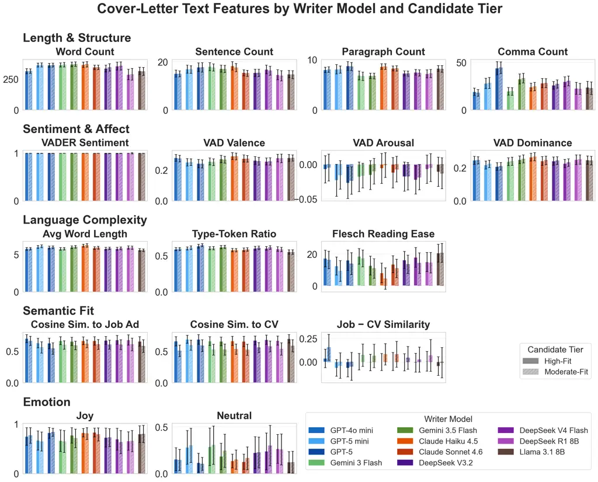

Figure A1: Cover-letter text features by writer model and candidate
tier, grouped by feature class (one row per class). Emotion is reduced
to Joy and Neutral, the two dominant categories; the remaining five
(surprise, fear, anger, disgust, sadness) are low, largely
indistinguishable across models, and, thus, omitted here. Error bars
show $`\pm 1`$ standard deviation across candidates. The three Semantic
Fit columns verify the alignment of the _generated cover letter’s_
embedding with the ones of the job ad and CV: “Cosine Similarity to Job
Ad” is letter-vs-job-ad similarity, “Cosine Similarity to CV” is
letter-vs-CV similarity, and “Job $`-`$ CV Similarity” is their
difference, i.e. whether a given letter leans more toward echoing the
job posting’s language or the candidate’s own CV.

##### Length and structure.

Word count, sentence count, paragraph count, and comma count are literal
surface counts extracted from the letter text. Mean word count ranges
from 288 words (DeepSeek-R1-8B) to 370 words (Gemini 3.5 Flash), with
most models clustering in the 340–370 range, close to the 350–400 word
target given in the prompt. Sentence count spans a narrower range, 14.4
(DeepSeek-R1-8B) to 17.9 (Claude Haiku 4.5) sentences per letter.
Paragraph count separates the two Gemini models (6.75 paragraphs, the
fewest of any writer) from GPT-5 and Claude Haiku 4.5 (8.6–8.7, the
most): the Gemini models favour fewer, longer paragraphs, where the
others break similar content into more, shorter ones. Comma count is the
one clear outlier: GPT-5 averages 44.1 commas per letter, close to
double the next-highest writer (DeepSeek V4 Flash, 30.0) and more than
double the lowest (GPT-4o-mini, 18.4): substantially more syntactically
complex, clause-heavy sentences than any other model. Verbosity and
structure are stable per-model traits, quantified precisely in the
tier-adaptation sanity check below: they reflect a fixed model style.

##### Language complexity.

Average word length (characters per word) and type-token ratio (TTR,
capturing the fraction of words in the letter that are unique: 0 means
every word appears at least twice while 1 means none do) proxy
vocabulary richness; Flesch Reading Ease scores readability on a scale
where higher means easier to read (roughly: 90–100 simple text, 60–70
plain English understood by most adults, 30–50 fairly
difficult/academic, 0–30 very difficult/dense; the score can dip
slightly negative for extremely dense text). All eleven writers fall in
the 6–21 range on Flesch: dense, formal, professional prose throughout,
well below the “plain English” band. Within that narrow band,
Claude Haiku 4.5 writes both the longest average words (6.20 characters)
and the least readable letters (Flesch $`=6.2`$); Llama-3.1-8B writes
the shortest average words (5.59 characters) and the most readable
letters of the eleven (Flesch $`=20.6`$, itself still within the “very
difficult” band). Vocabulary richness varies separately from either of
these: GPT-5 has the highest TTR (0.638, the least word repetition) and
Llama-3.1-8B the lowest (0.550).

##### Sentiment and affect.

VADER compound score ranges from $`-1`$ (most negative) to $`+1`$ (most
positive). VAD Valence, Arousal, and Dominance (NRC-VAD lexicon) each
range from $`-1`$ to $`+1`$ with $`0`$ as the neutral midpoint, scoring
tone (negative $`\leftrightarrow`$ positive), energy (calm
$`\leftrightarrow`$ excited), and control (submissive
$`\leftrightarrow`$ dominant) respectively. VADER sits essentially at
its ceiling for every writer (mean $`0.996`$; writer means span only
$`0.0021`$), confirming letters are uniformly and almost maximally
positive in polarity: this feature does not discriminate between writers
at all. VAD Valence is positive on average ($`0.266`$) but far short of
its $`+1`$ ceiling, with modest spread across writers
($`0.241`$–$`0.289`$): a mildly positive tone throughout. VAD Arousal
sits close to the neutral midpoint for every writer (all means between
$`-0.025`$ and $`-0.004`$) and is the tightest of the three VAD axes
across writers; VAD Dominance is the widest ($`0.209`$–$`0.266`$),
meaning writers differ more in how assertive their letters read than in
how positive or energetic they are. GPT-5 scores lowest of all eleven
writers on all three VAD axes; Claude Haiku 4.5 scores highest on all
three.

##### Emotion.

The emotion classifier outputs a probability over seven categories (Joy,
Neutral, Surprise, Fear, Anger, Disgust, Sadness) that sum to $`1`$ for
every letter by construction. Joy and Neutral together account for the
large majority of that probability mass; the other five combined average
only $`6\%`$ across all letters (at most $`9\%`$ for any single writer).
Writers mainly differ in how they split the Joy/Neutral majority: GPT-5
is the most Joy-leaning ($`0.826`$ Joy, $`0.110`$ Neutral), with
Claude Haiku 4.5 and Claude Sonnet 4.6 close behind ($`\approx 0.81`$
Joy); Gemini 3 Flash is the most Neutral-leaning ($`0.654`$ Joy,
$`0.296`$ Neutral), with GPT-5-mini and DeepSeek-R1-8B similarly
measured ($`\approx 0.66`$ Joy, $`0.26`$–$`0.29`$ Neutral). Every writer
is predominantly Joy-toned, though they differ in how strongly they
favor Joy over Neutral.

##### Semantic fit to the job description.

Cosine similarity is computed between the letter’s embedding and the
job-ad embedding, and separately between the letter’s embedding and the
CV embedding; both range from $`-1`$ to $`1`$ in principle, though in
practice professional-text pairs score positively. The clearest pattern
here is a _tier_ effect: for High-Fit candidates, the letter is on
average very slightly more similar to the CV than to the job ad
(job$`-`$CV $`=-0.013`$); for Moderate-Fit candidates, that flips to a
real lean toward the job ad instead (job$`-`$CV $`=+0.045`$). This shift
holds broadly: every one of the eleven models shows it (Figure A1,
bottom-right panel). A plausible reading: when the underlying CV is a
weaker match for the job, as Moderate-Fit candidates are by
construction, the letter compensates by echoing the job description’s
own language more than it reflects the CV’s actual, weaker content. On
top of this shared tier effect, writers also differ in their overall
baseline: pooled across both tiers, GPT-4o-mini leans furthest toward
the job ad (job$`-`$CV $`=+0.096`$), while GPT-5, GPT-5-mini, and
Llama-3.1-8B lean toward the CV instead ($`-0.03`$ to $`-0.06`$).

### A.2 Content Consistency Across Jobs

Whether a writer’s output for a given job is recognisably tied to that
job, or largely interchangeable regardless of which job it was written
for. Figure A2 compares, for each writer, mean pairwise cosine
similarity between letter embeddings drawn from the same job against
pairs drawn from different jobs.

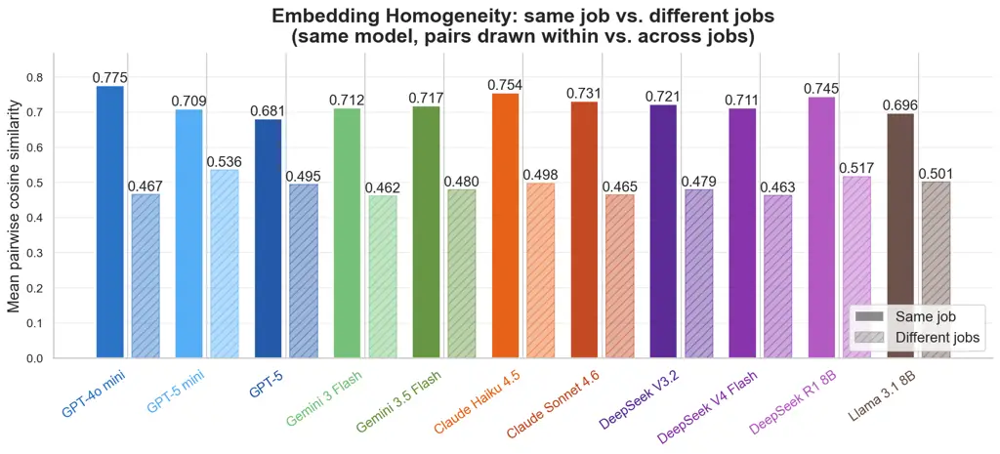

Figure A2: Mean pairwise cosine similarity between cover-letter
embeddings for the same writer, comparing pairs drawn from the same job
vs. different jobs. Within-job similarity exceeds cross-job similarity
for every writer, confirming that writers condition their output on the
specific job description. This validates the experimental design
(mentioned at the start of the Results section, Section 2).

Within-job similarity (0.68–0.78) is far higher than cross-job
similarity (0.46–0.54) for every writer. This validates the experimental
setup: writers genuinely condition the letter’s content on the specific
job description, which is what the auditing framework requires for
job-to-job and writer-to-writer comparisons to be meaningful in the
first place. GPT-5-mini has the smallest within/cross-job gap (its
output varies least from job to job), while GPT-5 has the lowest
within-job similarity (it preserves the most letter-to-letter
individuality even among candidates applying to the same job).

### A.3 Style Adaptation to Candidate Tier

Whether writers adapt _how_ they write, beyond simply what they write
about, when the underlying candidate is a stronger or weaker match for
the job. Figure A3 reports Cohen’s $`d`$ (High-Fit $`-`$ Moderate-Fit)
for every writing-style feature and writer, averaged across jobs;
semantic-fit features are excluded here since their tier effect is
near-definitional (a High-Fit CV is, by construction, closer to the job,
so a letter echoing it will be too).

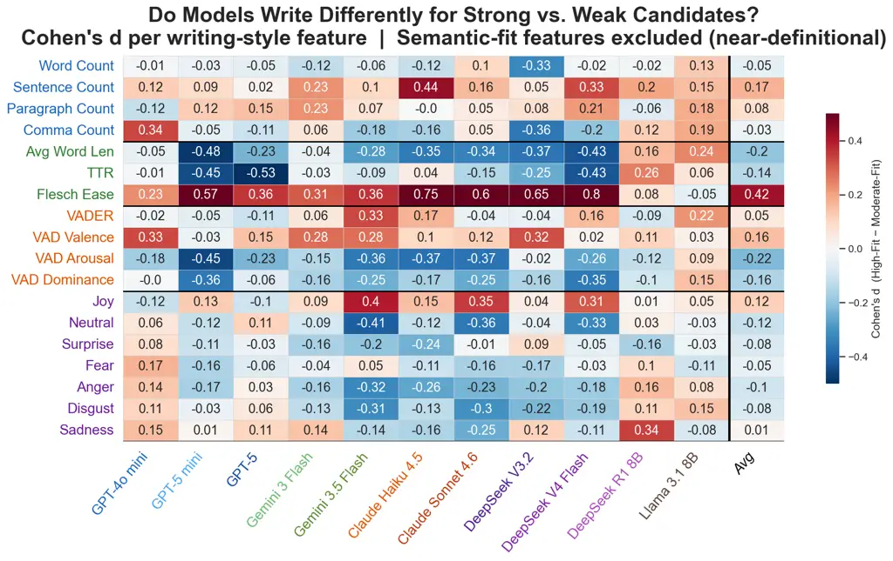

Figure A3: Cohen’s $`d`$ (High-Fit $`-`$ Moderate-Fit) per writing-style
feature and writer model, averaged across jobs. Flesch Reading Ease is
the one systematically positive effect across almost every writer; other
features show smaller and less consistent effects (summarised at the
start of the Results section, Section 2).

One feature stands out: Flesch Reading Ease is consistently higher for
High-Fit candidates across almost every writer, up to $`d=+0.80`$ for
DeepSeek V4 Flash, i.e. letters for stronger candidates are written in
simpler, more accessible language. GPT-5 ($`d=0.08`$) and Llama-3.1-8B
($`d=-0.05`$) barely adapt to tier at all, while the DeepSeek and Claude
models adapt the most, primarily via readability. A fainter mirror-image
pattern appears in average word length, type-token ratio, VAD Arousal,
and VAD Dominance, which skew slightly negative for High-Fit candidates
on average ($`\bar{d}=-0.20,-0.14,-0.22,-0.16`$ respectively); emotion
features show no consistent direction. Taken together, this
multi-feature shift mirrors the semantic-fit compensation described in
A.1: when the underlying case for a candidate is less obvious, writers
reach for longer, rarer words and a more assertive, more energetic
register, as though compensating for a weaker fit with more elaborate
language.

### A.4 Evaluator Calibration Details

Full per-evaluator detail behind the summary at the start of the Results
section (Section 2). Reproducibility ($`\sigma`$), the tier
discrimination gap ($`\Delta`$), and the inter-evaluator agreement
procedure ($`\rho`$) are defined in Methods (Section 5.2).

|       | Claude Sonnet 4.6 | Claude Haiku 4.5 | GPT-5 | Gemini 3.5 Flash | GPT-4o mini | Gemini 3 Flash | GPT-5 mini | DeepSeek V4 Flash | DeepSeek V3.2 | Mean |
| ----- | ----------------- | ---------------- | ----- | ---------------- | ----------- | -------------- | ---------- | ----------------- | ------------- | ---- |
| CV    | 0.04              | 0.13             | 0.21  | 0.23             | 0.29        | 0.23           | 0.36       | 0.37              | 0.40          | 0.25 |
| CL    | 0.07              | 0.10             | 0.30  | 0.34             | 0.30        | 0.38           | 0.39       | 0.55              | 0.62          | 0.34 |
| CV+CL | 0.06              | 0.11             | 0.23  | 0.28             | 0.26        | 0.30           | 0.40       | 0.49              | 0.48          | 0.29 |
| Avg   | 0.05              | 0.11             | 0.25  | 0.28             | 0.29        | 0.30           | 0.38       | 0.47              | 0.50          | 0.29 |

Table A1: Mean intra-run $`\sigma`$ by evaluator and condition.
Evaluators are ordered left-to-right by increasing mean $`\sigma`$ (most
to least reproducible), using the same colour-coding as elsewhere in the
paper. Scores on a 1–10 scale, rounded to two decimals. CV = CV only; CL
= cover letter only; CV+CL = CV + cover letter.

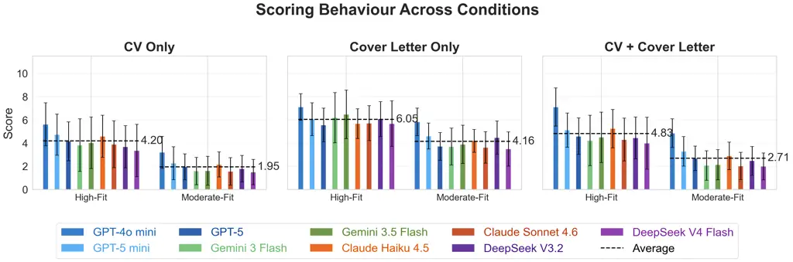

(a)

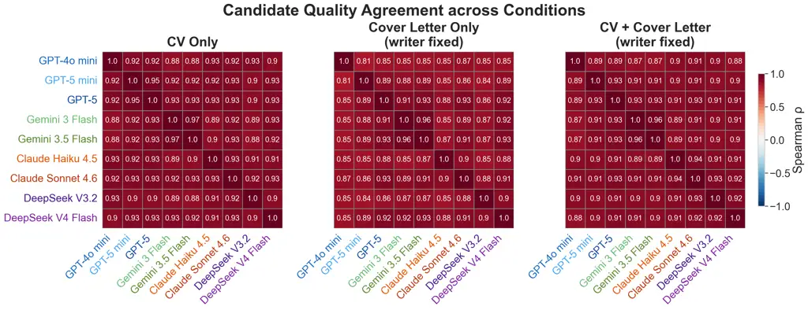

(b)

Figure A4: (a) Mean evaluator scores ($`\pm 1`$ standard deviation) for
high-fit and moderate-fit candidates across the three evaluation
conditions. Left (CV only): all evaluators discriminate in the expected
direction (overall gap $`\Delta=2.25`$), confirming that the
stratification is universally recognized. Centre (cover letter only):
scores inflate markedly and the gap narrows ($`\Delta=1.89`$), as
AI-generated prose presents all candidates favourably regardless of
merit. Right (CV + cover letter): combining documents partially restores
discrimination ($`\Delta=2.12`$). (b) Candidate quality agreement:
Spearman $`\rho`$ between evaluator score vectors across all conditions.
Left: CV-only ($`\bar{\rho}=0.92`$). Centre: cover-letter-only
($`\bar{\rho}=0.88`$). Right: combined CV + Cover letter
($`\bar{\rho}=0.91`$). Despite strictness differences, evaluators agree
strongly on candidate quality across all conditions.

Claude Sonnet 4.6 and Claude Haiku 4.5 are the most stable;
DeepSeek V3.2 the most variable, peaking at $`\sigma=0.623`$ in the
cover-letter-only condition. Given that scores are integers, even this
upper end corresponds to sub-single-point fluctuations on average across
runs, so scoring remains broadly consistent. Additional analysis
confirms that writer identity has little effect on variability: the
dominant source is the evaluator model.

##### Scoring behavior across conditions.

With reproducibility established, we turn to how evaluators score
candidates under different conditions. Figure A4(a) shows mean evaluator
scores for high-fit and moderate-fit candidates across all three
conditions. We first focus on the CV-only condition, which isolates
evaluator behavior from any generative influence: no cover letter is
involved, so scores reflect only the evaluators’ intrinsic response to
the raw candidate profiles. Throughout, we measure the tier
discrimination gap as
$`\Delta=\bar{s}_{\mathrm{high}}-\bar{s}_{\mathrm{mod}}`$, the
difference between the mean score of high-fit and moderate-fit
candidates for a given evaluator and condition. In the CV-only
condition, high-fit candidates receive an overall mean of 4.20 and
moderate-fit candidates 1.95, giving $`\Delta=2.25`$ averaged across
evaluators. This separation holds across all models, from the largest
gap (GPT-5-mini: $`\Delta=2.47`$) to the smallest (DeepSeek V4 Flash:
$`\Delta=1.87`$), confirming that the cosine-similarity stratification
created two distinctly tiered groups that LLM evaluators universally
recognize, despite the deliberately conservative top-half/bottom-half
split described in Methods (Section 5): the two tiers differ
substantially in evaluator-perceived quality, beyond the embedding
similarity that defines them. This CV-only condition also has the
highest inter-evaluator agreement of the three conditions
($`\bar{\rho}=0.92`$, below), which is itself corroborating evidence
that the tier split tracks a real quality signal: independent
evaluators, seeing only the raw CV, converge almost perfectly on which
tier a candidate belongs to. For a more direct check, we compared the
cosine-similarity split against the high-fit/moderate-fit split each
evaluator’s own CV-only scores would draw on their own. The two agree on
about 90% of candidates on average, from 94% for Claude Sonnet 4.6 (the
closest match) down to 86% for DeepSeek V3.2 (the loosest); no evaluator
falls far outside that range (full breakdown in Table A2, Appendix A).
The two splits are not identical: about one candidate in ten lands in a
different tier under an evaluator’s own judgment, for every evaluator.
This makes a more direct case that the cosine-similarity split tracks
real quality than the aggregate $`\Delta`$ and inter-evaluator $`\rho`$
reported above. Standard deviations exhibit a notable asymmetry:
variability is consistently higher for high-fit candidates
($`\sigma\approx 1.7`$–$`2.3`$) than for moderate-fit candidates
($`\sigma\approx 1.1`$–$`1.4`$), suggesting that evaluators apply more
heterogeneous judgements to strong CVs where subtle quality differences
are harder to resolve. Models do, however, differ substantially in
absolute strictness: GPT-4o-mini assigns the highest scores overall
($`\mu=4.40`$) while DeepSeek V4 Flash is the most conservative
($`\mu=2.42`$).

The tier discrimination persists across all three conditions, with some
variation. When evaluators see only cover letters, scores inflate
markedly for both tiers (overall means: 6.05 vs. 4.16) and the gap
narrows to $`\Delta=1.89`$, as AI-generated prose presents all
candidates favourably regardless of merit. Two evaluators stand out as
outliers in opposite directions: Gemini 3.5 Flash maintains the largest
gap of any model ($`2.59`$) and scores moderate-fit candidates
considerably lower than its peers ($`3.89`$ vs. a cross-model average of
$`4.16`$), while GPT-4o-mini maintains the smallest gap ($`1.28`$),
extending its overall leniency into the moderate-fit tier ($`5.82`$).
Combining CV and cover letter partially restores discrimination
($`\Delta=2.12`$), with score levels settling between the two
single-document conditions (high-fit: 4.83; moderate-fit: 2.71).
GPT-4o-mini again assigns the highest scores to high-fit candidates
($`7.10`$), while Gemini 3.5 Flash produces the widest spread ($`2.36`$)
and DeepSeek V4 Flash the lowest moderate-fit scores ($`1.99`$). These
inter-model differences in absolute strictness, consistent across
conditions, motivate the use of rank-based, strictness-neutral metrics
throughout.

##### Candidate quality agreement.

Having characterised individual scoring behavior, we now ask whether
evaluators reach a shared verdict on candidate quality despite their
different strictness levels. We measure inter-evaluator agreement using
Spearman’s rank correlation $`\rho`$, which is invariant to monotone
rescaling and therefore robust to the strictness differences documented
above. For each pair of evaluators, $`\rho`$ is computed over their
score vectors across all (job, candidate) pairs: for each job, the 50
candidates are ranked by score, and $`\rho`$ is computed between
evaluators over these rankings, then aggregated across jobs. In the
CV-only condition this is done directly over $`s_{e,j,c}`$; in the
cover-letter conditions, separately for each writer model over
$`s_{e,j,c,w}`$, then averaged across the eleven writers. The resulting
matrices (Figure A4(b)) show high agreement across all three conditions:
$`\bar{\rho}=0.92`$ (range 0.88–0.97) in the CV-only condition,
$`\bar{\rho}=0.88`$ (range 0.81–0.96) in the cover-letter-only
condition, and $`\bar{\rho}=0.91`$ (range 0.87–0.96) in the combined
condition. The small standard deviations of the per-writer correlations
(shown per cell) confirm that this agreement holds regardless of which
writing style is used. Since the writer is held fixed within each
correlation, the agreement reflects evaluator consensus on candidate
quality alone, confirming that the evaluators are calibrated enough for
the writer-preference analysis that follows to be meaningful.

### A.5 Cosine-Similarity Tier Split vs. Evaluator CV-Only Judgment

Methods (Section 5) uses a single, fixed cosine-similarity split to
define the high-fit/moderate-fit tiers, precisely so that “high-fit”
means the same fifty candidates for every evaluator. Table A2 quantifies
how much this fixed split actually costs relative to asking each
evaluator directly: for every evaluator, we compare the 25 candidates
the cosine-similarity split designates high-fit against the 25
candidates that evaluator’s own CV-only score would rank highest, per
job, and report the mean overlap (out of 25) across the ten jobs.

| Evaluator         | Overlap (of 25) | Agreement |
| ----------------- | --------------- | --------- |
| Claude Sonnet 4.6 | 23.4            | 93.6%     |
| Claude Haiku 4.5  | 23.2            | 92.8%     |
| GPT-5             | 22.5            | 90.0%     |
| Gemini 3 Flash    | 22.5            | 90.0%     |
| GPT-4o mini       | 22.5            | 90.0%     |
| Gemini 3.5 Flash  | 22.4            | 89.6%     |
| DeepSeek V4 Flash | 22.2            | 88.8%     |
| GPT-5 mini        | 21.9            | 87.6%     |
| DeepSeek V3.2     | 21.5            | 86.0%     |
| Mean              | 22.5            | 90.0%     |

Table A2: Agreement between the fixed cosine-similarity high-fit split
and the high-fit split each evaluator’s own independent CV-only score
would draw instead. Overlap is the mean number (out of 25) of
cosine-similarity-designated high-fit candidates that also fall in that
evaluator’s own top 25 by CV-only score, averaged across the ten jobs.
Evaluators are ordered by decreasing agreement.

The two Claude models agree most closely with the fixed split (93–94%);
the two DeepSeek models agree least (86–89%), with the OpenAI and Gemini
models clustered in between (88–90%). No evaluator is a dramatic
outlier, and even the loosest match (DeepSeek V3.2) still agrees with
the fixed split on 86% of candidates — support for using one shared
criterion throughout the paper.

### A.6 Writer Preference Agreement Across Evaluators

For each (job $`j`$, candidate $`c`$, evaluator $`e`$) triple we rank
the eleven writer models by score, from most to least preferred, giving
a length-11 ranking vector. We then compute the Spearman $`\rho`$
between two evaluators’ ranking vectors for the same (job, candidate)
pair and average across all pairs, which tells us how often two
evaluators agree on which writer produced the best letter for the same
candidate. Figure A5 shows the results (summarised in Section 2.2):
agreement is well above chance but far from perfect with the cover
letter alone ($`\bar{\rho}=0.63`$), and drops sharply once the CV is
added ($`\bar{\rho}=0.27`$). That drop is not because evaluators become
less reliable: each evaluator’s own judgment of candidate quality is, if
anything, just as consistent in the combined condition
($`\bar{\rho}=0.91`$) as CV-only ($`\bar{\rho}=0.92`$; both measured
directly on scores, Figure A4(b)), but because the CV now supplies most
of the discriminating signal, leaving only a small, noisier residual
driven by writer identity.

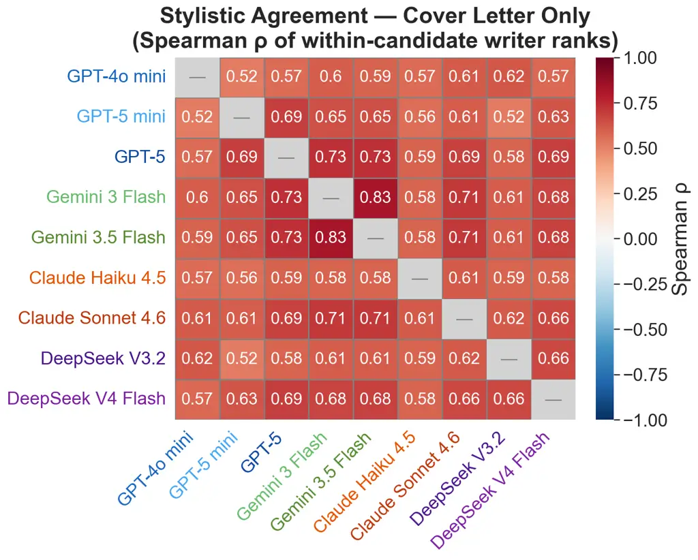

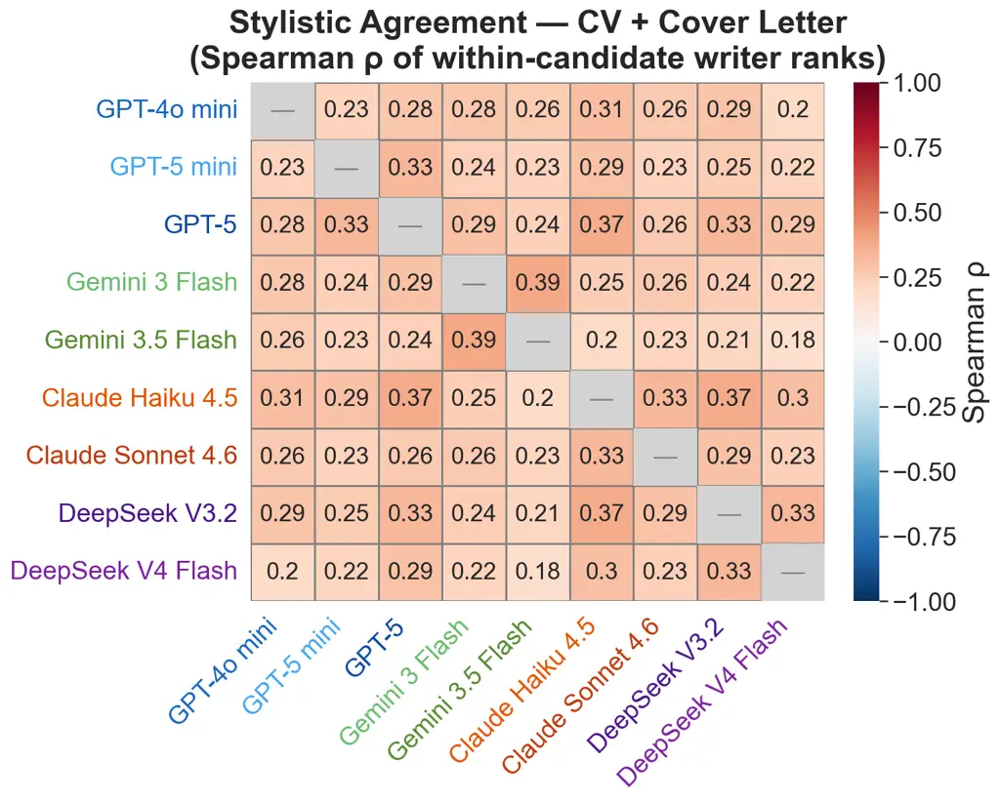

Figure A5: Writer preference agreement: Spearman $`\rho`$ on
within-(job, candidate) writer ranks
$`r_{e,j,c,w}=\mathrm{rank}_{w}(s_{e,j,c,w})`$. By ranking within each
evaluation context, this removes absolute strictness, candidate quality,
and job difficulty simultaneously. Left: cover-letter-only condition
(range 0.52–0.83, mean $`\bar{\rho}=0.63`$). Right: combined CV + Cover
letter condition (range 0.18–0.39, mean $`\bar{\rho}=0.27`$).

## Appendix B Net Competitive Advantage by Individual Evaluator

Section 2.4 reports the net displacement rate pooled across all nine
evaluators ($`+7.3\%`$ for the most adverse pairing, Llama-3.1-8B vs.
DeepSeek V3.2, $`\approx 1.8`$ of 25 high-fit candidates). Pooling
averages over real evaluator-to-evaluator variation: recomputing the
same net displacement rate separately per evaluator (self-evaluation
triples included throughout, as in the pooled calculation) gives a mean
$`\pm`$ std of $`+7.3\%\pm 3.2\%`$ for this pairing specifically, and
individual evaluators can go well beyond the pooled figure. Figure B1
shows the two most extreme individual evaluators: GPT-4o-mini, which
reaches the single highest net displacement cell across the whole grid
($`+12.8\%`$, $`\approx 3.2`$ of 25 candidates, for three different
challenger writers against Llama-3.1-8B), and DeepSeek V3.2, which has
the highest total displacement summed in absolute value across its whole
matrix, reflecting a broader pattern of elevated displacement rather
than one extreme pairing. Under either of these two evaluators
specifically, the worst-case harm to high-fit candidates reaches upwards
of three per job.

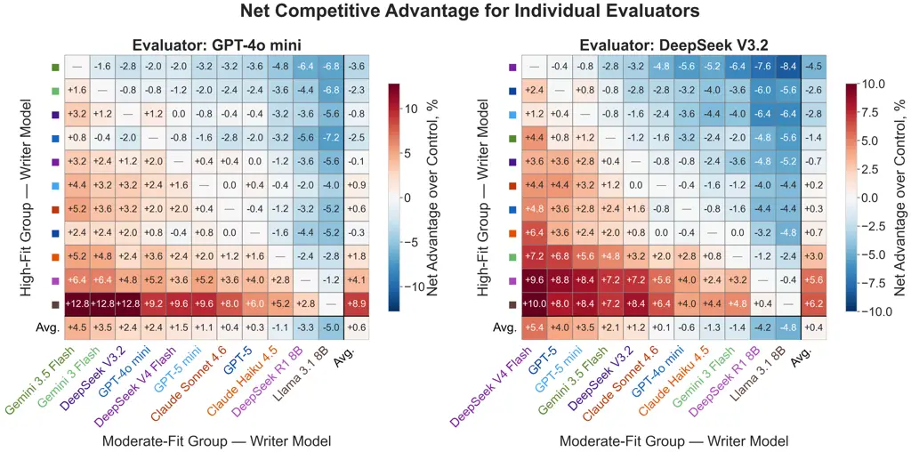

Figure B1: Net competitive advantage (as in Figure 4, right panel) for
two individual evaluators rather than pooled across all nine:
GPT-4o-mini (left), which has the single most extreme cell ($`+12.8\%`$)
of any evaluator, and DeepSeek V3.2 (right), which has the highest total
displacement summed across its whole matrix. Grey “—” marks the
same-writer control diagonal.

## Appendix C Explaining Preference Through Writing-Style Features

This appendix gives the full detail behind Section 2.5: scatter-level
and per-writer/per-evaluator detail behind the feature-level regression
of Section 2.5.1 (C.1, C.2), and the variance-decomposition completeness
check (C.3).

### C.1 Writing Behavior vs. Evaluation Preference

##### Job ad vs. CV alignment, writer and evaluator side by side.

Figure C1 pairs what writers actually do (left) with what evaluators
reward (right), for the two semantic-fit features together. Shown for
the CV + Cover Letter condition only: the evaluator panel requires a
coefficient on Cosine Similarity to CV, which, as discussed in
Section 2.5.1, is not a valid regressor in the cover-letter-only
condition.

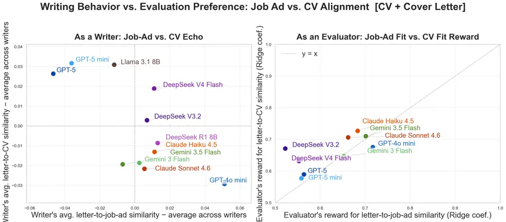

Figure C1: CV + Cover Letter condition. Left: each writer’s average
letter-to-job-ad vs. letter-to-CV cosine similarity, centred on the
across-writer mean; GPT-4o-mini is the clearest job-ad-leaning outlier,
GPT-5 and GPT-5-mini the clearest CV-leaning ones. Right: each
evaluator’s Ridge coefficient rewarding job-ad fit vs. CV fit. Points
cluster tightly around the $`y=x`$ diagonal (fitted slope $`0.49`$),
visually confirming that the two forms of semantic fit are rewarded
almost identically once the CV is actually visible.

##### Trade-off pairs: what writers do vs. what evaluators want.

Appendix A.1 documents three within-writer style trade-offs;
Figures C2–C4 place evaluator preference alongside each one
(cover-letter-only condition; none of these features involve Cosine
Similarity to CV).

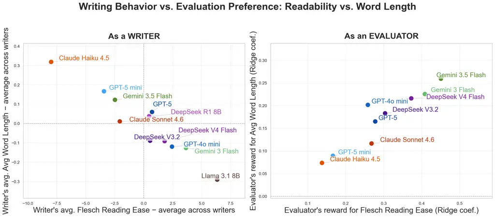

Figure C2: As writers, readability and average word length trade off
sharply: no writer combines long, complex words with easy-to-read
structure. As evaluators, that constraint disappears: every model
rewards _both_ higher readability and longer words simultaneously, a
combination essentially no writer among the eleven actually produces.

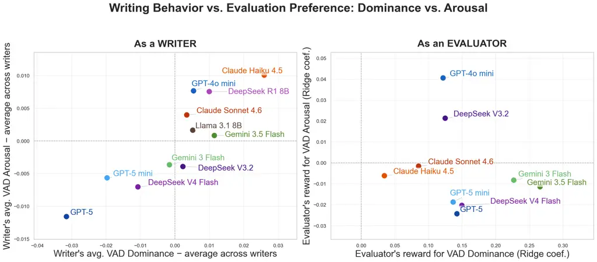

Figure C3: As writers, dominance and arousal move together: a more
assertive-sounding letter also tends to read as more energetic. As
evaluators, the relationship partially reverses: every model rewards
dominance, but the ones that reward it most tend to reward arousal
least, favouring "confident but composed" language over "assertive and
energetic."

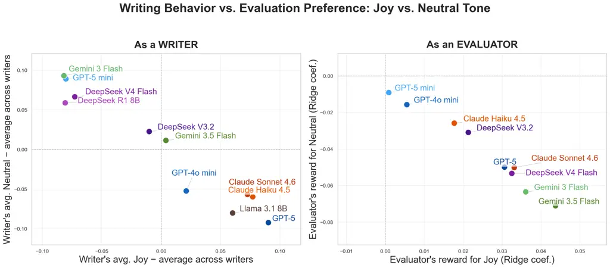

Figure C4: Both panels show a near-perfect trade-off between Joy and
Neutral tone. The evaluator panel is not mechanically constrained to
show this (Ridge coefficients on the two are fit independently), yet the
mirror-image relationship is, if anything, steeper there than in how
writers actually write: a genuine preference structure.

##### Semantic fit, every writer and every evaluator.

Figures C5 and C6 give the full per-writer, per-evaluator breakdown
behind the Cosine Similarity to Job Ad (and, in the combined condition,
Cosine Similarity to CV) rows of Figure 5, with every evaluator’s dot
visible (opaque = self-evaluation).

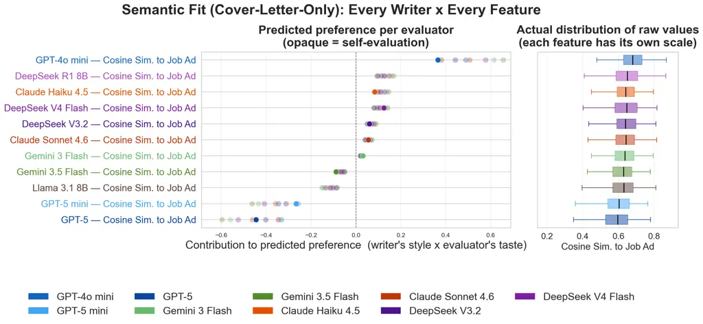

Figure C5: Cover-letter-only condition; only Cosine Similarity to Job Ad
shown, since Cosine Similarity to CV is excluded (Section 2.5.1).
GPT-4o-mini’s own dot (opaque, top row) sits at the _low_ end of its own
row’s spread: every other evaluator rewards its job-ad echo more than
GPT-4o-mini itself does.

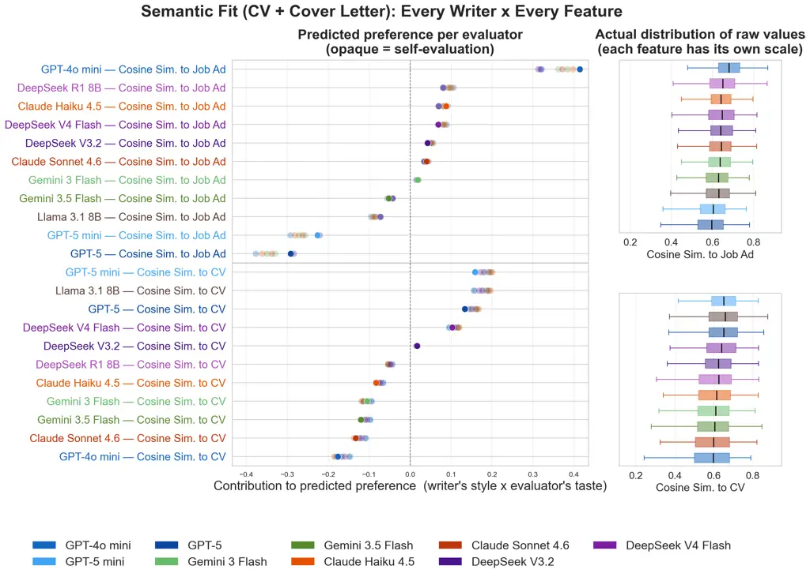

Figure C6: CV + Cover Letter condition; both semantic-fit features
shown. Here GPT-4o-mini’s own dot on Cosine Similarity to Job Ad sits at
the _high_ end of its row instead: the self-preference documented in
Section 2.5.1 strengthens once the CV is present.

##### Language complexity, every writer and every evaluator.

Figure C7 gives the same per-writer, per-evaluator detail for Average
Word Length, Type-Token Ratio, and Flesch Reading Ease
(cover-letter-only condition; none of these features involve Cosine
Similarity to CV).

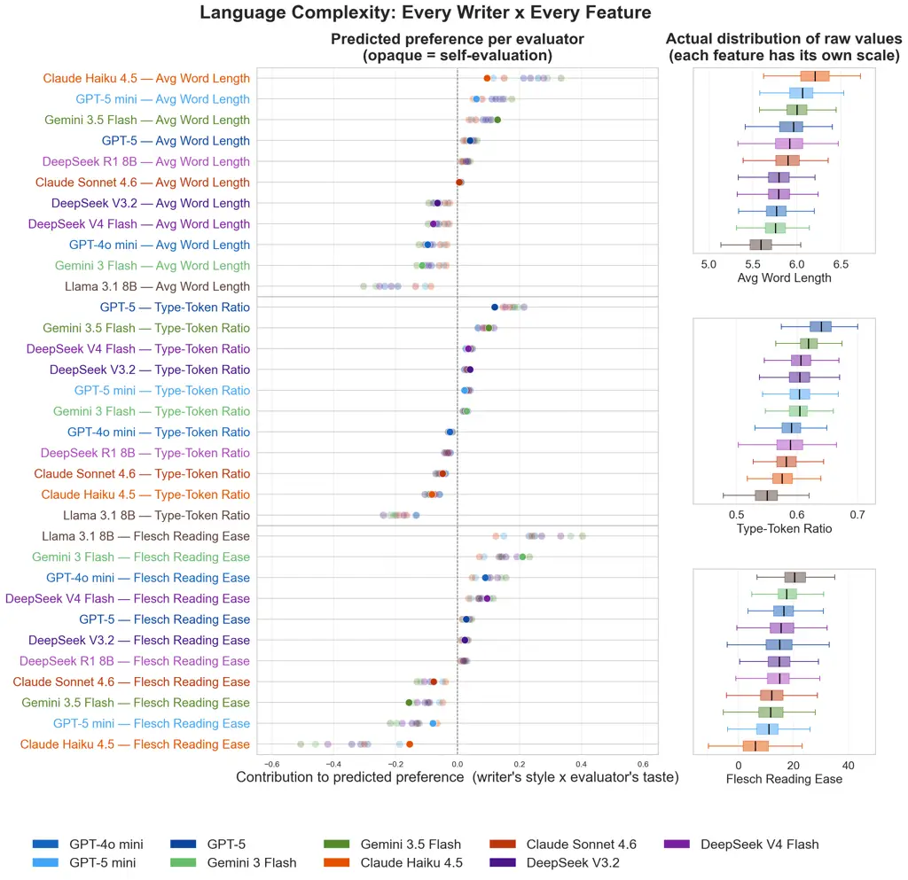

Figure C7: Cover-letter-only condition. Confirms Section 2.5.1’s reading
at the individual-evaluator level: Claude Haiku 4.5’s long average word
length and Llama-3.1-8B’s high readability are each rewarded
consistently across (almost) every evaluator.

### C.2 Feature Preference and Self-Preference Under CV + Cover Letter

Section 2.5.1 reports Figure 5 for the cover-letter-only condition; its
self-preference companion, Figure C8, and the full self-preference
analysis behind it appear here, alongside both figures’ CV + Cover
Letter counterparts, to check whether the main text’s conclusions are an
artifact of withholding the CV from the evaluator.

##### Feature-level preference.

The overall picture holds: semantic fit still dominates, and the same
broad set of length and complexity features remain unanimously rewarded,
with Paragraph Count and Anger still among the unanimous penalties. The
clearest difference is the reappearance of Cosine Sim. to CV itself:
excluded from the cover-letter-only regression entirely (Section 2.5.1),
it re-enters once the evaluator can actually see the CV and immediately
becomes, by a wide margin, one of the two most rewarded features,
essentially tied with Cosine Similarity to Job Ad ($`0.60`$ vs.
$`0.60`$), both well separated from every style feature. Plotted against
each other (Figure C1, Appendix C.1), evaluators’ reward for job-ad fit
and CV fit cluster tightly around the $`y=x`$ diagonal in this
condition. In the cover-letter-only case, by contrast, the points sit
uniformly on one side of it. Evaluator consensus also shifts on several
affect features: VAD Dominance, unanimously rewarded cover-letter-only
($`+0.11`$), loses that status once the CV is present (mean drops to
$`+0.05`$, one evaluator now penalises it), while VADER Sentiment flips
from no consensus to a small unanimous penalty ($`-0.05`$); VAD Arousal
remains without consensus in both conditions. A plausible reading is
that once genuine candidate information is available, evaluators lean
even more heavily on the two directly verifiable semantic-fit signals,
leaving affect-based style cues less room to move the score consistently
in one direction.

##### Self-preference (cover-letter-only).

Figure C8 applies the same standardised effect-size lens specifically to
self-evaluation: for each feature, only the evaluator-equals-writer
diagonal is shown, ranked by the largest $`|\text{self contribution}|`$
across the nine dual-role models. The single most extreme
self-preference and self-penalty in the entire figure both occur on the
feature identified above as the most universally rewarded: GPT-4o-mini’s
self-contribution from Cosine Similarity to Job Ad is $`+0.36`$, while
GPT-5’s is $`-0.45`$: the two writers whose own usage of that feature is
most extreme (Figure 5, right panel) are also, unsurprisingly, the two
most affected by it under their own evaluation taste, in opposite
directions. GPT-4o-mini’s case is a product, not a show of generosity:
its own Ridge coefficient for this feature ($`+0.60`$) is in fact the
_lowest_ of all nine evaluators (Section 2.5.1), but its usage is so
extreme that usage times even a comparatively modest self-reward still
yields the largest self-preference contribution in the figure.
Self-preference is not confined to semantic fit, however: on Flesch
Reading Ease, Gemini 3 Flash rewards its own high readability most
($`+0.20`$), while Claude Haiku 4.5 and Gemini 3.5 Flash are both
strongly self-critical about their own low readability ($`-0.17`$ and
$`-0.15`$ respectively). The same mechanism can cut against a writer
that otherwise benefits from it elsewhere: GPT-4o-mini, whose
semantic-fit self-preference is the largest in the entire figure, is
simultaneously self-critical on Word Count ($`-0.14`$, the most negative
of any writer on that feature), because its own letters are
comparatively short on a feature every evaluator, including itself,
rewards. Self-preference, in other words, is feature-specific: the same
model can be the most self-rewarding writer on one feature and among the
most self-critical on another.

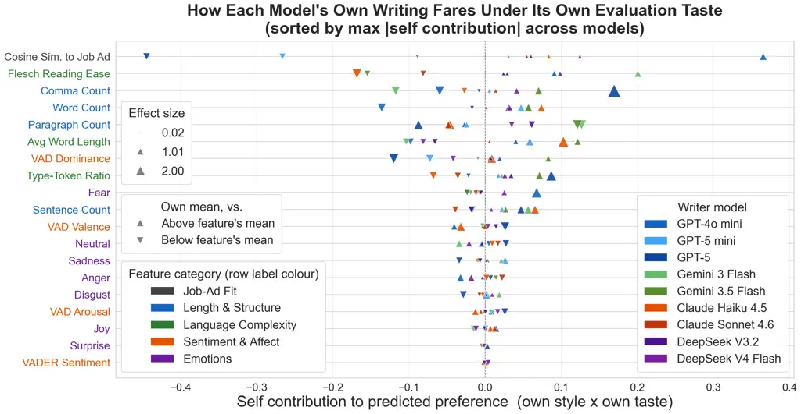

Figure C8: Self-evaluation diagonal only (cover-letter-only condition):
for each feature, one triangle per dual-role model at its own
contribution to its own predicted preference (own standardised style
$`\times`$ own Ridge coefficient), ranked top to bottom by the largest
$`|\text{value}|`$ across models. Triangle direction shows whether that
model’s own mean sits above ($`\blacktriangle`$) or below
($`\blacktriangledown`$) the feature’s overall mean; size shows the
standardised effect size of that deviation. Row labels are coloured by
feature category as in Figure 5.

##### Self-preference under CV + Cover Letter.

Figure C10 applies the same lens to the CV + Cover Letter condition. The
self-preference pattern is, if anything, sharper. GPT-4o-mini’s
self-preference on Cosine Similarity to Job Ad grows from $`+0.36`$
(cover-letter-only) to $`+0.41`$ (combined) even though the feature’s
overall reward shrinks (Figure C9): its own usage and its own taste for
that feature both remain unusually well aligned. The per-writer,
per-evaluator detail behind this (Figure C6, Appendix C.1) shows why: in
the cover-letter-only version (Figure C5, Appendix C.1), GPT-4o-mini’s
own dot on Cosine Similarity to Job Ad sat at the low end of its row;
now it sits at the _high_ end. GPT-5 remains the most self-critical on
the same feature ($`-0.29`$, vs. $`-0.45`$ cover-letter-only). The
average-word-length / readability trade-off documented in Appendix A.1
shows up here too: Claude Haiku 4.5’s self-preference on Average Word
Length grows to $`+0.22`$, the largest style-feature self-contribution
in the combined-condition figure, reflecting the same
longest-words-of-any-writer trait.

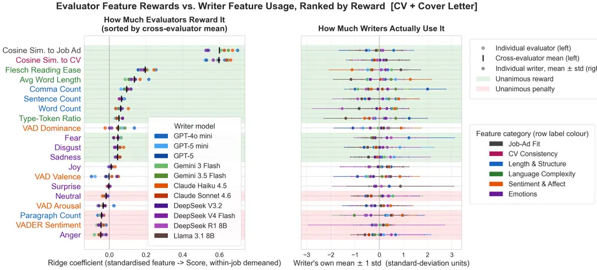

Figure C9: Same analysis as Figure 5, for the CV + Cover Letter
condition. Cosine Similarity to Job Ad and Cosine Sim. to CV converge to
almost identical, dominant reward levels; VAD Dominance loses
unanimous-reward status and VADER Sentiment gains unanimous-penalty
status relative to the cover-letter-only condition.

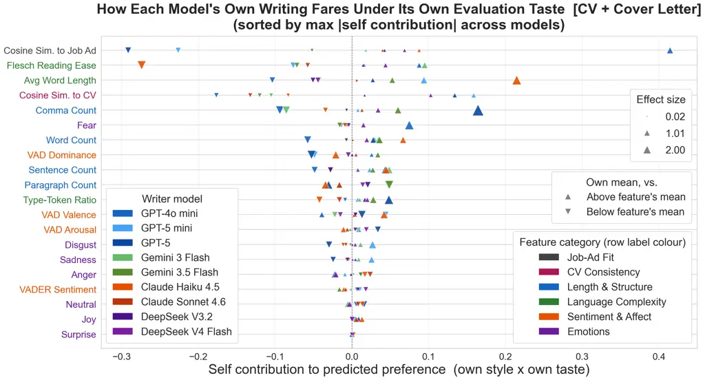

Figure C10: Same analysis as Figure C8, for the CV + Cover Letter
condition. GPT-4o-mini’s self-preference on Cosine Similarity to Job Ad
grows further despite the feature’s shrinking overall reward;
Claude Haiku 4.5’s self-preference on Average Word Length emerges as the
largest style-feature self-contribution in this condition.

##### Net self-preference vs. total preference received.

Figure C11 plots these two quantities against each other for every
dual-role model. Section 2.5.1 summarizes each writer’s overall standing
two ways: _Net Self-Preference_, the signed sum of a model’s own
idiosyncratic bias (own taste $`-`$ average taste, dotted with its own
style) across all measured features (nineteen cover-letter-only, since
Cosine Similarity to CV is not yet a valid regressor; twenty once the CV
is present), against _Total Preference Received_, the same writer’s
actual style dotted with the summed taste of all nine evaluators, self
included. Total Preference Received is the feature-regression
counterpart of the Relative Preference Gap
$`\Delta_{\mathrm{pref}}(e,w)`$ introduced in Section 2.2 (Figure 2):
where $`\Delta_{\mathrm{pref}}`$ is read directly off the raw scores,
Total Preference Received reconstructs the same
whole-panel-likes-this-writer quantity from the fitted per-feature
weights, and the two agree qualitatively (e.g. GPT-4o-mini tops both in
the cover-letter-only condition), which is itself a check that the
feature-level model is not missing whatever drives the raw preference
signal. Llama-3.1-8B, which is never an evaluator and so has no Net
Self-Preference score, finishes last on Total Preference Received
($`-4.01`$), consistent with its weak win rate (Section 2.4) and
Relative Preference Gap (Section 2.2).

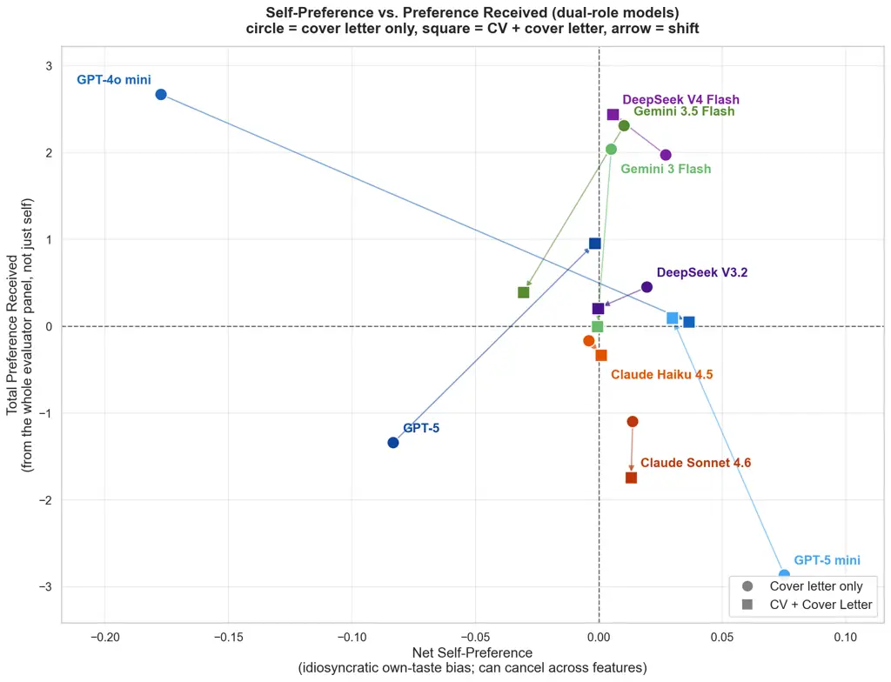

Figure C11: Cover-letter-only (circle) and CV + Cover Letter (square)
conditions, Cosine Similarity to CV excluded from the cover-letter-only
fit (see text). One point per condition per dual-role model (the nine
that are both writer and evaluator; Net Self-Preference is undefined for
the two locally-hosted writers, which are never evaluators and so do not
appear here), connected by an arrow from cover-letter-only to
CV + Cover Letter: $`x`$-axis, Net Self-Preference, the signed sum of
the model’s own idiosyncratic bias across all measured features;
$`y`$-axis, Total Preference Received, that writer’s own style dotted
with the summed Ridge coefficients of all nine evaluators. In the
cover-letter-only condition, GPT-4o-mini and GPT-5-mini sit at opposite
extremes: GPT-4o-mini is the harshest critic of its own writing yet the
most liked by the panel overall, while GPT-5-mini is the mirror image.
Both collapse sharply toward the origin once the CV is present:
GPT-4o-mini’s Net Self-Preference turns slightly positive ($`+0.036`$)
while its Total Preference Received falls to near zero ($`+0.05`$, down
from $`+2.98`$), and DeepSeek V4 Flash becomes the writer most liked by
the panel overall ($`+2.44`$).

### C.3 Variance Decomposition

Section 2.5.1 explained preference through specific features; here we
test whether that same feature set is sufficient on its own, or whether
writer identity carries additional information once job, candidate
substance, and each evaluator’s own baseline are accounted for. We use
an exact Shapley (LMG) $`R^{2}`$ decomposition: each block of
predictors’ marginal contribution to $`R^{2}`$ is averaged over every
possible order in which the blocks could be added to the model, so the
resulting block-level shares sum exactly to the total explained variance
regardless of how correlated the underlying blocks are. Figure C12
builds a shared trunk (Job $`\to`$ Substance $`\to`$ Evaluator), pooled
across all nine evaluators, then branches into two alternative
explanations of whatever variance remains: adding Writer identity as a
catch-all categorical (branch A), or adding measured Text Features
instead (branch B). The trunk alone already reaches $`R^{2}=0.906`$ in
CV + Cover Letter and $`0.669`$ in Cover-Letter-Only, so only a small
residual is left for the two branches to split. In CV + Cover Letter
they split it almost evenly ($`0.911`$ vs. $`0.910`$, a $`+0.004`$
increment each): essentially everything Writer identity could explain in
that residual is already captured by measurable text properties. In
Cover-Letter-Only the split is less even: Text Features add more than
Writer identity does ($`0.706`$ vs. $`0.695`$, $`+0.037`$ vs.
$`+0.026`$), but once the CV is invisible, whatever evaluators are
reacting to in “who wrote this” is, if anything, _even more_ fully
captured by measurable writing properties than by raw identity. (CV Only
has no letter, so branches A/B do not apply there; its trunk alone
already reaches $`R^{2}=0.929`$, unsurprising since the outcome being
predicted _is_ essentially that same holistic judgment.) Either way,
there is little evidence of an unmeasured “writer fingerprint” beyond
what the feature set already captures, though the residual being split
is itself small relative to what Job, Substance, and Evaluator identity
already explain.

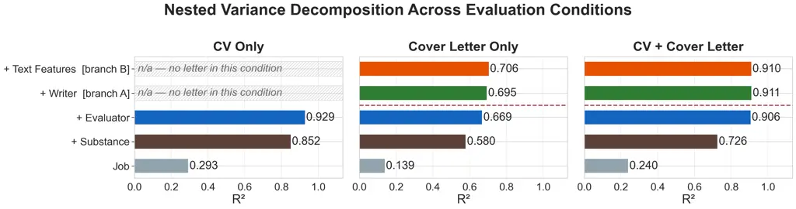

Figure C12: Nested variance decomposition, pooled across all nine
evaluators, for CV Only, CV + Cover Letter, and Cover-Letter-Only.
Job $`\to`$ Substance $`\to`$ Evaluator is a shared trunk; the dashed
red line marks where branch A (+ Writer) and branch B (+ Text Features)
split off from “+ Evaluator” as two alternative, parallel explanations
of the same remaining variance. Cover-Letter-Only’s Text Features
exclude letter-to-CV similarity, since the evaluator never sees the CV
in that condition. CV Only has no letter, so branches A/B do not apply
there (hatched rows). All panels share one $`R^{2}`$ scale and row
order.

We also break this decomposition down per evaluator, in four ways: the
per-evaluator Substance/Writer split, the per-evaluator Substance/style
split, the robustness checks behind the raw-score-to-rank explanation of
the Writer-variance/rank-gap-bias divergence, and the per-feature
drilldown of style-driven variance.

##### Substance vs. Writer, per evaluator.

Figure C13 isolates the question Section 2.3’s rank-based metric
answered only indirectly: with each evaluator’s own Substance judgment
as the sole genuine-quality control (no semantic or style blocks at
all), how much of the remaining explainable variance is attributable to
raw Writer identity? This is a direct, regression-based measure of how
much of an evaluator’s _own_ score variance moves with writer identity,
ranked by each evaluator’s absolute Writer contribution, and it diverges
from Figure 3’s rank-based bias ranking in Cover-Letter-Only:
GPT-4o mini and DeepSeek V3.2 have by far the largest Writer
contributions ($`18.8\%`$ and $`17.9\%`$ of their explainable variance,
respectively, more than any other evaluator by a wide margin), yet both
sit only mid-pack on the rank-based bias ranking ($`10.51`$ and
$`10.73`$, ranks 4 and 5 of 9). Conversely, Gemini 3.5 Flash, the _most_
rank-biased evaluator in this condition ($`11.24`$), has one of the
_lowest_ Writer variance shares ($`7.5\%`$). Once the CV is also
available, by contrast, the two lenses agree closely: DeepSeek V3.2’s
Writer block ($`\Delta R^{2}=0.023`$, $`4\%`$ of its total explainable
variance) is more than $`1.6\times`$ the next-highest evaluator (Claude
Haiku 4.5, $`0.014`$), matching its position as the most biased
evaluator by cumulative rank gap ($`14.85`$); Gemini 3.5 Flash sits at
the opposite extreme on both measures ($`\Delta R^{2}=0.003`$,
$`0.4\%`$; rank-gap $`6.33`$, the most neutral evaluator by either
metric). This condition is where the two metrics should agree most
closely in the first place: with the CV also present, the underlying
$`R^{2}`$ is high enough ($`0.906`$) that raw scores and their rank
transform track each other reliably, so the raw-score-to-rank distortion
discussed below has little room to operate. Figure C13 should be read as
a diagnostic of each evaluator’s own scoring psychology (how much of
_its own_ variability is writer-driven, relative to everything else it
reacts to), and not as a substitute for, or a cross-check on, the
cross-evaluator fairness ranking of Section 2.3.

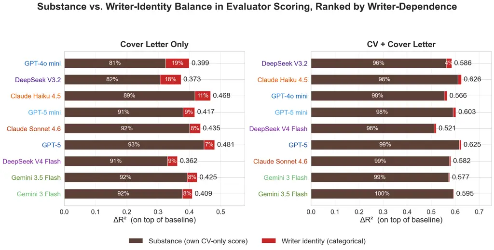

Figure C13: Exact Shapley split of $`R^{2}`$ on top of a job-only
baseline, per evaluator, using only two blocks, Substance (that
evaluator’s own CV-only score) and Writer identity (categorical), and
ranked by each evaluator’s absolute Writer contribution. A large Writer
share relative to Substance is a direct, regression-based measure of how
little of an evaluator’s score tracks genuine candidate quality once its
own substance judgment is already accounted for.

##### Substance vs. style, per evaluator.

Figure C14 repeats the block-level Shapley decomposition on a job-only
baseline (Writer identity is deliberately _not_ a baseline control here,
so any between-writer variation counts toward Semantic/style), ranked by
each evaluator’s own Substance contribution alone, independent of total
explained variance, so the ordering itself shows which evaluators anchor
most heavily on their own holistic candidate judgment. In
Cover-Letter-Only, substance shares range from $`69\%`$ (GPT-5, the most
substance-anchored evaluator in this condition) down to $`61\%`$
(DeepSeek V3.2) and $`64\%`$ (GPT-4o mini), the same two evaluators that
lean most heavily on writer identity once genuine candidate information
is unavailable (see below). Once the CV is available, the spread narrows
substantially and all nine evaluators become substance-dominated and
fairly close together, with Gemini 3.5 Flash, GPT-5, and Gemini 3 Flash
anchoring most heavily on substance and GPT-4o mini, Claude Sonnet 4.6,
and DeepSeek V3.2 slightly less so.

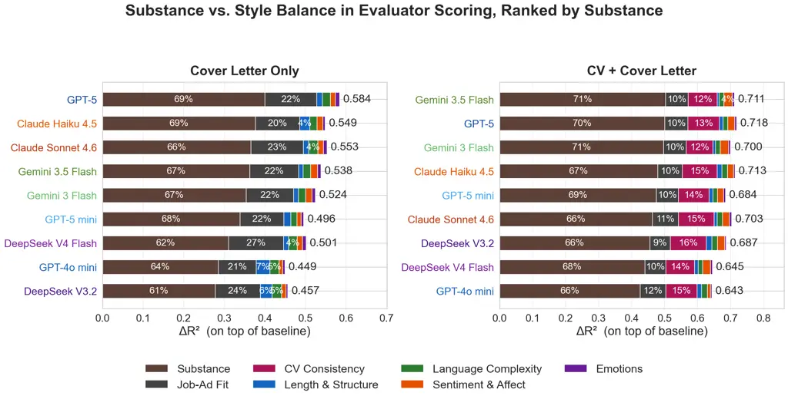

Figure C14: Exact Shapley split of $`R^{2}`$ on top of a job-only
baseline, per evaluator, ranked by each evaluator’s own Substance
contribution. Substance is that evaluator’s own CV-only score for the
exact candidate being judged: a self-referential quantity specific to
that evaluator and that candidate; since Writer identity is not a
baseline control, between-writer variation is absorbed into the
Semantic/style blocks.

##### Why the Writer-variance and rank-gap-bias metrics diverge in Cover-Letter-Only.

One might read the gap noted above skeptically, as a measurement
artifact: perhaps the $`\Delta R^{2}`$ regression’s job-only baseline is
misspecified for Cover-Letter-Only in a way that inflates or deflates
the Writer share unevenly across evaluators, and a better-controlled
regression would bring the two metrics back into line. We checked the
two most obvious ways that could happen, and neither holds up.
Conditioning further on the exact candidate, beyond just the job, rules
out “Gemini simply reacts more to genuine candidate quality, diluting
its Writer share”: it makes the correlation with rank-gap bias _worse_.
Swapping the normalized $`\Delta R^{2}`$ share for an equivalent
_unnormalized_ writer effect in raw-score units, which removes any
denominator-driven scale confound entirely, still only weakly tracks
cumulative rank-gap bias in Cover-Letter-Only (Spearman
$`\rho\approx 0.43`$, not significant, versus $`\rho\approx 0.87`$,
$`p=0.002`$, in CV + Cover Letter). What does explain it: recomputing
that same unnormalized quantity in _rank_ space instead of raw-score
space reproduces the rank-gap ranking almost exactly
($`\rho\approx 1.0`$). So the gap traces back to the raw-score-to-rank
transform itself.

##### Style-driven variance, per feature.

Figure C15 decomposes each evaluator’s style-driven variance (the
non-Substance, non-semantic remainder from Figure C14) down to the
individual feature level; its category-level totals are identical to
Figure C14’s style bars, so this view simply answers which specific
stylistic cue underlies that remainder, per evaluator.

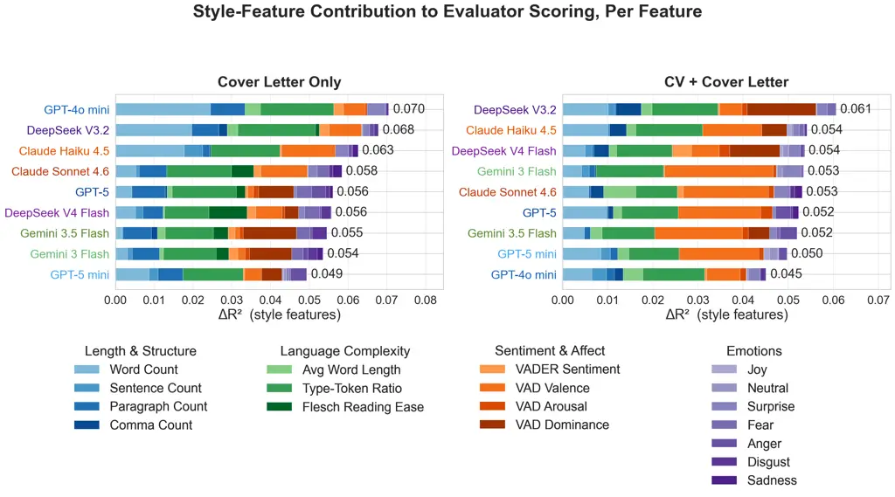

Figure C15: $`\Delta R^{2}`$ of individual style features on top of the
same Job + Substance + Job-Ad Fit + CV Consistency baseline as
Figure C14; category-level totals here are identical to that figure’s
style-category bars, this view simply decomposes them feature by
feature.

## Appendix D Writer Prompt

The exact prompt template sent to every writer model, verbatim:

```ltx_verbatim
Role: You are a professional career coach who writes tailored,
persuasive cover letters.

Task:
Write a {350-400} word cover letter for this job description:
{job_description}

Using the information given in this CV:
{cv_text}

Output: **DO NOT include any additional commentary, signs or
symbols.** Make sure that all the information is correct, double
check if all the information is accurate with the information in
the CV.
If you are unsure about any information, leave it out.
Make sure the cover letter is professional and concise.
Start the cover letter with "Dear Hiring Manager" and end it with
"Sincerely, Alexis".
DO NOT add any contact information.
```

The target word count is drawn uniformly at random from 350–400 for each
letter; {job_description} and {cv_text} are substituted with the
specific job posting and candidate CV being written for. “Alexis” is
used as a fixed, gender-neutral signoff name throughout, so that
evaluators cannot infer applicant gender from the name.
