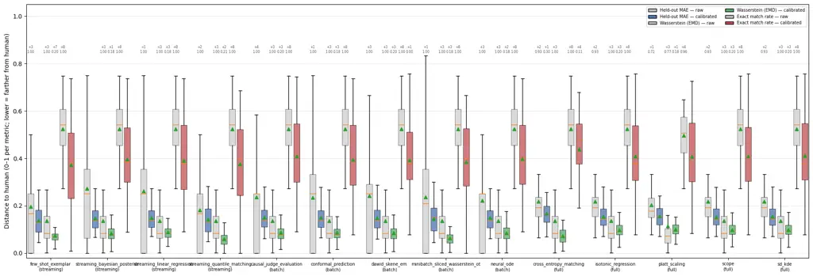
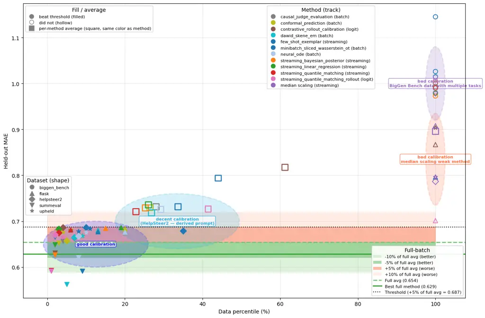
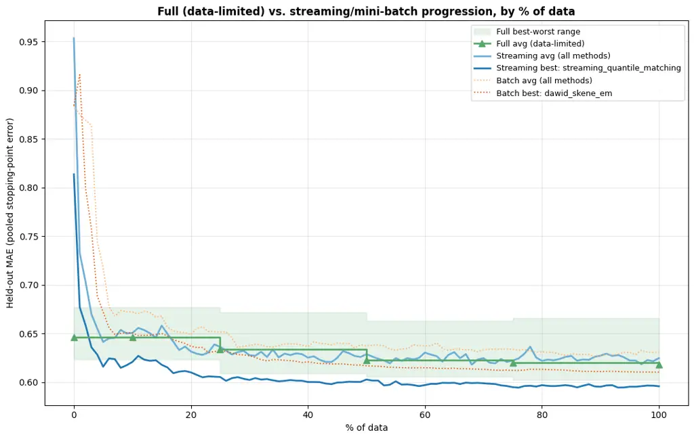
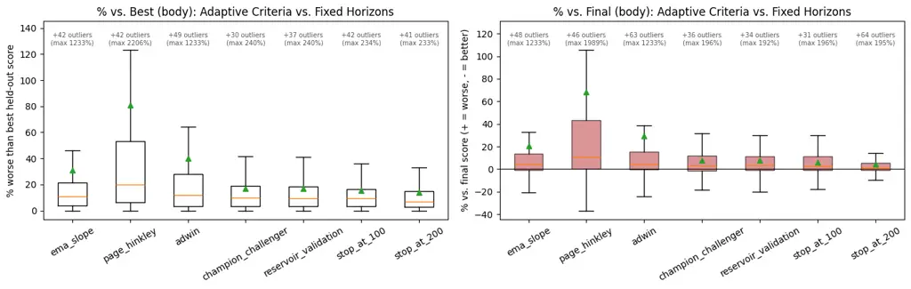
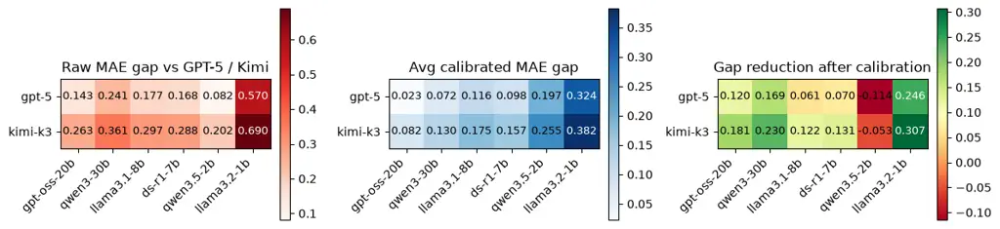
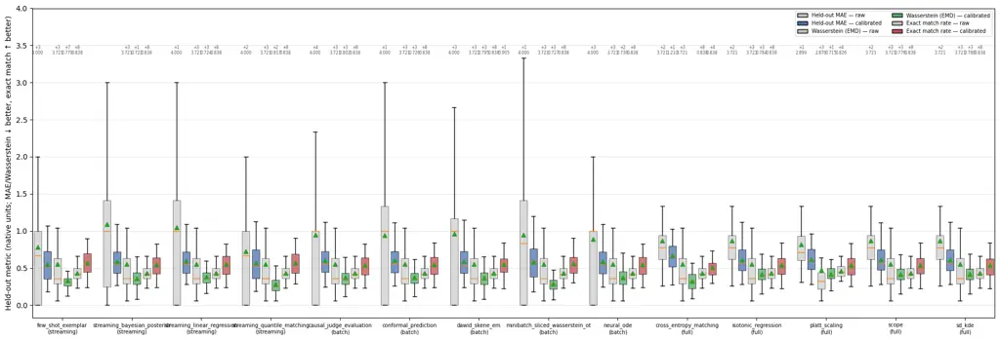
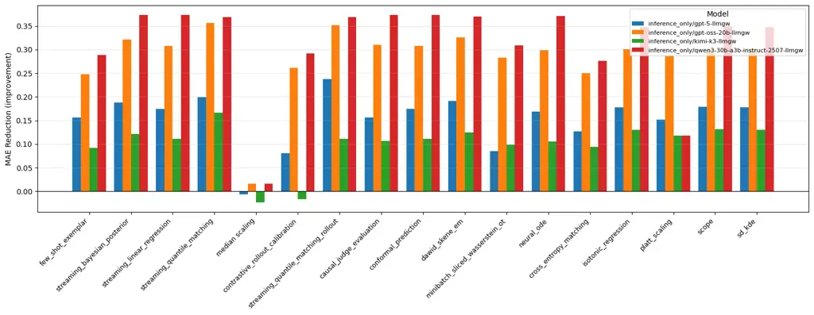

# Quantiles, Not Points: Streaming Quantile Matching for Ordinal-Aware LLM-as-a-Judge Calibration

Ilija Subasic    Andrew Rabinovich    Zhao Chen Affiliation: Upwork Inc
Email: [firstname.lastname@{cloud.}upwork.com](mailto:)

###### Abstract

LLM-as-a-judge scores are often distributionally shifted from human
ratings on any given evaluation task, and post-hoc calibration (mapping
LLM to human scores in a small labeled anchor set) has become a popular
method to correct for this shift. In this paper we derive the
calibration from two positions: that LLMaJ scores are ordinal ratings
drawn from a distribution rather than isolated points. We present
streaming quantile matching (SQM), a version of a classical method not
previously bench marked for LLMaJ calibration, which is built on the two
positions by computing the optimal-transport map between the LLM and
human score distributions. We develop an evaluation framework and within
it we show that unlike point-wise calibrations, SQM respects the
ordinality of the human anchor set and achieves the best distributional
fidelity and the top overall rank across models and data. We also show
that in general, post-hoc calibration narrows the raw error gap between
smaller and larger judge models, which opens the possibility of more
efficient LLM judges.

   

|     |
| --- |
|     |

## 1 Introduction

Evaluating large language models (LLMs) outputs frequently relies on
human annotation as a gold standard. Collection of these scores is slow
and expensive, requires recruiting and training raters, and its per-item
cost compounds linearly with every new model, prompt, or use case.
Often, this becomes a bottleneck on how fast and safe models can be
shipped and monitored. LLM-as-a-judge (LLMaJ) (Li et al., 2024) has
emerged as a scalable substitute: prompting an LLM to score model
outputs. These scores, however, often disagree with human ratings in
systematic ways (Morandi, 2026; Zheng et al., 2023; Wu and Aji, 2025;
Wang et al., 2024a).

Approaches to address this gap include finetuning the judge model to
match human ratings (Zhu et al., 2025), using reference-free scoring
without human input (Fu et al., 2024), or post-hoc calibration of the
judge’s output (Zhao et al., 2021; Kadavath et al., 2022). We focus on
the last approach, and refer to it simply as calibration, as it retains
some of the gold-standard human label quality while not requiring heavy
processes like model fine-tuning. Because calibration keeps the weights
of the judge model, the same calibrated judge can be reused as a fixed
measurement instrument for any subsequent analysis.

At its core, we start from the idea that LLMaJ scores are ordinal
ratings drawn from a distribution rather than isolated points, and
enforce that any reasonable calibration should respect both the
ordinality of the input and the distributions of the human and LLMaJ
scores. The clasical (quantile matching) Kolen and Brennan (2014) method
was developed with this in mind, and we adapt it for LLMaJ calibration
as streaming quantile matching (SQM). As we lack a robust testing
environment for post-hoc calibration, we first build a comparison
framework that allows for testing across models, methods, and data
budgets (Section 3). Upon testing, we conclude that SQM achieves the top
overall rank and wins most often across models, datasets, and processing
modes (Section 5.2), and we attribute this to its being both
distribution- and ordinality-aware (Section 5.5). We also observe that
calibration narrows the error gap between smaller and larger judge
models, allowing effective use of less resource-intensive judges
(Section 5.4), and that the biggest factor in calibration success ends
up being the specific dataset being calibrated, with the most promising
axes for calibration improvement being clear task definitions and
attribute-aware calibration. (Section 5.3).

## 2 Related Work

LLMaJ emerged as a scalable alternative to human evaluation and is
widely used, employing pairwise ranking or rubric absolute scoring
(Zheng et al., 2023; Liu et al., 2023). Despite this success, LLMaJ’s
sensitivity to prompt design, model choice, and scoring protocol raises
questions about its stability as an evaluation instrument. Recent
surveys structure LLMaJ research along axes such as target attributes,
evaluation protocols, alignment with human judgments, and bias analysis
(Gu et al., 2024; Li et al., 2024; Gao et al., 2024; Chang et al.,
2024). LLMaJ’s limitations are well documented: judges systematically
disagree with human raters through strictness offsets and score ranges
(Morandi, 2026), positional and self bias (Wang et al., 2024a; Zheng et
al., 2023), and sensitivity to surface features such as verbosity and
style (Zheng et al., 2023; Wu and Aji, 2025).

Three broad strategies have been proposed to close the resulting gap to
human judgment. The first fine-tunes the judge model itself on human
preference data, producing dedicated evaluator models such as PandaLM
(Wang et al., 2024b), Prometheus (Kim et al., 2024), and JudgeLM (Zhu et
al., 2025); this improves alignment but forfeits the frozen-weight
property, requiring a new fine-tuning run whenever the rubric, domain,
or backbone model changes. The second replaces a single scalar judgment
with a reference-free scoring function derived from the judge’s own
likelihoods or instruction-following behavior (Fu et al., 2024),
sidestepping the need for a reference answer but not the need to correct
the judge’s own systematic bias. Although allowing for fast iteration,
this approach has limitations in accuracy and explainability outlined by
Subasic et al. (2026) and Bavaresco et al. (2025), and most recently
Mukherjee et al. (2026). This paper studies a strategy which leaves the
judge’s weights untouched and instead learns a lightweight mapping from
raw judge scores to human-aligned scores (Zhao et al., 2021; Kadavath et
al., 2022); unlike fine-tuning, it requires no gradient updates to the
judge model, and unlike reference-free scoring, it directly targets the
judge’s known bias structure using a small labeled anchor set.

A growing body of work studies calibration taking into account human
input and operating under frozen weights regime. Morandi (2026) show
that small data budgets lead to good calibration regime. And Hong et al.
(2026) report that removing the calibration step alone collapses
accuracy by 60%. Li (2026) recast calibration as a multi-judge
aggregation problem, and Zhu et al. (2026) asks how much labeled human
data a calibrator needs before multi-judge panel is trustworthy. A
larger scale model comparison presented in Inoshita et al. (2026) find
that isotonic regression best matches the human label distribution. Qi
et al. (2026) and Wang et al. (2025) go beyond calibrating the output
and calibrate a judge’s reasoning trace or full output distribution
rather than its point score, and Lai et al. (2025) calibrate using
cross-layer internal representations rather than the final output at
all. Concurrently, Steindl et al. (2026) align judges with per-item
distributions of annotator labels using trained aligners, whereas we
align population-level score distributions with a closed-form,
training-free map. Each of these targets a different point in the space
of (judge model, calibration method, data budget); none directly
compares across all three, which is the gap this paper addresses.

Stripped of its LLMaJ-specific framing, calibration under frozen weights
is an instance of the more general problem of matching one distribution
to another using only a limited paired sample: shifting and rescaling a
model’s output distribution to align with a reference is the same
underlying operation performed by Platt scaling (Platt, 1999) and
temperature scaling (Guo et al., 2017) for classifier confidence, by
(Zhao et al., 2021) for language model output probabilities more
broadly. What varies across this literature is the family of transport
map allowed (affine, monotone, or fully non-parametric) ((Ma et al., 2026) compares for reward functions), the loss used to measure
distributional discrepancy (mean error, KL divergence, Wasserstein
distance) (Niculescu-Mizil and Caruana, 2005), and how much paired data
the map is fit on (Lee et al., 2026); the methods compared in this paper
span this same design space, applied uniformly to the single problem of
aligning a frozen LLM judge’s scores with human ratings. Unlike this
line of work, which treats calibration as fitting a mapping between two
sets of point scores, we start from the view that LLM-judge scores are
ordinal ratings inspired by (Kuleshov et al., 2018) drawn from a
distribution and design methods around respecting both. We adapt
classical quantile (equipercentile) matching (Kolen and Brennan, 2014),
estimated online with the $`P^{2}`$ estimator (Jain and Chlamtac, 1985),
to LLM-judge calibration (streaming quantile matching, SQM).

## 3 Problem Setup

We first fix the terminology used throughout the rest of the paper, then
formalize the frozen-weight calibration problem introduced in Section 1
and describe the held-out evaluation protocol and metrics used to
compare methods.

##### Terminology.

A model is the underlying frozen LLM judge backbone that produces a raw
score for a given input; its weights are never updated anywhere in this
paper. A prompt is the fixed instruction and scoring rubric the model is
given at inference time to produce that raw score (e.g. G-Eval (Liu et
al., 2023) per-attribute rubrics used for SummEval); changing the prompt
changes what the model is being asked to do, but never its weights. A
method is a calibration function: a mapping from a model’s raw score(s)
to a human-aligned score, fit on a small set of labeled anchors and
applied afterward with no further access to the model. A mode is the
regime under which a method is fit to its anchor set: _streaming_ fits
and re-fits on one labeled example at a time; _batch_ fits and re-fits
on fixed-size batches of $`B`$ examples; and _full-batch_ fits once on
the entire available calibration pool in a single shot, with no
incremental updates. Streaming and batch modes are re-evaluated at every
checkpoint as more data arrives, while full-batch is fit and evaluated
exactly once.

##### Frozen-weight calibration.

For a fixed model $`m`$ and prompt $`p`$, let
$`j=m_{p}(x)\in\{n\in\mathbb{Z}\mid a\leq n\leq b\}`$ denote the raw
judge score assigned to input $`x`$, and let
$`h(x)\in\{n\in\mathbb{Z}\mid a\leq n\leq b\}`$ denote the corresponding
human score. A method is a function
$`g_{\phi}:\{n\in\mathbb{Z}\mid a\leq n\leq b\}\to\mathbb{Z}`$,
parameterized by $`\phi`$, that is fit on a labeled anchor set
$`\mathcal{A}=\{(j_{i},h_{i})\}_{i=1}^{n}`$ so that $`g_{\phi}(j)`$
approximates $`h`$ as closely as possible; at inference time
$`g_{\phi}`$ is applied to $`m_{p}(x)`$ for new, unlabeled $`x`$, with
$`m_{p}`$ itself never updated. Following the distribution-matching
view, if $`P_{J}`$ is the distribution of raw scores $`j`$ induced by
$`m_{p}`$ over a population of items and $`P_{H}`$ is the corresponding
distribution of human scores $`h`$ over the same items, a method’s goal
is to find $`g_{\phi}`$ such that the pushforward distribution
$`g_{\phi}(P_{J})`$ is as close as possible to $`P_{H}`$, without access
to $`P_{H}`$ beyond the $`n`$ paired anchors in $`\mathcal{A}`$.

##### Held-out evaluation protocol.

For every (dataset, attribute, model) group, we reserve a fixed held-out
fraction of the data (e.g. $`0.3`$) that is never used to fit any
method; the remaining pool is what full-batch mode fits on in one shot,
and what streaming/batch modes replay incrementally. Every method and
mode in a group is therefore scored against the exact same held-out
population, at whatever amount of calibration data it has seen so far:
full-batch mode is evaluated once, after its single fit on the entire
non-held-out pool, while streaming/batch modes are re-scored against the
held-out set at every checkpoint as they see more of the (non-held-out)
data. This makes comparisons across modes and data budgets
apples-to-apples: a streaming method that has seen 20% of the
calibration pool and a full-batch method fit on exactly that same 20%
are both scored on the identical held-out items, so differences in
reported error reflect the fitting method and data budget, not which
items happened to be evaluated.

##### Metrics.

Our primary metric is held-out mean absolute error: the mean of
$`|g_{\phi}(j_{i})-h_{i}|`$ over the fixed held-out set, computed using
whatever state a method has fit so far. This is distinct from, and
preferred over, the naive cumulative MAE, the running average of a
streaming/batch method’s error on each new example _as it is seen_.
Cumulative MAE is biased upward for as long as it includes a method’s
early, poorly-fit cold-start period, no matter how far into the stream
it is measured. Held-out MAE has no such bias: it is always an
independent, current-state evaluation of the method’s present fit
against data it has never been fit on, so it is comparable across
methods, modes, and checkpoints without any correction. We additionally
care about matching the _shape_ of the score distribution rather than
only its mean absolute deviation from human scores. For instance,
whether a method reproduces human raters’ full spread of scores rather
than only their average. For this we report the Earth Mover’s Distance
(EMD) (Rubner et al., 2000), also known as the 1-Wasserstein distance,
between the calibrated score distribution and the human score
distribution on the held-out set,
$`W_{1}(\hat{P}_{H},\hat{P}_{g_{\phi}(J)})`$. We prefer EMD over
Kullback–Leibler (KL) divergence (Kullback and Leibler, 1951) because it
is an ordinal-aware metric: it weights each unit of probability mass by
how far it must be moved along the score scale to match the target
distribution, so a method that misplaces mass onto scores close to the
correct one is penalized less than a method that misplaces the same mass
onto scores far away. KL divergence, by contrast, treats scores as
unordered categorical outcomes and penalizes any mismatch between the
two distributions equally regardless of how close the scores are on the
underlying Likert scale. A method can achieve a low held-out MAE while
still mismatching the human distribution’s shape (e.g. by regressing
every prediction toward the population mean), and EMD is what
distinguishes that failure mode from genuine distributional alignment,
while remaining sensitive to the ordinal structure that MAE alone
discards at the level of aggregate shape. Finally, for clarity and
understanding we report the exact-match rate on the held-out set, the
fraction of items for which the calibrated and human score are
identical.

### 3.1 Datasets

We evaluate on five datasets spanning judge rubrics of differing
granularity. BiGGen Bench (Kim et al., 2025) defines nine capabilities
with instance-specific rubrics; in our pipeline these are scored under a
single overall attribute using the benchmark’s released absolute-scoring
prompt template. FLASK (Ye et al., 2024) covers prompts annotated
against named skill rubrics (e.g. logical robustness, factuality,
commonsense understanding), using its released skill-specific judge
prompts, collapsed to a single quality attribute in our pipeline.
HelpSteer2 (Wang et al., 2024c) provides 5 attributes (helpfulness,
correctness, coherence, complexity, verbosity). HelpSteer2 ships no
released LLM judge prompt; we reconstruct one from its annotator
guidelines, and flag this dataset’s judge-prompt source as reconstructed
rather than released throughout. SummEval (Fabbri et al., 2021), scored
via the G-Eval prompts (Liu et al., 2023), provides 4 attributes
(coherence, consistency, fluency, relevance) on (model, summary) pairs
from CNN/DailyMail articles. UPHELD (Subasic et al., 2026) is our fifth
dataset, added to broaden coverage to multi-turn, free-form dialogue:
human raters score a candidate assistant response given its preceding
conversation turns. All five datasets use a five point integer Likert
scale, making them directly comparable for calibration.

| Dataset      | Initial data points | Raw judgements |
| ------------ | ------------------- | -------------- |
| BiGGen Bench | 695                 | 9,916          |
| FLASK        | 168                 | 6,429          |
| HelpSteer2   | 519                 | 17,304         |
| SummEval     | 100                 | 24,149         |
| UPHELD       | 408                 | 4,823          |
| Total        | 1,890               | 62,621         |

Table 1: Dataset scale used for calibration. _Initial data points_ is
the ground-truth count of distinct underlying items before any candidate
response or judge is involved. _Raw judgements_ is the total number of
individual judge scores our pipeline produces from a dataset.

Table 1 reports, for each dataset, the number of _initial data points_,
the ground-truth count of distinct items (instructions, source
articles/conversations, or prompts) before any candidate response or
judge is involved, and the total number of _raw judgements_ our pipeline
produces from them. The gap between the two columns comes from two
multiplicative factors: (i) each initial item is paired with more than
one candidate response to be scored (e.g. SummEval’s 100 articles each
have 16 candidate summaries, giving $`1{,}600`$ pairs), and (ii) every
one of those (item, response) pairs is then scored by four judge models
(Section 3.2), and, for HelpSteer2 and SummEval, once per judged
dimension on top of that, since each of the dimensions is an
independently fit calibration target. A fraction ($`\leq 2\%`$) of judge
calls fail to return a parseable score and are dropped rather than
imputed.

### 3.2 Models

We calibrate four judge backbones, spanning both closed- and
open-weight, and both larger and smaller parameter counts: GPT-5
(OpenAI, 2025a), Kimi K3 (Moonshot AI, 2026), a 2.8T-parameter
open-weight MoE model from Moonshot AI, GPT-OSS-20b (OpenAI, 2025b),
OpenAI’s smaller open-weight model, and Qwen3-30B (specifically
a3b-instruct-2507) (Qwen Team, 2025). All models are queried through a
fixed inference gateway with weights entirely frozen throughout every
experiment (we have no control over GPT-5’s weights, but our experiments
were run consecutively and averaged); GPT-OSS-20b and Qwen3-30B serve as
the smaller judges compared against GPT-5 and Kimi K3 as the larger,
frontier judges in the model-gap analysis of Section 5.

## 4 Calibration Methods

Table 3 reports each method we compare and their fitting mode
(_Streaming_ (fit and re-fit on one anchor at a time); _Batch_ (fit and
re-fit on fixed-size batches); _Full-batch_ (fit once on the entire
non-held-out pool)). Formal definitions of every method not given a
formula below are in Appendix A.

### 4.1 SQM for LLMaJ Calibration

Streaming quantile matching incrementally aligns the judge’s empirical
score quantiles to the human score quantiles, using the online $`P^{2}`$
quantile estimator (Jain and Chlamtac, 1985) so that neither
distribution needs to be stored in full (on a K-point scale the
empirical CDFs are maintained exactly with K running counts). With
$`\hat{F}_{J},\hat{F}_{H}`$ the empirical CDFs of the judge and human
scores among anchors seen so far,

```math
g_{\phi}(j)=\hat{F}_{H}^{-1}\!\left(\hat{F}_{J}(j)\right).
```

The point-wise methods fit $`g_{\phi}`$ against the paired anchors
$`(j_{i},h_{i})`$ directly.

SQM over predictive score distributions extends SQM to judges that
expose a full per-example predictive distribution over ratings rather
than a single collapsed score. This can be done either as explicit
categorical $`(v,w)`$ over the rating enum (e.g. the softmax over the
score token’s logits) or an unweighted sample from a rollout of repeated
stochastic completions. Each example’s entire distribution, not just its
mean or argmax, is pooled as weighted mass into the running judge
distribution, so $`\hat{F}_{J}`$ reflects the judge’s predictive
uncertainty at every score level and is a lower-variance estimate of the
judge’s marginal than an equal-count sample of point scores would give.
A query’s own predictive distribution is then calibrated pointwise,
support point by support point,

```math
g_{\phi}(v)=\hat{F}_{H}^{-1}\!\left(\hat{F}_{J}(v)\right)\quad\text{for each }v\in\operatorname{supp}(j),
```

with the original weights $`w`$ preserved, so the returned calibrated
distribution keeps the query’s original shape (spread, skew,
multi-modality) instead of collapsing it to a point before calibration.
Taking the weighted mean of this calibrated distribution recovers a
single point estimate, and a bare scalar judge score degenerates to a
one-point distribution of weight 1 – so this method is a strict
generalization of, and a drop-in replacement for, plain streaming
quantile matching.

### 4.2 Other CDF Methods

Mini-batch sliced Wasserstein optimal transport aligns the judge and
human score distributions batch-by-batch (Bonneel et al., 2015). For a
mini-batch of size $`B`$, sorting both sides to order statistics
$`j_{(1)}\leq\dots\leq j_{(B)}`$ and $`h_{(1)}\leq\dots\leq h_{(B)}`$
gives the closed-form 1-D optimal-transport plan,

```math
\{(j_{(i)},h_{(i)})\}_{i=1}^{B}=\argmin_{\sigma\in S_{B}}\sum_{i=1}^{B}\left(j_{(i)}-h_{\sigma(i)}\right)^{2};
```

matched pairs from every mini-batch accumulate into a growing reference
set $`\mathcal{R}`$, and $`g_{\phi}(j)`$ is a piecewise-linear
interpolation of $`\mathcal{R}`$ at $`j`$.

Cross-entropy matching restricts $`g_{\phi}`$ to an affine map
$`g_{\phi}(j)=aj+b`$ and fits $`(a,b)`$ against the two marginals’
histograms $`p(a,b)`$ and $`q`$ over the score range, rather than
against paired anchors,

```math
(a,b)=\argmin_{a,b}\operatorname{KL}\big(p(a,b)\,\|\,q\big).
```

SQM’s nonparametric quantile-to-quantile map is the closed-form solution
to the 1-D optimal-transport problem (Peyré and Cuturi, 2019) under the
$`L_{1}`$/EMD cost – exactly the discrepancy Earth Mover’s distance
measures (Section 3) – while cross-entropy matching restricts the map to
an affine rescaling under KL divergence, a non-ordinal-aware objective.
Both restrict themselves to the two marginal distributions, but only one
of them is optimizing the same discrepancy our evaluation rewards;
Section 5.5 returns to this contrast and why it decides which method
wins.

## 5 Results

All our experiments are run on a 30% held-out dataset, running each
setup three times to account for randomness in LLM-judge scores and
potential parsing errors. We structure the experiments through a set of
questions we pose and answers we distill from the experimental results.

### 5.1 Which Methods Reduce Error Relative to the Raw Judge?

Prior work has shown the effectiveness of calibration (Morandi, 2026;
Hong et al., 2026; Li, 2026; Inoshita et al., 2026). We first confirm
this holds in our setup, and Table 2 a reports the improvement over the
raw scores (Table 3 holds full results), pooled across datasets, models,
and prompts. Figure 1 reports the same scores normalized to a 0-1 range.
Using a paired Wilcoxon signed-rank test (Holm-corrected within each
method’s family of comparisons), we find a statistically significant
improvement over the raw judge in 14 of the 17 methods, and the best
held-out checkpoint of every method beats the raw judge on at least one
metric. Calibration left rank correlation with human judgments
unchanged: the median Spearman $`\rho=0.494`$ and Kendall
$`\tau_{b}=0.450`$ are the same before and after calibration, pooled
across methods and datasets. For monotone calibrators (SQM, isotonic
regression, Platt scaling, affine maps) this holds by construction,
since a non-decreasing map cannot reorder items. That it also holds
empirically for the non-monotone methods indicates that post-hoc
calibration corrects the judge’s scale and distribution rather than its
ranking of items. This is analogous to temperature scaling, which
reduces calibration error while leaving accuracy unchanged (Guo et al.,
2017).

|                                                  |            |                    |                            |                          |            |
| ------------------------------------------------ | ---------- | ------------------ | -------------------------- | ------------------------ | ---------- |
| Method (Reference)                               | Mode       | MAE $`\downarrow`$ | Wasserstein $`\downarrow`$ | Exact Match $`\uparrow`$ | Rank (W/L) |
| SQM methods (Our Proposal)                       |            |                    |                            |                          |            |
| Streaming quantile matching                      | Streaming  | 0.53 (+31.37)      | 0.26 (+27.87)              | 0.55 (+30.86)            | 1 (7W/0L)  |
| SQM over predictive score distributions          | Streaming  | 0.53 (+30.81)      | 0.24 (+33.80)              | 0.55 (+30.73)            | 6 (2W/0L)  |
| CDF methods                                      |            |                    |                            |                          |            |
| Sliced Wasserstein OT (Bonneel et al., 2015)     | Batch      | 0.60 (+22.45)      | 0.29 (+20.52)              | 0.55 (+30.82)            | 5 (5W/0L)  |
| Cross-entropy matching                           | Full-batch | 0.67 (+13.36)      | 0.32 (+11.47)              | 0.47 (+13.49)            | 17 (0W/3L) |
| Contrastive rollout calib. (Rimsky et al., 2024) | Streaming  | 0.65 (+16.07)      | 0.34 (+7.71)               | 0.48 (+15.48)            | 15 (0W/1L) |
| Best among other methods                         |            |                    |                            |                          |            |
| Dawid–Skene EM (Dawid and Skene, 1979)           | Batch      | 0.54 (+29.79)      | 0.35 (+4.00)               | 0.57 (+35.41)            | 2 (1W/0L)  |
| Few-shot exemplar (Zhao et al., 2021)            | Streaming  | 0.52 (+32.86)      | 0.31 (+15.27)              | 0.56 (+35.16)            | 3 (5W/1L)  |

Table 2: Held-out Median performance pooled across datasets, models, and
prompts for SQM, CDF, and top baseline methods. Bold indicates best
performance; underline marks second best; ($`\Delta`$ %) denotes
relative improvement over raw scores; _Rank (W/L)_ denotes overall
pairwise majority-vote rank and wins/losses across all 17 evaluated
methods.



Figure 1: Each metric min–max normalized to $`[0,1]`$ and exact-match
rate expressed as a mismatch rate, so that lower is always closer to
human on every metric.

### 5.2 Which methods reach their best score faster?

We ask whether the SQM incremental distribution-matching methods reach a
good calibration faster than fitting a method once on the full
non-held-out pool. Figure 2 shows an early-stop view, the first
percentile at which each method’s per-dataset curve enters a $`+5\%`$
band around the full-batch average (0.65; best full-batch method, SCOPE,
at 0.63). SQM is among the methods which cross the threshold the
earliest, entering the band on SummEval at roughly the first percentile
of the pool and on UPHELD by roughly the ninth. Mini-batch sliced
Wasserstein OT does not visibly share this advantage: because it only
updates once per fixed-size batch rather than refining a single running
estimate after every anchor, its data-efficiency is structurally coarse.

In terms of actual run time, SQM falls in the top-3 methods, with only
Streaming linear regression and Isotonic regression beating it at 0.7
and 0.8$`\times`$ the time needed for the SQM to finish. The slowest
method was SD-KDE which on average took $`\approx 9\times`$ more than
SQM. Note that all the times for a single calibrations are recorded in
less than 10ms (run on a MacBook Pro M5, 48GB RAM laptop). The
predictive-distribution variant of SQM is slower, taking about
$`50\times`$ as long as single-score SQM on average, because it must
parse token probabilities.



Figure 2: For each (method, dataset) pair: held-out MAE at the first
point in the stream where it falls within +5% of the full-batch
reference (filled = reached; hollow = never reached, plotted at 100%;
squares = per-method averages). Shaded bands mark $`\pm`$5% (darker) and
$`\pm 10`$% (lighter) around the full-batch average.

#### 5.2.1 How much data is needed?

A related question is whether methods need all of its data: fitting it
on just the first 10/25/50/75% of the training pool shows how much
held-out MAE improves with a tenfold increase in data. Figure 3 reports
this comparison; streaming quantile matching’s own pooled trajectory
(average $`0.61`$) beats every one of these data-limited full-batch
checkpoints, including the checkpoint fit on $`100\%`$ of the data,
using far less labeled data to get there.



Figure 3: Full-batch method fit on limited amounts of training data
(10/25/50/75/100%, green step function with best–worst range shaded)
versus streaming’s and batch’s own pooled stopping-point curves across
every percentile of data (best method and across-method average for each
track). Held-out MAE, pooled across all four judge models.

#### 5.2.2 Automatic Stopping Criteria

Section 5.2 reports only the headline conclusion that fixed-horizon
stopping outperforms adaptive stopping; this section gives the full
comparison behind that statement. We compare five loss-aware adaptive
stopping rules – an EMA-slope detector (ema_slope), a Page–Hinkley
change-point test (page_hinkley), the ADWIN sliding-window drift
detector (adwin), a champion-challenger holdout comparison
(champion_challenger), and a reservoir-validation check
(reservoir_validation) – against two fixed-horizon baselines that simply
stop after exactly 100 or 200 examples (stop_at_100, stop_at_200), for
every streaming and batch method, dataset, and judge model.

Figure 4 scores each rule two ways: how much worse its stopping point’s
held-out score is than that same run’s own best-ever checkpoint (left),
and how much worse it is than the score the run eventually reaches if
left to consume the full pool (right; negative is better than the
eventual final score). On both measures, the two fixed horizons
dominate: median regret is smallest for stop_at_200 (roughly 5–6% worse
than the best checkpoint, and effectively on par with the eventual final
score) and stop_at_100 (roughly 9% and 2% respectively), while every
adaptive rule has a higher median regret and a much heavier tail of
outliers. page_hinkley is the least reliable of all seven rules, with a
mean regret an order of magnitude above its own median (driven by runs
where it fires far too early or never fires at all) and outliers
exceeding 1200–2200% worse than the best checkpoint. champion_challenger
and reservoir_validation are the best-behaved of the five adaptive rules
but still do not beat either fixed horizon on median or mean regret. In
short, knowing the loss curve’s shape in advance (a fixed horizon) is a
more reliable stopping strategy in our setting than trying to detect
convergence from the stream itself.



Figure 4: Automatic stopping rules compared on two regret measures,
pooled across all streaming and batch methods, datasets, and judge
models. Left: % worse than that run’s own best-ever held-out score
(lower is better). Right: % vs. the run’s eventual final score after
consuming the full pool (negative means the stopping point already beat
the eventual final score). Orange line: median; green triangle: mean;
outlier counts and the most extreme outlier are annotated above each
box. The two fixed-horizon rules (stop_at_100, stop_at_200) have the
lowest median and mean regret of all seven rules on both measures.

### 5.3 Which methods are more stable across datasets?

Section 5.1’s pooled numbers can hide a method that wins big on one
metric or dataset and especially badly on another. Figure 2 makes this
visible directly: plotting every (method, dataset) pair’s early, and
stopping percentile against its held-out MAE does not separate by
method. Instead they form into four clusters that are mostly explained
by the _dataset_ a point belongs to.

The majority of (method, dataset) pairs FLASK, HelpSteer2, SummEval, and
UPHELD, across essentially every method we test fall into one _good
calibration_ cluster, reaching the full-batch reference’s $`+5\%`$ band
within the first $`0`$–$`25\%`$ of the labeled pool. A second cluster,
_decent calibration (HelpSteer2 – derived prompt)_, is not made of
individual points but of several methods’ per-dataset _averages_ sitting
right at that threshold; this is a property of HelpSteer2, which ships
no released LLM-judge prompt and is scored with one we reconstruct
(Section 3.1), not a weakness of the methods themselves, whose
individual points on the other three datasets sit well inside _good
calibration_. A third cluster, _bad calibration – BigGen Bench data on
multiple tasks_, contains essentially every method’s BigGen Bench point,
SQM’s included: none of them ever reaches the threshold on this dataset,
suggesting this is a property of the dataset, not of any one method’s
fit. Only the fourth cluster is a genuine method-level exception to this
pattern, and it cuts against the same two methods in two different ways.
Median-scaling’s points on FLASK, HelpSteer2, and UPHELD land in a
cluster of their own, _bad calibration – median scaling weak method_,
well outside _good calibration_: it is the one method that fails to
calibrate well even on the datasets every other method finds easy.

SQM’s stability, read this way, is not that it stands apart from every
other method. What sets it apart is that it never becomes an outlier in
the bad direction: its one weak dataset, BigGen Bench, fails exactly as
much as the dataset forces every method to fail, never more, unlike
few-shot exemplar’s catastrophic BigGen Bench point or median scaling’s
separate cluster of failures on all datasets.

### 5.4 Which models are calibrated better?

Prior work (Lail and Markham, 2026) showed that ensembles of “smaller”
judges can match the performance of “larger” judges; we ask whether
calibration can achieve the same. We compare eight judges: two “large”
(GPT-5, Kimi-K3), two “medium” (GPT-OSS-20b, Qwen3-30b), and four
“small” (Llama3.1-8b, DeepSeek-R1-7b (ds-r1), Qwen3.5-2b, Llama3.2-1b).
Figure 5 shows, for each medium and small judge, its MAE gap to each
large judge before calibration (left), after calibration averaged over
all methods (middle), and the resulting reduction (right). The reduction
is far from uniform.

Before calibration, gaps range from 0.082 to 0.570 relative to GPT-5 and
from 0.202 to 0.690 relative to Kimi-K3. Llama3.2-1b is by far the
furthest from both large judges (0.570 and 0.690), whereas Qwen3.5-2b is
the closest (0.082 and 0.202), so the raw gap does not simply follow
model size.

On average, calibration brings the medium judges closest to the large
judges. After averaged calibration, GPT-OSS-20b and Qwen3-30b are within
0.023 and 0.072 of GPT-5 and within 0.082 and 0.130 of Kimi-K3. This
corresponds to closing 83.9% and 70.1% of their raw gap to GPT-5 and
68.8% and 63.7% of their raw gap to Kimi-K3. The small judges that
improve close a smaller fraction, 34.5–45.5% of their raw gaps
(Llama3.1-8b: 34.5%/41.1%; ds-r1: 41.7%/45.5%; Llama3.2-1b: 43.2%/44.5%,
for GPT-5/Kimi-K3). Llama3.2-1b’s absolute reductions (0.246 and 0.307)
are the largest in the figure, but it remains the furthest from both
large judges after calibration (0.324 and 0.382). The medium judges also
do not reach parity with every large judge: Qwen3-30b remains 0.130 from
Kimi-K3.

This advantage is not monotonic in model size. Calibration _widens_ the
gap for Qwen3.5-2b, the closest small judge before calibration, from
0.082 to 0.197 relative to GPT-5 (a roughly 140% increase) and from
0.202 to 0.255 relative to Kimi-K3 (a 26.2% increase). We note that
Qwen3.5-2b also had a markedly higher error rate when processing its
outputs (up to 20%, versus under 3% for all other judges), so this
result may partly reflect output-processing failures rather than
calibration alone. In addition, the closeness of GPT-OSS-20b to GPT-5
(0.023, versus 0.082 to Kimi-K3) may reflect a shared model family
rather than size alone, and with only two medium judges we cannot
separate these effects.



Figure 5: Heat map of calibration gap between frontier and medium, and
smaller model.

### 5.5 Why does streaming quantile matching win?

SQM ranks first overall and its two variants achieve the lowest median
Wasserstein distances of all methods (0.24 for the
predictive-distribution variant and 0.26 for single-score SQM, vs.
0.29–0.43 for all others; Table 3). Direct-fit streaming baselines
constrain the correction $`g_{\phi}`$ to fixed parametric families
(e.g., affine maps, quadratic features, or local exemplars). In
contrast, SQM’s nonparametric quantile-to-quantile map directly aligns
empirical CDFs—the exact closed-form optimal-transport solution under
the $`L_{1}`$/EMD objective used to measure distributional success. This
distributional fit also carries over to pointwise metrics: SQM is within
0.01 of the best median MAE and 0.02 of the best median exact-match
rate. We hypothesize that matching the full score distribution, rather
than fitting a fixed parametric form, makes SQM less sensitive to rubric
differences across tasks.

Extending this nonparametric mapping to full example score distributions
rather than a single collapsed value (Section 4.1) yields the lowest
median EMD ($`0.24`$), while the single-score variant is within 0.01 of
the best median MAE. Both variants leading on distributional fidelity
confirms that the quantile-matching mechanism drives performance, not
the output representation.

Other distributional methods fall short due to specific structural
limitations:

- •
  Cross-Entropy Matching: Although it targets score distributions and
  improves EMD over full-batch baselines (Section 5.1), it trails SQM
  significantly (median MAE $`0.67`$ vs. $`0.53`$; Wasserstein $`0.32`$
  vs. $`0.26`$). Its KL objective is distance-blind. It penalizes
  misplaced probability mass regardless of bin distance and its affine
  restriction prevents true reshaping.
- •
  Mini-Batch Sliced Wasserstein OT: While solving 1-D optimal transport,
  it operates only within isolated, fixed-size mini-batches rather than
  maintaining a continuously refined global estimate, leading to
  middling MAE and no early-stopping benefit.

Comparing the baselines reveals two axes governing performance: ordinal
awareness and distributional alignment. Pointwise accuracy requires
ordinal awareness (“ordinal-aware beats ordinal-blind”), as shown by
isotonic regression beating cross-entropy matching on MAE and exact
match despite ignoring score distributions entirely. Conversely,
explicit distributional alignment is a direct route to distributional
shape fidelity, as the three lowest Wasserstein distances all belong to
distributional methods. SQM’s advantage holds at a matched data budget:
its streaming trajectory at the 100% checkpoint, having seen the same
data both baselines are fit on in full-batch mode, still leads both
(Figure 3). This rules out data budget as a primary confounder. We note
this functions as a quasi-ablation at the property level rather than
model internals, disentangling the impact of loss function objectives
(e.g., $`L_{1}`$/EMD vs. isotonic regression’s $`L_{2}`$ loss) and
modeling capacity (e.g., nonparametric flexibility vs. cross-entropy
matching’s affine restriction).

## 6 Limitations, Future Work, and Conclusions

_Data scale and language._ All datasets use a 5-point Likert scale;
human alignment can vary on coarser or finer scales (Li et al., 2026).
HelpSteer2’s native 0–4 scale is mapped to 1–5 via a standard offset.
All prompts and data are English-only due to resource constraints,
though the core calibration benefit should be language-agnostic.

_Judge models._ We hold every model’s weights frozen and vary only the
post-hoc calibration function (Section 3); how the judge was trained,
prompted, or fine-tuned, all known to affect judge-human alignment (Zhu
et al., 2025; Kim et al., 2024; Wang et al., 2024b; Xia et al., 2025),
is out of scope. Whether a better trained or prompted judge needs less
calibration data is left to future work. Two frontier-scale (GPT-5,
Kimi-K3) and two smaller judges (GPT-oss-20b, Qwen3-30b) are enough to
check that the frontier-vs-small gap and calibration’s effect on it
(Section 5.4) are not an artifact of one model, but too few to
characterize which model families are more calibration-friendly. This
paper set out to answer, under one shared experimental protocol, how
much human-labeled data a frozen LLM judge needs to be calibrated well,
whether calibration lets smaller judges compete with larger ones, and
which calibration method to actually pick. We evaluated fifteen
calibration methods, spanning streaming, batch, and full-batch fitting
regimes, across four judge models and five datasets, and three findings
stand out as the paper’s main contributions.

## 7 Conclusion

First, a method fit incrementally does not need to wait for a large,
fully collected anchor set to be useful. Across methods and datasets,
the typical point at which an incrementally-fit method matches
full-batch-level held-out MAE falls at roughly a quarter to a third of
the labeled anchor pool (23–34%; Section 5.2), and a full-batch fit
itself gains almost nothing from being given ten times more data (a 4.3%
relative MAE improvement from 10% to 100% of the pool). Streaming
quantile matching is the clearest individual example of this: its own
pooled trajectory beats every one of these data-limited full-batch
checkpoints, including the checkpoint fit on 100% of the data, using far
less labeled data to get there (Section 5.2). Whether that
data-efficiency advantage is shared by every incremental method or is
specific to a handful of them is not something we generalize across the
whole streaming and batch fitting modes; we report each method on its
own merits rather than as a group in Section 5, and mini-batch sliced
Wasserstein OT, the other incremental distribution-matching method we
test, does not show the same early advantage.

Second, across all the axes we varied – data budget, judge model,
calibration method, and fitting mode – the single factor that most
determines whether calibration succeeds is not any of these, but how
uniform the target task is. The five datasets we calibrate against are
not interchangeable: BiGGen Bench’s per-instance, multi-capability
rubric is uniformly harder to calibrate than the other four datasets’
single, fixed rubric per attribute, and no calibration method, data
budget, or judge model closes that gap. Task uniformity, in other words,
is a property of the dataset that calibration cannot fit its way around.
Where a task _is_ sufficiently uniform, however, the amount of good
calibration data matters more than which model produced the raw scores:
given enough well-chosen anchors, a small, cheap judge can be
substituted for a much larger one. This same calibration budget closes
58–85% of the raw MAE gap between a small judge (gpt-oss-20b, qwen3-30b)
and a large one (gpt-5, kimi-k3), roughly double the 32–43% reduction
calibration buys within a size tier (Section 5.4) – though, as
Section 5.4 details, this gap-closing effect is not uniform across
methods: it holds in direction for every substantive method we test, but
its magnitude ranges from 27% to 85% depending on which method is used,
and a poor method choice (median scaling) can erase it almost entirely.
A well-calibrated small model does not just narrow the gap to a frontier
judge – with the right method and enough anchors it can land within a
few hundredths of MAE of the strongest large-model judge, at a fraction
of the inference cost. This reinforces two practical points: correct,
task-appropriate human annotation remains essential, since calibration
corrects a judge’s relationship to its labels rather than manufacturing
agreement where the rubric itself is heterogeneous; and task separation
– fitting an independent calibration function per attribute or rubric
rather than one global correction across heterogeneous tasks – is worth
doing, because it is exactly what keeps calibration from having to
average away real differences in the judge-vs-human relationship across
tasks. Critically, this separation is not a deployment burden. Because
calibration is a lightweight, post-hoc, per-task mapping fit after the
judge’s weights are already frozen, adding a new task or attribute, or
swapping in a new judge model, only requires re-fitting cheap
calibration functions on a small anchor set, not retraining or
re-provisioning anything about the judge itself.

Third, this paper is, to our knowledge, the first to apply streaming
quantile matching to LLM-judge calibration, and it is the method that
wins outright most often and by the widest margin. The method itself is
not new – it is the classical P² algorithm for online quantile
estimation (Jain and Chlamtac, 1985) – but its use for calibrating
LLM-judge scores against human ratings is. Pooled across datasets,
models, and prompts, it is the best-performing method on two of the
three metrics we report and within 0.02 of the best on the third
(Section 5.1), and it finishes first on eleven of the fifteen
dataset$`\times`$metric combinations we test, more than any other method
(Section 5.1). It is also the single most reliable method by that same
record: it never finishes last on any of the fifteen combinations, a
distinction it shares only with Platt scaling and neural ODE
calibration, both of which win far less often (Section 5.3). More
broadly, we also compared, for the first time under one shared protocol,
several well-established calibration and distribution-matching
algorithms from the broader machine learning literature that had not
previously been applied to LLM-judge calibration – including Dawid–Skene
noisy-rater aggregation, conformal prediction, and mini-batch sliced
Wasserstein optimal transport – alongside methods proposed specifically
for this setting (Section 2). Dawid–Skene EM in particular lands 6th of
fifteen methods by overall rank (Table 3), ahead of several
purpose-built LLM-judge calibration methods including streaming Bayesian
posterior update and neural ODE calibration, evidence that
general-purpose calibration machinery not originally designed with LLM
judges in mind has more to offer this setting than it has so far been
credited with.

Taken together, these results give practitioners concrete, actionable
guidance: which fitting mode to use under a given data budget, how much
labeled data is actually worth collecting, when a smaller judge model is
a safe substitute for a larger one, and which method to default to when
the target task is not known in advance (Section 6). They also point to
open research questions this paper does not resolve: devising
calibration methods that jointly fit across heterogeneous tasks or
rubrics rather than requiring separate per-task functions, and
understanding more precisely what makes a task’s rubric structure
calibration-friendly in the first place, remain open problems for future
work on LLM-judge calibration.

## References

- Badshah et al. (2026) S. Badshah, A. Emami, and H. Sajjad SCOPE:
  selective conformal optimized pairwise LLM judging. In Proceedings of
  the 43rd International Conference on Machine Learning (ICML), External
  Links: 2602.13110, [Link](https://arxiv.org/abs/2602.13110) Cited by:
  Appendix A, Table 3.
- Bavaresco et al. (2025) A. Bavaresco, R. Bernardi, L. Bertolazzi, D.
  Elliott, R. Fernández, A. Gatt, E. Ghaleb, M. Giulianelli, M.
  Hanna, A. Koller, A. Martins, P. Mondorf, V. Neplenbroek, S.
  Pezzelle, B. Plank, D. Schlangen, A. Suglia, A. K. Surikuchi, E.
  Takmaz, and A. Testoni LLMs instead of human judges? a large scale
  empirical study across 20 NLP evaluation tasks. In Proceedings of the
  63rd Annual Meeting of the Association for Computational Linguistics
  (Volume 2: Short Papers), W. Che, J. Nabende, E. Shutova, and M. T.
  Pilehvar (Eds.), Vienna, Austria, pp. 238–255. External Links:
  [Link](https://aclanthology.org/2025.acl-short.20/),
  [Document](https://dx.doi.org/10.18653/v1/2025.acl-short.20), ISBN
  979-8-89176-252-7 Cited by: §2.
- Bishop (2006) C. M. Bishop Pattern recognition and machine learning.
  Springer. Cited by: Table 3.
- Bonneel et al. (2015) N. Bonneel, J. Rabin, G. Peyré, and H. Pfister
  Sliced and Radon Wasserstein barycenters of measures. Journal of
  Mathematical Imaging and Vision 51 (1), pp. 22–45. Cited by: Table 3,
  §4.2, Table 2.
- Chang et al. (2024) Y. Chang, X. Wang, J. Wang, Y. Wu, L. Yang, K.
  Zhu, H. Chen, X. Yi, C. Wang, Y. Wang, W. Ye, Y. Zhang, Y.
  Chang, P. S. Yu, Q. Yang, and X. Xie A survey on evaluation of large
  language models. ACM Transactions on Intelligent Systems and
  Technology 15 (3), pp. Article 39. Cited by: §2.
- Dawid and Skene (1979) A. P. Dawid and A. M. Skene Maximum likelihood
  estimation of observer error-rates using the EM algorithm. Journal of
  the Royal Statistical Society: Series C (Applied Statistics) 28 (1),
  pp. 20–28. Cited by: Table 3, Table 2.
- Epstein et al. (2025) E. L. Epstein, R. Dwaraknath, T. Sornwanee, J.
  Winnicki, and J. W. Liu SD-KDE: score-debiased kernel density
  estimation. Note: ICLR 2025 Workshop on Frontiers in Probabilistic
  Inference External Links: 2504.19084,
  [Link](https://arxiv.org/abs/2504.19084) Cited by: Table 3.
- Fabbri et al. (2021) A. R. Fabbri, W. Kryściński, B. McCann, C.
  Xiong, R. Socher, and D. Radev SummEval: re-evaluating summarization
  evaluation. Transactions of the Association for Computational
  Linguistics 9, pp. 391–409. Cited by: §3.1.
- Fu et al. (2024) J. Fu, S. Ng, Z. Jiang, and P. Liu GPTScore: evaluate
  as you desire. In Proceedings of the 2024 Conference of the North
  American Chapter of the Association for Computational Linguistics:
  Human Language Technologies (NAACL-HLT), External Links: 2302.04166,
  [Link](https://arxiv.org/abs/2302.04166) Cited by: §1, §2.
- Gao et al. (2024) M. Gao, X. Hu, J. Ruan, X. Pu, and X. Wan LLM-based
  NLG evaluation: current status and challenges. External Links:
  2402.01383, [Link](https://arxiv.org/abs/2402.01383) Cited by: §2.
- Gu et al. (2024) J. Gu, X. Jiang, Z. Shi, H. Tan, X. Zhai, C. Xu, W.
  Li, Y. Shen, S. Ma, H. Liu, S. Wang, K. Zhang, Y. Wang, W. Gao, L. Ni,
  and J. Guo A survey on LLM-as-a-judge. External Links: 2411.15594,
  [Link](https://arxiv.org/abs/2411.15594) Cited by: §2.
- Guo et al. (2017) C. Guo, G. Pleiss, Y. Sun, and K. Q. Weinberger On
  calibration of modern neural networks. In Proceedings of the 34th
  International Conference on Machine Learning (ICML), Proceedings of
  Machine Learning Research, Vol. 70, pp. 1321–1330. Cited by: §2, §5.1.
- Hong et al. (2026) Y. Hong, H. Yao, B. Shen, W. Xu, H. Wei, and Y.
  Dong From rubrics to reliable scores: evidence-grounded text
  evaluation with LLM judges. External Links: 2601.08654,
  [Link](https://arxiv.org/abs/2601.08654) Cited by: §2, §5.1.
- Inoshita et al. (2026) K. Inoshita, X. Zhou, A. Kawai, and K. Yada
  LLMs capture emotion labels, not emotion uncertainty: distributional
  analysis and calibration of human-LLM judgment gaps. External Links:
  2604.27345, [Link](https://arxiv.org/abs/2604.27345) Cited by: §2,
  §5.1.
- Jain and Chlamtac (1985) R. Jain and I. Chlamtac The P² algorithm for
  dynamic calculation of quantiles and histograms without storing
  observations. Communications of the ACM 28 (10), pp. 1076–1085. Cited
  by: §2, §4.1, §7.
- Kadavath et al. (2022) S. Kadavath, T. Conerly, A. Askell, T.
  Henighan, D. Drain, E. Perez, N. Schiefer, Z. Hatfield-Dodds, N.
  DasSarma, E. Tran-Johnson, S. Johnston, S. El-Showk, A. Jones, N.
  Elhage, T. Hume, A. Chen, Y. Bai, S. Bowman, S. Fort, D. Ganguli, D.
  Hernandez, J. Jacobson, J. Kernion, S. Kravec, L. Lovitt, K.
  Ndousse, C. Olsson, S. Ringer, D. Amodei, T. Brown, J. Clark, N.
  Joseph, B. Mann, S. McCandlish, C. Olah, and J. Kaplan Language models
  (mostly) know what they know. External Links: 2207.05221,
  [Link](https://arxiv.org/abs/2207.05221) Cited by: §1, §2.
- Kim et al. (2024) S. Kim, J. Shin, Y. Cho, J. Jang, S. Longpre, H.
  Lee, S. Yun, S. Shin, S. Kim, J. Thorne, and M. Seo Prometheus:
  inducing fine-grained evaluation capability in language models. In
  International Conference on Learning Representations (ICLR), External
  Links: 2310.08491, [Link](https://arxiv.org/abs/2310.08491) Cited by:
  §2, §6.
- Kim et al. (2025) S. Kim, J. Suk, J. Y. Cho, S. Longpre, C. Kim, D.
  Yoon, G. Son, Y. Cho, S. Shafayat, J. Baek, S. H. Park, H. Hwang, J.
  Jo, H. Cho, H. Shin, S. Lee, H. Oh, N. Lee, N. Ho, S. J. Joo, M.
  Ko, Y. Lee, H. Chae, J. Shin, J. Jang, S. Ye, B. Y. Lin, S.
  Welleck, G. Neubig, M. Lee, K. Lee, and M. Seo The BiGGen bench: a
  principled benchmark for fine-grained evaluation of language models
  with language models. In Proceedings of the 2025 Conference of the
  Nations of the Americas Chapter of the Association for Computational
  Linguistics: Human Language Technologies (Volume 1: Long Papers), L.
  Chiruzzo, A. Ritter, and L. Wang (Eds.), Albuquerque, New Mexico,
  pp. 5877–5919. External Links:
  [Link](https://aclanthology.org/2025.naacl-long.303/),
  [Document](https://dx.doi.org/10.18653/v1/2025.naacl-long.303), ISBN
  979-8-89176-189-6 Cited by: §3.1.
- Kolen and Brennan (2014) M. J. Kolen and R. L. Brennan Test equating,
  scaling, and linking: methods and practices. 3rd edition, Springer,
  New York. External Links:
  [Document](https://dx.doi.org/10.1007/978-1-4939-0317-7), ISBN
  978-1-4939-0316-0 Cited by: §1, §2.
- Kuleshov et al. (2018) V. Kuleshov, N. Fenner, and S. Ermon Accurate
  uncertainties for deep learning using calibrated regression. In
  Proceedings of the 35th International Conference on Machine Learning
  (ICML), Proceedings of Machine Learning Research, Vol. 80,
  pp. 2796–2804. Cited by: §2.
- Kullback and Leibler (1951) S. Kullback and R. A. Leibler On
  information and sufficiency. The Annals of Mathematical Statistics 22
  (1), pp. 79–86. Cited by: §3.
- Lai et al. (2025) P. Lai, J. Zheng, S. Cheng, Y. Chen, P. Li, Y. Liu,
  and G. Chen Beyond the surface: enhancing LLM-as-a-judge alignment
  with human via internal representations. In Advances in Neural
  Information Processing Systems (NeurIPS), External Links: 2508.03550,
  [Link](https://arxiv.org/abs/2508.03550) Cited by: §2.
- Lail and Markham (2026) R. Lail and L. Markham On cost-effective
  LLM-as-a-judge improvement techniques. External Links: 2604.13717,
  [Link](https://arxiv.org/abs/2604.13717) Cited by: §5.4.
- Landesberg and Narayan (2025) E. Landesberg and M. Narayan Causal
  judge evaluation: calibrated surrogate metrics for LLM systems.
  External Links: 2512.11150, [Link](https://arxiv.org/abs/2512.11150)
  Cited by: Appendix A, Table 3.
- Lee et al. (2026) J. Lee, S. Kim, Y. Jedra, A. Proutiere, and S. Yun
  Instance-optimal estimation with multiple LLM judges on a budget.
  Note: ICML 2026 Workshop on Combining Theory and Benchmarks External
  Links: 2605.23362, [Link](https://arxiv.org/abs/2605.23362) Cited by:
  §2.
- Li et al. (2024) H. Li, Q. Dong, J. Chen, H. Su, Y. Zhou, Q. Ai, Z.
  Ye, and Y. Liu LLMs-as-judges: a comprehensive survey on LLM-based
  evaluation methods. External Links: 2412.05579,
  [Link](https://arxiv.org/abs/2412.05579) Cited by: §1, §2.
- Li et al. (2026) W. Li, M. Zhao, W. Dong, J. Cai, Y. Wei, M.
  Pocress, Y. Li, W. Yuan, X. Wang, R. Hou, et al. Grading scale impact
  on LLM-as-a-judge: human-LLM alignment is highest on 0–5 grading
  scale. External Links: 2601.03444,
  [Link](https://arxiv.org/abs/2601.03444) Cited by: §6.
- Li (2026) Y. Li Calibrate, don’t curate: label-efficient estimation
  from noisy LLM judges. External Links: 2605.09702,
  [Link](https://arxiv.org/abs/2605.09702) Cited by: §2, §5.1.
- Liu et al. (2023) Y. Liu, D. Iter, Y. Xu, S. Wang, R. Xu, and C. Zhu
  G-Eval: NLG evaluation using GPT-4 with better human alignment. In
  Proceedings of the Conference on Empirical Methods in Natural Language
  Processing (EMNLP), Cited by: §2, §3, §3.1.
- Ma et al. (2026) R. Ma, D. Hadfield-Menell, and K. Greenewald
  Distributional process reward models: calibrated prediction of future
  rewards via conditional optimal transport. External Links: 2605.06785,
  [Link](https://arxiv.org/abs/2605.06785) Cited by: §2.
- Moonshot AI (2026) Moonshot AI Kimi K3: open frontier intelligence.
  Note: Technical report, Moonshot AI External Links:
  [Link](https://github.com/MoonshotAI/Kimi-K3/blob/main/k3_tech_report.pdf)
  Cited by: §3.2.
- Morandi (2026) A. Morandi Two ways to de-bias an LLM-as-a-judge: a
  continuous-score comparison of hierarchical Bayesian calibration and
  neural-ODE score transport. External Links: 2605.09227,
  [Link](https://arxiv.org/abs/2605.09227) Cited by: Appendix A, Table
  3, §1, §2, §2, §5.1.
- Mukherjee et al. (2026) S. Mukherjee, H. Hamna, K. Bali, and S.
  Sitaram The geometry of llm-as-judge: why inter-llm consensus is not
  human alignment. arXiv preprint arXiv:2606.03043. External Links:
  [Link](https://arxiv.org/abs/2606.03043) Cited by: §2.
- Niculescu-Mizil and Caruana (2005) A. Niculescu-Mizil and R. Caruana
  Predicting good probabilities with supervised learning. In Proceedings
  of the 22nd International Conference on Machine Learning (ICML),
  pp. 625–632. Cited by: §2.
- OpenAI (2025a) OpenAI GPT-5 system card. Note: Technical report,
  OpenAI External Links:
  [Link](https://cdn.openai.com/gpt-5-system-card.pdf) Cited by: §3.2.
- OpenAI (2025b) OpenAI Gpt-oss-120b & gpt-oss-20b model card. External
  Links: 2508.10925, [Link](https://arxiv.org/abs/2508.10925) Cited by:
  §3.2.
- Peyré and Cuturi (2019) G. Peyré and M. Cuturi Computational optimal
  transport: with applications to data science. Foundations and Trends
  in Machine Learning, Now Publishers. External Links: ISBN
  9781680835502 Cited by: §4.2.
- Platt (1999) J. C. Platt Probabilistic outputs for support vector
  machines and comparisons to regularized likelihood methods. In
  Advances in Large Margin Classifiers, A. J. Smola, P. Bartlett, B.
  Schölkopf, and D. Schuurmans (Eds.), pp. 61–74. Cited by: Table 3, §2.
- Qi et al. (2026) J. Qi, D. Dantsev, and M. Sun VERDI: single-call
  confidence estimation for verification-based LLM judges via decomposed
  inference. External Links: 2605.11334,
  [Link](https://arxiv.org/abs/2605.11334) Cited by: §2.
- Qwen Team (2025) Qwen Team Qwen3 technical report. External Links:
  2505.09388, [Link](https://arxiv.org/abs/2505.09388) Cited by: §3.2.
- Rimsky et al. (2024) N. Rimsky, N. Gabrieli, J. Schulz, M. Tong, E.
  Hubinger, and A. M. Turner Steering Llama 2 via contrastive activation
  addition. In Proceedings of the 62nd Annual Meeting of the Association
  for Computational Linguistics (ACL), pp. 15504–15522. External Links:
  2312.06681, [Link](https://aclanthology.org/2024.acl-long.828/) Cited
  by: Table 3, Table 2.
- Rubner et al. (2000) Y. Rubner, C. Tomasi, and L. J. Guibas The earth
  mover’s distance as a metric for image retrieval. International
  Journal of Computer Vision 40 (2), pp. 99–121. Cited by: §3.
- Steindl et al. (2026) S. Steindl, N. Voskarides, A. Gasparin, and D.
  Marcheggiani Post-hoc alignment of LLM-judges to human judgment
  distribution. Note: To appear at EMNLP 2026 External Links:
  2609.01073, [Link](https://arxiv.org/abs/2609.01073) Cited by: §2.
- Subasic et al. (2026) I. Subasic, A. Rabinovich, and Z. Chen
  Evaluating language models in realistic conversational contexts. In
  Proceedings of the 43rd International Conference on Machine Learning
  (ICML), External Links: 2608.26131,
  [Link](https://openreview.net/forum?id=5kv79PBBy3) Cited by: §2, §3.1.
- Vovk et al. (2005) V. Vovk, A. Gammerman, and G. Shafer Algorithmic
  learning in a random world. Springer. Cited by: Table 3.
- Wang et al. (2024a) P. Wang, L. Li, L. Chen, Z. Cai, D. Zhu, B.
  Lin, Y. Cao, Q. Liu, T. Liu, and Z. Sui Large language models are not
  fair evaluators. In Proceedings of the 62nd Annual Meeting of the
  Association for Computational Linguistics (ACL), External Links:
  2305.17926, [Link](https://arxiv.org/abs/2305.17926) Cited by: §1, §2.
- Wang et al. (2025) V. Wang, M. J. Q. Zhang, and E. Choi Improving
  LLM-as-a-judge inference with the judgment distribution. In Findings
  of the Association for Computational Linguistics: EMNLP 2025,
  pp. 23173–23199. External Links: 2503.03064,
  [Link](https://aclanthology.org/2025.findings-emnlp.1259/) Cited by:
  §2.
- Wang et al. (2024b) Y. Wang, Z. Yu, Z. Zeng, L. Yang, C. Wang, H.
  Chen, C. Jiang, R. Xie, J. Wang, X. Xie, W. Ye, S. Zhang, and Y. Zhang
  PandaLM: an automatic evaluation benchmark for LLM instruction tuning
  optimization. In International Conference on Learning Representations
  (ICLR), External Links: 2306.05087,
  [Link](https://arxiv.org/abs/2306.05087) Cited by: §2, §6.
- Wang et al. (2024c) Z. Wang, Y. Dong, O. Delalleau, J. Zeng, G.
  Shen, E. Daniel, J. Zhang, M. N. Sreedhar, and O. Kuchaiev HelpSteer2:
  open-source dataset for training top-performing reward models. In
  Advances in Neural Information Processing Systems, Vol. 37,
  pp. 1474–1501. Cited by: §3.1.
- Wu and Aji (2025) M. Wu and A. F. Aji Style over substance: evaluation
  biases for large language models. In Proceedings of the 31st
  International Conference on Computational Linguistics, O. Rambow, L.
  Wanner, M. Apidianaki, H. Al-Khalifa, B. D. Eugenio, and S. Schockaert
  (Eds.), Abu Dhabi, UAE, pp. 297–312. External Links:
  [Link](https://aclanthology.org/2025.coling-main.21/) Cited by: §1,
  §2.
- Xia et al. (2025) Y. Xia, P. H. Luz de Araujo, K. Zaporojets, and B.
  Roth Influences on LLM calibration: a study of response agreement,
  loss functions, and prompt styles. In Proceedings of the 63rd Annual
  Meeting of the Association for Computational Linguistics (ACL),
  External Links: 2501.03991,
  [Link](https://aclanthology.org/2025.acl-long.188/) Cited by: §6.
- Ye et al. (2024) S. Ye, D. Kim, S. Kim, H. Hwang, S. Kim, Y. Jo, J.
  Thorne, J. Kim, and M. Seo FLASK: fine-grained language model
  evaluation based on alignment skill sets. In International Conference
  on Learning Representations (ICLR), Cited by: §3.1.
- Young (1984) P. C. Young Recursive estimation and time-series
  analysis: an introduction. Springer-Verlag. Cited by: Table 3.
- Zadrozny and Elkan (2002) B. Zadrozny and C. Elkan Transforming
  classifier scores into accurate multiclass probability estimates. In
  Proceedings of the Eighth ACM SIGKDD International Conference on
  Knowledge Discovery and Data Mining (KDD), pp. 694–699. Cited by:
  Table 3.
- Zhao et al. (2021) T. Z. Zhao, E. Wallace, S. Feng, D. Klein, and S.
  Singh Calibrate before use: improving few-shot performance of language
  models. In Proceedings of the 38th International Conference on Machine
  Learning (ICML), External Links: 2102.09690,
  [Link](https://arxiv.org/abs/2102.09690) Cited by: Table 3, §1, §2,
  §2, Table 2.
- Zheng et al. (2023) L. Zheng, W. Chiang, Y. Sheng, S. Zhuang, Z.
  Wu, Y. Zhuang, Z. Lin, Z. Li, D. Li, E. P. Xing, H. Zhang, J. E.
  Gonzalez, and I. Stoica Judging LLM-as-a-judge with MT-bench and
  chatbot arena. In Advances in Neural Information Processing Systems
  (NeurIPS), Datasets and Benchmarks Track, Cited by: §1, §2.
- Zhu et al. (2026) B. Zhu, Y. Xie, and Y. Rao A finite-calibration
  regime map for LLM judge panels. Note: To appear at WISE 2026 External
  Links: 2606.01034, [Link](https://arxiv.org/abs/2606.01034) Cited by:
  §2.
- Zhu et al. (2025) L. Zhu, X. Wang, and X. Wang JudgeLM: fine-tuned
  large language models are scalable judges. In International Conference
  on Learning Representations (ICLR), External Links: 2310.17631,
  [Link](https://arxiv.org/abs/2310.17631) Cited by: §1, §2, §6.

## Appendix A Formal Definitions of Calibration Methods

Section 4 introduces calibration methods and already gives formal
definitions of methods directly (Section 4.1). Of the remaining, judge
evaluation \[Landesberg and Narayan, 2025\], SCOPE \[Badshah et al.,
2026\], and Neural ODE calibration \[Morandi, 2026\] are cited directly
against a paper that already formalizes an LLM-judge calibration method,
so we do not re-derive them here. For the remaining methods, whose
citations (where they exist) are to classifier calibration or
image-retrieval techniques from outside the LLM-judge setting, we give
the exact correction $`g_{\phi}`$ each one fits.

##### Median scaling.

With running median $`\bar{j}`$ over anchors seen so far and
$`u_{i}=j_{i}-\bar{j}`$, $`v_{i}=h_{i}-\bar{j}`$,

```math
T=\frac{\sum_{i}u_{i}^{2}}{\sum_{i}u_{i}v_{i}},\qquad g_{\phi}(j)=\bar{j}+\frac{j-\bar{j}}{T}.
```

##### Few-shot exemplar calibration.

Given the current exemplar pool $`\mathcal{A}=\{(j_{i},h_{i})\}`$ and a
new score $`j`$, let $`N_{k}(j)\subseteq\mathcal{A}`$ be the $`k`$
exemplars with smallest $`|j-j_{i}|`$; with weights
$`w_{i}=1/(|j-j_{i}|+\epsilon)`$,

```math
g_{\phi}(j)=\frac{\sum_{i\in N_{k}(j)}w_{i}h_{i}}{\sum_{i\in N_{k}(j)}w_{i}}.
```

##### Streaming linear regression.

An affine map fit by ordinary least squares,

```math
g_{\phi}(j)=\alpha+\beta j,\qquad\beta=\frac{\sum_{i}(j_{i}-\bar{j})(h_{i}-\bar{h})}{\sum_{i}(j_{i}-\bar{j})^{2}},\qquad\alpha=\bar{h}-\beta\bar{j},
```

with $`(\alpha,\beta)`$ recomputed after every anchor from running
first/second moments and the cross-moment (recursive least squares), not
refit from scratch.

##### Streaming Bayesian posterior update.

With feature map $`\phi(j)=(j^{2},\,j,\,1)^{\top}`$, weight vector
$`w`$, prior precision $`\Lambda_{0}=\tau I`$, and observation noise
variance $`\sigma^{2}`$, each new anchor $`(j_{i},h_{i})`$ updates the
posterior precision and precision-weighted mean in closed form,

```math
\Lambda_{i}=\Lambda_{i-1}+\frac{\phi(j_{i})\phi(j_{i})^{\top}}{\sigma^{2}},\qquad\Lambda_{i}\mu_{i}=\Lambda_{i-1}\mu_{i-1}+\frac{\phi(j_{i})\,h_{i}}{\sigma^{2}},
```

and $`g_{\phi}(j)=\phi(j)^{\top}\mu_{n}`$ after $`n`$ anchors.

##### Dawid–Skene EM.

Scores are discretized into $`K`$ classes. Let $`\pi_{k}`$ be the prior
over the latent true class $`k`$, and $`\pi^{J}_{k,c}`$,
$`\pi^{H}_{k,c}`$ the judge’s and (during fitting) the human’s confusion
matrices, $`P(\text{observed class}=c\mid\text{true}=k)`$. EM alternates

```math
\gamma_{i}(k)\propto\pi_{k}\,\pi^{J}_{k,c_{i}^{J}}\,\pi^{H}_{k,c_{i}^{H}}\quad\text{(E-step)},\qquad\pi_{k}\propto\sum_{i}\gamma_{i}(k),\quad\pi^{J}_{k,c}\propto\sum_{i}\gamma_{i}(k)\,\mathbb{1}[c_{i}^{J}=c]\quad\text{(M-step)},
```

with the human update analogous. At prediction time only the judge’s
class $`c(j)`$ is observed, and

```math
g_{\phi}(j)=\sum_{k}\gamma(k\mid j)\,v_{k},\qquad\gamma(k\mid j)\propto\pi_{k}\,\pi^{J}_{k,c(j)},
```

where $`v_{k}`$ is class $`k`$’s score midpoint.

##### Contrastive Rollout Calibration.

Each judge output is a rollout over $`K`$ rating values
$`r_{1},\ldots,r_{K}`$, snapped onto the fixed rating enum as a
probability vector $`p\in\Delta^{K-1}`$ and mapped to logit space
$`z=\log(p+\epsilon)`$. During fitting the $`(j,h)`$ pairing is used
directly: example $`i`$ is _agreeing_ if
$`|\sum_{k}r_{k}p_{ik}-h_{i}|\leq\tau`$ and _disagreeing_ otherwise. Two
streaming means accumulate logits over the two groups,

```math
\mu_{\mathrm{pos}}=\mathbb{E}[z\mid\text{agree}],\qquad\mu_{\mathrm{neg}}=\mathbb{E}[z\mid\text{disagree}],\qquad v=\mu_{\mathrm{pos}}-\mu_{\mathrm{neg}}.
```

At prediction time only the judge rollout is observed. Let
$`\hat{v}=v/\|v\|`$, $`\mathrm{target}=\mu_{\mathrm{pos}}\cdot\hat{v}`$,
and $`s=z\cdot\hat{v}`$. The calibrated logits are

```math
z^{\prime}=z+\max(0,\ \mathrm{target}-s)\,\hat{v},
```

leaving examples that already project at or beyond the agreeing cluster
unchanged. The calibrated score is

```math
g_{\phi}(j)=\sum_{k}r_{k}\,\mathrm{softmax}(z^{\prime})_{k},
```

a convex combination of the rating enum and therefore always in
$`[\min_{k}r_{k},\max_{k}r_{k}]`$.

##### Conformal prediction.

A streaming-linear-regression point estimate
$`\hat{h}(j)=\alpha+\beta j`$ is maintained as above; over a sliding
window of the $`W`$ most recent nonconformity scores
$`r_{i}=|\hat{h}(j_{i})-h_{i}|`$, the margin is their
$`(1-\alpha)`$-quantile,

```math
g_{\phi}(j)=\hat{h}(j),\qquad\text{margin}=\operatorname{Quantile}_{1-\alpha}\!\big(\{r_{i}\}_{i\in\text{window}}\big),
```

with the returned interval
$`[\hat{h}(j)-\text{margin},\,\hat{h}(j)+\text{margin}]`$ used only for
coverage evaluation, not for the point-estimate error metrics.

##### Platt scaling.

Human scores are min-max normalized to soft targets
$`t_{i}=(h_{i}-h_{\min})/(h_{\max}-h_{\min})\in[\epsilon,1-\epsilon]`$,
and $`(A,B)`$ are fit by minimizing cross-entropy against $`t_{i}`$,

```math
(A,B)=\argmin_{A,B}-\sum_{i}\Big[t_{i}\log\sigma(Aj_{i}+B)+(1-t_{i})\log\big(1-\sigma(Aj_{i}+B)\big)\Big],
```

with $`\sigma`$ the logistic sigmoid, and
$`g_{\phi}(j)=h_{\min}+(h_{\max}-h_{\min})\,\sigma(Aj+B)`$.

##### Isotonic regression.

The non-parametric monotone least-squares fit,

```math
g_{\phi}=\argmin_{g\text{ monotone non-decreasing}}\sum_{i}\big(h_{i}-g(j_{i})\big)^{2},
```

solved via the pool-adjacent-violators algorithm.

##### Score-debiased KDE (SD-KDE).

At query $`j`$, with Gaussian kernel weights
$`w_{i}(j)=K\!\big((j-j_{i})/h\big)`$, a weighted local-linear fit
$`(\beta_{0}(j),\beta_{1}(j))=\argmin_{\beta_{0},\beta_{1}}\sum_{i}w_{i}(j)\big(h_{i}-\beta_{0}-\beta_{1}(j_{i}-j)\big)^{2}`$
is solved at every query, and

```math
g_{\phi}(j)=\beta_{0}(j),
```

the fitted local intercept – this removes the leading-order
boundary/curvature bias of a plain Nadaraya–Watson weighted average
$`\sum_{i}w_{i}(j)h_{i}/\sum_{i}w_{i}(j)`$.

## Appendix B Supporting Material: Held-Out Metrics per Calibration Method

Table 3 in Section 5.1 reports the per-method, per-track results and the
average, pooled effect of calibration across all methods. This section
gives the full distributional view behind that table.

Figures 6 and 1 show the same held-out MAE, Wasserstein distance, and
exact-match rate, broken out per method (grouped by mode: streaming,
batch, full-batch) rather than pooled. For each method, the raw-judge
and calibrated distributions are shown as boxplots across all (dataset,
model, attribute) held-out groups. Figure 6 reports each metric in its
native units; because MAE, Wasserstein distance, and exact-match rate
live on different scales, comparing methods across metrics is easier in
Figure 1, where each metric is min–max normalized to $`[0,1]`$ and
exact-match rate is flipped to a mismatch rate
($`1-\text{exact match}`$), so that lower is always closer to human on
every metric.



Figure 6: Held-out MAE, Wasserstein distance, and exact-match rate per
calibration method (raw vs. best-checkpoint calibrated), in native
units. Methods are grouped by track (streaming, batch, full-batch);
outlier counts and the most extreme outlier value are annotated above
each box.

|                                                                     |            |                             |                        |                            |                        |                          |                        |            |
| ------------------------------------------------------------------- | ---------- | --------------------------- | ---------------------- | -------------------------- | ---------------------- | ------------------------ | ---------------------- | ---------- |
|                                                                     |            | Held-out MAE $`\downarrow`$ |                        | Wasserstein $`\downarrow`$ |                        | Exact match $`\uparrow`$ |                        |            |
| Method (Reference)                                                  | Mode       | Median ($`\Delta`$ +/-%)    | Best ($`\Delta`$+/- %) | Median ($`\Delta`$+/- %)   | Best ($`\Delta`$+/- %) | Median ($`\Delta`$+/- %) | Best ($`\Delta`$+/- %) | Rank (W/L) |
| SQM methods (Our Proposal)                                          |            |                             |                        |                            |                        |                          |                        |            |
| Streaming quantile matching                                         | Streaming  | 0.53 (+31.37)               | 0.19 (+75.24)          | 0.26 (+27.87)              | 0.06 (+83.87)          | 0.55 (+30.86)            | 0.91 (+117.27)         | 1 (7W/0L)  |
| SQM over predictive score distributions                             | Streaming  | 0.53 (+30.81)               | 0.20 (+74.10)          | 0.24 (+33.80)              | 0.06 (+82.75)          | 0.55 (+30.73)            | 0.90 (+115.64)         | 6 (2W/0L)  |
| CDF methods                                                         |            |                             |                        |                            |                        |                          |                        |            |
| Mini-batch sliced Wasserstein OT \[Bonneel et al., 2015\]           | Batch      | 0.60 (+22.45)               | 0.18 (+76.29)          | 0.29 (+20.52)              | 0.07 (+79.85)          | 0.55 (+30.82)            | 0.91 (+117.27)         | 5 (5W/0L)  |
| Cross-entropy matching                                              | Full-batch | 0.67 (+13.36)               | 0.28 (+64.11)          | 0.32 (+11.47)              | 0.09 (+75.58)          | 0.47 (+13.49)            | 0.84 (+100.50)         | 17 (0W/3L) |
| Contrastive rollout calibration inspired by \[Rimsky et al., 2024\] | Streaming  | 0.65 (+16.07)               | 0.23 (+69.71)          | 0.34 (+7.71)               | 0.12 (+65.71)          | 0.48 (+15.48)            | 0.89 (+112.74)         | 15 (0W/1L) |
| Other methods                                                       |            |                             |                        |                            |                        |                          |                        |            |
| Dawid–Skene EM \[Dawid and Skene, 1979\]                            | Batch      | 0.54 (+29.79)               | 0.24 (+68.87)          | 0.35 (+4.00)               | 0.08 (+77.65)          | 0.57 (+35.41)            | 0.91 (+116.68)         | 2 (1W/0L)  |
| Few-shot exemplar (inspired by \[Zhao et al., 2021\])               | Streaming  | 0.52 (+32.86)               | 0.18 (+76.47)          | 0.31 (+15.27)              | 0.09 (+76.28)          | 0.56 (+35.16)            | 0.90 (+115.52)         | 3 (5W/1L)  |
| Streaming Bayesian posterior update \[Bishop, 2006\]                | Streaming  | 0.55 (+28.87)               | 0.27 (+65.06)          | 0.34 (+5.97)               | 0.08 (+77.65)          | 0.56 (+33.80)            | 0.83 (+98.16)          | 4 (1W/0L)  |
| Causal judge evaluation \[Landesberg and Narayan, 2025\]            | Batch      | 0.55 (+28.25)               | 0.24 (+68.39)          | 0.34 (+6.17)               | 0.12 (+67.35)          | 0.54 (+29.94)            | 0.83 (+97.51)          | 7 (1W/0L)  |
| Neural ODE calibration (inspired by) \[Morandi, 2026\]              | Batch      | 0.55 (+29.35)               | 0.24 (+68.34)          | 0.35 (+4.58)               | 0.06 (+82.37)          | 0.54 (+30.38)            | 0.83 (+97.51)          | 8 (1W/0L)  |
| Streaming linear regression \[Young, 1984\]                         | Streaming  | 0.55 (+28.47)               | 0.28 (+63.62)          | 0.36 (+0.82)               | 0.16 (+55.34)          | 0.56 (+34.96)            | 0.83 (+97.51)          | 9 (2W/0L)  |
| Conformal prediction (derived from \[Vovk et al., 2005\])           | Batch      | 0.56 (+28.19)               | 0.26 (+66.67)          | 0.34 (+5.69)               | 0.11 (+68.55)          | 0.56 (+33.66)            | 0.84 (+100.50)         | 10 (2W/0L) |
| Median scaling                                                      | Streaming  | 0.71 (+8.43)                | 0.26 (+66.67)          | 0.43 (-18.19)              | 0.08 (+77.65)          | 0.45 (+8.54)             | 0.84 (+100.50)         | 11 (1W/3L) |
| Isotonic regression \[Zadrozny and Elkan, 2002\]                    | Full-batch | 0.57 (+26.17)               | 0.28 (+63.59)          | 0.40 (-8.61)               | 0.15 (+58.72)          | 0.57 (+35.41)            | 0.84 (+100.50)         | 12 (0W/1L) |
| SCOPE\[Badshah et al., 2026\]                                       | Full-batch | 0.57 (+26.38)               | 0.28 (+63.46)          | 0.40 (-10.13)              | 0.16 (+57.31)          | 0.54 (+30.02)            | 0.84 (+100.50)         | 13 (0W/0L) |
| Score-debiased KDE (SD-KDE) \[Epstein et al., 2025\]                | Full-batch | 0.57 (+26.19)               | 0.28 (+63.59)          | 0.39 (-8.23)               | 0.15 (+58.72)          | 0.57 (+35.41)            | 0.84 (+100.50)         | 14 (0W/1L) |
| Platt scaling \[Platt, 1999\]                                       | Full-batch | 0.62 (+20.08)               | 0.29 (+63.12)          | 0.41 (-11.27)              | 0.20 (+46.32)          | 0.55 (+30.83)            | 0.83 (+99.21)          | 16 (2W/5L) |

Table 3: Methods’ MAE, Wasserstein distance, and exact-match rate,
pooled across all datasets, models, and prompts. _Median_ is the median
calibrated value across held-out groups; _Best_ is that method’s single
best-performing held-out group. Bold marks the best value in each column
and underline the second best; ($`\Delta`$ %) is the relative
improvement over the raw scores; _W/L_ is the number of
dataset$`\times`$metric combinations in which the method finished first
/ last by pairwise majority vote over metrics, with ties counted.

## Appendix C Supporting Material: Per-Dataset and Per-Model Method Comparison

Section 5.3 looks at each method’s held-out MAE reduction split out by
judge model, and at its stability using the win/last-place record from
Table 3. Figure 7 gives the per-model breakdown



Figure 7: Held-out MAE reduction (raw judge minus calibrated final MAE)
per calibration method, one bar cluster per judge model. Larger is
better. Improvement is consistently largest for the two weaker judges
(gpt-oss-20b, qwen3-30b) and smallest for kimi-k3; median scaling is the
exception, with near-zero improvement for every model.
