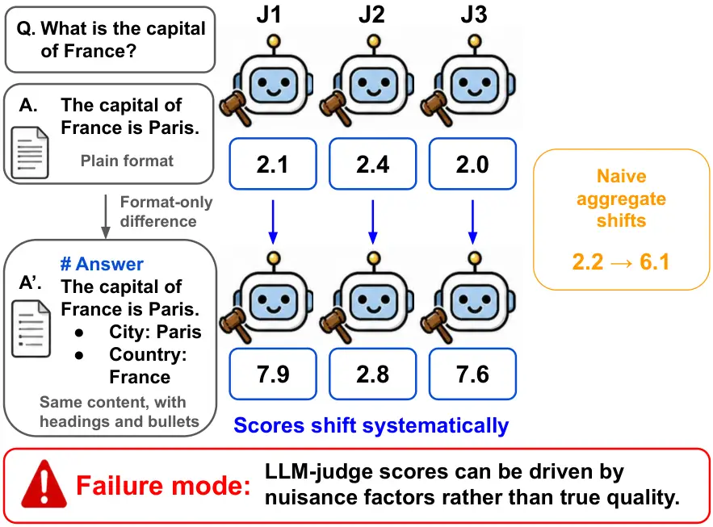
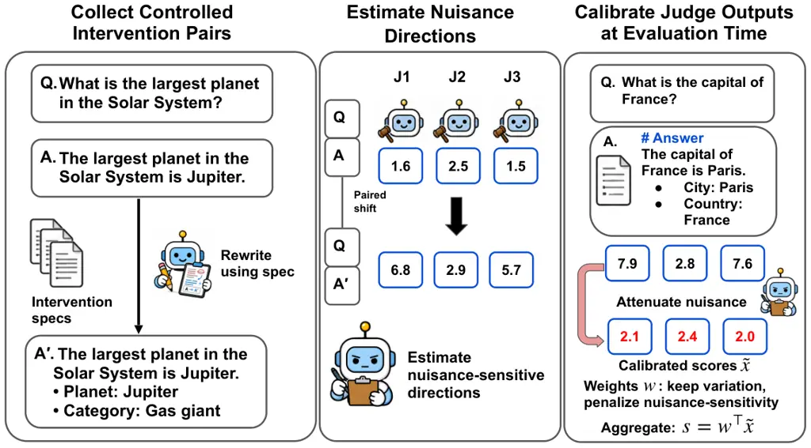
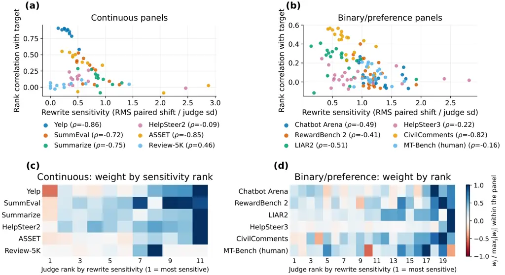

# VoirDire: Counterfactual Calibration for Reliable LLM-as-a-Judge Aggregation

Changho Shin Affiliation: Department of Computer Science, Princeton
University, Princeton, NJ    Frederic Sala Affiliation: Department of
Computer Sciences, University of Wisconsin–Madison, Madison, WI

###### Abstract

LLM-as-a-judge systems often aggregate multiple judges to improve
evaluation reliability. However, judge agreement can reflect shared
biases toward verbosity, formatting, or fluency rather than the intended
evaluation target. Addressing these shared biases is challenging because
observational judge outputs alone cannot distinguish agreement driven by
target quality from agreement driven by nuisance attributes. We
introduce VoirDire, an intervention-calibrated aggregation method for
LLM-judge panels. VoirDire applies controlled interventions that vary
specified surface attributes while aiming to preserve the evaluation
target; it then uses paired changes in judge scores to identify
nuisance-sensitive directions. It attenuates these directions and
selects aggregation weights that retain variation across items while
penalizing sensitivity to the interventions, making the final consensus
less dependent on superficial features. We show theoretically that
observational judge outputs alone cannot identify which shared direction
is target-relevant, while paired interventions provide the contrast
needed to identify nuisance-sensitive variation. We evaluate VoirDire on
12 datasets spanning continuous scoring, binary classification, and
pairwise preference. Compared with the existing LLM-judge aggregation
baselines, VoirDire reduces MAE by up to 26.8% on continuous-score tasks
and improves accuracy by up to 5.3 percentage points on binary and
preference tasks. These findings suggest that counterfactual
interventions provide an additional means of improving the reliability
and controllability of LLM-based evaluation beyond merely relying on
observed judge agreement.

|     |
| --- |
|     |

## 1 Introduction



Figure 1: Motivation. Surface attribute changes systematically shift
judge scores, so aggregation can track nuisance factors rather than the
evaluation target.

LLM-as-a-judge systems are increasingly used to score open-ended
answers, compare assistants, filter data, and approximate human
evaluation (Liu et al., 2023; Zheng et al., 2023; Wang et al., 2024a;
Zhu et al., 2025). Because a single judge can be noisy, recent work has
explored aggregating multiple LLM judges (Verga et al., 2024; Li et al.,
2024a; Ai et al., 2026; Balasubramanian et al., 2026; Zhao et al.,
2026). The premise is that agreement among judges can reveal the
underlying quality signal by averaging out individual judge noise.

However, this premise breaks down when judges share the same nuisance
sensitivity. LLM judges exhibit biases related to position, selection
effects, and formatting artifacts (Zeng et al., 2024; Li et al., 2024b;
Park et al., 2024; Ye et al., 2025; Shi et al., 2025; Li et al., 2025).
When such biases are shared across judges, aggregation may reinforce
rather than mitigate them. Judges can move together because an answer is
genuinely better, but they can also move together because the answer is
longer, better formatted, more fluent, or easier to parse. From observed
scores alone, true quality and nuisance factors can be hard to
distinguish.

Meanwhile, prior work has developed more sophisticated judge aggregation
methods beyond majority voting, for example by estimating judge
reliability, using higher-order agreement statistics, or modeling judge
dependence (Ai et al., 2026; Balasubramanian et al., 2026). These tools
improve aggregation by modeling how judge outputs interact with the
latent quality signal. However, when shared nuisance factors induce
score structure that resembles true quality, richer observational
modeling can still amplify the wrong signal. More directly related to
our work, Zhao et al. (2026) address shared nuisance factors by
additionally introducing latent variables that capture their effects
across judges. However, it still relies on observational judge outputs
and structural assumptions such as sparsity and low rank. As a result,
it does not provide a direct, controllable means of probing judges’
sensitivity to specific nuisance attributes.

We introduce VoirDire, an _intervention-based calibration_ procedure for
LLM-judge aggregation, named after _voir dire_, the legal process of
examining prospective jurors. VoirDire applies controlled interventions
to the inputs shown to judges, using deterministic transformations or
LLM-generated rewrites to perturb specified nuisance attributes while
aiming to preserve the evaluation target. The same judges then score
both the original and modified inputs. Paired score differences indicate
which directions in judge-output space are sensitive to the targeted
attributes. VoirDire attenuates these directions and selects aggregation
weights that retain variation across items while penalizing sensitivity
to the interventions.

Theoretically, we show that observational agreement alone can fail to
identify the target signal, while paired original–rewrite responses
enable estimation of intervention-sensitive nuisance variation, with
error controlled by intervention quality and calibration sample size.

Empirically, we evaluate VoirDire on 12 datasets spanning continuous
scoring, binary classification, and pairwise preference. Compared with
the strongest existing judge-aggregation baseline on each dataset,
VoirDire reduces MAE by up to $`26.8\%`$ on continuous-score tasks and
improves accuracy by up to $`5.3`$ percentage points on
binary/preference tasks. Controlled experiments further show that
VoirDire reduces aggregate sensitivity to targeted nuisance changes. We
also examine the effect of calibration-pair budget and interpret how
calibration changes judge scores and aggregation weights. In summary,
our contributions include:

1.  1.  We introduce VoirDire, an intervention-based calibration method that
        uses controlled perturbations to mitigate shared nuisance
        sensitivity in LLM-judge aggregation.
2.  2.  We characterize the limitations of observational judge agreement and
        establish conditions under which paired interventions enable
        accurate estimation of nuisance-sensitive directions.
3.  3.  Across 12 datasets spanning continuous scoring, binary
        classification, and pairwise preference, VoirDire reduces MAE by up
        to $`26.8\%`$ and improves accuracy by up to $`5.3`$ percentage
        points over existing aggregation methods.

## 2 Related Work

##### LLM-as-a-judge evaluation.

LLM judges are widely used to evaluate open-ended generation because
they scale beyond manual annotation and can express task-specific
rubrics (Liu et al., 2023; Zheng et al., 2023; Wang et al., 2024a; Zhu
et al., 2025). However, their judgments can depend on presentation,
verbosity, position, selection effects, and other nuisance factors
rather than only the intended evaluation target (Zeng et al., 2024; Li
et al., 2024b; Park et al., 2024; Ye et al., 2025; Shi et al., 2025; Li
et al., 2025). Aggregating multiple judges can reduce individual noise,
but it does not necessarily eliminate shared bias.



Figure 2: VoirDire framework. Controlled interventions give paired
judge-score shifts, pooled into $`\bar{G}`$. At evaluation time, judge
outputs are attenuated along its directions (eq. 2) and weighted to
retain item variation while penalizing sensitivity to the shifts
(eq. 3).

##### Judge aggregation.

Classical crowdsourcing and weak-supervision methods infer latent labels
from multiple noisy sources by modeling source reliability, dependence,
or latent structure (Dawid and Skene, 1979; Karger et al., 2011; Ratner
et al., 2017; Shin et al., 2022). These approaches naturally extend to
aggregating LLM judges. Recent LLM-jury methods use richer observational
statistics, including higher-order agreement signals such as Inverse
Surprising Popularity (ISP) and dependence-aware Ising models (Ai et
al., 2026; Balasubramanian et al., 2026). However, these methods do not
explicitly account for nuisance factors shared across judges. More
directly related to our work, CARE (Zhao et al., 2026) models such
shared factors using latent variables inferred from observed judge
outputs. Still, its identification relies on observational outputs and
structural assumptions such as sparsity and low rank. VoirDire instead
uses controlled interventions to directly measure which judge-output
directions respond to nuisance changes.

##### Counterfactual interventions and causal analysis.

Causal inference distinguishes observational association from the
effects revealed by controlled interventions (Pearl, 2009). In NLP, this
view has been used to estimate the causal effects of textual concepts on
model behavior (Feder et al., 2021; Abraham et al., 2022; Feder et al., 2022) and to make models invariant to spurious attributes using
counterfactual pairs (Kaushik et al., 2020; Veitch et al., 2021);
foundation models can now generate such counterfactuals at scale (Wu et
al., 2021; Chen et al., 2023; Feder et al., 2023). VoirDire brings this
causal view to judge aggregation.

## 3 VoirDire: Calibrating Judge Aggregation with Interventions

VoirDire calibrates LLM-judge aggregation using controlled
interventions. It first constructs original–rewrite pairs designed to
preserve the evaluation target while varying specified nuisance
attributes, such as formatting, style, or verbosity. The same judges
evaluate both inputs, and their paired score differences reveal
nuisance-sensitive directions in judge-output space. VoirDire uses these
directions to calibrate judge scores and determine intervention-aware
aggregation weights. Figure 2 gives an overview, and algorithm 1
summarizes the procedure.

##### Setup.

We consider a panel of $`p`$ LLM judges. For item $`i`$, the judges see
a judge input $`u_{i}`$ and produce a judge-output vector
$`x_{i}=(x_{i1},\ldots,x_{ip})`$. Entries may be scalar scores, binary
labels, or preference votes. A standard aggregator, such as majority
voting, uses only the unperturbed judge-output matrix
$`X=\{x_{i}\}_{i=1}^{n}`$ to predict a target score or label.

##### Constructing intervention pairs.

We begin with a pool of candidate intervention families targeting
nuisance attributes such as formatting, verbosity, and candidate
position. Each family $`a`$ specifies three components: the nuisance
attribute and input span to modify, a modification rule, and
preservation constraints. The modification rule is either deterministic
(e.g., adding markup or swapping two candidates verbatim) or an
instruction to an LLM rewrite model. For example, a concision family
instructs the model to remove redundancy while preserving the original
claims, sentiment, numbers, and other content constraints.

In our experiments, we use LLM assistants to propose candidate
intervention families based on dataset examples. We apply each
intervention to a subset of inputs and retain only pairs that pass
programmatic preservation checks. The same judges score each retained
modified input, yielding $`x_{i}^{(a)}`$ for $`i\in\mathcal{P}_{a}`$.
Pair generation and preservation checking use no ground-truth labels.
Full construction and selection details appear in Appendix B.

##### Estimating nuisance-sensitive directions.

Given $`m`$ calibration pairs from each of the $`k`$ selected
intervention families, we compute the paired score differences
$`\Delta_{i}^{(a)}=x_{i}^{(a)}-x_{i}`$ for $`i\in\mathcal{P}_{a}`$.
These vectors record how the judges respond to each intervention. When
the evaluation target remains unchanged, they capture nuisance-sensitive
variation together with judge noise. We pool the differences into a
second-moment matrix¹¹ 1 Note that we do not subtract the mean shift: a
consistent increase or decrease in scores can itself reflect bias, such
as a position preference, and centering might remove this signal
(Proposition 1).:

```math
\bar{G}=\frac{1}{km}\sum_{a=1}^{k}\sum_{i\in\mathcal{P}_{a}}\Delta_{i}^{(a)}\Delta_{i}^{(a)\top},\qquad|\mathcal{P}_{a}|=m,\quad M=km. \tag{1}
```

Each pair contributes equally to $`\bar{G}\in\mathbb{R}^{p\times p}`$.
Its entry $`\bar{G}_{j\ell}`$ captures how judges $`j`$ and $`\ell`$
respond together, and its leading eigenvectors identify the directions
along which the interventions produce the largest score changes. These
directions capture nuisance sensitivity, although judge noise and
imperfections in the interventions can affect their estimation.

##### Attenuating sensitive directions.

Using the estimated directions, we calibrate each judge-output vector by
attenuating components along directions that respond more strongly to
the interventions:

```math
\widetilde{x}_{i}=x_{i}-\alpha\frac{\bar{G}x_{i}}{\lambda_{\max}(\bar{G})},\qquad\alpha\in[0,1]. \tag{2}
```

Here $`\lambda_{\max}(\bar{G})`$ is the largest eigenvalue, and
$`\alpha`$ is a hyperparameter controlling attenuation strength.
Normalizing by $`\lambda_{\max}(\bar{G})`$ ensures that the most
sensitive direction is attenuated by a fraction $`\alpha`$, while less
sensitive directions are attenuated less.

##### Intervention-aware aggregation.

After calibrating the judge outputs, we aggregate them using weights
that retain variation across items while penalizing sensitivity to the
interventions:

```math
w_{\star}\in\arg\max_{w\neq 0}\frac{\widehat{\operatorname{Var}}_{i}(w^{\top}\widetilde{x}_{i})}{w^{\top}\bar{G}w+\rho\|w\|_{2}^{2}}. \tag{3}
```

The numerator rewards variation across the calibrated items, while
$`w^{\top}\bar{G}w`$ penalizes weights that are more sensitive to
nuisance changes. The hyperparameter $`\rho>0`$ controls the tradeoff
between retaining variation and reducing intervention sensitivity. We
solve the resulting generalized eigenvalue problem, then orient and
normalize the solution to obtain the final aggregation weights $`w`$.
The aggregate score is $`s_{i}=w^{\top}\widetilde{x}_{i}`$.
Implementation details appear in Section B.2.

0:  Judge outputs $`x_{1},\ldots,x_{n}\in\mathbb{R}^{p}`$; paired
outputs $`\{(x_{i},x_{i}^{(a)})\}_{i\in\mathcal{P}_{a}}`$ for $`k`$
selected intervention families, with $`|\mathcal{P}_{a}|=m`$ and
$`M=km`$; validation-selected hyperparameters $`(\alpha,\gamma)`$.

0:  Aggregate scores $`s_{1},\ldots,s_{n}`$.

1:  Compute paired score differences for each family $`a`$ and item
$`i\in\mathcal{P}_{a}`$:  $`\Delta_{i}^{(a)}\leftarrow x_{i}^{(a)}-x_{i}`$.

2:  Estimate the pooled second-moment
matrix:  $`\bar{G}\leftarrow\frac{1}{M}\sum_{a=1}^{k}\sum_{i\in\mathcal{P}_{a}}\Delta_{i}^{(a)}\Delta_{i}^{(a)\top}`$.
eq. 1

3:  Attenuate nuisance-sensitive components for all
items:  $`\widetilde{x}_{i}\leftarrow x_{i}-\alpha\,\bar{G}x_{i}/\lambda_{\max}(\bar{G})`$,
$`i=1,\ldots,n`$. eq. 2

4:  Set $`\rho\leftarrow\gamma\operatorname{tr}(\bar{G})/p`$ and solve
for intervention-aware
weights:  $`w_{\star}\in\arg\max_{w\neq 0}\frac{\widehat{\operatorname{Var}}_{i}(w^{\top}\widetilde{x}_{i})}{w^{\top}\bar{G}w+\rho\|w\|_{2}^{2}}`$.
eq. 3

5:  Orient and normalize $`w_{\star}`$ to obtain $`w`$ (Section B.2).

6:  return $`s_{i}=w^{\top}\widetilde{x}_{i}`$, $`i=1,\ldots,n`$.

Algorithm 1 VoirDire: calibration and intervention-aware aggregation

## 4 Theoretical Analysis

We theoretically analyze VoirDire, showing that observational judge
agreement alone may not distinguish target quality from shared nuisance
factors, whereas paired interventions reveal nuisance-sensitive
variation and enable estimation of the calibration matrix.

##### Setup.

We model judge outputs with target-relevant factors $`q_{i}`$, nuisance
factors $`c_{i}`$, and noise:

```math
\displaystyle x_{i}^{(0)} \displaystyle=U_{Q}q_{i}+U_{C}c_{i}+\varepsilon_{i}^{(0)}, \tag{4}
```

```math
\displaystyle x_{i}^{(a)} \displaystyle=U_{Q}q_{i}+U_{C}(c_{i}+\delta_{i}^{(a)})+\varepsilon_{i}^{(a)},
```

where $`x_{i}^{(0)}=x_{i}\in\mathbb{R}^{p}`$ denotes the original
judge-output vector, and $`x_{i}^{(a)}`$ denotes the outputs of the same
judges after an intervention from family $`a`$. The matrices $`U_{Q}`$
and $`U_{C}`$ map target-relevant and nuisance factors to judge scores,
respectively. We first consider an ideal setting in which interventions
change nuisance factors by $`\delta_{i}^{(a)}`$ while leaving $`q_{i}`$
unchanged.

##### Why agreement alone is insufficient.

Shared variation in judge scores need not reveal whether judges respond
to target quality or nuisance attributes; Theorem 1 makes this explicit.

###### Theorem 1 (Observational non-identifiability; simplified).

In the noiseless model $`x=uq+vc`$, with orthonormal
$`u,v\in\mathbb{R}^{p}`$ and $`(q,c)\sim N(0,I_{2})`$, the target
direction $`u`$ is not identifiable from the distribution of $`x`$:
rotating $`u`$ and $`v`$ within their span leaves this distribution
unchanged.

Thus, even with unlimited observations, an aggregator cannot determine
which direction represents quality in this model without additional
information or assumptions.

##### What paired interventions reveal.

Paired interventions address this ambiguity by holding target quality
fixed while changing nuisance attributes. Under eq. 4, the target
component cancels:
$`\Delta_{i}^{(a)}=x_{i}^{(a)}-x_{i}^{(0)}=U_{C}\delta_{i}^{(a)}+\xi_{i}^{(a)},`$
where $`\xi_{i}^{(a)}`$ is the paired judge noise. If this noise is
mean-zero and independent of $`\delta_{i}^{(a)}`$, with finite second
moments, the pooled population second moment is $`G=L_{C}+\Omega`$,
where
$`L_{C}=\frac{1}{k}\sum_{a}\mathbb{E}[(U_{C}\delta_{i}^{(a)})(U_{C}\delta_{i}^{(a)})^{\top}]`$
captures intervention-induced nuisance variation and $`\Omega`$ is the
pooled noise covariance.

###### Proposition 1 (Calibration-matrix estimation; simplified).

Suppose $`\|G-L_{C}\|_{\mathrm{op}}\leq\rho_{\mathrm{err}}`$ and
$`\|\bar{G}-G\|_{\mathrm{op}}\leq\epsilon_{M}`$. For nonzero
$`L_{C},\bar{G}`$, let $`T=L_{C}/\lambda_{\max}(L_{C})`$ and
$`\widehat{T}=\bar{G}/\lambda_{\max}(\bar{G})`$. Then

```math
\|\widehat{T}-T\|_{\mathrm{op}}\leq\frac{2(\rho_{\mathrm{err}}+\epsilon_{M})}{\lambda_{\max}(L_{C})}.
```

Proposition 1 shows that accurate calibration requires estimation and
systematic errors to be small relative to the nuisance signal. We
further analyze how calibration sample size affects estimation error
(Theorem 2) and how imperfect interventions affect nuisance recovery.
Full proofs and additional theoretical results appear in Appendix C,
with supporting synthetic experiments in Appendix D.

| Dataset                 | MV         | AVG        | ISP        | PCA        | CARE-SVD   | VoirDire            |
| ----------------------- | ---------- | ---------- | ---------- | ---------- | ---------- | ------------------- |
| Yelp                    | $`1.016`$  | $`1.089`$  | $`1.028`$  | $`1.054`$  | $`0.694`$  | $`\mathbf{0.508}`$  |
| SummEval                | $`0.819`$  | $`0.753`$  | $`0.832`$  | $`0.738`$  | $`0.729`$  | $`\mathbf{0.701}`$  |
| Summarize from Feedback | $`1.434`$  | $`1.453`$  | $`1.585`$  | $`1.764`$  | $`1.392`$  | $`\mathbf{1.346}`$  |
| HelpSteer2              | $`0.998`$  | $`0.981`$  | $`1.008`$  | $`0.992`$  | $`0.998`$  | $`\mathbf{0.951}`$  |
| ASSET                   | $`31.238`$ | $`33.701`$ | $`31.885`$ | $`28.888`$ | $`27.629`$ | $`\mathbf{26.930}`$ |
| Review-5K               | $`2.581`$  | $`2.483`$  | $`2.585`$  | $`2.101`$  | $`1.957`$  | $`\mathbf{1.862}`$  |

Table 1: Continuous-score aggregation: mean MAE ($`\downarrow`$).

| Dataset          | MV        | AVG       | ISP       | PCA       | CARE-SVD           | CARE-Tensor | VoirDire           |
| ---------------- | --------- | --------- | --------- | --------- | ------------------ | ----------- | ------------------ |
| Chatbot Arena    | $`0.517`$ | $`0.551`$ | $`0.571`$ | $`0.544`$ | $`0.572`$          | $`0.596`$   | $`\mathbf{0.646}`$ |
| RewardBench 2    | $`0.577`$ | $`0.596`$ | $`0.569`$ | $`0.595`$ | $`0.578`$          | $`0.605`$   | $`\mathbf{0.658}`$ |
| LIAR2            | $`0.678`$ | $`0.665`$ | $`0.678`$ | $`0.661`$ | $`0.670`$          | $`0.668`$   | $`\mathbf{0.686}`$ |
| HelpSteer3       | $`0.490`$ | $`0.517`$ | $`0.556`$ | $`0.520`$ | $`0.592`$          | $`0.572`$   | $`\mathbf{0.610}`$ |
| CivilComments    | $`0.702`$ | $`0.715`$ | $`0.716`$ | $`0.714`$ | $`\mathbf{0.747}`$ | $`0.731`$   | $`0.739`$          |
| MT-Bench (human) | $`0.600`$ | $`0.613`$ | $`0.600`$ | $`0.599`$ | $`0.594`$          | $`0.581`$   | $`\mathbf{0.624}`$ |

Table 2: Binary/preference aggregation: mean accuracy ($`\uparrow`$).

## 5 Experiments

We evaluate VoirDire across continuous-score, binary, and preference
LLM-judge aggregation setups. The experiments address the following
topics:

- •
  Improving judge aggregation (Section 5.1): We compare VoirDire with
  existing aggregation methods across the three task types.
- •
  Ablating score calibration and aggregation (Section 5.2): We examine
  how score calibration and intervention-aware aggregation individually
  contribute to performance.
- •
  Judge-level interpretation (Section 5.3): We examine how intervention
  sensitivity relates to judge reliability and aggregation weights.
- •
  Calibration efficiency (Section 5.4): We measure how performance
  changes with the number of intervention pairs.
- •
  Targeted nuisance removal (Section 5.5): We test whether VoirDire
  reduces score shifts under rewrites that trigger known judge biases.
- •
  Transfer across related nuisances (Section 5.6): We test whether
  calibration transfers to related nuisance variations not used during
  fitting.

##### Datasets and metrics.

We evaluate on six continuous-score and six binary/preference datasets.
We report mean absolute error (MAE; lower is better) for continuous
scoring and accuracy (higher is better) for binary classification and
pairwise preference tasks. Dataset details are in Section B.1.

##### LLM judges.

Continuous-score panels contain 11 open-weight LLM judges and
binary/preference panels 20, with model sizes ranging from 0.6B to 14B
parameters. Each judge reports on the dataset-native score scale.
Following the judge-output convention in CARE (Zhao et al., 2026),
judges first produce scalar scores for binary classification and
pairwise preference tasks. These scores are then converted to binary
labels or preferences using fixed thresholds and evaluated by accuracy.
Details are in Sections B.3 and B.4.

##### Interventions.

We use LLM assistants to help identify task-specific nuisance attributes
and design interventions, following Adila et al. (2024). The
interventions vary formatting, verbosity, or candidate presentation
while aiming to preserve the evaluation target. We generate modified
inputs through deterministic transformations or rewrites by one of the
judge models, Llama-3.1-8B-Instruct. Pair generation requires no
ground-truth labels; family selection and tuning of $`(\alpha,\gamma)`$
use the validation set. Full specifications, prompts, and selection
details appear in Appendix B.

### 5.1 Improving Aggregation with Interventions

##### Setup.

We compare VoirDire with majority voting (MV), score averaging (AVG),
PCA aggregation, CARE (Zhao et al., 2026), and Inverse Surprising
Popularity (ISP) (Ai et al., 2026). We use CARE-SVD for continuous
scoring and both CARE-SVD and CARE-Tensor for binary classification and
pairwise preference. All methods use the same judges and evaluation
items across five random splits per dataset. For VoirDire, we use
$`m=32`$ intervention pairs per family. Protocol details and additional
results in Appendices B and E, respectively.

##### Results.

Tables 1 and 2 show that VoirDire improves on existing aggregation
methods across task types. The largest MAE reduction is on Yelp, at
$`26.8\%`$ relative to the strongest baseline, and the largest accuracy
gains are on RewardBench 2 ($`5.3`$ pp) and Chatbot Arena ($`5.1`$ pp).
These improvements suggest that intervention-based calibration can
enhance judge aggregation compared with existing observational methods.

### 5.2 Ablating Score Calibration and Aggregation

VoirDire uses interventions for score calibration and intervention-aware
aggregation. We examine the contribution of each step.

##### Setup.

Following the setup of the previous subsection, we compare PCA and
intervention-aware aggregation on raw and calibrated scores. The PCA
baseline corresponds to $`\alpha=0`$ and $`\rho\to\infty`$ in eq. 3. For
intervention-aware aggregation on raw scores, we set $`\alpha=0`$ and
re-tune $`\rho`$ on validation. Combining score calibration and
intervention-aware aggregation gives VoirDire.

Figure 3: Contributions of calibration and aggregation relative to raw
PCA: relative MAE reduction (%) on continuous tasks and accuracy gain
(percentage points) on binary/preference tasks. Higher is better.
$`\dagger`$: $`\alpha=0`$, so calibration leaves scores unchanged.

##### Results.

Figure 3 shows that both steps contribute, with their relative benefits
varying across datasets. On continuous-score tasks, score calibration
provides substantial gains on datasets such as Yelp and ASSET. On
binary/preference tasks, intervention-aware aggregation alone improves
over PCA on all six datasets, while combining both steps provides
further gains on datasets such as HelpSteer3. Additional ablations on
other aggregators appear in Section E.4.

### 5.3 How Interventions Diagnose and Reweight Judges

Beyond improving aggregation, controlled interventions can help diagnose
individual judges by revealing their sensitivity to nuisance attributes.
We examine whether this sensitivity relates to judge reliability and how
it influences the aggregation weights learned by VoirDire.

##### Setup.

For each judge in the panels of Section 5.1, we measure _rewrite
sensitivity_ as the root mean square score shift across calibration
pairs, $`\sqrt{\bar{G}_{jj}}`$, normalized by the standard deviation of
its original scores to account for differences in score scale. We
measure _reliability_ as the Spearman correlation between the judge’s
original scores and ground truth, capturing how well its judgments align
with the evaluation target. Comparing these metrics tests whether
nuisance sensitivity, measured without ground-truth labels, is
associated with judge reliability. We also examine the aggregation
weights $`w_{j}`$ from eq. 3 to assess how VoirDire uses this
sensitivity information.



Figure 4: Rewrite sensitivity, reliability, and aggregation weights. (a,
b) One point per judge and panel; legends report the within-panel
Spearman correlation between sensitivity and reliability. (c, d) Weights
divided by each panel’s largest absolute weight, with judges ranked by
sensitivity (1: most sensitive; blue: positive, red: negative). Empty
ranks indicate fewer judges.

##### Results.

Figure 4 (a), (b) show that judges with greater rewrite sensitivity tend
to be less reliable, although the relationship varies across datasets.
Panels (c) and (d) show that VoirDire generally assigns lower weights to
more sensitive judges.

### 5.4 Ablation on the Number of Intervention Pairs

Figure 5: Mean gain over the strongest baseline. Bands: one SE over five
splits; dotted line: $`m{=}32`$.

We examine how the number of intervention pairs affects the performance
of VoirDire.

##### Setup.

We vary the number of calibration pairs per family
$`m\in\{4,8,16,32,64\}`$, keeping the intervention families of
Section 5.1 and re-selecting $`(\alpha,\rho)`$ on validation at every
$`m`$. We report improvements over each dataset’s strongest baseline,
averaged separately across the six continuous-score datasets (relative
MAE reduction) and the six binary/preference datasets.

##### Results.

Figure 5 shows that VoirDire improves aggregation with a small
calibration budget. Eight pairs per family recover most of the gain on
continuous-score tasks, and gains on both task types level off between
32 and 64 pairs. With 32 pairs per family, VoirDire achieves an average
MAE reduction of $`7.4\%`$ and an accuracy gain of $`2.2`$ percentage
points over each dataset’s strongest baseline. Per-dataset results
appear in Section B.7.

### 5.5 Targeted Nuisance Removal

We further evaluate whether VoirDire reduces sensitivity to known
nuisance changes in a controlled setting, directly testing whether it
achieves its intended effect.

| Type      | Example                                                                                                            |
| --------- | ------------------------------------------------------------------------------------------------------------------ |
| Original  | Night and day occur due to the Earth’s rotation on its axis.                                                       |
| Beauty    | Night and day occur due to the Earth’s rotation on its axis. When facing the Sun ☼, it experiences daylight. …     |
| Authority | …This rotation happens over a period of 24 hours, creating our cycle of day and night (National Geographic, 2019). |

| Method   | Beauty             | Authority          |
| -------- | ------------------ | ------------------ |
| MV       | $`0.919`$          | $`0.824`$          |
| AVG      | $`0.506`$          | $`0.325`$          |
| ISP      | $`0.891`$          | $`0.733`$          |
| PCA      | $`1.283`$          | $`0.876`$          |
| CARE-SVD | $`0.418`$          | $`0.286`$          |
| VoirDire | $`\mathbf{0.304}`$ | $`\mathbf{0.234}`$ |

Table 3: Examples of targeted nuisance rewrites (left) and mean absolute
score shifts (right, $`\downarrow`$).

##### Setup.

We use the judgment-bias benchmark of Chen et al. (2024), which provides
original–modified answer pairs with GPT-4 rewrites targeting rich
formatting (beauty) or added references (authority), along with 1–10
judge scores. These rewrites can also rephrase or expand the original
answers. We measure sensitivity as the mean absolute difference between
aggregate scores on original and rewritten answers. Lower values
indicate greater robustness to the targeted nuisance changes.

##### Results.

VoirDire achieves the lowest sensitivity to both biases (table 3),
reducing mean absolute score shifts by approximately $`27.3\%`$ for
beauty and $`18.2\%`$ for authority relative to CARE-SVD, the strongest
baseline. Additional experimental details and results appear in
Sections B.6 and E.3.

### 5.6 Transfer Across Related Nuisances

Identifying every nuisance variation can be costly. However, related
rewrites may affect judge scores in similar ways, so we expect VoirDire
to generalize beyond the specific interventions used for calibration. We
test this in a controlled setting.

| Calibration |               | Evaluation |             |
| ----------- | ------------- | ---------- | ----------- |
| Concept     | Variant       | Beauty     | Authority   |
| Beauty      | Numbered      | $`77.1\%`$ | $`91.3\%`$  |
|             | Panels        | $`81.1\%`$ | $`102.5\%`$ |
|             | Icons         | $`72.0\%`$ | $`100.3\%`$ |
| Authority   | Expert        | $`60.4\%`$ | $`100.5\%`$ |
|             | Source header | $`74.6\%`$ | $`99.2\%`$  |
|             | Footnote      | $`63.9\%`$ | $`98.0\%`$  |

Table 4: Percentage of target-family gain retained ($`\uparrow`$).

##### Setup.

Following Section 5.5, we calibrate on three beauty variants (numbered
structure, minimalist panels, and topic-specific icons) and three
authority variants (expert attribution, a source header, and a
fabricated footnote), then evaluate on the original beauty and authority
rewrites. We report sensitivity reduction relative to PCA, normalized so
that calibration on the original beauty or authority rewrites achieves
$`100\%`$. Details appear in Section B.8.

##### Results.

Table 4 shows that calibration retains much of its benefit on unseen
rewrites. Notably, beauty variants transfer strongly even to authority,
while authority variants also provide some benefit on beauty. This
suggests that distinct nuisance attributes may affect overlapping
directions in judge-output space, enabling transfer across them.

## 6 Conclusion

We introduced VoirDire, which uses controlled interventions to mitigate
shared nuisance sensitivity in LLM-judge aggregation. Across 12
datasets, VoirDire improves aggregation performance and reduces
sensitivity to targeted nuisance changes. Calibration also transfers to
related, unseen variations, suggesting that exact rewrite matches are
unnecessary. These findings highlight the potential of counterfactual
interventions for more reliable LLM-based evaluation.

##### Limitations and future work.

VoirDire depends on the quality of its interventions: they should
capture relevant nuisance variation while preserving the evaluation
target, which is difficult to guarantee. Discovering effective
interventions also adds cost, and calibration requires additional
inference to generate rewrites and score modified inputs, although
deterministic transformations avoid the rewrite-generation cost. More
broadly, paired interventions could extend beyond aggregation: agents
could actively search for interventions that expose previously unknown
judge biases, and the same paired signals could train judges and reward
models to be invariant to surface features such as length and
formatting, reducing reward hacking in downstream optimization.

### Ethics statement

The main risk is over-trust in calibrated automatic evaluation. VoirDire
attenuates nuisance sensitivities exposed by the chosen interventions,
but it does not guarantee unbiased judgments or remove all evaluation
artifacts. For private or high-stakes evaluations, rewrite generation
and judge calls should be run with appropriate data-protection
safeguards, since the method sends original and rewritten inputs to
LLMs.

### AI use statement

We used AI coding and writing assistants (Claude Code, Codex, Fable, and
ChatGPT Pro) throughout this project. They assisted with implementing
and running experimental, evaluation, and plotting code; proposing
nuisance attributes and intervention designs; developing and checking
the theoretical analysis; and drafting and editing the manuscript. The
authors directed all AI-assisted work, reviewed its outputs, and take
full responsibility for the content.

## References

- 01.AI (2024) 01.AI Yi: open foundation models by 01.ai. arXiv preprint
  arXiv:2403.04652. Cited by: §B.3.
- Abraham et al. (2022) E. D. Abraham, K. D’Oosterlinck, A. Feder, Y. O.
  Gat, A. Geiger, C. Potts, R. Reichart, and Z. Wu CEBaB: estimating the
  causal effects of real-world concepts on NLP model behavior. In
  Advances in Neural Information Processing Systems, Vol. 35. External
  Links:
  [Link](https://proceedings.neurips.cc/paper_files/paper/2022/hash/701ec28790b29a5bc33832b7bdc4c3b6-Abstract-Conference.html)
  Cited by: §2.
- Adila et al. (2024) D. Adila, C. Shin, L. Cai, and F. Sala Zero-shot
  robustification of zero-shot models. In International Conference on
  Learning Representations, Vol. 2024, pp. 34402–34434. Cited by: §5.
- Ai et al. (2026) R. Ai, Y. Pan, D. Simchi-Levi, M. Tambe, and H. Xu
  Beyond majority voting: LLM aggregation by leveraging higher-order
  information. In Proceedings of the 43rd International Conference on
  Machine Learning, Cited by: §1, §1, §2, §5.1.
- Alibaba (2024) Alibaba Qwen2.5 technical report. arXiv preprint
  arXiv:2412.15115. Cited by: §B.3.
- Alibaba (2025) Alibaba Qwen3 technical report. arXiv preprint
  arXiv:2505.09388. Cited by: §B.3, §B.3.
- Alva-Manchego et al. (2020) F. Alva-Manchego, L. Martin, A. Bordes, C.
  Scarton, B. Sagot, and L. Specia ASSET: A dataset for tuning and
  evaluation of sentence simplification models with multiple rewriting
  transformations. In Proceedings of the 58th Annual Meeting of the
  Association for Computational Linguistics, pp. 4668–4679. External
  Links: [Link](https://www.aclweb.org/anthology/2020.acl-main.424)
  Cited by: §B.1.
- Anderson and Rubin (1956) T. W. Anderson and H. Rubin Statistical
  inference in factor analysis. In Proceedings of the Third Berkeley
  Symposium on Mathematical Statistics and Probability, Volume 5:
  Contributions to Econometrics, Industrial Research, and
  Psychometry, J. Neyman (Ed.), pp. 111–150. Cited by: §C.1.
- Balasubramanian et al. (2026) K. Balasubramanian, A. Podkopaev,
  and S. P. Kasiviswanathan Dependence-aware label aggregation for
  LLM-as-a-judge via Ising models. External Links: 2601.22336,
  [Link](https://arxiv.org/abs/2601.22336) Cited by: §1, §1, §2.
- Bhatia (1997) R. Bhatia Matrix analysis. Graduate Texts in
  Mathematics, Vol. 169, Springer, New York. External Links:
  [Document](https://dx.doi.org/10.1007/978-1-4612-0653-8) Cited by:
  §C.3.1.
- Borkan et al. (2019) D. Borkan, L. Dixon, J. Sorensen, N. Thain,
  and L. Vasserman Nuanced metrics for measuring unintended bias with
  real data for text classification. In Companion Proceedings of The
  2019 World Wide Web Conference, pp. 491–500. Cited by: §B.1.
- Chen et al. (2024) G. H. Chen, S. Chen, Z. Liu, F. Jiang, and B. Wang
  Humans or LLMs as the judge? a study on judgement bias. In Proceedings
  of the 2024 Conference on Empirical Methods in Natural Language
  Processing, Miami, Florida, USA, pp. 8301–8327. External Links:
  [Document](https://dx.doi.org/10.18653/v1/2024.emnlp-main.474) Cited
  by: Figure 6, §B.6, §5.5.
- Chen et al. (2023) Z. Chen, Q. Gao, A. Bosselut, A. Sabharwal, and K.
  Richardson DISCO: distilling counterfactuals with large language
  models. In Proceedings of the 61st Annual Meeting of the Association
  for Computational Linguistics, pp. 5514–5528. External Links:
  [Document](https://dx.doi.org/10.18653/v1/2023.acl-long.302),
  [Link](https://aclanthology.org/2023.acl-long.302/) Cited by: §2.
- Davis and Kahan (1970) C. Davis and W. M. Kahan The rotation of
  eigenvectors by a perturbation. iii. SIAM Journal on Numerical
  Analysis 7 (1), pp. 1–46. External Links:
  [Document](https://dx.doi.org/10.1137/0707001) Cited by: §C.3.1, §C.4.
- Dawid and Skene (1979) A. P. Dawid and A. M. Skene Maximum likelihood
  estimation of observer error-rates using the EM algorithm. Journal of
  the Royal Statistical Society Series C: Applied Statistics 28 (1),
  pp. 20–28. External Links:
  [Document](https://dx.doi.org/10.2307/2346806) Cited by: §2.
- DeepMind (2024) G. DeepMind Gemma 2: improving open language models at
  a practical size. arXiv preprint arXiv:2408.00118. Cited by: §B.3.
- DeepMind (2025) G. DeepMind Gemma 3 technical report. arXiv preprint
  arXiv:2503.19786. Cited by: §B.3, §B.3.
- Fabbri et al. (2021) A. R. Fabbri, W. Kryściński, B. McCann, C.
  Xiong, R. Socher, and D. Radev SummEval: re-evaluating summarization
  evaluation. Transactions of the Association for Computational
  Linguistics 9, pp. 391–409. External Links:
  [Document](https://dx.doi.org/10.1162/tacl%5Fa%5F00373),
  [Link](https://aclanthology.org/2021.tacl-1.24/) Cited by: §B.1.
- Feder et al. (2022) A. Feder, K. A. Keith, E. Manzoor, R. Pryzant, D.
  Sridhar, Z. Wood-Doughty, J. Eisenstein, J. Grimmer, R.
  Reichart, M. E. Roberts, B. M. Stewart, V. Veitch, and D. Yang Causal
  inference in natural language processing: estimation, prediction,
  interpretation and beyond. Transactions of the Association for
  Computational Linguistics 10, pp. 1138–1158. External Links:
  [Document](https://dx.doi.org/10.1162/tacl%5Fa%5F00511) Cited by: §2.
- Feder et al. (2021) A. Feder, N. Oved, U. Shalit, and R. Reichart
  CausaLM: causal model explanation through counterfactual language
  models. Computational Linguistics 47 (2), pp. 333–386. External Links:
  [Document](https://dx.doi.org/10.1162/coli%5Fa%5F00404),
  [Link](https://aclanthology.org/2021.cl-2.13/) Cited by: §2.
- Feder et al. (2023) A. Feder, Y. Wald, C. Shi, S. Saria, and D. Blei
  Data augmentations for improved (large) language model generalization.
  In Advances in Neural Information Processing Systems, Vol. 36.
  External Links: [Link](https://openreview.net/forum?id=dJZ3MvDw86)
  Cited by: §2.
- Karger et al. (2011) D. R. Karger, S. Oh, and D. Shah Iterative
  learning for reliable crowdsourcing systems. In Advances in Neural
  Information Processing Systems, Vol. 24, pp. 1953–1961. External
  Links:
  [Link](https://papers.nips.cc/paper/4396-iterative-learning-for-reliable-crowdsourcing-systems)
  Cited by: §2.
- Kaushik et al. (2020) D. Kaushik, E. Hovy, and Z. C. Lipton Learning
  the difference that makes a difference with counterfactually-augmented
  data. In International Conference on Learning Representations, Cited
  by: §2.
- Koltchinskii and Lounici (2017) V. Koltchinskii and K. Lounici
  Concentration inequalities and moment bounds for sample covariance
  operators. Bernoulli 23 (1), pp. 110–133. External Links:
  [Document](https://dx.doi.org/10.3150/15-BEJ730) Cited by: §C.5.
- Li et al. (2025) H. Li, J. Chen, Q. Ai, Z. Chu, Y. Zhou, Q. Dong,
  and Y. Liu CalibraEval: calibrating prediction distribution to
  mitigate selection bias in LLMs-as-judges. In Proceedings of the 63rd
  Annual Meeting of the Association for Computational Linguistics
  (Volume 1: Long Papers), pp. 16537–16552. External Links:
  [Document](https://dx.doi.org/10.18653/v1/2025.acl-long.808),
  [Link](https://aclanthology.org/2025.acl-long.808/) Cited by: §1, §2.
- Li et al. (2024a) R. Li, T. Patel, and X. Du PRD: peer rank and
  discussion improve large language model based evaluations.
  Transactions on Machine Learning Research. External Links:
  [Link](https://openreview.net/forum?id=YVD1QqWRaj) Cited by: §1.
- Li et al. (2024b) Z. Li, C. Wang, P. Ma, D. Wu, S. Wang, C. Gao,
  and Y. Liu Split and merge: aligning position biases in LLM-based
  evaluators. In Proceedings of the 2024 Conference on Empirical Methods
  in Natural Language Processing, pp. 11084–11108. External Links:
  [Document](https://dx.doi.org/10.18653/v1/2024.emnlp-main.621),
  [Link](https://aclanthology.org/2024.emnlp-main.621/) Cited by: §1,
  §2.
- Liu et al. (2023) Y. Liu, D. Iter, Y. Xu, S. Wang, R. Xu, and C. Zhu
  G-eval: NLG evaluation using GPT-4 with better human alignment. In
  Proceedings of the 2023 Conference on Empirical Methods in Natural
  Language Processing, pp. 2511–2522. External Links:
  [Document](https://dx.doi.org/10.18653/v1/2023.emnlp-main.153),
  [Link](https://aclanthology.org/2023.emnlp-main.153/) Cited by: §1,
  §2.
- Malik et al. (2025) S. Malik, V. Pyatkin, S. Land, J. Morrison, N. A.
  Smith, H. Hajishirzi, and N. Lambert RewardBench 2: advancing reward
  model evaluation. External Links: 2506.01937,
  [Link](https://arxiv.org/abs/2506.01937) Cited by: §B.1.
- Meta (2024) Meta The llama 3 herd of models. arXiv preprint
  arXiv:2407.21783. Cited by: §B.3, §B.3.
- Microsoft (2025) Microsoft Phi-4-mini technical report: compact yet
  powerful multimodal language models via mixture-of-loras. arXiv
  preprint arXiv:2503.01743. Cited by: §B.3, §B.3.
- Mistral (2023) Mistral Mistral 7b. External Links: 2310.06825,
  [Link](https://arxiv.org/abs/2310.06825) Cited by: §B.3, §B.3.
- Park et al. (2024) J. Park, S. Jwa, R. Meiying, D. Kim, and S. Choi
  OffsetBias: leveraging debiased data for tuning evaluators. In
  Findings of the Association for Computational Linguistics: EMNLP 2024,
  pp. 1043–1067. External Links:
  [Document](https://dx.doi.org/10.18653/v1/2024.findings-emnlp.57),
  [Link](https://aclanthology.org/2024.findings-emnlp.57/) Cited by: §1,
  §2.
- Pearl (2009) J. Pearl Causality: models, reasoning, and inference. 2
  edition, Cambridge University Press. Cited by: §2.
- Ratner et al. (2017) A. Ratner, C. De Sa, S. Wu, D. Selsam, and C. Re
  Snorkel: rapid training data creation with weak supervision.
  Proceedings of the VLDB Endowment 11 (3), pp. 269–282. External Links:
  [Link](https://www.vldb.org/pvldb/vol11/p269-ratner.pdf) Cited by: §2.
- Shi et al. (2025) L. Shi, C. Ma, W. Liang, X. Diao, W. Ma, and S.
  Vosoughi Judging the judges: a systematic study of position bias in
  LLM-as-a-judge. In Proceedings of the 14th International Joint
  Conference on Natural Language Processing and the 4th Conference of
  the Asia-Pacific Chapter of the Association for Computational
  Linguistics, pp. 292–314. External Links:
  [Document](https://dx.doi.org/10.18653/v1/2025.ijcnlp-long.18),
  [Link](https://aclanthology.org/2025.ijcnlp-long.18/) Cited by: §1,
  §2.
- Shin et al. (2022) C. Shin, W. Li, H. Vishwakarma, N. C. Roberts,
  and F. Sala Universalizing weak supervision. In International
  Conference on Learning Representations, External Links:
  [Link](https://openreview.net/forum?id=YpPiNigTzMT) Cited by: §2.
- Stiennon et al. (2020) N. Stiennon, L. Ouyang, J. Wu, D. M.
  Ziegler, R. Lowe, C. Voss, A. Radford, D. Amodei, and P. Christiano
  Learning to summarize from human feedback. In Advances in Neural
  Information Processing Systems, Cited by: §B.1.
- Veitch et al. (2021) V. Veitch, A. D’Amour, S. Yadlowsky, and J.
  Eisenstein Counterfactual invariance to spurious correlations in text
  classification. In Advances in Neural Information Processing Systems,
  Cited by: §2.
- Verga et al. (2024) P. Verga, S. Hofstatter, S. Althammer, Y. Su, A.
  Piktus, A. Arkhangorodsky, M. Xu, N. White, and P. Lewis Replacing
  judges with juries: evaluating LLM generations with a panel of diverse
  models. arXiv preprint arXiv:2404.18796. External Links:
  [Document](https://dx.doi.org/10.48550/arXiv.2404.18796),
  [Link](https://arxiv.org/abs/2404.18796) Cited by: §1.
- Wang et al. (2024a) Y. Wang, Z. Yu, W. Yao, Z. Zeng, L. Yang, C.
  Wang, H. Chen, C. Jiang, R. Xie, J. Wang, X. Xie, W. Ye, S. Zhang,
  and Y. Zhang PandaLM: an automatic evaluation benchmark for LLM
  instruction tuning optimization. In International Conference on
  Learning Representations, External Links:
  [Link](https://openreview.net/forum?id=5Nn2BLV7SB) Cited by: §1, §2.
- Wang et al. (2024b) Z. Wang, Y. Dong, O. Delalleau, J. Zeng, G.
  Shen, D. Egert, J. J. Zhang, M. N. Sreedhar, and O. Kuchaiev
  HelpSteer2: open-source dataset for training top-performing reward
  models. External Links: 2406.08673,
  [Link](https://arxiv.org/abs/2406.08673) Cited by: §B.1.
- Wang et al. (2025) Z. Wang, J. Zeng, O. Delalleau, H. Shin, F.
  Soares, A. Bukharin, E. Evans, Y. Dong, and O. Kuchaiev
  HelpSteer3-preference: open human-annotated preference data across
  diverse tasks and languages. External Links: 2505.11475,
  [Link](https://arxiv.org/abs/2505.11475) Cited by: §B.1.
- Weng et al. (2025) Y. Weng, M. Zhu, G. Bao, H. Zhang, J. Wang, Y.
  Zhang, and L. Yang CycleResearcher: improving automated research via
  automated review. In International Conference on Learning
  Representations, External Links:
  [Link](https://openreview.net/forum?id=bjcsVLoHYs) Cited by: §B.1.
- Wu et al. (2021) T. Wu, M. T. Ribeiro, J. Heer, and D. Weld Polyjuice:
  generating counterfactuals for explaining, evaluating, and improving
  models. In Proceedings of the 59th Annual Meeting of the Association
  for Computational Linguistics and the 11th International Joint
  Conference on Natural Language Processing, pp. 6707–6723. External
  Links: [Document](https://dx.doi.org/10.18653/v1/2021.acl-long.523),
  [Link](https://aclanthology.org/2021.acl-long.523/) Cited by: §2.
- Xu and Kechadi (2024) C. Xu and M. Kechadi An enhanced fake news
  detection system with fuzzy deep learning. IEEE Access 12,
  pp. 88006–88021. External Links:
  [Document](https://dx.doi.org/10.1109/ACCESS.2024.3418340),
  [Link](https://doi.org/10.1109/ACCESS.2024.3418340) Cited by: §B.1.
- Ye et al. (2025) J. Ye, Y. Wang, Y. Huang, D. Chen, Q. Zhang, N.
  Moniz, T. Gao, W. Geyer, C. Huang, P. Chen, N. V. Chawla, and X. Zhang
  Justice or prejudice? quantifying biases in LLM-as-a-judge. In
  International Conference on Learning Representations, External Links:
  [Link](https://openreview.net/forum?id=3GTtZFiajM) Cited by: §1, §2.
- Yu et al. (2015) Y. Yu, T. Wang, and R. J. Samworth A useful variant
  of the davis–kahan theorem for statisticians. Biometrika 102 (2),
  pp. 315–323. External Links:
  [Document](https://dx.doi.org/10.1093/biomet/asv008) Cited by: §C.3.1,
  §C.4, §C.7.
- Zeng et al. (2024) Z. Zeng, J. Yu, T. Gao, Y. Meng, T. Goyal, and D.
  Chen Evaluating large language models at evaluating instruction
  following. In International Conference on Learning Representations,
  External Links: [Link](https://openreview.net/forum?id=tr0KidwPLc)
  Cited by: §1, §2.
- Zhang et al. (2015) X. Zhang, J. Zhao, and Y. LeCun Character-level
  convolutional networks for text classification. Advances in Neural
  Information Processing Systems 28. Cited by: §B.1.
- Zhao et al. (2026) J. Zhao, C. Shin, T. Huang, S. S. S. N. GNVV,
  and F. Sala CARE: confounder-aware aggregation for reliable llm
  evaluation. arXiv preprint arXiv:2603.00039. Cited by: §B.2, §B.3,
  §B.6, §1, §1, §2, §5, §5.1.
- Zheng et al. (2023) L. Zheng, W. Chiang, Y. Sheng, S. Zhuang, Z.
  Wu, Y. Zhuang, Z. Lin, Z. Li, D. Li, E. P. Xing, H. Zhang, J. E.
  Gonzalez, and I. Stoica Judging LLM-as-a-judge with MT-bench and
  chatbot arena. In Advances in Neural Information Processing Systems
  Datasets and Benchmarks Track, External Links:
  [Link](https://openreview.net/forum?id=uccHPGDlao) Cited by: §B.1,
  §B.1, §1, §2.
- Zhu et al. (2025) L. Zhu, X. Wang, and X. Wang JudgeLM: fine-tuned
  large language models are scalable judges. In International Conference
  on Learning Representations, External Links:
  [Link](https://openreview.net/forum?id=xsELpEPn4A) Cited by: §1, §2.

## Appendix Overview

This appendix starts with a glossary of notation in Appendix A. It then
provides experimental details in Appendix B, including datasets,
experiment protocols, compute resources, judge prompts, and intervention
specifications. Next, Appendix C contains proofs and additional
theoretical results. We then present synthetic experiments that study
calibration behavior in controlled settings (Appendix D). Finally,
Appendix E reports additional experimental results.

## Appendix A Glossary

The notation used throughout the paper is summarized in table 5.

Table 5: Glossary of variables, symbols, and abbreviations.

| Symbol                                          | Definition                                                                                                                    |
| ----------------------------------------------- | ----------------------------------------------------------------------------------------------------------------------------- |
| $`i,j,a`$                                       | Item, judge, and intervention-family indices.                                                                                 |
| $`n,p,k`$                                       | Numbers of original items, judges, and selected families.                                                                     |
| $`m,m_{a},M`$                                   | Pairs per family and total budget: $`M=km`$, or $`M=\sum_{a}m_{a}`$ for unequal budgets.                                      |
| $`\alpha,\gamma,\rho`$                          | Attenuation strength, regularization multiplier, and ridge parameter $`\rho=\gamma\operatorname{tr}(\bar{G})/p`$.             |
| $`u_{i}`$                                       | Judge input for item $`i`$.                                                                                                   |
| $`x_{i},x_{i}^{(0)}`$                           | Original judge-output vector; $`x_{i}^{(0)}=x_{i}\in\mathbb{R}^{p}`$.                                                         |
| $`X`$                                           | Matrix of original judge outputs.                                                                                             |
| $`x_{i}^{(a)}`$                                 | Judge-output vector after intervention $`a`$.                                                                                 |
| $`\mathcal{P}_{a}`$                             | Calibration item indices for family $`a`$.                                                                                    |
| $`\Delta_{i}^{(a)},z_{i}^{(a)}`$                | Paired score difference $`x_{i}^{(a)}-x_{i}^{(0)}`$.                                                                          |
| $`\bar{G}`$                                     | Empirical second moment of pooled paired differences (eq. 1).                                                                 |
| $`G,L_{C}`$                                     | Population second moments of paired differences and intervention-induced nuisance variation, respectively.                    |
| $`T,\widehat{T}`$                               | Ideal and empirical normalized operators: $`T=L_{C}/\lambda_{\max}(L_{C})`$, $`\widehat{T}=\bar{G}/\lambda_{\max}(\bar{G})`$. |
| $`\eta`$                                        | Operator-estimation error bound: $`\|\widehat{T}-T\|_{\mathrm{op}}\leq\eta`$.                                                 |
| $`\widetilde{x}_{i}`$                           | Calibrated output $`(I-\alpha\widehat{T})x_{i}`$.                                                                             |
| $`\widehat{\Sigma}_{\alpha}`$                   | Empirical covariance of calibrated outputs.                                                                                   |
| $`w`$                                           | Oriented and normalized aggregation weights (eq. 3).                                                                          |
| $`s_{i}`$                                       | Aggregate score $`w^{\top}\widetilde{x}_{i}`$.                                                                                |
| $`q_{i},c_{i},\delta_{i}^{(a)}`$                | Target factors, nuisance factors, and intervention-induced changes in nuisance factors.                                       |
| $`U_{Q},U_{C}`$                                 | Loading matrices for target and nuisance factors.                                                                             |
| $`d_{C}`$                                       | Nuisance-subspace dimension.                                                                                                  |
| $`\widehat{U}_{C},P_{U_{C}}`$                   | Leading $`d_{C}`$ eigenvectors of $`\bar{G}`$ and orthogonal projector onto $`\operatorname{range}(U_{C})`$.                  |
| $`\varepsilon_{i}^{(a)},\xi_{i}^{(a)}`$         | Judge noise and paired noise $`\xi_{i}^{(a)}=\varepsilon_{i}^{(a)}-\varepsilon_{i}^{(0)}`$.                                   |
| $`M_{a}`$                                       | Family-specific second moment $`\mathbb{E}[z_{i}^{(a)}z_{i}^{(a)\top}]`$.                                                     |
| $`A_{a},\Omega_{a}`$                            | Nuisance-shift second moment $`\mathbb{E}[\delta_{i}^{(a)}\delta_{i}^{(a)\top}]`$ and paired-noise covariance.                |
| $`\lambda_{\mathrm{int}},\rho_{\mathrm{pair}}`$ | Intervention-induced nuisance strength and paired-noise scale.                                                                |
| $`\rho_{\mathrm{err}},\epsilon_{M}`$            | Bounds on $`\|G-L_{C}\|_{\mathrm{op}}`$ and $`\|\bar{G}-G\|_{\mathrm{op}}`$, respectively.                                    |

## Appendix B Experimental Details

This section provides the experimental details for the main results,
including datasets, judge-output protocols, judge prompts, intervention
specifications, and implementation details.

### B.1 Datasets

We evaluate six continuous-score panels (Yelp, SummEval coherence,
Summarize from Feedback, HelpSteer2, ASSET, Review-5K) and six
binary/preference panels (Chatbot Arena, RewardBench 2, HelpSteer3,
MT-Bench with human labels, LIAR2, CivilComments). In table 1 the row
labeled SummEval is the coherence aspect.

For continuous-score tasks, the target is the human-provided score and
we report MAE. For binary/preference tasks, the target is the
human-provided label or preference and we report accuracy.

##### Review-5K (Weng et al., 2025).

Review-5K contains paper texts, reviewing guidelines, review records,
and numeric reviewer ratings. We use the paper text and reviewing
guidelines as the judge input; the reference review text is not shown to
the judges. The target field is avg_rate, the average available reviewer
rating on the 1–10 review scale. The dataset is available as
[WestlakeNLP/Review-5K](https://huggingface.co/datasets/WestlakeNLP/Review-5K).

##### Yelp (Zhang et al., 2015).

Yelp consists of user-written business reviews paired with star ratings.
We use a 5,000-example subset and treat the task as continuous rating
prediction: given the review text, the goal is to recover the associated
1–5 star rating. The source dataset is available as
[Yelp/yelp_review_full](https://huggingface.co/datasets/Yelp/yelp_review_full).

##### ASSET (Alva-Manchego et al., 2020).

ASSET is a sentence-simplification rating dataset. Each row contains a
source sentence, a candidate simplification, an evaluation aspect, and a
human rating. We use the human_rating field as the continuous target on
the 0–100 scale. We use 4,500 rating rows. The dataset is available as
[facebook/asset](https://huggingface.co/datasets/facebook/asset).

##### HelpSteer2 (Wang et al., 2024b).

HelpSteer2 contains prompts, model responses, and human ratings of five
response attributes. We use the prompt and candidate response as the
judge input and the helpfulness rating as the continuous target on the
0–4 scale, stored in the score field. We use the released validation
split. The dataset is available as
[nvidia/HelpSteer2](https://huggingface.co/datasets/nvidia/HelpSteer2).

##### Summarize from Feedback (Stiennon et al., 2020).

Summarize from Feedback contains source posts, candidate summaries, and
human assessments of summary quality. We use its axis subset, with the
source post and candidate summary as the judge input. The target is the
overall quality rating on the 1–7 scale, stored as overall_score from
summary.axes.overall. We pool the released validation and test splits
before applying our evaluation protocol. The dataset is available as
[openai/summarize_from_feedback](https://huggingface.co/datasets/openai/summarize_from_feedback).

##### SummEval (Fabbri et al., 2021).

SummEval contains model-generated summaries of CNN/DailyMail news
articles with human ratings of coherence, consistency, fluency, and
relevance. We use the coherence panel: 1,600 summaries from 16 systems
for 100 articles. The judge input is the article and candidate summary;
the target is the mean expert coherence rating on the 1–5 scale, stored
in the label field. The dataset is available from
[Yale-LILY/SummEval](https://github.com/Yale-LILY/SummEval).

##### Chatbot Arena (Zheng et al., 2023).

Chatbot Arena contains pairwise comparisons between two model responses
to the same user prompt. We use it as a preference task: the target
field is gold_label_binary, which encodes the human preference over
candidates A and B. We use 5,000 sampled comparisons, excluding ties.
The dataset is available as
[lmsys/chatbot_arena_conversations](https://huggingface.co/datasets/lmsys/chatbot_arena_conversations).

##### CivilComments (Borkan et al., 2019).

CivilComments consists of online comments annotated for toxicity. We use
a 5,000-example subset, sampled equally from the two classes in the test
split, as a binary toxicity-classification task, where the input is the
comment text and the target indicates whether the comment is toxic. The
binary target is obtained from the dataset’s continuous toxicity score,
with scores of at least 0.5 labeled toxic (1) and the rest non-toxic
(0). The source dataset is available as
[google/civil_comments](https://huggingface.co/datasets/google/civil_comments).

##### LIAR2 (Xu and Kechadi, 2024).

LIAR2 contains short statements assessed by professional fact-checkers
at PolitiFact. We use the 2,296 statements in the released test split,
with only the statement text as the judge input. We collapse the six
veracity classes into a binary target: pants-on-fire, false, and
barely-true map to 0; half-true, mostly-true, and true map to 1. The
target is stored in the label field. The dataset is available as
[chengxuphd/liar2](https://huggingface.co/datasets/chengxuphd/liar2).

##### MT-Bench (Zheng et al., 2023).

MT-Bench provides human comparisons of model responses to questions
spanning multiple task categories. We use the 3,355-comparison human
panel from
[allenai/preference-test-sets](https://huggingface.co/datasets/allenai/preference-test-sets),
with the question and two candidate responses as the judge input. The
target identifies the human-preferred response, adjusted for the
displayed candidate order. The original human judgments are available as
[lmsys/mt_bench_human_judgments](https://huggingface.co/datasets/lmsys/mt_bench_human_judgments).

##### HelpSteer3 (Wang et al., 2025).

HelpSteer3 contains human preferences between model responses across
code, general, multilingual, and STEM tasks. We sample 625 training
examples per domain and remove tied preferences. The judge input is the
last user message and the two candidate responses. The target is the
direction of the overall_preference rating, stored as gold_label_binary.
We read this reference field from the judge files to preserve row
alignment. The dataset is available as
[nvidia/HelpSteer3](https://huggingface.co/datasets/nvidia/HelpSteer3).

##### RewardBench 2 (Malik et al., 2025).

RewardBench 2 tests response selection across factuality, instruction
following, mathematics, safety, focus, and ties. We construct a pairwise
panel from its 1,865 prompts by taking the first chosen and first
rejected completion for each prompt. The judge input is the prompt and
these two responses; the target identifies the chosen response in the
displayed order. We align intervention rows by source-panel position
because pair identifiers repeat within comparison groups. The dataset is
available as
[allenai/reward-bench-2](https://huggingface.co/datasets/allenai/reward-bench-2).

### B.2 Evaluation protocol

##### Data splits and hyperparameter tuning.

Following Zhao et al. (2026), we use five random row-level splits per
dataset, reserving 10% for validation on continuous tasks and 15% on
binary/preference tasks. We select intervention families and
hyperparameters using the validation set. For CARE, we follow the
original paper’s tuning procedure: CARE-SVD tunes its regularization,
while CARE-Tensor tunes its regularization, rank, and posterior cutoff.

##### Candidate-pool construction.

We used Codex and Fable to inspect dataset examples and propose
potential nuisance attributes and corresponding intervention
instructions. Pool construction was open-ended, with no prespecified
stopping rule for expansion. The pool was refined using experimental
feedback, including validation metrics. Given a family specification,
pair generation and preservation checks use no quality labels
(Section B.5).

##### Family selection.

We select families by forward greedy search using mean validation
performance across seeds. We first select the best-performing single
family. At each subsequent step, we evaluate adding each remaining
family, retuning $`(\alpha,\gamma)`$ for every candidate set, and accept
the addition with the largest validation improvement. The search stops
when no addition improves validation performance or 15 families have
been selected.

##### Estimator settings.

We tune $`\alpha\in\{0,0.1,0.25,0.5,0.75,1\}`$ and
$`\gamma\in\{0.25,1,4,16,64\}`$, with
$`\rho=\gamma\operatorname{tr}(\bar{G})/p`$. We select one configuration
per dataset by minimizing mean validation MAE for continuous tasks or
maximizing mean validation accuracy for binary/preference tasks across
the five splits. Table 6 reports the selected configurations, family
counts, and evaluation variability.

|                                            |                       |                       |                               |                     |
| ------------------------------------------ | --------------------- | --------------------- | ----------------------------- | ------------------- |
| Dataset                                    | Best baseline         | VoirDire              | Selected / candidate families | $`(\alpha,\gamma)`$ |
| Continuous scoring: MAE ($`\downarrow`$)   |                       |                       |                               |                     |
| Yelp                                       | $`0.6940\pm 0.0040`$  | $`0.5080\pm 0.0156`$  | 4 / 30                        | (1, 64)             |
| SummEval                                   | $`0.7293\pm 0.0048`$  | $`0.7012\pm 0.0052`$  | 4 / 24                        | (0, 1)              |
| Summarize from Feedback                    | $`1.3922\pm 0.0136`$  | $`1.3461\pm 0.0036`$  | 4 / 41                        | (0, 0.25)           |
| HelpSteer2                                 | $`0.9814\pm 0.0057`$  | $`0.9514\pm 0.0126`$  | 3 / 33                        | (0.75, 0.25)        |
| ASSET                                      | $`27.6290\pm 0.1560`$ | $`26.9303\pm 0.3421`$ | 5 / 53                        | (0.5, 0.25)         |
| Review-5K                                  | $`1.9570\pm 0.0180`$  | $`1.8624\pm 0.0352`$  | 4 / 25                        | (0.25, 64)          |
| Binary/preference: accuracy ($`\uparrow`$) |                       |                       |                               |                     |
| Chatbot Arena                              | $`0.5959\pm 0.0162`$  | $`0.6465\pm 0.0105`$  | 5 / 43                        | (0.5, 0.25)         |
| RewardBench 2                              | $`0.6052\pm 0.0116`$  | $`0.6579\pm 0.0065`$  | 4 / 37                        | (1, 4)              |
| LIAR2                                      | $`0.6780\pm 0.0039`$  | $`0.6857\pm 0.0047`$  | 2 / 12                        | (0.1, 0.25)         |
| HelpSteer3                                 | $`0.5921\pm 0.0272`$  | $`0.6101\pm 0.0146`$  | 6 / 39                        | (0.5, 0.25)         |
| CivilComments                              | $`0.7473\pm 0.0031`$  | $`0.7387\pm 0.0033`$  | 2 / 22                        | (0, 0.25)           |
| MT-Bench (human)                           | $`0.6128\pm 0.0036`$  | $`0.6242\pm 0.0065`$  | 4 / 38                        | (0.1, 1)            |

Table 6: Selected configurations and mean $`\pm`$ SD. Best baseline is
the strongest mean among MV, AVG, ISP, PCA, and the available CARE
variants.

##### Weight orientation and normalization.

The generalized eigenvector is defined only up to sign and scale. We
orient the weights to have a positive sum and rescale them to sum to
one, so the aggregate stays on the judges’ score scale.

##### Computational resources and cost.

We ran experiments on NVIDIA A100 40GB and L40 GPUs. Generating the
original judge outputs took up to approximately three hours per dataset.
Judge scoring and rewriting use GPUs, while estimator fitting and family
selection run on CPUs. For $`k`$ selected families and $`p`$ judges,
calibration uses $`32kp`$ rewritten scores. Total cost also includes
generating and scoring candidate interventions that are not selected.

### B.3 LLM Judge Models

Following Zhao et al. (2026), we use fixed pools of open-weight LLM
judges and filter their outputs for valid scores. For free-form scalar
outputs, we retain judges with valid scores on more than 70% of items,
exclude items with missing, unparsable, or out-of-range scores from any
retained judge, and remove judges with constant scores. The resulting
panels contain 11 judges for continuous scoring and 20 for binary
classification and pairwise preference.

##### Continuous-score judges.

The continuous-score pool contains Qwen3-{0.6,1.7,4,8}B (Alibaba, 2025),
Llama-3.1-8B-Instruct and Llama-3.2-{1,3}B (Meta, 2024),
Gemma-3-{1,4}B-IT (DeepMind, 2025), Phi-4-mini-instruct (Microsoft,
2025), and Mistral-7B-Instruct-v0.3 (Mistral, 2023). Judges are prompted
to return a scalar score on the dataset-native range: 1–10 for
Review-5K, 1–5 for Yelp, 1–5 for SummEval coherence, 1–7 for Summarize
from Feedback, 0–4 for HelpSteer2, and 0–100 for ASSET.

##### Binary and preference judges.

The binary/preference pool is the same 20 judges on every panel: Qwen2.5
Instruct (1.5B, 3B, 7B, and 14B) (Alibaba, 2024) and
Qwen3-{0.6,1.7,4,8}B (Alibaba, 2025), Llama-3.1-8B-Instruct,
Llama-3.2-{1,3}B, and Llama-3.2-{1,3}B-Instruct (Meta, 2024),
Mistral-7B-Instruct-v0.3 (Mistral, 2023),
Phi-4-mini-instruct (Microsoft, 2025), Yi-1.5-{6,9}B-Chat (01.AI, 2024),
Gemma-2-9B-IT (DeepMind, 2024), and Gemma-3-{1,4}B-IT (DeepMind, 2025).
We map CivilComments and LIAR2 outputs to binary labels and pairwise
outputs to candidate preferences for accuracy evaluation. The judge pool
remains fixed throughout intervention-family selection.

### B.4 LLM Judge Prompt Templates

##### Prompting and score parsing.

We use task-specific prompts and score ranges, applying the same prompt
format and parsing rules to original and modified inputs. Ratings are
extracted from the requested verdict field; pairwise ratings are
converted to signed preferences and evaluated using a fixed threshold.
Missing, unparsable, or out-of-range ratings are discarded. All judges
receive raw completion prompts without chat templates. The templates
below use placeholders in braces for item-specific content.

##### Review-5K paper scoring.

The {guidelines} field holds the venue’s reviewer guidelines and {paper}
the submission text.

You are scoring the overall quality of a research paper submission. Use
the reviewing guidelines below to assess methodological soundness,
clarity, contribution, and overall merit. Assign one of the standard
conference rating levels (integer in \[1, 10\]) using this rubric:

1 - Strong Reject: fundamental flaws; clearly unsuitable for
publication.

3 - Reject, not good enough: major weaknesses outweigh contributions.

5 - Marginally below the acceptance threshold: borderline but leaning
negative.

6 - Marginally above the acceptance threshold: borderline but leaning
positive; improvements still desirable.

8 - Accept, good paper: solid contribution with meaningful advances and
only minor issues.

10 - Strong Accept, should be highlighted at the conference: outstanding
paper with exceptional clarity and impact.

If you believe an intermediate score (2, 4, 7, 9) better reflects the
work, you may use it, positioning it between the adjacent rubric
descriptions above.

Reviewing guidelines:

{guidelines}

Respond strictly in this format:

Feedback:::

Total rating: X

Where X is an integer between 1 and 10 inclusive. Output nothing else.

Paper content:

{paper}

Feedback:::

Total rating:

##### Yelp review scoring.

You are evaluating the overall sentiment of a Yelp restaurant review.
Read the entire review, consider the reviewer’s tone, described
experiences, and final impression, then assign a single star rating from
1 to 5 according to this rubric:

1 - Strongly negative; serious problems or clear dissatisfaction.

2 - Mostly negative; several complaints outweigh positives.

3 - Mixed or neutral; balanced feedback with no strong lean.

4 - Mostly positive; satisfied with only minor issues.

5 - Highly positive; enthusiastic praise and strong recommendation.

Base the rating on the reviewer’s intent, not your personal opinion, and
ignore formatting quirks.

Respond exactly in this format:

Feedback:::

Total rating: X

Where X is an integer from 1 to 5 and nothing else.

Review:

{text}

Feedback:::

Total rating:

##### SummEval coherence scoring.

You are rating how coherent a candidate summary is. Read the article and
the summary, judge whether the summary is well structured and its
sentences follow one another in a sensible order, rather than reading as
a disconnected list of facts, and output a single rating in \[1, 5\]:

1 - Disjointed; sentences do not connect and the order is arbitrary.

2 - Mostly disconnected, with abrupt transitions between sentences.

3 - Partly organised; some sentences follow naturally and others do not.

4 - Well organised, with only minor lapses in flow.

5 - Fully coherent; the summary reads as a single connected piece of
text.

Judge organisation and flow only. Do not reward a summary for covering
more of the article.

Respond strictly in this format:

Feedback:::

Total rating: X

Where X is an integer 1-5. Output nothing else.

Article:

{article}

Candidate summary:

{summary}

Feedback:::

Total rating:

##### Summarize from Feedback scoring.

You are an expert editor judging how faithfully a candidate summary
captures the key information in the original Reddit post.

Read the post first (central events, reasons, outcomes). Then read the
summary and assess faithfulness and coverage.

Score substance over surface:

- Prioritise factual faithfulness and coverage of core facts
  (who/what/when/where/why/how) and outcomes.

- Prefer precise, specific content grounded in the post; do not reward
  length, flourish, or formatting.

- Subtract for invented facts, contradictions, or missing main points;
  minor wording differences should rarely affect the score.

- A concise but accurate and comprehensive summary can score high; a
  longer but vague or extraneous one can score low.

Use the absolute 1-7 scale (not relative to other items):

1 - Completely inaccurate or misleading; major facts are wrong or
missing.

2 - Very inaccurate; severe omissions or contradictions; little usable
content.

3 - Poor; captures a few ideas but misses several important points or
introduces errors.

4 - Fair; mostly correct but notable gaps, extraneous details, or minor
hallucinations.

5 - Good; covers main ideas with small omissions or wording issues.

6 - Very good; accurate and fluent with only trivial gaps.

7 - Excellent; fully faithful, comprehensive, and well-written.

Guidance:

- Reserve 7 for both faithful and comprehensive summaries; use 1-2 for
  clearly poor ones.

- Minor style differences are acceptable if the content remains
  faithful.

Respond exactly in this format:

Feedback:::

Total rating: X

Where X is exactly one of: 1, 2, 3, 4, 5, 6, 7. Output nothing else.

Post:

{post}

Summary:

{summary}

Feedback:::

Total rating:

##### HelpSteer2 response scoring.

You are scoring how well the system_answer addresses the user_question.

Return a single float in \[0.0, 4.0\] (decimals allowed). Use the full
range:

0.0 = Unhelpful or harmful; refusal; mostly wrong or off-topic.

1.0 = Barely helpful; major gaps or serious inaccuracies.

2.0 = Partially helpful; mixed quality with notable omissions or minor
errors.

3.0 = Helpful and mostly correct; small omissions or minor issues only.

4.0 = Fully correct, helpful, and clear.

Rules:

- Prioritise factual accuracy, relevance, and completeness; do not
  reward verbosity.

- Penalize hallucinations, unsafe advice, or refusal when an answer is
  expected.

- If your internal judgment falls outside \[0, 4\], output the nearest
  bound instead.

Respond exactly in this format and nothing else:

Feedback:::

Total rating: X

Question: {question}

Answer: {answer}

Feedback:::

Total rating:

##### ASSET simplification scoring.

The {aspect} field is the row’s rated aspect (meaning, fluency, or
simplicity).

You are rating the quality of a simplified sentence for a specific
aspect of text simplification.

Examine both sentences carefully before assigning a single integer score
in \[0, 100\]. Use the whole range; do not default to 50 or round to
multiples of 5 unless warranted.

Aspect to evaluate: {aspect}

Interpret the aspect as follows (case-insensitive):

- meaning / meaning preservation -- Judge how faithfully the
  simplification preserves the original meaning (facts, relations,
  intent). Ignore simplicity/fluency except where they alter meaning.

- fluency / grammaticality -- Judge grammatical correctness and
  naturalness of the simplification. Ignore meaning differences and degree
  of simplification; do not reward added content.

- simplicity / readability -- Judge how much easier to read the
  simplification is compared with the original (shorter sentences, simpler
  vocabulary/structure). Minor meaning loss may be acceptable, but
  removing essential information or making text ambiguous should not
  receive top scores.

- other -- If the aspect is unrecognised, judge overall simplification
  quality, prioritising meaning preservation, then fluency, then
  simplicity.

Anchor guidance (choose any integer within each band):

0-20 Unusable for the aspect.

21-40 Poor for the aspect.

41-60 Mixed: noticeable problems but some positives.

61-80 Good: solid performance with minor issues.

81-95 Very good: strong performance with only tiny flaws.

96-100 Excellent for the aspect.

General rules:

- Focus strictly on the stated aspect when scoring.

- Do not reward hallucinations or added facts not in the original.

- Non-round integers are allowed (e.g., 73, 88) if they best reflect
  quality.

Respond strictly in this format:

Feedback:::

Total rating: X

Where X is an integer in \[0, 100\]. Output nothing else.

Original sentence:

{original}

Candidate simplification:

{simplification}

Feedback:::

Total rating:

##### CivilComments toxicity scoring.

The 0–9 score is thresholded at 4.5 to obtain the binary toxicity
decision.

You are a toxicity rater. Given a single user comment, assign a discrete
toxicity score on a 0-9 scale. Higher numbers indicate more toxic
language.

Return exactly one integer using this rubric:

0 : Clearly non-toxic or benign language.

1 : Mostly neutral with only faint negativity.

2 : Slightly negative or dismissive language.

3 : Mild insults or disrespectful tone.

4 : Noticeable harassment, repeated negativity, or coarse language.

5 : Borderline toxic; sustained insults or hostility.

6 : Clearly toxic with direct insults or slurs.

7 : Highly toxic; explicit harassment or hateful language.

8 : Severe toxicity including threats or strong hate speech.

9 : Extremely toxic content with explicit threats or violent hate
speech.

Guidelines:

- Focus on the literal wording of the comment.

- Penalise hate, harassment, threats, or extreme vulgarity.

- If the comment mixes toxic and mitigating language, choose the score
  that reflects the overall impact.

Respond strictly in this format:

Feedback:::

Total rating: X

Where X is an integer between 0 and 9 (inclusive). Output nothing else.

Comment: {text}

Feedback:::

Total rating:

##### LIAR2 veracity scoring.

The 0–9 score is thresholded at 4.5 to obtain the binary truthfulness
decision.

You are a fact-checking rater. Given a single political claim, assign a
discrete accuracy score on a 0-9 scale. Higher numbers indicate a claim
that is more accurate.

Return exactly one integer using this rubric:

0 : Fabricated; no factual basis at all.

1 : Clearly false and contradicted by available evidence.

2 : False; the central assertion is not supported.

3 : Mostly false; a kernel of truth badly distorted.

4 : Borderline false; the overall impression misleads.

5 : Mixed; as much misleading as accurate.

6 : Half true; a real basis but material omissions.

7 : Mostly true; minor details overstated.

8 : True with only trivial imprecision.

9 : Entirely true and well supported.

Guidelines:

- Judge the factual accuracy of the claim itself, not its tone or the
  speaker.

- Rhetoric, framing and political stance are not evidence.

- If a claim mixes accurate and inaccurate elements, score the overall
  impression it creates.

Respond strictly in this format:

Feedback:::

Total rating: X

Where X is one of: 0, 1, 2, 3, 4, 5, 6, 7, 8, 9. Output nothing else.

Statement: {text}

Feedback:::

Total rating:

##### Pairwise preference scoring.

Ratings below 3 favor response A, while ratings above 3 favor response
B. HelpSteer3, RewardBench 2, and MT-Bench use the first template, which
allows a tie at 3. Chatbot Arena uses the second template, which
excludes ties.

You will compare two assistant responses (A and B) to the same user
question. Judge which response is more helpful overall, balancing
factual accuracy, completeness, clarity, safety, and tone.

Return a single integer chosen from {0, 1, 2, 3, 4, 5, 6} using this
rubric:

0 : Response A is far superior to Response B

1 : Response A is clearly better than Response B

2 : Response A is slightly better than Response B

3 : Responses are essentially tied (equally good or bad)

4 : Response B is slightly better than Response A

5 : Response B is clearly better than Response A

6 : Response B is far superior to Response A

Guidelines:

- Read the user question carefully to understand the user’s goal.

- Evaluate each answer independently for correctness, helpfulness, and
  safety.

- If Response A is better overall, you must output one of {0, 1, 2}. If
  Response B is better overall, output one of {4, 5, 6}. If they are truly
  tied, output 3. Do not output any other number.

- Compare the answers and decide how strongly one is better using the
  rubric above.

- Penalize hallucinations, unsafe advice, or refusal when a substantive
  answer is expected.

Respond strictly in this format:

Feedback:::

Total rating: X

Where X is one of: 0, 1, 2, 3, 4, 5, 6. Output nothing else.

Question: {question}

Response A: {answer_a}

Response B: {answer_b}

Feedback:::

Total rating:

You will compare two assistant responses (A and B) for the same user
question. Judge which response better helps the user overall,
considering factual accuracy, completeness, clarity, safety, and tone.

Return a single integer chosen from {0, 1, 2, 4, 5, 6} using this
rubric:

0 : Response A is far superior to Response B

1 : Response A is clearly better than Response B

2 : Response A is slightly better than Response B

4 : Response B is slightly better than Response A

5 : Response B is clearly better than Response A

6 : Response B is far superior to Response A

Important (must follow all points below or the answer is invalid):

- Ties are NOT allowed. Never output 3 or any other number outside the
  set {0, 1, 2, 4, 5, 6}.

- If Response A is better overall, you MUST output one of {0, 1, 2}.
  Never output 4, 5, or 6 when Response A wins.

- If Response B is better overall, you MUST output one of {4, 5, 6}.
  Never output 0, 1, or 2 when Response B wins.

- If the responses are very close, choose 2 (if A is slightly better) or
  4 (if B is slightly better).

- Output only the integer--no explanations, words, or additional text.

Remember: Response A better -\> 0/1/2. Response B better -\> 4/5/6.
Outputs outside these sets will be rejected.

Respond strictly in this format (no extra text):

Feedback:::

Total rating: X

Where X is one of: 0, 1, 2, 4, 5, 6.

Question: {question}

Response A: {answer_a}

Response B: {answer_b}

Feedback:::

Total rating:

### B.5 Intervention Specifications and Preservation Checks

##### Intervention specifications.

Each intervention family specifies (i) the nuisance attribute and input
span to modify, (ii) the rule used to perform the modification, and
(iii) the preservation constraints used to accept the resulting pair.
Modification rules are either deterministic transformations or
family-specific instructions executed by an LLM; in our experiments, we
use Llama-3.1-8B-Instruct.

##### Rewrite prompts.

The rewrite model receives the input text, a family-specific
instruction, and preservation constraints. Word-overlap and length
constraints are set according to the intervention family and input
length. The model returns only the rewritten text. The following example
shows the Yelp concision prompt.

You are rewriting text for a controlled intervention study.

Dataset: yelp_with_scores

Task type: continuous

Goal:

Express the same content more briefly. Remove redundancy and filler
only. Keep every fact, number, name and claim. Do not add anything new.

Review:

I really like this place a lot better now that they’ve moved from the
Borgata. It’s a nice open floor plan and I love the outside patio and
bar area. My pizza was great and I’m pleased to see their nice selection
of Italian wines.

Hard constraints:

- Preserve the same meaning, main claims, recommendation, sentiment,
  safety posture, and overall quality judgment.

- Do not add, remove, contradict, or strengthen substantive content.

- Keep every number, date, name, and URL exactly as in the original.

- Keep every negation as in the original.

- Wording: reuse the original’s own content words, so that at least 55
  percent of them still appear in the rewrite.

- Length: the rewrite must be between 127 and 212 characters; the
  original is 230.

Return only the rewritten text.

##### Preservation checks.

For deterministic transformations, checks verify the specified
structural properties, such as preservation of text, letter sequences,
or lines. Position swaps must exchange candidates verbatim; context and
prompt modifications must leave the judged text unchanged.

LLM rewrites must preserve all numbers and the negation count, introduce
no new URLs, and satisfy the content-word Jaccard similarity and
length-ratio bounds in table 7. Families without a specified length
range use $`[0.70,1.60]`$. These checks filter unintended changes but do
not guarantee preservation of the evaluation target.

##### Intervention examples.

Table 8 lists the four families selected for Yelp and the position-swap
intervention used on preference datasets. The examples below show their
application to a Yelp review and a Chatbot Arena comparison. All pairs
passed the preservation checks. The Yelp example is the shortest review
shared by the four selected families’ calibration pools, chosen without
inspecting judge scores.

Original review:

I really like this place a lot better now that they’ve moved from the
Borgata. It’s a nice open floor plan and I love the outside patio and
bar area. My pizza was great and I’m pleased to see their nice selection
of Italian wines.

Concision (LLM rewrite):

I like this place more since they moved from the Borgata. The open floor
plan and outside patio/bar area are nice. My pizza was great and they
have a good Italian wine selection.

Prose (LLM rewrite):

I really like this place a lot better now that they’ve moved from the
Borgata. The open floor plan is nice and I love the outside patio and
bar area. My pizza was great and I’m pleased to see their nice selection
of Italian wines.

Markdown quote (deterministic):

\> I really like this place a lot better now that they’ve moved from the
Borgata. It’s a nice open floor plan and I love the outside patio and
bar area. My pizza was great and I’m pleased to see their nice selection
of Italian wines.

XML frame (deterministic):

\<document\>

I really like this place a lot better now that they’ve moved from the
Borgata. It’s a nice open floor plan and I love the outside patio and
bar area. My pizza was great and I’m pleased to see their nice selection
of Italian wines.

\</document\>

Shared user question:

Write me a haiku about hiroshima

Original order:

Response A: Hiroshima weeps,

Silent scars whisper of peace,

Healing through time’s grace.

Response B: A flash of light,

A city in ruins,

A world changed forever.

After position swap:

Response A: A flash of light,

A city in ruins,

A world changed forever.

Response B: Hiroshima weeps,

Silent scars whisper of peace,

Healing through time’s grace.

| LLM axis            | Minimum word Jaccard | Length ratio interval |
| ------------------- | -------------------- | --------------------- |
| Presentation polish | 0.60                 | \[0.70, 1.60\]        |
| Concision           | 0.55                 | \[0.55, 0.92\]        |
| Verbosity           | 0.60                 | \[1.15, 2.00\]        |
| Authority register  | 0.70                 | \[0.85, 1.50\]        |
| Conclusion framing  | 0.80                 | \[0.95, 1.40\]        |
| Hedging             | 0.70                 | \[0.95, 1.40\]        |
| Informality         | 0.60                 | \[0.80, 1.30\]        |
| Prose form          | 0.75                 | \[0.85, 1.20\]        |

Table 7: Family-specific LLM rewrite checks, in addition to the common
invariants.

| Family         | Kind          | Operation                                                                                                                                                                              | Preservation check                            |
| -------------- | ------------- | -------------------------------------------------------------------------------------------------------------------------------------------------------------------------------------- | --------------------------------------------- |
| Concision      | LLM           | “Express the same content more briefly. Remove redundancy and filler only. Keep every fact, number, name and claim. Do not add anything new.”                                          | Jaccard $`\geq 0.55`$, length $`[0.55,0.92]`$ |
| Prose form     | LLM           | “Convert any headings, bullet points, numbering or emphasis into continuous prose, keeping the sentences in their original order and wording. Do not summarize, omit or add anything.” | Jaccard $`\geq 0.75`$, length $`[0.85,1.20]`$ |
| Markdown quote | deterministic | Prefix every line of the exact text with “\> ”.                                                                                                                                        | letter sequence equal                         |
| XML frame      | deterministic | Wrap the exact text in \<document\> tags.                                                                                                                                              | exact text preserved                          |
| Position swap  | deterministic | Exchange the two candidates verbatim; the prompt-order score is negated at fit time.                                                                                                   | exact candidate exchange                      |

Table 8: The four families selected for Yelp and the position-swap
family of the preference panels. All LLM families additionally pass the
common checks of Section B.5.

##### Family availability.

Only families with enough valid, fully scored pairs enter selection,
yielding 12–53 eligible families per dataset. On Review-5K, LLM rewrites
failed the number-preservation checks, so calibration uses only
deterministic structural transformations.

### B.6 Controlled Judge-Bias Benchmark

We describe the benchmark and protocol used in Section 5.5.

##### Data and judges.

The benchmark of Chen et al. (2024) contains two GPT-4 answers to each
of 142 questions. We reuse its GPT-4 rewrites targeting rich formatting
(beauty) or added references (authority); these can also rephrase or
expand the answer. We use the scores provided by CARE (Zhao et al.,
2026), following its preprocessing to exclude Phi-4-mini and retain
pairs with valid original and modified scores. The resulting panels
contain ten judges rating answers on a 1–10 scale, with 136–142 valid
pairs per modification. Figure 6 illustrates the beauty and authority
rewrites.

Original  
Why do we have night and day?  
Night and day occur due to the Earth’s rotation on its axis. When a part
of the Earth is facing the Sun, it experiences daylight. \[…\]

Beauty  
emojis and Markdown \# ♁ Earth’s Rotation: Night & Day ☼☾ Night and day
occur due to the \*\*Earth’s rotation\*\* on its axis. When a part of
the Earth is facing the Sun ☼, it experiences \*\*daylight\*\*. \[…\]

Authority  
fake citation \[…\] This rotation happens over a period of 24 hours,
creating our cycle of day and night (National Geographic, 2019).

Figure 6: One benchmark answer and its beauty and authority rewrites
(Chen et al., 2024). Emojis are rendered as symbols; the fake citation
is in bold.

##### Calibration and evaluation.

We use beauty and authority pairs as calibration interventions. For each
bias, we partition the pairs into five folds and repeat the procedure
over ten seeds. The main comparison uses 32 calibration pairs sampled
outside the evaluation fold. All methods use the same evaluation folds.
We measure the mean absolute change in aggregate scores between original
and modified answers.

PCA and CARE-SVD are fitted to the full original-score panel and applied
to both versions. VoirDire uses the same original panel together with
the sampled calibration pairs. ISP is computed jointly on original and
modified scores. Evaluation items therefore contribute unlabeled scores
to fitting, but their intervention pairs are excluded from calibration.

##### Parameter settings.

We fix $`(\alpha,\gamma)=(1,1/4)`$ across biases, folds, seeds, and
calibration budgets. We use maximum attenuation, $`\alpha=1`$, to
suppress the known nuisance manipulation. The value $`\gamma=1/4`$ is
the most frequently selected setting on the six continuous-score
benchmarks, selected on three of them, giving
$`\rho=\operatorname{tr}(\bar{G})/(4p)`$. No quality labels from this
benchmark are used for fitting or parameter selection.

### B.7 Intervention-Pair Budget: Details and Additional Results

We provide sampling details and per-dataset results for Section 5.4.

##### Setup.

We vary the number of pairs per family over $`m\in\{4,8,16,32,64\}`$,
keeping the selected intervention families fixed. Samples are nested
within each seed: $`m=32`$ reproduces the main experiments, smaller
budgets use subsets, and $`m=64`$ adds available pairs. We re-select
$`(\alpha,\gamma)`$ on validation at each budget, as in the main-body
ablation. All budgets use the same five splits and evaluation items. We
report means and one standard error.

Figure 7: Per-dataset MAE as the number of intervention pairs per family
varies; lower is better. Error bars show one standard error across five
splits. The dotted line marks the main experimental budget, $`m=32`$.

Figure 8: Per-dataset accuracy as the number of intervention pairs per
family varies; higher is better. Error bars show one standard error
across five splits. The dotted line marks the main experimental budget,
$`m=32`$.

##### Results.

Figures 7 and 8 show the per-dataset results summarized in fig. 5. Using
32 pairs outperforms both 4 and 8 pairs on all 12 datasets, while gains
beyond 32 pairs are generally small and not uniform across datasets.

### B.8 Related-Nuisance Transfer Details

We provide construction and evaluation details for Section 5.6,
following the benchmark protocol in Section B.6.

##### Intervention construction.

We use Llama-3.1-8B-Instruct to generate numbered structure, minimalist
panels, and topic-specific icons. Prompts request presentation changes
while preserving the original wording and order. We use temperature zero
and a 1,024-token limit, retaining the first completion without
preservation filtering or retries. Expert attribution, a source header,
and fabricated footnotes use deterministic insertions. The source header
attributes the answer to a generic reference handbook, without adding an
answer-specific citation as in the benchmark authority rewrite. Table 9
lists the specifications.

|                                       |                                                                                                                                                                                                                                                                          |
| ------------------------------------- | ------------------------------------------------------------------------------------------------------------------------------------------------------------------------------------------------------------------------------------------------------------------------ |
| Variant                               | Requested rewrite or deterministic operation                                                                                                                                                                                                                             |
| _Beauty: LLM-generated formatting_    |                                                                                                                                                                                                                                                                          |
| Numbered structure                    | Number existing steps or parallel points consecutively as 1., 2., etc. Keep supporting sentences with their point; do not turn an introduction or conclusion into a step. Preserve words such as “First” and “Finally.” Add no headings, icons, bolding, or blockquotes. |
| Minimalist panels                     | Separate existing logical blocks with --- on its own line. Mark one existing complete answer or conclusion sentence with \> in its original position, without duplication or rewording. Add no headings, emojis, bolding, or lists.                                      |
| Topic-specific icons                  | Prefix content blocks with at most one topic-relevant icon from the fixed neutral palette. Preserve the original text and add no other formatting.                                                                                                                       |
| _Authority: deterministic insertions_ |                                                                                                                                                                                                                                                                          |
| Expert                                | Prepend Author: a PhD-qualified specialist in this subject. followed by two newline characters.                                                                                                                                                                          |
| Source header                         | Prepend Source: a university reference handbook. followed by two newline characters.                                                                                                                                                                                     |
| Footnote                              | Insert \[1\] immediately after the first detected sentence. Append two newline characters and \[1\] Academic Reference Board. Reference Handbook. University Press, 2024.                                                                                                |

Table 9: Calibration variants in table 4. Numbered, Panels, and Icons
abbreviate the beauty variants in the result tables. Beauty outputs are
not filtered for compliance with these instructions. All authority
credentials, source attributions, and reference metadata are fabricated
experimental cues.

Examples of the resulting rewrites appear below.

Question: What is the freezing point of water in Fahrenheit?

Original:

The freezing point of water in Fahrenheit is 32 degrees. This is based
on the Fahrenheit scale, where the freezing and boiling points of water
are set 180 degrees apart, with the freezing point at 32 and the boiling
point at 212.

Numbered structure:

1. The freezing point of water in Fahrenheit is 32 degrees.

2. This is based on the Fahrenheit scale, where the freezing and boiling
   points of water are set 180 degrees apart, with the freezing point at 32
   and the boiling point at 212.

Minimalist panels:

---

The freezing point of water in Fahrenheit is 32 degrees.

This is based on the Fahrenheit scale, where the freezing and boiling
points of water are set 180 degrees apart, with the freezing point at 32
and the boiling point at 212.

Topic-specific icons:

\[books\] The freezing point of water in Fahrenheit is 32 degrees. This
is based on the Fahrenheit scale, where the freezing and boiling points
of water are set 180 degrees apart, with the freezing point at 32 and
the boiling point at 212.

Expert:

Author: a PhD-qualified specialist in this subject.

The freezing point of water in Fahrenheit is 32 degrees. This is based
on the Fahrenheit scale, where the freezing and boiling points of water
are set 180 degrees apart, with the freezing point at 32 and the boiling
point at 212.

Source header:

Source: a university reference handbook.

The freezing point of water in Fahrenheit is 32 degrees. This is based
on the Fahrenheit scale, where the freezing and boiling points of water
are set 180 degrees apart, with the freezing point at 32 and the boiling
point at 212.

Footnote:

The freezing point of water in Fahrenheit is 32 degrees.\[1\] This is
based on the Fahrenheit scale, where the freezing and boiling points of
water are set 180 degrees apart, with the freezing point at 32 and the
boiling point at 212.

\[1\] Academic Reference Board. Reference Handbook. University Press, 2024.

##### Calibration and evaluation.

We use five folds and ten seeds with $`(\alpha,\gamma)=(1,1/4)`$. Each
source family supplies 32 calibration pairs per split, excluding
evaluation questions and requiring valid scores from all ten judges.
Source shifts use newly scored original–rewrite pairs; target evaluation
and covariance estimation reuse the benchmark scores from Section 5.5.
Covariance estimation includes unlabeled original evaluation inputs.
Each source–target model is frozen before evaluation.

##### Transfer metric.

Let $`U_{a,b}`$ denote the mean absolute score shift on target family
$`b`$ after calibration on source family $`a`$, averaged over folds and
seeds. We report the percentage of the target-family improvement over
PCA retained by source calibration:

```math
R_{a,b}=100\,\frac{U_{\mathrm{PCA},b}-U_{a,b}}{U_{\mathrm{PCA},b}-U_{b,b}}.
```

PCA corresponds to $`0\%`$ and direct target-family calibration to
$`100\%`$. Values above $`100\%`$ indicate lower sensitivity than the
target-family reference; negative values indicate greater sensitivity
than PCA.

## Appendix C Additional Theory and Proofs

This appendix provides the formal details for Section 4. We give full
statements and proofs for observational non-identifiability and
estimation error in the pooled nuisance matrix and its normalized
attenuation operator, followed by five extensions:

- •
  Effect of imperfect interventions. We quantify how violations of
  target preservation and unintended rewrite changes affect recovery of
  the nuisance-sensitive subspace.
- •
  Finite-sample estimation and recovery. We show how the number of
  calibration pairs and the effective rank control moment-estimation
  error, and give the additional spectral-gap condition for
  nuisance-subspace recovery.
- •
  Effect of attenuation. We show that attenuation preserves the target
  component and suppresses nuisance variation under an ideal orthogonal
  model, and bound target distortion due to paired judge noise and
  estimation error.
- •
  Perturbation of the aggregation weights. We bound the leading
  generalized eigenvector up to relative sign when both matrices of its
  pencil change, and state the local conditions needed to transfer this
  bound through the score-normalization rule.
- •
  Multiple intervention families. We justify the pooled second-moment
  estimator used by VoirDire when multiple selected intervention
  families move a common nuisance subspace.

### C.1 Assumptions

We use the model in eq. 4 to formalize when observational judge
agreement is ambiguous. For an original input, the judge-output vector
contains a target-bearing component $`U_{Q}q_{i}`$ and a
nuisance-sensitive component $`U_{C}c_{i}`$. Observational aggregators
only observe $`x_{i}^{(0)}`$, so they must infer from unperturbed judge
agreement which directions correspond to target variation. Without
additional structure, this is not identifiable: target-relevant and
nuisance-sensitive directions can be rotated without changing the
observational distribution, as in standard latent-factor
non-identifiability (Anderson and Rubin, 1956).

The rewrites provide paired judge outputs for the same item before and
after intervention. The key assumption is target invariance: the correct
label, score, or preference remains fixed across the original and
rewritten inputs, while the rewrite changes a nuisance attribute. In the
ideal setting,

```math
x_{i}^{(0)}=U_{Q}q_{i}+U_{C}c_{i}+\varepsilon_{i}^{(0)},
```

```math
x_{i}^{(a)}=U_{Q}q_{i}+U_{C}(c_{i}+\delta_{i}^{(a)})+\varepsilon_{i}^{(a)}.
```

Thus the target factor $`q_{i}`$ is shared by the two judge-output
vectors, while $`\delta_{i}^{(a)}`$ captures the nuisance movement
induced by intervention family $`a`$.

The analysis does not require judge errors to be independent. Correlated
judge noise is allowed and enters through the paired residual
$`\xi_{i}^{(a)}=\varepsilon_{i}^{(a)}-\varepsilon_{i}^{(0)}`$. What
matters is the paired-difference contrast:

```math
z_{i}^{(a)}:=x_{i}^{(a)}-x_{i}^{(0)}=U_{C}\delta_{i}^{(a)}+\xi_{i}^{(a)}.
```

Because the target term is common to the original and rewritten inputs,
it cancels in this difference. We assume $`\mathbb{E}[\xi_{i}^{(a)}]=0`$
and that $`\xi_{i}^{(a)}`$ is independent of $`\delta_{i}^{(a)}`$; the
nuisance movement $`\delta_{i}^{(a)}`$ may have a nonzero mean. The
paired differences therefore identify directions that respond to the
intervention. VoirDire then attenuates these nuisance-sensitive
directions in the original judge outputs before aggregation.

### C.2 Observational non-identifiability: full statement and proof

###### Theorem 1 (Full statement).

Consider the noiseless one-target, one-nuisance model

```math
x_{i}^{(0)}=uq_{i}+vc_{i},
```

where $`u,v\in\mathbb{R}^{p}`$ are orthonormal,
$`(q_{i},c_{i})\sim N(0,I_{2})`$, and $`q_{i}`$ is the target-bearing
coordinate. For any $`\theta\in(0,\pi/2)`$, there exist rotated
directions $`u_{\theta},v_{\theta}`$ and rotated coordinates
$`q_{i,\theta},c_{i,\theta}`$ such that

```math
x_{i}^{(0)}=u_{\theta}q_{i,\theta}+v_{\theta}c_{i,\theta},\qquad(q_{i,\theta},c_{i,\theta})\sim N(0,I_{2}).
```

Thus the original and rotated representations induce the same
observational distribution over judge outputs, but assign different
directions to the target-bearing coordinate. Therefore, the target
direction is not identifiable from unperturbed judge outputs alone.

##### Proof of Theorem 1.

Let

```math
R_{\theta}=\begin{bmatrix}\cos\theta&-\sin\theta\\
\sin\theta&\cos\theta\end{bmatrix}.
```

Define the rotated directions and coordinates by

```math
[u_{\theta}\ v_{\theta}]=[u\ v]R_{\theta},\qquad\begin{bmatrix}q_{i,\theta}\\
c_{i,\theta}\end{bmatrix}=R_{\theta}^{\top}\begin{bmatrix}q_{i}\\
c_{i}\end{bmatrix}.
```

Since $`R_{\theta}`$ is orthogonal,
$`(q_{i,\theta},c_{i,\theta})\sim N(0,I_{2})`$. Moreover,

```math
\displaystyle u_{\theta}q_{i,\theta}+v_{\theta}c_{i,\theta} \displaystyle=[u\ v]R_{\theta}R_{\theta}^{\top}\begin{bmatrix}q_{i}\\
c_{i}\end{bmatrix}
```

```math
\displaystyle=uq_{i}+vc_{i}=x_{i}^{(0)}.
```

Therefore the original and rotated parameterizations generate exactly
the same marginal distribution over the observed judge-output vector
$`x_{i}^{(0)}`$.

However, they assign the target-bearing coordinate to different
directions: the original representation uses $`u`$, while the rotated
representation uses $`u_{\theta}`$. Since $`u_{\theta}\neq u`$ for
$`\theta\in(0,\pi/2)`$, these are distinct target directions. Thus the
same observational distribution is compatible with different choices of
the target-bearing direction, so the target direction is not
identifiable from unperturbed judge outputs alone. ∎

### C.3 Nuisance-matrix estimation: full statement and proof

The estimator uses the entire pooled second moment in both attenuation
and the penalty in intervention-aware aggregation. We first control this
matrix and its normalization, without requiring a nuisance rank or an
eigengap.

###### Proposition 1 (Full statement).

For fixed family weights $`\pi_{a}\geq 0`$ with $`\sum_{a}\pi_{a}=1`$,
define

```math
\displaystyle A_{a} \displaystyle:=\mathbb{E}[\delta_{i}^{(a)}\delta_{i}^{(a)\top}]=\operatorname{Cov}(\delta_{i}^{(a)})+\mu_{a}\mu_{a}^{\top},\qquad\mu_{a}:=\mathbb{E}[\delta_{i}^{(a)}],
```

```math
\displaystyle L_{C} \displaystyle:=U_{C}\left(\sum_{a}\pi_{a}A_{a}\right)U_{C}^{\top},\qquad G:=\sum_{a}\pi_{a}\,\mathbb{E}[z_{i}^{(a)}z_{i}^{(a)\top}].
```

The pair-weighted estimator uses $`\pi_{a}=m_{a}/M`$. Equal family
budgets $`m_{a}=m`$ give $`M=km`$ and $`\pi_{a}=1/k`$, as in the main
text. Under eq. 4, centered paired noise independent of the nuisance
movement gives

```math
M_{a}:=\mathbb{E}[z_{i}^{(a)}z_{i}^{(a)\top}]=U_{C}A_{a}U_{C}^{\top}+\Omega_{a},\qquad\Omega_{a}:=\operatorname{Cov}(\xi_{i}^{(a)}). \tag{5}
```

Thus $`G=L_{C}+\sum_{a}\pi_{a}\Omega_{a}`$ in the ideal intervention
model.

More generally, write $`G=L_{C}+E_{\mathrm{err}}`$, allowing paired
noise and imperfect interventions, and suppose

```math
\|E_{\mathrm{err}}\|_{\mathrm{op}}\leq\rho_{\mathrm{err}},\qquad\|\bar{G}-G\|_{\mathrm{op}}\leq\epsilon_{M}.
```

Then the positive semidefinite empirical moment $`\bar{G}`$ satisfies

```math
\|\bar{G}-L_{C}\|_{\mathrm{op}}\leq\rho_{\mathrm{err}}+\epsilon_{M}. \tag{6}
```

If $`L_{C}\neq 0`$ and $`\bar{G}\neq 0`$, define

```math
T:=\frac{L_{C}}{\lambda_{\max}(L_{C})},\qquad\widehat{T}:=\frac{\bar{G}}{\lambda_{\max}(\bar{G})}.
```

Their difference obeys

```math
\|\widehat{T}-T\|_{\mathrm{op}}\leq\frac{2(\rho_{\mathrm{err}}+\epsilon_{M})}{\lambda_{\max}(L_{C})}. \tag{7}
```

These deterministic bounds require neither independent sampled rows nor
a positive semidefinite perturbation $`E_{\mathrm{err}}`$.

###### Proof of Proposition 1.

Subtracting the two views gives
$`z_{i}^{(a)}=U_{C}\delta_{i}^{(a)}+\xi_{i}^{(a)}`$. The cross moment
vanishes because

```math
\mathbb{E}[U_{C}\delta_{i}^{(a)}\xi_{i}^{(a)\top}]=U_{C}\,\mathbb{E}[\delta_{i}^{(a)}]\,\mathbb{E}[\xi_{i}^{(a)}]^{\top}=0.
```

Expanding the second moment proves eq. 5; weighting by $`\pi_{a}`$
yields the pooled decomposition. The identity
$`A_{a}=\operatorname{Cov}(\delta_{i}^{(a)})+\mu_{a}\mu_{a}^{\top}`$
retains systematic shifts.

For the general perturbation, the triangle inequality gives

```math
\displaystyle\|\bar{G}-L_{C}\|_{\mathrm{op}} \displaystyle\leq\|\bar{G}-G\|_{\mathrm{op}}+\|G-L_{C}\|_{\mathrm{op}}
```

```math
\displaystyle\leq\epsilon_{M}+\rho_{\mathrm{err}}.
```

For nonzero $`L_{C},\bar{G}`$, put
$`a=\|L_{C}\|_{\mathrm{op}}=\lambda_{\max}(L_{C})>0`$ and
$`b=\|\bar{G}\|_{\mathrm{op}}=\lambda_{\max}(\bar{G})>0`$, using
positive semidefiniteness. The decomposition

```math
\frac{\bar{G}}{b}-\frac{L_{C}}{a}=\frac{\bar{G}-L_{C}}{a}+\left(\frac{1}{b}-\frac{1}{a}\right)\bar{G}
```

and the reverse triangle inequality imply

```math
\displaystyle\|\widehat{T}-T\|_{\mathrm{op}} \displaystyle\leq\frac{\|\bar{G}-L_{C}\|_{\mathrm{op}}+|a-b|}{a}
```

```math
\displaystyle\leq\frac{2\|\bar{G}-L_{C}\|_{\mathrm{op}}}{a}\leq\frac{2(\rho_{\mathrm{err}}+\epsilon_{M})}{\lambda_{\max}(L_{C})}.
```

∎

The two error terms have different sources. In the ideal intervention
model, $`\rho_{\mathrm{err}}`$ may be set to
$`\|\sum_{a}\pi_{a}\Omega_{a}\|_{\mathrm{op}}`$; Proposition 2 also
bounds target leakage and unintended changes. Under the fixed iid-law
assumptions of Theorem 2, its concentration bound supplies
$`\epsilon_{M}`$. The deterministic statement applies to fixed family
counts as well, but its probability guarantee requires a concentration
bound for that sampling design.

The target $`L_{C}`$ measures nuisance variation excited by the chosen
interventions. It need not equal the nuisance covariance of the original
items. Accurate estimation of its normalized matrix does not imply
strong attenuation of every nuisance direction: Theorem 3 separately
controls that effect through the ratio of the weakest to the strongest
nuisance eigenvalue.

#### C.3.1 Subspace recovery as an additional consequence

Subspace recovery requires a spectral gap in addition to matrix
accuracy. We express it using the orthogonal projector
$`P_{\mathcal{S}}`$ onto $`\mathcal{S}`$. For full-column-rank
$`U_{C}`$, $`P_{U_{C}}=U_{C}(U_{C}^{\top}U_{C})^{-1}U_{C}^{\top}`$,
reducing to $`U_{C}U_{C}^{\top}`$ for orthonormal columns. For
equidimensional subspaces,

```math
\|P_{\mathcal{A}}-P_{\mathcal{B}}\|_{\mathrm{op}}=\|\sin\Theta(\mathcal{A},\mathcal{B})\|_{\mathrm{op}}. \tag{8}
```

These projectors describe subspace diagnostics; the algorithm uses the
normalized moment $`\widehat{T}`$.

###### Corollary 1 (Nuisance-subspace perturbation).

Under the ideal intervention setup of Proposition 1, assume $`U_{C}`$
has full column rank $`1\leq d_{C}\leq p`$. If $`\Omega_{a}=0`$ and
$`A_{a}`$ has rank $`d_{C}`$, then
$`\operatorname{range}(M_{a})=\operatorname{span}(U_{C})`$. With paired
judge noise, define

```math
\displaystyle L_{a} \displaystyle:=U_{C}A_{a}U_{C}^{\top},
```

```math
\displaystyle\lambda_{\mathrm{int}} \displaystyle:=\lambda_{d_{C}}(L_{a}),
```

```math
\displaystyle\rho_{\mathrm{pair}} \displaystyle:=\|\Omega_{a}\|_{\mathrm{op}},
```

where $`\lambda_{j}(M)`$ denotes the $`j`$-th largest eigenvalue of a
symmetric matrix $`M`$. Thus $`\lambda_{\mathrm{int}}`$ is the weakest
nuisance-signal eigenvalue in this model. If
$`\lambda_{\mathrm{int}}>2\rho_{\mathrm{pair}}`$, then the top-$`d_{C}`$
eigenspace $`\mathcal{C}_{a}`$ of $`M_{a}`$ satisfies

```math
\|P_{\mathcal{C}_{a}}-P_{U_{C}}\|_{\mathrm{op}}\leq\frac{2\rho_{\mathrm{pair}}}{\lambda_{\mathrm{int}}}.
```

Since $`U_{C}\mu_{a}\mu_{a}^{\top}U_{C}^{\top}`$ is positive
semidefinite, $`\lambda_{\mathrm{int}}`$ is at least the value obtained
from $`\operatorname{Cov}(\delta_{i}^{(a)})`$ alone: a systematic shift
cannot decrease the weakest nuisance eigenvalue and may supply a
direction that item-to-item variation does not.

###### Proof.

By eq. 5, if $`\Omega_{a}=0`$, then

```math
M_{a}=U_{C}A_{a}U_{C}^{\top}.
```

Because $`U_{C}`$ has full column rank and $`A_{a}`$ has rank $`d_{C}`$,
this matrix has range $`\operatorname{span}(U_{C})`$.

It remains to handle paired judge noise. Write

```math
\displaystyle G_{a} \displaystyle:=M_{a},
```

```math
\displaystyle G_{a} \displaystyle=L_{a}+\Omega_{a},
```

```math
\displaystyle L_{a} \displaystyle=U_{C}A_{a}U_{C}^{\top},
```

```math
\displaystyle\Omega_{a} \displaystyle=\operatorname{Cov}(\xi_{i}^{(a)}).
```

If $`d_{C}=p`$, both subspaces are the full judge-output space and their
projectors agree. Suppose now that $`d_{C}<p`$. The matrix $`L_{a}`$ has
rank $`d_{C}`$, range $`\operatorname{span}(U_{C})`$, and eigengap
$`\lambda_{d_{C}}(L_{a})`$ between its $`d_{C}`$-th and $`(d_{C}+1)`$-st
eigenvalues. By Weyl’s inequality and the Davis–Kahan $`\sin\Theta`$
theorem (Bhatia, 1997; Davis and Kahan, 1970; Yu et al., 2015), if
$`\lambda_{d_{C}}(L_{a})>2\|\Omega_{a}\|_{\mathrm{op}}`$, then the
top-$`d_{C}`$ eigenspace $`\mathcal{C}_{a}`$ of $`G_{a}`$ satisfies

```math
\displaystyle\|P_{\mathcal{C}_{a}}-P_{U_{C}}\|_{\mathrm{op}}
```

```math
\displaystyle\leq\frac{\|\Omega_{a}\|_{\mathrm{op}}}{\lambda_{d_{C}}(L_{a})-\|\Omega_{a}\|_{\mathrm{op}}}
```

```math
\displaystyle\leq\frac{2\|\Omega_{a}\|_{\mathrm{op}}}{\lambda_{d_{C}}(L_{a})},
```

using eq. 8 to read the Davis–Kahan conclusion as a projector distance.
Substituting $`\lambda_{\mathrm{int}}=\lambda_{d_{C}}(L_{a})`$ and
$`\rho_{\mathrm{pair}}=\|\Omega_{a}\|_{\mathrm{op}}`$ gives the stated
bound. Finally,
$`L_{a}=U_{C}\operatorname{Cov}(\delta_{i}^{(a)})U_{C}^{\top}+U_{C}\mu_{a}\mu_{a}^{\top}U_{C}^{\top}`$
is a sum of positive semidefinite matrices, so by Weyl’s monotonicity
$`\lambda_{d_{C}}(L_{a})\geq\lambda_{d_{C}}(U_{C}\operatorname{Cov}(\delta_{i}^{(a)})U_{C}^{\top})`$,
the value obtained from the centered covariance. ∎

The proof formalizes the paired-comparison intuition. If the rewrite
preserves the target, then subtracting the original and rewritten judge
outputs removes the target part. The remaining consistent score changes
show which judge-output directions react to the rewrite; these are the
directions VoirDire later attenuates. Paired judge noise can blur this
signal, but the corollary shows recovery works when the rewrite-induced
changes are larger than that noise.

### C.4 Effect of imperfect interventions

The rewrites are intended to change only the specified nuisance
attribute while preserving the evaluation target. In practice, a rewrite
that passes the checks may deviate from this ideal: it may accidentally
change target-relevant content, or it may introduce additional changes
beyond the intended nuisance attribute. We treat these deviations as
perturbations to the paired-difference second moment.

We decompose the paired difference as

```math
z_{i}^{(a)}=U_{C}\bar{\delta}_{i}^{(a)}+U_{Q}r_{i}^{(a)}+U_{E}e_{i}^{(a)}+\xi_{i}^{(a)}. \tag{9}
```

Here $`\bar{\delta}_{i}^{(a)}`$ is the intended nuisance movement. The
term $`r_{i}^{(a)}`$ captures accidental changes to the target factor,
and $`U_{E}e_{i}^{(a)}`$ captures rewrite-induced changes outside the
intended nuisance subspace. The residual term $`\xi_{i}^{(a)}`$ is
paired judge noise. Thus imperfect rewrites add error terms to the
paired-difference second moment, which can interfere with recovery of
the nuisance-sensitive subspace.

###### Proposition 2 (Perturbation from imperfect interventions).

Fix a family $`a`$ and let

```math
\displaystyle L_{C} \displaystyle=U_{C}\,\mathbb{E}\bigl[\bar{\delta}_{i}^{(a)}\bar{\delta}_{i}^{(a)\top}\bigr]U_{C}^{\top},
```

```math
\displaystyle\mathbb{E}\bigl[z_{i}^{(a)}z_{i}^{(a)\top}\bigr] \displaystyle=L_{C}+E_{\mathrm{err}}.
```

If $`L_{C}`$ has rank $`d_{C}`$, where $`1\leq d_{C}\leq p`$,
$`\lambda_{\star}=\lambda_{d_{C}}(L_{C})`$, and
$`\|E_{\mathrm{err}}\|_{\mathrm{op}}\leq\rho_{\mathrm{err}}<\lambda_{\star}/2`$,
then the top-$`d_{C}`$ eigenspace $`\mathcal{C}`$ of
$`\mathbb{E}[z_{i}^{(a)}z_{i}^{(a)\top}]`$ satisfies

```math
\|P_{\mathcal{C}}-P_{U_{C}}\|_{\mathrm{op}}\leq\frac{2\rho_{\mathrm{err}}}{\lambda_{\star}}.
```

Moreover, let $`D,R,B\geq 0`$ and $`\pi_{Q},\pi_{E}\in[0,1]`$. Suppose
$`U_{Q},U_{C},U_{E}`$ have orthonormal columns, $`\xi_{i}^{(a)}`$ is
centered and uncorrelated with
$`\bar{\delta}_{i}^{(a)},r_{i}^{(a)},e_{i}^{(a)}`$, and

```math
\|\operatorname{Cov}(\xi_{i}^{(a)})\|_{\mathrm{op}}\leq\rho_{\mathrm{pair}},\qquad\mathbb{E}\|\bar{\delta}_{i}^{(a)}\|_{2}^{2}\leq D^{2},
```

```math
\mathbb{E}\|r_{i}^{(a)}\|_{2}^{2}\leq\pi_{Q}R^{2},\qquad\mathbb{E}\|e_{i}^{(a)}\|_{2}^{2}\leq\pi_{E}B^{2}.
```

Then the perturbation itself satisfies

```math
\displaystyle\|E_{\mathrm{err}}\|_{\mathrm{op}}\leq{} \displaystyle\rho_{\mathrm{pair}}+\pi_{Q}R^{2}+\pi_{E}B^{2}
```

```math
\displaystyle+2D(\sqrt{\pi_{Q}}R+\sqrt{\pi_{E}}B)+2\sqrt{\pi_{Q}\pi_{E}}RB.
```

###### Proof.

The first claim follows from a standard perturbation argument. By
definition,

```math
\mathbb{E}\bigl[z_{i}^{(a)}z_{i}^{(a)\top}\bigr]=L_{C}+E_{\mathrm{err}}.
```

The matrix $`L_{C}`$ is the second moment contributed by the intended
nuisance movement. If $`d_{C}=p`$, both projectors equal $`I`$, so the
recovery bound is immediate. For $`d_{C}<p`$, it has rank $`d_{C}`$ and
eigengap $`\lambda_{\star}`$ between its $`d_{C}`$-th and
$`(d_{C}+1)`$-st eigenvalues. Since
$`\|E_{\mathrm{err}}\|_{\mathrm{op}}<\lambda_{\star}/2`$, the
Davis–Kahan $`\sin\Theta`$ theorem (Davis and Kahan, 1970; Yu et al., 2015) gives

```math
\|P_{\mathcal{C}}-P_{U_{C}}\|_{\mathrm{op}}\leq\frac{\rho_{\mathrm{err}}}{\lambda_{\star}-\rho_{\mathrm{err}}}\leq\frac{2\rho_{\mathrm{err}}}{\lambda_{\star}}.
```

For the second claim, expand the second moment of eq. 9. The error term
contains paired judge noise, target-changing terms, unintended rewrite
terms, and their cross moments with the intended nuisance movement; the
cross moments with the centered paired noise vanish as in Proposition 1.
Since $`U_{Q},U_{C},U_{E}`$ have orthonormal columns, multiplication by
these loading matrices does not increase operator norm. Therefore,

```math
\displaystyle\bigl\|\mathbb{E}[r_{i}^{(a)}r_{i}^{(a)\top}]\bigr\|_{\mathrm{op}} \displaystyle\leq\mathbb{E}\|r_{i}^{(a)}\|_{2}^{2}\leq\pi_{Q}R^{2},
```

```math
\displaystyle\bigl\|\mathbb{E}[e_{i}^{(a)}e_{i}^{(a)\top}]\bigr\|_{\mathrm{op}} \displaystyle\leq\mathbb{E}\|e_{i}^{(a)}\|_{2}^{2}\leq\pi_{E}B^{2}.
```

By Cauchy–Schwarz,

```math
\displaystyle\bigl\|\mathbb{E}[\bar{\delta}_{i}^{(a)}r_{i}^{(a)\top}]\bigr\|_{\mathrm{op}} \displaystyle\leq D\sqrt{\pi_{Q}}R,
```

```math
\displaystyle\bigl\|\mathbb{E}[\bar{\delta}_{i}^{(a)}e_{i}^{(a)\top}]\bigr\|_{\mathrm{op}} \displaystyle\leq D\sqrt{\pi_{E}}B,
```

and

```math
\bigl\|\mathbb{E}[r_{i}^{(a)}e_{i}^{(a)\top}]\bigr\|_{\mathrm{op}}\leq\sqrt{\pi_{Q}\pi_{E}}RB.
```

These uncentered cross moments already contain the products of the
means, so no separate centering term arises. Each cross moment appears
together with its transpose, giving the factors of two. Adding the
paired-noise covariance yields the displayed bound on
$`\|E_{\mathrm{err}}\|_{\mathrm{op}}`$. Its right-hand side may be used
as $`\rho_{\mathrm{err}}`$; the subspace conclusion additionally
requires this value to be less than $`\lambda_{\star}/2`$. ∎

This proposition clarifies the role of the preservation checks. The
checks do not need to eliminate all errors, but they should keep
target-changing and unintended rewrite effects small relative to the
intended nuisance signal. Recovery is reliable when the intended
nuisance eigengap $`\lambda_{\star}`$ dominates the combined
perturbation level $`\rho_{\mathrm{err}}`$.

### C.5 Finite-sample recovery and effective rank

The preceding results use population moments. In the algorithm, however,
the intervention second moment is estimated from finitely many
calibration pairs. The next result separates two sources of error: the
perturbation from imperfect interventions, measured by
$`\rho_{\mathrm{err}}`$, and the moment-estimation error, measured by
$`\epsilon_{M}`$. The latter depends on both the pooled calibration-pair
count $`M`$ and the effective rank $`r_{\mathrm{eff}}(G)`$ of the
paired-difference second moment.

###### Theorem 2 (Finite-sample nuisance recovery).

Let $`\bar{G}=\frac{1}{M}\sum_{i=1}^{M}z_{i}z_{i}^{\top}`$ be the pooled
second moment of the $`M`$ calibration paired differences (eq. 1), with
$`M\geq 1`$. Let $`G:=\mathbb{E}[zz^{\top}]`$ denote the population
pooled moment. Suppose

```math
\displaystyle G \displaystyle=L_{C}+E_{\mathrm{err}},
```

```math
\displaystyle\|E_{\mathrm{err}}\|_{\mathrm{op}} \displaystyle\leq\rho_{\mathrm{err}},
```

```math
\displaystyle\|\bar{G}-G\|_{\mathrm{op}} \displaystyle\leq\epsilon_{M}.
```

If $`L_{C}\succeq 0`$ has rank $`d_{C}`$, where $`1\leq d_{C}\leq p`$,
$`\operatorname{range}(L_{C})=\operatorname{span}(U_{C})`$, and

```math
\lambda_{\star}:=\lambda_{d_{C}}(L_{C})>2(\rho_{\mathrm{err}}+\epsilon_{M}),
```

then any orthonormal basis matrix $`\widehat{U}_{C}`$ for the
top-$`d_{C}`$ eigenspace of $`\bar{G}`$ satisfies

```math
\|P_{\widehat{U}_{C}}-P_{U_{C}}\|_{\mathrm{op}}\leq\frac{2(\rho_{\mathrm{err}}+\epsilon_{M})}{\lambda_{\star}}.
```

For the probability bound, additionally suppose the $`z_{i}`$ are iid
from a fixed pooled distribution, $`G\neq 0`$, and, for a fixed
$`K\geq 1`$,

```math
\|u^{\top}z\|_{\psi_{2}}\leq K\sqrt{u^{\top}Gu}\qquad\text{for every }u\in\mathbb{R}^{p}.
```

Here
$`\|Y\|_{\psi_{2}}:=\inf\{t>0:\mathbb{E}\exp(Y^{2}/t^{2})\leq 2\}`$.
Then, for $`\delta\in(0,1)`$, with probability at least $`1-\delta`$,

```math
\displaystyle\|\bar{G}-G\|_{\mathrm{op}}\leq{} \displaystyle C_{K}\|G\|_{\mathrm{op}}\Bigg(\sqrt{\frac{r_{\mathrm{eff}}(G)+\log(1/\delta)}{M}}
```

```math
\displaystyle+\frac{r_{\mathrm{eff}}(G)+\log(1/\delta)}{M}\Bigg),
```

where $`r_{\mathrm{eff}}(G)=\operatorname{tr}(G)/\|G\|_{\mathrm{op}}`$
and $`C_{K}`$ depends only on $`K`$.

###### Proof.

Let

```math
G=\mathbb{E}[zz^{\top}]=L_{C}+E_{\mathrm{err}}.
```

Then

```math
\bar{G}-L_{C}=E_{\mathrm{err}}+(\bar{G}-G).
```

By the triangle inequality,

```math
\|\bar{G}-L_{C}\|_{\mathrm{op}}\leq\rho_{\mathrm{err}}+\epsilon_{M}.
```

If $`d_{C}=p`$, both projectors equal $`I`$. For $`d_{C}<p`$, since
$`L_{C}`$ has rank $`d_{C}`$ and
$`\lambda_{\star}>2(\rho_{\mathrm{err}}+\epsilon_{M})`$, Davis–Kahan
gives

```math
\displaystyle\|P_{\widehat{U}_{C}}-P_{U_{C}}\|_{\mathrm{op}}
```

```math
\displaystyle\leq\frac{\rho_{\mathrm{err}}+\epsilon_{M}}{\lambda_{\star}-\rho_{\mathrm{err}}-\epsilon_{M}}
```

```math
\displaystyle\leq\frac{2(\rho_{\mathrm{err}}+\epsilon_{M})}{\lambda_{\star}}.
```

For the probability bound, let $`s_{i}`$ be independent Rademacher
signs, independent of the observations, and set $`y_{i}=s_{i}z_{i}`$.
Then $`\mathbb{E}[y_{i}]=0`$, $`y_{i}y_{i}^{\top}=z_{i}z_{i}^{\top}`$,
and $`\|u^{\top}y_{i}\|_{\psi_{2}}=\|u^{\top}z_{i}\|_{\psi_{2}}`$. Thus
the sample second moment is unchanged, while the $`y_{i}`$ meet the
centered, uniformly sub-gaussian hypotheses of the effective-rank
covariance bound (Koltchinskii and Lounici, 2017, Theorem 9). Applying
that bound on $`\operatorname{range}(G)`$ gives the result, with
constants depending only on $`K`$. ∎

The deterministic recovery bound does not require independent samples
once $`\epsilon_{M}`$ is bounded. The probability guarantee assumes iid
sampling from a fixed pooled distribution; fixed per-family counts or
pairs sharing an original item require a corresponding concentration
argument. If $`G=0`$, the estimation error vanishes, but the positive
nuisance-eigengap condition cannot hold.

Increasing $`M`$ reduces the estimation error $`\epsilon_{M}`$ at a rate
governed by the effective rank $`r_{\mathrm{eff}}(G)`$: fewer pairs are
needed when paired-difference variation is concentrated in a few
directions. However, additional pairs cannot eliminate the systematic
perturbation $`\rho_{\mathrm{err}}`$. Accurate recovery therefore
requires the nuisance signal $`\lambda_{\star}`$ to dominate both
sources of error.

### C.6 Effect of attenuation

The calibration step applies the operator $`I-\alpha\widehat{T}`$ to
each judge-output vector, where
$`\widehat{T}=\bar{G}/\lambda_{\max}(\bar{G})`$ is the normalized pooled
shift moment (eq. 2). In the ideal orthogonal model below, this step has
a simple tradeoff: increasing $`\alpha`$ attenuates more nuisance
variation, while error in estimating $`T`$ can also perturb the target
component.

###### Theorem 3 (Effect of attenuation).

Assume the noiseless orthogonal model

```math
x_{i}^{(0)}=U_{Q}q_{i}+U_{C}c_{i},\qquad x_{i}^{(a)}=x_{i}^{(0)}+U_{C}\delta_{i}^{(a)},
```

where $`U_{Q}`$ and $`U_{C}`$ have orthonormal columns and
$`U_{Q}^{\top}U_{C}=0`$. Let
$`A=\mathbb{E}[\delta_{i}^{(a)}\delta_{i}^{(a)\top}]`$ have rank
$`d_{C}`$ with eigenvalues
$`\lambda_{1}\geq\dots\geq\lambda_{d_{C}}>0`$, let
$`L_{C}=U_{C}AU_{C}^{\top}`$ and $`T=L_{C}/\lambda_{1}`$, and write
$`\kappa:=\lambda_{d_{C}}/\lambda_{1}\in(0,1]`$ for the spectral ratio
of the nuisance movement. Suppose

```math
\|\widehat{T}-T\|_{\mathrm{op}}\leq\eta.
```

For $`\alpha\in[0,1]`$, define

```math
\displaystyle\widetilde{x}_{i}(\alpha) \displaystyle=(I-\alpha\widehat{T})x_{i}^{(0)},
```

```math
\displaystyle\widetilde{x}_{i}^{(a)}(\alpha) \displaystyle=(I-\alpha\widehat{T})x_{i}^{(a)}.
```

Then

```math
\displaystyle\|\widetilde{x}_{i}(\alpha)-U_{Q}q_{i}\|_{2}
```

```math
\displaystyle\leq(1-\alpha\kappa)\|c_{i}\|_{2}+\alpha\eta(\|q_{i}\|_{2}+\|c_{i}\|_{2}),
```

and

```math
\displaystyle\|\widetilde{x}_{i}^{(a)}(\alpha)-\widetilde{x}_{i}(\alpha)\|_{2}
```

```math
\displaystyle\leq\bigl((1-\alpha\kappa)+\alpha\eta\bigr)\|\delta_{i}^{(a)}\|_{2}.
```

If the calibration differences carry centered judge noise uncorrelated
with the nuisance movement, with covariance $`\Omega`$, the population
moment is $`G=L_{C}+\Omega`$. For $`\widehat{T}=G/\lambda_{\max}(G)`$,
$`\|\widehat{T}-T\|_{\mathrm{op}}\leq 2\|\Omega\|_{\mathrm{op}}/\lambda_{1}`$,
so this value may be used for $`\eta`$.

###### Proof.

Because $`U_{Q}^{\top}U_{C}=0`$, the operator satisfies

```math
TU_{Q}=0,\qquad TU_{C}=U_{C}A/\lambda_{1}.
```

The matrix $`D_{\alpha}:=I-\alpha A/\lambda_{1}`$ is symmetric with
eigenvalues
$`1-\alpha\lambda_{j}/\lambda_{1}\in[1-\alpha,\,1-\alpha\kappa]`$, so
$`\|D_{\alpha}v\|_{2}\leq(1-\alpha\kappa)\|v\|_{2}`$ for every $`v`$.
For the first inequality,

```math
\displaystyle\widetilde{x}_{i}(\alpha)-U_{Q}q_{i}
```

```math
\displaystyle=(I-\alpha\widehat{T})(U_{Q}q_{i}+U_{C}c_{i})-U_{Q}q_{i}
```

```math
\displaystyle=-\alpha(\widehat{T}-T)U_{Q}q_{i}
```

```math
\displaystyle+U_{C}D_{\alpha}c_{i}
```

```math
\displaystyle+\alpha(T-\widehat{T})U_{C}c_{i}.
```

Taking norms, using $`\|\widehat{T}-T\|_{\mathrm{op}}\leq\eta`$, and
using the orthonormality of $`U_{Q}`$ and $`U_{C}`$ gives

```math
\displaystyle\|\widetilde{x}_{i}(\alpha)-U_{Q}q_{i}\|_{2}
```

```math
\displaystyle\leq(1-\alpha\kappa)\|c_{i}\|_{2}+\alpha\eta(\|q_{i}\|_{2}+\|c_{i}\|_{2}).
```

For a calibration pair under this target-invariance assumption,

```math
x_{i}^{(a)}-x_{i}^{(0)}=U_{C}\delta_{i}^{(a)}.
```

Therefore

```math
\displaystyle\widetilde{x}_{i}^{(a)}(\alpha)-\widetilde{x}_{i}(\alpha)
```

```math
\displaystyle=(I-\alpha\widehat{T})U_{C}\delta_{i}^{(a)}
```

```math
\displaystyle=U_{C}D_{\alpha}\delta_{i}^{(a)}+\alpha(T-\widehat{T})U_{C}\delta_{i}^{(a)}.
```

The same norm bound gives

```math
\displaystyle\|\widetilde{x}_{i}^{(a)}(\alpha)-\widetilde{x}_{i}(\alpha)\|_{2}\leq\bigl((1-\alpha\kappa)+\alpha\eta\bigr)\|\delta_{i}^{(a)}\|_{2}.
```

For the noise claim, $`L_{C}`$ and $`\Omega`$ are positive semidefinite,
so
$`\lambda_{\max}(L_{C}+\Omega)\geq\lambda_{\max}(L_{C})=\lambda_{1}>0`$.
Apply eq. 7 with $`\bar{G}=G=L_{C}+\Omega`$,
$`\rho_{\mathrm{err}}=\|\Omega\|_{\mathrm{op}}`$, and
$`\epsilon_{M}=0`$. The same result supplies $`\eta`$ with an additional
sampling term when the moment is empirical. ∎

The theorem captures the attenuation tradeoff. If $`T`$ is estimated
accurately, increasing $`\alpha`$ reduces both the remaining nuisance
component and the original–rewrite score change, and each nuisance
direction is scaled by a factor in $`[1-\alpha,1-\alpha\kappa]`$
according to how strongly the rewrites move it. If $`T`$ is inaccurate,
larger $`\alpha`$ can also remove target-relevant variation, which is
why $`\alpha`$ is selected on validation rather than fixed at one. When
$`A`$ is a multiple of the identity, $`T=P_{U_{C}}`$ is the projector
onto the nuisance subspace, $`\kappa=1`$, and the operator becomes
projector-based attenuation; it removes the nuisance component
completely when $`\alpha=1`$ and $`\widehat{T}=T`$.

### C.7 Perturbation of the generalized eigenvector

We study the leading generalized eigenvector of the calibrated-output
covariance and intervention penalty. Write
$`\Sigma=\Sigma_{\alpha}\succeq 0`$ and $`B=\bar{G}+\rho I\succ 0`$. The
weight vector solves

```math
\Sigma w=\mu Bw. \tag{10}
```

The result below compares unit-normalized weights up to relative sign in
the norm $`\|v\|_{B}=(v^{\top}Bv)^{1/2}`$. The implementation’s
orientation and normalization require the additional local conditions
stated afterward.

###### Theorem 4 (Generalized eigenvector perturbation).

Let $`\Sigma,\widehat{\Sigma}\succeq 0`$ and $`B,\widehat{B}\succ 0`$ be
$`p\times p`$ matrices, with $`p\geq 2`$ and $`B\succeq\rho I`$ for
$`\rho>0`$. Suppose

```math
\|\widehat{\Sigma}-\Sigma\|_{\mathrm{op}}\leq\epsilon_{\Sigma},\qquad\|\widehat{B}-B\|_{\mathrm{op}}\leq\epsilon_{B}<\rho.
```

Let $`\mu_{1}`$ and $`\Delta>0`$ be the largest generalized eigenvalue
and the gap to the second largest eigenvalue of $`(\Sigma,B)`$. Define

```math
\tau:=\epsilon_{B}/\rho,\qquad\zeta:=\frac{\epsilon_{\Sigma}+\mu_{1}\epsilon_{B}}{\rho-\epsilon_{B}}.
```

If $`\Delta>2\zeta`$, then leading generalized eigenvectors
$`w,\hat{w}`$ normalized by $`\|w\|_{B}=\|\hat{w}\|_{\widehat{B}}=1`$
satisfy

```math
\displaystyle\min_{s\in\{-1,1\}}\|s\hat{w}-w\|_{B}\leq{} \displaystyle\frac{2\sqrt{2}\,\zeta}{\Delta\sqrt{1-\tau}} \tag{11}
```

```math
\displaystyle+\frac{1}{\sqrt{1-\tau}}-1.
```

###### Proof.

Use the same reference coordinates for both pencils. Set

```math
\displaystyle M \displaystyle=B^{-1/2}\Sigma B^{-1/2},
```

```math
\displaystyle E \displaystyle=B^{-1/2}(\widehat{B}-B)B^{-1/2},
```

```math
\displaystyle F \displaystyle=B^{-1/2}(\widehat{\Sigma}-\Sigma)B^{-1/2},
```

```math
\displaystyle S \displaystyle=(I+E)^{-1/2}.
```

Then $`\|E\|_{\mathrm{op}}\leq\tau<1`$,
$`\|F\|_{\mathrm{op}}\leq\epsilon_{\Sigma}/\rho`$, and
$`\|M\|_{\mathrm{op}}=\mu_{1}`$. The eigenvalues of $`S`$ lie between
$`(1+\tau)^{-1/2}`$ and $`a:=(1-\tau)^{-1/2}`$, so
$`\|S\|_{\mathrm{op}}\leq a`$ and $`\|S-I\|_{\mathrm{op}}\leq a-1`$. The
second inequality uses $`1-(1+\tau)^{-1/2}\leq(1-\tau)^{-1/2}-1`$.

The transformed estimated pencil is the symmetric matrix $`N=S(M+F)S`$.
Its eigenvalues are those of $`(\widehat{\Sigma},\widehat{B})`$.
Expanding the difference gives

```math
N-M=SFS+(S-I)MS+M(S-I),
```

and hence

```math
\displaystyle\|N-M\|_{\mathrm{op}} \displaystyle\leq a^{2}\epsilon_{\Sigma}/\rho+\mu_{1}(a-1)(a+1)
```

```math
\displaystyle=\zeta.
```

Let $`y=B^{1/2}w`$ and $`z=(I+E)^{1/2}B^{1/2}\hat{w}`$. These are unit
leading eigenvectors of $`M`$ and $`N`$, respectively. Weyl’s inequality
and $`\Delta>2\zeta`$ ensure that the estimated leading eigenvalue is
simple. The single-vector Davis–Kahan bound gives a relative sign $`s`$
such that $`\|sz-y\|_{2}\leq 2\sqrt{2}\,\zeta/\Delta`$ (Yu et al.,
2015).

Mapping back now retains the change in the metric:

```math
B^{1/2}(s\hat{w}-w)=S(sz-y)+(S-I)y.
```

Taking norms and using $`\|y\|_{2}=1`$ gives
$`\|s\hat{w}-w\|_{B}\leq a\,2\sqrt{2}\,\zeta/\Delta+(a-1)`$, which is
eq. 11. ∎

##### Ridge perturbation.

The bound controls the entire denominator matrix. Let
$`\bar{G}^{\prime}`$ denote a second empirical moment. With a fixed
ridge, $`\epsilon_{B}`$ may be taken as
$`\|\bar{G}^{\prime}-\bar{G}\|_{\mathrm{op}}`$. For the implemented rule
$`\rho=\gamma\operatorname{tr}(\bar{G})/p`$ with fixed $`\gamma>0`$,
recomputing the ridge gives

```math
\|\widehat{B}-B\|_{\mathrm{op}}\leq(1+\gamma)\|\bar{G}^{\prime}-\bar{G}\|_{\mathrm{op}}.
```

This follows from $`|\operatorname{tr}(H)|\leq p\|H\|_{\mathrm{op}}`$
for symmetric $`H`$. The result compares a fixed estimator configuration
and family set; it does not bound changes caused by discrete validation
selection.

##### Transfer to reported scores.

For a fixed calibrated-output matrix $`\widetilde{X}`$ and relatively
aligned, unit-normalized weights, the bound gives

```math
\|\widetilde{X}(s\hat{w}-w)\|_{2}\leq\|\widetilde{X}\|_{\mathrm{op}}\rho^{-1/2}\|s\hat{w}-w\|_{B}.
```

The implementation instead orients the weights to a positive coordinate
sum and rescales them to sum to one (Section B.2). This map is not
continuous where the coordinate sum is zero.

A local transfer is available when relatively aligned weights $`u,v`$
have the same orientation. Write the normalization as
$`\mathcal{N}(v)=v/d(v)`$ with $`d(v)=\mathbf{1}^{\top}v`$. If
$`d(u),d(v)\geq b>0`$ and $`\|u\|_{2}\leq R`$, then

```math
\displaystyle\|\mathcal{N}(v)-\mathcal{N}(u)\|_{2} \displaystyle\leq\left(\frac{1}{b}+\frac{R\sqrt{p}}{b^{2}}\right)\|v-u\|_{2}.
```

Indeed, $`|d(v)-d(u)|\leq\sqrt{p}\|v-u\|_{2}`$, and

```math
\frac{v}{d(v)}-\frac{u}{d(u)}=\frac{v-u}{d(v)}+u\frac{d(u)-d(v)}{d(u)d(v)}.
```

A strict margin from the coordinate-sum sign boundary ensures the local
orientation condition and the lower bound $`b`$. Put
$`L_{b,R}=1/b+R\sqrt{p}/b^{2}`$. If recalibration also changes
$`\widetilde{X}`$ to $`\widetilde{X}^{\prime}`$, the full score change
satisfies

```math
\displaystyle\|\widetilde{X}^{\prime}\mathcal{N}(v)-\widetilde{X}\mathcal{N}(u)\|_{2}
```

```math
\displaystyle\leq\|\widetilde{X}\|_{\mathrm{op}}L_{b,R}\|v-u\|_{2}
```

```math
\displaystyle+\|\widetilde{X}^{\prime}-\widetilde{X}\|_{\mathrm{op}}\|\mathcal{N}(v)\|_{2}.
```

This follows by adding and subtracting $`\widetilde{X}\mathcal{N}(v)`$.
For fixed original outputs $`X`$ and $`\alpha\in[0,1]`$, the two
calibration operators give $`\widetilde{X}=X(I-\alpha\widehat{T})`$ and
$`\widetilde{X}^{\prime}=X(I-\alpha\widehat{T}^{\prime})`$, so

```math
\|\widetilde{X}^{\prime}-\widetilde{X}\|_{\mathrm{op}}\leq\alpha\|X\|_{\mathrm{op}}\|\widehat{T}^{\prime}-\widehat{T}\|_{\mathrm{op}}.
```

For the same $`n\geq 1`$ evaluation items and targets, the absolute MAE
change is at most $`n^{-1/2}`$ times the full score-vector bound. Thus
both changing weights and changing calibration contribute. Without the
orientation margin, the unit-normalized eigenvector bound does not imply
stability of the reported scores.

##### Target and nuisance blocks.

Consider the population orthogonal model of Theorem 3 with
$`\bar{G}=L_{C}=U_{C}AU_{C}^{\top}`$, so $`\widehat{T}=T`$. This assumes
the unnormalized moment is exact; equality of the normalized operators
alone does not fix its scale. Both matrices of the pencil have a block
form. Writing $`\Sigma_{QQ}=\operatorname{Cov}(q_{i})`$,
$`\Sigma_{QC}=\operatorname{Cov}(q_{i},c_{i})`$,
$`\Sigma_{CC}=\operatorname{Cov}(c_{i})`$, and
$`D_{\alpha}=I-\alpha A/\lambda_{1}`$,

```math
\displaystyle\Sigma_{\alpha}={} \displaystyle U_{Q}\Sigma_{QQ}U_{Q}^{\top}+U_{Q}\Sigma_{QC}D_{\alpha}U_{C}^{\top}
```

```math
\displaystyle+U_{C}D_{\alpha}\Sigma_{QC}^{\top}U_{Q}^{\top}+U_{C}D_{\alpha}\Sigma_{CC}D_{\alpha}U_{C}^{\top},
```

so attenuation leaves the target block unchanged and shrinks the
nuisance block by $`D_{\alpha}`$ on both sides, while
$`B=\bar{G}+\rho I`$ equals $`\rho I`$ on $`\operatorname{span}(U_{Q})`$
and $`U_{C}(A+\rho I)U_{C}^{\top}`$ on $`\operatorname{span}(U_{C})`$.
The generalized eigenvector therefore weights target variance against
$`\rho`$ alone and nuisance variance against $`A+\rho I`$: a direction
that the rewrites move strongly is penalized in the denominator in
addition to being attenuated in the numerator.

### C.8 Pooled second moment across families

Proposition 1 already controls the pooled moment used by VoirDire. The
next corollary gives its additional subspace-recovery consequence when a
fixed set of families perturbs a common nuisance subspace, possibly with
different strengths and systematic shifts.

###### Corollary 2 (Pooled second moment).

Fix a nonempty family set $`\mathcal{A}`$ and positive calibration
counts $`m_{a}`$, with $`M=\sum_{a\in\mathcal{A}}m_{a}`$ and
$`\pi_{a}=m_{a}/M`$. Suppose each family satisfies

```math
\mathbb{E}\bigl[z_{i}^{(a)}z_{i}^{(a)\top}\bigr]=U_{C}A_{a}U_{C}^{\top}+\Omega_{a},\qquad a\in\mathcal{A}.
```

Define the population pooled moment and its signal/noise decomposition
by

```math
\displaystyle G_{\mathrm{pool}} \displaystyle=\sum_{a\in\mathcal{A}}\pi_{a}\,\mathbb{E}\bigl[z_{i}^{(a)}z_{i}^{(a)\top}\bigr],
```

```math
\displaystyle L_{\mathrm{pool}} \displaystyle=U_{C}\left(\sum_{a\in\mathcal{A}}\pi_{a}A_{a}\right)U_{C}^{\top},
```

```math
\displaystyle\Omega_{\mathrm{pool}} \displaystyle=\sum_{a\in\mathcal{A}}\pi_{a}\Omega_{a}.
```

If $`L_{\mathrm{pool}}`$ has rank $`d_{C}`$, where
$`1\leq d_{C}\leq p`$,

```math
\displaystyle\lambda_{\mathrm{pool}} \displaystyle:=\lambda_{d_{C}}(L_{\mathrm{pool}}),
```

```math
\displaystyle\rho_{\mathrm{pool}} \displaystyle:=\|\Omega_{\mathrm{pool}}\|_{\mathrm{op}}<\lambda_{\mathrm{pool}}/2,
```

then the top-$`d_{C}`$ eigenspace $`\mathcal{C}_{\mathrm{pool}}`$ of
$`G_{\mathrm{pool}}`$ satisfies

```math
\|P_{\mathcal{C}_{\mathrm{pool}}}-P_{U_{C}}\|_{\mathrm{op}}\leq\frac{2\rho_{\mathrm{pool}}}{\lambda_{\mathrm{pool}}}.
```

###### Proof.

The pooled estimator
$`\bar{G}=\frac{1}{M}\sum_{i=1}^{M}z_{i}z_{i}^{\top}`$ gives every
calibration pair equal weight, so its expectation is

```math
G_{\mathrm{pool}}=L_{\mathrm{pool}}+\Omega_{\mathrm{pool}}.
```

The signal matrix $`L_{\mathrm{pool}}`$ has range
$`\operatorname{span}(U_{C})`$. If $`d_{C}=p`$, both projectors equal
$`I`$. For $`d_{C}<p`$, the signal has eigengap
$`\lambda_{\mathrm{pool}}`$ between its $`d_{C}`$-th and
$`(d_{C}+1)`$-st eigenvalues. Applying the Davis–Kahan argument from
Corollary 1 yields

```math
\displaystyle\|P_{\mathcal{C}_{\mathrm{pool}}}-P_{U_{C}}\|_{\mathrm{op}}\leq\frac{\rho_{\mathrm{pool}}}{\lambda_{\mathrm{pool}}-\rho_{\mathrm{pool}}}\leq\frac{2\rho_{\mathrm{pool}}}{\lambda_{\mathrm{pool}}}.
```

∎

This is the population analogue of the pooled VoirDire estimator: the
algorithm stacks the paired shifts from all selected families, estimates
one second moment, and uses it to form $`\widehat{T}`$ and the penalty
in eq. 3. The family means $`\mu_{a}`$ enter only through
$`A_{a}=\operatorname{Cov}(\delta_{i}^{(a)})+\mu_{a}\mu_{a}^{\top}`$, so
a family whose shift is mostly systematic contributes a rank-one term
inside $`\operatorname{span}(U_{C})`$. Pooling strengthens
nuisance-subspace recovery when the added families increase the nuisance
signal relative to perturbation. The benefit depends on the strength and
diversity of the intervention-induced shifts.

## Appendix D Synthetic Experiments

We use synthetic data with known target and nuisance components to
examine how intervention errors, attenuation strength, and systematic
score shifts affect calibration (Sections D.1, D.2 and D.3). We then
examine how nuisance-subspace recovery relates to aggregation
performance (Section D.4).

##### Common setup.

Unless otherwise stated, we use $`p=24`$ judges and two-dimensional
target and nuisance factors ($`d_{Q}=d_{C}=2`$). The combined loading
matrix $`[U_{Q},U_{C}]`$ has orthonormal columns. For experiments
involving random sampling, we report means over 20 random seeds, with
shaded bands indicating one standard error.

### D.1 Sensitivity to Imperfect Interventions

We examine how unintended changes to target quality affect recovery of
nuisance-sensitive directions.

##### Setup.

Following Proposition 2, we generate paired shifts as

```math
z=U_{C}\delta+U_{Q}r+\xi,\qquad\delta=\begin{pmatrix}0.6\\
-0.3\end{pmatrix}+\operatorname{diag}(2,1)g,\qquad r=b_{Q}a_{Q}\left(g+\begin{pmatrix}0.2\\
-0.1\end{pmatrix}\right),
```

where $`g\sim N(0,I_{2})`$,
$`b_{Q}\sim\operatorname{Bernoulli}(\pi_{Q})`$, and
$`\xi\sim N(0,0.02I_{p})`$ are independent. Here, $`\pi_{Q}`$ controls
how often interventions change the target, and $`a_{Q}`$ controls the
magnitude of those changes. The shared $`g`$ makes target and nuisance
changes correlated. We vary $`\pi_{Q}`$ from 0 to 1 with $`a_{Q}=0.7`$,
and $`a_{Q}`$ from 0 to 2 with $`\pi_{Q}=0.2`$. To isolate intervention
error from sampling error, we compute $`G=\mathbb{E}[zz^{\top}]`$
analytically. We measure recovery error by
$`\|P_{2}(G)-P_{C}\|_{\mathrm{op}}`$, where $`P_{2}(G)`$ projects onto
the two leading eigenvectors of $`G`$, and $`P_{C}=U_{C}U_{C}^{\top}`$
projects onto the true nuisance subspace.

Figure 9: Nuisance-subspace recovery deteriorates as unintended target
changes become more frequent (left) or larger (right). Results use exact
population moments, without sampling error.

##### Results.

Figure 9 shows that nuisance-subspace recovery deteriorates as a larger
fraction of interventions change the target, or as those changes grow in
magnitude. This error persists even with exact population moments,
implying collecting more intervention pairs cannot eliminate it.

### D.2 Attenuation Strength and Target Preservation

We examine how attenuation strength affects nuisance suppression and
target preservation when the estimated nuisance directions are
inaccurate.

##### Setup.

Let $`x=U_{Q}q+U_{C}c`$, with independent standard Gaussian $`q,c`$, and
define the true attenuation operator as
$`T=U_{C}\operatorname{diag}(1,0.25)U_{C}^{\top}`$. We introduce
estimation error by rotating the estimated nuisance directions toward
the target subspace:

```math
V_{\theta}=\cos\theta\,U_{C}+\sin\theta\,U_{Q},\qquad\widehat{T}=V_{\theta}\operatorname{diag}(1,0.25)V_{\theta}^{\top},
```

with $`\theta\in\{0,5,15,30\}`$ degrees. The true target and nuisance
subspaces remain orthogonal. For $`\alpha\in\{0,0.25,0.5,0.75,1\}`$, we
measure

```math
\underbrace{\|(I-\alpha\widehat{T})U_{C}\|_{\mathrm{op}}}_{\text{remaining nuisance sensitivity}},\qquad\underbrace{\|\alpha\widehat{T}U_{Q}\|_{\mathrm{op}}}_{\text{target distortion}}.
```

These quantities measure the largest remaining nuisance response and the
largest change to the target component over unit-norm factor vectors. We
quantify operator error by $`\eta=\|\widehat{T}-T\|_{\mathrm{op}}`$.

Figure 10: Increasing attenuation strength reduces nuisance sensitivity
(left) but distorts target information when the estimated nuisance
directions are inaccurate (right). Colors indicate operator error
$`\eta`$; both metrics are computed analytically.

##### Results.

Figure 10 shows that stronger attenuation reduces nuisance sensitivity
while preserving the target when the operator is exact. With estimation
error, stronger attenuation also increases target distortion,
illustrating the tradeoff characterized in Theorem 3. Even with the
exact operator and $`\alpha=1`$, nuisance sensitivity remains at
$`0.75`$: attenuation removes the strongest nuisance direction but only
partially suppresses the weaker one.

### D.3 Effect of Centering on Nuisance Recovery

VoirDire constructs its calibration matrix from paired score shifts
without subtracting their mean (eq. 1). Here, we illustrate why: a
consistent shift across pairs can reveal nuisance sensitivity, and
centering would remove this signal.

##### Setup.

We model paired shifts as $`z=U_{C}(g,a)^{\top}+\xi`$, with independent
$`g\sim N(0,1)`$ and $`\xi\sim N(0,0.0025I_{p})`$. The first nuisance
component varies across pairs, while the second produces a constant
shift of magnitude $`a`$. Using $`m=128`$ pairs, we compare the
uncentered second moment $`\widehat{G}=m^{-1}\sum_{i}z_{i}z_{i}^{\top}`$
with the centered covariance
$`\widehat{C}=m^{-1}\sum_{i}(z_{i}-\bar{z})(z_{i}-\bar{z})^{\top}`$. We
vary $`a`$ from 0 to 4 and measure nuisance-subspace recovery using
$`\|P_{2}(\cdot)-P_{C}\|_{\mathrm{op}}`$.

Figure 11: Centering discards the systematic shift that identifies the
second nuisance direction. The uncentered estimator recovers this
direction as the shift grows. At $`a=0`$, neither population moment
contains information about the second direction.

##### Results.

Figure 11 shows that the centered estimator fails to recover the second
nuisance direction, while the uncentered estimator becomes more accurate
as the systematic shift grows. This supports retaining the mean shift: a
consistent response across pairs can reveal nuisance sensitivity even
without pair-to-pair variation.

### D.4 Nuisance Recovery and Aggregation Performance

We examine how nuisance-subspace recovery relates to aggregation
performance as the calibration budget increases.

##### Setup.

We generate judge outputs as
$`x_{i}=U_{Q}q_{i}+U_{C}c_{i}+\epsilon_{i}`$, with independent target
factors $`q_{i}\sim N(0,\operatorname{diag}(1,0.7^{2}))`$, nuisance
factors $`c_{i}\sim N(0,\operatorname{diag}(3^{2},2.5^{2}))`$, and
Gaussian noise $`\epsilon_{i}`$ correlated across judges, with scale
$`0.5`$. The target score is $`y_{i}=0.8q_{i1}+0.6q_{i2}+\nu_{i}`$,
where $`\nu_{i}\sim N(0,0.1^{2})`$ is independent. We use 5,000 training
and 2,000 test items. Two intervention families each add an
$`N(2,0.4^{2})`$ shift to a different nuisance coordinate, preserving
$`q_{i}`$ and resampling judge noise. Each family supplies
$`m\in\{4,8,16,32,64,128,256,512\}`$ pairs, for $`2m`$ pairs in total.

VoirDire estimates aggregation weights from all training outputs and
selects $`(\alpha,\gamma)`$ separately for each seed and budget using
MAE on a 20% validation subset and the grids in Section B.2. We compare
against PCA, CARE-SVD, and an oracle reference that projects out the
true nuisance subspace using $`I-P_{C}`$ before fitting a two-component
PCA aggregator. The oracle orients each eigenvector to have a positive
coordinate sum, combines them with weights proportional to the square
roots of their eigenvalues, and normalizes the resulting vector to sum
to one. It knows the nuisance subspace but not the target coefficients.
We report test MAE and nuisance-subspace recovery error
$`\|P_{2}(\widehat{G})-P_{C}\|_{\mathrm{op}}`$.

Figure 12: Increasing the calibration budget improves nuisance-subspace
recovery (left) and aggregation performance (right). The oracle
reference removes the true nuisance subspace before PCA aggregation.
Budgets are per intervention family.

##### Results.

Figure 12 shows that better nuisance recovery accompanies lower
aggregation error. As the budget increases from 4 to 512 pairs per
family, VoirDire’s MAE falls from $`0.942`$ to $`0.582`$, approaching
the oracle reference’s $`0.567`$. Most of the aggregation gain occurs by
32–64 pairs per family, although subspace recovery continues to improve
at larger budgets. These results show that VoirDire can improve
aggregation even when the nuisance subspace is estimated imperfectly.

## Appendix E Additional Experimental Results

We provide further analyses of attenuation strength and judge-panel size
(Sections E.1 and E.2). We also report calibration-budget results for
targeted nuisance removal (Section E.3) and compare the effects of score
calibration across aggregators (Section E.4).

### E.1 Sensitivity to Attenuation and Regularization

We study how attenuation strength $`\alpha`$ and regularization
multiplier $`\gamma`$ affect aggregation performance.

##### Setup.

We use the datasets, splits, calibration pairs, and selected
intervention families from Section 5.1. We evaluate all 30 combinations
of $`\alpha\in\{0,0.1,0.25,0.5,0.75,1\}`$ and
$`\gamma\in\{0.25,1,4,16,64\}`$, reporting MAE for continuous tasks and
accuracy for binary/preference tasks. Table 10 reports sensitivity to
$`\gamma`$ at the validation-selected $`\alpha`$; table 11 reports the
effect of removing each selected intervention family and refitting.

Figure 13: Sensitivity to $`\alpha`$ and $`\gamma`$ on continuous-score
datasets. Curves show mean evaluation MAE across five splits for each
$`\gamma`$; lower is better. Stars mark validation-selected
configurations.

Figure 14: Sensitivity to $`\alpha`$ and $`\gamma`$ on binary/preference
datasets. Curves show mean evaluation accuracy across five splits for
each $`\gamma`$; higher is better. Stars mark validation-selected
configurations.

|                                                  |            |                   |        |        |        |        |
| ------------------------------------------------ | ---------- | ----------------- | ------ | ------ | ------ | ------ |
| Dataset                                          | $`\alpha`$ | $`\gamma{=}0.25`$ | $`1`$  | $`4`$  | $`16`$ | $`64`$ |
| _Continuous (MAE, lower is better)_              |            |                   |        |        |        |        |
| Yelp                                             | 1          | 0.623             | 0.550  | 0.519  | 0.510  | 0.508  |
| SummEval                                         | 0          | 0.699             | 0.701  | 0.710  | 0.724  | 0.733  |
| Summarize from Feedback                          | 0          | 1.346             | 1.389  | 1.507  | 1.662  | 1.735  |
| HelpSteer2                                       | 0.75       | 0.951             | 0.971  | 0.989  | 0.997  | 0.999  |
| ASSET                                            | 0.5        | 26.930            | 26.956 | 27.342 | 27.611 | 27.706 |
| Review-5K                                        | 0.25       | 2.519             | 2.256  | 2.000  | 1.893  | 1.862  |
| _Binary/preference (accuracy, higher is better)_ |            |                   |        |        |        |        |
| Chatbot Arena                                    | 0.5        | 0.646             | 0.650  | 0.638  | 0.600  | 0.581  |
| RewardBench 2                                    | 1          | 0.653             | 0.658  | 0.658  | 0.657  | 0.658  |
| LIAR2                                            | 0.1        | 0.686             | 0.677  | 0.672  | 0.671  | 0.669  |
| HelpSteer3                                       | 0.5        | 0.610             | 0.495  | 0.493  | 0.491  | 0.490  |
| CivilComments                                    | 0          | 0.739             | 0.726  | 0.717  | 0.711  | 0.709  |
| MT-Bench (human)                                 | 0.1        | 0.618             | 0.624  | 0.610  | 0.595  | 0.582  |

Table 10: Sensitivity to the regularization multiplier $`\gamma`$ at the
selected $`\alpha`$ and family set of the main tables. Entries are mean
evaluation metrics over the protocol seeds; the value selected on
validation is in bold.

|                                                                         |       |      |                 |          |          |
| ----------------------------------------------------------------------- | ----- | ---- | --------------- | -------- | -------- |
| Dataset                                                                 | $`k`$ | Help | Mean $`\Delta`$ | Max loss | Max gain |
| _Continuous ($`\Delta`$ = MAE without the family $`-`$ MAE with it)_    |       |      |                 |          |          |
| Yelp                                                                    | 4     | 4    | 0.024           | 0.072    | 0.003    |
| SummEval                                                                | 4     | 3    | 0.001           | 0.002    | 0.000    |
| Summarize from Feedback                                                 | 4     | 4    | 0.009           | 0.024    | 0.001    |
| HelpSteer2                                                              | 3     | 3    | 0.014           | 0.023    | 0.005    |
| ASSET                                                                   | 5     | 2    | 0.024           | 0.263    | -0.132   |
| Review-5K                                                               | 4     | 3    | 0.021           | 0.063    | -0.009   |
| _Binary/preference ($`\Delta`$ = accuracy without $`-`$ accuracy with)_ |       |      |                 |          |          |
| Chatbot Arena                                                           | 5     | 5    | -0.013          | -0.038   | -0.003   |
| RewardBench 2                                                           | 4     | 2    | -0.036          | -0.151   | 0.007    |
| LIAR2                                                                   | 2     | 2    | -0.002          | -0.003   | -0.001   |
| HelpSteer3                                                              | 6     | 6    | -0.026          | -0.070   | -0.004   |
| CivilComments                                                           | 2     | 1    | -0.006          | -0.020   | 0.007    |
| MT-Bench (human)                                                        | 4     | 3    | -0.032          | -0.124   | 0.001    |

Table 11: Leave-one-family-out refits of the selected family sets,
$`(\alpha,\gamma)`$ re-selected without the dropped family. $`k`$:
number of selected families. Help: families whose removal worsens the
evaluation metric. Mean $`\Delta`$: mean change over the $`k`$ refits.
Max loss and max gain: the largest deterioration and the largest
improvement obtained by dropping one family. Means over the protocol
seeds.

##### Results.

Figures 13 and 14 show that the benefit of attenuation varies across
datasets. Yelp benefits from strong attenuation, whereas Review-5K and
ASSET deteriorate beyond moderate attenuation. On SummEval, Summarize
from Feedback, and CivilComments, validation selects $`\alpha=0`$,
retaining the original scores while using interventions to choose
aggregation weights.

The effect of $`\alpha`$ also depends on $`\gamma`$. On Chatbot Arena,
attenuation provides larger gains at $`\gamma=64`$, where aggregation
places less emphasis on intervention sensitivity. At $`\gamma=0.25`$,
varying $`\alpha`$ changes accuracy by less than one percentage point.
These results support tuning attenuation and regularization jointly.

### E.2 Judge-Panel Size Ablation

We examine how the number of judges affects aggregation performance and
the gains from intervention-based calibration.

##### Setup.

We use the 12 datasets from Section 5.1, varying $`K\in\{2,4,6,8,11\}`$
for continuous tasks and $`K\in\{2,4,8,12,16,20\}`$ for
binary/preference tasks. Twenty random orderings of the judges define
nested subsets shared across methods. We keep the data splits,
intervention families, and calibration pairs fixed, and refit and tune
each method for each subset. We average performance over five splits and
then across distinct subsets; bands show one standard deviation across
subset means.

##### Results.

Figures 15 and 16 show that larger judge panels generally improve
aggregation. From the smallest to the full panel, VoirDire improves on
five of six continuous tasks and all six binary/preference tasks, with
accuracy gains of 5.51–10.05 percentage points. The exception is
Review-5K, where MAE rises from $`1.598`$ to $`1.862`$. Overall, larger
panels tend to improve aggregation performance, although the benefits
vary across methods and datasets.

Figure 15: MAE versus number of judges on continuous-score tasks; lower
is better. Bands show $`\pm 1`$ standard deviation across subset means.
Vertical dashed lines mark the main panel size.

Figure 16: Accuracy versus number of judges on binary/preference tasks;
higher is better. Bands show $`\pm 1`$ standard deviation across subset
means. The vertical dashed line marks the main panel size. CARE-Tensor
is unavailable at $`K=2`$.

### E.3 Calibration Budget for Targeted Nuisance Removal

We examine how the number of calibration pairs affects sensitivity to
the beauty and authority biases studied in Section 5.5.

##### Setup.

Following the protocol in Section B.6, we vary the budget from 4 to 64
pairs using nested calibration sets within each training fold. We keep
the evaluation folds and $`(\alpha,\gamma)=(1,1/4)`$ fixed. We report
mean absolute score shifts, averaging first over five folds and then
over ten seeds. Variability is measured by the standard deviation across
seed means. The main comparison uses the 32-pair setting.

Figure 17: Sensitivity to injected biases versus calibration pairs, with
$`(\alpha,\gamma)=(1,1/4)`$. Error bars show standard deviation across
ten seed means. Baselines use no calibration pairs. Lower is better.

##### Results.

Figure 17 shows that increasing the number of calibration pairs improves
suppression of the targeted nuisance. This is consistent with Theorem 2,
which bounds the sampling error in the calibration matrix as the pair
budget grows. With 32 pairs, VoirDire achieves lower sensitivity than
all baselines on both beauty and authority (table 3).

### E.4 Effect of Calibration on Other Aggregators

We extend Section 5.2 to examine whether score calibration benefits
other aggregation methods.

##### Setup.

We follow Section 5.1, applying each aggregator to both raw and
calibrated judge scores with the same selected interventions and
calibration settings. MV and ISP receive calibrated scores mapped to the
original score levels. The intervention-aware aggregation conditions
follow Section 5.2. When the selected $`\alpha=0`$, raw and calibrated
scores coincide.

|                         |            |                     |                     |                     |                     |                     |                     |
| ----------------------- | ---------- | ------------------- | ------------------- | ------------------- | ------------------- | ------------------- | ------------------- |
|                         |            | Aggregator          |                     |                     |                     |                     |                     |
| Dataset                 | Condition  | MV                  | AVG                 | ISP                 | CARE-SVD            | PCA                 | Intervention- aware |
| Yelp                    | Raw        | $`1.016\pm 0.002`$  | $`1.089\pm 0.002`$  | $`1.028\pm 0.002`$  | $`0.694\pm 0.004`$  | $`1.054\pm 0.002`$  | $`1.034\pm 0.007`$  |
|                         | Calibrated | $`1.398\pm 0.006`$  | $`1.605\pm 0.112`$  | $`1.347\pm 0.090`$  | $`7.098\pm 8.498`$  | $`0.507\pm 0.016`$  | $`0.508\pm 0.016`$  |
|                         | $`\Delta`$ | $`-0.381`$          | $`-0.516`$          | $`-0.318`$          | $`-6.404`$          | $`+0.547`$          | $`+0.526`$          |
|                         |            |                     |                     |                     |                     |                     |                     |
| SummEval                | Raw        | $`0.819\pm 0.005`$  | $`0.753\pm 0.004`$  | $`0.832\pm 0.005`$  | $`0.729\pm 0.005`$  | $`0.738\pm 0.004`$  | $`0.701\pm 0.005`$  |
|                         | Calibrated | $`0.819\pm 0.005`$  | $`0.753\pm 0.004`$  | $`0.832\pm 0.005`$  | $`0.729\pm 0.005`$  | $`0.738\pm 0.004`$  | $`0.701\pm 0.005`$  |
|                         | $`\Delta`$ | $`+0.000`$          | $`+0.000`$          | $`+0.000`$          | $`+0.000`$          | $`+0.000`$          | $`+0.000`$          |
|                         |            |                     |                     |                     |                     |                     |                     |
| Summarize from Feedback | Raw        | $`1.434\pm 0.004`$  | $`1.453\pm 0.003`$  | $`1.585\pm 0.003`$  | $`1.392\pm 0.014`$  | $`1.764\pm 0.004`$  | $`1.346\pm 0.004`$  |
|                         | Calibrated | $`1.434\pm 0.004`$  | $`1.453\pm 0.003`$  | $`1.585\pm 0.003`$  | $`1.392\pm 0.014`$  | $`1.764\pm 0.004`$  | $`1.346\pm 0.004`$  |
|                         | $`\Delta`$ | $`+0.000`$          | $`+0.000`$          | $`+0.000`$          | $`+0.000`$          | $`+0.000`$          | $`+0.000`$          |
|                         |            |                     |                     |                     |                     |                     |                     |
| HelpSteer2              | Raw        | $`0.998\pm 0.011`$  | $`0.981\pm 0.006`$  | $`1.008\pm 0.012`$  | $`0.998\pm 0.012`$  | $`0.992\pm 0.006`$  | $`0.974\pm 0.005`$  |
|                         | Calibrated | $`1.006\pm 0.059`$  | $`1.039\pm 0.087`$  | $`0.997\pm 0.037`$  | $`0.968\pm 0.017`$  | $`1.000\pm 0.048`$  | $`0.951\pm 0.013`$  |
|                         | $`\Delta`$ | $`-0.008`$          | $`-0.057`$          | $`+0.010`$          | $`+0.030`$          | $`-0.009`$          | $`+0.023`$          |
|                         |            |                     |                     |                     |                     |                     |                     |
| ASSET                   | Raw        | $`31.238\pm 0.118`$ | $`33.701\pm 0.074`$ | $`31.885\pm 0.108`$ | $`27.629\pm 0.156`$ | $`28.888\pm 0.132`$ | $`27.740\pm 0.472`$ |
|                         | Calibrated | $`31.658\pm 1.704`$ | $`31.872\pm 0.148`$ | $`29.723\pm 1.725`$ | $`27.804\pm 0.745`$ | $`27.741\pm 0.177`$ | $`26.930\pm 0.342`$ |
|                         | $`\Delta`$ | $`-0.420`$          | $`+1.829`$          | $`+2.162`$          | $`-0.175`$          | $`+1.147`$          | $`+0.809`$          |
|                         |            |                     |                     |                     |                     |                     |                     |
| Review-5K               | Raw        | $`2.581\pm 0.000`$  | $`2.483\pm 0.000`$  | $`2.585\pm 0.000`$  | $`1.957\pm 0.018`$  | $`2.101\pm 0.000`$  | $`2.105\pm 0.001`$  |
|                         | Calibrated | $`2.408\pm 0.163`$  | $`1.797\pm 0.076`$  | $`2.339\pm 0.180`$  | $`1.475\pm 0.148`$  | $`1.852\pm 0.033`$  | $`1.862\pm 0.035`$  |
|                         | $`\Delta`$ | $`+0.174`$          | $`+0.686`$          | $`+0.246`$          | $`+0.482`$          | $`+0.249`$          | $`+0.243`$          |

Table 12: Effect of score calibration on continuous-score aggregation.
Entries show mean $`\pm`$ standard deviation of MAE across five splits;
lower is better. $`\Delta=\text{Raw}-\text{Calibrated}`$, so positive
values indicate lower calibrated MAE. The calibrated intervention-aware
aggregator is VoirDire; its raw counterpart retains the intervention
penalty. Fitting details appear in Section E.4.

|                  |            |                    |                    |                    |                    |                    |                    |                     |
| ---------------- | ---------- | ------------------ | ------------------ | ------------------ | ------------------ | ------------------ | ------------------ | ------------------- |
|                  |            | Aggregator         |                    |                    |                    |                    |                    |                     |
| Dataset          | Condition  | MV                 | AVG                | ISP                | CARE-SVD           | CARE-Tensor        | PCA                | Intervention- aware |
| Chatbot Arena    | Raw        | $`0.517\pm 0.003`$ | $`0.551\pm 0.004`$ | $`0.571\pm 0.003`$ | $`0.572\pm 0.016`$ | $`0.564\pm 0.028`$ | $`0.544\pm 0.002`$ | $`0.649\pm 0.006`$  |
|                  | Calibrated | $`0.517\pm 0.003`$ | $`0.570\pm 0.003`$ | $`0.577\pm 0.002`$ | $`0.612\pm 0.021`$ | $`0.549\pm 0.032`$ | $`0.534\pm 0.026`$ | $`0.646\pm 0.011`$  |
|                  | $`\Delta`$ | $`+0.000`$         | $`+0.019`$         | $`+0.006`$         | $`+0.040`$         | $`-0.015`$         | $`-0.010`$         | $`-0.002`$          |
|                  |            |                    |                    |                    |                    |                    |                    |                     |
| RewardBench 2    | Raw        | $`0.577\pm 0.003`$ | $`0.596\pm 0.003`$ | $`0.569\pm 0.003`$ | $`0.578\pm 0.015`$ | $`0.545\pm 0.036`$ | $`0.595\pm 0.004`$ | $`0.655\pm 0.013`$  |
|                  | Calibrated | $`0.565\pm 0.006`$ | $`0.597\pm 0.005`$ | $`0.590\pm 0.006`$ | $`0.561\pm 0.066`$ | $`0.618\pm 0.019`$ | $`0.547\pm 0.011`$ | $`0.658\pm 0.006`$  |
|                  | $`\Delta`$ | $`-0.012`$         | $`+0.001`$         | $`+0.021`$         | $`-0.017`$         | $`+0.073`$         | $`-0.048`$         | $`+0.003`$          |
|                  |            |                    |                    |                    |                    |                    |                    |                     |
| LIAR2            | Raw        | $`0.678\pm 0.004`$ | $`0.665\pm 0.004`$ | $`0.678\pm 0.004`$ | $`0.670\pm 0.007`$ | $`0.659\pm 0.029`$ | $`0.661\pm 0.004`$ | $`0.686\pm 0.004`$  |
|                  | Calibrated | $`0.678\pm 0.004`$ | $`0.669\pm 0.004`$ | $`0.678\pm 0.004`$ | $`0.684\pm 0.014`$ | $`0.672\pm 0.013`$ | $`0.679\pm 0.004`$ | $`0.686\pm 0.005`$  |
|                  | $`\Delta`$ | $`+0.000`$         | $`+0.005`$         | $`+0.000`$         | $`+0.014`$         | $`+0.014`$         | $`+0.018`$         | $`-0.000`$          |
|                  |            |                    |                    |                    |                    |                    |                    |                     |
| HelpSteer3       | Raw        | $`0.490\pm 0.001`$ | $`0.517\pm 0.002`$ | $`0.556\pm 0.007`$ | $`0.592\pm 0.027`$ | $`0.567\pm 0.009`$ | $`0.520\pm 0.004`$ | $`0.544\pm 0.003`$  |
|                  | Calibrated | $`0.490\pm 0.001`$ | $`0.515\pm 0.004`$ | $`0.556\pm 0.007`$ | $`0.551\pm 0.024`$ | $`0.562\pm 0.006`$ | $`0.530\pm 0.017`$ | $`0.610\pm 0.015`$  |
|                  | $`\Delta`$ | $`+0.000`$         | $`-0.002`$         | $`+0.000`$         | $`-0.041`$         | $`-0.004`$         | $`+0.010`$         | $`+0.066`$          |
|                  |            |                    |                    |                    |                    |                    |                    |                     |
| CivilComments    | Raw        | $`0.702\pm 0.001`$ | $`0.715\pm 0.002`$ | $`0.716\pm 0.002`$ | $`0.747\pm 0.003`$ | $`0.735\pm 0.011`$ | $`0.714\pm 0.001`$ | $`0.739\pm 0.003`$  |
|                  | Calibrated | $`0.702\pm 0.001`$ | $`0.715\pm 0.002`$ | $`0.716\pm 0.002`$ | $`0.747\pm 0.003`$ | $`0.735\pm 0.011`$ | $`0.714\pm 0.001`$ | $`0.739\pm 0.003`$  |
|                  | $`\Delta`$ | $`+0.000`$         | $`+0.000`$         | $`+0.000`$         | $`+0.000`$         | $`+0.000`$         | $`+0.000`$         | $`+0.000`$          |
|                  |            |                    |                    |                    |                    |                    |                    |                     |
| MT-Bench (human) | Raw        | $`0.600\pm 0.004`$ | $`0.613\pm 0.004`$ | $`0.600\pm 0.004`$ | $`0.594\pm 0.005`$ | $`0.550\pm 0.017`$ | $`0.599\pm 0.004`$ | $`0.622\pm 0.010`$  |
|                  | Calibrated | $`0.600\pm 0.004`$ | $`0.612\pm 0.004`$ | $`0.600\pm 0.004`$ | $`0.603\pm 0.019`$ | $`0.548\pm 0.033`$ | $`0.601\pm 0.004`$ | $`0.624\pm 0.007`$  |
|                  | $`\Delta`$ | $`+0.000`$         | $`-0.001`$         | $`+0.000`$         | $`+0.009`$         | $`-0.002`$         | $`+0.002`$         | $`+0.003`$          |

Table 13: Effect of score calibration on binary/preference aggregation.
Entries show mean $`\pm`$ standard deviation of accuracy across five
splits; higher is better. $`\Delta=\text{Calibrated}-\text{Raw}`$, so
positive values indicate improvement. Accuracy and differences are
reported as proportions. The calibrated intervention-aware aggregator is
VoirDire; its raw counterpart retains the intervention penalty. Fitting
details appear in Section E.4.

##### Results.

Tables 12 and 13 show that calibration benefits depend on both the
dataset and the aggregation rule. Every aggregator improves on
Review-5K, whereas on Yelp, calibration improves PCA and
intervention-aware aggregation but worsens MV, AVG, ISP, and CARE-SVD.
For intervention-aware aggregation, calibration lowers MAE on all four
continuous datasets with $`\alpha>0`$ and improves accuracy on three of
the five corresponding binary/preference datasets. Thus, score
calibration can benefit other aggregators, but is not a uniformly
beneficial preprocessing step.
