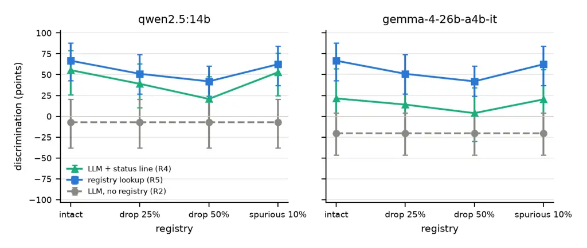
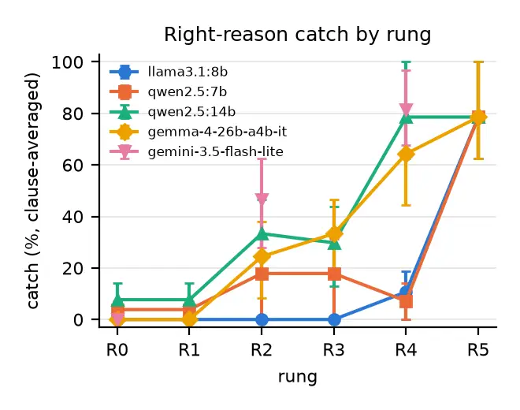

# What Do LLM Judges Actually Verify? Matched Controls and Record Gaps for Document Currency Unnati Shah¹ Samruddhi Kakade² Aum Patel³

###### Abstract

LLM judges often check, against an amendment record, whether the
documents an answer cites are still in force. Such records are rarely
complete. From a table of replacements, our test generates matched
answers citing a replaced document, its successor, the replaced document
before its replacement, and an older document that a newer one updated
without replacing; it removes links from the record and scores each
finding by its stated reason. On 48 replacements from the IETF RFC
index, judges given a correct record caught nearly every replaced
citation, as a lookup would. On the 24 faults whose link we removed,
every judge caught more from the texts alone than with the record:
Gemini 3.1 Pro 23/24 against 1/24, GPT-5.5 23/24 against 9/24, Claude
Opus 4.5 17/24 against 9/24 and Gemma 4 26B 13/24 against 0/24. The drop
recurred on a second draw of removed links. Most misses carried no
finding; in an exploratory run with a conflict code, only Gemini used it
often. Rewording the gap as “no replacement recorded” did not help;
presenting the record as an unverified note, or warning that it was
incomplete, restored most lost catches for Gemini, GPT-5.5 and Claude
(significant after correction for the first two) but at most 5 of 13 for
Gemma; where catches returned, so did false alarms on updates. With both
texts, judges mostly told replacements from updates; every update
flagged had a near-identical title. A descriptive case study on Indian
rooftop-solar rules is appended; we release the harness.

^(†)^(†)footnotetext: ¹M.S. in Computer Science, University of Southern
California. unnati.ix@gmail.com (corresponding author)  
²M.S. in Computer Science, Illinois Institute of Technology.
samruddhikakade2001@gmail.com  
³M.S. in Computer Science, New York University. aumrp77@gmail.com  
This research was conducted independently and was not commissioned,
funded, supervised or endorsed by any university or employer.

### 1 Introduction

Contracts are amended by later agreements, regulations by later
notifications, and technical standards by later standards. An answer
drawn from such a collection can quote a provision correctly and still
be wrong, because the document it quotes was replaced before the date
the question is about. Systems that use language models for this can add
a second model, an LLM judge, to check the answers before they reach a
user. The judge is often given help: an amendment record listing which
document replaced which, and from when.

Our starting point is a practical worry about that arrangement.
Amendment records are seldom complete. Consolidated versions lag behind
new notifications; pipelines that extract links from documents miss
some; registers cover only the instruments they were built from.
Wherever a record is silent about a replacement, it effectively reports
a replaced document as current. If the judge reads the documents in
front of it, such gaps cost little. If it relies on the record, it will
pass exactly the answers the record cannot catch, and it adds little
beyond what a lookup in the record would do.

Existing evaluations of LLM judges do not tell a builder which of these
to expect. Benchmarks give the judge correct context or none (Tan
et al., 2025; Xu et al., 2025), and most report whether the judge
flagged an answer, not why. A judge that flags every older citation
would score well on detection, and so would one that flags any older
document that sits next to a newer one on the same subject. Neither is
checking currency.

We therefore built a test aimed at one error, citing a replaced
document, and at the question of what the judge relies on when the
record and the documents disagree. The test starts from any table of
replacements. For each replacement it writes an answer citing the
replaced document (a fault) and three answers that are correct: one
citing the successor, one citing the replaced document at a date before
the replacement existed (a date control), and one citing an older
document that a newer one updated without replacing (a decoy; Figure 1
shows one link). It then removes half the links from the record,
presents the damaged record in several ways that leave its content
unchanged, and counts a fault as caught only when the judge says the
cited document was replaced.

We applied the test to 48 replacements recorded by the RFC Editor of the
Internet Engineering Task Force (IETF), with four judges
(Gemini 3.1 Pro, GPT-5.5, Claude Opus 4.5 and the open-weight
Gemma 4 26B). The hypotheses, tests and the way we would read each
outcome were committed to the project’s private development repository
(the release lists the commit times) after a smaller pilot (mostly on 24
of the links) and before these runs.

With a correct record line, the judges caught every replaced citation or
nearly so, which a lookup in the record also does. On the faults whose
link we removed, every judge caught fewer with the record present than
from the texts alone, on each of two random choices of which links to
remove, and most of the missed answers were passed without any finding.
The drop also occurred when the line said only that no replacement was
recorded, a statement that is true. Presenting the record as an
unverified note, or warning that it was incomplete, returned Gemini,
GPT-5.5 and Claude most of the way to their text-only behaviour, false
alarms included; the change is significant after correction for Gemini
and GPT-5.5 but not for Claude, which had fewer catches to recover, and
Gemma recovered at most 5 of the 13 it had lost (§5.2). Offered a reason
code for a record that conflicts with the evidence, in an exploratory
context added afterwards, Gemini named the conflict on 14 of the 24 gap
faults and the other judges rarely or never did, so the silence is
partly a matter of reply format for one judge only. Given both texts and
no record, the judges caught many more replacements than they flagged
updates, but every update they flagged had a near-identical title, and
an unplanned analysis suggests that they treat the resemblance between
two documents as evidence of replacement. In the pilot, date controls
exposed a 32B open model that flagged almost every old citation whatever
its date; the judges here passed nearly all of them.

The paper’s contribution is the test, released as a small harness,
together with this evidence about four judges on one corpus. We do not
claim that LLM judges in general defer to records, and we cannot say why
the judges we tested did. A second setting, Indian rooftop-solar
regulation with an amendment record extracted by an AI pipeline, is
reported as a descriptive case study in the appendix: its answer key did
not pass our own quality checks, and nothing in the main results rests
on it.

### 2 Related work

###### How LLM judges are evaluated.

Work on LLM judges has documented position, verbosity and
self-preference biases (Zheng et al., 2023) and built benchmarks of
harder judgements. JudgeBench (Tan et al., 2025) pairs responses that
differ in correctness, and ContextualJudgeBench (Xu et al., 2025) asks
judges to assess responses against supplied context, which it treats as
the reference. Other studies probe what judges are sensitive to: they
can be stable under edits that should not matter and insensitive to
edits that should (Chen et al., 2026), and citation judges accept claims
that their passage does not warrant (Qian et al., 2026). What counts as
an error, or how it is scored, changes rankings: of citation verifiers
(Kim et al., 2026) and of the models a benchmark evaluates (Pall, 2026).
Our test belongs to this line, with two differences in emphasis. The
supplied context is a record that is deliberately incomplete, and
findings are scored by the reason the judge gives, because in this task
a flag for the wrong reason is easy to obtain.

###### Following a signal over the evidence.

That models follow supplied signals is well established. Judges shown
prior scores as metadata move toward them, and an instruction to
disregard the metadata does not remove the effect (Kapetanovic et al.,
2026). Code auditors given false assurances from static analysis lose
detection, and prompt instructions do not reliably restore it (Liu and
Gao, 2026). Agents often adopt corrupted tool outputs (over a third of
the time for every tool tested) and rarely warn users of the conflict
(Yang et al., 2026). In the legal domain, models over-trust
authoritative but false legal sources and struggle to judge when a
retrieved citation is useful or misleading, on a benchmark that encodes
temporal validity, and larger models appear more susceptible (Molfetta
et al., 2026). The effect is not universal: judges given a wrong
reference answer often ignore it (Lee et al., 2026), so how far a model
follows a signal depends on the task and on the form of the signal.

Our results agree with this literature in direction. The setting differs
in how the misleading signal arises. In the studies above it is
constructed to be false: an injected score, a fabricated assurance, a
corrupted tool output. Our record errs only through missing links, a
common way for real amendment records to fail, though not the only one
(our case study also found wrong links). In its authoritative form the
gap then reads “in force”, which is false, but in one condition the line
says only that no replacement is recorded, which is true, and the
judges’ catches fell there too. The judge also has both documents in
front of it, and a deterministic lookup in the same record gives a
reference for what the record alone achieves. Our presentation
conditions vary the record’s wording, its apparent authority and a
warning about its completeness while keeping the record itself fixed; §6
compares the warning’s effect with the anchoring result of Kapetanovic
et al. (2026). Deference to an authoritative label is related to
sycophancy towards a user’s stated view (Sharma et al., 2024), but the
source of the pressure is different.

###### Outdated evidence and temporal knowledge.

A separate line asks whether models that write answers can cope with
change. Stale-Document Poisoning (Ahmed et al., 2026) shows that
outdated retrieved documents overturn answers a model had right, and
that an explicit statement of when the old evidence stops applying helps
larger models. EvolveBench (Zhu et al., 2025) and other benchmarks of
time-sensitive questions (Chen et al., 2021; Zhang and Choi, 2021; Vu
et al., 2024; Ouyang et al., 2025) measure whether models track facts
that change, and work on knowledge conflicts asks when supplied context
overrides what a model knows (Xie et al., 2024; Xu et al., 2024; Wu
et al., 2024). These studies concern the model that writes the answer.
We study a model that reviews an answer already written, which makes
false alarms on correct answers part of the measurement.

###### Versioned law and amendment records.

Legal informatics has long modelled the change of norms explicitly:
systems that manage consolidated acts across their successive versions
(Palmirani and Brighi, 2002), models of the temporal dimensions of norm
change (Palmirani and Brighi, 2006), defeasible-logic accounts of
abrogation and annulment (Governatori and Rotolo, 2010), and temporal
metadata (in-force, efficacy and application times) in LegalRuleML
(Palmirani et al., 2011). More recent work finds that retrieval over a
corpus holding only current texts returns the wrong version of a
provision (Cymbler et al., 2026), diagnoses staleness in statutory
question answering (Prior et al., 2026), and shows that LLM
consolidation of statutes from amendment instructions is often not exact
(50% exact matches for single amendments, 21% for chains) (Prior et al.,
2025). Version-aware retrieval has been built for amended regulations
(Nam et al., 2026) and, outside law, for evolving technical
documentation (Huwiler et al., 2025). Our record is a much thinner
object than these models, a list of document-to-document replacements
with dates, and our notion of currency (“replaced on or before the date
asked about”) is the simplest of the temporal notions they distinguish.
We take such a record as given, imperfections included, and ask what a
judge does with it.

###### Contrast items and right-for-the-wrong-reason.

Models can score well by exploiting features that correlate with the
label (McCoy et al., 2019), and minimally different contrast items are a
standard way to expose this (Gardner et al., 2020). Our date controls
and decoys play that role for document currency. The date control
changes only the date of a fault. The decoy keeps a newer document on
the same topic, often with the same title, but one that leaves the older
document in force. As §5.3 shows, our decoys control for title
similarity but not for overlap between abstracts, so they are a partial
contrast. Finally, label errors change model rankings (Northcutt et al.,
2021; Gema et al., 2025), and a clinical benchmark built with LLM help
was found to have at least 27% of its test labels likely wrong or
incomputable (Ye et al., 2025). This is the main reason our primary data
use the publisher’s own record as gold, and the reason the regulatory
study, whose AI-assisted key failed our checks, is reported only
descriptively.

### 3 The test

The test needs two inputs: a record of replacements that is correct
wherever it is used as gold, and a short text for each document. It
needs no labelled answers, because the record already says which
citations are wrong on which dates.


Figure 1: The test on one link from the RFC index and its matched decoy.
Each replacement yields a fault and two correct answers; a matched
update pair yields a decoy. The judge’s context is varied while the
question and answer stay fixed (Table 1); the full prompt for this fault
is in Figure 1.

###### Matched items.

Every item poses the same kind of question, “As of date $`D`$, which
document specifies $`T`$?”, where $`T`$ is the title of the older
document, and supplies an answer that cites one document. For each link
in the record (an old document and the document that replaced it) we
write three items, and we pair each link with one decoy (Figure 1):

- •
  a _fault_ cites the old document, with $`D`$ after the replacement;
- •
  a _control_ cites the replacing document, with the same $`D`$;
- •
  a _date control_ cites the old document, with $`D`$ before the
  replacement existed, so the answer is correct;
- •
  a _decoy_ cites the older document of a different pair, in which a
  newer document _updates_ the older one without replacing it. The older
  document is still in force, so this answer is also correct.

The fault and its date control are the same answer with a different
date. A judge that objects to old citations without comparing dates will
catch the fault and fail the date control. The decoy targets a different
shortcut. In the fault, a newer document on the same subject sits next
to the cited one; in the decoy, so does a newer document, often with the
same title, but it did not replace the older one. A judge that flags any
older document with a newer neighbour will catch the fault and fail the
decoy. Catch rates alone cannot tell either judge apart from one that
actually checks.

###### What the judge sees.

The context is the part a builder controls, and we vary it while holding
the question and the answer fixed (Table 1). In every primary context
the judge gets both documents’ titles, dates and abstracts, with any
sentence that states a replacement or names the other document removed,
so that the replacement has to be inferred. Titles are not filtered, and
in two links the replacing RFC’s title names the old one (§8). Five of
the six primary contexts add one line from an amendment record about the
cited document. In the damaged record, half the links are dropped with a
fixed seed; for a dropped link the record says nothing about a
replacement, and its line therefore reports the replaced document as in
force. We call the faults on these links _gap faults_. The four primary
damaged contexts are built from the same damaged record and differ in
how its line is presented:

- •
  the authoritative form, an “amendment record lookup” reporting the
  document as in_force;
- •
  the same record with the line worded no_replacement_recorded
  (wording);
- •
  the same line headed as an “unverified note from an automated tagger”
  (authority);
- •
  the authoritative form with a warning that the record is incomplete
  and may omit replacements (warning).

The pilot also used contexts that we did not repeat here: the citation
alone (cite-only), the cited document alone (cited-text), masked
document numbers (both-masked), the replacing document’s own notice of
replacement (both-explicit), an instruction to check replacement first
(check-first), and two worked examples (few-shot). They are reported in
Appendix 11.

| Context          | The judge is given, besides both texts                                                                                        |
| ---------------- | ----------------------------------------------------------------------------------------------------------------------------- |
| both-texts       | nothing else                                                                                                                  |
| status           | a line from the correct record: the cited document’s status on the date                                                       |
| status-damaged   | the line from a record with half its links dropped, where a dropped link reads “in force” (authoritative form)                |
| norecord-damaged | as above, the line reading “no replacement recorded” (wording)                                                                |
| lowauth-damaged  | as status-damaged, headed as an unverified note from an automated tagger (authority)                                          |
| caveat-damaged   | as status-damaged, with the warning that the record is incomplete and may omit replacements (warning)                         |
| conflict-damaged | as status-damaged, with one more reason a finding may give: the record conflicts with the evidence (exploratory, added later) |

Table 1: The six primary contexts, and one exploratory context added
after the main analysis (§4). The damaged contexts use the same damaged
record; the warning adds one true statement about it.

###### Scoring by reason.

The judge returns a verdict and a list of findings. Each finding names a
document and gives one reason from a closed list: replaced (coded
superseded in the prompt), not yet published, not applicable, content
error, unsupported, or other. We count a fault as _caught_ only if some
finding names the cited document with the reason that it was replaced. A
judge that flags the fault as, say, a content error has noticed that
something is off without identifying the error, and an any-finding count
would credit it with the catch. On the three kinds of correct answer we
record two false-alarm counts: a _validity_ false alarm, a finding that
a document was replaced or not yet published, and any finding at all.
The first measures mistakes about currency; the second also counts
complaints about relevance or content, which the question format may
provoke (§5.4). A reply that cannot be parsed counts against the judge:
as a miss on a fault and as a false alarm of both kinds on a correct
answer. We call a reply on a fault a _bare pass_ when it contains no
finding at all.

###### Lookup baseline.

A deterministic lookup, with no language model, flags exactly the
documents the record marks as replaced. With the correct record it
catches every fault and raises no false alarm. With the damaged record
it catches the faults whose link survived and none of the gap faults. It
tells us what the record alone achieves, and so what a judge given the
record adds.

###### Scope of the design.

The test covers one error, citing a whole replaced document, and one
decision, the judge’s verdict on a fixed answer. Partial amendments,
chains of replacements and cross-references would need other item
generators. Following the record can help as well as hurt. The gap
faults measure the cost of following a silent record, and the decoys,
whose record line is correct, give one measure of the benefit.

### 4 Data and setup

###### Replacements.

IETF Requests for Comments (RFCs) replace one another, and the RFC
Editor’s index (RFC Editor, 2026) records each replacement (“Obsoletes”
/ “Obsoleted by”) together with publication dates and abstracts. We kept
the simplest cases: replacements in which the old RFC was replaced by
exactly one RFC, the replacing RFC is itself current, was published in
2005 or later and replaces at most two RFCs, and both documents have
abstracts. From these we drew 48 links with a fixed seed. Because the
record is the publisher’s, the gold needs no annotation. Each document
is represented by its title, publication date and abstract. In 33 of the
48 links the two titles are near-identical (a normalised
string-similarity ratio of at least 0.8), which matters for the shortcut
analysis below.

###### Decoys.

The index also records updates (“Updates” / “Updated by”), in which a
newer RFC amends part of an older one without replacing it. A decoy is
an update pair in which the older RFC was never replaced and the newer
one is current, chosen under the same filters as the links and sharing
no document with them. For each link we took the nearest unused update
pair within the link’s same-title group, by a distance that combines
IETF area (our proxy for topic), title similarity, both publication
dates and both abstract lengths. The matching is greedy in link order
and deterministic. Balance on the matched features is good for dates
(standardised mean differences 0.04 for the old date, 0.02 for the new
date and $`-`$0.02 for the gap) and acceptable for title similarity
($`-`$0.22); 37/48 decoys share their link’s IETF area. Two imbalances
remain. First, updating RFCs have shorter abstracts than replacing ones
($`-`$0.55), a property of updates that we chose not to force away.
Second, abstract overlap was not a matching feature. A replacing RFC
usually repeats much of the abstract of the RFC it replaces (median
similarity 0.80 for same-title links, by the same string-similarity
ratio computed on the abstracts as the judges saw them), whereas an
updating RFC does not (median 0.17 for same-title decoys). We found this
only after the runs; its consequences are discussed in §5.3.

###### Judges and runs.

Four judges were run on all six primary contexts with the same links and
decoys: Gemini 3.1 Pro, GPT-5.5 and Claude Opus 4.5 through the Kaggle
Benchmarks proxy, and Gemma 4 26B through Google’s API at temperature 0.
The proxy sets temperature and seed itself and does not report them,
which limits exact reproduction of the hosted judges. Every request to
the hosted judges went through the proxy with an output cap of 4,000
tokens, sending the system and user text as two messages. No reply is
taken from the pilot. A first analysis of these runs had reused the
pilot’s replies to identical prompts, most of them obtained with an
earlier form of the proxy call; we then requested every such prompt
again under the current call. This changed the score of 7 of GPT-5.5’s
1,152 items, 8 of Gemini’s, 12 of Claude’s and 0 of Gemma’s, and no
conclusion; all results reported here use the new replies. Within these
runs, a prompt that recurs (for example, a text-only prompt shared by
the two draws below) is asked once and its reply reused. For Gemma, the
client retries a request once without the API’s JSON mode when the
JSON-mode reply is cut off; the run log records that this happened, but
not for which items. Every block of replies records the model version
and a hash of the harness code. For this paper we rescored every reply
from its raw text, and every stored score matched.

###### Hypotheses and analysis.

The hypotheses below, with their tests and the reading we would give
each outcome, were written after the pilot and committed to the
project’s private development repository shortly before the runs. This
is a timestamped internal record, not a public registration. Before any
result of these runs existed, the plan was amended to add two
presentation conditions (wording and authority, beside the warning) and
to match decoys on more features; the amendment is part of the same
history.

H1  
Given both texts, a judge’s right-reason catch on faults exceeds its
validity false alarms on the matched decoys. Tested per judge as the
mean paired difference over the 48 link–decoy pairs, with a
2,000-resample bootstrap interval over pairs.

H2a  
On the 24 gap faults, a judge catches fewer with the damaged record
(authoritative form) than with no record. Two-sided exact McNemar test
on the paired items; Holm adjustment across judges.

H2b  
Each other presentation of the damaged record changes the catch on the
gap faults relative to the authoritative form. Two-sided exact McNemar
tests; Holm adjustment across all 12 presentation–judge pairs.

The unit of analysis is the link, never the model call. With 24 pairs, a
change in which every discordant item moves the same way needs at least
six items to reach the 5% level before adjustment (two-sided exact $`p`$
= .031), and more after the Holm adjustment; changes that do not reach
it are reported as inconclusive. The plan also listed Wilson intervals
for rates and an exploratory mixed-effects model pooled over judges; we
report exact counts and paired tests instead, and did not fit the model,
since no claim depends on it.

###### A second draw of removed links.

Because the pilot had shown that the choice of removed links matters, we
amended the plan, once results on the first draw (damage seed 0) existed
for three judges and before any seed-1 call, to repeat H2a on a second
random choice (damage seed 1) for the same four judges, with the tests
fixed in advance: H2a per judge on seed 1 with Holm adjustment across
judges, and a per-judge estimate over both seeds. The two draws drop 24
links each and share 12, so each adds 12 gap faults of its own. A shared
link is the same item under both seeds, with an identical prompt whose
cached reply was reused, so the pooled estimate counts it once: it is
the mean drop in catch over the 36 links in either gap set, with a
2,000-resample bootstrap interval over links and an exact sign test on
the links that changed. Text-only prompts do not depend on the record,
so seed 1 reuses the text-only replies; its damaged-record replies on
the 12 new gap faults are new requests. The second draw is a robustness
check on the choice of removed links, not an independent replication: it
shares half its gap faults and all text-only replies with the first. The
hypotheses and thresholds were not changed. Everything else in §5,
including every comparison by title or abstract overlap, is exploratory.

###### A code for conflicts.

After the results above existed, a reader observed that the reason list
gives a judge no way to report that the record and the texts disagree,
so a bare pass might reflect the reply format rather than the judge. We
therefore added one exploratory context, conflict-damaged: the
authoritative damaged record, with one more reason in the list,
record_conflict (“the record and the evidence disagree, or whether the
cited document is still current cannot be confirmed”). A record_conflict
finding is counted separately and is not a catch. This context was run
on the first draw for all four judges; no test was planned for it, and
we report counts only.

###### The pilot.

Before the final design, six judges ran up to ten contexts on the first
24 links, and Qwen 2.5 32B on all 48 (Appendix 11). The pilot had no
decoys, and of the presentation conditions only the “no replacement
recorded” wording; its damaged record, built over 24 links rather than
48 (except for Qwen), dropped a different set of links. We use it for
the date-control result and for the contexts not repeated here.

###### The case study.

The test was first developed on Indian rooftop-solar regulation, with an
amendment record extracted by an AI pipeline and seven judges. Because
its answer key failed the quality checks set for it, it is reported
descriptively in Appendix 14 and the supplementary material, and no
result in §5 uses it.

###### Use of AI assistants.

An AI coding assistant, built on models from the same developer as one
of the judges (Claude Opus 4.5), drafted the hypotheses and analysis
plan, which the authors reviewed and amended; wrote the harness; sampled
the links and decoys; ran the Gemma judge and prepared the hosted-judge
runs, which were executed through the benchmark proxy under the lead
author’s account; analysed the replies; and drafted and edited the
manuscript. In the case study it drafted the labels and extracted the
amendment record, which two authors checked blind with a third
adjudicating. The RFC gold is the publisher’s, and the assistant’s own
model was not run as a judge. The authors checked judge replies,
statistical results and references against their sources, read and
revised the manuscript, and take full responsibility for its content.

### 5 Results

Table 2 lists every judge’s catches and false alarms in every context.
We begin with the correct record, which sets the baseline, and then turn
to the gap faults.

|                 |                  | Faults |       | Controls |       | Date controls | Decoys |       |
| --------------- | ---------------- | ------ | ----- | -------- | ----- | ------------- | ------ | ----- |
| Judge           | Context          | Catch  | any   | FA       | any   | FA            | FA     | any   |
| Gemma 4 26B     | both-texts       | 31/48  | 31/48 | 0/48     | 19/48 | 0/48          | 6/48   | 6/48  |
|                 | status           | 47/48  | 47/48 | 0/48     | 20/48 | 0/48          | 0/48   | 0/48  |
|                 | status-damaged   | 23/48  | 23/48 | 0/48     | 20/48 | 0/48          | 0/48   | 0/48  |
|                 | norecord-damaged | 23/48  | 23/48 | 0/48     | 20/48 | 0/48          | 0/48   | 0/48  |
|                 | lowauth-damaged  | 26/48  | 26/48 | 0/48     | 18/48 | 0/48          | 1/48   | 1/48  |
|                 | caveat-damaged   | 29/48  | 29/48 | 0/48     | 18/48 | 0/48          | 1/48   | 1/48  |
|                 | conflict-damaged | 23/48  | 26/48 | 0/48     | 20/48 | 0/48          | 0/48   | 1/48  |
| GPT-5.5         | both-texts       | 46/48  | 46/48 | 1/48     | 10/48 | 0/48          | 8/48   | 8/48  |
|                 | status           | 48/48  | 48/48 | 0/48     | 12/48 | 0/48          | 0/48   | 0/48  |
|                 | status-damaged   | 33/48  | 33/48 | 0/48     | 12/48 | 0/48          | 0/48   | 0/48  |
|                 | norecord-damaged | 34/48  | 34/48 | 0/48     | 10/48 | 0/48          | 0/48   | 0/48  |
|                 | lowauth-damaged  | 48/48  | 48/48 | 1/48     | 11/48 | 0/48          | 10/48  | 10/48 |
|                 | caveat-damaged   | 47/48  | 48/48 | 1/48     | 9/48  | 0/48          | 8/48   | 8/48  |
|                 | conflict-damaged | 31/48  | 33/48 | 0/48     | 10/48 | 0/48          | 2/48   | 2/48  |
| Gemini 3.1 Pro  | both-texts       | 43/48  | 43/48 | 0/48     | 22/48 | 0/48          | 6/48   | 6/48  |
|                 | status           | 48/48  | 48/48 | 0/48     | 19/48 | 0/48          | 0/48   | 0/48  |
|                 | status-damaged   | 25/48  | 25/48 | 0/48     | 19/48 | 0/48          | 0/48   | 0/48  |
|                 | norecord-damaged | 30/48  | 30/48 | 0/48     | 18/48 | 0/48          | 0/48   | 0/48  |
|                 | lowauth-damaged  | 42/48  | 42/48 | 0/48     | 19/48 | 0/48          | 4/48   | 4/48  |
|                 | caveat-damaged   | 46/48  | 46/48 | 0/48     | 20/48 | 0/48          | 6/48   | 6/48  |
|                 | conflict-damaged | 24/48  | 38/48 | 0/48     | 20/48 | 0/48          | 0/48   | 1/48  |
| Claude Opus 4.5 | both-texts       | 37/48  | 38/48 | 0/48     | 19/48 | 3/48          | 9/48   | 9/48  |
|                 | status           | 48/48  | 48/48 | 0/48     | 22/48 | 0/48          | 4/48   | 4/48  |
|                 | status-damaged   | 33/48  | 35/48 | 0/48     | 22/48 | 0/48          | 4/48   | 4/48  |
|                 | norecord-damaged | 35/48  | 36/48 | 1/48     | 22/48 | 0/48          | 5/48   | 5/48  |
|                 | lowauth-damaged  | 41/48  | 42/48 | 0/48     | 20/48 | 1/48          | 9/48   | 9/48  |
|                 | caveat-damaged   | 41/48  | 42/48 | 0/48     | 20/48 | 1/48          | 7/48   | 7/48  |
|                 | conflict-damaged | 37/48  | 38/48 | 1/48     | 21/48 | 0/48          | 5/48   | 5/48  |

Table 2: All 48 links, per judge and context. Catch: right-reason
catches of faults (any: any finding on the fault). False alarms (FA)
count validity findings (replaced or not yet published) unless marked
any. Controls cite the replacing RFC; date controls cite the replaced
RFC as of a date before its replacement; decoys cite an RFC that a newer
one updates but does not replace. conflict-damaged is exploratory: a
record_conflict finding counts under any, not as a catch or a validity
false alarm. All counts are of 48.

#### 5.1 With a correct record

Given a line from the correct record, the judges caught all or nearly
all faults (Gemma 47/48, GPT-5.5 48/48, Gemini 48/48, Claude 48/48), as
a lookup in the same record does by construction. The record also helped
on correct answers. For decoys, the record line correctly reports the
older RFC as in force, and decoy false alarms fell from 8/48 to 0/48 for
GPT-5.5, from 6/48 to 0/48 for Gemini, from 6/48 to 0/48 for Gemma and
from 9/48 to 4/48 for Claude. Following the record therefore has a
benefit as well as the cost measured below, and on this corpus a judge
given a correct record does essentially what the record does in its
findings about currency.

With the damaged record the lookup catches the 24 faults whose link
survived and none of the 24 gap faults. Over all 48 faults the judges
scored Gemma 23/48, GPT-5.5 33/48, Gemini 25/48 and Claude 33/48. The
gap faults themselves are analysed next.

#### 5.2 Gap faults

Table 3 and Figure 2 isolate the 24 gap faults; the items are the same
in every column, so each comparison is within a judge.

|                 |           |                              |        |                           |                 |                  |            |         |           |         |
| --------------- | --------- | ---------------------------- | ------ | ------------------------- | --------------- | ---------------- | ---------- | ------- | --------- | ------- |
|                 | No record | Damaged record, presented as |        |                           |                 |                  | Holm $`p`$ |         |           |         |
| Judge           | (texts)   | record, “in force”           | (bare) | “no replacement recorded” | unverified note | record + warning | H2a        | wording | authority | warning |
| Gemma 4 26B     | 13/24     | 0/24                         | 24     | 0/24                      | 2/24            | 5/24             | \<.001     | 1.000   | 1.000     | .375    |
| GPT-5.5         | 23/24     | 9/24                         | 15     | 10/24                     | 24/24           | 23/24            | \<.001     | 1.000   | \<.001    | .001    |
| Gemini 3.1 Pro  | 23/24     | 1/24                         | 23     | 6/24                      | 18/24           | 22/24            | \<.001     | .375    | \<.001    | \<.001  |
| Claude Opus 4.5 | 17/24     | 9/24                         | 13     | 11/24                     | 17/24           | 17/24            | .008       | 1.000   | .062      | .062    |

Table 3: The 24 gap faults per judge: faults whose link the damaged
record dropped (half the 48 links, seed 0). Same items in every column.
The four damaged-record presentations use the same damaged record. Bare:
passes with no finding under the authoritative “in force” line. $`p`$:
exact McNemar, Holm-adjusted; H2a compares the authoritative line with
no record, H2b each other presentation with the authoritative line.

Figure 2: Catches on the 24 gap faults per judge (the values of
Table 3): from both texts with no record, and with the damaged record in
each of its four presentations. A lookup in the damaged record catches
none of these faults.

From the texts alone, Gemini caught 23/24 of the gap faults and, with
the damaged record in its authoritative form, 1/24: 22 catches lost and
0 gained (H2a, Holm $`p`$ \<.001). GPT-5.5 went from 23/24 to 9/24 (14
lost, 0 gained; Holm $`p`$ \<.001) and Claude from 17/24 to 9/24 (8
lost, 0 gained; Holm $`p`$ .008). Gemma caught fewer from the texts,
13/24, and none with the record (Holm $`p`$ \<.001). H2a therefore holds
for all four judges. Under the damaged record, 23 of Gemini’s 23 misses
were replies with no finding at all; GPT-5.5’s were 15 of 15, Claude’s
13 of 15 and Gemma’s 24 of 24. Claude’s two misses that did carry a
finding both mention the newer RFC, but as a content error (a title
wrongly attributed to the cited RFC, or an answer that may be
incomplete), not as a replacement; one repeats, as the record says, that
the older RFC remains in force. Under none of the four presentations
does a missed gap fault name a conflict between the record and the
texts; the few replies that mention the record are catches.

|                 |                    |             |        |                     |             |        |        |                          |                  |             |        |
| --------------- | ------------------ | ----------- | ------ | ------------------- | ----------- | ------ | ------ | ------------------------ | ---------------- | ----------- | ------ |
|                 | Seed 0             |             |        | Seed 1              |             |        |        | Pooled over unique links |                  |             |        |
| Judge           | Caught             | Lost/gained | $`p`$  | Caught              | Lost/gained | $`p`$  | Shared | Links                    | Drop             | Lost/gained | $`p`$  |
| Gemma 4 26B     | 13/24 $`\to`$ 0/24 | 13/0        | \<.001 | 17/24 $`\to`$ 0/24  | 17/0        | \<.001 | 12     | 36                       | +61 \[+44, +78\] | 22/0        | \<.001 |
| GPT-5.5         | 23/24 $`\to`$ 9/24 | 14/0        | \<.001 | 24/24 $`\to`$ 10/24 | 14/0        | \<.001 | 12     | 36                       | +61 \[+44, +75\] | 22/0        | \<.001 |
| Gemini 3.1 Pro  | 23/24 $`\to`$ 1/24 | 22/0        | \<.001 | 22/24 $`\to`$ 4/24  | 18/0        | \<.001 | 12     | 36                       | +81 \[+67, +92\] | 29/0        | \<.001 |
| Claude Opus 4.5 | 17/24 $`\to`$ 9/24 | 8/0         | .008   | 19/24 $`\to`$ 12/24 | 7/0         | .016   | 12     | 36                       | +31 \[+17, +44\] | 11/0        | \<.001 |

Table 4: H2a on two random draws of dropped links. Each seed drops 24 of
the 48 links; the two draws share some links (Shared). Per seed: gap
faults caught with no record $`\to`$ with the damaged record
(authoritative form), lost/gained, Holm-adjusted exact McNemar $`p`$
(across judges, within seed). Pooled: unique links in either gap set, a
shared link counted once (its reply is the same under both seeds); mean
drop in points with a 95% bootstrap interval over links, lost/gained,
exact sign test. Seed 0 is the planned test; seed 1 and the pooled
estimate were added before any seed-1 run, when seed-0 results existed
for three judges.

###### A second draw of removed links.

Table 4 repeats H2a on the second draw. Each judge lost catches again
and gained none: Gemini 22/24 to 4/24, GPT-5.5 24/24 to 10/24, Claude
19/24 to 12/24 and Gemma 17/24 to 0/24 (Holm $`p`$ \<.001, \<.001, .016
and \<.001). The two draws share 12 gap faults, whose replies are
identical under both, so the seed-1 result is new evidence only through
its other 12 items. Counting each link once, the drop over the 36 links
in either gap set is +81 points for Gemini (95% interval \[+67, +92\]),
+61 for GPT-5.5 (\[+44, +75\]), +61 for Gemma (\[+44, +78\]) and +31 for
Claude (\[+17, +44\]), with no link gained by any judge. On both draws
Gemini lost the most catches and Claude the fewest, but with this many
items we do not rank the judges.

###### Presentation.

Writing “no replacement recorded” instead of “in force” did not bring
any judge back to its text-only level. Gemini caught 6/24 (5 gained, 0
lost), GPT-5.5 10/24 (2 gained, 1 lost), Claude 11/24 (3 gained, 1 lost)
and Gemma 0/24; no change is significant before or after adjustment.
Gains this small cannot be resolved with 24 pairs, so the result is that
the rewording did not restore the lost catches, not that it had no
effect. In this condition the record line is true: it reports only that
no replacement is recorded. The drop seen here, for judges that had both
texts in front of them, is therefore produced by an omission in the
record, without any false statement. (The comparison with the texts
alone was not a planned test; for each judge every item that changed
moved away from a catch.)

The other two presentations moved three of the judges. With the line
headed as an unverified note, Gemini caught 18/24 gap faults and GPT-5.5
24/24; with a warning that the record omits some replacements, 22/24 and
23/24. Every item that changed moved toward a catch (Gemini 17 and 21
items, GPT-5.5 15 and 14), and all four tests are significant after the
Holm adjustment over the twelve presentation tests (Holm $`p`$ \<.001,
\<.001, \<.001 and .001). Claude moved the same way, to 17/24 and 17/24
(8 items each, none lost; raw $`p`$ .008, Holm $`p`$ .062). In each
condition it caught seven of the 8 faults it had lost and one it had
missed from the texts (Appendix 12), equal to its text-only level of
17/24; with only 8 lost catches to recover, even this near-complete
recovery does not survive the Holm adjustment over the twelve tests.
Gemma recovered less, catching 2/24 and 5/24 against 13/24 from the
texts alone (Holm $`p`$ 1.000 and .375).

Where the catches came back, they came back with the judge’s text-only
false alarms. Under the authoritative record, Gemini and GPT-5.5 raised
no validity false alarm on decoys, because the record correctly lists
the decoy’s older RFC as in force. With the unverified note, GPT-5.5
flagged 10/48 decoys and Gemini 4/48; with the warning, 8/48 and 6/48,
against 8/48 and 6/48 from the texts alone. Claude’s rose from 4/48 to
9/48 and 7/48 (texts alone 9/48). A decoy’s older RFC was never
replaced, so in every presentation its record line is correct; a judge
that weighed record against texts would have no reason to flag more
decoys when told the record might omit replacements. The change
therefore looks more like a return to text-only behaviour than like
better use of the record. False alarms on controls and date controls
stayed at one of 48 or fewer in every damaged-record condition.

###### A code for conflicts.

Given a reason for a record that conflicts with the evidence
(exploratory; §4), the judges divided. Gemini gave it on 14 of the 24
gap faults, GPT-5.5 on 2, Gemma on 3 and Claude on none. Right-reason
catches on the gap faults were 0/24 for Gemini, 7/24 for GPT-5.5, 13/24
for Claude and 0/24 for Gemma, against 1/24, 9/24, 9/24 and 0/24 without
the code, and bare passes were 10, 15, 10 and 21 of 24 (against 23, 15,
13 and 24 without the code). The code was almost never used on correct
answers (Gemini and Gemma once each, on a decoy; no judge on a control
or date control). For Gemini, then, many of the silent passes under the
authoritative line correspond to a conflict the judge registers when the
format lets it say so; the other three judges rarely or never used the
code, although Claude’s right-reason catches rose from 9/24 to 13/24 in
this context (untested). With the code, every judge still caught fewer
gap faults than from the texts alone.

###### Comparison with the pilot.

In the pilot, Claude kept 10 of the 11 gap faults it had caught from the
texts. Here it lost 8. The two runs used different gap faults: the
pilot’s damaged record was built over 24 links, and only 5 of its 12 gap
faults are gap faults here, and on those Claude caught 2 in this run;
the other 7 pilot items, all of which it caught in the pilot, are not
gap faults in this run. Most of the difference therefore comes from
which links were dropped, and on the second draw Claude again lost
catches (7) and gained none. What the comparison does show is that the
choice of a dozen dropped links can turn a judge’s small loss into a
large one, so comparisons between judges on item sets of this size,
including those in our own tables, are provisional. Appendix 12 lists
every gap fault.

#### 5.3 Replacements, updates and surface similarity

Table 5 and Figure 3 report the decoy test, with both texts and no
record. Every judge caught more faults than it flagged decoys (paired
difference +79 points for GPT-5.5, 95% interval \[+67, +90\]; Gemini
+77, \[+65, +88\]; Claude +58, \[+42, +73\]; Gemma +52, \[+35, +69\]),
so H1 holds. Because each decoy was drawn from its link’s title group, a
judge that flagged every pair with near-identical titles would score
zero here; the weakness of H1 lies elsewhere, in abstract overlap,
discussed below. The more informative comparison is within the
same-title pairs, where title similarity is held roughly constant. There
GPT-5.5 caught 33/33 faults and flagged 8/33 decoys, Gemini 32/33 and
6/33, Claude 30/33 and 9/33, Gemma 29/33 and 6/33. Among different-title
pairs, no judge flagged a decoy, and catches differed widely (GPT-5.5
13/15, Gemini 11/15, Claude 7/15, Gemma 2/15).

|                 |             |          |                 |          |                  |
| --------------- | ----------- | -------- | --------------- | -------- | ---------------- |
|                 | Same title  |          | Different title |          |                  |
| Judge           | Fault catch | Decoy FA | Fault catch     | Decoy FA | Discrimination   |
| Gemma 4 26B     | 29/33       | 6/33     | 2/15            | 0/15     | +52 \[+35, +69\] |
| GPT-5.5         | 33/33       | 8/33     | 13/15           | 0/15     | +79 \[+67, +90\] |
| Gemini 3.1 Pro  | 32/33       | 6/33     | 11/15           | 0/15     | +77 \[+65, +88\] |
| Claude Opus 4.5 | 30/33       | 9/33     | 7/15            | 0/15     | +58 \[+42, +73\] |

Table 5: Shortcut test with both texts and no record. Faults and their
matched decoys, split by whether the two RFCs of the pair share a
(near-)identical title. Discrimination: catch minus decoy false alarm,
paired by link, in points with a 95% bootstrap interval over the 48
pairs.

Figure 3: Faults caught and decoys flagged as replaced, with both texts
and no record, by whether the two RFCs of a pair have near-identical
titles (the values of Table 5). No judge flagged a decoy whose titles
differ.

Our plan read a positive H1 as evidence that text-only catches are not a
title shortcut. The data call for a more qualified reading, and the
analysis that supports it was not planned. Title similarity travels with
abstract overlap: in the text the judges saw, a replacing RFC usually
repeats much of its predecessor’s abstract (median similarity 0.80 for
same-title links, 0.15 for different-title links), while the decoys,
which were not matched on overlap, do not (0.17 and 0.10). Splitting at
a similarity of 0.3, chosen after seeing the data, false alarms on
same-title decoys were more frequent when the abstracts overlapped
(GPT-5.5 3/7 against 5/26; Gemini 2/7 against 4/26; Claude 3/7 against
6/26; Gemma 2/7 against 4/26), and so were catches on different-title
replacements (Claude 5/6 against 2/9; Gemma 2/6 against 0/9; GPT-5.5 6/6
against 7/9; Gemini 6/6 against 5/9). The high-overlap cells hold six or
seven items, and we report no test. The pattern is consistent with
judges using the resemblance between the two documents as evidence of
replacement. In the RFC series that is often good evidence, so we
hesitate to call it a shortcut, and the data cannot separate the title
from the abstract.

The decoys also have a labelling caveat. Some of the decoys the judges
flagged are updates that introduce a new version of a protocol, such as
RFC 8210 (version 1 of the RPKI-to-Router protocol, updating RFC 6810),
flagged by all four judges, and RFC 9777 (MLDv2, updating RFC 2710),
flagged by two. By the publisher’s record the older RFC is in force,
which is our gold. For a question asking which document specifies the
protocol, however, a reader could reasonably prefer the newer version.
Some of these false alarms may therefore be defensible judgements rather
than errors.

#### 5.4 Scoring by reason

For the frontier judges given both texts, counting any finding on a
fault instead of the right reason barely changes the catch (GPT-5.5
46/48 against 46/48, Gemini 43/48 against 43/48, Claude 37/48 against
38/48). On correct answers the difference is large. With both texts,
Claude raised some finding on 19/48 of the controls that cite the
replacing RFC, but a validity finding on 0/48; Gemini raised some
finding on 22/48 and a validity finding on 0/48; Gemma raised some
finding on 19/48 and a validity finding on 0/48. Gemma’s findings on
these controls all gave the reason “content error”. We suspect, without
having tested it, that the question format provokes them: the question
names the old document’s title, and the answer cites a document with a
different number and sometimes a different title. Under any-finding
scoring Claude, Gemini and Gemma would appear to raise false alarms on
about two in five of these controls, none of which concern currency.

The scoring rule also changes the catch when the judge has less
evidence. In the pilot, given the citation alone, Gemini raised a
finding on every fault but gave the right reason on 11/24. Reason coding
is also what makes the bare passes of §5.2 visible as a separate
category from misses that carry an irrelevant finding.

#### 5.5 Date controls

The judges raised few or no validity false alarms on date controls (with
both texts: GPT-5.5 0/48, Gemini 0/48, Claude 3/48 and Gemma 0/48). In
this run the controls did not separate the judges. In the pilot they
did. Qwen 2.5 32B caught 42/48 faults with both texts, a catch rate
comparable to the frontier judges, but also flagged 43/48 answers that
were correct on their date, for a currency discrimination (right-reason
catch minus validity false alarms on date controls) of $`-`$2 points
over all 48 links against +92 for Gemini over the first 24. Two worked
examples in the prompt, one showing a correct answer being passed,
reduced Qwen’s date false alarms to 5/48. The result rests on one judge,
and a catch rate alone would not have revealed it.

### 6 Discussion

###### The gap result.

Within each of the four judges, the same gap faults were caught less
often when the record line was presented as authoritative, and most of
the lost catches became passes with no finding. Some mundane
explanations can be set aside. The items are identical across
conditions. The drop also occurs when the line says only that no
replacement is recorded, so it does not depend on the record stating
anything false. And the decoy test shows that most text-only catches
were not reflexive objections to older documents, although some may rest
on the documents’ resemblance rather than on a check of replacement
(§5.3), so what the record removed is best read as findings of
replacement, whatever their basis. What the design cannot set aside, the
small and partly shared item sets, is discussed in §8.

We cannot say why the judges behaved this way, and at least three
explanations fit what we observed. The judge may simply be relying on
the record as the task presents it. It is shown an “amendment record
lookup”, nothing suggests the record is incomplete, and trusting it is
defensible; on correct answers, following it removed most decoy false
alarms (§5.1). On that reading the failure belongs to a record that does
not disclose its own gaps, and what the judge lacks is any sign of
registering the conflict with the texts. The line may instead be more
salient than the evidence, being short, explicit and placed just before
the task, while the replacement has to be inferred from two abstracts;
we did not vary position or length. Or the judge may treat the status
line as part of the question rather than as evidence to weigh. A bare
pass is compatible with all three, and on its own it does not tell us
whether the judge noticed the conflict and resolved it in the record’s
favour or never noticed it. The exploratory conflict code gives a
partial answer that differs by judge: offered a way to say so, Gemini
named the conflict on 14 of the 24 gap faults, while Claude never did
and GPT-5.5 and Gemma rarely did (§5.2). For Gemini, a silent pass often
hid a conflict it had registered; for the others, silence under the
authoritative line is not explained by the lack of a code. A conflict
finding is still not a catch: Gemini’s right-reason catches on the gap
faults in that context were 0/24.

###### Presentation.

The presentation conditions were meant to separate these explanations,
and they partly do. Rewording the gap did not restore the catches for
any judge, which lends no support to the simplest account, that judges
are misled by an explicit claim of currency, although 24 pairs cannot
exclude a small effect of wording. For Gemini and GPT-5.5, lowering the
record’s standing or warning that it was incomplete restored most or all
of the lost catches, and Claude recovered seven of the eight it had
lost, without reaching significance. This fits the first explanation:
told that the record might be wrong, these judges went back to the
texts. It fits the salience explanation less well, since the note and
the warning leave the line as short, explicit and close to the task as
before. For these three judges, however, the decoy false alarms came
back with the catches, to about their text-only level. This suggests
that these judges moved from relying on the record to relying on the
texts, rather than weighing the two item by item. Gemma moved least,
catching at most 5/24 gap faults however the damaged record was
presented. Which judges respond in this way, and why, is a question for
more judges and more wordings than our one variant per condition.

Two related studies bear on these results. Kapetanovic et al. (2026)
found that a warning did not reduce the total effect of judges’
anchoring on prior scores, though it improved accuracy in one of their
experiments. Our warning differs in stating a specific and true defect
of the record, with the contradicting evidence in view, and either
difference could matter. Molfetta et al. (2026) report that larger
models defer more to authoritative but false legal information. Our one
open-weight judge responded least to the presentation of the record, but
the hosted judges’ sizes are not published, and four judges could not
test an effect of size in any case.

###### Resemblance between documents.

The judges did not flag older documents merely for having a newer
neighbour, since they caught far more replacements than they flagged
updates. Yet, in exploratory splits, their mistakes in both directions
tracked how alike the two documents looked. Given both texts, updates
were flagged only when the titles were near-identical, and Gemma rarely
caught a replacement whose title had changed. Some of this reliance is
reasonable, since RFC replacements often do repeat their predecessor’s
title and abstract, and some flagged decoys are new protocol versions
that a reader might prefer to cite. The practical concern is transfer.
An amended regulation may keep its title, while a contract amendment can
look nothing like the agreement it modifies. A judge evaluated on one
kind of collection may behave differently on the other, and nothing in a
single-corpus evaluation, ours included, would show it.

###### Scoring.

Reason codes matter most on correct answers: under any-finding scoring,
Claude, Gemini and Gemma would have appeared to object to roughly two in
five controls, all for reasons unrelated to currency. They also make the
gap result measurable. Any-finding scoring would credit a judge that
calls a stale citation a “content error” with the catch; reason codes
separate that reply from a right-reason catch and from a bare pass,
which is how most lost catches could be seen to be bare passes.

### 7 Practical implications

These suggestions come from four judges on one corpus. Each is cheap to
check with one’s own judge, since the harness runs a judge through the
six contexts in about 1,200 calls.

An evaluation in which the judge receives a correct record says little
about the judge: with a correct record our judges’ findings about
currency nearly matched a lookup’s. The more useful test removes links
from the record and compares each judge with itself on the affected
items. If its catches there fall to the lookup’s level, the judge
contributes nothing beyond the record on those items, and the
completeness of the record becomes the real limit of the pipeline. That
trade-off can still be worth accepting, since the same record also
spared the judges false alarms on decoys.

How the record is presented can matter, and not in the same way for
every judge. For three of our judges a true warning that the record was
incomplete restored most catches on its gaps, but it also brought back
the false alarms on decoys that the record had removed, and the fourth
judge recovered few. A builder considering such a warning should test it
on their own judge and items, count false alarms as well as catches, and
make sure the warning is true.

Scoring should use reasons. Any-finding scoring inflates false alarms on
correct answers and gives a judge that raises an irrelevant objection on
a fault the same catch as one that names the replacement. Where the
record lists both replacements and non-replacing updates, as the RFC
index does, date controls and decoys come at no extra labelling cost.

If the replacements in a target collection tend to look unlike the
documents they replace, catches on such pairs should be measured
separately, since our judges were weakest there.

### 8 Limitations and threats to validity

###### Two draws, few items.

Each draw gives each judge 24 gap faults; the two draws share 12, so the
gap result rests on 36 distinct links. The drop held on both draws for
every judge, but the pilot showed how much a judge’s result can depend
on which links are dropped (§5.2), and differences between judges of a
few items remain within what such variation could produce. The
presentation conditions were run on the first draw only, and Claude’s
presentation effects are not significant.

###### Single runs and decoding.

Hosted judges ran once each per prompt, through a proxy that sets and
does not report temperature and seed. Two checks bound the variation
this allows: in the pilot, a repeated block changed 30 of 72 replies but
only one catch, and requesting the pilot’s prompts again changed the
score of at most 12 of a judge’s 1,152 items (§4). The second draw
reuses the first draw’s text-only replies, and Gemma’s client sometimes
retried a cut-off reply without the API’s JSON mode.

###### The conflict code.

The context with a conflict code was added after the main results
existed, in one wording, on one draw, without a planned test. It shows
that one judge uses such a code often and the others rarely or never; it
cannot show how other wordings of such a code would fare.

###### The decoys are a partial control.

They are matched on dates, title similarity and, for most pairs, IETF
area, but not on abstract overlap, which differs sharply between
replacements and updates. Some decoys are new protocol versions, for
which flagging the older RFC is a defensible reading of the question
even though the publisher’s record says it was not replaced. The
similarity analysis is exploratory, post hoc and small.

###### Construct.

The evidence is titles, dates and abstracts, not full documents. The
error tested is always the citation of a whole replaced document;
partial amendments and chains are not covered. Links are dropped at
random, while real records fail in patterns (recent amendments,
particular issuers). The question names the old document’s title, which
may provoke some of the non-currency findings on controls. Two of the 24
gap faults are weaker items: RFC 7142 (“Reclassification of RFC 1142 to
Historic”) and RFC 6082 (“…RFC 2482 is Historic”) name the old RFC in
their titles, so the replacement is stated rather than inferred, and as
reclassification notices they do not themselves specify the protocol, so
the controls citing them are weaker. They account for two of Gemini’s
lost catches and one each of GPT-5.5’s and Claude’s (Table 1); without
them every judge still lost catches and gained none (Claude 7 lost,
two-sided exact $`p`$ = .016). Under the damaged record Gemini missed
both, even though the newer RFC’s title states the replacement.

###### Generalisation.

One corpus of technical standards, chosen because its publisher
maintains an exact record, and four judges. Legal collections add
problems this test does not address, as the case study illustrates:
partial amendments, records extracted by machine, and answer keys that
people disagree about. The title of the paper asks a general question;
the answer we give is limited to these judges, prompts and documents. In
this corpus a replacing RFC usually repeats its predecessor’s title and
abstract, so text-only catches are comparatively easy; where amendments
look little like the original, as in many contracts and regulations,
both the text-only baseline and what a record suppresses are untested.

###### Mechanism.

The presentation conditions keep the record fixed and vary single
features, one prompt variant each. They can show that presentation
changed what a judge did; they cannot show why.

###### Provenance.

The harness and the text were produced with an AI assistant from the
same developer as one of the judges, Claude Opus 4.5 (§4). All judges
received identical prompts and items, and the gold comes from the
publisher. After the pilot, the plan was drafted with that assistant,
then reviewed and amended by the authors; it was recorded internally
rather than registered publicly.

### 9 Conclusion

We asked what LLM judges rely on when they check whether a cited
document is still in force. On a corpus with an exact publisher record,
the judges we tested nearly matched a lookup when the record was
correct, and on links we removed from the record they caught markedly
fewer replaced citations than they did from the texts alone, usually
without comment, on both of two random choices of removed links. This
happened even when the record line said, truthfully, only that no
replacement was recorded, and a reason code for a conflicting record was
taken up by only one judge. Labelling the record as unverified or
incomplete brought three of the four judges most of the way back to the
texts, their false alarms included, and the fourth part of the way. An
evaluation with a correct record and any-finding scoring would have
shown none of these behaviours. The test needs only a table of
replacements, and we release it so that others can run it on their own
judges and collections.

### 10 Data and code availability

The repository
([https://github.com/unnatibshah/what-do-llm-judges-verify](https://github.com/unnatibshah/what-do-llm-judges-verify))
holds the harness (evalkit.py), the run and analysis scripts, the
sampled links and decoys, every judge reply with its block metadata
(model version, context, code hash), and the scripts that regenerate
every number, table and figure of the RFC study from those replies: the
analysis script (analyse_final_e123.py) rescores every reply from its
raw text, checks the stored scores and regenerates the numbers and
tables of §5 and Appendix 12, from which make_figures_v6.py draws
Figures 2 and 3; python -m suryabench.evalkit (the harness, in the
project’s Python package) does the same for the pilot. The RFC Editor
index is cited with its retrieval date and content hash (RFC Editor, 2026) and included unchanged. The hypotheses, tests and readings were
committed to the project’s development repository before the runs, and
the amendment adding the second draw before any call on it. That
repository is private; the release contains the plan with its amendments
and a provenance file listing the commit and time at which the plan,
each amendment and the blocks of results were first recorded. For the
case study, the regulatory documents are released as source URLs with
content hashes, and the cases, the fixed answers, the record before and
after adjudication and the annotation sheets are released with the code.
Code is under the Apache-2.0 licence; the judge replies, the analysis
outputs and the case study’s cases and labels are under CC BY 4.0.

### 11 The pilot

Six judges (Qwen 2.5 32B, Gemma 4 26B, GPT-OSS 120B, Gemini 3.1 Pro,
GPT-5.5 and Claude Opus 4.5) ran up to ten contexts on the first 24
links before the final design was fixed; Qwen 2.5 32B ran all 48.
Table 1 gives the pilot’s gap result, on the 12 gap faults per judge
produced by a damaged record over 24 links (24 gap faults over all 48
links for Qwen 2.5 32B), and Table 2 the currency discrimination against
date controls in every context. The pilot tables use the pilot’s own
word “reviewer” for judge. The pilot’s gap faults overlap only partly
with the final run’s (§5.2).

|                 |            |         |         |                               |            |                  |      |
| --------------- | ---------- | ------- | ------- | ----------------------------- | ---------- | ---------------- | ---- |
|                 | All faults |         |         | Faults whose link was dropped |            |                  |      |
| Reviewer        | No record  | Correct | Damaged | No record                     | “In force” | “No replacement” | Bare |
| Qwen 32B        | 42/48      | 48/48   | 33/48   | 22/24                         | 9/24       | 5/24             | 6    |
| Gemma 4 26B     | 16/24      | 24/24   | 12/24   | 10/12                         | 0/12       | 0/12             | 12   |
| GPT-OSS 120B    | 16/24      | 18/24   | 15/24   | 8/12                          | 6/12       | –                | 4    |
| Gemini 3.1 Pro  | 22/24      | 24/24   | 12/24   | 12/12                         | 0/12       | 3/12             | 12   |
| GPT-5.5         | 23/24      | –       | 16/24   | 11/12                         | 4/12       | 6/12             | 8    |
| Claude Opus 4.5 | 19/24      | 24/24   | 22/24   | 11/12                         | 10/12      | 9/12             | 1    |

Table 1: Where the record is silent. Left: right-reason catches on all
faults with no record (both-texts), a correct record line (status) and a
record with half its links dropped (status-damaged, seed 0); a lookup in
the damaged record catches exactly half. Right: the faults whose link
was dropped, with no record, with the damaged record (the line reads “in
force”), and with the line worded “no replacement recorded”; same items
in every column. Bare: damaged-record replies on these faults that pass
the answer with no finding. Qwen 32B ran 48 links, the others 24.

| Context          | Qwen 32B | Gemma 4 26B | GPT-OSS 120B | Gemini 3.1 Pro | GPT-5.5 | Claude Opus 4.5 |
| ---------------- | -------- | ----------- | ------------ | -------------- | ------- | --------------- |
| cite-only        | $`-`$38  | +12         | –            | +46            | –       | +21             |
| cited-text       | $`-`$69  | –           | –            | –              | –       | +25             |
| both-texts       | $`-`$2   | +67         | +67          | +92            | +96     | +71             |
| both-masked      | $`-`$19  | +62         | +54          | +83            | +92     | +75             |
| both-explicit    | $`-`$2   | –           | +88          | +100           | +100    | +92             |
| status           | +77      | +100        | +71          | +100           | –       | +100            |
| status-damaged   | +46      | +50         | +62          | +50            | +67     | +92             |
| norecord-damaged | +27      | +50         | –            | +62            | +75     | +83             |
| check-first      | +23      | +75         | –            | +100           | –       | +88             |
| few-shot         | +79      | –           | –            | –              | –       | +75             |

Table 2: Currency discrimination by context (points): right-reason catch
on faults minus validity false alarms on date controls, which cite the
same old document as of a date before it was replaced. Mean over links.

###### Runs.

Hosted models ran once through the Kaggle Benchmarks proxy, which sets
temperature and seed itself; GPT-5.5’s two damaged-record blocks ran
after a change to the proxy call (an output cap, and the system and user
text sent as two messages), with the prompt text unchanged. An
accidental repeat of one block (Gemini 3.1 Pro, citation only; the first
run is the one reported) differed by one catch. Every block records the
model version, the context and the harness’s code hash. A reply that
cannot be parsed counts as a miss on a fault and a false alarm on a
control; GPT-OSS had two to four such replies per block, the other
reported judges at most two. Three further runs stopped before the two
damaged-record contexts and are not analysed; their blocks are in the
repository.

###### Items.

Two of the 48 replacing RFCs name the old RFC in their title (RFC 7142,
RFC 6082); titles are not filtered, so these two links are explicit
wherever they appear: for Qwen 2.5 32B in the pilot, and for all four
judges in the final runs, where both are gap faults (Table 1). The
sentence filter of both-texts also removes some sentences that mention
updates in general.

###### Links without a shared title.

On the 6 of the first 24 links whose successor has a different title,
with both texts, GPT-5.5 caught 6/6, Gemini 5/6, Claude 3/6, GPT-OSS 2/6
and Gemma 1/6. Masking the document numbers changed little for the
frontier judges (Gemini 20/24, Claude 20/24, GPT-5.5 22/24) and cost
GPT-OSS a few catches (13/24).

###### Controls citing the successor.

Table 3 gives discrimination against controls that cite the replacing
document. Given the documents, the frontier judges, GPT-OSS and Gemma
rarely gave a validity reason on these controls; Qwen 2.5 32B gave one
on 23/48. Other findings on them (“not applicable”, “unsupported”) are
expected, because the question names the old document’s title.

| Context          | Qwen 32B | Gemma 4 26B | GPT-OSS 120B | Gemini 3.1 Pro | GPT-5.5 | Claude Opus 4.5 |
| ---------------- | -------- | ----------- | ------------ | -------------- | ------- | --------------- |
| cite-only        | $`-`$31  | +12         | –            | +46            | –       | +21             |
| cited-text       | $`-`$69  | –           | –            | –              | –       | +21             |
| both-texts       | +40      | +67         | +62          | +92            | +96     | +75             |
| both-masked      | +35      | +62         | +50          | +83            | +92     | +75             |
| both-explicit    | +46      | –           | +83          | +100           | +100    | +100            |
| status           | +100     | +100        | +75          | +100           | –       | +100            |
| status-damaged   | +69      | +50         | +62          | +50            | +67     | +92             |
| norecord-damaged | +60      | +50         | –            | +62            | +75     | +88             |
| check-first      | +75      | +75         | –            | +100           | –       | +88             |
| few-shot         | +88      | –           | –            | –              | –       | +75             |

Table 3: Discrimination against current-document controls (points):
right-reason catch minus validity false alarms on answers citing the
replacing document. Mean over links.

### 12 Gap faults item by item

Table 1 gives, for each judge, the outcome on every gap fault under no
record, the four presentations of the damaged record and the exploratory
context with a conflict code. Every reply, with its raw text, is in the
repository (50_analysis/results/evalkit_rfc_v3/; second draw in
evalkit_rfc_v3_seed1/). The outcome of every link under both draws, with
the draws it belongs to, is in evalkit_rfc_v3/analysis/seed1_links.csv.

|                 |                                                             |                                                     |                                                             |                                                             |
| --------------- | ----------------------------------------------------------- | --------------------------------------------------- | ----------------------------------------------------------- | ----------------------------------------------------------- |
| Link (RFC)      | Gemma 4 26B                                                 | GPT-5.5                                             | Gemini 3.1 Pro                                              | Claude Opus 4.5                                             |
|                 | T F N U W C                                                 | T F N U W C                                         | T F N U W C                                                 | T F N U W C                                                 |
| 6312$`\to`$6342 | $`\cdot`$ $`\cdot`$ $`\cdot`$ $`\cdot`$ $`\cdot`$ $`\cdot`$ | ✓ $`\cdot`$ $`\cdot`$ ✓ ✓ $`\cdot`$                 | ✓ $`\cdot`$ $`\cdot`$ $`\cdot`$ ✓ $`\cdot`$                 | $`\cdot`$ $`\cdot`$ $`\cdot`$ $`\cdot`$ $`\cdot`$ $`\cdot`$ |
| 8773$`\to`$9973 | $`\cdot`$ $`\cdot`$ $`\cdot`$ $`\cdot`$ $`\cdot`$ $`\cdot`$ | ✓ $`\cdot`$ $`\cdot`$ ✓ ✓ $`\cdot`$                 | ✓ $`\cdot`$ $`\cdot`$ $`\cdot`$ $`\cdot`$ $`\cdot`$         | ✓ $`\cdot`$ ✓ ✓ ✓ ✓                                         |
| 5046$`\to`$7145 | ✓ $`\cdot`$ $`\cdot`$ $`\cdot`$ $`\cdot`$ $`\cdot`$         | ✓ $`\cdot`$ $`\cdot`$ ✓ ✓ $`\cdot`$                 | ✓ $`\cdot`$ $`\cdot`$ ✓ ✓ $`\cdot`$                         | ✓ ✓ ✓ ✓ ✓ ✓                                                 |
| 8407$`\to`$9907 | ✓ $`\cdot`$ $`\cdot`$ ✓ ✓ $`\cdot`$                         | ✓ ✓ $`\cdot`$ ✓ ✓ $`\cdot`$                         | ✓ $`\cdot`$ $`\cdot`$ ✓ ✓ $`\cdot`$                         | ✓ ✓ ✓ ✓ ✓ ✓                                                 |
| 3205$`\to`$9205 | $`\cdot`$ $`\cdot`$ $`\cdot`$ $`\cdot`$ $`\cdot`$ $`\cdot`$ | ✓ $`\cdot`$ $`\cdot`$ ✓ ✓ $`\cdot`$                 | ✓ $`\cdot`$ $`\cdot`$ ✓ ✓ $`\cdot`$                         | $`\cdot`$ $`\cdot`$ $`\cdot`$ $`\cdot`$ $`\cdot`$ $`\cdot`$ |
| 2821$`\to`$5321 | ✓ $`\cdot`$ $`\cdot`$ $`\cdot`$ $`\cdot`$ $`\cdot`$         | ✓ ✓ ✓ ✓ ✓ $`\cdot`$                                 | ✓ $`\cdot`$ ✓ ✓ ✓ $`\cdot`$                                 | ✓ $`\cdot`$ $`\cdot`$ ✓ ✓ $`\cdot`$                         |
| 4402$`\to`$7802 | ✓ $`\cdot`$ $`\cdot`$ ✓ $`\cdot`$ $`\cdot`$                 | ✓ ✓ ✓ ✓ ✓ ✓                                         | ✓ $`\cdot`$ ✓ ✓ ✓ $`\cdot`$                                 | ✓ $`\cdot`$ ✓ ✓ ✓ ✓                                         |
| 5157$`\to`$7707 | $`\cdot`$ $`\cdot`$ $`\cdot`$ $`\cdot`$ $`\cdot`$ $`\cdot`$ | ✓ $`\cdot`$ $`\cdot`$ ✓ ✓ $`\cdot`$                 | ✓ $`\cdot`$ $`\cdot`$ $`\cdot`$ ✓ $`\cdot`$                 | $`\cdot`$ $`\cdot`$ $`\cdot`$ $`\cdot`$ $`\cdot`$ $`\cdot`$ |
| 2837$`\to`$4044 | $`\cdot`$ $`\cdot`$ $`\cdot`$ $`\cdot`$ $`\cdot`$ $`\cdot`$ | ✓ $`\cdot`$ $`\cdot`$ ✓ ✓ $`\cdot`$                 | ✓ $`\cdot`$ $`\cdot`$ $`\cdot`$ ✓ $`\cdot`$                 | $`\cdot`$ $`\cdot`$ $`\cdot`$ $`\cdot`$ $`\cdot`$ $`\cdot`$ |
| 2621$`\to`$4671 | $`\cdot`$ $`\cdot`$ $`\cdot`$ $`\cdot`$ $`\cdot`$ $`\cdot`$ | ✓ $`\cdot`$ $`\cdot`$ ✓ ✓ $`\cdot`$                 | ✓ $`\cdot`$ $`\cdot`$ $`\cdot`$ ✓ $`\cdot`$                 | $`\cdot`$ $`\cdot`$ $`\cdot`$ $`\cdot`$ $`\cdot`$ $`\cdot`$ |
| 2858$`\to`$4760 | ✓ $`\cdot`$ $`\cdot`$ $`\cdot`$ ✓ $`\cdot`$                 | ✓ ✓ ✓ ✓ ✓ ✓                                         | ✓ $`\cdot`$ ✓ ✓ ✓ $`\cdot`$                                 | ✓ ✓ ✓ ✓ ✓ ✓                                                 |
| 2478$`\to`$4178 | ✓ $`\cdot`$ $`\cdot`$ $`\cdot`$ $`\cdot`$ $`\cdot`$         | ✓ ✓ ✓ ✓ ✓ $`\cdot`$                                 | ✓ $`\cdot`$ $`\cdot`$ ✓ ✓ $`\cdot`$                         | ✓ $`\cdot`$ $`\cdot`$ ✓ ✓ $`\cdot`$                         |
| 1657$`\to`$4273 | $`\cdot`$ $`\cdot`$ $`\cdot`$ $`\cdot`$ $`\cdot`$ $`\cdot`$ | ✓ $`\cdot`$ $`\cdot`$ ✓ ✓ $`\cdot`$                 | ✓ $`\cdot`$ $`\cdot`$ ✓ ✓ $`\cdot`$                         | ✓ $`\cdot`$ $`\cdot`$ $`\cdot`$ ✓ $`\cdot`$                 |
| 1142$`\to`$7142 | $`\cdot`$ $`\cdot`$ $`\cdot`$ $`\cdot`$ $`\cdot`$ $`\cdot`$ | $`\cdot`$ $`\cdot`$ $`\cdot`$ ✓ $`\cdot`$ $`\cdot`$ | ✓ $`\cdot`$ $`\cdot`$ ✓ ✓ $`\cdot`$                         | ✓ $`\cdot`$ ✓ ✓ ✓ $`\cdot`$                                 |
| 8941$`\to`$9651 | ✓ $`\cdot`$ $`\cdot`$ $`\cdot`$ ✓ $`\cdot`$                 | ✓ ✓ ✓ ✓ ✓ ✓                                         | ✓ $`\cdot`$ ✓ ✓ ✓ $`\cdot`$                                 | ✓ ✓ $`\cdot`$ ✓ ✓ ✓                                         |
| 5430$`\to`$6460 | ✓ $`\cdot`$ $`\cdot`$ $`\cdot`$ $`\cdot`$ $`\cdot`$         | ✓ $`\cdot`$ $`\cdot`$ ✓ ✓ ✓                         | ✓ $`\cdot`$ ✓ ✓ ✓ $`\cdot`$                                 | ✓ ✓ ✓ ✓ ✓ ✓                                                 |
| 2482$`\to`$6082 | $`\cdot`$ $`\cdot`$ $`\cdot`$ $`\cdot`$ $`\cdot`$ $`\cdot`$ | ✓ $`\cdot`$ $`\cdot`$ ✓ ✓ $`\cdot`$                 | ✓ $`\cdot`$ $`\cdot`$ ✓ ✓ $`\cdot`$                         | ✓ ✓ ✓ ✓ ✓ ✓                                                 |
| 3984$`\to`$6184 | ✓ $`\cdot`$ $`\cdot`$ $`\cdot`$ $`\cdot`$ $`\cdot`$         | ✓ ✓ ✓ ✓ ✓ ✓                                         | ✓ ✓ ✓ ✓ ✓ $`\cdot`$                                         | ✓ ✓ ✓ ✓ ✓ ✓                                                 |
| 4244$`\to`$7044 | ✓ $`\cdot`$ $`\cdot`$ $`\cdot`$ $`\cdot`$ $`\cdot`$         | ✓ ✓ ✓ ✓ ✓ ✓                                         | ✓ $`\cdot`$ $`\cdot`$ ✓ ✓ $`\cdot`$                         | ✓ ✓ ✓ ✓ ✓ ✓                                                 |
| 3230$`\to`$9530 | $`\cdot`$ $`\cdot`$ $`\cdot`$ $`\cdot`$ $`\cdot`$ $`\cdot`$ | ✓ $`\cdot`$ $`\cdot`$ ✓ ✓ $`\cdot`$                 | ✓ $`\cdot`$ $`\cdot`$ ✓ ✓ $`\cdot`$                         | $`\cdot`$ $`\cdot`$ $`\cdot`$ ✓ ✓ $`\cdot`$                 |
| 7613$`\to`$8265 | ✓ $`\cdot`$ $`\cdot`$ $`\cdot`$ ✓ $`\cdot`$                 | ✓ $`\cdot`$ ✓ ✓ ✓ ✓                                 | ✓ $`\cdot`$ $`\cdot`$ ✓ ✓ $`\cdot`$                         | ✓ ✓ ✓ ✓ ✓ ✓                                                 |
| 2767$`\to`$6535 | $`\cdot`$ $`\cdot`$ $`\cdot`$ $`\cdot`$ $`\cdot`$ $`\cdot`$ | ✓ $`\cdot`$ $`\cdot`$ ✓ ✓ $`\cdot`$                 | $`\cdot`$ $`\cdot`$ $`\cdot`$ $`\cdot`$ $`\cdot`$ $`\cdot`$ | $`\cdot`$ $`\cdot`$ $`\cdot`$ $`\cdot`$ $`\cdot`$ $`\cdot`$ |
| 8843$`\to`$9143 | ✓ $`\cdot`$ $`\cdot`$ $`\cdot`$ ✓ $`\cdot`$                 | ✓ $`\cdot`$ ✓ ✓ ✓ $`\cdot`$                         | ✓ $`\cdot`$ $`\cdot`$ ✓ ✓ $`\cdot`$                         | ✓ $`\cdot`$ $`\cdot`$ ✓ ✓ ✓                                 |
| 2910$`\to`$8010 | ✓ $`\cdot`$ $`\cdot`$ $`\cdot`$ $`\cdot`$ $`\cdot`$         | ✓ ✓ ✓ ✓ ✓ $`\cdot`$                                 | ✓ $`\cdot`$ $`\cdot`$ ✓ ✓ $`\cdot`$                         | ✓ $`\cdot`$ $`\cdot`$ ✓ $`\cdot`$ ✓                         |

Table 1: Per-item outcomes on the gap faults (✓ caught for the right
reason, $`\cdot`$ missed, – not run). Within each judge, the six marks
are, in order T F N U W C: texts only (no record), “in force”, “no
replacement recorded”, unverified note, record with warning, record with
the conflict code (a conflict finding is not a catch).

### 13 Prompt

Figure 1 gives the system text and the full prompt for one gap fault
under the authoritative line, as sent, and the record block of each
damaged context. The other contexts differ only in the record block,
which is absent from both-texts, except conflict-damaged, whose reason
list ends with one more line: “- record_conflict: the record and the
evidence disagree, or whether the cited document is still current cannot
be confirmed”.

```ltx_verbatim
You review answers that cite documents. Be precise and brief. Respond
  in strict JSON.

[QUESTION]
As of 2026-10-01, which document specifies "Mobile Networks
  Considerations for IPv6 Deployment"?
[ANSWER UNDER REVIEW]
The document that specifies this is RFC6312, "Mobile Networks
  Considerations for IPv6 Deployment" (2011-07).
[EVIDENCE]
[RFC6312] Mobile Networks Considerations for IPv6 Deployment
  (published 2011-07)
Mobile Internet access from smartphones and other mobile devices is
  accelerating the exhaustion of IPv4 addresses. IPv6 is widely seen
  as crucial for the continued operation and growth of the Internet,
  and in particular, it is critical in mobile networks. This document
  discusses the issues that arise when deploying IPv6 in mobile
  networks. Hence, this document can be a useful reference for service
  providers and network designers. This document is not an Internet
  Standards Track specification; it is published for informational
  purposes.

[RFC6342] Mobile Networks Considerations for IPv6 Deployment
  (published 2011-08)
Mobile Internet access from smartphones and other mobile devices is
  accelerating the exhaustion of IPv4 addresses. IPv6 is widely seen
  as crucial for the continued operation and growth of the Internet,
  and in particular, it is critical in mobile networks. This document
  discusses the issues that arise when deploying IPv6 in mobile
  networks. Hence, this document can be a useful reference for service
  providers and network designers. This document is not an Internet
  Standards Track specification; it is published for informational
  purposes.
[AMENDMENT RECORD LOOKUP OF THE CITED DOCUMENT]
- RFC6312: status on 2026-10-01: in_force
[TASK]
Decide whether the answer is valid as of the date in the question. For
  each problem give a finding naming the cited document and one reason
  from:
- superseded: the cited document had been replaced or obsoleted by a
  later one on the date asked about
- not_yet_published: the cited document did not yet exist on the date
  asked about
- not_applicable: the cited document does not address the question
- content_error: the answer misstates what the document says
- unsupported: the evidence does not support the answer
- other: any other problem
Reply as JSON: {"verdict": "PASS" or "FLAG", "findings": [{"doc_id":
  "...", "reason": "...", "rationale": "..."}]}
```

```ltx_verbatim
[AMENDMENT RECORD LOOKUP OF THE CITED DOCUMENT]
- RFC6312: status on 2026-10-01: in_force

[AMENDMENT RECORD LOOKUP OF THE CITED DOCUMENT]
- RFC6312: status on 2026-10-01: no_replacement_recorded

[UNVERIFIED NOTE FROM AN AUTOMATED TAGGER ABOUT THE CITED DOCUMENT]
- RFC6312: status on 2026-10-01: in_force

[AMENDMENT RECORD LOOKUP OF THE CITED DOCUMENT (this record is
  incomplete: it omits some replacements, so a document it lists as in
  force may have been replaced)]
- RFC6312: status on 2026-10-01: in_force
```

Figure 1: Top: system text and prompt for one gap fault under the
authoritative line. Bottom: the record block of each damaged context, in
table order.

### 14 Case study: Indian rooftop-solar regulation

Status: descriptive only. The test was first developed on this setting,
where no curated consolidation exists and the amendment record had to be
extracted from the documents by an AI pipeline. Its quality checks
failed: people reviewing the AI-built answer key reached a different
outcome on 18 of 60 candidate cases, only 57% of the checked “correct”
answers were judged correct, and a person applying the right-reason rule
agreed with the automatic scorer on 70% of replies on the development
set, against a planned threshold of 95%. None of its numbers is used as
evidence for the hypotheses or findings of §5. It is reported because
its failures, annotation disagreements and negative results show what
the test needs from an uncurated amendment record; its planned analyses
and readings are kept as they were fixed, so that nothing is selected
after the fact. The full report (reference data and their audit,
conditions, planned analyses and results, readings fixed in advance,
prompts, per-clause results, annotation agreement, deviations from the
plan and the data statement) is in the supplementary material.

Two consequences follow for reading the numbers below. False alarms on
correct answers cannot be taken as the judge’s errors. For example,
Claude Opus 4.5 raised some finding on 37/42 correct answers when given
the status line, but most of its findings were not about validity
(44/55), and only a corrected key could say whether they were wrong.
Likewise, the large differences between any-finding and right-reason
catches in this study are real outputs on this key, but we do not use
them to support §5.4, which rests on the RFC data. The text below is
adapted from the study’s own report, written before the RFC study, and
keeps some of its terms (reviewer for judge, clause for document); its
table, like the supplementary material, also says registry for record.
Its reason list differs from the RFC study’s, and a “validity” reason
there also includes wrong jurisdiction and not applicable.

#### 14.1 Setting

###### Documents and record.

The corpus holds 111 regulatory instruments on rooftop solar from 8
Indian jurisdictions, superseded ones included. No consolidated record
exists, so an AI pipeline extracted one from the documents: 186
clause-level links, each from an old clause to the clause that changes
it, with a relation and an effective date. Two authors checked a random
sample of the links blind; 5 of 34 were judged to be no change at all,
and every link the test relies on was checked and corrected
(supplementary material, §S1.1). The links the test relies on therefore
follow the adjudicated audit, but other links may be wrong, and nothing
measures how many the record misses, which is also the usual situation
in practice.

###### Items.

A case is a synthetic solar application (a bill, an installer proposal
and a utility record) with a date and a jurisdiction, labelled by rule
functions whose parameters are quoted from the clauses. Its answer is an
approve-or-reject decision with the clauses it rests on. A fault cites a
replaced clause in place of its successor; its matched control is the
correct decision citing the current clause. The case study has no date
control, because each case has one date. People audited the answer key
before the test set was sealed: the AI-built key reached a different
outcome from the adjudicated one on 18 of 60 candidate cases, which were
dropped. The sealed set has 42 cases on 14 distinct replaced clauses
from 6 jurisdictions; the record links 11 of the 14, so the other
replaced clauses are gaps the record already has.

###### What the reviewer sees.

The main conditions are four contexts of the test (§3): both versions of
the clause (R2, both-texts), both versions plus the record’s status line
for each cited clause (R4, status), and the same line from a damaged
record (R4-damage, status-damaged; R4n-damage, norecord-damaged). The
record is damaged by dropping 25% or 50% of its links, or adding 10%
spurious ones, over 5 seeds. A deterministic lookup in the same record
(R5, no language model) flags exactly the clauses the record marks as
replaced; it is the reference for what the record alone achieves.
Further conditions (the old clause alone, source metadata, the amending
instrument’s words) are in the supplementary material (§S1.2).

###### Reviewers and scoring.

Seven reviewers judged the same items: llama3.1:8b, qwen2.5:7b,
qwen2.5:14b, gemma-4-26b-a4b-it, gemini-3.5-flash-lite (on R0, R2 and R4
only), qwen2.5:32b and Claude Opus 4.5, with greedy decoding except for
Claude, which ran through a proxy that sets temperature and seed itself.
A fault is caught when a finding names the replaced clause with the
reason “not in force”. The unit of inference is the distinct replaced
clause: rates are averaged within a clause, then over clauses. The
questions, analyses and readings were fixed in a dated,
version-controlled plan before any model saw a test item; the planned
tests, all reported, are in the supplementary material (§S1.3 and S1.4).

#### 14.2 Descriptive results

Table 1 summarises the findings across the seven judges on the same
items. Figure 1 compares the judge given the record’s status line with a
lookup in the same record as the record degrades.

| Finding                                                   | Llama 8B        | Qwen 7B           | Qwen 14B         | Gemma 4 26B       | Flash-Lite | Qwen 32B         | Claude Opus 4.5   |
| --------------------------------------------------------- | --------------- | ----------------- | ---------------- | ----------------- | ---------- | ---------------- | ----------------- |
| Right-reason catch, both versions (R2)                    | 0/42            | 5/42              | 13/42            | 9/42              | 19/42      | 4/42             | 34/42             |
| Any-finding catch, R2                                     | 24/42           | 14/42             | 26/42            | 32/42             | 35/42      | 35/42            | 42/42             |
| Scoring gap at R2, any minus right reason (points)        | +57             | +21               | +31              | +55               | +38        | +74              | +19               |
| Right-reason catch, status line (R4)                      | 3/42            | 2/42              | 32/42            | 25/42             | 33/42      | 29/42            | 35/42             |
| Correct answers flagged, R4                               | 19/42           | 2/42              | 10/42            | 20/42             | 19/42      | 23/42            | 37/42             |
| R4 findings on correct answers not about validity         | 13/25           | 0/2               | 4/11             | 28/30             | 19/22      | 21/24            | 44/55             |
| Catches gained / lost vs lookup, 50% dropped              | +0 / $`-`$15    | +2 / $`-`$15      | +13 / $`-`$13    | +25 / $`-`$24     | –          | +4 / $`-`$8      | +14 / $`-`$0      |
| Catch on dropped links, R2 $`\to`$ R4-damage, % (clauses) | 0 $`\to`$ 0 (6) | 33 $`\to`$ 17 (6) | 41 $`\to`$ 7 (9) | 32 $`\to`$ 31 (9) | –          | 13 $`\to`$ 0 (9) | 92 $`\to`$ 67 (6) |

Table 1: The findings across all models, on the same items (pooled k/n
over S-both faults, where both versions of the clause are shown, or
matched correct answers; 50%-dropped arms pooled over each model’s
damage seeds). The five planned models come first; the last two columns
were added after the analysis plan was fixed. Gains and losses compare
each fault and seed with the damaged lookup. The dropped-link catch is
clause-averaged over the faults the intact registry catches and the
damaged one drops.



Figure 1: Case study: discrimination (right-reason catch minus false
alarms on matched correct answers) as the record degrades, for the judge
given the status line (R4), a lookup in the same record (R5), and the
judge with no record (R2). Clause-averaged, damage seeds averaged within
clause, 95% bootstrap intervals over 14 clauses.

## References

- Ahmed et al. (2026) Ahmed MS, Galke Poech L, Röttger R (2026)
  Stale-document poisoning: When outdated retrieval overrides correct
  model answers. arXiv preprint arXiv:2609.31342
- Chen et al. (2026) Chen J, Chen W, Lin Z, et al (2026) A judge should
  know what changed: Construct validity for LLM-as-a-judge evaluation.
  arXiv preprint arXiv:2608.24419
- Chen et al. (2021) Chen W, Wang X, Wang WY (2021) A dataset for
  answering time-sensitive questions. In: Proceedings of the Neural
  Information Processing Systems Track on Datasets and Benchmarks, URL
  [https://arxiv.org/abs/2108.06314](https://arxiv.org/abs/2108.06314)
- Cymbler et al. (2026) Cymbler R, Guez D, Fabre L (2026) Temporal
  misgrounding in legal RAG: A versioned-corpus benchmark for French tax
  law. In: ICML 2026 Workshop on AI for Law (AI4Law), arXiv:2608.09393
- Gardner et al. (2020) Gardner M, Artzi Y, Basmov V, et al (2020)
  Evaluating models’ local decision boundaries via contrast sets. In:
  Findings of the Association for Computational Linguistics: EMNLP 2020,
  pp 1307–1323,
  [10.18653/v1/2020.findings-emnlp.117](https://doi.org/10.18653/v1/2020.findings-emnlp.117)
- Gema et al. (2025) Gema AP, Leang JOJ, Hong G, et al (2025) Are we
  done with MMLU? In: Proceedings of the 2025 Conference of the Nations
  of the Americas Chapter of the Association for Computational
  Linguistics: Human Language Technologies (Volume 1: Long Papers), pp
  5069–5096,
  [10.18653/v1/2025.naacl-long.262](https://doi.org/10.18653/v1/2025.naacl-long.262)
- Governatori and Rotolo (2010) Governatori G, Rotolo A (2010) Changing
  legal systems: legal abrogations and annulments in defeasible logic.
  Logic Journal of the IGPL 18(1):157–194.
  [10.1093/jigpal/jzp075](https://doi.org/10.1093/jigpal/jzp075)
- Huwiler et al. (2025) Huwiler D, Stockinger K, Fürst J (2025)
  VersionRAG: Version-aware retrieval-augmented generation for evolving
  documents. arXiv preprint arXiv:2510.08109
- Kapetanovic et al. (2026) Kapetanovic A, Altwlkany K, Mercep A,
  et al (2026) Anchoring bias in LLM-as-a-judge systems: Prior scores
  compromise evaluation independence. In: Proceedings of the 35th ACM
  International Conference on Information and Knowledge Management
  (CIKM), to appear; arXiv:2608.25869
- Kim et al. (2026) Kim K, Brendel W, Reizinger P (2026) HALLMARK: How
  to diagnose LLM citation verifiers and when to deploy them. arXiv
  preprint arXiv:2607.18360
- Lee et al. (2026) Lee D, Hwang Y, Kang T, et al (2026) Judging against
  the reference: Uncovering knowledge-driven failures in LLM-judges on
  QA evaluation. arXiv preprint arXiv:2601.07506
- Liu and Gao (2026) Liu Z, Gao S (2026) Trusting the tool: Asymmetric
  deference of LLM vulnerability auditors to static-analysis evidence.
  arXiv preprint arXiv:2610.32876. Submitted to IEEE Access
- McCoy et al. (2019) McCoy RT, Pavlick E, Linzen T (2019) Right for the
  wrong reasons: Diagnosing syntactic heuristics in natural language
  inference. In: Proceedings of the 57th Annual Meeting of the
  Association for Computational Linguistics, pp 3428–3448,
  [10.18653/v1/P19-1334](https://doi.org/10.18653/v1/P19-1334)
- Molfetta et al. (2026) Molfetta L, Cocchieri A, Ragazzi L,
  et al (2026) Sycophants in the courtroom: Are LLMs fragile to
  juridical authority and evolving legal standards? In: Proceedings of
  the 64th Annual Meeting of the Association for Computational
  Linguistics (Volume 1: Long Papers), pp 10865–10886,
  [10.18653/v1/2026.acl-long.497](https://doi.org/10.18653/v1/2026.acl-long.497),
  URL
  [https://aclanthology.org/2026.acl-long.497/](https://aclanthology.org/2026.acl-long.497/)
- Nam et al. (2026) Nam Y, Kim J, Song H, et al (2026) TimelyRAG:
  Semantic-temporal hybrid retrieval for time-critical question
  answering in overlapping-evolving documents. In: Findings of the
  Association for Computational Linguistics: EMNLP 2026, pp 8414–8430,
  [10.18653/2026.findings-emnlp.398](https://doi.org/10.18653/2026.findings-emnlp.398),
  URL
  [https://aclanthology.org/2026.findings-emnlp.398/](https://aclanthology.org/2026.findings-emnlp.398/)
- Northcutt et al. (2021) Northcutt CG, Athalye A, Mueller J (2021)
  Pervasive label errors in test sets destabilize machine learning
  benchmarks. In: Proceedings of the Neural Information Processing
  Systems Track on Datasets and Benchmarks, arXiv:2103.14749
- Ouyang et al. (2025) Ouyang J, Pan T, Cheng M, et al (2025) HoH: A
  dynamic benchmark for evaluating the impact of outdated information on
  retrieval-augmented generation. In: Proceedings of the 63rd Annual
  Meeting of the Association for Computational Linguistics (Volume 1:
  Long Papers), pp 6036–6063,
  [10.18653/v1/2025.acl-long.301](https://doi.org/10.18653/v1/2025.acl-long.301),
  URL
  [https://aclanthology.org/2025.acl-long.301/](https://aclanthology.org/2025.acl-long.301/)
- Pall (2026) Pall RS (2026) Scoring-rule sensitivity in LLM evaluation:
  Evidence from Indian financial regulatory text. arXiv preprint
  arXiv:2604.19298
- Palmirani and Brighi (2002) Palmirani M, Brighi R (2002) Norma-system:
  A legal document system for managing consolidated acts. In: Database
  and Expert Systems Applications (DEXA 2002), Lecture Notes in Computer
  Science, vol 2453. Springer, pp 310–320,
  [10.1007/3-540-46146-9_31](https://doi.org/10.1007/3-540-46146-9_31)
- Palmirani and Brighi (2006) Palmirani M, Brighi R (2006) Time model
  for managing the dynamic of normative system. In: Electronic
  Government (EGOV 2006), Lecture Notes in Computer Science, vol 4084.
  Springer, pp 207–218,
  [10.1007/11823100_19](https://doi.org/10.1007/11823100_19)
- Palmirani et al. (2011) Palmirani M, Governatori G, Rotolo A,
  et al (2011) LegalRuleML: XML-based rules and norms. In: Rule-Based
  Modeling and Computing on the Semantic Web (RuleML 2011 America),
  Lecture Notes in Computer Science, vol 7018. Springer, pp 298–312,
  [10.1007/978-3-642-24908-2_30](https://doi.org/10.1007/978-3-642-24908-2_30)
- Prior et al. (2025) Prior M, Hof A, Wais N, et al (2025) Risks and
  limits of automatic consolidation of statutes. In: Proceedings of the
  Natural Legal Language Processing Workshop 2025, pp 396–407,
  [10.18653/v1/2025.nllp-1.29](https://doi.org/10.18653/v1/2025.nllp-1.29)
- Prior et al. (2026) Prior M, Schultz A, Grabmair M (2026) Asking for
  an old friend: Diagnosing and mitigating temporal failure modes in
  LLM-based statutory question answering. In: Proceedings of the
  International Conference on Artificial Intelligence and Law (ICAIL),
  arXiv:2605.23497
- Qian et al. (2026) Qian P, Wang S, Chen Y, et al (2026) Relevant is
  not warranted: Evidence-force calibration for cited RAG. In: Findings
  of the Association for Computational Linguistics: EMNLP 2026, pp
  33590–33603,
  [10.18653/2026.findings-emnlp.1577](https://doi.org/10.18653/2026.findings-emnlp.1577),
  URL
  [https://aclanthology.org/2026.findings-emnlp.1577/](https://aclanthology.org/2026.findings-emnlp.1577/)
- RFC Editor (2026) RFC Editor (2026) RFC index (XML).
  [https://www.rfc-editor.org/rfc-index.xml](https://www.rfc-editor.org/rfc-index.xml),
  retrieved 29 October 2026; SHA-256 recorded in the repository
- Sharma et al. (2024) Sharma M, Tong M, Korbak T, et al (2024) Towards
  understanding sycophancy in language models. In: The Twelfth
  International Conference on Learning Representations (ICLR 2024)
- Tan et al. (2025) Tan S, Zhuang S, Montgomery K, et al (2025)
  JudgeBench: A benchmark for evaluating LLM-based judges. In:
  International Conference on Learning Representations (ICLR), URL
  [https://arxiv.org/abs/2410.12784](https://arxiv.org/abs/2410.12784)
- Vu et al. (2024) Vu T, Iyyer M, Wang X, et al (2024) FreshLLMs:
  Refreshing large language models with search engine augmentation. In:
  Findings of the Association for Computational Linguistics: ACL 2024,
  pp 13697–13720,
  [10.18653/v1/2024.findings-acl.813](https://doi.org/10.18653/v1/2024.findings-acl.813),
  URL
  [https://aclanthology.org/2024.findings-acl.813/](https://aclanthology.org/2024.findings-acl.813/)
- Wu et al. (2024) Wu K, Wu E, Zou J (2024) ClashEval: Quantifying the
  tug-of-war between an LLM’s internal prior and external evidence. In:
  Advances in Neural Information Processing Systems 37 (NeurIPS 2024),
  pp 33402–33422,
  [10.52202/079017-1053](https://doi.org/10.52202/079017-1053), URL
  [https://arxiv.org/abs/2404.10198](https://arxiv.org/abs/2404.10198)
- Xie et al. (2024) Xie J, Zhang K, Chen J, et al (2024) Adaptive
  chameleon or stubborn sloth: Revealing the behavior of large language
  models in knowledge conflicts. In: International Conference on
  Learning Representations (ICLR), arXiv:2305.13300
- Xu et al. (2025) Xu A, Bansal S, Ming Y, et al (2025) Does context
  matter? ContextualJudgeBench for evaluating LLM-based judges in
  contextual settings. In: Proceedings of the 63rd Annual Meeting of the
  Association for Computational Linguistics (Volume 1: Long Papers), pp
  9541–9564,
  [10.18653/v1/2025.acl-long.470](https://doi.org/10.18653/v1/2025.acl-long.470),
  URL
  [https://aclanthology.org/2025.acl-long.470/](https://aclanthology.org/2025.acl-long.470/)
- Xu et al. (2024) Xu R, Qi Z, Guo Z, et al (2024) Knowledge conflicts
  for LLMs: A survey. In: Proceedings of the 2024 Conference on
  Empirical Methods in Natural Language Processing, pp 8541–8565,
  [10.18653/v1/2024.emnlp-main.486](https://doi.org/10.18653/v1/2024.emnlp-main.486),
  URL
  [https://aclanthology.org/2024.emnlp-main.486/](https://aclanthology.org/2024.emnlp-main.486/)
- Yang et al. (2026) Yang H, Song W, Kim T, et al (2026) Agents’
  overreliance on unreliable tools. arXiv preprint arXiv:2609.05587
- Ye et al. (2025) Ye J, Tawfik D, Goodell AJ, et al (2025) Scalable
  stewardship of an LLM-assisted clinical benchmark with physician
  oversight. arXiv preprint arXiv:2512.19691
- Zhang and Choi (2021) Zhang MJQ, Choi E (2021) SituatedQA:
  Incorporating extra-linguistic contexts into QA. In: Proceedings of
  the 2021 Conference on Empirical Methods in Natural Language
  Processing, pp 7371–7387,
  [10.18653/v1/2021.emnlp-main.586](https://doi.org/10.18653/v1/2021.emnlp-main.586),
  URL
  [https://aclanthology.org/2021.emnlp-main.586/](https://aclanthology.org/2021.emnlp-main.586/)
- Zheng et al. (2023) Zheng L, Chiang WL, Sheng Y, et al (2023) Judging
  LLM-as-a-judge with MT-Bench and Chatbot Arena. In: Advances in Neural
  Information Processing Systems (Datasets and Benchmarks Track),
  [10.52202/075280-2020](https://doi.org/10.52202/075280-2020),
  arXiv:2306.05685
- Zhu et al. (2025) Zhu Z, Liao Y, Chen Z, et al (2025) EvolveBench: A
  comprehensive benchmark for assessing temporal awareness in LLMs on
  evolving knowledge. In: Proceedings of the 63rd Annual Meeting of the
  Association for Computational Linguistics (Volume 1: Long Papers), pp
  16173–16188,
  [10.18653/v1/2025.acl-long.788](https://doi.org/10.18653/v1/2025.acl-long.788)

### Supplementary material: the case study in full

This supplement holds the full report of the descriptive case study on
Indian rooftop-solar regulation that the paper summarises in its final
appendix: the reference data and their human audit, the conditions,
damage and scoring, the planned analyses and their results, the readings
fixed in advance, the prompts, the per-clause results, the annotation
agreement, the deviations from the analysis plan and the data statement.
The case study’s answer key failed the quality checks planned for it, so
nothing here supports a finding of the main paper; it is reported for
transparency, with its planned analyses and readings kept as they were
fixed. The sections are adapted, with cross-references to the main paper
added, from the study’s own report, written before the RFC study, and
use its terms (reviewer for judge, registry for record, clause for
document). The study’s conditions are the rungs R0–R5 of a reference
ladder, defined in §S1.2.2 and Table S2; a “validity” reason there
includes wrong jurisdiction and not applicable. Q1 and Q2 name the two
primary questions (§S1.4.1 and §S1.4.2), and E1 to E5 the secondary
analyses listed under “Primary family” in §S1.3.

### S1 Case study: reference data, conditions and planned analyses

#### S1.1 Reference data and its audit

###### Corpus.

The corpus holds 111 authentic regulatory instruments on rooftop solar
from 8 jurisdictions in India: central schemes and the regulations and
orders of state commissions and distribution companies. Superseded
instruments stay in the corpus, because their continued availability is
the hazard studied. Every file is hashed and listed with its issuer,
dates and source URL.

###### Amendment registry.

The reviewer’s amendment record is a registry of 186 clause-level links,
each from an old clause to the clause that changes it, with a relation
(supersedes, partially supersedes, amends), an effective date and a
quote from the amending instrument. It was extracted from the documents
by an AI assistant, without access to the gold graph (the adjudicated
replacement links used for scoring). It is the source of the R3 quotes,
the R4 and R4n status lines and the R5 lookup. The registry as corrected
by adjudication (below) is the one every run uses.

###### Cases and reference answers.

A case is a synthetic application: an electricity bill, an installer
proposal and a distribution-company portal record, with a case date and
a jurisdiction. Cases were generated backward from rule functions whose
parameters are quoted from the clause text, so no label was typed by
hand. Each case records the rule function that labelled it; most cases
list a single applicable rule. The applications contain no personal
data. The candidate test set had 60 cases on the replaced clauses with
enough fixed answers per condition; the dev split shares no replaced
clause with it and was used only for engineering and the pilot.

##### S1.1.1 Human audit of the reference data

The registry, the answer key and the case labels were produced with AI
help, so two authors checked them blind before the test set was sealed,
splitting the work and labelling a seeded shared subset (20 cases, 15
links) in common. They labelled each case’s decision, blocking stage and
deciding clauses from the case file and the source documents; each
checked link’s relation, effective date and wording; and a sample of 40
matched correct answers. A third author, who led the pipeline that
produced the first-pass labels, adjudicated every disagreement from the
annotators’ sheets and the source documents, without the answer keys.
The planned procedure had the annotators meet first; to save time the
meeting was dropped and all disagreements went to the adjudicator
(Appendix S6). The annotators are not legal professionals.

On the shared cases the annotators agreed on the decision in 80% of
cases (kappa 0.60) and on the blocking stage in 85% (kappa 0.79), but on
the exact set of deciding clauses in only 15% (kappa 0.14). On shared
links they agreed on the relation in 87% (kappa 0.70). Part of the
clause-level disagreement is notation (cl-4.2 against cl-4(2)); part is
that several clause sets support the same outcome.

###### The answer key.

Against the adjudicated labels, the AI-built key reached a different
outcome on 18 of the 60 cases: 13 on the decision and 5 on the blocking
stage of a rejection. In the disagreements we inspected, the readers
based their decision on a second clause that the case’s rule function
does not evaluate, often in a newer instrument. In one such case, the
key approves an application because it passes the transformer-capacity
rule its rule function checks; the readers reject it under an
eligibility clause of a later regulation. These cases are wrong at the
base, and they are dropped; a case is never relabelled, because its
faults were planted on the key’s answer. On 36 of the remaining cases,
the outcome agrees and only the deciding clauses differ. Those cases are
kept and listed, because a planted fault and its catch are defined on
the replaced clause alone. Applied as originally planned, which dropped
clause-only disputes too, the rules would have kept 6 cases.

###### The correct answers.

Of the 40 matched correct answers checked, 23 (57%) were judged correct.
Most of the rest were judged incomplete or citing a wrong clause, the
same single-rule cause: they cite the clause the rule function evaluated
and omit another that also decides the case. A reviewer that flags such
an answer may be right, so these items bias false alarms upwards. The
planned gate (95% correct) would have stopped the seal; it was replaced
by reporting, and by sensitivity set S1, which removes every case whose
checked correct answer was judged anything but correct (§S1.3).

###### The registry.

The 52 checked links are the 18 that test items rely on and a seeded 20%
random sample of 34 of the other links. In the random sample, 25 were
confirmed, 4 had a different relation, and 5 were judged to be no change
at all (\[6, 30\]%, Wilson 95% interval). Among the test-item links, 1
was no change and 3 had a different relation. Rejected links were
removed and corrected dates applied before the run. These figures
describe links the registry asserts. Nothing in the audit looked for
links the registry misses, so we do not estimate that rate. The full
table, with both annotators’ raw answers beside the adjudicated one, is
released (40_data/link_audit_v1); links outside the check keep the
extractor’s provisional relation and are not used as gold.

###### The scorer.

One annotator labelled 50 dev replies by hand under the written scoring
rule. The automatic scorer agreed on 35 of 50 (70%), below the planned
95% gate. In each of the 15 disagreements, the reply’s own clause ids
and reason codes give the scorer’s label under the written rule, so the
scorer was not changed. Most disagreements lie on the boundary between a
wrong clause and a wrong reason (10), or between a right catch and a
wrong reason (3). We read this as evidence that the right-reason rule is
hard to apply by hand, not as a defect of the scorer, and report every
result under the two looser rules as well (E5).

###### The sealed test set.

The sealed set has 42 cases on 14 distinct replaced clauses from 6
jurisdictions (Table S1). They come from 8 amending instruments (3
clauses in one state from a single one), so clauses are not independent.
The registry links 11 of the 14 replaced clauses; on the others the
intact registry itself reads in_force, so they are naturally missing
links.

| Condition                               | Faults | Matched correct answers | Clauses |
| --------------------------------------- | ------ | ----------------------- | ------- |
| S-both (old and current clause shown)   | 42     | 42                      | 14      |
| S-swap (old clause in place of current) | 38     | 7                       | 13      |
| C (clean correct answers)               | –      | 42                      | –       |

Table S1: Fixed answers per condition in the sealed test set. Clauses:
distinct replaced clauses. Jurisdictions of the replaced clauses: DL 4,
GJ 4, central 1, KA 2, TN 1, UP 2.

#### S1.2 Conditions, damage and scoring

##### S1.2.1 Fixed answers

We measure review on fixed answers, so the result does not depend on
what a generator happens to write. For each case and condition we build
a matched pair. The _fault_ cites the replaced clause in place of its
successor. When the old clause changes the approve-or-reject outcome,
the fault also carries the decision that clause implies; otherwise it
has the right decision on an invalid basis. The _matched correct answer_
(control) has the key’s decision and cites only clauses its own evidence
shows. Both come from one neutral template: the decision, the cited
clause identifiers, one sentence that quotes the basis clause, and the
blocking stage if any. A pair therefore differs only in its basis and,
where the outcome changes, in the decision. Condition C adds one clean
correct answer per case. The reviewer sees the case, the evidence and
one answer, and is never told which answers are faults.

The evidence differs by condition. In _S-both_ the old clause and its
successor are both shown; in _S-swap_ the old clause replaces the
current one, so the reviewer sees only outdated text.

##### S1.2.2 Conditions

Every language-model condition uses the same validity prompt, which asks
whether each cited clause is in force on the application date, issued
for the case’s jurisdiction and applicable to its facts. Conditions
differ only in what the prompt contains (Table S2; prompts in
Appendix S3). R3, R4 and R4n are built on R2: the R3 block holds the
amending instrument’s verbatim substitution text for each cited clause
the registry links, with no status, date or target; the R4 block holds
one line per cited clause giving the registry’s entries, jurisdiction
and status at the case date. R4^(′) gives the same line at R1, without
the current clause; it shows what the status line does when the text
cannot confirm it. R5 uses no language model: it raises a “not in force”
finding on a cited clause exactly when the registry marks that clause
superseded or partially superseded at the case date (an “amends” link
alone does not), and it raises no other kind of finding. Its catches are
therefore the registry’s own links, and its false alarms are the
registry’s own wrong links.

###### The no-record arm.

In the registry, a clause with no outgoing link has status in_force. The
registry cannot distinguish a clause that was never amended from one
whose amendment it failed to record, so this value states more than the
record holds. R4n replaces the status value in_force by
no_amendment_recorded and changes nothing else: the prompt sent at R4n
equals the R4 prompt with that one substitution, which a unit test
checks on an intact and a damaged registry. Superseded, partially
superseded and not-yet-in-force values are unchanged. The substitution
applies to every clause the registry does not link, including current
clauses on correct answers, so R4n can change false alarms as well as
catches.

| Condition       | Reviewer sees                                                              | Reviewer does not see         | Compared with; confound                             | Role                |
| --------------- | -------------------------------------------------------------------------- | ----------------------------- | --------------------------------------------------- | ------------------- |
| R0              | old clause (S-swap), source metadata removed                               | current clause, dates, issuer | –                                                   | ladder              |
| R1              | old clause with issuer, dates, title                                       | current clause                | R0: metadata only                                   | ladder              |
| R2              | old and current clause (S-both)                                            | any amendment record          | R1: adds the current clause                         | ladder; Q2 baseline |
| R3              | R2 + amending instrument’s words                                           | status, dates, target         | R2                                                  | ladder              |
| R4              | R2 + registry status line                                                  | –                             | intact: told the answer for linked clauses          | reference           |
| R4^(′)          | R1 + registry status line                                                  | current clause                | R1: status line without the text                    | ladder              |
| R4-damage       | R2 + status line of a damaged registry                                     | which links are wrong         | R5-damage (Q1); R2 (Q2)                             | primary             |
| R4n, R4n-damage | as R4, “no amendment recorded” for unlinked clauses                        | –                             | R4 on the same items and seeds                      | primary             |
| R5, R5-damage   | no LLM: “not in force” on every cited clause the registry marks superseded | –                             | catches exactly the linked clauses, by construction | reference           |

Table S2: Conditions. “Reference” rows are not findings: R5 recovers the
registry’s own links, and R4 at the intact registry is told, for every
linked clause, that it is not in force. Faults were planted on replaced
clauses of the gold graph; the registry links most but not all of them
(§S1.1). The E2 variants of R0 to R2 add a “can’t confirm” reason.

###### Can’t confirm.

For E2, variants of R0, R1 and R2 add the reason currency_unconfirmed:
the evidence shown does not establish whether the clause is in force at
the case date. Such a finding is neither a catch nor a false alarm.

##### S1.2.3 Damaged registries

To vary the record’s reliability in a controlled way we damage the
registry in three ways: 25% or 50% of its links dropped, or 10% spurious
links added. Each damage has 5 seeds. A drop permutes all of the
registry’s links with the seed and removes the first quarter or half, so
at one seed the 50% set contains the 25% set. A spurious link is added
from a seeded choice of dated clauses that have no outgoing link, to
another clause of the same jurisdiction, as a “superseded by” link
effective from the clause’s own date; the number added is 10% of the
registry’s links. A damaged registry is used in each way the intact one
is: as the lookup (R5-damage) and as the status line (R4-damage,
R4n-damage). A dropped link makes the status line report a replaced
clause as in_force (R4) or as having no recorded amendment (R4n), while
the evidence still shows both versions; a spurious link makes it report
a current clause as replaced. In both cases the text in view contradicts
the line. The damage is random and synthetic; it is not an estimate of
how real registries fail.

##### S1.2.4 Scoring

The reviewer returns a verdict and findings; each finding names a clause
and gives one reason from a closed list (not in force, wrong
jurisdiction, not applicable, missing rule, content or arithmetic,
other). The list is the same in every prompt and names no clause.

###### Catch, false alarm, confusion counts.

A fault is caught when a finding names the replaced clause with the
reason “not in force”; an identifier of a retrieval chunk counts as the
clauses it contains. On a correct answer, any finding is a false alarm.
Each condition therefore yields four counts: caught and missed faults,
flagged and passed correct answers. A finding on the right clause for
another reason is not a catch; we count it as a _misnamed_ alarm (E4).

###### Discrimination.

For one replaced clause, discrimination is its catch rate on faults
minus the false-alarm rate on their matched correct answers; it is
averaged over clauses, and for a damaged registry first over seeds
within a clause. It is the headline measure, because a reviewer that
flags every answer catches every fault and is of no use.

###### Deference and NoRec.

Both use the same items: every (S-both fault, drop rate, seed) where the
intact registry catches the fault and that damaged registry does not.
Deference is, item by item, the reviewer’s catch with no registry (R2)
minus its catch with the damaged status line (R4-damage). NoRec is the
item’s catch at R4n-damage minus its catch at R4-damage on the same
seed. Both are averaged within clause, then over clauses.

###### Three scoring rules (E5).

Under _any finding_, a fault is caught if the reply has any finding;
under _clause named_, if a finding names the replaced clause for any
reason; the right-reason rule above is the strictest. On correct answers
we report any finding (our false-alarm rule) and a finding with a
validity reason only.

###### Post hoc measures.

These were added after the results were seen and were not pre-specified.
Because the lookup can only raise “not in force” while the reviewer can
raise any reason, we also report Q1 with false alarms counted only when
the finding gives a validity reason (not in force, wrong jurisdiction,
not applicable), the reason codes behind the false alarms, the catches
the reviewer gains and loses against the lookup on the same item and
seed, and Q1 with the amending instrument rather than the clause as the
unit (the 14 clauses come from fewer amending instruments). These are
descriptive and outside the family.

###### Invalid replies.

A reply that is not valid JSON, is cut off at the output cap after one
retry, or has no verdict is invalid. It counts as a miss on a fault and
as a false alarm on a correct answer, so an invalid reply never improves
a condition.

#### S1.3 Setup and planned analyses

###### Models.

The panel has 4 open models: llama3.1:8b (weak), qwen2.5:7b, and the 2
capable models qwen2.5:14b and gemma-4-26b-a4b-it. The first three run
through Ollama with 4-bit quantised weights fixed in advance by digest
(46e0c10c039e, 845dbda0ea48 and 7cdf5a0187d5; full digests in the
analysis plan), checked on every machine: qwen2.5:14b on a cloud
notebook with two NVIDIA T4 GPUs, the other two on an Apple-silicon
laptop. Gemma, open-weight, runs through a hosted API, with the version
recorded per call. A closed hosted model, gemini-3.5-flash-lite, is a
secondary model on R0, R2 and R4 only. Each model ran on one machine.
Models added after the plan was fixed are exploratory and reported
separately (§S1.4.5).

###### Settings.

Decoding is greedy (temperature 0), with run seed 42 and an output cap
of 1024 tokens. Every reply is cached, and every block records the model
digest, the prompt hash per item, the code hash and the hash of the
sealed test file. Every model sees the same items.

###### Run order and cutoff.

Blocks run in a fixed priority order: for the capable models R2, R4,
R4n, R5 and R5-damage, then R4-damage and R4n-damage seed by seed, so
that a cut run still leaves the two arms paired on the same seeds; then
the secondary conditions; then the other models. The analysis cutoff was
fixed as a wall-clock time before any test result was read. A block not
finished by then is reported as not run, and a contrast whose blocks are
incomplete is reported as not run rather than estimated from part of a
block; every planned block finished (Appendix S6).

###### Unit of inference and tests.

The unit of inference is the distinct replaced clause. Rates are
averaged within each clause and then over clauses, with pooled counts
beside each rate; false alarms on condition C are averaged by rule
group, because C plants nothing. A contrast is the mean per-clause
difference, paired by clause within one model, tested with a two-sided
sign-flip test over clauses (exact for few clauses, otherwise 10,000
random sign vectors with a fixed seed). Intervals are 95% bootstrap
intervals over clauses, printed only with at least 10 clauses. A cell
with fewer than 5 items or 3 clauses is printed as counts.

###### Primary family.

10 tests, Holm-corrected at $`\alpha=0.05`$: for each capable model, R4
minus R5 discrimination at the intact, 50%-drop and 10%-spurious
registries (Q1), deference (Q2) and NoRec. A contrast on fewer than 10
clauses enters the family with $`p=1`$. The 25% drop is reported beside
Q1, uncorrected. Everything else is secondary and uncorrected or
descriptive: the ladder contrasts (E1), can’t confirm (E2),
spurious-link false alarms (E3^(′)), misnamed alarms (E4), the scoring
rules (E5), the false-alarm cost of R4n, and descriptive splits by
amendment wording (explicit or implicit), by whether the fault changes
the outcome, and by cost per call (tokens and seconds).

###### Sensitivity sets.

Every primary result is also computed on two subsets, with the same
tests and outside the family. S1 removes every case whose checked
correct answer was judged anything but correct. S2 removes every case
the originally planned rule would have dropped, that is, every case
whose deciding clauses differ from the key; it has fewer than 10 clauses
and is descriptive. Only a sample of correct answers was checked, so S1
removes the correct answers known to be flawed, not every flawed one; a
result that keeps its sign under S1 does not depend on those.

###### Damage seeds.

The capable models run R4-damage and R4n-damage on all 5 seeds; the
other models run seed 0. R5-damage is deterministic and runs every seed.

###### Analysis plan.

The design, outcomes, analysis and the sentence reporting each outcome
were written into a dated, version-controlled analysis plan before any
model saw a test item, and the test set was sealed with a fingerprint
recorded in the repository. The plan was not filed with a public
registry; the commit times of the plan and its amendments are listed in
the release’s provenance file. Two dated amendments were made before the
seal. The first, written after the dev pilot, made the damaged-registry
comparisons primary. The second, written after the human audit and
before any model saw a test item, changed which cases annotation keeps,
replaced the correct-answer and scorer gates by reporting, and added
R4n, NoRec, S1 and S2 (Appendix S6).

#### S1.4 Planned results

Seven reviewers ran on the same items: the five planned models, and two
added after the analysis plan was fixed, qwen2.5:32b (damage seeds 0–2)
and Claude Opus 4.5 through a hosted proxy (damage seed 0; temperature
and seed set by the proxy). Every planned block finished for the planned
models. Table S3 gives the confusion counts of every main arm on the
same 42 S-both faults and 42 matched correct answers. A repeat of
qwen2.5:14b’s R2, R4 and R4n blocks on the same machine with an empty
cache returned identical findings on 378 of 378 items; we did not test
whether replies are identical across machines or for the hosted models.
Invalid replies were rare (Gemma: 5/630 at R4 with 50% of links dropped;
qwen2.5:14b: none).

| Model       | Arm           | Reviewer sees       | TP  | FN  | FP  | TN  | Rec. | Spec. | Prec. | Bal. | FA\_(C) | Disc. \[95% CI\]        | Cl. |
| ----------- | ------------- | ------------------- | --- | --- | --- | --- | ---- | ----- | ----- | ---- | ------- | ----------------------- | --- |
| Qwen 14B    | R2            | both versions       | 13  | 29  | 18  | 24  | 31   | 57    | 42    | 44   | 12/42   | $`-`$7 \[$`-`$38, +20\] | 14  |
| Qwen 14B    | R4            | status line         | 32  | 10  | 10  | 32  | 76   | 76    | 76    | 76   | 11/42   | +55 \[+26, +79\]        | 14  |
| Qwen 14B    | R4n           | no-record wording   | 31  | 11  | 13  | 29  | 74   | 69    | 70    | 71   | 12/42   | +47 \[+17, +73\]        | 14  |
| Lookup      | R5            | lookup (ref.)       | 31  | 11  | 5   | 37  | 74   | 88    | 86    | 81   | 5/42    | +67 \[+43, +88\]        | 14  |
| Qwen 14B    | R4-drop50     | status, drop 50%    | 88  | 122 | 54  | 156 | 42   | 74    | 62    | 58   | 55/210  | +21 \[$`-`$6, +48\]     | 14  |
| Qwen 14B    | R4n-drop50    | no-record, drop 50% | 95  | 115 | 58  | 152 | 45   | 72    | 62    | 59   | 60/210  | +23 \[$`-`$6, +54\]     | 14  |
| Lookup      | R5-drop50     | lookup, drop 50%    | 88  | 122 | 8   | 202 | 42   | 96    | 92    | 69   | 8/210   | +42 \[+24, +60\]        | 14  |
| Qwen 14B    | R4-spurious10 | status, spur. 10%   | 160 | 50  | 55  | 155 | 76   | 74    | 74    | 75   | 61/210  | +53 \[+25, +76\]        | 14  |
| Lookup      | R5-spurious10 | lookup, spur. 10%   | 155 | 55  | 34  | 176 | 74   | 84    | 82    | 79   | 34/210  | +62 \[+37, +84\]        | 14  |
| Gemma 4 26B | R2            | both versions       | 9   | 33  | 20  | 22  | 21   | 52    | 31    | 37   | 17/42   | $`-`$20 \[$`-`$46, +4\] | 14  |
| Gemma 4 26B | R4            | status line         | 25  | 17  | 20  | 22  | 60   | 52    | 56    | 56   | 18/42   | +21 \[$`-`$18, +57\]    | 14  |
| Gemma 4 26B | R4n           | no-record wording   | 26  | 16  | 21  | 21  | 62   | 50    | 55    | 56   | 15/42   | +18 \[$`-`$20, +54\]    | 14  |
| Gemma 4 26B | R4-drop50     | status, drop 50%    | 89  | 121 | 100 | 110 | 42   | 52    | 47    | 47   | 90/210  | +4 \[$`-`$30, +35\]     | 14  |
| Gemma 4 26B | R4n-drop50    | no-record, drop 50% | 96  | 114 | 105 | 105 | 46   | 50    | 48    | 48   | 72/210  | +2 \[$`-`$31, +31\]     | 14  |
| Gemma 4 26B | R4-spurious10 | status, spur. 10%   | 125 | 85  | 103 | 107 | 60   | 51    | 55    | 55   | 94/210  | +20 \[$`-`$20, +56\]    | 14  |

Table S3: Main results on S-both faults and their matched correct
answers. TP: right-reason catches of the planted superseded clause; FN:
faults not caught; FP: matched correct answers with any finding; TN:
matched correct answers passed. Recall, specificity, precision and
balanced accuracy (%) pool items, which share clauses, so they are
descriptive. FA\_(C): clean correct answers flagged. Disc.:
discrimination (catch minus matched false alarm), clause-averaged, with
a 95% bootstrap interval over clauses (points). R5 recovers the
registry’s own links by construction and R4 (intact) is given the
answer: reference rows.

##### S1.4.1 Q1: does the reviewer add anything over the record?

|              | qwen2.5:14b |     |           | gemma-4-26b |     |           |
| ------------ | ----------- | --- | --------- | ----------- | --- | --------- |
| Registry     | R4          | R5  | R4$`-`$R5 | R4          | R5  | R4$`-`$R5 |
| Intact       | +55         | +67 | $`-`$11   | +21         | +67 | $`-`$45   |
| Drop 25%     | +39         | +51 | $`-`$12   | +14         | +51 | $`-`$37   |
| Drop 50%     | +21         | +42 | $`-`$21   | +4          | +42 | $`-`$38   |
| Spurious 10% | +53         | +62 | $`-`$10   | +20         | +62 | $`-`$42   |

Table S4: Discrimination in points of the LLM reviewer with the status
line (R4) and of the registry lookup alone (R5), by registry state, over
14 clauses. The difference is the Q1 contrast; intervals and Holm $`p`$
are in Table S5. The 25% row is outside the primary family.

| Model       | Contrast                                    | Clauses | Diff.   | 95% CI               | $`p`$ (Holm) | S1      | S2      |
| ----------- | ------------------------------------------- | ------- | ------- | -------------------- | ------------ | ------- | ------- |
| Gemma 4 26B | Q1, intact: R4 $`-`$ R5 discrimination      | 14      | $`-`$45 | \[$`-`$69, $`-`$24\] | 0.043        | $`-`$47 | $`-`$50 |
| Gemma 4 26B | Q1, 50% dropped                             | 14      | $`-`$38 | \[$`-`$65, $`-`$11\] | 0.178        | $`-`$38 | $`-`$50 |
| Gemma 4 26B | Q1, 10% spurious                            | 14      | $`-`$42 | \[$`-`$66, $`-`$22\] | 0.043        | $`-`$45 | $`-`$45 |
| Gemma 4 26B | Q2: R2 $`-`$ R4-damage catch, dropped links | 9       | +1      | –                    | 1.000        | +4      | –       |
| Gemma 4 26B | R4n $`-`$ R4 catch, dropped links           | 9       | +9      | –                    | 1.000        | +20     | –       |
| Qwen 14B    | Q1, intact: R4 $`-`$ R5 discrimination      | 14      | $`-`$11 | \[$`-`$33, +9\]      | 1.000        | $`-`$12 | +17     |
| Qwen 14B    | Q1, 50% dropped                             | 14      | $`-`$21 | \[$`-`$38, $`-`$6\]  | 0.206        | $`-`$17 | +2      |
| Qwen 14B    | Q1, 10% spurious                            | 14      | $`-`$10 | \[$`-`$30, +10\]     | 1.000        | $`-`$11 | +17     |
| Qwen 14B    | Q2: R2 $`-`$ R4-damage catch, dropped links | 9       | +34     | –                    | 1.000        | +33     | –       |
| Qwen 14B    | R4n $`-`$ R4 catch, dropped links           | 9       | +9      | –                    | 1.000        | +9      | –       |

Table S5: Primary contrasts (capable models; Holm over the family of
ten). Per-clause differences in points, mean over clauses, 95% bootstrap
interval over clauses, two-sided sign-flip test. S1: without the cases
whose checked correct answer was judged flawed; S2: under the original
strict annotation rule (descriptive when it leaves fewer than ten
clauses).

Under the planned rule, the reviewer given the record had a lower point
estimate of discrimination than a lookup in the same record at every
registry state, for both capable models (Table S4). For Gemma the
difference was $`-`$45 points with the registry intact (CI \[$`-`$69,
$`-`$24\], Holm $`p=`$ 0.043) and $`-`$42 with spurious links (CI
\[$`-`$66, $`-`$22\], Holm $`p=`$ 0.043), both significant after Holm,
and $`-`$38 with half the links dropped (Holm $`p=`$ 0.178). For
qwen2.5:14b it was $`-`$11 (Holm $`p=`$ 1.000), $`-`$21 (CI \[$`-`$38,
$`-`$6\], Holm $`p=`$ 0.206) and $`-`$10 (Holm $`p=`$ 1.000), none
significant. The reading fixed in advance for both models is that the
reviewer did not discriminate better than a lookup in the registry it
was given, even when the registry was damaged; the reading fixed in
advance for Gemma’s intact result is that adding the reviewer to a
correct registry made review worse than the registry alone.

That last reading should be taken narrowly, for three reasons we found
after the run (post hoc, §S1.2.4). First, the gap is made of findings
the lookup cannot raise. The planned false-alarm rule counts any finding
on a correct answer, but the lookup only ever says “not in force”. Most
of Gemma’s findings on matched correct answers gave “content or
arithmetic” or “missing rule” as the reason, not a validity reason.
Counting only validity-reason findings as false alarms, the difference
is $`-`$6 points for Gemma with the registry intact (CI \[$`-`$20, +8\])
and +1 with half the links dropped; for qwen2.5:14b it is $`-`$3 and
$`-`$13 (CI \[$`-`$28, 0\]). On the question the lookup answers, whether
a cited clause is in force, the reviewer did about as well as the
lookup, except perhaps qwen2.5:14b with half the links dropped, whose
bootstrap interval ends just below zero (the printed 0 is rounded)
although its sign-flip test does not reject. The reviewers’ other
findings may be right: the audit found that many correct answers omit a
clause that also decides the case (§S1.1.1), which this design cannot
score. Second, the 14 clauses come from 8 amending instruments; with the
instrument as the unit, Gemma’s intact and spurious differences have
uncorrected sign-flip $`p=`$ 0.031 and 0.031, on fewer units than the
planned minimum of 10. Third, both lose significance under S1 (§S1.4.6).
We therefore report Gemma’s Q1 result as planned, but do not read it as
evidence that a reviewer degrades a correct record.

The expectation fixed in advance for Q1, that the gap would narrow or
reverse as links were dropped because the reviewer can still read both
versions, was not met. Table S3 shows why. With 50% of links dropped,
the reviewer’s right-reason catches on S-both faults nearly equal the
lookup’s for both models. Item by item and seed by seed, Gemma caught 25
faults the damaged lookup missed and missed 24 it caught; qwen2.5:14b
gained 13 and lost 13. The reviewer recovered some dropped links from
the text, and lost about as many catches elsewhere, so on net it did not
repair the record. Its false alarms on matched correct answers stayed
well above the lookup’s.

Two properties of the design limit this result. The lookup’s catches are
the registry’s own links: it misses the faults on clauses the registry
does not link and flags whatever a wrong link marks, so its
discrimination is a property of the record, not a benchmark of reasoning
(§S1.2). And the result holds for these models, these 14 clauses and
fixed answers with a single planted fault.

##### S1.4.2 Q2: does the reviewer follow a wrong “in force” line?

The deference contrast could be computed on 9 clauses: those whose
planted link the intact registry catches and some drop seed removes.
That is below our planned minimum of 10, so by rule it entered the
family with $`p=1`$ and supports no confirmatory claim; we report it
descriptively and, as planned, as no evidence of deference rather than
evidence of its absence. On those faults qwen2.5:14b caught 41% with no
registry (R2) and 7% when the damaged status line said the replaced
clause was in force (deference +34 points). Gemma caught 32% and 31%
(deference +1). The direction for qwen2.5:14b is the one the deference
account predicts and matches the effect of false assurances that Liu and
Gao (2026) report for code auditors; Gemma’s catches on these items
hardly changed.

###### The no-record wording (R4n).

On the same faults, stating that no amendment is recorded instead of
that the clause is in force raised catches from 7% to 16% for
qwen2.5:14b and from 31% to 41% for Gemma (NoRec +9 and +9 points, 9
clauses, below the minimum, no confirmatory claim). False alarms on
matched correct answers rose a little: with half the links dropped, from
25% to 26% for qwen2.5:14b and from 43% to 48% for Gemma; with the
registry intact, from 23% to 30% and from 43% to 48%. As planned, we
report no evidence that the wording matters, not evidence that it does
not; the point estimates are small and positive (for qwen2.5:14b a
fraction of what the dropped links cost; for Gemma, which lost almost
nothing to them, more than that), and come with a small rise in false
alarms. The set is small by construction: deference and NoRec need a
fault the intact registry catches, and the registry links only 11 of the
14 clauses.

###### Spurious links (E3^(′)).

On correct answers citing a clause that a spurious link marks as
replaced (9 items on 3 clauses), qwen2.5:14b raised a false alarm on 9/9
with the status line against 6/9 with no registry; Gemma on 8/9 against
4/9. A wrong link marking a current clause as replaced was followed into
a false alarm more often than not. The counts are small and no test was
planned. Unlike the code auditors of Liu and Gao (2026), whose accuracy
was never significantly lowered when a tool raised false alarms, these
reviewers followed a wrong record in both directions; on three clauses
this is a hypothesis for confirmatory work, not a finding.

##### S1.4.3 How much the scoring rule matters

|             |                 |             |     |     |             |     |     |
| ----------- | --------------- | ----------- | --- | --- | ----------- | --- | --- |
|             |                 | qwen2.5:14b |     |     | gemma-4-26b |     |     |
|             | Rule            | R0          | R2  | R4  | R0          | R2  | R4  |
| Catch       | any finding     | 40%         | 62% | 79% | 50%         | 76% | 79% |
|             | clause named    | 40%         | 62% | 79% | 48%         | 76% | 79% |
|             | right reason    | 8%          | 33% | 79% | 0%          | 24% | 64% |
| False alarm | any finding     | 40%         | 40% | 23% | 40%         | 45% | 43% |
|             | validity reason | 40%         | 23% | 15% | 20%         | 0%  | 4%  |

Table S6: The same replies under three scoring rules, on faults (catch)
and matched correct answers (false alarm). Clause-averaged. The
right-reason row is the catch reported everywhere else. At R0 the
reviewer sees only the old clause, so a right-reason catch is not
expected there.

The scoring rule changed the apparent skill of the same replies by tens
of points (Table S6). With both versions in view (R2), any-finding
scoring credited qwen2.5:14b with 62% catches and Gemma with 76%,
against 33% and 24% when the finding had to name the replaced clause for
the reason that it is no longer in force. Naming the clause hardly
mattered: almost every finding on a fault named it, and the gap is the
reason. Under the any-finding rule the reviewers also flagged a large
share of matched correct answers, so a catch rate reported alone would
overstate them. The reading fixed in advance applies: scoring by flags
alone would have credited these reviewers with many catches made for the
wrong reason.

The right-reason rule is itself hard to apply. In the human check of the
scorer on 50 dev replies the annotator and the code agreed on 35 of 50
(70%), below the pre-specified 95% gate; 10 of the 15 disagreements lie
on the boundary between a wrong clause and a wrong reason. Amendment 2
kept the scorer and reports the failed gate (§S1.1.1); the any-finding
and clause-named rows of Table S6 show every result under the looser
rules, and the post hoc Q1 analysis in §S1.4.1 applies the
validity-reason rule to false alarms.

##### S1.4.4 The reference ladder (E1) and the other models



Figure S1: Right-reason catch by rung, one line per model,
clause-averaged, with 95% bootstrap intervals over clauses. R5 is the
registry lookup and is the same for every model.

|        | llama3.1:8b |      |      | qwen2.5:7b |      |      | qwen2.5:14b |      |      | gemma-4-26b |      |      |
| ------ | ----------- | ---- | ---- | ---------- | ---- | ---- | ----------- | ---- | ---- | ----------- | ---- | ---- |
| Rung   | Catch       | FA-m | FA-C | Catch      | FA-m | FA-C | Catch       | FA-m | FA-C | Catch       | FA-m | FA-C |
| R0     | 0%          | 80%  | 51%  | 4%         | 80%  | 20%  | 8%          | 40%  | 26%  | 0%          | 40%  | 34%  |
| R1     | 0%          | 80%  | 49%  | 4%         | 60%  | 12%  | 8%          | 50%  | 27%  | 0%          | 20%  | 36%  |
| R2     | 0%          | 49%  | 49%  | 18%        | 18%  | 12%  | 33%         | 40%  | 27%  | 24%         | 45%  | 36%  |
| R3     | 0%          | 49%  | 49%  | 18%        | 20%  | 19%  | 30%         | 36%  | 27%  | 33%         | 45%  | 36%  |
| R4     | 11%         | 49%  | 51%  | 7%         | 7%   | 5%   | 79%         | 23%  | 26%  | 64%         | 43%  | 39%  |
| R4^(′) | 6%          | 80%  | 51%  | 6%         | 40%  | 5%   | 81%         | 0%   | 26%  | 62%         | 40%  | 39%  |
| R5     | 79%         | 13%  | 12%  | 79%        | 13%  | 12%  | 79%         | 13%  | 12%  | 79%         | 13%  | 12%  |

Table S7: Right-reason catch and false alarms by rung (clause-averaged;
C false alarms averaged by rule group). FA-m: matched correct answers of
the same blocks (S-swap pairs for R0, R1 and R4^(′), S-both otherwise;
R5 pools both). FA-C: clean correct answers. Table S3 gives S-both
counts only, so its false alarms can differ from FA-m here.

The ladder is the reference that places Q1 and Q2. For both capable
models the status line lifted right-reason catches over seeing both
versions: R4$`-`$R2 was +45 points for qwen2.5:14b (CI \[+24, +65\]) and
+40 for Gemma (CI \[+20, +58\]), while R2$`-`$R0 was +28 and +26 (on the
13 clauses where both rungs ran, so they differ from the clause averages
of Table S7), not significant by the planned sign-flip test (Gemma’s
bootstrap interval, \[+8, +48\], excludes zero; R0 runs on S-swap items,
where a right-reason catch is near zero by design). In the words fixed
in advance, seeing both versions is not enough, and R4 lifts these
capable models. The amending instrument’s quote (R3) added little over
R2 ($`-`$4 and +9 points). Without a record the reviewers did not
discriminate at all: R2 discrimination was $`-`$7 points for qwen2.5:14b
and $`-`$20 for Gemma, because they flagged matched correct answers as
often as, or more often than, they caught faults for the right reason.

The weak model gained little: llama3.1:8b caught 0% at R2 and 11% at R4
(+11 points, interval \[+0, +29\]). That is just outside the 10-point
margin of the reading fixed in advance for this case (reading 12), so
that reading does not apply; we report the small gain as a limit of the
claim. gemini-3.5-flash-lite, run at R0, R2 and R4 only, caught 46% at
R2 and 82% at R4, with false alarms on matched correct answers of 44% at
R4; seeing both versions did not close the gap for it either. Given the
“can’t confirm” option (E2), neither capable model used it on a fault at
R2 (0/42 and 0/42): the option was available and unused. Of the R2
findings that flagged the replaced clause, 13/26 (qwen2.5:14b) and 23/32
(Gemma) never gave “not in force” as the reason (E4).

##### S1.4.5 The added models

| Model           | Planned | Arm               | Catch  | FA     | Any     | Disc. / diff.                |
| --------------- | ------- | ----------------- | ------ | ------ | ------- | ---------------------------- |
| Qwen 7B         | yes     | R2                | 5/42   | 7/42   | 14/42   | $`-`$1                       |
| Qwen 7B         | yes     | R4                | 2/42   | 2/42   | 3/42    | +0                           |
| Qwen 7B         | yes     | R4-drop50         | 2/42   | 2/42   | 3/42    | +0                           |
| Qwen 7B         | yes     | R4$`-`$R5, intact |        |        |         | $`-`$67 \[$`-`$88, $`-`$43\] |
| Qwen 7B         | yes     | R4$`-`$R5, drop50 |        |        |         | $`-`$42 \[$`-`$60, $`-`$24\] |
| Qwen 14B        | yes     | R2                | 13/42  | 18/42  | 26/42   | $`-`$7                       |
| Qwen 14B        | yes     | R4                | 32/42  | 10/42  | 32/42   | +55                          |
| Qwen 14B        | yes     | R4n               | 31/42  | 13/42  | 32/42   | +47                          |
| Qwen 14B        | yes     | R4-drop50         | 88/210 | 54/210 | 126/210 | +21                          |
| Qwen 14B        | yes     | R4$`-`$R5, intact |        |        |         | $`-`$11 \[$`-`$33, +9\]      |
| Qwen 14B        | yes     | R4$`-`$R5, drop50 |        |        |         | $`-`$21 \[$`-`$38, $`-`$6\]  |
| Qwen 32B        | no      | R2                | 4/42   | 25/42  | 35/42   | $`-`$48                      |
| Qwen 32B        | no      | R4                | 29/42  | 23/42  | 38/42   | +18                          |
| Qwen 32B        | no      | R4n               | 26/42  | 24/42  | 38/42   | +11                          |
| Qwen 32B        | no      | R4-drop50         | 46/126 | 69/126 | 104/126 | $`-`$15                      |
| Qwen 32B        | no      | R4$`-`$R5, intact |        |        |         | $`-`$48 \[$`-`$68, $`-`$24\] |
| Qwen 32B        | no      | R4$`-`$R5, drop50 |        |        |         | $`-`$57 \[$`-`$76, $`-`$37\] |
| Claude Opus 4.5 | no      | R2                | 34/42  | 40/42  | 42/42   | $`-`$11                      |
| Claude Opus 4.5 | no      | R4                | 35/42  | 37/42  | 42/42   | $`-`$3                       |
| Claude Opus 4.5 | no      | R4n               | 35/42  | 42/42  | 42/42   | $`-`$14                      |
| Claude Opus 4.5 | no      | R4-drop50         | 29/42  | 37/42  | 42/42   | $`-`$21                      |
| Claude Opus 4.5 | no      | R4$`-`$R5, intact |        |        |         | $`-`$70 \[$`-`$89, $`-`$48\] |
| Claude Opus 4.5 | no      | R4$`-`$R5, drop50 |        |        |         | $`-`$63 \[$`-`$85, $`-`$43\] |

Table S8: The two models added after the plan: a size comparison within
one family, and Claude Opus 4.5. Rows marked “no” were added after the
analysis plan was fixed and are exploratory; the planned sizes are shown
beside them. The 32B model ran damage seeds 0–2 (the planned capable
models ran 0–4). S-both right-reason catches, false alarms on matched
correct answers (any finding) and any-finding catches, pooled k/n;
discrimination clause-averaged (points), and the Q1 difference with a
95% bootstrap interval over clauses. No test.

The two models added after the analysis plan was fixed are outside every
planned test; Table S8 and the descriptive-results table of the paper’s
case-study appendix report them on the main arms. Claude Opus 4.5
behaves differently from the open models: it is the only reviewer whose
catches survive the absence of a record, and the one with the clearest
net gain against the damaged lookup (gaining many and losing none). Its
catches on dropped links still fell under the damaged status line, as in
the main study, and its false alarms on this key’s correct answers are
the highest; against a flawed key they cannot be interpreted. A model
from the same developer also helped build this benchmark (see the
paper’s statement on the use of AI assistants); its items were not tuned
on any model’s replies, but readers should weigh that relation. It ran
one damage seed, through a proxy that sets temperature and seed itself,
so its numbers carry more uncertainty than the planned models’. In the
one family we ran at three sizes, the largest model did not review
better than the 14B one: qwen2.5:32b, run with the pre-specified prompts
on the same items, flagged matched correct answers more often than
qwen2.5:14b at every arm, and about twice as often once given the
record, so its discrimination was lower, and its gap to the lookup
wider, with the record intact and with half the links dropped. Without a
record it named the replaced clause on most faults but rarely for the
reason that it is no longer in force. On the dropped-link faults its
catches fell to none under the damaged status line, and the no-record
wording did not restore them. One model, one family and the same 14
clauses cannot separate size from other differences between checkpoints;
we report it because a reader will ask whether a larger model removes
the pattern, and here it did not.

##### S1.4.6 Sensitivity to the annotation audit

Removing the cases whose checked correct answer annotators judged flawed
(S1; only a sample was checked) left the sign of every primary contrast
unchanged (Table S5). Gemma’s two significant Q1 differences became
$`-`$47 and $`-`$45 points with Holm $`p=`$ 0.083 and 0.083, no longer
below 0.05 on the smaller set. Under the reading fixed in advance, the
direction of the Q1 result does not depend on the correct answers known
to be flawed; its significance for Gemma does depend on keeping them.
Under the original strict rule (S2) only 6 cases remain, on fewer than
10 clauses; that is descriptive only, and there qwen2.5:14b’s Q1
difference turns positive (+17 points intact), Gemma’s stays negative
($`-`$50).

### S2 Case study: readings fixed in advance

Each rule was planned with the sentence we report when it applies; where
a reading names a place of report (“the abstract”), it refers to the
case study’s own report. Readings 1–5 are from amendment 1, readings 6–8
from amendment 2, and the rest from the original analysis plan, where
they now apply to the reference ladder.

1.  1.  R4$`-`$R5 not positive after Holm at any registry state, for a
        capable model: “For this model, the reviewer did not discriminate
        better than a lookup in the registry it was given, even when the
        registry was damaged.”
2.  2.  R4$`-`$R5 positive after Holm at a damaged state but not with the
        registry intact: “The reviewer added value over the registry only
        once the registry was damaged, from \[the first such state\].”
3.  3.  R4$`-`$R5 negative after Holm with the registry intact: “Adding the
        reviewer to a correct registry made review worse than the registry
        alone.”
4.  4.  Deference positive after Holm: “A wrong ‘in force’ line removed
        catches this reviewer makes without any registry: it followed the
        registry over the text.” Not significant: “We found no evidence of
        deference”; never “the reviewer does not defer”.
5.  5.  Any-finding catch above right-reason catch by more than 10 points
        for a capable model at R0 to R2: “Scoring by flags alone would have
        credited this reviewer with \[the gap\] points of catches it made
        for the wrong reason.”
6.  6.  NoRec positive after Holm and the false-alarm cost small: “Telling
        the reviewer that no amendment is recorded, instead of that the
        clause is in force, recovers catches the damaged record loses.” Not
        significant: “We found no evidence that the wording matters”; never
        that it does not.
7.  7.  NoRec positive but the false-alarm cost larger than the gain: “The
        wording trades catches for false alarms” (both numbers reported).
8.  8.  A primary result that keeps its sign under S1: “It does not depend
        on the flawed correct answers.” One that changes sign: “It depends
        on them.”
9.  9.  Fewer than 10 distinct replaced clauses in the sealed test: no
        primary claim. “With this many distinct clauses the test cannot
        support a population claim; we report per-clause results
        descriptively.”
10. 10. R2 at least as high as R4 for the capable models: “The bottleneck is
        retrieval, not representation: given both versions, reviewers catch
        the replaced rule as well as when told its status.”
11. 11. R4$`-`$R2 not significant (uncorrected, secondary since amendment
        1): no ladder claim. “Telling the reviewer the registry status did
        not reliably raise catches for these models.”
12. 12. The weak model at R4 within 10 points of its R2: “Below a capability
        threshold, the information does not help.” Reported as a limit of
        the claim.
13. 13. The secondary model’s R2 within 10 points of its R4: “For a stronger
        model, seeing both versions is enough; the ladder result is limited
        to the local panel.” Reported in the abstract.
14. 14. “Can’t confirm” never used by a model: “The option was available and
        unused.”

“Seeing both versions is not enough” means that R2$`-`$R0 is not
significant and that R2’s catch is below half of R4’s.

### S3 Case study: prompts

The exact prompt of every rung, rendered for one dev item by
render_prereg_prompts.py, is kept with the analysis plan
(PREREGISTRATION_v3_PROMPTS.md; the plan’s working file names say
“preregistration”, but it was not publicly registered) and released with
the code; we do not retype it here. R4n is R4’s prompt with one change:
in the registry lookup block, a status value in_force reads
no_amendment_recorded. A unit test checks that the two prompts differ in
that word only, with the registry intact and damaged.

### S4 Case study: per-clause results

| Replaced clause                  | Qwen 14B |     |     |     | Gemma 4 26B |     |     |     |
| -------------------------------- | -------- | --- | --- | --- | ----------- | --- | --- | --- |
|                                  | R2       | R4  | R4n | R5  | R2          | R4  | R4n | R5  |
| DL-C3-004#cl-3.8                 | 2/4      | 4/4 | 4/4 | 8/8 | 0/4         | 4/4 | 4/4 | 8/8 |
| DL-C3-004#cl-9.2b                | 2/2      | 2/2 | 2/2 | 4/4 | 2/2         | 2/2 | 2/2 | 4/4 |
| DL-C3-006#cl-3.2                 | 2/3      | 3/3 | 3/3 | 6/6 | 3/3         | 3/3 | 3/3 | 6/6 |
| DL-C3-009#cl-3.6                 | 2/4      | 4/4 | 4/4 | 8/8 | 1/4         | 4/4 | 4/4 | 8/8 |
| GJ-C3-001#cl-13.5-check          | 0/4      | 4/4 | 4/4 | 8/8 | 0/4         | 2/4 | 3/4 | 8/8 |
| GJ-C3-001#cl-13.5-class          | 3/3      | 3/3 | 3/3 | 6/6 | 2/3         | 3/3 | 3/3 | 6/6 |
| GJ-C3-001#cl-5-proviso           | 0/3      | 0/3 | 0/3 | 6/6 | 0/3         | 0/3 | 0/3 | 6/6 |
| GJ-C3-003#cl-6.2                 | 0/2      | 2/2 | 2/2 | 4/4 | 0/2         | 2/2 | 2/2 | 4/4 |
| IN-C1-011#cl-annex-phase2-claims | 0/2      | 2/2 | 2/2 | 4/4 | 0/2         | 2/2 | 2/2 | 4/4 |
| KA-C5-001#cl-15                  | 0/4      | 4/4 | 3/4 | 0/8 | 0/4         | 0/4 | 0/4 | 0/8 |
| KA-C5-001#cl-26                  | 0/4      | 0/4 | 0/4 | 0/4 | 0/4         | 0/4 | 0/4 | 0/4 |
| TN-C5-001#cl-2                   | 0/3      | 0/3 | 0/3 | 0/6 | 0/3         | 0/3 | 0/3 | 0/6 |
| UP-C3-001#cl-5.1                 | 1/2      | 2/2 | 2/2 | 4/4 | 0/2         | 1/2 | 1/2 | 4/4 |
| UP-C3-001#cl-6.2                 | 1/2      | 2/2 | 2/2 | 4/4 | 1/2         | 2/2 | 2/2 | 4/4 |

Table S9: Right-reason catches per replaced clause (k/n faults; R5 also
counts S-swap faults), capable models. The clause is the unit of every
interval and test in the paper.

Every clause-level rate in the case study is built from the cells of
Table S9; the released ladder_per_clause.csv has them for every model
and rung, with controls, control alarms, can’t-confirm, misnamed and
invalid counts.

### S5 Case study: annotation agreement

On the seeded shared subset (15 links, 20 cases) labelled by both
annotators:

| Sheet | Field            | Agreement | $`\kappa`$ | PABAK |
| ----- | ---------------- | --------- | ---------- | ----- |
| Links | relation         | 87%       | 0.70       | 0.82  |
| Links | effective date   | 80%       | 0.74       | 0.78  |
| Links | wording          | 93%       | 0.84       | 0.90  |
| Links | new clause id    | 7%        | 0.06       | 0.03  |
| Cases | decision         | 80%       | 0.60       | 0.70  |
| Cases | blocking stage   | 85%       | 0.79       | 0.82  |
| Cases | deciding clauses | 15%       | 0.14       | 0.11  |

The new-clause-id field is low mostly because one annotator wrote
sub-clauses with a dot (cl-4.2) where the registry writes brackets
(cl-4(2)); the adjudicator resolved these.

### S6 Case study: deviations from the analysis plan

All of the following were recorded before any model saw a test item,
except the last paragraph.

###### Amendment 1.

After the dev pilot, the damaged-registry comparisons (Q1, Q2) replaced
the ladder contrasts (R4$`-`$R2, R2$`-`$R0) as the primary family; the
capable models run all 5 damage seeds; discrimination, deference and the
looser scoring rules (E5) were added.

###### Amendment 2, after the human audit.

- •
  Annotation keeps a case whose adjudicated outcome (decision, and
  blocking stage for a rejection) matches the key; cases whose deciding
  clauses alone differ are kept and listed. The planned rule dropped
  them too and would have kept 6 of 60 cases.
- •
  The correct-answer gate (95% judged correct) and the scorer gate (95%
  agreement) were replaced by reporting: 57% and 70% were observed. The
  scorer was not changed.
- •
  Added: the R4n arm and the NoRec contrast (primary family of 10),
  sensitivity sets S1 and S2, the confusion-count and reference-row
  reporting rules, descriptive splits, and the registry audit on the
  random link sample.
- •
  The annotators’ meeting before adjudication was dropped; the
  adjudicator decided every disagreement.
- •
  The analysis cutoff became 24 hours after the local run started, with
  blocks run in priority order.
- •
  The lead author approved the amendment and stated the co-authors’
  agreement; not every author signed it.

###### After the run.

These changes are dated in the project’s internal decision log, which is
not released. (1) The local models moved from the lead author’s laptop
to Kaggle GPU notebooks (qwen2.5:14b) and back to the laptop for the two
smaller models, for speed; each model ran on one machine, and a
30-minute partial start on the laptop that finished no block is kept and
unused. Model files were checked against the pre-specified digests on
every machine. (2) The 24-hour cutoff was fixed as a wall-clock time
before any test result was read. (3) The laptop’s model server crashed
once mid-request; the run raised, recorded no reply, and resumed from
its cache. (4) Additions after the plan was fixed, outside every planned
test: qwen2.5:32b (damage seeds 0–2) and Claude Opus 4.5 through a
Kaggle-hosted proxy (seed 0) on the main arms, and a same-machine repeat
of three blocks to measure determinism. Every planned block finished for
the planned models.

### S7 Case study: data statement

###### Curation rationale.

Instruments on rooftop solar (net metering, capacity limits, connection
procedures, central subsidy) were collected, including superseded ones,
because the study is about replaced rules that remain available.

###### Language.

English. Six of the 111 documents also contain Hindi passages. A local
open model machine-translated these passages into English for retrieval
only; the translations are poor in places, and no label depends on them.

###### Source.

Official publications of central ministries, state electricity
regulatory commissions and distribution companies in India, retrieved
from their portals. Each document is released as a URL and a hash.

###### Cases.

Synthetic applications generated from rule functions. No personal data.

###### Annotators.

Two authors with backgrounds in computing (one an AI engineer with
degrees in artificial intelligence and computer science), neither with
training in law or energy policy, and a third author adjudicating
(§S1.1.1).

###### Licences.

Code under Apache-2.0; cases and labels under CC BY 4.0; documents as
URLs and hashes.
