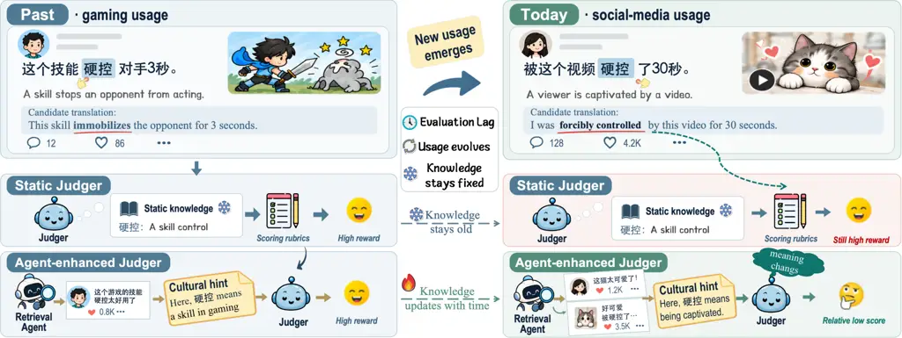
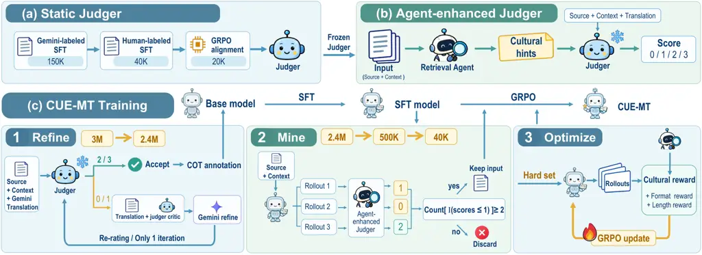

# Retrieval-Enhanced Cultural Evaluation for Social Media Translation Training

Linjuan Wu Affiliation: Xiaohongshu Inc.
Email: [wulinjuan@xiaohongshu.com](mailto:)    Yiwen Qiu
Affiliation: Xiaohongshu Inc. Affiliation: Zhejiang University    Xinze
Lyu Affiliation: Xiaohongshu Inc.    Dingming Li
Affiliation: Xiaohongshu Inc. Affiliation: Zhejiang University    Hui
Yao Affiliation: Xiaohongshu Inc.    Zhongyi Sang
Affiliation: Xiaohongshu Inc.    Ye Guo Affiliation: Xiaohongshu Inc.   
Daoxin Zhang Affiliation: Xiaohongshu Inc.    Zhe Xu
Affiliation: Xiaohongshu Inc.    Fei Zhao Affiliation: Xiaohongshu Inc.
   Mu Chuan Affiliation: Xiaohongshu Inc.    Yao Hu
Affiliation: Xiaohongshu Inc.    Weiming Lu Affiliation: Zhejiang
University    Yongliang Shen Affiliation: Zhejiang University

###### Abstract

Social media translation requires preserving meaning while capturing the
cultural nuances of user-generated content (UGC). However, gaps in the
cultural knowledge of LLM-based evaluators can lead to inaccurate
assessments and unreliable training rewards. To improve these signals,
we use retrieval-enhanced cultural evaluation to train CUE-MT, a family
of social media translation models. A calibrated, domain-specific Judger
guides supervised data refinement and is augmented by an Agent for
hard-example mining and reinforcement learning. The Agent retrieves
relevant external evidence as needed and distills it into concise hints
that the Judger uses to score translations and assign rewards. Across
9B, 27B, and 35B-A3B backbones, CUE-MT outperforms the evaluated
open-source baselines of comparable size on CUE-MT-Bench and three
public benchmarks. Human evaluation on CUE-MT-Bench shows cultural
effectiveness gains of 7.44–15.12 percentage points over the strongest
external baseline in each size group. Retrieval improves the Judger’s
four-way classification accuracy by 8.07 percentage points over a
matched no-retrieval baseline that uses LLM-generated hints alone.
Training ablations further support the combination of hard-example
mining and Agent-enhanced rewards.

¹¹footnotetext: Equal contribution.²²footnotetext: Corresponding
authors.

## 1 Introduction

Social media is a major channel for cross-lingual communication and
cultural exchange (Lin et al., 2018; Wei et al., 2025; Kim and Introne,
2025). Compared with news and encyclopedic text (Yao et al., 2024),
social media language is more informal and context-dependent, often
featuring slang, memes, and community-specific jargon (Baldwin et al.,
2013; Mei et al., 2024; Wuraola et al., 2024; Liang et al., 2025; Huang
et al., 2025). Translating such content requires more than literal
accuracy; translations must also convey cultural meaning, emotional
tone, and communicative intent (Guo et al., 2025; Zhang et al., 2023;
Qiu et al., 2026).

CULTURE-MT (Wu et al., 2026) introduced cultural effectiveness as an
evaluation criterion and trained a dedicated Judger that outperforms
lexical metrics (Papineni et al., 2002; Popović, 2015) and LLM judges
(Kocmi and Federmann, 2023). CuRIL (Qiu et al., 2026) further showed
that evaluation errors of Judger can stem from cultural knowledge gaps,
not just reasoning limitations. It found that cultural hints supplied at
evaluation time improve agreement with human judgments and proposed a
training procedure to internalize cultural reasoning. However, training
may not fully cover the diverse and evolving cultural knowledge of
social media (Dhingra et al., 2022). These knowledge gaps can lead to
inaccurate evaluations and distort the rewards used to train translation
models through reinforcement learning (Shen et al., 2016; Stiennon et
al., 2020; Anonymous, 2026).



Figure 1: An example of a cultural knowledge gap in translation
evaluation. “硬控” refers to immobilizing an opponent in gaming, but it
can also mean being captivated by content on social media. Applying the
gaming meaning may cause a static Judger to overrate “forcibly
controlled”. Retrieved evidence helps the Agent-enhanced Judger
interpret the expression in context and assign a more appropriate score.

We address cultural knowledge gaps in evaluation with an Agent-enhanced
Judger. These gaps arise when a Judger lacks the cultural knowledge
needed to assess a translation or fails to apply it correctly in context
(Figure 1). The Agent identifies expressions requiring cultural
knowledge in each input, retrieves relevant external evidence as needed,
and summarizes it into concise hints. A calibrated, domain-specific
Judger uses these hints to assign the final scores.

We use this evaluation framework to train CUE-MT, a family of social
media translation models at 9B, 27B, and 35B-A3B scales. The static
Judger guides supervised data refinement, while the Agent-enhanced
Judger scores sampled translations for hard-example mining and provides
cultural-effectiveness rewards for reinforcement learning. Across all
three scales, CUE-MT outperforms the evaluated open-source baselines of
comparable size on CUE-MT-Bench, CULTURE-MT (Wu et al., 2026),
Seed-X-Challenge (Cheng et al., 2025), and RedTrans (Guo et al., 2025).
Human evaluation on CUE-MT-Bench confirms gains in cultural
effectiveness. The Agent-enhanced Judger also outperforms the evaluated
static and LLM judges. Ablations show that retrieval improves Judger
accuracy beyond generated hints alone and that Agent-enhanced rewards
improve GRPO results over static rewards.

Our main contributions are as follows:

- •
  Cultural-effectiveness-guided translation training. We introduce
  CUE-MT, a family of social media translation models trained using
  cultural-effectiveness feedback for supervised data refinement,
  hard-example mining, and reinforcement learning.
- •
  Retrieval-enhanced cultural evaluation. We propose an Agent-enhanced
  Judger in which an Agent retrieves external cultural evidence and
  provides concise hints to a calibrated, domain-specific Judger for
  translation scoring.
- •
  Cross-scale empirical validation. CUE-MT achieves the best overall
  performance among the evaluated open-source models of comparable size
  at 9B, 27B, and 35B-A3B scales. Human evaluation confirms gains in
  cultural effectiveness, while controlled ablations support the
  benefits of retrieval and Agent-enhanced rewards.

## 2 Related Work

### 2.1 Social Media and Culture-Aware Translation

Research on social media translation addresses both noisy language and
culturally specific expressions. MTNT (Michel and Neubig, 2018) provides
a benchmark of naturally noisy Reddit comments with professional
translations. Subsequent work examines informal language, Internet
slang, and buzzwords (Zhang et al., 2023; Mei et al., 2024; Wuraola et
al., 2024; Huang et al., 2025; Sun et al., 2024). Translation-focused
studies address slang (Liang et al., 2025) and broader social media
phenomena, including humor, emojis, and memes (Guo et al., 2025).
Culture-aware translation research further examines how cultural meaning
transfers across languages. CAMT benchmarks the translation of
culture-specific items, including those without direct target-language
equivalents (Yao et al., 2024). KG-MT retrieves information from
multilingual knowledge graphs to improve the translation of culturally
nuanced entity names (Conia et al., 2024). CULTURE-MT introduces a
social media translation benchmark and the criterion of _cultural
effectiveness_, which considers both expression accuracy and cultural
adaptability (Wu et al., 2026).



Figure 2: Overview of CUE-MT training. The static Judger guides
supervised data refinement (Refine). The Agent-enhanced Judger uses
external cultural evidence to score translations for hard-example mining
(Mine) and provide cultural-effectiveness rewards during GRPO
(Optimize).

### 2.2 Translation Evaluation and External Knowledge

Automatic MT evaluation includes lexical metrics such as BLEU (Papineni
et al., 2002) and chrF (Popović, 2015), learned metrics such as BLEURT
(Sellam et al., 2020), COMET (Rei et al., 2020), and xCOMET (Guerreiro
et al., 2024), and prompt-based LLM judges such as GEMBA (Kocmi and
Federmann, 2023). For cultural-effectiveness assessment, CULTURE-MT
trains a dedicated Judger (Wu et al., 2026). CuRIL identifies cultural
knowledge gaps as a source of evaluation errors and uses hint-guided
reinforcement learning to internalize cultural reasoning. It also
applies the trained Judger as a reward model for downstream translation
optimization (Qiu et al., 2026). Retrieval-augmented generation provides
access to external knowledge (Lewis et al., 2020), while tool-using
language models can learn when to invoke external resources (Schick et
al., 2023). More directly related to translation evaluation, RATE
coordinates search, evaluation, and comparison agents to assess
non-literal translations (Tian et al., 2026). Our work complements
cultural-knowledge internalization with input-dependent retrieval for
translation training. A calibrated, domain-specific Judger guides
supervised data refinement, while an Agent supplies it with concise
hints derived from retrieved evidence for hard-example mining and
reinforcement-learning rewards.

## 3 Method

We train CUE-MT using cultural-effectiveness feedback from two
configurations of the same Judger: a static configuration for supervised
data refinement and an Agent-enhanced configuration for hard-example
mining and reinforcement learning (Figure 2). We first describe how the
Judger is trained and enhanced with retrieval (Section 3.1), and then
present the translation training pipeline (Section 3.2).

### 3.1 Agent-enhanced Judger

##### Judger Training.

We translate source texts from publicly available social media data
using the baseline models described in Section 4.1, including both
specialized translation models and general-purpose LLMs. This yields
300K source–translation pairs, of which 200K are annotated by Gemini and
100K by human annotators. For initial supervised fine-tuning, we select
150K Gemini-annotated pairs balanced across the four
cultural-effectiveness scores $`\{0,1,2,3\}`$. We then perform
second-stage SFT on 40K human-annotated pairs balanced across the same
scores.

From this 40K human-annotated set, we sample 20K examples for Judger
GRPO training, reserving 5% for GRPO validation. Let $`s^{\star}`$
denote the human label, $`\hat{s}`$ the predicted score, and
$`b(s)=\mathbf{1}[s\geq 2]`$ the corresponding binary acceptance label.
The Judger reward combines binary and four-way correctness:

```math
r_{\mathrm{J}}=\mathbf{1}[b(\hat{s})=b(s^{\star})]+0.5\,\mathbf{1}[\hat{s}=s^{\star}].
```

This rewards both culturally effective decisions and exact agreement
with human scores. For example, an exact four-way match receives 1.5
points, whereas a correct binary class with an incorrect four-way score
receives 1 point. The four-way component explicitly supervises
distinctions within the coarse classes. Model configurations and
training details are provided in Appendix A.

##### Static Scoring.

Given a source text $`x`$, optional context $`c`$, and candidate
translation $`y`$, the static Judger predicts the score $`\hat{s}`$:

```math
\hat{s}=f_{\theta}(x,c,y),\qquad\hat{s}\in\{0,1,2,3\}.
```

##### Agent Enhancement.

To supplement the knowledge available for scoring, an Agent plans
input-specific queries, retrieves external evidence, and summarizes it
into concise hints for the Judger:

```math
\displaystyle Q \displaystyle=g_{\mathrm{plan}}(x,c,y),
```

```math
\displaystyle D \displaystyle=\mathcal{R}(Q),
```

```math
\displaystyle H \displaystyle=g_{\mathrm{hint}}(x,c,y,Q,D),
```

```math
\displaystyle\hat{s} \displaystyle=f_{\theta}(x,c,y,H),
```

where $`Q`$ denotes retrieval queries, $`D`$ is the retrieved evidence,
and $`H`$ the judging hints.

If the planner generates no queries, the Judger scores the translation
without hints. If retrieval yields no useful evidence or fails, the
Agent instead provides general judging guidance without external
evidence. Implementation details are provided in Appendix B.1.
Appendix B.2 provides the planning, hint-generation, and hint-injection
prompts.

### 3.2 Social Media Translation Training

CUE-MT training consists of supervised data construction and
fine-tuning, hard-example mining, and GRPO (Shao et al., 2024).

##### Supervised Data Construction.

We sample 3 million Chinese social media instances from public
platforms. This collection does not overlap with the Judger-training
data. We use Gemini-3.1-Pro (Google, 2026a) to generate English
translations. The static Judger evaluates all translations without
invoking the Agent. Translations scored 2 or 3 are retained directly.
Those scored 0 or 1 are revised once by Gemini-3.1-Pro using Judger
feedback and retained only if the static Judger assigns a score of 2 or
3 upon re-evaluation. The prompt for refining is shown in Appendix C.1.
This process yields 2.4 million source–translation pairs.

##### Supervised Fine-Tuning.

To provide explicit supervision for interpreting context and cultural
expressions, we use GLM-5 to construct a concise chain-of-thought (CoT)
for each retained pair using the prompt in Appendix C.3. The CoT
comprises _context analysis_, which summarizes relevant context, and
_translation points_, which explain how to convey key expressions and
cultural nuances in English. We combine the generated CoT with the
retained translation to form the SFT target. Given the source text and
optional context, the model is fine-tuned to generate the CoT followed
by the final English translation, using the translation prompt in
Appendix C.2.

##### Hard-Example Mining.

To focus GRPO training on cultural and contextual challenges that remain
after SFT, we mine hard examples separately for the 9B, 27B, and 35B-A3B
models. We randomly sample 500K source instances from the original pool
of 3 million Chinese social media instances, evenly split between posts
and comments. The corresponding SFT model generates three candidate
translations per instance, which are scored by the Agent-enhanced
Judger. An instance is considered hard if at least two of its three
translations receive a score of 0 or 1. This criterion selects inputs
with repeated low-scoring translations rather than relying on a single
unsuccessful generation. We then uniformly sample 40K hard instances for
GRPO training at each model scale.

##### Translation GRPO.

The translation model receives a reward combining output format,
reasoning length, and cultural effectiveness:

```math
r=r_{\mathrm{format}}+r_{\mathrm{length}}+r_{\mathrm{culture}}.
```

The format reward encourages the model to retain the CoT–translation
structure learned during SFT, with contextual and cultural analysis
preceding the final translation:

```math
r_{\mathrm{format}}=\begin{cases}0.5,&\text{output CoT-translation format},\\
0,&\text{otherwise}.\end{cases}
```

Since the CoT is intended to summarize translation-relevant
considerations rather than provide an extended analysis, we use a length
reward to discourage unnecessarily verbose reasoning:

```math
r_{\mathrm{length}}=\begin{cases}0.5,&L_{\mathrm{reason}}\leq 1024,\\
0,&\text{otherwise},\end{cases}
```

where $`L_{\mathrm{reason}}`$ is the number of reasoning tokens.

The cultural-effectiveness reward uses the score $`s`$ assigned by the
Agent-enhanced Judger. To align the reward with the acceptance criterion
used in data refinement and hard-example mining, we assign the same
reward to scores 2 and 3, while giving only limited credit to score 1:

```math
r_{\mathrm{culture}}=\begin{cases}0,&s=0,\\
0.1,&s=1,\\
1.0,&s\in\{2,3\}.\end{cases}
```

This mapping prioritizes culturally acceptable translations rather than
distinguishing between quality levels within the acceptable range.

## 4 Experiments Setting

### 4.1 Translation Model Setup

##### Models and Baselines.

We evaluate CUE-MT at the 9B, 27B, and 35B-A3B scales based on
Qwen3.5 (Team, 2026). For each scale, we compare the original base
model, the supervised fine-tuned model (CUE-MT w/o GRPO), and the final
CUE-MT model trained with Agent-enhanced rewards. We include two
dedicated translation model families as primary baselines. Seed-X (Cheng
et al., 2025) is a multilingual translation model trained with
chain-of-thought supervised fine-tuning and further optimized with
reinforcement learning; we report both its SFT and PPO variants.
Hy-MT2 (Zheng et al., 2026) is a family of multilingual translation
models designed for complex real-world translation scenarios; we
evaluate its 7B and 30B-A3B variants. We further compare against strong
general LLMs, including Gemini-3.1-Pro (Google, 2026a),
Gemini-3.7-Flash (Google, 2026b), GLM-5.2 (GLM-5-Team et al., 2026),
Qwen3.8-Max (Qwen Team, 2026), GPT-5.6 (OpenAI, 2026), and
MiniMax-M3 (MiniMax, 2026). Together, these baselines cover specialized
translation systems and general LLMs across a broad range of model
scales. Detailed model configurations are provided in Appendix D.

##### Evaluation Benchmarks.

We construct CUE-MT-Bench to evaluate social media translation. It
contains titles, posts, and contextualized comments collected from
publicly available social-media data. We initially collect 1,500
instances and remove examples requiring unavailable visual or external
information or exceeding 200 Chinese characters. The resulting benchmark
contains 980 instances, including 341 titles, 312 posts, and 327
comments. For contextualized comments, the corresponding title and post
or preceding comment are provided as context. CUE-MT-Bench was sampled
during April 30–May 30, 2026, while the sampling cutoff for Judger
training and translation-model training data is November 30, 2025
(Appendix E.4). We additionally evaluate translation performance on
CULTURE-MT (Wu et al., 2026), RedTrans (Guo et al., 2025),
Seed-X-Challenge (Cheng et al., 2025), and FLORES-zh2en (Goyal et al.,
2021).

##### Translation Evaluation.

On CUE-MT-Bench, CULTURE-MT, RedTrans, and Seed-X-Challenge, we report
cultural-effectiveness evaluation using two LLM-based evaluators: the
GRPO-backed Agent-enhanced Judger and the Gemini API Judger
(Appendix E.2). For each evaluator, cultural effectiveness is measured
as the percentage of translations assigned a score of 2 or 3 under the
four-level rubric of CULTURE-MT (Wu et al., 2026). On FLORES-zh2en, we
additionally report BLEU (Papineni et al., 2002), chrF (Popović, 2015),
and COMET (Rei et al., 2020). All benchmark evaluations use greedy
decoding. We additionally conduct human evaluation on CUE-MT-Bench.

### 4.2 Judger Setup

##### Models and Baselines.

Our cultural-effectiveness Judger is initialized from Qwen3.5-27B. We
evaluate both the static Judger without retrieval and the Agent-enhanced
Judger augmented with external evidence. The retrieval Agent uses
GLM-5.2 (GLM-5-Team et al., 2026) for query planning and hint
generation, while external retrieval is performed using the
GLM-4.7-based Zhipu search service¹¹ 1
[https://modelscope.cn/mcp/servers/ZhipuAI/Zhipu-Web-Search](https://modelscope.cn/mcp/servers/ZhipuAI/Zhipu-Web-Search).

We compare against the corresponding static Judgers, the Gemini API
Judger based on Gemini-3.1-Pro, and our reimplementation of Static
Judger (Hint GRPO) (Qiu et al., 2026). Detailed baseline and ablation
settings are provided in Appendix F.

The retrieval ablation keeps the GRPO-aligned Judger, evaluation inputs,
scoring pipeline, and query-trigger decisions unchanged, while removing
external evidence and generating hints without retrieval. This isolates
the contribution of retrieved cultural evidence beyond hint generation.

| Evaluator                                             | Bin. Acc. (%) | $`\kappa`$ | 4-way Acc. (%) | Spearman |
| ----------------------------------------------------- | ------------- | ---------- | -------------- | -------- |
| Gemini API Judger (Google, 2026a)                     | 75.21         | 0.5043     | 48.07          | 0.6059   |
| Static Judger (SFT) (Wu et al., 2026)                 | 71.14         | 0.4229     | 38.57          | 0.4313   |
| Static Judger (SFT + GRPO)                            | 70.86         | 0.4171     | 50.00          | 0.5826   |
| Static Judger (Hint GRPO baseline) (Qiu et al., 2026) | 69.71         | 0.3944     | 47.64          | 0.5646   |
| Agent-enhanced Judger (GRPO backbone, w/o retrieval)  | 74.00         | 0.4802     | 44.50          | 0.5523   |
| Agent-enhanced Judger (SFT backbone)                  | 76.64         | 0.5329     | 51.21          | 0.6279   |
| Agent-enhanced Judger (GRPO backbone)                 | 77.86         | 0.5571     | 52.57          | 0.6558   |

Table 1: Evaluation of cultural-effectiveness Judgers on our
human-annotated benchmark.

##### Evaluation Benchmark.

We construct CUE-Judge-Bench to evaluate cultural-effectiveness Judgers.
From 636 source instances sampled from CUE-MT-Bench, we collect
candidate translations generated by 28 model variants, including
external baselines and our own CUE-MT variants. These variants cover
general LLMs, dedicated translation models, and base, SFT, and
GRPO-trained models. All translations are manually annotated using the
four-level cultural-effectiveness scale $`\{0,1,2,3\}`$ following the
annotation procedure described in Appendix E.3. We then sample 350
examples from each score level, yielding a balanced benchmark of 1,400
source–translation pairs.

##### Judger Evaluation.

We evaluate Judger predictions against adjudicated human annotations
using binary accuracy, Cohen’s $`\kappa`$, four-way accuracy, and
Spearman correlation. Binary accuracy and $`\kappa`$ compare scores 0–1
against 2–3, while four-way accuracy and Spearman correlation evaluate
agreement over the full four-level scale. All Judger evaluations use
greedy decoding.

## 5 Experiments Results

### 5.1 Retrieval-Enhanced Cultural-Effectiveness Judging

We examine the effect of Judger optimization and evaluate whether
retrieval-based cultural evidence improves agreement with human
judgments.

##### GRPO improves fine-grained cultural score calibration.

Compared with the SFT checkpoint, Static Judger (SFT + GRPO)
substantially improves fine-grained agreement with human annotations.
Four-way accuracy increases by 11.43 percentage points (from 38.57% to
50.00%), and Spearman correlation improves by 0.1513 (from 0.4313 to
0.5826). Meanwhile, binary accuracy and Cohen’s $`\kappa`$ remain
slightly lower, suggesting that GRPO primarily improves score
calibration across four cultural-effectiveness levels rather than coarse
binary acceptance decisions.

##### Retrieval provides additional gains beyond parameterized knowledge.

Adding Agent-based retrieval further improves Judger performance. With
the SFT backbone, Agent-enhanced Judger improves binary accuracy by 5.50
percentage points, four-way accuracy by 12.64 percentage points, and
Spearman correlation by 0.1966 compared with the static SFT Judger.
Starting from the GRPO backbone, Agent-enhanced Judger achieves the best
overall performance, reaching 77.86% binary accuracy, 0.5571 Cohen’s
$`\kappa`$, 52.57% four-way accuracy, and 0.6558 Spearman correlation.

##### External evidence contributes beyond generated hints.

The no-retrieval ablation shows that removing external evidence
substantially degrades Judger performance. Four-way accuracy drops by
8.07 percentage points (from 52.57% to 44.50%), while binary accuracy,
Cohen’s $`\kappa`$, and Spearman correlation also decrease. This
comparison demonstrates that retrieval provides useful cultural evidence
beyond GLM-5.2-generated hints alone, while not attributing the
improvement specifically to newly emerging knowledge. Qualitative
examples further illustrate improved contextual interpretation and
remaining challenges in error coverage and severity calibration
(Appendix G).

|                         |              |        |       |            |        |          |        |                  |        |
| ----------------------- | ------------ | ------ | ----- | ---------- | ------ | -------- | ------ | ---------------- | ------ |
|                         | CUE-MT-Bench |        |       | CULTURE-MT |        | RedTrans |        | Seed-X-Challenge |        |
| Model                   | Agent        | Gemini | Human | Agent      | Gemini | Agent    | Gemini | Agent            | Gemini |
| Model scale: $`\leq`$9B |              |        |       |            |        |          |        |                  |        |
| Seed-X-7B-SFT           | 67.96        | 64.75  | 77.73 | 72.55      | 52.76  | 78.31    | 76.24  | 82.23            | 76.53  |
| Seed-X-7B-PPO           | 72.01        | 71.46  | 79.78 | 80.24      | 69.17  | 80.26    | 80.82  | 84.77            | 78.68  |
| HY-MT2-7B               | 68.13        | 67.14  | 77.02 | 79.14      | 74.45  | 79.18    | 80.10  | 87.82            | 86.29  |
| Qwen3.5-9B              | 67.28        | 56.73  | 68.74 | 81.14      | 75.15  | 80.65    | 84.13  | 89.34            | 85.28  |
| CUE-MT w/o GRPO         | 80.08        | 90.82  | 90.09 | 92.64      | 93.71  | 86.53    | 90.86  | 89.85            | 87.82  |
| CUE-MT                  | 83.04        | 93.06  | 90.71 | 94.31      | 94.09  | 87.61    | 91.67  | 93.40            | 92.89  |
| Model scale: 30–35B-A3B |              |        |       |            |        |          |        |                  |        |
| HY-MT2-30B-A3B          | 73.65        | 79.37  | 83.67 | 86.63      | 87.89  | 85.05    | 87.61  | 91.88            | 88.32  |
| Qwen3.5-35B-A3B         | 77.53        | 58.63  | 75.18 | 85.93      | 85.54  | 85.54    | 89.57  | 93.40            | 92.39  |
| CUE-MT w/o GRPO         | 86.21        | 93.78  | 87.33 | 88.72      | 88.82  | 88.27    | 93.74  | 92.39            | 95.43  |
| CUE-MT                  | 87.24        | 94.90  | 91.11 | 91.02      | 90.76  | 90.23    | 94.54  | 94.42            | 94.92  |
| Model scale: 27B        |              |        |       |            |        |          |        |                  |        |
| Qwen3.5-27B             | 79.88        | 61.80  | 77.53 | 91.52      | 93.29  | 87.12    | 91.77  | 93.40            | 91.88  |
| CUE-MT w/o GRPO         | 84.08        | 93.88  | 90.31 | 95.31      | 96.30  | 89.67    | 95.48  | 94.42            | 93.40  |
| CUE-MT                  | 88.27        | 95.61  | 92.65 | 96.31      | 96.20  | 90.13    | 95.54  | 94.42            | 96.45  |

Table 2: Comparison of CUE-MT with representative translation models on
cultural-effectiveness benchmarks. Agent, Gemini, and Human denote
evaluations by the GRPO-backed Agent-enhanced Judger, Gemini API Judger,
and human annotators, respectively. Best results among comparable-size
models are shown in bold.

### 5.2 Main Results on Social Media Translation

Table 2 reports CUE-MT-Bench results using human evaluation as the
primary assessment, with Agent-enhanced Judger and Gemini judgments as
scalable automatic evaluators.

##### Supervised training provides the major performance improvement.

Across all three model scales, CUE-MT w/o GRPO substantially improves
over the corresponding Qwen3.5 base models. On human evaluation,
supervised training increases cultural effectiveness by 21.35 percentage
points at 9B (68.74% $`\rightarrow`$ 90.09%), 12.78 percentage points at
27B (77.53% $`\rightarrow`$ 90.31%), and 12.15 percentage points at
35B-A3B (75.18% $`\rightarrow`$ 87.33%). Similar improvements are
observed under Agent-enhanced Judger and Gemini evaluation, indicating
that the gains are not specific to a single evaluator.

##### GRPO further improves translation quality after supervised alignment.

Starting from the supervised models, GRPO provides additional
improvements on culturally challenging social media translation. At 27B,
GRPO improves Agent evaluation by 4.19 percentage points and human
evaluation by 2.34 percentage points. At 35B-A3B, human-rated cultural
effectiveness increases by 3.78 percentage points. The 9B model also
shows consistent gains across human and automatic evaluations,
demonstrating that Agent-enhanced rewards provide useful optimization
signals beyond supervised cultural alignment.

##### CUE-MT achieves strong performance across model scales.

CUE-MT achieves the strongest overall results among comparable
open-source translation models at all evaluated scales. At 9B, CUE-MT
reaches 90.71% human-rated cultural effectiveness, improving over the
strongest specialized baseline Seed-X-7B-PPO by 10.93 percentage points.
At 27B, CUE-MT achieves 92.65%, outperforming Qwen3.5-27B by 15.12
percentage points. At 35B-A3B, CUE-MT reaches 91.11%, exceeding
HY-MT2-30B-A3B by 7.44 percentage points. These results demonstrate that
cultural-effectiveness-guided training enables smaller and medium-scale
models to achieve competitive performance with substantially larger
systems.

Figure 3: Human-rated cultural effectiveness on CUE-MT-Bench (percentage
scored 2 or 3). CUE-MT combines compact model size with scores
approaching those of larger systems.

##### Performance transfers to public benchmarks.

Beyond CUE-MT-Bench, CUE-MT consistently improves over corresponding
base models on CULTURE-MT, RedTrans, and Seed-X-Challenge. Under Agent
evaluation, CUE-MT improves over the corresponding Qwen3.5 base models
by 13.17, 6.96, and 4.06 percentage points at 9B, with consistent gains
at 27B and 35B-A3B. These improvements across diverse benchmarks
demonstrate that cultural-effectiveness-guided training generalizes
beyond the proposed benchmark.

|                             |       |        |       |
| --------------------------- | ----- | ------ | ----- |
| Training Strategy           | Agent | Gemini | Human |
| Qwen3.5-27B                 | 79.88 | 61.80  | 77.53 |
| CUE-MT w/o GRPO             | 84.08 | 93.88  | 90.31 |
| CUE-MT-27B                  |       |        |       |
| Hard Mining + Agent Reward  | 88.27 | 95.61  | 92.65 |
| Hard Mining + Static Reward | 84.08 | 94.59  | 91.32 |
| Random Data + Agent Reward  | 85.70 | 95.51  | 92.04 |
| Random Data + Static Reward | 84.48 | 94.69  | 91.63 |

Table 3: Ablation study on CUE-MT-27B. All GRPO variants start from the
same CUE-MT w/o GRPO checkpoint. Hard-example mining and reward
evaluator effects are evaluated under four combinations.

### 5.3 Ablation Studies

We conduct an ablation study on CUE-MT-27B to analyze the contributions
of hard-example mining and Agent-enhanced rewards. All GRPO variants
start from the same CUE-MT w/o GRPO checkpoint. We compare two
data-selection strategies (hard-example mining and random sampling) and
two reward settings (Agent-enhanced Judger and static Judger). For
hard-example mining, the corresponding Judger is used to identify
difficult instances and provide rewards during GRPO training. Random
selection samples 40K instances without replacement from the same 500K
candidate pool used for mining (seed 42), while all other training
configurations remain fixed.

##### Agent-enhanced Judger provides more effective training signals.

Replacing the static Judger with the Agent-enhanced Judger consistently
improves GRPO performance under both data-selection strategies. With
hard-example mining, Agent-enhanced rewards improve human evaluation by
1.33 percentage points, compared with 0.41 percentage points under
random sampling. Similar improvements are observed under Agent-enhanced
Judger evaluation (4.19 vs. 1.22 percentage points) and Gemini
evaluation (1.02 vs. 0.82 percentage points). These results demonstrate
that retrieval-enhanced cultural evaluation provides more effective
optimization signals for GRPO training.

##### Hard-example mining benefits from improved evaluation signals.

Using Agent-enhanced rewards, hard-example mining improves human
evaluation by 0.61 percentage points over random sampling, with
additional gains of 2.57 and 0.10 percentage points under Agent-enhanced
Judger and Gemini evaluation, respectively. In contrast, hard-example
mining with the static Judger provides limited improvements and slightly
decreases performance under all three evaluations. These results suggest
that a stronger Judger improves not only the reward quality but also the
selection of challenging examples.

These results show that retrieval-enhanced evaluation and
difficulty-aware data selection are complementary: the Agent-enhanced
Judger improves the quality of optimization signals, while hard-example
mining focuses training on more informative examples.

Figure 4: Changes in FLORES-zh2en scores relative to the corresponding
Qwen3.5 base models.

### 5.4 Impact on General-Domain Translation

We evaluate FLORES-zh2en to examine whether social-media specialization
affects general-domain translation capability. Figure 4 reports score
changes relative to the corresponding Qwen3.5 base models, with full
results provided in Table 6.

Social-media specialization leads to decreases on reference-based
metrics, particularly BLEU and chrF, while CUE-MT maintains Agent and
Gemini scores above 93% across all three model scales. This discrepancy
suggests that the observed metric changes partly reflect a shift toward
more natural and conversational translations rather than uniform
degradation. For example, “assisted Carter in diplomatically handling
world affairs” is translated as “helped Carter handle a lot of
international stuff.” The translation adopts a more conversational
style, which reduces reference overlap, but it also weakens the
diplomatic nuance carried by the original expression. Such cases show
that social-media specialization introduces a trade-off between
conversational adaptation and fine-grained fidelity. We also observe a
small number of genuine semantic errors, indicating room for further
improvement. Overall, CUE-MT maintains general-domain translation
capability while adapting its generation style toward
social-media-oriented translation.

## 6 Conclusion

We propose CUE-MT, a social media translation framework that enhances
cultural-effectiveness evaluation with input-dependent external
evidence. By using retrieval-enhanced Judger feedback for data
refinement, hard-example mining, and reinforcement learning, CUE-MT
improves cultural effectiveness across multiple model scales and
benchmarks. Our results show that external evidence provides more
reliable training signals than learned evaluation knowledge alone,
especially when combined with difficulty-aware data selection. Future
work will investigate robustness to noisy evidence and broader cultural
and multilingual scenarios.

## Limitations

Our work has several limitations. First, the effectiveness of
retrieval-enhanced evaluation depends on the quality and availability of
external evidence. Although retrieval improves Judger performance in our
experiments, noisy, incomplete, or misleading evidence may introduce
additional uncertainty into the evaluation process.

Second, our cultural-effectiveness evaluation focuses on
Chinese-to-English social media translation and relies on a four-level
human annotation rubric. While this setting enables controlled analysis
of cultural knowledge gaps, broader cultural phenomena, language pairs,
and more fine-grained evaluation criteria remain to be explored.

Third, our experiments are conducted on a limited set of model scales
and backbone families. Although CUE-MT demonstrates consistent
improvements across the evaluated Qwen3.5-based models, the general
applicability of retrieval-enhanced cultural evaluation to other
architectures and larger multilingual systems requires further
investigation.

## Ethical Considerations

We use publicly available social-media data collected in accordance with
applicable crawling requirements. To reduce privacy risks, we anonymized
explicit identifiers, including usernames and personal names, removed
identifiable information where applicable, and applied filtering to
remove offensive and harmful content. Appendix I describes the cleaning
procedure. Human annotators were recruited through an outsourcing
company and were based in China and Malaysia. They provided informed
consent and were compensated according to the number of annotated items.
The annotation task focused on evaluating translation quality and
cultural effectiveness using publicly available text processed through
our data-cleaning pipeline. Our models aim to improve the preservation
of cultural meaning in social-media translation. However, cultural
judgments may vary across communities, and model-based evaluation may
reflect particular linguistic or cultural perspectives. Translation
errors and unreliable retrieved evidence may also misrepresent the
original speaker’s meaning. The models should therefore be used with
appropriate human oversight, especially when translation errors may have
consequential effects. We plan to release the trained models. AI
assistance was used to correct English grammar and improve the
readability, organization, and structure of the manuscript.

## References

- Anonymous (2026) Anonymous Group Relative Reward Modeling for Machine
  Translation. Note: ACL ARR 2026 January Submission; under review
  External Links: [Link](https://openreview.net/forum?id=qXrbzGZBFt)
  Cited by: §1.
- Baldwin et al. (2013) T. Baldwin, P. Cook, M. Lui, A. MacKinlay,
  and L. Wang How Noisy Social Media Text, How Diffrnt Social Media
  Sources?. In Proceedings of the Sixth International Joint Conference
  on Natural Language Processing (IJCNLP), External Links:
  [Link](https://aclanthology.org/I13-1041/) Cited by: §1.
- Cheng et al. (2025) S. Cheng, Y. Bao, Q. Cao, L. Huang, L. Kang, et
  al. Seed-X: Building Strong Multilingual Translation LLM with 7B
  Parameters. External Links: 2507.13618,
  [Link](https://arxiv.org/abs/2507.13618) Cited by: §1, §4.1, §4.1.
- Conia et al. (2024) S. Conia, D. Lee, M. Li, U. F. Minhas, S. Potdar,
  and Y. Li Towards cross-cultural machine translation with
  retrieval-augmented generation from multilingual knowledge graphs. In
  Proceedings of the 2024 Conference on Empirical Methods in Natural
  Language Processing, Y. Al-Onaizan, M. Bansal, and Y. Chen (Eds.),
  Miami, Florida, USA, pp. 16343–16360. External Links:
  [Document](https://dx.doi.org/10.18653/v1/2024.emnlp-main.914),
  [Link](https://aclanthology.org/2024.emnlp-main.914/) Cited by: §2.1.
- Dhingra et al. (2022) B. Dhingra, J. R. Cole, J. M. Eisenschlos, D.
  Gillick, J. Eisenstein, and W. W. Cohen Time-Aware Language Models as
  Temporal Knowledge Bases. Transactions of the Association for
  Computational Linguistics 10, pp. 257–273. External Links:
  [Link](https://arxiv.org/abs/2106.15110) Cited by: §1.
- GLM-5-Team et al. (2026) GLM-5-Team, :, A. Zeng, X. Lv, Z. Hou, Z.
  Du, Q. Zheng, B. Chen, D. Yin, C. Ge, C. Huang, C. Xie, C. Zhu, C.
  Yin, C. Wang, G. Pan, H. Zeng, H. Zhang, H. Wang, H. Chen, J.
  Zhang, J. Jiao, J. Guo, J. Wang, J. Du, J. Wu, K. Wang, L. Li, L.
  Fan, L. Zhong, M. Liu, M. Zhao, P. Du, Q. Dong, R. Lu, Shuang-Li, S.
  Cao, S. Liu, T. Jiang, X. Chen, X. Zhang, X. Huang, X. Dong, Y. Xu, Y.
  Wei, Y. An, Y. Niu, Y. Zhu, Y. Wen, Y. Cen, Y. Bai, Z. Qiao, Z.
  Wang, Z. Wang, Z. Zhu, Z. Liu, Z. Li, B. Wang, B. Wen, C. Huang, C.
  Cai, C. Yu, C. Li, C. Hu, C. Zhang, D. Zhang, D. Lin, D. Yang, D.
  Wang, D. Ai, E. Zhu, F. Yi, F. Chen, G. Wen, H. Sun, H. Zhao, H.
  Hu, H. Zhang, H. Liu, H. Zhang, H. Peng, H. Tai, H. Zhang, H. Liu, H.
  Wang, H. Yan, H. Ge, H. Liu, H. Chu, J. Zhao, J. Wang, J. Zhao, J.
  Ren, J. Wang, J. Zhang, J. Gui, J. Zhao, J. Li, J. An, J. Li, J.
  Yuan, J. Du, J. Liu, J. Zhi, J. Duan, K. Zhou, K. Wei, K. Wang, K.
  Luo, L. Zhang, L. Sha, L. Xu, L. Wu, L. Ding, L. Chen, M. Li, N.
  Lin, P. Ta, Q. Zou, R. Song, R. Yang, S. Tu, S. Yang, S. Wu, S.
  Zhang, S. Li, S. Li, S. Fan, W. Qin, W. Tian, W. Zhang, W. Yu, W.
  Liang, X. Kuang, X. Cheng, X. Li, X. Yan, X. Hu, X. Ling, X. Fan, X.
  Xia, X. Zhang, X. Zhang, X. Pan, X. Zou, X. Zhang, Y. Liu, Y. Wu, Y.
  Li, Y. Wang, Y. Zhu, Y. Tan, Y. Zhou, Y. Pan, Y. Zhang, Y. Su, Y.
  Geng, Y. Yan, Y. Tan, Y. Bi, Y. Shen, Y. Yang, Y. Li, Y. Liu, Y.
  Wang, Y. Li, Y. Wu, Y. Zhang, Y. Duan, Y. Zhang, Z. Liu, Z. Jiang, Z.
  Yan, Z. Zhang, Z. Wei, Z. Chen, Z. Feng, Z. Yao, Z. Chai, Z. Wang, Z.
  Zhang, B. Xu, M. Huang, H. Wang, J. Li, Y. Dong, and J. Tang GLM-5:
  from vibe coding to agentic engineering. External Links: 2602.15763,
  [Link](https://arxiv.org/abs/2602.15763) Cited by: §4.1, §4.2.
- Google (2026a) Google Gemini 3.1 pro: best for complex tasks and
  bringing creative concepts to life. Note:
  [https://deepmind.google/models/gemini/pro/](https://deepmind.google/models/gemini/pro/)Accessed:
  2026-09-13 Cited by: §3.2, §4.1, Table 1.
- Google (2026b) Google Gemini 3.7 flash model card. Note:
  [https://storage.googleapis.com/deepmind-media/Model-Cards/Gemini-3-7-Flash-Model-Card.pdf](https://storage.googleapis.com/deepmind-media/Model-Cards/Gemini-3-7-Flash-Model-Card.pdf)Accessed:
  2026-09-13 Cited by: §4.1.
- Goyal et al. (2021) N. Goyal, C. Gao, V. Chaudhary, P. Chen, G.
  Wenzek, D. Ju, S. Krishnan, M. Ranzato, F. Guzman, and A. Fan The
  flores-101 evaluation benchmark for low-resource and multilingual
  machine translation. External Links: 2106.03193,
  [Link](https://arxiv.org/abs/2106.03193) Cited by: §4.1.
- Guerreiro et al. (2024) N. M. Guerreiro, R. Rei, D. van Stigt, L.
  Coheur, P. Colombo, and A. F. T. Martins xCOMET: Transparent Machine
  Translation Evaluation through Fine-grained Error Detection.
  Transactions of the Association for Computational Linguistics 12.
  External Links: [Link](https://aclanthology.org/2024.tacl-1.54/) Cited
  by: §2.2.
- Guo et al. (2025) H. Guo, F. Zhao, S. Cao, X. Lyu, Z. Liu, Y. Wang, B.
  Wang, Z. Li, C. Lu, Z. Xu, and Y. Hu Redefining machine translation on
  social network services with large language models. External Links:
  2504.07901, [Link](https://arxiv.org/abs/2504.07901) Cited by: §1, §1,
  §2.1, §4.1.
- Huang et al. (2025) C. Huang, J. Luo, X. Wang, W. Lei, and J. Lv Can
  large language models understand internet buzzwords through
  user-generated content. In Proceedings of the 63rd Annual Meeting of
  the Association for Computational Linguistics (Volume 1: Long Papers),
  External Links: [Link](https://aclanthology.org/2025.acl-long.632/)
  Cited by: §1, §2.1.
- Kim and Introne (2025) Y. Kim and J. Introne Belief alignment vs
  opinion leadership: understanding cross-linguistic digital activism in
  k-pop and blm communities. arXiv preprint arXiv:2507.16046. Cited by:
  §1.
- Kocmi and Federmann (2023) T. Kocmi and C. Federmann Large Language
  Models Are State-of-the-Art Evaluators of Translation Quality.
  External Links: 2302.14520, [Link](https://arxiv.org/abs/2302.14520)
  Cited by: §1, §2.2.
- Lewis et al. (2020) P. Lewis, E. Perez, A. Piktus, F. Petroni, V.
  Karpukhin, N. Goyal, H. Küttler, M. Lewis, W. Yih, T. Rocktäschel, S.
  Riedel, and D. Kiela Retrieval-Augmented Generation for
  Knowledge-Intensive NLP Tasks. In Advances in Neural Information
  Processing Systems 33 (NeurIPS 2020), External Links:
  [Link](https://arxiv.org/abs/2005.11401) Cited by: §2.2.
- Liang et al. (2025) Y. Liang, F. Meng, J. Wang, and J. Zhou SlangDIT:
  benchmarking LLMs in interpretative slang translation. External Links:
  2505.14181, [Link](https://arxiv.org/abs/2505.14181) Cited by: §1,
  §2.1.
- Lin et al. (2018) B. Y. Lin, F. F. Xu, K. Q. Zhu, and S. Hwang Mining
  cross-cultural differences and similarities in social media. In
  Proceedings of the 56th Annual Meeting of the Association for
  Computational Linguistics (Volume 1: Long Papers), Melbourne,
  Australia, pp. 709–719. External Links:
  [Link](https://aclanthology.org/P18-1066/) Cited by: §1.
- Mei et al. (2024) L. Mei, S. Liu, Y. Wang, B. Bi, and X. Cheng SLANG:
  new concept comprehension of large language models. In Proceedings of
  the 2024 Conference on Empirical Methods in Natural Language
  Processing, External Links: [Link](https://arxiv.org/abs/2401.12585)
  Cited by: §1, §2.1.
- Michel and Neubig (2018) P. Michel and G. Neubig MTNT: A Testbed for
  Machine Translation of Noisy Text. In Proceedings of the 2018
  Conference on Empirical Methods in Natural Language Processing,
  External Links: [Link](https://aclanthology.org/D18-1050/) Cited by:
  §2.1.
- MiniMax (2026) MiniMax MiniMax m3: frontier coding, 1m context, native
  multimodality — all in one model. Note:
  [https://www.minimax.io/blog/minimax-m3](https://www.minimax.io/blog/minimax-m3)Accessed:
  2026-09-13 Cited by: §4.1.
- OpenAI (2026) OpenAI GPT-5.6: frontier intelligence that scales with
  your ambition. Note:
  [https://openai.com/zh-Hans-CN/index/gpt-5-6/](https://openai.com/zh-Hans-CN/index/gpt-5-6/)Accessed:
  2026-09-13 Cited by: §4.1.
- Papineni et al. (2002) K. Papineni, S. Roukos, T. Ward, and W. Zhu
  BLEU: A Method for Automatic Evaluation of Machine Translation. In
  Proceedings of the 40th Annual Meeting of the Association for
  Computational Linguistics, External Links:
  [Link](https://aclanthology.org/P02-1040/) Cited by: §1, §2.2, §4.1.
- Popović (2015) M. Popović chrF: character n-gram F-score for automatic
  MT evaluation. In Proceedings of the Tenth Workshop on Statistical
  Machine Translation, External Links:
  [Link](https://aclanthology.org/W15-3049/) Cited by: §1, §2.2, §4.1.
- Qiu et al. (2026) Y. Qiu, L. Wu, D. Li, Y. Liu, Z. Wang, H. Xu, Y.
  Guo, D. Zhang, W. Lu, and Y. Shen When metrics reward the worst
  translations: internalizing cultural reasoning for social media
  translation evaluation. External Links: 2609.08156,
  [Link](https://arxiv.org/abs/2609.08156) Cited by: Appendix F, §1, §1,
  §2.2, §4.2, Table 1.
- Qwen Team (2026) Qwen Team Qwen3.8-max: a new bar for coding and
  cowork. External Links: [Link](https://qwen.ai/blog?id=qwen3.8) Cited
  by: §4.1.
- Rei et al. (2020) R. Rei, C. Stewart, A. C. Farinha, and A. Lavie
  COMET: A Neural Framework for MT Evaluation. In Proceedings of the
  2020 Conference on Empirical Methods in Natural Language Processing
  (EMNLP), External Links:
  [Link](https://aclanthology.org/2020.emnlp-main.213/) Cited by: §2.2,
  §4.1.
- Schick et al. (2023) T. Schick, J. Dwivedi-Yu, R. Dessì, R.
  Raileanu, M. Lomeli, L. Zettlemoyer, N. Cancedda, and T. Scialom
  Toolformer: Language Models Can Teach Themselves to Use Tools.
  External Links: 2302.04761, [Link](https://arxiv.org/abs/2302.04761)
  Cited by: §2.2.
- Sellam et al. (2020) T. Sellam, D. Das, and A. Parikh BLEURT: learning
  robust metrics for text generation. In Proceedings of the 58th Annual
  Meeting of the Association for Computational Linguistics, External
  Links: [Link](https://aclanthology.org/2020.acl-main.704/) Cited by:
  §2.2.
- Shao et al. (2024) Z. Shao, P. Wang, Q. Zhu, R. Xu, J. Song, M.
  Zhang, Y. K. Li, Y. Wu, and D. Guo DeepSeekMath: pushing the limits of
  mathematical reasoning in open language models. CoRR abs/2402.03300.
  External Links: [Link](https://doi.org/10.48550/arXiv.2402.03300),
  [Document](https://dx.doi.org/10.48550/ARXIV.2402.03300), 2402.03300
  Cited by: §3.2.
- Shen et al. (2016) S. Shen, Y. Cheng, Z. He, W. He, H. Wu, M. Sun,
  and Y. Liu Minimum Risk Training for Neural Machine Translation. In
  Proceedings of the 54th Annual Meeting of the Association for
  Computational Linguistics, External Links:
  [Link](https://aclanthology.org/P16-1159/) Cited by: §1.
- Stiennon et al. (2020) N. Stiennon, L. Ouyang, J. Wu, D. M.
  Ziegler, R. Lowe, C. Voss, A. Radford, D. Amodei, and P. Christiano
  Learning to Summarize from Human Feedback. External Links: 2009.01325,
  [Link](https://arxiv.org/abs/2009.01325) Cited by: §1.
- Sun et al. (2024) Z. Sun, Q. Hu, R. Gupta, R. Zemel, and Y. Xu Toward
  informal language processing: knowledge of slang in large language
  models. In Proceedings of the 2024 Conference of the North American
  Chapter of the Association for Computational Linguistics: Human
  Language Technologies, External Links:
  [Link](https://arxiv.org/abs/2404.02323) Cited by: §2.1.
- Team (2026) Q. Team Qwen3.5: towards native multimodal agents.
  External Links: [Link](https://qwen.ai/blog?id=qwen3.5) Cited by:
  §4.1.
- Tian et al. (2026) Y. Tian, C. Wang, Z. Liu, H. Huang, W. Yu, D.
  Song, J. Tang, and Y. Guo Beyond literal mapping: benchmarking and
  improving non-literal translation evaluation. In Proceedings of the
  64th Annual Meeting of the Association for Computational Linguistics
  (Volume 1: Long Papers), M. Liakata, V. P. Moreira, J. Zhang, and D.
  Jurgens (Eds.), San Diego, California, United States, pp. 4490–4524.
  External Links:
  [Document](https://dx.doi.org/10.18653/v1/2026.acl-long.205),
  [Link](https://aclanthology.org/2026.acl-long.205/) Cited by: §2.2.
- Wei et al. (2025) Z. Wei, M. Li, J. Liao, Z. Yang, X. Yang, Y. Xie, P.
  Hui, and H. Qu Cross-platform short-video diplomacy: topic and
  sentiment analysis of china-us relations on douyin and tiktok. arXiv
  preprint arXiv:2510.22415. Cited by: §1.
- Wu et al. (2026) L. Wu, R. Zhang, X. Lyu, Y. Guo, D. Zhang, Z. Xu, Y.
  Hu, Y. Cao, Y. Shen, and W. Lu Beyond literal translation: evaluating
  cultural effectiveness in social media ugc. External Links:
  2605.25626, [Link](https://arxiv.org/abs/2605.25626) Cited by: §B.2,
  §E.2, §E.3, §1, §1, §2.1, §2.2, §4.1, §4.1, Table 1.
- Wuraola et al. (2024) I. Wuraola, N. Dethlefs, and D. Marciniak
  Understanding slang with LLMs: modelling cross-cultural nuances
  through paraphrasing. In Proceedings of the 2024 Conference on
  Empirical Methods in Natural Language Processing, Miami, Florida, USA.
  External Links: [Link](https://aclanthology.org/2024.emnlp-main.869/)
  Cited by: §1, §2.1.
- Yao et al. (2024) B. Yao, M. Jiang, T. Bobinac, D. Yang, and J. Hu
  Benchmarking Machine Translation with Cultural Awareness. In Findings
  of the Association for Computational Linguistics: EMNLP 2024, External
  Links: [Link](https://aclanthology.org/2024.findings-emnlp.765/) Cited
  by: §1, §2.1.
- Zhang et al. (2023) C. Zhang, M. Abdul-Mageed, and G. Jawahar
  Contrastive Learning of Sociopragmatic Meaning in Social Media. In
  Findings of the Association for Computational Linguistics: ACL 2023,
  External Links:
  [Link](https://aclanthology.org/2023.findings-acl.152/) Cited by: §1,
  §2.1.
- Zheng et al. (2026) M. Zheng, Z. Li, T. Chen, B. Lv, M. Sun, M.
  Song, J. Song, H. Huang, D. Wu, H. Wang, Y. Song, Y. Chen, and G.
  Zhang Hy-mt2: a family of fast, efficient and powerful multilingual
  translation models in the wild. External Links: 2605.22064,
  [Link](https://arxiv.org/abs/2605.22064) Cited by: §4.1.

## Appendix A Static Judger Training

We initialize the static Judger from Qwen3.5-27B and train it through
two SFT stages followed by GRPO.

##### Supervised Fine-Tuning.

We first perform full-parameter SFT on the Gemini-annotated data, then
continue SFT on the human-annotated data. Both stages use MS-SWIFT²² 2
[https://github.com/modelscope/ms-swift](https://github.com/modelscope/ms-swift)
with DeepSpeed ZeRO-3³³ 3
[https://github.com/deepspeedai/DeepSpeed](https://github.com/deepspeedai/DeepSpeed)
in bfloat16 precision. We use a per-device batch size of 4, gradient
accumulation over 2 steps, and a maximum sequence length of 4096 tokens.
Each stage runs for three epochs with a learning rate of
$`5\times 10^{-6}`$. The warmup ratio is 0.1 in the first stage and 0 in
the second.

##### GRPO Training.

Starting from the second-stage SFT checkpoint, we further optimize the
Judger with GRPO using Relax⁴⁴ 4
[https://github.com/redai-studio/Relax](https://github.com/redai-studio/Relax)
on 32 GPUs across four nodes, with eight GPUs per node, in a colocated
configuration. We use a tensor parallelism degree of 4, sequence
parallelism, full activation recomputation, and optimizer-state
offloading to the CPU.

For each prompt, we sample 8 responses at temperature 0.7 and top-$`p`$
0.8, with a maximum response length of 2048 tokens. Each rollout batch
contains 128 prompts, yielding 1024 responses. The global training batch
size is 64 prompt–response pairs. We use the GRPO advantage estimator
without a KL penalty or entropy regularization, with asymmetric clipping
margins of $`\epsilon_{\mathrm{low}}=0.2`$ and
$`\epsilon_{\mathrm{high}}=0.28`$. Optimization uses Adam with a
constant learning rate of $`1\times 10^{-6}`$, $`\beta_{1}=0.9`$,
$`\beta_{2}=0.98`$, and weight decay of $`0.1`$. Training runs for 600
rollout steps.

##### Validation and Checkpoint Selection.

We reserve 5% of the Judger GRPO data pool for validation and exclude
these examples from all GRPO updates. We evaluate every 10 rollout steps
using greedy decoding and use binary accuracy as the primary
checkpoint-selection metric.

## Appendix B Design and Prompt of Retrieval Agent

### B.1 Retrieval Execution

GLM-5.2 performs query planning and hint generation. We use the Zhipu
retrieval API with GLM-4.7 to retrieve the top five results per query.
Retrieved evidence and generated hints are cached for reuse. If the
planner generates no queries, the Judger evaluates the translation
without hints. If retrieval returns no useful evidence or the API call
fails, GLM-5.2 generates concise general judging guidance without
external evidence, following the hint-generation prompt. On
CUE-Judge-Bench, the planner generates at least one query for 52.64% of
the 1,400 source–translation pairs.

### B.2 Prompts for the Agent-enhanced Judger

This appendix provides the full prompts used by the search planner
$`g_{\mathrm{plan}}`$ (Appendix B.2.1) and the hint generator
$`g_{\mathrm{hint}}`$ (Appendix B.2.2), together with the hint injection
format used by the Judger (Appendix B.2.3). The Judger scoring prompt is
inherited from prior work; we refer readers to Wu et al. (2026) for its
full content. The prompts are presented in English for readability.

#### B.2.1 Search Planning Prompt ($`g_{\mathrm{plan}}`$)

The search planner determines whether external knowledge is required and
generates a small set of searchable queries when necessary.

##### System prompt.


##### User template.


#### B.2.2 Hint Generation Prompt ($`g_{\mathrm{hint}}`$)

The hint generator filters the retrieved information and converts it
into concise, translation-specific judging points. It does not assign
the final cultural-effectiveness score.

##### System prompt.


##### User template.


#### B.2.3 Hint Injection Format

The structured hint object $`H`$ is serialized into an auxiliary text
block and inserted before the source–translation pair in the Judger
prompt. The instruction explicitly states that the hints are
supplementary and should not override evidence from the source text and
candidate translation.


## Appendix C Prompts for Translation Model Training

This appendix presents the prompt templates used in our translation
model training pipeline. All prompts are translated into English for
clarity. Variables enclosed in braces are replaced with the
corresponding sample content during data construction.

### C.1 Prompt for Translation Self-Refinement

For translations that do not pass the initial static-Judger assessment,
we perform one round of self-refinement. The model receives the source
text, optional context, its initial translation, and feedback from the
static Judger; retrieval is not used in this stage.


### C.2 Prompts for Initial Translation Generation

We use two prompts to generate the initial English translations. The
first prompt is used for titles and posts, while the second is used for
comments that require a post or parent comment as context.

#### C.2.1 Title and Post Translation Prompt


#### C.2.2 Contextualized Comment Translation Prompt


### C.3 Prompt for Reasoning Trace Generation

For each retained source–translation pair, we use GLM-5 to generate a
reasoning trace consisting of key contextual cues and translation
points. The model identifies culturally or semantically important
expressions in the source and explains how they should be understood to
reproduce the reference translation.


## Appendix D CUE-MT Training Details

##### Data Collection and Validation Split.

The 300K Judger-training pairs and the 3 million Chinese instances used
for translation-model training are collected from publicly available
online data before November 30, 2025. The two source collections do not
overlap. Static-Judger refinement produces 2.4 million high-quality
translation pairs, from which we reserve 1,200 examples for
translation-model validation.

For translation-model training, the original 3 million Chinese instances
are used for supervised data construction and later hard-example mining.
CUE-Judge-Bench is constructed separately from CUE-MT-Bench source texts
and therefore shares source instances with the translation benchmark by
design.

##### Candidate Generation for Hard-Example Mining.

After supervised fine-tuning, we perform hard-example mining separately
for the 9B, 27B, and 35B-A3B models. For each model scale, we randomly
sample 500K source instances from the original 3 million-instance
translation-data pool, evenly split between posts and comments.

For each source instance, the corresponding SFT model generates three
candidate translations using the same prompt, temperature 0.7, top-$`p`$
0.8, random seed 42, and a maximum generation length of 4,096 tokens.
The three candidates are scored by the Agent-enhanced Judger. An
instance is selected as a hard example if at least two of its three
candidates receive cultural-effectiveness scores of 0 or 1.

Sampling multiple candidates allows us to identify inputs where the
model consistently struggles with cultural effectiveness rather than
selecting examples based on a single unsuccessful generation. We
uniformly sample 40K hard examples for GRPO training at each model
scale.

##### Controlled Hard-Example Selection Ablation.

For the data-selection ablation in Table 3, the random-selection variant
samples 40K instances uniformly without replacement from the same 500K
candidate pool used for hard-example mining, with random seed 42.

Both the hard-example and random-selection variants use the same number
of training instances, the same GRPO training configuration, and the
same training-step budget. Therefore, the comparison isolates the effect
of difficulty-aware data selection.

The static reward baseline in this experiment uses the SFT+GRPO Judger
rather than the SFT-only Judger, ensuring that the reward model quality
remains consistent across the comparison.

##### Supervised Fine-Tuning.

Supervised fine-tuning uses the structured chain-of-thought (CoT)
targets described in Section 3.2. The CoT consists of _context analysis_
and _translation points_, which provide explicit supervision for
understanding contextual dependencies, cultural expressions, and
ambiguous meanings before generating the final translation.

We perform full-parameter supervised fine-tuning on Qwen3.5-9B,
Qwen3.5-27B, and Qwen3.5-35B-A3B using MS-SWIFT. All models are trained
for one epoch in bfloat16 precision with a learning rate of
$`1\times 10^{-5}`$, a warmup ratio of 0.05, and a maximum sequence
length of 4,096 tokens.

The 9B and 27B models are trained on 16 GPUs (2 nodes $`\times`$ 8 GPUs)
with DeepSpeed ZeRO-3, using a per-device batch size of 4. Gradient
accumulation is set to 8 for Qwen3.5-9B and 4 for Qwen3.5-27B.

For the MoE-based Qwen3.5-35B-A3B model, we use tensor, pipeline, and
expert parallelism with sizes 2, 4, and 2, respectively. We use a
micro-batch size of 4 and a global batch size of 512, together with
sequence parallelism and full activation recomputation. The MoE
auxiliary-loss coefficient is set to $`1\times 10^{-6}`$.

##### GRPO Training.

Starting from the corresponding SFT checkpoints, we further optimize the
three CUE-MT variants using GRPO within the Relax reinforcement-learning
framework. Each model is trained on 32 GPUs (4 nodes $`\times`$ 8 GPUs)
in a colocated setting, where training and rollout share the same GPUs.
Optimizer states are offloaded to CPU to reduce GPU memory consumption.

Unless otherwise specified, all models use the same GRPO configuration.
For each prompt, we sample 8 responses with temperature 0.7 and
top-$`p`$ 0.8. The GRPO advantage estimator is used with a KL penalty
coefficient of 0.05 and no entropy regularization. We adopt asymmetric
PPO clipping with a clipping range of $`[0.15,0.2]`$.

Optimization uses Adam with $`\beta_{1}=0.9`$, $`\beta_{2}=0.98`$, and
weight decay of 0.1 under a constant learning-rate schedule. Training
runs for 200 rollout steps, with evaluation every 10 steps using greedy
decoding.

Model-specific GRPO configurations are summarized in Table 4.

|                               |                     |                     |                     |
| ----------------------------- | ------------------- | ------------------- | ------------------- |
| Setting                       | Qwen3.5-9B          | Qwen3.5-27B         | Qwen3.5-35B-A3B     |
| Tensor Parallel (TP)          | 4                   | 4                   | 2                   |
| Pipeline Parallel (PP)        | 1                   | 1                   | 1                   |
| Expert Parallel (EP)          | 1                   | 1                   | 8                   |
| Learning rate                 | $`1\times 10^{-6}`$ | $`1\times 10^{-6}`$ | $`5\times 10^{-7}`$ |
| Rollout batch size            | 256                 | 256                 | 128                 |
| Global batch size             | 256                 | 256                 | 128                 |
| Maximum response length       | 4096                | 4096                | 3072                |
| Maximum tokens per GPU        | 16384               | 16384               | 12288               |
| GPUs per rollout engine       | 2                   | 4                   | 4                   |
| SGLang static memory fraction | 0.50                | 0.60                | 0.45                |

Table 4: Model-specific GRPO training configurations.

## Appendix E Evaluation Details

### E.1 Inference Settings

For benchmark evaluation, all translation models use greedy decoding to
ensure deterministic comparison. For hard-example mining and GRPO
training, we use stochastic sampling with temperature 0.7 and top-$`p`$
0.8.

### E.2 LLM-based Evaluation

We use two LLM-based evaluators for cultural-effectiveness evaluation.

##### Agent-enhanced Judger.

The Agent-enhanced Judger is the GRPO-aligned Judger described in
Section 3.1. Given a source text, optional context, and candidate
translation, it assigns a cultural-effectiveness score in
$`\{0,1,2,3\}`$. When necessary, the retrieval Agent obtains external
evidence and provides concise judging hints to the Judger. The Judger
retains final scoring authority.

##### Gemini API Judger.

Gemini uses the same cultural-effectiveness scoring rubric and
evaluation prompt as CULTURE-MT (Wu et al., 2026). It is used as an
external automatic evaluator in translation experiments.

Gemini also contributes to translation-data construction and Judger
annotation during training. Therefore, its evaluation results should be
interpreted as a complementary automatic signal rather than a fully
independent evaluation. Human evaluation is used as the primary
independent assessment.

For all automatic evaluators, cultural effectiveness is reported as the
percentage of translations receiving scores of 2 or 3 under the
four-level rubric.

### E.3 Human Evaluation

Human evaluation follows the four-level cultural-effectiveness rubric
introduced in CULTURE-MT (Wu et al., 2026). Scores are defined as
follows: 0 indicates severe loss of meaning or cultural intent; 1
indicates partial comprehensibility without effective cultural
communication; 2 indicates generally effective translation with residual
stylistic or cultural weaknesses; and 3 indicates highly effective
translation.

Nine Chinese–English bilingual experts participate in evaluation. For
each translation model, six experts are randomly assigned into two
groups of three annotators. Within each group, annotators evaluate
disjoint subsets of the 980 CUE-MT-Bench instances, ensuring that each
instance receives one annotation from each group. Annotators are unaware
of other group members and the evaluated model identity.

The two group-level annotations are first converted into binary labels:

```math
b(s)=\mathbb{I}[s\geq 2].
```

The binary agreement between the two groups is used to measure
annotation consistency. The remaining three experts review disagreements
and determine the final score in $`\{0,1,2,3\}`$.

The reported human cultural-effectiveness score is the percentage of
final adjudicated scores equal to 2 or 3.

### E.4 Temporal Scope

The source texts used for Judger training and translation-model training
were collected before November 30, 2025. The 980 instances in
CUE-MT-Bench were sampled during April 30–May 30, 2026.

These dates specify the sampling periods of our task-specific datasets
and do not represent the pretraining cutoff of the backbone models,
whose training corpora and cutoff dates are not publicly available.

The benchmark contains both emerging and established social-media
expressions. The motivation of this work is not limited to newly
emerging cultural knowledge, but rather focuses on cases where required
cultural knowledge is unavailable or insufficiently applied during
evaluation.

## Appendix F Judger Baselines and Ablations

##### Hint GRPO Baseline.

We reimplement the Hint GRPO approach of Qiu et al. (2026) on
Qwen3.5-27B. Different from our Judger, which is initialized from the
two-stage human-aligned SFT checkpoint, the Hint GRPO baseline starts
directly from the base Qwen3.5-27B checkpoint. It uses the same 20K
human-labeled difficult-example pool as our Judger GRPO training, and
the judging hints are generated by GLM-5.2.

Therefore, this baseline evaluates hint-guided Judger optimization under
a different initialization setting. The no-retrieval Agent ablation
described below provides a matched comparison using the same
GRPO-aligned Judger backbone while removing external evidence.

##### No-Retrieval Agent Ablation.

The no-retrieval ablation in Table 1 retains the GRPO-aligned Judger,
evaluation inputs, scoring pipeline, and the original Agent
query-trigger decisions.

External retrieval is disabled. Only the inputs that originally trigger
retrieval receive GLM-5.2-generated judging hints without retrieved
evidence, while non-triggered inputs receive no hints. On
CUE-Judge-Bench, 52.64% of inputs trigger retrieval under the original
Agent configuration.

This design preserves the same trigger population and isolates the
contribution of retrieved external evidence from hint generation.
Enabling retrieval improves binary accuracy and four-way accuracy by
3.86 and 8.07 percentage points, respectively, with gains of 0.0769 in
$`\kappa`$ and 0.1035 in Spearman correlation.

## Appendix G Qualitative Analysis of Cultural-Effectiveness Judging

We analyze three representative cases to understand how
retrieval-enhanced judging affects contextual interpretation, error
coverage, and severity calibration. Table 5 reports human scores, Judger
scores, and the corresponding cultural-effectiveness rewards used in
translation training. These examples illustrate representative behaviors
and limitations.

| Example                            | Human   | Static Judger | Agent-enhanced Judger |
| ---------------------------------- | ------- | ------------- | --------------------- |
| 843: Contextual slang              | 3 / 1.0 | 2 / 1.0       | 3 / 1.0               |
| 938: Named entity error            | 2 / 1.0 | 3 / 1.0       | 1 / 0.1               |
| 226: Abbreviation and intent error | 1 / 0.1 | 1 / 0.1       | 2 / 1.0               |

Table 5: Selected human-annotated cases. Each cell reports score /
implied $`r_{\mathrm{culture}}`$. Rewards are computed according to the
translation-training mapping described in Section 3.2. No claim is made
that these examples were used for training.

##### Accepting a valid contextual rendering (Example 843).

In a giveaway post, the source phrase “

dd评论区和私信” is translated as “Drop a comment or DM me.” The static
Judger assigns 2, considering that the slang token “dd” is not
explicitly preserved. The Agent-enhanced Judger interprets the phrase as
a request for contact and assigns 3, consistent with the human score. In
this context, the translation conveys the intended communicative
function without explicitly translating the slang form. This example
shows that contextual knowledge can prevent unnecessary penalties for
acceptable adaptations.

##### Identifying an error with incorrect severity calibration (Example 938).

The source title “

无限暖暖修一下bug吧” is translated as “Fix the bug in Infinite Nikki
please.” Human annotators identify a game-title spelling error and
assign 2. The static Judger overlooks the issue and assigns 3. The
Agent-enhanced Judger retrieves the correct title, _Infinity Nikki_, and
identifies the entity error, but considers it overly severe and
assigns 1. This example shows that improved error detection does not
always guarantee better score calibration.

##### Correcting terminology while missing the overall intent (Example 226).

The source “

我买话剧票请看，去现场的话可以帮蹲一下sd吗” is translated as “I bought
tickets to see the play; if anyone is going to the venue, could you
please help me queue for the SD?” Human annotators assign 1 because the
translation changes the speaker’s intent and leaves “SD” unresolved. The
static Judger assigns 1 but incorrectly interprets SD as _curtain call_.
The Agent-enhanced Judger correctly identifies SD as _Stage Door_ and
suggests expanding the abbreviation, but misses the broader intent error
and assigns 2. This example highlights that local cultural knowledge
retrieval improves terminology interpretation but does not always ensure
complete sentence-level understanding.

Taken together, these cases show that cultural-effectiveness judging
requires both contextual knowledge and accurate severity calibration.
Retrieval can help recover missing cultural information and reduce some
interpretation errors, while remaining challenges include comprehensive
intent understanding and appropriate error weighting. These qualitative
examples complement aggregate results without establishing that
retrieval alone causes the observed improvements.

## Appendix H Full FLORES-zh2en Results

Table 6 provides the absolute scores underlying Figure 4; each plotted
change is the score difference from the corresponding Qwen3.5 base
model.

|                      |       |        |       |       |       |
| -------------------- | ----- | ------ | ----- | ----- | ----- |
| Model                | Agent | Gemini | BLEU  | chrF  | COMET |
| Model scale: 9B      |       |        |       |       |       |
| Qwen3.5-9B           | 94.96 | 95.95  | 26.83 | 57.54 | 87.32 |
| CUE-MT w/o GRPO      | 93.67 | 93.37  | 22.96 | 54.11 | 85.82 |
| CUE-MT               | 94.66 | 93.48  | 21.09 | 52.55 | 85.22 |
| Model scale: 27B     |       |        |       |       |       |
| Qwen3.5-27B          | 97.04 | 98.52  | 28.72 | 59.06 | 87.75 |
| CUE-MT w/o GRPO      | 95.36 | 96.44  | 23.82 | 54.43 | 85.76 |
| CUE-MT               | 95.65 | 96.84  | 24.22 | 54.99 | 86.23 |
| Model scale: 35B-A3B |       |        |       |       |       |
| Qwen3.5-35B-A3B      | 96.54 | 98.12  | 28.64 | 58.87 | 87.64 |
| CUE-MT w/o GRPO      | 93.53 | 92.89  | 22.92 | 53.67 | 85.05 |
| CUE-MT               | 94.07 | 94.86  | 22.40 | 53.62 | 85.96 |

Table 6: General-domain translation results on FLORES-zh2en. We report
Agent and Gemini judgments together with reference-based BLEU, chrF, and
COMET scores.

## Appendix I Data Cleaning

We cleaned the collected data through three rounds of rule-based and
LLM-assisted filtering. In each round, we first applied deterministic
rules to anonymize explicit identifiers, including usernames and
personal names, remove identifiable information where applicable, and
filter offensive or harmful content. We then used GLM-5 to identify
additional potentially problematic content that might not be captured by
predefined rules. GLM-5 assisted content identification rather than
making unrestricted filtering decisions. After each round, we manually
inspected a sample of the cleaned data and added rules to address
recurring issues identified during inspection. The updated rules were
applied in subsequent cleaning rounds. After the third round, no harmful
content was identified in the manually inspected sample, corresponding
to an observed rate of 0%.
