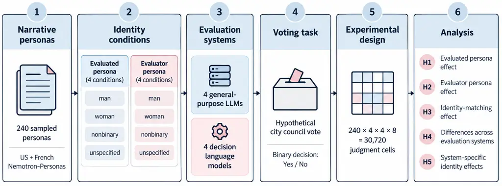

# LLMs Cannot Be Neutral: How Candidate and Evaluator Identities Affect AI JudgmentsNote: This manuscript is under review at ACM Conference on Fairness, Accountability, and Transparency (FAccT 2027).

Conference: ACM Conference on Fairness, Accountability, and
Transparency; June 21–24, 2027; Porto, PortugalCCS: Human-centered
computing Heuristic evaluationsCCS: Human-centered computing HCI theory,
concepts and modelsCCS: Computing methodologies Natural language
generation

Danial Amin

email: <danialam@uwasa.fi> Affiliation: University of Vaasa, Vaasa,
Finland Affiliation: Otherkind Tech, Helsinki, Finland , Joni Salminen

email: <jonisalm@uwasa.fi> Affiliation: University of Vaasa, Vaasa,
Finland and Bernard J. Jansen

email: <jjansen@acm.org> Affiliation: Peking University, Beijing, China
Affiliation: Nankai University, Tianjin, China

2027

Figure 1. Three sources of variation in AI-mediated voting decisions.
Each panel changes one element of the evaluation while the candidate’s
professional narrative stays fixed. Left: Evaluated persona effect. The
assigned gender identity of the evaluated persona varies. Center:
Evaluator persona effect. The assigned gender identity of the AI
evaluator varies. Right: Evaluation system effect. General-purpose LLM
judges and decision language models evaluate the same persona under
equivalent conditions. Three side-by-side illustrations showing the
evaluated persona effect, evaluator persona effect, and evaluation
system effect in AI-mediated voting decisions.

###### Abstract.

Large language models (LLMs) are increasingly used to evaluate
candidates for professional roles, raising concerns about their
sensitivity to demographic identities. We examine how candidate and
evaluator gender assignments affect decisions by LLM-as-a-Judge (LaJ)
models and decision language models (DLMs). In a hypothetical city
council voting task, eight models evaluated 240 synthetic professional
narratives from NVIDIA’s US and French Nemotron-Personas datasets under
independently varied gender assignments, producing 30,720 judgments.
Explicit candidate gender labels increased Yes-vote probability by
1.05–1.73 percentage points relative to unspecified gender, while only
the nonbinary evaluator assignment showed a significant increase (1.26
points). Identity matching showed no significant overall association.
Yes-vote rates varied across models (81.3–97.2%), and 2.5–3.3% of
decisions reversed relative to the unspecified-identity baseline. Under
direct substitutions between explicit gender identities, DLMs exhibited
fewer decision reversals than LaJ models (1.18% vs. 3.38%), indicating
lower observed decision-level gender sensitivity among the tested DLMs.
These findings demonstrate that gender sensitivity depends on candidate
and evaluator identities and the evaluation model, while highlighting
the importance of examining individual decision consistency alongside
aggregate differences.

###### Keywords: 

LLM-as-a-Judge, persona prompting, demographic bias, gender identity,
algorithmic fairness, AI-assisted evaluation

## 1. Introduction

Large language models (LLMs) are increasingly used to evaluate
information, assess responses, and make decisions according to
predefined criteria, an approach commonly referred to as LLM-as-a-Judge
(LaJ) (Chen et al., 2024; Ye et al., 2025). Although much of this
research has focused on evaluating generated content, LLMs can also be
used to assess people, including their qualifications and suitability
for particular roles. In such evaluations, a central concern is whether
judgments remain consistent when information unrelated to the assessment
criteria changes. For example, consider two candidates with identical
professional qualifications but different stated gender identities. If
an LLM selects one candidate but not the other, the stated
qualifications alone cannot explain the difference. LLMs can also be
instructed to adopt an evaluator persona, including a demographic
identity. This raises the possibility that a judgment depends on the
candidate’s gender identity, the evaluator’s gender identity, and the
evaluation model.

Existing research has shown that demographic cues can affect LLM
assessments of people (An et al., 2024; Gaebler et al., 2024). In this
study, we define _gender sensitivity_ as changes in evaluative judgments
when assigned gender identities vary while task-relevant information and
evaluation criteria remain unchanged. Research on persona prompting has
also shown that demographic information assigned to a model can affect
its responses (Neumann et al., 2025). A further source of variation is
the evaluation model, as previous research has documented differences
among LaJ models (Brown et al., 2026), while decision language models
(DLMs) provide another approach to structured judgments (Microsoft,
2026; OpenAI, 2026). Unlike general-purpose LLM judges, DLMs select
among predefined choices through structured decision interfaces.
However, previous research does not establish whether candidate and
evaluator gender identities have separate effects, whether identity
matching matters beyond those effects, or how gender sensitivity differs
across LaJ and DLMs.

We therefore ask:

- •
  RQ1: How do candidate and evaluator gender identities affect AI voting
  decisions?
- •
  RQ2: How do voting decisions and gender-identity effects differ
  between LaJ and DLMs?

To answer these questions, we conducted a controlled experiment with 240
synthetic professional narratives sampled from NVIDIA’s US and French
Nemotron-Personas datasets (Meyer and Corneil, 2025; Langlais et al.,
2026). We varied the candidate gender identity and the evaluator gender
identity independently, while keeping the remaining candidate narrative
unchanged. Four LaJ models and four DLMs answered the question, “Would
you vote for this candidate to serve on the city council?” The
experiment produced 30,720 voting judgments. For RQ1, we test whether
candidate gender identity (H1), evaluator gender identity (H2), and
identity matching beyond their separate effects (H3) affect decisions on
the candidacy for the city council. For RQ2, we test differences in
voting decisions across models (H4) and differences between models in
their responses to the assigned gender identities (H5). Table 1
summarizes the concepts used in these comparisons.

| Concept                       | Definition                                                                                                  |
| ----------------------------- | ----------------------------------------------------------------------------------------------------------- |
| Evaluated persona             | Synthetic representation of a hypothetical candidate, derived from the Nemotron-Personas datasets.          |
| Candidate gender identity     | Gender identity assigned to the evaluated persona.                                                          |
| Evaluator persona             | Role assigned to an AI evaluator through prompting.                                                         |
| Evaluator gender identity     | Gender identity assigned to the evaluator persona.                                                          |
| Evaluation model              | AI system responsible for producing the judgment.                                                           |
| LLM-as-a-Judge (LaJ)          | General-purpose LLM prompted to evaluate a candidate against specified criteria.                            |
| Decision language model (DLM) | Decision-focused model that selects among predefined choices.                                               |
| Identity matching             | Condition in which the evaluated and evaluator personas share the same explicitly assigned gender identity. |

Table 1. Key concepts used in the study.

This study makes three contributions to research on AI-assisted
evaluation. First, we extend research on gender sensitivity by
distinguishing the effects of candidate and evaluator identities,
including identity disclosure, differences between explicit identities,
and identity matching. This connects research on demographic differences
in AI evaluations with persona prompting. Second, we extend the
comparison of LaJ models to DLMs, showing that the DLMs examined exhibit
lower decision-level gender sensitivity, although the magnitude of this
difference varies across individual models. Third, we demonstrate that
small average differences in voting probabilities can coexist with
reversals in individual decisions when only assigned identities change.
Together, these contributions clarify how demographic identities and
evaluation models influence AI judgments and why aggregate outcomes and
individual decision consistency provide complementary evidence of gender
sensitivity.

## 2. Related Work

When LLMs evaluate candidates, demographic information can influence
their judgments even when task-relevant information remains comparable.
An et al. (An et al., 2024) found differences associated with perceived
gender and ethnicity in simulated hiring decisions, while Gaebler et al.
(Gaebler et al., 2024) reported differences in ratings of otherwise
similar applicants. Related findings have been reported in recruitment
(Kaya and Bogers, 2026), subjective decision-making (Aoshima and
Akiyama, 2026), legal evaluations (Hu et al., 2026), and assessments of
political candidates (Baum, 2026). These studies demonstrate the
relevance of demographic information to AI evaluations and motivate
examining whether candidate gender identity changes voting decisions
when the professional narrative remains unchanged (H1).

Research on gender sensitivity has further examined how controlled
demographic changes affect evaluation outcomes. Wang et al. (Wang et
al., 2024) distinguished differences in average hiring outcomes from
differences in their variability, while Seshadri et al. (Seshadri et
al., 2025) demonstrated sensitivity to gender perturbations in applicant
ranking. Using paired counterfactual evaluations, Zenginoğlu et al.
(Zenginoğlu et al., 2026) examined demographic sensitivity in
credit-risk assessments, finding that sensitivity varied across
demographic attributes and evaluation settings. These studies motivate
examining both aggregate differences and individual decision changes
under gender manipulations. Our study additionally distinguishes gender
disclosure from substitutions between explicit identities. The assigned
identities are separate from the source datasets’ recorded sex fields,
as models may conflate gender identity with binary sex categories
(Hafner et al., 2025).

The evaluator’s assigned gender identity represents another potential
source of variation. Research on persona prompting has shown that
demographic attributes assigned to models can influence their responses
(Lutz et al., 2025; Luz de Araujo et al., 2025; Neumann et al., 2025).
Li et al. (Li et al., 2025) found that persona-assigned agents can
exhibit decision biases not apparent in direct demographic questions.
These findings motivate examining whether changing an evaluator’s
assigned gender identity affects judgments about the same candidate
(H2).

The relationship between candidate and evaluator identities also
requires consideration. Li et al. (Li et al., 2026) observed greater
conformity among agents assigned the same persona, suggesting that
shared identities may influence interactions. However, conformity
between agents does not necessarily imply favorable judgments of
candidates sharing the evaluator’s identity. Sharma et al. (Sharma et
al., 2026) distinguished independent and interaction effects in
AI-assisted peer review. Together, these studies motivate examining
whether identity matching influences voting decisions beyond the
separate effects of candidate and evaluator identities (H3).

Finally, evaluation outcomes and demographic sensitivity can differ
across models. Previous research has documented biases and
model-dependent variation in LaJ assessments (Chen et al., 2024; Ye et
al., 2025; Hong et al., 2026; Brown et al., 2026). DLMs provide another
approach to AI evaluation by selecting among predefined choices through
structured decision interfaces (Microsoft, 2026; OpenAI, 2026). These
differences motivate comparing voting outcomes across individual models
and between LaJ and DLMs (H4), and testing whether their responses to
gender identity manipulations differ (H5). As Zollo et al. (Zollo et
al., 2025) cautioned, sensitivity observed in controlled demographic
evaluations does not independently establish downstream discrimination.

## 3. Methodology

This study varied candidate gender identity, evaluator gender identity,
and the evaluation model while keeping each candidate’s professional
narrative unchanged. Figure 2 summarizes the flow of the experiment
including the candidate selection, identity manipulation, evaluation,
and statistical analysis.

Figure 2. Overview of the experimental procedure. Each of the 240
prepared narratives was combined with all 16 candidate gender identity
and evaluator gender identity assignments and evaluated by four LaJ
models and four DLMs, producing 30,720 binary voting decisions.
Narratives were prepared once, before identities were assigned, so the
professional information was identical across conditions.

### 3.1. Study Design

We varied three experimental factors: (1) the candidate gender identity,
(2) the gender identity assigned to the evaluator persona, and (3) the
evaluation model. Each professional narrative was evaluated under all
combinations of evaluated and evaluator personas using the same voting
criteria. This kept the candidate’s professional information constant
across comparisons.

Table 2 summarizes the experimental design. Both identity factors
included three explicitly assigned gender identities (man, woman, and
nonbinary) and an unspecified condition where no gender identity was
assigned. We also examined identity matching, defined as the same
explicit candidate gender identity and evaluator gender identity.

|                                        |        |                                       |
| -------------------------------------- | ------ | ------------------------------------- |
| Component                              | Levels | Description                           |
| Candidate gender identity              | 4      | Man, woman, nonbinary, unspecified    |
| Evaluator gender identity              | 4      | Man, woman, nonbinary, unspecified    |
| Evaluation model                       | 8      | Four LaJ models and four DLMs         |
| Identity combinations                  | 16     | $`4\times 4`$ per narrative and model |
| Explicit-identity combinations         | 9      | 3 matching and 6 nonmatching          |
| Combinations with unspecified identity | 7      | At least one identity unspecified     |
| Base narratives                        | 240    | 120 US and 120 French                 |
| Total valid votes                      | 30,720 | $`240\times 16\times 8`$              |

Table 2. Experimental design and number of observations. Each of the 240
narratives was evaluated under all 16 combinations of candidate gender
identity and evaluator gender identity by all eight models, yielding
30,720 valid votes. The nine combinations with explicit identities on
both sides form the basis of the matching analysis.

### 3.2. Narrative Persona Datasets and Sampling

We used professional narratives from NVIDIA’s Nemotron-Personas-USA and
Nemotron-Personas-France datasets (Meyer and Corneil, 2025; Langlais et
al., 2026). These datasets contain synthetic personas generated from
census data to reflect variation in demographic and occupational
characteristics, including age and occupation. The dataset includes
different personas with the same demographics, but we used the
professional personas. We used these personas as the narratives of the
evaluated personas for the hypothetical city council voting task. The
dataset also includes demographic attributes, which we used for
stratification of sampling but are not part of the experimental design.

We selected 240 narratives through stratified random sampling. Within
each dataset, we formed four groups from two age groups, young (18–39)
and old (40–64), and two occupation categories. We selected 30 records
without replacement from each group, using independent random streams
derived from a fixed seed to ensure reproducibility. Table 3 reports the
total number of records and the selected sample for each group. The US
and French datasets use different occupation categories, which we did
not treat as equivalent occupations and only compared on the type of
occupation.

|                |                          |                         |         |
| -------------- | ------------------------ | ----------------------- | ------- |
| Source         | Occupation category      | Eligible records by age |         |
|                |                          | 18–39                   | 40–64   |
| US             | Secondary school teacher | 1,652                   | 2,290   |
|                | Construction laborer     | 3,708                   | 3,735   |
| France         | Cadres                   | 37,853                  | 58,244  |
|                | Ouvriers                 | 57,652                  | 62,831  |
| Total eligible |                          | 100,865                 | 127,100 |

Table 3. Stratified sampling of professional narratives. Note. Of
227,965 eligible records, 30 narratives were sampled from each of the
eight strata ($`N=240`$). Equal allocation does not reflect national
population distributions. Occupation categories are not directly
comparable across countries. Cadres refers to higher-level professional
and intellectual occupations; Ouvriers refers to manual-worker
occupations.

Age group, occupation, and dataset source were retained for exploratory
analyses, while candidate and evaluator gender identities were
independently manipulated. The US and French narratives were not matched
across datasets.

### 3.3. Evaluated and Evaluator Persona Manipulations

Given that the French language is gender-specific, we pre-processed one
version of each selected narrative before assigning gender identities.
This involved removing names and explicit age references and replacing
detected gendered pronouns or occupational wording with neutral
alternatives in English and French. The pre-processing report records
changes to 125 narratives, which we first tested with automated checks,
and no remaining gender cues were found. To validate the pre-processing,
the PI and Co-PI (both French speaking) also evaluated the same to test
for any gender cues and found none.

Candidate gender identity was assigned by adding a separate gender line
after the narrative, such as Candidate gender identity: woman. When
candidate gender identity was not specified, no gender-identity line was
included. Evaluator gender identity was assigned through a prompt
instruction, such as You are a woman voting in a hypothetical city
council election. In the unspecified evaluator condition, no gender
identity was assigned. Candidate gender identity and evaluator gender
identity were varied independently.

### 3.4. Evaluation Models

We evaluated candidates using four DLMs and four LaJ models. We included
both types of models to examine whether voting decisions and the effects
of assigned gender identities differ between models that generate text
and models that select from predefined choices. All eight models
evaluated the same candidate narratives under the same identity
conditions. Table 4 presents the models and their identifiers.

| Type | Company    | Model                | OpenRouter tag                 |
| ---- | ---------- | -------------------- | ------------------------------ |
| LaJ  | Anthropic  | Claude Sonnet 5.5    | anthropic/claude-sonnet-5.5    |
|      | OpenAI     | GPT-6.1-sol          | openai/gpt-6.1-sol             |
|      | Google     | Gemini 4 Argon       | google/gemini-4-argon          |
|      | DeepSeek   | DeepSeek V4 Pro      | deepseek/deepseek-v4-pro-0813  |
| DLM  | Typesafe   | Jev                  | typesafe/jev-1.14              |
|      | Microsoft  | Microsoft-Decision-1 | microsoft/microsoft-decision-1 |
|      | OpenAI     | OpenAI Decisions     | openai/gpt-6-luna-decisions    |
|      | Cloudflare | Cloudflare Clef      | cloudflare/clef                |

Table 4. Evaluation models included in the experiment. Note. All models
were accessed through OpenRouter. LaJ models used the chat interface at
temperature zero, whereas DLMs used a structured decision interface
without an equivalent temperature setting.

All models were accessed through OpenRouter¹¹ 1 OpenRouter provides API
access to the models used in this study:
[https://openrouter.ai/](https://openrouter.ai/). The LaJ models used
the chat interface, with temperature set to zero, where applicable,
while the DLMs used the structured Decisions interface, which does not
expose an equivalent temperature parameter. Although their input and
output formats differed, we maintained the same candidate information,
voting question, and evaluation criteria. The primary comparison
therefore concerned the Yes/No decisions returned by each model.

### 3.5. Voting Task and Experimental Procedure

We asked each model to evaluate a candidate in a hypothetical city
council election. The voting question was: “Would you vote for this
candidate to serve on the city council?” Each model selected Yes or No
based on the candidate’s professional narrative.

The evaluation instructions asked models to consider whether the
narrative demonstrated an ability to work with other people, follow
through on responsibilities, handle disagreements or constraints, and
contribute beyond immediate tasks. Professional experience could support
a Yes vote without previous political office. The instructions called
for a No vote when the narrative described only technical duties without
evidence of responsibility for other people. Models were also instructed
not to invent political qualifications, endorsements, or experience.
Gender identity was not included among the assessment criteria.

For LaJ models, the system message contained the voting instructions and
assigned evaluator gender identity, while the user message contained the
prepared narrative and candidate gender identity. The models returned a
Yes/No vote and a brief reason in JSON. For DLMs, the same candidate
information and voting instructions were provided through a structured
decision request containing the two response choices. Supplementary
material in OSF Repository²² 2
[https://osf.io/38ked/overview?view_only=a1cc5445898c47ccb55208e3978c2520](https://osf.io/38ked/overview?view_only=a1cc5445898c47ccb55208e3978c2520)
illustrates the difference between these request and response formats.
Each combination of candidate narrative, identities, and model was
submitted separately. We analyzed only responses from the final
voter-style prompt, excluding earlier prompt versions used during
development.

### 3.6. Data Collection and Processing

For each evaluation, we recorded the source narrative, dataset,
candidate gender identity and evaluator gender identity, model, and
response. We extracted the Yes/No decision from the JSON response
returned by the LaJ models or from the selected choice returned by the
DLMs. Valid decisions were coded as Yes = 1 and No = 0. Missing,
malformed, or non-Yes/No responses were identified and omitted from the
dataset.

We checked that each combination of evaluated persona, candidate gender
identity, evaluator gender identity, and evaluation model had exactly
one valid decision. The resulting dataset contained 30,720 valid
instances, covering all planned combinations. Where available, we
retained the probabilities assigned to DLM response choices separately
from the confidence scores.

### 3.7. Outcome Measures

The primary outcome was the binary Yes/No vote. We summarized the
decisions using Yes-vote rates and estimated differences associated with
candidate gender identity, evaluator gender identity, identity matching,
and evaluation model. For identity comparisons, the reference was the
condition in which gender information was not provided; the
assigned-identity conditions included an explicit gender label or
instruction. Table 5 defines the outcome and derived comparisons; the
corresponding statistical tests are described in the next subsection.

| Measure                         | Definition                                                                                                              | Use             |
| ------------------------------- | ----------------------------------------------------------------------------------------------------------------------- | --------------- |
| Binary vote                     | Yes = 1; No = 0                                                                                                         | Primary outcome |
| Yes-vote rate                   | Yes votes divided by valid votes in a condition                                                                         | Descriptive     |
| Identity difference             | Difference in Yes-vote probability between an explicit identity and its unspecified reference, for the same narratives  | H1, H2          |
| Identity matching               | Additional association of matching explicit identities with a Yes vote after accounting for the two identity labels     | H3              |
| Model differences               | Differences in voting outcomes among the eight models and between LaJ and DLM categories                                | H4              |
| Model-specific identity effects | Differences between models in the effects of candidate gender identity, evaluator gender identity, or identity matching | H5              |
| Decision reversal               | Change from Yes to No, or No to Yes, relative to the same narrative and model with both identities unspecified          | Secondary       |
| Sampling-group differences      | Differences in voting outcomes by dataset, age group, or occupation                                                     | Secondary       |

Table 5. Voting outcome and derived measures. The binary vote is the
primary outcome. Identity differences, identity matching, and model
differences address H1–H5, while decision reversals and sampling-group
differences are exploratory. Reversals are defined against the same
narrative and model with both identities unspecified.

### 3.8. Statistical Analysis and Hypothesis Testing

We analyzed the binary voting decisions using binomial generalized
linear models, with standard errors clustered by evaluated persona to
account for repeated evaluations of the same candidate. We report
adjusted odds ratios and paired differences in Yes-vote probabilities,
expressed in percentage points. The paired comparisons retained the same
narratives and averaged over the remaining experimental conditions. All
tests were two-sided. We applied Holm corrections separately to the
three candidate gender identity comparisons and the three evaluator
gender identity comparisons.

The analyses distinguished the separate associations of candidate gender
identity and evaluator gender identity (H1 and H2) from the additional
association of matching identities (H3). For H1 and H2, the unspecified
condition was the reference category, and the models adjusted for the
other identity factor and evaluation model. For H3, we estimated the
pooled matching association across the nine explicit-identity
combinations while adjusting for candidate gender identity, evaluator
gender identity, and evaluation model. We then tested the
candidate-by-evaluator gender identity interaction and examined the
three same-identity pairings separately, with Holm correction for the
pairing-specific contrasts. We examined differences among individual
models (H4) separately from the comparison of LaJ and DLM categories,
because each model belongs to one category. Finally, we tested whether
identity effects differed among models (H5). Table 6 summarizes the
corresponding tests.

| Test | Statistical comparison                                                                                                           | Reported effect                                           |
| ---- | -------------------------------------------------------------------------------------------------------------------------------- | --------------------------------------------------------- |
| H1   | Candidate gender identity versus unspecified, adjusting for evaluator gender identity and evaluation model                       | Adjusted odds ratios; paired percentage-point differences |
| H2   | Evaluator gender identity versus unspecified, adjusting for candidate gender identity and evaluation model                       | Adjusted odds ratios; paired percentage-point differences |
| H3   | Matching versus non-matching explicit identities, adjusting for both labels and model                                            | Adjusted matching association                             |
| H4   | Joint Wald test across eight models; separate LaJ–DLM category contrast                                                          | Model and category differences                            |
| H5   | Model interactions with candidate gender identity, evaluator gender identity, and identity matching (matching tested separately) | Differences in identity effects by model                  |

Table 6. Statistical analyses used to test the hypotheses. All analyses
use binomial models with standard errors clustered by narrative.
Candidate gender identity and evaluator gender identity are each
compared with the unspecified condition (H1, H2) before matching is
tested beyond both labels (H3). Model differences (H4) and
model-specific identity effects (H5) are tested with joint Wald tests.

We conducted secondary analyses of decision reversals and differences
across sampled narratives. Identity-disclosure reversals were measured
against the unspecified candidate and evaluator conditions for the same
narrative and model. We additionally examined explicit gender
substitutions by comparing man, woman, and nonbinary assignments
pairwise while holding the other identity and professional narrative
unchanged. These comparisons produced 23,040 candidate and 23,040
evaluator judgment pairs. We estimated reversal rates and their
differences between LaJ and DLMs using 2,000 narrative-cluster bootstrap
resamples, with Holm correction for the three gender-pair comparisons
within each manipulation. We also examined model-specific variation,
conducted leave-one-model-out analyses, and used an exact permutation
analysis of the eight model-level rates to assess the robustness of
category differences. Differences by dataset source, age, and occupation
were examined using binomial models with narrative-clustered standard
errors. These sampling characteristics were observational and were not
experimentally manipulated.

To support reproducibility and verification, we documented the sampling
procedure and random seed, narrative preparation rules, identity
prompts, model identifiers and settings, response extraction procedures,
and analysis specifications. We checked the final dataset against the
full experimental design to confirm that every planned combination of
evaluated persona, candidate gender identity, evaluator gender identity,
and evaluation model contained one valid vote. The experiment code,
prompt templates, prepared narratives, model responses, and statistical
analysis scripts are available in the accompanying OSF repository.

## 4. Results

The analysis included 30,720 valid voting judgments from 240 candidate
narratives across eight evaluation models. The vast majority of
judgments were Yes votes (26,878; 87.5%). We first report the effects of
candidate gender identity, evaluator gender identity, and identity
matching (RQ1), followed by differences in voting outcomes and gender
sensitivity across evaluation models (RQ2).

### 4.1. RQ1: How Do Candidate Gender Identity and Evaluator Gender Identity Affect AI Voting Decisions?

#### Candidate gender identity (H1).

Explicitly assigning any of the three candidate gender identities made a
Yes vote slightly more likely than leaving the identity unspecified. The
increase was 1.05 percentage points for man (95% CI \[0.59, 1.52\]),
1.41 points for woman (95% CI \[0.90, 1.92\]), and 1.73 points for
nonbinary (95% CI \[1.17, 2.29\]). All three comparisons remained
significant after Holm correction (all adjusted $`p`$s $`<.001`$), with
adjusted odds ratios between 1.10 and 1.17 (Table 7). Among explicit
identities, the Yes-vote probability was higher for nonbinary than man
by 0.68 percentage points (95% CI \[0.25, 1.11\], Holm-adjusted
$`p=.006`$). The woman–man (0.35 points, adjusted $`p=.087`$) and
nonbinary–woman (0.33 points, adjusted $`p=.106`$) comparisons were not
significant after correction. These findings show that specifying a
candidate’s gender identity influenced judgments even when the
professional narrative remained unchanged. Therefore, H1 is fully
supported that assigning a candidate gender identity changed the
probability of a Yes vote when the remaining narrative information was
unchanged.

#### Evaluator gender identity (H2).

Evaluator gender assignments showed a more selective pattern. Relative
to the unspecified condition, assigning a nonbinary evaluator identity
increased Yes-vote probability by 1.26 percentage points (95% CI \[0.78,
1.75\]), with an adjusted odds ratio of 1.13 (95% CI \[1.08, 1.18\],
Holm-adjusted $`p<.001`$). The 0.44-point increase for a man evaluator
identity did not remain significant after Holm correction (95% CI
\[0.02, 0.87\], adjusted $`p=.082`$), while the difference for a woman
evaluator identity was negligible ($`-0.07`$ points, 95% CI \[$`-0.45`$,
0.32\], $`p=.742`$). Figure 3 presents candidate and evaluator gender
effects on the same scale. Secondary pairwise comparisons among explicit
evaluator identities showed that nonbinary assignments increased
Yes-vote probability relative to man (0.82 percentage points,
Holm-adjusted $`p<.001`$) and woman (1.33 points, adjusted $`p<.001`$),
while woman assignments decreased it relative to man ($`-0.51`$ points,
adjusted $`p=.004`$). These findings demonstrate that the evaluator’s
assigned gender identity can influence judgments, including differences
between explicitly stated identities. Therefore, H2 was partially
supported: assigning an evaluator gender identity significantly changed
Yes-vote probability relative to the unspecified condition only for the
non-binary assignment.

| Factor    | Label     | $`\Delta`$ Yes (pp), 95% CI   | $`\mathit{OR}`$ \[95% CI\] |
| --------- | --------- | ----------------------------- | -------------------------- |
| Evaluated | Man       | 1.05 \[0.59, 1.52\]           | 1.10 \[1.06, 1.15\]        |
|           | Woman     | 1.41 \[0.90, 1.92\]           | 1.14 \[1.09, 1.19\]        |
|           | Nonbinary | 1.73 \[1.17, 2.29\]           | 1.17 \[1.12, 1.23\]        |
| Evaluator | Man       | 0.44 \[0.02, 0.87\]           | 1.04 \[1.00, 1.08\]        |
|           | Woman     | $`-0.07`$ \[$`-0.45`$, 0.32\] | 0.99 \[0.96, 1.03\]        |
|           | Nonbinary | 1.26 \[0.78, 1.75\]           | 1.13 \[1.08, 1.18\]        |

Note. pp = percentage points. All candidate gender identity contrasts
and the nonbinary evaluator contrast have Holm-adjusted $`p<.001`$. For
the evaluator-man contrast, adjusted $`p=.082`$ for the paired
probability difference and $`.072`$ for the adjusted odds ratio. The
evaluator-woman paired contrast has $`p=.742`$. Probability differences
average over the other balanced conditions. Odds ratios adjust for the
other gender factor and evaluation model.

Table 7. Gender contrasts relative to the unspecified condition. All
three candidate gender identity contrasts were significant (1.05–1.73
percentage points; odds ratios 1.10–1.17), whereas among evaluator
gender identities only nonbinary was (1.26 points; odds ratio 1.13). The
evaluator-man contrast did not remain significant after Holm adjustment.

Figure 3. Change in Yes-vote probability when an explicit gender label
replaced the unspecified condition. Every explicit candidate gender
identity increased Yes votes (1.05–1.73 percentage points, all adjusted
$`p<.001`$), whereas only the nonbinary evaluator gender identity did so
(1.26 points); the man and woman evaluator gender identities were not
significant after Holm adjustment. Points show within-narrative
estimates and bars show 95% confidence intervals; filled markers
indicate Holm-adjusted $`p<.05`$.

#### Identity matching (H3).

We found no statistically significant overall association between
matching candidate and evaluator gender identities and Yes-vote
probability after accounting for their separate effects. Among the
17,280 judgments with explicit identities on both sides, Yes-vote rates
were 88.1% for matching identities and 87.9% for nonmatching identities.
The adjusted matching association was small ($`\mathit{OR}=1.02`$, 95%
CI \[0.99, 1.05\], $`p=.297`$), equivalent to a 0.17-percentage-point
difference in predicted Yes-vote probability. The candidate-by-evaluator
interaction was also not significant (Wald $`\chi^{2}(4)=5.93`$,
$`p=.204`$; man, woman, and nonbinary $`\mathit{OR}`$s $`=0.99`$,
$`1.05`$, and $`1.01`$). These results indicate that the effects of the
two assigned identities did not produce an overall preference for
candidates sharing the evaluator’s identity. Therefore, Therefore, H3
was not supported: we did not detect a statistically significant overall
association between matching candidate and evaluator gender identities
and Yes-vote probability beyond their separate effects.

#### Changes to individual voting decisions.

Most votes remained unchanged across identity conditions, but some
individual decisions differed even though the candidate’s professional
narrative was identical. Relative to the condition in which both
identities were unspecified, 3.02% of votes reversed when only candidate
gender identity was assigned (95% CI \[2.24, 3.80\]), 2.48% when only
evaluator gender identity was assigned (95% CI \[1.84, 3.18\]), and
3.27% when both identities were assigned (95% CI \[2.48, 4.11\]). Most
reversals were from No to Yes. Across the 15 alternative identity
conditions, 8.28% of narrative–model pairs reversed at least once (95%
CI \[6.51, 10.16\]), and at least one model reversed a vote for 32.5% of
narratives. In a limited repeatability check, 768 requests from 24
narratives were repeated three times, and 1.04% of cells showed
disagreement (95% CI \[0.13, 2.47\]).

#### Variation across sampled narratives.

Increases associated with explicit candidate gender identities appeared
across the sampled age, occupation, and source-dataset groups, with no
statistically significant differences in their magnitude. Candidate
gender identity interactions were not significant for age
($`\chi^{2}(3)=3.45`$, $`p=.327`$), occupation ($`\chi^{2}(3)=0.18`$,
$`p=.980`$), or source dataset ($`\chi^{2}(3)=3.05`$, $`p=.384`$).
Evaluator gender identity interactions were also not significant (all
$`p`$s $`>.34`$). These secondary analyses concern the sampled
narratives because age and occupation were not manipulated, and
occupation categories differed between the US and French datasets.

### 4.2. RQ2: How Do Voting Decisions and Gender-Identity Effects Differ Between LaJ and DLMs?

#### Differences in voting decisions (H4).

Yes-vote rates differed substantially across evaluation models,
exceeding the average differences associated with explicit gender
assignments. Rates ranged from 81.3% for Gemini 4 Argon to 97.2% for
OpenAI Decisions, a difference of 15.9 percentage points (Figure 4). The
overall model comparison was significant (Wald $`\chi^{2}(7)=65.11`$,
$`p<.001`$). DLMs also returned Yes votes more frequently than LaJ
models (88.9% vs. 86.1%), a paired difference of 2.79 percentage points
(95% CI \[1.50, 4.07\], $`p<.001`$). The adjusted category contrast was
significant ($`\mathit{OR}=1.29`$, 95% CI \[1.16, 1.44\], $`p<.001`$).
These results demonstrate differences in voting outcomes both among
individual evaluation models and between the two model categories.
Therefore, H4 is fully supported as the probability of a Yes vote
differed across evaluation models under equivalent conditions.

Figure 4. Yes-vote rates for the eight evaluation models. Rates ranged
from 81.3% for Gemini 4 Argon to 97.2% for OpenAI Decisions, a spread
larger than any gender effect. DLMs returned Yes more often than LaJ
models on average (88.9% vs. 86.1%), but rates varied widely within both
groups. Each line runs from the group mean (dashed) to the model’s rate;
each model contributed 3,840 judgments.

#### Differences in gender sensitivity (H5).

The effects of candidate and evaluator gender assignments also varied
across evaluation models. Candidate gender contrasts reached 3.54–4.38
percentage points for Gemini 4 Argon, while none of the corresponding
contrasts remained significant after Holm correction for Claude Sonnet
5.5, GPT-6.1-sol, or Microsoft-Decision-1 (Figure 5). Evaluator gender
effects followed a different pattern: assigning a nonbinary evaluator
identity increased Yes-vote probability by 3.02 points for Claude Sonnet
5.5 and 2.40 points for DeepSeek V4 Pro, while assigning a woman
evaluator identity decreased it by 1.46 points for DeepSeek V4 Pro
(Figure 6). The overall model-by-gender interaction was significant
(Wald $`\chi^{2}(42)=102.30`$, $`p<.001`$). Matching associations also
varied across models (Wald $`\chi^{2}(7)=15.97`$, $`p=.025`$), although
the pooled matching association was not significant. These results show
that sensitivity to assigned identities depended on the individual
evaluation model. Therefore, H5 is fully supported, thus the effects of
candidate gender identity, evaluator gender identity, and identity
matching differed across evaluation models.

Figure 5. Candidate gender identity effects by evaluation model. Gemini
4 Argon showed the largest effects, with all three labels increasing Yes
votes by 3.54–4.38 percentage points, whereas no label had a significant
effect for Claude Sonnet 5.5, GPT-6.1-sol, or Microsoft-Decision-1.
Estimates are changes in Yes-vote probability relative to the
unspecified candidate gender identity; bars show 95% confidence
intervals, marker shape indicates gender, and filled markers indicate
Holm-adjusted $`p<.05`$ within the model.

At the category level, the overall gender-by-category interaction was
significant (Wald $`\chi^{2}(6)=20.08`$, $`p=.003`$). However, no
individual category difference for a specific gender contrast remained
significant after Holm correction, and the identity-matching association
did not differ significantly between LaJ and DLMs (Wald
$`\chi^{2}(1)=1.41`$, $`p=.235`$). The overall category difference in
voting rates therefore did not translate into consistent differences in
sensitivity to specific gender assignments.

Figure 6. Evaluator gender identity effects by evaluation model. The
pattern differed from the candidate gender identity effects: a nonbinary
evaluator gender identity increased Yes votes for Claude Sonnet 5.5
(3.02 percentage points) and DeepSeek V4 Pro (2.40), while no evaluator
gender identity had a significant effect for Gemini 4 Argon. DeepSeek V4
Pro also showed the only significant negative contrast ($`-1.46`$ points
for a woman evaluator gender identity). Estimates are relative to the
unspecified evaluator gender identity; encoding as in Figure 5.

#### Model differences in decision reversals.

Decision reversals also varied across individual models and model
categories. When only candidate gender identity was assigned, Gemini 4
Argon reversed 7.36% of votes and DeepSeek V4 Pro reversed 5.28%,
compared with 0.28% for Microsoft-Decision-1 (Figure 7). DLM reversal
rates were lower than LaJ rates by 2.50, 2.81, and 2.30 percentage
points for candidate-only, evaluator-only, and joint identity
assignments, respectively (all Holm-adjusted $`p`$s $`<.001`$). These
differences indicate greater observed decision stability among the DLMs
tested, but they do not establish greater fairness or decision
correctness.

Figure 7. Decision reversals relative to the unspecified/unspecified
baseline for the same narrative and evaluation model. Most reversals
were from No to Yes. Gemini 4 Argon reversed 7.36% of its votes when
only the candidate gender identity changed, compared with 0.28% for
Microsoft-Decision-1, and DLMs reversed less often than LaJ models under
all three manipulations ($`-2.30`$ to $`-2.81`$ percentage points). Bars
left of zero show Yes-to-No changes and bars right of zero show
No-to-Yes changes; panel headers give the pooled reversal rate and the
DLM–LaJ difference.

#### Gender sensitivity under explicit identity substitutions.

Secondary analyses compared decisions when one explicit gender identity
was replaced with another while the professional narrative and the other
identity assignment remained unchanged. Across 46,080 paired
comparisons, 2.28% of votes differed between gender assignments. DLMs
exhibited fewer reversals than LaJ models for both candidate
substitutions (1.35% vs. 3.07%; difference $`-1.72`$ percentage points,
95% CI \[$`-2.62`$, $`-0.87`$\]) and evaluator substitutions (1.01% vs.
3.68%; difference $`-2.67`$ points, 95% CI \[$`-3.70`$, $`-1.65`$\]).
Across both manipulations, DLMs reversed 1.18% of decisions compared
with 3.38% for LaJ models, a difference of $`-2.20`$ percentage points
(95% CI \[$`-3.13`$, $`-1.30`$\], bootstrap $`p<.001`$). All six
gender-pair category differences remained significant after Holm
correction. The overall difference persisted in leave-one-model-out
analyses, although a model-level permutation test was not significant
($`p=.086`$). These findings indicate lower observed decision-level
gender sensitivity among the DLMs tested, with differences across
individual models.

A secondary country-level analysis indicated that the difference between
model categories also varied by narrative country. In the US sample,
DLMs and LaJ models returned Yes votes in 90.7% and 86.5% of cases,
respectively, compared with 87.1% and 85.7% in the French sample. The
category-by-source interaction was significant (Wald
$`\chi^{2}(1)=7.48`$, $`p=.006`$). This difference should not be
interpreted as a country effect because the samples differed in
occupations, narrative content, and potentially language. Additional
estimates are provided in the supplementary analysis.

## 5. Discussion

### 5.1. Theoretical Implications

First, our study extends research on gender sensitivity in AI
evaluations by examining the identities of both candidates and
evaluators within the same judgment. Previous studies have examined
gender-related differences in candidate assessments (An et al., 2024;
Seshadri et al., 2025), while research on persona prompting has shown
that assigned demographic identities can influence model responses
(Neumann et al., 2025; Lutz et al., 2025). We connect these streams by
distinguishing three sources of variation: disclosing a candidate’s
gender, substituting one explicit gender identity for another, and
assigning a gender identity to the evaluator. Explicit candidate
identities increased favorable judgments relative to unspecified gender,
and direct comparisons showed differences among the stated identities.
Evaluator assignments followed a different pattern, including
differences between explicitly assigned evaluator identities. Yet
matching candidate and evaluator identities showed no significant
overall association beyond their separate effects. This qualifies
expectations derived from studies of conformity among
persona-conditioned agents (Li et al., 2026): shared identities in an
interaction do not necessarily produce more favorable evaluations.
Conceptually, the identity assigned to an AI evaluator is itself part of
the evaluation conditions, even though it provides no additional
evidence about the candidate. Gender sensitivity therefore encompasses
distinct candidate, evaluator, and relational effects; observing one
does not establish the presence of another.

Second, our comparison extends research on model-dependent demographic
sensitivity (Brown et al., 2026; Ye et al., 2025) to decision language
models. When one explicit gender identity was substituted for another,
the four DLMs reversed 1.18% of decisions compared with 3.38% for the
four LaJ models, approximately 65% fewer observed reversals. Lower DLM
reversal rates appeared for both candidate and evaluator substitutions,
across all six gender-pair contrasts, and remained evident when
individual models were excluded. This supports a specific conclusion:
the DLMs tested exhibited lower _decision-level gender sensitivity_
under controlled identity substitutions. It does not imply that they
were insensitive to gender or that they made fairer decisions.
Individual models differed substantially, and an exact model-level
permutation comparison did not establish a general difference between
the broader LaJ and DLM categories ($`p=.086`$). Moreover, model
identity and request interface varied together, preventing attribution
of the difference to structured decision interfaces alone. These results
show why demographic sensitivity must be examined at both the model and
evaluation-approach levels, with attention to the particular outcome
used to measure it.

Third, our findings distinguish aggregate gender effects from
sensitivity at the level of individual decisions. Previous research
often compares demographic groups using average scores, acceptance
rates, or rankings (Gaebler et al., 2024; Wang et al., 2024), while
counterfactual audits also examine whether decisions change when
demographic information changes (Zenginoğlu et al., 2026). Our results
show that relatively small differences in overall Yes-vote probability
can coexist with reversals for an individual candidate whose
professional information remains unchanged. Aggregate differences
describe systematic shifts in favorable judgments, whereas reversal
rates capture changes in the decisions returned for the same candidate
under controlled identity assignments. This distinction is consequential
for binary evaluations: a small shift in an overall rate can still
correspond to a different outcome for particular individuals. Reversal
direction is also informative because movement from No to Yes and from
Yes to No may be obscured by a single net difference. Neither measure,
however, determines whether the original or changed decision was
justified. Consistency, demographic sensitivity, and fairness are
related but distinct properties, and conclusions about one should not be
substituted for evidence about another.

### 5.2. Practical Implications

These findings have implications for institutions considering
AI-assisted evaluations of people, although our task did not involve a
real electoral process. We propose five practical guidelines (GLs):

- •
  GL1: Test both identities. Vary candidate and evaluator gender
  assignments independently while holding professional information and
  evaluation criteria fixed. Include unspecified and explicitly assigned
  identities.
- •
  GL2: Examine identity matching. Compare matching and nonmatching
  identities after accounting for the separate effects of each identity,
  rather than treating agreement in identities as evidence of
  favoritism.
- •
  GL3: Measure decision reversals. Report Yes-to-No and No-to-Yes
  changes under identity disclosure and explicit gender substitutions
  alongside average voting differences.
- •
  GL4: Compare evaluation models. Evaluate LaJ and DLM systems on the
  same cases and report both category-level and model-specific
  sensitivity. Lower reversal rates should not be interpreted as greater
  fairness.
- •
  GL5: Assess decision quality and accountability. Review whether
  judgments follow stated criteria, document the basis of decisions, and
  provide opportunities to question outcomes that affect people.

### 5.3. Limitations and Future Work

Five limitations qualify our conclusions. First, the synthetic
Nemotron-Personas narratives covered a limited range of occupations and
age groups. The US and French datasets were not matched, and implicit
gender cues may have remained despite preprocessing. Second, the
hypothetical city council task lacked human evaluators and an
independent benchmark of candidate suitability. Its high overall
Yes-vote rate (87.5%) also constrains the observable pattern of
reversals, limiting conclusions about practical decision quality. Third,
we could not verify whether models adopted the assigned evaluator
identities or inferred gender when no identity was specified. Fourth,
only four models represented each evaluation category, and model
differences were confounded with interface differences. The observed DLM
advantage therefore does not establish an inherent advantage of DLMs as
a class. Fifth, repeated identical-input evaluations covered only 24
narratives; ordinary run-to-run variation cannot be completely separated
from the effects of identity substitutions.

Future research could replicate these comparisons with more diverse
narratives and demographic attributes, include human evaluators and
independently assessed candidate suitability, and examine how identity
instructions are interpreted. Comparing conversational and structured
decision interfaces for the same underlying models would help isolate
interface effects. Larger repeated-measures studies could also clarify
the stability of individual decisions and whether lower
gender-substitution reversal rates persist across tasks and candidate
populations. Such extensions would establish how far the present
findings generalize and whether differences in consistency correspond to
differences in evaluation quality.

## 6. Conclusion

We examined how candidate gender identities, evaluator personas, and
model choice shape AI-assisted voting decisions. Both candidate and
evaluator identities affected judgments, while identity matching showed
no significant overall association. Under explicit gender substitutions,
the tested DLMs exhibited fewer decision reversals than LaJ models,
alongside substantial model-specific variation. By separating identity
disclosure, identity substitution, and matching, and by comparing
aggregate outcome differences with individual reversals, our findings
offer a more precise account of gender sensitivity in AI evaluation.
Audits should examine these dimensions together while keeping decision
consistency distinct from fairness and correctness.

## References

- An et al. (2024) H. An, C. Acquaye, C. Wang, Z. Li, and R. Rudinger Do
  large language models discriminate in hiring decisions on the basis of
  race, ethnicity, and gender?. In Proceedings of the 62nd Annual
  Meeting of the Association for Computational Linguistics (Volume 2:
  Short Papers), pp. 386–397. External Links:
  [Document](https://dx.doi.org/10.18653/v1/2024.acl-short.37),
  [Link](https://aclanthology.org/2024.acl-short.37/) Cited by: §1, §2,
  §5.1.
- Aoshima and Akiyama (2026) T. Aoshima and M. Akiyama Does it lead to
  prejudice or discrimination? an assessment of stereotypes in llm
  decision-making. In Proceedings of the 2026 ACM Conference on
  Fairness, Accountability, and Transparency, New York, NY, USA,
  pp. 2292–2340. External Links:
  [Document](https://dx.doi.org/10.1145/3805689.3812286) Cited by: §2.
- Baum (2026) Z. Baum Algorithmic electability: generative AI, gendered
  political bias, and LGBTQ candidates. Note: APSA Preprints, working
  paper External Links:
  [Document](https://dx.doi.org/10.33774/apsa-2026-p31md),
  [Link](https://doi.org/10.33774/apsa-2026-p31md) Cited by: §2.
- Brown et al. (2026) M. A. Brown, S. Atreja, L. Hemphill, and P. Y. Wu
  The context dependency of demographic bias in LLM annotation. In
  Proceedings of the 2026 ACM Conference on Fairness, Accountability,
  and Transparency, pp. 7475–7497. External Links:
  [Document](https://dx.doi.org/10.1145/3805689.3812212) Cited by: §1,
  §2, §5.1.
- Chen et al. (2024) G. H. Chen, S. Chen, Z. Liu, F. Jiang, and B. Wang
  Humans or LLMs as the judge? a study on judgement bias. In Proceedings
  of the 2024 Conference on Empirical Methods in Natural Language
  Processing, pp. 8301–8327. External Links:
  [Document](https://dx.doi.org/10.18653/v1/2024.emnlp-main.474),
  [Link](https://aclanthology.org/2024.emnlp-main.474/) Cited by: §1,
  §2.
- Gaebler et al. (2024) J. D. Gaebler, S. Goel, A. Huq, and P. Tambe
  Auditing large language models for race & gender disparities:
  implications for artificial intelligence-based hiring. Behavioral
  Science & Policy 10 (2), pp. 46–55. Note: Journal issue dated 2024;
  first published online March 11, 2025 External Links:
  [Document](https://dx.doi.org/10.1177/23794607251320229) Cited by: §1,
  §2, §5.1.
- Hafner et al. (2025) F. S. Hafner, A. Valdivia, and L. Rocher Gender
  trouble in language models: an empirical audit guided by gender
  performativity theory. In Proceedings of the 2025 ACM Conference on
  Fairness, Accountability, and Transparency, pp. 1677–1695. External
  Links: [Document](https://dx.doi.org/10.1145/3715275.3732112),
  [Link](https://doi.org/10.1145/3715275.3732112) Cited by: §2.
- Hong et al. (2026) R. Hong, A. Ovalle, M. Ung, E. Spiliopoulou, L.
  Sagun, A. Williams, and C. Ross Automated bias blind spots: examining
  stereotype associations in VLM-as-a-Judge paradigms. In Proceedings of
  the 2026 ACM Conference on Fairness, Accountability, and Transparency,
  pp. 6510–6553. External Links:
  [Document](https://dx.doi.org/10.1145/3805689.3806459) Cited by: §2.
- Hu et al. (2026) Y. Hu, Z. Xue, H. Li, S. Zheng, Q. Chen, S. Wang, X.
  Zhang, N. Zheng, Y. Liu, Q. Ai, Y. Liu, C. L. A. Clarke, and W. Shen
  LLMs on trial: evaluating judicial fairness for large language models.
  In International Conference on Learning Representations, External
  Links:
  [Link](https://proceedings.iclr.cc/paper_files/paper/2026/hash/28ba12956bcffefac28a31b4a0ce82cb-Abstract-Conference.html)
  Cited by: §2.
- Kaya and Bogers (2026) M. Kaya and T. Bogers Human, algorithm, or
  both? gender bias in human-augmented recruiting. In Proceedings of the
  2026 ACM Conference on Fairness, Accountability, and Transparency, New
  York, NY, USA, pp. 5309–5326. External Links:
  [Document](https://dx.doi.org/10.1145/3805689.3806756) Cited by: §2.
- Langlais et al. (2026) Nemotron-Personas-France: synthetic personas
  aligned to real-world distributions for france External Links:
  [Link](https://huggingface.co/datasets/nvidia/Nemotron-Personas-France)
  Cited by: §1, §3.2.
- Li et al. (2026) J. Li, X. Liu, and Y. Feng From single to societal:
  analyzing persona-induced bias in multi-agent interactions.
  Proceedings of the AAAI Conference on Artificial Intelligence 40 (37),
  pp. 31609–31617. External Links:
  [Document](https://dx.doi.org/10.1609/aaai.v40i37.40427),
  [Link](https://ojs.aaai.org/index.php/AAAI/article/view/40427) Cited
  by: §2, §5.1.
- Li et al. (2025) Y. Li, H. Shirado, and S. Das Actions speak louder
  than words: agent decisions reveal implicit biases in language models.
  In Proceedings of the 2025 ACM Conference on Fairness, Accountability,
  and Transparency, External Links:
  [Document](https://dx.doi.org/10.1145/3715275.3732212),
  [Link](https://doi.org/10.1145/3715275.3732212) Cited by: §2.
- Lutz et al. (2025) M. Lutz, I. Sen, G. Ahnert, E. Rogers, and M.
  Strohmaier The prompt makes the person(a): a systematic evaluation of
  sociodemographic persona prompting for large language models. In
  Findings of the Association for Computational Linguistics: EMNLP 2025,
  pp. 23212–23237. External Links:
  [Document](https://dx.doi.org/10.18653/v1/2025.findings-emnlp.1261),
  [Link](https://aclanthology.org/2025.findings-emnlp.1261/) Cited by:
  §2, §5.1.
- Luz de Araujo et al. (2025) P. H. Luz de Araujo, P. Röttger, D. Hovy,
  and B. Roth Principled personas: defining and measuring the intended
  effects of persona prompting on task performance. In Proceedings of
  the 2025 Conference on Empirical Methods in Natural Language
  Processing, pp. 26857–26886. External Links:
  [Document](https://dx.doi.org/10.18653/v1/2025.emnlp-main.1364),
  [Link](https://aclanthology.org/2025.emnlp-main.1364/) Cited by: §2.
- Meyer and Corneil (2025) Nemotron-Personas-USA: synthetic personas
  aligned to real-world distributions External Links:
  [Link](https://huggingface.co/datasets/nvidia/Nemotron-Personas-USA)
  Cited by: §1, §3.2.
- Microsoft (2026) Microsoft Introducing Microsoft-Decision-1, our model
  for fast decision-making. Note: Microsoft Command Line External Links:
  [Link](https://commandline.microsoft.com/microsoft-decision-1-model-foundry/)
  Cited by: §1, §2.
- Neumann et al. (2025) A. Neumann, E. Kirsten, M. B. Zafar, and J.
  Singh Position is power: system prompts as a mechanism of bias in
  large language models (LLMs). In Proceedings of the 2025 ACM
  Conference on Fairness, Accountability, and Transparency, External
  Links: [Document](https://dx.doi.org/10.1145/3715275.3732038),
  [Link](https://doi.org/10.1145/3715275.3732038) Cited by: §1, §2,
  §5.1.
- OpenAI (2026) OpenAI Build more responsive apps with the decisions
  API. External Links: [Link](https://openai.com/index/decisions-api/)
  Cited by: §1, §2.
- Seshadri et al. (2025) P. Seshadri, H. Chen, S. Singh, and S.
  Goldfarb-Tarrant Small changes, large consequences: analyzing the
  allocational fairness of llms in hiring contexts. In Proceedings of
  the 14th International Joint Conference on Natural Language Processing
  and the 4th Conference of the Asia-Pacific Chapter of the Association
  for Computational Linguistics, pp. 2645–2665. External Links:
  [Document](https://dx.doi.org/10.18653/v1/2025.ijcnlp-long.143),
  [Link](https://aclanthology.org/2025.ijcnlp-long.143/) Cited by: §2,
  §5.1.
- Sharma et al. (2026) V. Sharma, T. Joachims, and S. Dean Do llms favor
  llms? quantifying interaction effects in peer review. In Proceedings
  of the 2026 ACM Conference on Fairness, Accountability, and
  Transparency, New York, NY, USA, pp. 3151–3189. External Links:
  [Document](https://dx.doi.org/10.1145/3805689.3806505) Cited by: §2.
- Wang et al. (2024) Z. Wang, Z. Wu, X. Guan, M. Thaler, A.
  Koshiyama, S. Lu, S. Beepath, E. Ertekin, and M. Perez-Ortiz JobFair:
  a framework for benchmarking gender hiring bias in large language
  models. In Findings of the Association for Computational Linguistics:
  EMNLP 2024, pp. 3227–3246. External Links:
  [Link](https://aclanthology.org/2024.findings-emnlp.184/) Cited by:
  §2, §5.1.
- Ye et al. (2025) J. Ye, Y. Wang, Y. Huang, D. Chen, Q. Zhang, N.
  Moniz, T. Gao, W. Geyer, C. Huang, P. Chen, N. V. Chawla, and X. Zhang
  Justice or prejudice? quantifying biases in LLM-as-a-Judge. In
  International Conference on Learning Representations, External Links:
  [Link](https://openreview.net/forum?id=3GTtZFiajM) Cited by: §1, §2,
  §5.1.
- Zenginoğlu et al. (2026) M. F. Zenginoğlu, Z. B. Kara, H. F.
  Durkaya, M. Haklidir, and T. Çakar Same financials, different
  identity: a counterfactual audit of demographic sensitivity in
  llm-based credit-risk scoring. In Proceedings of the 11th Workshop on
  Financial Technology and Natural Language Processing, pp. 313–331.
  External Links: [Link](https://aclanthology.org/2026.finnlp-1.25/)
  Cited by: §2, §5.1.
- Zollo et al. (2025) T. Zollo, N. Rajaneesh, R. Zemel, T. Gillis,
  and E. Black Towards effective discrimination testing for generative
  AI. In Proceedings of the 2025 ACM Conference on Fairness,
  Accountability, and Transparency, pp. 1028–1047. External Links:
  [Document](https://dx.doi.org/10.1145/3715275.3732067),
  [Link](https://doi.org/10.1145/3715275.3732067) Cited by: §2.
