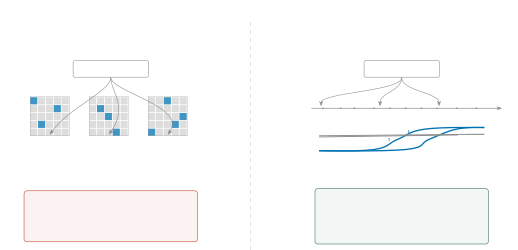

# AGORA: Reliability-Aware Aggregation of LLM Judges on Small Evaluation Sets

Junhyung Ahn Affiliation: School of Information Sciences
Affiliation: University of Illinois Urbana-Champaign
Email: [ja86@illinois.edu](mailto:)

###### Abstract

LLM-as-a-judge is a common substitute for costly human evaluation, and
aggregating several judges is the standard remedy for any single judge’s
bias. Judge pools mix judges of very different reliability, while the
human-labeled sets that validate them hold a few hundred items or fewer.
In this regime the per-item mean weights weak judges as heavily as
strong ones, and confusion-table models such as Dawid–Skene must
estimate a per-judge error table from too few items. We propose AGORA
(Aggregation Of Reliability-weighted Assessments), an
item-response-theory aggregator that places every item on one latent
quality scale and describes each judge by a sensitivity parameter and
ordered rating thresholds, so judge reliability is learned from all
items jointly and without human labels. Across three benchmarks, AGORA
matches or exceeds Dawid–Skene on large evaluation sets, and its
advantage widens as the set shrinks toward a few hundred items. It
remains accurate as pools grow more uneven, a label-free dispersion
statistic indicates in advance when trust weighting helps, and its
learned trust weights track per-judge human validity. Code is available
at
[https://github.com/JunhyungAhn/llm-as-judge-irt](https://github.com/JunhyungAhn/llm-as-judge-irt).

## 1 Introduction

LLM judges have become a standard tool for evaluating generative systems
at scale Zheng et al. (2023); Liu et al. (2023); Verga et al. (2024).
Because individual judges show systematic biases, including length,
position, and self-preference effects Zheng et al. (2023); Wang et al.
(2024b), a common remedy is to score each item with several judges and
aggregate their scores. Aggregators range from simple averages to
reliability-aware annotation models: Dawid–Skene Dawid and Skene (1979)
estimates a per-judge error table over the rating categories, MACE Hovy
et al. (2013) a competence-and-spamming profile, and GLAD Whitehill
et al. (2009) continuous judge-ability and item-difficulty parameters.
All of them learn reliability from repeated judge–item overlap, so their
estimates depend on having enough shared items.

This requirement is strained in LLM-judge meta-evaluation. Human
reference sets are costly and small: MT-Bench scores 80 prompts Zheng
et al. (2023), Topical-Chat 360 dialogues Mehri and Eskenazi (2020), and
SummEval 1,600 summaries Fabbri et al. (2021). Because judge validity
changes with the systems scored Bhandari et al. (2020), the rating range
Peyrard (2019), and the task or quality dimension Bavaresco et al.
(2025); Nimah et al. (2023), each new setting needs a fresh reference
set of a few hundred items, where meta-evaluation correlations are
already uncertain Card et al. (2020); Deutsch et al. (2021).

Pool composition compounds the problem. Judge reliability varies sharply
across models Bavaresco et al. (2025), and ensembles routinely combine
models of unequal strength Verga et al. (2024); Wang et al. (2024a), so
pools are heterogeneous.¹¹ 1 Heterogeneity is measurable before any
human labels are collected: §5.3 defines a label-free dispersion
statistic and shows that AGORA’s gain grows with it. The per-item mean
gives every judge equal weight, so lower-reliability judges shift the
aggregate as much as reliable ones. Confusion-table models fail
differently: with a $`K`$-point rating scale each judge carries
$`K^{2}`$ error-table cells, so a few hundred items leave most cells
sparse and determined by the prior. MACE and GLAD use fewer parameters
but treat ratings as unordered classes and do not model how each judge
uses an ordinal scale. An aggregator for this regime should learn which
judges to trust without spending scarce observations on a per-judge
error table.

We propose AGORA: Aggregation Of Reliability-weighted Assessments via
Item-Response Theory. From the judge-score matrix (Figure 1), AGORA fits
a graded-response model, the item-response-theory model for ordinal
ratings Samejima (1969), with one latent quality per item, one
discrimination per judge, and ordered thresholds that capture each
judge’s use of the rating scale. The discrimination acts as a
reliability weight: judges whose scores track latent quality steeply
receive more influence, and a regularized-horseshoe prior shrinks
uninformative judges toward zero. Each judge costs $`K`$ parameters
rather than $`K^{2}`$ cells, and every parameter is informed by all
items, so trust estimation remains stable on small sets. Prior work uses
item response theory to _diagnose_ LLM judges Choi et al. (2026); AGORA
uses it to _aggregate_ them. Our contributions are as follows:

1.  1.  We propose AGORA, a graded-response aggregator that learns per-judge
        reliability weights under a sparsity prior and models judge-specific
        scale use with $`K`$ parameters per judge (§3).
2.  2.  We show that AGORA matches or exceeds the strongest baselines on
        large evaluation sets and that its advantage over Dawid–Skene grows
        as the set shrinks, exceeding it on $`98`$–$`100\%`$ of $`60`$
        random five-judge pools with 50 items (§5.1–§5.3).
3.  3.  We introduce agreement dispersion, a label-free statistic of the
        score matrix that tracks AGORA’s gain over the per-item mean
        (Spearman $`+0.73`$ and $`+0.61`$) and so indicates, before any
        human labels are collected, when trust weighting helps (§5.3).
4.  4.  We show that the learned discriminations track per-judge human
        validity, giving a label-free judge diagnostic (§7).

## 2 Related Work

#### Aggregating LLM judges.

Most LLM-judge ensembles average or majority-vote their members Verga
et al. (2024); Wang et al. (2024a), and some weight judges by a learned
or heuristic reliability score Guha et al. (2024). Qian et al. (2026)
fit a Bradley–Terry model with a per-judge discrimination over pairwise
comparisons, SkillAggregation (Sun et al., 2025) trains a neural context
encoder over binary judge probabilities, CARE decomposes the score
matrix into confounder-aware sparse and low-rank parts Zhao et al.
(2026), and Balasubramanian et al. (2026) model pairwise judge
dependence with Ising models. AGORA instead takes the latent-trait route
on absolute ordinal scores: one continuous quality per item and a
trust-weighted read-out over per-judge discriminations.

Figure 1: AGORA on an illustrative pool of three judges rating five
items on a 0–4 scale. (1) The input is the judge-score matrix alone.
(2) From all items jointly, AGORA fits a graded-response model per
judge, drawn as its expected rating against latent quality $`\theta`$.
The thresholds $`\beta_{j}`$ encode severity (B is lenient, A severe),
and the discrimination $`\alpha_{j}`$ encodes trust (bars:
$`\alpha_{j}^{2}`$); the horseshoe prior shrinks the flat judge C’s
trust toward zero. (3) For each item, every rating places $`\theta`$ in
that judge’s threshold interval, with influence set by the judge’s
trust. The posterior concentrates where A and B agree, so the EAP
estimate $`\hat{\theta}_{3}`$ ignores C’s outlying 0 (circled).
(4) $`\hat{\theta}_{i}`$ is mapped back to the rating scale. Against a
human reference used only for evaluation, the AGORA scores reproduce the
human ranking (Spearman $`\rho=1.00`$), whereas the per-item mean,
shifted by C’s outliers, reaches $`\rho=0.70`$. Judge parameters and the
human reference are illustrative; all other quantities are computed from
them.

#### Annotation Models.

Dawid–Skene, MACE, and related Bayesian annotation models Dawid and
Skene (1979); Hovy et al. (2013); Paun et al. (2018); Demartini et al.
(2012) were developed for large crowdsourcing corpora, and GLAD
Whitehill et al. (2009) replaces the confusion table with a latent
ability–difficulty model but still relies on item redundancy. These
models tie on balanced pools of comparably reliable annotators Paun
et al. (2018) and need much redundancy to estimate reliability stably
Zheng et al. (2017). We make the complementary point on the _item_ axis:
when items are few, the confusion-table parameterization fragments the
data and loses its margin over a flat mean (§5.2), whereas a
latent-trait parameterization retains it.

#### Item Response Theory.

Item response theory (IRT) jointly scores items and raters, and its
graded-response model (GRM) handles ordinal ratings Lord (1980);
Samejima (1969); Rasch (1960). Closest to our work, Choi et al. (2026)
apply IRT to _diagnose_ LLM-judge reliability. AGORA instead
_aggregates_ judges with a discrimination-weighted read-out under a
regularized-horseshoe prior Carvalho et al. (2010); Piironen and Vehtari
(2017), estimated via the augmentation of Makalic and Schmidt (2016),
and adds a score-only diagnostic of _when_ reliability weighting helps
(§5.3).

## 3 The AGORA Aggregator

AGORA treats LLM-judge aggregation as latent-trait estimation. Each
evaluated item $`i`$ has a latent quality $`\theta_{i}`$, and each judge
$`j`$ has a discrimination $`\alpha_{j}`$, measuring how sharply its
scores change with latent quality, and ordered thresholds
$`\beta_{j,k}`$ over rating categories $`k`$, capturing scale use such
as leniency or range compression. A judge with large $`\alpha_{j}`$ is
informative about $`\theta_{i}`$, a judge with near-zero $`\alpha_{j}`$
has little influence, and the thresholds let identical raw scores map to
different latent qualities across judges. The model has four parts: the
graded-response likelihood (§3.1), the discrimination prior (§3.2), an
expectation-maximization (EM) procedure for maximum-a-posteriori
estimation (§3.3), and a posterior read-out that maps each item’s latent
quality to one score (§3.4). All quantities are fit per dimension from
the judge-score matrix (Algorithm 1).

### 3.1 Latent-trait model

The latent-trait model ties judges through a shared latent quality for
each item and models each judge’s ordinal response as a function of that
quality. Let item $`i=1,\ldots,N`$ be scored by judge $`j=1,\ldots,J`$,
producing an ordinal label $`Y_{ij}\in\{0,\ldots,K_{j}-1\}`$ on a
$`K_{j}`$-point scale.²² 2 We allow $`K_{j}`$ to vary across judges or
dimensions, covering benchmarks with dimension-specific rating scales.
For notational simplicity we write $`K`$ in the per-dimension model
below, where the scale is fixed within a fitted dimension; across
dimensions $`K`$ should be read as $`K_{j}`$. AGORA assigns each item a
latent quality $`\theta_{i}`$ and models judge $`j`$ with Samejima’s
graded-response model Samejima (1969):

```math
P(Y_{ij}\geq k\mid\theta_{i})=\sigma\big(\alpha_{j}\theta_{i}-\beta_{j,k}\big), \tag{1}
```

for $`k=1,\ldots,K-1`$, where $`\sigma`$ is the logistic function and
the thresholds satisfy $`\beta_{j,1}<\cdots<\beta_{j,K-1}`$.

The category probabilities are successive differences of the cumulative
curves:

```math
\begin{split}P(Y_{ij}=k\mid\theta_{i})&=\sigma(\alpha_{j}\theta_{i}-\beta_{j,k})\\
&\quad-\sigma(\alpha_{j}\theta_{i}-\beta_{j,k+1}),\end{split} \tag{2}
```

with $`\beta_{j,0}=-\infty`$ and $`\beta_{j,K}=+\infty`$. These
probabilities define the likelihood used for estimation and the
posterior read-out in §3.4.

We use the standard IRT normalization $`\theta_{i}\sim\mathcal{N}(0,1)`$
to fix location and scale, and constrain $`\alpha_{j}>0`$ to avoid
per-judge sign flips. With every $`\alpha_{j}>0`$, a higher latent
quality raises every judge’s expected rating, so the latent scale has a
fixed orientation. This compact parameterization contrasts with a
per-judge confusion table: each judge has $`K`$ GRM parameters (one
discrimination and $`K-1`$ thresholds) rather than $`K^{2}`$ cell
probabilities. We return to this parameterization difference in §5.2 and
App. D.

### 3.2 The discrimination prior

The discriminations $`\alpha_{j}`$ determine how strongly each judge can
influence the read-out, so the prior on them controls how aggressively
weak or uninformative judges are shrunk. We use a regularized horseshoe
prior Carvalho et al. (2010); Piironen and Vehtari (2017), with global
and local scales estimated from the score matrix rather than fixed judge
weights:

```math
\displaystyle\alpha_{j}\mid\lambda_{j},\tau \displaystyle\sim\mathcal{N}_{+}\!\big(0,\ \tau^{2}\,\tilde{\lambda}_{j}^{2}\big), \displaystyle\tilde{\lambda}_{j}^{2} \displaystyle=\frac{c^{2}\lambda_{j}^{2}}{c^{2}+\tau^{2}\lambda_{j}^{2}}, \tag{3}
```

```math
\displaystyle\lambda_{j} \displaystyle\sim\mathcal{C}^{+}(0,1), \displaystyle\tau \displaystyle\sim\mathcal{C}^{+}(0,1),
```

where $`\mathcal{N}_{+}`$ enforces $`\alpha_{j}>0`$ and
$`\mathcal{C}^{+}(0,1)`$ denotes a standard half-Cauchy distribution on
the positive reals. The global scale $`\tau`$ controls the overall
shrinkage of discriminations, the local scales $`\lambda_{j}`$ let
individual judges retain large values when supported by the likelihood,
and the slab scale $`c`$ caps the effective prior variance to prevent
extremely large discriminations. Together, these components induce
sparsity over judge discriminations, shrinking uninformative judges
toward low trust while allowing informative judges to remain
influential. This shape suits LLM-judge pools, which mix informative and
near-uninformative judges: a log-normal prior, common in Bayesian IRT,
places little mass near zero and pulls discriminations toward one
typical value, whereas the horseshoe shrinks only the uninformative ones
Carvalho et al. (2010); Piironen and Vehtari (2017). We compare this
prior against an unpenalized fit in §6.

### 3.3 Estimation

Given the likelihood and prior, we estimate item qualities and judge
parameters jointly with an EM procedure for maximum-a-posteriori
estimation. In the E-step, we compute the posterior distribution
$`q_{i}(\theta)=P(\theta_{i}=\theta\mid Y_{i,:})`$ on a fixed grid
$`\mathcal{G}`$ for each item. In the M-step, each judge’s
discrimination and thresholds are updated by minimizing the
posterior-expected penalized negative log-likelihood

```math
-\sum_{i}\mathbb{E}_{q_{i}(\theta)}\left[\log P(Y_{ij}\mid\theta;\alpha_{j},\beta_{j})\right]+\frac{1}{2}\frac{\alpha_{j}^{2}}{\tau^{2}\tilde{\lambda}_{j}^{2}}, \tag{4}
```

over $`\alpha_{j}`$ and the ordered thresholds $`\beta_{j}`$. The
penalty is the Gaussian term induced by the horseshoe prior in Eq. (3).
We update the horseshoe scales at their conditional modes using the
inverse-gamma augmentation of Makalic and Schmidt (2016); details are in
App. A.

### 3.4 Aggregate read-out

The read-out converts the fitted model and an item’s judge scores into a
single latent-quality estimate. We use the posterior mean, or expected a
posteriori (EAP) estimate, computed on the grid $`\mathcal{G}`$:

```math
\hat{\theta}_{i}=\mathbb{E}[\theta_{i}\mid Y_{i,:}]=\frac{\sum_{\theta\in\mathcal{G}}\theta\,\pi(\theta)\prod_{j}P(Y_{ij}\mid\theta)}{\sum_{\theta\in\mathcal{G}}\pi(\theta)\prod_{j}P(Y_{ij}\mid\theta)}, \tag{5}
```

where $`\pi(\theta)`$ is the standard-normal prior discretized on
$`\mathcal{G}`$ and the probabilities use the fitted judge parameters
from §3.3. We use the posterior mean rather than the posterior mode
because it is more stable when item posteriors are diffuse.

The role of the discriminations is visible in a standard
Fisher-information linearization of the EAP. Let $`\tilde{Y}_{ij}`$
denote judge $`j`$’s observed category re-expressed on the latent scale
by inverting its fitted thresholds. Then, locally,

```math
\hat{\theta}_{i}\approx\frac{\sum_{j}w_{ij}\,\tilde{Y}_{ij}}{\sum_{j}w_{ij}},\qquad w_{ij}=\alpha_{j}^{2}\,v_{ij}(\hat{\theta}_{i}). \tag{6}
```

The weight $`w_{ij}`$ is the graded-response Fisher information that
judge $`j`$ contributes at item $`i`$ (App. A). Its global factor
$`\alpha_{j}^{2}`$ makes the read-out judge-weighted, and its item-level
factor $`v_{ij}`$, which measures how informative judge $`j`$’s response
curve is near $`\hat{\theta}_{i}`$, makes it item-sensitive: the same
judge receives different effective weights on different items. All AGORA
results are computed from the exact EAP (Eq. (5)); the
$`\alpha_{j}^{2}`$-weighted average (Eq. (6)) is its first-order
interpretation, not a separate estimator.

#### Mapping to the rating scale.

The EAP estimate $`\hat{\theta}_{i}`$ is a latent coordinate, not a
benchmark score. We therefore convert it to the benchmark’s rating scale
using the fitted model’s expected score, i.e., the multi-judge test
characteristic curve Lord (1980); Samejima (1969):

```math
\hat{s}_{i}=\frac{1}{J}\sum_{j=1}^{J}\sum_{k=0}^{K-1}k\,P(Y_{ij}=k\mid\hat{\theta}_{i}), \tag{7}
```

where the category probabilities come from the fitted GRM in Eq. (2).
This mapped score $`\hat{s}_{i}`$ is the reported aggregate and the
value compared with the human reference. Because the map is monotone in
$`\hat{\theta}_{i}`$, $`\hat{s}_{i}`$ preserves the item ranking induced
by the latent quality; we assess it by rank correlation with the human
reference, the standard meta-evaluation target.

1: score matrix $`Y\!\in\!\{0,\dots,K{-}1\}^{N\times J}`$

2: per-item scores $`\hat{s}\!\in\!\mathbb{R}^{N}`$ on the internal
ordinal scale $`[0,K{-}1]`$

3: warm-start $`(\alpha,\beta)`$ from an unpenalized GRM

4: for $`t=1`$ to $`T`$ do

5:   E-step: grid posterior
$`q_{i}(\theta)\!\propto\!\pi(\theta)\prod_{j}P(Y_{ij}\!\mid\!\theta)`$
per item

6:   M-step: per judge $`j`$, minimize Eq. (4) over $`\alpha_{j}`$,
ordered $`\beta_{j}`$

7:   Scale update: refresh horseshoe scales $`\tau,\lambda`$ (App. A)

8: end for

9: $`\hat{\theta}_{i}\leftarrow`$ EAP estimate, Eq. (5)

10: $`\hat{s}_{i}\leftarrow`$ expected-score map, Eq. (7)

11: return per-item scores $`\hat{s}`$ (with trust $`\alpha`$,
thresholds $`\beta`$)

Algorithm 1 AGORA

|              | SummEval |            | Topical-Chat |            | WMT22 |            |
| ------------ | -------- | ---------- | ------------ | ---------- | ----- | ---------- |
| Method       | full     | $`N{=}50`$ | full         | $`N{=}50`$ | full  | $`N{=}50`$ |
| Mean         | 0.521    | 0.526      | 0.672        | 0.668      | 0.416 | 0.402      |
| Median       | 0.523    | 0.529      | 0.643        | 0.643      | 0.406 | 0.402      |
| Trimmed Mean | 0.538    | 0.545      | 0.674        | 0.672      | 0.418 | 0.400      |
| Dawid–Skene  | 0.555    | 0.529      | 0.695        | 0.678      | 0.423 | 0.399      |
| CARE         | 0.544    | 0.534      | 0.688        | 0.662      | 0.418 | 0.405      |
| GLAD         | 0.545    | 0.543      | 0.685        | 0.680      | 0.419 | 0.405      |
| MACE         | 0.533    | 0.546      | 0.690        | 0.682      | 0.418 | 0.404      |
| AGORA        | 0.556    | 0.550      | 0.705        | 0.696      | 0.426 | 0.409      |

Table 1: Main results on the primary five-judge pool. Dimension-averaged
Spearman $`\rho`$ against human references. _full_: the full evaluation
set (SummEval $`N{=}1{,}600`$, Topical-Chat $`N{=}360`$, WMT22
$`N{=}19{,}725`$). $`N{=}50`$: mean over 50 random item subsets of 50
items, shared by all methods (paired tests in §5.1). Bold: best point
estimate in each column.

## 4 Experimental Setup

We evaluate on three meta-evaluation benchmarks with human ratings.
SummEval Fabbri et al. (2021) contains $`1{,}600`$ news summaries rated
by three experts on four dimensions (coherence, consistency, fluency,
relevance) on a 1–5 scale. Topical-Chat Mehri and Eskenazi (2020)
contains $`360`$ dialogue responses rated by three annotators on six
dimensions with 2-, 3-, and 5-point scales. WMT22 en–de Freitag et al.
(2022) contains $`19{,}725`$ translated segments with professional MQM
quality scores. SummEval and Topical-Chat are the small human-referenced
sets that motivate our setting, while WMT22 tests AGORA on a large
evaluation set.

Each judge is a single model evaluated with a fixed prompt, drawn from a
14-model candidate pool spanning proprietary frontier and open-weight
model families (App. B.1). Our primary pool has five judges and is
heterogeneous by construction: one proprietary frontier judge
(claude-sonnet-4-6) and four open-weight judges from distinct model
families (Llama-4-Scout, DeepSeek-R1, GLM-4.7-Flash, Nemotron-120B). The
pool was fixed by model name before fitting any aggregation method,
without consulting benchmark-specific human references, and is held
constant across datasets and methods. We test generality beyond this
pool on random five-judge pools drawn from the candidate pool: $`30`$
pools on all three benchmarks across evaluation-set sizes, and $`60`$
further pools on SummEval and Topical-Chat (§5.3).

We report Spearman $`\rho`$ against the human reference, averaged across
dimensions on multidimensional benchmarks. For each evaluation-set size
$`N`$ below the full sample, every method is re-fit on the same $`50`$
random item subsets, and we report the mean over subsets. Small-sample
contrasts use a paired bootstrap over per-subset differences, and
full-sample contrasts use an item-level paired bootstrap ($`n{=}1000`$).
We compare against the per-item mean, median, trimmed mean (discarding
the highest- and lowest-scoring judge per item), Dawid–Skene, MACE,
GLAD, and CARE, a confounder-aware low-rank aggregator; implementation
details are in App. B.3.

## 5 Results

### 5.1 Main Results

AGORA has the highest point estimate in every column of Table 1, on the
full sample and at $`N{=}50`$, the smallest size of the subsampling
ladder in §5.2. At full $`N`$ it matches Dawid–Skene on SummEval (0.556
vs. 0.555), exceeds it on Topical-Chat (0.705 vs. 0.695) and WMT22
(0.426 vs. 0.423), and improves on the per-item mean by $`+0.035`$,
$`+0.033`$, and $`+0.010`$. It also exceeds MACE, GLAD, and CARE at both
sizes on every benchmark (full-$`N`$ margins $`+0.007`$ to $`+0.023`$);
the item-level bootstrap confirms these separations at full $`N`$, and
the paired subset bootstrap confirms the $`N{=}50`$ gains on SummEval
and Topical-Chat.

### 5.2 Performance as Evaluation Sets Shrink

Figure 2: Data efficiency on the primary five-judge pool in the
small-sample regime ($`N\leq 400`$). Dimension-averaged gap to the
per-item mean,
$`\Delta\rho=\rho_{\mathrm{method}}-\rho_{\mathrm{Mean}}`$, as $`N`$
shrinks (larger $`N`$ on the left). AGORA is the top aggregator at every
size; Dawid–Skene loses margin as $`N`$ shrinks.

Figure 2 follows the small-sample regime from $`N{=}400`$ down to
$`N{=}50`$, where AGORA is the top aggregator at every size on all three
benchmarks. Dawid–Skene’s per-judge confusion tables receive less
evidence as $`N`$ shrinks: on SummEval it moves from parity with AGORA
at full $`N`$ (Table 1) to a $`0.021`$ deficit at $`N{=}50`$, and on
WMT22 it falls below the per-item mean. Across the shared subsets, AGORA
exceeds the per-item mean on at least $`86\%`$ of subsets at every size
($`p<0.01`$ against chance) and Dawid–Skene on $`78`$–$`92\%`$.

### 5.3 AGORA Gains Grow with Pool Heterogeneity

Figure 3: Accuracy at $`N{=}50`$ as agreement dispersion $`\delta`$
increases, over random five- and seven-judge pools with $`0`$–$`8`$
uninformative judges (uniformly random ratings) added; points are means
within $`\delta`$ quintiles. AGORA remains stable while the per-item
mean and Dawid–Skene decline. Dashed line: $`\delta`$ of the primary
pool.

Trust weighting should help most when a pool’s judges agree unevenly. We
measure this with _agreement dispersion_,
$`\delta=\mathrm{std}_{j}(\bar{\rho}_{j})/\mathrm{mean}_{j}(\bar{\rho}_{j})`$,
where $`\bar{\rho}_{j}`$ is judge $`j`$’s mean rank correlation with the
other judges in the pool; larger $`\delta`$ means more uneven agreement.
Because $`\delta`$ uses only the score matrix, it is available before
any human labels are collected.

#### Random pools.

On $`30`$ random five-judge pools from the candidate pool (Table 2),
AGORA exceeds Dawid–Skene at $`N{=}50`$ in $`93\%`$, $`100\%`$, and
$`83\%`$ of pools on SummEval, Topical-Chat, and WMT22 (mean margins
$`+0.017`$, $`+0.015`$, $`+0.019`$), and stays at or above the per-item
mean at every size. On a second draw of $`60`$ pools at $`N{=}50`$, it
exceeds Dawid–Skene in $`98\%`$ and $`100\%`$ of pools on SummEval and
Topical-Chat.

| Dataset      | $`N`$ | Mean  | Dawid–Skene | AGORA |
| ------------ | ----- | ----- | ----------- | ----- |
| SummEval     | 50    | 0.510 | 0.501       | 0.518 |
|              | 100   | 0.545 | 0.546       | 0.555 |
|              | 200   | 0.542 | 0.545       | 0.547 |
| Topical-Chat | 50    | 0.715 | 0.703       | 0.718 |
|              | 100   | 0.697 | 0.699       | 0.703 |
|              | 200   | 0.703 | 0.708       | 0.709 |
| WMT22        | 50    | 0.442 | 0.423       | 0.442 |
|              | 100   | 0.402 | 0.393       | 0.403 |
|              | 200   | 0.428 | 0.427       | 0.429 |

Table 2: Thirty random five-judge pools: dimension-averaged Spearman
$`\rho`$, averaged over pools and over 15, 12, and 10 item subsets at
$`N{=}50`$, 100, and 200. AGORA has the highest average at every size.

#### Gain and dispersion.

On these $`60`$ pools, AGORA’s gain over the per-item mean grows with
$`\delta`$ (Spearman $`+0.73`$ on SummEval and $`+0.61`$ on
Topical-Chat; $`p<0.001`$), as does its gain over Dawid–Skene on
SummEval ($`+0.53`$, $`p<0.001`$). On pools at least as dispersed as the
primary pool ($`\delta\geq 0.29`$ on SummEval, $`\delta\geq 0.15`$ on
Topical-Chat; $`6`$ and $`15`$ pools), it exceeds the per-item mean in
$`100\%`$ and $`93\%`$ of cases. On balanced pools it recovers the
per-item mean as a limiting case at no accuracy cost: on the full
14-judge SummEval pool ($`\delta{=}0.21`$) it obtains $`0.577`$ against
the mean’s $`0.572`$ (App. B.2), as expected from the convergence of
annotation models on balanced data Paun et al. (2018).

#### Controlled dispersion sweep.

Adding $`0`$–$`8`$ uninformative judges with uniformly random ratings to
random five- and seven-judge pools extends $`\delta`$ from its natural
range (about $`0.3`$) to about $`1.1`$ (Figure 3). Across this range,
AGORA stays within $`0.543`$–$`0.562`$ on SummEval and
$`0.689`$–$`0.712`$ on Topical-Chat, while the per-item mean falls from
$`0.536`$ to $`0.436`$ and from $`0.703`$ to $`0.612`$, and Dawid–Skene
from $`0.533`$ to $`0.469`$ and from $`0.697`$ to $`0.671`$.

## 6 Ablations and Label-Free Baselines

#### Fitted trust weights drive the gain.

|                                      | SummEval |            | Topical-Chat |            |
| ------------------------------------ | -------- | ---------- | ------------ | ---------- |
| Read-out                             | full     | $`N{=}50`$ | full         | $`N{=}50`$ |
| R0: per-item mean                    | 0.521    | 0.526      | 0.672        | 0.668      |
| R1: latent, equal trust              | 0.533    | 0.540      | 0.672        | 0.684      |
| R2: latent, $`\alpha_{j}^{2}`$ trust | 0.556    | 0.550      | 0.705        | 0.696      |

Table 3: Read-out decomposition: the fit is held fixed and only the
trust vector changes. At full $`N`$ the fitted-discrimination read-out
(R2$`-`$R1) supplies most of the gain over the mean; at $`N{=}50`$ both
the latent read-out and the fitted trust contribute.

Holding the fitted model fixed, we vary only the read-out’s trust vector
(Table 3): the raw per-item mean (R0), the EAP under one pooled
discrimination shared by all judges (R1), and the exact EAP with fitted
per-judge discriminations (R2). At full $`N`$ the fitted weights supply
the gain (R1 to R2: $`+0.023`$ on SummEval, $`+0.033`$ on Topical-Chat);
at $`N{=}50`$ the latent parameterization itself adds $`+0.014`$ and
$`+0.016`$, consistent with §5.2.

#### The prior adds robustness at no clean-data cost.

Replacing the regularized horseshoe with an unpenalized (flat MLE) fit
(Table 4), the two match on clean pools ($`0.554`$ vs. $`0.551`$ on
SummEval, $`0.705`$ vs. $`0.697`$ on Topical-Chat). With $`m{=}2`$
injected adversarial judges, each mirroring an existing judge’s scores
around the rating midpoint, the horseshoe improves on the flat fit by
$`+0.008`$ and $`+0.017`$. Neither the prior nor the fixed estimation
settings are tuned on human labels (App. A).

|                     | clean (full $`N`$) |       | adversarial ($`m{=}2`$) |       |
| ------------------- | ------------------ | ----- | ----------------------- | ----- |
| prior on $`\alpha`$ | SE                 | TC    | SE                      | TC    |
| flat (MLE)          | 0.551              | 0.697 | 0.527                   | 0.663 |
| horseshoe           | 0.554              | 0.705 | 0.535                   | 0.680 |

Table 4: Discrimination-prior ablation ($`m`$: number of injected
adversarial judges). The regularized horseshoe matches the unpenalized
(flat MLE) fit on clean pools and improves on it under adversarial
corruption.

#### Learned weights outperform label-free heuristics.

AGORA exceeds weighted means based on mean inter-judge correlation,
inverse variance, and a spectral meta-learner (Table 5; $`0.556`$ vs.
the best heuristic’s $`0.550`$ on SummEval, $`0.705`$ vs. $`0.686`$ on
Topical-Chat).

#### Pools with the strongest judge.

AGORA also exceeds the label-free single-best judge and a drop-worst
average (App. E.1). When the strongest candidate judge, gemma-4-31B
(App. B.2), is added to the primary pool and every method is scored on
held-out items, AGORA exceeds the per-item mean and Dawid–Skene in all
eight benchmark-by-size settings (Table 6). On a pool of the five most
valid judges, it exceeds the best single judge at every size by
$`+0.015`$ to $`+0.046`$, and with gemma-4-31B in every random pool it
still exceeds Dawid–Skene at $`N{=}50`$ in $`97\%`$ and $`100\%`$ of
$`30`$ pools on SummEval and Topical-Chat.

|                     | Mean  | $`\bar{\rho}_{j}`$-wt. | inv-var | spectral | AGORA |
| ------------------- | ----- | ---------------------- | ------- | -------- | ----- |
| SummEval (full)     | 0.521 | 0.550                  | 0.541   | 0.548    | 0.556 |
| Topical-Chat (full) | 0.672 | 0.686                  | 0.674   | 0.683    | 0.705 |

Table 5: AGORA vs. label-free continuous reliability weightings
(Spearman $`\rho`$, primary pool, full $`N`$): mean-correlation
($`\bar{\rho}_{j}`$), inverse-variance, and a spectral meta-learner.
AGORA is best on both datasets.

|              |       |                          |       |       |            |       |
| ------------ | ----- | ------------------------ | ----- | ----- | ---------- | ----- |
|              |       | primary pool $`+`$ gemma |       |       | top-5 pool |       |
| Dataset      | $`N`$ | Mean                     | DS    | AGORA | gemma      | AGORA |
| SummEval     | 50    | 0.541                    | 0.549 | 0.569 | 0.572      | 0.588 |
|              | 200   | 0.543                    | 0.562 | 0.573 | 0.548      | 0.582 |
|              | full  | 0.552                    | 0.574 | 0.578 | 0.563      | 0.586 |
| Topical-Chat | 50    | 0.697                    | 0.701 | 0.717 | 0.708      | 0.750 |
|              | 200   | 0.705                    | 0.722 | 0.732 | 0.704      | 0.745 |
|              | full  | 0.696                    | 0.711 | 0.720 | 0.695      | 0.735 |
| WMT22        | 50    | 0.394                    | 0.399 | 0.401 | 0.383      | 0.428 |
|              | 200   | 0.427                    | 0.426 | 0.437 | 0.431      | 0.473 |

Table 6: Pools containing the strongest judge, gemma-4-31B, scored on
held-out items (75%; 10 and 5 item subsets at $`N{=}50`$ and 200). Left:
the primary pool plus gemma. Right: the five judges with the highest
human validity on a separate calibration quarter, against its best
member, gemma alone.

Figure 4: Trust weights track judge validity on the full 14-judge pool.
Each point is one judge on one dimension: post-hoc validity $`r_{j}`$
(Spearman with human labels) against the fitted trust weight
$`\alpha_{j}^{2}`$; $`\bar{\rho}_{s}`$ is their dimension-averaged
Spearman correlation.

## 7 Interpreting the Trust Weights

AGORA’s fitted trust weights $`\alpha_{j}^{2}`$ also serve as a
label-free diagnostic of judge quality. Compared with each judge’s
post-hoc Spearman correlation with human labels on the full 14-judge
pool (Figure 4), the dimension-averaged correlation is $`0.65`$ on
SummEval, $`0.82`$ on Topical-Chat, and $`0.66`$ on WMT22. Because
$`\alpha_{j}^{2}`$ is learned without human labels, it gives a practical
screen for judge quality before any annotation.

## 8 Conclusion

AGORA aggregates LLM judges of uneven reliability with a graded-response
latent-trait model whose discrimination-weighted read-out replaces
per-judge confusion tables. Its compact parameterization keeps
reliability estimation data-efficient where confusion tables fragment,
so its margin over Dawid–Skene widens as evaluation sets shrink. The
learned discriminations also serve as a label-free proxy for judge
validity, and the dispersion statistic $`\delta`$ signals when trust
weighting improves on the simple mean.

## Limitations

Our experiments cover three meta-evaluation benchmarks spanning
summarization, dialogue, and machine translation; further task families
and deployment settings are future work. AGORA targets absolute ordinal
ratings, the format of these benchmarks; pairwise preference data would
call for a Bradley–Terry-style likelihood, and joint modeling across
dimensions and dependence-aware likelihoods Zhao et al. (2026);
Balasubramanian et al. (2026) are natural extensions. AGORA is intended
for meta-evaluation of LLM judges, not as a replacement for human
judgment in high-stakes decisions.

## References

- Balasubramanian et al. (2026) Krishnakumar Balasubramanian, Aleksandr
  Podkopaev, and Shiva Prasad Kasiviswanathan. 2026. Dependence-aware
  label aggregation for LLM-as-a-judge via Ising models. _arXiv preprint
  arXiv:2601.22336_.
- Bavaresco et al. (2025) Anna Bavaresco, Raffaella Bernardi, Leonardo
  Bertolazzi, Desmond Elliott, Raquel Fernández, Albert Gatt, Esam
  Ghaleb, Mario Giulianelli, Michael Hanna, Alexander Koller, André
  F. T. Martins, Philipp Mondorf, Vera Neplenbroek, Sandro Pezzelle,
  Barbara Plank, David Schlangen, Alessandro Suglia, Aditya K Surikuchi,
  Ece Takmaz, and Alberto Testoni. 2025. Llms instead of human judges? a
  large scale empirical study across 20 nlp evaluation tasks. In
  _Proceedings of the 63rd Annual Meeting of the Association for
  Computational Linguistics (ACL), Short Papers_, pages 238–255.
- Bhandari et al. (2020) Manik Bhandari, Pranav Narayan Gour, Atabak
  Ashfaq, Pengfei Liu, and Graham Neubig. 2020. Re-evaluating evaluation
  in text summarization. In _Proceedings of the 2020 Conference on
  Empirical Methods in Natural Language Processing (EMNLP)_, pages
  9347–9359.
- Card et al. (2020) Dallas Card, Peter Henderson, Urvashi Khandelwal,
  Robin Jia, Kyle Mahowald, and Dan Jurafsky. 2020. With little power
  comes great responsibility. In _Proceedings of the 2020 Conference on
  Empirical Methods in Natural Language Processing (EMNLP)_, pages
  9263–9274.
- Carvalho et al. (2010) Carlos M Carvalho, Nicholas G Polson, and
  James G Scott. 2010. The horseshoe estimator for sparse signals.
  _Biometrika_, 97(2):465–480.
- Choi et al. (2026) Junhyuk Choi, Sohhyung Park, Chanhee Cho, Hyeonchu
  Park, and Bugeun Kim. 2026. Diagnosing the reliability of
  LLM-as-a-judge via item response theory. _arXiv preprint
  arXiv:2602.00521_.
- Dawid and Skene (1979) A. P. Dawid and A. M. Skene. 1979. Maximum
  likelihood estimation of observer error-rates using the EM algorithm.
  _Applied Statistics_, 28(1):20–28.
- Demartini et al. (2012) Gianluca Demartini, Djellel Eddine Difallah,
  and Philippe Cudré-Mauroux. 2012. ZenCrowd: Leveraging probabilistic
  reasoning and crowdsourcing techniques for large-scale entity linking.
  In _Proceedings of the 21st International Conference on World Wide Web
  (WWW)_, pages 469–478.
- Deutsch et al. (2021) Daniel Deutsch, Rotem Dror, and Dan Roth. 2021.
  A statistical analysis of summarization evaluation metrics using
  resampling methods. _Transactions of the Association for Computational
  Linguistics_, 9:1132–1146.
- Fabbri et al. (2021) Alexander R. Fabbri, Wojciech Kryściński, Bryan
  McCann, Caiming Xiong, Richard Socher, and Dragomir Radev. 2021.
  SummEval: Re-evaluating summarization evaluation. _Transactions of the
  Association for Computational Linguistics_, 9:391–409.
- Freitag et al. (2022) Markus Freitag, Ricardo Rei, Nitika Mathur,
  Chi-kiu Lo, Craig Stewart, Eleftherios Avramidis, Tom Kocmi, George
  Foster, Alon Lavie, and André F. T. Martins. 2022. Results of WMT22
  metrics shared task: Stop using BLEU – neural metrics are better and
  more robust. In _Proceedings of the Seventh Conference on Machine
  Translation (WMT)_, pages 46–68.
- Guha et al. (2024) Neel Guha, Mayee F. Chen, Trevor Chow, Ishan S.
  Khare, and Christopher Ré. 2024. Smoothie: Label free language model
  routing. In _Advances in Neural Information Processing Systems
  (NeurIPS)_.
- Hovy et al. (2013) Dirk Hovy, Taylor Berg-Kirkpatrick, Ashish Vaswani,
  and Eduard Hovy. 2013. Learning whom to trust with MACE. In
  _Proceedings of NAACL-HLT_, pages 1120–1130.
- Liu et al. (2023) Yang Liu, Dan Iter, Yichong Xu, Shuohang Wang,
  Ruochen Xu, and Chenguang Zhu. 2023. G-EVAL: NLG evaluation using
  GPT-4 with better human alignment. In _Proceedings of the 2023
  Conference on Empirical Methods in Natural Language Processing
  (EMNLP)_, pages 2511–2522.
- Lord (1980) Frederic M. Lord. 1980. _Applications of Item Response
  Theory to Practical Testing Problems_. Lawrence Erlbaum.
- Makalic and Schmidt (2016) Enes Makalic and Daniel F Schmidt. 2016. A
  simple sampler for the horseshoe estimator. _IEEE Signal Processing
  Letters_, 23(1):179–182.
- Mehri and Eskenazi (2020) Shikib Mehri and Maxine Eskenazi. 2020. USR:
  An unsupervised and reference free evaluation metric for dialog
  generation. In _Proceedings of the 58th Annual Meeting of the
  Association for Computational Linguistics (ACL)_, pages 681–707.
- Nimah et al. (2023) Iftitahu Nimah, Meng Fang, Vlado Menkovski, and
  Mykola Pechenizkiy. 2023. Nlg evaluation metrics beyond correlation
  analysis: An empirical metric preference checklist. In _Proceedings of
  the 61st Annual Meeting of the Association for Computational
  Linguistics (ACL)_, pages 1240–1266.
- Paun et al. (2018) Silviu Paun, Bob Carpenter, Jon Chamberlain, Dirk
  Hovy, Udo Kruschwitz, and Massimo Poesio. 2018. Comparing Bayesian
  models of annotation. _Transactions of the Association for
  Computational Linguistics_, 6:571–585.
- Peyrard (2019) Maxime Peyrard. 2019. Studying summarization evaluation
  metrics in the appropriate scoring range. In _Proceedings of the 57th
  Annual Meeting of the Association for Computational Linguistics
  (ACL)_, pages 5093–5100.
- Piironen and Vehtari (2017) Juho Piironen and Aki Vehtari. 2017.
  Sparsity information and regularization in the horseshoe and other
  shrinkage priors. _Electronic Journal of Statistics_, 11(2):5018–5051.
- Qian et al. (2026) Mengjie Qian, Guangzhi Sun, Mark J. F. Gales, and
  Kate M. Knill. 2026. Who can we trust? LLM-as-a-jury for comparative
  assessment. _arXiv preprint arXiv:2602.16610_.
- Rasch (1960) Georg Rasch. 1960. _Probabilistic Models for Some
  Intelligence and Attainment Tests_. Danmarks Paedagogiske Institut,
  Copenhagen.
- Samejima (1969) Fumiko Samejima. 1969. Estimation of latent ability
  using a response pattern of graded scores. _Psychometrika Monograph
  Supplement_, (17).
- Sun et al. (2025) Guangzhi Sun, Anmol Kagrecha, Potsawee Manakul, Phil
  Woodland, and Mark Gales. 2025. SkillAggregation: Reference-free
  LLM-dependent aggregation. In _Proceedings of the 63rd Annual Meeting
  of the Association for Computational Linguistics (ACL)_.
- Verga et al. (2024) Pat Verga, Sebastian Hofstatter, Sophia Althammer,
  Yixuan Su, Aleksandra Piktus, Arkady Arkhangorodsky, Minjie Xu, Naomi
  White, and Patrick Lewis. 2024. Replacing judges with juries:
  Evaluating LLM generations with a panel of diverse models. _arXiv
  preprint arXiv:2404.18796_.
- Wang et al. (2024a) Junlin Wang, Jue Wang, Ben Athiwaratkun, Ce Zhang,
  and James Zou. 2024a. Mixture-of-agents enhances large language model
  capabilities. _arXiv preprint arXiv:2406.04692_.
- Wang et al. (2024b) Peiyi Wang, Lei Li, Liang Chen, Zefan Cai, Dawei
  Zhu, Binghuai Lin, Yunbo Cao, Lingpeng Kong, Qi Liu, Tianyu Liu, and
  Zhifang Sui. 2024b. Large language models are not fair evaluators. In
  _Proceedings of the 62nd Annual Meeting of the Association for
  Computational Linguistics (ACL)_, pages 9440–9450.
- Whitehill et al. (2009) Jacob Whitehill, Paul Ruvolo, Ting-fan Wu,
  Jacob Bergsma, and Javier Movellan. 2009. Whose vote should count
  more: Optimal integration of labels from labelers of unknown
  expertise. In _Advances in Neural Information Processing Systems
  (NeurIPS)_.
- Zhao et al. (2026) Jitian Zhao, Changho Shin, Tzu-Heng Huang, Satya
  Sai Srinath Namburi GNVV, and Frederic Sala. 2026. CARE:
  Confounder-aware aggregation for reliable LLM evaluation. _arXiv
  preprint arXiv:2603.00039_.
- Zheng et al. (2023) Lianmin Zheng, Wei-Lin Chiang, Ying Sheng, Siyuan
  Zhuang, Zhanghao Wu, Yonghao Zhuang, Zi Lin, Zhuohan Li, Dacheng Li,
  Eric P. Xing, Hao Zhang, Joseph E. Gonzalez, and Ion Stoica. 2023.
  Judging LLM-as-a-judge with MT-Bench and Chatbot Arena. In _Advances
  in Neural Information Processing Systems (NeurIPS)_.
- Zheng et al. (2017) Yudian Zheng, Guoliang Li, Yuanbing Li, Caihua
  Shan, and Reynold Cheng. 2017. Truth inference in crowdsourcing: Is
  the problem solved? _Proceedings of the VLDB Endowment_,
  10(5):541–552.

## Appendix A Estimation Details

We compute the maximum-a-posteriori estimate by EM, treating
$`\{\theta_{i}\}`$ as latent and
$`\{\alpha_{j},\beta_{j},\lambda_{j},\tau\}`$ as parameters
(Algorithm 1). Direct half-Cauchy MAP updates are awkward, so we use the
inverse-gamma augmentation of Makalic and Schmidt (2016), which writes
each half-Cauchy as a scale mixture with auxiliary variables
$`\nu_{j},\xi`$ and yields closed-form conditional modes for the local
and global scales. The E-step forms the posterior over $`\theta_{i}`$ on
a fixed grid $`\mathcal{G}`$ by combining the prior with the
likelihood (2) across judges and takes the posterior mean
$`\hat{\theta}_{i}`$. The M-step minimizes Eq. (4) over
$`\alpha_{j}\in[0.01,20]`$ and the ordered thresholds (parameterized
through a cumulative-softplus map), the penalty being exactly the
Gaussian induced by the horseshoe (3). The scale update then refreshes
the scales at their conditional modes:

```math
\displaystyle\lambda_{j}^{2} \displaystyle\!\leftarrow\!\tfrac{1}{2}(\nu_{j}^{-1}\!+\!\alpha_{j}^{2}/2\tau^{2}), \displaystyle\nu_{j} \displaystyle\!\leftarrow\!\tfrac{1}{2}(1\!+\!\lambda_{j}^{-2}),
```

```math
\displaystyle\tau^{2} \displaystyle\!\leftarrow\!\frac{\xi^{-1}\!+\!\sum_{j}\alpha_{j}^{2}/2\lambda_{j}^{2}}{\tfrac{J+1}{2}\!+\!1}, \displaystyle\xi \displaystyle\!\leftarrow\!\tfrac{1}{2}(1\!+\!\tau^{-2}),
```

followed by the slab cap
$`\tilde{\lambda}_{j}^{2}\!\leftarrow\!c^{2}\lambda_{j}^{2}/(c^{2}\!+\!\tau^{2}\lambda_{j}^{2})`$.
We warm-start from a $`6`$-iteration unpenalized graded-response fit and
run $`T{=}12`$ iterations, fitting one model per dimension; the
auxiliaries are initialized to
$`\lambda_{j},\nu_{j},\tau,\xi\!\leftarrow\!1`$. The few fixed
quantities are held constant across all datasets: slab scale $`c{=}5`$,
the discrimination range $`\alpha_{j}\in[0.01,20]`$, a posterior grid
$`\mathcal{G}`$ of $`150`$ points on $`[-4.5,4.5]`$, and an L-BFGS-B
M-step. As a numerical safeguard, the implementation also checks that
$`\hat{\theta}`$ correlates positively with the per-item mean and flips
its sign otherwise.

#### Information factorization.

The read-out weight in Eq. (6) is the graded-response Fisher information

```math
I_{ij}(\theta)=\sum_{k}\frac{[P^{\prime}_{ijk}(\theta)]^{2}}{P_{ijk}(\theta)}=\alpha_{j}^{2}\,v_{ij}(\theta),
```

where $`P_{ijk}(\theta)\equiv P(Y_{ij}{=}k\mid\theta_{i}{=}\theta)`$ is
the category probability from Eq. (2), $`P^{\prime}_{ijk}`$ its
derivative in $`\theta`$, and $`v_{ij}(\theta)`$ the item-level
information factor.

#### Sensitivity.

These settings are not tuned. Varying each over a wide range, and
perturbing the warm-start initialization, leaves the full-$`N`$ accuracy
essentially unchanged (Table 7).

| Perturbation                | SE     | TC     | WMT    |
| --------------------------- | ------ | ------ | ------ |
| slab $`c\in\{3,8,12\}`$     | 0.0000 | 0.0001 | 0.0000 |
| grid $`\in\{100,200,250\}`$ | 0.0000 | 0.0000 | 0.0000 |
| EM iters $`\in\{8,16,20\}`$ | 0.0002 | 0.0000 | 0.0000 |
| warm-start (5 seeds)        | 0.0000 | 0.0000 | 0.0000 |

Table 7: Estimation sensitivity: the maximum change in full-$`N`$
Spearman $`\rho`$ when each fixed setting is varied from its default
($`c{=}5`$, grid $`150`$, $`T{=}12`$) and when the warm-start is
randomly perturbed. Base $`\rho`$ is $`0.556`$ (SummEval), $`0.705`$
(Topical-Chat), and $`0.426`$ (WMT22); every shift is at most
$`0.0002`$.

## Appendix B Judge Pool and Prompts

### B.1 Candidate Pool and Prompt Templates

We use a diverse set of instruction-tuned LLMs as judges. The 14-model
pool comprises three proprietary models (gpt-5, gemini-2.5-pro,
claude-sonnet-4-6) and eleven open-weight models (DeepSeek-V3,
DeepSeek-R1, Qwen3-Next-80B, Qwen2.5-72B, Llama-4-Scout, gpt-oss-120b,
Mixtral-8x22B, Phi-4, gemma-4-31B, GLM-4.7-Flash, Nemotron-120B),
spanning a wide range of size, architecture, and training data, a
heterogeneous pool of judges. For each dataset and evaluation dimension,
every judge scores a single item on the benchmark’s integer scale and
returns the score as JSON, decoded at temperature $`0`$. No human labels
are used to tune or calibrate the judges; human annotations are used
solely for evaluation. The prompts for the three datasets are shown
below.


{dimension}: coherence, consistency, fluency, relevance. The Source
Article line is included only for consistency and relevance.


{dimension}: the six USR dimensions (Understandable $`0`$–$`1`$;
Natural, Maintains Context, Engaging each $`1`$–$`3`$; Uses Knowledge
$`0`$–$`1`$; Overall $`1`$–$`5`$); {anchors} gives that scale’s endpoint
labels.


### B.2 Full-Pool Validity Diagnostics

Table 8 reports each judge’s Spearman $`\rho`$ with the human labels on
the full 14-judge pool (dimension-averaged), from which our primary pool
is drawn (its composition is given in §4). Validity is dispersed
($`0.40`$ to $`0.57`$ on SummEval). This full pool has lower agreement
dispersion than the primary pool on SummEval ($`\delta{=}0.21`$ vs.
$`0.29`$); here AGORA obtains $`0.577`$ against the per-item mean’s
$`0.572`$, matching the convergence of annotation models on balanced
pools (Paun et al., 2018).

|                   |          |              |       |
| ----------------- | -------- | ------------ | ----- |
| Judge             | SummEval | Topical-Chat | WMT22 |
| gpt-5             | 0.530    | 0.629        | 0.427 |
| gemini-2.5-pro    | 0.550    | 0.655        | 0.421 |
| claude-sonnet-4-6 | 0.531    | 0.700        | 0.417 |
| DeepSeek-V3       | 0.491    | 0.652        | 0.384 |
| Qwen3-Next-80B    | 0.495    | 0.567        | 0.358 |
| Llama-4-Scout     | 0.422    | 0.440        | 0.312 |
| DeepSeek-R1       | 0.445    | 0.492        | 0.358 |
| gpt-oss-120b      | 0.480    | 0.584        | 0.368 |
| Mixtral-8x22B     | 0.520    | 0.635        | 0.366 |
| Phi-4             | 0.464    | 0.550        | 0.331 |
| Qwen2.5-72B       | 0.439    | 0.603        | 0.337 |
| gemma-4-31B       | 0.566    | 0.704        | 0.432 |
| GLM-4.7-Flash     | 0.412    | 0.503        | 0.322 |
| Nemotron-120B     | 0.402    | 0.500        | 0.347 |

Table 8: Per-judge Spearman $`\rho`$ vs. human labels on the full pool
(dimension-averaged).

### B.3 Baseline Implementations

All baselines see the same judge-score matrix as AGORA and use no human
labels. The per-item mean and median average or take the median of the
raw scores across judges. The trimmed mean sorts each item’s judge
scores and discards a fraction $`\lfloor 0.2J\rfloor`$ from each end
before averaging; at $`J{=}5`$ this removes the single highest- and
lowest-scoring judge and averages the remaining three. Dawid–Skene,
MACE, and GLAD are the crowd-kit library implementations, run for $`10`$
EM iterations (MACE with one restart; GLAD with five inner M-step
iterations). Because these estimators are categorical, each integer
rating level is treated as a separate class; we recover a scalar per
item as the posterior expected rating $`\sum_{k}k\,P(Y{=}k)`$. This
categorical treatment discards the ordinal structure that AGORA’s
graded-response link uses. CARE (Zhao et al., 2026) is run at its
label-free library default (hyperparameter $`\gamma{=}1`$) with the SCS
conic solver, taking the score-weighted quality vector as output. Each
aggregator returns one scalar per item, standardized before the Spearman
comparison.

## Appendix C Additional Evaluation Results

### C.1 WMT22 under Field-Standard Metrics

We report Spearman $`\rho`$ throughout for comparability across
datasets, but machine-translation evaluation conventionally uses
segment-level Kendall $`\tau_{b}`$ and pairwise accuracy Freitag et al.
(2022). Table 9 recomputes the full-$`N`$ WMT22 results under all three:
AGORA ranks first on every metric, and the per-item mean is last on
pairwise accuracy, so the conclusion does not depend on the
rank-correlation protocol.

| Method      | Spearman $`\rho`$ | Kendall $`\tau_{b}`$ | pairwise acc. |
| ----------- | ----------------- | -------------------- | ------------- |
| Mean        | 0.416             | 0.3418               | 0.619         |
| GLAD        | 0.419             | 0.3362               | 0.644         |
| Dawid–Skene | 0.423             | 0.3396               | 0.645         |
| AGORA       | 0.426             | 0.3419               | 0.647         |

Table 9: WMT22 (full $`N`$) under three agreement metrics. AGORA ranks
first on all three; the per-item mean trails on pairwise accuracy.

## Appendix D Parameterization Diagnostic

Figure 5 contrasts the confusion-table and latent-trait
parameterizations on a small evaluation set, complementing the
small-$`N`$ analysis in §5.2. A $`K`$-category confusion matrix gives
each judge $`\mathcal{O}(K^{2})`$ parameters; for SummEval’s $`K{=}5`$
the five-judge pool carries 125, against AGORA’s 25. As $`N`$ shrinks
the confusion cells become sparse: 25% have fewer than five observations
at full $`N`$ but 86% at $`N{=}50`$, so many cells become
prior-dominated, making the high-dimensional estimate less
data-efficient, which is why Dawid–Skene loses its full-$`N`$ accuracy
on SummEval at small $`N`$ while AGORA retains its margin.



Figure 5: Two parameterizations on the same small evaluation set
($`N{=}50`$ items, $`J{=}5`$ judges, $`K{=}5`$). Left: confusion-matrix
aggregators give each judge a $`K\!\times\!K`$ error table; with few
items most cells are prior-dominated, so the estimate becomes less
data-efficient. Right: AGORA maps every item onto one latent quality
$`\theta`$ and summarizes each judge with a discrimination and ordered
thresholds, each informed by all $`N`$ items; the read-out then weights
each judge by $`\alpha_{j}^{2}`$, down-weighting unreliable ones.

## Appendix E Additional Analyses

### E.1 AGORA vs. Single-Best and Drop-Worst Baselines

We first test whether AGORA reduces to selecting the single best judge.
We compare AGORA against the label-free single-best judge, the judge
with the highest mean correlation to the rest of the pool, selected
without consulting human labels (Table 10). AGORA exceeds this
label-free single best at every size on all three datasets; on
Topical-Chat the margin even grows as $`N`$ shrinks, from $`+0.005`$ at
full $`N`$ to $`+0.039`$ at $`N{=}50`$. AGORA combines the pool rather
than collapsing onto one member.

| Dataset                   | Single best | AGORA |
| ------------------------- | ----------- | ----- |
| SummEval (full)           | 0.526       | 0.556 |
| SummEval ($`N{=}50`$)     | 0.514       | 0.550 |
| Topical-Chat (full)       | 0.700       | 0.705 |
| Topical-Chat ($`N{=}50`$) | 0.657       | 0.696 |
| WMT22 (full)              | 0.417       | 0.426 |
| WMT22 ($`N{=}50`$)        | 0.396       | 0.409 |

Table 10: AGORA vs. the label-free single-best judge (mean-correlation
argmax), Spearman $`\rho`$ on the primary pool under the same
50-subsample protocol. AGORA leads at every size on all three datasets;
on the multi-dimensional benchmarks the margin grows as $`N`$ shrinks.

#### Drop-worst baseline.

A second simple alternative is to drop the single worst judge and
average the rest. We form a label-free _drop-worst mean_ (remove the
judge with the lowest mean correlation to the pool, then take the
per-item mean of the others) and compare it to AGORA. AGORA exceeds the
drop-worst mean at every size on both multi-dimensional datasets, by up
to $`+0.016`$ on SummEval and $`+0.025`$ on Topical-Chat: the
trust-weighted read-out, which down-weights every judge continuously,
outperforms excluding one judge and trusting the rest equally.
