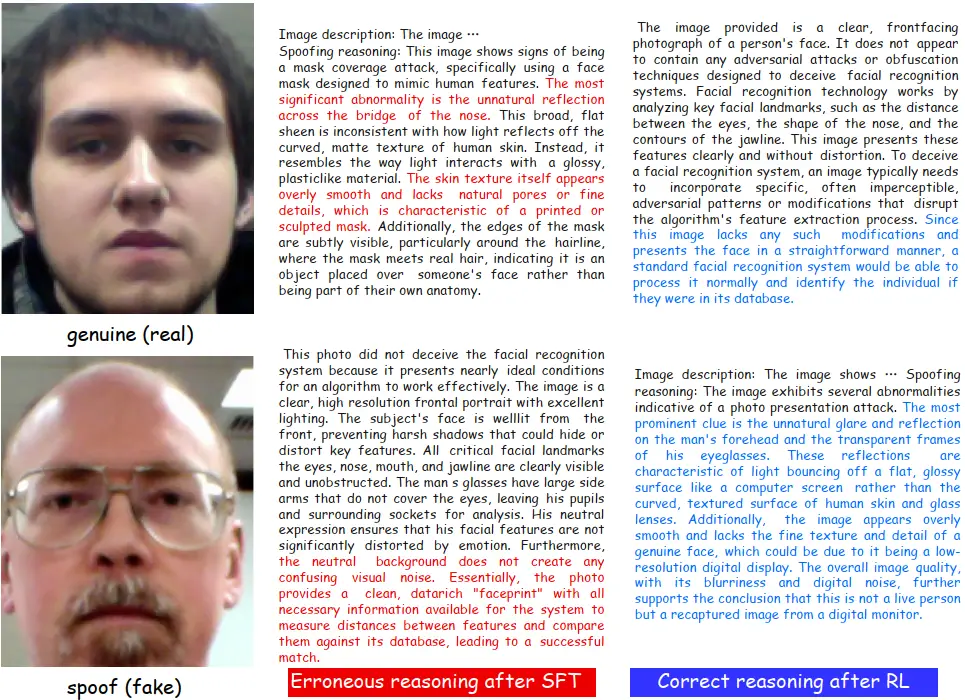
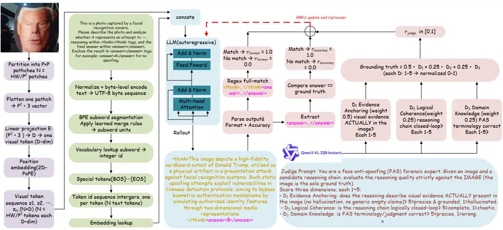
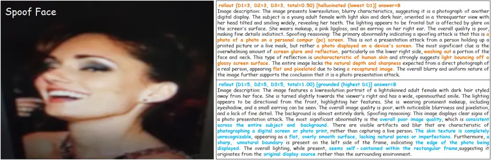

# Grounding-Aware Judge Reward Reinforcement Learning for Out-of-Domain Face Anti-Spoofing

Xiaoyong Yu    Xinge Yu

###### Abstract

Face Anti-Spoofing (FAS) must distinguish genuine faces from
presentation attacks. A unified Multimodal Large Language Model (MLLM)
is an attractive solution: it detects physical attacks (print, replay,
mask) in one model and produces interpretable forensic evidence via
Chain-of-Thought (CoT). A central obstacle to post-training such a model
with reinforcement learning is that FAS reasoning has no rule-verifiable
ground truth: only the binary verdict is checkable, while the reasoning
chain cannot be verified by any hand-crafted rule. Optimizing the
verdict alone is therefore a sparse, hackable signal. The model can
reach the correct answer through a shortcut such as a false-rejection
bias, which does not generalize. We address this with a grounding-aware
judge reward. A 32B vision-language judge scores each reasoning chain
against the image on evidence anchoring, logical coherence, and domain
knowledge, turning the image itself into the verification signal. The
reward is applied in a Group Relative Policy Optimization (GRPO) stage
after CoT supervised fine-tuning. It is the judge, rather than the RL
objective, that supplies the process supervision a verdict-only reward
cannot. Our study starts from a model that already performs well
In-Domain (ID) after CoT-based supervised fine-tuning and asks how to
improve its Out-of-Domain (OOD) generalization. We find that
grounding-aware rewards are an effective means to that end. We validate
the method on OOD generalization, where the reward reduces ACER on two
physical benchmarks (LCC-FASD 0.288 to 0.273, MSU-MFSD 0.431 to 0.409)
while preserving ID accuracy (CelebA-Spoof 0.033 to 0.035). Against
ResNet-50/101 and CLIP-ViT-B/16 baselines, the MLLM dominates ID and
matches or surpasses the strongest baseline OOD. To our knowledge this
is the first use of LLM-as-judge process supervision for FAS.

¹School of Electronic Information and Communications, Huazhong
University of Science and Technology, Wuhan, Hubei 430074, China  
²Mashang Consumer Finance Co., Ltd., Chongqing 400000, China  
^(\*)Corresponding author: youxg@mail.hust.edu.cn

Keywords: Face anti-spoofing, Multimodal large language model,
Reinforcement learning, LLM-as-a-judge, Out-of-domain generalization

## 1 Introduction

Face Anti-Spoofing (FAS) is the task of distinguishing genuine faces
from presentation attacks, and it serves as a critical first line of
defense for face recognition systems deployed in unconstrained
real-world settings. The attacks it must counter fall into two broad
classes: physical attacks, which re-present a real face to the camera
through a print, a replayed video, or a mask, and digital attacks, such
as deepfakes, which manipulate pixels directly; this paper focuses on
physical attacks. FAS is evaluated on dedicated benchmarks such as
CelebA-Spoof \[1\], LCC-FASD \[2\], and MSU-MFSD \[3\], and recent
surveys provide a comprehensive overview of the field \[4\]. The central
challenge is cross-domain generalization. Presentation artifacts are
inherently fine-grained: the cues that separate a bona fide face from an
attack, such as moiré patterns, specular highlights, printing texture,
and subtle depth discontinuities, are weak and easily confounded by
benign factors. These cues also vary substantially with the capture
device, the illumination conditions, and the specific attack instrument
used to fabricate the presentation. Consequently, a model that performs
well ID often degrades sharply on unseen attack domains, and closing
this generalization gap remains the principal obstacle to deploying FAS
reliably in practice.

MLLMs \[5, 6\] offer a unified FAS paradigm: a single model detects
attacks across types \[7, 8, 9\] and produces interpretable forensic
evidence in natural language. This paradigm has already shown concrete
promise. Face-CoT introduces the first large-scale Visual Question
Answering (VQA) dataset tailored for FAS, covering 14 spoofing attack
types with high-quality CoT annotations and demonstrates that MLLMs
trained with CoT-enhanced progressive learning outperform prior
state-of-the-art methods on multiple benchmarks. CoT supervision teaches
the model to verbalize the physical artifacts, e.g., a screen frame, a
moiré pattern, a specular reflection, and a paper texture, yielding
strong ID accuracy and an auditable reasoning path. However, supervised
fine-tuning alone does not explicitly optimize the reasoning process,
and it is not obvious how reinforcement learning should be applied when
the reasoning has no ground truth. More fundamentally, Supervised
Fine-Tuning (SFT) tends to induce visual hallucinations under
distribution shifts, which is precisely the failure mode that
cross-domain FAS cannot afford: the model may latch onto spurious
textual patterns that correlate with labels in the training domain
rather than learning to ground its verdict in the actual image evidence.
This risk is compounded by the intrinsic difficulty of the task itself:
as illustrated in Fig. 1, some attack samples are so subtle that even
the human eye struggles to tell them apart from genuine faces, leaving
the model with only faint, easily confounded cues to rely on.
Reinforcement learning offers a bidirectional reward-driven mechanism
with iterative error correction that can refine visual perception and
discourage such shortcut reliance. Nevertheless, applying RL to FAS
reasoning is impeded by a fundamental obstacle: because the reasoning
chain admits no rule-verifiable ground truth, a verdict-only reward is
inherently sparse and susceptible to reward hacking. It is this gap that
motivates a grounding-aware reward signal capable of supervising the
reasoning process itself.



Figure 1: Qualitative examples on genuine faces where CoT SFT falsely
rejects the face (hallucinating glare/reflection as a spoof cue) while
the grounding-aware RL model correctly grounds its verdict in the actual
image content.

Reinforcement Learning has transformed reasoning in math and code \[10,
11, 12\], where the answer is exactly verifiable and a verifiable reward
lets the model re-rank its reasoning paths toward correct ones. FAS does
not share this property: only the final binary verdict is checkable, and
the reasoning chain has no ground truth. This is the verification gap
that blocks RL post-training for FAS. Optimizing the verdict alone is a
sparse, hackable signal. The model can reach the correct answer through
a shortcut such as a false-rejection spoof bias, which does not
generalize to unseen domains. Our key observation is that, although FAS
reasoning has no rule-verifiable ground truth, it does have an
image-grounded one: a correct reasoning chain must describe evidence
that is actually present in the image. We turn this observation into a
reward. A vision-language judge scores each reasoning chain against the
image on evidence anchoring, logical coherence, and domain knowledge,
and this grounding-aware judge reward is applied in a GRPO stage after
SFT. Because physical artifacts are verbalizable and image-grounded, the
judge can verify whether the reasoning is anchored in the actual image.
A signal that hand-crafted rules cannot provide. The method is thus a
direct answer to the verification gap: where RLVR needs a rule, we
substitute a judge grounded in the image.

We validate the method on OOD generalization, which is the setting where
the difference between grounded and shortcut reasoning becomes
observable. The grounding-aware judge reward reduces OOD ACER on two
physical benchmarks while preserving ID accuracy. A full ablation
further isolates the judge reward as the ingredient that extends the
gain to the harder benchmark rather than the RL objective. We further
compare the MLLM against Convolutional Neural Network (CNN) and
Contrastive Language-Image Pre-training (CLIP) baselines and position
our method relative to recent rule-based RL-FAS approaches \[9, 13,
14\]. Our contributions are twofold. (ii) We validate the method on OOD
generalization against CNN and CLIP baselines and position it relative
to recent rule-based RL-FAS approaches. To our knowledge this is the
first use of LLM-as-judge process supervision for FAS. The remainder of
this paper is organized as follows. Section 2 reviews related work.
Section 3 presents the method. Section 4 reports the experiments and
ablations. Section 5 discusses the mechanism. Section 6 concludes.

## 2 Related Work

### 2.1 Face Anti-Spoofing and Cross-Domain Generalization

Classical FAS approaches learn a binary CNN classifier on
presentation-attack benchmarks, typically with auxiliary supervision
such as depth maps or remote Photoplethysmography (rPPG) signals \[2,
3\]. Data-centric analyses of deep FAS further show that the training
distribution strongly influences generalization behavior \[15\], and
multi-modal feature fusion has been explored as a way to enrich the
representation beyond Red-Green-Blue (RGB) appearance \[16\]. Because
presentation artifacts are fine-grained and domain-specific,
cross-domain generalization is the central challenge. A substantial body
of work addresses it through domain generalization, test-time
adaptation, and domain randomization \[17\]. Prompt-based CLIP
fine-tuning has recently emerged as a promising direction: by aligning
visual features with textual descriptions of spoofing artifacts. These
methods achieve stronger generalization than purely visual
classifiers \[18, 19\]. However, they remain discriminative models that
output a binary label without an explicit reasoning trace, which limits
their interpretability and makes their decisions difficult to audit in
security-sensitive deployments.

### 2.2 Multimodal Large Language Models for FAS

MLLMs have recently been applied to FAS to provide both classification
and natural-language explanations. Early work reformulates FAS as a VQA
task, where the model is prompted to describe spoofing cues before
emitting a verdict \[7\]. Subsequent methods extend this paradigm with
richer reasoning: FaceShield \[20\] introduces a large-scale instruction
dataset for explainable FAS. PA-FAS \[9\] augments reasoning paths and
shuffles answers to mitigate shortcut learning. FAS-R1 \[13\] applies
difficulty-aware GRPO to focus optimization on hard attacks.
TAR-FAS \[14\] equips the MLLM with external visual tools for
fine-grained forensic investigation. These works establish MLLMs as a
viable unified FAS paradigm, but their post-training rewards remain
either supervised (SFT-only) or rule-based (consistency checks, format
rewards). None verifies whether the reasoning is actually grounded in
the image, which is the gap our method fills.

### 2.3 Reinforcement Learning Post-Training and Process Rewards

Reinforcement Learning from Human Feedback (RLHF) and Reinforcement
Learning with Verifiable Rewards (RLVR) have become standard tools for
aligning language models \[10\]. GRPO \[12\] simplifies Proximal Policy
Optimization (PPO) by estimating advantages from group-normalized
rewards, eliminating the need for a value network, and has been widely
adopted for reasoning tasks. Group Sequence Policy Optimization
(GSPO) \[21\] further stabilizes training by operating at the sequence
level rather than the token level. A parallel line of work introduces
process rewards: rather than scoring only the final answer, a process
reward model scores intermediate reasoning steps \[11\].
LLM-as-judge \[22, 23\] has emerged as a scalable instantiation of this
idea, where a strong language model evaluates the quality of a
generation. Our grounding-aware judge is a domain-specific instance of
this paradigm: it does not score general quality, but specifically
whether the FAS reasoning is anchored in the image evidence, a dimension
that neither rule-based rewards nor generic judges can evaluate.

## 3 Method

### 3.1 Problem Formulation

Let $`\mathcal{D}=\{(I_{i},y_{i})\}_{i=1}^{N}`$ be a face anti-spoofing
dataset, where $`I_{i}`$ is a face image and
$`y_{i}\in\{\texttt{A},\texttt{B}\}`$ is the binary label. A multimodal
policy $`\pi_{\theta}`$ generates a reasoning chain
$`c=(c_{1},\dots,c_{T})`$ followed by a verdict
$`\hat{y}=f(c)\in\{\texttt{A},\texttt{B}\}`$. Physical attacks
re-present a real face to the camera. Their artifacts are macroscopic
and verbalizable: a screen frame, a moiré pattern, a specular
reflection, a paper texture, a mask boundary.

The standard supervised objective maximizes the likelihood of a
reference chain $`c^{\star}`$:

```math
\mathcal{L}_{\mathrm{SFT}}(\theta)=-\mathbb{E}_{(I,c^{\star})\sim\mathcal{D}}\Big[\sum_{t=1}^{T}\log\pi_{\theta}(c_{t}\mid c_{<t},I)\Big]. \tag{1}
```

SFT teaches the model to verbalize forensic evidence but does not
explicitly optimize the decision boundary under domain shift \[9, 24\].
We therefore seek a post-training objective that improves out-of-domain
generalization while preserving in-domain accuracy.

Formally, let $`P_{\mathrm{ID}}`$ and $`P_{\mathrm{OOD}}`$ denote the
in-domain and out-of-domain image distributions. The goal is to find
$`\theta`$ that minimizes the expected error on $`P_{\mathrm{OOD}}`$,

```math
\min_{\theta}\ \mathbb{E}_{(I,y)\sim P_{\mathrm{OOD}}}\big[\mathbb{1}(f(c)\neq y)\big]\quad\text{s.t.}\quad\mathbb{E}_{(I,y)\sim P_{\mathrm{ID}}}\big[\mathbb{1}(f(c)\neq y)\big]\leq\epsilon. \tag{2}
```

### 3.2 Why Verdict-Only Rewards Are Insufficient

A natural RL objective rewards only the final verdict:

```math
r_{\mathrm{verdict}}(c,y)=\mathbb{1}(f(c)=y). \tag{3}
```

This reward is sparse and hackable. Let
$`\mathcal{C}_{y}=\{c:f(c)=y\}`$. The policy can maximize (3) by
concentrating mass on any $`c\in\mathcal{C}_{y}`$, including chains
whose reasoning is ungrounded. A particularly harmful member is the
false-rejection chain, which assigns B to genuine faces via a spurious
cue (e.g., glare misread as a spoof artifact). Because such cues
correlate with the label on the training distribution but not on
$`P_{\mathrm{OOD}}`$, the policy that exploits them has low OOD accuracy
despite high in-domain reward.

Let $`\mathcal{G}\subset\mathcal{C}_{y}`$ be the subset of grounded
chains. Decompose the expected reward as

```math
\mathbb{E}_{c\sim\pi}[R(c)]=\underbrace{\mathbb{P}_{c\sim\pi}(c\in\mathcal{G})}_{\text{grounding}}+\underbrace{\mathbb{P}_{c\sim\pi}(c\in\mathcal{C}_{y}\setminus\mathcal{G})}_{\text{shortcut}}. \tag{4}
```

A process reward $`r_{\mathrm{proc}}(c,I)`$ that scores grounding
provides a signal correlated with the first term and orthogonal to the
second, reducing the variance of the policy gradient whenever
$`r_{\mathrm{proc}}`$ is positively correlated with $`\mathcal{G}`$.

### 3.3 CoT Supervised Fine-Tuning

We build on the semantic-level annotation paradigm introduced in our
prior work MS-MFAD \[25\], which constructs a unified benchmark covering
16 categories of physical and digital attacks. For each attack category,
1,000 precise semantic masks are annotated through a dual-person
verification and ambiguity arbitration process, yielding reasoning
evidence chains that are strictly tied to spoofed regions \[25\]. The
resulting physical subset comprises roughly 14K samples, each pairing an
image with a structured reasoning chain that follows a fixed template:
an image description, followed by _spoofing reasoning_ that lists the
observed forensic evidence, and a final binary verdict. We fine-tune
Qwen2.5-VL-7B \[5\] with Low-Rank Adaptation \[26\] on this physical CoT
data. The model emits the chain inside a \<think\> block and the verdict
inside an \<answer\> block. We freeze the vision encoder and the
aligner, and adapt only the LLM backbone with LoRA (rank 8). This yields
strong in-domain accuracy (CelebA-Spoof ACER $`0.033`$), consistent with
the 40–50% relative ACER reduction reported in MS-MFAD under supervised
fine-tuning \[25\].

### 3.4 Grounding-Aware Judge Reward RL

Because FAS has no rule-verifiable ground-truth reasoning, we ground the
process reward in the image evidence using a 32B vision-language judge
$`J`$. We apply GRPO \[12\] with sequence-level importance sampling,
following the sequence-level formulation of GSPO \[21\], and a composite
reward. The overall reward design is illustrated in Figure 2.



Figure 2: Schematic of the overall reward design. We fine-tune an MLLM
with CoT SFT, then apply GRPO with a grounding-aware judge reward that
scores reasoning against the image, improving out-of-domain
generalization.

#### 3.4.1 Composite Reward

The composite reward is

```math
r(c)=w_{\mathrm{fmt}}\,r_{\mathrm{fmt}}(c)+w_{\mathrm{acc}}\,r_{\mathrm{acc}}(c,y)+w_{\mathrm{judge}}\,r_{\mathrm{judge}}(c,I), \tag{5}
```

with $`w_{\mathrm{fmt}}=0.1`$, $`w_{\mathrm{acc}}=0.5`$,
$`w_{\mathrm{judge}}=0.4`$. The weights satisfy
$`w_{\mathrm{acc}}>w_{\mathrm{judge}}>w_{\mathrm{fmt}}`$ so that
correctness dominates while the judge supplies the process signal.

#### 3.4.2 Judge Protocol

The 32B judge scores each chain on three dimensions, each on a 1–5
scale, under the instruction that the image is the sole ground truth.
The three dimensions are not chosen arbitrarily: they correspond to
three failure modes that FAS reasoning can exhibit, namely evidence
hallucination (describing cues absent from the image), logical
discontinuity (a missing link between observation and verdict), and
domain misjudgment (misusing FAS terminology or decision rules).
Together they span the perceptual, inferential, and knowledge levels of
the reasoning chain.

D1 Evidence Anchoring asks whether the reasoning describes visual
evidence that is actually present in $`I`$. This dimension targets the
most dangerous failure mode of MLLMs under distribution shift: the model
may generate plausible-sounding reasoning that is disconnected from the
image content. Prior work identifies two systematic failures of MLLM CoT
reasoning, a perceptual blind spot and a perception–reasoning
disconnect, where the model produces a coherent chain whose content
lacks genuine causal grounding in the visual input. In FAS, this
disconnect manifests as the model projecting artifact patterns common in
the training domain (e.g., screen frame or moiré pattern) onto images
that do not contain them, producing false accepts or false rejects. D1
turns grounding from an abstract requirement into an operational,
scorable dimension by requiring the judge to check each piece of cited
visual evidence against the actual image content.

D2 Logical Coherence evaluates whether the chain forms a closed loop
from observation through intermediate inference to the final verdict.
What is distinctive about FAS reasoning is that even when the evidence
is correctly described, the step from observing an artifact to declaring
an attack can still be skipped or wrong. For instance, the model may
correctly identify a specular highlight yet equate it directly with a
screen recapture, ignoring that specular highlights on skin are equally
common under natural illumination. PA-FAS \[9\] observes that shortcut
learning in multimodal FAS reasoning takes the form of mapping the input
directly to the answer while bypassing the reasoning process. D2 is
designed to detect exactly this bypass: if the chain contains an
unstated leap between evidence and conclusion, the coherence score
drops, and RL training penalizes such shortcut behavior.

D3 Domain Knowledge examines the accuracy of FAS terminology and the
correctness of the judgment rules. This dimension complements D1 and D2:
D1 asks what is said (does the evidence exist), D2 asks how it is said
(is the reasoning coherent), and D3 asks whether it is said correctly
(does the professional judgment hold). For example, the model may
correctly describe a texture (high D1) and coherently conclude print
attack (high D2), yet mistake paper texture for screen moiré, which D3
captures as a knowledge-level error. FAS domain knowledge is highly
fine-grained: different attack types (print, replay, mask) differ
systematically in their visual cues, and general-purpose vision-language
models often lack this fine-grained discriminative ability. D3 lets the
judge leverage the visual–linguistic knowledge acquired in pretraining
to verify FAS-specific judgments at a professional level.

The judge reward aggregates the three dimensions as

```math
r_{\mathrm{judge}}(c,I)=\alpha_{1}\frac{D1-1}{4}+\alpha_{2}\frac{D2-1}{4}+\alpha_{3}\frac{D3-1}{4}, \tag{6}
```

with $`\alpha_{1}=0.5`$ and $`\alpha_{2}=\alpha_{3}=0.25`$. The
weighting reflects the relative importance of the three dimensions for
supervising FAS reasoning: evidence anchoring receives the largest
weight because it is the precondition for the other two to be
meaningful; if the cited evidence is absent from the image, then no
matter how coherent the logic or how accurate the terminology, the chain
has no supervisory value. Logical coherence and domain knowledge each
carry a quarter of the weight, jointly constraining the quality of
grounded reasoning. Mapping the raw 1–5 scores to $`[0,1]`$ via
$`(D-1)/4`$ places all dimensions on a common scale before weighting,
avoiding implicit bias from differences in scale.

The judge is anchored to the ground-truth label: it evaluates whether
the reasoning is consistent with the answer rather than independently
re-classifying the image. This design choice is critical. If the judge
were asked to also decide whether the image is genuine, then whenever
its own classification disagreed with the ground truth, the reward
signal would inject noise or even systematic bias. By restricting the
judge to “given the answer, does the reasoning support it?”, we isolate
the judge’s potential weakness in FAS classification and focus it on
what it genuinely excels at: assessing text–image evidence consistency,
structural completeness of the logic, and normative correctness of
domain statements. In other words, the judge does not answer “is this
image real or fake?”, but “given the label of this image, does this
reasoning honestly, coherently, and professionally arrive at that
conclusion?”. This constraint turns LLM-as-judge from a second
classifier into a process supervisor, consistent with the core principle
of this paper: using the image as the verification signal.

#### 3.4.3 GRPO Objective with Sequence-Level Importance Sampling

For each prompt we sample $`N=8`$ rollouts. We normalize each rollout’s
reward by its group mean and standard deviation:

```math
\hat{A}_{i}=\frac{r(c_{i})-\mathrm{mean}_{j}\,r(c_{j})}{\mathrm{std}_{j}\,r(c_{j})}. \tag{7}
```

Standard GRPO computes a token-level importance ratio and applies
clipping per token. However, token-level ratios are computed from a
single sample of each next-token distribution and therefore perform no
meaningful distribution correction; they inject high-variance noise that
accumulates with response length and is amplified by clipping \[21\].
Since the reward is assigned at the sequence level, the correction and
clipping should also operate at the sequence level \[21\]. We therefore
adopt sequence-level importance sampling following Group Sequence Policy
Optimization (GSPO) \[21\]. The length-normalized sequence ratio is:

```math
s_{i}(\theta)=\left(\frac{\pi_{\theta}(c_{i}\mid I)}{\pi_{\mathrm{ref}}(c_{i}\mid I)}\right)^{1/|c_{i}|}=\exp\!\left(\frac{1}{|c_{i}|}\sum_{t=1}^{|c_{i}|}\log\frac{\pi_{\theta}(c_{i,t}\mid I,c_{i,<t})}{\pi_{\mathrm{ref}}(c_{i,t}\mid I,c_{i,<t})}\right), \tag{8}
```

where $`|c_{i}|`$ is the number of tokens in rollout $`c_{i}`$. The
length normalization is essential: without it, a few tokens’ likelihood
changes would swing the sequence ratio wildly and different response
lengths would require different clipping ranges \[21\]. The policy is
updated by maximizing a clipped surrogate objective with a KL anchor
toward the SFT reference $`\pi_{\mathrm{ref}}`$:

```math
\mathcal{L}(\theta)=\mathbb{E}\Big[\min\big(s_{i}(\theta)\hat{A}_{i},\ \operatorname{clip}(s_{i}(\theta),1-\epsilon,1+\epsilon)\hat{A}_{i}\big)-\beta\,D_{\mathrm{KL}}\big(\pi_{\theta}\,\|\,\pi_{\mathrm{ref}}\big)\Big], \tag{9}
```

where $`\beta=0.1`$. Because $`s_{i}(\theta)`$ is a length-normalized
geometric mean, its numerical scale differs from that of the token-level
ratio; we therefore use a correspondingly tighter clipping range
following GSPO \[21\]. This formulation weights every token of a rollout
equally by the sequence ratio $`s_{i}(\theta)`$, rather than by its own
noisy token-level ratio, providing a more stable and reliable learning
signal \[21\].

### 3.5 Training Details

We fine-tune Qwen2.5-VL-7B-Instruct with Low-Rank Adaptation \[26\] on
physical CoT annotations. Each training sample is a triplet of an image,
a prompt, and a structured reasoning chain. The reasoning chain follows
a fixed two-part template: a natural-language image description of the
scene, followed by spoofing reasoning that lists the observed forensic
evidence and ends with a binary verdict. The model is trained to emit
the whole chain inside a \<think\> block and the verdict inside an
\<answer\> block, where A denotes a genuine face and B denotes a spoof.
The training set consists of $`14{,}286`$ physical samples from
CelebA-Spoof ($`9{,}489`$ spoof, $`4{,}797`$ genuine), with $`150`$
held-out validation samples. The CoT annotations are LLM-assisted
structured chains: the description and the forensic reasoning are
drafted by a strong MLLM and quality-filtered against the image, so each
chain is grounded in the physical attack cues of CelebA-Spoof (print,
replay, and mask).

We use a single prompt, shared by the SFT and RL stages: “This is a
photo captured by a facial recognition camera. Please describe the photo
and analyze whether it represents an attempt to spoof the facial
recognition system. If deception is detected, output B; otherwise,
output A. Place your reasoning within \<think\>\</think\> tags and the
final answer within \<answer\>\</answer\> tags.” This prompt fixes both
the output format (the two tags) and the semantics of the verdict
labels, and it is kept unchanged across both stages so that the RL
policy and the SFT reference operate on the same input distribution. We
freeze the vision encoder and the aligner and adapt only the LLM
backbone with LoRA (rank $`8`$, alpha $`32`$, dropout $`0.05`$, applied
to all linear layers). We train for $`3`$ epochs with learning rate
$`1\times 10^{-4}`$ (cosine schedule with $`5\%`$ warm-up), an effective
batch size of $`32`$ (per-device batch $`8`$ with gradient accumulation
$`4`$), and a maximum sequence length of $`2048`$ tokens. This yields
strong in-domain accuracy (CelebA-Spoof ACER $`0.033`$).

## 4 Experiments

### 4.1 Setup

We evaluate on one in-domain benchmark (CelebA-Spoof \[1\]) and two
out-of-domain benchmarks. Large Crowd-Collected Face Anti-Spoofing
Dataset (LCC-FASD) \[2\] is a large crowd-collected FAS dataset released
by Timoshenko et al., organized into training, development, and
evaluation splits, and comprising roughly 18.8K files in the public
release we use. Michigan State University Mobile Face Spoofing Database
(MSU-MFSD) \[3\] is the MSU Mobile Face Spoofing Database, collected
from 35 subjects with two capture devices (an Android phone and a
laptop) under two illumination scenes; each subject contributes genuine
videos and attacks of three types including printed photo, iPad replay,
and iPhone replay. We use the frame-cropped version of MSU-MFSD, in
which faces are cropped following the original MATLAB preprocessing
script, yielding 77,595 face crops over 279 videos, with no subject
overlap between the train and test splits. We report ACER on all
benchmarks. OOD generalization is used as the validation setting: it is
where the difference between grounded and shortcut reasoning becomes
observable. The baselines are ResNet-50, ResNet-101, and
CLIP-ViT-B/16 \[6\], all fine-tuned on the same physical data.
Lightweight multi-modal fusion methods \[16\] represent an alternative
efficiency-oriented direction, but they do not provide the reasoning
trace that our method targets. All models are trained and evaluated with
ms-swift 4.0.3 under Python 3.12 and CUDA 12.8 in a Singularity
container. The 7B policy is trained on one NVIDIA H100 GPU and the 32B
judge on a second H100 GPU; evaluation uses a single H100 GPU.

### 4.2 Main Comparison

Table 1 reports the full comparison. We group the results into three
blocks: conventional CNN baselines, a CLIP baseline, and the MLLM family
(CoT SFT and the grounding-aware judge reward RL). Three observations
follow from Table 1. First, in-domain, the MLLM family is far ahead of
every conventional baseline: CoT SFT reaches ACER $`0.033`$, roughly a
threefold reduction over CLIP-ViT-B/16 ($`0.098`$) and a fourfold
reduction over the ResNet models ($`0.132`$–$`0.134`$). This confirms
that verbalizing forensic evidence before emitting a verdict is an
effective inductive bias for in-domain FAS, and that the gain is not
merely a byproduct of model scale, since the same physical training data
is used throughout.

|                                   |              |          |          |
| --------------------------------- | ------------ | -------- | -------- |
| Model                             | CelebA-Spoof | LCC-FASD | MSU-MFSD |
|                                   | (ID)         | (OOD)    | (OOD)    |
| ResNet-50                         | 0.134        | 0.322    | 0.486    |
| ResNet-101                        | 0.132        | 0.334    | 0.487    |
| CLIP-ViT-B/16 \[6\]               | 0.098        | 0.282    | 0.410    |
| MLLM CoT SFT (baseline)           | 0.033        | 0.288    | 0.431    |
| MLLM $`+`$ judge reward RL (ours) | 0.035        | 0.273    | 0.409    |

Table 1: Main comparison. All models are trained on the same physical
data and evaluated on one in-domain (ID) and two out-of-domain (OOD)
benchmarks. Lower ACER is better; best per column in bold.

Second, out-of-domain, the ordering changes. The ResNet baselines
degrade markedly ($`0.322`$–$`0.334`$ on LCC-FASD and
$`0.486`$–$`0.487`$ on MSU-MFSD), consistent with the well-documented
fragility of purely visual classifiers under capture-device and
illumination shift. CLIP-ViT-B/16 generalizes substantially better
($`0.282`$ on LCC-FASD, $`0.410`$ on MSU-MFSD), reflecting the
transferability of its vision-language representation. CoT SFT sits
between the two: it outperforms CLIP in-domain by a large margin but
trails it slightly out-of-domain ($`0.288`$ vs. $`0.282`$ on LCC-FASD,
$`0.431`$ vs. $`0.410`$ on MSU-MFSD). This crossover is the key
empirical fact motivating our method: SFT teaches the model to produce
fluent, evidence-listing reasoning, but does not explicitly constrain
whether that evidence remains anchored in the image once the domain
shifts.

Third, applying the grounding-aware judge reward closes exactly this
gap. The RL stage reduces OOD ACER on both physical benchmarks (LCC-FASD
$`0.288\to 0.273`$, MSU-MFSD $`0.431\to 0.409`$) and, on LCC-FASD,
surpasses the strongest conventional baseline ($`0.273`$ vs. $`0.282`$);
on MSU-MFSD it matches CLIP within one point ($`0.409`$ vs. $`0.410`$)
while retaining a nearly threefold in-domain advantage ($`0.035`$ vs.
$`0.098`$). The in-domain cost is negligible ($`0.033\to 0.035`$), i.e.,
the improvement in generalization is not obtained by trading away
in-domain accuracy. The MLLM with the judge reward is thus the only
model in Table 1 that is simultaneously best or near-best in-domain and
out-of-domain, which is the property that matters for deployment, where
the test domain is unknown in advance. The magnitude of the OOD gain is
consistent but modest. We defer the analysis of its size to Section 5,
where we argue that it is bounded by the grounding capability of the
judge rather than by the direction of the method.

### 4.3 Ablation: The Judge Reward Is the Active Ingredient

A natural objection is that any RL stage, not specifically the
grounding-aware judge, could produce the OOD gain, for instance through
format rewards, accuracy rewards, or hyper-parameter tuning. This
section isolates the contribution of each reward component. Table 2
ablates the reward composition at a fixed budget of 1000 steps and
$`\beta{=}0.1`$.

| Variant                                   | CelebA-Spoof | LCC-FASD | MSU-MFSD |
| ----------------------------------------- | ------------ | -------- | -------- |
|                                           | (ID)         | (OOD)    | (OOD)    |
| CoT SFT (baseline)                        | 0.033        | 0.288    | 0.431    |
| no-judge (fmt$`+`$acc)                    | 0.033        | 0.270    | 0.429    |
| judge $`w{=}0.3`$                         | 0.029        | 0.281    | 0.417    |
| judge $`w{=}0.5`$                         | 0.036        | 0.280    | 0.435    |
| judge $`w{=}0.4`$, lr $`1\times 10^{-6}`$ | 0.035        | 0.273    | 0.409    |

Table 2: Ablation of the reward composition (all at 1000 steps,
$`\beta{=}0.1`$). Lower ACER is better.

Format and accuracy rewards alone are insufficient. Removing the judge
reward and keeping only the format and accuracy terms (row “no-judge”)
already improves LCC-FASD from $`0.288`$ to $`0.270`$, which is even
slightly better than the full judge configuration on this benchmark
($`0.273`$). On MSU-MFSD, however, the same variant is essentially flat
($`0.431\to 0.429`$), whereas the full configuration reaches $`0.409`$.
This asymmetry is informative. LCC-FASD is the closer of the two OOD
domains, so a verdict-only signal that still rewards correct
classification and well-formed output is enough to yield a modest gain.
MSU-MFSD is the harder domain, and there the verdict-only signal
saturates: without a process-level constraint on whether the reasoning
is anchored in the image, the model has no gradient pushing it away from
memorized shortcuts. The judge reward is precisely what extends the gain
to the harder benchmark, which is the setting we care about.

The judge weight has a broad optimum. Varying the judge weight between
$`0.3`$ and $`0.5`$ gives comparable OOD results ($`0.281/0.417`$ at
$`w{=}0.3`$, $`0.280/0.435`$ at $`w{=}0.5`$), while $`w{=}0.4`$ with a
lower learning rate gives the best balance ($`0.273/0.409`$). Two points
are worth noting. At $`w{=}0.3`$ the in-domain ACER actually improves to
$`0.029`$, suggesting that a moderate amount of process supervision can
act as a regularizer that sharpens in-domain decisions; at $`w{=}0.5`$
the in-domain ACER rises to $`0.036`$ and MSU-MFSD degrades to
$`0.435`$, indicating that over-weighting the judge lets its (imperfect)
grounding assessments dominate the verdict signal and pull the policy
away from correct classification. The existence of a broad but
non-monotonic optimum is consistent with the judge being a useful but
noisy process signal rather than an oracle.

The active ingredient is the judge, not the RL machinery. The no-judge
row shares every other component with the full configuration (same
policy, same GRPO objective, same rollout budget, same KL anchor) and
differs only in the reward term. Its failure to improve the harder
benchmark therefore isolates the judge reward as the cause of the OOD
gain, rather than the RL objective, the sampling procedure, or the
optimization schedule. Section 5 reinforces this conclusion with a
hyper-parameter sweep, where no setting of the learning rate or KL
coefficient recovers the MSU-MFSD gain without the judge reward.



Figure 3: The grounding-aware judge scores the rollouts sampled for one
image on three dimensions. The judge assigns a low D1 to a hallucinated
chain and a high D1 to a grounded chain, providing a dense process
signal that the binary verdict alone cannot.

Figure 3 gives a concrete view of why the judge reward is the active
ingredient. For a single image, the policy samples eight rollouts.
Several of them arrive at the same verdict through visibly different
reasoning: some cite artifacts that are not present in the image, while
others describe evidence that is actually there. The binary verdict
cannot distinguish these cases, since all of them receive the same
accuracy reward, whereas the judge assigns a markedly lower D1 to the
hallucinated chains. The group-normalized advantage in Eq. (7) then
turns this dense, process-level difference into a learning signal, which
is exactly the supervision that a verdict-only reward cannot supply.

## 5 Discussion

### 5.1 Why the Judge Reward Changes Behavior

Why does the grounding-aware judge reward change the model’s behavior?
FAS reasoning has no rule-verifiable ground truth; the only verifiable
signal from the label is the binary verdict, which is sparse and invites
reward hacking. The grounding-aware judge supplies a denser signal: it
rewards reasoning chains anchored in the image evidence rather than in
memorized shortcuts. Physical artifacts are verbalizable and
image-grounded, so the judge can verify grounding and steer the model
toward generalizable forensic reasoning. The qualitative evidence
supports this account: on 94 live samples where SFT falsely rejects and
RL corrects, SFT hallucinates recapture, print, or gloss artifacts,
whereas RL grounds its judgment in the actual image content.

A natural comparison is with recent RL-FAS methods \[9, 13, 14\], which
use rule-based class-consistency or reasoning-consistency rewards. Those
rewards check whether the reasoning is internally consistent or matches
a template, but they do not check whether the reasoning is grounded in
the actual image. A direct quantitative comparison is not feasible
because their code and custom training corpora are not publicly
released. Our contribution is orthogonal and fully reproducible on
public benchmarks: the grounding-aware judge is the first to verify FAS
reasoning against image evidence.

### 5.2 Hyper-Parameter Sensitivity and Seed Stability

A concern with any RL stage is that reported gains may be an artifact of
a lucky hyper-parameter or a favorable seed. We address both. Table 3
sweeps the learning rate and the KL coefficient around the chosen
configuration, and Table 4 repeats the best configuration across three
random seeds.

|                                                |              |          |          |
| ---------------------------------------------- | ------------ | -------- | -------- |
| Variant                                        | CelebA-Spoof | LCC-FASD | MSU-MFSD |
|                                                | (ID)         | (OOD)    | (OOD)    |
| lr $`2\times 10^{-6}`$                         | 0.034        | 0.276    | 0.423    |
| lr $`5\times 10^{-7}`$, 2000 steps             | 0.033        | 0.272    | 0.411    |
| $`\beta{=}0.04`$                               | 0.035        | 0.280    | 0.432    |
| $`\beta{=}0.2`$                                | 0.030        | 0.285    | 0.428    |
| best (lr $`1\times 10^{-6}`$, $`\beta{=}0.1`$) | 0.035        | 0.273    | 0.409    |

Table 3: Hyper-parameter sweep (judge weight 0.4 unless noted). Lower
ACER is better.

Learning rate. Raising the learning rate to $`2\times 10^{-6}`$ degrades
MSU-MFSD to $`0.423`$, and halving it while doubling the step budget to
2000 yields $`0.411`$, close to but slightly worse than the chosen
$`0.409`$. The behavior is asymmetric: an overly large step size hurts
the harder domain more than a smaller one does, which is consistent with
the judge signal being comparatively fine-grained; large updates
overshoot the region in which the policy actually respects the grounding
assessment, whereas smaller updates simply converge more slowly without
harming the outcome. The chosen $`1\times 10^{-6}`$ sits on the flat
side of this trade-off.

KL anchor. The KL coefficient controls how far the policy may drift from
the SFT reference. Loosening it to $`\beta{=}0.04`$ loses the OOD gain
on MSU-MFSD ($`0.432`$), indicating that without a sufficient anchor the
policy drifts toward reward-hacking solutions that score well with the
judge but are not grounded in the image; the false-rejection bias
discussed in the introduction is one such solution. Tightening it to
$`\beta{=}0.2`$, on the other hand, stops the OOD improvement ($`0.428`$
on MSU-MFSD) while improving in-domain accuracy to $`0.030`$: the policy
is held so close to the SFT reference that it cannot move toward the
grounded reasoning the judge rewards. The useful range is therefore
narrow and bracketed on both sides, which is itself evidence that the
OOD gain comes from a specific behavioral change rather than from
generic regularization.

Seed stability. Table 4 reports three seeds. All three improve both OOD
benchmarks relative to the CoT SFT baseline ($`0.288`$ on LCC-FASD,
$`0.431`$ on MSU-MFSD), and in-domain accuracy stays stable
($`0.034\pm 0.003`$). The OOD variance is small on LCC-FASD
($`0.277\pm 0.005`$) and larger on MSU-MFSD ($`0.413\pm 0.012`$): the
harder domain is not only harder on average but also more variable
across runs, which is expected when the supervision signal is a noisy
judge rather than an exact rule. Notably, no seed recovers the full
$`0.409`$ of the best run, but every seed stays clearly below the
baseline, so the direction of the effect is robust even though its exact
size is not. Together with Table 3, these results confirm that the judge
reward, rather than any specific RL hyper-parameter or seed, is the
active ingredient.

|                  |                    |                    |                    |
| ---------------- | ------------------ | ------------------ | ------------------ |
| Seed             | CelebA-Spoof       | LCC-FASD           | MSU-MFSD           |
|                  | (ID)               | (OOD)              | (OOD)              |
| 42               | 0.035              | 0.273              | 0.409              |
| 123              | 0.036              | 0.277              | 0.404              |
| 2024             | 0.031              | 0.282              | 0.427              |
| mean $`\pm`$ std | $`0.034\pm 0.003`$ | $`0.277\pm 0.005`$ | $`0.413\pm 0.012`$ |

Table 4: ACER across three random seeds (mean $`\pm`$ std).

### 5.3 Limitations

A limitation is that the observed OOD gain is consistent but limited
(LCC-FASD $`-0.015`$, MSU-MFSD $`-0.021`$). Because OOD is used as a
validation setting rather than the objective, this limited magnitude
does not undermine the method’s contribution; it delimits what the
current judge can achieve. The target domains exhibit substantial shift
(the MMD distance from CelebA-Spoof to MSU-MFSD is $`0.161`$, versus
$`0.113`$ to LCC-FASD), and even CLIP degrades to $`0.410`$ on MSU-MFSD,
so the difficulty is objective rather than an artifact of our training
setup. The seed results in Table 4 point to the same conclusion from a
different angle: the run-to-run variance on MSU-MFSD ($`\pm 0.012`$) is
of the same order as the gap to the best run, so the ceiling is set by
how reliably the judge can assess grounding on a strongly shifted
domain. The limited gain therefore stems from the judge’s
grounding-capability bottleneck rather than from a wrong pipeline
direction, and a stronger judge is expected to bring larger gains.

## 6 Conclusion

We proposed a grounding-aware judge reward for RL post-training of a FAS
MLLM. The method addresses a structural obstacle in applying RL to FAS:
the reasoning has no rule-verifiable ground truth, so a verdict-only
reward is sparse and invites shortcut behavior. Our answer is to turn
the image itself into the verification signal, with a 32B
vision-language judge that scores each reasoning chain on evidence
anchoring, logical coherence, and domain knowledge. CoT SFT followed by
GRPO with this reward improves out-of-domain generalization on two
benchmarks while preserving in-domain accuracy. A full ablation further
isolates the judge reward as the ingredient that extends the gain to the
harder benchmark. To our knowledge this is the first use of LLM-as-judge
process supervision for FAS.

## References

- \[1\] Zhang, Y., Yin, Z., Li, Y., Yin, G., Yan, J., Shao, J., Liu, Z.:
  CelebA-Spoof: Large-scale face anti-spoofing dataset with rich
  annotations. In: European Conference on Computer Vision (ECCV), pp.
  70–85 (2020)
- \[2\] Liu, Y., Jourabloo, A., Liu, X.: Learning deep models for face
  anti-spoofing: Binary or auxiliary supervision. In: IEEE/CVF
  Conference on Computer Vision and Pattern Recognition (CVPR), pp.
  389–398 (2018)
- \[3\] Wen, D., Han, H., Jain, A.K.: Face spoof detection with image
  distortion analysis. IEEE Transactions on Information Forensics and
  Security 10(4), 746–761 (2015)
- \[4\] Yu, Z., Li, X., Niu, X., Shi, J., Zhao, G.: Deep learning for
  face anti-spoofing: A survey. IEEE Transactions on Pattern Analysis
  and Machine Intelligence 45(5), 5609–5631 (2023)
- \[5\] Team, Q.: Qwen2.5-VL Technical Report (2025)
- \[6\] Radford, A., Kim, J.W., Hallacy, C., Ramesh, A., Goh, G.,
  Agarwal, S., Sastry, G., Askell, A., Mishkin, P., Clark, J., et al.:
  Learning transferable visual models from natural language supervision.
  In: International Conference on Machine Learning (ICML) (2021)
- \[7\] Jiang, N., Zeng, D., et al.: MS-UFAD: A large-scale dataset for
  real-world unified face attack detection with text descriptions. In:
  IEEE International Conference on Acoustics, Speech and Signal
  Processing (ICASSP), pp. 10711–10715 (2025)
- \[8\] He, X., Liang, D., Yang, S., Hao, Z., Ma, H., Mao, B., Li, X.,
  Wang, Y., Yan, P., Liu, A.: Joint physical-digital facial attack
  detection via simulating spoofing clues. In: IEEE/CVF Conference on
  Computer Vision and Pattern Recognition Workshops (CVPRW), pp.
  995–1004 (2024)
- \[9\] Ma, Y., Lin, X., Xu, Y., Xie, W., Yu, Z.: PA-FAS: Towards
  interpretable and generalizable multimodal face anti-spoofing via
  path-augmented reinforcement learning. In: Proceedings of the AAAI
  Conference on Artificial Intelligence, vol. 40, pp. 7856–7864 (2026).
  DOI 10.1609/aaai.v40i10.37729
- \[10\] Ouyang, L., Wu, J., Jiang, X., Almeida, D., Wainwright, C.L.,
  Mishkin, P., Zhang, C., Agarwal, S., Slama, K., Ray, A., et al.:
  Training language models to follow instructions with human feedback.
  In: Advances in Neural Information Processing Systems (NeurIPS) (2022)
- \[11\] Lightman, H., et al.: Let’s Verify Step by Step (2023)
- \[12\] Shao, Z., Wang, P., Zhu, Q., Xu, R., Song, J., Bi, X., Zhang,
  H., Zhang, M., Li, Y.K., Wu, Y., Guo, D.: DeepSeekMath: Pushing the
  Limits of Mathematical Reasoning in Open Language Models (2024)
- \[13\] Wang, H., et al.: FAS-R1: A Unified Multi-Task MLLM for
  Reasoning Face Anti-Spoofing (2026)
- \[14\] Zhang, H., Wang, K., Zhang, G., Yue, H., Tan, Z., Peng, S.,
  Zhang, T., Tan, X., Chen, K., He, W., Wang, J., Liu, A., Zhu, X., Lei,
  Z.: From intuition to investigation: A tool-augmented reasoning MLLM
  framework for generalizable face anti-spoofing. In: IEEE/CVF
  Conference on Computer Vision and Pattern Recognition (CVPR) (2026)
- \[15\] Sun, Y., Xiong, H., Yiu, S.M.: Understanding deep face
  anti-spoofing: From the perspective of data. The Visual Computer
  37(5), 1015–1028 (2021). DOI 10.1007/s00371-020-01849-x
- \[16\] He, D., He, X., Yuan, R., Li, Y., Shen, C.: Lightweight
  network-based multi-modal feature fusion for face anti-spoofing. The
  Visual Computer 39(4), 1423–1435 (2023). DOI
  10.1007/s00371-022-02420-6
- \[17\] Tobin, J., Fong, R., Ray, A., Schneider, J., Zaremba, W.,
  Abbeel, P.: Domain randomization for transferring deep neural networks
  from simulation to the real world. In: IEEE/RSJ International
  Conference on Intelligent Robots and Systems (IROS) (2017)
- \[18\] Liu, A., et al.: Class free prompt learning for generalizable
  face anti-spoofing. In: IEEE/CVF Conference on Computer Vision and
  Pattern Recognition (CVPR) (2024)
- \[19\] Li, Z., Zhao, T., Xu, X., Zhang, Z., Li, Z., Chen, X., Zhang,
  Q., Bergamo, A., Jain, A.K., Xing, Y.: Optimal transport-guided
  source-free adaptation for face anti-spoofing. In: IEEE/CVF Conference
  on Computer Vision and Pattern Recognition (CVPR), pp.
  24351–24363 (2025)
- \[20\] Wang, H., Shi, Y., Tao, Z., Gao, Y., Zhang, L., Lin, X., Feng,
  J., Yuan, X., Yu, Z., Cao, X.: FaceShield: Explainable face
  anti-spoofing with multimodal large language models. In: Proceedings
  of the AAAI Conference on Artificial Intelligence, vol. 40, pp.
  9811–9819 (2026)
- \[21\] Zheng, C., Liu, S., Li, M., Chen, X.-H., Yu, B., Gao, C., Dang,
  K., Liu, Y., Men, R., Yang, A., Zhou, J., Lin, J.: Group Sequence
  Policy Optimization (2025)
- \[22\] Zheng, L., Chiang, W.-L., Sheng, Y., et al.: Judging
  LLM-as-a-Judge with MT-Bench and Chatbot Arena. In: Advances in Neural
  Information Processing Systems (NeurIPS) (2023)
- \[23\] Yu, J., Sun, S., Hu, X., Yan, J., Yu, K., Li, X.: Improve
  LLM-as-a-Judge ability as a general ability. In: Proceedings of EMNLP,
  pp. 14099–14115 (2025)
- \[24\] Jiang, F., Li, Q., Wang, W., Wang, G., Liu, B., Sun, Z.:
  Exploring task-solving paradigm for generalized cross-domain face
  anti-spoofing via reinforcement fine-tuning. arXiv preprint
  arXiv:2506.21895 (2025). DOI 10.48550/arXiv.2506.21895
- \[25\] Yu, X., Li, R., Shi, S., You, X.: MS-MFAD: Multimodal large
  language models for face anti-spoofing detection. arXiv preprint
  arXiv:2608.17328 (2026). DOI 10.48550/arXiv.2608.17328
- \[26\] Hu, E.J., Shen, Y., Wallis, P., Allen-Zhu, Z., Li, Y., Wang,
  S., Wang, L., Chen, W.: LoRA: Low-Rank Adaptation of Large Language
  Models (2021)
