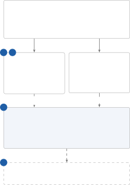

# Khmer PFGen-Bench: Building a Judge-Free Benchmark for Open-Ended Generation in a Low-Resource Language

Mengsay Loem    Kentaro Imajo    Ryota Ozaki    Masanori Hirano
Affiliation: Preferred Networks, Inc. Affiliation: {mengsay, imos,
ryota55ozaki}@preferred.jp, research@mhirano.jp

###### Abstract

Benchmarks for open-ended generation often rely on large language model
(LLM) judges, whose reliability in low-resource languages is uncertain.
We introduce Khmer PFGen-Bench, to our knowledge the first judge-free
benchmark for multi-sentence answers to questions composed directly in
Khmer, a low-resource language. Khmer PFGen-Bench adapts the scorer of
PFGen-Bench, a benchmark for Japanese that scores responses with keyword
rules and n-gram statistics from LLM-generated references. This scoring
requires references that are both valid and varied, which LLMs may not
produce in Khmer, so we examine how to build such references. We find
that post-trained models can give more valid but less varied references
than their base variants, and that mixing model families increases
variety for the same number of references. Using references from
post-trained models in nine families, the benchmark yields model
rankings that are stable across reference sets and consistent with a
native speaker’s ratings. These findings offer guidance for building
judge-free benchmarks in other low-resource languages.

## 1 Introduction



What this paper tests

[TABLE]

Figure 1: Khmer PFGen-Bench (left) and the conditions behind its scores
that this paper tests (right). The PFGen-Bench scorer compares each
response with separately generated references, without an LLM judge;
numbers link each condition to the component it concerns.

Large language models (LLMs) are widely used as judges of open-ended
generation (Zheng et al., 2023), but whether an LLM judge is reliable in
a low-resource language has to be checked in that language. A model’s
ability to generate target-language text does not by itself establish
reliable judging ability. Multilingual studies report biased or
inconsistent judgments in low-resource languages, highlighting the need
for validation against native-speaker assessments (Hada et al., 2024;
Son et al., 2024). Concerns about judgment reliability motivate
evaluation methods that do not require an LLM judge at scoring time.

These concerns apply to Khmer, the official language of Cambodia and a
low-resource language. Existing benchmarks that include Khmer translate
their items from other languages (Han et al., 2026), score only short
answers by exact match (Hupkes and Bogoychev, 2025), or score open-ended
answers with an LLM judge (Nguyen et al., 2024).

To address these limitations, we present Khmer PFGen-Bench, a judge-free
benchmark that uses questions composed directly in Khmer by a native
speaker on Cambodian school-curriculum topics and scores multi-sentence
answers against reference answers. To our knowledge, it is the first
Khmer benchmark to combine these three properties. Its scoring method
comes from PFGen-Bench (Imajo et al., 2025), which was developed for
Japanese and combines question-specific keyword rules with n-gram
statistics from reference answers generated separately from the
evaluated responses.

The main challenge in adapting PFGen-Bench to Khmer is constructing the
reference answers; the scoring procedure itself carries over with
language-specific text processing and parameter settings. PFGen-Bench
treats the reference answers for each question as an approximation of
the distribution of desirable answers, which presumes generators that
produce valid and varied answers in the target language. This premise is
plausible for Japanese but cannot be taken for granted in a low-resource
language such as Khmer. We therefore test four conditions behind the
scores (Figure 1): (1) whether generators produce valid references, (2)
whether the references cover varied expressions, (3) whether model
rankings are stable across reference sets, and (4) whether the scores
agree with a native speaker’s judgments.

Conditions (1) and (2) matter because incorrect references distort the
n-gram statistics and narrow references may penalize valid responses
phrased differently, as studies of reference diversification suggest
(Tang et al., 2024; Zeng et al., 2024); conditions (3) and (4) determine
whether the scores support model comparison. We measure (1) by
_valid-reference yield_, the estimated share of generated candidates
that are retained and valid, and (2) by _expressive coverage_, the range
of answer expressions represented in the references. Since instruction
tuning and preference training can affect instruction following and
output diversity (Shaham et al., 2024; Kirk et al., 2024), we compare
these measures between base and post-trained variants in Khmer and
Japanese, and across mixtures of model families. For (3) and (4), we
vary the references and compare the benchmark ranking with a native
speaker’s ratings.

Khmer PFGen-Bench pairs 50 questions with 18,274 references from
post-trained generators in nine model families and scores each model
without that model’s own references. The analyses support these
settings: post-trained variants can have higher yield but lower coverage
than base variants, combining families raises coverage at a fixed
reference count, and a generator’s own references raise its score. Model
rankings remain highly correlated across reference sets and agree with a
native speaker’s ratings at the model level.

This approach, which assesses generators for both yield and coverage and
excludes self-references in scoring, can guide the construction of
judge-free benchmarks in other low-resource languages. We plan to
release the benchmark data and scoring code.

## 2 Related Work

#### LLM judges in multilingual evaluation.

Zheng et al. (2023) document position and verbosity biases in LLM
judgments and report that some judges favor their own responses,
although the evidence for this self-enhancement bias is inconclusive. In
multilingual evaluation, Hada et al. (2024) report inflated GPT-4 scores
and emphasize calibration against native-speaker judgments. MM-Eval
further identifies inconsistent and unfair assessments in lower-resource
languages (Son et al., 2024). These reliability concerns motivate a
judge-free scorer, and the emphasis on target-language validation
motivates our comparison of the Khmer scorer with a native speaker’s
ratings.

#### Southeast Asian and Khmer benchmarks.

SeaExam converts official school exam questions from Indonesia,
Thailand, and Vietnam into multiple-choice items, and SeaBench scores
open-ended, multi-turn responses in the same languages with GPT-4o as
the judge (Liu et al., 2025). SEA-HELM evaluates general NLP tasks,
instruction following and multi-turn chat, linguistic and cultural
capabilities, and safety in Filipino, Indonesian, Tamil, Thai, and
Vietnamese (Susanto et al., 2025). Among resources that include Khmer,
the current SEA-HELM release adds Khmer tasks for multiple-choice
reading comprehension, machine translation, culturally grounded natural
language inference, and instruction following and multi-turn chat
adapted from IFEval and MT-Bench.¹¹ 1
[https://github.com/aisingapore/SEA-HELM](https://github.com/aisingapore/SEA-HELM),
accessed November 2026. Sea-bench, released with SeaLLMs and distinct
from SeaBench, combines translated, forum-sourced, and linguist-written
instructions in nine languages and scores responses with GPT-4 as the
judge (Nguyen et al., 2024). MultiLoKo asks native speakers of 31
languages, including Khmer, to write questions about locally relevant
topics and scores short answers by exact match (Hupkes and Bogoychev,
2025). DeepSEA creates its Khmer data by professional translation of
existing datasets and scores outputs by accuracy, token-level F1 on
extractive answers, or chrF for summarization and MetricX-24 for
translation (Han et al., 2026). Khmer PFGen-Bench differs from each of
these resources in question origin, answer length, or the use of an LLM
judge.

#### Generated references for evaluation.

Tang et al. (2024) expand existing references with LLM-generated
paraphrases, while Zeng et al. (2024) generate machine translation
references and select candidates for accuracy and diversity. Reference
diversification improves agreement between automatic metrics and human
judgments in both studies. PFGen-Bench (Imajo et al., 2025) uses
generated answer pools for n-gram and rule-based scoring of open-ended
responses and examines score sensitivity to the choice of reference
generator. Khmer PFGen-Bench applies this approach to a low-resource
language, separating valid-reference yield from expressive coverage and
testing how reference composition and origin affect model rankings.

#### Generator training and diversity.

Shaham et al. (2024) show that multilingual instruction tuning can
improve instruction following in languages seen during pretraining but
absent from the tuning data. For the English-centric models tested by
Kew et al. (2024), cross-lingual transfer is limited by target-language
exposure during pretraining. Kirk et al. (2024) report lower output
diversity after reinforcement learning from human feedback than after
supervised fine-tuning on summarization and instruction-following tasks.
The findings on instruction following and diversity motivate our
separate assessment of valid-reference yield and expressive coverage in
base and post-trained variants.

## 3 Benchmark and Study Design

### 3.1 Questions and Reference Pool

The benchmark contains 50 Khmer questions across 13 categories informed
by the Cambodian curriculum through secondary school (Ministry of
Education, Youth and Sport, 2015). A native Khmer-speaking author wrote
the questions and a gold answer for each; the gold answers serve as
few-shot examples for other questions, as the basis for keyword rules,
and, for ten development questions, as comparison answers (Section 5.1).
Table 1 shows example questions, and Appendix Tables B2 and B3 list all 50.

[TABLE]

Table 1: Example questions in the original Khmer, with English
translations for readers.

We use nine post-trained models²² 2 Generators were chosen after a
native Khmer speaker’s preliminary qualitative review of a small sample
of responses from candidate base and post-trained models for correctness
and language quality; all nine selected models are post-trained. from
distinct families to construct the main reference pool. A model family
comprises a developer’s models and models fine-tuned from them (Appendix
Table B1). Four-shot prompting produces 29,321 non-empty, normally
completed candidate answers. Filtering by format, exact duplication,
length, and question-specific keyword rules retains 18,274 references.
The benchmark uses all retained references, averaging 365 per question,
with counts varying by question and generator. Rule acceptance does not
establish factual correctness. Appendix A gives the generation settings,
selection rules, and reference counts.

#### Analysis subsets.

The analyses in Section 4 use 15 Khmer questions and 15 Japanese
questions from the original PFGen-Bench; the two sets are not
translations of each other. A separate split assigns ten Khmer questions
to development, whose gold answers guide family selection in the
allocation study (Section 5.1), and 40 to test, which supply the human
evaluation (Section 5.3); the leaderboard uses all 50. The 15-question
Khmer subset overlaps both splits; the Khmer reference-generation
analyses are not used to tune the scorer or selection rules.

### 3.2 Reference Quality Measures

#### Valid-reference yield.

We estimate the proportion of candidates both retained and valid by
combining rule acceptance with audited validity. For each generator
condition, let $`n_{\mathrm{cand}}`$ and $`n_{\mathrm{keep}}`$ denote
candidate and retained-reference counts. Of $`n_{\mathrm{audit}}`$
sampled retained references, $`n_{\mathrm{valid}}`$ are judged valid
through human assessment of factual correctness, completeness, and
orthographic well-formedness. Acceptance $`a`$, estimated validity
$`\hat{v}`$, and estimated valid-reference yield $`\hat{y}`$ are

```math
a=\frac{n_{\mathrm{keep}}}{n_{\mathrm{cand}}},\quad\hat{v}=\frac{n_{\mathrm{valid}}}{n_{\mathrm{audit}}},\quad\hat{y}=a\hat{v}. \tag{1}
```

Sampling more candidates raises the number of valid references but not
their share among retained references: a fraction $`1-\hat{v}`$ of
retained references remains invalid, and identifying those references
requires native-speaker review.

#### Expressive coverage.

We measure expressive coverage against a separate set of answers to the
same question, called comparison answers.³³ 3 Reference-generation
analyses use the official reference set from Imajo et al. (2025) for
Japanese and references from held-out model families for Khmer. The
allocation study uses development gold answers as comparison answers
(Section 5.1). We form 3-grams over Japanese characters or Khmer
character clusters (KCCs; Chea et al., 2007). For question $`q`$, let
$`R_{q}`$ be the reference set and $`B_{q}`$ the set of comparison
answers, with $`r\in R_{q}`$ denoting a reference and $`b\in B_{q}`$ a
comparison answer. For an answer $`x`$, either a reference or a
comparison answer, $`G_{3}(x)`$ is the set of distinct 3-grams in $`x`$.
The reference 3-gram set $`U_{q}=\bigcup_{r\in R_{q}}G_{3}(r)`$ contains
every 3-gram that occurs in at least one reference. Coverage is the mean
fraction of each comparison answer’s distinct 3-grams found in the
references:

```math
\mathrm{Cov}_{q}=\frac{1}{|B_{q}|}\sum_{b\in B_{q}}\frac{|G_{3}(b)\cap U_{q}|}{|G_{3}(b)|}. \tag{2}
```

#### Repetition.

We adapt the distinct-1 and distinct-2 measures of Li et al. (2016) to
3-grams. Distinct-3 is the ratio of distinct 3-grams to all 3-gram
occurrences in the reference set:

```math
\mathrm{Distinct\text{-}3}_{q}=\frac{|U_{q}|}{\sum_{r\in R_{q}}m_{3}(r)}, \tag{3}
```

where $`m_{3}(r)`$ counts 3-gram occurrences in $`r`$, including
repetitions; lower distinct-3 indicates greater n-gram repetition.
Coverage and distinct-3 describe surface-form variation, not semantic
diversity or factual correctness.

### 3.3 Scoring and Comparison Protocol

We evaluate the nine reference generators and ten models used only for
evaluation (non-generators). Each model answers all 50 questions in ten
trials using eight-shot prompting; evaluation responses are generated
separately from references and held fixed across reference sets
(Appendix B).

We use the three components of the PFGen-Bench scorer, F, T, and H, and
follow the definitions of Imajo et al. (2025), replacing their fixed
length and frequency settings with the parameters $`\ell_{1}`$,
$`\ell_{0}`$, and $`\tau`$. A response is split into units
$`C_{1},\dots,C_{L}`$: characters in the original Japanese setting and,
after normalization, KCCs for Khmer. Beginning- and end-of-sentence
markers are added, giving $`C_{0},C_{1},\dots,C_{L},C_{L+1}`$. Let
$`G^{w}_{i}=\{C_{i},C_{i+1},\dots,C_{i+w-1}\}`$ be the $`w`$-gram that
starts at $`C_{i}`$, and let $`\mathcal{L}^{w}_{G}\in[0,1]`$ be the
proportion of reference answers for the question that contain the
$`w`$-gram $`G`$. Responses longer than $`\ell_{1}`$ units are
discounted by

```math
d(I):=1-\frac{\max(I-\ell_{1},0)}{\ell_{0}-\ell_{1}}, \tag{4}
```

which reaches zero at $`\ell_{0}`$ units. The original setting uses
$`\ell_{1}=100`$ and $`\ell_{0}=150`$ characters.

#### Fluency (F).

F sums the occurrence likelihoods of the $`w`$-grams in a response for
$`w=1,\dots,10`$:

```math
\displaystyle F^{\star}_{w} \displaystyle:=\sum_{i=0}^{L-w+2}\mathcal{L}^{w}_{G^{w}_{i}},
```

```math
\displaystyle F \displaystyle:=\sum_{w=1}^{10}d(L)\,F^{\star}_{w}. \tag{5}
```

F is normalized so that the reference answer set scores 1.0, and the F
of a single response can exceed one.

#### Truthfulness (T).

T measures how much of a response is supported by frequent reference
3-grams; the name comes from the original benchmark, and T does not
verify facts. Let $`\mathcal{L}^{3\star}_{i}`$ be the largest
$`\mathcal{L}^{3}_{G}`$ among the 3-grams $`G`$ that contain $`C_{i}`$,
and let $`\Omega_{I}\subset\{1,\dots,I\}`$ be the indices of
non-punctuation units among the first $`I`$ units. For a truncation
length $`I`$,

```math
\displaystyle T^{\star}_{I} \displaystyle:=\frac{1}{|\Omega_{I}|}\sum_{i\in\Omega_{I}}\frac{\min(\mathcal{L}^{3\star}_{i},\tau)}{\tau},
```

```math
\displaystyle T_{I} \displaystyle:=d(I)\,T^{\star}_{I}, \tag{6}
```

and T takes the best truncation of a long response:

```math
T:=\begin{cases}T_{L}&(L\leq\ell_{1}),\\
\max_{I\in\{\ell_{1},\dots,L\}}T_{I}&(L>\ell_{1}).\end{cases} \tag{7}
```

The original setting uses $`\tau=0.005`$. Khmer normalization removes
punctuation, so $`\Omega_{I}=\{1,\dots,I\}`$ for Khmer. Units covered
only by rare or unseen 3-grams lower T, so content not attested in the
reference answers is penalized.

#### Helpfulness (H).

H is based on manually defined rules: for each question, keyword
elements that a correct answer should contain, combined with AND/OR
conditions. Element $`k`$ has importance $`w_{k}`$, and each element not
matched in the first $`I`$ units multiplies the score by $`1-w_{k}`$:

```math
H_{I}:=d(I)\prod_{k\notin K_{I}}(1-w_{k}), \tag{8}
```

where $`K_{I}`$ is the set of elements matched in $`C_{1},\dots,C_{I}`$.
H is obtained from $`H_{I}`$ with the truncation of Equation 7. Of the
216 Khmer elements, 181 have $`w_{k}=1`$, so a response that misses any
of them receives $`H=0`$; the remaining elements have $`w_{k}=0.5`$.

The benchmark score (Score) is the average $`(F+T+H)/3`$. Appendix A.2
describes the Khmer normalization, and Appendix B.3 gives the Khmer
values of $`\ell_{1}`$, $`\ell_{0}`$, and $`\tau`$. Model scores average
over questions and trials, including failed generations scored as zero.

For the main leaderboard (Appendix Table C1), F and T are computed
separately against references from the five open-weight and the four
closed-weight generators and then averaged with equal weight. Because
the reference generators are also evaluated, the leaderboard excludes
the evaluated model’s own references but keeps references from other
models in the same family; Section 5.2 examines the resulting
family-level dependence.

|               |         |            |          |       |
| ------------- | ------- | ---------- | -------- | ----- |
| Generator     | Variant | Acceptance | Validity | Yield |
| Japanese      |         |            |          |       |
| Gemma-4-31B   | Base    | 80%        | 65%      | 52%   |
|               | Post    | 90%        | 75%      | 68%   |
| Qwen3-30B-A3B | Base    | 65%        | 45%      | 29%   |
|               | Post    | 75%        | 50%      | 38%   |
| Khmer         |         |            |          |       |
| Gemma-4-31B   | Base    | 40%        | 40%      | 16%   |
|               | Post    | 58%        | 52%      | 30%   |
| Qwen3-30B-A3B | Base    | 9%         | 0%       | 0%    |
|               | Post    | 22%        | 8%       | 2%    |

Table 2: Acceptance, audited validity, and estimated valid-reference
yield. Post denotes post-trained.

Figure 2: Held-out-family 3-gram coverage by reference count $`N`$ (a)
and family count $`k`$ (b). The gray band spans the available single
generators (only DeepSeek and Gemini at $`N=160`$); panel (b) uses
common questions across $`k`$ at each $`N`$.

## 4 Obtaining Valid and Varied References

### 4.1 Valid-Reference Yield

#### Setup.

We estimate valid-reference yield for base and post-trained variants of
Gemma-4-31B and Qwen3-30B-A3B on the 15 Khmer and 15 Japanese analysis
questions. Each variant generates 100 candidates per question with
eight-shot prompting, rather than the four-shot prompting of the main
pool; base variants receive completion prompts and post-trained variants
chat prompts, with examples and selection rules matched within each
language (Appendix A). Because keyword policies were selected on
post-trained candidates, the selection rules may favor post-trained
acceptance (Appendix A.2). To estimate validity, one author manually
checks 20–50 retained references per condition (Appendix D).

#### Results.

Table 2 shows higher point estimates of acceptance, validity, and yield
for post-trained than for base variants in both languages, although the
two Japanese Qwen validity estimates differ by one of 20 audited
references. Yield is lower in Khmer than in Japanese for every model and
variant (0–30% versus 29–68%); because the question sets are not
parallel, the gap may reflect language, regional content, or selection
rules. A higher yield than the base variant does not ensure enough valid
references: post-trained Qwen reaches only 2% yield in Khmer, so about
2,000 candidates per question would be needed for 40 valid references.
Generator selection therefore requires checking absolute yield in the
target language.

|               |       |          |      |            |      |
| ------------- | ----- | -------- | ---- | ---------- | ---- |
|               |       | Coverage |      | Distinct-3 |      |
| Generator     | $`N`$ | Base     | Post | Base       | Post |
| Japanese      |       |          |      |            |      |
| Gemma-4-31B   | 39    | 76%      | 48%  | 31%        | 14%  |
| Qwen3-30B-A3B | 36    | 71%      | 60%  | 37%        | 24%  |
| Khmer         |       |          |      |            |      |
| Gemma-4-31B   | 20    | 58%      | 48%  | 54%        | 20%  |

Table 3: Coverage and distinct-3 at matched reference counts. Japanese
results are the main comparison; Khmer is supplementary. $`N`$ is the
mean count across included questions; Post denotes post-trained.

### 4.2 Coverage by Model Variant

#### Setup.

Using the retained references from Section 4.1, we compare coverage and
distinct-3 between base and post-trained variants at matched reference
counts. For each question, both variants contribute the smaller of the
two retained counts, capped at 40 for Japanese and 20 for Khmer and
sampled with 100 random seeds; questions with fewer than ten retained
references from either variant are excluded. Japanese provides the main
comparison; in Khmer, Qwen is omitted because of its low acceptance and
validity, leaving a supplementary Gemma comparison on nine questions.
The Japanese comparison answers come from base models and may favor
base-variant references, whereas the Khmer comparison answers come from
post-trained models outside the Gemma family. Both measures count
invalid retained references and are sensitive to total text length,
which matched reference counts do not control.

#### Results.

Table 3 shows lower coverage and distinct-3 for post-trained than for
base variants of both models in Japanese. The Khmer Gemma comparison
follows the same pattern, even though the Khmer comparison answers come
from post-trained models. Post-trained variants thus combine higher
estimated yield (Table 2) with lower 3-gram coverage of the comparison
answers, so generator selection should assess yield and coverage
separately.

Figure 3: Rankings under alternative reference sets for the reference
generators (top) and non-generators (bottom). Ranks are computed within
each group; the leftmost condition is self-excluded scoring.

### 4.3 Reference Count and Family Mixtures

#### Setup.

Because post-trained variants had lower 3-gram coverage (Section 4.2)
and all nine main-pool generators are post-trained, we test whether
spreading a fixed number of references across families broadens
coverage. On the 15 Khmer analysis questions, each generator family in
turn supplies the comparison answers, and $`N`$ references are drawn
from the remaining families, either from one generator or as evenly as
possible across $`k`$ families. Results are aggregated over held-out
families and 100 random seeds. Available generators and questions differ
across $`N`$, whereas comparisons across $`k`$ hold questions fixed at
each $`N`$.

#### Results.

Figure 2(a) shows coverage rising with $`N`$ in every configuration, and
every family mixture lies above the single-generator median at each
$`N`$. With questions fixed (Figure 2(b)), coverage at $`N=40`$ rises
from 59% with one family to 74% with eight, whereas coverage at $`N=20`$
plateaus from four to eight families. Spreading a fixed number of
post-trained references across families thus broadens coverage, although
the gain from additional families depends on $`N`$.

## 5 Rankings and Human Agreement

### 5.1 Reference Allocation and Rankings

[TABLE]

Table 4: Coverage of eligible development gold answers and rank
correlation with the full-pool ranking, as ranges over selected family
combinations. Questions counts the questions used for the 19-model
rankings; for All, $`\approx 40`$ is the mean per family per question.
References are pooled with self-references retained.

#### Setup.

We test whether smaller reference sets, with families chosen to maximize
coverage of the development gold answers, reproduce the full-pool
ranking. Each configuration distributes $`N`$ references per question
equally across $`k`$ such families. A question is eligible only if every
selected family has at least $`N/k`$ references for it, and sampled-set
and full-pool rankings use the same eligible questions. Unlike the
leaderboard, sampled-set and full-pool scores pool references into one
group and retain self-references (Appendix B.3). Coverage values use
different eligible question subsets, so coverage differences between
configurations do not isolate family-count effects. A separate analysis
varies $`N`$ with four families and 39 questions fixed, using all
references from those families as the baseline (Appendix C).

#### Results.

Table 4 shows Spearman rank correlations of 0.95–1.00 with the full-pool
ranking in every configuration, including single-family sets at
$`N=40`$. With families and questions fixed, correlations with the
four-family baseline round to 1.000 at $`N=40`$, 80, and 160. Forty
references per question are therefore enough to reproduce the full-pool
ranking of the 19 tested models.

Figure 4: Score changes from replacing one family’s references in a
four-family set ($`N=40`$): (a) by model role; (b) target-family models,
net of other-family models. Dots are means over questions (counts in
parentheses).

(a)

(b)

(c)

Figure 5: F and T by human rating (a, b) and Score by human rank (c; 1 =
best). Frontier: Gemini-4-argon, GPT-6-sol, Claude-opus-5.5, GPT-6-luna;
small: Gemma-SEA-LION-9B, Sailor2-8B. Whiskers: 5th–95th percentiles.

### 5.2 Dependence on Reference Origin

#### Setup.

We test whether scores depend on which models generated the references.
We compare the self-excluded leaderboard baseline with self-inclusion,
exclusion of the evaluated model’s family, and reference pools
restricted to open-weight or closed-weight generators. In a separate
four-family pool with ten references per family, we replace a target
family with an outside family. The control replaces a non-target family
with the same outside family. Replacement comparisons retain
self-references and use one pooled reference group (Appendix C).

#### Results.

Figure 3 shows that rankings within the generator and non-generator
groups change little across the alternative reference sets. In the
combined 19-model ranking, self-inclusion raises generator scores by up
to 0.04 and changes eight ranks, mostly by moving generators above
non-generators (Appendix Table C1). The self-reference gain supports
scoring each model without that model’s own references, as the
leaderboard does (Section 3.3).

Figure 4 shows that replacing a generator’s family lowers that
generator’s score by about 0.03–0.05, whereas control replacements
change scores by less than 0.01. Same-family non-generators also decline
relative to other-family models, most strongly for GPT, Gemini, and
Claude. Reference origin thus affects scores at the family level as well
as the model level.

### 5.3 Agreement with Human Ratings

#### Setup.

One native Khmer-speaking author rates one uniformly sampled response
per model–question pair for six non-generators on 40 test questions (240
responses). The six models comprise four closed-weight frontier models
and two small open-weight models (8B and 9B parameters); all families
occur in the reference pool. With model identities and benchmark scores
hidden, the rater assigns 0–2 scores for fluency, correctness, and
whether the response answers the question and ranks responses within
questions. Pairwise agreement is the fraction of within-question
response pairs that Score orders as the human ranking does, averaged
over questions; human-tied pairs are excluded and Score ties count 0.5.

#### Results.

Figure 5(a, b) shows median F and T scores increasing with the
corresponding human ratings. Figure 5(c) shows lower Score for responses
at human ranks 5 and 6, mostly from the two small models, than at ranks
1–4. Across the six models, the human ranking correlates at
$`\rho=0.94`$ with the ranking by Score on these responses and at
$`\rho=0.83`$ with the leaderboard ranking (Appendix Table C1).
Within-question pairwise agreement is 87.9% overall, 97.4% for
frontier-versus-small-model pairs, and 59.8% among frontier responses
(chance: 50%). Agreement with the native speaker thus comes mainly from
separating frontier from small models.

## 6 Conclusion

We introduced Khmer PFGen-Bench, a judge-free benchmark for open-ended
generation in Khmer, whose model rankings remain highly correlated
across reference sets and agree with a native speaker at the model
level. Building the benchmark showed that valid and varied references
cannot be taken for granted in a low-resource language: generators need
to be checked for both valid-reference yield and coverage in the target
language and drawn from several families, and each model should be
scored without its own references. These practices, together with
validation by independent native speakers, offer a path to judge-free
evaluation in other low-resource languages.

## Limitations

The study covers 50 questions and a limited set of generators, prompts,
and selection rules. The variant comparisons cover only two model pairs,
with completion prompts for base variants and chat prompts for
post-trained variants, so the comparisons describe the available
variants as prompted rather than an effect of post-training; the
Japanese and Khmer question sets are also non-parallel. Validity audits
cover at most 50 references per condition, all from the variant
comparisons rather than the main reference pool, leaving substantial
uncertainty in validity and yield estimates. Development gold answers
both select and assess the allocation configurations, so development
coverage is not independent validation. Coverage records 3-gram
presence, whereas scoring also uses reference frequencies, and whether
broader coverage improves agreement with human judgments remains
untested. Models from families outside the reference pool are not
evaluated, and the scorer is not compared with LLM judges on the same
human ratings.

Human validation uses one native Khmer-speaking author who also wrote
the questions, gold answers, and keyword rules, so inter-rater agreement
cannot be measured, and author familiarity may influence the ratings
despite blinding. The six rated models are all non-generators, so the
human ratings do not test comparisons involving generators, where
self-inclusion changes ranks.

## Ethics Statement

The questions cover general-education topics from the Cambodian school
curriculum and contain no personal data. All human ratings were produced
by the native Khmer-speaking author; no external annotators were
recruited. References in the main pool passed rule-based selection but
were not individually verified, so they may contain factual errors. The
benchmark is intended for model comparison, not as an authoritative
source of answers.

## References

- Chea et al. (2007) S. H. Chea, R. Top, P. H. Ros, N. Vann, C. Chin,
  and T. Chhoeun Word bigram vs orthographic syllable bigram in Khmer
  word segmentation. In PAN Localization Working Papers 2004–2007,
  External Links:
  [Link](https://www.researchgate.net/publication/228972610_Word_Bigram_Vs_Orthographic_Syllable_Bigram_in_Khmer_Word_Segmentation)
  Cited by: §3.2.
- Hada et al. (2024) R. Hada, V. Gumma, A. de Wynter, H. Diddee, M.
  Ahmed, M. Choudhury, K. Bali, and S. Sitaram Are large language
  model-based evaluators the solution to scaling up multilingual
  evaluation?. In Findings of the Association for Computational
  Linguistics: EACL 2024, Cited by: §1, §2.
- Han et al. (2026) J. Han, A. B. Mishra, T. Cohn, and S. Mittal
  DeepSEA: a multilingual evaluation benchmark for Southeast Asia. In
  Proceedings of the 2026 Conference on Empirical Methods in Natural
  Language Processing, pp. 1–17. Cited by: §1, §2.
- Hosken (2025) M. Hosken Khmer encoding structure. Unicode Technical
  Note Technical Report 61, Unicode Consortium. Note: Version 2 External
  Links: [Link](https://www.unicode.org/notes/tn61/tn61-2.html) Cited
  by: §A.2.
- Hupkes and Bogoychev (2025) D. Hupkes and N. Bogoychev MultiLoKo: a
  multilingual local knowledge benchmark for LLMs spanning 31 languages.
  External Links: 2504.10356 Cited by: §1, §2.
- Imajo et al. (2025) K. Imajo, M. Hirano, S. Suzuki, and H. Mikami A
  judge-free LLM open-ended generation benchmark based on the
  distributional hypothesis. arXiv preprint arXiv:2502.09316. External
  Links: [Link](https://arxiv.org/abs/2502.09316) Cited by: §B.3, §1,
  §2, §3.3, footnote 3.
- Kew et al. (2024) T. Kew, F. Schottmann, and R. Sennrich Turning
  English-centric LLMs into polyglots: how much multilinguality is
  needed?. In Findings of the Association for Computational Linguistics:
  EMNLP 2024, Cited by: §2.
- Kirk et al. (2024) R. Kirk, I. Mediratta, C. Nalmpantis, J.
  Luketina, E. Hambro, E. Grefenstette, and R. Raileanu Understanding
  the effects of RLHF on LLM generalisation and diversity. In
  Proceedings of the Twelfth International Conference on Learning
  Representations (ICLR 2024), Cited by: §1, §2.
- Li et al. (2016) J. Li, M. Galley, C. Brockett, J. Gao, and B. Dolan A
  diversity-promoting objective function for neural conversation models.
  In Proceedings of the 2016 Conference of the North American Chapter of
  the Association for Computational Linguistics: Human Language
  Technologies, pp. 110–119. External Links:
  [Document](https://dx.doi.org/10.18653/v1/N16-1014),
  [Link](https://aclanthology.org/N16-1014/) Cited by: §3.2.
- Liu et al. (2025) C. Liu, W. Zhang, J. Ying, M. Aljunied, A. T. Luu,
  and L. Bing SeaExam and SeaBench: benchmarking LLMs with local
  multilingual questions in Southeast Asia. In Findings of the
  Association for Computational Linguistics: NAACL 2025, pp. 6134–6151.
  Cited by: §2.
- Ministry of Education, Youth and Sport (2015) Ministry of Education,
  Youth and Sport Curriculum Framework of General Education and
  Technical Education. Note: Department of Curriculum Development, Phnom
  Penh External Links:
  [Link](https://moeys.gov.kh/en/policies-and-strategic-plans/document-5416)
  Cited by: §3.1.
- Nguyen et al. (2024) X. Nguyen, W. Zhang, X. Li, M. Aljunied, et al.
  SeaLLMs – large language models for Southeast Asia. In Proceedings of
  the 62nd Annual Meeting of the Association for Computational
  Linguistics (Volume 3: System Demonstrations), pp. 294–304. Cited by:
  §1, §2.
- Shaham et al. (2024) U. Shaham, J. Herzig, R. Aharoni, I. Szpektor, R.
  Tsarfaty, and M. Eyal Multilingual instruction tuning with just a
  pinch of multilinguality. In Findings of the Association for
  Computational Linguistics: ACL 2024, Cited by: §1, §2.
- Son et al. (2024) G. Son, D. Yoon, J. Suk, et al. MM-Eval: a
  multilingual meta-evaluation benchmark for LLM-as-a-judge and reward
  models. arXiv preprint arXiv:2410.17578. Cited by: §1, §2.
- Susanto et al. (2025) Y. Susanto, A. V. Hulagadri, J. R. Montalan, et
  al. SEA-HELM: Southeast Asian holistic evaluation of language models.
  In Findings of the Association for Computational Linguistics: ACL
  2025, pp. 12308–12336. Cited by: §2.
- Tang et al. (2024) T. Tang, H. Lu, Y. E. Jiang, H. Huang, D.
  Zhang, W. X. Zhao, T. Kocmi, and F. Wei Not all metrics are guilty:
  improving NLG evaluation by diversifying references. In Proceedings of
  the 2024 Conference of the North American Chapter of the Association
  for Computational Linguistics: Human Language Technologies (Volume 1:
  Long Papers), Cited by: §1, §2.
- Zeng et al. (2024) X. Zeng, Y. Liu, F. Meng, and J. Zhou Towards
  multiple references era – addressing data leakage and limited
  reference diversity in machine translation evaluation. In Findings of
  the Association for Computational Linguistics: ACL 2024,
  pp. 11939–11951. Cited by: §1, §2.
- Zheng et al. (2023) L. Zheng, W. Chiang, Y. Sheng, et al. Judging
  LLM-as-a-judge with MT-Bench and Chatbot Arena. In Advances in Neural
  Information Processing Systems 36 (NeurIPS 2023), Datasets and
  Benchmarks Track, Cited by: §1, §2.

## Appendix A Reference Construction

### A.1 Prompts and Sampling

Table A1 shows the prompts for reference generation and model
evaluation. Reference generation uses four question–answer examples from
other categories, fixed for each target question and shared across
generators. Generators sample with temperature 1.0 and top-$`p`$ 0.98,
except Claude-opus-5, which uses API defaults; empty or truncated
outputs are discarded.

[TABLE]

Table A1: Prompt structures. Translations, repetition notes, role
labels, and angle-bracketed placeholders are explanatory. Reference
generation uses conversation turns, with the instruction in the same
user turn as each question; evaluation uses one user message. The target
answer is never supplied.

#### Base and post-trained variants.

The variant comparisons (Section 4.1) sample 100 candidates per question
with eight examples. Post-trained variants receive the examples as
conversation turns (Table A1, left); base variants receive the same
examples as “Q:” and “A:” pairs and complete an empty “A:” for the
target question.

### A.2 Normalization and Selection Rules

Normalization applies Unicode NFC, removes invisible characters,
whitespace, and punctuation, canonicalizes legacy Khmer sequences
(Hosken, 2025), and unifies digits; evaluation responses are normalized
in the same way before scoring. A KCC is a base character with its
following subscript consonants, dependent vowels, and combining marks.

Four rules are applied in sequence (Table A2): (1) format, rejecting
Markdown markup, runs of seven or more Latin-script words, and unrelated
scripts such as Thai or Cyrillic; (2) duplication, keeping one copy of
each identical normalized answer per question; (3) length, keeping
40–201 KCCs for Khmer or 30–150 characters for Japanese, where the upper
bound is the zero point of the scorer’s length discount; and (4)
keywords. The keyword rules contain 216 elements derived from the gold
answers, each with alternative phrasings. Each question’s acceptance
policy requires either all required elements (31 questions) or at least
one element (19 questions), choosing the stricter policy that still
keeps at least 50 main-pool references from each of the open-weight and
closed-weight groups. The Japanese comparisons use the original
benchmark’s keywords, with policies chosen in the same way on
post-trained Gemma candidates.

| Stage       | Remaining |
| ----------- | --------- |
| Candidates  | 29,321    |
| Format      | 27,986    |
| Duplication | 26,212    |
| Length      | 25,514    |
| Keywords    | 18,274    |

Table A2: Candidates retained after each filtering stage.

### A.3 Reference Counts

Table A3 gives counts by generator. Of the 450 generator–question pairs,
376 contain at least 40 references, and every question has at least four
families with 40 or more.

|                  |            |          |            |
| ---------------- | ---------- | -------- | ---------- |
| Generator        | Candidates | Retained | Acceptance |
| DeepSeek-V4-Pro  | 3,060      | 2,371    | 77%        |
| Llama-4-Maverick | 3,650      | 1,691    | 46%        |
| Gemma-4-31B      | 2,910      | 1,693    | 58%        |
| Qwen3.5-397B     | 3,060      | 2,074    | 68%        |
| GLM-5.3-flash    | 3,341      | 2,150    | 64%        |
| GPT-5.6-sol      | 3,580      | 2,014    | 56%        |
| Grok-4.3         | 4,060      | 1,784    | 44%        |
| Claude-opus-5    | 2,800      | 2,284    | 82%        |
| Gemini-3.8-flash | 2,860      | 2,213    | 77%        |
| Total            | 29,321     | 18,274   | 62%        |

Table A3: Candidate counts, retained references, and acceptance rates
for the final reference pool. The first five generators are open-weight
and the remaining four closed-weight. Acceptance denotes rule-based
retention, not audited validity.

## Appendix B Evaluation Data and Protocol

|                                        |               |          |          |
| -------------------------------------- | ------------- | -------- | -------- |
| Model                                  | Role          | Family   | Failures |
| DeepSeek-V4-Pro                        | generator     | DeepSeek | 0        |
| Llama-4-Maverick-17B-128E-Instruct-FP8 | generator     | Llama    | 0        |
| Gemma-4-31B-it                         | generator     | Gemma    | 0        |
| Qwen3.5-397B-A17B                      | generator     | Qwen     | 0        |
| GLM-5.3-flash                          | generator     | GLM      | 13       |
| GPT-5.6-sol                            | generator     | GPT      | 0        |
| Grok-4.3                               | generator     | Grok     | 0        |
| Claude-opus-5                          | generator     | Claude   | 0        |
| Gemini-3.8-flash                       | generator     | Gemini   | 0        |
| Gemini-4-argon                         | non-generator | Gemini   | 0        |
| GPT-6-sol                              | non-generator | GPT      | 0        |
| Claude-opus-5.5                        | non-generator | Claude   | 0        |
| GPT-6-luna                             | non-generator | GPT      | 0        |
| Gemini-3.5-flash-lite                  | non-generator | Gemini   | 0        |
| Claude-haiku-5.5                       | non-generator | Claude   | 0        |
| Gemma-SEA-LION-v3-9B-IT                | non-generator | Gemma    | 0        |
| Sailor2-8B-Chat                        | non-generator | Qwen     | 0        |
| SeaLLMs-v3-7B-Chat                     | non-generator | Qwen     | 0        |
| Llama-SEA-LION-v3-8B-IT                | non-generator | Llama    | 12       |

Table B1: Evaluated models, roles, and families. Failures are responses
scored zero, out of 500 per model (50 questions, ten trials). Short
model names are used elsewhere in the paper.

### B.1 Questions and Splits

The 50 questions were written directly in Khmer: 27 on regional topics
(Khmer language, history, geography, civics, arts, and culture) and 23
on general subjects (mathematics, physics, chemistry, biology, earth
science, health, and information technology), as listed in Tables B2
and B3. A question’s own gold answer never appears in the prompts for
that question. The 15 Khmer analysis questions are sampled across
categories, eight regional and seven general; the 15 Japanese questions
come from the original benchmark. The development–test split was fixed
before human rating, with five of the 15 Khmer analysis questions in
development and ten in test.

|                |     |                                                                                                                                  |                                                                                                                       |
| -------------- | --- | -------------------------------------------------------------------------------------------------------------------------------- | --------------------------------------------------------------------------------------------------------------------- |
| Category       | ID  | Question                                                                                                                         | English translation                                                                                                   |
| Khmer language | Q01 | \khmerfont\XeTeXlinebreaklocale "km" ចូររៀបរាប់អំពីពាក្យក្លាយក្នុងភាសាខ្មែរ។                                                     | Describe derived words in Khmer.                                                                                      |
|                | Q02 | \khmerfont\XeTeXlinebreaklocale "km" ចូររៀបរាប់កាព្យមាត្រនិងចំណាប់ចួននៃកំណាព្យបទភុជង្គលីលា។                                      | Describe the meter and rhyme scheme of Phujong Lilea verse.                                                           |
|                | Q03 | \khmerfont\XeTeXlinebreaklocale "km" តើរឿងព្រះអាទិត្យថ្មីរះលើផែនដីចាស់និយាយអំពីអ្វី?                                             | What is the novel A New Sun Rises over the Old Land about?                                                            |
|                | Q04 | \khmerfont\XeTeXlinebreaklocale "km" ចូរបង្ហាញភាពខុសគ្នារវាងសុភាសិតនិងពាក្យស្លោក។                                                | Explain the difference between proverbs and slogans.                                                                  |
|                | Q05 | \khmerfont\XeTeXlinebreaklocale "km" ចូររៀបរាប់អំពីលក្ខណៈសម្គាល់របស់អក្សរសិល្ប៍ខ្មែរបែបពុទ្ធនិយម។                                | Describe the distinctive features of Buddhist Khmer literature.                                                       |
| Mathematics    | Q06 | \khmerfont\XeTeXlinebreaklocale "km" តើគេអាចសម្គាល់ថាត្រីកោណសាមញ្ញពីរប៉ុនគ្នា តាមលក្ខខណ្ឌអ្វីខ្លះ?                               | By which criteria can two general triangles be identified as congruent?                                               |
|                | Q07 | \khmerfont\XeTeXlinebreaklocale "km" ដូចម្តេចដែលហៅថាចំនួនបឋម?                                                                    | What is a prime number?                                                                                               |
|                | Q08 | \khmerfont\XeTeXlinebreaklocale "km" ក្នុងរង្វាស់ប្រវែងបុរាណខ្មែរ តើ១ហត្ថស្មើប៉ុន្មានម៉ែត្រ?                                     | In traditional Khmer units of length, how many meters is one hat (cubit)?                                             |
|                | Q09 | \khmerfont\XeTeXlinebreaklocale "km" តើប្រូបាបនៃព្រឹត្តិការណ៍មួយ និងព្រឹត្តិការណ៍បំពេញរបស់វាមានទំនាក់ទំនងគ្នាយ៉ាងដូចម្តេច?       | How is the probability of an event related to that of its complementary event?                                        |
|                | Q10 | \khmerfont\XeTeXlinebreaklocale "km" តើពហុកោណនិយ័តមានលក្ខណៈដូចម្តេចខ្លះ?                                                         | What are the properties of a regular polygon?                                                                         |
| Physics        | Q11 | \khmerfont\XeTeXlinebreaklocale "km" តើកម្តៅនិងសីតុណ្ហភាពខុសគ្នាដូចម្តេច?                                                        | How do heat and temperature differ?                                                                                   |
|                | Q12 | \khmerfont\XeTeXlinebreaklocale "km" តើចរន្តជាប់និងចរន្តឆ្លាស់ខុសគ្នាដូចម្តេច?                                                   | How do direct current and alternating current differ?                                                                 |
|                | Q13 | \khmerfont\XeTeXlinebreaklocale "km" ដូចម្តេចហៅថាទន្លាក់សេរី?                                                                    | What is free fall?                                                                                                    |
| Chemistry      | Q14 | \khmerfont\XeTeXlinebreaklocale "km" តើអ៊ីសូតូបជាអ្វី?                                                                           | What is an isotope?                                                                                                   |
|                | Q15 | \khmerfont\XeTeXlinebreaklocale "km" តើតម្លៃ pH បង្ហាញពីលក្ខណៈអ្វីរបស់សូលុយស្យុង?                                                | What property of a solution does the pH value indicate?                                                               |
|                | Q16 | \khmerfont\XeTeXlinebreaklocale "km" តើច្បាប់រក្សាម៉ាសចែងថាដូចម្តេច?                                                             | What does the law of conservation of mass state?                                                                      |
| Biology        | Q17 | \khmerfont\XeTeXlinebreaklocale "km" អ្វីទៅជាដំណើររស្មីសំយោគ?                                                                    | What is photosynthesis?                                                                                               |
|                | Q18 | \khmerfont\XeTeXlinebreaklocale "km" តើវីរុសនិងបាក់តេរីខុសគ្នាដូចម្តេច?                                                          | How do viruses and bacteria differ?                                                                                   |
|                | Q19 | \khmerfont\XeTeXlinebreaklocale "km" តើអាំងស៊ុយលីនមានតួនាទីអ្វីក្នុងការគ្រប់គ្រងជាតិស្ករក្នុងឈាម?                                | What role does insulin play in regulating blood sugar?                                                                |
| Earth science  | Q20 | \khmerfont\XeTeXlinebreaklocale "km" តើសូរ្យគ្រាសនិងចន្ទគ្រាសខុសគ្នាដូចម្តេច?                                                    | How do solar and lunar eclipses differ?                                                                               |
|                | Q21 | \khmerfont\XeTeXlinebreaklocale "km" ចូរបង្ហាញភាពខុសគ្នារវាងរលកPនិងរលកS។                                                         | Explain the difference between P waves and S waves.                                                                   |
|                | Q22 | \khmerfont\XeTeXlinebreaklocale "km" តើធាតុអាកាសនិងអាកាសធាតុខុសគ្នាដូចម្តេច?                                                     | How do weather and climate differ?                                                                                    |
| History        | Q23 | \khmerfont\XeTeXlinebreaklocale "km" តើមានការលើកឡើងដូចម្តេចខ្លះអំពីដើមកំណើតរដ្ឋខ្មែរដំបូង?                                       | What accounts have been proposed for the origin of the first Khmer state?                                             |
|                | Q24 | \khmerfont\XeTeXlinebreaklocale "km" ចូររៀបរាប់អំពីស្នាព្រះហស្តរបស់ព្រះបាទជ័យវរ្ម័នទី៧ក្នុងប្រវត្តិសាស្ត្រខ្មែរ។                 | Describe the achievements of King Jayavarman VII in Khmer history.                                                    |
|                | Q25 | \khmerfont\XeTeXlinebreaklocale "km" តើចលនាតស៊ូដើម្បីឯករាជ្យជាតិក្នុងប្រទេសកម្ពុជានាសម័យអាណានិគមនិយមបារាំងចែកចេញជាប៉ុន្មានផ្នែក? | Into how many parts was the movement for national independence in Cambodia divided during the French colonial period? |

Table B2: Questions Q01–Q25 in the original Khmer, with English
translations for readers.

|                        |     |                                                                                                                                                                             |                                                                                               |
| ---------------------- | --- | --------------------------------------------------------------------------------------------------------------------------------------------------------------------------- | --------------------------------------------------------------------------------------------- |
| Category               | ID  | Question                                                                                                                                                                    | English translation                                                                           |
| History                | Q26 | \khmerfont\XeTeXlinebreaklocale "km" ដូចម្តេចដែលហៅថាសមាជជាតិ?                                                                                                               | What is the National Congress?                                                                |
|                        | Q27 | \khmerfont\XeTeXlinebreaklocale "km" ក្នុងសម័យកម្ពុជាប្រជាធិបតេយ្យ តើពាក្យ «\khmerfont\XeTeXlinebreaklocale"km" អង្គការ»\khmerfont\XeTeXlinebreaklocale"km" មានន័យដូចម្តេច? | In the Democratic Kampuchea period, what did the word Angkar (organization) mean?             |
|                        | Q28 | \khmerfont\XeTeXlinebreaklocale "km" តើកិច្ចព្រមព្រៀងទីក្រុងប៉ារីសឆ្នាំ១៩៩១មានគោលបំណងសំខាន់ៗអ្វីខ្លះ?                                                                       | What were the main objectives of the 1991 Paris Peace Agreements?                             |
| Geography              | Q29 | \khmerfont\XeTeXlinebreaklocale "km" តើសណ្ឋានដីប្រទេសកម្ពុជាចែកចេញជាតំបន់អ្វីខ្លះ?                                                                                          | Into which regions is the topography of Cambodia divided?                                     |
|                        | Q30 | \khmerfont\XeTeXlinebreaklocale "km" ហេតុអ្វីបានជាបឹងទន្លេសាបមានទំហំខុសគ្នារវាងរដូវប្រាំងនិងរដូវវស្សា?                                                                      | Why does the size of Tonle Sap Lake differ between the dry and rainy seasons?                 |
|                        | Q31 | \khmerfont\XeTeXlinebreaklocale "km" តើទន្លេមេគង្គហូរឆ្លងកាត់រាជធានីខេត្តណាខ្លះនៃប្រទេសកម្ពុជា?                                                                             | Through which of Cambodia’s capital and provinces does the Mekong River flow?                 |
|                        | Q32 | \khmerfont\XeTeXlinebreaklocale "km" តើខេត្តណាខ្លះនៃប្រទេសកម្ពុជាដែលមានទីតាំងស្ថិតនៅជាប់សមុទ្រ?                                                                             | Which provinces of Cambodia are located on the coast?                                         |
|                        | Q33 | \khmerfont\XeTeXlinebreaklocale "km" ដូចម្តេចដែលហៅថានគរូបនីយកម្ម?                                                                                                           | What is urbanization?                                                                         |
|                        | Q34 | \khmerfont\XeTeXlinebreaklocale "km" តើខ្យល់មូសុងនិរតីនិងខ្យល់មូសុងឦសានមានឥទ្ធិពលយ៉ាងណាលើអាកាសធាតុកម្ពុជា?                                                                  | How do the southwest and northeast monsoons affect the climate of Cambodia?                   |
| Civics                 | Q35 | \khmerfont\XeTeXlinebreaklocale "km" ចូរពន្យល់អត្ថន័យនៃព្រហ្មវិហារធម៌ទាំង៤។                                                                                                 | Explain the meaning of the four Brahmavihāras.                                                |
|                        | Q36 | \khmerfont\XeTeXlinebreaklocale "km" តើភេទនិងយេនឌ័រខុសគ្នាយ៉ាងដូចម្តេច?                                                                                                     | How do sex and gender differ?                                                                 |
|                        | Q37 | \khmerfont\XeTeXlinebreaklocale "km" តើរដ្ឋសភាមានតួនាទីអ្វីខ្លះ?                                                                                                            | What are the roles of the National Assembly?                                                  |
| Arts                   | Q38 | \khmerfont\XeTeXlinebreaklocale "km" តើគេបែងចែកការរាំវង់ជាប៉ុន្មានចង្វាក់ធំៗ?                                                                                               | Into how many main rhythms is the romvong circle dance divided?                               |
|                        | Q39 | \khmerfont\XeTeXlinebreaklocale "km" តើឧបករណ៍ចាប៉ីដងវែងត្រូវបានប្រើប្រាស់ក្នុងទម្រង់សិល្បៈណាខ្លះ?                                                                           | In which art forms is the chapei dang veng (long-necked lute) used?                           |
|                        | Q40 | \khmerfont\XeTeXlinebreaklocale "km" តើគេចែកចម្លាក់បុរាណខ្មែរជាប៉ុន្មានប្រភេទ?                                                                                              | Into how many types are ancient Khmer sculptures classified?                                  |
| Culture                | Q41 | \khmerfont\XeTeXlinebreaklocale "km" ចូររៀបរាប់ពីអត្ថប្រយោជន៍នៃក្រមាខ្មែរ។                                                                                                  | Describe the uses of the Khmer krama (scarf).                                                 |
|                        | Q42 | \khmerfont\XeTeXlinebreaklocale "km" តើរបៀបសំពះខ្មែរមានប៉ុន្មានបែប?អ្វីខ្លះ?                                                                                                | How many forms of the Khmer sampeah greeting are there, and what are they?                    |
|                        | Q43 | \khmerfont\XeTeXlinebreaklocale "km" តាមប្រពៃណីខ្មែរ តើពណ៌ប្រចាំថ្ងៃក្នុងមួយសប្តាហ៍មានអ្វីខ្លះ?                                                                             | In Khmer tradition, what color is associated with each day of the week?                       |
|                        | Q44 | \khmerfont\XeTeXlinebreaklocale "km" តើថ្ងៃនីមួយៗក្នុងពិធីចូលឆ្នាំខ្មែរមានឈ្មោះអ្វីខ្លះ? ហើយគេធ្វើអ្វីខ្លះនៅថ្ងៃនីមួយៗ?                                                     | What is each day of the Khmer New Year celebration called, and what do people do on each day? |
| Health                 | Q45 | \khmerfont\XeTeXlinebreaklocale "km" តើត្រីមានសារធាតុចិញ្ចឹមអ្វីខ្លះ?                                                                                                       | What nutrients does fish contain?                                                             |
|                        | Q46 | \khmerfont\XeTeXlinebreaklocale "km" ហេតុអ្វីបានជាភាគល្អិតនិចល PM2.5 មានគ្រោះថ្នាក់ជាង PM10?                                                                                | Why is PM2.5 particulate matter more harmful than PM10?                                       |
|                        | Q47 | \khmerfont\XeTeXlinebreaklocale "km" តើសន្ទស្សន៍ម៉ាសរាងកាយ (BMI) ជាអ្វី?                                                                                                    | What is the body mass index (BMI)?                                                            |
| Information technology | Q48 | \khmerfont\XeTeXlinebreaklocale "km" ចូរបង្ហាញភាពខុសគ្នារវាងបណ្តាញLANនិងWAN។                                                                                                | Explain the difference between LAN and WAN networks.                                          |
|                        | Q49 | \khmerfont\XeTeXlinebreaklocale "km" តើVRនិងARខុសគ្នាដូចម្តេច?                                                                                                              | How do VR and AR differ?                                                                      |
|                        | Q50 | \khmerfont\XeTeXlinebreaklocale "km" តើសមាសភាគសំខាន់ៗទាំង៤នៃកុំព្យូទ័រលើតុមានអ្វីខ្លះ?                                                                                      | What are the four main components of a desktop computer?                                      |

Table B3: Questions Q26–Q50 in the original Khmer, with English
translations for readers.

### B.2 Response Generation

Evaluation uses the single-message prompt in Table A1, with eight
examples drawn from the other 49 questions for each question and trial.
Sampling uses temperature 1.0 and top-$`p`$ 0.98, except Claude-opus-5,
which uses API defaults; the four 7–9B models run locally with Q4_K_M
quantization. Failed generations score zero and remain in the mean.

### B.3 Scoring Configuration

Scores are computed with the released PFGen-Bench code (Imajo et al.,
2025). For Khmer, the length discount uses $`\ell_{1}=134`$ and
$`\ell_{0}=201`$ KCCs, H checks the first 268 KCCs, and T fully credits
a response unit covered by a 3-gram that occurs in at least $`\tau=2\%`$
of the references (0.5% in the original Japanese setting). At $`N=40`$,
this threshold is below one reference, so T credits any 3-gram that
occurs in a single reference. The leaderboard averages F and T over the
open-weight and closed-weight reference groups and excludes the
evaluated model’s own references; the allocation and family-replacement
experiments pool references into one group and retain self-references.

## Appendix C Leaderboard and Analysis Settings

| Rank | Model                 | Score$`\uparrow`$ | Self-incl.$`\uparrow`$ | F$`\uparrow`$ | T$`\uparrow`$ | H$`\uparrow`$ | Generator |
| ---- | --------------------- | ----------------- | ---------------------- | ------------- | ------------- | ------------- | --------- |
| 1    | Gemini-4-argon        | 0.875             | 0.875                  | 0.95          | 0.92          | 0.75          | —         |
| 2    | Claude-opus-5.5       | 0.853             | 0.853                  | 0.97          | 0.92          | 0.67          | —         |
| 3    | Gemini-3.8-flash      | 0.846             | 0.887                  | 0.92          | 0.92          | 0.70          | ✓         |
| 4    | GPT-6-sol             | 0.837             | 0.837                  | 0.94          | 0.96          | 0.61          | —         |
| 5    | GPT-5.6-sol           | 0.832             | 0.857                  | 0.92          | 0.96          | 0.62          | ✓         |
| 6    | Claude-opus-5         | 0.815             | 0.859                  | 0.92          | 0.89          | 0.63          | ✓         |
| 7    | GPT-6-luna            | 0.783             | 0.783                  | 0.91          | 0.95          | 0.49          | —         |
| 8    | Gemini-3.5-flash-lite | 0.747             | 0.747                  | 0.88          | 0.91          | 0.46          | —         |
| 9    | DeepSeek-V4-Pro       | 0.725             | 0.747                  | 0.78          | 0.93          | 0.47          | ✓         |
| 10   | Gemma-4-31B           | 0.712             | 0.729                  | 0.86          | 0.88          | 0.40          | ✓         |
| 11   | Qwen3.5-397B          | 0.671             | 0.685                  | 0.75          | 0.90          | 0.36          | ✓         |
| 12   | Claude-haiku-5.5      | 0.651             | 0.651                  | 0.72          | 0.89          | 0.35          | —         |
| 13   | GLM-5.3-flash         | 0.646             | 0.672                  | 0.74          | 0.80          | 0.40          | ✓         |
| 14   | Llama-4-Maverick      | 0.609             | 0.631                  | 0.69          | 0.82          | 0.32          | ✓         |
| 15   | Grok-4.3              | 0.547             | 0.576                  | 0.55          | 0.81          | 0.28          | ✓         |
| 16   | Gemma-SEA-LION-9B     | 0.349             | 0.349                  | 0.46          | 0.57          | 0.02          | —         |
| 17   | Sailor2-8B            | 0.348             | 0.348                  | 0.43          | 0.50          | 0.12          | —         |
| 18   | SeaLLMs-v3-7B         | 0.303             | 0.303                  | 0.41          | 0.49          | 0.01          | —         |
| 19   | Llama-SEA-LION-8B     | 0.280             | 0.280                  | 0.38          | 0.44          | 0.02          | —         |

Table C1: Scores averaged over 50 questions and ten trials (Table B1).
Score, F, T, and H use self-excluded references; the Self-incl. column
gives Score with the evaluated model’s references retained. Ranks use
unrounded scores.

#### Allocation.

For each $`(N,k)`$, family combinations are built greedily, adding at
each step the family that most increases coverage of the development
gold answers; each sampled set is compared with the full pool on the
same questions. The fixed-family analysis uses Claude, DeepSeek, Gemini,
and GLM on 39 common questions with 20 random seeds, against a baseline
of all references from these four families (188 per question on
average).

#### Family replacement.

The baseline draws ten references from each of the target family and
three other families. The replacement condition substitutes an outside
family for the target family, and the control substitutes the same
outside family for one of the other three. Score changes are averaged
over up to 20 random seeds within each question.

## Appendix D Human Evaluation

#### Response ratings.

The native Khmer-speaking author rates the 240 test responses with the
rubric in Table D1, after calibrating on 40 development items. Responses
are shown in random order within each question, with model identities,
gold answers, references, and benchmark scores hidden; ties are allowed
in the ranking, and _unsure_ correctness judgments are treated as
missing.

[TABLE]

Table D1: Human rating criteria and corresponding scorer axes.

#### Reference-validity audits.

The audits use 20 retained references per condition for Japanese and,
for Khmer, 50 per Gemma variant, 26 for base Qwen, and 40 for
post-trained Qwen.
