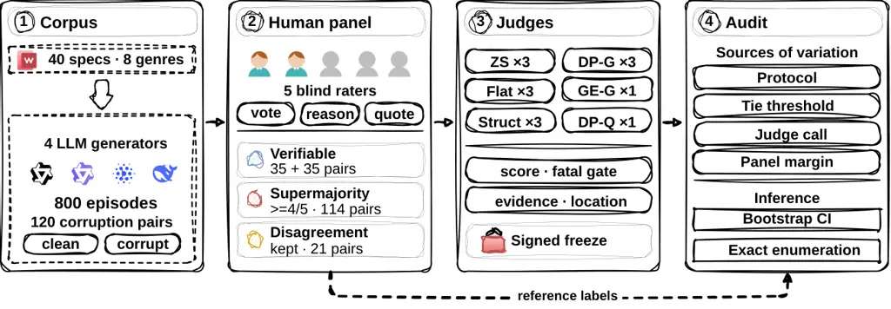
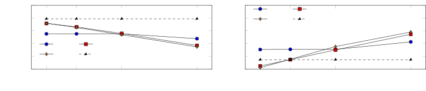

# DramaGrow: A Regime-Aware Benchmark for Auditing LLM Judges of Multi-Episode Drama

Hui Zhang    Yibo Su

###### Abstract

LLMs can now draft complete multi-episode dramas, and LLM judges are
increasingly used to evaluate them. Assessing the reliability of these
judges is difficult because drama quality encompasses
specification-backed errors, reproducible preferences, and legitimate
disagreement among human raters. Most existing evaluations reduce these
cases to a single score from one judge call and leave tie calibration,
call-to-call variation, and the vote margin underlying the human
reference unreported. We introduce DramaGrow, a regime-aware benchmark
and audit protocol for AI-generated Chinese five-episode drama. The
benchmark assigns verifiable constraint violations, four-of-five
preferences, and within-panel disagreements to separate denominators and
evidence rules. It contains 800 episodes, 120 byte-preserving
interventions, and 1,155 blinded five-rater records, including a frozen
extension with 114 supermajority pairs and 21 disagreement pairs. On the
frozen sets of 114 preference pairs and 35 constraint interventions, the
repeated absolute-score rubrics yield overlapping performance, with mean
accuracies of 53.8–55.8% and three-call agreement of 29.8–32.5%, and
their accuracy falls from 71.6–71.9% to 34.8–37.1% as the tie band
widens. DirectPair–GLM reaches 85.1% preference accuracy, 89.5%
constraint F1, and 81.9% Detect+Locate on the same items, and exact
subpanel enumeration identifies four-of-five as the smallest stable
human vote margin. Evaluation protocol, tie calibration, judge-call
variation, and panel margin therefore affect performance as much as
rubric design. We will release the specification packages, scripts,
interventions, anonymized human votes and rationales, frozen judge runs,
and analysis code.

¹Beijing Institute of Technology

²Heilongjiang University

huizhang.ai.2025@gmail.com

## Introduction

AI systems can generate scenes, episodes, and increasingly complete
serial narratives, and studios that produce vertical short-form dramas
must decide which machine-generated drafts to retain, revise, or
discard. Evaluating a five-episode drama requires reasoning at several
structural scales: dialogue may sound unnatural within a scene, an
episode may fail to escalate or resolve a setup, and a later episode may
contradict an earlier fact or allow a character to act on information
never disclosed to them. Human editors devote substantial effort to
identifying these failures, which has motivated the use of LLM judges.
This paper examines the reliability of such judges and introduces a
benchmark for reproducible and auditable evaluation.

Current evaluations often compare a holistic score from a single judge
call against an aggregated human label. Prior work has tested story
metrics through perturbations and human judgments (Guan et al. 2021),
evaluated drama continuation along domain-specific dimensions (Ma et al.
2025), learned predictors of creative-writing preferences (Fein et al.
2026), and built LLM evaluators around decomposed criteria (Liu et al.
2023; Hashemi et al. 2024). These pipelines typically leave evidence
locations unspecified, report only one judge call, and aggregate human
votes without retaining the vote margin.

Four factors complicate the evaluation of drama judges. (i) Mixed
evaluation regimes: some defects can be verified against a story
specification, some qualities produce reproducible panel preferences,
and some comparisons remain genuinely disputed. A single labeling rule
cannot represent all three cases. (ii) Judge-call variation: repeated
calls on the same input can produce different decisions. (iii) Tie
calibration: absolute-score protocols require a tie threshold, and both
accuracy and system ranking vary with this threshold. Clean controls are
also necessary to identify judges that overpredict defects. (iv)
Human-reference construction: panel size, vote margin, and panel
composition determine the stability of reference labels. Rubric
adaptation can also expose test information when the data split is not
sealed.

DramaGrow measures each factor directly. A fixed five-rater panel labels
blinded version pairs and records votes, reasons, and evidence spans.
These annotations define the reference labels, validate the controlled
corruptions, and support a subsequent audit of judge rationales. The
data are divided into three regimes: Verifiable defects checked against
the specification, Panel-Supermajority preferences supported by at least
four of five raters, and Within-Panel Disagreement pairs for which the
full vote distributions are retained. Judges return scores, fatal-gate
decisions, and localized evidence. We evaluate the three core rubric
configurations in three independent runs on identical inputs. We also
pair each corrupted script with its clean source, preregister and sweep
the tie thresholds, evaluate every subpanel, and seal the rubrics,
tasks, mappings, and analysis code before test execution.

We evaluate scoring protocol, tie calibration, rubric structure,
judge-call variation, and panel margin on common evaluation sets. Our
contributions are as follows:

- •
  A regime-aware benchmark for auditing drama judges, which assigns
  verifiable constraints, panel-supermajority preferences, and
  within-panel disagreements to separate analysis rules over 800
  generated episodes, 120 byte-preserving interventions, and 1,155
  blinded five-rater records with reasons and evidence.
- •
  An audit protocol combining repeated identical calls, preregistered
  tie-threshold sweeps, class-balanced fatal tests, localization credit,
  exact subpanel enumeration, and two-level bootstrap inference.
- •
  The finding that evaluation protocol has a larger measured effect than
  rubric representation: DirectPair–GLM reaches 85.1% preference
  accuracy and 89.5% constraint F1, the three absolute-score rubrics
  yield overlapping repeated-call results, and four-of-five is the
  smallest stable panel margin.



Figure 1: Overview of DramaGrow. (1) Four LLMs generate 800 episodes
from 40 specification packages in eight genres. Each of 120
byte-preserving interventions pairs a corrupted script with its clean
source. (2) A fixed five-rater panel labels blinded version pairs and
records votes, reasons, and quoted evidence. The records are divided
into specification-verifiable constraints, four-of-five panel
supermajorities, and within-panel disagreements, each with its own
denominator and evidence rule. (3) Six judge protocols return scores,
fatal-gate decisions, and localized evidence under a signed freeze.
Reference labels are used only during the audit. (4) Two-level bootstrap
intervals and exact subpanel enumeration measure variation from
protocol, tie calibration, judge call, and panel margin.

## Related Work

#### Drama and long-story evaluation.

Automatic story metrics agree poorly with human criteria (Chhun et al.
2022), which has motivated benchmarks that collect human judgments
directly: StoryER combines ranking, rating, and rationales (Chen et al.
2022), STORIUM provides machine-in-the-loop narratives with human
judgments (Akoury et al. 2020), and OpenMEVA adds perturbation tests
(Guan et al. 2021). Drama-specific work evaluates script continuation
along domain dimensions (Ma et al. 2025) and studies professional
interaction with generated screenplays (Mirowski et al. 2023). For
longer narratives, the recurring problems are outline-conditioned
coherence (Yang et al. 2023; Rashkin et al. 2020), book-length criteria
(Yang and Jin 2025), preference prediction (Fein et al. 2026), and
subfeature aggregation (Feng et al. 2026); surveys name evaluation
itself as a persistent bottleneck (Alabdulkarim et al. 2021). DramaGrow
complements this work by applying separate evidence rules and
denominators to constraints, panel supermajorities, and within-panel
disagreements.

#### LLM judges and rubric adaptation.

G-Eval uses criterion-guided reasoning and form filling (Liu et al.
2023), MT-Bench and Chatbot Arena combine model judgments with pairwise
human preferences (Zheng et al. 2023; Chiang et al. 2024), Prometheus
trains rubric-following models and extends to direct and pairwise
evaluation (Kim et al. 2024a; Kim et al. 2024b), and LLM-Rubric
calibrates multidimensional judgments against individual raters (Hashemi
et al. 2024). Outcomes vary with model identity, response position,
response style, and evaluation protocol (Wang et al. 2024; Chen et al.
2024; Shi et al. 2025); cross-task studies find systematic LLM–human
differences (Bavaresco et al. 2025), and stress tests find sensitivity
to perturbations (Jiang et al. 2026). Our experiments therefore include
identical-input retests and zero-adaptation evaluations.

Rubric adaptation ranges from generic prompt search (Honovich et al.
2023; Zhou et al. 2023) to fixed criteria with evidence checks (Hong et
al. 2026), model-generated rubrics (Siro et al. 2026), principles or
criteria inferred from preferences and comments (Findeis et al. 2025;
Xie et al. 2025; Yoshida et al. 2026), online criterion elicitation
(Rezaei et al. 2025), and human-seeded updates (Lin et al. 2026). Our
diagnostic evaluates preference agreement together with the preservation
of scene-level, episode-level, knowledge-state, and cross-episode
constraints.

#### Learning from disagreement.

Subjective annotations reflect ambiguity, rater perspective, and value
pluralism (Uma et al. 2021; Mostafazadeh Davani et al. 2022; Plank
2022). Perspectivist research examines whether a single aggregate label
adequately represents the annotator population (Fleisig et al. 2024).
Prescriptive and descriptive annotation encode different objectives
(Röttger et al. 2022), and jury learning makes panel composition
explicit (Gordon et al. 2022). Language Model Council similarly studies
heterogeneous model panels on subjective tasks (Zhao et al. 2025). We
use supermajority labels from a five-person panel for within-panel
preference evaluation and retain below-threshold pairs as within-panel
disagreements. These categories describe thresholded outcomes from full
vote distributions. Exact enumeration of leave-one-out and three-person
subpanels determines which vote margins remain stable under changes in
panel composition, while reviewer records are treated as correlated
observations.

## Problem Setup: Auditing Drama Judges

Let a generated drama be $`X=(E_{1},\ldots,E_{T})`$, where episode
$`E_{t}`$ contains an ordered sequence of scenes and is generated from
specification $`Z`$. The specification records character personas,
relationships, secrets and their initial holders, episode goals, plot
nodes, and setup–payoff threads. An evaluation unit $`u`$ is a scene
($`S`$), an episode ($`E`$), or the full series ($`F`$). Given
$`(Z,u)`$, the evaluator returns

```math
J_{R}(Z,u)=(q,\,f,\,e,\,\ell), \tag{1}
```

where $`q`$ is a quality score under rubric $`R`$, $`f`$ is a fatal-gate
decision, $`e`$ is textual evidence, and $`\ell`$ identifies the scene
and episode containing that evidence. The judge must assess the quality
of the unit, determine whether it contains a disqualifying defect, and
provide localized evidence for both decisions. The only external
information available to the judge is $`Z`$ and the script text. Gold
labels, generator identity, and corruption status are excluded from
every prompt. We evaluate judge $`J_{R}`$ throughout the paper. Success
is defined by agreement between the outputs of $`J_{R}`$ and the
regime-specific reference described below.

#### Three evaluation regimes.

In the Verifiable regime, correctness is determined from $`Z`$ and the
cross-episode state. A later claim either contradicts an established
fact or remains consistent with it. In the Panel-Supermajority regime,
at least four of five panelists select the same version, and controlled
degradations must also pass a manipulation check. In the Within-Panel
Disagreement regime, pairs below the supermajority threshold retain
their vote distributions and reasons and are excluded from
preference-accuracy calculations. These regimes operationalize the
judgments of one fixed five-person panel. Figure 1 illustrates the
corresponding data paths.

For a panel-supermajority pair $`(u^{A},u^{B})`$, an absolute-score
judge predicts $`\operatorname{sign}(q_{A}-q_{B})`$, with absolute score
differences of at most $`\tau=0.25`$ treated as ties. We additionally
report results for $`\tau\in\{0,.1,.25,.5\}`$ and for forced-choice
direct judges. For verifiable interventions, successful detection
requires a fatal-gate prediction for the corrupted version and no
fatal-gate prediction for the matched clean source. Full localization
credit further requires identification of the affected episode or scene.

## The DramaGrow Benchmark

### Structure-Grounded Rubrics

The detailed seed defines five fatal-gate categories and 16 quality
dimensions spread over the dialogue and scene level (L1), the
episode-structure level (L2), and the serial-orchestration level (L3),
covering causal or logical impossibility, behavior inconsistent with a
character, cross-episode contradiction, knowledge-boundary violation,
and malformed script structure (Supplement K). This release instantiates
the two information-state gates, cross-episode contradiction and
knowledge-boundary violation, as held-out verifiable tests.

A criterion is represented as $`c=(d,s,L,A,D,b)`$, where $`d`$ is the
criterion description, $`s\in\{S,E,F\}`$ is the scope, $`L`$ lists the
required evidence locations, $`A`$ lists the anchors in $`Z`$, $`D`$
specifies cross-unit dependencies, and $`b`$ defines the score
boundaries. Evaluating knowledge-boundary management, for example,
requires the secret specification, the disclosure event, and the later
line or action that uses the information. The flat control expresses the
same leaf-level criteria and evidence instructions in prose; the
structured rubric adds explicit fields and requires localized evidence.

The judge evaluates each version independently, produces dimension-level
scores and evidence, and applies the fatal-gate cascade. Pairwise
preference is derived after both evaluations. A single blinded
structured output can therefore support the preference,
defect-detection, and localization analyses.

### Repeated Calls and Balanced Fatal Tests

The main comparison includes three configurations: a zero-shot judge
(ZS), a content-matched flat rubric (Flat), and a structured rubric
(Struct). The released artifacts retain the historical identifiers C1,
C3, and C4 for these configurations. Run 0 is the original frozen run,
and runs 1 and 2 independently repeat every input with the same model,
endpoint, rubric, reasoning mode, 24K output limit, and service sampling
policy. Each run contains 228 side-level evaluations for 114 preference
pairs and 70 side-level evaluations for 35 matched clean–corrupted
intervention pairs. Missing calls and calls that fail after all retries
are counted as errors in the fixed denominator. We report per-run
accuracy, the mean, standard deviation, range, three-call majority vote,
all-call agreement, and Fleiss’ $`\kappa`$ to characterize call-to-call
variation (Supplement C).

Each configuration is also evaluated on a balanced set of 35 positive
and 35 negative items per run, from which we report positive- and
negative-specific agreement, three pairwise values of Cohen’s
$`\kappa`$, the mean Light’s $`\kappa`$, PABAK, separate I7 and I9
results, and pooled transition counts across runs.

#### Diagnostic adaptations.

Earlier experiments examined three forms of automatic rubric
modification: an external DramaBench-style rubric (Ext), a flat rubric
with heuristic updates (Flat+HL), and coarse- and fine-grained learned
structured rubrics (Struct+HL-c and Struct+HL-f). Supplements F, J,
and K report these experiments. The fine-grained arm selects its static
iteration-0 seed, the offline score-reweighting diagnostic (ReWeight;
Supplement G) fails its preregistered gate with a gain of exactly zero
percentage points, and none of the learned arms achieves a statistically
adjusted gain on the hidden test set. These systems are therefore
retained as diagnostic results and excluded from the benchmark ranking.

### Leakage Firewall

Series-level splitting is completed before rubric adaptation. Training
labels support rubric updates, development labels determine the stopping
point, and test artifacts remain sealed during both stages. Before test
execution, a signed manifest fixes the prompts, rubrics, exclusion
rules, analysis code, and file hashes. Resumed calls use the same signed
rubric and model configuration.

## Benchmark Corpus and Human Reference

### Scripts and Controlled Interventions

We create 40 setting packages across eight short-drama genres. Four
Chinese LLMs, qwen3.7-max, deepseek-v4-pro, glm-4.7, and qwen3.6-flash,
independently generate five episodes from each package, producing 160
series versions and 800 episodes. Every generator uses the same prompt
and decoding budget: temperature 0.8, top-$`p`$ 0.95, a 5K output limit,
and reasoning disabled. Anonymous labels A–D identify the four
generation sources throughout the analysis (Supplement I). The median
episode lengths for A–D are 43, 57, 36, and 54 nonblank lines,
respectively. The released pair-level records include these lengths
alongside each score difference to support analyses of length
sensitivity. The setting packages are stratified by genre into 16
training, 8 development, and 16 hidden-test series groups.

The benchmark contains 120 source–corruption pairs (Supplement A). Sixty
pairs instantiate verifiable defects: knowledge leakage (I7) and
cross-episode continuity contradiction (I9). The other 60 instantiate
preference-oriented degradations involving dialogue naturalness,
character voice, subtext, exposition, nonfunctional scenes, pacing,
payoff, and related properties (I1–I6 and I8). Mechanical checks verify
that each intended edit is present and that all non-target context is
preserved byte for byte. The constraint interventions use explicit
anchors from the story specification. Preference interventions enter the
accuracy calculation only after the panel confirms the intended loss of
quality.

|                                              |                 |
| -------------------------------------------- | --------------- |
| Item                                         | Count / value   |
| Genres / setting packages                    | 8 / 40          |
| Generator sources / episodes                 | 4 / 800         |
| Controlled interventions                     | 120             |
| Initial annotated pairs / records            | 96 / 480        |
| Extension pairs (S/E/F)                      | 135 (60/65/10)  |
| Extension panel-supermajority / disagreement | 114 / 21        |
| Extension 5/5 / 4/5 / 3/5 pairs              | 81 / 33 / 21    |
| Fleiss’ $`\kappa`$                           | 0.558           |
| Valid / annotated interventions              | 27 / 30         |
| Verifiable corrupted / matched clean         | 35 / 35         |
| Exact four-person / three-person panels      | 5 / 10 per pair |

Table 1: Frozen corpus and human-annotation ledger. A slash in an item
name separates the quantities its value reports, in the same order:
“Genres / setting packages” at “8 / 40” means eight genres and 40
packages. All five raters judge every pair, so the 480 initial and 675
extension records are correlated observations of 96 and 135 pair units,
not independent samples.

### Five-Rater Annotation

The annotation set contains 66 same-location pairs sampled across the
six unordered generator combinations and 30 blinded
preference-intervention pairs. Each rater evaluates 24 scene-level, 48
episode-level, and 24 full-series pairs. A/B order is randomized, model
identity and intervention status are hidden, and raters may select “hard
to distinguish.” For each pair, raters record a preference, confidence,
one primary reason, the affected structural level, one quoted evidence
span, and an optional fatal issue (Supplement B).

All five annotators are non-authors, and two have professional
experience in drama. Each of the 96 initial pair units is evaluated by
five annotators, producing 480 correlated pair–annotator records with
complete reasons and evidence spans. The total recorded annotation time
is 2,394 minutes, or 39.9 annotator-hours. Fifty-four pairs receive 5/5
agreement, 20 receive 4/5 agreement, 21 receive 3/5 agreement, and one
produces a 2/2/1 split. Following established agreement analyses (Cohen
1960; Fleiss 1971; Artstein and Poesio 2008), the three-state Fleiss’
$`\kappa`$ is 0.558. All raters exceed the preregistered
intervention-attention threshold of 75%, and 27 of 30 annotated
interventions pass the majority manipulation-validity check. Combining
the four-of-five rule with this validity check produces 72 initial
reference pairs: 32 for training, 15 for development, and 25 for private
testing.

Before the labels are revealed, we freeze a nonoverlapping extension of
135 cross-generator pairs from the 16 test series: 60 scene-level, 65
episode-level, and 10 full-series comparisons. Each position appears
once, and quotas are fixed for both generator pairs and series. The same
five annotators independently label every pair under blinded conditions.
Of these pairs, 114 receive at least four of five votes for one version,
while 21 remain in the within-panel-disagreement set. The resulting 675
human records support exact composition analyses of all five
leave-one-rater-out panels and all ten three-person panels for each
pair, with R4–R5 the frozen subgroup with professional drama experience.
The panel has three roles: it defines preference references for
supermajority pairs, identifies pairs retained as disagreements, and
contributes to the rationale-reception audit together with a separate
out-of-panel cohort (Supplement H).

Figure 2: Three independent calls for each core configuration. Each row
is one configuration: the three ticks are what run0, run1, and run2
actually returned, the filled marker is the expected single-call
estimate, and the capped line is its 95% two-level bootstrap interval
over series and judge calls. Panels are scaled to their own data, so
note the differing axes. Denominators are 114 panel-supermajority pairs
and 35 I7/I9 interventions with matched clean sources. Reading down a
panel: every interval covers every other configuration’s estimate, and
in (a) the ZS ticks straddle every Flat and Struct run.

Figure 3: Judge-call stability and score calibration. (a) Three-call
preference agreement and Fleiss’ $`\kappa`$. (b) Balanced fatal
sensitivity, specificity, and class-specific agreement. (c) Accuracy
under absolute-score tie thresholds. Absolute-score accuracy varies with
the tie threshold; forced-choice DirectPair has no tie parameter.

Figure 4: What the four-of-five threshold guarantees, from the existing
675 human records. Every subpanel of every pair is enumerated, so no bar
carries sampling error. Each bar reports how one family of subpanels
relates to the direction the full panel chose: all five
leave-one-rater-out panels, all ten three-person panels, and the two
drama-expert raters. A four-person panel can deadlock but can never
out-vote the majority, and a three-person panel always decides, so the
failure modes differ by family. Four-of-five is the smallest margin no
subpanel can overturn; only the professional dyad, which the threshold
does not constrain, splits earlier. No machine annotation is used.

## Experiments

#### Research questions.

RQ1: does ZS, Flat, or Struct hold a reproducible advantage once
judge-call variation is included? RQ2: are fatal-gate decisions
repeatable on a balanced set of corrupted and clean scripts? RQ3: how
much of each vote margin’s direction survives exact subpanel
enumeration? RQ4: how do DirectPair, G-Eval-style, and open-weight
judges compare on the common evaluation sets, and how sensitive are the
absolute-score systems to $`\tau`$?

| ID     | Configuration            | Output            | Runs | $`\tau`$ |
| ------ | ------------------------ | ----------------- | ---- | -------- |
| ZS     | Zero-shot absolute judge | score+fatal       | 3    | yes      |
| Flat   | Flat static rubric       | score+fatal       | 3    | yes      |
| Struct | Structured static rubric | score+fatal+loc.  | 3    | yes      |
| DP-G   | DirectPair–GLM           | forced pair+fatal | 3    | no       |
| GE-G   | G-Eval–GLM               | form score+fatal  | 1    | yes      |
| DP-Q   | DirectPair–Qwen-30B      | forced pair+fatal | 1    | no       |

Table 2: Main configurations and full-denominator baselines. The
released artifacts index ZS, Flat, and Struct as C1, C3, and C4.

#### Configurations and models.

Table 2 lists the three core absolute-score systems and the three
full-denominator baselines. Each comparison isolates one design factor:
ZS against Flat isolates whether a rubric is provided, Flat against
Struct how the same criteria are represented, DP-G the comparison
protocol on the same model, and DP-Q the execution model. ZS, Flat, and
Struct use GLM-5.2 with reasoning enabled, temperature 1.0, top-$`p`$
0.95, and a 24K output limit. DP-G returns a forced anonymous A/B choice
with the fatal category and location for each version, GE-G uses fixed
criteria, explicit evaluation steps, and a 1–5 form, and DP-Q applies
the direct protocol with the open-weight Qwen3-30B-A3B-Instruct-2507
model (Qwen Team 2025). All systems use a deterministic, reversible A/B
shuffle and identical script context; gold labels and clean or corrupted
status are excluded from every prompt. Each result record includes the
task, run, prompt or rubric hash, model, endpoint, and anonymous
mapping, and API failures remain errors in the fixed denominator. The
earlier ToW and RULERS experiments cover 25 preference pairs and are
retained as pilots outside the 114-pair comparison (Supplement J).

#### Metrics and inference.

Preference accuracy is the proportion of predictions that agree with the
panel-supermajority reference across 114 extension pairs from 16 series;
we report this raw agreement rate without estimating a Bradley–Terry
ranking (Bradley and Terry 1952). On the verifiable track of 35 I7/I9
corruptions and their matched clean sources, sensitivity measures defect
detection and specificity measures correct rejection on clean scripts,
intervention-macro F1 summarizes that balance within each intervention
type, and Detect+Locate additionally requires the evidence to identify
the correct episode. The 21 below-threshold pairs retain their votes and
reasons and are excluded from accuracy calculations.

Confidence intervals are estimated from 10,000 two-level bootstrap
samples. Each sample first resamples series and then selects one of the
three judge calls for each sampled item (Efron 1979). The contrasts
ZS–Flat, ZS–Struct, and Flat–Struct form one Holm correction family
(Holm 1979). Because low-powered NLP comparisons can produce unstable
rankings (Dror et al. 2018; Card et al. 2020), we also report results
for each run and for the three-call majority ensemble. These additional
results preserve information about run-to-run variation beyond the
confidence intervals. Absolute-score systems are evaluated at
$`\tau\in\{0,.1,.25,.5\}`$, with the corresponding tie rates and
score-difference distributions. Direct systems use forced choice, and
exact subpanel enumeration introduces no Monte Carlo error.

### Main Comparisons

The repeated-call intervals of the three absolute-score rubrics overlap
(RQ1). Figure 2 reports all three calls. Mean panel-supermajority
accuracy is 55.3% for ZS, 55.8% for Flat, and 53.8% for Struct. The
corresponding run ranges are \[50.0, 64.0\], \[55.3, 57.0\], and \[51.8,
56.1\] percent. The expected single-call contrasts are ZS–Flat $`=-0.5`$
percentage points (95% CI \[-11.2, 10.3\], Holm-adjusted $`p=1.000`$),
ZS–Struct $`=1.5`$ percentage points (95% CI \[-9.9, 13.4\],
$`p=1.000`$), and Flat–Struct $`=2.0`$ percentage points (95% CI \[-9.3,
13.3\], $`p=1.000`$). The ZS results range from 50.0% to 64.0%, spanning
values below and above every run of Flat and Struct. We therefore
characterize each configuration by its repeated-call distribution.

The balanced fatal track yields similar sensitivity across rubric
variants but different false-positive rates on clean scripts (RQ2). Mean
sensitivity and specificity are 66.7% and 94.3% for ZS, 65.7% and 89.5%
for Flat, and 67.6% and 86.7% for Struct. Mean Detect+Locate is 61.0%,
55.2%, and 60.0%, respectively. The separation sits on the clean
sources: at similar detection rates, the false-positive rate is 5.7% for
ZS against 13.3% for Struct, so the added structure buys no extra
detection here but alarms more often on clean scripts.

#### Unified strong baselines.

Evaluation protocol produces the largest measured difference in the
full-denominator comparison (RQ4). DirectPair–GLM achieves 85.1% mean
preference accuracy, 89.5% constraint F1, and 81.9% Detect+Locate. Each
of its three runs achieves 85.1%, which exceeds the highest single-run
accuracy among the absolute-score systems. Three-call agreement at the
item level is 70.2% ($`\kappa=0.60`$), indicating that identical
aggregate accuracy can include different item-level decisions.
G-Eval–GLM achieves 78.9% preference accuracy, 43.2% constraint F1, and
28.6% Detect+Locate. The corresponding results for DirectPair–Qwen are
80.7%, 83.0%, and 51.4%. All systems use the same sets of 114 preference
pairs and 35 constraint interventions (Supplement D), which excludes
denominator size as an explanation for the differences. DP-G and the
absolute-score systems use the same GLM, enabling a within-model
comparison of protocol bundles. DP-Q evaluates transfer of the direct
protocol to an open-weight model.

| System | Pref. | Run range      | F1   | D+L  | FPR$`\downarrow`$ | Calls |
| ------ | ----- | -------------- | ---- | ---- | ----------------- | ----- |
| ZS     | 55.3  | \[50.0, 64.0\] | 76.9 | 61.0 | 5.7               | 3     |
| Flat   | 55.8  | \[55.3, 57.0\] | 74.5 | 55.2 | 10.5              | 3     |
| Struct | 53.8  | \[51.8, 56.1\] | 74.0 | 60.0 | 13.3              | 3     |
| DP-G   | 85.1  | \[85.1, 85.1\] | 89.5 | 81.9 | 1.9               | 3     |
| GE-G   | 78.9  | –              | 43.2 | 28.6 | 2.9               | 1     |
| DP-Q   | 80.7  | –              | 83.0 | 51.4 | 17.1              | 1     |

Table 3: Unified results on the common sets of 114 preference pairs and
35 constraint interventions (percent). Bold indicates the best value in
each column, and underlining indicates the second-best value. The
DirectPair–GLM row is shaded because it has the best value in four of
the five performance columns. Three-call entries are means, with the
minimum and maximum preference accuracies across runs shown as ranges.
Single-call baselines are evaluated in one frozen run. Preference
accuracy is identical across the three runs of DP-G.

### Decision Repeatability

Item-level decisions are substantially less stable than the aggregate
percentages suggest. Figure 3 reports preference repeatability, balanced
fatal-gate reliability, and calibration. Three-call preference agreement
is 32.5% for ZS, 29.8% for Flat, and 31.6% for Struct, with
corresponding Fleiss’ $`\kappa`$ values of 0.31, 0.25, and 0.27.
Fatal-gate decisions are more repeatable than preference decisions.
Positive-specific agreement is 76.3%, 70.1%, and 67.1%, and
negative-specific agreement is 86.6%, 81.4%, and 77.5%, respectively.
The corresponding mean values of Light’s $`\kappa`$ are 0.63, 0.52, and
0.45. The balanced design estimates reproducibility separately for
positive and negative items.

Changing $`\tau`$ affects both accuracy and tie rate for ZS, Flat,
Struct, and G-Eval. Figure 3 reports the complete threshold curves.
DirectPair uses forced choice and therefore has no tie threshold. The
Qwen baseline changes both the execution model and the scoring protocol
and serves as an open-weight portability check.

## Analysis, Scope, and Ethics

#### Why four-of-five is the threshold.

To answer RQ3, Figure 4 uses the 675 completed human records to evaluate
the four-of-five rule (Supplement E). By construction, a 5/5 or 4/5
majority retains its direction in every leave-one-rater-out and
three-person subpanel, and exact enumeration confirms 100% retention for
all 81 pairs at 5/5 and all 33 at 4/5. At 3/5, leave-one-out panels
retain the full-panel direction only 40.0% of the time and go unresolved
60.0%, while three-person panels reverse it 30.0% of the time.
Four-of-five is therefore the smallest vote margin invariant to the
removal of any one rater, which is why the 21 pairs below it remain in
the disagreement set rather than receiving a preference label.

#### What the structured rubric isolates.

The clearest observed effect of the structured rubric concerns the
reception of rationales, not the accuracy of decisions. Struct bundles
explicit criterion fields with mandatory localization, specification
anchors, and a fixed output format, so the Flat–Struct contrast
estimates their combined effect and the released artifacts carry the
per-field attribution. In the out-of-panel audit (Supplement H), Struct
receives 30/32 majority decisions for reasonableness, 29/32 for evidence
support, and 104/160 for reason coverage. It also produces the longest
outputs, so we report rationale reception separately from decision
accuracy.

#### Judge and protocol dependence.

The systems in Table 3 differ in scoring protocol, input format, and
execution model, and each difference carries a deployment meaning.
DirectPair sees both versions, so its margin describes screening in
which a reference draft is available; ZS reads one script at a time and
describes single-script screening. The two settings are not
interchangeable, and the DP-G margin does not transfer to the
single-script case. G-Eval combines 28.6% sensitivity with 97.1%
specificity, a conservative fatal-gate policy that rejects few clean
scripts and misses most defects. DP-Q retains most of the direct
protocol’s preference accuracy on an open-weight model, but not its
localization or clean-side calibration.

Tie calibration moves the absolute-score systems as much as any rubric
choice does: Flat and Struct fall from 71.6% and 71.9% at $`\tau=0`$ to
37.1% and 34.8% at $`\tau=.5`$, and their order reverses along the way.

#### Limitations.

The conclusions of this audit are limited to the frozen evaluation sets
in several respects. First, the corpus consists of synthetic Chinese
five-episode vertical short-form dramas from eight genres and 16
held-out series clusters. Generalization to other languages, narrative
lengths, and production settings requires separate evaluation. Second,
the human reference is derived from one fixed five-person panel. A panel
with a different composition may define different boundaries between
supermajority preference and disagreement. Third, the verifiable
experiment covers two information-state gates, knowledge-boundary
violation and cross-episode continuity violation, using matched clean
sources. The other three gates are specified but have no test instances
in this release. Repeatability estimates are based on three calls, each
HL seed has one optimizer trajectory, and the cross-judge analysis uses
one GLM-family judge pipeline. Future releases will evaluate the
remaining fatal gates, longer serial narratives, additional genres and
languages, and additional human panels.

#### Ethics and data governance.

All scripts in the benchmark are synthetic. The five non-author
annotators and the independent audit reviewers participated voluntarily
under disclosed protocols, with compensation or authorship arranged
before participation. The subpanel analysis reuses their completed
records, and every label in it is human. Released identifiers are
anonymized, attribution-session records remain private, and raw labels
are immutable.

#### Release and reproducibility.

The release separates four provenance layers: scripts and specification
packages; controlled source–corruption pairs; anonymized human
preferences, reasons, and evidence spans; and frozen judge executions.
Every prediction is bound to its task, configuration, run, input and
rubric hashes, and model identifiers, and denominator records report
expected, valid, and failed counts, so a call that exhausts the
format-retry policy stays visible rather than disappearing from a
denominator. Offline scripts reconstruct every reported number, from
panel margins to bootstrap intervals and figure data, without further
model calls, and historical pilots and audits are stored in separately
named artifact families (Supplement J). A new judge can therefore be
evaluated zero-adaptation on the released sets.

## Conclusion

We introduced DramaGrow, a regime-aware benchmark and audit protocol for
evaluating LLM judges of AI-generated multi-episode drama: 800 episodes,
120 paired interventions, 1,155 blinded five-rater records,
regime-specific evaluation rules, and offline audit code. On its frozen
sets the repeated-call results of the absolute-score rubrics overlap,
while DirectPair–GLM leads on the same GLM at every run and tie
threshold, so protocol outweighs rubric representation here. The results
support four reporting practices: repeat judge calls, preregister and
sweep the tie threshold, pair corrupted tests with clean sources, and
retain votes and reasons for below-threshold pairs. This audit design
should transfer to other long-form creative tasks that mix verifiable
errors, majority preferences, and human disagreement.

## References

- Akoury et al. (2020) N. Akoury, S. Wang, J. Whiting, S. Hood, N. Peng,
  and M. Iyyer STORIUM: a dataset and evaluation platform for
  machine-in-the-loop story generation. In Proceedings of EMNLP,
  pp. 6470–6484. External Links:
  [Document](https://dx.doi.org/10.18653/v1/2020.emnlp-main.525) Cited
  by: Drama and long-story evaluation..
- Alabdulkarim et al. (2021) A. Alabdulkarim, S. Li, and X. Peng
  Automatic story generation: challenges and attempts. In Proceedings of
  the Third Workshop on Narrative Understanding, pp. 72–83. External
  Links: [Document](https://dx.doi.org/10.18653/v1/2021.nuse-1.8) Cited
  by: Drama and long-story evaluation..
- Artstein and Poesio (2008) R. Artstein and M. Poesio Survey article:
  inter-coder agreement for computational linguistics. Computational
  Linguistics 34 (4), pp. 555–596. External Links:
  [Document](https://dx.doi.org/10.1162/coli.07-034-R2) Cited by:
  Five-Rater Annotation.
- Bavaresco et al. (2025) A. Bavaresco, R. Bernardi, L. Bertolazzi, D.
  Elliott, R. Fernández, A. Gatt, E. Ghaleb, M. Giulianelli, M.
  Hanna, A. Koller, A. Martins, P. Mondorf, V. Neplenbroek, S.
  Pezzelle, B. Plank, D. Schlangen, A. Suglia, A. K. Surikuchi, E.
  Takmaz, and A. Testoni LLMs instead of human judges? a large scale
  empirical study across 20 NLP evaluation tasks. In Proceedings of ACL,
  pp. 238–255. External Links:
  [Document](https://dx.doi.org/10.18653/v1/2025.acl-short.20) Cited by:
  LLM judges and rubric adaptation..
- Bradley and Terry (1952) R. A. Bradley and M. E. Terry Rank analysis
  of incomplete block designs: i. the method of paired comparisons.
  Biometrika 39 (3/4), pp. 324–345. External Links:
  [Document](https://dx.doi.org/10.1093/biomet/39.3-4.324) Cited by:
  Metrics and inference..
- Card et al. (2020) D. Card, P. Henderson, U. Khandelwal, R. Jia, K.
  Mahowald, and D. Jurafsky With little power comes great
  responsibility. In Proceedings of EMNLP, pp. 9263–9274. External
  Links: [Document](https://dx.doi.org/10.18653/v1/2020.emnlp-main.745)
  Cited by: Metrics and inference..
- Chen et al. (2024) G. H. Chen, S. Chen, Z. Liu, F. Jiang, and B. Wang
  Humans or LLMs as the judge? a study on judgement bias. In Proceedings
  of EMNLP, pp. 8301–8327. External Links:
  [Document](https://dx.doi.org/10.18653/v1/2024.emnlp-main.474) Cited
  by: LLM judges and rubric adaptation..
- Chen et al. (2022) H. Chen, D. Vo, H. Takamura, Y. Miyao, and H.
  Nakayama StoryER: automatic story evaluation via ranking, rating and
  reasoning. In Proceedings of EMNLP, pp. 1739–1753. External Links:
  [Document](https://dx.doi.org/10.18653/v1/2022.emnlp-main.114) Cited
  by: Drama and long-story evaluation..
- Chhun et al. (2022) C. Chhun, P. Colombo, F. M. Suchanek, and C.
  Clavel Of human criteria and automatic metrics: a benchmark of the
  evaluation of story generation. In Proceedings of COLING,
  pp. 5794–5836. External Links:
  [Document](https://dx.doi.org/10.18653/v1/2022.coling-1.509),
  [Link](https://aclanthology.org/2022.coling-1.509/) Cited by: Drama
  and long-story evaluation..
- Chiang et al. (2024) W. Chiang, L. Zheng, Y. Sheng, A. N.
  Angelopoulos, T. Li, D. Li, B. Zhu, H. Zhang, M. Jordan, J. E.
  Gonzalez, and I. Stoica Chatbot arena: an open platform for evaluating
  LLMs by human preference. In Proceedings of ICML, Proceedings of
  Machine Learning Research, Vol. 235, pp. 8359–8388. External Links:
  [Link](https://proceedings.mlr.press/v235/chiang24b.html) Cited by:
  LLM judges and rubric adaptation..
- Cohen (1960) J. Cohen A coefficient of agreement for nominal scales.
  Educational and Psychological Measurement 20 (1), pp. 37–46. External
  Links: [Document](https://dx.doi.org/10.1177/001316446002000104) Cited
  by: Five-Rater Annotation.
- Dror et al. (2018) R. Dror, G. Baumer, S. Shlomov, and R. Reichart The
  hitchhiker’s guide to testing statistical significance in natural
  language processing. In Proceedings of ACL, pp. 1383–1392. External
  Links: [Document](https://dx.doi.org/10.18653/v1/P18-1128) Cited by:
  Metrics and inference..
- Efron (1979) B. Efron Bootstrap methods: another look at the
  jackknife. The Annals of Statistics 7 (1), pp. 1–26. External Links:
  [Document](https://dx.doi.org/10.1214/aos/1176344552) Cited by:
  Metrics and inference..
- Fein et al. (2026) D. Fein, S. Russo, V. Xiang, K. Jolly, R. Rafailov,
  and N. Haber LitBench: a benchmark and dataset for reliable evaluation
  of creative writing. In Proceedings of EACL, pp. 7740–7755. External
  Links: [Document](https://dx.doi.org/10.18653/v1/2026.eacl-long.362)
  Cited by: Introduction, Drama and long-story evaluation..
- Feng et al. (2026) A. Z. Feng, C. Wang, Y. Luo, L. Fan, I. Zhou, Z.
  Wang, X. Gu, J. Tang, H. Wang, and M. Huang HoWToBench: holistic
  evaluation for LLM’s capability in human-level writing using tree of
  writing. In Proceedings of the 64th Annual Meeting of the Association
  for Computational Linguistics (Volume 1: Long Papers), pp. 6986–7034.
  External Links:
  [Document](https://dx.doi.org/10.18653/v1/2026.acl-long.317),
  [Link](https://aclanthology.org/2026.acl-long.317/) Cited by: Drama
  and long-story evaluation..
- Findeis et al. (2025) A. Findeis, T. Kaufmann, E. Hüllermeier, S.
  Albanie, and R. Mullins Inverse constitutional AI: compressing
  preferences into principles. In International Conference on Learning
  Representations, External Links:
  [Link](https://openreview.net/forum?id=9FRwkPw3Cn) Cited by: LLM
  judges and rubric adaptation..
- Fleisig et al. (2024) E. Fleisig, S. L. Blodgett, D. Klein, and Z.
  Talat The perspectivist paradigm shift: assumptions and challenges of
  capturing human labels. In Proceedings of NAACL, pp. 2279–2292.
  External Links:
  [Document](https://dx.doi.org/10.18653/v1/2024.naacl-long.126) Cited
  by: Learning from disagreement..
- Fleiss (1971) J. L. Fleiss Measuring nominal scale agreement among
  many raters. Psychological Bulletin 76 (5), pp. 378–382. External
  Links: [Document](https://dx.doi.org/10.1037/h0031619) Cited by:
  Five-Rater Annotation.
- Gordon et al. (2022) M. L. Gordon, M. S. Lam, J. S. Park, K.
  Patel, J. T. Hancock, T. Hashimoto, and M. S. Bernstein Jury learning:
  integrating dissenting voices into machine learning models. In
  Proceedings of the 2022 CHI Conference on Human Factors in Computing
  Systems, pp. 1–19. External Links:
  [Document](https://dx.doi.org/10.1145/3491102.3502004) Cited by:
  Learning from disagreement..
- Guan et al. (2021) J. Guan, Z. Zhang, Z. Feng, Z. Liu, W. Ding, X.
  Mao, C. Fan, and M. Huang OpenMEVA: a benchmark for evaluating
  open-ended story generation metrics. In Proceedings of ACL-IJCNLP,
  pp. 6394–6407. External Links:
  [Document](https://dx.doi.org/10.18653/v1/2021.acl-long.500) Cited by:
  Introduction, Drama and long-story evaluation..
- Hashemi et al. (2024) H. Hashemi, J. Eisner, C. Rosset, B. Van Durme,
  and C. Kedzie LLM-rubric: a multidimensional, calibrated approach to
  automated evaluation of natural language texts. In Proceedings of ACL,
  pp. 13806–13834. External Links:
  [Document](https://dx.doi.org/10.18653/v1/2024.acl-long.745) Cited by:
  Introduction, LLM judges and rubric adaptation..
- Holm (1979) S. Holm A simple sequentially rejective multiple test
  procedure. Scandinavian Journal of Statistics 6 (2), pp. 65–70.
  External Links: [Link](https://www.jstor.org/stable/4615733) Cited by:
  Metrics and inference..
- Hong et al. (2026) Y. Hong, H. Yao, B. Shen, W. Xu, H. Wei, and Y.
  Dong From rubrics to reliable scores: evidence-grounded text
  evaluation with LLM judges. arXiv preprint arXiv:2601.08654. External
  Links: [Document](https://dx.doi.org/10.48550/arXiv.2601.08654),
  [Link](https://arxiv.org/abs/2601.08654) Cited by: LLM judges and
  rubric adaptation..
- Honovich et al. (2023) O. Honovich, U. Shaham, S. R. Bowman, and O.
  Levy Instruction induction: from few examples to natural language task
  descriptions. In Proceedings of ACL, pp. 1935–1952. External Links:
  [Document](https://dx.doi.org/10.18653/v1/2023.acl-long.108) Cited by:
  LLM judges and rubric adaptation..
- Jiang et al. (2026) H. Jiang, Y. Chen, Y. Cao, H. Lee, and R. T. Tan
  CodeJudgeBench: benchmarking LLM-as-a-judge for coding tasks. In
  Proceedings of ACL, pp. 19416–19448. External Links:
  [Document](https://dx.doi.org/10.18653/v1/2026.acl-long.888) Cited by:
  LLM judges and rubric adaptation..
- Kim et al. (2024a) S. Kim, J. Shin, Y. Cho, J. Jang, S. Longpre, H.
  Lee, S. Yun, S. Shin, S. Kim, J. Thorne, and M. Seo Prometheus:
  inducing fine-grained evaluation capability in language models. In
  International Conference on Learning Representations, External Links:
  [Link](https://openreview.net/forum?id=8euJaTveKw) Cited by: LLM
  judges and rubric adaptation..
- Kim et al. (2024b) S. Kim, J. Suk, S. Longpre, B. Y. Lin, J. Shin, S.
  Welleck, G. Neubig, M. Lee, K. Lee, and M. Seo Prometheus 2: an open
  source language model specialized in evaluating other language models.
  In Proceedings of EMNLP, pp. 4334–4353. External Links:
  [Document](https://dx.doi.org/10.18653/v1/2024.emnlp-main.248) Cited
  by: LLM judges and rubric adaptation..
- Lin et al. (2026) Y. Lin, Y. Gao, Z. Lin, D. Li, K. Peng, and Y. Liu
  GrowLoop: self-evolving conversation evaluation seeded by human. arXiv
  preprint arXiv:2605.28882. External Links:
  [Link](https://arxiv.org/abs/2605.28882) Cited by: LLM judges and
  rubric adaptation..
- Liu et al. (2023) Y. Liu, D. Iter, Y. Xu, S. Wang, R. Xu, and C. Zhu
  G-eval: NLG evaluation using GPT-4 with better human alignment. In
  Proceedings of EMNLP, pp. 2511–2522. External Links:
  [Document](https://dx.doi.org/10.18653/v1/2023.emnlp-main.153) Cited
  by: Introduction, LLM judges and rubric adaptation..
- Ma et al. (2025) S. Ma, Y. Huang, and Y. Lin DramaBench: a
  six-dimensional evaluation framework for drama script continuation.
  arXiv preprint arXiv:2512.19012. External Links:
  [Link](https://arxiv.org/abs/2512.19012) Cited by: Introduction, Drama
  and long-story evaluation..
- Mirowski et al. (2023) P. Mirowski, K. W. Mathewson, J. Pittman,
  and R. Evans Co-writing screenplays and theatre scripts with language
  models: evaluation by industry professionals. In Proceedings of the
  2023 CHI Conference on Human Factors in Computing Systems, pp. 1–34.
  External Links: [Document](https://dx.doi.org/10.1145/3544548.3581225)
  Cited by: Drama and long-story evaluation..
- Mostafazadeh Davani et al. (2022) A. Mostafazadeh Davani, M. Díaz,
  and V. Prabhakaran Dealing with disagreements: looking beyond the
  majority vote in subjective annotations. Transactions of the
  Association for Computational Linguistics 10, pp. 92–110. External
  Links: [Document](https://dx.doi.org/10.1162/tacl%5Fa%5F00449) Cited
  by: Learning from disagreement..
- Plank (2022) B. Plank The “problem” of human label variation: on
  ground truth in data, modeling and evaluation. In Proceedings of
  EMNLP, pp. 10671–10682. External Links:
  [Document](https://dx.doi.org/10.18653/v1/2022.emnlp-main.731) Cited
  by: Learning from disagreement..
- Qwen Team (2025) Qwen Team Qwen3-30B-A3B-Instruct-2507 model card.
  Note: Hugging Face model repositoryApache-2.0 open weights; accessed
  2026-07-16 External Links:
  [Link](https://huggingface.co/Qwen/Qwen3-30B-A3B-Instruct-2507) Cited
  by: Configurations and models..
- Rashkin et al. (2020) H. Rashkin, A. Celikyilmaz, Y. Choi, and J. Gao
  PlotMachines: outline-conditioned generation with dynamic plot state
  tracking. In Proceedings of EMNLP, pp. 4274–4295. External Links:
  [Document](https://dx.doi.org/10.18653/v1/2020.emnlp-main.349) Cited
  by: Drama and long-story evaluation..
- Rezaei et al. (2025) M. Rezaei, R. Vacareanu, Z. Wang, C. Wang, B.
  Liu, Y. He, and A. F. Akyürek Online rubrics elicitation from pairwise
  comparisons. arXiv preprint arXiv:2510.07284. External Links:
  [Link](https://arxiv.org/abs/2510.07284) Cited by: LLM judges and
  rubric adaptation..
- Röttger et al. (2022) P. Röttger, B. Vidgen, D. Hovy, and J.
  Pierrehumbert Two contrasting data annotation paradigms for subjective
  NLP tasks. In Proceedings of NAACL-HLT, pp. 175–190. External Links:
  [Document](https://dx.doi.org/10.18653/v1/2022.naacl-main.13) Cited
  by: Learning from disagreement..
- Shi et al. (2025) L. Shi, C. Ma, W. Liang, X. Diao, W. Ma, and S.
  Vosoughi Judging the judges: a systematic study of position bias in
  LLM-as-a-judge. In Proceedings of IJCNLP-AACL, pp. 292–314. External
  Links: [Document](https://dx.doi.org/10.18653/v1/2025.ijcnlp-long.18)
  Cited by: LLM judges and rubric adaptation..
- Siro et al. (2026) C. Siro, P. Aliannejadi, and M. Aliannejadi
  Learning to judge: LLMs designing and applying evaluation rubrics. In
  Findings of EACL, pp. 6371–6389. External Links:
  [Document](https://dx.doi.org/10.18653/v1/2026.findings-eacl.335)
  Cited by: LLM judges and rubric adaptation..
- Uma et al. (2021) A. N. Uma, T. Fornaciari, D. Hovy, S. Paun, B.
  Plank, and M. Poesio Learning from disagreement: a survey. Journal of
  Artificial Intelligence Research 72, pp. 1385–1470. External Links:
  [Document](https://dx.doi.org/10.1613/jair.1.12752) Cited by: Learning
  from disagreement..
- Wang et al. (2024) P. Wang, L. Li, L. Chen, Z. Cai, D. Zhu, B. Lin, Y.
  Cao, L. Kong, Q. Liu, T. Liu, and Z. Sui Large language models are not
  fair evaluators. In Proceedings of ACL, pp. 9440–9450. External Links:
  [Document](https://dx.doi.org/10.18653/v1/2024.acl-long.511) Cited by:
  LLM judges and rubric adaptation..
- Xie et al. (2025) L. Xie, S. Huang, Z. Zhang, A. Zou, Y. Zhai, D.
  Ren, K. Zhang, H. Hu, B. Liu, H. Chen, Z. Liu, and B. Ding
  Auto-Rubric: learning from implicit weights to explicit rubrics for
  reward modeling. arXiv preprint arXiv:2510.17314. External Links:
  [Link](https://arxiv.org/abs/2510.17314) Cited by: LLM judges and
  rubric adaptation..
- Yang and Jin (2025) D. Yang and Q. Jin What matters in evaluating
  book-length stories? a systematic study of long story evaluation. In
  Proceedings of ACL, pp. 16375–16398. External Links:
  [Document](https://dx.doi.org/10.18653/v1/2025.acl-long.799) Cited by:
  Drama and long-story evaluation..
- Yang et al. (2023) K. Yang, D. Klein, N. Peng, and Y. Tian DOC:
  improving long story coherence with detailed outline control. In
  Proceedings of ACL, pp. 3378–3465. External Links:
  [Document](https://dx.doi.org/10.18653/v1/2023.acl-long.190) Cited by:
  Drama and long-story evaluation..
- Yoshida et al. (2026) K. Yoshida, S. Kuroki, Y. Imajuku, T.
  Nakamura, R. Iwai, H. Goda, and T. Akiba Feedback-to-rubrics: can we
  learn expert criteria from inline comments?. arXiv preprint
  arXiv:2605.29857. External Links:
  [Link](https://arxiv.org/abs/2605.29857) Cited by: LLM judges and
  rubric adaptation..
- Zhao et al. (2025) J. Zhao, F. M. Plaza-del-Arco, B. Genchel,
  and A. C. Curry Language model council: democratically benchmarking
  foundation models on highly subjective tasks. In Proceedings of the
  2025 Conference of the Nations of the Americas Chapter of the
  Association for Computational Linguistics: Human Language Technologies
  (Volume 1: Long Papers), pp. 12395–12450. External Links:
  [Document](https://dx.doi.org/10.18653/v1/2025.naacl-long.617),
  [Link](https://aclanthology.org/2025.naacl-long.617/) Cited by:
  Learning from disagreement..
- Zheng et al. (2023) L. Zheng, W. Chiang, Y. Sheng, S. Zhuang, Z.
  Wu, Y. Zhuang, Z. Lin, Z. Li, D. Li, E. P. Xing, H. Zhang, J. E.
  Gonzalez, and I. Stoica Judging LLM-as-a-judge with MT-bench and
  chatbot arena. In Advances in Neural Information Processing Systems,
  Vol. 36, pp. 46595–46623. External Links:
  [Link](https://proceedings.neurips.cc/paper_files/paper/2023/hash/91f18a1287b398d378ef22505bf41832-Abstract-Datasets_and_Benchmarks.html)
  Cited by: LLM judges and rubric adaptation..
- Zhou et al. (2023) Y. Zhou, A. I. Muresanu, Z. Han, K. Paster, S.
  Pitis, H. Chan, and J. Ba Large language models are human-level prompt
  engineers. In International Conference on Learning Representations,
  External Links: [Link](https://openreview.net/forum?id=92gvk82DE-)
  Cited by: LLM judges and rubric adaptation..

Supplementary Material

#### System naming.

This supplement uses the descriptive system names adopted in the main
paper. The released artifacts, frozen logs, and manifests retain the
historical identifiers. ZS corresponds to C1 (zero-shot judge), Ext to
C2 (external DramaBench-style rubric), Flat to C3 (flat static rubric),
Struct to C4 (structured static rubric), Flat+HL to C6 (flat rubric with
heuristic updates), Struct+HL-c and Struct+HL-f to C7-c and C7-d
(coarse- and fine-grained learned structured rubrics), and ReWeight to
C8 (offline score-reweighting diagnostic).

## A Intervention Taxonomy

The 120 controlled interventions support the regime-specific analyses in
the benchmark. Story-specification anchors and contradictory text spans
make I7 and I9 directly verifiable, and these intervention types
constitute the held-out constraint track. Independent human judgments
validate I1–I6 and I8 before these interventions enter the
panel-supermajority accuracy calculation. All non-target episodes are
copied byte for byte from the source.

| ID  | Intervention                  | Level | Regime      |
| --- | ----------------------------- | ----- | ----------- |
| I1  | Remove episode-end hook       | L2    | Panel pref. |
| I2  | Flatten a reversal            | L2    | Panel pref. |
| I3  | Delete setup, keep payoff     | L2    | Panel pref. |
| I4  | Inject a nonfunctional scene  | L2    | Panel pref. |
| I5  | Swap dialogue across roles    | L1    | Panel pref. |
| I6  | Remove a relationship trigger | L3    | Panel pref. |
| I7  | Violate a knowledge boundary  | L3    | Verif.      |
| I8  | Transfer protagonist agency   | L3    | Panel pref. |
| I9  | Introduce continuity conflict | L3    | Verif.      |

Table 4: Nine controlled intervention types.

The expected evidence location depends on the intervention type: the
modified hook for I1, reveal order for I2, the missing setup and
retained payoff for I3, the inserted scene for I4, reassigned dialogue
for I5, the missing relationship trigger for I6, the secret
specification and violating line for I7, the transferred climactic
action for I8, and the two contradictory facts for I9. I7 is expected to
trigger fatal gate F4, and I9 is expected to trigger fatal gate F3.

## B Annotation Protocol and Frozen Extension

Five non-author raters independently annotate the same 96 blinded pairs.
A/B order is randomized independently of generator identity, and the
annotation cards conceal the provenance of each pair. The 24 scene-level
units include the target scene and character specification. The 48
episode-level units include one episode and a three-line summary of the
preceding context. The 24 full-series units include both five-episode
versions and the corresponding setting package.

For each pair, raters record (1) a preference of A, B, or hard to
distinguish; (2) confidence on a three-point scale; (3) one primary
reason; (4) the affected level, L1, L2, L3, or multiple levels; (5) one
quoted evidence line; and (6) an optional fatal issue with the affected
version and location. Raw labels are immutable. Subsequent attribution
decisions are stored in a separate provenance layer and do not alter the
five independent judgments.

The annotation data contain 96 independent pair units, each evaluated by
five raters, for a total of 480 correlated pair–annotator records. Every
record includes a reason and an evidence span. All five raters exceed
the intervention-attention threshold of 75%. The overall three-state
Fleiss’ $`\kappa`$ is 0.558, and Cohen’s $`\kappa`$ for the two raters
with professional drama experience is 0.729. Annotation time is recorded
in minutes. The five raters contribute 499, 237, 369, 866, and 423
minutes, respectively, and all raters have equal voting weight.

Before the labels are revealed, a signed manifest fixes 135
nonoverlapping test pairs: 60 scene-level, 65 episode-level, and 10
full-series comparisons. The extension contains no positions from the
original set of 96 pairs. Each new position appears once, each unordered
generator combination contributes 22–23 pairs, and each of the 16 test
series contributes 8–9 pairs. The original five annotators independently
label every pair under blinded conditions. A total of 114 pairs receive
at least four of five votes for one version and form the
panel-supermajority set. The remaining 21 pairs form the
within-panel-disagreement set and retain their full vote distributions
and reasons.

## C Three-Call Core Results

The primary comparison includes ZS, Flat, and Struct and combines the
original frozen run with two independent full repeats. Each run
evaluates 114 preference pairs and 35 corrupted interventions together
with their 35 matched clean sources. A missing side-level output or a
call that fails after all retries is counted as an error in the fixed
denominator.

| Config. | run0 | run1 | run2 | Mean | Majority call |
| ------- | ---- | ---- | ---- | ---- | ------------- |
| ZS      | 64.0 | 50.0 | 51.8 | 55.3 | 58.8          |
| Flat    | 55.3 | 57.0 | 55.3 | 55.8 | 61.4          |
| Struct  | 56.1 | 51.8 | 53.5 | 53.8 | 50.9          |

Table 5: Panel-supermajority preference accuracy (percent) for the
common set of 114 pairs.

| Config. | Run  | Sens. | Spec. | Bal. acc. | F1   | D+L  | FPR  |
| ------- | ---- | ----- | ----- | --------- | ---- | ---- | ---- |
| ZS      | run0 | 68.6  | 94.3  | 81.4      | 78.6 | 62.9 | 5.7  |
|         | run1 | 65.7  | 97.1  | 81.4      | 77.3 | 62.9 | 2.9  |
|         | run2 | 65.7  | 91.4  | 78.6      | 74.8 | 57.1 | 8.6  |
| Flat    | run0 | 62.9  | 100.0 | 81.4      | 77.1 | 57.1 | 0.0  |
|         | run1 | 65.7  | 80.0  | 72.9      | 70.6 | 48.6 | 20.0 |
|         | run2 | 68.6  | 88.6  | 78.6      | 75.7 | 60.0 | 11.4 |
| Struct  | run0 | 68.6  | 80.0  | 74.3      | 71.7 | 57.1 | 20.0 |
|         | run1 | 62.9  | 88.6  | 75.7      | 71.7 | 54.3 | 11.4 |
|         | run2 | 71.4  | 91.4  | 81.4      | 78.6 | 68.6 | 8.6  |

Table 6: Balanced fatal-gate results (percent) for 35 positive and 35
negative items in each run. F1 is the macro-average across the I7 and I9
interventions. D+L requires both detection and correct episode
localization.

| Config. | Pref. agree | Pref. $`\kappa`$ | Pos. agree | Neg. agree | Light $`\kappa`$ | PABAK |
| ------- | ----------- | ---------------- | ---------- | ---------- | ---------------- | ----- |
| ZS      | 32.5        | 0.31             | 76.3       | 86.6       | 0.63             | 0.66  |
| Flat    | 29.8        | 0.25             | 70.1       | 81.4       | 0.52             | 0.54  |
| Struct  | 31.6        | 0.27             | 67.1       | 77.5       | 0.45             | 0.47  |

Table 7: Preference reliability and balanced fatal-gate reliability
across three calls. Preference agreement requires all three calls to
produce the same decision. Fatal-gate agreement is averaged over the
three pairs of runs on the balanced vector of 70 items.

| Config. | Type | Sens. | Spec. | F1   | D+L  |
| ------- | ---- | ----- | ----- | ---- | ---- |
| ZS      | I7   | 80.4  | 96.1  | 87.2 | 78.4 |
|         | I9   | 53.7  | 92.6  | 66.6 | 44.4 |
| Flat    | I7   | 76.5  | 86.3  | 80.5 | 64.7 |
|         | I9   | 55.6  | 92.6  | 68.5 | 46.3 |
| Struct  | I7   | 84.3  | 82.4  | 83.4 | 70.6 |
|         | I9   | 51.9  | 90.7  | 64.5 | 50.0 |

Table 8: Results for I7 knowledge-boundary violations and I9
cross-episode continuity violations, averaged across the three runs
(percent).

## D Full-Denominator Strong Baselines

All three baselines use the same sets of 114 preference pairs and 35
constraint interventions. DirectPair–GLM is evaluated in three
independent runs. G-Eval–GLM and DirectPair–Qwen3-30B-A3B-Instruct-2507
are each evaluated in one frozen run. The deterministic anonymous A/B
mappings can be reversed using the private provenance records, and
failed calls remain errors in the denominator.

| Baseline        | Preference | Constraint F1 | D+L  | FPR  |
| --------------- | ---------- | ------------- | ---- | ---- |
| DirectPair–GLM  | 85.1       | 89.5          | 81.9 | 1.9  |
| G-Eval–GLM      | 78.9       | 43.2          | 28.6 | 2.9  |
| DirectPair–Qwen | 80.7       | 83.0          | 51.4 | 17.1 |

Table 9: Unified baseline estimates (percent). Bold indicates the best
value in each column, and underlining indicates the second-best value.
The DirectPair–GLM row is shaded because it has the best value in all
four columns. Entries for DirectPair–GLM are means over three runs; the
other entries are from one frozen run.

The preference accuracies of DirectPair–GLM in runs 0, 1, and 2 are
85.1%, 85.1%, and 85.1%, respectively. The corresponding constraint F1
values are 86.2%, 91.9%, and 90.4%. Three-call preference agreement is
70.2%, with Fleiss’ $`\kappa=0.60`$.

Figure 5 shows sensitivity to the tie threshold for the absolute-score
systems. Both accuracy and tie rate change with $`\tau`$. At the frozen
threshold of $`\tau=0.25`$, approximately one-third of the ZS, Flat, and
Struct decisions are ties; at $`\tau=0.5`$, more than half are ties. The
coarse 1–5 output scale of G-Eval produces the same values at every
evaluated threshold. DirectPair uses forced choice and has no $`\tau`$
parameter.



Figure 5: Tie-threshold sensitivity of the absolute-score systems:
accuracy (left) and tie rate (right) at $`\tau\in\{0,.1,.25,.5\}`$.
Every coordinate is a frozen repeatability-v2 macro; forced-choice
DirectPair has no $`\tau`$ parameter.

## E Exact Subpanel Enumeration by Vote Margin

The 675 completed human records correspond to 81 pairs with 5/5
agreement, 33 pairs with 4/5 agreement, and 21 pairs with 3/5 agreement.
For every pair, we enumerate all five leave-one-rater-out panels and all
ten three-person panels. No subpanels are sampled, so the resulting
counts contain no Monte Carlo error.

A vote margin of 5/5 or 4/5 retains its direction in every enumerated
subpanel by construction. Exact enumeration confirms 100% retention and
no unresolved outcomes for both subpanel families. Pairs with 3/5
agreement do not satisfy this property. Leave-one-out panels retain the
full-panel direction 40.0% of the time and produce an unresolved result
60.0% of the time. Three-person panels retain the direction 70.0% of the
time and reverse it 30.0% of the time. Figure 4 of the main paper
presents these values, and the release includes the pair-level
enumeration records. R1–R3 form the fixed nonprofessional subgroup, and
R4–R5 form the subgroup with professional drama experience.

## F Historical Single-Call Diagnostics

This section reports the single-call estimates obtained before the
three-call analysis. The primary system comparison is based on the
repeated-call results in Section C. Panel-supermajority accuracy in this
section uses the 114 extension pairs, and the constraint metrics use the
35 I7/I9 interventions. Section J reports the corresponding original
25-pair pilot estimates once for the primary GLM judge. The historical
analysis resolves a score difference exactly equal to $`\tau`$ as a
decision, whereas the repeated-call analysis in Section C treats it as a
tie; one Flat pair in the original run lies exactly on this boundary,
which accounts for the one-pair difference between the Flat entries in
Table 10 and Table 5.

| Config.     | Panel-super.       | Constraint F1      | D+L                | FPR               |
| ----------- | ------------------ | ------------------ | ------------------ | ----------------- |
| ZS          | 64.0 \[52.9,74.2\] | 78.6 \[62.4,91.0\] | 62.9 \[42.9,80.6\] | 5.7 \[0.0,18.2\]  |
| Ext         | 53.5 \[47.1,61.5\] | 74.0 \[57.9,86.8\] | 57.1 \[36.4,77.1\] | 11.4 \[0.0,28.6\] |
| Flat        | 56.1 \[45.5,66.1\] | 77.1 \[61.7,88.0\] | 57.1 \[41.7,71.9\] | 0.0 \[0.0,0.0\]   |
| Struct      | 56.1 \[48.7,64.2\] | 71.7 \[57.7,84.8\] | 57.1 \[38.9,75.8\] | 20.0 \[0.0,42.1\] |
| Flat+HL     | 55.3 \[45.6,65.2\] | 70.1 \[53.2,82.5\] | 51.4 \[35.3,67.6\] | 0.0 \[0.0,0.0\]   |
| Struct+HL-c | 54.4 \[44.5,64.0\] | 56.5 \[41.6,68.7\] | 40.0 \[26.5,52.9\] | 5.7 \[0.0,17.6\]  |

Table 10: Historical single-call results for the primary judge
(percent). Brackets contain 95% series-clustered intervals. D+L denotes
joint detection–localization.

The four preregistered expanded-test contrasts are Struct–Flat,
Flat+HL–Flat, Struct+HL-f–Flat+HL, and Struct+HL-c–Struct. The
corresponding changes in accuracy are +0.0, -0.9, +0.9, and -1.8
percentage points. Every clustered interval includes zero, and all four
Holm-adjusted $`p`$-values are 1.0. The single-call results show no
statistically adjusted gain on the hidden test set for either learned or
restructured rubrics. We retain these results as provenance for the
diagnostic experiments.

## G Frozen Zero-Cost ReWeight Diagnostic

ReWeight is a fully offline aggregation diagnostic with a two-stage
freeze. During the freeze stage, it can access the 32 training pairs, 15
development pairs, and side-level outputs from Struct. Extension labels
are excluded from all accessible data paths and tests. Fatal gates,
score caps, evidence, localization, and all 35 constraint records remain
byte-equivalent to the corresponding Struct outputs. The only optimized
parameters are nonnegative L1/L2/L3 weights on a grid with step size
0.05 and within an L1 distance of 0.50 from the original weights of
Struct. Pair decisions are binary. A seeded hash resolves only cases
with an exact score difference of zero. Missing versions remain errors
in the fixed denominator.

| Split / analysis | ReWeight       | Calibrated Struct | Original Struct |
| ---------------- | -------------- | ----------------- | --------------- |
| Train            | 26/32 (81.2%)  | 24/32 (75.0%)     | 19/32 (59.4%)   |
| Train LOSO       | 23/32 (71.9%)  | –                 | –               |
| Dev confirmation | 11/15 (73.3%)  | 11/15 (73.3%)     | 7/15 (46.7%)    |
| Extension        | 84/114 (73.7%) | 84/114 (73.7%)    | 64/114 (56.1%)  |

Table 11: Offline ReWeight aggregation audit. Calibrated Struct uses the
original Struct weights with the same forced-choice rule, whereas
Original Struct retains the published tie threshold. The frozen L1/L2/L3
weights for ReWeight are 0.30/0.60/0.10.

On the extension set, ReWeight improves over Calibrated Struct by 0.0
percentage points. The 10,000-sample clustered confidence interval for
this difference is \[-5.1, 5.0\] percentage points, and ReWeight does
not perform worse on 12/16 series. The 3-point gate therefore returns
FAIL_GATE. The release includes the complete diagnostic trace, including
the weights, data splits, and byte-identical constraint records. All 35
constraint records are identical. The protocol authorizes no paid calls,
and none are made (0). The result indicates that retuning only the
L1/L2/L3 aggregation weights yields no gain in hidden-test preference
accuracy.

## H Explanation-Reception Audits

Two blinded audits evaluate the reception of judge rationales: a primary
audit with an out-of-panel cohort and a replication with the original
annotators. Both audits evaluate the delivered rationale bundle and are
analyzed separately from pairwise decision accuracy.

### H.1 Out-of-Panel Audit (Primary)

Five reviewers who did not participate in the original annotation panel
complete a two-stage blinded review. Three report professional
experience related to drama, and two report no such experience. Stage 1
records judgments of reasonableness and evidence support before Stage 2
reveals the five preserved human reasons. The audit includes 20
reviewable within-panel disagreements from the extension and all 12
within-panel disagreements from the original hidden test set, for a
total of 32 pairs from 14 series. One additional extension disagreement,
DGX-101, is excluded under the frozen reviewability rule because Flat
has no complete, validated output for side B after the fixed API budget
is exhausted. The failed call remains recorded as an error in the frozen
run ledger and is not retried or replaced; like all within-panel
disagreement pairs, DGX-101 lies outside the preference-accuracy
denominator.

For each configuration, reasonableness and evidence support are
evaluated on 32 configuration–pair majority units. Reason coverage is
evaluated on 160 configuration–pair–reason majority units. A majority
requires at least three of five “yes” votes. Votes of “no” and
“uncertain” are counted against the majority criterion. The five
reviewer records for each unit are treated as correlated observations.

| Config. | Reasonable                                        | Evidence                                          | Reason coverage                                  |
| ------- | ------------------------------------------------- | ------------------------------------------------- | ------------------------------------------------ |
| ZS      | 53.1 \[34.3,73.3\] \[-1pt\]Wilson \[36.4, 69.1\]  | 50.0 \[34.4,66.7\] \[-1pt\]Wilson \[33.6, 66.4\]  | 15.6 \[9.4,22.6\] \[-1pt\]Wilson \[10.8, 22.0\]  |
| Flat    | 78.1 \[59.4,93.3\] \[-1pt\]Wilson \[61.2, 89.0\]  | 78.1 \[60.0,93.8\] \[-1pt\]Wilson \[61.2, 89.0\]  | 36.9 \[25.2,47.6\] \[-1pt\]Wilson \[29.8, 44.6\] |
| Struct  | 93.8 \[82.8,100.0\] \[-1pt\]Wilson \[79.9, 98.3\] | 90.6 \[78.6,100.0\] \[-1pt\]Wilson \[75.8, 96.8\] | 65.0 \[58.8,70.0\] \[-1pt\]Wilson \[57.3, 72.0\] |

Table 12: Results of the blinded out-of-panel audit (percent). The first
line of each cell reports the majority estimate with a series-clustered
95% confidence interval. The second line reports a Wilson interval.

For ZS, Flat, and Struct, the majority analysis yields 17/32, 25/32, and
30/32 reasonableness decisions, respectively; 16/32, 25/32, and 29/32
evidence-support decisions; and 25/160, 59/160, and 104/160
reference-reason matches.

| Config. | Sides | Completion tokens        | Evidence spans | Evidence chars      |
| ------- | ----- | ------------------------ | -------------- | ------------------- |
| ZS      | 64/64 | 1222.5 \[900.8–1636.5\]  | 3 \[3–3\]      | 76 \[61.8–87\]      |
| Flat    | 64/64 | 3165.5 \[2589–4060\]     | 16 \[16–16\]   | 435 \[329.5–720.5\] |
| Struct  | 64/64 | 3427.5 \[2816.2–4290.8\] | 16 \[16–16\]   | 778.5 \[673–964.5\] |

Table 13: Output richness for the 64 validated side-level outputs used
to construct the 32 audit cards for each configuration. Entries report
medians with inclusive interquartile ranges. The audit compares complete
output bundles that differ in length and evidence density.

Figure 6: Rationale-reception analysis. Error bars show series-clustered
95% confidence intervals, and output-burden bars show medians relative
to ZS. Struct receives higher acceptance rates and produces longer
outputs with more evidence than the other evaluated configurations. The
reception results therefore describe the complete output bundle,
including its structure, localization requirements, and length.

The following descriptive rates preserve the correlated reviewer records
and stratify them by reported professional background.

| Config. | Reviewer group  | Reason. | Evidence | Coverage |
| ------- | --------------- | ------- | -------- | -------- |
| ZS      | Professional    | 59.4    | 61.5     | 15.0     |
|         | Nonprofessional | 56.2    | 53.1     | 37.2     |
|         | All             | 58.1    | 58.1     | 23.9     |
| Flat    | Professional    | 72.9    | 74.0     | 37.5     |
|         | Nonprofessional | 64.1    | 62.5     | 54.7     |
|         | All             | 69.4    | 69.4     | 44.4     |
| Struct  | Professional    | 92.7    | 81.2     | 57.9     |
|         | Nonprofessional | 76.6    | 70.3     | 68.4     |
|         | All             | 86.2    | 76.9     | 62.1     |

Table 14: Descriptive rates of “yes” responses (percent) across
correlated reviewer records, stratified by reported professional
background.

### H.2 Within-Panel Replication

The same five original annotators previously completed a two-stage
blinded review of six anonymous system outputs for each of the 12
original disagreement pairs, using the same record-then-reveal protocol.
This design produces 72 configuration–pair majority units for each Stage
1 outcome and 360 configuration–pair–reason majority units for coverage.
Repeated records from the same reviewer are treated as correlated
observations. The out-of-panel cohort described above provides the
primary rationale-reception audit.

| Config.     | Reasonable                                           | Evidence                                          | Reason coverage                                  |
| ----------- | ---------------------------------------------------- | ------------------------------------------------- | ------------------------------------------------ |
| ZS          | 41.7 \[16.7,69.2\] \[-1pt\]Wilson \[19.3, 68.0\]     | 33.3 \[8.3,63.6\] \[-1pt\]Wilson \[13.8, 60.9\]   | 15.0 \[5.5,26.7\] \[-1pt\]Wilson \[8.1, 26.1\]   |
| Ext         | 66.7 \[41.7,90.9\] \[-1pt\]Wilson \[39.1, 86.2\]     | 50.0 \[20.0,81.8\] \[-1pt\]Wilson \[25.4, 74.6\]  | 25.0 \[14.0,38.0\] \[-1pt\]Wilson \[15.8, 37.2\] |
| Flat        | 83.3 \[61.5,100.0\] \[-1pt\]Wilson \[55.2, 95.3\]    | 75.0 \[41.7,100.0\] \[-1pt\]Wilson \[46.8, 91.1\] | 28.3 \[16.0,40.0\] \[-1pt\]Wilson \[18.5, 40.8\] |
| Struct      | 100.0 \[100.0,100.0\] \[-1pt\]Wilson \[75.8, 100.0\] | 83.3 \[55.6,100.0\] \[-1pt\]Wilson \[55.2, 95.3\] | 31.7 \[20.0,43.3\] \[-1pt\]Wilson \[21.3, 44.2\] |
| Flat+HL     | 91.7 \[70.0,100.0\] \[-1pt\]Wilson \[64.6, 98.5\]    | 66.7 \[41.7,90.9\] \[-1pt\]Wilson \[39.1, 86.2\]  | 23.3 \[10.9,35.4\] \[-1pt\]Wilson \[14.4, 35.4\] |
| Struct+HL-c | 66.7 \[38.5,92.9\] \[-1pt\]Wilson \[39.1, 86.2\]     | 41.7 \[10.0,71.4\] \[-1pt\]Wilson \[19.3, 68.0\]  | 36.7 \[21.5,56.4\] \[-1pt\]Wilson \[25.6, 49.3\] |

Table 15: Results of the blinded within-panel audit (percent). The first
line of each cell reports the point estimate with a series-clustered 95%
confidence interval, and the second line reports the binomial Wilson
interval. Reasonableness and evidence support use 12 configuration–pair
units from nine series. Coverage uses 60 configuration–pair–reason units
from the same nine series.

Struct receives a majority reasonableness decision for 12 of 12 pairs
and a majority evidence-support decision for 10 of 12 pairs. Struct+HL-c
covers 22 of the 60 preserved reasons. These results describe the
reception of rationales by the original panel and follow the same
overall direction as the out-of-panel audit in Table 12.

## I Corpus and Model Audit

Anonymous labels identify the four heterogeneous generation sources.
Every source uses the same generation prompt, temperature of 0.8,
top-$`p`$ of 0.95, and 5K output limit, with reasoning disabled.

| Source | Model                    | Median | Mean |
| ------ | ------------------------ | ------ | ---- |
| A      | qwen3.7-max-2026-06-08   | 43     | 43.2 |
| B      | deepseek-v4-pro          | 57     | 55.3 |
| C      | glm-4.7                  | 36     | 37.1 |
| D      | qwen3.6-flash-2026-04-16 | 54     | 53.2 |

Table 16: Audited nonblank lines per episode.

The frozen pool contains 200 episodes from each source and no duplicate
groups. Correlation between score and length is used to quantify length
sensitivity independently of source identity.

The rubric optimizer is deepseek-v4-pro and is accessed through the
official DeepSeek API. The primary judge is glm-5.2, and the secondary
judge is the dated qwen3.7-plus-2026-05-26 snapshot. A separate frozen
addendum uses kimi-k2.6 with reasoning enabled. The judges use the
mainland China endpoint of Alibaba Cloud Bailian with a 24K output
limit. The logs record the requested and returned model identifiers,
endpoint, reasoning mode, token counts, latency, finish reason, retries,
and call time. GLM is used for rubric-error analysis, rubric updates,
and development-set selection. The frozen rubrics are subsequently
evaluated on Qwen and Kimi without adaptation. This design evaluates
one-way transfer of rubrics formed or selected with GLM.

## J Historical 25-Pair Pilots

The two studies in this section precede the unified comparison on 114
preference pairs and 35 constraint interventions. They are retained as
frozen pilot diagnostics in separately named artifact families.

### J.1 One-Way Cross-Judge Transfer

Table 17 reports the common-slice diagnostic for each unique internal
configuration under every completed judge. Each panel-supermajority
estimate uses 25 pairs from 15 series, and each constraint estimate uses
35 interventions from 16 series. Changing the judge alters both the
absolute estimates and the system ordering. For example, the accuracy of
Struct changes from 60.0% with GLM to 36.0% with Qwen, whereas the
accuracy of Struct+HL-c changes from 48.0% to 60.0%. These differences
quantify judge dependence. The primary ordering on 114 preference pairs
is based on the unified full-denominator baselines in Section D.

| Primary GLM judge          |                             |                             |                             |                              |
| -------------------------- | --------------------------- | --------------------------- | --------------------------- | ---------------------------- |
| Config.                    | Cons.                       | F1                          | D+L                         | FPR                          |
| ZS                         | 40.0 \[-1pt\]\[25.0, 57.7\] | 78.6 \[-1pt\]\[62.4, 91.0\] | 62.9 \[-1pt\]\[42.9, 80.6\] | 5.7 \[-1pt\]\[0.0, 18.2\]    |
| Ext                        | 64.0 \[-1pt\]\[48.0, 80.0\] | 74.0 \[-1pt\]\[57.9, 86.8\] | 57.1 \[-1pt\]\[36.4, 77.1\] | 11.4 \[-1pt\]\[0.0, 28.6\]   |
| Flat                       | 56.0 \[-1pt\]\[41.4, 72.7\] | 77.1 \[-1pt\]\[61.7, 88.0\] | 57.1 \[-1pt\]\[41.7, 71.9\] | 0.0 \[-1pt\]\[0.0, 0.0\]     |
| Struct                     | 60.0 \[-1pt\]\[44.0, 77.3\] | 71.7 \[-1pt\]\[57.7, 84.8\] | 57.1 \[-1pt\]\[38.9, 75.8\] | 20.0 \[-1pt\]\[0.0, 42.1\]   |
| Flat+HL                    | 64.0 \[-1pt\]\[40.0, 81.2\] | 70.1 \[-1pt\]\[53.2, 82.5\] | 51.4 \[-1pt\]\[35.3, 67.6\] | 0.0 \[-1pt\]\[0.0, 0.0\]     |
| Struct+HL-c                | 48.0 \[-1pt\]\[31.8, 63.0\] | 56.5 \[-1pt\]\[41.6, 68.7\] | 40.0 \[-1pt\]\[26.5, 52.9\] | 5.7 \[-1pt\]\[0.0, 17.6\]    |
| Zero-adaptation Qwen judge |                             |                             |                             |                              |
| Config.                    | Cons.                       | F1                          | D+L                         | FPR                          |
| ZS                         | 48.0 \[-1pt\]\[23.5, 72.0\] | 79.9 \[-1pt\]\[68.9, 91.3\] | 60.0 \[-1pt\]\[38.9, 81.2\] | 28.6 \[-1pt\]\[6.1, 52.6\]   |
| Ext                        | 64.0 \[-1pt\]\[40.9, 84.0\] | 69.4 \[-1pt\]\[64.1, 75.6\] | 17.1 \[-1pt\]\[0.0, 36.4\]  | 82.9 \[-1pt\]\[63.6, 100.0\] |
| Flat                       | 40.0 \[-1pt\]\[22.9, 60.0\] | 73.9 \[-1pt\]\[66.8, 82.1\] | 37.1 \[-1pt\]\[16.2, 59.5\] | 51.4 \[-1pt\]\[25.7, 75.8\]  |
| Struct                     | 36.0 \[-1pt\]\[22.7, 52.2\] | 77.3 \[-1pt\]\[70.9, 85.7\] | 40.0 \[-1pt\]\[18.9, 63.6\] | 54.3 \[-1pt\]\[27.3, 77.8\]  |
| Flat+HL                    | 36.0 \[-1pt\]\[19.2, 55.6\] | 82.1 \[-1pt\]\[72.3, 92.0\] | 57.1 \[-1pt\]\[35.3, 78.1\] | 31.4 \[-1pt\]\[10.8, 55.6\]  |
| Struct+HL-c                | 60.0 \[-1pt\]\[42.9, 75.0\] | 67.5 \[-1pt\]\[57.1, 77.8\] | 34.3 \[-1pt\]\[17.6, 51.5\] | 34.3 \[-1pt\]\[11.8, 58.3\]  |
| Zero-adaptation Kimi judge |                             |                             |                             |                              |
| Config.                    | Cons.                       | F1                          | D+L                         | FPR                          |
| ZS                         | 48.0 \[-1pt\]\[25.9, 71.4\] | 83.0 \[-1pt\]\[72.4, 92.0\] | 54.3 \[-1pt\]\[40.0, 68.6\] | 8.6 \[-1pt\]\[0.0, 25.0\]    |
| Ext                        | 56.0 \[-1pt\]\[36.0, 76.2\] | 82.6 \[-1pt\]\[72.4, 92.4\] | 57.1 \[-1pt\]\[37.1, 76.5\] | 25.7 \[-1pt\]\[5.7, 50.0\]   |
| Flat                       | 68.0 \[-1pt\]\[52.8, 85.7\] | 80.1 \[-1pt\]\[72.1, 88.0\] | 51.4 \[-1pt\]\[35.1, 68.6\] | 14.3 \[-1pt\]\[0.0, 34.3\]   |
| Struct                     | 52.0 \[-1pt\]\[33.3, 72.0\] | 81.2 \[-1pt\]\[73.1, 88.6\] | 62.9 \[-1pt\]\[47.1, 78.1\] | 11.4 \[-1pt\]\[0.0, 29.4\]   |
| Flat+HL                    | 52.0 \[-1pt\]\[30.8, 75.0\] | 78.5 \[-1pt\]\[67.4, 89.2\] | 54.3 \[-1pt\]\[37.8, 70.6\] | 14.3 \[-1pt\]\[0.0, 35.1\]   |
| Struct+HL-c                | 72.0 \[-1pt\]\[52.2, 88.9\] | 41.4 \[-1pt\]\[28.3, 53.8\] | 34.3 \[-1pt\]\[22.9, 45.7\] | 11.4 \[-1pt\]\[0.0, 29.4\]   |

Table 17: Absolute estimates for the 25-pair one-way transfer pilot
(percent), with series-clustered 95% confidence intervals in brackets.
“Cons.” denotes agreement with the within-panel supermajority reference,
D+L denotes joint detection–localization, and FPR denotes the
false-positive rate.

The wide confidence intervals and low rank correlations, $`-0.19`$,
$`0.26`$, and $`0.39`$ for panel-supermajority accuracy, F1, and D+L,
respectively, indicate substantial dependence of the single-call
ordering on the judge pipeline.

### J.2 External Baseline Pilot

Before any calls are made on the common pilot subset, the signed freeze
fixes the task adapters, prompts, calibration procedure, runner, and
analysis code. ToW-adapted follows the published 5:3:1 aggregation of
content, format, and impression scores. It returns evidence for its
preference decision but does not produce fatal-gate or
episode-localization outputs. RULERS-adapted uses a fixed drama
checklist, extractive-evidence validation, and a decision boundary
selected on 15 development pairs. It completes all 35 constraint pairs
and 24 of 25 panel-supermajority pairs. DG-085 exhausts the frozen retry
policy and remains in the denominator as an incorrect abstention.
Results from this 25-pair pilot are excluded from the ranking on the
full set of 114 preference pairs.

## K Rubric Representation and HL Controls

The detailed seed contains five fatal gates and 16 quality dimensions.
L1 covers dialogue naturalness, character voice, subtext, exposition
efficiency, and agreement between dialogue and emotion. L2 covers
opening hooks, escalation, setup–payoff completeness, scene
functionality, episode-end hooks, and pacing density. L3 covers
cross-episode continuity, character scheduling, relationship
progression, knowledge boundaries, and focus on the main plot.

Each criterion contains a stable identifier, a natural-language
description, scope, target unit, required evidence locations,
specification anchors, cross-unit dependencies, and score boundaries.
The matched flat baseline expresses the same leaf-level content and
evidence requirements in prose. The structured version adds
machine-readable fields and requires localized evidence.

#### Heuristic rubric learning (HL) controls.

The learned configurations are fine-grained structured learning
(Struct+HL-f), coarse-grained structured learning (Struct+HL-c), and
flat learning (Flat+HL). All three use max-iters=10, patience=2, six
workers, and a two-series support rule. Training labels support rubric
updates, development labels determine rubric selection, and test tasks
remain sealed. Within-panel disagreements are used only in the
post-freeze rationale analysis. Before execution, the signed manifest
records the rubrics, prompts, configuration, code, exclusions, and
hashes.
