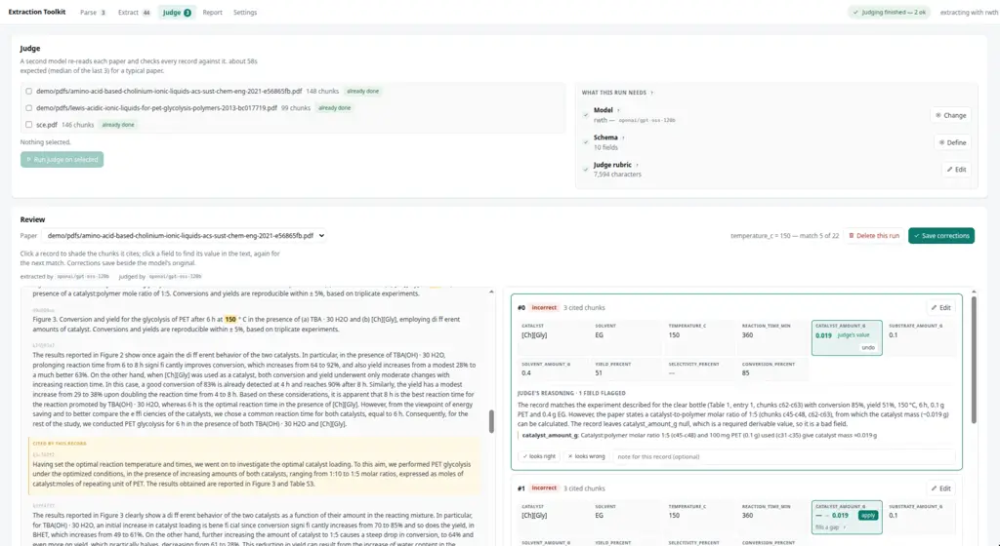

![[Uncaptioned
image]](arxiv-2611-11030v1--f1b1ab510eca.figures/figure-1.webp)

![[Uncaptioned
image]](arxiv-2611-11030v1--f1b1ab510eca.figures/figure-2.webp)

|                                                                                |                                                                                                                                                                                                                                                                                                                                                                                                                                                                                                                                                                                                                                                                                                                                                                                                                                                                                                                                                                                                                                                                                                                                                                                                                                                                                                                                                                                                                                                                                                                                                                                                                                                                                                                                                                                                                                                                                                                                                                                                                                                                                                                                                                          |
| ------------------------------------------------------------------------------ | ------------------------------------------------------------------------------------------------------------------------------------------------------------------------------------------------------------------------------------------------------------------------------------------------------------------------------------------------------------------------------------------------------------------------------------------------------------------------------------------------------------------------------------------------------------------------------------------------------------------------------------------------------------------------------------------------------------------------------------------------------------------------------------------------------------------------------------------------------------------------------------------------------------------------------------------------------------------------------------------------------------------------------------------------------------------------------------------------------------------------------------------------------------------------------------------------------------------------------------------------------------------------------------------------------------------------------------------------------------------------------------------------------------------------------------------------------------------------------------------------------------------------------------------------------------------------------------------------------------------------------------------------------------------------------------------------------------------------------------------------------------------------------------------------------------------------------------------------------------------------------------------------------------------------------------------------------------------------------------------------------------------------------------------------------------------------------------------------------------------------------------------------------------------------ |
| ![[Uncaptioned image]](arxiv-2611-11030v1--f1b1ab510eca.figures/figure-3.webp) | Building and Auditing Chemical Datasets with LLMs: A General LLM-as-a-Judge Framework Applied to Homogeneous Catalytic PET Depolymerisation^(†)                                                                                                                                                                                                                                                                                                                                                                                                                                                                                                                                                                                                                                                                                                                                                                                                                                                                                                                                                                                                                                                                                                                                                                                                                                                                                                                                                                                                                                                                                                                                                                                                                                                                                                                                                                                                                                                                                                                                                                                                                          |
|                                                                                |                                                                                                                                                                                                                                                                                                                                                                                                                                                                                                                                                                                                                                                                                                                                                                                                                                                                                                                                                                                                                                                                                                                                                                                                                                                                                                                                                                                                                                                                                                                                                                                                                                                                                                                                                                                                                                                                                                                                                                                                                                                                                                                                                                          |
|                                                                                | Muhammad bin Javaid,^(∗‡a) Karim K. Ben Hicham,^(‡b) Enkhnyam Battulga,^(a) Alexander Mitsos,^(b,c,d) and Martin Grohe^(a)                                                                                                                                                                                                                                                                                                                                                                                                                                                                                                                                                                                                                                                                                                                                                                                                                                                                                                                                                                                                                                                                                                                                                                                                                                                                                                                                                                                                                                                                                                                                                                                                                                                                                                                                                                                                                                                                                                                                                                                                                                               |
| ![[Uncaptioned image]](arxiv-2611-11030v1--f1b1ab510eca.figures/figure-4.webp) | Large language models can rapidly extract structured multivariate experimental data from the chemistry literature, yet auditing and verifying thousands of generated records without pre-existing ground truth remains difficult. Here, we present a general, citation-grounded extraction and verification methodology centered on an independent “LLM-as-a-judge”, applied to the literature on homogeneous catalytic poly(ethylene terephthalate) (PET) depolymerisation. In this pipeline, an extractor LLM takes research papers as input and generates schema-enforced records with citations to document chunks tagged with universally unique identifiers (UUIDs); an independent LLM judge then reads the full paper alongside each record, flags unsupported fields, and proposes cited corrections. Prompt ablations demonstrate that requiring explicit chunk-level citations not only provides granular provenance down to specific paragraphs and tables, but also improves extraction accuracy. To validate the judge before deploying it at scale, we benchmarked it against manual evaluation on records extracted from a hand-curated reference set of 295 ionic-liquid-catalysed PET glycolysis experiments. The judge agreed with human evaluation on 85.7% of reviewed records and proved significantly more effective than a heuristic string-matching baseline at catching errors in extractions across related experiments. Deployed across the full corpus of 3,942 extracted records from 561 papers, the framework audited and accepted 67.5% of them as written. Its proposed corrections concentrated on quantitative fields, where the extractor often conflated related experiments. We release the extracted dataset alongside the complete LLM judge audit logs. In addition, we release the Chemistry Data Extractor Toolkit, an open-source application that implements this end-to-end pipeline, providing a code-free, browser-based environment for document parsing, customizable schema and prompt design, model-agnostic extraction and auditing, interactive provenance-highlighted review, and reproducible dataset bundling. |

##

^(†)^(†)footnotetext: ^(a) RWTH Aachen University, Chair of Logic and
Theory of Discrete Systems, Aachen, Germany. E-mail:
[javaid@informatik.rwth-aachen.de](mailto:javaid@informatik.rwth-aachen.de)^(†)^(†)footnotetext:
^(b) RWTH Aachen University, Process Systems Engineering (AVT.SVT),
Aachen, Germany.^(†)^(†)footnotetext: ^(c) JARA-CSD, Aachen,
Germany.^(†)^(†)footnotetext: ^(d) Forschungszentrum Jülich GmbH,
Institute of Climate and Energy Systems ICE-1: Energy Systems
Engineering, Jülich, Germany^(†)^(†)footnotetext: ‡ These authors
contributed equally to this work.^(†)^(†)footnotetext: † Electronic
supplementary information (ESI) available. See DOI: 00.0000/00000000.

## 1 Introduction

Poly(ethylene terephthalate) (PET) is a widely used polyester in
packaging and textiles, generating a substantial post-consumer waste
stream for which effective recycling strategies are required. Chemical
recycling by depolymerisation offers a route to recover monomers or
other useful chemical feedstocks and can complement mechanical
recycling, particularly for lower-quality or more heterogeneous PET
waste streams ^(20, 5). Catalysis is central to these processes, and a
wide range of homogeneous and heterogeneous systems have been developed
for PET glycolysis, methanolysis, hydrolysis, and related
transformations. Their reported performance, however, depends not only
on catalyst identity but also on catalyst loading, depolymerising
reagent or solvent, temperature, reaction time, PET feedstock, and
product-isolation procedure, making comparisons between studies
difficult ⁶. Consolidating these experiments into structured datasets
would enable systematic comparison of catalysts and reaction conditions,
reveal gaps in the explored reaction space, and provide a foundation for
statistical analysis and data-driven catalyst and process optimisation
^(14, 27). In practice, the required information remains distributed
across the prose, tables, figures, and supporting information of
individual articles, such that manual extraction and standardisation are
laborious and difficult to scale. Earlier chemistry-aware text-mining
systems, including ChemDataExtractor and ChemDataExtractor 2.0,
demonstrated the potential of automated extraction of chemical
information and nested material–property relationships from scientific
literature ^(26, 19). Large language models (LLMs) offer a promising
means of improving on this by being able to convert unstructured
scientific literature into structured, schema-defined records, with
recent studies demonstrating their ability to recover synthesis
conditions, material properties, and chemical reaction information with
only little or no task-specific training ^(29, 23, 7, 1, 25).

Despite this progress, improving the reliability of the extracted data
remains a major challenge. Redundant prompting, chain-of-verification,
and multi-agent reasoning generally operate within the extraction
process and have primarily been evaluated on material–property tuples or
synthesis descriptions ^(23, 2, 18). Schema-level judges can
additionally identify malformed or internally inconsistent outputs ¹¹,
while recent LLM-as-a-judge pipelines evaluate extracted records against
source documents using rubric-based assessments of dimensions such as
completeness, condition extraction, and semantic accuracy ^(28, 17).
However, such record- or criterion-level evaluations do not by
themselves verify that each individual field is explicitly supported by
the source and correctly associated with the same experimental instance,
nor do they systematically provide source-linked, field-level
corrections.

A related limitation concerns provenance. Work on citation-grounded
generation has required LLM outputs to cite the passages supporting
their claims ¹⁰. However, in scientific information-extraction
workflows, the connection between a structured record and its precise
supporting context is not always retained in a machine-addressable form
^(23, 2). Consequently, verifying an extracted value may require a human
curator to search the article again, limiting the practical auditability
of databases containing thousands of records. Retaining explicit
references to the relevant text and table segments can instead make each
record traceable throughout extraction, automated verification, and
subsequent human review. Requiring the extractor to identify its
supporting evidence may also act as a grounding constraint, although its
effect on extraction accuracy has received comparatively little
attention.

These requirements are particularly important for catalytic reaction
literature. A single article may report an unordered series of closely
related experiments that share catalyst and solvent identities while
differing only in catalyst loading, reagent quantities, temperature,
reaction time, or outcome. An extracted record can therefore be
syntactically valid and chemically plausible while combining values from
different experimental runs. Such association errors are difficult to
detect using exact or fuzzy matching, especially when no comprehensive
record-level reference dataset exists and no single field uniquely
identifies an experiment. This also makes the human evaluation
especially challenging.

Here, we develop and validate a source-cited and schema-enforced LLM
data extraction framework and apply it to the literature on homogeneous
catalytic PET depolymerisation. During preprocessing, every text and
table chunk is assigned a unique identifier, and the extractor is
instructed to list the identifiers of the chunks supporting each record.
An independent LLM judge subsequently reads the source paper alongside
the extracted record, evaluates whether its individual fields are
supported and mutually associated with the same experimental run, and
proposes source-chunk-linked corrections where necessary. We benchmark
the judge against human assessment on a manually curated ionic-liquid
subset before deploying it across a larger homogeneous-catalysis paper
database. We further use prompt ablations to determine whether requiring
explicit source references improves extraction accuracy in addition to
enabling downstream traceability.

## 2 Methods

Fig. 1: Overview of the large language model (LLM) extraction and
auditing pipeline for homogeneous catalytic poly(ethylene terephthalate)
(PET) depolymerisation. Articles identified through Scopus are retrieved
as XML or PDF files, converted to Markdown and segmented into text and
table chunks with universally unique identifiers (UUIDs), preserving
table structure. The extraction model (GPT-5.6 Luna) receives the
chunked and UUID-tagged paper, a predefined schema, domain-specific
guidelines, and one labelled worked example from an open-licensed
glycolysis paper, excluding the target article. Schema-constrained
extraction produces JSON records containing catalyst and solvent
identities, reaction conditions, reactant amounts, and reaction
outcomes. Each record includes a source chunk UUID field linking the
extracted information to supporting source chunks. An independent LLM
judge (GPT-OSS-120B) evaluates each record against the full chunked
paper, issues an accept/reject verdict and proposes corrections
supported by cited text evidence and a reasoning trace. Judge validation
uses an ionic liquid benchmark comprising 295 curated experiments from
24 papers, with manual assessment of 112 extracted records and
comparison against a heuristic grader. The resulting dataset covers PET
glycolysis, methanolysis and hydrolysis, retaining raw extractions
alongside audit logs and proposed corrections.

### 2.1 Extraction Schema

We target three depolymerisation routes for PET that share a consistent
reaction format: glycolysis, methanolysis, and hydrolysis. In each
route, PET reacts with a solvent in the presence of a catalyst at a
specified temperature and pressure, for a given duration.

The extraction schema defines 12 fields per experimental record:
catalyst, solvent, temperature, reaction time, three distinct mass
values (catalyst, PET, solvent), yield, selectivity, conversion,
pressure, and the source chunk identifiers ^(9, 16). The reaction route
itself is not extracted but is deterministically inferred from the
extracted solvent name (e.g., ethylene glycol and related diols
designate glycolysis, methanol designates methanolysis, and water or
aqueous acids/bases designate hydrolysis). Consequently, the reaction
product field is deliberately omitted because it is fixed by this
inferred route (e.g., bis(2-hydroxyethyl) terephthalate for glycolysis,
dimethyl terephthalate for methanolysis, and terephthalic acid for
hydrolysis).

### 2.2 Document Retrieval and Preprocessing

Candidate articles were identified via Scopus literature searches, and
full-text documents were retrieved across multiple sources: Elsevier XML
articles via Elsevier’s Text and Data Mining API, open-access articles
from Europe PMC in JATS XML format, and PDFs from other publishers
(primarily Wiley and Springer) retrieved programmatically via their TDM
services, institutional entitlements, and the Unpaywall API for
open-access content.

To standardise these formats into a uniform Markdown representation, we
utilised a custom parser ²⁴ built upon SplitterMR ¹³ for Elsevier XML, a
JATS reader for Europe PMC articles, and Docling ^(3, 8) for PDFs.

To enable precise source tracking, the preprocessing pipeline applies
table-aware chunking. Each document is segmented into semantic blocks,
with standard text divided into roughly ten-sentence, non-overlapping
chunks, while retaining the preserved row-column structures of extracted
tables. Visual elements, such as graphs and figures, are excluded due to
the high error rates of current optical character recognition (OCR)
models when interpreting complex chemical notations. Every generated
text or table chunk is assigned a universally unique identifier (UUID).
This UUID referencing system ensures that any data point extracted by
the LLM can be deterministically traced back to its exact location in
the source document.

### 2.3 The LLM Extraction and Verification Pipeline

The extraction workflow is separated into two distinct phases. A full
overview is given in Fig. 1.

Phase 1: Primary Extraction. The generator LLM is provided with the
chunked document, the schema definition, domain-specific extraction
guidelines, and a single labelled worked example. For the final data
extraction campaign, we deployed gpt-5.6-luna (accessed via Azure
OpenAI) as the primary extractor. To guarantee that the output is
syntactically valid and strictly adheres to the required data types, we
utilise API-level structured output formatting ²² managed via LiteLLM ⁴.
The LLM is directly constrained to generate data conforming to a
predefined JSON schema, which the API runtime validates before returning
the response. The extraction prompt defines scope boundaries and domain
rules: it instructs the model to capture all primary catalytic runs from
text and tables while explicitly skipping cited literature benchmarks,
response-surface/optimization grids, and characterization tables. It
further directs the model to standardize catalyst formulas into bracket
notation, propagate global conditions stated in methods or table
footnotes to all corresponding runs, compute absolute reagent masses
from reported weight percentages or molar ratios, and strictly
distinguish between yield, conversion, and selectivity metrics (the full
prompt is provided in Section S2$`{\dagger}`$, ESI).

The prompt enforces explicit source tracking by requiring the model to
populate a source*chunk_ids field with the exact UUIDs of the referenced
text chunks. Beyond ensuring data provenance, this instruction might act
as an implicit attention anchor. Ablations demonstrated that requiring
the model to point to specific chunks increases the extraction’s
$`F*{1}`$ score from $`\sim`$0.716 to $`\sim`$0.780. We include exactly
one worked example; sweeps demonstrated that this performs just as well
as four or five examples, increasing extraction quality while saving
input tokens per paper. Exemplars are drawn from a pool of open-licensed
benchmark papers, strictly excluding the target paper to prevent data
leakage. Since LLM generation is inherently stochastic, benchmark
figures and ablations were averaged over three independent repeats to
account for run-to-run variance.

Phase 2: LLM-as-a-Judge. An independent LLM acts as an automated
auditor. For our production pipeline, we deployed gpt-oss-120b. Hosted
on an institutional endpoint, this model provided an unmetered
131,072-token context window, making exhaustive auditing computationally
affordable without token limits truncating long documents. It is
supplied with both the full chunked paper and the structured JSON record
generated in Phase 1. The judge model evaluates the record
field-by-field against the source text, writes a step-by-step reasoning
trace, issues a final verdict (accept or reject), and proposes specific
corrected values alongside cited text evidence for any field it deems
unsupported by the source text.

The judge prompt instructs the LLM to evaluate chemical identity,
accepting standard abbreviations and IUPAC synonyms while rejecting
non-standard, opaque abbreviations defined only in the paper itself. It
also instructs to ensure the required condition propagation and unit
conversions were accurately performed, to check mathematical consistency
across reported outcomes (e.g.,
$`\text{yield}=\text{conversion}\times\text{selectivity}/100`$), and to
disregard harmless formatting variations. To prevent ungrounded
verdicts, the model is required to write a 2–5 sentence evidence
critique citing chunk UUIDs before outputting a verdict and proposed
field changes (the full judge prompt is provided in Section
S2$`{\dagger}`$, ESI).

### 2.4 Validation and Baseline Comparison

To audit extracted records from thousands of papers where no ground
truth in the form of a curated dataset exists, an automated grader must
be able to evaluate the faithfulness of the records with respect to the
source texts directly. Before applying the LLM-as-a-judge framework to
the full 3,942-record database, we evaluated it against a
string-matching heuristic on a hand-curated reference set. While the
heuristic evaluates extractions against human-curated reference tables,
the LLM judge evaluates extractions directly against the raw paper text.

Curated Benchmark Dataset. This reference set comprises 295 experiments
from 24 papers on ionic liquid-catalysed PET glycolysis, drawing from
datasets previously assembled by Gao et al.⁹ and Kumar et al.¹⁶. Because
our document preprocessing pipeline excludes graphical figures and
charts, experimental runs reported exclusively in graphical form were
omitted from this reference set, thus avoiding penalising extractions
for missing visual-only data.

Model Selection. To determine the optimal configuration for mass data
extraction, we benchmarked three models: gpt-5.6-luna, gpt-oss-120b, and
gpt-5.6-terra, evaluating all nine possible extractor-judge combinations
against the curated reference set (Table S1$`{\dagger}`$, ESI). The
deployed pairing of luna for extraction and oss for judging was
deliberately chosen for achieving a high $`F_{1}`$ score alongside an
affordable, unmetered judging step (Fig. 2a and Fig. S3f$`{\dagger}`$,
ESI).

The Heuristic Grader. Most materials extraction benchmarks pair
predictions to ground truth using a single identifier, such as a polymer
name or chemical formula ^(23, 12). However, in our case, because
automated extraction yields an unordered set of $`m`$ candidate records
from a paper with $`n`$ curated reference experiments, evaluation cannot
rely on order of appearance or on a single primary key (such as catalyst
identity), as individual papers frequently report multiple runs sharing
identical catalysts and solvents. To our knowledge, no standard
benchmark heuristic exists in the chemical literature for evaluating
unordered, multi-run reaction records. We therefore formulated record
evaluation as an optimal bipartite matching problem solved via the
Hungarian algorithm ¹⁵, combining combinatorial assignment with a custom
continuous penalty metric designed to avoid the brittleness of binary
exact matching.

The heuristic evaluates 10 of the 12 schema fields: catalyst name,
solvent name, temperature, reaction time, catalyst mass, PET mass,
solvent mass, yield, selectivity, and conversion. Pressure is excluded
from scoring because the vast majority of curated experiments were
conducted at ambient pressure (1 atm), offering little meaningful
variation across runs, while source chunk identifiers are excluded as
internal provenance metadata. For each field $`k`$, a penalty
$`p_{k}\in[0,1]`$ is computed between candidate value $`x_{\text{ext}}`$
and reference value $`x_{\text{cur}}`$:

```math
p_{k}=\begin{cases}0,&x_{\text{ext}}=x_{\text{cur}}=\text{null},\\
1,&\text{either }x_{\text{ext}}\text{ or }x_{\text{cur}}=\text{null},\\
\min\left(\frac{|x_{\text{ext}}-x_{\text{cur}}|}{0.20\,x_{\text{cur}}},1\right),&\text{numeric fields},\\
\mathbb{I}(\text{fuzzy string similarity}<0.60),&\text{catalyst},\\
\mathbb{I}(x_{\text{ext}}\neq x_{\text{cur}}),&\text{solvent},\end{cases} \tag{1}
```

where $`\mathbb{I}(\cdot)`$ is the indicator function. This penalty
structure reflects the differing reporting conventions and error
tolerances of each field. When both the extraction and the reference
agree a parameter was unrecorded (null), the penalty is zero, whereas a
missed or hallucinated value incurs the maximum penalty of 1. For
numeric values, scoring by relative error up to a 20% cap tolerates
routine rounding and differences in significant figures while treating
substantial discrepancies as outright errors. For catalysts, fuzzy
string similarity (computed after lowercasing, whitespace stripping, and
bracket standardisation) accommodates the varied notation common across
homogeneous catalyst nomenclature, such as inconsistent spacing, ligand
abbreviations, or bracket variations like $`[\text{bmim}]\text{Cl}`$
versus $`[\text{Bmim}][\text{Cl}]`$. Conversely, solvents determine the
depolymerisation route itself and comprise standard reagent names,
warranting an exact string match. The overall penalty for a candidate
pair is the unweighted mean across all 10 evaluated fields:
$`\bar{p}=\frac{1}{10}\sum_{k=1}^{10}p_{k}`$.

The Hungarian algorithm ¹⁵ is applied to the resulting $`m\times n`$
cost matrix to find the one-to-one assignment that globally minimizes
total penalty across the paper’s candidate and reference records. An
assigned pair qualifies as a true positive if and only if two conditions
are met: the catalyst names share at least 60% fuzzy string similarity,
and the mean record penalty satisfies $`\bar{p}<\tau`$
($`\tau=0.30{}`$). Sensitivity analysis confirmed that $`\tau=0.30{}`$
sits on a stable plateau; because faithful extractions typically exhibit
average penalties well below 0.30, raising the threshold further has
negligible impact on the final $`F_{1}`$ score.

Pairs that fail either condition yield both a false negative (the
ground-truth experiment was missed) and a false positive (the extracted
run was invalid). Likewise, any extractions left without a partner count
as false positives, and any reference experiments the extractor
overlooked count as false negatives.

Manual Evaluation Protocol. A sample of 112 extracted records from the
ionic liquid subset was manually evaluated to determine if they were
faithful representations of the source papers. To maximize statistical
power, the human evaluation followed a stratified sampling design:
records where the two automatic graders disagreed were exhaustively
evaluated, while a subset of records they agreed upon was randomly
sampled. Both the LLM judge and the heuristic grader were scored against
these human verdicts. McNemar’s test ²¹ was then applied to the
conflicting pairs, i.e., instances where only one grader agreed with
human evaluation, to establish the statistical reliability of the LLM
judge prior to its deployment on the broader database.

Fig. 2: Extraction performance and automated grader validation. (a)
Precision ($`P`$), recall ($`R`$), and $`F_{1}`$ scores across candidate
extraction models evaluated against the curated benchmark dataset. (b)
Grader consensus across 296 benchmark records. The 81.8% slice
represents mutual agreement on evaluable records (242/259, 93.4%); total
agreement reaches 82.8% when accounting for three uncurated records
mutually rejected by both graders. (c) Manual evaluation outcomes across
the 51 informative disagreement pairs, where 43 cases favored the judge
and only 8 favored the heuristic. (d) Human evaluation of judge-proposed
corrections by edit type across 120 reviewed interventions, showing that
97% were either demonstrably correct (49%) or represented equally valid
reporting variants (“both right”, 48%), with only 4 proposals (3%)
rejected as erroneous.

Fig. 3: Dataset composition, field completeness, and LLM judge
interventions. (a) Distribution of extracted experiments per paper. (b)
Breakdown across depolymerisation routes, led by glycolysis (48%) and
hydrolysis (25%). (c) Completeness by schema field. (d) Most frequent
catalyst entries, dominated by uncatalysed baselines, zinc acetate, and
simple alkaline catalysts. (e) Field-level correction counts for nine of
the eleven fields (excl. selectivity, pressure) proposed by the LLM
judge, concentrated heavily on catalyst and solvent amounts (restricted
to the 3,942 homogeneous catalysis subset). (f) Solvent identities for
the 922 unrouted records from (b), accounting for unconventional
reaction media and omitted solvent names.

Fig. 4: Reported reaction conditions statistics and chemical consistency
checks. (a–g) Kernel density estimation (KDE) plots of key experimental
parameters broken down by depolymerisation route (blue: glycolysis; red:
hydrolysis; yellow: methanolysis). Panels (a–g) cover the 4,641
route-assigned records. Each label gives how many report the field,
preceded where relevant by the percentage falling inside the plotted
range; this is not field completeness, which Fig. 3c provides. (a)
Reaction temperature, exhibiting a sharp glycolysis peak at 190–200 °C
corresponding to the atmospheric reflux of ethylene glycol. (b) Reaction
time, clustered at standard bench protocol intervals. (c) Product yield
and (d) PET conversion, both skewed toward 100%. (e) Catalyst mass, (f)
PET feedstock mass, and (g) solvent mass, concentrated at standard
laboratory scales. (h) Physical consistency check between yield and
conversion against the 1:1 parity line (dashed;
$`\text{yield}\leq\text{conversion}`$), with only 28 of 1,423 records
violating the physical bound. (i) Bivariate density contour comparison
of temperature versus yield between this work (solid blue) and the ionic
liquid depolymerisation dataset by Gao et al.⁹ (hatched) for the 19
articles common to both datasets (extended field comparisons in Fig.
S1$`{\dagger}`$, ESI).

## 3 Results and discussion

### 3.1 Model Selection and LLM Judge Verification

To inform the choice of model for data extraction, we evaluated three
LLMs in terms of their performance on 24 benchmark papers (295
hand-curated experiments): GPT-5.6 Luna, GPT-OSS-120B, and GPT-5.6 Terra
(Fig. 2a). GPT-5.6 Luna demonstrated the best mean recall and $`F_{1}`$
score while achieving precision comparable to the other two models, so
it was chosen for the final mass data extraction.

For the judge model, we employed the open-weights model GPT-OSS-120B.
While our heuristic grader provides an automated check on benchmark
data, scaling it to thousands of uncurated papers is impossible without
pre-existing reference keys. To evaluate whether the LLM judge could
perform this auditing role without a reference key, we compared its
judgments against the heuristic grader on the benchmark papers.
Restricted to evaluable records, i.e., those with a direct counterpart
in the curated benchmark, the judge and heuristic exhibit high agreement
at 93.4% (242/259) for the deployed model pairing (GPT-5.6 Luna
extractor and GPT-OSS-120B judge). Across all 296 records, overall
agreement is 82.8% (245/296), which includes three extraneous
extractions that both graders independently rejected. Fig. 2b shows a
breakdown of the agreement between LLM judge and heuristic grader.
However, this metric alone is not enough: high agreement could also be
obtained in the case where both graders simply make similar errors. This
necessitates manual evaluation to assess the quality of the LLM
judgments.

### 3.2 Agreement with Manual Evaluation

To benchmark the automated audit against human judgment, we conducted a
manual evaluation of 112 sample extracted records against their source
articles. We employed a stratified sampling strategy, reviewing all 51
records where the two automated graders disagreed and all 12 records
where both raised flags, alongside a random sample of 49 records that
both accepted. Of these 112 records, human evaluation agreed with the
LLM judge’s verdict on 96 of them (85.7%). We note that all of the 49
sampled records that both the LLM judge and heuristic grader accepted
were verified to be correct by manual evaluation.

Manual review revealed that the extracted records were largely faithful
to the source literature, with apparent discrepancies frequently
reflecting benign formatting and reporting variants rather than genuine
extraction failures. When evaluating the judge’s field-level proposals
across 120 reviewed interventions (Fig. 2d), 59 (49%) were confirmed as
demonstrably correct fixes and 57 (48%) represented equally valid
reporting conventions (classified as “both right”), such as chemical
synonymy or standard parameter omissions. Only 4 proposed corrections
(3%) were rejected as outright erroneous; in summary, 97% of the judge
proposals were either a real fix or harmless. In contrast, the heuristic
grader flagged records far more indiscriminately, penalizing valid
extractions due to rigid string-matching thresholds and an inability to
recognize non-identical but chemically equivalent descriptions.

In head-to-head comparison, the judge substantially outperformed the
heuristic baseline (Fig. 2c). Across the 51 discordant records where
only one grader agreed with manual evaluation, 43 cases favored the LLM
judge and only 8 favored the heuristic, a difference significant at
$`p=7\times 10^{-7}`$ by McNemar’s test. The LLM judge therefore
provides a statistically grounded triage tool that effectively
concentrates manual review on records most likely to require correction.

Because manual review confirmed that the mutual acceptances were all
valid records and that disagreements decisively favored the judge, we
concluded that the LLM judge matches or exceeds the reliability of a
reference-based heuristic while reading the source literature directly.
This validated deploying the judge as an automated auditor for the
subsequent uncurated mass data extraction.

### 3.3 Prompt Ablations

Two prompt settings were swept across the 24 curated benchmark papers
(three independent repeats each).

First, we tested the number of worked examples included in the prompt.
Providing a single labelled example raised the $`F_{1}`$ score by
$`+0.025{}`$ compared to zero-shot extraction ($`p=0.082{}`$). Adding
further examples (up to five) yielded no significant improvements beyond
noise, indicating that one example provides sufficient formatting
guidance while saving a significant number of tokens per paper.

Second, requiring each record to cite its source chunks yielded an
$`F_{1}`$ improvement of $`+0.064{}`$ ($`0.780{}\pm 0.021{}`$ with
sourcing vs. $`0.716{}\pm 0.043{}`$ without; $`p=0.079{}`$). Although
both effects sit just shy of the standard $`\alpha=0.05`$ significance
threshold due to the run-to-run variance across the three repeats, the
consistent positive direction supports maintaining both one worked
example and explicit source tracking in the production pipeline. Beyond
this empirical benefit, chunk-level citations establish end-to-end data
provenance, anchoring every extracted reaction parameter in the source
text to enable quick manual verification and trustworthy downstream
reuse.

### 3.4 Building the Dataset at Scale

From an initial pool of 2,777 candidate articles identified via Scopus,
1,575 relevant papers passed title and abstract screening (Table 1). The
drop from 1,575 to 1,027 was due to access issues. We obtained 447
Elsevier papers and a subset of Wiley/Springer papers via
text-and-data-mining entitlements, alongside open-access PDFs and Europe
PMC JATS deposits. The 548 missing papers are heavily concentrated in
ACS and RSC subscription content.

|                                              |               |
| -------------------------------------------- | ------------- |
| Selection stage                              | Articles      |
| Candidates identified via Scopus searches    | 2,777         |
|    Excluded: no polymer named                | $`-550{}`$    |
|    Excluded: no depolymerisation route named | $`-381{}`$    |
|    Excluded: off-topic subjects or reviews   | $`-271{}`$    |
| Articles passing title and abstract filter   | 1,575 (56.7%) |
|    Obtained: Elsevier full-text XML          | 447           |
|    Obtained: PDF (Wiley, Springer, OA)       | 488           |
|    Obtained: Europe PMC JATS                 | 89            |
|    Obtained: other routes                    | 3             |
| Retrieved and converted to chunked text      | 1,027         |

Table 1: From search to corpus.

Of the 1,027 converted papers, 1,026 were successfully processed by the
extraction pipeline (one excessively long paper exhausted its rate-limit
retries). Table 2 summarises the final mass extraction. Every output
parsed into valid JSON, demonstrating the robustness of the schema and
API-level tool-use constraints. While the initial extraction recovered
5,563 records across all reported catalytic runs, our study focuses
strictly on homogeneous systems. Filtering out 1,120 records involving
heterogeneous (solid) catalysts and 501 with unverified catalyst phases
yielded the final dataset of 3,942 homogeneous catalytic experiments
across 561 articles.

Most of the 362 papers that yielded no records were simply out of scope.
Title inspection classified 92 as concerning biological degradation, 57
as following off-target routes or using PET solely as a material, and 11
as reviews without protocols, leaving roughly 202 unclassified. While we
initially suspected context-window limits on long documents, re-running
the 15 largest papers confirmed they were merely long-form reviews and
protocols devoid of extractable experimental runs.

|                                              |              |
| -------------------------------------------- | ------------ |
| Metric                                       | Value        |
| Articles processed                           | 1,026        |
| Articles yielding records                    | 664          |
| Articles yielding no records                 | 362          |
| Unparseable outputs                          | 0            |
| Extraction cost                              | \$8.63       |
| Total extracted experimental records         | 5,563        |
|    Excluded: heterogeneous (solid) catalysts | $`-1,120{}`$ |
|    Excluded: unverified catalyst phase       | $`-501{}`$   |
| Final homogeneous records released           | 3,942        |

Table 2: Mass extraction and curation summary.

### 3.5 Dataset Characteristics and Verification

Most papers reported between 1 and 25 experiments, with glycolysis being
the route in 48% of the records extracted in the dataset, followed by
hydrolysis (25%) and methanolysis (10%). The remainder were unassigned
routes that did not fall under these three categories. Summary
statistics for the dataset fields are shown in Fig. 3, and the resulting
distributions of reaction conditions, feedstock amounts, and outcomes
are shown in Fig. 4a–g.

After data extraction and filtering to homogenous catalysis, the LLM
judge read every source paper and evaluated all 3,942 generated records,
accepting 67.5% exactly as written (Table 3). The judge proposed
corrections for 30.5% of the records.

| Verdict category                   | Records | Share  |
| ---------------------------------- | ------- | ------ |
| Accepted as written                | 2,661   | 67.5%  |
| Rejected, with proposed correction | 1,202   | 30.5%  |
| Rejected outright                  | 79      | 2.0%   |
| Total                              | 3,942   | 100.0% |

Table 3: The judge’s verdicts on the released dataset.

These proposed corrections were heavily concentrated in the quantitative
mass fields (Fig. 3e). Catalyst mass (508 fixes) and solvent mass (327
fixes) dominate the error distribution. As authors typically state
absolute masses once in a methods paragraph and then vary them
implicitly as ratios across a results table, an extractor reading the
table without properly carrying the paragraph context forward may
capture the ratios correctly but miscalculate the absolute amounts.

We can further evaluate data quality against physical constraints (Fig.
4h). By definition, reaction yield cannot exceed conversion; across the
corpus, only 28 out of 1,423 records reporting both metrics violate this
boundary, confirming that the extractor rarely conflates the two
quantities.

For researchers utilizing this database for predictive modeling,
accounting for study-level fixed effects is essential. Because published
experiments span diverse PET feedstock forms, catalyst activities, and
experimental scales, pooling raw records globally across the corpus
obscures fundamental chemical trends, yielding, for example, virtually
no overall correlation between temperature and yield
($`\rho=+0.018{}`$). However, evaluating each study individually
resolves these cross-study confounds. Within individual papers,
temperature and yield exhibit a consistent positive relationship, with a
median intra-study correlation of $`\rho=+0.34{}`$ and 85% of multi-run
papers displaying positive trends ($`p=7\times 10^{-7}{}`$ via Wilcoxon
signed-rank test). We note that the overall relationship between
temperature and yield across papers in our dataset is similar to that in
the manually curated dataset on ionic liquid-based PET waste recycling
by Gao et al.⁹ (Fig. 4i), a correspondence that holds across further key
experimental parameter pairs (Fig. S1$`{\dagger}`$, ESI).

Finally, of the 14,098 source chunk citations generated by the
extractor, 13,602 (96.5%) resolved correctly to a valid chunk within the
corresponding paper. Only a minority failed to match, primarily due to
verbatim copying of the prompt’s worked examples. In the interests of
transparency and data provenance, we release the LLM judge’s proposed
corrections alongside the raw extractions and complete reasoning traces.



Fig. 5: Screenshot of the interactive Chemistry Data Extractor Toolkit.
The local browser-based interface enables end-to-end dataset curation
and auditing without code modification. Users configure target schemas,
extraction prompts, and judge rubrics directly in the settings. The
dual-pane review interface links extracted records to the source paper,
highlighting cited UUID chunks upon selection and allowing one-click
inspection of the judge’s proposed corrections and reasoning.

### 3.6 Interactive Extraction and Auditing Toolkit

To make the citation-grounded extraction and judging workflow accessible
and reusable across other chemical domains, we implemented the framework
as an open-source, local-first web application: the Chemistry Data
Extractor Toolkit (Fig. 5). The software runs locally via Docker or
Python (uv) without external database dependencies, storing project
state, PDFs, and extracted records in local workspace directories.

The application is fully configurable through a browser interface,
allowing users to adapt the pipeline to new catalytic reactions,
materials, or properties without modifying the codebase. Users define
target fields and descriptions in a schema editor, provide custom
extraction guidelines and worked examples, and formulate judging rubrics
for automated auditing. The pipeline is model-agnostic, supporting
OpenAI, Anthropic, Azure, and local endpoints (via Ollama or vLLM),
allowing users to pair high-throughput extraction models with
independent open-weights or frontier judge models.

Integrated document parsing (powered by Docling) segments dropped PDFs
into Markdown text and structured tables tagged with chunk UUIDs. During
human-in-the-loop review (Fig. 5), the interface presents a synchronized
two-pane view: selecting an extracted record highlights its cited UUID
text chunks in the source paper on the left, while clicking an
individual field jumps directly to matching values in the source text.
The interface integrates the judge’s reasoning and flags, allowing human
curators to accept, edit, or reject proposed corrections with a single
click. Finally, to ensure reproducibility, the tool exports a complete
dataset bundle containing the extracted records alongside the active
schema, prompts, cited chunk mappings, per-paper model metadata, token
costs, and the software commit hash.

## 4 Limitations

Our benchmark relies on 295 hand-curated experiments across 24 papers,
all covering PET glycolysis. Although the extraction schema applies
equally well to methanolysis and hydrolysis, we did not benchmark those
two routes against a hand-curated reference key. Because our prompt
examples were drawn entirely from glycolysis papers, the model may
perform slightly differently when dealing with other solvents and
reaction setups.

The audit is also designed to check accuracy, not completeness. The LLM
judge flags unsupported numbers in records the extractor produced, but
it cannot catch experiments the extractor missed entirely. In addition,
the judge raises some false alarms, meaning automatic corrections could
introduce new mistakes. Therefore, we release these suggestions as an
inspectable changelog.

Finally, our coverage was affected by paywalls and text-mining
agreements. We secured full text for 1,027 of the 1,575 relevant papers,
and the missing 548 articles come disproportionately from specific
publishers rather than a random slice of the literature. 3.5% of chunk
citations fail to link to real text blocks, mainly because the model
copied example IDs straight from the prompt. While the extracted
chemistry in these records is usually sound, confirming it requires
checking the source paper by hand.

## Conclusions

We built a structured database of 3,942 homogeneous catalytic PET
depolymerisation experiments extracted from 561 papers, paired with an
automated auditing pipeline to verify data quality. Rather than treating
extracted values as final, an independent LLM judge read each source
paper alongside its extracted records, accepting 67.5% of the database
as written, proposing cited corrections for 30.5%, and outright
rejecting the remaining 2%. Evaluated against manual review, the judge
decisively outperformed a traditional heuristic baseline, acting as an
effective triage filter that concentrates human attention on subtle
errors in catalyst and solvent amounts.

Three practical lessons extend beyond this dataset. First, a single
worked example provides all the guidance an extractor needs, saving tens
of thousands of prompt tokens without sacrificing performance. Second,
requiring chunk-level source citations anchors the model in the text,
improving extraction accuracy while establishing verifiable provenance
for every data point. Third, human verification budgets are spent most
efficiently by focusing review exclusively on records where the
automated graders disagree.

This dataset provides a foundation for comparing homogeneous catalysts
and modeling depolymerisation conditions. We release the prompts for LLM
extraction and the LLM judge, the dataset, the judge’s audit logs, the
proposed changelogs, and an interactive review interface to support
further data-driven research in polymer upcycling.

## Author contributions

M.b.J.: Conceptualisation, Investigation, Methodology, Supervision,
Validation, Writing – original draft. K.K.B.H.: Conceptualisation,
Investigation, Methodology, Software, Supervision, Validation, Writing –
original draft. E.B.: Conceptualisation, Data curation, Investigation,
Methodology, Software, Validation, Writing – original draft. A.M.:
Funding acquisition, Supervision, Writing – review and editing. M.G.:
Conceptualisation, Funding acquisition, Supervision, Writing – review
and editing.

## Conflicts of interest

There are no conflicts of interest to declare.

## Data availability

The dataset of 3,942 homogeneous catalytic PET depolymerisation
experiments, comprising the extracted records, the LLM judge’s verdicts
and critiques, and its proposed corrections, is available at
[https://github.com/Enkhnyam/pet-depolymerisation-database](https://github.com/Enkhnyam/pet-depolymerisation-database)
under data/, released under CC BY 4.0. The hand-curated reference key of
295 experiments across 24 articles used to validate the judge is
provided under data/benchmark/. The same repository contains the
extraction and evaluation code, the prompts, and the manual review
tooling, released under the MIT licence. The standalone, open-source
software (Chemistry Data Extractor Toolkit), including the interactive
browser-based review interface, is available at
[https://github.com/Enkhnyam/chemistry-data-extractor-toolkit](https://github.com/Enkhnyam/chemistry-data-extractor-toolkit).
Supplementary figures, extractor and judge prompts, additional
discussion, and extended tables are provided in the Electronic
Supplementary Information (ESI).

## Acknowledgements

We acknowledge support of the Werner Siemens Foundation in the frame of
the WSS Research Center “catalaix”.

During the preparation of this study, the authors used large language
models (OpenAI GPT-5.6 Sol and Anthropic Claude Opus 5) to assist with
code development and refinement. All code implementations were reviewed,
tested, and verified by the authors, who take full responsibility for
the content of this work.

## Notes and references

- Ai et al. (2024) Q. Ai, F. Meng, J. Shi, B. Pelkie, and C. W. Coley
  Extracting structured data from organic synthesis procedures using a
  fine-tuned large language model. Digital discovery 3 (9),
  pp. 1822–1831. Cited by: §1.
- Ansari and Moosavi (2024) M. Ansari and S. M. Moosavi Agent-based
  learning of materials datasets from the scientific literature. Digital
  Discovery 3 (12), pp. 2607–2617. External Links: ISSN 2635-098X,
  [Document](https://dx.doi.org/10.1039/d4dd00252k) Cited by: §1, §1.
- Auer et al. (2024) C. Auer, M. Dolfi, A. Carvalho, C. Ramis Vidal,
  and P. W. J. Staar Docling technical report. External Links:
  2408.09869 Cited by: §2.2.
- BerriAI (2026) BerriAI LiteLLM (version 1.91.0). Note:
  [https://github.com/BerriAI/litellm](https://github.com/BerriAI/litellm)
  Cited by: §2.3.
- Bohre et al. (2023) A. Bohre, P. R. Jadhao, K. Tripathi, K. K.
  Pant, B. Likozar, and B. Saha Chemical Recycling Processes of Waste
  Polyethylene Terephthalate Using Solid Catalysts. ChemSusChem 16 (14),
  pp. e202300142. External Links: ISSN 1864-564X,
  [Document](https://dx.doi.org/10.1002/cssc.202300142) Cited by: §1.
- Bush et al. (2023) N. G. Bush, C. H. Dinh, C. L. Catterton, and M. E.
  Fieser Understanding the important variables to optimize glycolysis of
  polyethylene terephthalate with lanthanide-containing ionic liquids.
  RSC Sustainability 1 (4), pp. 938–947. External Links: ISSN 2753-8125,
  [Document](https://dx.doi.org/10.1039/d3su00090g) Cited by: §1.
- Dagdelen et al. (2024) J. Dagdelen, A. Dunn, S. Lee, N. Walker, A. S.
  Rosen, G. Ceder, K. A. Persson, and A. Jain Structured information
  extraction from scientific text with large language models. Nature
  communications 15 (1), pp. 1418. Cited by: §1.
- Docling Team (2024) Docling Team Docling (version 2.110.0). Note:
  [https://github.com/docling-project/docling](https://github.com/docling-project/docling)
  Cited by: §2.2.
- Gao et al. (2025) J. Gao, W. Peng, A. Galindo, E. Slaton, J. Perez
  Martinez, G. Lan, and Z. Tong Machine learning-guided optimization for
  ionic liquid-based polyethylene terephthalate waste recycling. Green
  Chemistry 27 (24), pp. 7357–7367. External Links:
  [Document](https://dx.doi.org/10.1039/D5GC01998B) Cited by: Fig. 4,
  Fig. 4, §2.1, §2.4, §3.5.
- Gao et al. (2023) T. Gao, H. Yen, J. Yu, and D. Chen Enabling large
  language models to generate text with citations. In Proceedings of the
  2023 Conference on Empirical Methods in Natural Language Processing,
  pp. 6465–6488. Cited by: §1.
- Ghosh and Tewari (2026) S. Ghosh and A. Tewari Automated Extraction of
  Material Properties using LLM-based AI Agents. Computational Materials
  Science 265, pp. 114521. External Links: 2510.01235, ISSN 09270256,
  [Document](https://dx.doi.org/10.1016/j.commatsci.2026.114521) Cited
  by: §1.
- Gupta et al. (2024) S. Gupta, A. Mahmood, P. Shetty, A. Adeboye,
  and R. Ramprasad Data extraction from polymer literature using large
  language models. Communications Materials 5 (1), pp. 269. External
  Links: ISSN 2662-4443,
  [Document](https://dx.doi.org/10.1038/s43246-024-00708-9) Cited by:
  §2.4.
- Herencia (2025) A. Herencia SplitterMR (version 1.0.0). Note:
  [https://github.com/andreshere00/Splitter_MR](https://github.com/andreshere00/Splitter_MR)
  Cited by: §2.2.
- Kearnes et al. (2021) S. M. Kearnes, M. R. Maser, M. Wleklinski, A.
  Kast, A. G. Doyle, S. D. Dreher, J. M. Hawkins, K. F. Jensen,
  and C. W. Coley The Open Reaction Database. Journal of the American
  Chemical Society 143 (45), pp. 18820–18826. External Links: ISSN
  0002-7863, [Document](https://dx.doi.org/10.1021/jacs.1c09820) Cited
  by: §1.
- Kuhn (1955) H. W. Kuhn The hungarian method for the assignment
  problem. Naval Research Logistics Quarterly 2 (1–2), pp. 83–97.
  External Links: [Document](https://dx.doi.org/10.1002/nav.3800020109)
  Cited by: §2.4, §2.4.
- Kumar et al. (2024) G. Kumar, K. Kumar, and A. Bharti Energy and
  environmental metrics-based comparison of ionic liquids/deep eutectic
  solvents-assisted chemical recycling of waste poly(ethylene
  terephthalate). Industrial & Engineering Chemistry Research 63 (14),
  pp. 6024–6046. External Links:
  [Document](https://dx.doi.org/10.1021/acs.iecr.3c04481) Cited by:
  §2.1, §2.4.
- Lederbauer et al. (2025) M. Lederbauer, S. Betala, X. Li, A. Jain, A.
  Sehaba, G. Channing, G. Germain, A. Leonescu, F. Flaifil, A.
  Amayuelas, A. Nozadze, S. P. Schmid, M. Zaki, S. K. Ethirajan, E.
  Pan, M. Franckel, A. Duval, N. M. A. Krishnan, and S. P. Gleason
  LeMat-Synth: a multi-modal toolbox to curate broad synthesis procedure
  databases from scientific literature. arXiv. External Links:
  2510.26824, [Document](https://dx.doi.org/10.48550/arXiv.2510.26824)
  Cited by: §1.
- Li et al. (2025) X. Li, Z. Huang, S. Quan, C. Peng, and X. Ma
  SLM-MATRIX: a multi-agent trajectory reasoning and verification
  framework for enhancing language models in materials data extraction.
  npj Computational Materials 11 (1), pp. 241. External Links: ISSN
  2057-3960, [Document](https://dx.doi.org/10.1038/s41524-025-01719-x)
  Cited by: §1.
- Mavračić et al. (2021) J. Mavračić, C. J. Court, T. Isazawa, and J. M.
  Cole ChemDataExtractor 2.0: Autopopulated ontologies for materials
  science. Journal of Chemical Information and Modeling 61 (9),
  pp. 4280–4289. External Links:
  [Document](https://dx.doi.org/10.1021/acs.jcim.1c00446) Cited by: §1.
- McNeeley and Liu (2024) A. McNeeley and Y. A. Liu Assessment of PET
  Depolymerization Processes for Circular Economy. 1. Thermodynamics,
  Chemistry, Purification, and Process Design. Industrial & Engineering
  Chemistry Research 63 (8), pp. 3355–3399. External Links: ISSN
  0888-5885, [Document](https://dx.doi.org/10.1021/acs.iecr.3c04000)
  Cited by: §1.
- McNemar (1947) Q. McNemar Note on the sampling error of the difference
  between correlated proportions or percentages. Psychometrika 12 (2),
  pp. 153–157. External Links:
  [Document](https://dx.doi.org/10.1007/BF02295996) Cited by: §2.4.
- OpenAI (2024) OpenAI Structured outputs. Cited by: §2.3.
- Polak and Morgan (2024) M. P. Polak and D. Morgan Extracting accurate
  materials data from research papers with conversational language
  models and prompt engineering. Nature Communications 15 (1), pp. 1569.
  External Links: ISSN 2041-1723,
  [Document](https://dx.doi.org/10.1038/s41467-024-45914-8) Cited by:
  §1, §1, §1, §2.4.
- Queimo (2025) Queimo SplitterMR (fork with ElsevierReader, version
  1.0.0). Note:
  [https://github.com/Queimo/Splitter_MR](https://github.com/Queimo/Splitter_MR)
  Cited by: §2.2.
- Schilling-Wilhelmi et al. (2025) M. Schilling-Wilhelmi, M.
  Ríos-García, S. Shabih, M. V. Gil, S. Miret, C. T. Koch, J. A.
  Márquez, and K. M. Jablonka From text to insight: large language
  models for chemical data extraction. Chemical Society Reviews 54 (3),
  pp. 1125–1150. External Links: ISSN 0306-0012,
  [Document](https://dx.doi.org/10.1039/d4cs00913d) Cited by: §1.
- Swain and Cole (2016) M. C. Swain and J. M. Cole ChemDataExtractor: a
  toolkit for automated extraction of chemical information from the
  scientific literature. Journal of Chemical Information and Modeling 56
  (10), pp. 1894–1904. External Links:
  [Document](https://dx.doi.org/10.1021/acs.jcim.6b00207) Cited by: §1.
- Yu et al. (2026) Y. Yu, Z. Xie, M. Luo, A. Redfearn, A. Brandolese, C.
  Sheng, A. P. Dove, X. Zhang, L. Chen, and J. Jiang Optimizing toward
  Discovery: AI-Driven Exploration of Lewis Acid–Base Catalysts for PET
  Glycolysis. Journal of the American Chemical Society 148 (4),
  pp. 4635–4644. External Links: ISSN 0002-7863,
  [Document](https://dx.doi.org/10.1021/jacs.5c20630) Cited by: §1.
- Zheng et al. (2023a) L. Zheng, W. Chiang, Y. Sheng, S. Zhuang, Z.
  Wu, Y. Zhuang, Z. Lin, Z. Li, D. Li, E. Xing, H. Zhang, J. E.
  Gonzalez, and I. Stoica Judging LLM-as-a-judge with MT-bench and
  chatbot arena. In Thirty-seventh Conference on Neural Information
  Processing Systems Datasets and Benchmarks Track, External Links:
  [Link](https://openreview.net/forum?id=uccHPGDlao) Cited by: §1.
- Zheng et al. (2023b) Z. Zheng, O. Zhang, C. Borgs, J. T. Chayes,
  and O. M. Yaghi ChatGPT Chemistry Assistant for Text Mining and the
  Prediction of MOF Synthesis. Journal of the American Chemical Society
  145 (32), pp. 18048–18062. External Links: ISSN 0002-7863,
  [Document](https://dx.doi.org/10.1021/jacs.3c05819) Cited by: §1.
