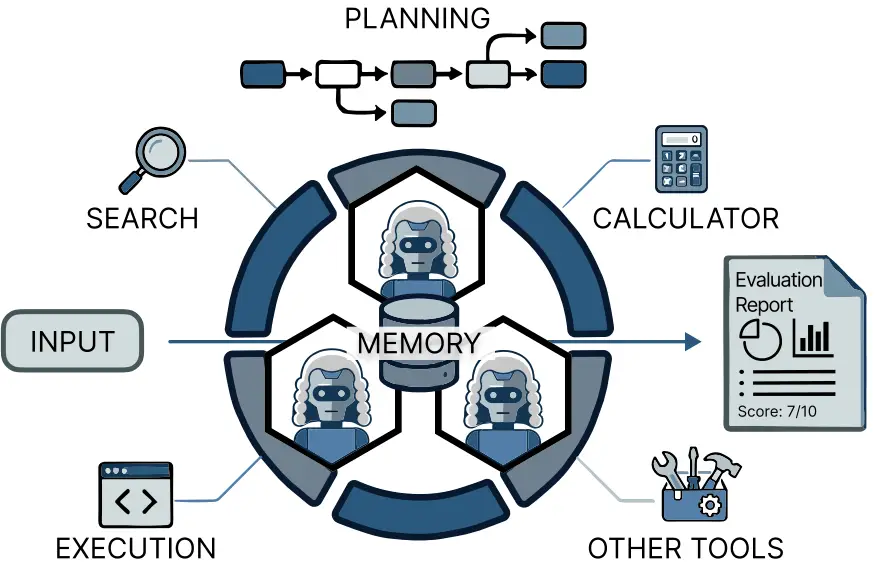
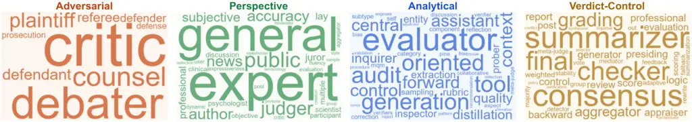
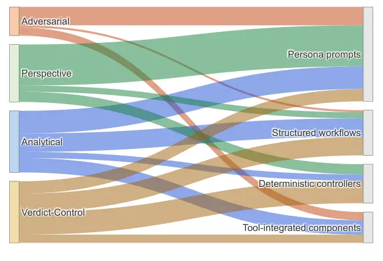

\PublicDate

2026-11-12

{teaserfigure}

Conceptual landscape of Agent-as-a-Judge. Unlike fixed-context LLM
judges, an agentic judge resolves missing evidence through
evaluation-directed checking—identifying targets, verifying via tools,
and integrating findings into grounded verdicts—driven by four
mechanisms (multi-agent collaboration, tool integration, memory,
planning) across evaluation paradigms, open challenges, and target
domains.

# A Survey on Agent-as-a-Judge

Runyang You\equal Affiliation: The Hong Kong Polytechnic University   
Hongru Cai\equal Affiliation: The Hong Kong Polytechnic University   
Caiqi Zhang Affiliation: University of Cambridge    Qiancheng Xu
Affiliation: The Hong Kong Polytechnic University    Meng Liu
Affiliation: Shandong University    Tiezheng Yu Affiliation: Huawei
Technologiesrunyang.y@outlook.com, {henry.hongrucai,
liyongqi0}@gmail.com    Yongqi Li\advisor Affiliation: The Hong Kong
Polytechnic University    Wenjie Li Affiliation: The Hong Kong
Polytechnic University

###### Abstract

Artificial intelligence has progressed from task-specific systems toward
general models spanning perception, generation, reasoning, and
autonomous interaction, making reliable evaluation essential for
comparison, deployment, and post-training feedback. At scale, modern
evaluation pipelines increasingly rely on LLM-as-a-Judge to produce
scores, preferences, and critiques; in its fixed-context setting, the
judge relies on the supplied evaluand and evaluation materials. Yet a
reliable verdict may require evidence beyond the supplied evaluand and
context—either because critical environmental states remain unrecorded
in the static execution log, or because controversial factual claims
require external verification. Passive judges cannot obtain that missing
evidence before deciding, especially when evaluating agent trajectories,
executable artifacts, or domain-specific reports. Recent work therefore
develops active evaluators that seek missing evidence and update their
grounds for judgment before deciding. We bring these advances together
through Agent-as-a-Judge, focusing on how evaluators construct and
control checking processes within the broader LLM-based judging
landscape. We define the scope through evaluation-directed checks and
the use of their results, covering both structured workflows and
observation-driven control. We organize the design space by multi-agent
collaboration, tool integration, memory, and planning, and show how
these mechanisms supply the checks and evidence on which a verdict
rests. We consolidate published scores and reproduce missing entries for
key agentic judges; the comparison reveals uneven agentic gains and
motivates dedicated agentic evaluation. We conclude by characterizing
application demands and open challenges in cost, reliability, safety,
and governance that condition trusted deployment of agentic judges at
scale.

## 1 Introduction

(a) LLM-as-a-Judge

(b) Agent-as-a-Judge

Figure 1: Comparison between (a) LLM-as-a-Judge and (b)
Agent-as-a-Judge. The former acts as a passive evaluator relying on the
given context and model-internal knowledge, while the latter acts as an
active evaluator that plans, gathers evidence, uses tools, and
iteratively verifies its judgment.

Artificial intelligence has progressed from task-specific systems toward
general models spanning perception, generation, reasoning, and
autonomous interaction, making reliable evaluation essential for
comparison, deployment, and post-training feedback \[christiano2017deep,
stiennon2020learning, lai2025post-training-scaling\]. Human judgment has
long served as the reference standard for these evaluations
\[christiano2017deep, stiennon2020learning, fabbri2021summeval,
wang-etal-2023-automated\], yet manual annotation is costly and slow,
and inter-annotator disagreement limits consistency and reliability
\[stiennon2020learning, ouyang2022training, fabbri2021summeval,
li2025LLM-as-a-Judge-Survey\]—limits that become especially acute when
evaluation must run continuously during post-training or across
large-scale public leaderboards \[chiang2024chatbot,
lai2025post-training-scaling\]. To improve scalability, the field
adopted automatic metrics that score outputs against predefined rules or
references \[papineni2002bleu, lin2004rouge, rajpurkar2016squad\]. These
approaches are efficient and reproducible, but they presuppose tasks
with formalizable targets and struggle with open-ended generation,
fine-grained quality, and judgments that depend on broader context
\[fabbri2021summeval, wang-etal-2023-automated,
li2025LLM-as-a-Judge-Survey\].

Rapid advances in large language models (LLMs) have opened a third path
\[li2025LLM-as-a-Judge-Survey\]. Modern LLMs combine strong semantic
understanding with instruction-following capabilities, allowing them to
follow evaluation prompts and provide human-like quality judgments
\[ouyang2022training, Zheng2023Judging, liu2023G-Eval,
kim2023Prometheus, li2025LLM-as-a-Judge-Survey\]. In the fixed-context
setting shown in Figure 1(a), a judge reads a supplied evaluand—the
object under evaluation, such as a response, summary, or
trajectory—together with its context and returns a score, preference, or
critique \[Zheng2023Judging, liu2023G-Eval\]. A judge LLM can evaluate
large volumes of outputs via repeated inference at machine speed and
cost, while maintaining near-human judgment quality on many open-ended
tasks \[Zheng2023Judging, liu2023G-Eval, zhu2025judgelm\]. Collectively,
these properties make LLM judges a scalable proxy for human preference
\[li2025LLM-as-a-Judge-Survey\], whose judgments now underpin model
comparison and scoring, reward signals for reinforcement learning
\[lee2024RLAIF-vs-RLHF\], and large-scale synthetic data curation
\[long2024llmsdatageneration\] — placing judge fidelity at the center of
modern evaluation and optimization pipelines
\[lai2025post-training-scaling\].

However, this passive design proves insufficient once a reliable verdict
depends on evidence beyond the materials provided with the case
\[zhuge2025AgentasaJudge, peng2025AgenticRM, zhang2025EvaluationAgent\].
What is missing may be an unobserved environment status, such as code
execution outcomes, workspace state, and live web pages; or facts that
fall outside the judge’s knowledge and must be recovered from external
sources \[zhuge2025AgentasaJudge, shi2026AJBench, peng2025AgenticRM,
wang2026ToA\]. Obtaining them typically requires retrieval,
re-execution, or environment interaction before a reliable score,
preference, or critique can be issued \[peng2025AgenticRM,
ahmad-etal-2025-urdufactcheck, zhang2025EvaluationAgent\]. The gap is
especially visible when the evaluand itself is an agent or a trajectory
from an agent, where success depends on external state and procedure as
well as the textual response to user \[zhuge2025AgentasaJudge,
zhang2025EvaluationAgent, jeong-etal-2025-agent, ghosh2024SAGEval,
xi2025LLM-agent-survey\]. Under passive LLM-as-a-Judge, however, the
judge scores only from that fixed packet and cannot gather the missing
but decisive evidence before issuing a verdict \[zhuge2025AgentasaJudge,
zhang2025EvaluationAgent, lin-etal-2025-fact, peng2025AgenticRM\].
Reliable judgement accordingly requires an active judge that can gather
and update evidence beyond what was initially provided
\[peng2025AgenticRM, zhang2025EvaluationAgent\].

The emerging literature answers with Agent-as-a-Judge (Figure 1(b)): an
evaluator that maintains an evaluation state, carries out checks, and
incorporates their results before issuing a verdict
\[zhuge2025AgentasaJudge, peng2025AgenticRM, zhang2025EvaluationAgent\].
Mechanically, tool integration lets judges obtain external evidence
\[peng2025AgenticRM, xu2025TIRJudge, han2025VerifiAgent\]; planning
guides how claims are inspected and verified as that evidence
accumulates \[zhang2025EvaluationAgent, wadhwa2025EvalAgents\]; memory
retains findings, case artifacts, and curated evaluation experience
across steps \[zhao2025RLPA, ding2025ARMThinker, lin-etal-2025-fact,
yu2025TableCritic\]. Multi-agent collaboration further mitigates
single-evaluator bias by distributing criteria, surfacing objections,
and aggregating independent assessments \[chan2024ChatEval,
chen2025MultiAgentasJudge, jiang2025agentsbench\]. Together, these
mechanisms extend what a judge can inspect, ground verdicts in traceable
evidence, and sustain evaluation across steps— positioning agentic
judges as an increasingly central approach to reliable evaluation.

Existing surveys provide complementary foundations: Li et al.
\[li2025LLM-as-a-Judge-Survey\] organize LLM-based judgment around what
to judge, how to judge, and how to benchmark, while Yehudai et al.
\[yehudai2026agentEvaluationSurvey\] map agent capabilities, benchmarks,
and evaluation frameworks. Our organizing object is the evaluator’s own
checking process: how it obtains findings, connects intermediate
results, and controls verification before forming a verdict. We bring
work across training pipelines, verification tasks, evaluator
architectures, and domains into a survey of Agent-as-a-Judge centered on
these mechanisms and their meta-evaluation. Building on this view, our
contributions are as follows:

- •
  An operational definition and scope for Agent-as-a-Judge: we
  characterize evaluation-directed checks and the use of their results,
  distinguishing these processes from fixed-context scoring and
  replicated judgments, and describe control from prescribed workflows
  to observation-driven adaptation (Section 2).
- •
  A mechanism taxonomy over multi-agent collaboration, tool integration,
  memory, and planning: we organize the literature under this taxonomy
  and show how these mechanisms supply the checks and evidence on which
  a verdict rests (Section 3).
- •
  A comparative meta evaluation of agentic judges: we consolidate
  published scores and reproduce missing entries for five key agentic
  judges across three unified benchmarks; the comparison shows uneven
  agentic gains under preference-oriented benchmarks and motivates
  dedicated evaluation of evidence-seeking reliability (Section 4).
- •
  An account of application demands together with open challenges in
  cost, reliability, safety, and governance that condition trusted
  deployment of agentic judges at scale (Sections 5–).

{forest}

Figure 2: A taxonomy of Agent-as-a-Judge organizing Methodology (§3),
Evaluation (§4), and Applications (§5).

## 2 Background

Within the broader LLM-as-a-Judge landscape, we focus on evaluators that
construct judgments through explicit checking processes. We first
formalize fixed-context judging as a reference setting, then examine the
need for additional evidence and introduce the operational scope of
Agent-as-a-Judge.

### 2.1 LLM-as-a-Judge

LLM-as-a-Judge emerged as a pragmatic response to a long-standing
dilemma in evaluation. From the outset, human judges have assessed
quality through pairwise preferences, Likert-scale ratings, and expert
rubrics, serving as the reference standard for semantic nuance and
contextual appropriateness \[christiano2017deep, stiennon2020learning,
chiang2024chatbot, Zheng2023Judging, fabbri2021summeval,
wang-etal-2023-automated\]. Yet manual annotation is costly and slow,
and inter-annotator disagreement limits reproducibility when evaluation
must run continuously during post-training or across large public
leaderboards \[stiennon2020learning, ouyang2022training,
chiang2024chatbot, li2025LLM-as-a-Judge-Survey\]. Automatic metrics were
introduced to improve scalability: they score outputs against predefined
rules or references, such as BLEU \[papineni2002bleu\] and ROUGE
\[lin2004rouge\] for translation and summarization, and exact-match or
F1 scores in question answering \[rajpurkar2016squad\]. These approaches
are efficient and reproducible, but they presuppose tasks with
formalizable targets and struggle with open-ended generation,
fine-grained quality, and judgments that depend on broader context
\[fabbri2021summeval, wang-etal-2023-automated,
li2025LLM-as-a-Judge-Survey\]. Human evaluation and automatic metrics
thus trade semantic judgment quality against deployment scale.

Large language models opened a third path
\[li2025LLM-as-a-Judge-Survey\]. Because they follow natural-language
instructions and rubrics, they can return scores, preferences, or
critiques on open-ended outputs rather than matching fixed surface
patterns \[ouyang2022training, Zheng2023Judging, liu2023G-Eval,
kim2023Prometheus\], while repeated inference applies the same
evaluation prompt to arbitrarily many evaluands at machine speed and
cost \[Zheng2023Judging, zhu2025judgelm\]. LLM-as-a-Judge therefore
targets the semantic flexibility missing from automatic metrics without
reintroducing the annotation burden of human evaluation
\[Zheng2023Judging, liu2023G-Eval, kim2023Prometheus\].

Early work on passive LLM-as-a-Judge mainly followed two lines
\[li2025LLM-as-a-Judge-Survey\]. One concerns judgment format: pairwise
preference compares two candidates—automated in MT-Bench and Chatbot
Arena \[Zheng2023Judging, chiang2024chatbot\] and reused as alignment
rewards \[ouyang2022training, lee2024RLAIF-vs-RLHF\]—while pointwise
scoring assigns an absolute grade to each response \[Zheng2023Judging,
zhu2025judgelm\]. The other enriches the supplied context
$`\mathcal{C}`$, typically with explicit rubrics that structure criteria
when gold references are absent or insufficient \[chen2026rubrics\], as
in G-Eval \[liu2023G-Eval\] and Prometheus \[kim2023Prometheus\]. Across
both lines, the judge still receives a fixed evaluand and context and
returns a verdict without actively expanding the available evidence
(Figure 1).

This passive formulation treats the supplied evaluand $`x`$ and context
$`\mathcal{C}`$—rubrics, references, demonstrations, partial traces—as
the complete evidence available at verdict time, as in Figure 1(a). Once
passive LLM judges proved deployable at scale with sufficient alignment
to human judgments on many open-ended tasks \[Zheng2023Judging,
liu2023G-Eval, li2025LLM-as-a-Judge-Survey\], their verdicts were
adopted for pairwise model comparison, reinforcement-learning reward
modeling \[lee2024RLAIF-vs-RLHF\], synthetic-data filtering
\[long2024llmsdatageneration\], and broader post-training pipelines
\[lai2025post-training-scaling\]. This passive contract remains well
matched when the evaluand is an open-ended model response, but it is
strained once the evaluand evolves further—to agent trajectories and
tool-mediated workflows, or to domain reports whose claims must be
checked against external state or references \[xi2025LLM-agent-survey,
zhuge2025AgentasaJudge, peng2025AgenticRM,
ahmad-etal-2025-urdufactcheck\].

### 2.2 From LLM-as-a-Judge to Agent-as-a-Judge

Under such evaluands, a reliable verdict may depend on evidence that the
closed pair $`(x,\mathcal{C})`$ does not contain. The failure takes two
related forms: decisive evidence about external state that is absent
from the supplied text, and an epistemic gap when needed facts fall
outside the judge’s parametric knowledge.

First, decisive evidence may be absent from the text of $`x`$ itself—for
example when $`x`$ is an agent trajectory, a code patch that must be
verified by execution, or a computer-use trace whose effects on files,
runtime state, or the GUI are not fully captured in the supplied text
\[xi2025LLM-agent-survey, zhuge2025AgentasaJudge, shi2026AJBench\].
Workspace files, database records, GUI state, execution results, and
live web content sit outside what a passive judge can read from the
supplied context \[zhuge2025AgentasaJudge, shi2026AJBench,
zhang2025EvaluationAgent\]. An evaluand that looks complete in text may
still be inconsistent with that external state, so verification requires
obtaining observations—re-reading files, querying state, re-executing
critical steps—before the verdict \[zhuge2025AgentasaJudge,
shi2026AJBench, peng2025AgenticRM\]. A passive judge confined to
$`(x,\mathcal{C})`$ cannot produce those external observations
\[zhuge2025AgentasaJudge, peng2025AgenticRM\].

Second, critical facts may be absent from the context and the judge’s
parametric knowledge. Whether a claimed dosage matches current
prescribing information, whether a clinical recommendation accords with
updated guidelines, or whether a scientific statement is supported by
the cited primary literature depends on external references that the
supplied materials may not contain \[peng2025AgenticRM, shi2026AJBench,
ahmad-etal-2025-urdufactcheck\]. When those facts cannot be recovered
reliably through internal reasoning alone, external evidence-seeking is
necessary for the judge \[wang2026ToA\]; otherwise a closed
$`(x,\mathcal{C})`$ forces the verdict onto the judge’s priors and may
penalize novel yet valid approaches that the judge simply does not know.

Both failures are instances of the same closed-world limit:
$`(x,\mathcal{C})`$ lacks evidence the verdict needs, whether that
evidence is an environment observation or external fact beyond the
judge’s knowledge. Reliable judgment therefore requires an evaluator
that can seek the missing evidence before deciding— querying environment
state when success is not visible in the supplied text, and recovering
documentation or other external facts when the needed knowledge cannot
be settled internally \[peng2025AgenticRM, zhang2025EvaluationAgent,
shi2026AJBench, wang2026ToA\]. This motivates Agent-as-a-Judge:
evaluation processes that construct their grounds for judgment through
evidence acquisition and explicit checking.

### 2.3 Agent-as-a-Judge

Figure 1(b) illustrates the contrast with passive LLM-as-a-Judge. An
agentic judge organizes judgment as an explicit evaluation process: it
carries out checks, accumulates findings, and grounds its verdict in
their results. Tool integration, planning, memory, and multi-agent
collaboration provide the principal mechanisms for building this
process.

Concretely, $`a_{t}`$ may retrieve a document, probe workspace or
environment state, delegate a sub-check, exchange critiques with another
judge, or retrieve a stored evaluation artifact; $`o_{t}`$ is the return
of that call—a retrieved passage, file contents, an environment status,
or a sub-check result— and $`u`$ incorporates it into $`s_{t}`$ for
subsequent checks and the final verdict. These evaluation processes
range from structured workflows that coordinate predefined checks to
adaptive policies that revise what to inspect, how to verify it, and
when to stop as evidence accumulates. The policy $`\pi`$ can therefore
prescribe a checking sequence or use intermediate observations to select
subsequent actions; likewise, $`T`$ can be fixed or determined during
evaluation. We distinguish prescribed execution, input-conditioned
planning before execution, and observation-driven revision during
execution. These control choices apply across all four mechanisms and
can coexist within a system.

### 2.4 Survey Scope

We include work whose main contribution is the evaluator and whose
reported procedure satisfies the checking and result-use conditions
above. The operational boundary rests on what is checked, what result is
produced, and where that result is used; the state–action formulation
describes the process within this scope. For tool-mediated evaluation,
retrieved support or execution outcomes ground the verdict; in
collaborative evaluation, targeted sub-checks or reassessment of peer
rationales provide the corresponding findings. Role names, additional
calls, and voting alone do not establish this process. Fixed retrieval
or testing procedures can qualify, while generic task-execution agents
do not qualify merely because they maintain state and act sequentially.
Appendix specifies the screening conditions and contrasting protocol
examples.

## 3 Methodology

Building the evaluation process formalized in Section 2 involves
organizing evaluative work, obtaining observations, retaining useful
findings, and specifying the checks to perform. We examine these design
choices through four complementary mechanisms. Multi-agent collaboration
distributes checking tasks, information exchange, and verdict authority
across evaluators (§3.1); tool integration provides interfaces for
obtaining external observations and execution results (§3.2); memory
governs which findings are stored, accessed, and updated (§3.3); and
planning specifies checking targets, decompositions, and verification
routes (§3.4). These are composable design dimensions: a judge can
coordinate multiple evaluators, equip them with tools, retain their
findings in memory, and plan their checks within the same process.
Across these dimensions, we distinguish checks prescribed in advance,
procedures tailored to the initial input, and checks revised from
intermediate observations (Section 2). Their interaction determines how
intermediate results enter the evaluation state, support a verdict, and
guide further checking; the synthesis returns to these connections
through evidence integration and stopping decisions. Figure 2 places
this methodological axis alongside Evaluation and Applications in the
overall survey map.

### 3.1 Multi-Agent Collaboration

Figure 3: Role lexicon of subagents in multi-agent judges. The four
panels group cleaned subagent names into adversarial, perspective,
analytical, and verdict-control roles.

Figure 4: From functional role names to implementation classes. The
Sankey maps subagent and component instances from functional roles to
implementation classes.

Multi-agent collaboration distributes checking tasks and verdict
authority across evaluators, making perspective, challenge, and
resolution explicit parts of the judging protocol \[chan2024ChatEval,
Li2024MATEval, chen2025MultiAgentasJudge\]. Its central design choices
concern who performs each check, which outputs are shared, and who can
revise or resolve partial judgments. We first identify those roles and
their implementations, then trace how their outputs are exchanged and
combined before the final verdict. The inclusion criterion concerns the
checking task and information flow: evaluators perform distinct
verification tasks or use another check’s findings or rationale in
subsequent assessment. Changing persona names while independently
repeating the same overall scoring task does not qualify on its own.

#### Functionally

Reviewed subagent roles cluster into adversarial, perspective,
analytical, and verdict-control categories (Figure 3). _Adversarial_
roles take a tentative answer or judgment and emit objections or
cross-examinations that later stages must address. AgentsCourt
\[he2024agentscourt\] stages plaintiff and defendant arguments as
advocacy transcripts that later feed legal decision-making.
_Perspective_ roles read the evaluand through different identities or
expertise and return alternative rationales for the same case.
AgentsBench \[jiang2025agentsbench\] pairs professional and lay judge
agents whose independent sentencing recommendations feed later
deliberation. _Analytical_ roles transform the evaluand or an upstream
answer into inspectable intermediate evidence. GEMA-Score
\[zhenxuan2025GEMA-Score\] extracts clinical entities that downstream
scoring must cite, while MATH-VF \[MATH-VF\] formalizes informal
reasoning into SimpleMath statements that critics and tool agents verify
step by step. _Verdict-control_ roles take partial judgments, discussion
state, or protocol signals as input to aggregate, stop, reroute, or
authorize a verdict. MATEval \[Li2024MATEval\] routes discussion through
feedback and summarization before the final verdict is issued, while
CollabEval \[gupta2026CollabEval\] applies consensus and
unchanged-result checks to decide whether deliberation should continue
or close.

#### Technically

The same role labels map to different implementation classes (Figure 4).
A named subagent may be a persona prompt, a structured workflow, a
deterministic controller, or a tool-integrated component, and the label
alone does not specify which control mode applies. _Persona prompts_
specify an evaluator’s perspective or checking remit within a protocol.
Their contribution depends on the surrounding process: debate systems
expose peer rationales for further assessment \[chan2024ChatEval,
gupta2026CollabEval\], whereas Multi-Agent Verification
\[lifshitz2025multi\] assigns distinct verification aspects and
aggregates their approvals without peer deliberation. _Structured
workflows_ chain artifact-producing steps: an extractor, formalizer,
critic, or final judge consumes a specific upstream output and emits a
constrained downstream artifact. _Deterministic controllers_ apply
agreement ratios, unchanged-result checks, or stability tests to decide
whether deliberation should stop, continue, or escalate
\[gupta2026CollabEval, hu2025AdaptiveStability\]. _Tool-integrated
components_ operationalize verification through predefined interfaces,
as when AgentV-RL \[AgentV-RL\] embeds Python calls inside forward and
backward verifier trajectories. Adversarial and perspective names mostly
resolve to persona prompts, while verdict-control names more often split
across deterministic controllers and structured workflows. The
implementation class identifies how a role is realized; checking
responsibilities, information dependencies, and continuation rules
identify its place in the evaluation process.

Subagent roles identify who participates in judgment production, but the
final verdict depends on how those roles connect their partial outputs
before closure. Reviewed MAD judges coordinate those connections through
sequential staging, reciprocal deliberation, and parallel aggregation.

#### Sequential

Sequential collaboration makes later stages depend on artifacts produced
upstream. In evidence-to-judgment pipelines, advocacy transcripts or
collected software evidence become inputs for later judgment:
AgentsCourt \[he2024agentscourt\] feeds plaintiff and defendant
arguments into legal decision-making, while CodeVisionary
\[wang2025CodeVisionary\] routes software requirements through runtime,
static-analysis, UI, and web evidence before scoring. In rubric and
decomposition pipelines, the upstream artifact constrains what
downstream judges can score. Upstream artifacts include refined rubrics,
extracted clinical entities, formalized statements, and proposed
robot-event timelines that downstream agents score or verify
\[xie2024grade, zhenxuan2025GEMA-Score, MATH-VF, hu2026ARS\]. The
benefit is traceability: the verdict can be followed through
intermediate artifacts. The risk is upstream lock-in, because a flawed
rubric, extraction, formalization, or evidence localization constrains
every later judgment.

#### Reciprocal

Reciprocal collaboration turns another subagent’s statement into new
input for revision. The relevant operation is state change after peer
exposure: a subagent reads another rationale, updates its own position,
and the protocol tests whether disagreement has narrowed enough for
closure. AgentsBench \[jiang2025agentsbench\] begins with independent
sentencing recommendations, then lets professional and lay judge agents
deliberate until a presiding judge detects convergence or resolves
residual disagreement. CollabEval \[gupta2026CollabEval\] runs initial
evaluation, discussion, and final-judge phases, with consensus and
unchanged-result checks deciding whether deliberation has stabilized.
HiMATE \[zhang2025HiMATE\] uses tiered agree/disagree turns to resolve
translation-evaluation ambiguity, while Efficient LLM Safety Evaluation
\[wu2025EfficientSafetyMAD\] uses critic–defender exchanges to surface
safety risks before a judge assigns the risk score. This form is useful
when objection and revision can expose hidden assumptions, but its
closure rule must guard against agreement that suppresses useful
minority evidence.

#### Parallel

Parallel collaboration preserves independent assessments until a
resolver combines them. The resolver determines what independence
contributes to the verdict. Formulaic merge rules make aggregation
reproducible, as when AgentV-RL \[AgentV-RL\] combines forward and
backward verifier confidence or Multi-Agent Verification
\[lifshitz2025multi\] sums independent aspect-level approvals. Weighted
or threshold-based resolution governs whether partial assessments
authorize a verdict, including meta-judgments and supporting/refuting
arguments whose confidence gap controls further evidence gathering
\[braun2025MetaJudges, li2026DARE\]. No-human-in-the-loop
\[No-human-in-the-loop\] synthesizes labels from many LLM configurations
through majority vote and a severity hierarchy for persistent conflicts.
Parallel systems differ in what the resolver makes visible: a
reproducible formula, an authority point, or a fallback path for
unresolved disagreement.

### 3.2 Tool Integration

Figure 5: Distribution of 60 tool-interface assignments in a manually
coded subset of 34 tool-augmented judges. Each bar shows one interface’s
share of the total; papers using multiple interfaces contribute one
count per interface type.

Tool integration allows an Agent-as-a-Judge to move beyond fixed-context
inference by actively obtaining information or signals outside the
initial prompt. A prompt-only judge must infer quality, correctness, or
risk from the evaluand and the context already placed in the prompt. A
tool-augmented judge can instead retrieve external facts, execute
programmatic checks, inspect multimodal or interactive artifacts, and
use the resulting observations to ground subsequent judgment. We
therefore analyze tool integration along three axes: interfaces,
selection, and function—which observations are accessible, when an
interface is invoked, and how its results support evaluation.

Figure 5 shows which tool interfaces appear most often in the manually
coded subset. Execution and search interfaces dominate. Code execution
supports programmatic checks \[xu2025TIRJudge, AgentV-RL\], while web
search \[OpenReward, TALE\] and local search \[auto-eval-judge, TATTOO\]
bring external or stored evidence into the judging context. Vision
models \[TIM-PRM\] and image operations \[ding2025ARMThinker,
wang-etal-2025-unified\] support multimodal inspection. Solvers
\[MATH-VF\] and shell access \[wang2025CodeVisionary\] serve more
specialized verification or runtime-inspection needs. Translation
\[ahmad-etal-2025-urdufactcheck, li2024toolaugmented\] and computer-use
interfaces \[wang2025CodeVisionary, VAGEN\] remain less common, but they
mark cases where judges translate queries or evidence across languages
or act in interactive environments.

Figure 6: Functional view of tool use in Agent-as-a-Judge. Four
overlapping regions show that judges can chain multiple tool roles
within one evaluation.

Tool selection determines when a judge should call a tool, which tool it
should call, and whether the returned result is enough for judgment.
Across existing systems, this control becomes progressively more
adaptive: the judge may follow fixed rules, call tools when current
evidence is weak, use observations from one tool call to guide later
calls, or actively create new observations. 1) Fixed-rule selection uses
predefined signals: the modality, domain tag, or answer type decides
whether the case goes to search, code execution, or a solver.
VerifiAgent \[han2025VerifiAgent\] routes checks by reasoning type,
while Auto-Eval Judge \[auto-eval-judge\] dispatches cases according to
verification type. 2) Evidence-triggered selection asks whether the
current evidence is enough. The judge keeps prompt-only reasoning as the
default, but escalates to retrieval when the current trace lacks
support, as in OpenReward \[OpenReward\] and TALE \[TALE\];
UrduFactCheck \[ahmad-etal-2025-urdufactcheck\] applies the same idea in
multilingual fact checking. 3) Observation-guided selection lets the
result of one tool call shape the next tool call or checking step. This
pattern is stronger than one-shot escalation because tool outputs become
part of the control signal for later checks. Accumulated findings guide
further perception steps, cross-channel inspections, and targeted state,
trace, or temporal-window queries \[GUI-PRA, wang2025CodeVisionary,
sun2026VeriCUA, sanayei2026Sauron, hu2026ARS\]. 4) Active probing runs a
new test or acts on the environment to surface observations that were
not available in the initial context. Environment interaction and
executable tests expose additional evidence for GUI-task completion,
code correctness, and application behavior \[VAGEN, agentic-verifier,
chi2026InteractionJudge\].

Tool use gives the judge capacities that are unavailable from the prompt
and the candidate answer alone (Figure 6). After a tool is called, the
observations it returns can support judgment in several ways. They may
add missing knowledge, expose inspectable evidence, test correctness
operationally, or make the final score depend on an interaction trace.
These uses form four recurring roles. 1) Knowledge expansion links the
verdict to information outside parametric memory so judgments can depend
on up-to-date or domain-specific facts. OpenReward \[OpenReward\] and
TALE \[TALE\] retrieve or escalate to outside facts when parametric
knowledge is insufficient, while DREAM \[DREAM\] derives case-specific
checks for deep research evaluation. Domain stores and structured
pipelines query narrative graphs \[jeong-etal-2025-agent\], legal
document collections \[he2024agentscourt, devadiga2025samvad\], or
medical evidence bases \[Med-TIV\] before scoring. FACT-AUDIT
\[lin-etal-2025-fact\] extends the same grounding pattern to factual
audit, while UrduFactCheck \[ahmad-etal-2025-urdufactcheck\] applies it
in multilingual fact checking. 2) Evidence access and transformation
converts opaque evaluands into localized, inspectable artifacts that the
judge can cite rather than summarize. Auto-Eval Judge
\[auto-eval-judge\] exposes support through log search, while TaTToo
\[TATTOO\] does so through table querying. In multimodal settings, OCR,
visual differencing, cropping, and specialized perception tools localize
textual, visual, or spatial evidence for inspection \[MMRL,
wang-etal-2025-unified, ding2025ARMThinker, tan2026SpatialCritic\]. The
verdict therefore rests on citable support rather than on an overall
impression. 3) Operational verification uses executable interpreters,
solvers, and programmatic checkers to test intermediate steps, format
constraints, or derived consequences, turning plausibility into a failed
check, a counterexample, or a satisfied constraint. Existing systems
automate code-oriented checking \[xu2025TIRJudge\], reasoning-type
verification \[han2025VerifiAgent\], and math-oriented formal checking
\[MATH-VF\]. The same pattern also supports training-time scoring
\[AgentV-RL\], tool-integrated answer checking \[T1\], and
format-oriented checking \[xu2025ARJudge\]. 4) Trace-based judgment
applies when the initial context cannot settle the verdict and the score
depends on the trace produced by tool-mediated interaction. Some judges
question visual reasoning steps \[TIM-PRM\] or test the evaluand
directly \[agentic-verifier\]; others act on GUI history \[GUI-PRA\] or
runtime state \[VAGEN\]. A few chain repository inspection with runtime,
UI, and web probes in one evaluation \[wang2025CodeVisionary\].
Auxiliary LLM modules or sub-agents route cases \[peng2025AgenticRM,
auto-eval-judge\], extract evidence, or aggregate observations within
the loops above \[wang2025CodeVisionary\].

### 3.3 Memory

Figure 7: Memory in Agent-as-a-Judge can be analyzed as a
write–manage–read loop over evaluation state. The stored state may take
the form of process memory, artifact memory, or experience memory. Later
judgments either receive this state directly, access a filtered or
summarized form, or target specific artifacts, failures, or templates
through retrieval.

Memory allows an Agent-as-a-Judge to carry evaluation state across
steps, cases, or interactions rather than treating each judgment as an
isolated inference. A memory mechanism makes the lifecycle of reusable
findings explicit through storage, access, and update operations. We
therefore analyze memory along a write–manage–read loop (Figure 7)
through three questions: what evaluation state is preserved, how
selectively it is read back, and what event authorizes an update. The
same system may combine several patterns across these axes.

Three storage structures recur across agentic judges, although a single
system may combine them. 1) _Process memory_ accumulates evaluation
state step by step within a run rather than as a pre-indexed collection
of objects. Later steps read this buffer back to change an ongoing
evaluation, most often in one of two ways. For _verification_, the
buffer holds proof state from search or checking—queries, evidence
summaries, reflections, and support or contradiction signals—that later
steps consume to refine evidence and determine a verdict. Fact-checking
judges such as TALE \[TALE\] exemplify this pattern through iterative
query–evidence–reflection buffers. For _interaction scoring_, the buffer
keeps enough of a long interaction or dialogue to score the current step
without forwarding the entire transcript unchanged. Interactive and
dialogue judges maintain bounded history through relevance filtering,
progressive summarization, or evolving internal state rather than
unbounded transcript growth \[GUI-PRA, zhang2025sentient\]. 2) _Artifact
memory_ retains case-specific artifacts or reports that later checking
steps reopen by index or retrieval rather than as undifferentiated
context. Multimodal and code-inspection judges index crops, document
pages, or stage-wise analysis reports for later tool calls and
evidence-grounded scoring \[ding2025ARMThinker, wang2025CodeVisionary\].
Agent-as-a-Judge \[zhuge2025AgentasaJudge\] exposes similar modules, but
ablation evidence suggests limited benefit and possible error
propagation, making it a cautionary rather than an anchor example. 3)
_Experience memory_ curates prior evaluations into structured
knowledge—failure pools, scenario taxonomies, or critique templates—that
later cases draw on rather than re-deriving from scratch
\[lin-etal-2025-fact, yu2025TableCritic\].

Read access ranges from direct carry-forward to condensed readout to
selective retrieval. 1) _Direct carry-forward_ places stored state into
the next judging context without an explicit choice among memory items.
Verification-oriented process memory \[TALE\] and interaction-scoring
buffers \[zhang2025sentient\] follow this pattern cleanly. Multi-agent
deliberation systems also inherit full discussion records
\[Li2024MATEval, chen2025MultiAgentasJudge, jiang2025agentsbench\], but
transcript availability alone does not establish selective access,
compression, or curation of memory. 2) _Condensed readout_ first
constructs a smaller usable view through filtering or summarization,
then supplies that view to the judge. Long-horizon GUI evaluation
depends on this pattern when current-step reward scoring must use a
compressed interaction history rather than the full buffer \[GUI-PRA\]. 3) _Selective retrieval_ targets a particular stored object when the
current step needs it—by index lookup, pool search, or template routing.
Strongest cases index specific multimodal artifacts or document pages
\[ding2025ARMThinker\], draw failure cases from audit pools
\[lin-etal-2025-fact\], or route critique generation through an
error-type template tree \[yu2025TableCritic\]. CodeVisionary
\[wang2025CodeVisionary\] is a weaker fit because later stages clearly
reuse distilled reports, but the available evidence is less explicit
about retrieval among report items.

The same system may combine several update triggers within one
evaluation run. 1) _Step-triggered_ changes memory after each evaluation
step, tool observation, reflection, report, or discussion round—the
write cadence follows the evaluation process itself. Iterative fact
checking extends process memory on each query–evidence cycle \[TALE\];
deliberation judges append round-level discussion state \[Li2024MATEval,
chen2025MultiAgentasJudge, jiang2025agentsbench\]; and multimodal
inspection adds tool-produced artifacts to artifact memory as checking
proceeds \[ding2025ARMThinker, wang2025CodeVisionary\]. 2)
_Budget-triggered_ changes memory because the working state has become
too long, too noisy, or too stale to use directly. GUI interaction
scoring filters recent history and summarizes older steps once
interaction length grows \[GUI-PRA\], while dialogue judging updates a
compact running state each turn rather than accumulating an unbounded
transcript \[zhang2025sentient\]. 3) _Outcome-triggered_ changes memory
only after an evaluation outcome identifies something worth preserving
as future guidance—a low-score audit case, failure pattern, successful
critique, or new error type. Within-target factual audit accumulates
weak cases and revises scenario taxonomies after poor outcomes
\[lin-etal-2025-fact\], while table critique expands its template tree
after successful refinements across instances \[yu2025TableCritic\].
Deliberation systems that only record round-by-round discussion without
budget-triggered or outcome-triggered updates remain at the weaker end
of this axis, closer to deliberation carryover than to the managed
patterns above.

### 3.4 Planning

Figure 8: Planning in Agent-as-a-Judge systems can externalize either
what to check or how to gather proof before the verdict.

Planning makes the checking procedure explicit by specifying what should
be inspected and how proof should be gathered. A plan can organize a
case-specific workflow before execution or guide successive checks as
observations accumulate. The planning object is the checking procedure:
its targets, decomposition, and route through the available evidence
sources. We therefore distinguish two forms: what-to-check planning,
which defines the target of evaluation, and how-to-check planning, which
defines the route of evidence gathering (Figure 8).

What-to-check planning defines the target that subsequent requirement
checks must address, potentially after an initial inspection of the
available context. The planned target can take three forms. 1)
Case-specific protocols turn the current query or evaluand into checks
tailored to that case. DREAM \[DREAM\], for example, derives
report-specific fact checks and validation questions before executing
the evaluation protocol. 2) Rubric planning searches or constructs the
criteria that will guide later judgment. Criteria can be selected
through rubric search or constructed from the task and inspected
environment context \[apres2026, sun2026VeriCUA\]. 3) Sub-aspect
planning chooses which aspect of an open-ended evaluand should be
inspected next. Evaluation Agent \[zhang2025EvaluationAgent\] uses this
pattern in visual evaluation by moving across proposed sub-aspects over
successive rounds.

How-to-check planning defines the route by which evidence is gathered
once the evaluation target is fixed. This route can specify the order of
checks, the granularity of intermediate steps, the evidence source for
each step, or the condition for stopping. 1) Route planning writes an
evaluation plan before scoring and then follows that route to the
verdict, as in EvalPlanner \[evalplanner2025\]. 2) Claim-level planning
decomposes a candidate solution into smaller claims and verifies them
along an explicit path. AgentV-RL \[AgentV-RL\], for example, verifies
atomic claims through forward or backward verifier trajectories. 3)
Step-level routing decides what kind of evidence each step requires
before invoking a tool. TIM-PRM \[TIM-PRM\] routes steps toward visual,
knowledge-based, or logical checks, while VerifiAgent
\[han2025VerifiAgent\] checks completeness and consistency before
selecting the matching tool. 4) Evidence-channel dispatch sends a case
to the evidence source or evaluation handler required by the planned
procedure. CodeVisionary \[wang2025CodeVisionary\] dispatches
requirements across runtime, static-analysis, UI, and web evidence
channels, while Auto-Eval Judge \[auto-eval-judge\] routes cases
according to verification type and expands retrieval when proof is thin.

|                                               |                                      |                            |                                                                                          |
| --------------------------------------------- | ------------------------------------ | -------------------------- | ---------------------------------------------------------------------------------------- |
| System                                        | Planned element                      | Decision point             | Mechanism                                                                                |
| What-to-check planning                        |                                      |                            |                                                                                          |
| DREAM \[DREAM\]                               | Query-specific evaluation protocol   | Before protocol execution  | Turns the query into report-specific fact checks and validation questions.               |
| APRES \[apres2026\]                           | Review rubric                        | During rubric search       | Searches over candidate criteria and keeps the rubric used for revision.                 |
| Evaluation Agent \[zhang2025EvaluationAgent\] | Next sub-aspect                      | Across proposal rounds     | Moves from one aspect to the next and stops when the accumulated evidence is sufficient. |
| How-to-check planning                         |                                      |                            |                                                                                          |
| EvalPlanner \[evalplanner2025\]               | Unconstrained evaluation plan        | Before scoring             | Writes the checking route first and then executes it.                                    |
| AgentV-RL \[AgentV-RL\]                       | Verification path over atomic claims | Per candidate solution     | Splits a solution into atomic claims and verifies them forward or backward.              |
| TIM-PRM \[TIM-PRM\]                           | Per-step evidence route              | Before each tool call      | Decides whether the next check needs vision, outside knowledge, or logic.                |
| VerifiAgent \[han2025VerifiAgent\]            | Two-layer verification policy        | Before tool invocation     | Checks completeness and consistency before selecting the matching tool.                  |
| CodeVisionary \[wang2025CodeVisionary\]       | Requirement-level evaluation plan    | Before context collection  | Gathers runtime, static-analysis, UI, and web evidence in the planned order.             |
| Auto-Eval Judge \[auto-eval-judge\]           | Verification-type dispatch policy    | After checklist generation | Routes cases by verification type and expands retrieval when proof is thin.              |

Table 1: Planning mechanisms in Agent-as-a-Judge. What-to-check planning
decides the evaluation target, while how-to-check planning decides the
evidence-gathering route.

### 3.5 Synthesis

The four mechanisms offer complementary views of how evaluation
processes are built and how their intermediate results support judgment.
We first arrange representative systems on a calendar timeline
stratified by mechanism (Figure 9). Multi-agent debate that diversifies
and challenges single-model judgment is a comparatively early—and still
active—direction for judges \[chan2024ChatEval, Li2024MATEval\]. Tool
augmentation appears on a similar early timeline, yet the toolkit has
kept shifting: calculator-style and mixed external APIs opened the loop
\[li2024toolaugmented\], while recent designs concentrate on code
execution and search as the dominant evidence stack \[OpenReward, TALE,
xu2025TIRJudge, auto-eval-judge\]. More recently, as rubric-based
evaluation has become a focal theme for LLM-based judgment
\[chen2026rubrics\], planning attention has moved toward constructing
atomic, case-specific, and independently verifiable criteria before
scoring \[apres2026, DREAM, Agentic-Rubrics\]. Memory has long been a
dedicated research focus in general LLM-based agents for long-horizon
interaction and self-evolution \[zhang2025agentmemory,
du2026agentmemory\], where reusable experience across sessions and tasks
is widely treated as central to sustained performance. In
Agent-as-a-Judge, by contrast, most systems keep only a short within-run
buffer of evaluation state \[TALE, GUI-PRA\], and few curate reusable
experience across cases \[lin-etal-2025-fact, yu2025TableCritic\].

Figure 9: Representative adoption timeline of the four methodological
mechanisms in Agent-as-a-Judge. A method may appear in more than one
lane when it instantiates multiple mechanisms. Stars mark two sparse
patterns discussed in the text: rubric construction on Planning and
experience memory on Memory.

#### From findings to verdicts

Across these designs, evidence integration connects checking operations
to final judgment. Tools and sub-judges produce observations or partial
assessments, memory retains them for reuse, and the checking plan
organizes which claims they address. The update $`u`$ incorporates these
results into evaluation state, while $`g`$ resolves that state into a
verdict. Formulaic aggregation combines partial scores or approvals, as
in forward/backward verifier combination and independent aspect
verification \[AgentV-RL, lifshitz2025multi\]. Deliberative resolution
instead lets evaluators examine competing rationales before a presiding
or final judge closes the case \[jiang2025agentsbench,
gupta2026CollabEval\]. Resolution rules can handle conflicting labels
through severity hierarchies or require source-grounded support before
accepting a criterion verdict \[No-human-in-the-loop, sanayei2026Sauron,
sun2026VeriCUA\]. These choices determine how supporting, conflicting,
or differently scoped findings contribute to the verdict.

#### From findings to further checks

The same intermediate results can determine whether evaluation should
continue. Prescribed workflows reach the verdict after their planned
checks or debate rounds \[evalplanner2025, chan2024ChatEval\];
observation-driven policies use returned findings to revise checks or
determine the stopping point $`T`$. Consensus, unchanged-result checks,
and adaptive stability detection provide explicit closure signals in
multi-agent deliberation \[gupta2026CollabEval,
hu2025AdaptiveStability\]. Evidence-seeking judges connect continuation
to unresolved support through retrieval escalation, sub-aspect
inspection, or renewed exploration of supporting and refuting evidence
\[OpenReward, TALE, auto-eval-judge, zhang2025EvaluationAgent,
li2026DARE\]. Here planning specifies the next verification target or
route, tool selection supplies the relevant observation interface, and
coordination assigns the check and its resolution authority. Agreement,
stability, and evidence sufficiency thus serve distinct control signals;
their use does not by itself establish calibrated confidence. Together,
evidence integration and continuation policies explain how the four
mechanisms turn accumulated findings into a verdict or a reason to
investigate further.

## 4 Evaluation

Figure 10: Evaluation–benchmark coverage map. Links indicate that a
method reports results on, or is explicitly evaluated on, a reported
benchmark. Right-node fill and pattern encode benchmark artifact type:
$`\bullet\bullet\bullet`$ fixed response or judgment sets packaged for
direct comparison; / / / task problems whose reported results require
candidate generation before judging; and green nodes, NLG evaluation
datasets.

Evaluation protocols have not kept pace with method development (Section
3): most reported evidence still concentrates on shared judge-quality
and task benchmarks (Figure 10). We organize this evidence by the signal
each system is validated to produce. Reward modeling turns responses,
trajectories, or reasoning traces into preference, reliability, or
correctness signals \[christiano2017deep, stiennon2020learning,
ouyang2022training, cobbe2021training, lightman2023lets\]. NLG
evaluation instead scores summaries, conversations, stories, and other
generated texts along subjective or multidimensional quality axes
\[Zheng2023Judging, liu2023G-Eval, li2025LLM-as-a-Judge-Survey\].

### 4.1 Reward Modeling

Reward-model signals support candidate ranking, reward assignment, data
filtering, and reasoning verification. Recent agentic variants change
the judging procedure through tool-integrated reasoning
\[xu2025TIRJudge, li2024toolaugmented\], planner–coder decomposition
\[peng2025AgenticRM\], multi-verifier aggregation \[lifshitz2025multi\],
or verification-oriented scoring \[han2025VerifiAgent\].

Reward models are evaluated in three settings. The first is _test-time
selection_: benchmarks such as MATH \[MATH\] and AIME \[AIME\] supply
problems and references, and the judge selects, accepts, or ranks
generated candidates. For example, AgentV-RL \[AgentV-RL\] distills an
agentic verifier and measures Best-of-$`N`$ selection and
verifier-guided actor revision. Results therefore depend on the
candidate-generation pool as well as the judge. The second is
_downstream training_, which measures the reward signal’s effect on
policy learning, data construction, or actor revision. Reported uses
include PPO/RLTAF, DPO-data construction, interaction-grounded rewards
for application generation, and selection of robot action chunks for
policy learning \[li2024toolaugmented, peng2025AgenticRM,
chi2026InteractionJudge, hu2026ARS\]. The third is a _benchmark_ setting
using fixed judgment artifacts for cross-model comparison. Pairwise
suites such as RewardBench \[lambert2024rewardbench\], RM-Bench
\[liu2024rmbench\], and JudgeBench \[tan2025judgebench\] dominate this
surface; VerifyBench \[yan2025verifybench\], ProcessBench
\[zheng2025processbench\], and IFBench \[peng2025AgenticRM\] extend it
to reference-grounded verification, step-level error localization, and
instruction-following constraints, respectively. Table 2 catalogs
evaluand form, domain coverage, and judgment signal across these
benchmarks. These suites measure answer selection, reward reliability,
or reference agreement \[lambert2024rewardbench, liu2024rmbench,
tan2025judgebench\], but do not isolate the contributions of planning,
tool use, evidence acquisition, aggregation, or stopping. High scores on
these suites also may fail to predict gains in test-time selection or
downstream training \[liu2024rmbench, viswanathan2026checklists\].
Environment-aware evaluation complements fixed-artifact suites by
testing trajectory verification through interaction or inspection of
post-execution state \[shi2026AJBench, sun2026VeriCUA\]; its results
should distinguish evidence-access conditions and report decision
coverage alongside accuracy when abstention is allowed.

|                                        |               |                 |                                     |                                          |       |                                                                                                      |
| -------------------------------------- | ------------- | --------------- | ----------------------------------- | ---------------------------------------- | ----- | ---------------------------------------------------------------------------------------------------- |
| Benchmark / dataset                    | Evaluand form | Evaluand        | Domain                              | Judgment signal                          | Scale | URL                                                                                                  |
| RewardBench \[lambert2024rewardbench\] | pair-wise     | response pair   | chat, safety, reasoning, code/math  | chosen–rejected preference               | 2,985 |          |
| RM-Bench \[liu2024rmbench\]            | pair-wise     | response pair   | chat, code, math, safety            | subtle correctness under style variation | 1,237 |                  |
| JudgeBench \[tan2025judgebench\]       | pair-wise     | response pair   | knowledge, reasoning, math, code    | objective correctness label              | 620   |          |
| IFBench \[peng2025AgenticRM\]          | pair-wise     | response pair   | instruction following               | constraint satisfaction                  | 444   |    |
| VerifyBench \[yan2025verifybench\]     | point-wise    | completion      | reference-based answer verification | binary correctness against reference     | 3,000 |          |
| ProcessBench \[zheng2025processbench\] | step-wise     | reasoning trace | mathematical reasoning              | earliest-error step label                | 3,400 |              |

Note: Evaluand-form, evaluand, domain, and judgment-signal cells use
controlled labels. Pair-wise rows provide candidate responses or
completions with labels, whereas point-wise and step-wise rows test
reference-based verification or process-error localization. In the URL
column, marks a GitHub artifact, marks a Hugging Face dataset artifact,
and marks a project page.

Table 2: Reward-model and verifier benchmarks.

|             |                                                |                      |         |           |           |        |         |
| ----------- | ---------------------------------------------- | -------------------- | ------- | --------- | --------- | ------ | ------- |
| Benchmark   | Method                                         | Model                | Subsets |           |           |        | Overall |
|             |                                                |                      | Chat    | Chat-Hard | Safety    | Reason |         |
| RewardBench | TIR-Judge \[xu2025TIRJudge\]^(†)               | TIR-Judge-8B         | 94.7    | 77.4      | 88.8      | 95.7   | 89.1    |
|             | Agentic Reward Model \[peng2025AgenticRM\]     | ArmoRM-Llama3-8B^(∗) | 90.8    | 70.0      | 86.5      | 93.2   | 87.6    |
|             | Multi-Agent Verification \[lifshitz2025multi\] | Qwen3-8B             | 78.5    | 80.2      | 86.1      | 86.7   | 82.9    |
|             | VerifiAgent \[han2025VerifiAgent\]             | Qwen3-8B             | 69.8    | 65.8      | 78.6      | 61.3   | 68.9    |
|             | Themis \[li2024toolaugmented\]                 | Themis-7B            | 82.7    | 42.3      | 45.7      | 37.1   | 52.0    |
|             | RRM \[guo2025rewardreasoning\]^(†)             | RRM-7B               | 87.7    | 70.4      | 80.7      | 90.0   | 82.2    |
|             | RM-R1 \[chen2025rmr1\]^(†)                     | RM-R1-Distill-7B     | 88.9    | 66.2      | 78.4      | 87.0   | 80.1    |
|             | Think-RM \[hong2025thinkrm\]^(†)               | Think-RM-7B          | 94.4    | 77.9      | 85.2      | 86.4   | 86.0    |
|             |                                                |                      | Chat    | Math      | Code      | Safety |         |
| RM-Bench    | TIR-Judge \[xu2025TIRJudge\]^(†)               | TIR-Judge-8B         | 80.1    | 91.9      | 69.0      | 93.9   | 83.7    |
|             | Agentic Reward Model \[peng2025AgenticRM\]     | ArmoRM-Llama3-8B^(∗) | 60.0    | 58.3      | 54.5      | 86.8   | 64.9    |
|             | Multi-Agent Verification \[lifshitz2025multi\] | Qwen3-8B             | 62.6    | 67.8      | 52.4      | 84.9   | 66.9    |
|             | VerifiAgent \[han2025VerifiAgent\]             | Qwen3-8B             | 41.3    | 80.0      | 45.9      | 74.5   | 60.4    |
|             | Themis \[li2024toolaugmented\]                 | Themis-7B            | 48.4    | 49.9      | 53.9      | 48.4   | 50.2    |
|             | RRM \[guo2025rewardreasoning\]^(†)             | RRM-7B               | 58.4    | 81.8      | 56.7      | 84.9   | 70.4    |
|             | RM-R1 \[chen2025rmr1\]^(†)                     | RM-R1-Distill-7B     | 64.0    | 83.9      | 56.2      | 85.3   | 72.4    |
|             | Think-RM \[hong2025thinkrm\]^(†)               | Think-RM-7B          | 69.3    | 76.0      | 56.5      | 93.7   | 73.9    |
|             |                                                |                      | Math    | Code      | Knowledge | Reason |         |
| JudgeBench  | TIR-Judge \[xu2025TIRJudge\]^(†)               | TIR-Judge-8B         | 71.8    | 70.7      | 60.8      | 71.7   | 66.7    |
|             | Agentic Reward Model \[peng2025AgenticRM\]     | ArmoRM-Llama3-8B^(∗) | 63.4    | 49.2      | 47.0      | 56.7   | 51.9    |
|             | Multi-Agent Verification \[lifshitz2025multi\] | Qwen3-8B             | 54.3    | 42.5      | 45.7      | 39.0   | 44.8    |
|             | VerifiAgent \[han2025VerifiAgent\]             | Qwen3-8B             | 50.0    | 39.6      | 41.6      | 53.9   | 45.5    |
|             | Themis \[li2024toolaugmented\]                 | Themis-7B            | 42.9    | 48.0      | 54.8      | 51.6   | 51.1    |
|             | RRM \[guo2025rewardreasoning\]^(†)             | RRM-7B               | 83.2    | 61.9      | 64.3      | 64.2   | 67.0    |
|             | RM-R1 \[chen2025rmr1\]^(†)                     | RM-R1-Distill-7B     | 82.1    | 71.4      | 64.9      | 62.2   | 67.7    |
|             | Think-RM \[hong2025thinkrm\]^(†)               | Think-RM-7B          | 67.9    | 42.9      | 67.5      | 67.3   | 64.6    |

Note: ^(∗)Agentic Reward Model uses ArmoRM-Llama3-8B as the base reward
model, with Llama3-8B Instruct and Qwen2.5-Coder-7B used inside the
verification modules. ^(†)Results are extracted from original-paper
comparison tables. RewardBench and RM-Bench entries are converted to
percentages for consistency with JudgeBench.

Table 3: Local reward-model results on shared judge-quality benchmarks.

Table 3 presents side-by-side reward-model scores on RewardBench
\[lambert2024rewardbench\], RM-Bench \[liu2024rmbench\], and JudgeBench
\[tan2025judgebench\] for the agentic methods above \[xu2025TIRJudge,
peng2025AgenticRM, lifshitz2025multi, han2025VerifiAgent,
li2024toolaugmented\] and several non-agentic reasoning reward models
\[guo2025rewardreasoning, chen2025rmr1, hong2025thinkrm\] included as
baselines. We retain published scores where available and reproduce
missing benchmark entries from publicly released source code, since most
original papers do not evaluate all three benchmarks.

Table 3 shows no uniform agentic advantage. On RM-Bench, only TIR-Judge
clearly exceeds the non-agentic reasoning reward models; the remaining
agentic systems fall below them. On JudgeBench, strong non-agentic
models match or slightly surpass the best agentic entry, while most
agentic judges perform less well, particularly outside their strongest
categories. These patterns are consistent with the effectiveness of
preference- and reasoning-oriented reward training on fixed response
pairs. They also limit the conclusions that can be drawn about active
evidence-seeking, which these comparisons only partly capture.

### 4.2 NLG Evaluation

NLG evaluators assess generated outputs together with task inputs and
any source documents, dialogue context, or references. Validation
measures agreement with human quality, factuality, error, or facet
annotations on those outputs rather than downstream task gain. BLEU,
ROUGE, and BERTScore remain common baselines, but only partially align
with these judgments in summarization \[fabbri2021summeval\], dialogue
\[gopalakrishnan2019topicalchat, mehri2020usr\], and story generation
\[mostafazadeh2016rocstories, fan2018hierarchical\].

|                                                                         |               |          |                          |                  |       |                                                                                                      |
| ----------------------------------------------------------------------- | ------------- | -------- | ------------------------ | ---------------- | ----- | ---------------------------------------------------------------------------------------------------- |
| Benchmark / dataset                                                     | Evaluand form | Evaluand | Domain                   | Human signal     | Scale | URL                                                                                                  |
| SummEval \[fabbri2021summeval\]                                         | point-wise    | summary  | summarization            | quality rating   | 1,600 |                   |
| TopicalChat-USR \[gopalakrishnan2019topicalchat, mehri2020usr\]         | point-wise    | response | dialogue                 | quality rating   | 360   |                                                                    |
| QAGS \[wang2020qags\]                                                   | point-wise    | summary  | summarization            | factuality label | 474   |                                                                |
| ROCStories \[mostafazadeh2016rocstories, Li2024MATEval\]                | point-wise    | story    | story generation         | error score      | 200   |                                                   |
| WritingPrompts \[fan2018hierarchical, Li2024MATEval\]                   | point-wise    | story    | story generation         | error score      | 200   |                                                   |
| StorySparkQA \[chen-etal-2024-storysparkqa, chen2025MultiAgentasJudge\] | point-wise    | QA pair  | story QA                 | expert rating    | 70    |           |
| MSLR-COCHRANE \[wang-etal-2023-automated, chen2025MultiAgentasJudge\]   | point-wise    | summary  | biomedical summarization | facet rating     | 102   |    |

Table 4: NLG evaluation benchmarks.

Table 4 catalogs datasets by evaluand, domain, and human signal.
Although no single suite spans these settings, they share the goal of
recovering human judgments of free-form language quality
\[liu2023G-Eval, chan2024ChatEval\].

NLG quality is multidimensional and often under-specified by a single
rubric or reference. Agentic evaluators make that ambiguity inspectable:
criteria are separated across agents, borderline cases are debated,
rationales are compared, and preliminary scores are revised before
aggregation or arbitration. ChatEval \[chan2024ChatEval\] is a
representative multi-agent debate instance; MAJ-EVAL
\[chen2025MultiAgentasJudge\] and CollabEval \[gupta2026CollabEval\]
likewise evaluate free-form text against human quality annotations.

Specialized directions within NLG evaluation focus on particular quality
dimensions or generation tasks. Summary factuality systems, including
MADISSE \[koupaee2025Faithful\] and NarrativeFactScore
\[jeong-etal-2025-agent\], assess whether generated summaries are
supported by the source, focusing on factual consistency rather than
overall summary quality. Machine-translation evaluators such as HiMATE
\[zhang2025HiMATE\] and M-MAD \[feng2025MMAD\] assess translation
quality through MQM and MT-metric targets, with translation errors as
the central evaluation signal.

TALE \[TALE\] and Multi-Agent LLM Judge \[cao2025MultiAgentLLMJudge\]
move toward answer correctness, reference consistency, or retrieval
support, so QA task datasets used only as answer sources should not be
treated as NLG evaluator benchmarks.

Judge-reliability and meta-evaluation work instead examines judgments or
judging procedures. JudgeBench \[tan2025judgebench\], LLMBar,
MLLM-Judge, and JudgeAnything test judgment correctness using response
pairs, preference labels, or multimodal cases. They belong closer to the
reward-model and judge-quality axis, including when used to study
debate, aggregation, or stopping \[braun2025MetaJudges,
hu2025AdaptiveStability\].

Reward modeling offers the densest shared comparisons, while NLG
reporting remains dataset- and lineage-local. Both primarily validate
preference or annotation agreement; dedicated agentic benchmarks are
needed to establish when evidence-seeking improves verdict reliability.

## 5 Application

Figure 11: Application map of Agent-as-a-Judge. General domains mainly
stress verifiability, evidence gathering, interaction, and multimodal
inspection, while professional domains add stronger requirements on
expertise, traceability, safety, and consistency.

Applications extend judgment beyond final text to reasoning, evidence,
visual details, interaction histories, and professional constraints.
Figure 11 maps general and professional domains; Table 5 summarizes
their judgment targets, fixed-context evaluation gaps, and corresponding
agentic capabilities.

|        |                 |                |                    |
| ------ | --------------- | -------------- | ------------------ |
| Domain | Judgment target | Evaluation gap | Agentic capability |

Table 5: Application-specific requirements for Agent-as-a-Judge. Each
domain is summarized by its judgment target, the limitation of
fixed-context judging, and the agentic capability used to address it.
