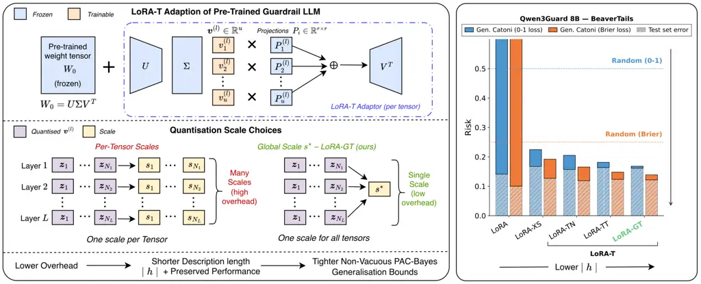
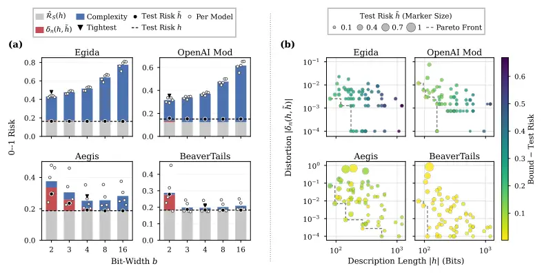

# Tight PAC-Bayes Generalisation Guarantees for Large Language Model Judges

Tom A. Lamb Affiliation: University of Oxford    Philip H. S. Torr
Affiliation: University of Oxford    Tim G. J. Rudner Affiliation:
University of Toronto, Affiliation: Vector Institute, Vijil

###### Abstract

Large language model (LLM) judges are increasingly used to monitor the
outputs of LLM-based AI agents, yet formal guarantees on the reliability
of these judges remain largely absent, limiting confidence in their use
for safety-critical oversight. We consider certifying such a judge and
define its risk over safety classifications of prompt–response pairs
drawn from a deployed generator. We apply a PAC-Bayes framework to this
setting, refining existing compression-based methodology with the use of
tighter bounds and more efficient coding. We show that standard
parameter-efficient fine-tuning can yield non-vacuous and even tight
certificates for safety judges, for both classification and Brier risk,
without holding out data for validation. We introduce LoRA-GT, which
shares a single quantisation scale across layers and achieves the
tightest certificates with minimal degradation in predictive
performance. Across five guardrail models and four benchmarks, we find
that certificate tightness is governed more by adaptation complexity
than by base model scale. Finally, we show how far quantisation can be
pushed before the resulting increase in risk outweighs the bound
tightening gained from shorter descriptions. Together, these results
provide a practical route toward certifiable scalable oversight and
offer insight into how the complexity of safety adaptations shapes
generalisation.

[  Website](https://tomalamb.github.io/pac-bayes-judges/)   [
 Code](https://github.com/tomalamb/generalisation-guarantees-llm-judges)

^(†)^(†)footnotetext: Correspondence to
[thomas.lamb@eng.ox.ac.uk](mailto:thomas.lamb@eng.ox.ac.uk) and
[tim.rudner@utoronto.ca](mailto:tim.rudner@utoronto.ca).

## 1 Introduction

Large language models (LLMs) are increasingly deployed in generative
workflows \[9\] and agentic systems \[36\], including in safety-critical
domains, yet remain vulnerable to adversarial attacks, misuse, and
hallucinations \[53, 57\] and so require oversight. Since human
supervision does not scale, scalable oversight \[8\], in which LLMs act
as automated judges, is becoming increasingly common for monitoring
deployed models \[27\]. Guardrail models such as Llama Guard \[11\] and
Qwen3Guard \[55\] already make safety decisions at scale, such as
whether to block, escalate, or allow a model output.

For these decisions to be reliable, judges must generalise beyond their
evaluation samples, while thresholded safety decisions additionally
require well-calibrated uncertainty estimates \[20, 17, 24\]. However,
judges are increasingly used in safety-critical settings without formal
guarantees on their performance or predictive uncertainty, while what
determines their generalisation remains poorly understood.
Validation-based bounds can provide guarantees for a fixed predictor
using data held out from training, but can be costly when labelled
safety data are limited, and depend only on held-out performance and
sample size. They therefore provide little insight into which properties
of the learned model and learning process are associated with strong
generalisation.

Guardrail models such as Llama Guard \[27\] are already capable safety
judges, so adaptation to a new safety taxonomy or set of guidelines can
be viewed as a simple refinement of their existing safety capabilities.
This raises the question of whether simple adaptations can achieve both
strong predictive performance and tight generalisation guarantees
without holding out limited safety data. PAC-Bayes theory provides a
natural route to investigating this question, and to understanding the
role of adaptation simplicity in generalisation, by relating empirical
performance to model complexity \[2, 10\]. Compression provides a
practical way to control this complexity through the description length
of a learned model, and recent compression-based analyses have obtained
non-vacuous guarantees at the scale of generative LLMs \[34, 35\]. These
works, however, focus on a model’s own generative risk and often use
specialised compressible parameterisations for large-scale pre-training.
This motivates our central question: can we obtain practical,
non-vacuous guarantees for safety judges using simple, standard
adaptation pipelines and the same data for both training and
certification?

We develop a PAC-Bayes framework for certifying a judge’s risk over
prompt–response pairs drawn from the distribution induced by a fixed
generator. We use parameter-efficient fine-tuning (PEFT) \[26\] to
obtain low-dimensional adaptations that can be readily quantised and
compressed. The framework requires minimal changes to standard
safety-fine-tuning pipelines, as the judge is trained conventionally
before its adaptor is quantised and compressed for certification.
Figure 1 shows this approach, with LoRA-GT removing the per-layer
quantisation-scale metadata that dominates adaptor description length
under aggressive compression, yielding the tightest certificate while
retaining competitive predictive performance.



Figure 1: Compression yields tight, non-vacuous PAC-Bayes guarantees for
safety oversight models. Left: LoRA-T with per-tensor versus shared
global scaling (LoRA-GT), which removes the per-layer quantisation-scale
metadata that dominates PEFT adaptor description lengths under
aggressive compression. Right: certified bounds and test risk on
BeaverTails under $`0`$–$`1`$ and Brier losses, where LoRA-GT achieves
the tightest certificates among the shown adaptors while retaining
competitive test risk.

Our contributions are the following:

1.  1.  We formalise PAC-Bayes certification for judges evaluating
        prompt–response pairs drawn from a fixed deployed generator, and
        certify both 0–1 classification risk and Brier risk, to obtain
        certificates for both predictive accuracy and calibration.
2.  2.  We introduce LoRA-GT, which shares a single quantisation scale
        across layers and yields the tightest certificates in all 40
        model–dataset–loss cases. We also tighten the certification
        methodology with a generalised Catoni bound and Elias $`\delta`$
        coding, and shorten adaptor descriptions using Brotli compression,
        further improving bound tightness over prior methodology.
3.  3.  Across five guardrail models and four benchmarks, we show that
        tailored PEFT can achieve strong predictive performance and
        non-vacuous, often tight certificates, even in small-data regimes
        without requiring a separate held-out validation set, making these
        guarantees practical when labelled safety data are limited. Finally,
        we show that certificate tightness depends more on adaptation
        complexity than on base model scale, suggesting that simple
        adaptations to sufficiently capable base models are sufficient for
        reliable safety judges to be deployed with formal generalisation
        guarantees.

## 2 Related work

PAC-Bayes bounds. Classical generalisation bounds based on measures such
as VC-dimension \[52\] and Rademacher complexity \[5\] are typically
vacuous for modern over-parameterised models \[10, 13\]. PAC-Bayes
theory instead provides data-dependent guarantees by comparing a learned
posterior to a fixed prior over hypotheses \[38, 2\], and has yielded
non-vacuous bounds for deep neural networks \[13\]. Recent work extends
this to LLMs through compression-based analyses linking generalisation
to empirical fit and compressibility \[33, 34, 35\]. These works certify
a model’s own next-token risk and consider compression through SubLoRA
\[34\], which combines LoRA with random subspace training, as well as
structured Kronecker and Monarch parameterisations and post-training
quantisation \[35\]. In contrast, we certify a judge’s risk over the
outputs of a separate fixed generator using tailored PEFT adaptations of
pre-trained safety backbones, staying close to standard safety
fine-tuning pipelines. Complementary approaches obtain distribution-free
guarantees by calibration on held-out data, including conformal
prediction \[47\] and distribution-free risk control \[3\]. These
certify a fixed predictor but depend only on held-out error and sample
size, so cannot capture how certificate tightness varies with adaptation
structure (Section D.6).

Parameter-efficient fine-tuning. Parameter-efficient fine-tuning (PEFT)
methods adapt LLMs through low-dimensional parameter updates. LoRA
\[26\] learns low-rank weight updates, while LoRA-XS \[4\] learns a
small latent update in the SVD-derived space of the frozen weights.
LoRA-T (TinyLoRA) \[39\] further reduces this update using fixed random
projections and a small number of learned scaling parameters, following
VeRA \[29\] in freezing random projections. These increasingly compact
adaptations provide a natural setting for studying how adaptation
simplicity affects predictive performance and certificate tightness.

LLMs as safety oversight models. Scalable oversight uses automated
evaluators to supervise large models \[8\], while the LLM-as-a-judge
paradigm \[56\] uses specialised models to evaluate their outputs.
Models such as Llama Guard \[27, 11\] and Qwen3Guard \[55\] act as
system-level safety filters, classifying prompts and responses according
to predefined risk taxonomies. Such models do not typically come with
formal guarantees on performance, nor an understanding of which
properties support their generalisation, leaving a gap between their
practical use and reliable deployment.

## 3 Preliminaries

### 3.1 Quantisation, compression, and description length

Quantisation maps real-valued parameters to a finite discrete
representation \[18\]. Given $`\theta\in\mathbb{R}^{p}`$ and bit-width
$`b\in\mathbb{N}`$, a quantisation scheme is defined via a codebook
$`\mathcal{C}_{b}`$ with $`|\mathcal{C}_{b}|\leq 2^{b}`$, a space of
reconstruction parameters $`\mathcal{S}`$, and a dequantisation rule
$`d_{b}:\mathcal{C}_{b}^{p}\times\mathcal{S}\to\mathbb{R}^{p}`$. The
quantised representation is
$`(z,s)\in\mathcal{C}_{b}^{p}\times\mathcal{S}`$, where $`z`$ contains
the quantised values and $`s`$ the reconstruction parameters. The
reconstructed parameters are $`\hat{\theta}=d_{b}(z,s)`$. For example,
under linear scaling, $`\hat{\theta}=sz`$ for a scale $`s>0`$.
Data-driven schemes such as GPTQ \[15\] and QuIP \[51\] choose $`z`$ to
limit changes in model outputs, while for very small parameterisations
nearest-integer rounding suffices. The resulting discrete representation
can be further compressed losslessly without changing the reconstructed
parameters. We encode it using a lossless compressor such as Brotli
\[21\], producing a binary string $`c(h)\in\{0,1\}^{\ast}`$ \[12\]. We
define the description length of a hypothesis $`h`$ as
$`|h|\coloneqq|c(h)|`$, i.e. the length of the encoded binary string.
This reflects the minimum description length (MDL) principle, an
application of Occam’s razor that favours simple hypotheses that fit the
data \[23\]. In our PAC-Bayes certificates, shorter descriptions
contribute a smaller complexity term (Section 3.3).

### 3.2 PAC-Bayes bounds

Let
$`\mathbb{P}_{\mathcal{D}}\in\mathcal{P}(\mathcal{X}\times\mathcal{Z})`$
denote a data distribution over example–label pairs and let
$`\mathcal{H}`$ denote a hypothesis class of predictors
$`h:\mathcal{X}\to\widehat{\mathcal{Z}}`$. Given a dataset
$`S=\{(x_{i},z_{i})\}_{i=1}^{n}\sim\mathbb{P}_{\mathcal{D}}^{n}`$ of
$`n`$ i.i.d. samples and a loss
$`\ell:\widehat{\mathcal{Z}}\times\mathcal{Z}\to[0,1]`$, define the
population and empirical risks of $`h\in\mathcal{H}`$ as

```math
\mathcal{R}_{\mathcal{D}}(h)=\mathbb{E}_{(x,z)\sim\mathbb{P}_{\mathcal{D}}}\big[\ell(h(x),z)\big],\qquad\widehat{\mathcal{R}}_{S}(h)=\frac{1}{n}\sum_{i=1}^{n}\ell(h(x_{i}),z_{i}).
```

For $`\mathbb{Q},\mathbb{P}\in\mathcal{P}(\mathcal{H})`$ with
$`\mathbb{Q}\ll\mathbb{P}`$, the Kullback–Leibler (KL) divergence is
$`\mathrm{KL}(\mathbb{Q}\|\mathbb{P})=\int_{\mathcal{H}}\log\frac{d\mathbb{Q}}{d\mathbb{P}}(h)\,d\mathbb{Q}(h),`$
where $`d\mathbb{Q}/d\mathbb{P}:\mathcal{H}\to\mathbb{R}_{\geq 0}`$ is
the Radon–Nikodym derivative of $`\mathbb{Q}`$ with respect to
$`\mathbb{P}`$ \[7\]. For a posterior $`\mathbb{Q}`$, the Gibbs risks
are

```math
\mathcal{R}_{\mathcal{D}}(\mathbb{Q})=\mathbb{E}_{h\sim\mathbb{Q}}\big[\mathcal{R}_{\mathcal{D}}(h)\big],\qquad\widehat{\mathcal{R}}_{S}(\mathbb{Q})=\mathbb{E}_{h\sim\mathbb{Q}}\big[\widehat{\mathcal{R}}_{S}(h)\big].
```

Among the many bounds in the PAC-Bayes literature \[2\], we adopt the
following generalised Catoni-style bound \[45\], not explored in prior
compression-based analyses of LLMs, which yields the tightest
certificates in our setting (Section A.5).

###### Theorem 1 (45, Theorem 6).

Let $`\ell:\widehat{\mathcal{Z}}\times\mathcal{Z}\to[0,1]`$ and let
$`\mathbb{P}`$ be independent of $`S`$. For any $`\beta\in(0,1)`$, with
probability at least $`1-\beta`$ over
$`S\sim\mathbb{P}_{\mathcal{D}}^{n}`$, simultaneously for all
$`\mathbb{Q}\in\mathcal{P}(\mathcal{H})`$ with
$`\mathbb{Q}\ll\mathbb{P}`$,

```math
\mathcal{R}_{\mathcal{D}}(\mathbb{Q})\leq\inf_{\lambda>0}\left\{\frac{1}{1-e^{-\frac{\lambda}{n}}}\left[1-\exp\left(-\frac{\lambda\widehat{\mathcal{R}}_{S}(\mathbb{Q})+\mathrm{KL}(\mathbb{Q}\|\mathbb{P})+\log\frac{2+\sqrt{2n}}{\beta}}{n}\right)\right]\right\}.
```

On optimising $`\lambda`$. The infimum is _inside_ Theorem 1, which
holds simultaneously for all $`\lambda>0`$ on a single $`1-\beta`$
event. Minimising over $`\lambda`$ therefore evaluates the bound without
a union-bound penalty or held-out data, unlike the fixed-$`\lambda`$
Catoni bound used in prior compression-based LLM analyses \[10, 33\]. It
is also equivalent to the Seeger–Langford bound, evaluating the same
value by minimisation over $`\lambda`$ rather than binary-KL inversion
(Section A.5).

### 3.3 Compression-based bounds

Following prior work on compression-based PAC-Bayes bounds for LLMs
\[33, 35\], we adopt a Solomonoff prior \[48\] of the form

```math
\mathbb{P}_{\mathrm{Sol}}(h)=2^{-K_{p}(h\penalty\ |\penalty\ M)}/{Z},\qquad Z=\sum_{h\in\mathcal{H}}2^{-K_{p}(h\penalty\ |\penalty\ M)}\leq 1,
```

where $`K_{p}(h\penalty\ |\penalty\ M)`$ is the prefix-free Kolmogorov
complexity of $`h\in\mathcal{H}`$ given decoder $`M`$ \[31\] and the
bound on $`Z`$ is Kraft’s inequality \[30\]. Here $`M`$ is the fixed,
data-independent reconstruction pipeline (frozen base model, seeded
adaptor parameterisation, dequantisation rule $`d_{b}`$, lossless
decompressor, see Appendix C), so $`h`$ is identified with the
compressed adaptor code it decodes, of length $`|h|=|c(h)|`$, and
$`\mathbb{P}_{\mathrm{Sol}}`$ is a valid PAC-Bayes prior, being
independent of the sample $`S`$ over which the bound is computed.

Although $`K_{p}`$ is uncomputable, the length of any valid prefix-free
encoding of $`h`$ under $`M`$ upper-bounds it, yielding a computable
certificate (Corollary 1). This is the standard minimum description
length construction \[23\], in which the encoding makes the uncomputable
term computable. We use the Elias $`\delta`$ code, which gives a tighter
description-length bound than the Elias $`\gamma`$ code used in prior
work \[34\]. Quantisation and lossless compression then determine the
description length used in the certificate. The specific quantisation
schemes are described in Appendix C.

## 4 PAC-Bayes certification of large language model safety oversight

Let $`\mathcal{V}`$ be a finite vocabulary, with prompt space
$`\mathcal{X}\subseteq\mathcal{V}^{*}`$ and response space
$`\mathcal{Y}\subseteq\mathcal{V}^{*}`$. Let
$`\mathbb{P}_{\mathcal{D}}\in\mathcal{P}(\mathcal{X})`$ be the marginal
distribution over prompts, and let a fixed generator $`G`$ define a
Markov kernel
$`\mathbb{P}_{G}(\cdot\penalty\ |\penalty\ x)\in\mathcal{P}(\mathcal{Y})`$.
This induces a joint distribution
$`\mathbb{P}_{\mathcal{D},G}\in\mathcal{P}(\mathcal{X}\times\mathcal{Y})`$
given by

```math
\mathbb{P}_{\mathcal{D},G}(B)=\int_{\mathcal{X}}\mathbb{P}_{G}(B_{x}\penalty\ |\penalty\ x)\,d\mathbb{P}_{\mathcal{D}}(x),\qquad B_{x}=\{y\in\mathcal{Y}:(x,y)\in B\},
```

and let $`(x_{i},y_{i})_{i=1}^{n}\sim(\mathbb{P}_{\mathcal{D},G})^{n}`$
be $`n`$ i.i.d. prompt–response pairs.

Here fixed refers to the fact that the generator weights, decoding
procedure, system prompt, and prompt distribution remain unchanged
between certification and deployment. $`G`$ may also combine multiple
models. The i.i.d. assumption requires that the certification sample and
future deployment samples come from the same distribution, which may
include adversarial and multi-turn prompts, as in Egida \[16\].

Let $`z^{*}:\mathcal{X}\times\mathcal{Y}\to\mathcal{Z}=\{0,1\}`$ denote
a deterministic ground-truth evaluation function, indicating whether a
prompt–response pair satisfies the evaluation criterion, which the judge
$`h:\mathcal{X}\times\mathcal{Y}\to\widehat{\mathcal{Z}}`$ in
$`\mathcal{H}_{J}`$ seeks to emulate, with
$`\widehat{\mathcal{Z}}=\{0,1\}`$ under $`0`$–$`1`$ loss and
$`\widehat{\mathcal{Z}}=[0,1]`$ under Brier. Labelling gives
$`S=\{(x_{i},y_{i},z_{i})\}_{i=1}^{n}`$, $`z_{i}=z^{*}(x_{i},y_{i})`$.
We define the judge’s risk and empirical risk with respect to
$`\mathbb{P}_{\mathcal{D},G}`$ as

```math
\mathcal{R}_{G}(h)\coloneqq\mathbb{E}_{(x,y)\sim\mathbb{P}_{\mathcal{D},G}}\big[\ell(h(x,y),z^{*}(x,y))\big],\qquad\widehat{\mathcal{R}}_{S}(h)\coloneqq\frac{1}{n}\sum_{i=1}^{n}\ell(h(x_{i},y_{i}),z^{*}(x_{i},y_{i})).
```

In line with prior compression-based analyses of language models \[34,
35\], we restrict attention to deterministic posteriors
$`\mathbb{Q}_{h}=\delta_{h}`$, where
$`\delta_{h}\in\mathcal{P}(\mathcal{H})`$ is the Dirac measure at $`h`$.
Since safety systems typically deploy a single fixed judge to monitor a
given generator, this lets the certificate apply directly to the
deployed judge without requiring Gibbs sampling from a stochastic
posterior (Section A.2.3), making it simpler to apply and consistent
with common practitioner usage.

###### Proposition 2.

Assume $`|\mathcal{H}_{J}|<\infty`$, let $`M`$ be the fixed decoder
above, and let $`|h|\geq 1`$. For $`\mathbb{Q}_{h}=\delta_{h}`$ and the
Solomonoff prior $`\mathbb{P}_{\mathrm{Sol}}`$ defined above,
$`\mathrm{KL}(\mathbb{Q}_{h}\,\|\,\mathbb{P}_{\mathrm{Sol}})\leq\mathrm{KL}^{\mathrm{UB}}(\mathbb{Q}_{h}\,\|\,\mathbb{P}_{\mathrm{Sol}})`$,
where

```math
\mathrm{KL}^{\mathrm{UB}}(\mathbb{Q}_{h}\,\|\,\mathbb{P}_{\mathrm{Sol}})=\Bigl(|h|+\lfloor\log_{2}|h|\rfloor+2\bigl\lfloor\log_{2}(\lfloor\log_{2}|h|\rfloor+1)\bigr\rfloor+1\Bigr)\log 2.
```

###### Proof.

See Section A.1.1. ∎

For our deterministic-posterior construction, we take the hypothesis
space to be finite, as ensured by quantisation, so that the KL
divergence is well-defined for point-mass posteriors. Substituting
Proposition 2 into Theorem 1 yields a computable certificate.

###### Corollary 1 (Oversight Model Certificate).

Let $`S\sim(\mathbb{P}_{\mathcal{D},G})^{n}`$. For any
$`\beta\in(0,1)`$, with probability at least $`1-\beta`$ over $`S`$,
simultaneously for all $`h\in\mathcal{H}_{J}`$,

```math
\mathcal{R}_{G}(h)\leq\inf_{\lambda>0}\left\{\frac{1}{1-e^{-\frac{\lambda}{n}}}\left[1-\exp\left(-\frac{\lambda\widehat{\mathcal{R}}_{S}(h)+\mathrm{KL}^{\mathrm{UB}}(\mathbb{Q}_{h}\|\mathbb{P}_{\mathrm{Sol}})+\log\frac{2+\sqrt{2n}}{\beta}}{n}\right)\right]\right\}.
```

###### Proof.

Theorem 1 holds simultaneously for all
$`\mathbb{Q}\ll\mathbb{P}_{\mathrm{Sol}}`$ on a single $`1-\beta`$
event. Since $`\mathbb{P}_{\mathrm{Sol}}(h)>0`$ for every
$`h\in\mathcal{H}_{J}`$, each $`\mathbb{Q}_{h}=\delta_{h}`$ satisfies
this condition. The result follows from Proposition 2. ∎

The certificate thus bounds the risk of the deployed judge under
$`\mathbb{P}_{\mathcal{D},G}`$. Its tightness reflects a trade-off
between the empirical performance and simplicity of the learned judge,
both of which are determined by the learned hypothesis and therefore
depend on the certification sample. Following prior work, we fix
$`\beta=0.05`$ throughout.

Assumptions and scope. Corollary 1 requires a sample-independent prior
and decoder $`M`$, including the backbone, an i.i.d. certification
sample $`S\sim\mathbb{P}_{\mathcal{D},G}`$, and a loss $`\ell\in[0,1]`$.
No assumptions are made on the learning algorithm itself. The bound
holds uniformly over $`\mathcal{H}_{J}`$, allowing selection after
observing $`S`$, provided the description includes any configuration
information needed for reconstruction. Recording which of $`K`$
configurations was chosen takes $`\lceil\log_{2}K\rceil`$ bits
(Section C.3). More generally, the certificate applies to any finite
hypothesis reconstructible from an explicit code, not only PEFT.
Deployment changes that alter the certified distribution require
recomputation (Sections 6 and A.2).

### 4.1 LoRA-GT: global-scale quantised adaptations

The Solomonoff prior assigns greater prior probability to hypotheses
with shorter descriptions, formalising an Occam’s razor-style preference
for simpler hypotheses. This connects directly to our motivating
question of whether simple adaptations of capable guardrails can retain
strong predictive performance while admitting tight generalisation
guarantees without reserving scarce safety data for validation. PEFT
provides a natural setting for studying this question by expressing
adaptations as low-dimensional updates to a frozen base model. Their
complexity can then be measured through description length after
quantisation and compression.

Our hypothesis class is accordingly the set of PEFT adaptations of a
frozen oversight model, namely LoRA \[26\], LoRA-XS \[4\], and LoRA-T
\[39\], of increasing parameter efficiency and defined in Section B.4.1.
Since Corollary 1’s complexity term is governed by adaptor description
length, increasingly compact adaptations offer the potential for tighter
certification if they also retain strong predictive performance. LoRA-T
is the most compact of these parameterisations, with its weight-tied
variant the most compact of all. We denote the non-tied variant LoRA-TN
and the weight-tied variant LoRA-TT, both due to Morris et al. \[39\],
and introduce LoRA-GT, the tied variant under global-scale quantisation,
novel to this work.

In the tied variant, a single vector is shared across all adapted
modules within each transformer layer. For a base weight
$`W_{0}\in\mathbb{R}^{d\times k}`$, the adapted weights of a particular
weight matrix take the form
$`W=W_{0}+U\Sigma\left(\sum_{i=1}^{u}v_{i}P_{i}\right)V^{\top},`$ where
$`U,\Sigma,V`$ and $`\{P_{i}\}_{i=1}^{u}`$ are fixed and
$`\mathbf{v}\in\mathbb{R}^{u}`$ is trainable, with
$`\mathbf{v}^{(\ell)}\in\mathbb{R}^{u}`$ shared within each layer
$`\ell\in\{1,\dots,L\}`$. See Section B.4.1 for further details.

Scale overhead. Under $`b`$-bit quantisation of LoRA-TT, the per-layer
scales stored in bfloat16 cost $`16L`$ bits, dominating $`|h|`$, and
hence the KL penalty of Proposition 2, for small $`u`$ and $`b`$. At
$`u{=}1`$, $`b{=}2`$ on Llama-Guard-3-8B ($`L{=}32`$), the weights
require only $`64`$ bits while the scales require $`512`$. Sharing a
single global scale across layers removes $`(L-1)\times 16`$ bits of
this metadata, taking the total from $`576`$ to $`80`$ bits, an $`86\%`$
reduction, and leaves the complexity term set more by the weights
themselves than by reconstruction overhead.

Scale selection. With only $`u`$ trainable parameters per layer,
nearest-integer rounding suffices because the representation is small
enough that more elaborate second-order schemes such as GPTQ offer
little benefit. We use the symmetric codebook
$`\mathcal{C}_{b}=\{-q_{\max},\dots,q_{\max}\}`$, where
$`q_{\max}=2^{b-1}-1`$, and a single global scale $`s>0`$. Writing
$`\mathbf{v}\in\mathbb{R}^{Lu}`$ for the concatenation of all layer
vectors, the quantised values are
$`z_{i}=\mathrm{clip}\bigl(\operatorname{round}(v_{i}/s),-q_{\max},q_{\max}\bigr)`$
with reconstruction $`\hat{\mathbf{v}}=sz`$, where
$`\mathrm{clip}(x,a,b)=\min\{b,\max\{a,x\}\}`$ and
$`\operatorname{round}`$ rounds to the nearest integer. The natural
clipping-free scale is
$`s^{*}=\|\mathbf{v}\|_{\infty}/(q_{\max}+\tfrac{1}{2})`$, the smallest
scale that avoids clipping and, among clipping-free choices, minimises
the worst-case rounding error bound.

###### Proposition 3 (Minimal Clipping-Free Scale).

Fix $`b\in\mathbb{N}`$ and let $`\mathbf{v}\in\mathbb{R}^{Lu}`$ be
nonzero. Under nearest-integer rounding with ties resolved toward zero,
$`s^{*}`$ is the smallest scale for which
$`|\operatorname{round}(v_{i}/s^{*})|\leq q_{\max}`$ for all $`i`$.
Moreover, for any clipping-free scale $`s`$,
$`\|\mathbf{v}-\hat{\mathbf{v}}(s)\|_{\infty}\leq s/2`$, with equality
whenever some $`v_{i}/s`$ is a half-integer. Hence $`s^{*}`$ minimises
the worst-case rounding error bound among clipping-free scales.

###### Proof.

See Section A.1.2. ∎

At low bit-widths, the smallest clipping-free scale need not minimise
the overall reconstruction error. For example, when $`b=2`$, the
codebook is $`\mathcal{C}_{2}=\{-1,0,1\}`$ and
$`s^{*}=\|\mathbf{v}\|_{\infty}/(1+\frac{1}{2})`$. Thus, any coordinate
with $`|v_{i}|<s^{*}/2=\|\mathbf{v}\|_{\infty}/3`$ rounds to zero. If
many coordinates fall below this threshold, their errors can accumulate
in the overall $`\ell_{2}`$ reconstruction error. A smaller scale
narrows both the spacing $`s`$ between reconstruction levels and their
range $`[-sq_{\max},sq_{\max}]`$. This lowers the threshold $`s/2`$ for
rounding to zero, preserving more small coordinates as nonzero values at
the cost of clipping the largest coordinates. We therefore start from
$`s^{*}`$ and, for $`b\leq 4`$, search over smaller representable
scales, selecting the one that minimises
$`\|\mathbf{v}-d_{b}(z(s),s)\|_{2}`$. Because $`s`$ is stored in
bfloat16, only finitely many scales are representable. The search rule
is fixed in advance, and the selected scale is included in the encoded
hypothesis. For $`b\geq 8`$, we use $`s^{*}`$ directly, since the finer
codebook makes the clipping-free scale sufficiently accurate
(Section C.2). Section 5.3 also reports results using $`s^{*}`$ as a
control.

## 5 Empirical evaluation

Models and datasets. Our main results cover five safety oversight models
from two guardrail families, Llama Guard 3 at 1B and 8B \[22\] and
Qwen3Guard at 0.6B, 4B and 8B \[55\]. All five appear in Figure 2 and
the complete per-model results tables (Section D.1). We use four
benchmarks, Egida \[16\] ($`n{=}792`$), OpenAI Content Moderation \[37\]
($`n{=}1{,}344`$), Aegis \[19\] ($`n{=}28{,}984`$), and BeaverTails
\[28\] ($`n{=}300{,}567`$). Each instantiates a particular
$`\mathbb{P}_{\mathcal{D},G}`$, with the generator underlying each
recorded in Section B.3. Our judges evaluate binary safety
classification generatively, emitting tokens from the model vocabulary
$`\mathcal{V}`$, and the predictive distributions over safety categories
used for Brier scores are described in Section A.3.2.

Figure 2: Tight non-vacuous guarantees for safety oversight models.
Certified bounds and test risk for $`0`$–$`1`$ and Brier losses across
models, datasets, and adaptor families, showing the tightest certificate
within each family after accounting for the finite selection cost
(Section C.3). LoRA, whose bounds are vacuous, is shown at its lowest
test risk. Highly compressed adaptors achieve tight non-vacuous
guarantees at a small cost in test risk.

Fine-tuning setup. We fine-tune with LoRA at ranks $`r\in\{1,2,4\}`$,
LoRA-XS at $`r\in\{2,4\}`$, and the three LoRA-T variants of
Section 4.1, LoRA-TN and LoRA-TT at
$`(r,u)\in\{(2,1),\allowbreak(4,1),\allowbreak(4,2),\allowbreak(4,4)\}`$
and LoRA-GT at $`r=4`$ and $`u\in\{1,2,4\}`$. Models are trained in a
standard way, simply autoregressively via supervised fine-tuning using
the standard log-loss objective, adapting all linear layers. Further
details are given in Section B.4.2.

Quantisation and compression. Following Section 3.1, we quantise adaptor
parameters post-training at $`2`$ and $`4`$ bits, extending to
$`\{2,3,4,8,16\}`$ for the distortion analysis of Section 5.3. Selecting
the tightest certificate among $`K`$ bit-widths adds
$`\lceil\log_{2}K\rceil`$ selection bits, giving $`1`$ bit for two
choices and $`3`$ for five (Section C.3). All variants use Hadamard
incoherence processing, followed by GPTQ via llm-compressor \[43\] for
LoRA and LoRA-XS and nearest-integer rounding for LoRA-TN, LoRA-TT and
LoRA-GT, with the LoRA-GT scale chosen as in Section 4.1 via a scale
search. Only the adaptor and its reconstruction metadata enter $`|h|`$
(Appendix C), and we retain the shorter of the raw and Brotli encodings
\[1\], charging one flag bit to identify the choice (Sections C.3
and 8). Section C.4 summarises the full training and certification
pipeline.

### 5.1 Non-vacuous and tight guarantees for safety oversight models

Figure 2 shows non-vacuous guarantees under both $`0`$–$`1`$ and Brier
loss across models, datasets, and adaptor families. Notably, this
extends to Egida and OpenAI Moderation with only $`792`$ and $`1{,}344`$
certification samples, reaching substantially smaller sample sizes than
prior compression-based LLM certificates and demonstrating certification
in the common limited-data regime. The Brier results further provide
guarantees on the quality of the predictive probabilities used for
thresholded safety decisions, which have not been considered in prior
compression-based LLM certification.

The strongest certificates consistently come from the simplest
adaptations, as also illustrated within the LoRA-T family in
Figure 3(b). Across the complete results, LoRA-GT is tightest in all
$`40`$ model–dataset–loss cases (Sections D.1 and D.2), while standard
LoRA is vacuous in every case. This continues even on BeaverTails with
$`n\approx 300`$k, showing that large certification samples alone do not
ensure tight guarantees. The complexity term depends on $`|h|/n`$ rather
than on $`n`$ alone, and LoRA descriptions there take $`0.8`$M to
$`28`$M bits.

Takeaway. Compact safety adaptations yield non-vacuous, often tight
guarantees for classification and Brier risk, even with only $`792`$
certification samples.

Figure 3: Compression strongly influences certifiability in safety
oversight models. (a) Bound vs. description length across models and
datasets, showing that smaller, more compressed adaptations yield
tighter PAC-Bayes guarantees. (b) LoRA-T variants, where tying and
global-scale quantisation reduce description length and tighten bounds
with only modest changes in test risk.

### 5.2 Adaptor compression yields the tightest PAC-Bayes guarantees

Figure 3(a) shows that certificate tightness closely tracks adaptor
description length across models and datasets. The description-length
ordering, LoRA, LoRA-XS, LoRA-TN, LoRA-TT, then LoRA-GT, matches the
certificate ordering in $`39`$ of $`40`$ model–dataset–loss cases
(Section D.4.1), despite the large variation in backbone scale. Within
the LoRA-T family, Figure 3(b) shows that tying and LoRA-GT
progressively shorten descriptions and tighten certificates. Adaptation
complexity is therefore a stronger determinant of certificate tightness
than backbone scale.

Greater compression can weaken predictive performance, although the
effect is modest in many settings and varies across models and
benchmarks (Section D.1). On BeaverTails, for example, quantised LoRA-GT
has $`2.1`$ to $`6.7`$ points higher $`0`$–$`1`$ test risk than LoRA,
while its certificate falls from $`1.000`$ to between $`0.169`$ and
$`0.226`$ (Table 6). Most of the gap between LoRA and LoRA-GT is already
present before quantisation, indicating that it comes from the more
restricted parameterisation rather than quantisation. The adaptors
therefore span a trade-off between performance and certifiability, with
LoRA-GT giving substantially tighter guarantees at a generally slight
cost to predictive performance. Section 5.3 examines how far compression
can go before distortion outweighs the gain from shorter descriptions.

Takeaway. Adaptor description length tracks certificate tightness more
closely than backbone scale. LoRA-GT gives the tightest certificates,
generally at a small cost in predictive performance.

### 5.3 How far compression can go

Let $`h,\tilde{h}\in\mathcal{H}_{J}`$ denote a fine-tuned judge and its
quantised version, respectively. We define _functional distortion_ as
the change in risk caused by quantisation:

```math
\Delta_{G}(h,\tilde{h})=\mathbb{E}_{(x,y)\sim\mathbb{P}_{\mathcal{D},G}}\!\left[\ell(\tilde{h}(x,y),z^{*}(x,y))-\ell(h(x,y),z^{*}(x,y))\right].
```

Replacing the expectation by the average over the $`n`$ examples in the
certification sample $`S`$ gives the _empirical functional distortion_,
$`\delta_{n}(h,\tilde{h})=\widehat{\mathcal{R}}_{S}(\tilde{h})-\widehat{\mathcal{R}}_{S}(h)`$.
Positive values mean that quantisation increases empirical risk.
Compression tightens certificates when the complexity savings from
shorter adaptor descriptions outweigh any increase in empirical risk
stemming from increased functional distortion introduced through
quantisation (Proposition 6). Further details and results relating to
functional distortion are given in Section A.4.

The trade-off between complexity savings and functional distortion
depends on the certification sample size. In Figure 4(a), mean LoRA-GT
certificates under $`0`$–$`1`$ loss favour $`2`$ bits on Egida and
OpenAI Moderation, but $`4`$ bits on Aegis and BeaverTails. The
complexity penalty depends on $`|\tilde{h}|/n`$, the ratio of quantised
adaptor description length to certification sample size. On these larger
benchmarks, further compression therefore saves less, and the added
functional distortion at $`2`$ bits loosens the certificate. In
Figure 4(b), certificate tightness tracks description length on the
smaller benchmarks. On the larger benchmarks, the smaller complexity
penalty gives more uniform tightness across description lengths, even as
test risk varies. The generalisation bound therefore depends more on the
fine-tuned judge’s empirical risk and the functional distortion caused
by quantisation than on the complexity penalty.

Takeaway. Aggressive quantisation helps most when certification data are
scarce. With more data, quantisation error can outweigh the smaller
complexity savings and loosen certificates.



Figure 4: Compression and distortion under $`0`$–$`1`$ loss. LoRA-GT
across five models and $`u\in\{1,2,4\}`$. (a) Mean Catoni certificates
split into pre-quantisation empirical risk, signed distortion and
complexity. (b) Absolute distortion against description length at
$`b\in\{2,3,4,8\}`$. Colour shows certificate minus test risk and marker
size shows test risk. Dashed lines trace the Pareto front.

## 6 Discussion

Our results show that simple PEFT updates can adapt capable safety
judges to new safety data while retaining strong predictive performance
and admitting tight generalisation guarantees. Across models and
datasets, certificate tightness tracks adaptation complexity more
closely than the scale of the underlying judge. This suggests that
simple adaptations can suffice to specialise existing guardrails to new
safety taxonomies or guidelines, making adaptation complexity a useful
consideration alongside predictive performance.

These guarantees fit within a standard fine-tuning pipeline. The adaptor
is trained conventionally and certified post hoc, without constraining
the learning algorithm or requiring a separate validation split. The
full labelled sample can therefore be used for adaptation and
certification, which is particularly relevant when safety data are
scarce.

Compression can further tighten certificates by shortening adaptor
descriptions, but only while the resulting functional distortion remains
small. At $`2`$ bits, the balance depends on sample size, with
compression tightening certificates on smaller benchmarks but loosening
them on larger ones. More generally, our framework is not specific to
PEFT and applies to any finite hypothesis reconstructible from an
explicit code.

Limitations. Our guarantees apply to the generator-induced deployment
distribution from which the certification data are drawn. Changes to the
generator, decoding configuration, system prompt, or prompt distribution
constitute distribution shift, a longstanding challenge for
generalisation guarantees \[6\], which remains beyond the scope of this
work. We evaluate guardrail models only up to $`8`$B parameters, a
relevant scale for low-cost oversight of larger systems. Whether compact
adaptations at substantially larger scales retain low
quantisation-induced functional distortion, and admit similarly tight
guarantees, remains an important direction for future work.

## 7 Conclusion

We formalised PAC-Bayes certification for safety judges evaluating
outputs from a fixed deployed generator. Across five guardrail models
and four benchmarks, tailored PEFT yielded non-vacuous, often tight
guarantees for both classification and Brier risk, including in
small-data regimes and without a separate held-out validation set.
Certificate tightness tracked adaptation complexity more closely than
backbone scale, with LoRA-GT giving the tightest certificates in all 40
model–dataset–loss cases. Compression can tighten certificates further,
provided its reduction in description length outweighs the resulting
functional distortion. These results show that simple, compressible
adaptations can make formal certification practical when specialising
safety judges to new taxonomies with scarce labelled data.

## Acknowledgements

TGJR acknowledges support from the Foundational Research Grants program
at Georgetown University’s Center for Security and Emerging Technology.
Resources used in preparing this research were provided, in part, by the
Province of Ontario, the Government of Canada through CIFAR, and
companies sponsoring the Vector Institute. This work is additionally
supported by the UKRI grant: Turing AI Fellowship EP/W002981/1.

## References

- \[1\] Jyrki Alakuijala, Evgenii Kliuchnikov, Zoltán Szabadka, and Lode
  Vandevenne. Comparison of brotli, deflate, zopfli, lzma, lzham and
  bzip2 compression algorithms.
  [https://cran.r-project.org/web/packages/brotli/vignettes/brotli-2015-09-22.pdf](https://cran.r-project.org/web/packages/brotli/vignettes/brotli-2015-09-22.pdf), 2015.
  Google Inc. technical report.
- \[2\] Pierre Alquier. User-friendly introduction to PAC-Bayes bounds.
  _Foundations and Trends® in Machine Learning_, 17(2):174–303, 2024.
- \[3\] Anastasios N Angelopoulos, Stephen Bates, Emmanuel J Candès,
  Michael I Jordan, and Lihua Lei. Learn then test: Calibrating
  predictive algorithms to achieve risk control. _The Annals of Applied
  Statistics_, 19(2):1641–1662, 2025.
- \[4\] Klaudia Bałazy, Mohammadreza Banaei, Karl Aberer, and Jacek
  Tabor. LoRA-XS: Low-rank adaptation with extremely small number of
  parameters. _arXiv preprint arXiv:2405.17604_, 2024.
- \[5\] Peter L Bartlett and Shahar Mendelson. Rademacher and Gaussian
  complexities: Risk bounds and structural results. _Journal of Machine
  Learning Research_, 3(Nov):463–482, 2002.
- \[6\] Shai Ben-David, John Blitzer, Koby Crammer, Alex Kulesza,
  Fernando Pereira, and Jennifer Wortman Vaughan. A theory of learning
  from different domains. _Machine learning_, 79(1):151–175, 2010.
- \[7\] Patrick Billingsley. _Probability and Measure_. John Wiley &
  Sons, 3rd edition, 1995.
- \[8\] Samuel R Bowman, Jeeyoon Hyun, Ethan Perez, Edwin Chen, Craig
  Pettit, Scott Heiner, Kamilė Lukošiūtė, Amanda Askell, Andy Jones,
  Anna Chen, et al. Measuring progress on scalable oversight for large
  language models. _arXiv preprint arXiv:2211.03540_, 2022.
- \[9\] Tom Brown, Benjamin Mann, Nick Ryder, Melanie Subbiah, Jared D
  Kaplan, Prafulla Dhariwal, Arvind Neelakantan, Pranav Shyam, Girish
  Sastry, Amanda Askell, et al. Language models are few-shot learners.
  _Advances in Neural Information Processing Systems_,
  33:1877–1901, 2020.
- \[10\] Olivier Catoni. PAC-Bayesian supervised classification: the
  thermodynamics of statistical learning. _arXiv preprint
  arXiv:0712.0248_, 2007.
- \[11\] Jianfeng Chi, Ujjwal Karn, Hongyuan Zhan, Eric Smith, Javier
  Rando, Yiming Zhang, Kate Plawiak, Zacharie Delpierre Coudert,
  Kartikeya Upasani, and Mahesh Pasupuleti. Llama Guard 3 Vision:
  Safeguarding human-AI image understanding conversations. _arXiv
  preprint arXiv:2411.10414_, 2024.
- \[12\] Thomas M Cover and Joy A Thomas. _Elements of information
  theory_. John Wiley & Sons, 1999.
- \[13\] Gintare Karolina Dziugaite and Daniel M Roy. Computing
  nonvacuous generalization bounds for deep (stochastic) neural networks
  with many more parameters than training data. _arXiv preprint
  arXiv:1703.11008_, 2017.
- \[14\] Peter Elias. Universal codeword sets and representations of the
  integers. _IEEE Transactions on Information Theory_,
  21(2):194–203, 1975.
- \[15\] Elias Frantar, Saleh Ashkboos, Torsten Hoefler, and Dan
  Alistarh. GPTQ: Accurate post-training quantization for generative
  pre-trained transformers. _arXiv preprint arXiv:2210.17323_, 2022.
- \[16\] Dario Garcia-Gasulla, Adrián Tormos, Anna Arias-Duart, Daniel
  Hinjos, Oscar Molina-Sedano, Ashwin Kumar Gurarajan, and Maria Eugenia
  Cardello. Efficient safety retrofitting against jailbreaking for LLMs.
  In _International Conference on Computer Safety, Reliability, and
  Security_, pages 537–565. Springer, 2025.
- \[17\] Yonatan Geifman and Ran El-Yaniv. Selective classification for
  deep neural networks. _Advances in Neural Information Processing
  Systems_, 30, 2017.
- \[18\] Allen Gersho and Robert M Gray. _Vector quantization and signal
  compression_, volume 159. Springer Science & Business Media, 2012.
- \[19\] Shaona Ghosh, Prasoon Varshney, Makesh Narsimhan Sreedhar,
  Aishwarya Padmakumar, Traian Rebedea, Jibin Rajan Varghese, and
  Christopher Parisien. AEGIS2.0: A diverse AI safety dataset and risks
  taxonomy for alignment of LLM guardrails. In Luis Chiruzzo, Alan
  Ritter, and Lu Wang, editors, _Proceedings of the 2025 Conference of
  the Nations of the Americas Chapter of the Association for
  Computational Linguistics: Human Language Technologies (Volume 1: Long
  Papers)_, pages 5992–6026, Albuquerque, New Mexico, April 2025.
  Association for Computational Linguistics. ISBN 979-8-89176-189-6.
  doi: 10.18653/v1/2025.naacl-long.306. URL
  [https://aclanthology.org/2025.naacl-long.306/](https://aclanthology.org/2025.naacl-long.306/).
- \[20\] Tilmann Gneiting and Adrian E Raftery. Strictly proper scoring
  rules, prediction, and estimation. _Journal of the American
  Statistical Association_, 102(477):359–378, 2007.
- \[21\] Google Inc. Brotli compression format (v0.2.0).
  [https://github.com/google/brotli/releases/tag/v0.2.0](https://github.com/google/brotli/releases/tag/v0.2.0), 2015.
  GitHub release.
- \[22\] Aaron Grattafiori, Abhimanyu Dubey, Abhinav Jauhri, Abhinav
  Pandey, Abhishek Kadian, Ahmad Al-Dahle, Aiesha Letman, Akhil Mathur,
  Alan Schelten, Alex Vaughan, et al. The Llama 3 herd of models. _arXiv
  preprint arXiv:2407.21783_, 2024.
- \[23\] Peter D Grünwald. _The minimum description length principle_.
  MIT Press, 2007.
- \[24\] Chuan Guo, Geoff Pleiss, Yu Sun, and Kilian Q Weinberger. On
  calibration of modern neural networks. In _International Conference on
  Machine Learning_, pages 1321–1330. PMLR, 2017.
- \[25\] Wassily Hoeffding. Probability inequalities for sums of bounded
  random variables. _Journal of the American Statistical Association_,
  58(301):13–30, 1963.
- \[26\] Edward J Hu, Yelong Shen, Phillip Wallis, Zeyuan Allen-Zhu,
  Yuanzhi Li, Shean Wang, Lu Wang, and Weizhu Chen. LoRA: Low-rank
  adaptation of large language models. In _International Conference on
  Learning Representations_, 2022.
- \[27\] Hakan Inan, Kartikeya Upasani, Jianfeng Chi, Rashi Rungta,
  Krithika Iyer, Yuning Mao, Michael Tontchev, Qing Hu, Brian Fuller,
  Davide Testuggine, et al. Llama Guard: LLM-based input-output
  safeguard for human-AI conversations. _arXiv preprint
  arXiv:2312.06674_, 2023.
- \[28\] Jiaming Ji, Mickel Liu, Josef Dai, Xuehai Pan, Chi Zhang, Ce
  Bian, Boyuan Chen, Ruiyang Sun, Yizhou Wang, and Yaodong Yang.
  BeaverTails: Towards improved safety alignment of LLM via a
  human-preference dataset. _Advances in Neural Information Processing
  Systems_, 36:24678–24704, 2023.
- \[29\] Dawid Kopiczko, Tijmen Blankevoort, and Yuki Asano. Vera:
  Vector-based random matrix adaptation. In _International Conference on
  Learning Representations_, volume 2024, pages 6815–6835, 2024.
- \[30\] Leon Gordon Kraft. _A device for quantizing, grouping, and
  coding amplitude-modulated pulses_. PhD thesis, Massachusetts
  Institute of Technology, 1949.
- \[31\] Ming Li and Paul Vitányi. _An introduction to Kolmogorov
  complexity and its applications_, volume 3. Springer, 2008.
- \[32\] Ilya Loshchilov and Frank Hutter. Decoupled weight decay
  regularization. In _International Conference on Learning
  Representations_, 2019. URL
  [https://openreview.net/forum?id=Bkg6RiCqY7](https://openreview.net/forum?id=Bkg6RiCqY7).
- \[33\] Sanae Lotfi, Marc Finzi, Sanyam Kapoor, Andres Potapczynski,
  Micah Goldblum, and Andrew G Wilson. PAC-Bayes compression bounds so
  tight that they can explain generalization. _Advances in Neural
  Information Processing Systems_, 35:31459–31473, 2022.
- \[34\] Sanae Lotfi, Marc Finzi, Yilun Kuang, Tim GJ Rudner, Micah
  Goldblum, and Andrew Gordon Wilson. Non-vacuous generalization bounds
  for large language models. In _Proceedings of the 41st International
  Conference on Machine Learning_, pages 32801–32818, 2024a.
- \[35\] Sanae Lotfi, Yilun Kuang, Brandon Amos, Micah Goldblum, Marc
  Finzi, and Andrew G Wilson. Unlocking tokens as data points for
  generalization bounds on larger language models. _Advances in Neural
  Information Processing Systems_, 37:9229–9256, 2024b.
- \[36\] Junyu Luo, Weizhi Zhang, Ye Yuan, Yusheng Zhao, Junwei Yang,
  Yiyang Gu, Bohan Wu, Binqi Chen, Ziyue Qiao, Qingqing Long, et al.
  Large language model agent: A survey on methodology, applications and
  challenges. _arXiv preprint arXiv:2503.21460_, 2025.
- \[37\] Todor Markov, Chong Zhang, Sandhini Agarwal, Florentine
  Eloundou Nekoul, Theodore Lee, Steven Adler, Angela Jiang, and Lilian
  Weng. A holistic approach to undesired content detection in the real
  world. In _Proceedings of the AAAI Conference on Artificial
  Intelligence_, volume 37, pages 15009–15018, 2023.
- \[38\] David A McAllester. PAC-Bayesian model averaging. In
  _Proceedings of the Twelfth Annual Conference on Computational
  Learning Theory_, pages 164–170, 1999.
- \[39\] John X Morris, Niloofar Mireshghallah, Mark Ibrahim, and Saeed
  Mahloujifar. Learning to reason in 13 parameters. _arXiv preprint
  arXiv:2602.04118_, 2026.
- \[40\] Allan H Murphy. A new vector partition of the probability
  score. _Journal of Applied Meteorology and Climatology_,
  12(4):595–600, 1973.
- \[41\] Python Software Foundation. gzip — support for gzip files.
  [https://docs.python.org/3/library/gzip.html](https://docs.python.org/3/library/gzip.html),
  2026a. Accessed: 2026-03-18.
- \[42\] Python Software Foundation. lzma — compression using the lzma
  algorithm.
  [https://docs.python.org/3/library/lzma.html](https://docs.python.org/3/library/lzma.html),
  2026b. Accessed: 2026-03-18.
- \[43\] Red Hat AI and vLLM Project. LLM Compressor.
  [https://github.com/vllm-project/llm-compressor](https://github.com/vllm-project/llm-compressor), 2024.
- \[44\] Omar Rivasplata, Vikram M Tankasali, and Csaba Szepesvari.
  PAC-Bayes with backprop. _arXiv preprint arXiv:1908.07380_, 2019.
- \[45\] Borja Rodriguez-Galvez, Ragnar Thobaben, and Mikael Skoglund.
  More PAC-Bayes bounds: From bounded losses, to losses with general
  tail behaviors, to anytime validity. _Journal of Machine Learning
  Research_, 25(110):1–43, 2024.
- \[46\] Matthias Seeger. PAC-Bayesian generalisation error bounds for
  Gaussian process classification. _Journal of Machine Learning
  Research_, 3(Oct):233–269, 2002.
- \[47\] Glenn Shafer and Vladimir Vovk. A tutorial on conformal
  prediction. _Journal of Machine Learning Research_, 9(3), 2008.
- \[48\] Ray J Solomonoff. A formal theory of inductive inference.
  Part I. _Information and Control_, 7(1):1–22, 1964.
- \[49\] James Joseph Sylvester. LX. thoughts on inverse orthogonal
  matrices, simultaneous signsuccessions, and tessellated pavements in
  two or more colours, with applications to Newton’s rule, ornamental
  tile-work, and the theory of numbers. _The London, Edinburgh, and
  Dublin Philosophical Magazine and Journal of Science_,
  34(232):461–475, 1867.
- \[50\] Niklas Thiemann, Christian Igel, Olivier Wintenberger, and
  Yevgeny Seldin. A strongly quasiconvex PAC-Bayesian bound. In
  _International Conference on Algorithmic Learning Theory_, pages
  466–492. PMLR, 2017.
- \[51\] Albert Tseng, Jerry Chee, Qingyao Sun, Volodymyr Kuleshov, and
  Christopher De Sa. QuIP#: Even better LLM quantization with Hadamard
  incoherence and lattice codebooks. _Proceedings of Machine Learning
  Research_, 235:48630, 2024.
- \[52\] Vladimir N. Vapnik. _Statistical Learning Theory_. Wiley, 1998.
- \[53\] Boxin Wang, Weixin Chen, Hengzhi Pei, Chulin Xie, Mintong Kang,
  Chenhui Zhang, Chejian Xu, Zidi Xiong, Ritik Dutta, Rylan Schaeffer,
  et al. DecodingTrust: A comprehensive assessment of trustworthiness in
  GPT models. In _Advances in Neural Information Processing Systems,
  Datasets and Benchmarks Track_, 2023.
- \[54\] Thomas Wolf, Lysandre Debut, Victor Sanh, Julien Chaumond,
  Clement Delangue, Anthony Moi, Pierric Cistac, Tim Rault, Rémi Louf,
  Morgan Funtowicz, et al. Transformers: State-of-the-art natural
  language processing. In _Proceedings of the 2020 Conference on
  Empirical Methods in Natural Language Processing: System
  Demonstrations_, pages 38–45, 2020.
- \[55\] Haiquan Zhao, Chenhan Yuan, Fei Huang, Xiaomeng Hu, Yichang
  Zhang, An Yang, Bowen Yu, Dayiheng Liu, Jingren Zhou, Junyang Lin, et
  al. Qwen3Guard technical report. _arXiv preprint
  arXiv:2510.14276_, 2025.
- \[56\] Lianmin Zheng, Wei-Lin Chiang, Ying Sheng, Siyuan Zhuang,
  Zhanghao Wu, Yonghao Zhuang, Zi Lin, Zhuohan Li, Dacheng Li, Eric
  Xing, et al. Judging LLM-as-a-judge with MT-Bench and Chatbot Arena.
  _Advances in Neural Information Processing Systems_,
  36:46595–46623, 2023.
- \[57\] Andy Zou, Zifan Wang, Nicholas Carlini, Milad Nasr, J Zico
  Kolter, and Matt Fredrikson. Universal and transferable adversarial
  attacks on aligned language models. _arXiv preprint
  arXiv:2307.15043_, 2023.

## Appendix

### Table of Contents

## Appendix A Theory and analysis

### A.1 Proofs of statements used

#### A.1.1 Proof of Proposition 2

###### Proof.

The prefix-free Kolmogorov complexity $`K_{p}(h\penalty\ |\penalty\ M)`$
is the length of the shortest program that outputs $`h`$ under the fixed
decoder $`M`$, where $`M`$ captures the shared decoding procedure and
model specification and is therefore independent of both the data and
the learned adaptation defining the hypothesis. Consequently, the length
of any valid prefix-free encoding of $`h`$ upper-bounds
$`K_{p}(h\penalty\ |\penalty\ M)`$.

We construct such an encoding by concatenating two components, the
length $`|h|`$, encoded using the Elias $`\delta`$-code \[14\], followed
by the binary string $`h`$ itself. This forms a valid prefix-free
program for $`h`$. The Elias $`\delta`$-code for an integer $`x\geq 1`$
has codeword length

```math
\lfloor\log_{2}x\rfloor+2\lfloor\log_{2}(\lfloor\log_{2}x\rfloor+1)\rfloor+1,
```

and hence, for $`|h|\geq 1`$,

```math
K_{p}(h\penalty\ |\penalty\ M)\leq|h|+\lfloor\log_{2}|h|\rfloor+2\lfloor\log_{2}(\lfloor\log_{2}|h|\rfloor+1)\rfloor+1. \tag{A.1}
```

For the deterministic posterior $`\mathbb{Q}_{h}=\delta_{h}`$, and
assuming $`|\mathcal{H}_{J}|<\infty`$, the KL divergence simplifies to

```math
\mathrm{KL}(\mathbb{Q}_{h}\|\mathbb{P}_{\mathrm{Sol}})=\sum_{g\in\mathcal{H}_{J}}\delta_{h}(g)\log\frac{\delta_{h}(g)}{\mathbb{P}_{\mathrm{Sol}}(g)}=-\log\mathbb{P}_{\mathrm{Sol}}(h). \tag{A.2}
```

Using the definition of the Solomonoff prior in Section 3.3,

```math
-\log\mathbb{P}_{\mathrm{Sol}}(h)=-\log\left(\frac{2^{-K_{p}(h\penalty\ |\penalty\ M)}}{Z}\right)=K_{p}(h\penalty\ |\penalty\ M)\log 2+\log Z\leq K_{p}(h\penalty\ |\penalty\ M)\log 2, \tag{A.3}
```

where the inequality follows from $`Z\leq 1`$ by Kraft’s inequality
\[30\]. Substituting (A.1) yields

```math
\mathrm{KL}(\mathbb{Q}_{h}\|\mathbb{P}_{\mathrm{Sol}})\leq\left(|h|+\lfloor\log_{2}|h|\rfloor+2\lfloor\log_{2}(\lfloor\log_{2}|h|\rfloor+1)\rfloor+1\right)\log 2,
```

which completes the proof. ∎

The Elias $`\delta`$ code used here yields a tighter description-length
bound than the Elias $`\gamma`$ code of Lotfi et al. \[34\] for the
adaptors considered here (Table 7).

#### A.1.2 Proof of Proposition 3

###### Proof.

Write $`V_{\max}=\|\mathbf{v}\|_{\infty}`$ for the concatenated vector
$`\mathbf{v}\in\mathbb{R}^{Lu}`$ of Section 4.1, and recall
$`q_{\max}=2^{b-1}-1`$. A scale $`s\in\mathbb{R}_{>0}`$ is clipping-free
precisely when

```math
\left|\operatorname{round}\!\left(\frac{v_{i}}{s}\right)\right|\leq q_{\max}\quad\text{for all }i\in[Lu],
```

which holds whenever $`|v_{i}|/s\leq q_{\max}+\tfrac{1}{2}`$. Under
round-half-toward-zero the boundary case
$`|v_{i}|/s=q_{\max}+\tfrac{1}{2}`$ does not clip, so the smallest
clipping-free scale is

```math
s^{*}=\frac{V_{\max}}{q_{\max}+\tfrac{1}{2}},
```

matching Section 4.1.

The scale $`s^{*}`$ is itself clipping-free, since
$`|v_{i}|/s^{*}\leq V_{\max}/s^{*}=q_{\max}+\tfrac{1}{2}`$ for all
$`i`$, and under round-half-toward-zero the boundary value rounds to
$`q_{\max}`$.

For any clipping-free $`s\in\mathbb{R}_{>0}`$, the reconstruction error
under $`d_{b}(z,s)=sz`$ is governed by rounding:

```math
|v_{i}-\hat{v}_{i}(s)|=\left|v_{i}-s\cdot\operatorname{round}\!\left(\frac{v_{i}}{s}\right)\right|=s\left|\frac{v_{i}}{s}-\operatorname{round}\!\left(\frac{v_{i}}{s}\right)\right|\leq\frac{s}{2},
```

since nearest-integer rounding incurs error at most $`1/2`$, giving the
stated inequality at $`s=s^{*}`$. The bound is attained whenever some
$`v_{i}/s`$ is a half-integer, so the worst-case error over
$`\mathbf{v}`$ at scale $`s`$ is exactly $`s/2`$. This worst-case error
increases with $`s`$ and is therefore minimised among clipping-free
scales by the smallest such scale, $`s^{*}`$. This is a worst-case
guarantee and need not minimise the reconstruction error for every fixed
$`\mathbf{v}`$. ∎

### A.2 Scope, assumptions, and validity of the certificate

#### A.2.1 What the certificate covers

The certified distribution. Corollary 1 is a statement about a specific
joint distribution $`\mathbb{P}_{\mathcal{D},G}`$, determined by the
generator, the decoding procedure and sampling parameters, the system
prompt, and the prompt distribution. Holding these fixed between
certification and deployment is what a distribution-level generalisation
statement requires. The i.i.d. condition constrains how the
certification and deployment samples relate to one another and places no
restriction on the content of the distribution, which may contain
adversarial prompts, jailbreak attempts, and multi-turn conversations.
Egida, for instance, consists of jailbreak attempts against
safety-aligned models, and is certified non-vacuously in Section 5.1.
What is not covered is a change to the distribution itself. Changing the
generator, the decoding configuration, or the prompt distribution
induces a different $`\mathbb{P}_{\mathcal{D},G}`$ and requires
recomputation, which for a fixed adaptor costs one pass over a labelled
sample from the new distribution.

Independence from $`S`$, not from $`\mathbb{P}_{\mathcal{D},G}`$. The
backbone, prior, and decoder must be fixed independently of the
certification sample $`S`$. They need not be independent of the
data-generating distribution. Knowledge already present in the
pre-trained judge is therefore permitted, and is what makes
low-complexity adaptation sufficient, since the certificate measures the
complexity of the learned adaptation relative to a fixed backbone rather
than the complexity of the resulting judge. The benchmarks we use are
standard post-training evaluation sets for these models, and we are not
aware of them forming part of the backbones’ training data.

The remaining conditions. Two further requirements are mild in this
setting. The loss must be bounded in $`[0,1]`$, which holds for the
$`0`$–$`1`$ loss and, since predictions lie in $`[0,1]`$ and labels in
$`\{0,1\}`$, for the Brier loss too. The hypothesis space must be
finite, as assumed in Proposition 2, which quantisation supplies
automatically by restricting parameters to finite precision. No
assumption is placed on the learning algorithm or on the optimiser,
since Corollary 1 holds uniformly over $`\mathcal{H}_{J}`$.

Beyond PEFT. The certificate applies to any finite hypothesis
reconstructible from an explicit code, so full-parameter fine-tuning is
admissible in principle, though its description length is generally too
large to yield useful bounds at the sample sizes considered here. In our
setting, large-scale adaptation is typically unnecessary as the
pretrained model already provides the main capability, and adapting it
to a new safety taxonomy usually requires only modest changes supported
by limited data. Prompt-based monitors are also admissible. A prompt
fixed independently of $`S`$ forms part of the decoder $`M`$ and adds no
bits. A prompt selected using $`S`$ defines a hypothesis choice that
must be encoded and charged in the complexity term.

#### A.2.2 Why optimising $`\lambda`$ and selecting configurations introduces no leakage

Two aspects of our procedure use the certification sample $`S`$: the
choice of $`\lambda`$ and the choice of configuration.

First, we minimise the bound of Corollary 1 over $`\lambda`$. The
infimum is part of the theorem statement. The inequality holds
simultaneously for all $`\lambda>0`$ on a single $`1-\beta`$ event, so
evaluating it at the empirically best $`\lambda`$ is an evaluation of a
bound that was already valid uniformly, not a selection among separately
valid bounds. No union bound is needed and no held-out data is used.
This differs from the standard Catoni bound \[10\], which is stated for
a fixed, data-independent $`\lambda`$ and would require a union-bound
penalty to optimise. The confidence parameter $`\beta`$ is fixed at
$`0.05`$ throughout and never tuned.

Second, Theorem 1 holds simultaneously for all posteriors on a single
$`1-\beta`$ event, so Corollary 1 holds simultaneously for all
$`h\in\mathcal{H}_{J}`$ with no union bound over $`\mathcal{H}_{J}`$,
and therefore places no assumption on how $`h`$ is obtained. Selecting
an adaptor family, an $`(r,u)`$ setting, or a bit-width using $`S`$ is
therefore admissible, provided the resulting hypothesis is the one whose
description length is charged. Recording which of $`K`$ configurations
was chosen takes $`\lceil\log_{2}K\rceil`$ bits (Section C.3). No
validation split is introduced at any point, so the full sample is used
for both fine-tuning and certification.

#### A.2.3 Deterministic posteriors

The object being certified here is the deployed compressed oversight
model itself rather than a sampled Gibbs classifier, so deterministic
posteriors $`\mathbb{Q}_{h}=\delta_{h}`$ are the natural choice. The
certificate applies directly to the single adaptation served at
inference time as is the standard practice for judge deployments.

They are also well matched to compression-based certification. Under a
Dirac posterior the KL term reduces to a complexity penalty determined
entirely by the description length of the deployed adaptation under the
Solomonoff prior, giving an interpretable trade-off between empirical
fit and compressibility, and complexity accounting in this framework is
defined at the level of individual compressed hypotheses. This matches
prior compression-based PAC-Bayes analyses for LLMs \[34, 35\], so the
results are directly comparable and the effects of our refinements to
bound choice, description-length accounting, and compressed
representation are isolated.

Optimised stochastic posteriors may in principle yield tighter
certificates, but approximating Gibbs risks requires repeated sampling
and evaluation. At deployment this adds inference and latency overhead
especially at the scale of LLMs.

### A.3 Risk functionals and predictive distributions

We consider the two bounded risk functionals induced by losses
$`\ell:\widehat{\mathcal{Z}}\times\mathcal{Z}\to[0,1]`$ used in the main
body of this work, following the notation of Section 4.

#### A.3.1 Bounded risk functionals

0–1 risk. For binarised correctness-based evaluation of LLM safety
oversight models, we consider the standard $`0`$–$`1`$ loss, measuring
safety misclassification, which induces the risk

```math
\mathcal{R}_{\text{0--1}}(h)=\mathbb{E}_{(x,y)\sim\mathbb{P}_{\mathcal{D},G}}\left[\mathbf{1}\big(h(x,y)\neq z^{*}(x,y)\big)\right],
```

where $`z^{*}(x,y)\in\{0,1\}`$ is the ground-truth evaluation of a
prompt–response pair and $`h(x,y)`$ the prediction of the judge.
Equivalently, this is the probability that the judge makes an error,

```math
\mathcal{R}_{\text{0--1}}(h)=\mathbb{P}_{(x,y)\sim\mathbb{P}_{\mathcal{D},G}}\big(h(x,y)\neq z^{*}(x,y)\big).
```

Brier risk. To evaluate probabilistic predictions we use the Brier
score, a strictly proper scoring rule capturing both accuracy and
calibration \[40\]. Under this loss the judge output being scored is a
probability rather than a hard label. Let $`p_{h}(x,y)\in[0,1]`$ denote
the judge’s predictive probability for the class $`z^{*}=1`$, extracted
from its token-level distribution as in Section A.3.2. The induced risk
is then

```math
\mathcal{R}_{\text{Brier}}(h)=\mathbb{E}_{(x,y)\sim\mathbb{P}_{\mathcal{D},G}}\left[\big(p_{h}(x,y)-z^{*}(x,y)\big)^{2}\right].
```

Writing $`c\coloneqq z^{*}(x,y)\in\{0,1\}`$ and conditioning on the
predicted probability $`p_{h}(x,y)`$ yields the classical decomposition
of Murphy \[40\], with all expectations taken over
$`(x,y)\sim\mathbb{P}_{\mathcal{D},G}`$:

```math
\displaystyle\mathcal{R}_{\mathrm{Brier}}(h)=\underbrace{\mathbb{E}\!\left[\big(p_{h}(x,y)-\mathbb{E}[c\penalty\ |\penalty\ p_{h}(x,y)]\big)^{2}\right]}_{\text{Calibration}}\;-\;\underbrace{\mathbb{V}\!\big(\mathbb{E}[c\penalty\ |\penalty\ p_{h}(x,y)]\big)}_{\text{Resolution}}\;+\;\underbrace{\mathbb{V}(c)}_{\text{Uncertainty}}.
```

The calibration term measures the discrepancy between predicted
probabilities and true conditional frequencies. The resolution term,
equal to the variance of the conditional label mean
$`\mathbb{E}[c\penalty\ |\penalty\ p_{h}(x,y)]`$, captures how
informative predictions are about the label, and the uncertainty term
reflects the intrinsic variability of the labels.

#### A.3.2 Predictive distributions over safety categories

The safety oversight model $`h\in\mathcal{H}_{J}`$ is generative and
outputs a sequence of tokens, so to obtain a predictive distribution
over output categories (e.g. safe, unsafe) we extract probabilities from
the model’s token-level conditional distribution.

Let $`\mathcal{C}`$ denote the finite set of output categories, and let
each $`c\in\mathcal{C}`$ correspond to a token sequence
$`w^{(c)}_{1:T_{c}}\in\mathcal{V}^{*}`$. For an input
$`(x,y)\in\mathcal{X}\times\mathcal{Y}`$, the judge induces an
autoregressive distribution over token sequences, giving the likelihood

```math
s_{h}(c\penalty\ |\penalty\ x,y)=\prod_{t=1}^{T_{c}}p_{h}\big(w^{(c)}_{t}\penalty\ |\penalty\ x,y,w^{(c)}_{<t}\big)
```

for each category, which we normalise across $`\mathcal{C}`$ to obtain

```math
p_{h}(c\penalty\ |\penalty\ x,y)=\frac{s_{h}(c\penalty\ |\penalty\ x,y)}{\sum_{c^{\prime}\in\mathcal{C}}s_{h}(c^{\prime}\penalty\ |\penalty\ x,y)}.
```

In the common case where each category corresponds to a single token,
this reduces to extracting the next-token probabilities and
renormalising over $`\mathcal{C}`$. These are the predictive
probabilities to which the Brier risk of Section A.3 is applied, with
$`p_{h}(x,y)`$ there denoting $`p_{h}(c\penalty\ |\penalty\ x,y)`$ for
the category with $`z^{*}=1`$, and therefore the object our Brier
certificates bound.

### A.4 Functional distortion under compression

Functional distortion quantifies how compression changes the behaviour
of a learned judge. This section splits the certificate of Corollary 1
into the two channels through which compression acts, namely a
perturbation of the empirical risk and a change in description length,
and proves the monotonicity, sensitivity and sufficiency statements used
in Section 5.3 (Propositions 6, 7 and 8).

Let $`h\in\mathcal{H}_{J}`$ denote a fine-tuned judge and let
$`\tilde{h}\in\mathcal{H}_{J}`$ denote a compressed version of the same
judge. For a bounded loss
$`\ell:\widehat{\mathcal{Z}}\times\mathcal{Z}\to[0,1]`$, define the
population functional distortion under the generator-induced
distribution $`\mathbb{P}_{\mathcal{D},G}`$ as

```math
\displaystyle\Delta_{G}(h,\tilde{h}) \displaystyle\coloneqq\mathcal{R}_{G}(\tilde{h})-\mathcal{R}_{G}(h)
```

```math
\displaystyle=\mathbb{E}_{(x,y)\sim\mathbb{P}_{\mathcal{D},G}}\left[\ell(\tilde{h}(x,y),z^{*}(x,y))-\ell(h(x,y),z^{*}(x,y))\right].
```

Given a sample
$`S=\{(x_{i},y_{i})\}_{i=1}^{n}\sim(\mathbb{P}_{\mathcal{D},G})^{n}`$,
define the empirical functional distortion as

```math
\displaystyle\delta_{n}(h,\tilde{h}) \displaystyle\coloneqq\frac{1}{n}\sum_{i=1}^{n}\left[\ell(\tilde{h}(x_{i},y_{i}),z^{*}(x_{i},y_{i}))-\ell(h(x_{i},y_{i}),z^{*}(x_{i},y_{i}))\right]
```

```math
\displaystyle=\widehat{\mathcal{R}}_{S}(\tilde{h})-\widehat{\mathcal{R}}_{S}(h).
```

The quantity $`\delta_{n}(h,\tilde{h})`$ is signed, positive when
compression increases empirical risk and negative when it decreases it.
In our experiments $`S`$ is the sample used for certification, so
$`\delta_{n}(h,\tilde{h})`$ is computed directly as the difference in
empirical risk between the compressed and fine-tuned judges.

###### Lemma 4 (Empirical risk decomposition).

For any $`h,\tilde{h}\in\mathcal{H}_{J}`$ and any sample $`S`$,

```math
\widehat{\mathcal{R}}_{S}(\tilde{h})=\widehat{\mathcal{R}}_{S}(h)+\delta_{n}(h,\tilde{h}).
```

###### Proof.

Immediate from the definition of $`\delta_{n}(h,\tilde{h})`$. ∎

We next isolate the dependence of the generalised Catoni certificate on
empirical risk and complexity. For $`\lambda>0`$ define

```math
\displaystyle\Phi_{\lambda}(\widehat{r},\kappa;n,\beta) \displaystyle\coloneqq\frac{1}{1-e^{-\lambda/n}}\left[1-\exp\left(-\frac{\lambda\widehat{r}+\kappa+\log\frac{2+\sqrt{2n}}{\beta}}{n}\right)\right],
```

```math
\displaystyle\mathcal{B}(\widehat{r},\kappa;n,\beta) \displaystyle\coloneqq\inf_{\lambda>0}\Phi_{\lambda}(\widehat{r},\kappa;n,\beta),
```

so that Corollary 1 can be written as

```math
\mathcal{R}_{G}(h)\leq\mathcal{B}\left(\widehat{\mathcal{R}}_{S}(h),\mathrm{KL}^{\mathrm{UB}}(\mathbb{Q}_{h}\|\mathbb{P}_{\mathrm{Sol}});n,\beta\right).
```

###### Lemma 5 (Monotonicity of the certificate).

For fixed $`n\in\mathbb{N}`$ and $`\beta\in(0,1)`$, the map
$`(\widehat{r},\kappa)\mapsto\mathcal{B}(\widehat{r},\kappa;n,\beta)`$
is non-decreasing in both arguments.

###### Proof.

Fix $`\lambda>0`$. Since $`\lambda>0`$ and $`n>0`$, the factor
$`(1-e^{-\lambda/n})^{-1}`$ is positive, and

```math
\displaystyle\frac{\partial\Phi_{\lambda}}{\partial\widehat{r}} \displaystyle=\frac{\lambda}{n(1-e^{-\lambda/n})}\exp\left(-\frac{\lambda\widehat{r}+\kappa+\log\frac{2+\sqrt{2n}}{\beta}}{n}\right)\;\geq\;0,
```

```math
\displaystyle\frac{\partial\Phi_{\lambda}}{\partial\kappa} \displaystyle=\frac{1}{n(1-e^{-\lambda/n})}\exp\left(-\frac{\lambda\widehat{r}+\kappa+\log\frac{2+\sqrt{2n}}{\beta}}{n}\right)\;\geq\;0.
```

Hence $`\Phi_{\lambda}`$ is non-decreasing in both arguments, so if
$`(\widehat{r}_{1},\kappa_{1})\leq(\widehat{r}_{2},\kappa_{2})`$
coordinate-wise then
$`\Phi_{\lambda}(\widehat{r}_{1},\kappa_{1};n,\beta)\leq\Phi_{\lambda}(\widehat{r}_{2},\kappa_{2};n,\beta)`$
for all $`\lambda>0`$. Taking the infimum over $`\lambda>0`$ preserves
the inequality. ∎

###### Proposition 6 (Distortion–complexity decomposition).

Let $`h\in\mathcal{H}_{J}`$ be a fine-tuned judge and let
$`\tilde{h}\in\mathcal{H}_{J}`$ be a compressed judge. Under the
deterministic posterior $`\mathbb{Q}_{\tilde{h}}=\delta_{\tilde{h}}`$,
the certificate for $`\tilde{h}`$ can be written as

```math
\mathcal{R}_{G}(\tilde{h})\leq\mathcal{B}\!\left(\widehat{\mathcal{R}}_{S}(h)+\delta_{n}(h,\tilde{h}),\;\mathrm{KL}^{\mathrm{UB}}(\mathbb{Q}_{\tilde{h}}\|\mathbb{P}_{\mathrm{Sol}});\,n,\beta\right)
```

on the same high-probability event as Corollary 1. Moreover, the
right-hand side is non-decreasing in both $`\delta_{n}(h,\tilde{h})`$
and
$`\mathrm{KL}^{\mathrm{UB}}(\mathbb{Q}_{\tilde{h}}\|\mathbb{P}_{\mathrm{Sol}})`$.

###### Proof.

Applying Corollary 1 to $`\tilde{h}`$ gives

```math
\mathcal{R}_{G}(\tilde{h})\leq\mathcal{B}\!\left(\widehat{\mathcal{R}}_{S}(\tilde{h}),\;\mathrm{KL}^{\mathrm{UB}}(\mathbb{Q}_{\tilde{h}}\|\mathbb{P}_{\mathrm{Sol}});\,n,\beta\right),
```

and by Lemma 4,
$`\widehat{\mathcal{R}}_{S}(\tilde{h})=\widehat{\mathcal{R}}_{S}(h)+\delta_{n}(h,\tilde{h})`$.
Substituting this identity gives the stated bound, and the monotonicity
claim follows from Lemma 5. ∎

Proposition 6 gives a formal interpretation of the
compression–distortion trade-off observed in Section 5.2. For a fixed
fine-tuned judge $`h`$, compression affects the certificate through two
terms, the empirical functional distortion $`\delta_{n}(h,\tilde{h})`$,
which perturbs the empirical-risk term, and the compressed description
length $`|\tilde{h}|`$, which controls the complexity term through
Proposition 2. Tighter certificates therefore favour compressed
hypotheses that reduce $`|\tilde{h}|`$ while keeping
$`\delta_{n}(h,\tilde{h})`$ small and empirical risk low.

###### Proposition 7 (Sensitivity of the PAC-Bayes certificate to compression).

Write
$`\kappa_{h}\coloneqq\mathrm{KL}^{\mathrm{UB}}(\mathbb{Q}_{h}\|\mathbb{P}_{\mathrm{Sol}})`$
and
$`\kappa_{\tilde{h}}\coloneqq\mathrm{KL}^{\mathrm{UB}}(\mathbb{Q}_{\tilde{h}}\|\mathbb{P}_{\mathrm{Sol}})`$.
For any $`\lambda>0`$,

```math
\Phi_{\lambda}\!\left(\widehat{\mathcal{R}}_{S}(h)+\delta_{n}(h,\tilde{h}),\kappa_{\tilde{h}};n,\beta\right)\leq\Phi_{\lambda}\!\left(\widehat{\mathcal{R}}_{S}(h),\kappa_{h};n,\beta\right)+\frac{\lambda\,|\delta_{n}(h,\tilde{h})|+|\kappa_{\tilde{h}}-\kappa_{h}|}{n\left(1-e^{-\lambda/n}\right)}.
```

If the infimum defining
$`\mathcal{B}(\widehat{\mathcal{R}}_{S}(h),\kappa_{h};n,\beta)`$ is
attained at some $`\lambda_{h}^{\star}>0`$, then

```math
\mathcal{B}\!\left(\widehat{\mathcal{R}}_{S}(h)+\delta_{n}(h,\tilde{h}),\kappa_{\tilde{h}};n,\beta\right)\leq\mathcal{B}\!\left(\widehat{\mathcal{R}}_{S}(h),\kappa_{h};n,\beta\right)+\frac{\lambda_{h}^{\star}\,|\delta_{n}(h,\tilde{h})|+|\kappa_{\tilde{h}}-\kappa_{h}|}{n\left(1-e^{-\lambda_{h}^{\star}/n}\right)}.
```

###### Proof.

Fix $`\lambda>0`$. Along the segment between the two evaluation points,
the empirical-risk coordinate lies in $`[0,1]`$ and the complexity
coordinate is nonnegative. Hence the exponential factor in the partial
derivatives of $`\Phi_{\lambda}`$ is at most $`1`$, giving derivative
bounds $`\lambda/[n(1-e^{-\lambda/n})]`$ and
$`1/[n(1-e^{-\lambda/n})]`$. The mean value theorem along this segment
gives the first inequality. Evaluating it at $`\lambda_{h}^{\star}`$ and
using the definition of $`\mathcal{B}`$ gives the second. ∎

Proposition 7 bounds the compressed judge’s certificate by the original
judge’s certificate plus penalties for changes in empirical risk and
complexity. If the coding scheme ensures
$`\kappa_{\tilde{h}}\leq\kappa_{h}`$, monotonicity removes the
complexity penalty: only positive distortion can worsen the certificate,
and

```math
\Phi_{\lambda}\!\left(\widehat{\mathcal{R}}_{S}(h)+\delta_{n}(h,\tilde{h}),\kappa_{\tilde{h}};n,\beta\right)\leq\Phi_{\lambda}\!\left(\widehat{\mathcal{R}}_{S}(h),\kappa_{h};n,\beta\right)+\frac{\lambda\max\{0,\delta_{n}(h,\tilde{h})\}}{n(1-e^{-\lambda/n})}.
```

###### Proposition 8 (Sufficient condition for compression to tighten the certificate).

Let $`h,\tilde{h}\in\mathcal{H}_{J}`$, and write
$`\kappa_{h}\coloneqq\mathrm{KL}^{\mathrm{UB}}(\mathbb{Q}_{h}\|\mathbb{P}_{\mathrm{Sol}})`$
and
$`\kappa_{\tilde{h}}\coloneqq\mathrm{KL}^{\mathrm{UB}}(\mathbb{Q}_{\tilde{h}}\|\mathbb{P}_{\mathrm{Sol}})`$.
Suppose the infimum defining
$`\mathcal{B}(\widehat{\mathcal{R}}_{S}(h),\kappa_{h};n,\beta)`$ is
attained at $`\lambda_{h}^{\star}>0`$. If

```math
\lambda_{h}^{\star}\,\delta_{n}(h,\tilde{h})\leq\kappa_{h}-\kappa_{\tilde{h}}, \tag{A.4}
```

then

```math
\mathcal{B}\!\left(\widehat{\mathcal{R}}_{S}(h)+\delta_{n}(h,\tilde{h}),\kappa_{\tilde{h}};n,\beta\right)\leq\mathcal{B}\!\left(\widehat{\mathcal{R}}_{S}(h),\kappa_{h};n,\beta\right).
```

Thus, at $`\lambda_{h}^{\star}`$, any increase in empirical risk is
offset by a sufficient decrease in complexity.

###### Proof.

For fixed $`\lambda>0`$, $`\Phi_{\lambda}(\widehat{r},\kappa;n,\beta)`$
is non-decreasing in $`\lambda\widehat{r}+\kappa`$. Condition (A.4)
therefore implies

```math
\Phi_{\lambda_{h}^{\star}}\!\left(\widehat{\mathcal{R}}_{S}(h)+\delta_{n}(h,\tilde{h}),\kappa_{\tilde{h}};n,\beta\right)\leq\Phi_{\lambda_{h}^{\star}}\!\left(\widehat{\mathcal{R}}_{S}(h),\kappa_{h};n,\beta\right)=\mathcal{B}\!\left(\widehat{\mathcal{R}}_{S}(h),\kappa_{h};n,\beta\right).
```

Taking the infimum over $`\lambda>0`$ on the left proves the claim. ∎

A complexity reduction of $`\lambda_{h}^{\star}\delta_{n}(h,\tilde{h})`$
nats is therefore sufficient to offset positive empirical distortion. To
interpret this scale, let
$`K_{h}\coloneqq\kappa_{h}+\log((2+\sqrt{2n})/\beta)`$ and write
$`\lambda=nt`$. For fixed $`\widehat{\mathcal{R}}_{S}(h)\in(0,1)`$ and
$`K_{h}/n\to 0`$, the minimiser scales as
$`\lambda_{h}^{\star}=\Theta(\sqrt{nK_{h}})`$. When $`\kappa_{h}`$
dominates the distribution-free overhead, this becomes
$`\Theta(\sqrt{n\kappa_{h}})`$. Thus, as the certification sample grows,
a given complexity reduction offsets less distortion, consistent with
Section 5.3.

### A.5 Alternative PAC-Bayes risk certificates

While the main text uses the generalised Catoni bound, we also evaluate
several alternative PAC-Bayes certificates from the literature in the
setting of LLM safety oversight, both to compare against existing
approaches applied to LLMs \[34, 35\] and to measure how much of the
tightness is due to the choice of bound alone.

Throughout, let $`S\sim(\mathbb{P}_{\mathcal{D},G})^{n}`$, let $`\ell`$
be bounded in $`[0,1]`$, let $`\mathbb{P}_{\mathrm{Sol}}`$ be
independent of $`S`$, and fix $`\beta\in(0,1)`$. Each certificate below
holds with probability at least $`1-\beta`$ over $`S`$, simultaneously
for all $`h\in\mathcal{H}_{J}`$ under the deterministic posterior
$`\mathbb{Q}_{h}=\delta_{h}`$, and is obtained by substituting
Proposition 2 into the corresponding bound from the literature, exactly
as Corollary 1 does for the generalised Catoni bound. We write
$`\xi(n)=2+\sqrt{2n}`$ for the sample-size factor in Theorem 1. For
$`p,q\in[0,1]`$, we define the binary KL divergence as

```math
\mathrm{kl}(q\|p)\coloneqq\mathrm{KL}\bigl(\operatorname{Bern}(q)\,\|\,\operatorname{Bern}(p)\bigr)=q\log\frac{q}{p}+(1-q)\log\frac{1-q}{1-p},
```

where $`\operatorname{Bern}(p)`$ denotes the Bernoulli distribution with
success probability $`p`$, with boundary values defined by limits. We
use $`\mathrm{kl}`$ for this binary divergence and $`\mathrm{KL}`$ for
the divergence between probability distributions, including those over
$`\mathcal{H}_{J}`$.

###### Proposition 9 (Lotfi Finite Hypothesis Certificate).

For discrete, finite hypothesis spaces \[34\],

```math
\mathcal{R}_{G}(h)\leq\widehat{\mathcal{R}}_{S}(h)+\sqrt{\frac{\mathrm{KL}^{\mathrm{UB}}(\mathbb{Q}_{h}\|\mathbb{P}_{\mathrm{Sol}})+\log(1/\beta)}{2n}}\,.
```

###### Proposition 10 (McAllester Certificate).

The classic PAC-Bayes bound \[38\] gives

```math
\mathcal{R}_{G}(h)\leq\widehat{\mathcal{R}}_{S}(h)+\sqrt{\frac{\mathrm{KL}^{\mathrm{UB}}(\mathbb{Q}_{h}\|\mathbb{P}_{\mathrm{Sol}})+\log(\xi(n)/\beta)}{2n}}\,.
```

###### Proposition 11 (Seeger–Langford Certificate).

From the PAC-Bayes theorem for Bernoulli random variables \[46\],

```math
\mathrm{kl}\bigl(\widehat{\mathcal{R}}_{S}(h)\,\big\|\,\mathcal{R}_{G}(h)\bigr)\leq\frac{\mathrm{KL}^{\mathrm{UB}}(\mathbb{Q}_{h}\|\mathbb{P}_{\mathrm{Sol}})+\log(\xi(n)/\beta)}{n}\,,
```

and the bound on $`\mathcal{R}_{G}(h)`$ is obtained as the largest
$`p\in[\widehat{\mathcal{R}}_{S}(h),\,1]`$ satisfying the inequality.

###### Proposition 12 (Thiemann Certificate).

From the strongly quasiconvex bound of Thiemann et al. \[50\],

```math
\mathcal{R}_{G}(h)\leq\inf_{\lambda\in(0,2)}\left\{\frac{\widehat{\mathcal{R}}_{S}(h)}{1-\lambda/2}+\frac{\mathrm{KL}^{\mathrm{UB}}(\mathbb{Q}_{h}\|\mathbb{P}_{\mathrm{Sol}})+\log(\xi(n)/\beta)}{n\lambda(1-\lambda/2)}\right\}\,.
```

###### Proposition 13 (Rivasplata Certificate).

The empirical risk inversion bound \[44\] avoids square roots of the
complexity term in the dominant part of the bound:

```math
\mathcal{R}_{G}(h)\leq\widehat{\mathcal{R}}_{S}(h)+\frac{C}{n}+\sqrt{2\widehat{\mathcal{R}}_{S}(h)\frac{C}{n}+\left(\frac{C}{n}\right)^{2}}\,,
```

where
$`C=\mathrm{KL}^{\mathrm{UB}}(\mathbb{Q}_{h}\|\mathbb{P}_{\mathrm{Sol}})+\log(\xi(n)/\beta)`$.

Figure 5 evaluates Propositions 9, 10, 12 and 13 in our setting.
Proposition 11 is omitted because it is not numerically distinct: by the
variational form
$`\mathrm{kl}(\widehat{r}\|p)=\sup_{\alpha>0}\{-\alpha\widehat{r}-\log(1-p(1-e^{-\alpha}))\}`$
for $`p\geq\widehat{r}`$, the constraint
$`\mathrm{kl}(\widehat{r}\|p)\leq C/n`$ holds precisely when
$`p\leq\Phi_{n\alpha}`$ for every $`\alpha>0`$, so its largest root
equals $`\inf_{\lambda>0}\Phi_{\lambda}`$. Under matching overhead
Theorem 1 is therefore the variational dual of Proposition 11,
evaluating the same value by minimisation in $`\lambda`$ rather than
root-finding. The Hoeffding-type bounds of Propositions 9 and 10 are
looser than the generalised Catoni bound by roughly $`0.015`$ on
average, and the quasiconvex and inversion bounds of Propositions 12
and 13 by roughly $`0.069`$, since both incur a penalty scaling as
$`\sqrt{\mathrm{KL}/n}`$ rather than exploiting the exponential-moment
structure Catoni-style bounds use. The choice of bound therefore
accounts for a measurable part of certificate tightness, independently
of the compression pipeline.

Figure 5: Generalised Catoni yields the tightest PAC-Bayes bounds. Mean
difference in bound tightness relative to the generalised Catoni bound
with 95% bootstrap confidence intervals.

## Appendix B Experimental setup

We evaluate over four safety benchmarks, covering a range of unsafe
categories.

### B.1 Dataset descriptions

Egida. The Egida dataset \[16\] focuses on evaluating the safety of
agent responses to potentially harmful user queries. We use the
Egida-HSafe configuration, drawing from the dataset’s test split of
1,000 high-quality, manually labelled samples. As no pre-defined
training partition is provided, we apply a fixed 80/20 train–test split
and then drop entries whose prompt exceeds $`5{,}000`$ characters or
whose response exceeds $`10{,}000`$ characters, yielding $`792`$
certification samples and $`196`$ test samples. Safety labels are
derived by majority vote over five independent human annotators, with
each annotator assigning a “safe” or “unsafe” label to the agent
response. A sample is classified as unsafe if the majority vote is
“unsafe”. The taxonomy covers 9 hazard categories: Cybercrime,
Non-Violent Crimes, Violent Crimes, Sexual Crimes and Erotic Content,
Illegal Weapons and Substances, Hate and Harassment, Fake News and
Misinformation, Dangerous Acts and Self-Harm, and Health.

OpenAI Moderation. The OpenAI Moderation evaluation set \[37\] provides
labelled standalone user prompts drawn from interactions with the OpenAI
API, with no accompanying agent response. Only the user prompt is
evaluated for harm. The full dataset comprises 1,680 samples in a single
split. As no pre-defined training partition is provided, we again apply
a fixed 80/20 train–test split, yielding 1,344 training samples and 336
test samples. A sample is classified as unsafe if any of 8 binary
moderation flags is positive. The taxonomy covers 8 hazard categories:
Sexual Content, Hate Speech, Violence, Harassment, Self-Harm, Sexual
Content Involving Minors, Hate Speech with Threats, and Graphic
Violence.

Aegis 2.0. Aegis 2.0 \[19\] tasks the judge with jointly evaluating both
the user prompt and the agent response for safety violations. We use the
pre-defined train and test splits, filtering out entries marked as
“REDACTED” and applying length constraints (prompts exceeding 5,000
characters and responses exceeding 10,000 characters) for more efficient
training and inference. After filtering, this yields 28,984 training
samples and 1,925 test samples. Each sample carries separate “safe” or
“unsafe” labels for the prompt and response. A conversation is deemed
unsafe if either label is “unsafe”. The taxonomy covers 12 hazard
categories: Hate/Identity Hate, Sexual Content, Suicide/Self-Harm,
Violence, Guns/Illegal Weapons, Threats, PII/Privacy, Sexual Content
(Minors), Criminal Planning, Harassment, Controlled Substances, and
Profanity.

BeaverTails. The BeaverTails dataset \[28\] assesses the safety of agent
responses to user queries. Only the agent response is evaluated for
harm. We use the pre-defined 330k_train and 330k_test splits, comprising
300,567 training samples and 33,396 test samples respectively. A sample
is classified as unsafe if the is_safe field evaluates to False. The
taxonomy covers 14 hazards: Animal Abuse, Child Abuse, Controversial
Topics/Politics, Discrimination/Stereotype, Drug Abuse/Weapons,
Financial/Property Crime, Hate Speech, Misinformation, Non-Violent
Unethical Behaviour, Privacy Violation, Self-Harm, Sexually Explicit,
Terrorism/Organised Crime, and Violence/Incitement.

### B.2 Prompt templates

All evaluations rely on a standardised prompt structure: \[Task
Instruction\] $`\rightarrow`$ \[Safety Categories\] $`\rightarrow`$
\[Conversation\] $`\rightarrow`$ \[Assessment Instruction\]
$`\rightarrow`$ \[Output\], with the specific instructions varying by
evaluation target. The templates for each dataset are given in Figure 6.

Figure 6: Safety fine-tuning and evaluation prompts. Prompts applied for
both training and evaluation, shown separately for each of the four
safety datasets and corresponding tasks considered in this work.

### B.3 Connection to the oversight framework

Within the framework of Section 4, each benchmark instantiates a
particular $`\mathbb{P}_{\mathcal{D},G}`$, where prompts are drawn from
the benchmark’s prompt distribution, responses are produced by the
generator used to construct the benchmark, and the accompanying human or
expert safety labels define $`z^{*}`$. Table 1 records the generator
underlying each dataset, making explicit the distribution to which each
certificate is relative.

On OpenAI Moderation only the user prompt is evaluated, so the response
space is degenerate and $`\mathbb{P}_{G}(\cdot\penalty\ |\penalty\ x)`$
is a point mass on the empty response. The framework then reduces to the
standard case in which risk is defined over the prompt distribution
alone. On Aegis a conversation is labelled unsafe if either the prompt
or the response violates the policy, so $`z^{*}`$ is determined by an
unsafe prompt alone, before the generator acts. The certificate still
covers the joint distribution, but part of the label does not depend on
$`y`$. On Egida the responses are drawn from an ensemble of ten
open-weight models, namely Phi-3-mini and Phi-3-medium, Yi-1.5-9B-Chat
and Yi-1.5-34B-Chat, Llama-3.1-8B-Instruct and Llama-3.1-70B-Instruct,
Qwen-2.5-7B-Instruct and Qwen-2.5-72B-Instruct, and Gemma-2-9b-it and
Gemma-2-27b-it. A fixed mixture over generators is itself a fixed Markov
kernel, so $`G`$ need not be a single network, and Corollary 1 requires
only that $`S`$ be i.i.d. from the induced joint. The certificate is
then relative to the mixture and does not transfer to an individual
member, which would be a change of distribution (Section A.2).

|                   |                                  |               |
| ----------------- | -------------------------------- | ------------- |
| Dataset           | Response generator               | $`n`$         |
| Egida             | Ensemble of ten open-weight LLMs | $`792`$       |
| OpenAI Moderation | None (prompts only)              | $`1{,}344`$   |
| Aegis 2.0         | Mistral-7B-v0.1                  | $`28{,}984`$  |
| BeaverTails       | Alpaca-7B                        | $`300{,}567`$ |

Table 1: Generators underlying each benchmark. Each certificate is
relative to the joint distribution induced by the corresponding
generator and prompt distribution. On OpenAI Moderation only prompts are
evaluated, so no generator is involved.

Why these distributions. Each of these joints is a standard public
benchmark on which safety judges are compared. A certificate computed on
one is a guarantee about a quantity practitioners already report, making
these joints the most useful and relevant to benchmark our methodology
on, and Table 1 states the conditioning explicitly.

Transferring a certificate across a change of generator is out of scope
(Section A.2), and recomputing one for a fixed adaptor costs a single
pass over a labelled sample from the new joint. We use these benchmarks
because they are standard in the literature for training and evaluating
safety judges, while our framework also accommodates changed generators
by recomputing the certificate on labelled samples generated from the
new distribution.

### B.4 Adaptor families and fine-tuning details

#### B.4.1 LoRA adaptor variants

Low-rank adaptation (LoRA). LoRA \[26\] parameterises weight updates for
a frozen, pre-trained linear transformation
$`W_{0}\in\mathbb{R}^{d\times k}`$ through a low-rank perturbation:

```math
W=W_{0}+BA,
```

where $`B\in\mathbb{R}^{d\times r}`$ and $`A\in\mathbb{R}^{r\times k}`$
are trainable with rank $`r\leq\min(d,k)`$.

LoRA-XS. LoRA-XS \[4\] improves on the parameter efficiency of LoRA by
performing latent editing within the SVD-transformed space of the
original weights:

```math
W=W_{0}+U\Sigma RV^{\top},
```

where $`U`$, $`\Sigma`$ and $`V`$ are obtained via singular value
decomposition of $`W_{0}`$ and remain frozen during training. By
training only the small latent mapping matrix
$`R\in\mathbb{R}^{r\times r}`$, LoRA-XS decouples the number of
trainable parameters from the model’s hidden dimensionality.

LoRA-T. TinyLoRA (denoted LoRA-T here) \[39\] further compresses LoRA-XS
by replacing $`R`$ with a low-dimensional trainable vector
$`\mathbf{v}\in\mathbb{R}^{u}`$ projected through fixed matrices:

```math
W=W_{0}+U\Sigma\left(\sum_{i=1}^{u}v_{i}P_{i}\right)V^{\top},
```

where the $`P_{i}\in\mathbb{R}^{r\times r}`$ are fixed random matrices
and only $`\mathbf{v}`$ is updated. For further reduction, LoRA-T offers
a weight-tied variant, LoRA-T Tied (LoRA-TT in the main text), in which
a single trainable vector $`\mathbf{v}^{(\ell)}\in\mathbb{R}^{u}`$ is
shared across all targeted modules within transformer layer $`\ell`$
(e.g. all MLP and attention projections), while each module retains its
own independent set of frozen projection matrices $`P_{i}`$. Our
global-scale variant, LoRA-GT, shares a single quantisation scale across
all layers rather than one per layer, and is defined in Section 4.1.

These parameterisations produce compact updates whose complexity is
measured by the description length of the adaptor after quantisation and
compression.

#### B.4.2 PEFT fine-tuning details

All models are fine-tuned using the SFTTrainer from the Hugging Face TRL
library, built on Transformers \[54\], performing supervised fine-tuning
(SFT) via PEFT on safe versus unsafe completion judgements according to
each dataset’s own taxonomy of hazards using a standard cross entropy
loss.

Shared hyperparameters across adaptor methods. We use the AdamW
optimiser \[32\] with a cosine learning-rate schedule and a $`3\%`$
linear warm-up. All training is performed in bfloat16 precision. The
maximum training sequence length is set per dataset to the 99th
percentile of tokenised prompt lengths, rounded up to the nearest 64
tokens, so that fewer than $`1\%`$ of training examples are truncated
(which avoids rare but extremely lengthy, and therefore computationally
costly to deal with, examples). For inference we use dataset-appropriate
context windows, $`2048`$ tokens for BeaverTails, $`4096`$ for OpenAI
Moderation and $`6000`$ for Aegis and Egida.

Adaptor-specific settings. For each of the three adaptor families we
sweep the following, with the three LoRA-T variants sharing identical
training settings and differing only in tying and quantisation scope:

- •
  LoRA: ranks $`r\in\{1,2,4\}`$, with the scaling hyperparameter
  $`\alpha`$ set equal to the rank so that $`\alpha/r=1`$. Learning rate
  $`2\times 10^{-4}`$ with weight decay $`0.01`$, training for 4 epochs
  on the smaller datasets (Egida and OpenAI Moderation) and 1 epoch on
  the larger ones (Aegis and BeaverTails).
- •
  LoRA-XS: the factors $`U`$, $`\Sigma`$ and $`V`$ are obtained by SVD
  of the base weights using 10 power iterations and frozen prior to
  training, so only the $`r\times r`$ latent mapping matrix $`R`$ is
  updated. We evaluate SVD ranks $`r\in\{2,4\}`$, again setting
  $`\alpha=r`$. Learning rate $`8\times 10^{-4}`$ with no weight decay,
  training for 6 epochs on the smaller datasets and 2 epochs on the
  larger ones.
- •
  LoRA-T: as for LoRA-XS, the base factors are SVD-initialised in the
  same way as for LoRA-XS and frozen, with the trainable parameters
  restricted to the $`u`$-dimensional vector $`\mathbf{v}`$, which
  modifies the latent space via fixed random projections. We evaluate
  $`(r,u)\in\{(2,1),(4,1),(4,2),(4,4)\}`$, with $`\alpha`$ matched to
  the SVD rank. Learning rate $`1\times 10^{-3}`$ with no weight decay,
  training for 6 epochs on the smaller datasets and 2 epochs on the
  larger ones.

For every adaptor family we target all linear layers within the
transformer blocks, specifically all attention and MLP projections in
each block.

Model-specific hyperparameters and seeds. Training batch sizes are
adjusted by model scale to accommodate GPU memory constraints, $`8`$ for
Qwen3Guard-Gen-0.6B and Llama-Guard-3-1B, and $`4`$ for the 4B and 8B
models, in each case across all four datasets. Every configuration is
trained with a common seed, held fixed across runs, which is itself
stored in the certificate and charged to $`|h|`$ as described in
Appendix C.

### B.5 Computational resources

Fine-tuning for Llama-Guard-3-1B and Qwen3Guard-Gen-0.6B was performed
on a single NVIDIA L40S GPU with 48 GB of VRAM, as was fine-tuning for
Qwen3Guard-Gen-4B. The 8B models, Llama-Guard-3-8B and
Qwen3Guard-Gen-8B, used a single NVIDIA H100 (80 GB VRAM). The sweep is
dominated by supervised fine-tuning on BeaverTails.

Certification is negligible by comparison. It is computed post hoc on
the sample used for fine-tuning, so no data is held out and no
retraining is needed. For a trained adaptor it requires quantisation and
lossless encoding, followed by one forward pass over $`S`$ for the
empirical risk. This contrasts with validation-based guarantees, which
give up training data (Section D.6), and with stochastic-posterior
certificates, which need repeated sampling to approximate Gibbs risks
(Section A.2.3).

## Appendix C Quantisation and compression

To minimise the complexity penalty in our certificates, we then pass the
fine-tuned trainable adaptor weights to a post-training quantisation and
compression pipeline, implemented using the llm-compressor library
\[43\]. All adaptors first undergo deterministic Hadamard incoherence
processing, as in QuIP \[51\]. LoRA and LoRA-XS then use GPTQ \[15\],
while LoRA-TN, LoRA-TT and LoRA-GT use nearest-integer rounding.

### C.1 Quantisation pipeline

Hadamard incoherence processing. To mitigate outliers and reduce
quantisation error, we apply deterministic, normalised Hadamard
rotations \[51, 49\]. Using Section 3.1, let $`\theta\in\mathbb{R}^{p}`$
contain the entries of one trainable adaptor tensor, and let
$`\operatorname{mat}(\theta)\in\mathbb{R}^{d_{\theta}\times k_{\theta}}`$
denote its matrix form, with $`p=d_{\theta}k_{\theta}`$. The shape
$`(d_{\theta},k_{\theta})`$ is $`(r,k)`$ for $`A`$, $`(d,r)`$ for $`B`$,
$`(r,r)`$ for $`R`$, and $`(1,u)`$ for $`\mathbf{v}^{\top}`$
(Section B.4.1). With orthogonal Hadamard matrices
$`H_{\mathrm{in}}\in\mathbb{R}^{k_{\theta}\times k_{\theta}}`$ and
$`H_{\mathrm{out}}\in\mathbb{R}^{d_{\theta}\times d_{\theta}}`$, the
rotation and reconstruction are

```math
\displaystyle\operatorname{mat}(\widetilde{\theta}) \displaystyle=H_{\mathrm{out}}\operatorname{mat}(\theta)H_{\mathrm{in}}^{\top},
```

```math
\displaystyle\operatorname{mat}(\widehat{\theta}) \displaystyle=H_{\mathrm{out}}^{\top}\operatorname{mat}\bigl(d_{b}(z,s)\bigr)H_{\mathrm{in}}.
```

Here $`\widetilde{\theta},\widehat{\theta}\in\mathbb{R}^{p}`$,
$`z\in\mathcal{C}_{b}^{p}`$ and $`s\in\mathcal{S}`$, with $`d_{b}`$ as
defined in Section 3.1. For LoRA-T, $`H_{\mathrm{out}}=[1]`$, so only
the input-side rotation is applied, equivalently
$`\widetilde{\mathbf{v}}=H_{\mathrm{in}}\mathbf{v}\in\mathbb{R}^{u}`$.
The reconstructed parameters are restored in place after inverting the
rotations.

GPTQ calibration and configuration. We use GPTQ \[15\] for LoRA and
LoRA-XS to reduce output reconstruction error at each linear adaptor
operation. Let $`X\in\mathbb{R}^{k_{\theta}\times m_{\mathrm{cal}}}`$
contain $`m_{\mathrm{cal}}\in\mathbb{N}`$ calibration input vectors, and
let
$`\widetilde{X}=H_{\mathrm{in}}X\in\mathbb{R}^{k_{\theta}\times m_{\mathrm{cal}}}`$
denote their rotated form. With these inputs and scales
$`s\in\mathcal{S}`$ fixed, GPTQ approximately solves

```math
\min_{z\in\mathcal{C}_{b}^{p}}\;\bigl\|\operatorname{mat}\bigl(\widetilde{\theta}-d_{b}(z,s)\bigr)\widetilde{X}\bigr\|_{F}^{2},
```

where here $`\|\cdot\|_{F}`$ denotes the Frobenius norm. Calibration
uses the fine-tuning subsample with the same tokenisation and prompt
formatting. We use a damping factor of $`0.05`$ to stabilise Hessian
inversion. The block size is $`r`$ for LoRA and LoRA-XS. Quantisation is
symmetric at $`b`$-bit precision.

Nearest-integer rounding and scale choice. LoRA-TN, LoRA-TT and LoRA-GT
use nearest-integer rounding. LoRA-TT applies the clipping-free scale
$`s^{*}`$ of Proposition 3 per layer to $`\mathbf{v}^{(\ell)}`$, so that
$`s\in\mathbb{R}_{>0}^{L}`$. LoRA-GT applies one scale to the
concatenated $`\mathbf{v}\in\mathbb{R}^{Lu}`$, so that
$`s\in\mathbb{R}_{>0}`$, chosen by the search of Section 4.1 at
$`b\leq 4`$ and equal to $`s^{*}`$ at $`b\geq 8`$, where scale search
offers negligible improvement (Section C.2).

### C.2 Scale search by bit-width

The search of Section 4.1 runs at $`b\leq 4`$, and $`s^{*}`$ is used at
$`b\geq 8`$. Lowering the scale below $`s^{*}`$ reduces the
rounding-error bound $`s/2`$ on unclipped coordinates, but can increase
clipping error. Clipping occurs when
$`|v_{i}|>s(q_{\max}+\tfrac{1}{2})`$ under the rounding convention of
Proposition 3. At high $`b`$ the rounding error at $`s^{*}`$ is already
small. Write $`E(s)=\|\mathbf{v}-\hat{\mathbf{v}}(s)\|_{2}^{2}`$ for the
squared reconstruction error at scale $`s`$ and, for $`c\in(0,1]`$,

```math
K(c)=\sum_{i\,:\,|v_{i}|>c\,\|\mathbf{v}\|_{\infty}}\bigl(|v_{i}|-c\,\|\mathbf{v}\|_{\infty}\bigr)^{2}
```

for the sum of squared excesses above the threshold
$`c\,\|\mathbf{v}\|_{\infty}`$.

###### Proposition 14 (Scales below $`s^{*}`$).

Fix $`b\in\mathbb{N}`$ and nonzero $`\mathbf{v}\in\mathbb{R}^{Lu}`$, and
let $`s^{*}`$ be as in Proposition 3. Then

```math
E(s^{*})\leq\frac{Lu\,\|\mathbf{v}\|_{\infty}^{2}}{(2q_{\max}+1)^{2}}\qquad\text{and}\qquad E(c\,s^{*})\geq K(c)\quad\text{for every }c\in(0,1].
```

Hence $`E(c\,s^{*})<E(s^{*})`$ only if
$`K(c)<Lu\,\|\mathbf{v}\|_{\infty}^{2}/(2q_{\max}+1)^{2}`$, and so only
if

```math
c\;\geq\;1-\frac{\sqrt{Lu}}{2q_{\max}+1}.
```

###### Proof.

By Proposition 3, $`s^{*}`$ is clipping-free and
$`|v_{i}-\hat{v}_{i}(s^{*})|\leq s^{*}/2`$ for every $`i`$, so
$`E(s^{*})\leq Lu\,(s^{*})^{2}/4=Lu\,\|\mathbf{v}\|_{\infty}^{2}/(2q_{\max}+1)^{2}`$.
Now fix $`s=c\,s^{*}`$. Since
$`s(q_{\max}+\tfrac{1}{2})=c\,\|\mathbf{v}\|_{\infty}`$, every
coordinate with $`|v_{i}|>c\,\|\mathbf{v}\|_{\infty}`$ is clipped to
$`\pm q_{\max}`$. Its reconstruction error satisfies

```math
|v_{i}-\hat{v}_{i}(s)|=|v_{i}|-s\,q_{\max}\geq|v_{i}|-c\,\|\mathbf{v}\|_{\infty}.
```

Squaring and summing over these coordinates gives $`E(s)\geq K(c)`$. The
last claim follows from
$`K(c)\geq(1-c)^{2}\,\|\mathbf{v}\|_{\infty}^{2}`$, the contribution of
a coordinate attaining $`\|\mathbf{v}\|_{\infty}`$. ∎

At $`b=2`$ the lower bound on $`c`$ is negative, so the proposition
places no restriction. For the vectors here $`Lu\leq 144`$, so an
improving scale lies in $`[0.2\,s^{*},s^{*}]`$ at $`b=4`$, in
$`[0.95\,s^{*},s^{*}]`$ at $`b=8`$ and in $`[0.9998\,s^{*},s^{*}]`$ at
$`b=16`$. The scale is stored in bfloat16, with relative spacing between
$`2^{-8}`$ and $`2^{-7}`$, so the window narrows to a handful of
representable scales at $`8`$ bits and to those within one bfloat16 step
of $`s^{*}`$ at $`16`$. The proposition concerns the ideal scale
$`s^{*}`$. Empirical comparisons use the smallest bfloat16 value at or
above $`s^{*}`$ as the reference, with both scales stored in bfloat16.

Table 2 reports the search on the $`60`$ fine-tuned LoRA-GT vectors of
the five main models at $`2`$, $`3`$, $`4`$ and $`8`$ bits. The search
lowers the relative error
$`\|\mathbf{v}-\hat{\mathbf{v}}(s)\|_{2}/\|\mathbf{v}\|_{2}`$ by
$`11\%`$ at $`2`$ bits, $`7\%`$ at $`3`$ and $`3\%`$ at $`4`$, clipping
one to four coordinates. At $`8`$ bits, the mean relative error at the
reference scale is below $`0.5\%`$, and scale search reduces it by only
about $`2\times 10^{-5}`$. This small absolute gain motivates using
$`s^{*}`$ at higher bit-widths. The effects on risk and certificate
tightness are reported separately in Table 9.

|       |                    |                         |           |                     |
| ----- | ------------------ | ----------------------- | --------- | ------------------- |
| $`b`$ | Error at $`s^{*}`$ | Error at searched $`s`$ | Reduction | Coordinates clipped |
| $`2`$ | $`0.409`$          | $`0.365`$               | $`11\%`$  | $`4.0`$             |
| $`3`$ | $`0.177`$          | $`0.165`$               | $`7\%`$   | $`1.5`$             |
| $`4`$ | $`0.081`$          | $`0.079`$               | $`3\%`$   | $`1.0`$             |
| $`8`$ | $`0.00489`$        | $`0.00487`$             | $`0.3\%`$ | $`0.1`$             |

Table 2: Reconstruction error of LoRA-GT at the no-clipping scale and
the searched scale. Relative $`\ell_{2}`$ error of the dequantised
vector, mean over the $`60`$ fine-tuned vectors (five models, four
benchmarks, $`u\in\{1,2,4\}`$), with the mean number of coordinates the
searched scale clips. Both columns use bfloat16-representable scales,
the precision the decoder stores. The search lowers the error materially
only at $`b\leq 4`$.

### C.3 Compression certificate construction

For a PAC-Bayes certificate to remain valid, the prior must be
constructed independently of the training data. Under the Solomonoff
prior, the KL divergence between this data-independent prior and the
deterministic posterior is upper-bounded by an expression involving the
description length (Proposition 2), which we measure empirically as the
size of an encoded file storing the trained adaptor. To preserve
validity, this file must encode all information dependent on the
training and certification sample $`S`$ that is needed to reconstruct
the posterior hypothesis.

Components included in the certificate. The encoded bit-stream contains:

1.  1.  Packed quantised weights. The trainable parameters, symmetrically
        quantised to the target bit-width and packed at exactly $`b`$ bits
        per value into a contiguous bitstream.
2.  2.  Quantisation scales. The scale factors needed to dequantise,
        retaining their original precision (e.g. bfloat16). These are stored
        per tensor for LoRA, LoRA-XS and LoRA-TN, per layer for LoRA-TT, and
        as a single scalar for LoRA-GT, which is the metadata reduction
        analysed in Section 4.1.
3.  3.  Random seed. The scalar seed initialising all stochastic components
        of the pipeline (SVD initialisation of the frozen factors,
        generation of the LoRA-T projection matrices, data shuffling). Its
        Elias $`\delta`$ code length is included in $`|h|`$.

Components excluded from the certificate. The following are excluded
because they are either data-independent, and hence part of the fixed
decoder $`M`$, or unnecessary for reconstruction:

1.  1.  Backbone weights. The pre-trained weights of the frozen safety
        oversight model are shared between prior and posterior, and are
        fixed before $`S`$ is observed (Section A.2).
2.  2.  Frozen factors and projection matrices. For LoRA-XS and LoRA-T the
        factors $`U`$, $`\Sigma`$ and $`V`$ are obtained by SVD of the base
        weights and frozen before training. For LoRA-T the projection
        matrices $`P_{i}`$ are also excluded, since they are reconstructible
        exactly from the stored seed.
3.  3.  Hadamard rotation matrices. The Hadamard transforms
        $`H_{\mathrm{in}}`$ and $`H_{\mathrm{out}}`$ are generated
        deterministically from the matrix dimensions, carry no information
        derived from $`S`$, and form part of the fixed decoding scheme.
4.  4.  Zero-points and group indices. Since quantisation is symmetric and
        without activation reordering, zero-points are identically zero and
        no data-dependent column permutation exists, so neither requires any
        bits.

Configuration selection overhead. Several results in the main text
report the tightest certificate obtained within an adaptor family across
a finite set of configurations. Such models may be viewed as elements of
a common enlarged hypothesis class, and under the coding interpretation
of the Solomonoff prior the selected settings, such as adaptor rank and
bit-width, form part of the hypothesis description. Recording which of
$`K`$ configurations was chosen takes $`\lceil\log_{2}K\rceil`$ bits
(Section A.2.2). Alternatively, a union bound over $`K`$
configuration-specific bounds, allocating failure probability
$`\beta/K`$ to each, adds $`\log K`$ to the confidence term, equivalent
to $`\log_{2}K`$ bits without rounding. The candidate set depends on
which selection is being reported. Where Figure 2 and Tables 3 to 6
report the tightest certificate within a family, $`K`$ is the full
family grid, $`3`$ ranks $`\times`$ $`2`$ bit-widths for LoRA ($`K=6`$),
$`2\times 2`$ for LoRA-XS ($`K=4`$), and $`2`$ bit-widths across the
$`4`$ $`(r,u)`$ settings of LoRA-TN and LoRA-TT and the $`3`$ of LoRA-GT
($`K\leq 22`$), adding at most $`5`$ selection bits. Because the
overhead grows only logarithmically in $`K`$, it is negligible relative
to the adaptor description lengths considered here, and even selecting
among a thousand configurations would add at most $`10`$ bits.

Compression. We apply lossless Brotli compression \[21\] at its maximum
setting (quality=11) to the bit-stream containing the components above,
and retain the shorter of the raw and compressed representations. A
one-bit flag identifies the choice, giving

```math
|h|=1+\min\{L_{\mathrm{raw}},L_{\mathrm{Brotli}}\},
```

where both lengths are in bits. This avoids Brotli’s format overhead
when it exceeds the compression savings for small adaptors. Both
decoding branches are fixed independently of $`S`$, and the Elias length
encoding of Proposition 2 makes the complete description prefix-free.
Section D.4.3 compares the compressors.

### C.4 Full pipeline

Figure 7 summarises the training and certification pipeline. The
training set serves three purposes, supervised fine-tuning of the
oversight model, calibration for post-training quantisation, and
computation of the empirical risk entering the certificate. The
quantised adaptor is then losslessly compressed to obtain its
description length $`|h|`$, and evaluation reports both empirical test
risk and the resulting PAC-Bayes certificate. No held-out split is
introduced at any stage (Section A.2.2).

Figure 7: Training and certification pipeline. Models are trained via
SFT, quantised using Hadamard incoherence processing with either GPTQ
(LoRA, LoRA-XS) or nearest-integer rounding (LoRA-TN, LoRA-TT, LoRA-GT),
encoded using the shorter of raw and Brotli with a one-bit flag, and
evaluated using empirical test risk and PAC-Bayes certificates.

## Appendix D Additional results and ablations

### D.1 Complete per-model results

We report the full per-model results from Section 5 for all datasets and
both losses. Tables 3 to 6 use the same selection and adaptor families
as Figure 2, whose LoRA-T entries are the LoRA-GT rows (the other LoRA-T
variants are compared in Section D.2). For each adaptor family and base
model, the reported configuration is the one with the tightest Catoni
bound ($`\beta=0.05`$) over the $`(r,u)`$ settings and bit-widths of the
family. Every LoRA bound is vacuous, so LoRA is reported at its lowest
test risk instead. Each entry gives the test risk of that adaptor before
(FT) and after (Q) quantisation and its certificate including the
selection charge (Section C.3). Within each table, underlining marks the
lowest test risk per model and loss and bold marks the tightest bound.

|            |                 |      |       |                  |      |       |               |      |       |                  |      |       |               |      |       |
| ---------- | --------------- | ---- | ----- | ---------------- | ---- | ----- | ------------- | ---- | ----- | ---------------- | ---- | ----- | ------------- | ---- | ----- |
|            | Qwen3Guard 0.6B |      |       | Llama-Guard-3 1B |      |       | Qwen3Guard 4B |      |       | Llama-Guard-3 8B |      |       | Qwen3Guard 8B |      |       |
| 0–1 loss   | FT              | Q    | Bound | FT               | Q    | Bound | FT            | Q    | Bound | FT               | Q    | Bound | FT            | Q    | Bound |
| LoRA       | .092            | .087 | 1.000 | .112             | .112 | 1.000 | .087          | .087 | 1.000 | .112             | .112 | 1.000 | .102          | .097 | 1.000 |
|            | (r=2, 2-bit)    |      |       | (r=1, 4-bit)     |      |       | (r=2, 4-bit)  |      |       | (r=2, 4-bit)     |      |       | (r=2, 4-bit)  |      |       |
| LoRA-XS    | .153            | .158 | .991  | .158             | .163 | .961  | .158          | .158 | .995  | .133             | .138 | .994  | .138          | .143 | .996  |
|            | (r=2, 2-bit)    |      |       | (r=2, 2-bit)     |      |       | (r=2, 2-bit)  |      |       | (r=2, 2-bit)     |      |       | (r=2, 2-bit)  |      |       |
| LoRA-GT    | .173            | .168 | .367  | .194             | .204 | .395  | .179          | .173 | .361  | .148             | .143 | .382  | .153          | .158 | .360  |
|            | (u=1, 2-bit)    |      |       | (u=1, 2-bit)     |      |       | (u=1, 2-bit)  |      |       | (u=1, 2-bit)     |      |       | (u=1, 2-bit)  |      |       |
| Brier loss | FT              | Q    | Bound | FT               | Q    | Bound | FT            | Q    | Bound | FT               | Q    | Bound | FT            | Q    | Bound |
| LoRA       | .083            | .080 | 1.000 | .085             | .084 | 1.000 | .085          | .079 | 1.000 | .102             | .101 | 1.000 | .074          | .078 | 1.000 |
|            | (r=2, 2-bit)    |      |       | (r=1, 4-bit)     |      |       | (r=4, 2-bit)  |      |       | (r=2, 2-bit)     |      |       | (r=1, 2-bit)  |      |       |
| LoRA-XS    | .109            | .111 | .986  | .118             | .120 | .944  | .124          | .128 | .994  | .103             | .104 | .991  | .122          | .117 | .994  |
|            | (r=2, 2-bit)    |      |       | (r=2, 2-bit)     |      |       | (r=2, 2-bit)  |      |       | (r=2, 2-bit)     |      |       | (r=2, 2-bit)  |      |       |
| LoRA-GT    | .123            | .125 | .307  | .137             | .141 | .314  | .142          | .140 | .337  | .111             | .118 | .322  | .129          | .132 | .320  |
|            | (u=1, 2-bit)    |      |       | (u=1, 2-bit)     |      |       | (u=1, 2-bit)  |      |       | (u=1, 2-bit)     |      |       | (u=1, 2-bit)  |      |       |

Table 3: Complete results on Egida. Test risk before (FT) and after (Q)
quantisation, with Catoni bounds including the selection charge
($`\beta=0.05`$). Selected configurations appear below each row.
Underlining marks the lowest test risk and bold the tightest bound per
model and loss.

|            |                 |      |       |                  |      |       |               |      |       |                  |      |       |               |      |       |
| ---------- | --------------- | ---- | ----- | ---------------- | ---- | ----- | ------------- | ---- | ----- | ---------------- | ---- | ----- | ------------- | ---- | ----- |
|            | Qwen3Guard 0.6B |      |       | Llama-Guard-3 1B |      |       | Qwen3Guard 4B |      |       | Llama-Guard-3 8B |      |       | Qwen3Guard 8B |      |       |
| 0–1 loss   | FT              | Q    | Bound | FT               | Q    | Bound | FT            | Q    | Bound | FT               | Q    | Bound | FT            | Q    | Bound |
| LoRA       | .116            | .116 | 1.000 | .113             | .110 | 1.000 | .098          | .098 | 1.000 | .095             | .080 | 1.000 | .104          | .107 | 1.000 |
|            | (r=2, 4-bit)    |      |       | (r=1, 2-bit)     |      |       | (r=1, 2-bit)  |      |       | (r=1, 2-bit)     |      |       | (r=1, 2-bit)  |      |       |
| LoRA-XS    | .155            | .146 | .933  | .238             | .250 | .885  | .134          | .134 | .964  | .101             | .104 | .939  | .122          | .137 | .965  |
|            | (r=2, 2-bit)    |      |       | (r=2, 2-bit)     |      |       | (r=2, 2-bit)  |      |       | (r=2, 2-bit)     |      |       | (r=2, 2-bit)  |      |       |
| LoRA-GT    | .158            | .158 | .258  | .182             | .202 | .305  | .149          | .149 | .298  | .131             | .134 | .259  | .158          | .143 | .265  |
|            | (u=1, 2-bit)    |      |       | (u=1, 2-bit)     |      |       | (u=2, 2-bit)  |      |       | (u=1, 2-bit)     |      |       | (u=1, 2-bit)  |      |       |
| Brier loss | FT              | Q    | Bound | FT               | Q    | Bound | FT            | Q    | Bound | FT               | Q    | Bound | FT            | Q    | Bound |
| LoRA       | .086            | .086 | 1.000 | .097             | .094 | 1.000 | .076          | .074 | 1.000 | .078             | .072 | 1.000 | .080          | .077 | 1.000 |
|            | (r=1, 4-bit)    |      |       | (r=1, 2-bit)     |      |       | (r=1, 2-bit)  |      |       | (r=4, 2-bit)     |      |       | (r=1, 2-bit)  |      |       |
| LoRA-XS    | .103            | .105 | .924  | .166             | .168 | .851  | .096          | .099 | .958  | .078             | .079 | .931  | .090          | .091 | .957  |
|            | (r=2, 2-bit)    |      |       | (r=2, 2-bit)     |      |       | (r=2, 2-bit)  |      |       | (r=2, 2-bit)     |      |       | (r=2, 2-bit)  |      |       |
| LoRA-GT    | .111            | .112 | .217  | .137             | .142 | .240  | .103          | .109 | .267  | .099             | .104 | .220  | .120          | .110 | .236  |
|            | (u=1, 2-bit)    |      |       | (u=1, 2-bit)     |      |       | (u=2, 2-bit)  |      |       | (u=1, 2-bit)     |      |       | (u=1, 2-bit)  |      |       |

Table 4: Complete results on OpenAI Moderation. Test risk before (FT)
and after (Q) quantisation, with Catoni bounds including the selection
charge ($`\beta=0.05`$). Selected configurations appear below each row.
Underlining marks the lowest test risk and bold the tightest bound per
model and loss.

|            |                 |      |       |                  |      |       |               |      |       |                  |      |       |               |      |       |
| ---------- | --------------- | ---- | ----- | ---------------- | ---- | ----- | ------------- | ---- | ----- | ---------------- | ---- | ----- | ------------- | ---- | ----- |
|            | Qwen3Guard 0.6B |      |       | Llama-Guard-3 1B |      |       | Qwen3Guard 4B |      |       | Llama-Guard-3 8B |      |       | Qwen3Guard 8B |      |       |
| 0–1 loss   | FT              | Q    | Bound | FT               | Q    | Bound | FT            | Q    | Bound | FT               | Q    | Bound | FT            | Q    | Bound |
| LoRA       | .117            | .118 | 1.000 | .118             | .118 | 1.000 | .114          | .111 | 1.000 | .109             | .106 | 1.000 | .113          | .112 | 1.000 |
|            | (r=4, 4-bit)    |      |       | (r=4, 4-bit)     |      |       | (r=1, 4-bit)  |      |       | (r=2, 2-bit)     |      |       | (r=4, 4-bit)  |      |       |
| LoRA-XS    | .150            | .155 | .315  | .178             | .185 | .382  | .136          | .138 | .397  | .166             | .178 | .395  | .146          | .149 | .393  |
|            | (r=2, 2-bit)    |      |       | (r=4, 2-bit)     |      |       | (r=2, 4-bit)  |      |       | (r=2, 2-bit)     |      |       | (r=2, 4-bit)  |      |       |
| LoRA-GT    | .169            | .177 | .186  | .268             | .282 | .322  | .142          | .139 | .227  | .174             | .176 | .235  | .146          | .151 | .178  |
|            | (u=2, 4-bit)    |      |       | (u=4, 4-bit)     |      |       | (u=4, 4-bit)  |      |       | (u=4, 4-bit)     |      |       | (u=2, 4-bit)  |      |       |
| Brier loss | FT              | Q    | Bound | FT               | Q    | Bound | FT            | Q    | Bound | FT               | Q    | Bound | FT            | Q    | Bound |
| LoRA       | .087            | .087 | 1.000 | .086             | .086 | 1.000 | .081          | .082 | 1.000 | .080             | .081 | 1.000 | .081          | .082 | 1.000 |
|            | (r=4, 4-bit)    |      |       | (r=4, 2-bit)     |      |       | (r=4, 4-bit)  |      |       | (r=2, 2-bit)     |      |       | (r=4, 4-bit)  |      |       |
| LoRA-XS    | .108            | .109 | .268  | .155             | .170 | .309  | .112          | .112 | .362  | .117             | .123 | .328  | .117          | .118 | .358  |
|            | (r=2, 2-bit)    |      |       | (r=2, 2-bit)     |      |       | (r=2, 4-bit)  |      |       | (r=2, 2-bit)     |      |       | (r=2, 4-bit)  |      |       |
| LoRA-GT    | .118            | .120 | .142  | .180             | .182 | .224  | .118          | .121 | .189  | .124             | .123 | .183  | .114          | .118 | .148  |
|            | (u=2, 2-bit)    |      |       | (u=2, 4-bit)     |      |       | (u=2, 4-bit)  |      |       | (u=4, 4-bit)     |      |       | (u=2, 4-bit)  |      |       |

Table 5: Complete results on Aegis. Test risk before (FT) and after (Q)
quantisation, with Catoni bounds including the selection charge
($`\beta=0.05`$). Selected configurations appear below each row.
Underlining marks the lowest test risk and bold the tightest bound per
model and loss.

|            |                 |      |       |                  |      |       |               |      |       |                  |      |       |               |      |       |
| ---------- | --------------- | ---- | ----- | ---------------- | ---- | ----- | ------------- | ---- | ----- | ---------------- | ---- | ----- | ------------- | ---- | ----- |
|            | Qwen3Guard 0.6B |      |       | Llama-Guard-3 1B |      |       | Qwen3Guard 4B |      |       | Llama-Guard-3 8B |      |       | Qwen3Guard 8B |      |       |
| 0–1 loss   | FT              | Q    | Bound | FT               | Q    | Bound | FT            | Q    | Bound | FT               | Q    | Bound | FT            | Q    | Bound |
| LoRA       | .146            | .146 | 1.000 | .146             | .146 | 1.000 | .141          | .141 | 1.000 | .141             | .140 | 1.000 | .142          | .141 | 1.000 |
|            | (r=4, 4-bit)    |      |       | (r=4, 4-bit)     |      |       | (r=4, 4-bit)  |      |       | (r=2, 4-bit)     |      |       | (r=4, 4-bit)  |      |       |
| LoRA-XS    | .161            | .163 | .213  | .174             | .183 | .243  | .160          | .160 | .230  | .182             | .180 | .240  | .160          | .168 | .225  |
|            | (r=2, 2-bit)    |      |       | (r=4, 2-bit)     |      |       | (r=2, 4-bit)  |      |       | (r=2, 2-bit)     |      |       | (r=2, 2-bit)  |      |       |
| LoRA-GT    | .166            | .168 | .174  | .213             | .213 | .226  | .165          | .165 | .174  | .180             | .182 | .200  | .163          | .162 | .169  |
|            | (u=1, 4-bit)    |      |       | (u=4, 4-bit)     |      |       | (u=1, 4-bit)  |      |       | (u=4, 4-bit)     |      |       | (u=1, 2-bit)  |      |       |
| Brier loss | FT              | Q    | Bound | FT               | Q    | Bound | FT            | Q    | Bound | FT               | Q    | Bound | FT            | Q    | Bound |
| LoRA       | .103            | .103 | 1.000 | .103             | .103 | 1.000 | .100          | .100 | 1.000 | .101             | .100 | 1.000 | .100          | .100 | 1.000 |
|            | (r=4, 4-bit)    |      |       | (r=4, 4-bit)     |      |       | (r=4, 4-bit)  |      |       | (r=2, 4-bit)     |      |       | (r=4, 4-bit)  |      |       |
| LoRA-XS    | .115            | .117 | .162  | .136             | .137 | .182  | .111          | .117 | .192  | .127             | .129 | .180  | .125          | .127 | .192  |
|            | (r=2, 2-bit)    |      |       | (r=2, 4-bit)     |      |       | (r=4, 2-bit)  |      |       | (r=2, 2-bit)     |      |       | (r=2, 4-bit)  |      |       |
| LoRA-GT    | .121            | .122 | .129  | .147             | .147 | .160  | .132          | .129 | .146  | .128             | .128 | .145  | .134          | .131 | .138  |
|            | (u=1, 4-bit)    |      |       | (u=4, 4-bit)     |      |       | (u=4, 4-bit)  |      |       | (u=4, 4-bit)     |      |       | (u=1, 2-bit)  |      |       |

Table 6: Complete results on BeaverTails. Test risk before (FT) and
after (Q) quantisation, with Catoni bounds including the selection
charge ($`\beta=0.05`$). Selected configurations appear below each row.
Underlining marks the lowest test risk and bold the tightest bound per
model and loss.

### D.2 Complete comparison of LoRA-T variants

Figure 8 extends the Llama Guard 3 1B and 8B comparison in Figure 3(b)
to all five models. The same pattern holds across all four benchmarks,
with LoRA-GT giving the tightest certificates under both losses and
generally modest changes in test risk.

Figure 8: Complete comparison of LoRA-T variants. Catoni PAC-Bayes
certificates under $`0`$–$`1`$ and Brier loss across all five models and
four benchmarks. Hatching shows test risk and dashed lines mark
random-risk baselines.

### D.3 Transfer to a third model family

We also evaluate Nemotron 4B under $`0`$–$`1`$ loss on all four
benchmarks (Figure 9) to test if our analyses extend beyond the two
model families we have focussed on in the main section of this work. We
again find that LoRA-T gives the tightest certificate on each benchmark,
with substantially looser bounds for LoRA and LoRA-XS. The advantage of
compact adaptations therefore extends to a third model family beyond
Llama Guard and Qwen3Guard.

Figure 9: Certification of Nemotron 4B under $`0`$–$`1`$ loss. Test risk
(hatched) and PAC-Bayes certificate across four benchmarks. LoRA-T
yields the tightest certificate on each benchmark. The dashed line marks
risk $`0.5`$.

### D.4 What sets description length

#### D.4.1 Adaptor description lengths

Figure 10 reports the compressed description lengths $`|h|`$ for every
adaptor family and quantisation setting considered. Across all guardrail
models the ordering is consistent. LoRA is largest by three to four
orders of magnitude, followed by LoRA-XS, LoRA-TN, LoRA-TT, and finally
LoRA-GT, with tying and global-scale quantisation each contributing a
further reduction. Figure 3 shows that this ordering maps directly onto
certificate tightness, with LoRA-GT giving the tightest bounds with a
modest increase in test risk.

Figure 10: Adaptor description lengths. Compressed description lengths
$`|h|`$ (log scale) for all adaptor families and quantisation settings,
at $`2`$ and $`4`$ bits. LoRA-T settings are given as $`(r,u)`$. Across
guardrail models, LoRA, LoRA-XS, LoRA-TN, LoRA-TT and LoRA-GT exhibit
progressively shorter codes, with tying and global-scale quantisation
yielding the smallest description lengths.

#### D.4.2 Coding scheme comparison

Table 7 compares hypothesis description lengths under Elias-$`\gamma`$
and Elias-$`\delta`$ coding of the integer $`|h|`$, for Llama-Guard-3 1B
at $`2`$-bit quantisation. Elias $`\delta`$ is shorter for every
adaptor, by $`4`$ to $`12`$ bits. This is small relative to $`|h|`$
itself, but both are valid prefix-free codes, so the tighter one can be
substituted with no change to the analysis. We use Elias $`\delta`$ in
all reported bounds, and the same substitution could be applied to prior
compression-based certificates \[34\].

|                                 |                  |                  |            |
| ------------------------------- | ---------------- | ---------------- | ---------- |
| Adaptor                         | Elias-$`\delta`$ | Elias-$`\gamma`$ | Difference |
| LoRA ($`r\!=\!4`$)              | 1,974,975        | 1,974,987        | +12        |
| LoRA-XS ($`r\!=\!2`$)           | 2,588            | 2,593            | +5         |
| LoRA-XS ($`r\!=\!4`$)           | 4,501            | 4,507            | +6         |
| LoRA-TN ($`r\!=\!4,\,u\!=\!1`$) | 1,691            | 1,695            | +4         |
| LoRA-TN ($`r\!=\!4,\,u\!=\!2`$) | 2,108            | 2,113            | +5         |

Table 7: Coding scheme ablation, Llama-Guard-3 1B (BeaverTails,
$`b\!=\!2`$). Elias-$`\delta`$ against Elias-$`\gamma`$ coding of the
hypothesis description length (bits).

#### D.4.3 Compressor choice: Brotli versus LZMA and gzip

The final component of the description length is the lossless compressor
applied to the encoded bit-stream (Section C.3). Table 8 compares Brotli
(quality=11) against LZMA (preset=9) \[42\] and gzip (compresslevel=9)
\[41\], the latter being the standard choice in prior compression-based
PAC-Bayes work on language models \[35\]. Brotli produces the shortest
compressed output in every row of Table 8, between $`5`$ and $`17\%`$
shorter than gzip. The complexity penalties, and hence the certificates,
of prior work could therefore be tightened by substituting a stronger
compressor, with no change to the analysis.

|                                 |         |           |           |           |
| ------------------------------- | ------- | --------- | --------- | --------- |
| Adaptor                         | Raw (B) | LZMA-9    | gzip-9    | Brotli-11 |
| LoRA-TN ($`r\!=\!4,\,u\!=\!1`$) | 252     | 2,304     | 1,992     | 1,672     |
| LoRA-TN ($`r\!=\!4,\,u\!=\!4`$) | 336     | 3,072     | 2,696     | 2,336     |
| LoRA-XS ($`r\!=\!2`$)           | 336     | 3,072     | 2,712     | 2,568     |
| LoRA-XS ($`r\!=\!4`$)           | 672     | 5,568     | 5,032     | 4,480     |
| LoRA ($`r\!=\!1`$)              | 176,576 | 830,752   | 868,672   | 810,384   |
| LoRA ($`r\!=\!4`$)              | 704,960 | 2,036,640 | 2,371,144 | 1,974,944 |

Table 8: Compression algorithm comparison. Compressed output size (in
bits) under three lossless compressors for LoRA-based adaptor
configurations on Llama-Guard-3 1B (BeaverTails, 2-bit quantisation).
The raw column is given in bytes. Brotli is shortest in every row.

### D.5 Effect of the quantisation scale

We compare the no-clipping scale $`s^{*}`$ from Proposition 3 with the
searched scale from Section 4.1, holding each adaptor and bit-width
fixed so that only $`s`$ changes. The searched scale generally tightens
the bound by reducing certification-sample distortion $`\delta_{n}`$. At
$`3`$ and $`4`$ bits, description length is unchanged, so this reduction
directly accounts for the tighter bounds (Table 9). The effect on test
risk is clearest at $`2`$ bits and is small at $`4`$ bits, where
$`\delta_{n}\approx 0`$ under both scales.

|       |          |                                |                    |           |        |       |                 |        |       |          |
| ----- | -------- | ------------------------------ | ------------------ | --------- | ------ | ----- | --------------- | ------ | ----- | -------- | --- | --- |
| $`b`$ | Adaptors | Mean distortion $`\delta_{n}`$ |                    | Test risk |        |       | Certificate     |        |       | $`\Delta | h   | `$  |
|       |          | $`s^{*}`$                      | Searched           | Lower     | Higher | Equal | Tighter         | Looser | Equal | (bits)   |
| $`2`$ | $`60`$   | $`0.125`$                      | $`\mathbf{0.065}`$ | $`42`$    | $`18`$ | $`0`$ | $`\mathbf{40}`$ | $`19`$ | $`1`$ | $`+3.6`$ |
| $`3`$ | $`48`$   | $`0.037`$                      | $`\mathbf{0.024}`$ | $`26`$    | $`19`$ | $`3`$ | $`\mathbf{33}`$ | $`13`$ | $`2`$ | $`0`$    |
| $`4`$ | $`60`$   | $`0.006`$                      | $`\mathbf{0.004}`$ | $`26`$    | $`26`$ | $`8`$ | $`\mathbf{31}`$ | $`24`$ | $`5`$ | $`0`$    |

Table 9: Effect of scale search on LoRA-GT. Mean distortion is lower
with the searched scale at every bit-width. Counts report changes
relative to the no-clipping scale $`s^{*}`$. $`\Delta|h|`$ is the mean
change in description length.

### D.6 Comparison to validation-based bounds

Validation bounds offer a simple alternative to PAC-Bayes certification,
but require held-out data and do not account for adaptor complexity. We
examine how compression and the fraction of training samples reserved
for validation affect these guarantees, then compare selecting adaptors
by their certificate or validation risk.

#### D.6.1 Validation-based generalisation bounds

Let
$`S_{\mathrm{val}}=\{(x_{i},y_{i})\}_{i=1}^{n_{\mathrm{val}}}\sim(\mathbb{P}_{\mathcal{D},G})^{n_{\mathrm{val}}}`$
denote an i.i.d. validation sample, and let
$`\widehat{\mathcal{R}}_{S_{\mathrm{val}}}(h)`$ denote the empirical
risk of a hypothesis $`h\in\mathcal{H}_{J}`$, fixed independently of
$`S_{\mathrm{val}}`$, on it. Hoeffding’s inequality \[25\] yields
guarantees of the form

```math
\mathcal{R}_{G}(h)\leq\widehat{\mathcal{R}}_{S_{\mathrm{val}}}(h)+\sqrt{\frac{\log(1/\beta)}{2n_{\mathrm{val}}}}, \tag{D.1}
```

which hold with probability at least $`1-\beta`$ over the draw of
$`S_{\mathrm{val}}`$. An often tighter alternative for losses in
$`[0,1]`$ is the KL-based concentration inequality for Bernoulli random
variables \[46\]. With probability at least $`1-\beta`$, either
$`\mathcal{R}_{G}(h)\leq\widehat{\mathcal{R}}_{S_{\mathrm{val}}}(h)`$ or

```math
\mathrm{kl}\big(\widehat{\mathcal{R}}_{S_{\mathrm{val}}}(h)\,\big\|\,\mathcal{R}_{G}(h)\big)\;\leq\;\frac{\log(1/\beta)}{n_{\mathrm{val}}}, \tag{D.2}
```

where $`\mathrm{kl}`$ is the binary Kullback–Leibler divergence of
Section A.5. Inverting this inequality on its upper branch as described
by Dziugaite and Roy \[13\] gives an upper bound on the risk.

These guarantees answer a different question from ours in two respects.
First, they do not involve the training procedure or hypothesis class.
They certify a fixed model on unseen data, and for a fixed validation
set they depend only on empirical validation error and sample size, so
they do not track differences in hypothesis complexity or structural
effects such as compressibility. Second, they require a held-out split,
obtained with care to avoid leakage. This is often taken as a split from
the training set of examples, which reduces the effective training set,
a problem within the small-data regimes often seen in safety datasets.

#### D.6.2 Validation bounds track empirical risk

To illustrate the limitations of validation-based guarantees, we examine
the behaviour of KL-inversion bounds across the models and datasets of
Section 5.

Figure 11: Validation-based KL-inversion bound trends. (a) Bound against
description length, which does not enter the validation-bound formula.
(b) Bound against empirical validation risk is near-linear, since the
bound is a deterministic function of validation risk and
$`n_{\mathrm{val}}`$. This contrasts with the PAC-Bayes certificates of
Figure 3, which vary systematically with compressibility.

Figure 11(a) plots the KL-inversion bound against hypothesis description
length. Unlike the PAC-Bayes certificates of Figure 3, the validation
bound has no explicit dependence on $`|h|`$. Adaptors differing by three
orders of magnitude in description length receive similar bounds
whenever their empirical performance is comparable. Figure 11(b)
confirms why. For fixed $`n_{\mathrm{val}}`$ and $`\beta`$ the bound is
a deterministic function of
$`\widehat{\mathcal{R}}_{S_{\mathrm{val}}}(h)`$ alone, so plotting the
two against one another recovers that function exactly. The bound
rescales empirical performance and carries no further information about
the hypothesis.

A validation bound gives a $`10^{3}`$-bit adaptor and a $`10^{6}`$-bit
adaptor with equal held-out error the same guarantee, because complexity
does not enter it. It therefore cannot capture the systematic dependence
of generalisation on compressibility reported in prior work \[33, 34\]
and in our experiments.

The PAC-Bayes certificates in the main text behave differently. As
Figure 3 shows, they vary systematically with hypothesis description
length, with more compressed adaptations yielding consistently tighter
guarantees, because the explicit complexity term distinguishes
hypotheses beyond their empirical fit. PAC-Bayes characterises
generalisation through a trade-off between empirical risk and
complexity, so tight certificates arise when a hypothesis balances the
two. In our experiments, short-description-length adaptations keep
strong performance at a much smaller complexity penalty, giving tighter
certificates.

#### D.6.3 Varying the validation fraction

We vary the fraction of training data held out for validation from
$`0.1\%`$ to $`50\%`$ and compare KL-inversion bounds with PAC-Bayes
certificates computed on the full training set. Holding out more data
reduces the concentration penalty but leaves less data for adaptation.

Figure 12: Validation bounds against PAC-Bayes certificates across
held-out fractions. Validation-based KL-inversion bound minus the
PAC-Bayes certificate. Positive values indicate a tighter PAC-Bayes
certificate, obtained without holding out data.

PAC-Bayes gives tighter certificates at small held-out fractions on
every benchmark (Figure 12), by up to $`0.27`$ on Egida and $`0.24`$ on
OpenAI Moderation. Validation bounds become tighter at around $`10\%`$
held out on these two benchmarks and $`1\%`$ on Aegis. On BeaverTails,
the bounds remain within $`0.03`$ of each other. PAC-Bayes therefore
offers the largest benefit on the smaller benchmarks, where competitive
validation bounds require holding out a substantial share of the data.

Overall, PAC-Bayes avoids the trade-off between using scarce training
samples for adaptation and reserving them for validation-based
certification.

#### D.6.4 Selecting adaptors by certificate or validation risk

Table 10 compares two rules for selecting a compressed adaptor, the
tightest PAC-Bayes certificate, as in Figure 2, or the lowest empirical
risk on a $`10\%`$ held-out validation split. Validation-selected models
are trained on $`90\%`$ of the training set with the remaining $`10\%`$
held out for selection. Certificates for both selection rules are
computed on the full training set of size $`n`$.

Average test risk is similar under the two rules, $`0.217`$ for
certificate selection and $`0.209`$ for validation selection, while
certificate selection gives tighter guarantees on every benchmark. The
largest gains are $`0.17`$ on Egida and $`0.07`$ on OpenAI Moderation,
where validation selects longer $`u=4`$ adaptors with larger complexity
penalties at small $`n`$.

|                   |         |             |      |       |            |      |       |           |
| ----------------- | ------- | ----------- | ---- | ----- | ---------- | ---- | ----- | --------- |
|                   |         | Certificate |      |       | Validation |      |       |           |
| Dataset           | $`n`$   | $`(u,b)`$   | Test | Bound | $`(u,b)`$  | Test | Bound | Best Test |
| Egida             | 792     | (1, 2)      | .204 | .394  | (4, 4)     | .168 | .568  | .153      |
| OpenAI Moderation | 1,344   | (1, 3)      | .164 | .297  | (4, 3)     | .170 | .366  | .164      |
| Aegis             | 28,984  | (4, 3)      | .287 | .316  | (4, 4)     | .284 | .326  | .268      |
| BeaverTails       | 300,567 | (4, 4)      | .213 | .226  | (4, 3)     | .215 | .227  | .213      |

Table 10: Selecting LoRA-GT configurations with and without a validation
split. Llama-Guard-3 1B over $`u\in\{1,2,4\}`$ and $`b\in\{2,3,4\}`$,
with $`\lceil\log_{2}9\rceil=4`$ selection bits charged to every bound.
Entries give the selected $`(u,b)`$, its test risk and its certificate.
Best Test is the lowest test risk over the grid.

## NeurIPS Paper Checklist

1.  1.  Claims
2.  Question: Do the main claims made in the abstract and introduction
    accurately reflect the paper’s contributions and scope?
3.  Answer: \[Yes\]
4.  Justification: Claims in the abstract and introduction match
    theoretical and empirical results (Sections 1 and 5).
5.  Guidelines:
    - •
      The answer \[N/A\] means that the abstract and introduction do not
      include the claims made in the paper.
    - •
      The abstract and/or introduction should clearly state the claims
      made, including the contributions made in the paper and important
      assumptions and limitations. A \[No\] or \[N/A\] answer to this
      question will not be perceived well by the reviewers.
    - •
      The claims made should match theoretical and experimental results,
      and reflect how much the results can be expected to generalize to
      other settings.
    - •
      It is fine to include aspirational goals as motivation as long as
      it is clear that these goals are not attained by the paper.

6.  2.  Limitations
7.  Question: Does the paper discuss the limitations of the work
    performed by the authors?
8.  Answer: \[Yes\]
9.  Justification: Limitations, including assumptions and scope, are
    discussed in the Discussion (Section 6).
10. Guidelines:
    - •
      The answer \[N/A\] means that the paper has no limitation while
      the answer \[No\] means that the paper has limitations, but those
      are not discussed in the paper.
    - •
      The authors are encouraged to create a separate “Limitations”
      section in their paper.
    - •
      The paper should point out any strong assumptions and how robust
      the results are to violations of these assumptions (e.g.,
      independence assumptions, noiseless settings, model
      well-specification, asymptotic approximations only holding
      locally). The authors should reflect on how these assumptions
      might be violated in practice and what the implications would be.
    - •
      The authors should reflect on the scope of the claims made, e.g.,
      if the approach was only tested on a few datasets or with a few
      runs. In general, empirical results often depend on implicit
      assumptions, which should be articulated.
    - •
      The authors should reflect on the factors that influence the
      performance of the approach. For example, a facial recognition
      algorithm may perform poorly when image resolution is low or
      images are taken in low lighting. Or a speech-to-text system might
      not be used reliably to provide closed captions for online
      lectures because it fails to handle technical jargon.
    - •
      The authors should discuss the computational efficiency of the
      proposed algorithms and how they scale with dataset size.
    - •
      If applicable, the authors should discuss possible limitations of
      their approach to address problems of privacy and fairness.
    - •
      While the authors might fear that complete honesty about
      limitations might be used by reviewers as grounds for rejection, a
      worse outcome might be that reviewers discover limitations that
      aren’t acknowledged in the paper. The authors should use their
      best judgment and recognize that individual actions in favor of
      transparency play an important role in developing norms that
      preserve the integrity of the community. Reviewers will be
      specifically instructed to not penalize honesty concerning
      limitations.

11. 3.  Theory assumptions and proofs
12. Question: For each theoretical result, does the paper provide the
    full set of assumptions and a complete (and correct) proof?
13. Answer: \[Yes\]
14. Justification: All assumptions are stated and proofs are provided in
    the appendix (Section 4, Appendix A).
15. Guidelines:
    - •
      The answer \[N/A\] means that the paper does not include
      theoretical results.
    - •
      All the theorems, formulas, and proofs in the paper should be
      numbered and cross-referenced.
    - •
      All assumptions should be clearly stated or referenced in the
      statement of any theorems.
    - •
      The proofs can either appear in the main paper or the supplemental
      material, but if they appear in the supplemental material, the
      authors are encouraged to provide a short proof sketch to provide
      intuition.
    - •
      Inversely, any informal proof provided in the core of the paper
      should be complemented by formal proofs provided in appendix or
      supplemental material.
    - •
      Theorems and Lemmas that the proof relies upon should be properly
      referenced.

16. 4.  Experimental result reproducibility
17. Question: Does the paper fully disclose all the information needed
    to reproduce the main experimental results of the paper to the
    extent that it affects the main claims and/or conclusions of the
    paper (regardless of whether the code and data are provided or not)?
18. Answer: \[Yes\]
19. Justification: Experimental setup, datasets, and methods are
    described in sufficient detail (Section 5, Appendices). We will also
    release open source code to support the paper.
20. Guidelines:
    - •
      The answer \[N/A\] means that the paper does not include
      experiments.
    - •
      If the paper includes experiments, a \[No\] answer to this
      question will not be perceived well by the reviewers: Making the
      paper reproducible is important, regardless of whether the code
      and data are provided or not.
    - •
      If the contribution is a dataset and/or model, the authors should
      describe the steps taken to make their results reproducible or
      verifiable.
    - •
      Depending on the contribution, reproducibility can be accomplished
      in various ways. For example, if the contribution is a novel
      architecture, describing the architecture fully might suffice, or
      if the contribution is a specific model and empirical evaluation,
      it may be necessary to either make it possible for others to
      replicate the model with the same dataset, or provide access to
      the model. In general. releasing code and data is often one good
      way to accomplish this, but reproducibility can also be provided
      via detailed instructions for how to replicate the results, access
      to a hosted model (e.g., in the case of a large language model),
      releasing of a model checkpoint, or other means that are
      appropriate to the research performed.
    - •
      While NeurIPS does not require releasing code, the conference does
      require all submissions to provide some reasonable avenue for
      reproducibility, which may depend on the nature of the
      contribution. For example
      1.  (a)
          If the contribution is primarily a new algorithm, the paper
          should make it clear how to reproduce that algorithm.
      2.  (b)
          If the contribution is primarily a new model architecture, the
          paper should describe the architecture clearly and fully.
      3.  (c)
          If the contribution is a new model (e.g., a large language
          model), then there should either be a way to access this model
          for reproducing the results or a way to reproduce the model
          (e.g., with an open-source dataset or instructions for how to
          construct the dataset).
      4.  (d)
          We recognize that reproducibility may be tricky in some cases,
          in which case authors are welcome to describe the particular
          way they provide for reproducibility. In the case of
          closed-source models, it may be that access to the model is
          limited in some way (e.g., to registered users), but it should
          be possible for other researchers to have some path to
          reproducing or verifying the results.

21. 5.  Open access to data and code
22. Question: Does the paper provide open access to the data and code,
    with sufficient instructions to faithfully reproduce the main
    experimental results, as described in supplemental material?
23. Answer: \[Yes\]
24. Justification: Code is linked in the paper.
25. Guidelines:
    - •
      The answer \[N/A\] means that paper does not include experiments
      requiring code.
    - •
      Please see the NeurIPS code and data submission guidelines
      ([https://neurips.cc/public/guides/CodeSubmissionPolicy](https://neurips.cc/public/guides/CodeSubmissionPolicy))
      for more details.
    - •
      While we encourage the release of code and data, we understand
      that this might not be possible, so \[No\] is an acceptable
      answer. Papers cannot be rejected simply for not including code,
      unless this is central to the contribution (e.g., for a new
      open-source benchmark).
    - •
      The instructions should contain the exact command and environment
      needed to run to reproduce the results. See the NeurIPS code and
      data submission guidelines
      ([https://neurips.cc/public/guides/CodeSubmissionPolicy](https://neurips.cc/public/guides/CodeSubmissionPolicy))
      for more details.
    - •
      The authors should provide instructions on data access and
      preparation, including how to access the raw data, preprocessed
      data, intermediate data, and generated data, etc.
    - •
      The authors should provide scripts to reproduce all experimental
      results for the new proposed method and baselines. If only a
      subset of experiments are reproducible, they should state which
      ones are omitted from the script and why.
    - •
      At submission time, to preserve anonymity, the authors should
      release anonymized versions (if applicable).
    - •
      Providing as much information as possible in supplemental material
      (appended to the paper) is recommended, but including URLs to data
      and code is permitted.

26. 6.  Experimental setting/details
27. Question: Does the paper specify all the training and test details
    (e.g., data splits, hyperparameters, how they were chosen, type of
    optimizer) necessary to understand the results?
28. Answer: \[Yes\]
29. Justification: Training, datasets, and hyperparameters are described
    in the main text and appendices.
30. Guidelines:
    - •
      The answer \[N/A\] means that the paper does not include
      experiments.
    - •
      The experimental setting should be presented in the core of the
      paper to a level of detail that is necessary to appreciate the
      results and make sense of them.
    - •
      The full details can be provided either with the code, in
      appendix, or as supplemental material.

31. 7.  Experiment statistical significance
32. Question: Does the paper report error bars suitably and correctly
    defined or other appropriate information about the statistical
    significance of the experiments?
33. Answer: \[Yes\]
34. Justification: We show variability via bootstrap confidence
    intervals in Figure 3.
35. Guidelines:
    - •
      The answer \[N/A\] means that the paper does not include
      experiments.
    - •
      The authors should answer \[Yes\] if the results are accompanied
      by error bars, confidence intervals, or statistical significance
      tests, at least for the experiments that support the main claims
      of the paper.
    - •
      The factors of variability that the error bars are capturing
      should be clearly stated (for example, train/test split,
      initialization, random drawing of some parameter, or overall run
      with given experimental conditions).
    - •
      The method for calculating the error bars should be explained
      (closed form formula, call to a library function, bootstrap, etc.)
    - •
      The assumptions made should be given (e.g., Normally distributed
      errors).
    - •
      It should be clear whether the error bar is the standard deviation
      or the standard error of the mean.
    - •
      It is OK to report 1-sigma error bars, but one should state it.
      The authors should preferably report a 2-sigma error bar than
      state that they have a 96% CI, if the hypothesis of Normality of
      errors is not verified.
    - •
      For asymmetric distributions, the authors should be careful not to
      show in tables or figures symmetric error bars that would yield
      results that are out of range (e.g., negative error rates).
    - •
      If error bars are reported in tables or plots, the authors should
      explain in the text how they were calculated and reference the
      corresponding figures or tables in the text.

36. 8.  Experiments compute resources
37. Question: For each experiment, does the paper provide sufficient
    information on the computer resources (type of compute workers,
    memory, time of execution) needed to reproduce the experiments?
38. Answer: \[Yes\]
39. Justification: Compute details are explicitly reported in
    Section B.5.
40. Guidelines:
    - •
      The answer \[N/A\] means that the paper does not include
      experiments.
    - •
      The paper should indicate the type of compute workers CPU or GPU,
      internal cluster, or cloud provider, including relevant memory and
      storage.
    - •
      The paper should provide the amount of compute required for each
      of the individual experimental runs as well as estimate the total
      compute.
    - •
      The paper should disclose whether the full research project
      required more compute than the experiments reported in the paper
      (e.g., preliminary or failed experiments that didn’t make it into
      the paper).

41. 9.  Code of ethics
42. Question: Does the research conducted in the paper conform, in every
    respect, with the NeurIPS Code of Ethics
    [https://neurips.cc/public/EthicsGuidelines](https://neurips.cc/public/EthicsGuidelines)?
43. Answer: \[Yes\]
44. Justification: The work complies with the NeurIPS Code of Ethics and
    uses public datasets.
45. Guidelines:
    - •
      The answer \[N/A\] means that the authors have not reviewed the
      NeurIPS Code of Ethics.
    - •
      If the authors answer \[No\] , they should explain the special
      circumstances that require a deviation from the Code of Ethics.
    - •
      The authors should make sure to preserve anonymity (e.g., if there
      is a special consideration due to laws or regulations in their
      jurisdiction).

46. 10. Broader impacts
47. Question: Does the paper discuss both potential positive societal
    impacts and negative societal impacts of the work performed?
48. Answer: \[Yes\]
49. Justification: Impacts on reliability and safety are discussed
    (Section 6).
50. Guidelines:
    - •
      The answer \[N/A\] means that there is no societal impact of the
      work performed.
    - •
      If the authors answer \[N/A\] or \[No\] , they should explain why
      their work has no societal impact or why the paper does not
      address societal impact.
    - •
      Examples of negative societal impacts include potential malicious
      or unintended uses (e.g., disinformation, generating fake
      profiles, surveillance), fairness considerations (e.g., deployment
      of technologies that could make decisions that unfairly impact
      specific groups), privacy considerations, and security
      considerations.
    - •
      The conference expects that many papers will be foundational
      research and not tied to particular applications, let alone
      deployments. However, if there is a direct path to any negative
      applications, the authors should point it out. For example, it is
      legitimate to point out that an improvement in the quality of
      generative models could be used to generate Deepfakes for
      disinformation. On the other hand, it is not needed to point out
      that a generic algorithm for optimizing neural networks could
      enable people to train models that generate Deepfakes faster.
    - •
      The authors should consider possible harms that could arise when
      the technology is being used as intended and functioning
      correctly, harms that could arise when the technology is being
      used as intended but gives incorrect results, and harms following
      from (intentional or unintentional) misuse of the technology.
    - •
      If there are negative societal impacts, the authors could also
      discuss possible mitigation strategies (e.g., gated release of
      models, providing defenses in addition to attacks, mechanisms for
      monitoring misuse, mechanisms to monitor how a system learns from
      feedback over time, improving the efficiency and accessibility of
      ML).

51. 11. Safeguards
52. Question: Does the paper describe safeguards that have been put in
    place for responsible release of data or models that have a high
    risk for misuse (e.g., pre-trained language models, image
    generators, or scraped datasets)?
53. Answer: \[N/A\]
54. Justification: No new models or datasets are released.
55. Guidelines:
    - •
      The answer \[N/A\] means that the paper poses no such risks.
    - •
      Released models that have a high risk for misuse or dual-use
      should be released with necessary safeguards to allow for
      controlled use of the model, for example by requiring that users
      adhere to usage guidelines or restrictions to access the model or
      implementing safety filters.
    - •
      Datasets that have been scraped from the Internet could pose
      safety risks. The authors should describe how they avoided
      releasing unsafe images.
    - •
      We recognize that providing effective safeguards is challenging,
      and many papers do not require this, but we encourage authors to
      take this into account and make a best faith effort.

56. 12. Licenses for existing assets
57. Question: Are the creators or original owners of assets (e.g., code,
    data, models), used in the paper, properly credited and are the
    license and terms of use explicitly mentioned and properly
    respected?
58. Answer: \[Yes\]
59. Justification: All datasets and models are cited and publicly
    available.
60. Guidelines:
    - •
      The answer \[N/A\] means that the paper does not use existing
      assets.
    - •
      The authors should cite the original paper that produced the code
      package or dataset.
    - •
      The authors should state which version of the asset is used and,
      if possible, include a URL.
    - •
      The name of the license (e.g., CC-BY 4.0) should be included for
      each asset.
    - •
      For scraped data from a particular source (e.g., website), the
      copyright and terms of service of that source should be provided.
    - •
      If assets are released, the license, copyright information, and
      terms of use in the package should be provided. For popular
      datasets,
      [paperswithcode.com/datasets](https://paperswithcode.com/datasets)
      has curated licenses for some datasets. Their licensing guide can
      help determine the license of a dataset.
    - •
      For existing datasets that are re-packaged, both the original
      license and the license of the derived asset (if it has changed)
      should be provided.
    - •
      If this information is not available online, the authors are
      encouraged to reach out to the asset’s creators.

61. 13. New assets
62. Question: Are new assets introduced in the paper well documented and
    is the documentation provided alongside the assets?
63. Answer: \[N/A\]
64. Justification: No new datasets, models, or code are introduced.
65. Guidelines:
    - •
      The answer \[N/A\] means that the paper does not release new
      assets.
    - •
      Researchers should communicate the details of the
      dataset/code/model as part of their submissions via structured
      templates. This includes details about training, license,
      limitations, etc.
    - •
      The paper should discuss whether and how consent was obtained from
      people whose asset is used.
    - •
      At submission time, remember to anonymize your assets (if
      applicable). You can either create an anonymized URL or include an
      anonymized zip file.

66. 14. Crowdsourcing and research with human subjects
67. Question: For crowdsourcing experiments and research with human
    subjects, does the paper include the full text of instructions given
    to participants and screenshots, if applicable, as well as details
    about compensation (if any)?
68. Answer: \[N/A\]
69. Justification: No human subjects or crowdsourcing are involved.
70. Guidelines:
    - •
      The answer \[N/A\] means that the paper does not involve
      crowdsourcing nor research with human subjects.
    - •
      Including this information in the supplemental material is fine,
      but if the main contribution of the paper involves human subjects,
      then as much detail as possible should be included in the main
      paper.
    - •
      According to the NeurIPS Code of Ethics, workers involved in data
      collection, curation, or other labor should be paid at least the
      minimum wage in the country of the data collector.

71. 15. Institutional review board (IRB) approvals or equivalent for
        research with human subjects
72. Question: Does the paper describe potential risks incurred by study
    participants, whether such risks were disclosed to the subjects, and
    whether Institutional Review Board (IRB) approvals (or an equivalent
    approval/review based on the requirements of your country or
    institution) were obtained?
73. Answer: \[N/A\]
74. Justification: No human subjects research is conducted.
75. Guidelines:
    - •
      The answer \[N/A\] means that the paper does not involve
      crowdsourcing nor research with human subjects.
    - •
      Depending on the country in which research is conducted, IRB
      approval (or equivalent) may be required for any human subjects
      research. If you obtained IRB approval, you should clearly state
      this in the paper.
    - •
      We recognize that the procedures for this may vary significantly
      between institutions and locations, and we expect authors to
      adhere to the NeurIPS Code of Ethics and the guidelines for their
      institution.
    - •
      For initial submissions, do not include any information that would
      break anonymity (if applicable), such as the institution
      conducting the review.

76. 16. Declaration of LLM usage
77. Question: Does the paper describe the usage of LLMs if it is an
    important, original, or non-standard component of the core methods
    in this research? Note that if the LLM is used only for writing,
    editing, or formatting purposes and does _not_ impact the core
    methodology, scientific rigor, or originality of the research,
    declaration is not required.
78. Answer: \[N/A\]
79. Justification: LLMs are evaluated, not used as part of the proposed
    method.
80. Guidelines:
    - •
      The answer \[N/A\] means that the core method development in this
      research does not involve LLMs as any important, original, or
      non-standard components.
    - •
      Please refer to our LLM policy in the NeurIPS handbook for what
      should or should not be described.
